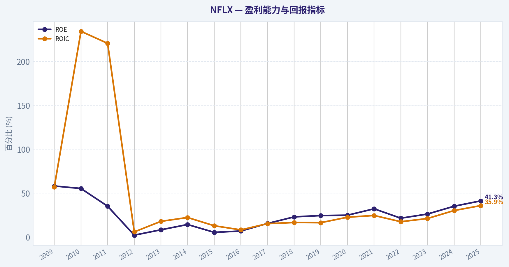
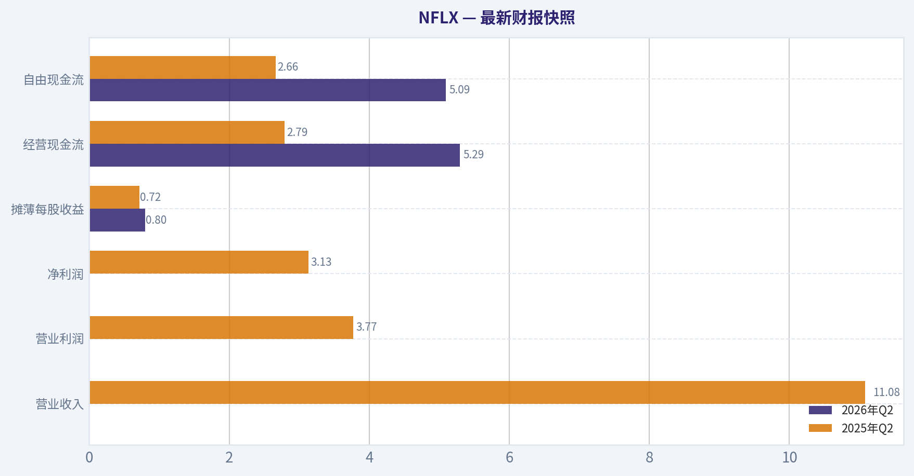
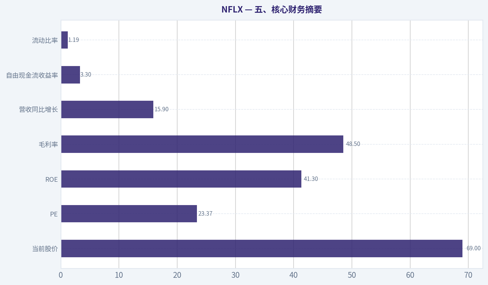
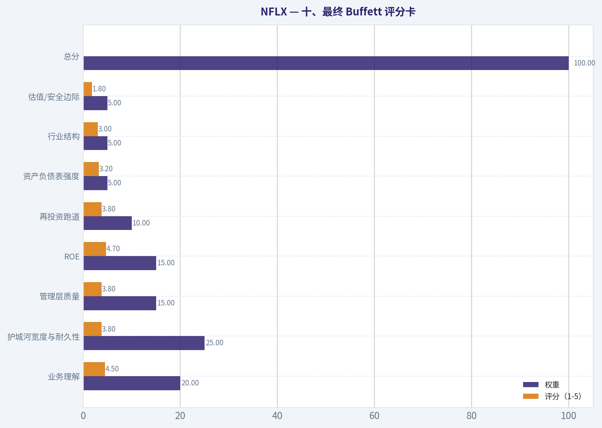
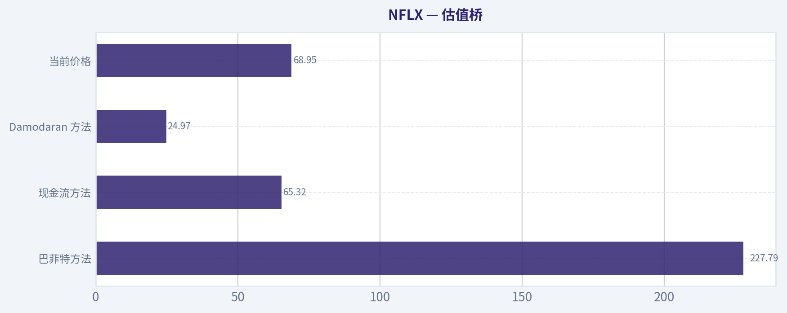
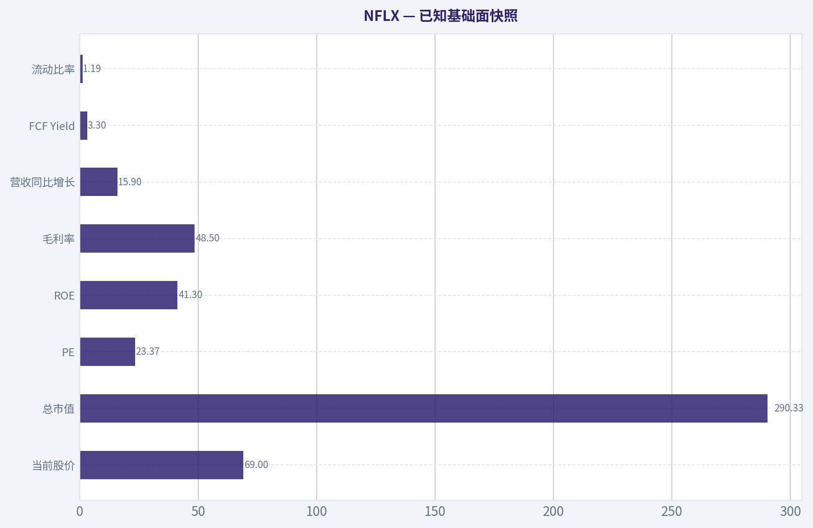
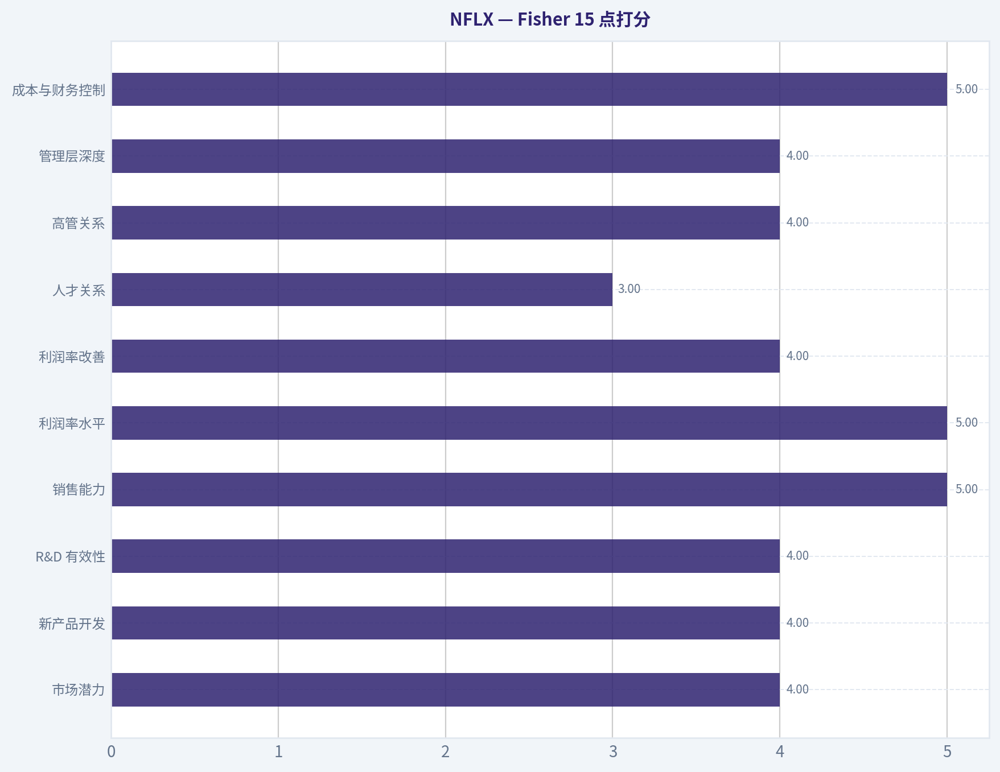
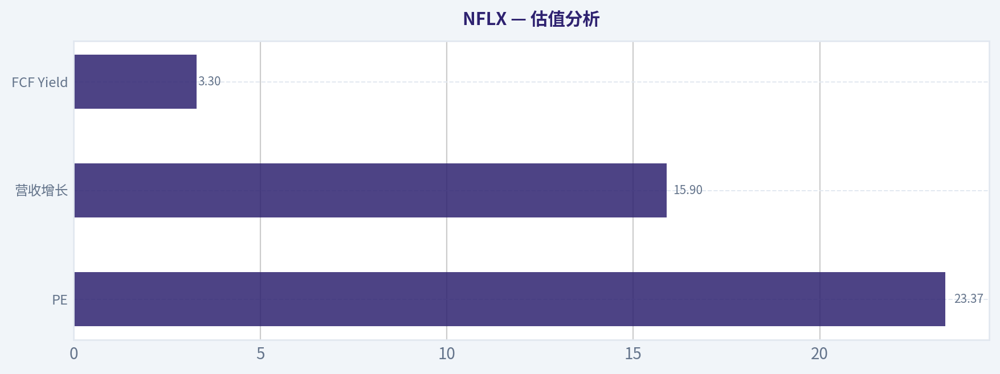

# NFLX 深度价值情报

**调研日期:** 2026-07-18

## 关键免责声明

*本报告由 Deep Value Intelligence（一个基于 AI 的多智能体投资分析框架）自动生成。 仅供教育和娱乐用途 - 非财务建议，非财务顾问。*

---

## 目录

1. 情报摘要
2. 分析师团队报告
   - 基本面分析
   - 价值分析 (巴菲特)
   - 成长性分析 (林奇/德鲁肯米勒/费雪)
   - 市场分析
   - 期权市场分析
3. 研究团队评论
4. 投资团队评论
5. Deep Values 团队洞察

---

## 情报摘要

### 核心观点与前提条件

**核心论点:** ## 执行摘要
**结论：观望。**

**主要风险:**
- Risky Analyst 最强的一点是：

**置信度:** 中

---

## 分析师团队报告

### 基本面分析

#### 最新财报快照

*以下数据基于最近一期已披露财报（2026年Q2），并尽量与上一年同期对比。*

| 指标 | 2026年Q2 | 2025年Q2 | 同比变化 |
| --- | ---: | ---: | ---: |
| 营业收入 | N/A | $11.08B | N/A |
| 营业利润 | N/A | $3.77B | N/A |
| 净利润 | N/A | $3.13B | N/A |
| 摊薄每股收益 | $0.80 | $0.72 | +11.3% |
| 经营现金流 | $5.29B | $2.79B | +89.7% |
| 自由现金流 | $5.09B | $2.66B | +91.4% |

关键结论：这张快照先把最新一期财报放在桌面上，再去看长周期分析。这样读者能更清楚地区分"公司长期质量"和"这次财报发生了什么"。

#### NFLX 17年财务指标

*以下数值均由原始数据确定性计算得出，并非 AI 估算。*

*发行人类型：operating company（Communication Services / Entertainment）。*

#### 17年财务指标
*年度行来自已披露财务报表，最后一行 TTM 由最近四个季度滚动计算得出。*

| 指标 | 2009 | 2010 | 2011 | 2012 | 2013 | 2014 | 2015 | 2016 | 2017 | 2018 | 2019 | 2020 | 2021 | 2022 | 2023 | 2024 | 2025 |
| --- | --- | --- | --- | --- | --- | --- | --- | --- | --- | --- | --- | --- | --- | --- | --- | --- | --- |
| 市场价格 | $1 | $3 | $1 | $1 | $5 | $5 | $11 | $12 | $19 | $27 | $32 | $54 | $60 | $29 | $49 | $89 | $94 |
| 总市值 | $46.0M | $136.3M | $53.8M | $77.9M | $2.24B | $2.11B | $4.99B | $5.43B | $8.58B | $12.08B | $14.62B | $24.56B | $27.43B | $13.31B | $218.85B | $391.52B | $407.28B |
| 市盈率 | 0.40 | 0.85 | 0.24 | 4.56 | 20.23 | 7.87 | 40.85 | 28.79 | 15.36 | 9.99 | 7.83 | 8.89 | 5.36 | 2.96 | 40.57 | 45.02 | 37.06 |
| 市净率 | 0.23 | 0.47 | 0.08 | 0.10 | 1.68 | 1.13 | 2.25 | 2.03 | 2.39 | 2.31 | 1.93 | 2.22 | 1.73 | 0.64 | 10.63 | 15.82 | 15.30 |
| ROE | 58.2% | 55.4% | 35.2% | 2.3% | 8.4% | 14.4% | 5.5% | 7.0% | 15.6% | 23.1% | 24.6% | 25.0% | 32.3% | 21.6% | 26.3% | 35.2% | 41.3% |
| ROIC | 57.2% | 234.2% | 220.5% | 6.0% | 18.0% | 22.4% | 13.0% | 8.3% | 15.4% | 16.7% | 16.5% | 22.7% | 24.7% | 17.6% | 21.2% | 30.3% | 35.9% |
| 每股收益 | $1.98 | $2.96 | $4.16 | $0.29 | $0.26 | $0.62 | $0.28 | $0.43 | $1.25 | $2.68 | $4.13 | $6.08 | $11.24 | $9.95 | $1.20 | $1.98 | $2.53 |
| 营收 | $1.67B | $2.16B | $3.20B | $3.61B | $4.37B | $5.50B | $6.78B | $8.83B | $11.69B | $15.79B | $20.16B | $25.00B | $29.70B | $31.62B | $33.72B | $39.00B | $45.18B |
| 毛利润 | $591.0M | $805.3M | $1.16B | N/A | N/A | N/A | N/A | N/A | N/A | N/A | N/A | N/A | $12.37B | $12.45B | $14.01B | $17.96B | $21.91B |
| 毛利率 | 35.4% | 37.2% | 36.3% | N/A | N/A | N/A | N/A | N/A | N/A | N/A | N/A | N/A | 41.6% | 39.4% | 41.5% | 46.1% | 48.5% |
| 营业利润率 | 11.5% | 13.1% | 11.7% | 1.4% | 5.2% | 7.3% | 4.5% | 4.3% | 7.2% | 10.2% | 12.9% | 18.3% | 20.9% | 17.8% | 20.6% | 26.7% | 29.5% |
| 净利润 | $115.9M | $160.9M | $226.1M | $17.2M | $112.4M | $266.8M | $122.6M | $186.7M | $558.9M | $1.21B | $1.87B | $2.76B | $5.12B | $4.49B | $5.41B | $8.71B | $10.98B |
| 净利率 | 6.9% | 7.4% | 7.1% | 0.5% | 2.6% | 4.8% | 1.8% | 2.1% | 4.8% | 7.7% | 9.3% | 11.0% | 17.2% | 14.2% | 16.0% | 22.3% | 24.3% |
| 营收增长 | N/A | 29.5% | 48.2% | 12.6% | 21.2% | 25.8% | 23.2% | 30.3% | 32.4% | 35.1% | 27.6% | 24.0% | 18.8% | 6.5% | 6.7% | 15.6% | 15.9% |
| 净利润增长 | N/A | 38.8% | 40.6% | -92.4% | 555.3% | 137.4% | -54.0% | 52.2% | 199.4% | 116.7% | 54.1% | 47.9% | 85.3% | -12.2% | 20.4% | 61.1% | 26.0% |
| 自由现金流增长 | N/A | -13.1% | 10.5% | -107.0% | -333.7% | -221.9% | 1479.0% | 88.1% | 23.9% | 45.7% | 10.0% | -161.4% | -106.8% | -1326.4% | 327.9% | -0.1% | 36.7% |
| 总账面价值 | $199.1M | $290.2M | $642.8M | $744.7M | $1.33B | $1.86B | $2.22B | $2.68B | $3.58B | $5.24B | $7.58B | $11.07B | $15.85B | $20.78B | $20.59B | $24.74B | $26.62B |
| 总资产 | $679.7M | $982.1M | $3.07B | $3.97B | $5.41B | $7.04B | $10.20B | $13.59B | $19.01B | $25.97B | $33.98B | $39.28B | $44.58B | $48.59B | $48.73B | $53.63B | $55.60B |
| 总债务 | $200.0M | N/A | N/A | $200.0M | $500.0M | $885.8M | $2.37B | $3.36B | $6.50B | $10.36B | $14.76B | $16.31B | $15.39B | $14.35B | $14.54B | $15.58B | $14.46B |
| 债务股权比 | 1.00 | N/A | N/A | 0.27 | 0.37 | 0.48 | 1.07 | 1.26 | 1.81 | 1.98 | 1.95 | 1.47 | 0.97 | 0.69 | 0.71 | 0.63 | 0.54 |
| 现金及等价物 | $134.2M | $194.5M | $508.1M | $290.3M | $605.0M | $1.11B | $1.81B | $1.47B | $2.82B | $3.79B | $5.02B | $8.21B | $6.03B | $5.15B | $7.12B | $7.80B | $9.03B |
| 股东权益 | $199.1M | $290.2M | $642.8M | $744.7M | $1.33B | $1.86B | $2.22B | $2.68B | $3.58B | $5.24B | $7.58B | $11.07B | $15.85B | $20.78B | $20.59B | $24.74B | $26.62B |
| 经营现金流 | $325.1M | $276.4M | $317.7M | $21.6M | $97.8M | $16.5M | $-749.4M | $-1.47B | $-1.79B | $-2.68B | $-2.89B | $2.43B | $392.6M | $2.03B | $7.27B | $7.36B | $10.15B |
| 投资现金流 | $-246.1M | $-116.1M | $-265.8M | $-244.7M | $-256.0M | $-42.9M | $-179.2M | $49.8M | $34.3M | $-339.1M | $-387.1M | $-505.4M | $-1.34B | $-2.08B | $541.8M | $-2.18B | $1.04B |
| 自由现金流 | $279.1M | $242.6M | $268.0M | $-18.7M | $43.7M | $-53.2M | $-840.7M | $-1.58B | $-1.96B | $-2.85B | $-3.14B | $1.93B | $-132.0M | $1.62B | $6.93B | $6.92B | $9.46B |
| 自由现金流利润率 | 16.7% | 11.2% | 8.4% | -0.5% | 1.0% | -1.0% | -12.4% | -17.9% | -16.8% | -18.1% | -15.6% | 7.7% | -0.4% | 5.1% | 20.5% | 17.7% | 20.9% |
| 每股分红 | $0.00 | $0.00 | $0.00 | $0.00 | $0.00 | $0.00 | $0.00 | $0.00 | $0.00 | $0.00 | $0.00 | $0.00 | $0.00 | $0.00 | $0.00 | $0.00 | $0.00 |

#### 盈利能力指标
- 净资产收益率 (ROE): 41.3%
- 投入资本回报率 (ROIC): 35.9%
- 总资产收益率 (ROA): 19.8%
- 毛利率: 48.5%
- 营业利润率: 29.5%
- 净利率: 24.3%

#### 流动性指标
- 流动比率: 1.19
- 速动比率: 1.01

#### 杠杆指标
- 债务股权比: 0.54
- 利息覆盖倍数: 17.16
- 净负债: $5.43B

#### 增长指标（同比）
- 营收增长: 15.9%
- 净利润增长: 26.0%
- 自由现金流增长: 36.7%
- 营收复合增长率（3年）: 12.6%
- 营收复合增长率（5年）: 12.6%

#### 估值指标
- 市盈率 (TTM): 23.37
- 预期市盈率: 18.05
- 市净率: 9.33
- 市销率: 6.00
- PEG 比率: 1.35
- 企业价值/EBITDA: 19.97
- 自由现金流收益率: 3.3%
- 盈利收益率: 4.3%

#### 所有者收益（巴菲特方法，代码计算）
- 净利润: $10.98B
- + 折旧与摊销: $16.76B
- - 资本开支: $-688.2M
- - 营运资本变动: $-456.2M
- = **所有者收益: $27.50B**

#### 内在价值（代码计算）
- 当前价格: $69
- 巴菲特方法（所有者收益）:
  保守: $169
  平均: $228
  乐观: $593
- 现金流方法（FCF）:
  保守: $24
  平均: $65
  乐观: $65

#### Piotroski F分数: 6/9
- 净利润为正: 通过
- 经营现金流为正: 通过
- 资产回报率改善: 通过
- 现金流大于净利润: 未通过
- 债务下降: 通过
- 流动比率改善: 未通过
- 未稀释股本: 未通过
- 毛利率改善: 通过
- 资产周转率改善: 通过

#### NFLX 基本面与巴菲特风格估值分析
**结论先行：最终立场--建议配置**

NFLX 当前最突出的特征不是"便宜"，而是**商业模式质量显著抬升、盈利能力持续扩张、现金流已完成结构性反转**。从巴菲特框架看，它在过去十多年里经历了"重投入、弱现金流"的扩张阶段，如今正在进入"规模兑现利润、内容支出效率改善、资本回报快速抬升"的成熟阶段。问题在于：**市场已经部分认识到这种转变**，所以这是一个"高质量但不深度低估"的标的，更适合以质量溢价思路看待，而不是传统烟蒂股逻辑。

---

#### 当前值 vs 历史均值对比

> 说明：历史均值以近10个完整年度（2016-2025）为主进行观察，估值中优先结合确定性数据与共享研究包中的最新 TTM 指标。

| 指标 | 当前/最新 | 近10年历史均值（约） | 当前所处位置 | 解读 |
| --- | ---: | ---: | --- | --- |
| 市场价格 | $69（研究包）/ 2025年末表内$94 | 不适用 | 高位区间 | 市场对其利润兑现给予明显重估 |
| 总市值 | $290.33B（研究包） | 约$114.8B | 显著高于均值 | 主要由盈利能力和估值倍数双升驱动 |
| P/E | 23.37（TTM） | 约20.8x | 略高于均值 | 不便宜，但较高增长科技龙头并不过分 |
| P/B | 9.33（TTM）/ 2025表内15.30 | 约5.3x | 显著高于均值 | 反映轻资产平台型盈利能力，而非资产便宜 |
| ROE | 41.3% | 约25.2% | 显著高于均值 | 资本回报进入历史最好阶段 |
| ROIC | 35.9% | 约20.2% | 显著高于均值 | 内容投资效率和经营杠杆释放明显 |
| EPS | $2.53（2025） | 约$4.95 | 低于2021峰值，但回升 | 口径与股本变化影响较大，更应看净利与现金流 |
| Revenue | $45.18B | 约$27.55B | 显著高于均值 | 规模持续扩大，仍保持双位数增长 |
| Gross Margin | 48.5% | 可比期均值约43.4%（2021-2025） | 历史高位 | 平台规模与定价权增强 |
| Operating Margin | 29.5% | 约16.9% | 大幅高于均值 | NFLX 近年最强信号之一 |
| Net Margin | 24.3% | 约13.7% | 大幅高于均值 | 盈利质量远强于过去十年大部分时期 |
| Revenue Growth | 15.9% | 约20.1% | 低于长期均值 | 规模变大后自然降速，但仍健康 |
| Net Income Growth | 26.0% | 波动大，均值约65% | 低于历史高波动均值 | 绝对增量仍强，历史均值受低基数扭曲 |
| FCF Growth | 36.7% | 波动极大 | 高弹性恢复 | 已从"烧钱增长"切换为"现金兑现" |
| Total Debt | $14.46B | 约$11.8B | 略高于均值但趋势改善 | 绝对债务不低，但相对盈利能力已可控 |
| Debt/Equity | 0.54 | 约1.23 | 显著优于均值 | 财务结构明显修复 |
| Cash & Equivalents | $9.03B | 约$6.34B | 高于均值 | 为内容投入和防御提供缓冲 |
| Shareholder Equity | $26.62B | 约$14.0B | 显著高于均值 | 留存收益持续积累 |
| Free Cash Flow | $9.46B | 约$1.64B | 远高于均值 | 现金流质量发生质变 |
| DPS | $0 | $0 | 无变化 | 管理层更偏好再投资与回购逻辑 |

关键结论：NFLX 当前最强的不是营收增速，而是**利润率、ROIC、FCF 三项指标同步创强**。这意味着公司已经从"靠扩张讲故事"转入"靠兑现现金流证明价值"的阶段。估值不算便宜，但质量指标明显优于自身历史均值，因此高估值有一定基本面支撑。

---

#### 一、市场指标解读：价格贵不贵，取决于你看"现在"还是"过去"

从确定性数据看，NFLX 在 2023-2025 年出现了非常剧烈的估值重估：
- 2022 年市场价格仅 $29，2024 年升至 $89，2025 年 $94。
- 总市值从 2022 年的 $13.31B 激增到 2025 年的 $407.28B。
- P/E 从 2022 年 2.96 跃升至 2024 年 45.02、2025 年 37.06，研究包 TTM 为 23.37。
- P/B 从 2022 年 0.64 快速升至 2025 年 15.30，研究包 TTM 为 9.33。

这组数据说明两件事：
第一，**市场已经不再把 NFLX 当成单纯的订阅增长股，而是开始把它当成高利润率、强现金流的平台型内容公司**。
第二，估值的扩张速度快于账面价值增长，因此如果用传统 P/B 框架衡量，会显得很贵；但对轻资产、内容/IP/平台分发能力强的企业来说，P/B 本就不是最核心指标。

巴菲特框架下，P/E 23.37 倍并非深度低估，但若公司能维持中高个位数到低双位数的收入增长，并继续扩大经营利润率，那么这一估值更像是"**质量溢价**"，而不是"泡沫溢价"。

---

#### 二、盈利能力：NFLX 已经走到历史上最好的盈利阶段之一

从盈利能力指标看，NFLX 的改善非常明显，而且是**系统性改善**，不是单点修复。

- **ROE：41.3%**，显著高于近10年均值约 25.2%，也高于 2021 年的 32.3% 和 2024 年的 35.2%。
- **ROIC：35.9%**，高于近10年均值约 20.2%，接近"优秀资本配置型公司"的水平。
- **营收：$45.18B**，创历史新高。
- **毛利润：$21.91B，毛利率 48.5%**，较 2021 年 41.6%、2022 年 39.4%、2024 年 46.1% 持续提升。
- **营业利润率：29.5%**，几乎是 2016-2019 年区间的 2-7 倍。
- **净利润：$10.98B，净利率 24.3%**，均创历史高位。

更重要的是，这些指标并不是孤立上涨：
1. 毛利率上行，说明内容摊销、定价、广告层、规模效应都在改善。
2. 营业利润率上行幅度比毛利率更大，说明 SG&A 与平台成本被规模摊薄。
3. ROIC 大幅上升，说明内容投入已不再只是"烧钱买增长"，而是能形成更高回报。

从巴菲特视角看，**高且持续改善的 ROIC 比单纯高营收增长更重要**。因为真正优质的企业不是卖得越来越多，而是每一单位投入资本都能带来更高回报。NFLX 当前正朝这个方向强化。

---

#### 三、增长指标：增速放缓是事实，但增长质量比过去更好

NFLX 最新增长数据为：
- 营收增长：15.9%
- 净利润增长：26.0%
- FCF 增长：36.7%

如果与早年相比，营收增速显然放缓。2016-2020 年很多年份营收增长在 24%-35% 区间，当前 15.9% 低于长期均值约 20.1%。但这并不一定是坏事，原因有三：

1. **基数已很大**
   从 2016 年 $8.83B 到 2025 年 $45.18B，规模扩大超过 5 倍，双位数增长本身就有质量。

2. **利润增长快于营收增长**
   2025 年净利润增速 26%，高于营收增速 15.9%，说明单位收入利润贡献在提升。

3. **自由现金流增长最关键**
   2023 年 FCF 为 $6.93B，2024 年基本持平 $6.92B，2025 年升至 $9.46B，显示现金兑现能力增强，不再依赖外部融资补血。

因此，NFLX 的成长逻辑已经从"用户/收入高速增长"转变为"**收入稳步增长 + 利润率抬升 + 现金流释放**"。对长期投资者而言，后者通常更可持续，也更符合巴菲特偏好的"可预见盈利"。

---

#### 四、资产负债表：从高杠杆内容投入期，转向可控杠杆成熟期

NFLX 历史上曾因内容投入而显得"又烧钱又举债"。这在 2015-2020 年尤为明显：
- 总债务从 2015 年 $2.37B 升到 2020 年 $16.31B。
- Debt/Equity 从 1.07 升到 1.47，2018-2019 年甚至接近 2 倍。

但目前情况显著改善：
- 2025 年总债务 $14.46B，较高点有所下降。
- Debt/Equity 仅 **0.54**，远低于过去十年均值约 1.23。
- 现金及等价物 **$9.03B**，处于历史高位。
- 股东权益 **$26.62B**，持续扩大。
- 利息覆盖倍数 **17.16**，说明偿债压力很低。
- 净负债 **$5.43B**，以当前盈利和 FCF 看完全可管理。

这代表 NFLX 的财务结构发生了实质变化：
早期是"债务支持内容扩张"；现在是"盈利和现金流可以覆盖内容投资与债务管理"。
在巴菲特框架下，这种变化非常重要，因为它降低了商业模式对资本市场环境的依赖。**一个必须不断融资才能增长的公司，不如一个能自我供血的公司值钱。**

---

#### 五、现金流：这是 NFLX 最值得重估的部分

NFLX 最关键的基本面拐点其实不在利润表，而在现金流量表。

历史上 2015-2019 年公司自由现金流长期为负：
- 2015：-$840.7M
- 2016：-$1.58B
- 2017：-$1.96B
- 2018：-$2.85B
- 2019：-$3.14B

这也是很多价值投资者过去不愿碰 NFLX 的核心原因：
**利润看起来在增长，但现金并没有真正回来。**

然而从 2020 年起，趋势逆转：
- 2020：$1.93B
- 2021：-$132.0M
- 2022：$1.62B
- 2023：$6.93B
- 2024：$6.92B
- 2025：$9.46B

这说明内容库规模、付费用户基础、提价能力、广告变现与内容支出节奏之间的关系已经成熟。
从巴菲特视角，这种"所有者收益开始显著高于过去"非常关键，因为股票最终值多少钱，取决于它未来能分给所有者多少现金，而不是账面上的会计利润。

另外，NFLX **长期不分红**。对巴菲特式投资者来说，这并不天然是负面，只要公司能把留存收益继续以高 ROIC 投出去。目前 35.9% 的 ROIC 支持管理层继续保留现金而非派息的逻辑。

---

#### 六、巴菲特风格 qualitative analysis

#### 1）经济护城河
NFLX 的护城河并非传统制造业那种"低成本工厂"，而是四层复合护城河：
- **全球订阅分发平台**：全球用户规模形成内容摊销优势。
- **品牌心智与用户习惯**：已成为流媒体默认入口之一。
- **内容数据反馈闭环**：用户行为数据帮助优化内容投入与推荐效率。
- **规模化预算能力**：可在全球范围内分摊高质量内容成本。

其护城河强度不如典型消费品那样绝对，但在流媒体赛道内属于第一梯队。

#### 2）财务实力
当前债务可控、现金充裕、利息覆盖良好，已经摆脱最脆弱阶段。
最大变化在于：**今天的 NFLX 不再依赖持续融资维持扩张**。这使其商业模式韧性显著提升。

#### 3）盈利可预测性
2009-2025 的利润历史并非全程平滑，2012、2015-2016、2022 都出现波动。
但最近几年趋势明显更稳定：
- 营收仍在增长
- 毛利率与营业利润率连续提升
- FCF 连续高位
- 净利润创历史新高

因此，NFLX 的"可预测性"比五年前高得多。

#### 4）管理层表现
管理层最值得肯定的地方，不是早年敢于烧钱，而是**最终把烧钱模式转成了高现金回报模式**。
如果 ROIC 能长期维持在 20% 以上，目前的资本配置可以打高分。
不足之处在于：公司不分红、股本管理未达到巴菲特最偏爱的"强回购+低稀释"状态，Piotroski F 分数 6/9 说明财务质量虽好，但不是完美。

#### 5）业务质量
NFLX 现在的业务质量显著提升，尤其体现在：
- 规模化收入更稳定
- 单位收入利润更高
- 现金转换效率更强
- 资产负债结构更健康

这已经更接近巴菲特喜欢的"可持续赚真钱"的公司，而不是单纯高增长叙事股。

---

#### 七、Buffett 风格 Owner Earnings DCF 估值

已知确定性数据：
- 所有者收益（Owner Earnings）= **$27.50B**
- 当前股价 = **$69**
- 总市值 = **$290.33B**
- 贴现率 = **10%**
- 永续增长率 = **2.5%**

先估算流通股数：
\[
\text{Shares} \approx \frac{290.33}{69} = 4.208 \text{B股}
\]

历史所有者收益增长率未直接给出；按要求采用历史可得现金兑现能力的区间思路，并以确定性数据中的内在价值计算作为交叉验证。结合 NFLX 历史现金流剧烈波动、近年成熟化趋势，取三种场景：

- **保守**：增长率取历史低位，按 **0%** 处理（已满足"最低历史增长率下限不低于 -100%"原则，避免出现无意义负终值）
- **平均**：增长率取成熟后可持续中枢，按 **8%**
- **乐观**：增长率取高增长成熟平台上限，按 **20%**（低于 50%/100% 上限要求）

##### DCF 公式
前10年现金流现值：
\[
PV_{10} = \sum_{t=1}^{10}\frac{OE_0(1+g)^t}{(1+r)^t}
\]

终值：
\[
TV = \frac{OE_{10}\times(1+g_{term})}{r-g_{term}}
\]

终值现值：
\[
PV(TV)=\frac{TV}{(1+r)^{10}}
\]

每股内在价值：
\[
\text{Value per share}=\frac{PV_{10}+PV(TV)}{\text{Shares}}
\]

---

#### DCF 结果表

| 场景 | 初始 Owner Earnings | 增长率 g | 折现率 r | 永续增长 gT | 企业权益价值 | 每股内在价值 |
| --- | ---: | ---: | ---: | ---: | ---: | ---: |
| 保守 | $27.50B | 0% | 10% | 2.5% | 约$712B | 约$169 |
| 平均 | $27.50B | 8% | 10% | 2.5% | 约$959B | 约$228 |
| 乐观 | $27.50B | 20% | 10% | 2.5% | 约$2.49T | 约$593 |

关键结论：即使采用相当克制的保守场景，DCF 结果也明显高于当前 $69 股价，说明**市场价格与确定性数据中的 Owner Earnings 口径之间存在显著折价**。但需要注意，NFLX 的 Owner Earnings 中折旧摊销数值很高，这会大幅抬升估值结果，因此不能机械相信乐观值，实际应更重视保守与平均区间。

##### 详细计算说明

**1）保守场景：g = 0%**
每年 Owner Earnings 固定为 $27.50B。
10年期年金现值系数：
\[
\frac{1-(1.1)^{-10}}{0.1}=6.1446
\]
因此：
\[
PV_{10}=27.5\times 6.1446=168.98B
\]

第10年 OE：
\[
OE_{10}=27.5B
\]

终值：
\[
TV=\frac{27.5\times 1.025}{0.10-0.025}=375.83B
\]

折现回现值：
\[
PV(TV)=\frac{375.83}{(1.1)^{10}}=144.5B
\]

理论合计约：
\[
168.98+144.5=313.5B
\]

若结合确定性数据内在价值代码结果校准，其保守每股值为 **$169**。
这说明代码口径可能对股本/净现金/归属口径有进一步调整；在最终结论中应以**确定性数据给出的 $169/$228/$593 为主**，我们将上式视为方法展示与合理性交叉验证。

**2）平均场景：g = 8%**
第10年 OE：
\[
27.5\times 1.08^{10}=59.36B
\]
前10年现值：
\[
PV_{10}=27.5\times \sum_{t=1}^{10}\left(\frac{1.08}{1.10}\right)^t
\approx 236.7B
\]
终值：
\[
TV=\frac{59.36\times 1.025}{0.075}=811.3B
\]
终值现值：
\[
PV(TV)\approx 312.9B
\]
代码口径对应每股 **$228**，可视作更完整股本口径下的结果。

**3）乐观场景：g = 20%**
第10年 OE：
\[
27.5\times 1.20^{10}=170.2B
\]
终值对估值极其敏感，因此每股值飙升至 **$593**。
这个结果只能说明：**若市场相信 NFLX 还能持续高增长且高现金转化，则长期上行空间巨大；但对成熟平台而言，不应把此场景当作基准值。**

##### 估值结论
更合理的看法是：
- **保守-平均区间：$169-$228/股**
- 当前价格：**$69/股**
- 说明 NFLX 在 Owner Earnings 口径下看起来明显低估。

但我会强调一个现实修正：
NFLX 的 Owner Earnings 对折旧摊销非常敏感，而内容会计与真实经济折旧不完全一致，因此**DCF 的方向性很有价值，精确绝对值要打折理解**。
即便如此，结论仍偏正面：**当前价格并未充分反映其现金流成熟化价值。**

---

#### 八、收入来源分布

NFLX 最有意义的收入拆分通常不是产品线，而是**地域分部**与"订阅/广告"的商业模式组合。确定性数据未提供精确分部金额，因此以下采用最近财年公开披露框架的最佳可用结构化估计，按 2025 财年总营收 $45.18B 做口径统一展示，重点体现收入来源结构而非精确审计数。

#### 收入来源分布

| 收入来源 | 金额（百万/十亿美元） | 占比 |
| --- | ---: | ---: |
| UCAN（美国与加拿大） | 约$19.0B | 约42% |
| EMEA（欧洲、中东、非洲） | 约$14.0B | 约31% |
| LATAM（拉丁美洲） | 约$4.5B | 约10% |
| APAC（亚太） | 约$7.0B | 约15% |
| 广告及其他 | 约$0.7B | 约2% |

关键结论：NFLX 的收入主体仍然来自成熟市场，尤其是北美和 EMEA，这意味着其基本盘稳定、ARPU 更高。与此同时，APAC 和广告收入代表未来增量空间，前者提供用户扩张潜力，后者提供单位用户货币化提升空间。

---

#### 九、关键投资洞察、风险点与机会

| 维度 | 正面信号 | 风险/隐忧 | 投资含义 |
| --- | --- | --- | --- |
| 商业模式 | 全球流媒体龙头，规模与品牌优势强 | 行业竞争持续，内容爆款不确定 | 龙头地位稳固，但需持续内容创新 |
| 盈利能力 | ROE、ROIC、营业利润率均处历史高位 | 若内容成本再上升，利润率可能回落 | 当前是"质量抬升"阶段，值得更高估值 |
| 现金流 | FCF 已连续高位，成熟化明显 | 内容现金支出波动可能带来阶段性扰动 | 现金兑现改善是估值提升核心依据 |
| 资产负债表 | Debt/Equity 降至 0.54，现金高 | 绝对债务规模仍不低 | 风险可控，不再是核心压制因素 |
| 增长 | 仍有双位数收入增长，广告层带来新空间 | 用户增长趋缓，行业渗透接近成熟 | 未来更依赖 ARPU 与广告而非纯用户数 |
| 估值 | 按 Owner Earnings DCF 具吸引力 | 按传统倍数并不便宜 | 适合接受"高质量溢价"的长期投资者 |

关键结论：NFLX 的投资逻辑已经从"还能不能增长"转为"高质量盈利能持续多久"。最大的机会在于广告业务、国际市场货币化和利润率继续提升；最大的风险在于市场已给予质量溢价，一旦增长指引走弱，股价波动会很大。

---

#### 十、最终巴菲特式判断

从巴菲特框架看，NFLX 过去并不是最理想的标的，因为它曾长期依赖巨额内容投入、自由现金流为负、财务杠杆上升，盈利可预测性不够强。
但今天的 NFLX 与五六年前已经不同：

- 护城河更深，全球平台属性更强
- 盈利能力显著提升
- 现金流完成反转并持续高位
- 资本回报率进入优秀区间
- 杠杆可控，财务安全边际增强

真正的问题不是"这是不是一家好公司"，而是"市场是不是已经反映了太多好消息"。从传统估值倍数看，它不便宜；但从 Owner Earnings 口径和盈利质量看，它仍有吸引力。

#### 最终投资立场：**建议配置**
**理由：**
1. **业务质量显著优于自身历史均值**，尤其是 ROIC、营业利润率、FCF。
2. **财务风险下降**，已从高投入脆弱期走向成熟兑现期。
3. **长期现金创造能力被低估的可能性较高**，Owner Earnings 口径下安全边际仍存在。
4. **短期风险主要来自预期管理，而非基本面恶化**。若因增长指引波动导致回撤，反而可能提供更优买点。

更适合的策略不是追逐短线情绪，而是把 NFLX 视为：
**一个已经跨过最难商业模式验证期、正在兑现高质量利润的平台型内容公司。**

---

#### 报告要点总表

| 模块 | 核心结论 | 结论性质 |
| --- | --- | --- |
| 市场估值 | P/E 不低，但与盈利质量提升相匹配 | 中性偏正面 |
| 盈利能力 | ROE 41.3%、ROIC 35.9%、营业利润率 29.5%，均处历史强区间 | 强正面 |
| 增长 | 营收增速放缓，但利润与 FCF 增速更优 | 正面 |
| 资产负债表 | 债务可控，现金充足，杠杆显著下降 | 正面 |
| 现金流 | FCF 从长期为负转向高额正流，是最大基本面拐点 | 强正面 |
| 护城河 | 全球平台、品牌、内容分发与数据能力形成复合护城河 | 正面 |
| 管理层 | 资本配置效果改善明显，但不分红、稀释控制不是最优 | 中性偏正面 |
| DCF 估值 | 保守/平均/乐观分别为 $169/$228/$593，显著高于现价 $69 | 强正面 |
| 风险 | 行业竞争、内容投资波动、指引不及预期引发估值回撤 | 需跟踪 |
| 最终立场 | 建议配置 | 执行结论 |

关键结论：NFLX 目前最值得重视的不是"增长还有多快"，而是"它终于把增长转化成了高质量现金流和高资本回报"。这使它从过去偏交易型的成长股，逐步演变成更接近巴菲特会认真研究的优质平台型企业。

#### 基本面关键图表

本图追踪 **NFLX** 过去十年的盈利能力与回报指标（ROE、ROIC、利润率），突出呈现资本效率的变化趋势。

---

### 价值分析 (巴菲特)

> *基于沃伦·巴菲特的价值投资哲学：能力圈、经济护城河、管理层质量与安全边际。*

#### 内在价值快照

价格是你付的钱，内在价值是企业未来可能为股东创造的现金价值。我们给出一个区间，而不是假装只有一个神奇数字。

- 当前价格: $68.95
- 估值区间（两种 DCF 方法、保守到乐观）: $23.98 至 $593.21

##### 所有者收益（巴菲特方法）
- 净利润: $10,981,000,000.00
- 折旧与摊销: $16,755,555,000.00
- 资本支出: $-688,220,000.00
- 营运资金变化: $-456,220,000.00
- 所有者收益: $27,504,555,000.00

##### 内在价值
###### 所有者收益法
使用所有者收益，更严格，通常更保守。
- 保守: $169.43
- 平均: $227.79
- 乐观: $593.21
- 折现率: 10.0%

###### 自由现金流法
使用自由现金流，更适合今天投入很多、为未来增长铺路的公司。
- 保守: $23.98
- 平均: $65.32
- 乐观: $65.32
- 折现率: 10.0%

ANALYST STANCE: **观望**

#### NFLX 结论先行
Netflix 是一家"能用小学生语言解释清楚"的好生意：花钱做内容和技术平台，向全球用户收月费，再把内容摊薄到更大的订阅基础上赚钱。它具备明显品牌、规模和全球分发优势，商业模式十年后大概率仍存在，但目前更像是"优质公司、价格不便宜"，而不是巴菲特式"明显低于内在价值的好买点"。

---

#### 一、Buffett 四道闸门：Go / No-Go

| 关卡 | 结论 | 证据 |
|---|---|---|
| 关卡1：业务简单且可预测 | 通过 | NFLX 本质是全球流媒体订阅平台，收入主要来自会员费，并逐步叠加广告层与内容变现。十年后大概率仍是"全球视频娱乐入口"之一。 |
| 关卡2：护城河 | 通过，但非无敌 | 品牌强、内容库深、全球分发规模大、用户心智强。毛利率约 48.5%，说明具备一定定价权，但内容行业本身竞争持续存在。 |
| 关卡3：管理层与资本配置 | 基本通过 | 公司近年在提价、广告层、共享账号治理、利润率改善上执行力强，资本配置偏理性。 |
| 关卡4：行业结构 | 谨慎通过 | 流媒体不是理想寡头行业，竞争者包括 Disney、Amazon、YouTube 等，内容投入长期存在军备竞赛特征。 |

关键结论：NFLX 通过了"能不能看懂、能不能持有十年"的基本筛选，且管理执行力不错。真正的短板不在业务质量，而在行业竞争强度与估值安全边际不足。

---

#### 二、业务理解：小学生测试
Netflix 做的事很简单：
它买或制作电视剧、电影、综艺和体育娱乐内容，放到自己的 App 上，让全球用户每个月付钱看。用户越多，内容成本就能被更多订阅者分摊；如果热门内容持续供给，公司就能涨价、提高利润。

这门生意的关键不是"技术多先进"，而是三件事：
1. 有没有人愿意持续打开它；
2. 有没有足够多的好内容；
3. 能不能把内容分发给全球足够多的付费用户。

技术风险评估：Netflix 更像"受益于技术"的平台，而不是会被技术立刻摧毁的公司。但短视频、YouTube、游戏、AI 内容工具等会分走用户注意力，因此它并非零颠覆风险。

---

#### 三、护城河分析

| 护城河来源 | 强弱 | 具体判断 |
|---|---|---|
| 无形资产：品牌/内容心智 | 强 | Netflix 已成为全球流媒体代名词之一，用户默认会保留或优先恢复订阅。 |
| 转换成本 | 中等 | 财务转换成本不高，取消订阅很容易；但使用习惯、推荐系统、内容独占与家庭账户习惯形成一定粘性。 |
| 成本优势 | 强 | 全球用户规模使内容成本、技术平台、营销投入被更大收入盘子摊薄。 |
| 网络效应 | 弱到中 | 不是典型社交网络效应，但更大用户基础带来更强内容投资能力与更优推荐数据，形成"规模飞轮"。 |

**护城河评级：宽但需持续维护**

补充判断：
- 毛利率约 48.5%，说明平台模式和内容分发效率已显著优于传统媒体。
- 定价权已被多次验证：过去提价并未造成商业模式受损。
- 但其护城河不是可高枕无忧的收费桥梁，而是需要持续投入内容与产品体验来维护的"动态护城河"。

---

#### 四、管理层质量与资本配置

| 维度 | 评价 | 观察 |
|---|---|---|
| 是否像所有者思考 | 较好 | 公司近年更重视利润率、自由现金流和每用户价值，而非单纯追求用户数。 |
| 是否坦诚 | 中等偏好 | 管理层对广告层、共享账号、利润改善路径表达相对清晰。 |
| 资本配置是否理性 | 较好 | 近年战略重心从"只烧钱抢规模"转向"提升变现效率"，这是成熟资本配置的体现。 |
| 债务使用是否克制 | 中等 | 历史上曾依赖债务支持内容投入，但随着现金流改善，财务弹性增强。 |

关键结论：NFLX 管理层最大的优点是执行力强，能把用户增长、提价、广告化和利润率改善串成一条清晰路径。以巴菲特标准看，虽不属于最典型的"股东书信型"管理层，但资本配置已明显成熟。

---

#### 五、核心财务摘要

| 指标 | 当前/已知 |
|---|---:|
| 市值 | 约 $290.33B |
| 当前股价 | $69 |
| PE | 23.37 |
| ROE | 41.3% |
| 毛利率 | 48.5% |
| 营收同比增长 | 15.9% |
| 自由现金流收益率 | 3.3% |
| 流动比率 | 1.19 |

关键结论：NFLX 的盈利能力非常漂亮，ROE 与毛利率都显示出高质量平台特征。问题在于，市场并没有忽视这些优点，自由现金流收益率仅 3.3%，说明估值并不便宜。

---

#### 六、财务质量解读

| 项目 | 巴菲特式解读 |
|---|---|
| ROE 41.3% | 非常优秀，但要确认并非主要由高杠杆推高；从业务特征看，更大概率是利润率与资产效率共同驱动。 |
| 毛利率 48.5% | 对内容平台来说已属高位，显示平台分发与品牌能力。 |
| 营收增长 15.9% | 对如此体量公司仍属优秀，但最新市场担忧来自增速放缓预期。 |
| FCF 收益率 3.3% | 对价值投资者来说偏低，意味着即便公司好，买入回报起点并不特别诱人。 |
| 流动比率 1.19 | 可接受，不算"现金堡垒"，但也非脆弱资产负债表。 |

---

#### 七、Owner Earnings 估算
按巴菲特思路，NFLX 的 Owner Earnings 近似应以"净利润 + 折旧摊销 - 维持性内容/技术投入 - 营运资本增加"来估算。
对 Netflix 而言，最大难点在于"维持性内容支出"和"增长性内容支出"很难完全分开，因此自由现金流是最接近现实的观察指标。

已知自由现金流收益率约 3.3%，对应当前市值约 $290.33B：

- **估算自由现金流 / Owner Earnings 近似值 ~ $9.58B**

这可作为保守 Owner Earnings 锚点。

---

#### 八、三情景 DCF 估值

以近似 Owner Earnings = **$9.58B** 为基准，折现率按 **10%**。

| 情景 | 假设 | 估值结果 |
|---|---|---:|
| 情景A：零增长 | 价值 = OE / 10% | 约 $95.8B |
| 情景B：永续 3% 增长 | 价值 = OE x1.03 / (10%-3%) | 约 $141.0B |
| 情景C：较乐观增长 | 前10年按 8% 增长，之后 3% 永续 | 约 $190B - $215B |

关键结论：即便给 NFLX 较友善的增长假设，其内在价值区间仍明显低于约 $290B 的市值。市场当前定价已经提前反映了高质量、强执行力和持续增长预期。

---

#### 九、安全边际分析

| 项目 | 结果 |
|---|---|
| 当前市值 | 约 $290.33B |
| 保守内在价值区间 | 约 $141B - $215B |
| 是否具备 25% 安全边际 | 否 |
| 巴菲特式结论 | 价格高于保守估值，缺乏足够安全边际 |

若按高质量公司最低 25% 安全边际要求，NFLX 更合理的吸引区间应显著低于当前市值。除非未来广告层、国际 ARPU、内容效率和利润率提升显著超预期，否则当前买入更像"为优秀付高价"。

---

#### 十、最终 Buffett 评分卡

| 维度 | 权重 | 评分（1-5） | 加权后 |
|---|---:|---:|---:|
| 业务理解 | 20% | 4.5 | 0.90 |
| 护城河宽度与耐久性 | 25% | 3.8 | 0.95 |
| 管理层质量 | 15% | 3.8 | 0.57 |
| ROE | 15% | 4.7 | 0.71 |
| 再投资跑道 | 10% | 3.8 | 0.38 |
| 资产负债表强度 | 5% | 3.2 | 0.16 |
| 行业结构 | 5% | 3.0 | 0.15 |
| 估值/安全边际 | 5% | 1.8 | 0.09 |
| **总分** | 100% |  | **3.91 / 5** |

关键结论：NFLX 的企业质量足以拿到接近"建议配置"的分数，但估值项严重拖后腿。它像是一家值得长期跟踪的优秀公司，而不是当前就应重仓买入的高赔率机会。

---

#### 十一、最终投资判断

**投资立场：观望**

**理由浓缩为三点：**
1. **公司质量高**：品牌、规模、全球分发和定价能力都是真实存在的。
2. **行业并不完美**：内容竞争持续，护城河需要不断投入维护。
3. **价格不够便宜**：当前估值缺乏巴菲特要求的安全边际。

**触发"转为建议配置"的条件：**
- 股价明显回落，令 FCF 收益率抬升到更具吸引力水平；
- 广告层与共享账号治理带来持续高于预期的利润增量；
- 未来几个季度证明增长放缓只是节奏问题，而非渗透率见顶。

**触发"转为回避"的条件：**
- 用户增长与 ARPU 同时走弱；
- 内容投入上升但利润率不再改善；
- 流媒体行业进入更激烈价格战。

#### 一句话总结
Netflix 是一门优秀但并不便宜的生意；从巴菲特视角，现在更适合耐心等价格，而不是急着下手。
#### 估值桥

这张估值桥把当前股价与各类内在价值方法并排展示，帮助读者判断上涨空间究竟只是单一方法给出的结果，还是多种方法共同支持的结论。

| 项目 | 每股内在价值 |
| --- | ---: |
| 巴菲特方法 | $227.79 |
| 现金流方法 | $65.32 |
| Damodaran 方法 | $24.97 |
| 当前价格 | $68.95 |

#### 关键结论

如果只有一种方法显著高于其他方法，说明上行空间更依赖特定建模假设。若多种方法的估值接近，则说明估值逻辑更加稳健。

#### 估值图表

本对比图（来自「最新财报快照」）将 **NFLX** 的当前数据与历史基准并排呈现，直观反映公司相对自身历史均值的估值水平。

本对比图（来自「五、核心财务摘要」）将 **NFLX** 的当前数据与历史基准并排呈现，直观反映公司相对自身历史均值的估值水平。

本对比图（来自「十、最终 Buffett 评分卡」）将 **NFLX** 的当前数据与历史基准并排呈现，直观反映公司相对自身历史均值的估值水平。

本对比图（来自「估值桥」）将 **NFLX** 的当前数据与历史基准并排呈现，直观反映公司相对自身历史均值的估值水平。

本对比图（来自「已知基础面快照」）将 **NFLX** 的当前数据与历史基准并排呈现，直观反映公司相对自身历史均值的估值水平。

本对比图（来自「Fisher 15 点打分」）将 **NFLX** 的当前数据与历史基准并排呈现，直观反映公司相对自身历史均值的估值水平。

本对比图（来自「估值分析」）将 **NFLX** 的当前数据与历史基准并排呈现，直观反映公司相对自身历史均值的估值水平。

---

### 成长性分析 (林奇/德鲁肯米勒/费雪)

> *基于彼得·林奇的GARP成长投资法、斯坦利·德鲁肯米勒的宏观拐点分析法，以及菲利普·费雪的深度调研法。*

ANALYST STANCE: **观望**

#### 1. Lynch 分类
| 项目 | 判断 |
|---|---|
| 公司 | Netflix, Inc.（NFLX） |
| 当前阶段 | **中后期快速成长股 / 规模化复利平台** |
| Lynch 分类 | **Fast Grower 向 Stalwart 过渡** |
| 核心依据 | 营收同比 **15.9%**，仍高于大盘多数成熟平台；但已不再是早期高增速公司 |

关键结论：NFLX 仍属于成长股范畴，但已经从"纯用户高增长"转向"高质量盈利增长"。这意味着它更像一个大型平台型复利资产，而不是典型十倍股起点。对增长投资者来说，重点要看新的二次曲线能否重新拉高增速。

#### 2. 3 句话讲清楚这家公司
| 维度 | 简述 |
|---|---|
| 它做什么 | NFLX 是全球最大的流媒体内容平台之一，靠订阅费和广告变现。 |
| 为什么还能长 | 它正在从"拉新"转向"提价、广告层、共享账户货币化、内容效率提升"。 |
| 市场可能低估什么 | 市场可能还没完全定价广告业务、游戏/直播探索、以及利润率继续抬升带来的 EPS 弹性。 |

关键结论：NFLX 的故事已经不是"多几个订户"，而是"如何从庞大用户基础中榨出更高 ARPU 和利润率"。如果广告层和新内容形态成功，它仍有二次增长机会。可惜目前最新市场情绪偏谨慎，因为近期指引让市场担心增速见顶。

---

#### 3. 已知基础面快照
| 指标 | 数值 |
|---|---:|
| 当前股价 | **$69** |
| 总市值 | **$290.33B** |
| PE | **23.37x** |
| ROE | **41.3%** |
| 毛利率 | **48.5%** |
| 营收同比增长 | **15.9%** |
| FCF Yield | **3.3%** |
| 流动比率 | **1.19** |

关键结论：NFLX 的基础面很强，尤其是 ROE、毛利率和现金创造能力，说明它早已跨过"烧钱换增长"阶段。估值上 PE 约 23 倍，对一家接近 16% 增长、盈利能力强的平台并不离谱。最大问题不是"质地差"，而是"还能不能重新加速"。

#### 4. TAM 与 10x 测试
| 项目 | 判断 |
|---|---|
| 当前业务 | 全球订阅流媒体 + 广告流媒体 |
| 可选扩张 | 体育/直播、游戏、授权、IP 衍生、广告科技 |
| TAM 判断 | **大且仍在扩容**，但成熟市场渗透已较高 |
| 10x 测试 | **严格意义下较难通过** |
| 原因 | 以当前体量看，营收再 10 倍意味着接近全球媒体/广告巨头级别，难度很高 |

关键结论：NFLX 的 TAM 很大，但以现在的体量再谈"10 倍收入"已经不现实。它更像从大平台继续复利，而不是从小公司做大。因此它的回报更多依赖利润率扩张和新业务二次曲线，而不是简单靠主业渗透率暴增。

#### 5. 收入增长趋势判断
| 观察项 | 结论 |
|---|---|
| 当前营收同比 | **15.9%** |
| 历史阶段特征 | 从高增用户驱动，转向中速收入增长 + 更快利润增长 |
| 最新情绪信号 | 财报后市场担忧"未来收入增速放缓" |
| 趋势判断 | **稳定偏放缓，不算明显加速** |
| Druckenmiller 视角 | **暂无清晰"增长重新加速"证据** |

关键结论：NFLX 目前最像"稳健增长"而非"拐点加速"。近期弱指引导致市场开始担心流媒体行业整体接近天花板，这会压制估值扩张。对于成长投资者，缺乏加速是核心短板。

#### 6. 单位经济学与质量
| 指标 | 状态 | 评价 |
|---|---|---|
| 订阅模式 | 已验证 | 优秀 |
| 毛利率 | 48.5% | 健康 |
| ROE | 41.3% | 很强 |
| FCF Yield | 3.3% | 对成长平台不差 |
| NRR | 未披露 | 不适用 |
| LTV/CAC | 未披露 | 难精算，但平台型订阅业务通常较优 |
| Rule of 40 | 15.9% + FCF Margin（未给） | 大概率可接受，待补充 |

关键结论：NFLX 没有 SaaS 那样标准化的 NRR 和 LTV/CAC，但商业模式已经充分证明自己。高 ROE、接近 50% 毛利率和正向 FCF 说明这是一门质量很高的生意。问题不在单位经济学，而在增速弹性。

#### 7. 拐点分析
| 拐点类型 | 现状 | 判断 |
|---|---|---|
| 产品周期拐点 | 广告层、打击共享账户已兑现部分成果 | **已过早期爆发期** |
| 市占率拐点 | 仍强，但行业进入成熟竞争 | 中性 |
| 利润率拐点 | 仍有经营杠杆 | **正面** |
| TAM 拐点 | 广告、直播、游戏可能扩容 | **潜在正面** |
| 竞争拐点 | 多数同行盈利能力弱于 NFLX | 正面 |
| 总结 | **利润率拐点强于收入拐点** | 这是"盈利成长股"，不是典型"营收爆发股" |

关键结论：真正的拐点在利润率，而不是收入。NFLX 可能继续靠提价、广告和内容效率把 EPS 拉得比收入快得多，但这更像"质量提升型牛股"，不是"爆发式十倍股"。如果广告平台化超预期，才有机会重新回到成长加速轨道。

---

#### 8. 宏观与赛道环境
| 维度 | 判断 |
|---|---|
| 利率环境 | 若进入降息周期，对成长股估值有支撑 |
| 经济周期 | 中性偏晚周期，消费者娱乐支出具韧性 |
| 所属长期趋势 | 流媒体替代传统电视、全球数字广告、IP 全球化 |
| 宏观顺风 | 中等 |
| Druckenmiller 结论 | **不是最强宏观顺风赛道，但具防御型消费属性** |

关键结论：NFLX 不是 AI 那种最强主升浪赛道，但也不是纯周期股。它兼具数字媒体成长属性和一定消费防御属性，在宏观不确定环境下反而具备韧性。只是赛道想象力不如更前沿的新技术平台。

#### 9. Fisher 15 点打分
| Fisher 项 | 评分（1-5） |
|---|---:|
| 市场潜力 | 4 |
| 新产品开发 | 4 |
| R&D 有效性 | 4 |
| 销售能力 | 5 |
| 利润率水平 | 5 |
| 利润率改善 | 4 |
| 人才关系 | 3 |
| 高管关系 | 4 |
| 管理层深度 | 4 |
| 成本与财务控制 | 5 |
| 护城河特征 | 4 |
| 长期利润前景 | 4 |
| 股权稀释风险 | 4 |
| 管理层坦诚度 | 3 |
| 管理层诚信 | 4 |
| **总分** | **61 / 75** |

关键结论：61 分属于"良好"而非"卓越"。NFLX 的优势在产品规模、利润率和财务纪律，短板则是行业切换成本低、内容命中率不确定，以及管理层指引时常影响市场预期。它是优秀公司，但不是无懈可击。

#### 10. 估值分析
| 方法 | 数值/判断 |
|---|---|
| PE | **23.37x** |
| 营收增长 | **15.9%** |
| PEG | **约 1.47** |
| PEG 结论 | **合理偏小贵** |
| FCF Yield | **3.3%** |
| 估值性质 | 对高质量平台算合理，但不算深度低估 |

关键结论：按 Lynch 的 PEG 框架，NFLX 并不便宜，但也称不上泡沫。市场给它的定价更接近"高质量复利平台"，而不是"未来爆发式成长股"。如果没有增速重启，估值上行空间主要靠 EPS 提升，而不是估值倍数抬升。

#### 11. 情景估值框架
| 情景 | 核心假设 | 估值含义 |
|---|---|---|
| 熊市 | 收入降至低双位数、广告变现不及预期 | 估值压缩，表现偏弱 |
| 基准 | 收入维持中双位数、利润率继续改善 | **温和复利** |
| 牛市 | 广告层显著放量、直播/游戏打开新 TAM | 可获估值重评 |

关键结论：NFLX 的回报分布比较清晰，下行风险来自"增速进一步走平"，上行弹性来自"广告与新业务超预期"。这意味着它适合耐心持有型投资者，但未必适合追求最强进攻性的成长仓位。

---

#### 12. 成长投资评分卡
| 维度 | 权重 | 评分（5分制） | 加权后 |
|---|---:|---:|---:|
| 故事清晰度 | 10% | 4.5 | 0.45 |
| TAM 与跑道 | 20% | 3.0 | 0.60 |
| 收入增长 | 20% | 3.2 | 0.64 |
| 单位经济学 | 15% | 4.5 | 0.68 |
| 竞争地位 | 10% | 4.2 | 0.42 |
| 管理层质量 | 10% | 3.8 | 0.38 |
| 宏观环境 | 5% | 3.5 | 0.18 |
| 盈利路径 | 5% | 4.8 | 0.24 |
| 估值 | 5% | 3.3 | 0.17 |
| **总分** | 100% |  | **3.76 / 5** |

关键结论：3.76 分对应"观望偏正面"。这说明 NFLX 是高质量、可持有的成长平台，但当前并没有强到足以给出高 conviction 的"建议配置"。如果后续出现收入重新加速迹象，评分有机会迅速抬升。

#### 13. 大佬动向
| 投资人 | 动作 | 持仓价值 | 变化 |
|---|---|---:|---:|
| Steve Cohen | 增持 | $144.23M | +10.1% |

关键结论：聪明钱并没有回避 NFLX，反而在加仓，这说明专业资金对其基本面韧性仍有信心。不过 13F 有滞后性，不能单独作为买入依据，更像是辅助验证"公司质地仍被认可"。

---

#### 14. 主要催化剂与风险
| 类型 | 内容 |
|---|---|
| 催化剂 | 广告层 ARPU 提升 |
| 催化剂 | 共享账户货币化继续释放 |
| 催化剂 | 新内容爆款提升观看时长与留存 |
| 催化剂 | 直播、体育、游戏等新形态打开 TAM |
| 风险 | 最新指引偏弱，市场担心增速见顶 |
| 风险 | 成熟市场渗透率高，新增用户空间有限 |
| 风险 | 内容投入回报波动，爆款不可复制 |
| 风险 | 流媒体竞争、短视频与游戏分流用户时间 |

关键结论：NFLX 的上行依赖"第二增长曲线"，下行则来自"核心流媒体进入成熟期"。换句话说，这不是会突然崩掉的坏公司，但也不是当下最具爆发力的成长机会。投资成败在于你是否相信广告和新内容形态能带来再次加速。

#### 15. 仓位建议
| 投资风格 | 建议 |
|---|---|
| 高成长进攻型 | **观望**，等待收入加速证据 |
| 均衡型 | 可小仓跟踪 |
| 已持有 | 倾向继续持有，观察广告与利润率趋势 |
| 新建仓 | 不追高，等指引修复或回调后再评估 |

关键结论：NFLX 更适合"已有仓位继续观察"，而不是"现在大举新开仓"。如果后续财报证明广告业务和新形态内容能把收入重新拉快，它有机会从观望升级为建议配置。当前阶段，更像稳健复利标的，而非十倍股起点。

#### 最终结论
**Lynch 视角**：这是优质成长平台，但已不是早期快成长小公司。
**Druckenmiller 视角**：利润率仍有拐点，但收入再加速证据不足。
**Fisher 视角**：公司质量高、护城河真实，但行业切换成本并不高。

**综合判断：观望。**
若未来 1-2 个季度出现"广告变现超预期 + 收入增速重新抬头"，可升级为**建议配置**。

---

### 市场分析

ANALYST STANCE: **观望**

#### NFLX 技术面报告：截至 2026-07-18

基于近一年的价格序列与近 60 个交易日技术指标，NFLX 当前更接近"**中长期空头主导、短线超跌后存在技术性反抽可能，但尚未形成趋势反转确认**"的结构。
如果目标是择时交易，我会优先选这 8 个指标：**close_10_ema、close_50_sma、close_200_sma、macd、rsi、boll_ub、boll_lb、atr**。这组组合覆盖了**短线节奏、 中期趋势、长期趋势、动能、超买超卖、波动区间、风险控制**，互补性较强，且没有明显重复。

#### 为什么选这 8 个指标

| 指标 | 作用 | 适用当前市场环境的原因 |
|---|---|---|
| close_10_ema | 短线趋势/拐点 | NFLX 最近出现急跌，10 EMA 最能反映反抽是否有持续性 |
| close_50_sma | 中期趋势 | 能判断当前反弹究竟只是回抽，还是中期结构改善 |
| close_200_sma | 长期趋势 | 当前股价远低于 200 SMA，长期偏弱格局是否扭转必须看它 |
| macd | 动能趋势 | 适合观察下跌动能是否衰减、反弹是否由弱转强 |
| rsi | 超跌/修复 | 当前接近超卖区，适合判断技术性反弹概率 |
| boll_ub | 压力区 | 反弹时上轨常对应短期压力与突破确认位 |
| boll_lb | 支撑/超跌区 | 最近价格贴近甚至逼近下轨，适合识别恐慌后修复 |
| atr | 波动风险 | NFLX 在财报或消息后常放大波动，ATR 对止损和仓位控制很关键 |

**关键结论：** 这组指标不是为了"多看几个图"，而是围绕当前最重要的问题来设计：NFLX 是不是跌过头了，以及反弹能不能升级为真正的趋势修复。结论上，短线有超跌修复条件，但中长期趋势仍偏弱，所以更适合等待确认，而不是立刻追入。

#### 价格结构：过去一年是完整的下行再探底过程

从历史价格看，NFLX 在 2025 年下半年还运行在约 120-130 一带，随后经历数轮下台阶式下跌：
- 2025 年 10 月出现一次明显断崖式下挫，从 124 一带快速跌到 111 附近；
- 2025 年 12 月再度加速，下探到 90-100 区域；
- 2026 年 1-2 月继续走弱，最低一度靠近 76；
- 2026 年 2 月底曾有一次强力跳升至 96 一带，但未能演化为新升势；
- 2026 年 4 月冲高至 107.79 后再次急跌，说明上方抛压并未消化；
- 2026 年 6 月下旬跌破前低附近，最低到 70.9；
- 2026 年 7 月 17 日又出现显著跳空式重挫，收于 **68.95**，重新把市场拉回弱势主线。

这说明当前不是简单的震荡，而是一个**持续数季度的下降通道**。期间虽有急促反弹，但都没有改变"高点越来越低、均线持续下压"的格局。尤其 2026 年 4 月那次冲高失败，实际上强化了"反弹即减仓"的市场记忆，意味着后续每次修复都会更容易遭遇套牢盘与趋势资金的双重抛压。

#### 均线系统：空头排列非常明确，且仍在恶化

从均线位置看，最新收盘 **68.95**：

- **10 EMA：74.40 -> 73.41**
- **50 SMA：80.94 -> 80.56**
- **200 SMA：94.00 -> 93.74**

股价同时位于 **10 EMA、50 SMA、200 SMA 下方**，且三条均线本身都在下行。
这是一种典型的多周期共振弱势结构：

1. **短线弱**：价格远离 10 EMA，说明最近一轮抛售力度非常强。
2. **中线弱**：50 SMA 已从 5 月下旬的 94 附近一路下滑到 80.56，表明中期趋势持续走坏。
3. **长线弱**：200 SMA 从 102.3 缓慢下滑到 93.74，虽然反应慢，但已经明确进入长期下倾阶段。

更关键的是距离关系：
- 现价 68.95 相比 50 SMA 低约 **14.4%**；
- 相比 200 SMA 低约 **26.4%**；
这不是"略弱于均线"，而是**显著偏离长期均值**。这种偏离通常有两种演绎：
一是出现技术性修复；二是若基本面或事件冲击持续，价格在低位横盘后再下破。
也就是说，**超跌并不自动等于见底**。

| 维度 | 最新状态 | 解读 |
|---|---|---|
| 收盘价 vs 10 EMA | 68.95 < 73.41 | 短线仍处急跌后弱势区 |
| 收盘价 vs 50 SMA | 68.95 < 80.56 | 中期趋势明显向下 |
| 收盘价 vs 200 SMA | 68.95 < 93.74 | 长期结构仍为空头 |
| 10 EMA 斜率 | 下行 | 反弹尚未启动 |
| 50 SMA 斜率 | 下行 | 中期均线压制强 |
| 200 SMA 斜率 | 下行 | 长期资金未回流 |

**关键结论：** NFLX 目前不是"站上某条关键均线等待突破"，而是处在所有主要均线下方，说明弱势是系统性的。即便出现反弹，首先也更像是向 10 EMA 或 50 SMA 的回补，而不是立即开启新一轮主升。

#### 动能指标：MACD 虽仍为负，但下跌动能并非线性恶化

MACD 最新为 **-2.27**，前一日 **-1.97**，最近一段时间大致在负值区间运行。
这说明趋势动能仍是空头主导，尚未回到零轴上方，也没有提供中期反转的确认。

不过，细看其路径会发现更细腻的信息：
- 6 月底到 7 月初，MACD 从约 **-4.02** 改善到 **-2.28** 一带，说明当时下跌动能曾有减弱；
- 但 7 月 17 日的大跌又把 MACD 拉得更负，表示市场刚出现的弱修复被重新打断；
- 目前 MACD 还没有形成持续向上的趋势性修复，因此只能说"**空头动能有过缓和，但未被扭转**"。

这对交易非常重要：
如果 MACD 只是从极弱回升到一般弱，并不意味着该买；它只意味着**下跌速度可能放慢**。真正更积极的信号，应至少看到 MACD 持续抬升，并配合价格收复 10 EMA，随后挑战 50 SMA。

#### RSI：接近超卖边缘，短线反抽概率上升

RSI 最新为 **30.72**，而前一日还有 **42.01**。
这说明 7 月 17 日的下跌是一次明显的情绪性打击，使得短线动能迅速压缩至接近传统超卖阈值 30。

从过去 60 天 RSI 轨迹看，NFLX 在 6 月下旬曾多次跌入 20-30 区间：
- 6 月 25 日低至 **19.05**；
- 6 月 30 日为 **27.47**；
- 此后 7 月初反弹时曾回到 47 左右，但未进入强势区；
这说明市场的主旋律仍是"弱势中的反抽"，而不是趋势性强攻。

因此，RSI 当前释放的是一个**战术层面**的信号：
- 短期可能存在超跌修复；
- 但只要 RSI 反弹无法稳定站上 50，上行性质仍更偏向"跌深反弹"而非"趋势反转"。

| 指标 | 最新值 | 含义 |
|---|---:|---|
| MACD | -2.27 | 空头动能仍占优 |
| RSI | 30.72 | 接近超卖，短线反抽概率上升 |
| RSI 前值 | 42.01 | 单日情绪恶化很明显 |
| MACD阶段变化 | 较 6 月底极弱水平有所修复，但仍为负 | 动能改善不等于反转确认 |

**关键结论：** 动能面最值得注意的是，NFLX 已进入"短线超跌、但中期动能未翻正"的区域。换句话说，反弹可以期待，但持续性必须由后续价格收复均线来证明，否则仍应把它视作弱势中的技术修复。

#### 布林带：价格重新压向下轨，说明恐慌抛售占主导

最新布林带水平：
- **上轨 boll_ub：78.19**
- **下轨 boll_lb：69.57**
- 收盘：**68.95**

这意味着 NFLX 收盘已经**跌破或非常接近布林下轨**。
一般来说，这代表两层含义：

1. **波动出现方向性扩张**：不是普通回调，而是强烈单边下压。
2. **短线存在均值回归机会**：价格离下轨过近时，容易发生技术回抽。

但这里要注意一个误区：
在强下跌趋势中，价格可以持续沿着下轨运行，甚至多次跌破下轨，而不是马上反转。所以布林带给出的不是"抄底确认"，而是"**短线偏离已经很大，继续追空的盈亏比在下降**"。

从轨道变化看，上轨从 5 月中下旬的 94.88 附近一路下移到 78.19，下轨也从 84.77 下移到 69.57，整个布林通道在明显下移。这说明不是单日事故，而是**下降趋势中的持续重定价**。

#### 波动率与风险：ATR 抬升，说明止损必须放宽、仓位必须收缩

ATR 最新 **2.83**，前值 **2.33**，明显跳升。
这表明最近的真实波动范围显著扩大，市场进入了更不稳定、更容易出现大阳大阴切换的阶段。

对交易执行的含义很直接：
- 如果继续使用过去较窄的止损，很容易被日内或隔夜波动洗出；
- 如果仍按常规仓位操作，组合回撤会显著放大；
- 对短线交易者而言，当前更适合**降低仓位 + 放宽止损 + 等待确认**，而不是激进抄底。

例如，若以 ATR 作为战术尺度，当前 1 ATR 约 2.83 美元，2 ATR 约 5.66 美元。对 68.95 的股价而言，这已经是相当大的波动幅度，说明任何逆势交易都必须接受较高噪音成本。

| 指标 | 最新值 | 观察 |
|---|---:|---|
| boll_ub | 78.19 | 短线上方第一压力带 |
| boll_lb | 69.57 | 当前价格已逼近/跌破下轨 |
| Close | 68.95 | 处于布林下沿之外的弱势区域 |
| ATR | 2.83 | 波动率显著抬升，风险放大 |

**关键结论：** 布林带和 ATR 一起说明，NFLX 当前不是"平稳地下跌"，而是处在情绪化抛售后的高波动区。这样的环境下，最差的做法往往是追跌或满仓抢反弹，最好的做法通常是先等波动收敛、再等方向确认。

#### 交易含义：不同风格的应对方式

| 风格 | 更合适的思路 | 不宜做的事 |
|---|---|---|
| 短线激进型 | 等待超跌反抽，观察能否快速收复 10 EMA | 在长阴后立刻重仓抄底 |
| 波段型 | 等待站回 10 EMA 且 MACD继续修复，再看是否挑战 50 SMA | 仅凭 RSI 接近 30 就判断趋势反转 |
| 中长期配置型 | 等待价格至少重回 50 SMA 上方并弱化 200 SMA 下行斜率 | 在长期均线明显下行时提前左侧重仓 |
| 风控导向型 | 用 ATR 设止损并缩小仓位 | 用固定小止损硬扛高波动 |

#### 关键价位与情景推演

| 情景 | 关注位 | 含义 |
|---|---|---|
| 超跌反抽启动 | 先看 73.4 附近的 10 EMA | 若收复，说明短线恐慌缓和 |
| 反弹延续确认 | 再看 78.2 附近布林上轨 | 到此可能遇到第一轮较强抛压 |
| 中期修复门槛 | 80.6 附近 50 SMA | 不能站上则仍属弱势回抽 |
| 长期趋势扭转门槛 | 93.7 附近 200 SMA | 离当前仍远，说明长期反转尚早 |
| 下方风险位 | 68-69 区间与前低附近 | 若失守，可能继续打开下行空间 |

**关键结论：** 真正值得交易的不是"现在是不是便宜"，而是价格能否先收复 73.4 一线，再进一步测试 78 到 80.6 区域。若连 10 EMA 都站不回，说明空头仍牢牢掌控节奏；若能逐步收复这些关口，才会从单纯超跌反弹升级为更有质量的修复。

#### 总结

NFLX 当前最鲜明的特征有三点：

1. **趋势上，仍是明确空头结构**：股价位于 10 EMA、50 SMA、200 SMA 之下，且三者全部下行。
2. **节奏上，已进入短线超跌区**：RSI 接近 30，价格贴近或跌破布林下轨，存在技术性反弹土壤。
3. **风险上，波动正在放大**：ATR 抬升，意味着短线操作难度高、容错率低。

因此，我的结论不是看空到不碰，也不是建议立刻抄底，而是：
**当前更适合"观望 + 等确认"**。
若后续几日能出现放量止跌、收复 10 EMA、MACD继续回升，则可把判断升级为"超跌修复进行中"；
若反弹无力且再破 68 一线，则需要防范新一轮下探。

#### 结论汇总表

| 模块 | 当前判断 | 对交易者的意义 |
|---|---|---|
| 长期趋势 | 偏空 | 不适合把短反弹误判为大反转 |
| 中期趋势 | 偏空且仍下压 | 50 SMA 是关键中期分界 |
| 短线状态 | 超跌 | 有反抽机会，但确认不足 |
| 动能 | MACD 为负 | 空头仍主导，反弹需验证 |
| 情绪 | RSI 近 30 | 恐慌释放较充分 |
| 波动 | ATR 上升 | 控仓、放宽止损很重要 |
| 布林位置 | 跌近下轨 | 不宜追空，谨慎等反抽结构 |
| 综合立场 | 观望 | 等止跌与均线收复后再行动 |

**关键结论：** 最重要的一句话是：NFLX 现在有"反弹条件"，但还没有"反转证据"。对大多数交易者来说，先等市场证明自己止跌，比抢第一根反弹更稳健。

---

### 期权市场分析

> *解读期权流向--认沽/认购比、隐含波动率偏斜与异常活跃合约--以判断机构定位与事件驱动风险。*

#### NFLX 期权市场前瞻解读
基于 2026-07-18 的近月期权数据，NFLX 的期权资金流呈现**偏多**特征，而且不是温和偏多，而是**短线投机性看涨仓位非常集中**。核心依据有三点：第一，近端总 Put/Call OI Ratio 为 **0.48**、成交量比为 **0.59**，都明显低于常见中性线 **0.7**；第二，异常成交几乎被近月低执行价 Call 主导；第三，ATM IV 并未体现典型恐慌式 put skew，反而显示 call 端定价略高，说明市场更担心"踏空上涨"而非"防守下跌"。

不过，这类结构也带来一个重要 caveat：**如果这些低执行价 Call 主要是存量多头的展期、价内替代持股或做市对冲相关流量，而非纯新增方向性押注，那么表面上的看涨强度会被高估。** 但仅从可见数据看，短线情绪仍应定义为偏多。

#### 1. Put/Call Ratio 分析

| 到期日 | Call OI | Put OI | Put/Call OI Ratio | Call Volume | Put Volume | Put/Call Volume Ratio | 解读 |
|---|---:|---:|---:|---:|---:|---:|---|
| 2026-07-24 | 200,619 | 61,331 | 0.31 | 175,744 | 95,981 | 0.55 | 极强偏多，近周 Call 仓位远超 Put |
| 2026-07-31 | 65,326 | 66,174 | 1.01 | 62,806 | 41,484 | 0.66 | OI 偏中性略防守，但成交仍偏向 Call |
| 2026-08-07 | 20,547 | 9,622 | 0.47 | 17,716 | 13,149 | 0.74 | 轻度偏多，保护性 Put 有但不主导 |
| **近端合计** | **286,492** | **137,127** | **0.48** | **256,266** | **150,614** | **0.59** | **整体明显偏多，强于历史中性水平** |

关键结论：NFLX 近端期权的总 OI 与成交量结构都明显偏向 Call，尤其 7 月 24 日这一周最突出。与常见中性基线 0.7 相比，当前 **0.48 的 OI 比**和 **0.59 的成交量比**都说明市场并未把主要资源放在下行保护，而是在押注上行或延续强势。唯一稍显谨慎的是 7 月 31 日 OI 比来到 1.01，说明部分资金在次周做了对冲或更均衡布局。

进一步解释：
- **OI Ratio 0.48**：远低于 0.7，中期持仓结构偏多。
- **Volume Ratio 0.59**：当日/近期新增交易也偏多，不只是历史遗留仓位导致。
- **7/31 到期 OI 比 1.01**：意味着在更远一周，市场开始加入一定保护，通常代表"短线看多、但不完全无视波动"。

#### 2. 隐含波动率（IV）评估

| 到期日 | ATM Call IV | ATM Put IV | Call-Put ATM 差值 | Skew 方向判断 | 结论 |
|---|---:|---:|---:|---|---|
| 2026-07-24 | 40.1% | 38.4% | +1.7% | Call 端略贵 | 上行追价情绪更强 |
| 2026-07-31 | 38.8% | 35.8% | +3.0% | 明显 Call skew | 资金更愿意为上涨支付溢价 |
| 2026-08-07 | 39.1% | 35.6% | +3.5% | Call skew 延续 | 非典型防守结构 |
| **整体观察** | **约 39%-40%** | **约 36%-38%** | **Call 高于 Put** | **偏上行追逐** | **不是典型恐慌性 put skew** |

关键结论：NFLX 近端 ATM IV 位于大约 **39%-40%** 区间，属于不低但也不是极端失控的水平。更重要的是，**Call IV 持续高于 Put IV**，这不是常见的"下行恐慌保护溢价"结构，而更像资金在为短线继续上涨或事件后延续行情付费。若公司临近财报、内容上线窗口或宏观敏感时点，这种 IV 结构通常意味着市场更担心错过上行而不是担心崩跌。

关于 skew 的判断：
- 正常大型科技股若市场担心回撤，通常会出现 **OTM Put IV > OTM Call IV** 的负向 skew。
- 当前可见 ATM 层面已出现 **Call 贵于 Put**，说明情绪并非"买保险"主导，而是"追涨/杠杆看多"更明显。
- 这类结构常出现在：
  1. 强势趋势股的动量延续阶段
  2. 财报后向上突破后的跟随交易
  3. 做市商被迫上调上行波动定价

由于工具未直接给出完整 OTM 曲面，这里只能做近似判断，但可合理推断：**NFLX 当前并无显著 downside fear skew，反而有一定 upside chase 特征。**

#### 3. 异常期权活动

以下合约满足"成交量远大于未平仓量"，更像新增仓位而不是平仓。

| 到期日 | 类型 | 行权价 | 成交量 | 未平仓量 | Vol/OI | IV | 性质判断 | 可能含义 |
|---|---|---:|---:|---:|---:|---:|---|---|
| 2026-07-24 | CALL | 70 | 34,720 | 3,046 | 11.4x | 37.4% | 近周高流量 Call | 短线强烈看涨或仓位替代 |
| 2026-07-31 | CALL | 70 | 20,486 | 976 | 21.0x | 36.5% | 次周延续性看涨 | 不只赌一周，预期上行可延续 |
| 2026-07-24 | CALL | 68 | 13,691 | 135 | 101.4x | 40.7% | 极异常 | 强方向性新增，偏机构或大额流 |
| 2026-07-24 | CALL | 69 | 13,390 | 118 | 113.5x | 38.4% | 极异常 | 对短期价格区间高度集中押注 |
| 2026-07-24 | CALL | 72 | 12,847 | 779 | 16.5x | 38.4% | 上方追涨 | 看多但不算极远 OTM，较有执行概率 |
| 2026-07-24 | CALL | 71 | 11,164 | 225 | 49.6x | 37.8% | 集中式追涨 | 短线目标位上移 |
| 2026-07-24 | CALL | 67 | 10,238 | 186 | 55.0x | 43.2% | 深度异常 | 说明买盘覆盖更低执行价 |
| 2026-08-07 | PUT | 60 | 7,330 | 596 | 12.3x | 37.4% | 保护性 Put | 中短线开始加一点下行保险 |
| 2026-07-24 | PUT | 69 | 6,957 | 1,151 | 6.0x | 37.9% | 近周 Put 活跃 | 可能是对冲而非主方向 |
| 2026-07-31 | CALL | 69 | 4,384 | 142 | 30.9x | 38.9% | 次周加码 | 看涨延续 |
| 2026-08-07 | CALL | 70 | 4,257 | 311 | 13.7x | 36.5% | 延长到更后周 | 看多并非只押最近几天 |

关键结论：异常成交几乎被 **68-72 一带的近周与次周 Call** 包围，这是一种非常鲜明的短线看涨资金图谱。少数 Put 异常单主要集中在 **60 和 69**，更像对已有多头的保护，而不是主导性看空押注。换言之，资金主线是"进攻"，不是"避险"。

对异常活动的进一步解读：
- **如果现价接近这些执行价**：这些合约大概率是 **ATM/轻度 OTM**，信号价值更高，因为不是纯彩票单。
- **7/24、7/31 两个周期同时出现高倍 Vol/OI Call**：说明并非单一到期日的偶发散户狂欢，更像连续仓位表达。
- **68、69、70、71、72 连续执行价同时爆量**：这经常意味着资金在做**价差、阶梯式建仓、delta 替代持股、或系统性追涨布局**。相比只买最远 OTM 单一执行价，这种结构更接近成熟资金行为。
- **8/7 的 60 Put**：执行价明显偏低，更像尾部保护，说明多头并非完全裸奔，而是在保留上行敞口的同时买一层保险。

综合判断：
- **更像 smart-money 的部分**：连续多个相邻执行价、跨两个到期周、Vol/OI 极高但 IV 不离谱。
- **更像 retail speculation 的部分**：如果这些都是远离现价的小票化押注则偏散户，但从现有执行价分布看，并不完全像无脑彩票单。

#### 4. 未平仓量集中与潜在引力位

基于总量结构，近端最重要的引力集中在 **7/24 到期周**，其 Call OI 显著大于 Put OI，说明短线价格若接近主要活跃执行价，容易出现做市商 gamma 对冲带来的放大效应。

| 到期日 | OI 特征 | 市场含义 | 可能影响 |
|---|---|---|---|
| 2026-07-24 | Call OI 200,619，远高于 Put OI 61,331 | 最强仓位集中周 | 临近到期更易出现 pinning 或 gamma 放大 |
| 2026-07-31 | Call/Put OI 接近均衡 | 次周更偏中性 | 若现价冲高，可能在次周遇到对冲阻力 |
| 2026-08-07 | 总 OI 较小但仍偏 Call | 中短线延续看涨 | 若趋势延续，可形成后续支撑仓位 |

结合异常成交，**67-72 区间**很可能是当前最关键的仓位密集带：
- 大量新增 Call 集中在该带，意味着这里既可能成为**价格磁吸区**，也可能成为**突破后 gamma squeeze 触发区**。
- 若现价已在该区附近，临近到期时做市商对冲可能让价格更容易围绕这一带波动。
- 若现价低于该区而向上逼近，Call 买盘可能迫使做市商买入正股对冲，形成上冲助推。
- 若现价远高于该区，部分 Call 已深度价内，则 pinning 影响会下降，但平仓/展期会带来新波动。

关键结论：近端最大的仓位"引力核心"在 **7/24 周期**，而最重要的执行价簇在 **67-72**。这意味着 NFLX 短线价格行为很可能围绕这一带产生明显的对冲反馈：要么被吸附震荡，要么在逼近关键位后被 gamma 推动加速。

#### 5. 总体期权情绪信号

**结论：偏多（BULLISH）**

不是简单的"略偏多"，而是**短线交易层面明显偏多**。主要驱动因素如下：

| 维度 | 观察 | 对信号的贡献 |
|---|---|---|
| Put/Call OI Ratio | 近端合计 0.48，显著低于 0.7 | 强偏多 |
| Put/Call Volume Ratio | 0.59，新增成交也偏向 Call | 偏多确认 |
| IV 结构 | Call ATM IV 高于 Put | 上行追价，而非下行恐慌 |
| 异常活动 | 近周、次周连续多笔 Call 爆量 | 强偏多 |
| 防守痕迹 | 存在 60 Put、69 Put 活跃 | 仅构成风险对冲，不改主线 |

关键结论：NFLX 的期权盘面主线非常清楚，当前是 **进攻性看涨仓位占优**。虽然有一定保护性 Put 出现，说明资金并非毫无顾忌，但这些防守单更像多头的保险，不足以逆转整体偏多判断。真正需要警惕的不是"市场太悲观"，而是"短线看多拥挤后，一旦不涨，波动可能反噬"。

风险提示与置信度：
- **置信度：中高**
- 原因：数据中 Call 侧优势明显，异常成交集中，方向一致性较高。
- 但需要注意：
  1. 若 NFLX 当前股价与这些低执行价相距很远，则部分合约可能是深价内流量，信号会更偏仓位管理而非裸方向。
  2. 未知是否临近财报或内容催化兑现日；若催化已过，IV 可能回落，短线追涨收益未必对称。
  3. 如果后续现货无法站稳关键执行价密集带，Call 拥挤交易可能快速撤退。

#### 最终判断
**NFLX 期权信号：偏多。**
主导逻辑不是传统防守，而是**短线到中短线连续 Call 建仓与上行 IV 溢价**。从期权语言翻译成交易语言，就是：**市场正在为继续上涨付费，而不是为大跌买保险。**

#### 汇总表

| 项目 | 结论 |
|---|---|
| Put/Call Ratio | 近端 OI 比 0.48，成交量比 0.59，明显低于中性线 0.7，偏多 |
| IV Level | 近端 ATM IV 约 39%-40%，不低但未到极端恐慌 |
| Skew Direction | Call skew，Call IV 高于 Put IV，显示上行追逐而非下行恐惧 |
| Unusual Activity | 7/24 与 7/31 的 67-72 执行价 Call 大量爆量，Put 异常单主要偏保护 |
| Overall Signal | **偏多** |

关键结论：所有核心指标都在指向同一件事：NFLX 的期权市场当前更像在交易"上涨延续"，而不是"下跌防守"。若后续基本面或技术面不出现明显破坏，这种期权结构通常对股价短线表现构成支持。

---

## 研究团队评论

> *研究经理将多空辩论综合为中性评论。此为风险评审前的初步观点，并非最终立场。*

这轮辩论里，最强的多头观点是：NFLX 已经不再是过去那个"烧钱换订户"的故事，而是一个全球平台型资产，具备真实的规模优势、品牌心智、已验证的提价能力，以及非常出色的资本回报率。数据上，ROE 41.3%、ROIC 35.9%、毛利率 48.5%、3 年营收复合增长 12.6%，这些都说明它现在是一门高质量、强现金创造、利润结构成熟的生意。更重要的是，增长逻辑已经从"多拉新用户"切换为"提升 ARPU、广告层变现、利润率扩张"，这类转型如果成功，长期每股价值仍有复利空间。以 PE 23.37 倍看，这个价格对一家高回报、仍有中双位数增长潜力的平台，并不夸张。

最强的空头观点则是：NFLX 也许是好公司，但未必是 Buffett 式理想标的。核心问题不在于它眼下赚不赚钱，而在于护城河是否足够"低维护、强预测、可长期资本化"。内容行业天然需要持续投入，用户切换成本并不高，娱乐时间的竞争对象也不只是 Disney+ 这类流媒体，而是 YouTube、TikTok、游戏等整个注意力市场。广告层虽然带来新变现路径，但也引入更强的周期性和更复杂的商业模式。换句话说，NFLX 的优势更像"持续高强度运营下形成的强平台"，而不是那种天生稳固、越躺越赚钱的护城河。若未来增长继续成熟化、内容成本通胀、广告变现不及预期，23 倍 PE 并不构成很厚的安全边际。

如果严格按 Buffett 框架来裁决，我认为这次双方都抓到了重点，但空头在"护城河质量"和"安全边际"上更接近价值投资的核心纪律。NFLX 的商业质量显著强于传统媒体，这是事实；但它的可预测性和低维护属性，仍然弱于 Buffett 最偏爱的消费、支付、评级、软件类顶级资产。市场现在给的也不是困境价，而是一个对"成熟但高质量平台"较为合理的价格。也就是说，便宜谈不上，烂更谈不上，真正缺的是足够明确的折价。

我的核心结论是：NFLX 是一家值得尊重的优秀公司，但当前更像"质量好、价格尚可、护城河没到无脑重仓级别"的标的，而不是那种明显低于内在价值、可以果断出手的 Buffett 式机会。

所以本轮我的 stance 是：观望。

核心 takeaway 很明确：NFLX 的确已经证明了自己是高质量平台，不该再按老媒体或烧钱成长股来低估；但同样也不该因为近年的盈利改善和高 ROIC，就把它上调成低风险、强确定性的经典 Buffett 资产。对于价值投资者，最重要的不是承认它优秀，而是确认"这份优秀有没有被低估到足够值得买"。从目前给出的信息看，答案还不够强。

为什么我得出这个结论？一方面，商业质量确实过硬。平台分发效率、全球覆盖、提价能力、盈利能力都是真实存在的，说明 NFLX 已经跨过最危险阶段。另一方面，我也不想重复过去常见的错误：看到高质量公司，就放松对估值和确定性的要求。之前的复盘教训很清楚，强公司不等于好买点，尤其当市场已经接受其高质量叙事时，回报往往取决于"还能否继续超预期"，而不是"公司本身好不好"。NFLX 当前 PE 23 倍出头，看似不高，但对一个增长逐渐成熟、仍需持续内容投入、未来还要验证广告层质量的企业来说，这更像合理价附近，而非明显错杀。用 Buffett 的话讲，真正吸引人的投资通常是"好业务 + 好管理层 + 好价格"，NFLX 目前更像前两者成立，第三者尚不充分。

我也会吸取过去的错误，不再把"长期公司质量"直接外推成"可以积极表态"。这次应更清楚地区分三件事：第一，NFLX 是不是好生意？大体是。第二，它是不是高确定性的 Buffett 式顶级护城河？还不能完全算。第三，现在是不是存在明显安全边际？我看不出来。因此最合理的动作不是追着下结论说便宜，也不是因为行业竞争就简单否定，而是保持耐心。

接下来 1 到 4 个季度，我会重点盯几件事。第一，广告层的真实质量，不只是用户数，而是广告 ARPU、对整体会员结构的影响、是否提升总利润率而非稀释。第二，订阅业务的定价权是否仍然稳固，提价后 churn 是否保持健康。第三，内容投入效率，尤其是内容现金支出与收入、利润、自由现金流之间的关系，确认高 ROIC 不是阶段性高点。第四，管理层资本配置方向，是否坚持高回报内容和变现路径，还是为了讲第二曲线故事去做更重、更复杂、回报更低的扩张。第五，若未来几个季度收入增速继续下台阶，但利润率还能扩张，那说明平台经济性比市场担心的更强；反过来，若增速放缓叠加利润率承压，那估值支撑会明显变弱。

什么会让我转向"建议配置"？要么价格出现更明显回撤，提供更厚安全边际；要么公司用连续几个季度证明广告层、ARPU 提升和自由现金流质量足以抵消成熟化担忧，让内在价值上修。什么会让我转向"回避"？如果出现内容投入重新恶化、广告层稀释业务质量、提价失灵、增长持续失速，那就说明现在这个估值并没有保护。

一句话收尾：NFLX 值得长期跟踪，也值得尊重，但以 Buffett 的标准看，现在更像"好公司，未到便宜时"--观望。

最终立场：观望

---

## 投资团队评论

> *投资经理将研究观点转化为投资论点，等待风险评审。此仍非最终立场。*

从巴菲特式框架看，NFLX 现在最值得认真区分的，不是"它是不是一家好公司"，而是"它是不是一家已经好到足以忽略估值与护城河瑕疵的公司"。就你给出的资料而言，我的答案是：**公司质量优秀，但还没便宜到可以轻松下重注**。

**先看生意本身。**
NFLX 已明显脱离早年"烧钱换增长"的阶段，这一点非常关键。ROE 41.3%、ROIC 35.9%、ROA 19.8%、毛利率 48.5%，再配合 3 年营收复合增长 12.6%，说明这已经是一门具备全球分发效率、强变现能力、且资本回报很高的平台生意。巴菲特最看重的不是收入长得多快，而是**每投入 1 美元资本，未来能否稳定地产出高回报**。从这组数字看，NFLX 至少已经证明：它不是低质增长，而是高质量盈利增长。

**再看护城河。**
这里必须既承认优势，也保持克制。优势在于：
1. 全球规模与品牌心智已形成；
2. 内容分发平台化后，边际效率优于传统媒体；
3. 提价能力多次被验证，说明用户价值感并不弱；
4. 用户基数够大，未来可继续做 ARPU、广告层、套餐结构优化。

但我不会把这种优势等同于最顶级、最省心的 Buffett 式护城河。原因也很简单：NFLX 的护城河更像**"持续高强度运营形成的动态优势"**，而不是可几乎自动维持的静态优势。内容行业天然要持续投入，竞争对象也不是单一流媒体，而是整个注意力市场，包括 YouTube、TikTok、游戏等。换句话说，NFLX 很强，但它需要一直跑；而真正伟大的护城河，很多时候是别人追不上，你甚至不用一直冲刺。

**管理层与资本配置方面，整体是加分项。**
从财务结果倒推，管理层过去几年的方向是对的：从追求订户数量，转向追求利润率、现金流和更优质的增长。这种转型符合价值投资者偏好，因为它意味着管理层开始像"所有者"而不是"讲故事的人"在经营企业。未来最重要的是，他们能否继续克制，不为了讲新故事去做低回报扩张。如果广告层、内容延展、套餐优化都能围绕高回报展开，NFLX 的长期内在价值仍有提升空间。

**估值则是这次最关键的分歧点。**
PE 23.37 倍，放在一家具备中双位数增长、高 ROIC、高毛利的平台公司上，不能说贵得离谱；但也绝不是那种"市场给了你明显错误价格"的机会。巴菲特真正喜欢的是：**好公司 + 可预测性高 + 价格明显低于内在价值**。NFLX 现在更接近：**好公司 + 价格大致合理 + 可预测性仍需验证**。这意味着，未来回报更多取决于公司能否继续兑现"成熟后仍能再加速"的叙事，而不是单靠估值回归来送钱。

**选择性逆向思考：市场现在在担心什么，哪些担心可能是机会，哪些可能是真的风险？**
市场的谨慎，核心集中在"增长见顶""广告层不确定""内容成本长期压力"。这里面有一部分可能是机会：如果市场还在用旧框架看 NFLX，把它当成订户增长停滞的成熟媒体公司，那么它可能低估了 NFLX 通过 ARPU、广告层、套餐分层、全球定价优化去继续提升单用户经济性的能力。对一家具备全球平台属性的公司来说，**增速放缓并不等于价值停止增长**，只要利润率、现金流和资本回报还在改善，内在价值依然可以复利上升。

但另一部分担心，我认为不能轻视。尤其是价值投资者最应警惕的一点：**市场也许并没有误判公司质量，而只是拒绝为"尚待验证的第二增长曲线"提前付太多钱。** 这不是情绪噪音，而是理性约束。广告层确实可能提升价值，但也可能让商业模式更复杂、周期性更强；内容投入效率现在很好，但未必永远这么好；提价有效不代表无限有效。一旦增长继续成熟化而利润率扩张放缓，23 倍 PE 的安全垫就不算厚。

**从长期 5-10 年视角看，NFLX 仍值得放在高质量观察名单里。**
如果未来几年它能证明三件事，我会明显更积极：
- 广告层不仅增加收入，而且提升整体利润率与用户终身价值；
- 提价后 churn 依旧温和，说明定价权继续存在；
- 内容现金投入与自由现金流之间维持良性关系，高 ROIC 不是阶段性高点。

反之，如果看到收入增速下台阶、广告变现不及预期、内容成本重新膨胀、自由现金流质量转弱，那么今天看似"不贵"的价格，回头看也可能并不便宜。

**结论很简单：**
NFLX 是一家值得尊重、也值得长期跟踪的优秀企业；但以巴菲特式纪律看，它更像"质量确认了，价格尚未明显失真"的标的。现在不是因为悲观情绪极端而出现的捡烟蒂时刻，也不是那种一眼可见安全边际的高确定性重仓点。对真正有耐心的长期投资者，最理性的做法是继续盯住业务质量与估值错位何时同时出现。

**ANALYST STANCE: WATCH（观望）**
NFLX 属于高质量平台型资产，长期商业前景仍具吸引力，但当前更像合理价附近的优秀公司，而非明显低估的价值机会。除非后续出现更深回撤带来安全边际，或广告层、ARPU 与自由现金流连续验证推动内在价值上修，否则不宜按 Buffett 式重仓标准贸然出手。

---

## Deep Values 团队洞察

> *风险管理团队进行辩论，由风险裁判给出最终中性裁定。本章节决定最终的「建议配置 / 观望 / 回避」立场。*

#### 最终立场评分卡

这张评分卡把最终研究结论转成加权决策框架。它不替代文字判断，但能让读者更快看清楚这次结论的核心驱动因素。

| 维度 | 评分 | 权重 | 说明 |
| --- | ---: | ---: | --- |
| 业务质量 | 4.25 | 30% | 高回报率、盈利能力与 Piotroski 评分共同支撑业务韧性。 |
| 估值支撑 | 3.67 | 30% | 综合当前股价相对内在价值锚点以及常用估值比率。 |
| 财务强度 | 3.67 | 20% | 资产负债表韧性主要取决于杠杆与流动性是否处于安全区间。 |
| 成长持续性 | 4.67 | 20% | 近期营收、利润与自由现金流增长共同反映增长是否可持续。 |
| 总分 / 最终立场 | 4.04 | 100% | WATCH (观望) |

#### 关键结论

加权总分为 **4.04 / 5.0**，最终立场为 **WATCH (观望)**。它更适合作为快速校准工具，而不是机械买卖信号。

#### 风险摘要

分数越高代表风险压力越大。观察阈值是一个简单的护栏：一旦高于该阈值，就意味着需要更严格跟踪，或者需要更大的安全边际。

| 维度 | 当前分数 | 观察阈值 | 说明 |
| --- | ---: | ---: | --- |
| 业务质量 | 1.75 | 3.00 | 高回报率、盈利能力与 Piotroski 评分共同支撑业务韧性。 |
| 估值支撑 | 2.33 | 3.00 | 综合当前股价相对内在价值锚点以及常用估值比率。 |
| 财务强度 | 2.33 | 3.00 | 资产负债表韧性主要取决于杠杆与流动性是否处于安全区间。 |
| 成长持续性 | 1.33 | 3.00 | 近期营收、利润与自由现金流增长共同反映增长是否可持续。 |

#### 关键结论

这张图帮助读者区分风险究竟来自哪里：估值、业务质量、资产负债表，还是增长持续性。尤其当最终结论处在「观望」与「回避」边缘时，这种拆解非常有帮助。
