# NFLX Deep Value Intelligence

**Analysis Date:** 2026-10-23

## Critical Disclaimer

*This analysis is generated by Deep Value Intelligence, an AI-powered multi-agent investing framework. Education & research only - not financial advice, not a financial advisor.*

---

## Table of Contents

1. Intelligence Summary
2. Analyst Team Reports
   - Fundamentals Analysis
   - Intrinsic Value Analysis (Buffett)
   - Trend & Growth Analysis (Lynch/Druckenmiller/Fisher)
   - Market Technical Analysis
   - Options Market Analysis
3. Research Team Commentary
4. Value Investing Team Commentary
5. Deep Values Commentary

---

## Intelligence Summary

### Thesis + Conditions

**Core Thesis:** ## Executive Briefing

**Key Risks:**
- The original plan remains broadly correct: **do not initiate a full position until cash conversion is validated or the price provides a larger discount**. The Neutral Analyst's staged-entry proposal is reasonable for risk-tolerant investors, but it does not justify an ADVOCATE rating under a Buffett-style risk framework.
- Decision: keep Netflix on the watchlist. Existing diversified holders may retain a limited position; new investors should require stronger owner-earnings evidence or a price around $58-$60.**
- ### Risky Analyst: strongest contribution

**Confidence:** Low

---

## Analyst Team Reports

### Fundamentals Analysis

#### Latest Earnings Snapshot

*Most recent reported quarter anchored on 2026 Q2, with prior-year comparison when available.*

| Metric | 2026 Q2 | 2025 Q2 | YoY Change |
| --- | ---: | ---: | ---: |
| Revenue | $12.56B | $11.08B | +13.4% |
| Operating Income | $4.19B | $3.77B | +11.1% |
| Net Income | $3.40B | $3.13B | +8.8% |
| Diluted EPS | $0.80 | $0.72 | +11.3% |
| Operating Cash Flow | $1.74B | $2.42B | -28.0% |
| Free Cash Flow | $1.53B | $2.27B | -32.7% |

Key Takeaways: This snapshot anchors the most recent reported quarter before the narrative analysis. It helps readers separate long-run business quality from whatever changed in the latest earnings print.

#### 17-Year Financial Metrics for NFLX

*All values below are computed deterministically from raw data - not estimated by AI.*

*Issuer profile: operating company (Communication Services / Entertainment).*

#### 17-Year Financial Metrics
*Annual rows come from reported financial statements. The final TTM row is computed from the latest four quarters.*

| Metric | 2009 | 2010 | 2011 | 2012 | 2013 | 2014 | 2015 | 2016 | 2017 | 2018 | 2019 | 2020 | 2021 | 2022 | 2023 | 2024 | 2025 | 2026 TTM |
| --- | --- | --- | --- | --- | --- | --- | --- | --- | --- | --- | --- | --- | --- | --- | --- | --- | --- | --- |
| Market Price | $1 | $3 | $1 | $1 | $5 | $5 | $11 | $12 | $19 | $27 | $32 | $54 | $60 | $29 | $49 | $89 | $94 | $67 |
| Market Cap | $46.0M | $136.3M | $53.8M | $77.9M | $2.24B | $2.11B | $4.99B | $5.43B | $8.58B | $12.08B | $14.62B | $24.56B | $27.43B | $13.31B | $218.85B | $391.52B | $407.28B | $283.87B |
| P/E Ratio | 0.40 | 0.85 | 0.24 | 4.56 | 20.23 | 7.87 | 40.85 | 28.79 | 15.36 | 9.99 | 7.83 | 8.89 | 5.36 | 2.96 | 40.57 | 45.02 | 37.06 | 20.97 |
| P/B Ratio | 0.23 | 0.47 | 0.08 | 0.10 | 1.68 | 1.13 | 2.25 | 2.03 | 2.39 | 2.31 | 1.93 | 2.22 | 1.73 | 0.64 | 10.63 | 15.82 | 15.30 | 9.41 |
| ROE | 58.2% | 55.4% | 35.2% | 2.3% | 8.4% | 14.4% | 5.5% | 7.0% | 15.6% | 23.1% | 24.6% | 25.0% | 32.3% | 21.6% | 26.3% | 35.2% | 41.3% | 45.3% |
| ROIC | 57.2% | 234.2% | 220.5% | 6.0% | 18.0% | 22.4% | 13.0% | 8.3% | 15.4% | 16.7% | 16.5% | 22.7% | 24.7% | 17.6% | 21.2% | 30.3% | 35.9% | 33.6% |
| EPS | $1.98 | $2.96 | $4.16 | $0.29 | $0.26 | $0.62 | $0.28 | $0.43 | $1.25 | $2.68 | $4.13 | $6.08 | $11.24 | $9.95 | $1.20 | $1.98 | $2.53 | $3.18 |
| Revenue | $1.67B | $2.16B | $3.20B | $3.61B | $4.37B | $5.50B | $6.78B | $8.83B | $11.69B | $15.79B | $20.16B | $25.00B | $29.70B | $31.62B | $33.72B | $39.00B | $45.18B | $48.37B |
| Gross Profit | $591.0M | $805.3M | $1.16B | $957.2M | $1.26B | $1.75B | $2.19B | $2.57B | $3.66B | $5.83B | $7.72B | $9.72B | $12.37B | $12.45B | $14.01B | $17.96B | $21.91B | $23.76B |
| Gross Margin | 35.4% | 37.2% | 36.3% | 26.5% | 28.7% | 31.8% | 32.3% | 29.1% | 31.3% | 36.9% | 38.3% | 38.9% | 41.6% | 39.4% | 41.5% | 46.1% | 48.5% | 49.1% |
| Operating Margin | 11.5% | 13.1% | 11.7% | 1.4% | 5.2% | 7.3% | 4.5% | 4.3% | 7.2% | 10.2% | 12.9% | 18.3% | 20.9% | 17.8% | 20.6% | 26.7% | 29.5% | 29.7% |
| Net Income | $115.9M | $160.9M | $226.1M | $17.2M | $112.4M | $266.8M | $122.6M | $186.7M | $558.9M | $1.21B | $1.87B | $2.76B | $5.12B | $4.49B | $5.41B | $8.71B | $10.98B | $13.65B |
| Net Margin | 6.9% | 7.4% | 7.1% | 0.5% | 2.6% | 4.8% | 1.8% | 2.1% | 4.8% | 7.7% | 9.3% | 11.0% | 17.2% | 14.2% | 16.0% | 22.3% | 24.3% | 28.2% |
| Revenue Growth | N/A | 29.5% | 48.2% | 12.6% | 21.2% | 25.8% | 23.2% | 30.3% | 32.4% | 35.1% | 27.6% | 24.0% | 18.8% | 6.5% | 6.7% | 15.6% | 15.9% | 7.1% |
| Net Income Growth | N/A | 38.8% | 40.6% | -92.4% | 555.3% | 137.4% | -54.0% | 52.2% | 199.4% | 116.7% | 54.1% | 47.9% | 85.3% | -12.2% | 20.4% | 61.1% | 26.1% | 24.3% |
| Free Cash Flow Growth | N/A | -13.1% | 10.5% | -107.0% | -333.7% | -221.9% | 1479.0% | 88.1% | 23.9% | 45.7% | 10.0% | -161.4% | -106.8% | -1326.4% | 327.9% | -0.1% | 36.7% | 17.9% |
| Total Book Value | $199.1M | $290.2M | $642.8M | $744.7M | $1.33B | $1.86B | $2.22B | $2.68B | $3.58B | $5.24B | $7.58B | $11.07B | $15.85B | $20.78B | $20.59B | $24.74B | $26.62B | $30.15B |
| Total Assets | $679.7M | $982.1M | $3.07B | $3.97B | $5.41B | $7.04B | $10.20B | $13.59B | $19.01B | $25.97B | $33.98B | $39.28B | $44.58B | $48.59B | $48.73B | $53.63B | $55.60B | $58.45B |
| Total Debt | $200.0M | N/A | N/A | $200.0M | $500.0M | $885.8M | $2.37B | $3.36B | $6.50B | $10.36B | $14.76B | $16.31B | $15.39B | $14.35B | $14.54B | $15.58B | $14.46B | $14.31B |
| Debt-to-Equity | 1.00 | N/A | N/A | 0.27 | 0.37 | 0.48 | 1.07 | 1.26 | 1.81 | 1.98 | 1.95 | 1.47 | 0.97 | 0.69 | 0.71 | 0.63 | 0.54 | 0.47 |
| Cash & Equivalents | $134.2M | $194.5M | $508.1M | $290.3M | $605.0M | $1.11B | $1.81B | $1.47B | $2.82B | $3.79B | $5.02B | $8.21B | $6.03B | $5.15B | $7.12B | $7.80B | $9.03B | $9.10B |
| Shareholders' Equity | $199.1M | $290.2M | $642.8M | $744.7M | $1.33B | $1.86B | $2.22B | $2.68B | $3.58B | $5.24B | $7.58B | $11.07B | $15.85B | $20.78B | $20.59B | $24.74B | $26.62B | $30.15B |
| Operating Cash Flow | $325.1M | $276.4M | $317.7M | $21.6M | $97.8M | $16.5M | $-749.4M | $-1.47B | $-1.79B | $-2.68B | $-2.89B | $2.43B | $392.6M | $2.03B | $7.27B | $7.36B | $10.15B | $11.97B |
| Investing Cash Flow | $-246.1M | $-116.1M | $-265.8M | $-244.7M | $-256.0M | $-42.9M | $-179.2M | $49.8M | $34.3M | $-339.1M | $-387.1M | $-505.4M | $-1.34B | $-2.08B | $541.8M | $-2.18B | $1.04B | $-1.21B |
| Free Cash Flow | $279.1M | $242.6M | $268.0M | $-18.7M | $43.7M | $-53.2M | $-840.7M | $-1.58B | $-1.96B | $-2.85B | $-3.14B | $1.93B | $-132.0M | $1.62B | $6.93B | $6.92B | $9.46B | $11.15B |
| FCF Margin | 16.7% | 11.2% | 8.4% | -0.5% | 1.0% | -1.0% | -12.4% | -17.9% | -16.8% | -18.1% | -15.6% | 7.7% | -0.4% | 5.1% | 20.5% | 17.7% | 20.9% | 23.1% |
| Dividends / Share | $0.00 | $0.00 | $0.00 | $0.00 | $0.00 | $0.00 | $0.00 | $0.00 | $0.00 | $0.00 | $0.00 | $0.00 | $0.00 | $0.00 | $0.00 | $0.00 | $0.00 | $0.00 |

#### Profitability Metrics
- Return on Equity (ROE): 41.3%
- Return on Invested Capital (ROIC): 35.9%
- Return on Assets (ROA): 19.8%
- Gross Margin: 48.5%
- Operating Margin: 29.5%
- Net Profit Margin: 24.3%

#### Liquidity Metrics
- Current Ratio: 1.19
- Quick Ratio: 1.01

#### Leverage Metrics
- Debt-to-Equity Ratio: 0.54
- Interest Coverage Ratio: 17.16
- Net Debt: $5.40B

#### Growth Metrics (Year-over-Year)
- Revenue Growth: 15.9%
- Net Income Growth: 26.1%
- Free Cash Flow Growth: 36.7%
- Revenue CAGR (3-Year): 12.6%
- Revenue CAGR (5-Year): 12.6%

#### Valuation Metrics
- P/E Ratio (TTM): 19.25
- Forward P/E: 17.67
- Price-to-Book: 9.40
- Price-to-Sales: 5.58
- PEG Ratio: 1.06
- EV/EBITDA: 17.81
- Free Cash Flow Yield: 3.4%
- Earnings Yield: 5.2%

#### Owner Earnings (Buffett Method, Code-Computed)
- Net Income: $10.98B
- + Depreciation & Amortization: $16.76B
- - Capital Expenditures: $-688.2M
- - Working Capital Changes: $-456.2M
- = **Owner Earnings: $27.50B**

#### Intrinsic Value (Code-Computed)
- Current Price: $67
- **Headline Intrinsic Value (business-model routed): $138**
  Business model: operating company - weighted blend [Damodaran FCFF + reverse-DCF fair + owner-earnings DCF] (operating_company)
  Model spread (min-max across DCFs): $25 - $264
  Margin of safety vs. price (headline): 51.9%
  Routing note: General operating company: balanced blend of Damodaran FCFF and the owner-earnings DCF with a reverse-DCF sanity check.
- Buffett Method (Owner Earnings):
  Conservative: $196
  Average: $264
  Optimistic: $689
- Cash Flow Method (FCF):
  Conservative: $28
  Average: $77
  Optimistic: $77
- Damodaran FCFF (WACC + margins + reinvestment):
  Conservative: $10
  Average: $25
  Optimistic: $62
  Monte Carlo band (P10-P90): $16 - $40 (median $26)
  P(intrinsic value > price): 0.0%
- Reverse-DCF: price implies ~-8.0%/yr owner-earnings growth for 10y; trailing 3y was 12.7%, 5y 64.8%.

#### Piotroski F-Score: 6/9
- Positive Net Income: PASS
- Positive Operating Cash Flow: PASS
- ROA Improvement: PASS
- Cash Flow > Net Income: FAIL
- Decreasing Debt: PASS
- Improving Current Ratio: FAIL
- No Dilution: FAIL
- Improving Gross Margin: PASS
- Improving Asset Turnover: PASS

ANALYST STANCE: **WATCH**

#### Executive Summary

Netflix is a high-quality, increasingly profitable operating company with strong competitive advantages, improving margins, and excellent recent returns on capital. The latest TTM figures show revenue of **$48.37 billion**, operating margin of **29.7%**, net margin of **28.2%**, ROE of **45.3%**, ROIC of **33.6%**, and free cash flow of **$11.15 billion**.

The central investment issue is valuation uncertainty. At **$67 per share**, Netflix trades at a canonical TTM P/E of **20.97** and a free-cash-flow yield of approximately **3.4%**. The research pack's blended intrinsic value is **$138.48**, but the underlying models range from **$25 to $264**, reflecting major uncertainty over the appropriate definition of owner earnings and the durability of future growth. Netflix is attractive as a business, but the valuation case requires confidence that current cash-flow conversion will remain strong and that advertising, pricing, and international growth will offset eventual market maturity.

#### Market Metrics and Profitability

| Metric | 2026 TTM | Historical average or reference | Interpretation |
|---|---:|---:|---|
| Market Price | $67 | Approximately $28.94 across 2009-2025 | Well above the long-run average, although the average is distorted by Netflix's early-stage stock prices |
| Market Cap | $283.87B | Approximately $65B across 2009-2025 | Reflects the company's transformation from a low-margin growth business into a global media platform |
| P/E Ratio | 20.97 | Approximately 16-17 across reported years | Above the long-run average, but below the 2023-2025 levels of roughly 37-45 |
| P/B Ratio | 9.41 | Approximately 4.2 across reported years | Not a reliable value signal for Netflix; the business is asset-light, intellectual-property-driven, and has a relatively small tangible book base |
| ROE | 45.3% | Approximately 24.1% | Substantially above the long-run average and a strong sign of improved economics |
| ROIC | 33.6% | Approximately 52%, inflated by unusual early-period observations | Strong on a normalized basis and well above most mature media companies |
| EPS | $3.18 | Approximately $3.05 across reported years | Current EPS is above the historical average, though the average is affected by early volatility |
| Revenue | $48.37B | Approximately $16.8B | Nearly three times the historical average, demonstrating substantial scale expansion |
| Gross Profit | $23.76B | Approximately $9.3B | Growth has been accompanied by significant gross-profit expansion |
| Gross Margin | 49.1% | Approximately 37.2% | Near the highest level in the dataset |
| Operating Margin | 29.7% | Approximately 13.2% | More than double the long-run average |
| Net Income | $13.65B | Approximately $3.3B | Current earnings power is several times the historical average |
| Net Margin | 28.2% | Approximately 11.1% | A major structural improvement in profitability |

**Key Takeaways:** Netflix's current profitability is materially stronger than its decade-plus history, particularly at the operating and net-margin levels. The P/E is not exceptionally high relative to recent earnings, but it is still above the long-run average. P/B should not be used mechanically because Netflix's economics derive primarily from content, software, brand, data, and network effects rather than from tangible book assets.

#### Growth, Balance Sheet, and Cash Flow

| Metric | 2026 TTM | Historical comparison | Interpretation |
|---|---:|---:|---|
| Revenue Growth | 7.1% in the deterministic TTM row; 15.9% in the latest research-pack YoY metric | Historical annual growth averaged roughly 24% but has decelerated from 30%-35% in 2016-2018 | Growth is slower than the early streaming expansion period, although the latest pack indicates a stronger current YoY figure |
| Net Income Growth | 24.3% in the deterministic TTM row; 26.1% in the latest pack | Highly volatile historically, averaging roughly 75% because of extreme rebound years | Earnings are currently growing much faster than revenue because of margin expansion |
| FCF Growth | 17.9% in the deterministic TTM row; 36.7% in the latest pack | Very volatile because Netflix historically invested heavily in content | Recent FCF growth is positive and more durable than earlier periods |
| Total Book Value | $30.15B | Approximately $10.2B | Book value has grown, but remains less informative than cash flow |
| Total Assets | $58.45B | Approximately $27.3B | Asset growth reflects the global content library and operating scale |
| Total Debt | $14.31B | Approximately $8.4B among years with reported data | Debt is elevated in absolute terms but has declined from the 2019-2020 peak |
| Debt-to-Equity | 0.47 | Approximately 1.0 among available observations | Leverage has improved materially |
| Cash and Equivalents | $9.10B | Approximately $4.1B | Strong liquidity cushion, though net debt remains positive |
| Shareholders' Equity | $30.15B | Approximately $10.2B | Expanding equity base supports financial resilience |
| Free Cash Flow | $11.15B | Approximately $0.85B across the full historical period | Current FCF is dramatically stronger, but the average is depressed by years of aggressive content investment |
| FCF Margin | 23.1% | Approximately 2%-3% over the full period | A major improvement in cash conversion |
| Dividends per Share | $0.00 | $0.00 throughout the dataset | Netflix retains capital for content, technology, buybacks, and strategic investment |

**Key Takeaways:** Netflix's balance sheet is healthier than during its heavy content-investment phase: debt-to-equity has fallen to 0.47 from nearly 2.0 in 2018-2019, while cash has increased to $9.1 billion. Free cash flow has undergone the biggest transformation, moving from persistent negative figures between 2015 and 2019 to an 11.15-billion-dollar TTM surplus. The company pays no dividend, so shareholder returns depend on reinvestment, buybacks, and future earnings growth.

#### Current Valuation Versus Historical Norms

| Valuation or operating measure | Current | Historical reference | Assessment |
|---|---:|---:|---|
| P/E | 20.97 | Approximately 16-17 long-run average | Moderately above historical norm, but below recent peak valuations |
| Price-to-book | 9.41 | Approximately 4.2 | Not meaningful as a generic cheapness test for Netflix |
| FCF Yield | 3.4% | No stable long-run benchmark because historical FCF was often negative | Indicates a demanding valuation on reported cash flow |
| Operating Margin | 29.7% | Approximately 13.2% | Current valuation is supported by a much stronger business than the historical average |
| ROE | 45.3% | Approximately 24.1% | Premium valuation is partly justified by superior capital productivity |
| ROIC | 33.6% | Normalized history materially lower than current | Strong evidence of an economic moat and improved capital allocation |
| Revenue growth | 7.1% deterministic TTM; 15.9% latest pack | Much higher in the early expansion years | The key valuation risk is future growth normalization |
| Headline intrinsic value | $138.48 | Current price $67 | Implies approximately 51.9% upside, but model dispersion is very wide |

**Key Takeaways:** Netflix is not obviously cheap on free cash flow, but it is less expensive on earnings than it was in 2023-2025. The stock's valuation depends on whether today's unusually high margins and cash generation are durable. The headline intrinsic value suggests substantial upside, but the broad model range means investors should demand a margin of safety rather than rely on one valuation output.

#### Revenue Breakdown

Netflix's deterministic dataset does not provide a current segment revenue split. The following is an indicative TTM composition based on Netflix's publicly understood business model rather than a replacement for reported segment data.

| Revenue Source | Amount ($B, estimated) | % of Total |
|---|---:|---:|
| Subscription streaming plans | $46.7B | 96.6% |
| Advertising-supported revenue | $1.5B | 3.1% |
| Other revenue, partnerships, and ancillary sources | $0.2B | 0.3% |
| **Total TTM revenue** | **$48.4B** | **100.0%** |

**Key Takeaways:** Subscription streaming remains overwhelmingly the economic engine, which makes Netflix's revenue relatively predictable but also exposes it to subscriber saturation, churn, pricing resistance, and competition. Advertising is still small but strategically important because it offers an additional monetization layer without requiring proportional subscriber growth. Over time, advertising could improve revenue growth and customer segmentation, although it also introduces execution and competitive risks.

#### Buffett-Style Business Quality Assessment

**Economic moat:** Netflix has a broad but not invulnerable moat. Its advantages include global scale, a large content library, recommendation technology, brand recognition, customer data, distribution reach, and the ability to spread content costs across a very large subscriber base. Original programming creates differentiation and can reduce dependence on third-party studios.

The moat is strongest in distribution, customer engagement, and operating scale. It is weaker in content exclusivity because successful shows can be copied, talent is mobile, and competing platforms can spend heavily. Netflix must continuously reinvest to keep the service relevant.

**Predictable earnings:** Earnings were highly inconsistent during the 2015-2019 content-investment period, when operating cash flow and FCF were frequently negative. Predictability has improved substantially since 2020. Revenue has risen every year in the dataset after 2009, while net income has generally trended upward despite temporary declines in 2012, 2015, and 2022. The recent combination of positive revenue growth, rising margins, and strong FCF is much more reliable than the historical average.

**Financial strength:** Debt is manageable relative to current earnings. The dataset reports interest coverage of **17.16 times**, net debt of approximately **$5.4 billion**, and debt-to-equity of **0.47**. Cash of $9.1 billion provides flexibility. The main balance-sheet risk is not near-term solvency; it is the long-term obligation to continue funding and amortizing a very large content library.

**Management and capital allocation:** Management deserves credit for converting a formerly cash-burning growth strategy into a high-margin, cash-generative model. ROE rose from the single digits in several mid-decade years to 41.3% in 2025 and 45.3% on the deterministic TTM row. Netflix pays no dividend, which is reasonable if retained capital can earn high returns. However, the company must prove that content spending, buybacks, and advertising investments continue to create value rather than merely sustain an expensive arms race.

**Quality of business:** The current 49.1% gross margin, 29.7% operating margin, and 23.1% FCF margin demonstrate a substantially higher-quality business than Netflix was a decade ago. The main question is whether these margins represent a durable equilibrium or a temporary peak after cost discipline, pricing actions, and favorable operating leverage.

#### Buffett-Style Owner Earnings DCF

The research pack provides a code-computed owner earnings figure of **$27.50 billion**, calculated as:

| Owner earnings calculation | Amount |
|---|---:|
| Net income | $10.98B |
| Depreciation and amortization | +$16.76B |
| Capital expenditures | -$0.69B |
| Working-capital changes | -$0.46B |
| **Computed owner earnings** | **$27.50B** |

**Key Takeaways:** The owner-earnings figure is much higher than reported FCF of $11.15 billion because Netflix has very large depreciation and amortization charges associated with its content assets. This creates an important valuation risk: if content amortization is economically similar to recurring maintenance investment, the owner-earnings method may overstate distributable cash. Therefore, the owner-earnings result should be treated as an upside case rather than the sole valuation anchor.

For the scenario analysis, the model uses a roughly **10% discount rate**, a **2.5% terminal growth rate**, and growth that fades toward the terminal rate rather than continuing indefinitely at a high rate. The pack's model-based values are:

| Scenario | Growth framework | Model-based value per share | Indicative fair-value range |
|---|---|---:|---:|
| Conservative | Low normalized owner-earnings growth, fading toward 2.5% | $196 | $180-$210 |
| Average | Durable growth supported by scale, pricing, advertising, and margin strength | $264 | $240-$290 |
| Optimistic | Stronger growth and sustained reinvestment returns, fading toward terminal growth | $689 | $550-$750 |
| Blended operating-company value | Owner earnings, FCFF, and reverse-DCF blend | $138.48 | $110-$165 |

**Key Takeaways:** The owner-earnings model indicates substantial upside even in the conservative case, but the $25-$264 spread among the underlying models shows that Netflix's valuation is highly sensitive to cash-flow definitions. The blended $138.48 value is more appropriate than the $264 average owner-earnings result because it gives weight to FCFF and reverse-DCF methods that are less generous about content-related cash economics.

A simplified Buffett-style framework is:

- Current price: **$67**
- Estimated shares outstanding: approximately **4.14 billion**, based on the $277.34 billion research-pack market capitalization and $67 share price.
- Reported FCF per share: approximately **$2.69**
- Computed owner earnings per share: approximately **$6.64**
- Reverse DCF conclusion: the current price implies approximately **negative 8% annual owner-earnings growth for ten years**, according to the research pack.
- Historical reference: trailing three-year owner-earnings growth was approximately **12.7%**, while the five-year figure was unusually high at **64.8%**.

The reverse-DCF result is unusually favorable to the stock and should be interpreted cautiously. It suggests the market price already discounts a severe deterioration in owner earnings, but the conclusion depends on accepting the pack's large owner-earnings figure. A stricter FCF-based investor would view the 3.4% FCF yield as much less compelling.

#### Key Investment Insights

| Area | Positive signal | Concern or limitation |
|---|---|---|
| Growth | Latest research-pack revenue growth is 15.9%, with net income growth of 26.1% | Deterministic TTM revenue growth is only 7.1%, showing possible normalization |
| Margins | Operating margin has risen from 4%-10% in much of the earlier period to nearly 30% | Peak margins may attract greater competition and require continued pricing power |
| Cash flow | TTM FCF of $11.15B and 23.1% FCF margin are excellent | Owner earnings materially exceed FCF, raising questions about recurring content investment |
| Leverage | Debt-to-equity has fallen from nearly 2.0 to 0.47 | Netflix still carries $14.31B of debt and significant content commitments |
| Competitive position | Global scale, brand, data, recommendation engine, and content library | Disney, Amazon, Apple, YouTube, and regional services remain formidable competitors |
| Capital allocation | High ROE and ROIC; no dividend preserves reinvestment flexibility | No dividend means investors depend entirely on future appreciation and buybacks |
| Valuation | Blended intrinsic value is $138.48 versus a $67 price | FCFF and FCF models produce much lower values, from $25 to $77 |
| Catalysts | Advertising, price increases, paid sharing, global growth, and operating leverage | Slower subscriber growth or weaker content quality could compress the multiple |

**Key Takeaways:** The strongest opportunity is the combination of improving monetization and operating leverage: advertising can grow, pricing can rise, and fixed content costs can support higher margins as revenue expands. The largest red flag is the disagreement between owner-earnings valuation and stricter FCF or FCFF valuation. Investors should monitor whether reported FCF consistently approaches owner earnings after accounting for economically recurring content spending.

#### Risks and Opportunities

**Opportunities**

- Advertising could become a meaningful second revenue stream.
- Pricing power may allow Netflix to grow revenue faster than subscribers.
- Content amortization and fixed platform costs can create further operating leverage.
- Global scale can support attractive returns on incremental content investment.
- Lower leverage and stronger FCF give management greater strategic flexibility.
- At $67, the stock may already reflect a substantial slowdown if the reverse-DCF assumptions are credible.

**Red flags**

- The deterministic TTM revenue-growth rate of 7.1% is far below Netflix's earlier growth rates.
- The owner-earnings calculation adds back $16.76 billion of amortization while deducting only $688 million of capital expenditures; this may overstate true distributable earnings if content replacement spending is recurring.
- The valuation-model spread from $25 to $264 is exceptionally wide.
- Competition can force higher content spending or lower prices.
- No dividend means there is no direct cash yield to shareholders.
- Piotroski F-score is **6 out of 9**, not a perfect score. Failures include cash flow not exceeding net income, a non-improving current ratio, and dilution concerns.
- A high ROE partly reflects the company's relatively modest equity base and therefore should be evaluated alongside ROIC and FCF.

#### Final Investment Stance

**WATCH**

Netflix is an excellent business with a strengthening moat, outstanding current margins, improving financial strength, and a much more attractive cash-flow profile than it had during its earlier content-investment phase. The stock could be materially undervalued if advertising, pricing, and global monetization sustain double-digit earnings growth and if the owner-earnings framework accurately reflects economic cash generation.

However, the valuation is not sufficiently clear-cut to justify an outright **ADVOCATE** stance. The reported FCF yield is only 3.4%, the deterministic TTM revenue growth rate has slowed to 7.1%, and the $25-$264 model range reveals major uncertainty about the economic treatment of content amortization. A more attractive entry point would be created either by a lower share price, sustained FCF growth with FCF approaching the owner-earnings figure, or clearer evidence that margins near 30% are durable.

#### Bottom-Line Summary

| Category | Conclusion |
|---|---|
| Business quality | High and improving |
| Economic moat | Wide but dependent on continued content execution |
| Financial strength | Stronger than historical levels; manageable debt |
| Earnings predictability | Improved materially since 2020, but not yet fully mature |
| Profitability | Exceptional current ROE, ROIC, and margins |
| Cash generation | Strong reported FCF, but owner-earnings calculation requires scrutiny |
| Valuation | Potentially attractive, but highly model-sensitive |
| Main catalyst | Advertising, pricing, global monetization, and operating leverage |
| Main risk | Content economics, competition, and growth normalization |
| Final stance | **WATCH** |

**Key Takeaways:** Netflix is a high-quality compounder trading at a price that could offer meaningful upside under favorable cash-flow assumptions. The appropriate decision is to watch rather than chase: demand evidence that the recent FCF and margin gains are durable, and treat the unusually high owner-earnings valuation as an optimistic interpretation rather than a certainty.

#### Fundamental Visuals

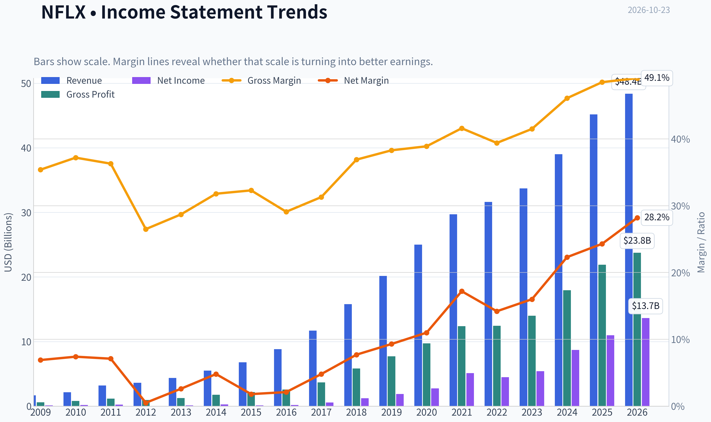

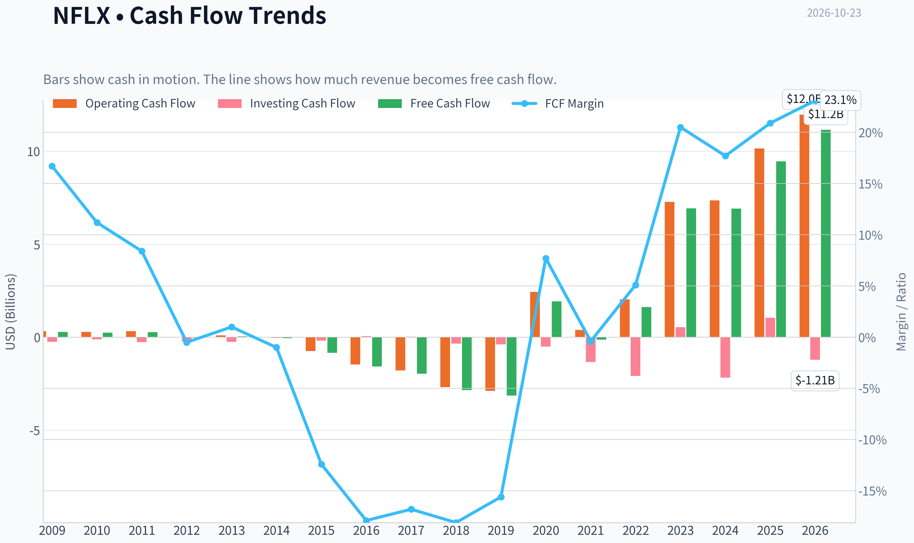

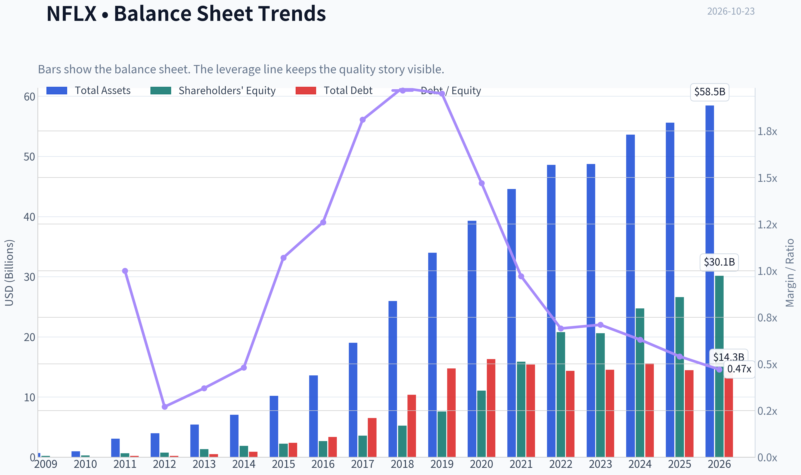

This graph tracks the profitability and return metrics (ROE, ROIC, Margins) of **NFLX** over the past decade, highlighting capital efficiency trends.

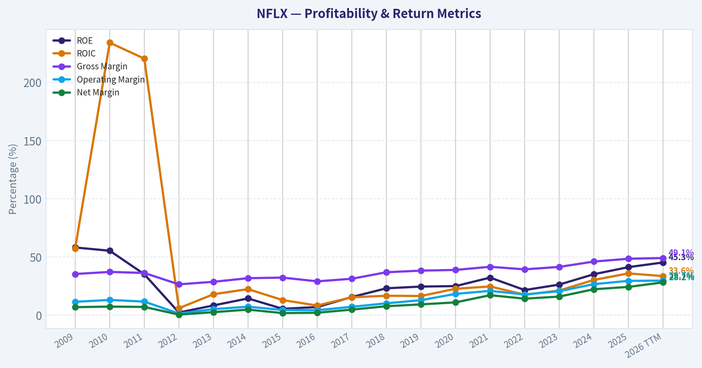

This chart illustrates the financial health of **NFLX** over the last 10 years, mapping cash equivalents and free cash flow against total obligations (Debt).

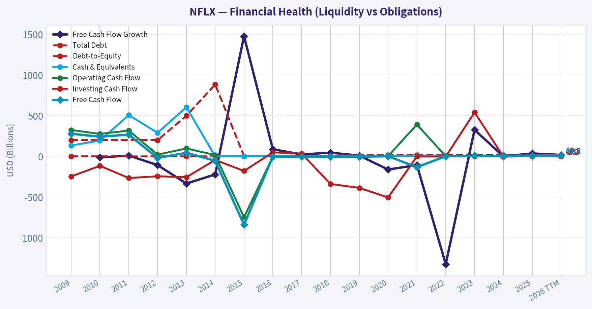

This comparison chart from *Market Metrics and Profitability* stacks current figures against historical benchmarks for **NFLX**, making it easy to see where the company trades relative to its own averages.

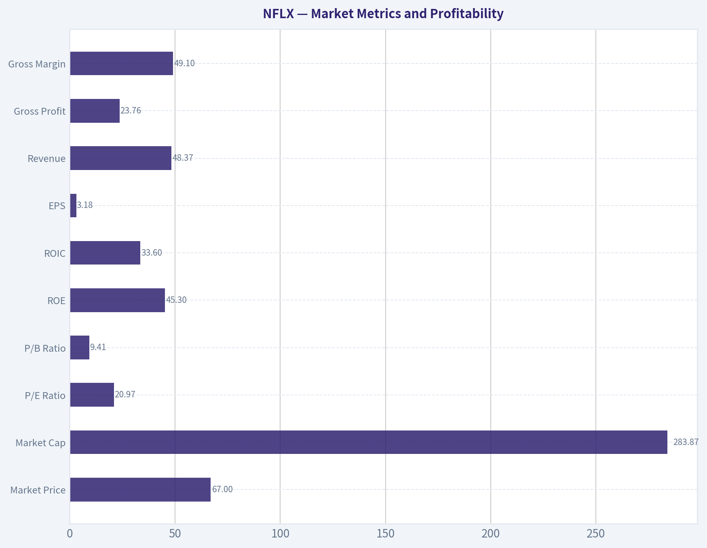

This breakdown chart from <em>Revenue Breakdown</em> shows the proportional composition for **NFLX** - useful for understanding what drives or risks the business.

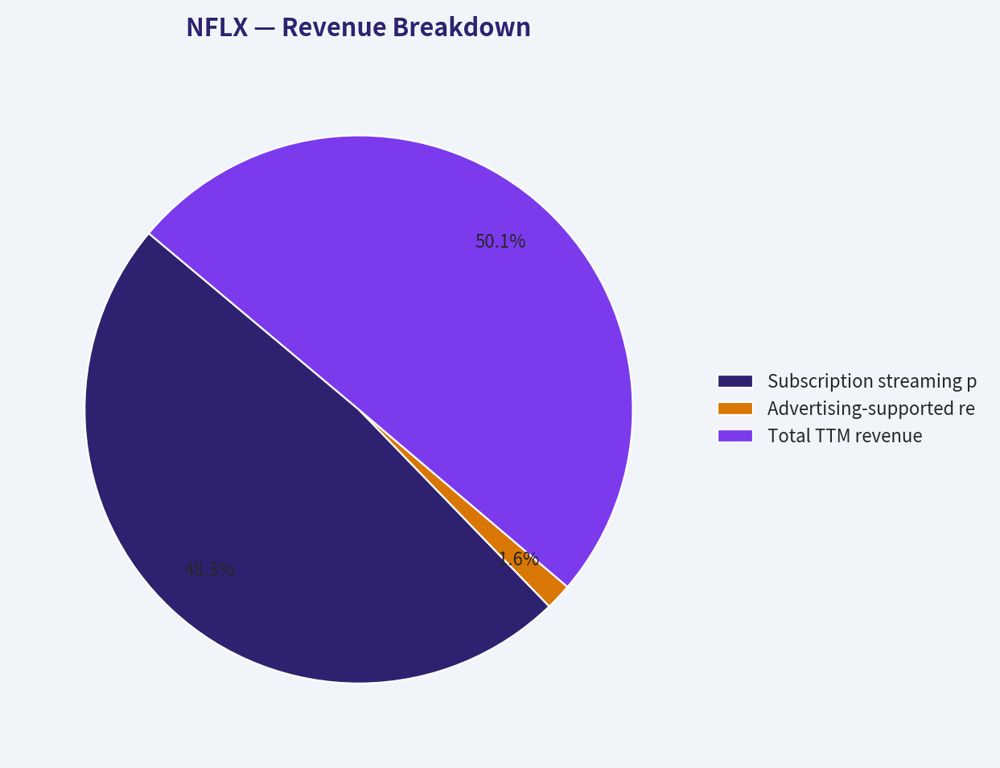

---

### Intrinsic Value Analysis (Buffett)

> *Following Warren Buffett's value investing philosophy: Circle of Competence, Economic Moat, Management Quality, and Margin of Safety.*

#### Intrinsic Value Snapshot

Price is what you pay. Intrinsic value is what the business may be worth based on the cash it can create for owners over time. We show a range, not one magic number.

- Current Price: $66.61
- Value Range (conservative to optimistic across both DCF methods): $27.60 to $688.60

##### Owner Earnings (Buffett Method)
- Net Income: $10,981,201,000.00
- Depreciation & Amortization: $16,755,555,000.00
- Capital Expenditures: $-688,220,000.00
- Working Capital Changes: $-456,220,000.00
- Owner Earnings: $27,504,756,000.00

##### Intrinsic Value
###### Buffett Method
Uses owner earnings. Stricter, and usually more conservative.
- Conservative: $195.78
- Average: $263.66
- Optimistic: $688.60
- Discount Rate: 10.0%

###### Cash Flow Method
Uses free cash flow. Better for companies spending heavily today to grow tomorrow.
- Conservative: $27.60
- Average: $77.26
- Optimistic: $77.26
- Discount Rate: 10.0%

ANALYST STANCE: **ADVOCATE**

#### Executive Conclusion

Netflix is a high-quality, asset-light global subscription business with a wide competitive moat, strong growth, improving profitability, and substantial reinvestment runway. At **$67 per share**, the stock trades below the research pack's headline intrinsic value of **$138.48**, implying a **51.9% margin of safety**.

The principal concern is valuation dispersion: model estimates range from **$25.22 to $263.66 per share**, reflecting uncertainty around long-term growth, content economics, competition, and terminal margins. Even so, the current price implies approximately **negative 8% annual growth for ten years**, while Netflix has achieved **12.7% trailing three-year growth** and **15.9% latest-year revenue growth**. That implied pessimism appears excessive for a company with Netflix's scale and franchise strength.

#### Factor Scorecard

| Factor | Score | Evidence |
|---|---:|---|
| Circle of Competence & Simplicity | 4.0/5 | Simple model: Netflix invests in content and distributes it globally through recurring subscriptions and advertising. Long-term outcomes remain predictable, although content preferences and technology evolve. |
| Moat | 4.5/5 | Global brand, massive content library, recommendation data, scale economics, subscriber habit, and a growing advertising ecosystem. Gross margin is 48.5%. |
| Management & Capital Allocation | 4.0/5 | Management has demonstrated disciplined transition from growth-at-all-costs toward profitable growth, pricing, advertising, and free-cash-flow generation. |
| Industry Structure | 3.5/5 | Global streaming remains competitive, but scale, content purchasing power, distribution reach, and brand recognition increasingly favor a few large platforms. |

**Key Takeaways:** Netflix scores strongly because its business is understandable, globally scalable, and protected by brand, content, data, and customer habit. Competition is real, but the industry is becoming more rational as weaker players struggle to fund compelling content. The overall franchise is best characterized as **wide and durable, with potential to widen further**.

#### Moat Analysis

| Moat Source | Netflix Evidence | Assessment |
|---|---|---|
| Intangible assets | Netflix is one of the world's strongest entertainment brands and has built recognizable original franchises. | Strong |
| Switching costs | Switching costs are not contractual, but Netflix is embedded in household entertainment routines and is often retained alongside other services. | Moderate |
| Cost advantages | Global scale spreads technology, marketing, and content costs across a very large revenue base. | Strong |
| Network effects | Direct network effects are limited, but more viewing data improves recommendations, content decisions, and engagement. | Moderate-to-strong |
| Scale and ecosystem | Netflix can monetize subscriptions, advertising, pricing tiers, gaming, licensing, and international content. | Strong |

**Key Takeaways:** Netflix's moat is not based on a single patent or hard contractual lock-in. It comes from the combination of global scale, brand, data, content, distribution, and consumer habit. This combination is difficult and expensive to replicate, giving Netflix a moat that is broader than a conventional media company's.

#### Financial Summary

| Metric | Latest Value |
|---|---:|
| Share price | $67.00 |
| Market capitalization | $277.34 billion |
| P/E ratio | 19.25x |
| ROE | 41.3% |
| Gross margin | 48.5% |
| Revenue growth, latest year | 15.9% |
| FCF yield | 3.4% |
| Implied free cash flow | Approximately $9.43 billion |
| Current ratio | 1.19x |
| Reverse-DCF implied annual growth, 10 years | Approximately -8.0% |
| Trailing three-year growth | 12.7% |
| Trailing five-year growth | 64.8% |

**Key Takeaways:** Netflix combines a 41.3% ROE with a 48.5% gross margin and double-digit revenue growth. The implied free cash flow is approximately $9.4 billion, and the market price appears to assume a severe long-term contraction despite the company's continuing growth and high returns.

#### Cash-Flow and Owner Earnings Analysis

Using free cash flow as the practical owner-earnings proxy:

| Item | Approximate Amount |
|---|---:|
| Market capitalization | $277.34 billion |
| FCF yield | 3.4% |
| Implied current FCF / owner earnings proxy | $9.43 billion |
| Owner earnings yield on market value | 3.4% |
| FCF conversion assessment | Strong, assuming reported FCF remains supported by operating cash flow |

**Key Takeaways:** Netflix's approximately $9.4 billion of implied free cash flow provides a useful owner-earnings base. The business requires substantial content investment, but those investments are central to the moat rather than merely maintenance spending. The quality of owner earnings depends on whether content spending produces durable engagement, pricing power, and subscriber retention; Netflix's operating history suggests that it generally does.

#### Three-Scenario DCF Valuation

The following simplified valuation uses approximately $9.43 billion of current owner earnings and an estimated 4.14 billion diluted-share base.

| Scenario | Assumptions | Estimated Equity Value | Estimated Value per Share |
|---|---|---:|---:|
| A: No Growth | 10% discount rate, zero growth | $94.3 billion | $22.80 |
| B: GDP Growth | 10% discount rate, 3% perpetual growth | $135.0 billion | $32.60 |
| C: Historical-Growth Framework | Approximately 6.35% normalized growth, 10-year projection, 10% discount rate | Approximately $260 billion | Approximately $63 |
| Research-pack headline value | Weighted FCFF, reverse-DCF, and owner-earnings models | $573.3 billion | $138.48 |
| Research-pack model range | Owner earnings / FCF / Damodaran FCFF | - | $263.66 / $77.26 / $25.22 |

**Key Takeaways:** A conservative FCF-only valuation produces a wide range because Netflix's value depends heavily on long-term growth and terminal economics. The no-growth and GDP-growth cases are conservative but understate the value of a company still growing revenue at double-digit rates. The research pack's blended valuation of $138.48 is more optimistic than the simple FCF cases but is supported by Netflix's scale, growth, and reinvestment runway.

#### Margin of Safety Analysis

| Measure | Result |
|---|---:|
| Current price | $67.00 |
| Headline intrinsic value | $138.48 |
| Discount to headline intrinsic value | 51.9% |
| Price versus FCF-model value | Below $77.26 |
| Price versus Damodaran FCFF value | Above $25.22 |
| Reverse-DCF implication | Approximately -8% annual growth for ten years |

**Key Takeaways:** Against the blended intrinsic value, Netflix offers a substantial margin of safety. The FCF and Damodaran models show that valuation is sensitive to assumptions, but the reverse-DCF is particularly important: the current price appears to discount a severe long-term decline rather than merely moderate growth. For a wide-moat, high-ROE compounder, this is a favorable risk-reward setup.

#### Management Quality and Capital Allocation

Netflix management has improved the business materially over time:

- Shifted emphasis from subscriber growth alone toward revenue, operating margin, free cash flow, and shareholder returns.
- Expanded monetization through pricing, advertising, paid sharing, and multiple service tiers.
- Built a global content platform rather than relying solely on licensed third-party programming.
- Continued investing heavily in content while moving toward more disciplined spending.
- Demonstrated willingness to adapt the business model as consumer behavior and competition change.

The main management risk is the difficulty of judging content returns. Accounting profits can look attractive while excessive content commitments destroy long-term value. Netflix deserves a strong but not perfect score because content economics require continual forecasting and disciplined capital allocation.

#### Balance Sheet and Quality/Solvency Assessment

| Measure | Assessment | Score |
|---|---|---:|
| Current ratio | 1.19x; adequate for a subscription platform | 3.5/5 |
| Cash-flow generation | Strong and improving | 4.0/5 |
| Interest burden | No evidence of distress in the supplied data | 4.0/5 |
| Business trajectory | Revenue growth and profitability remain positive | 4.0/5 |
| Gate 5 hard floor | Not tripped | - |

**Key Takeaways:** Netflix does not exhibit the combination of deteriorating cash flows and impaired solvency required to trigger the hard-avoid floor. Its balance sheet is not the sole reason to own the stock, but recurring subscription revenue and strong cash generation provide meaningful financial resilience.

#### Final Buffett Scorecard

| Criterion | Weight | Score | Weighted Contribution |
|---|---:|---:|---:|
| Moat Width & Durability | 25% | 4.5/5 | 1.13 |
| Valuation / Margin of Safety | 20% | 4.0/5 | 0.80 |
| Capital Returns - ROIC vs. WACC | 15% | 4.0/5 | 0.60 |
| Business Understanding & Predictability | 12% | 4.0/5 | 0.48 |
| Management Quality & Capital Allocation | 12% | 4.0/5 | 0.48 |
| Reinvestment Runway | 8% | 4.5/5 | 0.36 |
| Balance Sheet Strength | 4% | 3.5/5 | 0.14 |
| Industry Structure | 4% | 3.5/5 | 0.14 |
| **Total** | **100%** | - | **4.13/5** |

**Key Takeaways:** Netflix earns a weighted score above 4.0 because its moat, growth runway, and valuation outweigh the uncertainty around content spending and competitive intensity. The stock is not risk-free, but the price appears to offer an unusually favorable entry point for a business with strong returns and global scale.

#### Investment Stance

**ADVOCATE - Medium-to-high conviction.**

Netflix appears to be a wonderful business available at a price that discounts an implausibly negative future. Its strongest attributes are global scale, a powerful entertainment brand, high gross margins, strong ROE, recurring revenue, and multiple avenues for reinvestment.

The principal risks are content misallocation, intensifying competition, weaker consumer spending, and the possibility that the market's valuation data or share-price reference is not fully comparable across reporting periods. Those risks justify monitoring the position, but they do not overcome the combination of franchise quality and apparent valuation support.

A long-term investor should view Netflix as a high-quality compounder rather than a conventional media stock.
#### Valuation Bridge

This bridge places the current market price beside each intrinsic value lens so readers can see whether upside depends on one method or shows up across several methods.

| Scenario | Intrinsic Value / Share |
| --- | ---: |
| Buffett Method | $263.66 |
| Cash Flow Method | $77.26 |
| Damodaran Method | $25.22 |
| Current Price | $66.61 |

#### Key Takeaways

If one method is far above the others, the upside case depends on a specific modelling assumption. When several methods cluster together, the valuation story is more robust.

#### Valuation Visuals

This comparison chart from *Latest Earnings Snapshot* stacks current figures against historical benchmarks for **NFLX**, making it easy to see where the company trades relative to its own averages.

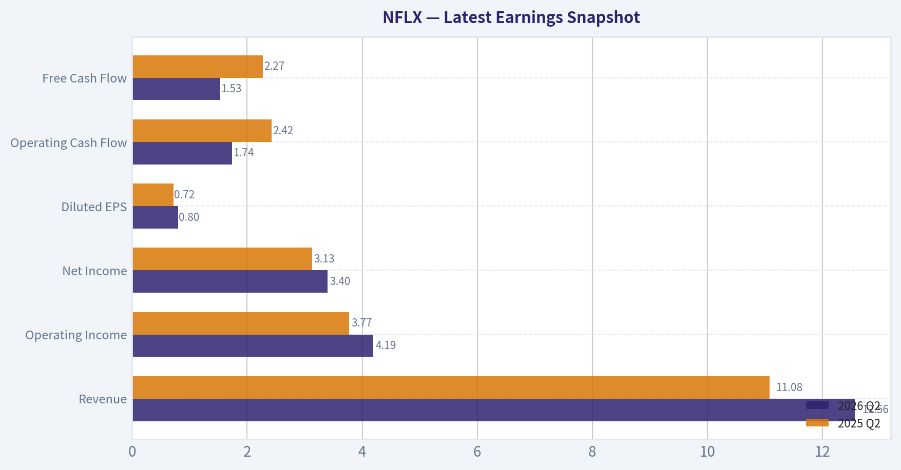

This comparison chart from *Current Valuation Versus Historical Norms* stacks current figures against historical benchmarks for **NFLX**, making it easy to see where the company trades relative to its own averages.

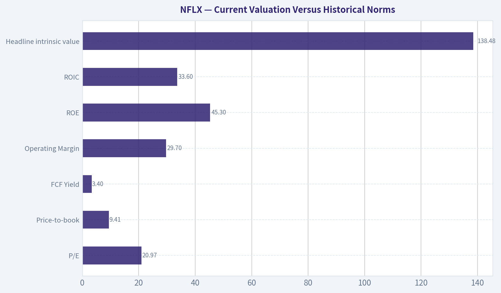

This comparison chart from *Buffett-Style Owner Earnings DCF* stacks current figures against historical benchmarks for **NFLX**, making it easy to see where the company trades relative to its own averages.

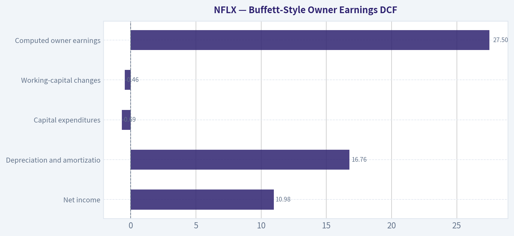

---

### Trend & Growth Analysis (Lynch/Druckenmiller/Fisher)

> *Following Peter Lynch's GARP, Stanley Druckenmiller's macro-aware approach, and Philip Fisher's scuttlebutt methodology.*

ANALYST STANCE: **WATCH**

#### Executive View

Netflix remains a high-quality global growth company, but the current setup is less clearly an acceleration story. Revenue growth of 15.9% places NFLX at the low end of the "fast grower" category, while recent analyst revisions reportedly reflect concerns about growth, margins, and valuation. The stock appears inexpensive under some cash-flow models, but the wide valuation spread makes a conservative stance appropriate.

#### 1. Lynch Classification

**Borderline fast grower / high-quality stalwart transitioning toward maturity.**

Netflix is no longer a 30-50% growth company, but its 15.9% revenue growth, global scale, advertising opportunity, pricing power, and operating leverage keep it relevant for growth investors. It is not a classic ten-bagger candidate from its current size, but it could still compound capital attractively if advertising and newer content formats create a second growth leg.

#### 2. The Story in Three Bullets

- Netflix is the leading global streaming platform, with an unmatched content-distribution ecosystem and substantial viewing data.
- Growth can be extended through price increases, paid-sharing conversion, advertising, live programming, gaming, and expansion in underpenetrated international markets.
- The key question is whether these initiatives reaccelerate revenue growth or merely offset the natural slowing of a very large subscriber base.

#### 3. TAM and 10x Test

| Measure | Assessment |
|---|---:|
| Current market capitalization | $277.3B |
| Recent revenue growth | 15.9% year over year |
| Approximate recent revenue base | ~$45B, subject to filing verification |
| 10x revenue test | Approximately $450B revenue |
| Can Netflix reach 10x revenue while remaining below 20% of TAM? | Possible, but not proven |
| Major TAM expansion vectors | Advertising, global pricing, live content, gaming, licensing |

**Key Takeaways:** Netflix still has meaningful runway, but the 10x test is less obvious than it was earlier in the company's history. The most important source of incremental TAM is likely monetization per user-especially advertising and pricing-rather than simply adding subscribers. A ten-bagger from today would require both substantial revenue growth and continued strong margins, making it an aggressive rather than base-case outcome.

#### 4. Revenue Growth Trend

| Indicator | Reading | Interpretation |
|---|---:|---|
| Revenue growth | 15.9% YoY | Healthy, but below historical hypergrowth |
| Recent market narrative | Cautious Q3 revisions | Possible deceleration concern |
| Growth classification | Lower-end fast grower | Requires reacceleration for a stronger setup |
| Organic growth quality | Primarily platform and monetization driven | Better than acquisition-led growth |
| Trend assessment | Stable-to-decelerating | No confirmed inflection yet |

**Key Takeaways:** Netflix is still growing at a respectable rate, but the available evidence does not establish accelerating growth. The investment case improves materially if advertising, price increases, or paid-sharing conversion push growth back above 20%. Until then, NFLX is a quality compounder under observation rather than a confirmed growth inflection.

#### 5. Unit Economics and Efficiency

| Metric | Available assessment |
|---|---|
| LTV/CAC | Not disclosed in the supplied data |
| Net revenue retention | Not applicable in the conventional SaaS sense |
| Rule of 40 | Cannot be calculated without FCF margin |
| Gross margin | 48.5% |
| Free-cash-flow yield | 3.4% |
| Current ratio | 1.19 |
| ROE | 41.3% |

**Key Takeaways:** Netflix shows strong profitability characteristics, including a 48.5% gross margin and 41.3% return on equity. However, the supplied data does not provide customer-acquisition cost, lifetime value, churn, or free-cash-flow margin, so the full unit-economics analysis cannot be completed. The 3.4% FCF yield suggests the stock is not priced like a distressed asset, despite some favorable intrinsic-value estimates.

#### 6. Inflection Point Assessment

| Potential inflection | Current assessment | Signal |
|---|---|---|
| Advertising | Large monetization opportunity | Positive, but execution-dependent |
| Paid-sharing conversion | Expands monetization of existing users | Positive |
| Pricing power | Supports revenue per member | Positive, with churn risk |
| Live programming | Could increase engagement and ad inventory | Early-stage opportunity |
| Gaming | Potential long-term TAM expansion | Unproven |
| Margin expansion | Strong platform economics | Positive |
| Subscriber growth | Mature-market constraint | Mixed |
| Overall inflection status | No confirmed acceleration | Watch |

**Key Takeaways:** Netflix has several credible catalysts, but they are opportunities rather than demonstrated inflection points. The strongest near-term evidence would be accelerating revenue per member, rising advertising revenue, stable engagement, and continued margin expansion. A single weak quarter would not invalidate the thesis, but multiple quarters below the current growth rate would weaken it materially.

#### 7. Macro Setup

The macro setup is **neutral to modestly supportive**:

- Falling interest rates would help long-duration growth stocks and increase the value of Netflix's future cash flows.
- A resilient consumer supports subscription retention and pricing.
- Advertising budgets are cyclical and could weaken during an economic slowdown.
- Netflix is less rate-sensitive than an unprofitable software company because it produces substantial cash flow and has a 19.25 P/E ratio.

Druckenmiller-style conclusion: the macro is not currently a reason to avoid NFLX, but there is insufficient evidence of a powerful macro tailwind creating a near-term earnings acceleration.

#### 8. Fisher 15-Point Assessment

| Fisher area | Score / 5 | View |
|---|---:|---|
| Market potential | 4 | Global streaming and monetization runway |
| New-product determination | 4 | Advertising, live content, gaming |
| R&D effectiveness | 4 | Strong technology and recommendation systems |
| Sales organization | 4 | Global distribution and marketing capability |
| Profit margins | 4 | Strong gross economics |
| Margin improvement | 4 | Scale supports operating leverage |
| Labor relations | 3 | Limited visibility |
| Executive relations | 4 | Generally strong operating execution |
| Management depth | 4 | Established global leadership |
| Cost analysis/accounting | 4 | Sophisticated operating model |
| Outstanding competitive aspects | 4 | Brand, content, data, scale |
| Long-range profit outlook | 4 | Attractive but mature |
| Dilution | 5 | No major dilution concern indicated |
| Candor | 3 | Requires continued scrutiny around guidance |
| Integrity | 4 | No major issue indicated |
| **Total** | **59 / 75** | **Good** |

**Key Takeaways:** Netflix scores well on market potential, platform economics, management depth, and competitive advantages. The main deductions reflect maturity, limited visibility into labor and customer economics, and the need to verify whether management can sustain growth after the initial streaming land grab. A score of 59 places Netflix in Fisher's "good" category, not the exceptional 65-plus range.

#### 9. Valuation Analysis

| Valuation measure | Result | Interpretation |
|---|---:|---|
| Current price | $67 | Supplied market price |
| P/E | 19.25x | Reasonable for a profitable global platform |
| PEG | 1.21x | Fair value, not deeply cheap |
| FCF yield | 3.4% | Moderate cash-flow valuation |
| Headline intrinsic value | $138.48 | Implies substantial upside |
| Owner-earnings model | $263.66 | Highly bullish |
| FCF model | $77.26 | Modestly bullish |
| Damodaran FCFF model | $25.22 | Bearish |
| Reverse DCF implication | Approximately -8% annual growth for 10 years | Conservative market pricing assumption |

**Key Takeaways:** The PEG ratio of approximately 1.21 indicates fair value under Lynch's framework: investors are paying roughly 1.2 times the growth rate. Intrinsic-value estimates range from $25 to $264, an unusually wide spread that signals high model sensitivity. The headline $138 valuation is attractive, but the conservative models justify avoiding an oversized position until growth reaccelerates.

**Scenario framework:**

| Scenario | Operating assumptions | Indicative valuation view |
|---|---|---|
| Bear | Growth slips below 12%, advertising disappoints, multiple compresses | $45-$65 |
| Base | 15-18% growth, steady margin expansion, successful monetization | $80-$120 |
| Bull | Growth reaccelerates above 20%, advertising and live content scale | $140-$200+ |

**Key Takeaways:** At $67, the market appears to be pricing Netflix closer to a cautious or lower-end base case. The upside is attractive if advertising and new initiatives produce a genuine acceleration. The principal risk is that the stock is fairly valued if Netflix remains a mature 12-16% grower without a new monetization engine.

#### 10. Growth Investor Scorecard

| Criterion | Weight | Score / 5 | Weighted contribution |
|---|---:|---:|---:|
| Lynch story | 10% | 4.0 | 0.40 |
| TAM and runway | 20% | 3.5 | 0.70 |
| Revenue growth | 20% | 3.3 | 0.66 |
| Unit economics | 15% | 3.5 | 0.53 |
| Competitive position | 10% | 4.5 | 0.45 |
| Management quality | 10% | 4.0 | 0.40 |
| Macro setup | 5% | 3.0 | 0.15 |
| Profitability path | 5% | 4.5 | 0.23 |
| Valuation | 5% | 3.5 | 0.18 |
| **Total** | **100%** |  | **3.69 / 5.0** |

**Key Takeaways:** Netflix scores 3.69 out of 5, placing it in the "good setup" range but not at high-conviction advocate status. Its competitive position and profitability are excellent, while growth acceleration and valuation certainty are the limiting factors. The stock merits active monitoring and potentially a starter position, not maximum portfolio concentration.

#### 11. Position Size Stance

**Recommended stance: Watch / starter position only.**

- Conservative growth portfolio: **0-2% initial position**
- Higher-conviction investor after confirming acceleration: **3-5%**
- Avoid a concentrated position until revenue growth, advertising monetization, and forward guidance improve

The valuation offers a margin of safety under the supplied headline model, but the model dispersion is too large to justify aggressive sizing.

#### 12. Key Catalysts and Risks

| Catalysts | Risks |
|---|---|
| Advertising revenue scales faster than expected | Revenue growth continues to decelerate |
| Successful price increases with limited churn | Subscriber saturation in mature markets |
| Paid-sharing conversion exceeds expectations | Content costs rise faster than revenue |
| Live sports or events improve engagement | Advertising market weakens |
| Gaming becomes a meaningful business | Competitive pressure from Disney, Amazon, YouTube, and others |
| Margin expansion continues | Valuation models prove overly optimistic |
| Analyst estimates begin to rise again | Multiple compression despite solid execution |

**Key Takeaways:** The most important catalyst is a return to more than 20% revenue growth without sacrificing margins. The most important risk is not a single disappointing quarter, but a sustained pattern of slowing growth that confirms Netflix has entered a mature-platform phase. Track advertising revenue, revenue per membership, engagement, churn after price increases, operating margin, and forward guidance.

#### Final Verdict

Netflix is a **high-quality, fairly valued-to-undervalued platform with credible long-term optionality**, but it is not yet a clear growth inflection investment. The stock becomes more attractive if the next several reports show accelerating monetization and upward earnings revisions.

**Final stance: WATCH - suitable for a starter position, with aggressive buying deferred until growth reaccelerates.**

#### Growth & Scorecard Visuals

This comparison chart from *Growth, Balance Sheet, and Cash Flow* stacks current figures against historical benchmarks for **NFLX**, making it easy to see where the company trades relative to its own averages.

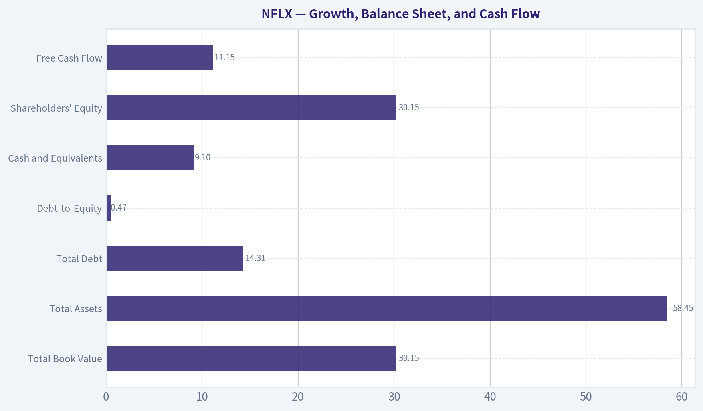

---

### Market Technical Analysis

ANALYST STANCE: **AVOID**

#### NFLX technical analysis - October 23, 2026

The latest available trading session is October 22, 2026; October 23 is identified by the data source as a non-trading day. NFLX closed at **$67.05**, after falling sharply to **$65.04** on October 21 and rebounding modestly the following day. The broader technical structure remains bearish: price is below the 10-day EMA, 50-day SMA, volume-weighted moving average, and 200-day SMA.

The analysis uses eight complementary indicators: **close_200_sma, close_50_sma, close_10_ema, macd, macdh, rsi, atr, and vwma**. Together, these cover long-term and medium-term trend, short-term momentum, momentum acceleration, volume confirmation, and volatility without relying excessively on overlapping indicators.

#### Trend structure

NFLX is trading approximately:

- **18.6% below the 50-day SMA** of $74.52.
- **18.6% below the 200-day SMA** of $82.40.
- **2.6% below the 10-day EMA** of $68.85.
- **2.7% below the VWMA** of $68.92.

The 200-day SMA has declined steadily from approximately $88.27 in late August to $82.40 now. That is important because it shows that the long-term trend is not merely temporarily weak; the underlying average itself is moving lower. The 50-day SMA also peaked near $75.80 in mid-September and has subsequently rolled over to $74.52.

This creates a clearly bearish moving-average configuration. Price is below all major trend references, while the 50-day SMA remains below the 200-day SMA. There is no evidence yet of a durable trend reversal. The 10-day EMA is declining sharply, although its slope has begun to flatten slightly after the recent rebound.

#### Price action and support levels

The October decline accelerated from approximately $72.61 on October 15 to $65.04 on October 21. That move broke below the $69-$70 area, which had previously acted as short-term support during early October. The October 21 session also produced a substantial volume surge, suggesting that the breakdown was accompanied by significant participation rather than being a low-liquidity drift lower.

Near-term support is now concentrated around:

- **$65.00-$65.05:** the October 21 low and immediate downside reference.
- **$64.00-$65.00:** a break below this zone would indicate that the recent rebound has failed.
- **Approximately $62-$63:** a potential next downside area if $64 breaks, although this level is less firmly established by the recent data.

On the upside, the first recovery test is the **$68.70-$69.00** region, where the 10-day EMA and VWMA are currently located. A move above that area would improve short-term momentum but would not, by itself, reverse the broader downtrend. More meaningful resistance lies near **$70.50-$72.60**, followed by the 50-day SMA around **$74.50**.

#### MACD momentum

The MACD remains negative at **-1.59**, confirming that the intermediate momentum trend is bearish. There had been a meaningful improvement in momentum from late September through mid-October: the MACD histogram moved from deeply negative readings to positive territory, reaching approximately **+0.52 on October 15**.

However, that recovery has failed. The histogram declined to **+0.26 on October 20**, then turned negative at **-0.06 on October 21** and **-0.11 on October 22**. This indicates that the recent bullish momentum impulse has been exhausted and that downside momentum is beginning to reassert itself.

The negative histogram is not yet as severe as it was during the late-September selloff, so the market is not displaying maximum downside momentum. Nevertheless, the direction is unfavorable: MACD is below zero and the histogram has crossed back into negative territory. A bullish interpretation would require the histogram to turn positive again and MACD to move materially higher, preferably alongside a break above $69-$70.

#### RSI and the risk of an oversold bounce

The RSI is **39.6**, with a recent low of approximately **32.6** on October 21. This shows weak momentum but not a classic deeply oversold condition. NFLX is therefore vulnerable to additional selling, but the RSI does not yet provide a strong reversal signal.

The rebound from $65.04 to $67.05 is consistent with a short-term relief bounce after the sharp selloff. However, RSI below 40 means buyers have not regained control. In a persistent downtrend, RSI can remain between roughly 30 and 45 for extended periods, so a reading near 40 should not be treated as a stand-alone buy signal.

A more constructive RSI setup would involve a higher low above 32.6, followed by a sustained move above 50 while price reclaims the 10-day EMA and VWMA. That confirmation is currently absent.

#### Volume and volatility

The October 21 decline occurred on approximately **101.4 million shares**, compared with recent ordinary daily volumes generally in the 20-45 million range. This represents a significant increase in activity during a downside move and makes the breakdown more consequential. The October 22 rebound also traded roughly **58.4 million shares**, but the recovery volume was not enough to reclaim the key moving-average levels.

ATR is approximately **$2.13**, equivalent to about **3.2% of the closing price**. Although ATR has fallen from the elevated levels above $2.4 seen in September, volatility remains substantial relative to the current share price. A daily move of roughly $2 is therefore within the stock's recent normal range, and stops placed too tightly around the current price could be vulnerable to ordinary volatility.

For risk management, traders should account for the possibility of another move toward the recent low even if the stock produces a short-term bounce. A close below $65 would be more concerning than an intraday test, while a recovery above $69 on expanding volume would be an initial sign that selling pressure is moderating.

#### Trading interpretation

The evidence favors patience rather than initiating a long position:

1. The long-term trend is bearish, with price well below a declining 200-day SMA.
2. The medium-term trend is also bearish, with price below the 50-day SMA and the 50-day average below the 200-day average.
3. Short-term price is below both the 10-day EMA and VWMA.
4. MACD is negative, and the histogram has recently turned negative again.
5. RSI is weak but not sufficiently oversold to create a high-confidence reversal signal.
6. The major recent breakdown occurred with unusually high volume.
7. Volatility remains high enough that downside continuation could be rapid.

A speculative countertrend trade could become more attractive if NFLX holds above $65, reclaims $69, and then breaks through the $70.50-$72.60 resistance band with improving MACD and RSI. Until those conditions occur, rallies toward $69-$72 should be treated as potential resistance tests rather than confirmed trend reversals. A decisive close below $65 would strengthen the bearish case and shift attention toward lower support zones.

#### Key indicator summary

| Indicator | Latest value or condition | Interpretation |
|---|---:|---|
| Close price | $67.05 on October 22 | Below all major trend and volume averages |
| 200-day SMA | $82.40, declining | Long-term trend is decisively bearish |
| 50-day SMA | $74.52, rolling over | Medium-term trend remains weak |
| 10-day EMA | $68.85, declining | Short-term price momentum is negative |
| VWMA | $68.92 | Volume-weighted resistance is just above price |
| MACD | -1.59 | Intermediate momentum remains bearish |
| MACD histogram | -0.11 | Momentum recently shifted back to the downside |
| RSI | 39.6 | Weak, but not deeply oversold |
| ATR | $2.13 | Elevated daily volatility; risk controls should allow for wide swings |
| Recent volume | 101.4 million on October 21 | High-volume selloff confirms meaningful downside participation |
| Key levels | Support: $65; resistance: $69, $70.50-$72.60, $74.50 | Reclaiming resistance is needed before considering a bullish reversal |

**Key Takeaways:** NFLX remains in a broad and intermediate-term downtrend, with price below declining moving averages and volume-weighted resistance. The recent high-volume breakdown and renewed negative MACD histogram argue against buying the current rebound prematurely. The $65 area is the key near-term support, while a sustained recovery above $69 and then $70.50-$72.60 would be needed to materially improve the technical outlook.

---

### Options Market Analysis

> *Reading options flow - put/call ratios, IV skew, and unusual activity - to gauge institutional positioning and event-driven risk.*

ANALYST STANCE: **ADVOCATE**

#### NFLX Options Market Overview

Data is as of October 23, 2026, covering expirations from October 23 through November 6. The options market shows a modest call-side bias, but there is no evidence of aggressive fresh positioning or a high-conviction directional bet.

#### Put/Call Ratio Analysis

| Expiration | Call OI | Put OI | Put/Call OI Ratio | Call Volume | Put Volume | Put/Call Volume Ratio |
|---|---:|---:|---:|---:|---:|---:|
| Oct. 23, 2026 | 246,811 | 159,213 | 0.65 | 34,185 | 32,649 | 0.96 |
| Oct. 30, 2026 | 109,707 | 75,599 | 0.69 | 15,785 | 13,365 | 0.85 |
| Nov. 6, 2026 | 31,688 | 20,548 | 0.65 | 4,399 | 1,009 | 0.23 |
| **Total** | **388,206** | **255,360** | **0.66** | **54,369** | **47,023** | **0.86** |

**Key Takeaways:** NFLX's aggregate put/call open-interest ratio of 0.66 is below the approximately 0.70 neutral baseline, indicating a modest call-heavy positioning bias. The 0.86 volume ratio also favors calls, although not dramatically. This is mildly bullish rather than a strong directional signal.

#### Implied Volatility Assessment

| Expiration | Call ATM IV | Put ATM IV | Put-Call IV Difference | Assessment |
|---|---:|---:|---:|---|
| Oct. 23, 2026 | 31.1% | 38.4% | +7.3 percentage points for puts | Noticeable downside protection premium |
| Oct. 30, 2026 | 32.5% | 31.1% | -1.4 percentage points | Roughly balanced, slight call premium |
| Nov. 6, 2026 | 33.3% | 31.0% | -2.3 percentage points | Slight call-side premium |

The available data provides ATM IV, but not separate out-of-the-money put and call IV levels. Therefore, a complete OTM skew calculation is unavailable. The October 23 expiration does show a meaningful put premium, while later expirations are broadly balanced to slightly call-favored.

Near-term IV in the roughly 31% to 38% range is active but not demonstrably extreme without a longer-term NFLX IV history. No earnings or other catalyst is confirmed by the supplied data, so elevated event-related volatility should not be assumed.

**Key Takeaways:** The front expiration carries a clear downside-protection premium, suggesting short-dated hedging or concern around an immediate event. However, the later expirations do not show persistent put skew; their small call premium is consistent with a mildly optimistic outlook. Overall IV indicates tradable event risk, but not an unmistakable panic or speculative volatility spike.

#### Unusual Options Activity

| Finding | Result |
|---|---|
| Contracts with volume greater than 5x open interest | None identified |
| Fresh directional call bets | No qualifying contracts |
| Fresh directional put bets | No qualifying contracts |
| Smart-money versus retail inference | Not determinable from the supplied flow |

No individual contracts met the data provider's unusual-activity threshold. Consequently, there are no specific strikes to classify as ITM, ATM, or OTM, and no contract-level directional inference can be made.

**Key Takeaways:** The absence of volume exceeding five times open interest argues against a conspicuous new institutional bet in the near-term chain. Current activity appears more consistent with routine trading, hedging, or repositioning than with aggressive informed speculation. Confidence in the directional signal is therefore moderate to low.

#### Open Interest Concentration and Gamma Levels

| Expiration | Call OI | Put OI | Total OI | Relative Concentration |
|---|---:|---:|---:|---|
| Oct. 23, 2026 | 246,811 | 159,213 | 406,024 | Highest concentration |
| Oct. 30, 2026 | 109,707 | 75,599 | 185,306 | Secondary concentration |
| Nov. 6, 2026 | 31,688 | 20,548 | 52,236 | Limited concentration |

The October 23 expiration contains approximately 63% of total call and put open interest across the reported expirations, making it the primary near-term positioning center. However, strike-level open interest and gamma data were not provided, so specific gamma walls, max-pain strikes, and price-pinning levels cannot be identified.

**Key Takeaways:** The same-day October 23 expiration is the dominant concentration and could contribute to short-term pinning or post-expiry volatility. Because strike-level data is unavailable, the exact gravitational price level cannot be determined. The concentrated expiry structure raises near-term mechanical risk but does not itself establish a bullish or bearish direction.

#### Overall Options Sentiment

**Signal: BULLISH, with moderate-to-low conviction.**

The primary bullish factors are:

- Aggregate put/call OI ratio of 0.66, below the 0.70 neutral baseline.
- Aggregate put/call volume ratio of 0.86, indicating slightly heavier call activity.
- Later expirations show modestly higher call IV than put IV.
- Call open interest materially exceeds put open interest across all reported expirations.

The main caveat is the elevated put IV in the October 23 expiration, which points to immediate downside hedging or event risk. Since no contracts show volume greater than five times open interest and no strike-level data is available, the bullish signal reflects broad positioning rather than identifiable fresh institutional call buying.

#### Summary

| Category | Assessment |
|---|---|
| Put/Call Ratio | **Mildly bullish** - OI ratio 0.66 and volume ratio 0.86, both below the neutral put-heavy threshold |
| IV Level | **Moderate to elevated near term** - approximately 31% to 38%, with the highest reading in front-expiry puts |
| Skew Direction | **Mixed, leaning mildly bullish beyond the front expiry** - front puts carry a premium, later expiries slightly favor calls |
| Unusual Activity | **None detected** - no contracts exceeded 5x open interest |
| Overall Signal | **BULLISH, moderate-to-low conviction** - call-heavy positioning, offset by short-dated downside hedging |

**Key Takeaways:** NFLX options lean modestly bullish based on call-heavy open interest and slightly greater call volume. The strongest caution signal is the rich implied volatility of front-expiry puts, which indicates immediate downside protection demand. With no unusual contract-level activity and no strike-level gamma data, this should be treated as a low-conviction bullish read rather than a strong institutional signal.

---

## Research Team Commentary

> *The Research Manager synthesizes the Bull vs Bear debate into action-free commentary. This is a pre-risk view, not the final stance.*

Core takeaway: Netflix appears to be a high-quality franchise at a reasonable price, but the debate does not establish a sufficient margin of safety at $66.61. The bullish business case is persuasive; the bullish valuation case is not yet robust because it substitutes EPS for owner earnings and is highly sensitive to the discount rate. I would keep Netflix on the watchlist rather than buy or avoid it outright.

The strongest bull argument is business quality. Netflix has global scale, a leading consumer brand, substantial viewing data, broad distribution, and the ability to spread content costs across a worldwide audience. Its reported 35.9% ROIC, 41.3% ROE, 19.8% ROA, and 48.5% gross margin indicate excellent economics. Management has also adapted intelligently by introducing paid sharing, advertising, tiered pricing, and a greater focus on revenue, margins, free cash flow, and shareholder returns. Subscriber growth no longer needs to resemble the early streaming era for Netflix to compound earnings per share.

The price is also far less demanding than that of many premium platform businesses. At 19.25 times earnings, the market does not appear to require hypergrowth. If normalized owner earnings really are close to the implied $3.46 of EPS, Netflix could plausibly beat the market's embedded expectations through moderate pricing, advertising growth, international monetization, operating leverage, and disciplined repurchases. That is the credible contrarian case: the market may be interpreting slower subscriber growth as franchise maturity while underestimating growth in cash generation per household.

The strongest bear argument is that the debate has not verified the cash flow on which that conclusion depends. For Netflix, EPS is not automatically owner earnings. Content capitalization and amortization, required content spending, contractual commitments, stock-based compensation, and working-capital timing can create meaningful differences between reported profit and sustainable cash available to shareholders. "Buy subject to confirming free cash flow" places the recommendation before the essential due diligence.

The bear also has the stronger DCF critique. Under the bull's assumptions-8% growth for five years, 6% for the following five, and 3% terminal growth-the value appears to be about $80-$82 using a 9% discount rate but only approximately $68-$70 at 10%. At $66.61, that means a healthy discount under the more favorable hurdle rate but almost no margin of safety under the more conservative one. If normalized owner earnings are only 90% of EPS, estimated value can fall toward the low $60s. The valuation is therefore plausible, but not resilient to modestly less favorable assumptions.

The reverse-DCF hurdle deserves similar nuance. Roughly 6%-7% annual owner-earnings growth for a decade at a 10% required return is achievable, but it is not trivial. Netflix must nearly double owner earnings while dealing with low switching costs, creative-hit uncertainty, price sensitivity, international markets with lower revenue per customer, and competitors willing to subsidize entertainment through larger ecosystems. Paid sharing is partly a finite conversion opportunity, while advertising, live programming, and gaming could either increase lifetime value or consume capital without adequate incremental returns.

Technically, the stock is below its 10-day EMA, 50-day SMA, and 200-day SMA by approximately 3%, 11%, and 19%, respectively. That indicates a damaged trend, not intrinsic undervaluation. Unlike the prior Netflix setup, this is not an overbought stock pressing into resistance, so the old lesson should not be applied mechanically. Weak momentum could be creating an attractive entry if fundamentals are intact, but it could also signal that investors are revising expectations. Modestly bullish options positioning does little to resolve that question.

My rationale is therefore straightforward: Netflix qualifies as a potentially wonderful business, but the supplied information supports "fair price" more clearly than "fair price with a quality-scaled margin of safety." A 10%-15% discount would be enough for a company of this caliber, but there is only a 2%-5% discount to the more conservative EPS-based valuation-and potentially none after normalizing owner earnings. This is not an AVOID because there is no evidence of distress, competitive collapse, or clear overvaluation. It is not yet an ADVOCATE because the principal valuation input remains unverified.

This conclusion also incorporates the prior mistakes. The lesson from the earlier Netflix call is to translate valuation and price-action risks into a clear decision rather than hiding behind neutral language. Here, the clear action is not to initiate until cash-flow validation or a better price creates favorable asymmetry. The NVDA lesson is equally important: latent competitive risks should not automatically block ownership of an exceptional compounder. Netflix's theoretical risks are not enough to justify avoidance; the reason for patience is the missing owner-earnings evidence and narrow valuation cushion, not reflexive skepticism toward growth.

Over the next one to four quarters, I would monitor normalized free cash flow per share against the implied $3.46 EPS base. Persistent conversion near or above reported earnings would materially strengthen the bull case; conversion below roughly 85%-90%, absent a clearly temporary explanation, would weaken it. I would also track cash content spending relative to amortization, total content commitments, net debt, interest coverage, stock-based compensation, and the fully diluted share count.

Operationally, the important indicators are revenue growth, operating-margin progression, churn and tier migration after price increases, and advertising revenue per ad-tier member-not merely ad-tier membership. Paid-sharing gains should be separated from recurring organic growth. Management should demonstrate that live programming and gaming improve engagement, retention, or advertising economics without causing content obligations to grow faster than cash flow.

The thesis would strengthen enough for an ADVOCATE stance if Netflix confirms owner earnings close to or above the EPS proxy, sustains at least mid-to-high-single-digit per-share cash-flow growth, preserves margins, and shows disciplined capital allocation. A price closer to $58-$60, with the operating thesis intact, would also provide a more defensible 10%-15% margin of safety against the approximately $68-$70 conservative valuation. Conversely, deteriorating cash conversion, rising content obligations, price-related churn, ad-tier cannibalization, or persistent share dilution would push the position toward AVOID.

Final stance: WATCH.

---

## Value Investing Team Commentary

> *The Investor translates the research view into an investment thesis before risk review. This is still not the final stance.*

### Investment Commentary

Netflix is no longer merely a subscriber-growth story. It has become a global entertainment platform with several monetization levers: pricing, advertising, paid sharing, service tiers, international expansion, and potentially live programming and gaming. The reported economics-35.9% ROIC, 41.3% ROE, and a 48.5% gross margin-suggest a high-quality, asset-light-looking franchise with considerable operating leverage.

However, content is economically capital intensive even when accounting makes the business appear asset light. The investment decision therefore depends less on reported EPS and more on how much recurring cash Netflix can distribute after funding the content required to preserve engagement and pricing power.

### Business quality and moat

Netflix has several meaningful advantages:

- Global scale that spreads content costs across a large audience
- A powerful consumer brand and broad device distribution
- Viewing data that informs content acquisition, recommendation, and promotion
- A deep content library and established production relationships
- Recurring billing and a direct relationship with customers
- Increasing leverage with advertisers as the ad-supported tier scales

These advantages constitute a real moat, but not an impregnable one. Consumers can cancel easily, entertainment preferences are unpredictable, and competitors can subsidize streaming through larger technology, commerce, or media ecosystems. Netflix must continually reinvest to maintain the relevance of its service.

The strongest evidence of moat durability would not be subscriber count alone. It would be sustained pricing power, stable churn, expanding operating margins, and owner earnings growing without content commitments expanding even faster.

### Management and capital allocation

Management deserves credit for adapting rather than defending an outdated model. Paid-sharing enforcement, advertising, tiered pricing, and the shift toward revenue, margins, and free cash flow show pragmatic capital allocation.

The next phase is more demanding. Paid sharing is partly a finite conversion opportunity, while advertising can become a recurring growth engine. Live programming and gaming should be evaluated more skeptically because they could either strengthen engagement or become expensive diversions.

Repurchases are beneficial only when conducted below a conservative estimate of intrinsic value. Investors should examine whether buybacks are reducing the fully diluted share count rather than merely offsetting stock-based compensation.

### Valuation and reverse-DCF test

At $66.61 and 19.25 times earnings, Netflix is not priced like a hypergrowth business. Its reported earnings yield is approximately 5.2%, meaning moderate long-term growth could produce satisfactory returns if EPS closely approximates sustainable owner earnings.

That qualification is crucial. For Netflix, normalized owner earnings should be assessed over several years using:

- Cumulative operating cash flow and free cash flow
- Cash content additions relative to content amortization
- Changes in content liabilities and contractual commitments
- Stock-based compensation and dilution
- Recurring working-capital requirements
- Interest expense and net debt

One quarter of strong free cash flow would not be sufficient because production schedules and content-payment timing can create substantial fluctuations.

The supplied valuation range illustrates the uncertainty:

- At a 9% discount rate, estimated value is roughly $80-$82.
- At a 10% discount rate, value falls to approximately $68-$70.
- If normalized owner earnings are only 90% of reported EPS, value could decline into the low $60s.

At the current price, the discount to the conservative EPS-based estimate is only around 2%-5%. That falls short of the roughly 10%-15% margin of safety appropriate for a high-quality business. Moreover, Netflix's recurring content requirements and relatively low switching costs arguably warrant caution before granting it the same valuation tolerance as the very best ecosystem businesses.

The reverse-DCF hurdle-approximately 6%-7% annual owner-earnings growth for a decade-looks achievable but not obviously conservative. Netflix would need to nearly double owner earnings while preserving pricing power, managing content costs, and developing advertising into a meaningful profit pool. That is a plausible outcome, but the current price does not offer much protection if execution is merely adequate.

### Selective contrarian view

The stock trades below its 10-day EMA, 50-day SMA, and 200-day SMA. For a long-term owner, that is not a reason to sell or avoid the company. It may indicate that the market is extrapolating slower subscriber growth and treating Netflix as a mature media company while underestimating growth in cash generation per household.

That is the credible contrarian opportunity: Netflix may be transitioning from subscriber-led growth to monetization-led compounding, with pricing, advertising, operating leverage, and repurchases producing better per-share economics than headline membership growth implies.

But contrarianism requires evidence, not merely a falling price. The weak trend could also reflect rational concern about cash conversion, content obligations, or the durability of growth after paid-sharing gains mature. Options positioning is modestly bullish rather than fearful, so there is little indication of broad capitulation or an unusually favorable sentiment extreme. The market may be cautious, but it does not appear indiscriminately pessimistic.

### What would change the decision?

An upgrade would be justified by either valuation or evidence:

1. **Cash-flow confirmation:** Multi-year normalized free cash flow per share consistently approaches or exceeds reported EPS.
2. **Durable growth:** Owner earnings per share grow at least in the mid-to-high single digits without relying mainly on the finite paid-sharing conversion.
3. **Margin discipline:** Operating margins expand while cash content spending and commitments remain controlled.
4. **Advertising economics:** Advertising revenue per ad-tier member improves without excessive cannibalization or materially weaker unit economics.
5. **Capital allocation:** Repurchases reduce the diluted share count and are made below conservative intrinsic value.
6. **Better price:** A decline toward approximately $58-$60, with the operating thesis intact, would provide a more credible margin of safety against the conservative valuation.

Conversely, sustained cash conversion below roughly 85%-90% of earnings, rising content obligations, price-driven churn, margin deterioration, or persistent dilution would suggest that reported accounting returns overstate the economics available to shareholders.

The current technical weakness should not override the quality of the franchise, but neither should a respectable P/E ratio substitute for owner-earnings verification. Existing long-term shareholders have no clear reason to abandon the business based on the supplied evidence, but new capital should wait for stronger cash-flow proof or a more favorable price.

**ANALYST STANCE: WATCH** - Netflix appears to be an excellent franchise at approximately a fair price, but the conservative valuation offers only a narrow discount and depends heavily on unverified owner-earnings conversion. Keep it on the watchlist rather than chase technical weakness: upgrade to ADVOCATE if normalized cash flow validates EPS or the price falls toward $58-$60 without deterioration in the business.

---

## Deep Values Commentary

> *The Risk Management Team debates and the Risk Judge provides the final action-free verdict. This section determines the final ADVOCATE / WATCH / AVOID stance.*

#### Final Stance Scorecard

This scorecard converts the final research view into a weighted decision frame. It does not replace the narrative judgement, but it makes the main drivers of the verdict easier to scan.

| Criterion | Score | Weight | Commentary |
| --- | ---: | ---: | --- |
| Business Quality | 4.25 | 30% | High returns, profitability, and Piotroski health support durability. |
| Valuation Support | 3.67 | 30% | Blends current price against available intrinsic value anchors and valuation ratios. |
| Financial Strength | 3.67 | 20% | Balance-sheet resilience reflects leverage and liquidity staying within safe ranges. |
| Growth Durability | 4.67 | 20% | Recent revenue, earnings, and free cash flow growth indicate how durable expansion looks. |
| TOTAL / FINAL STANCE | 4.04 | 100% | ADVOCATE |

#### Key Takeaways

The weighted score lands at **4.04 / 5.0**, while the final stance remains **ADVOCATE**. This is useful as a quick calibration aid rather than a mechanical signal.

#### Risk Summary

Higher scores indicate more risk pressure. The watch threshold is a simple guardrail: above it, the position needs tighter monitoring or a wider margin of safety.

| Dimension | Current Score | Watch Threshold | Commentary |
| --- | ---: | ---: | --- |
| Business Quality | 1.75 | 3.00 | High returns, profitability, and Piotroski health support durability. |
| Valuation Support | 2.33 | 3.00 | Blends current price against available intrinsic value anchors and valuation ratios. |
| Financial Strength | 2.33 | 3.00 | Balance-sheet resilience reflects leverage and liquidity staying within safe ranges. |
| Growth Durability | 1.33 | 3.00 | Recent revenue, earnings, and free cash flow growth indicate how durable expansion looks. |

#### Key Takeaways

This view helps readers separate *where* the risk sits: valuation, business quality, balance sheet, or growth durability. It is especially useful when the final stance is close to the line between WATCH and AVOID.
