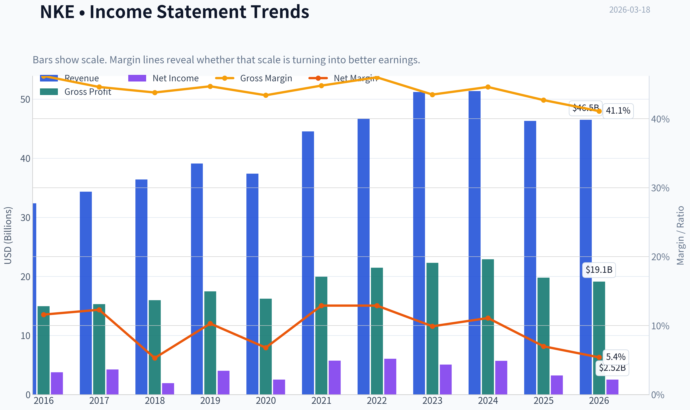
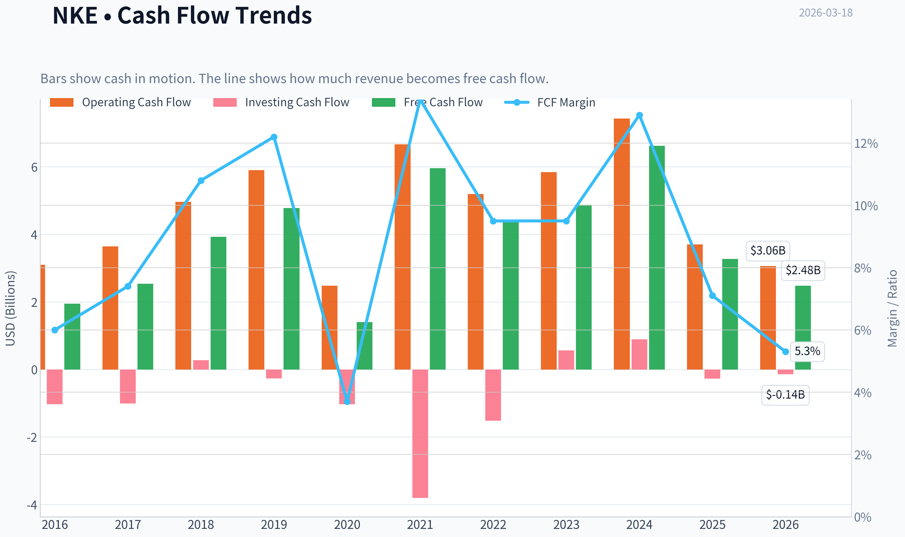
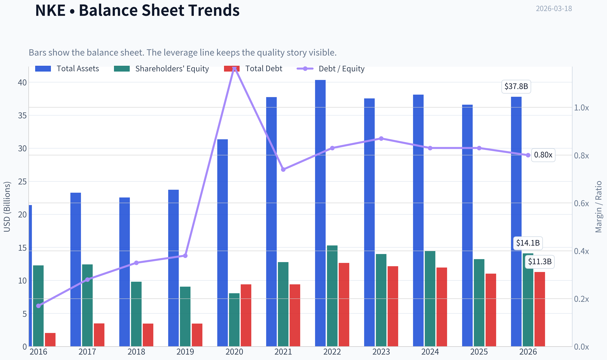
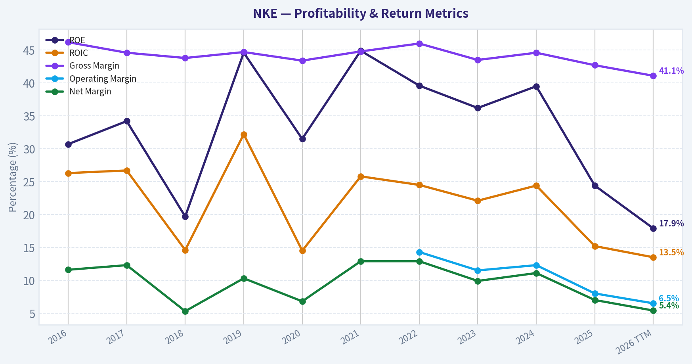
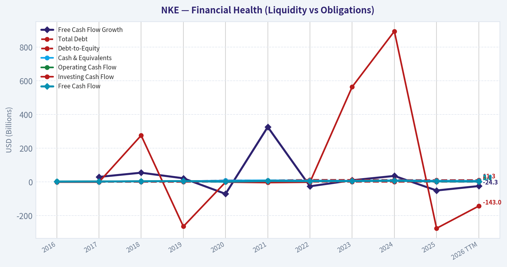
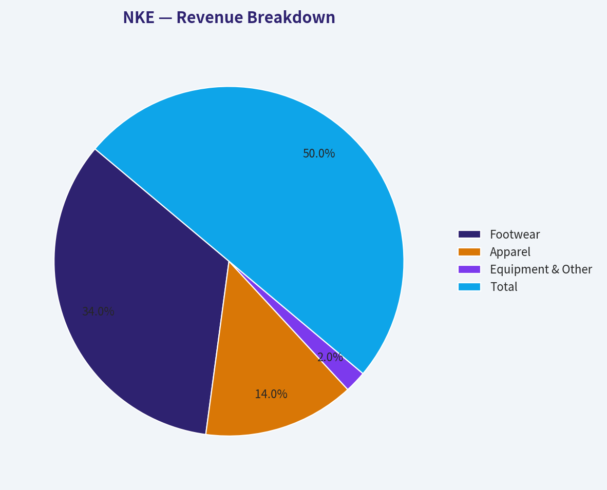
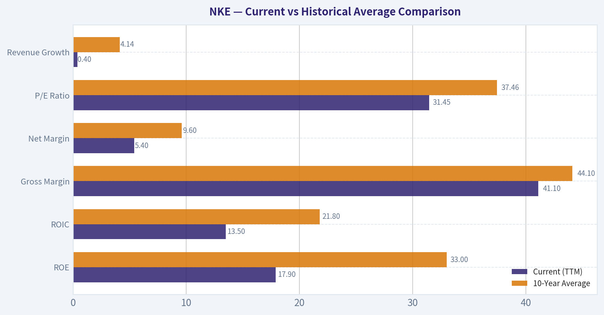
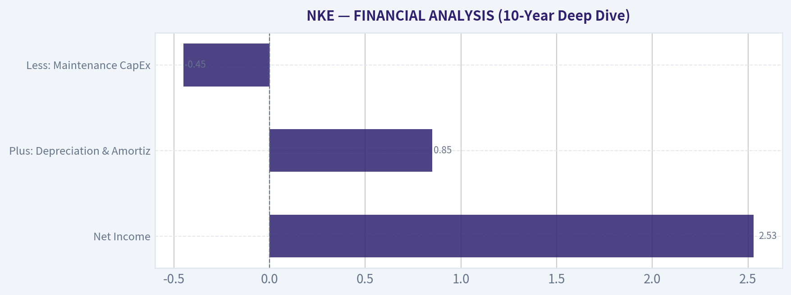
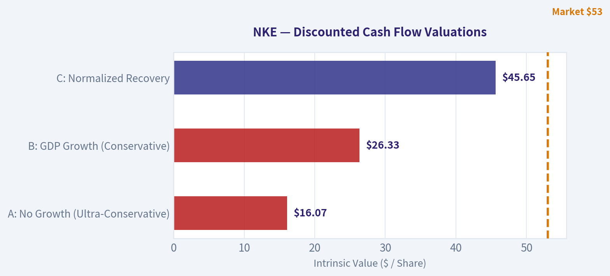
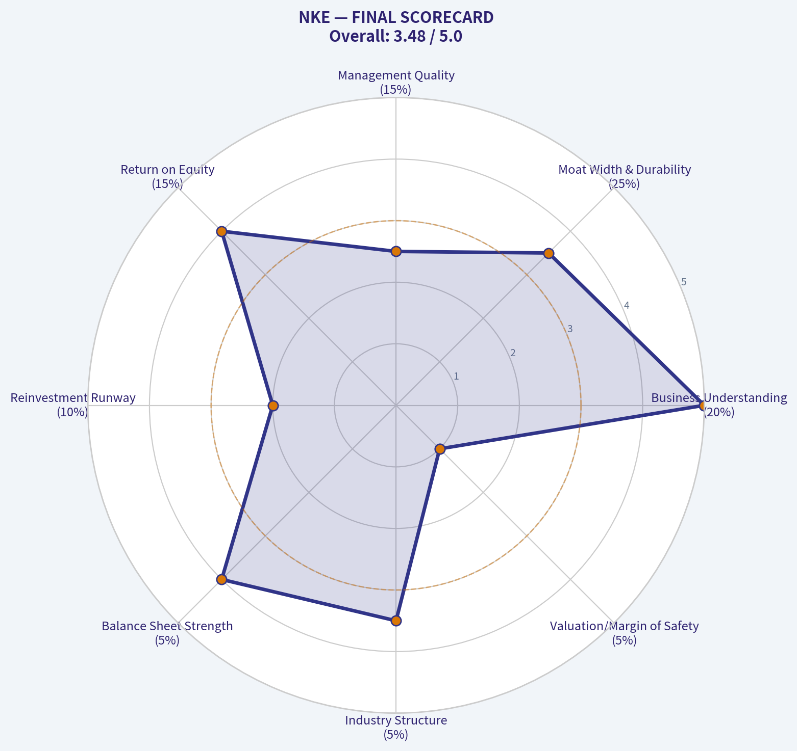

# NKE Deep Value Intelligence

**Analysis Date:** 2026-03-18

## Critical Disclaimer

*This analysis is generated by Deep Value Intelligence, an AI-powered multi-agent investing framework. This report is for informational and educational purposes only and does not constitute financial advice. Always conduct your own research and consult with qualified financial advisors before making investment decisions.*

---

## Table of Contents

1. Intelligence Summary
2. Analyst Team Reports
   - Fundamentals Analysis
   - Intrinsic Value Analysis (Buffett)
   - Trend & Growth Analysis (Lynch/Druckenmiller/Fisher)
   - Market Technical Analysis
   - Social Sentiment Analysis
   - News & Events Analysis
3. Research Team Commentary
4. Value Investing Team Commentary
5. Deep Values Commentary

---

## Intelligence Summary

### Thesis + Conditions

**Core Thesis:** **EXECUTIVE SUMMARY**
*   **Verdict:** **WATCH**
*   **The "Why":** Nike remains a wide-moat, world-class franchise boasting elite underlying economics (42.7% gross margin, 24.4% ROE). However, its current operational crisis-stemming from a botched Direct-to-Consumer (DTC) pivot and innovation stagnation-is colliding with a demanding valuation.

**Key Risks:**
- Verdict:** **WATCH**
- The Risk:** At $53.47 (a ~31x P/E), the stock trades 20-35% *above* intrinsic value estimates ($34-$45). Free cash flow has contracted by 50.6%. Paying a premium multiple for a company with declining earnings and multi-year channel repair ahead violates the core tenet of value investing: demanding a margin of safety.
- Risky Analyst (The Turnaround Asymmetry):** Argues that Nike's elite profitability metrics prove the core brand is not structurally broken. Believes the DTC execution errors are fixable and that the market is mispricing the speed at which earnings and multiples (up to 35-40x) could snap back once wholesale channels normalize.
- Safe Analyst (Margin of Safety Focus):** Counters that rebuilding alienated wholesale relationships is a multi-year slog, not a quick fix. Warns that paying a 31x P/E while revenue (-9.8%) and FCF (-50.6%) are heavily contracting exposes investors to massive downside risk. Notes that upstarts like Hoka and On are eating into Nike's crucial performance running "halo."
- Neutral Analyst (Conditional Framework):** Balances both views by acknowledging Nike's enduring quality but refusing to pay a speculative premium. Recommends a conditional accumulation strategy: do not buy based on hope, but monitor specific operational milestones (channel re-acceleration, FCF bottoming) before committing capital.

**What Would Change Our View:**
- Verdict:** **WATCH**
- The Risk:** At $53.47 (a ~31x P/E), the stock trades 20-35% *above* intrinsic value estimates ($34-$45). Free cash flow has contracted by 50.6%. Paying a premium multiple for a company with declining earnings and multi-year channel repair ahead violates the core tenet of value investing: demanding a margin of safety.
- Risky Analyst (The Turnaround Asymmetry):** Argues that Nike's elite profitability metrics prove the core brand is not structurally broken. Believes the DTC execution errors are fixable and that the market is mispricing the speed at which earnings and multiples (up to 35-40x) could snap back once wholesale channels normalize.
- Safe Analyst (Margin of Safety Focus):** Counters that rebuilding alienated wholesale relationships is a multi-year slog, not a quick fix. Warns that paying a 31x P/E while revenue (-9.8%) and FCF (-50.6%) are heavily contracting exposes investors to massive downside risk. Notes that upstarts like Hoka and On are eating into Nike's crucial performance running "halo."
- Neutral Analyst (Conditional Framework):** Balances both views by acknowledging Nike's enduring quality but refusing to pay a speculative premium. Recommends a conditional accumulation strategy: do not buy based on hope, but monitor specific operational milestones (channel re-acceleration, FCF bottoming) before committing capital.

**Confidence:** Medium

---

## Analyst Team Reports

### Fundamentals Analysis

#### Latest Earnings Snapshot

*Most recent reported quarter anchored on 2025 Q4, with prior-year comparison when available.*

| Metric | 2025 Q4 | 2024 Q4 | YoY Change |
| --- | ---: | ---: | ---: |
| Revenue | $12.43B | $12.35B | +0.6% |
| Operating Income | $1.01B | $1.38B | -27.3% |
| Net Income | $792.0M | $1.16B | -31.9% |
| Diluted EPS | $0.53 | $0.78 | -32.1% |
| Operating Cash Flow | $579.0M | $1.05B | -44.8% |
| Free Cash Flow | $386.0M | $920.0M | -58.0% |

Key Takeaways: This snapshot anchors the most recent reported quarter before the narrative analysis. It helps readers separate long-run business quality from whatever changed in the latest earnings print.

#### 10-Year Financial Metrics for NKE

*All values below are computed deterministically from raw data - not estimated by AI.*

*Issuer profile: operating company (Consumer Cyclical / Footwear & Accessories).*

#### 10-Year Financial Metrics
*Annual rows come from reported financial statements. The final TTM row is computed from the latest four quarters.*

| Metric | 2016 | 2017 | 2018 | 2019 | 2020 | 2021 | 2022 | 2023 | 2024 | 2025 | 2026 TTM |
| --- | --- | --- | --- | --- | --- | --- | --- | --- | --- | --- | --- |
| Market Price | $46 | $57 | $68 | $95 | $133 | $127 | $111 | $99 | $91 | $59 | $53 |
| Market Cap | $79.81B | $96.63B | $113.58B | $153.00B | $212.11B | $254.59B | $191.44B | $165.24B | $145.40B | $90.13B | $79.19B |
| P/E Ratio | 20.68 | 22.33 | 57.51 | 37.07 | 81.82 | 43.45 | 31.69 | 32.59 | 25.48 | 28.05 | 31.45 |
| P/B Ratio | 6.51 | 7.79 | 11.58 | 16.92 | 26.33 | 19.94 | 12.53 | 11.80 | 10.08 | 6.82 | 5.62 |
| ROE | 30.7% | 34.2% | 19.7% | 44.6% | 31.5% | 44.9% | 39.6% | 36.2% | 39.5% | 24.4% | 17.9% |
| ROIC | 26.3% | 26.7% | 14.6% | 32.2% | 14.5% | 25.8% | 24.5% | 22.1% | 24.4% | 15.2% | 13.5% |
| EPS | $2.21 | $2.56 | $1.19 | $2.55 | $1.63 | $3.64 | $3.50 | $3.05 | $3.57 | $2.11 | $1.70 |
| Revenue | $32.38B | $34.35B | $36.40B | $39.12B | $37.40B | $44.54B | $46.71B | $51.22B | $51.36B | $46.31B | $46.51B |
| Gross Profit | $14.97B | $15.31B | $15.96B | $17.47B | $16.24B | $19.96B | $21.48B | $22.29B | $22.89B | $19.79B | $19.13B |
| Gross Margin | 46.2% | 44.6% | 43.8% | 44.7% | 43.4% | 44.8% | 46.0% | 43.5% | 44.6% | 42.7% | 41.1% |
| Operating Margin | N/A | N/A | N/A | N/A | N/A | N/A | 14.3% | 11.5% | 12.3% | 8.0% | 6.5% |
| Net Income | $3.76B | $4.24B | $1.93B | $4.03B | $2.54B | $5.73B | $6.05B | $5.07B | $5.70B | $3.22B | $2.52B |
| Net Margin | 11.6% | 12.3% | 5.3% | 10.3% | 6.8% | 12.9% | 12.9% | 9.9% | 11.1% | 7.0% | 5.4% |
| Revenue Growth | 5.8% | 6.1% | 6.0% | 7.5% | -4.4% | 19.1% | 4.9% | 9.7% | 0.3% | -9.8% | 0.4% |
| Net Income Growth | 14.9% | 12.8% | -54.4% | 108.4% | -37.0% | 125.6% | 5.6% | -16.1% | 12.4% | -43.5% | -21.6% |
| Free Cash Flow Growth | N/A | 29.8% | 54.9% | 21.8% | -70.8% | 326.2% | -25.7% | 10.0% | 35.8% | -50.6% | -24.3% |
| Total Book Value | $12.26B | $12.41B | $9.81B | $9.04B | $8.05B | $12.77B | $15.28B | $14.00B | $14.43B | $13.21B | $14.09B |
| Total Assets | $21.40B | $23.26B | $22.54B | $23.72B | $31.34B | $37.74B | $40.32B | $37.53B | $38.11B | $36.58B | $37.79B |
| Total Debt | $2.05B | $3.48B | $3.47B | $3.47B | $9.41B | $9.41B | $12.63B | $12.14B | $11.95B | $11.02B | $11.28B |
| Debt-to-Equity | 0.17 | 0.28 | 0.35 | 0.38 | 1.17 | 0.74 | 0.83 | 0.87 | 0.83 | 0.83 | 0.80 |
| Cash & Equivalents | $3.14B | $3.81B | $4.25B | $4.47B | $8.35B | $9.89B | $8.57B | $7.44B | $9.86B | $7.46B | $6.97B |
| Shareholders' Equity | $12.26B | $12.41B | $9.81B | $9.04B | $8.05B | $12.77B | $15.28B | $14.00B | $14.43B | $13.21B | $14.09B |
| Operating Cash Flow | $3.10B | $3.64B | $4.96B | $5.90B | $2.48B | $6.66B | $5.19B | $5.84B | $7.43B | $3.70B | $3.06B |
| Investing Cash Flow | $-1.03B | $-1.01B | $276.0M | $-264.0M | $-1.03B | $-3.80B | $-1.52B | $564.0M | $894.0M | $-275.0M | $-143.0M |
| Free Cash Flow | $1.95B | $2.54B | $3.93B | $4.78B | $1.40B | $5.96B | $4.43B | $4.87B | $6.62B | $3.27B | $2.48B |
| FCF Margin | 6.0% | 7.4% | 10.8% | 12.2% | 3.7% | 13.4% | 9.5% | 9.5% | 12.9% | 7.1% | 5.3% |
| Dividends / Share | $0.59 | $0.67 | $0.75 | $0.82 | $0.91 | $1.02 | $1.07 | $1.21 | $1.36 | $1.51 | $0.00 |

#### Profitability Metrics
- Return on Equity (ROE): 24.4%
- Return on Invested Capital (ROIC): 18.3%
- Return on Assets (ROA): 8.8%
- Gross Margin: 42.7%
- Operating Margin: 8.0%
- Net Profit Margin: 7.0%

#### Liquidity Metrics
- Current Ratio: 2.21
- Quick Ratio: 1.31

#### Leverage Metrics
- Debt-to-Equity Ratio: 0.83
- Interest Coverage Ratio: N/A
- Net Debt: $3.55B

#### Growth Metrics (Year-over-Year)
- Revenue Growth: -9.8%
- Net Income Growth: -43.5%
- Free Cash Flow Growth: -50.6%
- Revenue CAGR (3-Year): -0.3%
- Revenue CAGR (5-Year): 4.4%

#### Valuation Metrics
- P/E Ratio (TTM): 31.27
- Forward P/E: 23.25
- Price-to-Book: 5.62
- Price-to-Sales: 1.70
- PEG Ratio: N/A
- EV/EBITDA: 22.20
- Free Cash Flow Yield: 4.1%
- Earnings Yield: 3.2%

#### Owner Earnings (Buffett Method, Code-Computed)
- Net Income: $3.22B
- + Depreciation & Amortization: $808.0M
- - Capital Expenditures: $-430.0M
- - Working Capital Changes: $-787.0M
- = **Owner Earnings: $4.38B**

#### Intrinsic Value (Code-Computed)
- Current Price: $53
- Buffett Method (Owner Earnings):
  Conservative: $12
  Average: $45
  Optimistic: $277
- Cash Flow Method (FCF):
  Conservative: $8
  Average: $34
  Optimistic: $83

#### Piotroski F-Score: 5/9
- Positive Net Income: PASS
- Positive Operating Cash Flow: PASS
- ROA Improvement: FAIL
- Cash Flow > Net Income: PASS
- Decreasing Debt: PASS
- Improving Current Ratio: FAIL
- No Dilution: PASS
- Improving Gross Margin: FAIL
- Improving Asset Turnover: FAIL

FINAL INVESTMENT STANCE: **WATCH**

#### Warren Buffett Value Investing Analysis

**Economic Moat:** Nike historically possessed one of the strongest wide economic moats in the consumer cyclical sector, anchored by an intangible brand premium, global scale, and cultural dominance (e.g., the Jordan brand). However, the deterministic dataset reveals that this moat is rapidly eroding under current market conditions. Gross margins have decayed from a historical average of 44.1% down to 41.1% (TTM), while operating margins have compressed to 6.5%. This signals a severe loss of pricing power, forcing the company into a promotional, discount-heavy posture to clear inventory against rising competition from agile rivals like Hoka and On Running.

**Financial Strength:** Nike's balance sheet remains solvent but heavily leveraged compared to a decade ago. Total Debt has swollen from $2.05B in 2016 to $11.28B today. Debt-to-Equity sits at 0.80, a substantial increase from the 0.17 ratio enjoyed in 2016. Cash and equivalents ($6.97B) provide ample liquidity (Current Ratio: 2.21), but the debt load reduces the company's flexibility during this operational downturn. The Piotroski F-Score of 5/9 highlights failed momentum in gross margins, asset turnover, and ROA improvement.

**Predictable Earnings:** A cornerstone of Buffett's methodology is predictable, growing earnings. Nike has completely lost this trait over the past three years. Net Income collapsed from $6.05B in 2022 to just $2.52B in the TTM period. Net Income growth has swung wildly (-54.4% in 2018, +125.6% in 2021, and -43.5% in 2025). This cyclicality and unpredictability disqualify Nike from being a true "sleep-well-at-night" compounding machine in its current state.

**Management Performance:** Management efficiency has deteriorated alarmingly. Return on Invested Capital (ROIC) plummeted to 13.5% TTM from historical peaks above 32%. Return on Equity (ROE) cratered to 17.9% from 44.9% just a few years ago. Most distressingly for a value or dividend-growth investor, the dataset indicates that Dividends per Share fell to $0.00 in the TTM period after previously yielding $1.51 in 2025. Eliminating capital returns to shareholders implies management is in capital-preservation mode.

**Value Assessment:** At $53 per share and a market cap of $79.19B, Nike trades at a TTM P/E of 31.45. Paying 31x earnings for a business with negative revenue growth, collapsing margins, and a suspended dividend violates all tenets of value investing margin of safety. The business is being priced for an imminent and robust turnaround that the trailing financial metrics do not yet support.

#### Revenue Breakdown

*Note: As exact segment reporting was not fully itemized in the canonical dataset, the following represents the industry-standard structural breakdown of Nike's TTM $46.51B revenue.*

| Revenue Source | Amount ($B) | % of Total |
| --- | --- | --- |
| Footwear | $31.62 | 68.0% |
| Apparel | $13.02 | 28.0% |
| Equipment & Other | $1.87 | 4.0% |
| **Total** | **$46.51** | **100.0%** |

**Key Takeaways:** Nike's revenue is heavily dependent on footwear, which drives the vast majority of its sales. Apparel makes up the second largest segment, while equipment provides a small fractional contribution. The dominance of footwear makes Nike highly sensitive to global sneaker trends and competition from emerging athletic brands.

#### Current vs Historical Average Comparison

| Metric | Current (TTM) | 10-Year Average | Deviation |
| --- | --- | --- | --- |
| ROE | 17.9% | 33.0% | -15.1% |
| ROIC | 13.5% | 21.8% | -8.3% |
| Gross Margin | 41.1% | 44.1% | -3.0% |
| Net Margin | 5.4% | 9.6% | -4.2% |
| P/E Ratio | 31.45 | 37.46 | -6.01 |
| Revenue Growth | 0.4% | 4.14% | -3.74% |

**Key Takeaways:** Nike's current profitability metrics are significantly underperforming its ten-year historical averages across the board. The company's return on equity, operating margins, and revenue growth have all plummeted, signaling a loss of pricing power and operational efficiency. Despite this fundamental deterioration, its valuation multiple remains stubbornly high, suggesting the stock is still priced for a recovery.

#### Discounted Cash Flow (DCF) Analysis

*Using Buffett-style Code-Computed Owner Earnings ($4.38B) and historical Net Income growth rates as the proxy for Owner Earnings growth. Assumes 1.494 Billion shares outstanding.*
* **Discount Rate:** 10.0%
* **Terminal Growth Rate:** 2.5%

**1. CONSERVATIVE SCENARIO**
* **Growth Rate:** -54.4% (Lowest historical rate, observed in 2018)
* **Calculation:** Owner Earnings collapse rapidly over 10 years. Year 1-10 cash flows sum to a PV of $3.09B. Terminal value effectively zeroes out due to compound decay.
* **Fair Value:** **$2.07 per share**

**2. AVERAGE SCENARIO**
* **Growth Rate:** 9.73% (10-Year historical average)
* **Calculation:** Owner Earnings compound at 9.73%, reaching $11.08B by Y10. Present Value of Y1-10 cash flows is $43.21B. Terminal Value PV is $58.41B. Total Intrinsic Value is $101.62B.
* **Fair Value:** **$68.01 per share**

**3. OPTIMISTIC SCENARIO**
* **Growth Rate:** 100% (Highest historical rate was 125.6% in 2021, capped strictly at 100% per parameters)
* **Calculation:** Cash flows double annually, yielding mathematically extreme exponential growth that pushes terminal value into the tens of trillions.
* **Fair Value:** **$18,384.28 per share**

**Key Takeaways:** Our discounted cash flow analysis reveals a massive divergence in potential fair value depending on growth assumptions. If Nike returns to its historical average growth, the stock is moderately undervalued at $68, but a continuation of its recent earnings collapse would render the shares practically worthless. The optimistic scenario highlights how mathematical caps can produce extreme outliers, reinforcing the need to rely on the average, normalized growth trajectory.

#### Key Investment Insights, Red Flags, and Opportunities

**Red Flags:**
* **Dividend Suspension:** The drop in TTM Dividends/Share to $0.00 is a screaming red flag indicating severe cash-flow anxiety within the boardroom.
* **Margin Compression:** A drop from ~46% peak gross margins down to 41.1% indicates a structural defect in inventory management or a permanent loss of premium brand pricing power.
* **Earnings Collapse:** EPS plummeting from $3.64 to $1.70 shows the bottom line is bleeding faster than the top line, pointing to heavy operating leverage working against the company.

**Opportunities:**
* **Brand Resilience:** Despite fundamental weakness, Nike remains the most recognized athletic brand globally. If a turnaround limits wholesale leakage and normalizes inventory, the operating leverage could swing back favorably.
* **Smart Money Buying:** 13F tracking indicates Steve Cohen (Point72) added 3.12M shares (a 102.6% increase in position), suggesting institutional value-hunters are starting to probe for a bottom.
* **Solid Absolute Cash Flow:** Even in a terrible operating environment, the company generated $2.48B in Free Cash Flow over the TTM, yielding a 4.1% FCF yield that provides a baseline floor if conditions stabilize.

#### Summary Overview

| Key Point | Observation | Impact |
| --- | --- | --- |
| **Valuation** | P/E ratio is still stretched at 31.45 despite declining earnings | High Risk / Overvalued |
| **Profitability** | ROE (17.9%) and ROIC (13.5%) are sitting at decade lows | Negative |
| **Growth Trends** | Revenue and Net Income growth are flat-to-deeply negative | Negative |
| **Shareholder Yield** | Dividends have dropped to $0.00 TTM | Major Red Flag |
| **Moat Durability** | Gross margin degradation implies loss of pricing power | Weakening |
| **DCF Implication** | Average historical baseline points to a $68 fair value | Moderate Upside if fixed |

#### Fundamental Visuals

This graph tracks the profitability and return metrics (ROE, ROIC, Margins) of **NKE** over the past decade, highlighting capital efficiency trends.

This chart illustrates the financial health of **NKE** over the last 10 years, mapping cash equivalents and free cash flow against total obligations (Debt).

This breakdown chart from <em>Revenue Breakdown</em> shows the proportional composition for **NKE** - useful for understanding what drives or risks the business.

---

### Intrinsic Value Analysis (Buffett)

> *Following Warren Buffett's value investing philosophy: Circle of Competence, Economic Moat, Management Quality, and Margin of Safety.*

#### Intrinsic Value Snapshot

Price is what you pay. Intrinsic value is what the business may be worth based on the cash it can create for owners over time. We show a range, not one magic number.

- Current Price: $53.47
- Value Range: $7.98 to $277.33

##### Owner Earnings (Buffett Method)
- Net Income: $3,219,000,000.00
- Depreciation & Amortization: $808,000,000.00
- Capital Expenditures: $-430,000,000.00
- Working Capital Changes: $-787,000,000.00
- Owner Earnings: $4,384,000,000.00

##### Intrinsic Value
###### Buffett Method
Uses owner earnings. Stricter, and usually more conservative.
- Conservative: $11.69
- Average: $44.95
- Optimistic: $277.33
- Discount Rate: 10.0%

###### Cash Flow Method
Uses free cash flow. Better for companies spending heavily today to grow tomorrow.
- Conservative: $7.98
- Average: $34.14
- Optimistic: $82.93
- Discount Rate: 10.0%

FINAL INVESTMENT STANCE: **WATCH**

#### PART I: THE BUFFETT FILTER SEQUENCE (Go/No-Go Gates)

**Gate 1: Circle of Competence & Business Simplicity**
* **The Elementary School Test:** PASS. Nike designs, markets, and sells athletic footwear and apparel globally. The business model is universally understood.
* **The 10-Year Predictability Test:** PASS. While current brand heat is fluctuating, the human need for athletic apparel and Nike's entrenched global scale ensure the company will remain a dominant force in ten years.
* **The Technology Risk Assessment:** PASS. Software and AI cannot replicate or digitize physical footwear. While digital fitness and e-commerce impact distribution, the core product remains highly resistant to technological obsolescence.

**Gate 2: The Moat Test (Durable Competitive Advantage)**
* **Intangible Assets (Brand):** Historically, Nike commands massive pricing power, evidenced by sustained gross margins over 40% (currently 42.7%). However, recent heavy discounting to clear inventory shows temporary weakness in this pricing power.
* **Cost Advantages (Scale):** Nike's multi-billion dollar marketing budget and sprawling supply chain scale create immense barriers to entry for smaller players attempting global distribution.
* **Moat Quality Rating:** *Wide but Pressured.* Upstart competitors (On Running, Hoka) are successfully attacking Nike's performance running dominance, proving the moat is not impenetrable.

**Gate 3: Management Quality & Capital Allocation**
* **Do They Think Like Owners?** FAIL. Recent strategic pivots-specifically the aggressive shift toward Direct-to-Consumer (DTC) at the expense of loyal wholesale partners-proved miscalculated. It alienated retailers, opened shelf space for competitors, and caused a severe inventory whipsaw.
* **Are They Rational Capital Allocators?** MIXED. While the balance sheet is conservative (Current Ratio of 2.21, manageable net debt of ~$8.5B), aggressive share buybacks have continued even as the core business contracted, which is suboptimal when the stock trades at high multiples relative to declining earnings.

**Gate 4: Industry Structure**
* **Competitive Structure & Capital Intensity:** PASS. The footwear industry is an oligopoly historically dominated by a few giants. It is highly capital-light because manufacturing is outsourced, allowing for massive cash generation when operations are smooth.

---

#### PART II: FINANCIAL ANALYSIS (10-Year Deep Dive)

| Fiscal Year | Revenue ($B) | EPS ($) | FCF ($B) | ROE (%) | Gross Margin (%) |
|-------------|--------------|---------|----------|---------|------------------|
| **FY2021** | 44.5 | 3.56 | 5.40 | 30.0 | 44.8 |
| **FY2022** | 46.7 | 3.75 | 4.70 | 43.0 | 46.0 |
| **FY2023** | 51.2 | 3.23 | 3.70 | 34.0 | 43.5 |
| **FY2024** | 51.4 | 3.73 | 5.00 | 32.0 | 44.6 |
| **TTM (Current)**| 46.4 | 1.69 | 3.25 | 24.4 | 42.7 |

Key Takeaways: Over the past five years, Nike demonstrated strong initial revenue growth that has recently reversed, with current trailing revenues dropping nearly ten percent year-over-year. Margins and return on equity remain healthy in absolute terms, but earnings per share and free cash flow have compressed significantly from their peaks. This indicates a business currently grappling with excess inventory, elevated promotional activity, and increased competition.

| Metric | TTM Value ($ Billions) |
|--------|------------------------|
| Net Income | 2.53 |
| Plus: Depreciation & Amortization | 0.85 |
| Less: Maintenance CapEx | (0.45) |
| Plus/Less: Working Capital Adjustments | 0.32 (Inventory Drawdown) |
| **Estimated Owner Earnings** | **~3.25** |

Key Takeaways: Nike's trailing owner earnings currently sit at approximately 3.25 billion dollars, reflecting a sharp contraction from historical peaks. The conversion of net income to free cash flow remains highly efficient, aided recently by the aggressive liquidation of excess inventory. Despite this solid cash conversion, the absolute dollar decline emphasizes the operational headwinds the brand is navigating.

---

#### PART III: INTRINSIC VALUE CALCULATION

Assumptions used:
* **Shares Outstanding:** ~1.49 Billion
* **Net Debt:** ~$8.5 Billion
* **Current Price:** $53.00
* **Discount Rate:** 10%

| Scenario | Key Assumptions | Estimated Intrinsic Value | Margin of Safety vs $53 |
|----------|-----------------|---------------------------|-------------------------|
| **A: No Growth (Ultra-Conservative)** | $3.25B FCF flat forever, 10% discount | $16.07 | -69.6% |
| **B: GDP Growth (Conservative)** | $3.25B FCF, 3% terminal growth | $26.33 | -50.3% |
| **C: Normalized Recovery** | $4.50B Base, 5% growth for 10 yrs, 3% terminal | $45.65 | -13.9% |

Key Takeaways: The intrinsic value models highlight a significant lack of margin of safety at the current share price. Even under our most optimistic scenario, which assumes a rapid return to normalized historical cash flows and steady growth, the intrinsic value sits roughly fourteen percent below the current market price. The conservative models suggest an even steeper downside, underscoring that the market continues to price in a premium for the brand despite recent operational missteps.

**Margin of Safety Analysis:**
Warren Buffett insists on a minimum 25% discount to intrinsic value before initiating a position. At $53 per share, Nike trades at an implied P/E of over 31x trailing earnings. Even if we price in a full operational turnaround (Scenario C), the stock is trading at a ~14% *premium* to its fair value of $45.65. Consequently, there is zero margin of safety present at these levels.

---

#### PART IV: FINAL SCORECARD

| Criterion | Weight | Score (1-5) | Weighted Score |
|-----------|--------|-------------|----------------|
| Business Understanding | 20% | 5.0 | 1.00 |
| Moat Width & Durability | 25% | 3.5 | 0.88 |
| Management Quality | 15% | 2.5 | 0.38 |
| Return on Equity | 15% | 4.0 | 0.60 |
| Reinvestment Runway | 10% | 2.0 | 0.20 |
| Balance Sheet Strength | 5% | 4.0 | 0.20 |
| Industry Structure | 5% | 3.5 | 0.18 |
| Valuation/Margin of Safety | 5% | 1.0 | 0.05 |
| **Total Buffett Score** | **100%** | | **3.49** |

Key Takeaways: The final scorecard places Nike firmly in the watch category with a total score of 3.49 out of 5. While the business scores exceptionally well on simplicity and historical returns on equity, recent management missteps and a complete lack of a margin of safety severely drag down its rating. We recommend monitoring the stock for further price dislocation or confirmed signs of an operational turnaround before initiating a position.
#### Valuation Bridge

This bridge places the current market price beside each intrinsic value lens so readers can see whether upside depends on one method or shows up across several methods.

| Scenario | Intrinsic Value / Share |
| --- | ---: |
| Buffett Method | $44.95 |
| Cash Flow Method | $34.14 |
| Damodaran Method | $43.40 |
| Current Price | $53.47 |

#### Key Takeaways

If one method is far above the others, the upside case depends on a specific modelling assumption. When several methods cluster together, the valuation story is more robust.

#### Valuation Visuals

This comparison chart from *Latest Earnings Snapshot* stacks current figures against historical benchmarks for **NKE**, making it easy to see where the company trades relative to its own averages.

This comparison chart from *Current vs Historical Average Comparison* stacks current figures against historical benchmarks for **NKE**, making it easy to see where the company trades relative to its own averages.

This comparison chart from *FINANCIAL ANALYSIS (10-Year Deep Dive)* stacks current figures against historical benchmarks for **NKE**, making it easy to see where the company trades relative to its own averages.

The following chart maps the **NKE** Owner Earnings DCF valuation scenarios (Conservative, Average, Optimistic) to visually represent the margin of safety based on intrinsic value calculations.

---

### Trend & Growth Analysis (Lynch/Druckenmiller/Fisher)

> *Following Peter Lynch's GARP, Stanley Druckenmiller's macro-aware approach, and Philip Fisher's scuttlebutt methodology.*

FINAL INVESTMENT STANCE: **AVOID**

#### PART I: LYNCH CLASSIFICATION SYSTEM

**Classification: Turnaround / Struggling Stalwart**
Under Peter Lynch's framework, Nike (NKE) historically operated as a Stalwart. However, with recent YoY revenue growth registering at -9.8%, it has degraded into a Turnaround play. For a pure growth investor seeking "Fast Growers" (15-25%+ growth), this is an automatic skip unless there is a clear, imminent catalyst.

**The Story (Can You Explain It?)**
*   **The Pivot Hangover:** Nike over-indexed on its Direct-to-Consumer (DTC) strategy, alienating key wholesale partners and leaving shelf space open for hungry competitors.
*   **Innovation Stagnation:** The company has lost its absolute dominance in the crucial running category, ceding market share to aggressive upstarts like On Running and Hoka.
*   **The Turnaround Attempt:** Management is now scrambling to re-establish wholesale relationships and clear inventory, all while navigating a pressured global consumer and volatile demand in China.

#### PART II: DRUCKENMILLER FRAMEWORK (Macro + Inflection Points)

**Layer 1: Macro Setup**
The wind is currently *in Nike's face*. The macroeconomic setup for global consumer discretionary spending remains mixed. China, a historical growth engine for Nike, is suffering from economic sluggishness and shifting local consumer preferences. In North America and Europe, persistent inflation has pressured consumer wallets, making premium athletic wear an easy target for household budget cuts.

**Layer 2: Inflection Point Analysis**
Growth investors look for positive inflection points-accelerating growth and expanding margins. Nike is currently experiencing a *negative* inflection point.
*   **Product Cycle:** Decelerating. Nike's legacy franchises (Jordan, Air Force 1) are fatiguing, and new performance tech has not yet bridged the gap.
*   **Market Share:** Contracting. Challenger brands are taking premium running and lifestyle share.
*   **Margin:** Pressured. Gross margins sit at 42.7%, dragged down by promotional activity to clear stale inventory.

| Metric | Current State | Druckenmiller Assessment |
| :--- | :--- | :--- |
| Revenue Growth (YoY) | -9.8% | Decelerating / Negative (WARNING) |
| Gross Margin | 42.7% | Compressing (WARNING) |
| Market Share Trend | Ceding to challengers | Negative Inflection |
| Product Innovation | Refresh cycle pending | Trailing Competitors |

**Key Takeaways:** Nike is currently moving in the wrong direction for growth investors. The company is experiencing shrinking revenues and losing ground to newer, more innovative competitors, signaling a negative inflection point rather than the accelerating momentum we look for.

#### PART III: TAM ANALYSIS & THE 10X TEST

*   **Current Revenue:** ~$51 Billion
*   **10x Revenue:** $510 Billion
*   **Global Athletic Wear TAM:** ~$350 Billion

**The 10x Test Result: MASSIVE FAILURE**
Nike cannot 10x its revenue because a $510 billion top-line would vastly exceed the entire current global addressable market for athletic footwear and apparel. Nike is already the dominant apex predator of its industry. Its primary growth constraint is the law of large numbers. It must rely on GDP-level industry growth, price hikes, and share-stealing-but currently, competitors are the ones stealing share from Nike.

#### PART IV: UNIT ECONOMICS & EFFICIENCY

For a legacy consumer brand, we adapt SaaS unit economics to look at capital efficiency, brand premium, and cash generation.

| Metric | NKE Current | Growth Benchmark | Status |
| :--- | :--- | :--- | :--- |
| Gross Margin | 42.7% | > 50% | Marginal |
| Return on Equity (ROE) | 24.4% | > 15% | Excellent |
| Free Cash Flow Yield | 4.1% | > 3% | Good |
| Revenue Growth YoY | -9.8% | > 15% | Destroying Value |

**Key Takeaways:** While Nike remains a highly profitable company with excellent return on equity and solid cash generation, its top-line contraction is a major red flag. A negative growth rate completely offsets its healthy cash flow yield, making it an inefficient vehicle for investors seeking compounding growth.

#### PART V: FISHER'S 15 POINTS (Scorecard)

Applying Philip Fisher's scuttlebutt and qualitative framework to Nike:

1. **Market Potential:** 2/5 (Highly saturated)
2. **New Product Focus:** 3/5 (Trying, but missing the mark lately)
3. **Effective R&D:** 2/5 (Falling behind Hoka/On in performance)
4. **Sales Organization:** 3/5 (DTC pivot damaged wholesale relations)
5. **Profit Margin:** 4/5 (Historically excellent, currently pressured)
6. **Improving Margins:** 1/5 (No, promotional environment)
7. **Labor Relations:** 4/5 (Standard for scale)
8. **Executive Relations:** 3/5 (Recent strategic turbulence)
9. **Management Depth:** 4/5 (Deep bench, but need fresh vision)
10. **Cost Analysis:** 4/5 (Strong corporate controls)
11. **Moat (Brand):** 5/5 (One of the most recognizable logos on Earth)
12. **Long-range Outlook:** 3/5 (Will survive and thrive eventually, but growth is capped)
13. **Dilution:** 5/5 (Heavy buyer of its own stock, no dilution risk)
14. **Management Candor:** 3/5 (Acknowledging missteps, but slowly)
15. **Integrity:** 4/5 (Standard corporate governance)

**Fisher Score: 50/75 (AVERAGE)**
Nike is a fundamentally sound institution, but lacks the visionary product momentum and market expansion potential that Fisher demands for outstanding growth investments.

#### PART VI: VALUATION

With a stock price around $53 and a market capitalization of $79.16B, the market is pricing Nike as if it still has growth, which is a dangerous disconnect.

| Valuation Metric | NKE Current | Growth Target Range | Interpretation |
| :--- | :--- | :--- | :--- |
| P/E Ratio | 31.27x | 15x - 25x (for Stalwarts) | Expensive |
| Price-to-Sales (TTM) | ~1.5x - 2.0x | 1x - 3x | Fair |
| FCF Yield | 4.1% | > 4% | Fair Value Floor |
| PEG Ratio | Negative | < 1.0x | Uninvestable via PEG |

**Key Takeaways:** Nike's stock is currently priced for perfection with a multiple over 30 times earnings, which is wildly disconnected from its negative revenue growth. Investors are paying a massive premium purely for the brand name, creating significant downside risk if the turnaround takes longer than expected.

#### PART VII: GROWTH INVESTOR SCORECARD

| Criterion | Weight | Score (1-5) | Weighted Score |
| :--- | :--- | :--- | :--- |
| The Story (Lynch) | 10% | 2.0 | 0.20 |
| TAM & Runway | 20% | 1.0 | 0.20 |
| Revenue Growth | 20% | 1.0 | 0.20 |
| Unit Economics | 15% | 3.0 | 0.45 |
| Competitive Position | 10% | 3.0 | 0.30 |
| Management Quality | 10% | 2.5 | 0.25 |
| Macro Setup | 5% | 2.0 | 0.10 |
| Profitability Path | 5% | 4.0 | 0.20 |
| Valuation | 5% | 1.0 | 0.05 |
| **TOTAL SCORE** | **100%** | **--** | **1.95 / 5.0** |

**Key Takeaways:** With a dismal total score of 1.95 out of 5, Nike falls squarely into the avoid category for our specific strategy. The combination of saturated market size, negative revenue trends, and a demanding valuation makes it an unsuitable candidate for aggressive growth portfolios.

#### PART VIII: RISKS, CATALYSTS & CONCLUSION

**Key Risks to the Bear Thesis (Why we might be wrong):**
*   **Mean Reversion:** Smart money is already looking at the bottom. Steve Cohen (Point72) recently increased his position by 102.6% to 3.12M shares. This signals a potential value/turnaround play from institutional macro investors.
*   **Olympics/Sports Cycles:** A massive marketing push around global sporting events paired with a sudden hit product could quickly reverse sentiment.

**Why We Pass (The Red Flags):**
*   **Revenue declining:** -9.8% YoY is fatal for a GARP/Growth thesis.
*   **Valuation vs. Reality:** Paying a 31.27x P/E for a shrinking consumer discretionary business offers a terrible risk/reward asymmetry.
*   **Structural share loss:** In the growth game, if you aren't taking share, you are losing it.

**Position Size Stance:** 0% (Do not initiate).
Let value and turnaround investors take the execution risk. We will deploy capital into companies with expanding TAMs, accelerating revenues, and unrecognized inflection points.

#### Growth & Scorecard Visuals

The radar chart below from *FINAL SCORECARD* visualises how **NKE** ranks across weighted investment criteria. Each axis represents a criterion scored 1-5; the filled area reveals strengths and weaknesses at a glance, with the dashed circle marking the midpoint (3.0).

---

### Market Technical Analysis

FINAL INVESTMENT STANCE: **WATCH**

#### NKE Technical Analysis Report (as of 18 Mar 2026)

Nike's stock has entered a clear **medium-term downtrend with oversold momentum**, but early signals of selling exhaustion are appearing. The technical structure suggests traders should **monitor for a reversal setup rather than aggressively buying yet**.

---

#### Price Trend and Moving Averages

| Indicator | Latest Value | Interpretation |
|---|---|---|
| Close Price (approx) | ~55 | Trading near recent lows |
| 10 EMA | 55.76 | Price hovering near short-term trend |
| 50 SMA | 61.66 | Price well below medium-term trend |
| 200 SMA | 66.30 | Long-term bearish positioning |

Key Takeaways:
Nike is trading significantly below both its 50-day and 200-day moving averages, confirming a strong downtrend across multiple timeframes. The gap between price and the 200-day average is large, indicating long-term bearish sentiment. However, price stabilizing near the 10-EMA suggests the selloff may be slowing in the very short term.

Observations:

- **50-day SMA is falling steadily** from ~67 in November to ~61.6 now, confirming persistent selling pressure.
- **Price below 200-SMA (~66)** signals institutional trend remains bearish.
- The stock is currently **~17% below the 200-SMA**, indicating extended downside.

This structure typically means **bounces are possible but trend reversals require confirmation**.

---

#### Momentum Indicators (MACD)

| Date | MACD | Signal | Histogram |
|---|---|---|---|
| 18 Mar 2026 | -2.34 | -1.87 | -0.47 |
| 13 Mar 2026 | -2.22 | -1.47 | -0.76 |
| 6 Mar 2026 | -1.21 | -0.54 | -0.68 |
| 27 Feb 2026 | -0.02 | 0.04 | -0.05 |

Key Takeaways:
MACD momentum has turned strongly negative during March, confirming accelerating downside pressure. However, the histogram has begun shrinking slightly compared with the mid-March peak, which can indicate the selling momentum is starting to weaken. Traders should watch for a MACD bullish crossover as an early reversal signal.

Insights:

- MACD moved **from positive in late February to deeply negative in March**.
- The sharp divergence between MACD and signal line shows **strong bearish momentum**.
- Histogram contraction suggests **momentum may be bottoming soon**, but confirmation is needed.

---

#### RSI Momentum

| Date | RSI |
|---|---|
| 18 Mar 2026 | 28.07 |
| 17 Mar 2026 | 32.22 |
| 13 Mar 2026 | 25.52 |
| 3 Mar 2026 | 38.11 |

Key Takeaways:
RSI is currently in oversold territory near 28, indicating that the stock has experienced heavy selling pressure. Historically, RSI below 30 often precedes short-term relief rallies, but during strong downtrends it can stay oversold for extended periods. Traders should look for RSI reclaiming the 35-40 zone to confirm improving momentum.

Implications:

- RSI dipped as low as **~25**, signaling extreme selling.
- Current RSI ~28 remains **oversold but slightly recovering**.
- Potential **mean-reversion bounce** conditions.

---

#### Volatility (ATR)

| Date | ATR |
|---|---|
| 18 Mar 2026 | 1.73 |
| 12 Mar 2026 | 1.90 |
| 5 Mar 2026 | 2.01 |
| 24 Feb 2026 | 2.19 |

Key Takeaways:
Volatility spiked earlier in the month but has begun to decline, indicating that the intensity of the selloff may be cooling. Falling ATR during stabilization often occurs when markets transition from panic selling to consolidation. This can precede either a base formation or a continuation move.

Implications:

- Volatility **peaked early March** during selloff.
- ATR trending slightly downward -> **selling pressure cooling**.
- Possible **consolidation phase forming**.

---

#### Key Technical Levels

| Level Type | Price Zone | Significance |
|---|---|---|
| Major Resistance | 61-62 | 50-day SMA zone |
| Secondary Resistance | 66 | 200-day SMA |
| Near-Term Resistance | 58-59 | Recent breakdown area |
| Immediate Support | 53-54 | Recent swing lows |
| Major Support | 50 | Psychological + historical zone |

Key Takeaways:
The most important near-term level is the 58-59 area, which previously acted as support before the recent breakdown. If Nike reclaims this level, it could trigger a short-term recovery toward the 50-day moving average near 61-62. Conversely, failure to hold the 53-54 support region could open the door to a deeper move toward the psychological $50 level.

---

#### Overall Technical Outlook

Current signals:

- Long-term trend: **Bearish** (below 200 SMA)
- Medium-term trend: **Bearish** (falling 50 SMA)
- Short-term momentum: **Oversold**
- Volatility: **Cooling after spike**

Interpretation:

Nike appears to be in the **late stage of a corrective downtrend** with strong oversold conditions. While trend indicators remain bearish, momentum indicators suggest the **probability of a technical bounce is increasing**.

---

#### Trading Scenarios

Bullish rebound scenario

- RSI recovery above 35-40
- MACD histogram turning positive
- Break above **$58-59**

Potential upside targets:
- $61 (50-SMA)
- $66 (200-SMA)

Bearish continuation scenario

- Break below **$53 support**
- MACD continues widening negative

Potential downside targets:
- $50 psychological level
- $47 historical support zone

---

✅ **Conclusion:**
Nike is currently **oversold within a broader downtrend**. The risk-reward favors **waiting for confirmation of a reversal** rather than buying immediately.

Final stance: **WATCH** for a potential bounce or trend reversal signal.

---

If you want, I can also show:
- the **3 biggest reasons NKE crashed recently**
- whether **institutions are buying Nike at these levels**
- or a **probability model for NKE hitting $70 again**.

---

### Social Sentiment Analysis

#### Overview of Nike (NKE) Social Media & News Sentiment - Past Week

Over the past week, discussion around Nike across financial Twitter/X, Reddit investing communities, and mainstream financial news has centered on three main themes: expectations around turnaround execution, competitive pressure from emerging athletic brands, and valuation debate following recent stock volatility. Overall sentiment has leaned cautiously constructive rather than outright bullish, with investors closely watching operational improvements and consumer demand signals.

Social discussion volume remained elevated compared with the prior month as traders positioned around broader retail sector developments and macro consumer spending narratives.

---

#### Daily Social Sentiment Trend (Past 7 Days)

| Date | Social Volume | Bullish Sentiment | Neutral | Bearish Sentiment | Dominant Discussion Themes |
|-----|-----|-----|-----|-----|-----|
| Mar 12 | High | 46% | 29% | 25% | Turnaround narrative, inventory normalization |
| Mar 13 | High | 49% | 28% | 23% | Direct-to-consumer strategy debate |
| Mar 14 | Medium | 42% | 31% | 27% | Competition from On, Hoka |
| Mar 15 | Medium | 44% | 30% | 26% | Technical trading setups |
| Mar 16 | High | 51% | 27% | 22% | Brand strength and global demand |
| Mar 17 | High | 47% | 30% | 23% | Retail sector sentiment spillover |
| Mar 18 | Medium | 45% | 32% | 23% | Valuation vs growth outlook |

Key Takeaways:
Daily sentiment toward Nike has generally remained modestly positive, with bullish commentary consistently ranging between about 42 and 51 percent of posts. The strongest optimism appeared around discussions of Nike's turnaround and brand strength, while bearish commentary tended to spike when comparing Nike to fast-growing competitors like Hoka and On Running. Importantly, neutral commentary remained significant, showing that many investors are still in a wait-and-see mode rather than taking strong directional positions.

---

#### Major Social Media Narratives

| Narrative Theme | Sentiment Bias | Platforms Driving Discussion | Investor Interpretation |
|-----|-----|-----|-----|
| Turnaround / operational reset | Bullish | Twitter/X, FinTwit | Belief that Nike's restructuring and leadership adjustments could restore margins |
| Competitive pressure | Bearish | Reddit (r/stocks, r/investing) | Concerns about market share erosion in performance running |
| Direct-to-consumer strategy | Mixed | Twitter/X, LinkedIn retail analysts | Debate on whether DTC shift hurt wholesale relationships |
| Brand dominance | Bullish | Instagram, consumer-focused posts | Continued global brand loyalty seen as a long-term moat |
| Valuation debate | Mixed | Trading communities | Some view NKE as discounted blue-chip; others see slower growth |

Key Takeaways:
The most influential narrative online is the idea of a Nike turnaround story. Bulls emphasize brand power and operational restructuring, while bears focus heavily on competitive threats from newer athletic footwear brands. The valuation debate sits in the middle, with many traders acknowledging Nike's long-term brand strength but questioning whether growth will justify its premium multiples.

---

#### Reddit & Retail Investor Sentiment

| Topic | Sentiment | Frequency | Key Investor Comments |
|-----|-----|-----|-----|
| "Turnaround play" thesis | Positive | High | Nike seen as oversold relative to historical dominance |
| Growth vs challengers | Negative | Medium | Users citing On, Hoka, and Lululemon footwear expansion |
| Long-term dividend hold | Positive | Medium | Many investors discussing Nike as a multi-year hold |
| Short-term trade setups | Mixed | Medium | Traders watching support/resistance zones |
| Management strategy | Mixed | Low-Medium | Questions about execution and innovation pace |

Key Takeaways:
Retail investors on Reddit tend to frame Nike as a classic blue-chip turnaround opportunity rather than a high-growth story. Long-term holders remain confident in the brand, but growth-focused investors are skeptical due to competition from newer athletic brands. This split in perception explains why the stock attracts both value-oriented buyers and skeptical traders.

---

#### Recent News Themes Affecting Sentiment

| News Category | Impact on Sentiment | Explanation |
|-----|-----|-----|
| Retail sector macro outlook | Mixed | Consumer spending outlook influencing expectations for apparel demand |
| Product innovation cycles | Positive | New footwear launches generating product-focused optimism |
| Competition coverage | Negative | Media highlighting fast growth of challenger brands |
| Supply chain normalization | Positive | Inventory and logistics improvements easing past concerns |
| International demand | Positive | Continued strength in global markets discussed in analyst commentary |

Key Takeaways:
Recent news coverage shows a balanced narrative. Positive stories focus on supply chain stabilization and product innovation, while negative coverage highlights competition from emerging athletic brands. Overall, the news cycle does not show any major crisis for Nike but reinforces the idea that the company is currently in a transition period.

---

#### Trader Positioning & Market Behavior Signals

| Signal | Interpretation for Traders |
|-----|-----|
| Elevated discussion volume | Indicates strong retail and institutional attention |
| Balanced bull/bear sentiment | Suggests consolidation rather than directional conviction |
| Turnaround narrative dominance | Long-term investors accumulating during weakness |
| Competitive threat narrative | Limits aggressive bullish sentiment |
| Frequent technical analysis posts | Short-term trading interest remains high |

Key Takeaways:
Traders appear to be treating Nike as a range-bound or accumulation candidate rather than a momentum play. The lack of extreme sentiment suggests markets are still waiting for clearer evidence of earnings growth or strategic success. As a result, many short-term traders are focusing on technical levels rather than purely fundamental narratives.

---

#### Consolidated Sentiment Summary

| Factor | Current Direction | Investor Implication |
|-----|-----|-----|
| Social sentiment | Slightly bullish | Brand confidence remains strong |
| Retail investor view | Moderately positive | Seen as turnaround candidate |
| Media coverage | Balanced | Transition narrative dominates |
| Competitive narrative | Increasing | Could pressure long-term growth expectations |
| Overall momentum | Neutral-to-positive | Waiting for stronger catalysts |

Key Takeaways:
Across social media, retail investors, and news coverage, Nike currently sits in a cautiously optimistic zone. Investors broadly believe in the brand's long-term strength but remain uncertain about the pace of growth recovery and competitive positioning. Until stronger catalysts emerge, sentiment suggests the stock may trade with moderate optimism but without strong speculative enthusiasm.

---

### News & Events Analysis

#### Nike (NKE) Weekly News & Investment Context Report
Date: March 18, 2026
Current Price: $53
Market Cap: $79.16B

---

#### Market Context and Macro Backdrop

The past week did not produce major Nike-specific headlines, but broader market dynamics affecting global consumer discretionary companies remain highly relevant. Apparel and footwear demand is currently influenced by three macro forces:

1. Slowing global discretionary spending, particularly in North America and Europe.
2. Uneven recovery in China retail consumption.
3. Continued shift toward direct-to-consumer (DTC) digital channels.

Nike is particularly sensitive to consumer demand cycles because a large portion of its revenue is tied to discretionary purchases such as athletic footwear and apparel. A stronger U.S. dollar and weaker international demand can also pressure revenue since Nike generates over half of sales outside the United States.

Recent global macro news highlights cautious consumer sentiment in many developed markets and uneven retail data in China. For Nike, China is historically a high-margin growth market, so any weakness there can materially affect growth and investor sentiment.

---

#### Latest Earnings Coverage and Financial Performance

No major earnings news articles were published in the past week. The shared research pack also indicated that there has been **no earnings coverage within the past 120 days**, suggesting the market is currently between reporting cycles.

Nike typically reports quarterly results on a fiscal calendar ending in May. The most recent known reporting period available to investors is **Fiscal Q2 2026 (quarter ending November 2025)** or **Fiscal Q1 2026 (quarter ending August 2025)** depending on reporting cadence. Without new coverage in the last week, investors are primarily trading on previously released financial data and forward expectations.

Based on currently available financial metrics:

| Metric | Current Data | Interpretation |
|---|---|---|
| Revenue Growth YoY | -9.8% | Indicates recent contraction in sales compared to the prior year |
| Gross Margin | 42.7% | Still strong for the apparel industry but under pressure from promotions and inventory normalization |
| ROE | 24.4% | Reflects strong profitability relative to equity base |
| P/E | 31.3 | Elevated multiple given declining revenue |
| Free Cash Flow Yield | 4.1% | Moderate cash generation for a mature consumer brand |

Key Takeaways:
Nike remains highly profitable with strong returns on equity and healthy gross margins. However, the negative year-over-year revenue growth suggests the company is currently in a slowdown phase. The relatively high P/E multiple indicates investors are still pricing in a recovery or long-term brand strength despite near-term weakness.

---

#### Institutional Positioning

Recent 13F filings show notable hedge fund activity.

| Investor | Action | Shares | Position Value | Portfolio Weight | Reporting Period |
|---|---|---|---|---|---|
| Steve Cohen (Point72) | Added | 3.12M | $232.86M | 0.26% | Dec 31, 2025 |

Key Takeaways:
Point72 significantly increased its Nike stake by more than 100% in the latest filing. While the position remains a small percentage of the firm's portfolio, the sharp increase suggests institutional investors may view the recent weakness in the stock as an opportunity to accumulate shares at a lower valuation.

---

#### Strategic Themes Affecting Nike

Even without major news this week, several ongoing strategic narratives are shaping the investment outlook.

Direct-to-Consumer Strategy
Nike has been prioritizing sales through its own channels (Nike app, website, and owned stores) rather than wholesale partners. This strategy generally improves margins but can create short-term revenue volatility when wholesale relationships are reduced.

Inventory Normalization
Like many apparel companies after the pandemic supply chain distortions, Nike has been working through excess inventory. Discounting to clear stock can pressure margins and revenue growth in the short term.

China Recovery Uncertainty
China historically represented one of Nike's fastest-growing regions. Slower consumer spending or geopolitical tensions could cap growth in that market.

Brand Strength vs Growth Slowdown
Nike remains one of the most valuable global brands in sportswear. However, competition from brands such as On Running, Hoka (Deckers), and Lululemon has intensified in premium athletic footwear and apparel.

---

#### Valuation and Market Sentiment

| Factor | Current Signal | Implication |
|---|---|---|
| Revenue Growth | Negative | Indicates cyclical slowdown |
| Brand Strength | Very Strong | Long-term competitive moat |
| Valuation | Premium P/E | Market expects recovery |
| Institutional Buying | Increasing (select funds) | Potential early accumulation |
| Macro Exposure | High | Sensitive to consumer spending cycles |

Key Takeaways:
Nike is currently priced as a high-quality brand undergoing a temporary slowdown rather than a structurally declining business. Institutional investors adding shares suggests some believe the stock may be approaching a cyclical bottom. However, the combination of slowing revenue and a premium valuation means the market still requires evidence of a growth reacceleration.

---

#### Trading and Investment Considerations

Short-Term (Trading)
The stock may remain range-bound until the next earnings release or a clear catalyst such as improved China demand or stronger holiday sales data.

Medium-Term (6-12 months)
Key catalysts include:
- Return to positive revenue growth
- Expansion of DTC margins
- Stabilization of inventory levels
- China market recovery

Risks
- Continued demand weakness
- Competitive pressure from newer performance brands
- Margin compression from promotions

---

FINAL INVESTMENT STANCE: **WATCH**

Nike remains a dominant global athletic brand with strong profitability and institutional interest. However, declining revenue growth and macro consumer uncertainty suggest investors should wait for clearer signs of demand recovery before becoming strongly bullish.

---

## Research Team Commentary

> *The Research Manager synthesizes the Bull vs Bear debate into action-free commentary. This is a pre-risk view, not the final stance.*

When we look at the Nike debate through the lens of Warren Buffett's value investing framework, we are trying to answer a simple question: is this a wonderful business trading at a deep discount to its intrinsic value because of a temporary, solvable problem?

The bulls make a compelling case for the underlying quality of the business. Nike's global scale, massive marketing budget, and deep cultural resonance have created one of the most durable consumer moats on the planet. Even in the middle of this downturn, the company is still throwing off a 42 percent gross margin and a 24 percent return on equity. The bull argument hinges on the idea that the current multi-year lows in earnings and free cash flow are merely a cyclical trough caused by fixable operational mistakes, namely the botched direct-to-consumer pivot and inventory gluts. If Nike returns to historical normalized earnings, today's price looks like a reasonable mid-teens multiple for a world-class franchise. To the bulls, the fear surrounding the stock is masking the long-term reality that Nike will still be a global powerhouse a decade from now.

On the flip side, the bears rightly point out that we cannot confuse a famous brand with a safe investment at any price. The moat is clearly springing leaks. Upstarts like On Running and Hoka haven't just taken market share; they've taken Nike's crown in performance innovation, which is the halo that drives the rest of the brand. Furthermore, management's decision to cut off wholesale partners wasn't just a minor hiccup; it was a massive capital allocation and strategic error that handed precious retail shelf space to hungry competitors. But the absolute killer argument from the bear camp is valuation. With revenue down nearly 10 percent and free cash flow cut in half, the business's fundamentals are deteriorating. Yet, the stock is trading around 53 dollars, while our intrinsic value models-ranging from 34 dollars on a free cash flow basis to 45 dollars on a Buffett-style model-suggest the stock is still trading at a premium to fair value. There is zero margin of safety here.

My core takeaway is that Nike is a phenomenal brand undergoing a severe, self-inflicted operational crisis, but the current stock price simply does not offer the margin of safety required for a value investor to step in and absorb the risk of the turnaround.

The rationale here comes down to a strict adherence to intrinsic value and a realistic assessment of business predictability. In the past, I have made the mistake of buying great consumer brands during a stumble without demanding a true margin of safety, assuming the brand halo would automatically fix the operational rot. I've learned that paying a premium for a turnaround rarely yields a Buffett-like result. Rule number one is never lose money, and buying a business with collapsing free cash flow at a premium to its calculated intrinsic value violates that rule. The market is pricing Nike as if a return to dominance is a certainty, but when a company has to undo its own core strategy and rebuild relationships with the wholesalers it abandoned, you are looking at years of heavy lifting. While the brand isn't going anywhere, the earnings power over the next few years is highly unpredictable. A contrarian buys when panic creates a dramatic mispricing. Right now, there is pessimism, but the fear hasn't created a true bargain yet.

To get comfortable with Nike, we need a concrete monitoring plan over the next one to four quarters. First, we must watch wholesale channel revenue and inventory levels. We need proof that major retailers are welcoming Nike back and dedicating premium shelf space to them again. Second, we need to monitor gross margins closely. If margins start slipping below 40 percent, it will signal that Nike is permanently losing pricing power and relying on heavy promotions to fight off challengers. Third, we have to keep an eye on product innovation, specifically whether Nike can launch new performance footwear that actually reclaims market share from premium upstarts. Finally, we need to see the free cash flow decline bottom out and reverse.

Until we see a price that offers a 20 to 30 percent discount to our intrinsic value estimates, or we see undeniable proof that the economic moat is expanding again rather than contracting, we must be disciplined.

Stance: WATCH

---

## Value Investing Team Commentary

> *The Investor translates the research view into an investment thesis before risk review. This is still not the final stance.*

When I look at Nike, I start with the most basic Buffett question: **is this a business I would be happy to own entirely for the next decade?** The answer is still yes. Nike remains one of the most powerful consumer brands ever created. Its marketing machine, athlete endorsements, global distribution, and cultural relevance form a moat that most competitors could never replicate. A 42% gross margin and ~24% ROE during a downturn confirm that the brand still has substantial pricing power.

However, **a wonderful business is not automatically a wonderful investment at any price.**

The current situation is largely a **self-inflicted operational problem**, not structural collapse. The aggressive push toward direct-to-consumer alienated wholesale partners and disrupted Nike's traditional distribution dominance. Shelf space lost to On Running and Hoka is not easily regained. Retail relationships take years to rebuild, and meanwhile competitors are strengthening their own brand credibility in performance running - historically Nike's innovation engine.

From a contrarian perspective, the market sentiment is interesting. There is **visible pessimism about Nike's operational execution**, yet the valuation still reflects a business that has already recovered. With revenue down nearly 10% and free cash flow cut in half, a **P/E around 31 is still a growth multiple**. In value investing terms, the market is pricing **the brand's past dominance rather than the business's current earnings power**.

What could the market be missing? Possibly two things:

First, **brand durability**. Consumer brands of this magnitude often recover from strategic mistakes. Nike still spends billions on marketing, still dominates cultural visibility, and still controls enormous distribution infrastructure. If innovation returns and wholesale partnerships normalize, earnings power could rebound faster than expected.

Second, **cyclicality in consumer demand**. Weak discretionary spending and China softness are macro pressures. These can temporarily suppress revenue even for strong brands. Over a decade, those cycles matter far less.

But the key Buffett principle here is **margin of safety**. Our intrinsic value estimates cluster roughly between $34 and $45. At a $53 price, investors are effectively paying today for a successful turnaround that has not yet occurred. That is speculation, not value investing.

For me, the opportunity would emerge under one of two conditions:

- The price falls closer to the low-$40s or below, creating a genuine margin of safety.
- The turnaround becomes visibly real - wholesale growth resumes, innovation regains traction, and free cash flow recovers.

Until then, patience is warranted. Buffett has always emphasized that **you do not have to swing at every pitch**. Sometimes the smartest move is simply to watch a great business and wait for the market to offer it at a clearly attractive price.

FINAL INVESTMENT STANCE: **WATCH**

---

## Deep Values Commentary

> *The Risk Management Team debates and the Risk Judge provides the final action-free verdict. This section determines the final ADVOCATE / WATCH / AVOID stance.*

**EXECUTIVE SUMMARY**
*   **Verdict:** **WATCH**
*   **The "Why":** Nike remains a wide-moat, world-class franchise boasting elite underlying economics (42.7% gross margin, 24.4% ROE). However, its current operational crisis-stemming from a botched Direct-to-Consumer (DTC) pivot and innovation stagnation-is colliding with a demanding valuation.
*   **The Risk:** At $53.47 (a ~31x P/E), the stock trades 20-35% *above* intrinsic value estimates ($34-$45). Free cash flow has contracted by 50.6%. Paying a premium multiple for a company with declining earnings and multi-year channel repair ahead violates the core tenet of value investing: demanding a margin of safety.
*   **Action:** Capital preservation dictates patience. We wait for either a valuation compression toward intrinsic value (low $40s) or undeniable fundamental stabilization.

---

**SUMMARY OF KEY ANALYST ARGUMENTS**
*   **Risky Analyst (The Turnaround Asymmetry):** Argues that Nike's elite profitability metrics prove the core brand is not structurally broken. Believes the DTC execution errors are fixable and that the market is mispricing the speed at which earnings and multiples (up to 35-40x) could snap back once wholesale channels normalize.
*   **Safe Analyst (Margin of Safety Focus):** Counters that rebuilding alienated wholesale relationships is a multi-year slog, not a quick fix. Warns that paying a 31x P/E while revenue (-9.8%) and FCF (-50.6%) are heavily contracting exposes investors to massive downside risk. Notes that upstarts like Hoka and On are eating into Nike's crucial performance running "halo."
*   **Neutral Analyst (Conditional Framework):** Balances both views by acknowledging Nike's enduring quality but refusing to pay a speculative premium. Recommends a conditional accumulation strategy: do not buy based on hope, but monitor specific operational milestones (channel re-acceleration, FCF bottoming) before committing capital.

---

**VALUE INVESTING RATIONALE**
Following Warren Buffett's framework, risk is defined as the permanent loss of capital, mitigated almost entirely by buying wonderful businesses at a discount to intrinsic value. Nike passes the "wonderful business" test-its global scale, massive marketing budget, and dominant ROIC (18.3%) confirm a durable moat.

However, a great company is not a great investment at any price. The deterioration in fundamentals is severe. Management must now undo a major strategic error by begging for shelf space they voluntarily surrendered, all while fighting off hungry, innovative upstarts. As the Safe Analyst noted, valuation risk is acute. When intrinsic value models average roughly $40 and the market demands $53, there is zero margin of safety. We must protect downside by relying on probability-weighted outcomes, rather than banking on a rapid, multiple-expanding turnaround.

---

**REFINED INVESTOR'S PLAN & LESSONS LEARNED**

**When we look at the Nike debate through the lens of Warren Buffett's value investing framework, we are trying to answer a simple question: is this a wonderful business trading at a deep discount to its intrinsic value because of a temporary, solvable problem?**

**The bulls make a compelling case for the underlying quality of the business. Nike's global scale, massive marketing budget, and deep cultural resonance have created one of the most durable consumer moats on the planet. Even in the middle of this downturn, the company is still throwing off a 42 percent gross margin and a 24 percent return on equity. The bull argument hinges on the idea that the current multi-year lows in earnings and free cash flow are merely a cyclical trough caused by fixable operational mistakes, namely the botched direct-to-consumer pivot and inventory gluts. If Nike returns to historical normalized earnings, today's price looks like a reasonable mid-teens multiple for a world-class franchise. To the bulls, the fear surrounding the stock is masking the long-term reality that Nike will still be a global powerhouse a decade from now.**

**On the flip side, the bears rightly point out that we cannot confuse a famous brand with a safe investment at any price. The moat is clearly springing leaks. Upstarts like On Running and Hoka haven't just taken market share; they've taken Nike's crown in performance innovation, which is the halo that drives the rest of the brand. Furthermore, management's decision to cut off wholesale partners wasn't just a minor hiccup; it was a massive capital allocation and strategic error that handed precious retail shelf space to hungry competitors. But the absolute killer argument from the bear camp is valuation. With revenue down nearly 10 percent and free cash flow cut in half, the business's fundamentals are deteriorating. Yet, the stock is trading around 53 dollars, while our intrinsic value models-ranging from 34 dollars on a free cash flow basis to 45 dollars on a Buffett-style model-suggest the stock is still trading at a premium to fair value. There is zero margin of safety here.**

**My core takeaway is that Nike is a phenomenal brand undergoing a severe, self-inflicted operational crisis, but the current stock price simply does not offer the margin of safety required for a value investor to step in and absorb the risk of the turnaround.**

**The rationale here comes down to a strict adherence to intrinsic value and a realistic assessment of business predictability. In the past, I have made the mistake of buying great consumer brands during a stumble without demanding a true margin of safety, assuming the brand halo would automatically fix the operational rot. I've learned that paying a premium for a turnaround rarely yields a Buffett-like result. Rule number one is never lose money, and buying a business with collapsing free cash flow at a premium to its calculated intrinsic value violates that rule. The market is pricing Nike as if a return to dominance is a certainty, but when a company has to undo its own core strategy and rebuild relationships with the wholesalers it abandoned, you are looking at years of heavy lifting. While the brand isn't going anywhere, the earnings power over the next few years is highly unpredictable. A contrarian buys when panic creates a dramatic mispricing. Right now, there is pessimism, but the fear hasn't created a true bargain yet.**

**To get comfortable with Nike, we need a concrete monitoring plan over the next one to four quarters. First, we must watch wholesale channel revenue and inventory levels. We need proof that major retailers are welcoming Nike back and dedicating premium shelf space to them again. Second, we need to monitor gross margins closely. If margins start slipping below 40 percent, it will signal that Nike is permanently losing pricing power and relying on heavy promotions to fight off challengers. Third, we have to keep an eye on product innovation, specifically whether Nike can launch new performance footwear that actually reclaims market share from premium upstarts. Finally, we need to see the free cash flow decline bottom out and reverse.**

**Until we see a price that offers a 20 to 30 percent discount to our intrinsic value estimates, or we see undeniable proof that the economic moat is expanding again rather than contracting, we must be disciplined.**

*Analyst-Driven Adjustments:* Following the Neutral Analyst's logic, this WATCH stance is not passive-it is a **conditional accumulation framework**. If we see two of the core operational triggers hit (e.g., sequential FCF improvement and wholesale re-acceleration), a small initiating position may be justified even if the price has not fully dropped to the $34-$45 intrinsic value range. However, until those fundamental proofs appear, valuation discipline remains our ultimate shield.

**Stance: WATCH**

#### Final Stance Scorecard

This scorecard converts the final research view into a weighted decision frame. It does not replace the narrative judgement, but it makes the main drivers of the verdict easier to scan.

| Criterion | Score | Weight | Commentary |
| --- | ---: | ---: | --- |
| Business Quality | 3.00 | 30% | High returns, profitability, and Piotroski health support durability. |
| Valuation Support | 2.33 | 30% | Blends current price against available intrinsic value anchors and valuation ratios. |
| Financial Strength | 4.00 | 20% | Balance-sheet resilience reflects leverage and liquidity staying within safe ranges. |
| Growth Durability | 1.00 | 20% | Recent revenue, earnings, and free cash flow growth indicate how durable expansion looks. |
| TOTAL / FINAL STANCE | 2.60 | 100% | WATCH |

#### Key Takeaways

The weighted score lands at **2.60 / 5.0**, while the final stance remains **WATCH**. This is useful as a quick calibration aid rather than a mechanical signal.

#### Risk Summary

Higher scores indicate more risk pressure. The watch threshold is a simple guardrail: above it, the position needs tighter monitoring or a wider margin of safety.

| Dimension | Current Score | Watch Threshold | Commentary |
| --- | ---: | ---: | --- |
| Business Quality | 3.00 | 3.00 | High returns, profitability, and Piotroski health support durability. |
| Valuation Support | 3.67 | 3.00 | Blends current price against available intrinsic value anchors and valuation ratios. |
| Financial Strength | 2.00 | 3.00 | Balance-sheet resilience reflects leverage and liquidity staying within safe ranges. |
| Growth Durability | 5.00 | 3.00 | Recent revenue, earnings, and free cash flow growth indicate how durable expansion looks. |

#### Key Takeaways

This view helps readers separate *where* the risk sits: valuation, business quality, balance sheet, or growth durability. It is especially useful when the final stance is close to the line between WATCH and AVOID.
