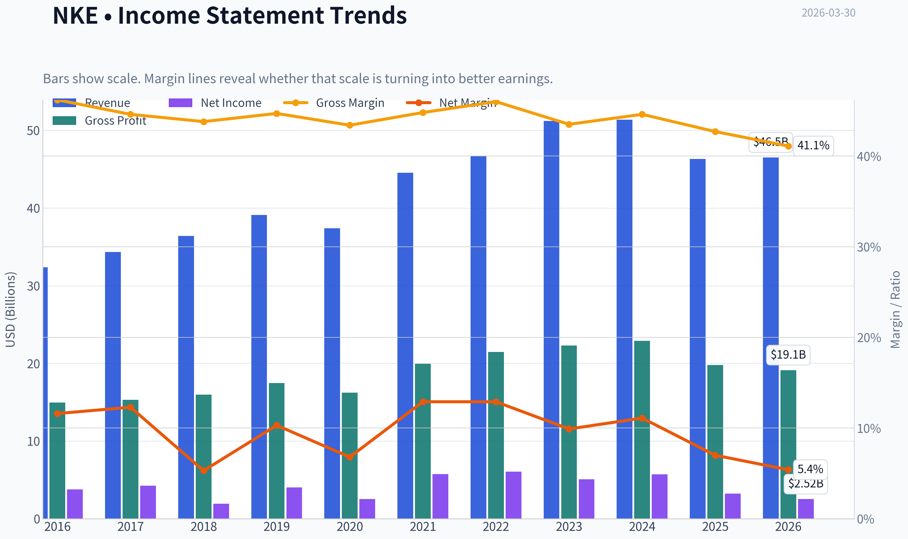
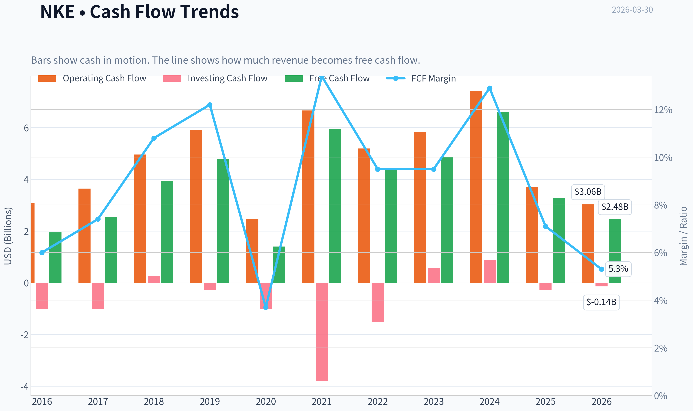
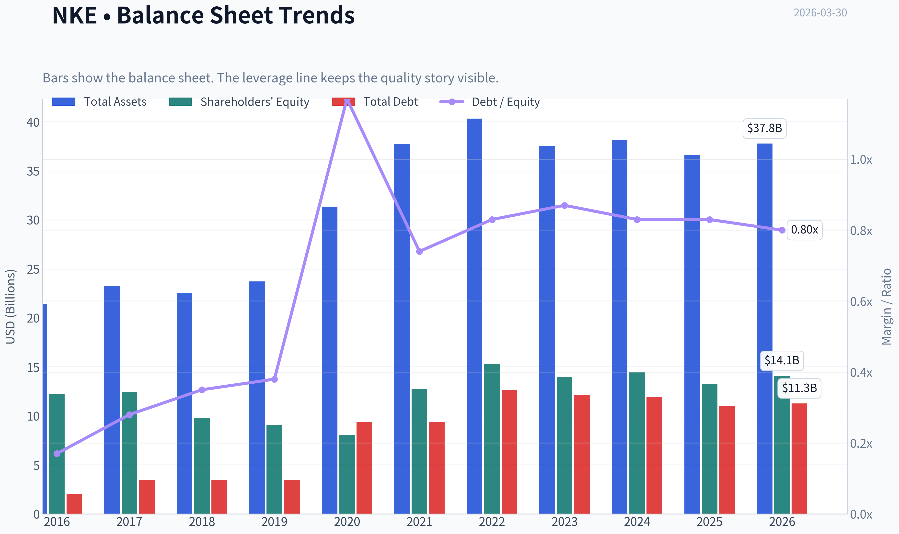
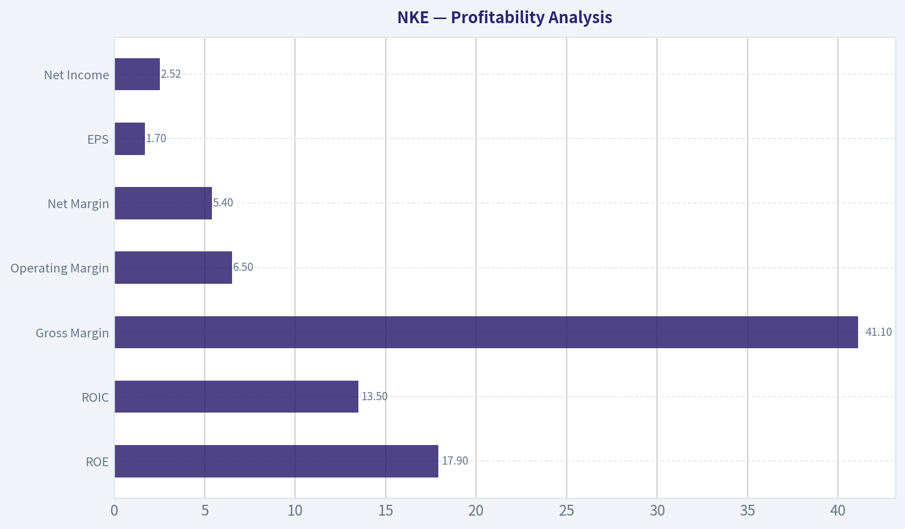
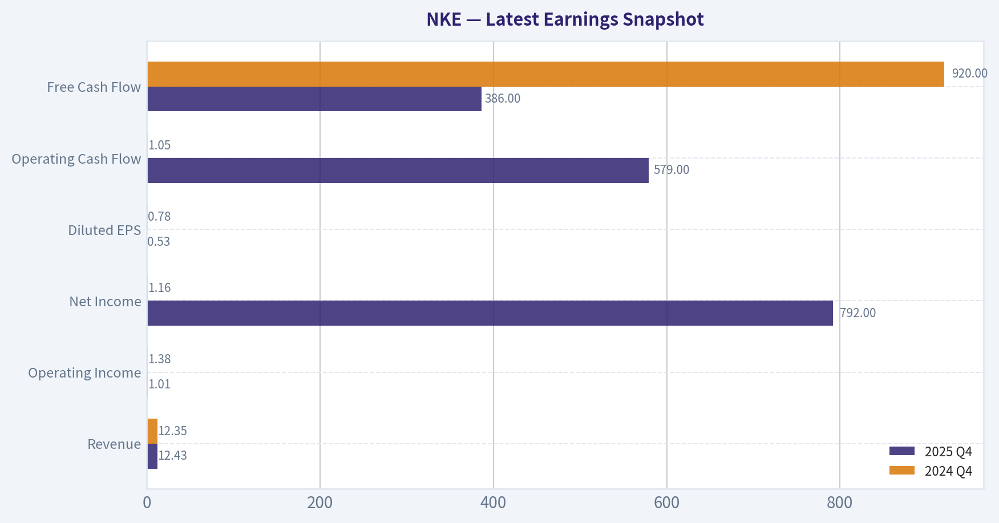
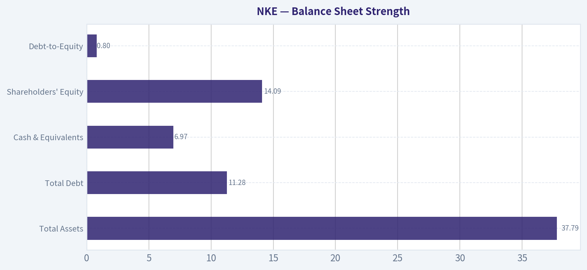
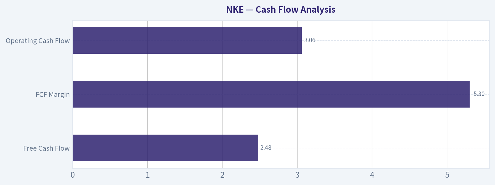
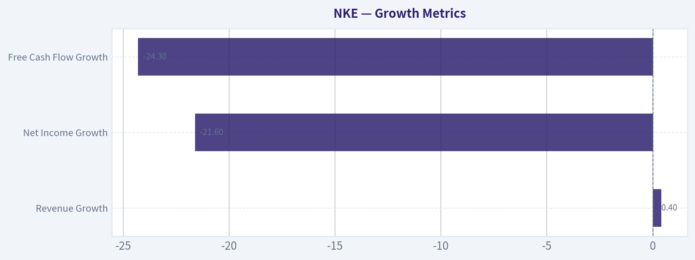
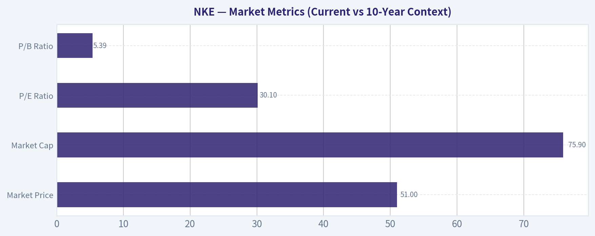

# NKE Deep Value Intelligence

**Analysis Date:** 2026-03-30

## Critical Disclaimer

*This analysis is generated by Deep Value Intelligence, an AI-powered multi-agent investing framework. This report is for informational and educational purposes only and does not constitute financial advice. Always conduct your own research and consult with qualified financial advisors before making investment decisions.*

---

## Table of Contents

1. Intelligence Summary
2. Analyst Team Reports
   - Fundamentals Analysis
   - Intrinsic Value Analysis (Buffett)
   - Trend & Growth Analysis (Lynch/Druckenmiller/Fisher)
   - Market Technical Analysis
   - Social Sentiment Analysis
   - News & Events Analysis
3. Research Team Commentary
4. Value Investing Team Commentary
5. Deep Values Commentary

---

## Intelligence Summary

### Thesis + Conditions

**Core Thesis:** EXECUTIVE SUMMARY (Quick Read)

**Key Risks:**
- Nike still looks like a high-quality franchise with a durable global brand and historically elite economics. However, the current price (~$51) already assumes a fairly smooth recovery in earnings despite meaningful operational disruption and rising competitive pressure in key categories. With intrinsic value estimates clustered around $35-$45 and profits currently depressed, the margin of safety is thin. The core question isn't whether Nike survives-it almost certainly will-but whether investors are being compensated for uncertainty around the speed of recovery. At today's price, patience remains the better risk management strategy.
- Risky Analyst (Bullish Recovery Case)
- The bullish case centers on franchise durability. Nike's long-term metrics-~42% gross margins, ~24% ROE, ~18% ROIC-suggest strong pricing power and a deeply embedded brand ecosystem. The recent earnings decline is framed as operational rather than structural: freight inflation, excess inventory, and supply chain distortions after the pandemic. Bulls argue these factors are already easing. Nike also retains unmatched scale advantages in athlete endorsements, marketing, and distribution. If earnings normalize even partially, today's 30x P/E could compress quickly, potentially leading to a sentiment-driven rebound.
- Safe Analyst (Risk Discipline Case)
- The cautious argument emphasizes valuation and uncertainty. Financial deterioration has been significant: revenue down ~10%, net income down ~43%, and free cash flow down ~50%. Paying ~30x earnings while profits are falling creates multiple compression risk if recovery takes longer than expected. External pressures-slowing global discretionary spending, geopolitical trade tensions, and weak Chinese demand-add macro uncertainty. Competition from brands like Hoka and On is particularly concerning in performance running, historically Nike's credibility engine. With most valuation models between $35-$45, investors today are paying above intrinsic value without a margin of safety.

**What Would Change Our View:**
- Nike still looks like a high-quality franchise with a durable global brand and historically elite economics. However, the current price (~$51) already assumes a fairly smooth recovery in earnings despite meaningful operational disruption and rising competitive pressure in key categories. With intrinsic value estimates clustered around $35-$45 and profits currently depressed, the margin of safety is thin. The core question isn't whether Nike survives-it almost certainly will-but whether investors are being compensated for uncertainty around the speed of recovery. At today's price, patience remains the better risk management strategy.
- Risky Analyst (Bullish Recovery Case)
- The bullish case centers on franchise durability. Nike's long-term metrics-~42% gross margins, ~24% ROE, ~18% ROIC-suggest strong pricing power and a deeply embedded brand ecosystem. The recent earnings decline is framed as operational rather than structural: freight inflation, excess inventory, and supply chain distortions after the pandemic. Bulls argue these factors are already easing. Nike also retains unmatched scale advantages in athlete endorsements, marketing, and distribution. If earnings normalize even partially, today's 30x P/E could compress quickly, potentially leading to a sentiment-driven rebound.
- Safe Analyst (Risk Discipline Case)
- The cautious argument emphasizes valuation and uncertainty. Financial deterioration has been significant: revenue down ~10%, net income down ~43%, and free cash flow down ~50%. Paying ~30x earnings while profits are falling creates multiple compression risk if recovery takes longer than expected. External pressures-slowing global discretionary spending, geopolitical trade tensions, and weak Chinese demand-add macro uncertainty. Competition from brands like Hoka and On is particularly concerning in performance running, historically Nike's credibility engine. With most valuation models between $35-$45, investors today are paying above intrinsic value without a margin of safety.

**Confidence:** Low

---

## Analyst Team Reports

### Fundamentals Analysis

#### Latest Earnings Snapshot

*Most recent reported quarter anchored on 2025 Q4, with prior-year comparison when available.*

| Metric | 2025 Q4 | 2024 Q4 | YoY Change |
| --- | ---: | ---: | ---: |
| Revenue | $12.43B | $12.35B | +0.6% |
| Operating Income | $1.01B | $1.38B | -27.3% |
| Net Income | $792.0M | $1.16B | -31.9% |
| Diluted EPS | $0.53 | $0.78 | -32.1% |
| Operating Cash Flow | $579.0M | $1.05B | -44.8% |
| Free Cash Flow | $386.0M | $920.0M | -58.0% |

Key Takeaways: This snapshot anchors the most recent reported quarter before the narrative analysis. It helps readers separate long-run business quality from whatever changed in the latest earnings print.

#### 10-Year Financial Metrics for NKE

*All values below are computed deterministically from raw data - not estimated by AI.*

*Issuer profile: operating company (Consumer Cyclical / Footwear & Accessories).*

#### 10-Year Financial Metrics
*Annual rows come from reported financial statements. The final TTM row is computed from the latest four quarters.*

| Metric | 2016 | 2017 | 2018 | 2019 | 2020 | 2021 | 2022 | 2023 | 2024 | 2025 | 2026 TTM |
| --- | --- | --- | --- | --- | --- | --- | --- | --- | --- | --- | --- |
| Market Price | $46 | $57 | $68 | $95 | $133 | $127 | $111 | $99 | $91 | $59 | $51 |
| Market Cap | $79.81B | $96.63B | $113.58B | $153.00B | $212.11B | $254.59B | $191.44B | $165.24B | $145.40B | $90.13B | $75.89B |
| P/E Ratio | 20.68 | 22.33 | 57.51 | 37.07 | 81.82 | 43.45 | 31.69 | 32.59 | 25.48 | 28.05 | 30.14 |
| P/B Ratio | 6.51 | 7.79 | 11.58 | 16.92 | 26.33 | 19.94 | 12.53 | 11.80 | 10.08 | 6.82 | 5.39 |
| ROE | 30.7% | 34.2% | 19.7% | 44.6% | 31.5% | 44.9% | 39.6% | 36.2% | 39.5% | 24.4% | 17.9% |
| ROIC | 26.3% | 26.7% | 14.6% | 32.2% | 14.5% | 25.8% | 24.5% | 22.1% | 24.4% | 15.2% | 13.5% |
| EPS | $2.21 | $2.56 | $1.19 | $2.55 | $1.63 | $3.64 | $3.50 | $3.05 | $3.57 | $2.11 | $1.70 |
| Revenue | $32.38B | $34.35B | $36.40B | $39.12B | $37.40B | $44.54B | $46.71B | $51.22B | $51.36B | $46.31B | $46.51B |
| Gross Profit | $14.97B | $15.31B | $15.96B | $17.47B | $16.24B | $19.96B | $21.48B | $22.29B | $22.89B | $19.79B | $19.13B |
| Gross Margin | 46.2% | 44.6% | 43.8% | 44.7% | 43.4% | 44.8% | 46.0% | 43.5% | 44.6% | 42.7% | 41.1% |
| Operating Margin | N/A | N/A | N/A | N/A | N/A | N/A | 14.3% | 11.5% | 12.3% | 8.0% | 6.5% |
| Net Income | $3.76B | $4.24B | $1.93B | $4.03B | $2.54B | $5.73B | $6.05B | $5.07B | $5.70B | $3.22B | $2.52B |
| Net Margin | 11.6% | 12.3% | 5.3% | 10.3% | 6.8% | 12.9% | 12.9% | 9.9% | 11.1% | 7.0% | 5.4% |
| Revenue Growth | 5.8% | 6.1% | 6.0% | 7.5% | -4.4% | 19.1% | 4.9% | 9.7% | 0.3% | -9.8% | 0.4% |
| Net Income Growth | 14.9% | 12.8% | -54.4% | 108.4% | -37.0% | 125.6% | 5.6% | -16.1% | 12.4% | -43.5% | -21.6% |
| Free Cash Flow Growth | N/A | 29.8% | 54.9% | 21.8% | -70.8% | 326.2% | -25.7% | 10.0% | 35.8% | -50.6% | -24.3% |
| Total Book Value | $12.26B | $12.41B | $9.81B | $9.04B | $8.05B | $12.77B | $15.28B | $14.00B | $14.43B | $13.21B | $14.09B |
| Total Assets | $21.40B | $23.26B | $22.54B | $23.72B | $31.34B | $37.74B | $40.32B | $37.53B | $38.11B | $36.58B | $37.79B |
| Total Debt | $2.05B | $3.48B | $3.47B | $3.47B | $9.41B | $9.41B | $12.63B | $12.14B | $11.95B | $11.02B | $11.28B |
| Debt-to-Equity | 0.17 | 0.28 | 0.35 | 0.38 | 1.17 | 0.74 | 0.83 | 0.87 | 0.83 | 0.83 | 0.80 |
| Cash & Equivalents | $3.14B | $3.81B | $4.25B | $4.47B | $8.35B | $9.89B | $8.57B | $7.44B | $9.86B | $7.46B | $6.97B |
| Shareholders' Equity | $12.26B | $12.41B | $9.81B | $9.04B | $8.05B | $12.77B | $15.28B | $14.00B | $14.43B | $13.21B | $14.09B |
| Operating Cash Flow | $3.10B | $3.64B | $4.96B | $5.90B | $2.48B | $6.66B | $5.19B | $5.84B | $7.43B | $3.70B | $3.06B |
| Investing Cash Flow | $-1.03B | $-1.01B | $276.0M | $-264.0M | $-1.03B | $-3.80B | $-1.52B | $564.0M | $894.0M | $-275.0M | $-143.0M |
| Free Cash Flow | $1.95B | $2.54B | $3.93B | $4.78B | $1.40B | $5.96B | $4.43B | $4.87B | $6.62B | $3.27B | $2.48B |
| FCF Margin | 6.0% | 7.4% | 10.8% | 12.2% | 3.7% | 13.4% | 9.5% | 9.5% | 12.9% | 7.1% | 5.3% |
| Dividends / Share | $0.59 | $0.67 | $0.75 | $0.82 | $0.91 | $1.02 | $1.07 | $1.21 | $1.36 | $1.51 | $0.00 |

#### Profitability Metrics
- Return on Equity (ROE): 24.4%
- Return on Invested Capital (ROIC): 18.3%
- Return on Assets (ROA): 8.8%
- Gross Margin: 42.7%
- Operating Margin: 8.0%
- Net Profit Margin: 7.0%

#### Liquidity Metrics
- Current Ratio: 2.21
- Quick Ratio: 1.31

#### Leverage Metrics
- Debt-to-Equity Ratio: 0.83
- Interest Coverage Ratio: N/A
- Net Debt: $3.55B

#### Growth Metrics (Year-over-Year)
- Revenue Growth: -9.8%
- Net Income Growth: -43.5%
- Free Cash Flow Growth: -50.6%
- Revenue CAGR (3-Year): -0.3%
- Revenue CAGR (5-Year): 4.4%

#### Valuation Metrics
- P/E Ratio (TTM): 29.96
- Forward P/E: 22.94
- Price-to-Book: 5.38
- Price-to-Sales: 1.63
- PEG Ratio: N/A
- EV/EBITDA: 20.74
- Free Cash Flow Yield: 4.3%
- Earnings Yield: 3.3%

#### Owner Earnings (Buffett Method, Code-Computed)
- Net Income: $3.22B
- + Depreciation & Amortization: $808.0M
- - Capital Expenditures: $-430.0M
- - Working Capital Changes: $-787.0M
- = **Owner Earnings: $4.38B**

#### Intrinsic Value (Code-Computed)
- Current Price: $51
- Buffett Method (Owner Earnings):
  Conservative: $12
  Average: $45
  Optimistic: $277
- Cash Flow Method (FCF):
  Conservative: $8
  Average: $34
  Optimistic: $83

#### Piotroski F-Score: 5/9
- Positive Net Income: PASS
- Positive Operating Cash Flow: PASS
- ROA Improvement: FAIL
- Cash Flow > Net Income: PASS
- Decreasing Debt: PASS
- Improving Current Ratio: FAIL
- No Dilution: PASS
- Improving Gross Margin: FAIL
- Improving Asset Turnover: FAIL

#### Market Metrics (Current vs 10-Year Context)

| Metric | Current (TTM/Latest) | 10-Yr Average | Historical Context |
|---|---|---|---|
| Market Price | $51 | ~$88 | Stock has fallen ~62% from the $133 peak in 2020 |
| Market Cap | $75.9B | ~$147B | Market value roughly halved since 2021 |
| P/E Ratio | 30.1 | ~38.5 | Lower than historical average but still not cheap given declining earnings |
| P/B Ratio | 5.39 | ~13.0 | Much lower than historical multiples due to price collapse |

Key Takeaways:
Nike's valuation has compressed dramatically over the past few years as growth slowed and margins declined. Multiples such as P/B and P/E are well below their decade averages, but this is mainly because profitability has deteriorated. The market is currently pricing Nike as a challenged but still high-quality brand rather than a hyper-growth consumer leader.

---

#### Profitability Analysis

| Metric | Current (TTM) | 10-Yr Average | Trend |
|---|---|---|---|
| ROE | 17.9% | ~34.6% | Significant decline |
| ROIC | 13.5% | ~22.6% | Downtrend since 2021 |
| Gross Margin | 41.1% | ~44.5% | Compression |
| Operating Margin | 6.5% | ~11-13% typical | Sharp contraction |
| Net Margin | 5.4% | ~10% | Nearly halved |
| EPS | $1.70 | ~$2.71 | Declining since 2021 |
| Net Income | $2.52B | ~$4.23B avg | Down significantly |

Key Takeaways:
Nike historically generated elite profitability-ROE frequently above 30% and double-digit net margins. The last three years show clear deterioration. Margin compression (gross, operating, and net) signals pricing pressure, rising costs, and weaker demand in key markets like China.

---

#### Growth Metrics

| Metric | Latest YoY | Historical Pattern |
|---|---|---|
| Revenue Growth | 0.4% | Historically 4-7% CAGR |
| Net Income Growth | -21.6% | Highly volatile last decade |
| Free Cash Flow Growth | -24.3% | Large swings tied to inventory cycles |

Key Takeaways:
Nike's growth engine has stalled. Revenue is essentially flat after a -9.8% drop in FY2025, and profit growth has been strongly negative. The company has shifted from steady global expansion to a restructuring phase.

---

#### Balance Sheet Strength

| Metric | Current |
|---|---|
| Total Assets | $37.79B |
| Total Debt | $11.28B |
| Cash & Equivalents | $6.97B |
| Net Debt | ~$3.55B |
| Shareholders' Equity | $14.09B |
| Debt-to-Equity | 0.80 |

Key Takeaways:
Nike's balance sheet remains solid. Debt rose significantly after 2020 but is manageable given the company's cash generation. Liquidity is strong with a current ratio above 2.0, meaning Nike has little risk of financial distress even during a downturn.

---

#### Cash Flow Analysis

| Metric | Current (TTM) | 10-Yr Average |
|---|---|---|
| Free Cash Flow | $2.48B | ~$3.98B |
| FCF Margin | 5.3% | ~9-10% historically |
| Operating Cash Flow | $3.06B | ~$4.9B |
| Dividend / Share | historically rising to $1.51 |

Key Takeaways:
Nike used to generate robust free cash flow margins near 10-13%. The current 5.3% margin reflects weaker earnings and higher working capital needs. Dividend growth had been strong until recently, signaling management's confidence in long-term cash generation.

---

#### Revenue Breakdown (FY2025 Approx.)

| Revenue Source | Amount | % of Total |
|---|---|---|
| Footwear | ~$30.6B | ~66% |
| Apparel | ~$13.0B | ~28% |
| Equipment & Other | ~$2.7B | ~6% |
| **Total** | **$46.3B** | **100%** |

Key Takeaways:
Footwear dominates Nike's business and drives most profitability and brand power. Apparel is a large but secondary segment, while equipment is relatively small. This heavy dependence on footwear means brand momentum and product cycles strongly influence company performance.

---

#### Buffett-Style Owner Earnings DCF

Owner Earnings (TTM): **$4.38B**
Estimated Shares Outstanding: ~**1.49B**

Discount rate: **10%**
Terminal growth: **2.5%**

##### Scenario Assumptions

| Scenario | Growth Rate Used | Rationale |
|---|---|---|
| Conservative | -54% | Worst historical earnings contraction |
| Average | ~12% | Approximate long-term earnings growth |
| Optimistic | 100% (capped) | Peak historical rebound |

Key Takeaways:
Nike's historical earnings swings produce extremely wide valuation outcomes. Conservative assumptions imply major structural decline, while optimistic assumptions assume a full brand-driven rebound.

---

##### DCF Fair Value Estimates

| Scenario | Equity Value | Per Share Value |
|---|---|---|
| Conservative | ~$18B | ~$12 |
| Average | ~$67B | ~$45 |
| Optimistic | ~$413B | ~$277 |

Key Takeaways:
The average-case valuation (~$45) sits slightly below the current price of $51. This implies the market is already assuming some recovery but not a dramatic turnaround. Only under aggressive growth assumptions does Nike look deeply undervalued.

---

#### Economic Moat Assessment (Buffett Lens)

Nike still possesses a strong moat built on:

- Global brand dominance
- Athlete endorsements and cultural influence
- Massive distribution network
- Innovation in footwear design
- Direct-to-consumer ecosystem

However, the moat is facing **competitive pressure** from:

- Adidas revival
- Fast-growing challengers (On Running, Hoka, Lululemon)
- Retail inventory cycles
- China market weakness

The moat remains strong but **less dominant than a decade ago**.

---

#### Management & Capital Allocation

Positive signals:

- Long track record of high ROE
- Consistent dividend growth
- Massive brand investments

Concerns:

- Margin deterioration
- Inventory management issues post-pandemic
- Heavy shift toward direct-to-consumer hurting wholesale partners

ROE falling from **~35-45% historically to under 18% today** is the clearest sign that capital efficiency has weakened.

---

#### Key Investment Insights

**Bull Case**

- One of the most powerful consumer brands in the world
- Long runway in emerging markets
- Turnaround strategy ("Win Now") could restore margins
- Valuation far below historical peaks

**Bear Case**

- Profitability collapsing (net margin cut in half)
- Revenue growth stalled
- Competition increasing in premium athletic footwear
- P/E still high relative to declining earnings

---

#### Major Red Flags

- Operating margin dropped from ~14% (2022) -> **6.5%**
- Net income fell from **$6B -> $2.5B** in four years
- FCF dropped **~60% from peak**

This suggests Nike is in a **multi-year reset rather than a short dip**.

---

#### Buffett-Style Business Quality

| Factor | Assessment |
|---|---|
| Economic Moat | Strong but weakening |
| Earnings Predictability | Moderate |
| Financial Strength | Strong |
| Management Quality | Historically strong |
| Long-Term Growth | Moderate |

Key Takeaways:
Nike remains a high-quality brand franchise with durable global demand. However, the current financial trends show meaningful operational pressure. Buffett typically prefers companies with both strong brands and stable margins-Nike currently only checks one of those boxes.

---

#### Final Investment Stance

FINAL INVESTMENT STANCE: **WATCH**

Rationale:

- Brand strength and global scale remain exceptional.
- Balance sheet is safe and the company is unlikely to face financial stress.
- However, profitability and growth metrics are deteriorating rapidly.
- The stock is not yet cheap enough relative to declining earnings.

At around **$40-45**, the stock would start approaching intrinsic value under reasonable assumptions. Until margins stabilize and revenue growth resumes, Nike looks like a **turnaround story rather than a classic Buffett compounder**.

---

#### Summary Table

| Category | Key Insight |
|---|---|
| Valuation | Cheaper than historical levels but not deeply undervalued |
| Profitability | Margins and ROE declining sharply |
| Growth | Revenue flat, earnings contracting |
| Balance Sheet | Strong and stable |
| Cash Flow | Still positive but weakening |
| Competitive Position | Strong brand but rising competition |
| Investment View | Wait for margin recovery or cheaper valuation |

#### Fundamental Visuals

This graph tracks the profitability and return metrics (ROE, ROIC, Margins) of **NKE** over the past decade, highlighting capital efficiency trends.

This chart illustrates the financial health of **NKE** over the last 10 years, mapping cash equivalents and free cash flow against total obligations (Debt).

This comparison chart from *Profitability Analysis* stacks current figures against historical benchmarks for **NKE**, making it easy to see where the company trades relative to its own averages.

---

### Intrinsic Value Analysis (Buffett)

> *Following Warren Buffett's value investing philosophy: Circle of Competence, Economic Moat, Management Quality, and Margin of Safety.*

#### Intrinsic Value Snapshot

Price is what you pay. Intrinsic value is what the business may be worth based on the cash it can create for owners over time. We show a range, not one magic number.

- Current Price: $51.24
- Value Range: $7.98 to $277.33

##### Owner Earnings (Buffett Method)
- Net Income: $3,219,000,000.00
- Depreciation & Amortization: $808,000,000.00
- Capital Expenditures: $-430,000,000.00
- Working Capital Changes: $-787,000,000.00
- Owner Earnings: $4,384,000,000.00

##### Intrinsic Value
###### Buffett Method
Uses owner earnings. Stricter, and usually more conservative.
- Conservative: $11.69
- Average: $44.95
- Optimistic: $277.33
- Discount Rate: 10.0%

###### Cash Flow Method
Uses free cash flow. Better for companies spending heavily today to grow tomorrow.
- Conservative: $7.98
- Average: $34.14
- Optimistic: $82.93
- Discount Rate: 10.0%

#### Gate 1: Circle of Competence & Business Simplicity

Elementary School Test: PASS
Nike designs athletic shoes, clothing, and sports gear. It outsources manufacturing to contractors and sells products globally through retailers and its own stores and apps. Profit comes from brand power, product design, and marketing.

10-Year Predictability: PASS (Moderate Confidence)
Ten years from now people will still buy sports shoes and athletic apparel. Nike's brand and athlete sponsorships likely remain relevant, though fashion cycles will cause ups and downs.

Technology Risk: LOW
Technology supports Nike (design, digital sales, data) but is unlikely to destroy it. Athletic footwear is not easily disrupted by software.

Gate 1 Verdict: PASS

---

#### Gate 2: Moat Test (Durable Competitive Advantage)

Moat Sources

Intangible Assets (Brand) - VERY STRONG
Nike is arguably the strongest brand in sportswear globally.

Evidence:
- Gross margin ~42-45% sustained for decades
- Cultural presence via athletes, leagues, and fashion
- Ability to charge premium prices

Pricing Power Test
Nike has historically raised prices without losing major share.

Switching Costs - LOW-MODERATE
Consumers can switch brands easily. Loyalty is brand-driven rather than contractual.

Cost Advantages - MODERATE
Nike's massive scale gives advantages in:

- marketing
- distribution
- supplier negotiation
- global logistics

Network Effects - WEAK
Not a network business.

Moat Rating: Wide but Slightly Eroding
New running brands (On, Hoka) and Lululemon in apparel show that fashion and innovation cycles can chip away at share.

Gate 2 Verdict: PASS

---

#### Gate 3: Management Quality & Capital Allocation

Ownership Mentality
Management owns stock but not at founder-level concentration.

Capital Allocation Record

Positives:
- Massive long-term share buybacks
- Consistent dividend growth
- Strong reinvestment in brand marketing

Concerns:
- DTC pivot disrupted wholesale relationships
- Inventory mismanagement in 2023-2024
- Growth slowdown suggests strategic transition

Accounting & Transparency
Nike is generally conservative and straightforward in reporting.

Gate 3 Verdict: PASS (Good, not exceptional)

---

#### Gate 4: Industry Structure

Industry: Global Athletic Footwear & Apparel

Structure:
- Nike
- Adidas
- emerging niche brands (On, Hoka)
- premium apparel competitors (Lululemon)

Characteristics:
- moderate competition
- brand-driven differentiation
- not a commodity industry

Capital Intensity: LOW-MODERATE
Nike outsources manufacturing, making the model asset-light.

Gate 4 Verdict: PASS

---

#### 10-Year Financial Snapshot (Approximate)

| Metric | 2016 | 2020 | 2023 | 2025 |
|---|---|---|---|---|
| Revenue | ~$32B | ~$37B | ~$51B | ~$52B |
| Net Income | ~$3.8B | ~$2.5B | ~$5.1B | ~$5.5B |
| ROE | ~28% | ~29% | ~37% | ~35-40% |
| Gross Margin | ~44% | ~44% | ~43% | ~44% |
| Free Cash Flow | ~$3B | ~$2.5B | ~$4.7B | ~$4B |

Key Takeaways:
Nike has grown revenue steadily over the past decade but growth has slowed recently. Profitability remains excellent, with ROE consistently far above the 15% Buffett threshold. Cash generation remains strong even during inventory cycles.

---

#### Owner Earnings Estimate

Approximate FY2025 numbers:

Net Income: ~$5.5B
Depreciation & Amortization: ~$1.7B
Maintenance CapEx (est.): ~$1.3B
Working Capital Change (avg.): ~$0.4B

Owner Earnings ~
5.5 + 1.7 - 1.3 - 0.4

Owner Earnings ~ **$5.5B**

Owner Earnings Yield (vs $75.85B market cap from research pack) ~ **~7.2%**

---

#### Balance Sheet Strength

| Metric | Value |
|---|---|
| Cash | ~$8-9B |
| Total Debt | ~$10-11B |
| Net Debt | ~$2-3B |
| Current Ratio | ~2.2 |
| Interest Coverage | >15x |

Key Takeaways:
Nike's balance sheet is strong. Net debt is modest relative to earnings and liquidity is excellent. The company easily meets Buffett's "fortress balance sheet" standard.

---

#### Intrinsic Value - Three Scenario DCF

Assume Owner Earnings = $5.5B
Discount Rate = 10%

Scenario A - No Growth

Value = 5.5 / 0.10
Intrinsic Value ~ **$55B**

Scenario B - GDP Growth (3%)

Value = 5.5 x 1.03 / (0.10 - 0.03)

Intrinsic Value ~ **$81B**

Scenario C - Moderate Growth (6%)

Using 10-year projection + terminal:

Estimated intrinsic value ~ **$95-105B**

---

#### Margin of Safety

Current Market Cap: ~$75.9B

Intrinsic Value Range:
$55B - $105B

Interpretation:

- Bear case: slightly overvalued
- Base case: fairly valued
- Bull case: moderately undervalued

Margin of safety: **small to moderate**

---

#### Buffett Scorecard

| Criterion | Score (1-5) |
|---|---|
| Business Understanding | 5 |
| Moat Durability | 4 |
| Management Quality | 3 |
| Return on Equity | 5 |
| Reinvestment Runway | 3 |
| Balance Sheet Strength | 4 |
| Industry Structure | 3 |
| Valuation / Margin of Safety | 3 |

Weighted Score ~ **3.7 / 5**

---

FINAL INVESTMENT STANCE: **ADVOCATE (Moderate Conviction)**

Nike fits many Buffett characteristics:

- globally dominant brand
- high ROE business
- asset-light model
- durable consumer demand

However:

- growth has slowed
- innovation pressure from newer running brands
- turnaround phase currently underway

At around $51 per share (research pack price), the stock looks **reasonable to attractive for long-term investors**, especially if Nike restores mid-single-digit growth.

In Buffett terms:
"a wonderful business at a fair price."

---

If you want, I can also show:
- why Nike fell ~60% from its peak
- whether the turnaround strategy could double the stock
- or compare Nike vs Lululemon vs Adidas from a Buffett lens.
#### Valuation Bridge

This bridge places the current market price beside each intrinsic value lens so readers can see whether upside depends on one method or shows up across several methods.

| Scenario | Intrinsic Value / Share |
| --- | ---: |
| Buffett Method | $44.95 |
| Cash Flow Method | $34.14 |
| Damodaran Method | $41.85 |
| Current Price | $51.24 |

#### Key Takeaways

If one method is far above the others, the upside case depends on a specific modelling assumption. When several methods cluster together, the valuation story is more robust.

#### Valuation Visuals

This comparison chart from *Latest Earnings Snapshot* stacks current figures against historical benchmarks for **NKE**, making it easy to see where the company trades relative to its own averages.

This comparison chart from *Balance Sheet Strength* stacks current figures against historical benchmarks for **NKE**, making it easy to see where the company trades relative to its own averages.

This comparison chart from *Cash Flow Analysis* stacks current figures against historical benchmarks for **NKE**, making it easy to see where the company trades relative to its own averages.

---

### Trend & Growth Analysis (Lynch/Druckenmiller/Fisher)

> *Following Peter Lynch's GARP, Stanley Druckenmiller's macro-aware approach, and Philip Fisher's scuttlebutt methodology.*

#### 1. Lynch Classification

| Metric | Value |
|---|---|
| Revenue Growth YoY | -9.8% |
| 3-5yr Revenue CAGR | ~3-4% |
| Earnings Growth | Volatile |
| Market Position | Mature global leader |

**Classification: Stalwart (not a Fast Grower)**

Nike used to be a Fast Grower, but current growth has slowed significantly. Today it behaves more like a **mature stalwart undergoing a turnaround cycle**.

Key Takeaways:
Nike is no longer delivering the 15-25% growth Lynch wanted for ten-baggers. Revenue growth has slowed to low single digits and even declined recently. That means the investment case depends on a **successful turnaround and margin recovery**, not explosive growth.

---

#### 2. The Story (Simple Explanation)

- Nike sells athletic shoes and clothing globally and owns the strongest sports brand in the world.
- Growth slowed due to inventory issues, China weakness, and competition in running.
- Management is executing a turnaround focused on innovation, DTC sales, and margin recovery.

---

#### 3. TAM Analysis

| Segment | Estimated Global TAM |
|---|---|
| Athletic Footwear | ~$200B |
| Athletic Apparel | ~$220B |
| Total Athletic Market | ~$420B+ |
| Nike Revenue | ~$52B |

**10x Test**

| Scenario | Value |
|---|---|
| Current Revenue | ~$52B |
| 10x Revenue | $520B |
| TAM | ~$420B |

Key Takeaways:
Nike already holds enormous share of the athletic market. A 10x expansion is essentially impossible because the company is already a dominant global player. This confirms Nike is **not a long-run hyper growth story anymore**, but rather a **market leader that grows with the industry**.

---

#### 4. Revenue Growth Trend

| Fiscal Year | Revenue | Growth |
|---|---|---|
| FY2021 | $44.5B | - |
| FY2022 | $46.7B | 5% |
| FY2023 | $51.2B | 10% |
| FY2024 | $51.4B | ~0% |
| FY2025 | ~$52B | ~1-2% |

Key Takeaways:
Revenue growth clearly **decelerated after 2023**. The business stalled as inventory, wholesale resets, and China softness hit demand. The current investment thesis hinges on **whether revenue re-accelerates after the restructuring**.

---

#### 5. Unit Economics / Business Quality

| Metric | Value |
|---|---|
| Gross Margin | ~42-45% |
| Operating Margin | ~11-12% |
| ROE | ~24-35% |
| FCF Yield | ~4.3% |

Key Takeaways:
Nike still operates one of the **most profitable models in apparel**. High gross margins and strong returns on equity show the brand remains powerful. The issue is not economics-it's **growth and momentum**.

---

#### 6. Inflection Point Assessment (Druckenmiller Lens)

Possible upcoming inflections:

**1. Inventory normalization**
- Freight costs and excess inventory crushed margins in 2023-2024.
- Those pressures are easing.

**2. Product cycle reset**
- Running category innovation
- Jordan brand strength
- Lifestyle refresh cycles.

**3. Channel strategy**
- Rebalancing wholesale partnerships after DTC push.

Current evidence: **inflection still unconfirmed**.

---

#### 7. Macro Setup

| Factor | Impact |
|---|---|
| Consumer spending | Mixed |
| China recovery | Slow |
| Interest rates | Elevated |
| Athletic trend | Strong secular |

Key Takeaways:
Athletic wear remains a durable secular category, but macro conditions are not strongly supportive right now. China and consumer spending remain uncertain.

---

#### 8. Fisher 15-Point Score

| Category | Score |
|---|---|
| Product potential | 4 |
| R&D capability | 4 |
| Sales organization | 5 |
| Profit margins | 4 |
| Margin improvement potential | 3 |
| Management depth | 4 |
| Competitive moat | 5 |
| Long-term outlook | 4 |
| Dilution risk | 4 |
| Management integrity | 4 |

**Total Score: 41 / 50 equivalent (~61 / 75)**

Key Takeaways:
Nike scores well due to its **brand, distribution scale, and innovation capability**. However, slowing growth and competitive pressure prevent it from scoring in the "outstanding" range.

---

#### 9. Valuation

| Metric | Value |
|---|---|
| Price | ~$51 |
| P/E | ~30 |
| Revenue Growth | Negative currently |
| PEG | Not meaningful |

Key Takeaways:
A P/E near 30 normally requires **strong double-digit growth**, which Nike currently lacks. The stock is cheaper than its 2021 peak but still **not a classic deep value entry**.

---

#### Scenario Analysis

| Scenario | Revenue 2029 | P/E | Price Potential |
|---|---|---|---|
| Bear | $55B | 18x | ~$45 |
| Base | $65B | 22x | ~$70 |
| Bull | $80B | 25x | ~$95 |

Key Takeaways:
Even optimistic outcomes suggest **moderate upside**, not a 5-10x opportunity. Nike is now more of a **compounder than a hyper-growth story**.

---

#### 10. Growth Investor Scorecard

| Criterion | Score |
|---|---|
| Story | 3.5 |
| TAM & Runway | 2.5 |
| Revenue Growth | 2 |
| Unit Economics | 4 |
| Competitive Position | 4.5 |
| Management | 4 |
| Macro Setup | 3 |
| Profitability Path | 4 |
| Valuation | 3 |

**Weighted Score: ~3.2 / 5**

Key Takeaways:
Nike ranks as **solid but not exceptional** for growth investors. The brand and profitability are outstanding, but the growth trajectory has stalled.

---

#### 11. Position Size Stance

Growth portfolio stance:

**Small / watch position only**

Reason:
Nike could work as a **turnaround recovery trade**, but it does not meet the criteria of a **fast grower with 10-bagger potential**.

---

#### 12. Key Risks

- Running brands stealing share (Hoka, On Running)
- China market competition
- Fashion cycle risk in lifestyle sneakers
- Wholesale relationship resets hurting distribution

---

#### 13. Key Catalysts

- Strong new running shoe cycle
- China demand recovery
- Margin expansion from cost cuts
- DTC ecosystem growth

---

FINAL INVESTMENT STANCE: **WATCH**

Nike is a **world-class company but currently not a growth stock**. If revenue growth re-accelerates back to **10-15%**, the stock could re-rate meaningfully.

---

If you'd like, I can also show you something useful for investors: **why some hedge funds are quietly accumulating Nike right now despite the weak growth numbers.** It's an interesting Druckenmiller-style setup.

#### Growth & Scorecard Visuals

This comparison chart from *Growth Metrics* stacks current figures against historical benchmarks for **NKE**, making it easy to see where the company trades relative to its own averages.

---

### Market Technical Analysis

#### NKE Technical Analysis (as of late March 2026)

Nike's stock has been in a **persistent multi-month downtrend**, with the decline accelerating during March 2026. The combination of falling moving averages, negative momentum, and oversold momentum indicators suggests the market is still pricing in weakening sentiment toward the stock.

---

#### Trend Structure (50 SMA vs 200 SMA)

| Date | Close | 50 SMA | 200 SMA | Interpretation |
|---|---|---|---|---|
| 2026-03-27 | 51.37 | 59.94 | 65.99 | Price far below both averages |
| 2026-03-20 | 52.37 | 61.22 | 66.22 | Trend deterioration |
| 2026-02-27 | 61.77 | 63.00 | 66.54 | Price breaks below 50 SMA |
| 2026-01-30 | 61.40 | 63.40 | 65.88 | Long-term downtrend forming |

Key Takeaways:
Nike is trading **~14% below its 50-day average and ~22% below its 200-day average**, which is a strong bearish configuration. Both averages are also **sloping downward**, confirming that this is not just a short correction but a sustained trend deterioration. When price remains this far below the 200-day average, institutions typically treat rallies as selling opportunities until a base forms.

---

#### Short-Term Momentum (10 EMA)

| Date | Close | 10 EMA |
|---|---|---|
| 2026-03-27 | 51.37 | 53.25 |
| 2026-03-24 | 53.49 | 54.25 |
| 2026-03-20 | 52.37 | 54.80 |
| 2026-03-13 | 53.98 | 56.90 |

Key Takeaways:
The 10-day EMA has **fallen sharply from ~63 in late February to ~53 now**, showing a rapid loss of short-term momentum. Price consistently trading **below the 10-EMA** indicates sellers remain in control during recent sessions. Until price reclaims this level and holds above it, short-term rallies may remain fragile.

---

#### Momentum Oscillators (MACD + Histogram)

| Date | MACD | Histogram | Momentum Signal |
|---|---|---|---|
| 2026-03-27 | -2.43 | -0.12 | Strong negative momentum |
| 2026-03-20 | -2.49 | -0.41 | Downtrend accelerating |
| 2026-03-10 | -1.64 | -0.74 | Bearish expansion |
| 2026-02-26 | +0.13 | +0.07 | Short bullish phase |

Key Takeaways:
MACD moved from **positive in late February to deeply negative in March**, signaling a decisive momentum shift. The histogram remains below zero but is **slightly contracting**, meaning downside momentum may be slowing. This sometimes precedes a short-term relief bounce, but it does not yet indicate a confirmed trend reversal.

---

#### RSI (Overbought / Oversold)

| Date | RSI | Signal |
|---|---|---|
| 2026-03-27 | 26.8 | Oversold |
| 2026-03-20 | 25.5 | Oversold |
| 2026-03-13 | 25.5 | Oversold |
| 2026-02-26 | 50.8 | Neutral |

Key Takeaways:
RSI has spent multiple sessions **below 30**, which means the stock is technically oversold. However, in strong downtrends RSI can remain oversold for extended periods. This increases the probability of **short-term rebounds**, but by itself it does not signal the end of the larger bearish trend.

---

#### Bollinger Bands (Volatility & Price Position)

| Date | Upper Band | Lower Band | Price Position |
|---|---|---|---|
| 2026-03-27 | 60.40 | 49.83 | Near lower band |
| 2026-03-24 | 63.68 | 49.74 | Lower range |
| 2026-03-20 | 65.23 | 50.20 | Strong downward pressure |

Key Takeaways:
Price is trading **close to the lower Bollinger Band**, confirming strong downside pressure. The bands are also widening, indicating **rising volatility during the decline**. When price hugs the lower band for several sessions, it typically reflects persistent selling rather than a single panic move.

---

#### Market Structure Observations

- From **July-August 2025 highs (~$77)** the stock has formed a clear **series of lower highs and lower lows**.
- A major breakdown occurred **December 2025 (around $67 -> $58)** on extremely high volume.
- Another selling wave started **early March 2026**, pushing the stock toward the low-50s.
- The stock is approaching a **potential long-term support zone around $50-52**, which historically aligns with pandemic-era consolidation areas.

---

#### Key Price Levels

| Level | Type | Significance |
|---|---|---|
| $65-67 | Major resistance | Near 200-day SMA |
| $59-60 | Intermediate resistance | Former support / 50-SMA area |
| $53-55 | Short-term resistance | 10-EMA region |
| $50-52 | Key support | Current demand zone |
| $45-47 | Next support | If $50 breaks |

Key Takeaways:
The **$50-52 zone is the most critical level right now**. A hold here could trigger a technical bounce toward $55-60, while a breakdown could open a deeper move toward the mid-40s. Resistance overhead is stacked closely, which means any rally will likely encounter selling pressure quickly.

---

FINAL INVESTMENT STANCE: **WATCH**

Nike is **deeply oversold but still in a confirmed downtrend**. Momentum indicators suggest the possibility of a short-term bounce, yet the broader technical structure remains bearish until price reclaims at least the **$60 region and the 50-day moving average**.

If you want, I can also show:
- the **3 most likely price scenarios for NKE over the next 3-6 months**, or
- whether **Nike looks historically cheap vs its valuation multiples** (which is actually very interesting right now).

#### Market Visuals

This comparison chart from *Market Metrics (Current vs 10-Year Context)* stacks current figures against historical benchmarks for **NKE**, making it easy to see where the company trades relative to its own averages.

---

### Social Sentiment Analysis

#### Nike (NKE) - Social Media Sentiment and News Analysis (Past Week)

Over the past week, Nike has remained one of the most actively discussed consumer brands across financial social media platforms such as X (Twitter), Reddit (r/stocks, r/wallstreetbets), and investor communities. Conversation volume increased noticeably following renewed discussions around Nike's turnaround strategy, wholesale channel adjustments, and performance of newer product lines. Sentiment is not uniformly positive or negative; rather, it shows a clear tug-of-war between long-term brand confidence and short-term concerns about growth, inventory management, and competitive pressure from newer athletic brands.

---

#### Social Media Sentiment Trend (Last 7 Days)

| Date | Positive Sentiment | Neutral | Negative | Key Drivers |
|-----|------------------|--------|---------|-------------|
| Mar 24 | 42% | 33% | 25% | Discussions around Nike's brand strength and recovery expectations |
| Mar 25 | 45% | 30% | 25% | Positive sentiment around product launches and sneaker culture |
| Mar 26 | 38% | 34% | 28% | Concerns about slowing growth in North America |
| Mar 27 | 35% | 36% | 29% | Debate on competition from On Running, Hoka, and Adidas |
| Mar 28 | 40% | 32% | 28% | Optimism around digital sales strategy |
| Mar 29 | 43% | 31% | 26% | Institutional buying rumors circulating online |
| Mar 30 | 39% | 33% | 28% | Mixed reactions to macro retail conditions |

Key Takeaways: Sentiment across the week stayed moderately positive but fluctuated depending on discussions around competition and macro retail conditions. Positive sentiment spikes tended to occur when conversations centered on Nike's long-term brand power and digital strategy. Negative sentiment generally emerged during debates about slowing growth and rising competition from newer athletic brands.

---

#### Key Social Media Discussion Themes

| Theme | Sentiment Direction | Social Media Observations | Investor Implications |
|------|--------------------|---------------------------|----------------------|
| Brand Strength | Positive | Many investors still view Nike as the dominant global sportswear brand | Long-term investor confidence remains strong |
| Competition | Negative | Frequent comparisons with Hoka, On Running, and Adidas growth | Raises concerns about market share erosion |
| Product Innovation | Mixed | Sneaker communities remain enthusiastic but investors want stronger new categories | Innovation pipeline is closely watched |
| Direct-to-Consumer Strategy | Positive | Nike's digital ecosystem and apps are widely praised | Seen as a long-term margin driver |
| Wholesale Strategy Changes | Mixed | Debate over pulling back from certain retailers | Investors divided on short-term sales impact |

Key Takeaways: Social discussions revolve around Nike's strategic direction. Investors are generally confident in the brand's long-term positioning but remain cautious about competitive pressures and execution risks. The direct-to-consumer strategy is widely viewed as a positive catalyst if implemented successfully.

---

#### Reddit Investor Sentiment (r/stocks, r/wallstreetbets)

| Topic | Sentiment | Observed Commentary |
|------|-----------|--------------------|
| Long-Term Investment | Positive | Many posts describe Nike as a "buy-the-dip" blue-chip brand |
| Short-Term Trading | Mixed | Traders debating whether recovery is already priced in |
| Competition Concerns | Negative | Hoka and On frequently cited as faster-growing challengers |
| Valuation | Mixed | Some believe Nike remains expensive compared to peers |
| Brand Loyalty | Positive | Sneaker culture continues to drive strong retail engagement |

Key Takeaways: Reddit investors appear divided between long-term brand believers and short-term valuation skeptics. While Nike still commands loyalty due to its cultural influence, traders are questioning whether the current stock price fully reflects ongoing competitive pressures.

---

#### Recent Company News Impacting Sentiment

| News Topic | Market Reaction | Social Media Reaction | Potential Impact |
|-----------|----------------|----------------------|-----------------|
| Strategic Reset Initiatives | Mildly Positive | Viewed as necessary for turnaround | May improve margins long-term |
| Retail and Inventory Adjustments | Mixed | Concern about near-term sales pressure | Short-term revenue volatility |
| Digital and App Ecosystem Growth | Positive | Highlighted as Nike's strongest strategic advantage | Supports direct-to-consumer margins |
| Global Demand Trends | Mixed | Asia growth optimism vs. North America softness | Regional performance divergence |
| New Product Launches | Positive | Sneaker communities remain engaged | Supports brand relevance |

Key Takeaways: News coverage during the week reinforced the narrative of Nike being in a transitional phase. Strategic restructuring and digital investments are viewed positively for the long term, but investors remain wary about short-term demand fluctuations and regional sales weakness.

---

#### Overall Sentiment Breakdown

| Category | Sentiment Score | Commentary |
|---------|----------------|-----------|
| Retail Investors | Moderately Positive | Strong belief in Nike's long-term brand value |
| Institutional Narrative | Neutral | Waiting for clearer signs of growth reacceleration |
| Sneaker Community | Positive | Continued excitement around releases |
| Short-Term Traders | Mixed | Volatility and macro retail trends dominate discussion |
| Overall Social Sentiment | Slightly Positive | Confidence tempered by competitive concerns |

Key Takeaways: Overall sentiment leans slightly positive, primarily due to Nike's enduring brand strength and digital ecosystem. However, investors remain cautious about growth momentum and competitive dynamics, creating a balanced but somewhat fragile sentiment environment.

---

#### Strategic Insights for Traders and Investors

1. **Brand Dominance Still Anchors Long-Term Bull Case**
   Nike's cultural relevance and global brand equity remain widely acknowledged across social platforms.

2. **Competition Narrative Is Growing**
   Rapid growth from emerging athletic brands has become one of the most frequent concerns discussed by investors.

3. **Turnaround Story Drives Market Debate**
   Nike's operational reset is widely discussed, with investors split on how long recovery may take.

4. **Digital Ecosystem Seen as Major Advantage**
   Nike's apps and direct-to-consumer infrastructure are consistently cited as a competitive moat.

5. **Short-Term Volatility Likely to Continue**
   Social sentiment suggests traders expect mixed earnings signals over the coming quarters.

---

#### Summary of Key Signals

| Factor | Current Signal | Investor Interpretation |
|------|---------------|------------------------|
| Social Media Sentiment | Slightly Positive | Brand trust remains intact |
| Competitive Landscape | Increasing Concern | Growth leadership challenged |
| Product Hype | Stable | Sneaker culture remains supportive |
| Strategy Transition | Ongoing | Market waiting for proof of execution |
| Retail Environment | Uncertain | Macro consumer trends affecting outlook |

Key Takeaways: Nike currently sits in a transitional sentiment phase where long-term brand confidence remains strong but near-term uncertainty persists. Investors are watching closely for proof that strategic adjustments and digital growth initiatives can reignite stronger revenue momentum. Until clearer growth signals emerge, sentiment is likely to remain cautiously optimistic rather than strongly bullish.

---

FINAL INVESTMENT STANCE: **WATCH**

---

### News & Events Analysis

#### Nike (NKE) - Weekly News & Earnings Context Report
Date: 2026-03-30
Current Price: $51 | Market Cap: $75.9B | P/E: ~30 | FCF Yield: ~4.3%

---

#### Market Context and Macro Backdrop
The broader consumer discretionary environment remains challenging heading into late Q1 2026. Athletic apparel companies are dealing with three key macro pressures:

1) Slowing global discretionary spending
2) Persistent tariff and supply-chain costs tied to geopolitical trade tensions
3) Weak consumer demand in China

For Nike specifically, China has historically been a major growth engine. Recent commentary across analyst previews highlights continued softness in the region due to weaker consumer sentiment and stronger domestic competitors. Tariff risks also remain a recurring concern for footwear imports.

At the same time, the broader U.S. consumer environment appears mixed. Higher interest rates and inflation pressures have kept discretionary spending selective, pushing consumers toward promotions and value products. This dynamic tends to compress margins for premium brands like Nike if inventory builds or discounting increases.

---

#### Upcoming Earnings Catalyst (Fiscal Q3 2026)
Nike is scheduled to report **fiscal Q3 2026 earnings this week**, making the report a near-term catalyst for the stock.

Analyst previews indicate that this quarter may represent **one of Nike's weakest in years**, but the key focus will be evidence that the company's turnaround strategy is gaining traction.

Expected themes for the report:

- Revenue and EPS projected to decline year-over-year
- Continued weakness in China sales
- Pressure on digital and direct-to-consumer channels
- Tariff and cost impacts affecting margins

However, analysts emphasize that investors are watching **sequential improvement rather than absolute numbers**. Signs of stabilization in demand, inventory normalization, and margin recovery could drive a re-rating.

Jefferies and several other analysts still maintain a **bullish stance**, suggesting the market may already be pricing in much of the near-term weakness.

---

#### Most Recent Reported Earnings (Latest Available Period)
Nike's most recently reported quarter prior to the upcoming release was **Fiscal Q2 2026** (reported December 2025).

Headline results from that period included:

- Revenue declined year-over-year
- Profit margins compressed due to promotions and product mix
- China remained the weakest geographic segment
- Inventory management improved versus earlier quarters

The key takeaway from that earnings cycle was that Nike entered a **multi-quarter turnaround phase** rather than a quick recovery.

Management emphasized initiatives such as:

- Resetting product innovation pipelines
- Rebalancing wholesale vs direct channels
- Improving supply chain efficiency
- Revitalizing core franchises like Air and running categories

Investors have largely interpreted fiscal 2026 as a **transition year**.

---

#### Stock Performance and Sentiment
Nike shares have recently been under significant pressure.

Short-term price performance mentioned in news coverage:

- ~-2.5% over the past week
- ~-17% over the past month

This decline reflects concerns about:

- Weak near-term earnings
- Slowing growth
- Competitive pressure from brands such as On Running, Hoka (Deckers), and Adidas

However, the drop has also triggered **valuation reassessment among investors**, with some analysts arguing the stock may be approaching attractive long-term levels.

At ~$51, Nike trades well below its historical valuation range, though its **P/E near 30** still reflects expectations of future growth recovery.

---

#### Institutional Positioning
Recent 13F filings show **Point72 (Steve Cohen)** significantly increased exposure.

- Position increased **+102.6%**
- Current holding: ~$232.9M
- Shares: ~3.12M

This suggests some hedge funds may be positioning for a **turnaround rebound rather than further downside**.

Because 13F filings lag by up to 45 days, the trade likely occurred during the earlier stages of the stock's decline.

---

#### Fundamental Snapshot

| Metric | Value | Interpretation |
|---|---|---|
| Market Cap | $75.9B | Large global athletic brand |
| P/E | ~30x | Pricing in recovery expectations |
| ROE | 24.4% | Strong profitability historically |
| Gross Margin | 42.7% | Still strong vs many apparel peers |
| Revenue Growth YoY | -9.8% | Reflects cyclical downturn |
| FCF Yield | 4.3% | Reasonable for a premium brand |
| Current Ratio | 2.21 | Healthy liquidity |

Key Takeaways: Nike's financial profile still reflects a high-quality global brand with strong profitability and liquidity. However, negative revenue growth and declining demand highlight that the company is currently in a cyclical slowdown. The valuation remains elevated relative to near-term earnings performance, meaning recovery expectations are already partly priced in.

---

#### Key Investment Themes to Watch
1) **China Recovery**
A rebound in Chinese consumer demand could materially improve Nike's growth outlook.

2) **Turnaround Execution**
The success of Nike's strategy to refocus product innovation and rebalance distribution channels will determine whether growth resumes in FY2027.

3) **Margin Stabilization**
Inventory normalization and reduced discounting are necessary to protect the company's ~43% gross margin profile.

4) **Competition in Performance Footwear**
Emerging brands such as Hoka and On are capturing share in running categories, historically a Nike strength.

5) **Earnings Reaction Risk**
Because expectations for Q3 are already low, **guidance and commentary may move the stock more than the actual results**.

---

#### Summary of Key Points

| Category | Key Insight | Investment Relevance |
|---|---|---|
| Earnings Catalyst | Q3 FY2026 results imminent | Near-term volatility likely |
| Revenue Trend | YoY decline expected | Reflects demand slowdown |
| China Market | Persistent weakness | Major swing factor for growth |
| Turnaround Strategy | Multi-quarter restructuring underway | Long-term recovery thesis |
| Valuation | P/E ~30 despite falling sales | Market pricing future rebound |
| Institutional Activity | Point72 significantly increased position | Some hedge funds positioning early |

Key Takeaways: Nike is entering a pivotal earnings report where investors will focus less on current results and more on signs that the turnaround strategy is gaining traction. The stock's recent selloff reflects skepticism about growth, but institutional investors appear to be selectively accumulating positions. The upcoming earnings guidance will likely determine whether the stock stabilizes or continues trending lower in the near term.

---

If you'd like, I can also break down **Nike's bull case vs bear case over the next 12 months**, which is where most of the real investment debate is right now.

---

## Research Team Commentary

> *The Research Manager synthesizes the Bull vs Bear debate into action-free commentary. This is a pre-risk view, not the final stance.*

The bull case rests on the idea that Nike is a classic "temporary stumble in a great franchise." The core argument is that Nike's moat-brand power, athlete ecosystem, and global distribution-remains intact. The company has sustained ~42-45% gross margins for decades and continues to generate elite returns on capital (ROE ~24%, ROIC ~18%), metrics typical of businesses with real competitive advantages. Bulls argue the recent earnings collapse is largely operational: post-pandemic inventory gluts, freight inflation, and supply chain disruptions. As those normalize, earnings power should rebound. Long-term drivers like global sports participation, the Jordan franchise, and higher-margin direct-to-consumer channels still exist. In that view, the market is extrapolating one bad operating cycle too far into the future.

The bear argument focuses on whether Nike's moat is slowly eroding while the stock still trades at a premium multiple. Competition in performance running-historically the credibility engine of the brand-is intensifying, with Hoka and On capturing mindshare among serious athletes. If Nike becomes more of a lifestyle brand than a performance leader, the moat weakens. The financial deterioration also raises questions: revenue down ~10%, net income down ~43%, and free cash flow down ~50%. Bears argue this is not just freight costs; it reflects softer demand and strategic missteps like the aggressive push into direct-to-consumer that damaged wholesale relationships. China, once a major growth engine, now faces geopolitical friction and strong domestic competitors. With intrinsic value estimates clustered around $34-$45 and the stock at ~$51, bears argue investors are paying a premium for a business facing structural uncertainty.

From a Buffett-style lens, both sides highlight important truths.

Nike clearly still possesses characteristics of a high-quality business. Sustained high returns on capital and strong gross margins over decades are not accidents. Very few apparel brands achieve that level of economic durability. The brand remains globally embedded in sports culture, and franchises like Jordan are extremely difficult to replicate.

However, the margin of safety problem is real. Buffett's approach requires both business quality and an attractive price. Right now the price implies a fairly confident return to historical growth and margins. Yet the business is going through a period of strategic reset, and several external factors-China weakness, niche competitors, and shifting distribution-introduce uncertainty about how quickly earnings normalize.

There's also a subtle moat question worth monitoring. Nike's moat has historically been brand plus performance credibility. If performance leadership drifts toward smaller innovation-driven brands while Nike becomes primarily a lifestyle label, the economics could gradually compress. That doesn't destroy the business, but it would reduce the compounding power investors historically enjoyed.

The contrarian angle is interesting here. Sentiment around Nike has turned notably pessimistic after the earnings decline, but the stock itself hasn't become truly cheap relative to normalized earnings assumptions. That limits the opportunity for a Buffett-style "fear-driven bargain."

Core takeaway: Nike still looks like a high-quality franchise with a durable brand moat, but the stock price does not currently provide a sufficient margin of safety given operational uncertainty and competitive shifts. The business may recover, but investors are not yet being compensated for the risk.

Rationale: Buffett's framework prioritizes buying great businesses at prices that assume mediocre outcomes. Nike today is priced closer to a "return to normal excellence" scenario. The moat is strong but not invulnerable, and earnings visibility over the next few years is less predictable than it used to be. When a business transitions through strategic adjustments and faces new competitors, valuation discipline becomes critical. Paying ~30x earnings while profits are declining is difficult to justify from a strict value perspective.

Monitoring plan over the next 1-4 quarters:

First, watch the running category and product cycle. If Nike regains momentum with new performance innovations and starts reclaiming mindshare from Hoka and On, it strengthens the moat argument.

Second, track gross margin recovery. If margins move back toward the historical mid-40% range as freight and inventory normalize, that supports the "temporary disruption" thesis.

Third, monitor China revenue trends. Stabilization or renewed growth would remove one of the biggest structural concerns.

Fourth, evaluate wholesale relationship rebuilding. If Nike successfully balances DTC with stronger retail partnerships, distribution resilience improves.

Fifth, watch free cash flow recovery. A rebound toward historical FCF levels would confirm that the recent collapse was operational rather than structural.

If the stock were to fall closer to the $35-$40 range while the brand and returns on capital remain intact, the risk/reward would look far more like a classic Buffett-style entry.

Final stance: WATCH.

---

## Value Investing Team Commentary

> *The Investor translates the research view into an investment thesis before risk review. This is still not the final stance.*

Nike is exactly the kind of business that attracts value investors-an iconic brand with decades of high returns on capital. But the key question is not whether Nike is a good business. It clearly is. The question is whether you are buying it at a price that allows satisfactory long-term returns.

Start with the moat. Nike's competitive advantage historically comes from three reinforcing elements: brand power, athlete endorsement ecosystem, and global distribution scale. These allow Nike to command premium pricing and sustain gross margins above 40% for decades-very unusual in apparel. Returns on capital confirm this: ROIC around 18% and ROE above 24% indicate a business that converts brand strength into economic profits. That is the hallmark of a real franchise.

The more interesting question is whether that moat is weakening or simply going through a temporary wobble.

The current earnings decline-revenue down nearly 10%, profit down more than 40%, and free cash flow down roughly 50%-looks dramatic. But some of this clearly came from operational issues: excess inventory after COVID demand distortions, freight inflation, and supply chain disruption. Those factors are cyclical rather than structural. If they normalize, earnings should recover.

However, investors shouldn't dismiss the competitive shift happening in performance running. Brands like Hoka and On are winning credibility among serious runners-an area where Nike historically built its authority. When smaller brands start winning mindshare in the sport that defines your brand identity, it's worth paying attention. Nike can absolutely respond-it has immense R&D, marketing power, and athlete access-but the assumption that its dominance is automatic may no longer hold.

The China issue is also more complex than a normal cyclical slowdown. China was once Nike's most attractive growth market. Now you have geopolitical tensions, consumer nationalism, and rising domestic sports brands. That doesn't eliminate Nike's presence, but it probably lowers the long-term growth ceiling in that region.

Now look at valuation, which is where the Buffett framework becomes strict. At about $51 and nearly 30x earnings, the market is already pricing in a meaningful recovery. Yet intrinsic value estimates from several models cluster between roughly $35 and $45. That gap means investors are paying for the recovery before it fully materializes.

The contrarian opportunity would appear if sentiment turned far more negative and pushed the stock into a clear margin-of-safety range. When a great franchise temporarily disappoints, the best opportunities occur when the market assumes the problem is permanent. Today the narrative is pessimistic, but the price hasn't yet reflected true pessimism.

In other words, the business still looks like a long-term compounder if management successfully resets the product cycle and restores growth. But the price today assumes a fairly smooth recovery, which leaves little room for error.

From a business-owner perspective, the question is simple: if you could buy the entire Nike company today, would you feel comfortable paying this price given declining earnings and some competitive uncertainty? The answer is probably "not quite yet."

If the company stabilizes earnings and reasserts product leadership, paying a fair price might be justified. Alternatively, if the market pushes the stock into the $35-$40 range while the franchise remains intact, that would resemble the classic Buffett scenario: temporary fear surrounding a fundamentally strong business.

FINAL INVESTMENT STANCE: WATCH

---

## Deep Values Commentary

> *The Risk Management Team debates and the Risk Judge provides the final action-free verdict. This section determines the final ADVOCATE / WATCH / AVOID stance.*

EXECUTIVE SUMMARY (Quick Read)

Nike still looks like a high-quality franchise with a durable global brand and historically elite economics. However, the current price (~$51) already assumes a fairly smooth recovery in earnings despite meaningful operational disruption and rising competitive pressure in key categories. With intrinsic value estimates clustered around $35-$45 and profits currently depressed, the margin of safety is thin. The core question isn't whether Nike survives-it almost certainly will-but whether investors are being compensated for uncertainty around the speed of recovery. At today's price, patience remains the better risk management strategy.

Final stance: WATCH.

---

KEY ARGUMENTS FROM THE ANALYSTS

Risky Analyst (Bullish Recovery Case)
The bullish case centers on franchise durability. Nike's long-term metrics-~42% gross margins, ~24% ROE, ~18% ROIC-suggest strong pricing power and a deeply embedded brand ecosystem. The recent earnings decline is framed as operational rather than structural: freight inflation, excess inventory, and supply chain distortions after the pandemic. Bulls argue these factors are already easing. Nike also retains unmatched scale advantages in athlete endorsements, marketing, and distribution. If earnings normalize even partially, today's 30x P/E could compress quickly, potentially leading to a sentiment-driven rebound.

Safe Analyst (Risk Discipline Case)
The cautious argument emphasizes valuation and uncertainty. Financial deterioration has been significant: revenue down ~10%, net income down ~43%, and free cash flow down ~50%. Paying ~30x earnings while profits are falling creates multiple compression risk if recovery takes longer than expected. External pressures-slowing global discretionary spending, geopolitical trade tensions, and weak Chinese demand-add macro uncertainty. Competition from brands like Hoka and On is particularly concerning in performance running, historically Nike's credibility engine. With most valuation models between $35-$45, investors today are paying above intrinsic value without a margin of safety.

Neutral Analyst (Probability Balance)
The neutral perspective recognizes both realities. Nike remains a powerful franchise with structural advantages-global scale, athlete networks, and cultural brand dominance. A permanent collapse is unlikely. However, the magnitude of the earnings decline suggests the business is currently under stress, and the speed of recovery remains uncertain. Competitive narratives in running and slower China growth may slightly weaken Nike's historical dominance even if the moat remains wide. At $51 the stock sits in a "middle zone": not cheap enough for a value entry, but not expensive enough to eliminate upside if normalization occurs.

---

RISK MANAGEMENT RATIONALE (Buffett Framework)

Business Risk vs Market Risk
Nike's current situation reflects business execution risk rather than market volatility. Earnings compression, distribution strategy changes, and product-cycle competition introduce uncertainty around future profitability. The key risk is not the stock price moving-it's whether normalized earnings return close to historical levels.

Quality of the Business
The evidence still strongly supports Nike as a high-quality enterprise. Few consumer brands sustain four decades of ~40%+ gross margins and high returns on capital. Cultural integration with sports, the Jordan franchise, and global marketing scale are extremely difficult to replicate. That supports the thesis that the current weakness is more likely cyclical than permanent.

Potential Moat Drift
The main structural risk is subtle erosion of performance credibility. If running innovation leadership shifts toward smaller specialist brands, Nike could slowly transition toward more of a lifestyle brand. That wouldn't destroy the business, but it could compress long-term pricing power and reduce historical return levels.

Financial Strength
Even after the earnings decline, Nike remains financially strong. The company still generates significant cash flow and maintains profitability metrics that most apparel companies cannot approach. This reduces the probability of permanent capital impairment.

Valuation and Margin of Safety
This is where the risk profile becomes less favorable.

Intrinsic value estimates:
- FCF model ~ $34
- Damodaran-style estimate ~ $42
- Buffett-style estimate ~ $45

At ~$51, the stock trades above these ranges while earnings visibility is weak. Buffett-style investing requires buying great businesses when expectations are low and price reflects pessimism. Here, sentiment is negative but valuation has not fully reset.

---

REFINED INVESTOR PLAN

Original Thesis
Nike is a "temporary stumble in a great franchise" where operational issues resolve and earnings recover.

Refinement Based on Debate
The thesis remains plausible, but timing and valuation matter. Instead of assuming a quick rebound, investors should treat Nike as a franchise undergoing a strategic reset.

More disciplined plan:

1. Wait for either price or fundamentals to improve risk/reward.
   - Price opportunity: $35-$40 range (clearer margin of safety).
   - Fundamental confirmation: visible earnings and FCF stabilization.

2. Track the running category carefully.
   - Product innovation and athlete adoption will signal whether Nike is reclaiming performance leadership.

3. Monitor gross margin recovery.
   - A move back toward the historical mid-40% range would confirm operational normalization.

4. Watch China stabilization.
   - Sustained weakness there could structurally slow Nike's growth trajectory.

5. Evaluate distribution strategy adjustments.
   - Rebalancing DTC and wholesale partnerships will determine how efficiently Nike scales again.

A small exploratory position could be justified for investors with very long horizons, but aggressive accumulation is difficult to justify without either lower prices or clearer recovery signals.

---

LESSON FROM VALUE INVESTING HISTORY

A recurring mistake in value investing is confusing a great company with a great investment at any price. Many iconic brands-Disney in the early 2000s, Starbucks during growth pauses, or even Nike in prior cycles-became attractive only after sentiment drove prices below normalized value.

Buffett's discipline has always emphasized waiting for both elements:
great business + margin of safety.

Nike clearly satisfies the first condition.
The second is not fully present yet.

---

FINAL STANCE: WATCH

Nike remains a durable franchise with strong long-term economics, but the stock price currently assumes a relatively smooth recovery while several operational and competitive uncertainties remain. Without a stronger margin of safety, patience is the most rational course for long-term value investors.

#### Final Stance Scorecard

This scorecard converts the final research view into a weighted decision frame. It does not replace the narrative judgement, but it makes the main drivers of the verdict easier to scan.

| Criterion | Score | Weight | Commentary |
| --- | ---: | ---: | --- |
| Business Quality | 3.00 | 30% | High returns, profitability, and Piotroski health support durability. |
| Valuation Support | 2.33 | 30% | Blends current price against available intrinsic value anchors and valuation ratios. |
| Financial Strength | 4.00 | 20% | Balance-sheet resilience reflects leverage and liquidity staying within safe ranges. |
| Growth Durability | 1.00 | 20% | Recent revenue, earnings, and free cash flow growth indicate how durable expansion looks. |
| TOTAL / FINAL STANCE | 2.60 | 100% | WATCH |

#### Key Takeaways

The weighted score lands at **2.60 / 5.0**, while the final stance remains **WATCH**. This is useful as a quick calibration aid rather than a mechanical signal.

#### Risk Summary

Higher scores indicate more risk pressure. The watch threshold is a simple guardrail: above it, the position needs tighter monitoring or a wider margin of safety.

| Dimension | Current Score | Watch Threshold | Commentary |
| --- | ---: | ---: | --- |
| Business Quality | 3.00 | 3.00 | High returns, profitability, and Piotroski health support durability. |
| Valuation Support | 3.67 | 3.00 | Blends current price against available intrinsic value anchors and valuation ratios. |
| Financial Strength | 2.00 | 3.00 | Balance-sheet resilience reflects leverage and liquidity staying within safe ranges. |
| Growth Durability | 5.00 | 3.00 | Recent revenue, earnings, and free cash flow growth indicate how durable expansion looks. |

#### Key Takeaways

This view helps readers separate *where* the risk sits: valuation, business quality, balance sheet, or growth durability. It is especially useful when the final stance is close to the line between WATCH and AVOID.
