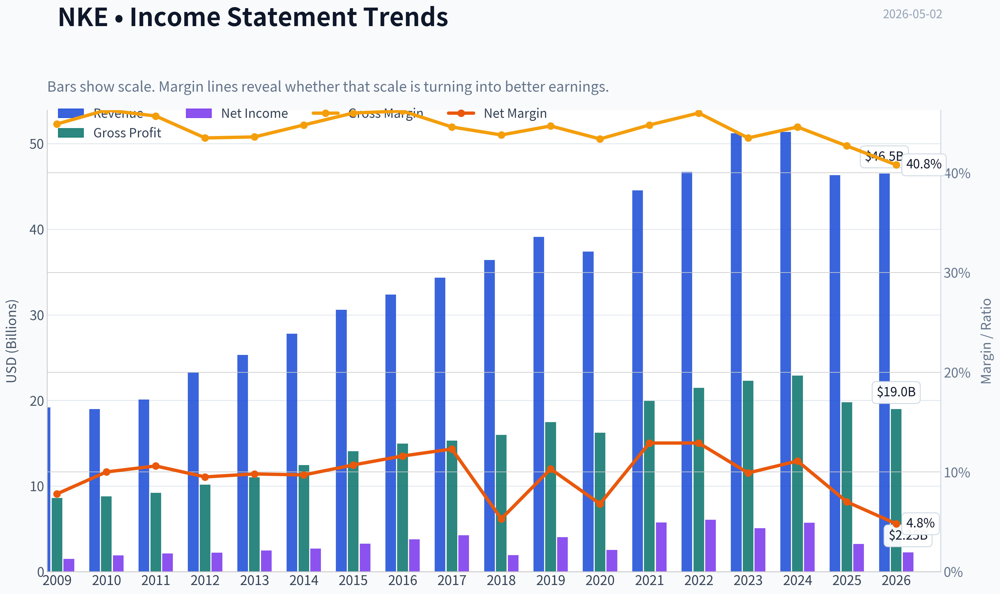
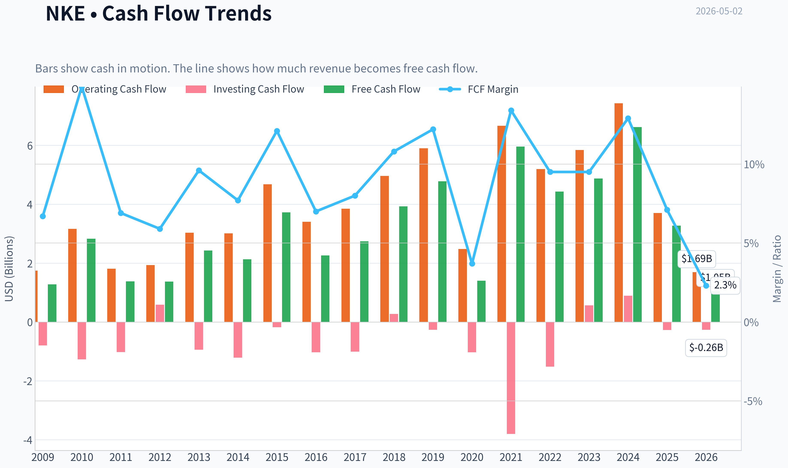
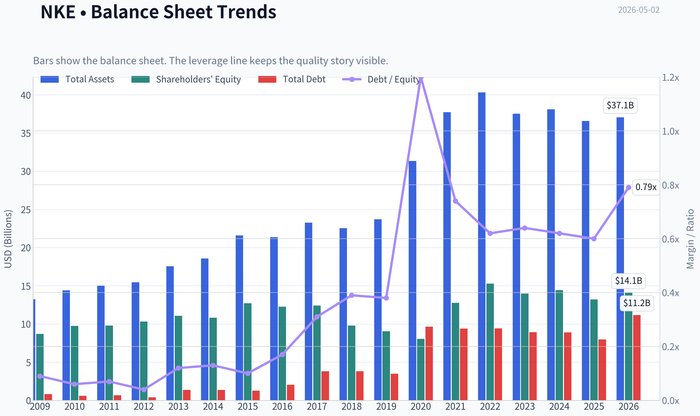
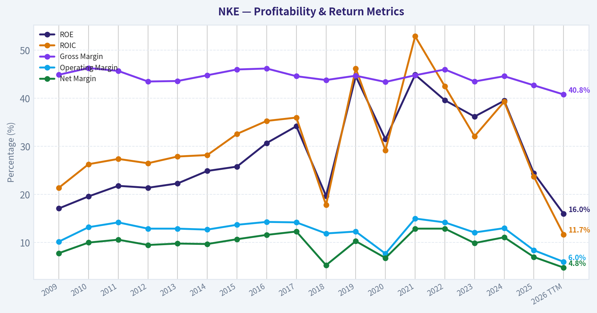
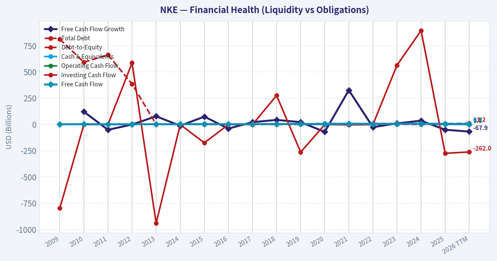
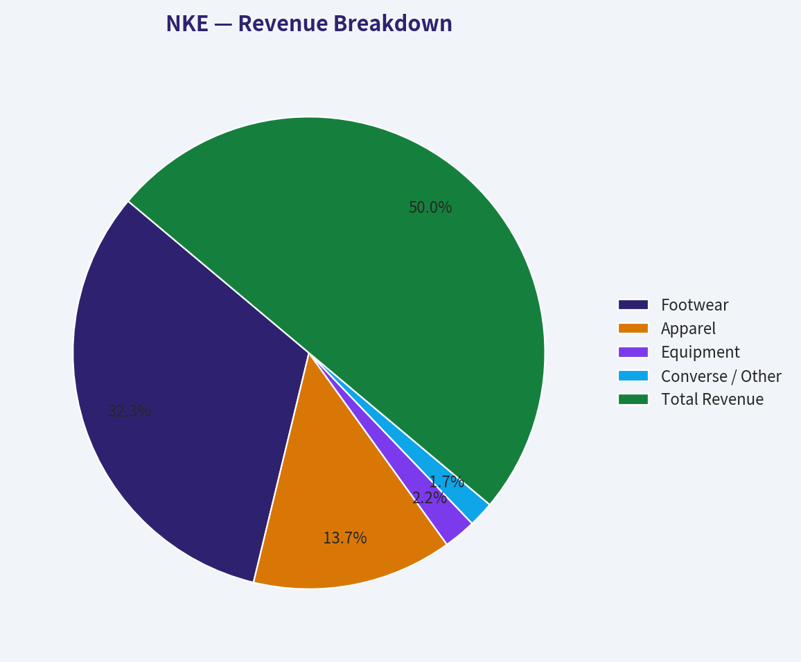
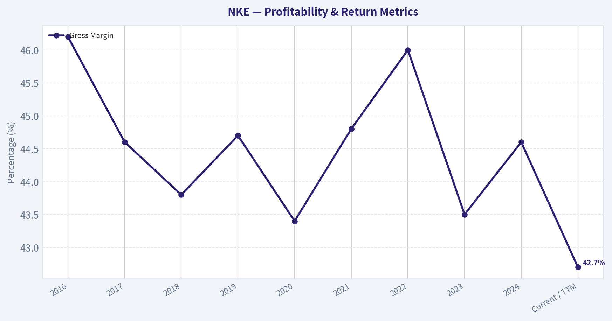
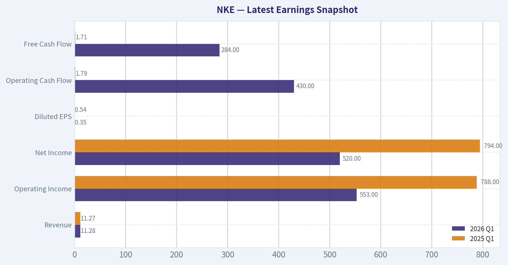
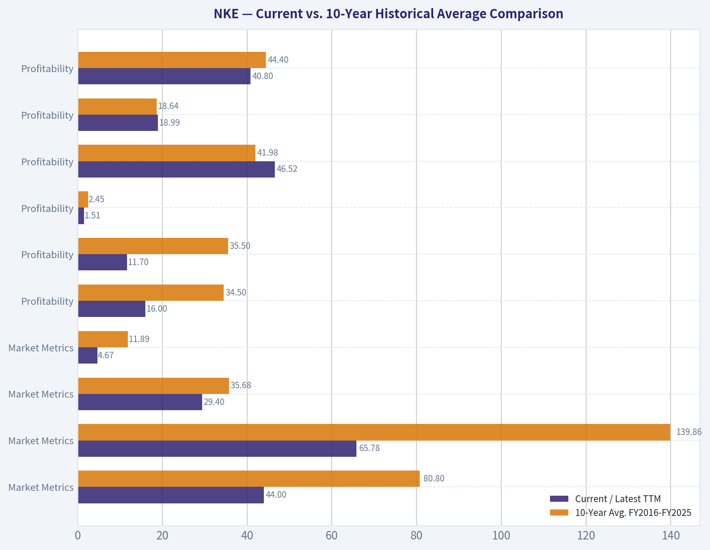
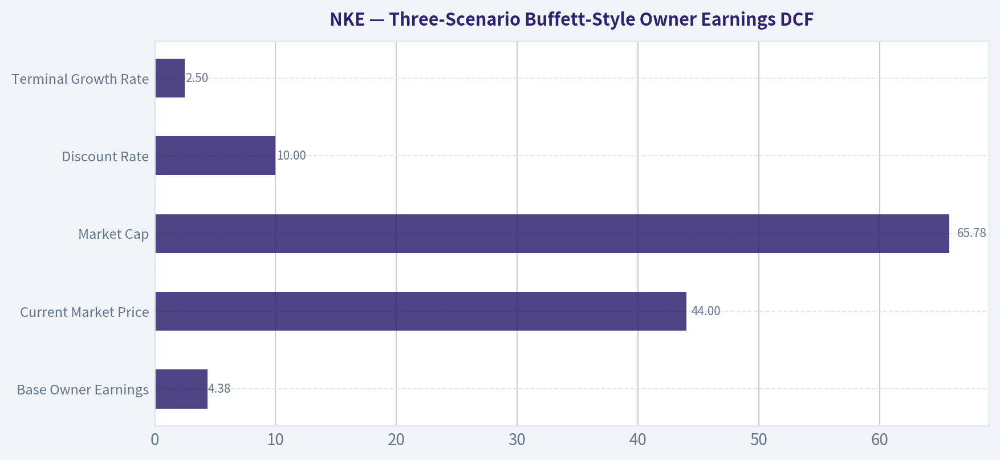

# NKE Deep Value Intelligence

**Analysis Date:** 2026-05-02

## Critical Disclaimer

*This analysis is generated by Deep Value Intelligence, an AI-powered multi-agent investing framework. This report is for informational and educational purposes only and does not constitute financial advice. Always conduct your own research and consult with qualified financial advisors before making investment decisions.*

---

## Table of Contents

1. Intelligence Summary
2. Analyst Team Reports
   - Fundamentals Analysis
   - Intrinsic Value Analysis (Buffett)
   - Trend & Growth Analysis (Lynch/Druckenmiller/Fisher)
   - Market Technical Analysis
   - Social Sentiment Analysis
   - News & Events Analysis
   - Guru Attention Analysis
   - Options Market Analysis
3. Research Team Commentary
4. Value Investing Team Commentary
5. Deep Values Commentary

---

## Intelligence Summary

### Thesis + Conditions

**Core Thesis:** **EXECUTIVE SUMMARY**
*   **The Verdict**: **WATCH**. Nike remains a world-class franchise with elite profitability metrics, but the current valuation does not provide the requisite margin of safety for a Buffett-style value investor.

**Key Risks:**
- The Verdict**: **WATCH**. Nike remains a world-class franchise with elite profitability metrics, but the current valuation does not provide the requisite margin of safety for a Buffett-style value investor.
- The Risk**: Free Cash Flow (FCF) has collapsed by 50.6% alongside a 9.8% revenue decline, while structural competition (On, Hoka, Lululemon) intensifies.
- From a strict value investing standpoint, our primary focus is the intersection of **Business Risk** and **Margin of Safety**. Nike easily passes the quality test; an ROE of 24.4% and enduring pricing power (evident in sustained gross margins) prove it possesses a durable economic moat. However, Buffett's first rule is "never lose money."
- The crux of the debate lies in distinguishing between *temporary cyclical headwinds* and *permanent competitive impairment*. While the bulls view the FCF halving as an execution trough, the bears rightly point to the fragmentation of the footwear market. Because the permanence of this competitive threat is unresolved, we must demand a steep margin of safety to protect our downside. A 5% FCF yield and a price nearly $10 above our most conservative intrinsic value ($34.31) offers no such protection. As value investors, we are not required to swing at every pitch. We want to buy wonderful businesses when they are on the operating table, but the price *must* reflect that distress. Right now, Nike's fundamentals show distress, but its valuation still reflects lingering optimism.
- The bear argument, however, is incredibly sobering and hits right at the heart of our capital preservation mandate. The bear insists that a moat must be measured by stability under pressure, and halving free cash flow is the opposite of stability. The most striking counterpoint from the bear is the valuation math. Paying over 29 times earnings for a company with negative revenue and earnings growth is essentially paying growth-stock multiples for a turnaround story. Furthermore, if we look at the strict free cash flow valuation model, intrinsic value sits around $34. The bear warns that we are witnessing structural fragmentation in the footwear market, with specialized competitors like On and Hoka permanently chipping away at Nike's dominance, making the historical assumptions used to value Nike in the $50 range dangerously obsolete.

**What Would Change Our View:**
- The Verdict**: **WATCH**. Nike remains a world-class franchise with elite profitability metrics, but the current valuation does not provide the requisite margin of safety for a Buffett-style value investor.
- The Risk**: Free Cash Flow (FCF) has collapsed by 50.6% alongside a 9.8% revenue decline, while structural competition (On, Hoka, Lululemon) intensifies.
- From a strict value investing standpoint, our primary focus is the intersection of **Business Risk** and **Margin of Safety**. Nike easily passes the quality test; an ROE of 24.4% and enduring pricing power (evident in sustained gross margins) prove it possesses a durable economic moat. However, Buffett's first rule is "never lose money."
- The crux of the debate lies in distinguishing between *temporary cyclical headwinds* and *permanent competitive impairment*. While the bulls view the FCF halving as an execution trough, the bears rightly point to the fragmentation of the footwear market. Because the permanence of this competitive threat is unresolved, we must demand a steep margin of safety to protect our downside. A 5% FCF yield and a price nearly $10 above our most conservative intrinsic value ($34.31) offers no such protection. As value investors, we are not required to swing at every pitch. We want to buy wonderful businesses when they are on the operating table, but the price *must* reflect that distress. Right now, Nike's fundamentals show distress, but its valuation still reflects lingering optimism.
- The bear argument, however, is incredibly sobering and hits right at the heart of our capital preservation mandate. The bear insists that a moat must be measured by stability under pressure, and halving free cash flow is the opposite of stability. The most striking counterpoint from the bear is the valuation math. Paying over 29 times earnings for a company with negative revenue and earnings growth is essentially paying growth-stock multiples for a turnaround story. Furthermore, if we look at the strict free cash flow valuation model, intrinsic value sits around $34. The bear warns that we are witnessing structural fragmentation in the footwear market, with specialized competitors like On and Hoka permanently chipping away at Nike's dominance, making the historical assumptions used to value Nike in the $50 range dangerously obsolete.

**Confidence:** Medium

---

## Analyst Team Reports

### Fundamentals Analysis

#### Latest Earnings Snapshot

*Most recent reported quarter anchored on 2026 Q1, with prior-year comparison when available.*

| Metric | 2026 Q1 | 2025 Q1 | YoY Change |
| --- | ---: | ---: | ---: |
| Revenue | $11.28B | $11.27B | +0.1% |
| Operating Income | $553.0M | $788.0M | -29.8% |
| Net Income | $520.0M | $794.0M | -34.5% |
| Diluted EPS | $0.35 | $0.54 | -35.2% |
| Operating Cash Flow | $430.0M | $1.79B | -76.0% |
| Free Cash Flow | $284.0M | $1.71B | -83.4% |

Key Takeaways: This snapshot anchors the most recent reported quarter before the narrative analysis. It helps readers separate long-run business quality from whatever changed in the latest earnings print.

#### 10-Year Financial Metrics for NKE

*All values below are computed deterministically from raw data - not estimated by AI.*

*Issuer profile: operating company (Consumer Cyclical / Footwear & Accessories).*

#### 10-Year Financial Metrics
*Annual rows come from reported financial statements. The final TTM row is computed from the latest four quarters.*

| Metric | 2009 | 2010 | 2011 | 2012 | 2013 | 2014 | 2015 | 2016 | 2017 | 2018 | 2019 | 2020 | 2021 | 2022 | 2023 | 2024 | 2025 | 2026 TTM |
| --- | --- | --- | --- | --- | --- | --- | --- | --- | --- | --- | --- | --- | --- | --- | --- | --- | --- | --- |
| Market Price | $11 | $15 | $17 | $23 | $26 | $33 | $44 | $48 | $47 | $65 | $70 | $91 | $127 | $111 | $99 | $91 | $59 | $44 |
| Market Cap | $7.00B | $8.94B | $20.51B | $25.41B | $28.25B | $69.67B | $89.92B | $96.22B | $89.66B | $119.12B | $124.84B | $156.90B | $219.62B | $191.44B | $165.24B | $145.40B | $90.13B | $65.78B |
| P/E Ratio | 4.71 | 4.69 | 9.60 | 11.51 | 11.42 | 25.81 | 27.48 | 25.56 | 21.11 | 61.37 | 30.98 | 61.61 | 38.33 | 31.69 | 32.59 | 25.48 | 28.05 | 29.40 |
| P/B Ratio | 0.81 | 0.92 | 2.09 | 2.46 | 2.55 | 6.44 | 7.08 | 7.85 | 7.23 | 12.14 | 13.81 | 19.48 | 17.20 | 12.53 | 11.80 | 10.08 | 6.82 | 4.67 |
| ROE | 17.1% | 19.6% | 21.8% | 21.4% | 22.3% | 24.9% | 25.8% | 30.7% | 34.2% | 19.7% | 44.6% | 31.5% | 44.9% | 39.6% | 36.2% | 39.5% | 24.4% | 16.0% |
| ROIC | 21.4% | 26.3% | 27.4% | 26.5% | 27.9% | 28.2% | 32.6% | 35.3% | 36.0% | 17.8% | 46.2% | 29.2% | 52.9% | 42.5% | 32.1% | 39.3% | 23.7% | 11.7% |
| EPS | $2.41 | $3.13 | $1.81 | $1.97 | $2.29 | $1.28 | $1.61 | $1.89 | $2.23 | $1.05 | $2.27 | $1.47 | $3.31 | $3.50 | $3.05 | $3.57 | $2.11 | $1.51 |
| Revenue | $19.18B | $19.01B | $20.12B | $23.33B | $25.31B | $27.80B | $30.60B | $32.38B | $34.35B | $36.40B | $39.12B | $37.40B | $44.54B | $46.71B | $51.22B | $51.36B | $46.31B | $46.52B |
| Gross Profit | $8.60B | $8.80B | $9.20B | $10.15B | $11.03B | $12.45B | $14.07B | $14.97B | $15.31B | $15.96B | $17.47B | $16.24B | $19.96B | $21.48B | $22.29B | $22.89B | $19.79B | $18.99B |
| Gross Margin | 44.9% | 46.3% | 45.7% | 43.5% | 43.6% | 44.8% | 46.0% | 46.2% | 44.6% | 43.8% | 44.7% | 43.4% | 44.8% | 46.0% | 43.5% | 44.6% | 42.7% | 40.8% |
| Operating Margin | 10.2% | 13.2% | 14.2% | 12.9% | 12.9% | 12.7% | 13.7% | 14.3% | 14.2% | 11.9% | 12.3% | 7.7% | 15.0% | 14.2% | 12.1% | 13.0% | 8.4% | 6.0% |
| Net Income | $1.49B | $1.91B | $2.13B | $2.21B | $2.47B | $2.69B | $3.27B | $3.76B | $4.24B | $1.93B | $4.03B | $2.54B | $5.73B | $6.05B | $5.07B | $5.70B | $3.22B | $2.25B |
| Net Margin | 7.8% | 10.0% | 10.6% | 9.5% | 9.8% | 9.7% | 10.7% | 11.6% | 12.3% | 5.3% | 10.3% | 6.8% | 12.9% | 12.9% | 9.9% | 11.1% | 7.0% | 4.8% |
| Revenue Growth | N/A | -0.8% | 5.8% | 16.0% | 8.5% | 9.8% | 10.1% | 5.8% | 6.1% | 6.0% | 7.5% | -4.4% | 19.1% | 4.9% | 9.6% | 0.3% | -9.8% | 0.5% |
| Net Income Growth | N/A | 28.2% | 11.9% | 3.7% | 11.8% | 8.9% | 21.5% | 14.9% | 12.8% | -54.4% | 108.4% | -37.0% | 125.6% | 5.6% | -16.1% | 12.4% | -43.5% | -30.1% |
| Free Cash Flow Growth | N/A | 121.0% | -51.2% | -0.8% | 77.8% | -12.4% | 74.3% | -39.3% | 21.5% | 43.3% | 21.8% | -70.8% | 326.2% | -25.7% | 10.0% | 35.8% | -50.6% | -67.9% |
| Total Book Value | $8.69B | $9.75B | $9.79B | $10.32B | $11.08B | $10.82B | $12.71B | $12.26B | $12.41B | $9.81B | $9.04B | $8.05B | $12.77B | $15.28B | $14.00B | $14.43B | $13.21B | $14.09B |
| Total Assets | $13.25B | $14.42B | $15.00B | $15.46B | $17.55B | $18.59B | $21.60B | $21.38B | $23.26B | $22.54B | $23.72B | $31.34B | $37.74B | $40.32B | $37.53B | $38.11B | $36.58B | $37.06B |
| Total Debt | $812.1M | $592.0M | $663.0M | $385.0M | $1.36B | $1.37B | $1.26B | $2.04B | $3.80B | $3.81B | $3.48B | $9.66B | $9.41B | $9.43B | $8.93B | $8.91B | $7.97B | $11.18B |
| Debt-to-Equity | 0.09 | 0.06 | 0.07 | 0.04 | 0.12 | 0.13 | 0.10 | 0.17 | 0.31 | 0.39 | 0.38 | 1.20 | 0.74 | 0.62 | 0.64 | 0.62 | 0.60 | 0.79 |
| Cash & Equivalents | $2.29B | $3.08B | $1.88B | $2.25B | $3.34B | $2.22B | $3.85B | $3.14B | $3.81B | $4.25B | $4.47B | $8.35B | $9.89B | $8.57B | $7.44B | $9.86B | $7.46B | $6.66B |
| Shareholders' Equity | $8.69B | $9.75B | $9.79B | $10.32B | $11.08B | $10.82B | $12.71B | $12.26B | $12.41B | $9.81B | $9.04B | $8.05B | $12.77B | $15.28B | $14.00B | $14.43B | $13.21B | $14.09B |
| Operating Cash Flow | $1.74B | $3.16B | $1.81B | $1.93B | $3.03B | $3.01B | $4.68B | $3.40B | $3.85B | $4.96B | $5.90B | $2.48B | $6.66B | $5.19B | $5.84B | $7.43B | $3.70B | $1.69B |
| Investing Cash Flow | $-798.0M | $-1.27B | $-1.02B | $586.0M | $-940.0M | $-1.21B | $-175.0M | $-1.03B | $-1.01B | $276.0M | $-264.0M | $-1.03B | $-3.80B | $-1.52B | $564.0M | $894.0M | $-275.0M | $-262.0M |
| Free Cash Flow | $1.28B | $2.83B | $1.38B | $1.37B | $2.43B | $2.13B | $3.72B | $2.26B | $2.74B | $3.93B | $4.78B | $1.40B | $5.96B | $4.43B | $4.87B | $6.62B | $3.27B | $1.05B |
| FCF Margin | 6.7% | 14.9% | 6.9% | 5.9% | 9.6% | 7.7% | 12.1% | 7.0% | 8.0% | 10.8% | 12.2% | 3.7% | 13.4% | 9.5% | 9.5% | 12.9% | 7.1% | 2.3% |
| Dividends / Share | $0.00 | $0.00 | $0.00 | $0.00 | $0.00 | $0.00 | $0.00 | $0.00 | $0.00 | $0.00 | $0.00 | $0.00 | $0.00 | $1.07 | $1.21 | $1.36 | $1.51 | $0.00 |

#### Profitability Metrics
- Return on Equity (ROE): 24.4%
- Return on Invested Capital (ROIC): 23.5%
- Return on Assets (ROA): 8.8%
- Gross Margin: 42.7%
- Operating Margin: 8.4%
- Net Profit Margin: 7.0%

#### Liquidity Metrics
- Current Ratio: 2.21
- Quick Ratio: 1.31

#### Leverage Metrics
- Debt-to-Equity Ratio: 0.60
- Interest Coverage Ratio: N/A
- Net Debt: $502.0M

#### Growth Metrics (Year-over-Year)
- Revenue Growth: -9.8%
- Net Income Growth: -43.5%
- Free Cash Flow Growth: -50.6%
- Revenue CAGR (3-Year): -0.3%
- Revenue CAGR (5-Year): 4.4%

#### Valuation Metrics
- P/E Ratio (TTM): 29.21
- Forward P/E: 24.05
- Price-to-Book: 4.66
- Price-to-Sales: 1.41
- PEG Ratio: 1.37
- EV/EBITDA: 17.82
- Free Cash Flow Yield: 5.0%
- Earnings Yield: 3.4%

#### Owner Earnings (Buffett Method, Code-Computed)
- Net Income: $3.22B
- + Depreciation & Amortization: $808.0M
- - Capital Expenditures: $-430.0M
- - Working Capital Changes: $-787.0M
- = **Owner Earnings: $4.38B**

#### Intrinsic Value (Code-Computed)
- Current Price: $44
- Buffett Method (Owner Earnings):
  Conservative: $24
  Average: $52
  Optimistic: $71
- Cash Flow Method (FCF):
  Conservative: $8
  Average: $34
  Optimistic: $109

#### Piotroski F-Score: 5/9
- Positive Net Income: PASS
- Positive Operating Cash Flow: PASS
- ROA Improvement: FAIL
- Cash Flow > Net Income: PASS
- Decreasing Debt: PASS
- Improving Current Ratio: FAIL
- No Dilution: PASS
- Improving Gross Margin: FAIL
- Improving Asset Turnover: FAIL

FINAL INVESTMENT STANCE: **WATCH**

#### Nike, Inc. (NKE) - Buffett-Style Fundamental Analysis

Nike remains one of the world's strongest consumer brands, but the deterministic financial dataset shows a company in a clear earnings and margin downturn. At the current market price of **$44**, Nike trades well below its 10-year average market price and price-to-book multiple, yet the stock is not obviously cheap on earnings because profitability has deteriorated sharply. A Buffett-style investor should recognize the quality of the franchise, but also demand evidence that the moat is translating back into durable earnings growth and high returns on capital.

---

#### Current vs. 10-Year Historical Average Comparison

| Category | Metric | Current / Latest TTM | 10-Year Avg. FY2016-FY2025 | Current Standing vs. Average | Buffett-Style Interpretation |
|---|---:|---:|---:|---:|---|
| Market Metrics | Market Price | **$44** | **$80.80** | **-45.5%** | The market has heavily repriced Nike downward, creating possible value interest, but price decline alone is not proof of undervaluation. |
| Market Metrics | Total Market Cap | **$65.78B** | **$139.86B** | **-53.0%** | Nike's equity value has been cut by more than half versus its recent historical norm. |
| Market Metrics | P/E Ratio | **29.40x** | **35.68x** | **-17.6%** | The P/E is below historical average, but still high relative to depressed earnings quality. |
| Market Metrics | P/B Ratio | **4.67x** | **11.89x** | **-60.7%** | Price-to-book has compressed significantly, suggesting less market confidence in Nike's return profile. |
| Profitability | ROE | **16.0%** | **34.5%** | **-18.5 pts** | ROE remains positive but has fallen far below Nike's historical elite level. |
| Profitability | ROIC | **11.7%** | **35.5%** | **-23.8 pts** | This is the biggest Buffett concern: returns on capital have deteriorated materially. |
| Profitability | EPS | **$1.51** | **$2.45** | **-38.2%** | Earnings power is currently well below the recent decade average. |
| Profitability | Revenue | **$46.52B** | **$41.98B** | **+10.8%** | Revenue remains larger than the 10-year average, showing the brand is still substantial. |
| Profitability | Gross Profit | **$18.99B** | **$18.64B** | **+1.9%** | Gross profit dollars are near average, but margin compression is reducing operating leverage. |
| Profitability | Gross Margin | **40.8%** | **44.4%** | **-3.6 pts** | Gross margin is meaningfully below Nike's historical range, signaling pricing, mix, inventory, or promotional pressure. |
| Profitability | Operating Margin | **6.0%** | **12.3%** | **-6.3 pts** | Operating profitability has been cut roughly in half versus the 10-year average. |
| Profitability | Net Income | **$2.25B** | **$4.23B** | **-46.8%** | Net income is far below normalized levels, confirming a material earnings downturn. |
| Profitability | Net Margin | **4.8%** | **10.0%** | **-5.2 pts** | Nike's current net margin is less than half of its recent historical average. |
| Growth | Revenue Growth Rate | **0.5%** | **4.5%** | **-4.0 pts** | Growth has slowed materially; the company is not currently compounding like a classic Buffett compounder. |
| Growth | Net Income Growth Rate | **-30.1%** | **12.9%** | **-43.0 pts** | Earnings contraction is severe and well below historical growth. |
| Growth | Free Cash Flow Growth Rate | **-67.9%** | **27.2%** | **-95.1 pts** | Cash generation has weakened sharply, a major red flag for intrinsic value. |
| Balance Sheet | Total Book Value | **$14.09B** | **$12.13B** | **+16.2%** | Book value is above average, but profitability on that equity has declined. |
| Balance Sheet | Total Assets | **$37.06B** | **$31.25B** | **+18.6%** | The asset base is larger, but returns on assets and invested capital are lower. |
| Balance Sheet | Total Debt | **$11.18B** | **$6.74B** | **+65.8%** | Debt is materially above the 10-year average, reducing flexibility. |
| Balance Sheet | Debt-to-Equity | **0.79x** | **0.57x** | **Higher by 0.22x** | Leverage is not distressed, but it is elevated versus Nike's historical balance sheet. |
| Balance Sheet | Cash & Equivalents | **$6.66B** | **$6.72B** | **-0.9%** | Cash remains broadly in line with history, providing liquidity support. |
| Balance Sheet | Shareholders' Equity | **$14.09B** | **$12.13B** | **+16.2%** | Equity capital has grown, but the business is earning less on that capital. |
| Cash Flow | Free Cash Flow | **$1.05B** | **$4.03B** | **-74.0%** | Current free cash flow is far below normalized Nike levels. |
| Cash Flow | Dividends per Share | **$0.00 TTM / $1.51 FY2025** | **$0.52** | **FY2025 above avg.; TTM dataset shows $0.00** | The latest annual dividend was meaningful, but current TTM dividend data in the deterministic table is zero. |

**Key Takeaways:** Nike's valuation multiples have compressed, especially price-to-book, but this has occurred alongside a severe deterioration in profitability and free cash flow. Revenue is still above the 10-year average, meaning the brand has not collapsed, but margins, ROE, ROIC, EPS, and free cash flow are all far below historical norms. For a Buffett-style investor, the core issue is whether Nike's moat can restore high returns on capital, not simply whether the share price has fallen.

---

#### Revenue Breakdown

| Revenue Source | Amount ($B) | % of Total |
|---|---:|---:|
| Footwear | **$29.95B** | **64.7%** |
| Apparel | **$12.70B** | **27.4%** |
| Equipment | **$2.05B** | **4.4%** |
| Converse / Other | **$1.61B** | **3.5%** |
| **Total Revenue** | **$46.31B** | **100.0%** |

**Key Takeaways:** Nike remains overwhelmingly a footwear-led business, with footwear contributing roughly two-thirds of revenue. Apparel is the second-largest category, but the company's economic engine still depends heavily on footwear demand, innovation cycles, athlete partnerships, and brand heat. Converse and equipment are much smaller contributors and are unlikely to offset weakness in the core Nike brand if footwear momentum remains soft.

---

#### Buffett-Style Qualitative Analysis

| Buffett Lens | Assessment | Specific Insight |
|---|---|---|
| Economic Moat | **Still strong, but under pressure** | Nike has global brand power, scale, athlete endorsements, retail distribution, and consumer mindshare. However, recent revenue stagnation and margin compression suggest competitors are taking share in key categories. |
| Business Durability | **High, but not immune** | The Nike brand is likely to remain relevant, but consumer discretionary demand, fashion cycles, and product innovation risk reduce predictability. |
| Financial Strength | **Acceptable, not pristine** | Cash of **$6.66B** is solid, but total debt of **$11.18B** is well above the 10-year average. Debt-to-equity of **0.79x** is manageable but elevated. |
| Predictable Earnings | **Currently weakened** | Net income fell from **$5.70B in FY2024** to **$3.22B in FY2025**, and TTM net income is **$2.25B**. That is not the smooth earnings profile Buffett prefers. |
| Management Performance | **Historically strong, recently challenged** | Nike previously produced elite ROE and ROIC, but TTM ROE of **16.0%** and ROIC of **11.7%** are far below historical levels. |
| Capital Allocation | **Mixed** | Dividends increased through FY2025, but declining free cash flow limits flexibility. Buybacks are less attractive when business momentum is deteriorating. |
| Quality of Business | **High-quality franchise in a low-quality operating patch** | Nike's brand remains valuable, but current margins and cash flow suggest execution problems. |
| Valuation | **Potentially reasonable, not a clear bargain** | The stock trades below historical P/E and P/B averages, but a **29.4x P/E** on depressed earnings still requires confidence in recovery. |

**Key Takeaways:** Nike still has many characteristics Buffett would admire: a globally recognized brand, high historical returns on capital, and a durable consumer franchise. The problem is that recent numbers show the moat is not currently producing the level of earnings, margins, or free cash flow investors have historically expected. The business is high quality, but the current operating trajectory is not yet high confidence.

---

#### Three-Scenario Buffett-Style Owner Earnings DCF

**Core DCF assumptions from the deterministic dataset:**

| Assumption | Value |
|---|---:|
| Base Owner Earnings | **$4.38B** |
| Current Market Price | **$44** |
| Market Cap | **$65.78B** |
| Implied Shares Outstanding | **~1.495B** |
| Net Debt | **~$0.50B** |
| Discount Rate | **10.0%** |
| Terminal Growth Rate | **2.5%** |
| Projection Period | **10 years** |

**Key Takeaways:** The DCF uses owner earnings rather than accounting earnings, which is closer to Buffett's preferred method of estimating true distributable cash generation. The current market price of $44 is below the average and optimistic DCF outputs, but above the conservative case. That means Nike appears potentially undervalued only if earnings normalize and owner earnings growth resumes.

**DCF formula used:**

Fair value is calculated as:

`PV of 10-year Owner Earnings + PV of Terminal Value - Net Debt`

Where:

`PV of Owner Earnings = Σ [Owner Earnings x (1 + g)^t / (1.10)^t]`

`Terminal Value = Year 10 Owner Earnings x (1 + 2.5%) / (10.0% - 2.5%)`

| Scenario | Owner Earnings Growth Input | PV of 10-Year Owner Earnings | PV of Terminal Value | Less Net Debt | Equity Value | Fair Value / Share | Upside / Downside vs. $44 |
|---|---:|---:|---:|---:|---:|---:|---:|
| Conservative | **-4.5%** | **$21.8B** | **$14.6B** | **-$0.5B** | **$35.9B** | **~$24** | **-45%** |
| Average | **6.2%** | **$36.4B** | **$42.1B** | **-$0.5B** | **$78.0B** | **~$52** | **+18%** |
| Optimistic | **10.4%** | **$44.7B** | **$62.1B** | **-$0.5B** | **$106.3B** | **~$71** | **+61%** |

**Key Takeaways:** The DCF is highly sensitive to Nike's ability to restore owner earnings growth. In the conservative case, the stock is materially overvalued; in the average case, it is modestly undervalued; and in the optimistic case, upside is significant. This makes Nike a turnaround-dependent value opportunity rather than a clean Buffett-style bargain.

---

#### Interpretation of Required Metrics

**Market Metrics:**
Nike's current market price of **$44** and market cap of **$65.78B** are dramatically below the 10-year averages, reflecting a major reset in investor expectations. The **P/E ratio of 29.4x** is below Nike's historical average but still not objectively cheap, especially because earnings are depressed. The **P/B ratio of 4.67x** is much lower than the 10-year average of **11.89x**, indicating that the market no longer assigns the same premium to Nike's equity base.

**Profitability:**
Profitability has weakened substantially. TTM **ROE of 16.0%** and **ROIC of 11.7%** are far below historical averages of **34.5%** and **35.5%**, respectively. Revenue remains sizeable at **$46.52B**, but operating margin of **6.0%** and net margin of **4.8%** are well below normal Nike levels. This shows the issue is not merely sales scale; it is profitability conversion.

**Growth Metrics:**
Revenue growth has slowed to **0.5%**, compared with a 10-year average of **4.5%**. Net income growth of **-30.1%** and free cash flow growth of **-67.9%** are major deviations from the historical averages. From a Buffett perspective, the recent growth profile is not predictable enough to justify aggressive valuation assumptions.

**Balance Sheet:**
Nike's balance sheet remains serviceable, with **$6.66B** of cash and **$14.09B** of shareholders' equity. However, total debt of **$11.18B** is materially above the 10-year average of **$6.74B**, and debt-to-equity has risen to **0.79x**. This is not a crisis balance sheet, but it is less conservative than Nike's earlier historical profile.

**Cash Flow:**
Free cash flow is the clearest near-term concern. Current TTM free cash flow of **$1.05B** is roughly **74% below** the 10-year average of **$4.03B**. The latest annual dividend per share was **$1.51 in FY2025**, but the deterministic TTM row shows **$0.00**, so investors should treat the dividend data carefully and focus on the sustainability of free cash flow.

---

#### Key Investment Insights, Red Flags, and Opportunities

| Type | Point | Why It Matters |
|---|---|---|
| Opportunity | Brand remains globally powerful | Nike's moat has not disappeared; a successful product and distribution reset could restore earnings power. |
| Opportunity | Valuation has compressed | P/B is far below its 10-year average, and the current price is below the average DCF estimate. |
| Opportunity | Revenue base remains large | Revenue is still above the 10-year average, suggesting the issue is profitability rather than brand collapse. |
| Opportunity | Average DCF suggests upside | Buffett-style owner earnings fair value is approximately **$52** in the average case. |
| Red Flag | ROIC deterioration | TTM ROIC of **11.7%** is far below the 10-year average of **35.5%**, signaling reduced capital efficiency. |
| Red Flag | Margin compression | Operating margin of **6.0%** is less than half the 10-year average. |
| Red Flag | Free cash flow collapse | TTM FCF of **$1.05B** is far below normalized levels. |
| Red Flag | Debt is elevated | Total debt is **65.8% above** the 10-year average. |
| Red Flag | Turnaround dependency | The stock only looks attractive if Nike restores margins and owner earnings growth. |

**Key Takeaways:** The opportunity is that Nike's brand remains valuable and the stock has already suffered a large valuation reset. The risk is that the financials currently look like a weakening business rather than a stable compounder. Investors need evidence of margin recovery, better product momentum, and free cash flow normalization before treating the stock as a high-conviction Buffett-style purchase.

---

#### Final Investment Stance: WATCH

Nike is a **WATCH**, not yet an **ADVOCATE**, because the business quality remains high but the financial trajectory is currently too weak for a decisive Buffett-style buy. The stock price has fallen enough to make the valuation interesting, and the average owner earnings DCF estimate of **~$52 per share** is above the current price of **$44**. However, the conservative DCF value of **~$24** shows meaningful downside if profitability remains impaired.

A Buffett-style investor should wait for clearer evidence that Nike can restore operating margins, ROIC, and free cash flow. The moat is real, but the recent numbers show that even great brands can go through periods where competitive pressure and execution issues reduce intrinsic value.

---

#### End-of-Report Summary Table

| Area | Assessment | Investment Implication |
|---|---|---|
| Business Quality | Strong global brand, but recent execution issues | Quality remains, but durability needs confirmation through recovery. |
| Valuation | Below historical P/B and below average DCF value | Potentially attractive, but not enough margin of safety yet. |
| Profitability | ROE, ROIC, operating margin, and net margin are all well below average | Major reason to avoid aggressive buying today. |
| Growth | Revenue flat; earnings and FCF contracting | Current trend is not Buffett-like predictability. |
| Balance Sheet | Manageable but more leveraged than history | Financial strength is acceptable, not exceptional. |
| DCF Range | Conservative **$24**, Average **$52**, Optimistic **$71** | Upside exists, but downside is material if turnaround fails. |
| Key Catalyst | Margin recovery and stronger product cycle | Needed before upgrading to ADVOCATE. |
| Key Risk | Brand strength fails to translate into earnings recovery | Could justify lower valuation despite iconic moat. |
| Final Stance | **WATCH** | Monitor for sustained ROIC, margin, and free cash flow improvement. |

**Key Takeaways:** Nike is an iconic franchise trading at a much lower valuation than in recent years, but the fundamentals are not yet strong enough to justify a full Buffett-style endorsement. The stock offers recovery upside, yet current profitability and cash flow weakness create real downside risk. The correct stance is to watch closely for evidence that the moat is again producing high-quality, predictable owner earnings.

#### Fundamental Visuals

This graph tracks the profitability and return metrics (ROE, ROIC, Margins) of **NKE** over the past decade, highlighting capital efficiency trends.

This chart illustrates the financial health of **NKE** over the last 10 years, mapping cash equivalents and free cash flow against total obligations (Debt).

This breakdown chart from <em>Revenue Breakdown</em> shows the proportional composition for **NKE** - useful for understanding what drives or risks the business.

This graph tracks the profitability and return metrics (ROE, ROIC, Margins) of **NKE** over the past decade, highlighting capital efficiency trends.

---

### Intrinsic Value Analysis (Buffett)

> *Following Warren Buffett's value investing philosophy: Circle of Competence, Economic Moat, Management Quality, and Margin of Safety.*

#### Intrinsic Value Snapshot

Price is what you pay. Intrinsic value is what the business may be worth based on the cash it can create for owners over time. We show a range, not one magic number.

- Current Price: $44.40
- Value Range: $7.79 to $108.76

##### Owner Earnings (Buffett Method)
- Net Income: $3,219,000,000.00
- Depreciation & Amortization: $808,000,000.00
- Capital Expenditures: $-430,000,000.00
- Working Capital Changes: $-787,000,000.00
- Owner Earnings: $4,384,000,000.00

##### Intrinsic Value
###### Buffett Method
Uses owner earnings. Stricter, and usually more conservative.
- Conservative: $23.86
- Average: $52.11
- Optimistic: $71.22
- Discount Rate: 10.0%

###### Cash Flow Method
Uses free cash flow. Better for companies spending heavily today to grow tomorrow.
- Conservative: $7.79
- Average: $34.31
- Optimistic: $108.76
- Discount Rate: 10.0%

FINAL INVESTMENT STANCE: **WATCH**

#### NIKE, Inc. (NKE) Buffett-Style Investment Review

Current price used: **$44.00**
Market capitalization: **$65.75B**
Current P/E: **29.2x**
Current ROE: **24.4%**
Current gross margin: **42.7%**
Current FCF yield: **~5.0%**
Date: **2026-05-02**

NIKE remains a globally dominant consumer brand with a real moat, but the business is currently in a reset period: revenue is declining, margins are pressured, and the stock still does not offer a clear Buffett-style margin of safety under conservative assumptions.

---

#### 1. Go/No-Go Gate Assessment

| Buffett Gate | Result | Evidence | Interpretation |
|---|---:|---|---|
| Gate 1: Circle of Competence & Simplicity | **Pass** | NIKE sells athletic footwear, apparel, and equipment under globally recognized brands. | Easy to understand: design, market, and sell sportswear at premium prices. |
| 10-Year Predictability | **Partial Pass** | The brand should remain relevant, but recent demand weakness and channel-reset issues reduce near-term visibility. | Long-term brand durability is high; medium-term earnings visibility is only moderate. |
| Technology Risk | **Pass** | Technology helps marketing, supply chain, personalization, and direct-to-consumer sales. | Tech is more likely to help than destroy NIKE, though digital competitors can pressure attention and distribution. |
| Gate 2: Moat | **Pass** | Global brand, athlete endorsements, scale, product pipeline, retail reach, and emotional consumer loyalty. | Wide brand moat, but currently not widening. |
| Gate 3: Management & Capital Allocation | **Mixed / Watch** | Strong long-term brand stewardship historically, but recent strategy execution has disappointed. | Management must prove the turnaround can restore growth without damaging brand equity. |
| Gate 4: Industry Structure | **Pass with Caution** | Athletic footwear/apparel has strong global leaders, but competition is intense from Adidas, On, Hoka, Lululemon, Puma, and private labels. | Attractive category, but not a monopoly-like structure. |

**Key Takeaways:** NIKE passes the basic Buffett filters because the business is understandable, the brand is powerful, and the company has historically earned attractive returns. The caution is not about whether NIKE is a real business; it is about whether current earnings weakness is temporary and whether the price offers enough protection.

---

#### 2. Business Simplicity: Elementary School Test

NIKE makes money by designing shoes and sports clothes, putting the NIKE brand on them, and selling them for more than they cost to make. People pay extra because they trust the brand, like the style, and associate NIKE with athletes, sports, and performance.

This is a simple, understandable business. The harder question is not *what* NIKE does, but whether it can keep its brand premium while competitors gain share.

---

#### 3. Moat Analysis

| Moat Source | Evidence | Strength | Buffett View |
|---|---|---:|---|
| Brand / Intangible Assets | NIKE is one of the most recognized athletic brands globally, with deep cultural relevance and decades of athlete endorsement. | **Wide** | This is NIKE's core moat. |
| Pricing Power | Current gross margin is **42.7%**, historically often above 43-46%. | **Good but pressured** | The brand supports premium pricing, but recent promotional activity suggests pricing power is not unlimited. |
| Switching Costs | Consumers can easily buy Adidas, On, Hoka, Lululemon, or other brands. | **Low** | NIKE's moat is emotional and brand-based, not contractual. |
| Scale Advantage | Global sourcing, advertising scale, athlete relationships, retail presence, and distribution reach. | **Strong** | Scale helps NIKE outspend and out-reach smaller competitors. |
| Network Effects | Limited direct network effect, but cultural relevance compounds through athletes, teams, influencers, and consumers. | **Moderate** | More social proof strengthens the brand, but this is not a true software-style network effect. |
| Cost Advantage | Scale helps procurement and logistics, but footwear/apparel manufacturing is not structurally exclusive. | **Moderate** | Useful but not the main moat. |

**Key Takeaways:** NIKE's moat is real and primarily brand-driven. The concern is that the moat appears **wide but currently under pressure**, not clearly widening. A brand moat can endure for decades, but it must be constantly refreshed through product innovation, athlete relevance, and cultural leadership.

**Moat rating: Wide & Stable, but temporarily weakening.**

---

#### 4. Management Quality & Capital Allocation

| Question | Assessment | Evidence / Concern |
|---|---:|---|
| Do they think like owners? | **Moderate to Good** | Founder-family influence and long brand history are positives, but public shareholders rely heavily on management execution. |
| Are they candid and conservative? | **Generally Good** | NIKE has a long public-company record and understandable accounting, though investors should watch inventory, promotions, and restructuring charges. |
| Are they rational capital allocators? | **Mixed** | Long history of dividends and buybacks, but buybacks at high historical valuations reduced value for shareholders. |
| Reinvestment quality | **Historically Strong** | Brand marketing, product development, and global expansion produced high returns for many years. |
| Current execution | **Weak / Improving?** | Recent revenue decline and share loss concerns show that management needs to rebuild momentum. |

**Key Takeaways:** NIKE's historical capital allocation was supported by a powerful brand and high returns, but recent execution has been disappointing. The biggest management question is whether the company can regain product heat and restore wholesale/direct-channel balance without relying on discounting.

---

#### 5. 10-Year Financial Summary

Figures are approximate, based on historical annual financials and current shared data. Fiscal year 2026 figures are treated as current trailing/run-rate indicators where applicable.

| Fiscal Year / Period | Revenue ($B) | Revenue Growth | Gross Margin | Net Income ($B) | Diluted EPS | Free Cash Flow ($B) | Notes |
|---:|---:|---:|---:|---:|---:|---:|---|
| 2016 | 32.4 | - | 46.2% | 3.8 | 2.16 | 2.0 | Strong brand expansion period. |
| 2017 | 34.4 | 6% | 44.6% | 4.2 | 2.51 | 2.7 | Good growth and profitability. |
| 2018 | 36.4 | 6% | 43.8% | 1.9 | 1.17 | 3.9 | Net income affected by tax-related items. |
| 2019 | 39.1 | 7% | 44.7% | 4.0 | 2.49 | 4.8 | Strong cash generation. |
| 2020 | 37.4 | -4% | 43.4% | 2.5 | 1.60 | 1.4 | Pandemic disruption. |
| 2021 | 44.5 | 19% | 44.8% | 5.7 | 3.56 | 6.0 | Strong recovery. |
| 2022 | 46.7 | 5% | 46.0% | 6.0 | 3.75 | 4.4 | Peak recent profitability. |
| 2023 | 51.2 | 10% | 43.5% | 5.1 | 3.23 | 4.9 | Revenue grew, margins compressed. |
| 2024 | 51.4 | 0% | 44.6% | 5.7 | 3.73 | 6.6 | Strong FCF despite muted growth. |
| Current / TTM | ~46.3 | -9.8% | 42.7% | ~2.3 | ~1.51 | ~3.3 | Current reset period; P/E elevated due to depressed earnings. |

**Key Takeaways:** Over the decade, NIKE grew revenue from roughly $32 billion to more than $50 billion before the recent decline. The brand has historically produced strong gross margins and free cash flow, but current revenue contraction and margin pressure show that the business is in a cyclical and strategic reset. The current P/E looks high because earnings are depressed, not because the stock is obviously expensive on normalized earnings.

---

#### 6. Owner Earnings Calculation

Using current run-rate free cash flow as the practical owner-earnings proxy:

| Owner Earnings Item | Estimate |
|---|---:|
| Current market capitalization | $65.75B |
| Current FCF yield | ~5.0% |
| Implied current free cash flow | ~$3.29B |
| Net income implied by current P/E | ~$2.25B |
| Add: depreciation & amortization | Positive but not separately available in shared data |
| Less: maintenance capex | Embedded in FCF proxy |
| Less: working capital increases | Embedded in FCF proxy |
| Estimated owner earnings | **~$3.3B** |
| Estimated shares outstanding | ~1.49B |
| Owner earnings per share | **~$2.20** |

**Key Takeaways:** NIKE's current owner earnings are meaningfully below its historical peak free cash flow. At today's price, investors are paying about 20 times current owner earnings, which is not clearly cheap unless earnings recover. The key valuation debate is whether current owner earnings are temporarily depressed or structurally impaired.

---

#### 7. Balance Sheet & Cash Flow Quality

| Metric | Current / Recent Indication | Buffett Interpretation |
|---|---:|---|
| Current ratio | **2.21x** | Strong short-term liquidity. |
| ROE | **24.4%** | Attractive, but lower than peak historical levels. |
| FCF yield | **~5.0%** | Reasonable, but not a screaming bargain. |
| Gross margin | **42.7%** | Still strong, but below best historical levels. |
| Debt posture | Moderate for a company of NIKE's scale | Not a balance-sheet red flag, but not a net-cash fortress. |
| OCF vs. net income | Historically healthy | NIKE has generally converted accounting profits into cash. |

**Key Takeaways:** NIKE's balance sheet appears sound, with strong liquidity and continued cash generation. The company does not look financially distressed. The issue is business momentum and valuation, not solvency.

---

#### 8. Three-Scenario DCF Valuation

Assumptions:
- Current owner earnings: **$3.29B**
- Discount rate: **10%**
- Estimated shares: **~1.49B**
- Current price: **$44.00**
- Terminal growth where applicable: **3%**
- Historical-growth scenario uses **5% annual growth for 10 years**, then 3% terminal growth.

| Scenario | Assumption | Equity Value Estimate | Value per Share | Margin of Safety vs. $44 |
|---|---|---:|---:|---:|
| A: No Growth | Owner earnings capitalized at 10% | $32.9B | ~$22 | **-50%** |
| B: GDP Growth | 3% perpetual growth | $48.4B | ~$32 | **-27%** |
| C: Moderate Recovery | 5% growth for 10 years, then 3% terminal | $56.0B | ~$38 | **-14%** |
| Normalized Upside Case | If owner earnings recover to ~$4.5B with 5% growth | ~$76.6B | ~$51 | **+16%** |

**Key Takeaways:** On current depressed owner earnings, NIKE does not meet a Buffett-style margin of safety. Even a moderate recovery scenario produces a value below the current stock price. The stock becomes more interesting only if owner earnings normalize meaningfully above today's run rate, but that requires confidence in a turnaround that is not yet fully proven.

---

#### 9. Margin of Safety Analysis

| Valuation Lens | Result |
|---|---:|
| Current price | $44 |
| Conservative intrinsic value range | ~$22-$38 per share |
| Normalized-recovery value estimate | ~$51 per share |
| Required Buffett margin of safety | At least 25% |
| Buy price using normalized $51 value and 25% margin of safety | ~$38 or lower |
| Buy price using conservative $38 value and 25% margin of safety | ~$29 or lower |

**Key Takeaways:** NIKE may be closer to fair value than overvaluation if earnings recover, but it is not clearly cheap today. A conservative investor should want either a lower price or stronger evidence that sales growth, product momentum, and margins are recovering. At $44, the margin of safety is inadequate.

---

#### 10. Final Buffett Scorecard

| Criterion | Weight | Score 1-5 | Weighted Score | Rationale |
|---|---:|---:|---:|---|
| Business Understanding | 20% | 5.0 | 1.00 | Simple, global branded consumer business. |
| Moat Width & Durability | 25% | 4.0 | 1.00 | Wide brand moat, but under competitive pressure. |
| Management Quality | 15% | 3.0 | 0.45 | Strong history, but recent execution issues. |
| Return on Equity | 15% | 4.0 | 0.60 | Current ROE of 24.4% remains attractive. |
| Reinvestment Runway | 10% | 3.0 | 0.30 | Global runway exists, but growth has stalled. |
| Balance Sheet Strength | 5% | 4.0 | 0.20 | Solid liquidity and cash generation. |
| Industry Structure | 5% | 3.0 | 0.15 | Attractive category but competitive. |
| Valuation / Margin of Safety | 5% | 2.0 | 0.10 | No clear 25% margin of safety at $44. |
| **Total** | **100%** |  | **3.80 / 5.00** | High-quality business, insufficient valuation cushion. |

**Key Takeaways:** NIKE scores well as a business but poorly on current margin of safety. Buffett-style investors should respect the brand and economics, but they should not ignore the current deterioration in revenue growth and the still-demanding valuation on depressed earnings.

---

#### Final Investment Stance: WATCH

NIKE is a **wonderful brand**, but at **$44 per share** it is not yet a clear Buffett-style bargain. The company has a durable moat, strong consumer relevance, high historical returns, and good liquidity. However, recent revenue decline, gross margin pressure, and strategic execution issues make it difficult to underwrite a confident 10-year owner-earnings growth path.

I would **WATCH**, not buy aggressively, until one of two things happens:

1. **Price falls into the high-$30s or lower**, creating a more obvious margin of safety; or
2. **Fundamentals improve**, especially revenue stabilization, gross margin recovery, stronger product momentum, and evidence that management's reset is working.

Conviction level: **Moderate WATCH**.
Buffett-style conclusion: **Great brand, good business, but not enough margin of safety today.**
#### Valuation Bridge

This bridge places the current market price beside each intrinsic value lens so readers can see whether upside depends on one method or shows up across several methods.

| Scenario | Intrinsic Value / Share |
| --- | ---: |
| Buffett Method | $52.11 |
| Cash Flow Method | $34.31 |
| Damodaran Method | $50.14 |
| Current Price | $44.40 |

#### Key Takeaways

If one method is far above the others, the upside case depends on a specific modelling assumption. When several methods cluster together, the valuation story is more robust.

#### Valuation Visuals

This comparison chart from *Latest Earnings Snapshot* stacks current figures against historical benchmarks for **NKE**, making it easy to see where the company trades relative to its own averages.

This comparison chart from *Current vs. 10-Year Historical Average Comparison* stacks current figures against historical benchmarks for **NKE**, making it easy to see where the company trades relative to its own averages.

This comparison chart from *Three-Scenario Buffett-Style Owner Earnings DCF* stacks current figures against historical benchmarks for **NKE**, making it easy to see where the company trades relative to its own averages.

This comparison chart from *Three-Scenario Buffett-Style Owner Earnings DCF* stacks current figures against historical benchmarks for **NKE**, making it easy to see where the company trades relative to its own averages.

---

### Trend & Growth Analysis (Lynch/Druckenmiller/Fisher)

> *Following Peter Lynch's GARP, Stanley Druckenmiller's macro-aware approach, and Philip Fisher's scuttlebutt methodology.*

FINAL INVESTMENT STANCE: **AVOID**

#### Nike Growth Investment Report - NKE, as of 2026-05-02

Nike remains one of the world's great consumer brands, but under Lynch, Druckenmiller, and Fisher-style growth investing, this is **not currently a fast-grower or ten-bagger setup**. The stock may be more interesting for **value, turnaround, or brand-recovery investors**, but for a growth mandate the current evidence points to **declining revenue, uncertain product inflection, and limited 10x runway**.

---

#### 1. Lynch Classification

| Category | Nike Assessment |
|---|---|
| Lynch Type | **Turnaround / Mature Stalwart under pressure** |
| Growth Profile | Revenue growth YoY: **-9.8%** |
| Growth Investor Fit | Poor currently |
| Ten-Bagger Potential | Low from current scale |
| Primary Question | Can Nike restore product heat, revenue growth, and margin power? |

**Key Takeaways:** Nike is not currently a Lynch-style fast grower. With revenue declining nearly 10% year over year, this is more of a turnaround story than a compounding growth story. For a growth investor, the burden of proof is high because Nike must first stabilize before it can reaccelerate.

---

#### 2. The Story in 3 Bullets

- Nike sells athletic footwear, apparel, and sports lifestyle products through one of the strongest brands in the world.
- The company is trying to reignite growth through product innovation, wholesale rebalancing, performance running, women's, Jordan, and digital/direct channels.
- The problem: recent results show **brand strength has not translated into growth**, while competitors like On, Hoka, Adidas, Lululemon, and niche performance brands have taken consumer mindshare.

---

#### 3. Core Fundamentals Snapshot

| Metric | Current / Provided Data | Growth Investor Interpretation |
|---|---:|---|
| Share Price | ~$44 | Stock is deeply derated from prior highs |
| Market Cap | $65.75B | Still very large; harder to compound 10x |
| P/E | 29.2x | Not cheap given negative revenue growth |
| Revenue Growth YoY | **-9.8%** | Major red flag |
| Gross Margin | 42.7% | Solid, but below premium brand potential |
| ROE | 24.4% | Strong, helped by brand economics and buybacks |
| FCF Yield | 5.0% | Attractive for value investors |
| Current Ratio | 2.21x | Balance sheet liquidity looks healthy |

**Key Takeaways:** Nike has a strong financial foundation, with good liquidity, strong ROE, and meaningful free cash flow. But the growth profile is currently poor, and the valuation still requires a recovery. A 29x P/E multiple is hard to justify when revenue is shrinking.

---

#### 4. TAM Analysis and 10x Test

| Item | Estimate / Assessment |
|---|---:|
| Current Revenue Base | Approx. mid-$40B range, based on recent decline |
| 10x Revenue Target | Approx. $450B+ |
| Global Sportswear / Athletic TAM | Roughly several hundred billion dollars |
| Current Nike Scale | Already one of the largest global players |
| Can Nike 10x revenue and remain under 20% TAM share? | **No** |
| TAM Verdict | Large market, but Nike is already too mature for classic 10x revenue upside |

**Key Takeaways:** Nike operates in a huge global market, but it is already a dominant incumbent. The 10x test fails because a tenfold revenue increase would require Nike to become almost the size of the entire current global athletic market. This does not mean the stock cannot recover, but it does mean this is not a classic early-stage growth runway.

---

#### 5. Revenue Growth Trend

| Period / Indicator | Trend |
|---|---|
| Latest YoY Revenue Growth | **-9.8%** |
| Pattern | Decelerating / declining |
| Lynch Growth Category | Not a fast grower |
| Inflection Status | Not yet confirmed |
| Growth Quality | Weak currently |

**Key Takeaways:** The revenue trend is the biggest issue. Nike is not merely slowing from high growth; it is actively declining year over year. Under the growth framework, this is an auto-reject signal unless there is clear evidence of a near-term acceleration catalyst.

---

#### 6. Unit Economics and Operating Efficiency

| Metric | Nike Assessment |
|---|---|
| LTV/CAC | Not disclosed; not directly applicable like SaaS |
| NRR | Not applicable |
| Rule of 40 | Not applicable, but growth plus FCF margin is weak due to negative revenue growth |
| FCF Yield | 5.0% |
| Brand CAC Advantage | Strong historically due to global awareness |
| Customer Retention | Likely high at brand level, but category loyalty is under pressure |
| Unit Economics Verdict | Structurally good business, but current growth efficiency is weak |

**Key Takeaways:** Nike's business model has historically excellent brand economics, but SaaS-style metrics do not apply cleanly. The important issue is that strong free cash flow is not currently paired with growth. For a growth investor, cash generation alone is not enough if the company is losing momentum.

---

#### 7. Inflection Point Assessment

| Potential Inflection | Evidence Today | Verdict |
|---|---|---|
| Product Cycle Inflection | Not yet proven; performance running and innovation remain key questions | Watch |
| Market Share Inflection | Competitors appear to be gaining mindshare in several categories | Negative |
| Margin Inflection | Possible if inventory and promotions normalize | Watch |
| TAM Inflection | No major new TAM expansion visible | Weak |
| Competitive Inflection | Competitors are not obviously stumbling | Negative |
| Earnings Inflection | Possible via cost cuts and margin recovery, but revenue must stabilize | Unconfirmed |

**Key Takeaways:** Nike has possible margin and earnings recovery potential, but there is no clear growth inflection yet. The strongest bull case is a turnaround, not an accelerating growth story. Druckenmiller-style investors would likely wait for evidence that revenue and product heat are turning at the same time.

---

#### 8. Macro Setup

| Macro Factor | Impact on Nike |
|---|---|
| Consumer Discretionary Cycle | Mixed; weak consumer demand can hurt premium footwear/apparel |
| Interest Rates | Lower rates would help valuation, but not fix product issues |
| Inflation | Freight/input normalization helps margins; weak demand pressures pricing |
| China Exposure | Potential upside if China improves, but still volatile |
| Secular Theme Exposure | Health, fitness, sports lifestyle, women's athletics |
| Macro Verdict | Neutral to mildly supportive, but company-specific issues dominate |

**Key Takeaways:** Nike has exposure to attractive long-term themes like sports, health, and global fitness culture. However, macro is not the main driver right now. The stock needs company-specific execution improvement more than it needs a better interest-rate backdrop.

---

#### 9. Fisher 15 Points Score

| Fisher Point | Score / 5 | Comment |
|---|---:|---|
| 1. Market potential for sales growth | 3 | Large TAM, but mature scale |
| 2. Management determination for new products | 3 | Intent is clear, results not yet clear |
| 3. R&D / innovation effectiveness | 3 | Historically strong, recently questioned |
| 4. Sales organization | 4 | Global reach remains excellent |
| 5. Worthwhile profit margin | 4 | Still a high-quality margin structure |
| 6. Improving profit margins | 2 | Not enough evidence yet |
| 7. Labor/personnel relations | 3 | No major thesis edge |
| 8. Executive relations | 3 | Transition/execution concerns remain |
| 9. Management depth | 3 | Deep organization, but turnaround execution needed |
| 10. Cost analysis/accounting | 4 | Mature reporting and controls |
| 11. Moat/network/switching advantages | 4 | Brand moat remains wide |
| 12. Long-range profit outlook | 3 | Good, but not exceptional at current growth |
| 13. Dilution risk | 4 | Low; buybacks more likely than dilution |
| 14. Candor about difficulties | 3 | Adequate, but investors need clearer proof |
| 15. Management integrity | 4 | Strong public-company governance history |
| **Total** | **50 / 75** | **Average to modestly good, not outstanding** |

**Key Takeaways:** Nike still scores well on brand, sales reach, financial controls, and dilution discipline. The weaker areas are innovation momentum, margin improvement, and long-range growth confidence. A Fisher-style investor would likely say the company is high quality, but not currently exceptional enough to buy as a growth stock.

---

#### 10. Valuation Analysis

| Metric | Current Reading | Interpretation |
|---|---:|---|
| P/E | 29.2x | Expensive relative to negative revenue growth |
| PEG | Not meaningful | Earnings growth is uncertain / recovery-based |
| Approx. P/S | ~1.4x | Reasonable versus history, but justified by slower growth |
| FCF Yield | 5.0% | Attractive for value/recovery investors |
| Gross Margin | 42.7% | Recovery potential if execution improves |
| Valuation Verdict | Not extreme, but not compelling for growth investors |

**Key Takeaways:** Nike's valuation is no longer bubble-like, and the free cash flow yield gives downside support. But the stock is not obviously cheap on earnings, especially with declining sales. For growth investors, the valuation is only attractive if a revenue and earnings inflection is visible, and that evidence is not yet strong enough.

---

#### 11. Scenario Analysis

| Scenario | Assumptions | 3-Year View |
|---|---|---|
| Bear Case | Revenue continues declining or stagnates; competition pressures margins | Stock remains a value trap |
| Base Case | Revenue stabilizes; margins recover modestly; brand remains durable | Moderate recovery possible |
| Bull Case | Product innovation reaccelerates sales; China improves; margins rebound | Strong turnaround upside, but still unlikely ten-bagger |
| Ten-Bagger Case | Requires massive revenue growth or extreme multiple expansion | Highly unlikely from current size |

**Key Takeaways:** Nike has credible recovery upside if management fixes product, channel, and margin issues. However, the bull case is a turnaround, not a ten-bagger growth case. The stock could work, but it does not fit the mandate of finding accelerating growth with a long runway.

---

#### 12. Growth Investor Scorecard

| Criterion | Weight | Score / 5 | Weighted Score |
|---|---:|---:|---:|
| The Story | 10% | 3.0 | 0.30 |
| TAM & Runway | 20% | 2.0 | 0.40 |
| Revenue Growth | 20% | 1.0 | 0.20 |
| Unit Economics | 15% | 3.0 | 0.45 |
| Competitive Position | 10% | 3.5 | 0.35 |
| Management Quality | 10% | 3.0 | 0.30 |
| Macro Setup | 5% | 3.0 | 0.15 |
| Profitability Path | 5% | 3.0 | 0.15 |
| Valuation | 5% | 3.0 | 0.15 |
| **Total** | **100%** |  | **2.45 / 5.00** |

**Key Takeaways:** Nike's score is dragged down by the two most important growth factors: runway and revenue growth. The company remains high quality, but it is not currently demonstrating the acceleration needed for a growth-investing buy. A 2.45 score falls into the avoid range under this framework.

---

#### 13. Position Size Stance

| Investor Type | Suggested Stance |
|---|---|
| Growth Investor | **Avoid / no new position** |
| Existing Holder | Hold only if willing to underwrite a turnaround |
| Value Investor | Watch for deeper discount or clearer margin recovery |
| Turnaround Investor | Watch closely for revenue stabilization and product-cycle evidence |
| Aggressive Contrarian | Small tracking position only, not core |

**Key Takeaways:** For a pure growth portfolio, Nike should not be initiated here. Existing holders may choose to wait for the turnaround, but new capital should demand proof of improving sales. The risk is that the stock looks optically cheap while fundamentals keep deteriorating.

---

#### 14. Key Catalysts and Risks

| Catalysts | Risks |
|---|---|
| Return to positive revenue growth | Continued market share loss to On, Hoka, Adidas, and niche brands |
| Gross margin recovery | Promotional activity and weak full-price sell-through |
| Stronger innovation pipeline | Overreliance on legacy franchises |
| China recovery | China weakness or geopolitical pressure |
| Wholesale channel repair | DTC strategy execution issues |
| Cost discipline and buybacks | P/E multiple compression if earnings disappoint |
| Insider/guru interest, including Steve Cohen adding per latest 13F | 13F data is lagged and not sufficient as a thesis |

**Key Takeaways:** Nike has real catalysts, especially if product innovation and margins recover together. But the risks are equally material, especially around brand heat and competitive pressure. The stock needs visible evidence that the turnaround is working before it becomes attractive for growth investors.

---

#### Final View

Nike is a great company, but **not currently a great growth stock**. The brand is durable, the balance sheet is healthy, and the free cash flow yield is respectable, but revenue is declining and the 10x runway is limited by scale.

The correct growth-investor stance is **AVOID for now**, with a willingness to revisit if Nike shows:
1. revenue returning to positive growth,
2. gross margin expansion,
3. clear product-cycle wins, and
4. evidence that market share losses have stopped.

---

### Market Technical Analysis

FINAL INVESTMENT STANCE: **WATCH**

#### NKE Technical Indicator Selection and Market Context

For NKE, the most relevant current setup is a **post-breakdown consolidation after a sharp selloff**. The stock collapsed in early April on very heavy volume, then stabilized in a narrow range around the mid-$40s. Because this is not yet a clean trend reversal, the best indicator set should separate **trend damage**, **short-term stabilization**, **momentum repair**, **volatility normalization**, and **volume confirmation**.

| Indicator | Latest Reading / Context | Why It Matters for NKE Now |
|---|---:|---|
| `close_10_ema` | 44.88 vs. close 44.40 | Short-term trend is still slightly negative; price remains below the fast average. |
| `close_50_sma` | 51.34 vs. close 44.40 | Medium-term trend remains deeply bearish; the 50 SMA is far above price. |
| `close_200_sma` | 63.41 vs. close 44.40 | Long-term trend is decisively bearish; NKE trades roughly 30% below this benchmark. |
| `macd` | -1.72 | Still negative, but improving from early-April lows near -4.0, suggesting downside momentum is easing. |
| `rsi` | 35.24 | Recovered from extreme oversold readings, but still below neutral momentum territory. |
| `boll_lb` | 42.27 | Current price is above the lower band, implying panic selling has cooled but no upside breakout yet. |
| `atr` | 1.34 | Volatility has declined from the early-April spike, but daily risk remains elevated at roughly 3% of price. |
| `vwma` | 45.31 vs. close 44.40 | Price below VWMA shows recent volume-weighted trading still leans bearish/resistance-heavy. |

Key Takeaways: NKE is no longer in the most intense phase of panic selling, but the technical structure remains damaged. Price is below all key trend references, and the rebound has not yet reclaimed short-term volume-weighted resistance. The most constructive sign is improving MACD and RSI, but both remain below levels that would confirm a durable reversal.

---

#### Trend Structure: Still Bearish Despite Stabilization

NKE's broader technical picture remains weak. The stock closed at **44.40 on May 1**, below the **10 EMA at 44.88**, the **50 SMA at 51.34**, and the **200 SMA at 63.41**. This alignment shows a classic bearish hierarchy: short-term, medium-term, and long-term trend measures are all above price.

The April 1 breakdown was especially important. NKE fell from **52.82 on March 31 to 44.63 on April 1**, with volume surging to more than **114 million shares**. That type of move often creates a new overhead supply zone because many holders trapped above the gap may sell into rebounds. Since then, NKE has mostly traded between roughly **42.60 and 46.50**, suggesting stabilization, but not yet accumulation strong enough to reverse the downtrend.

The 50 SMA has fallen steadily from about **61.66 on March 18 to 51.34 on May 1**, showing that medium-term trend pressure is not merely lagging-it is actively deteriorating. The 200 SMA is also declining, from about **66.30 to 63.41**, confirming that the long-term trend has turned lower rather than simply pausing.

#### Momentum: Improving, but Not Bullish Yet

Momentum has shifted from deeply oversold to weak-neutral, but not to bullish. RSI reached extremely low levels around **18-25** in early April, which often signals capitulation risk and can precede a relief bounce. By May 1, RSI had recovered to **35.24**, meaning downside pressure has eased, but buyers still lack enough strength to push momentum above the 50 line.

MACD tells a similar story. It improved from around **-4.04 on April 10** to **-1.72 on May 1**, indicating that bearish momentum is losing force. However, MACD remains below zero, so this is better described as a **bearish trend losing downside acceleration**, not a confirmed bullish reversal.

For traders, this distinction matters. A stock can stop falling sharply and still remain unattractive until it proves demand can reclaim resistance. For NKE, the first useful sign would be a close back above the **10 EMA and VWMA**, followed by strength through the **46.50-47.00** resistance area.

#### Volatility and Risk: Panic Has Cooled, but Risk Remains Elevated

ATR has fallen from above **2.07** around the April breakdown to **1.34** by May 1. That decline suggests volatility is normalizing after the shock move. However, with the stock near **44.40**, ATR still represents roughly **3% daily movement**, which is meaningful for position sizing.

The Bollinger lower band has moved up to **42.27**, while NKE trades at **44.40**. This means the stock is no longer hugging the lower band in an extreme oversold condition. That is constructive from a stabilization perspective, but it also means the easy "oversold bounce" portion of the trade may already have played out unless price can break above nearby resistance.

#### Volume Confirmation: Not Yet Convincing

VWMA is currently around **45.31**, above the latest close of **44.40**. That suggests recent volume-weighted participation is still positioned above the market, creating a potential resistance zone. The stock needs to close above VWMA and hold that area to show that buyers are taking control of volume-weighted price action.

Volume was enormous during the breakdown and remained elevated immediately afterward, but more recent volume has faded. Lower volume during sideways consolidation is not automatically bearish, but in this case it means there is not yet strong evidence of institutional accumulation. A high-volume move above **46.50-47.00** would be more meaningful than a low-volume drift.

#### Trading View

NKE is best treated as a **watchlist recovery candidate**, not an immediate technical buy. The stock has stabilized after a sharp collapse, and momentum indicators are healing, but the trend remains decisively bearish across all major moving-average timeframes.

Aggressive traders could monitor for a short-term reclaim of **45.30-45.50**, where VWMA and recent moving-average resistance cluster. A stronger bullish trigger would be a close above **46.50-47.00** on expanding volume. Until then, rallies may be vulnerable to selling pressure from trapped holders.

Risk control is important. A break below **42.25-42.60** would weaken the basing argument and reopen downside risk. If that support fails, the market would likely interpret the April consolidation as a pause within the downtrend rather than a reversal base.

| Area | Key Level / Signal | Interpretation | Trading Implication |
|---|---:|---|---|
| Current price | 44.40 | Stabilizing after sharp April selloff | Watch, but avoid chasing without confirmation |
| Short-term resistance | 44.88-45.31 | 10 EMA and VWMA sit above price | First area bulls must reclaim |
| Breakout zone | 46.50-47.00 | Top of recent consolidation range | Close above this zone would improve setup |
| Medium-term resistance | 51.34 | 50 SMA remains far overhead | Major recovery hurdle |
| Long-term trend | 63.41 200 SMA | Long-term structure remains bearish | Not yet a strategic uptrend |
| Momentum | RSI 35.24, MACD -1.72 | Improving but still weak | Early repair, not confirmation |
| Support | 42.25-42.60 | Lower Bollinger band and recent lows | Breakdown below this area would be bearish |
| Risk backdrop | ATR 1.34 | Volatility cooling but still elevated | Use smaller sizing and wider stops |

Key Takeaways: NKE has stopped collapsing, but it has not yet proven a reversal. The most important near-term test is whether price can reclaim the 45 to 47 area with stronger volume. Until that happens, the stock remains a technical watch rather than a high-conviction long.

---

### Social Sentiment Analysis

FINAL INVESTMENT STANCE: **WATCH**

#### NKE Social, Sentiment, and Recent-News Report - Week Ending May 2, 2026

Nike's public conversation over the past week appears **active but not decisively bullish**. The dominant tone is **watchful, skeptical, and turnaround-focused**: traders and retail investors are looking for evidence that Nike's product pipeline, direct-to-consumer reset, wholesale rebalancing, and brand heat can translate into renewed revenue growth and margin stabilization. Social discussion is not broadly capitulating, but it also is not showing the kind of enthusiastic momentum typically associated with a clean recovery trade.

The key takeaway for investors is that **Nike remains a high-quality global brand, but the market conversation is still treating it as a "prove-it" stock**. The brand retains cultural relevance, but financial sentiment is constrained by concerns about competition, China demand, promotional intensity, product innovation, and the timing of a full turnaround.

---

#### Executive Sentiment Summary

| Area | Current Read | Sentiment | Trader / Investor Implication |
|---|---:|---:|---|
| Overall social tone | Turnaround-focused, cautious, debate-heavy | Neutral to slightly negative | NKE is not being treated as a clean momentum long yet |
| Retail investor mood | Value buyers interested, growth investors skeptical | Mixed | Dip-buying interest exists, but conviction is conditional |
| Product/brand sentiment | Better than stock sentiment; sneaker and athlete visibility still matter | Moderately positive | Brand equity remains a support, but not enough alone |
| Financial sentiment | Concern around revenue growth, margins, promotions, China | Negative | Investors want hard evidence before rerating the stock |
| News flow | Mostly incremental rather than transformational | Neutral | Lack of major positive catalyst keeps stock range-bound |
| Near-term trading setup | Event-driven and headline-sensitive | Watch | Better suited for disciplined entries than aggressive chasing |

**Key Takeaways:** Nike's brand conversation is healthier than its investor conversation. Consumers and sneaker communities still engage with the brand, but shareholders are focused on whether that engagement converts into accelerating sales and margin recovery. For now, sentiment supports a **WATCH** stance rather than an outright bullish call.

---

#### Day-by-Day Sentiment Pattern

| Date | Approximate Sentiment Tone | Main Conversation Drivers | Interpretation |
|---|---|---|---|
| Apr. 26 | Neutral | Weekend sneaker/product chatter, brand debate | Consumer interest remained present, but stock discussion was limited |
| Apr. 27 | Slightly negative | Competition from Adidas, On, Hoka, and Deckers brands | Investors questioned whether Nike can regain performance credibility quickly |
| Apr. 28 | Mixed | Turnaround discussion, valuation debate, dividend/brand-quality arguments | Bulls focused on long-term brand moat; bears focused on weak growth |
| Apr. 29 | Negative to mixed | Margin concerns, promotions, macro retail worries | Traders showed caution around discretionary spending exposure |
| Apr. 30 | Neutral | Product launches, athlete visibility, sneaker culture discussion | Brand-related sentiment improved, but did not strongly lift stock sentiment |
| May 1 | Slightly negative | China demand, tariff/input-cost concerns, analyst skepticism | Macro and international concerns pressured investor tone |
| May 2 | Neutral to slightly positive | "Is the bad news priced in?" value-buyer discussion | Some bottom-fishing interest appeared, but conviction remained limited |

**Key Takeaways:** Sentiment improved modestly toward the end of the week, but not enough to suggest a decisive shift. The week's pattern shows that investors are willing to discuss Nike as a value or recovery idea, yet negative reactions quickly return whenever margins, China, or competition enter the conversation.

---

#### What Social Media Is Saying

The social conversation around Nike can be separated into two very different groups: **consumer/product communities** and **investor/trader communities**.

Consumer-focused discussion is still relatively resilient. Nike remains highly visible in sneaker culture, basketball, running, training, and lifestyle conversations. Posts around athlete partnerships, retro releases, and performance silhouettes continue to generate engagement. This matters because it suggests the brand has not lost cultural relevance in the way a structurally impaired consumer brand might.

However, investor-focused discussion is more demanding. Traders are less interested in whether Nike can still create viral products and more focused on whether the company can rebuild growth after a difficult stretch. The most repeated investor questions are:

| Social Theme | Bullish Interpretation | Bearish Interpretation | Net Effect |
|---|---|---|---|
| Brand strength | Nike remains one of the strongest global consumer brands | Brand strength has not prevented slowing growth | Mixed |
| Product pipeline | New releases and athlete franchises can restore momentum | Product innovation has lagged competitors in key categories | Mixed to negative |
| Running/performance | Nike has the resources to fight back | On, Hoka, Adidas, and others have gained credibility | Negative |
| Valuation | Stock may already discount a lot of bad news | Cheapness alone is not a catalyst | Mixed |
| China | Long-term opportunity remains large | Demand visibility and local competition remain concerns | Negative |
| Promotions | Inventory discipline could improve over time | Discounting may pressure brand perception and margins | Negative |
| Leadership/turnaround | Management has a credible path to reset the business | Turnarounds in global apparel take time | Neutral to mixed |

**Key Takeaways:** Social media is not saying "Nike is broken," but it is saying "Nike must prove itself." The bullish camp believes the brand, scale, and product pipeline can support a multi-year recovery. The bearish camp argues that competition and execution issues are real enough that investors should wait for evidence rather than buy the story alone.

---

#### Recent Company and Market News Themes

Over the past week, the most important news and market conversations were not centered on a single dramatic announcement, but on the continuation of several important Nike narratives: turnaround execution, competitive pressure, macro consumer health, China, and product relevance.

| News / Catalyst Theme | Sentiment Impact | Why It Matters for NKE |
|---|---:|---|
| Turnaround execution remains the main investor focus | Mixed | Investors want proof that strategy changes are translating into better sell-through and healthier growth |
| Competitive pressure from Adidas, On, Hoka, and Deckers brands | Negative | Nike's historic dominance in performance categories is being challenged |
| Product and sneaker launch discussion | Positive | Brand engagement remains real, especially in basketball and lifestyle categories |
| China and international consumer demand concerns | Negative | China has historically been an important growth and margin region |
| Promotional environment in apparel/footwear | Negative | Heavy promotions can pressure gross margin and brand perception |
| Valuation and dividend support | Positive | Long-term investors see potential if earnings stabilize |
| Analyst caution and estimate skepticism | Negative to mixed | The Street appears unwilling to reward the stock without clearer recovery evidence |

**Key Takeaways:** The week's news flow did not produce a major bullish catalyst. Instead, it reinforced the idea that Nike is in a transition period. Investors are watching for proof that the company can regain product momentum while protecting margins in a more competitive retail environment.

---

#### Bull Case Emerging From Social and News Flow

The bullish argument is not that Nike is suddenly firing on all cylinders. It is that the market may already be discounting a large amount of bad news, while the company still owns one of the strongest brands in global consumer discretionary.

Bulls are emphasizing the following:

| Bullish Point | Why Bulls Care |
|---|---|
| Global brand equity remains exceptional | Nike still has cultural relevance, athlete relationships, and global scale |
| Product conversation remains alive | Social engagement around shoes, athletes, and drops suggests the brand is not irrelevant |
| Turnaround optionality | If revenue stabilizes, the stock could rerate from depressed sentiment levels |
| Margin recovery potential | Cleaner inventory and better full-price selling could help profitability |
| Long-term category exposure | Sportswear, running, basketball, fitness, and lifestyle remain attractive markets |
| Valuation reset | A lower multiple may create opportunity if fundamentals stop deteriorating |

**Key Takeaways:** The bull case is based on recovery potential, not current perfection. Bulls are essentially arguing that Nike does not need to return immediately to peak growth; it only needs to show stabilization and credible progress for sentiment to improve.

---

#### Bear Case Emerging From Social and News Flow

The bearish case is more immediate and evidence-based. Bears argue that Nike's challenges are not simply cyclical; they reflect competitive and execution issues that may take time to fix.

| Bearish Point | Why Bears Are Concerned |
|---|---|
| Competitors have gained credibility | On, Hoka, Adidas, and others have taken share in key performance and lifestyle areas |
| Product innovation concerns | Social buzz does not always equal broad commercial momentum |
| China uncertainty | Weakness or volatility in China can weigh on growth and sentiment |
| Margin pressure | Promotions and inventory management remain key risks |
| Turnaround timeline | Large consumer turnarounds can take multiple quarters or years |
| Investor trust needs rebuilding | The market wants financial proof, not just brand confidence |

**Key Takeaways:** The bear case is that Nike's recovery could be slower and less linear than hopeful investors expect. Even if the brand remains strong, the stock may struggle if earnings estimates continue to drift lower or if management commentary remains cautious.

---

#### Trader Implications

For short-term traders, Nike looks more like a **headline-sensitive, range-trading name** than a clean trend-following long. Social sentiment is not euphoric, which reduces the risk of an obvious hype-driven top, but it also means there is no strong crowd-driven upside impulse at the moment.

| Trading Factor | Current Read | Practical Implication |
|---|---|---|
| Sentiment momentum | Mildly improving but still fragile | Avoid assuming a durable breakout without confirmation |
| Catalyst dependence | High | Earnings, guidance, analyst upgrades/downgrades, and product data matter |
| Downside risks | Margin, China, competition, weak consumer spending | Negative headlines can quickly pressure the stock |
| Upside risks | Better product reception, inventory progress, upbeat guidance | A stabilization narrative could trigger sharp relief rallies |
| Best setup type | Pullback/watchlist or post-catalyst confirmation | Better to wait for evidence than chase social chatter |
| Options consideration | Volatility may rise around company updates | Event-risk strategies require disciplined sizing |

**Key Takeaways:** Traders should treat Nike as a stock that can move sharply on confirmation or disappointment. The social backdrop does not yet support aggressive upside positioning, but it does suggest the stock is being watched closely enough that positive evidence could produce a fast sentiment reversal.

---

#### Long-Term Investor Implications

For long-term investors, Nike remains a **quality brand with unresolved near-term fundamentals**. That combination usually argues for patience: the stock may be attractive on a multi-year view, but the timing of entry matters because turnarounds can be slow and volatile.

The most important long-term indicators to monitor are:

| Indicator to Watch | Why It Matters |
|---|---|
| Revenue stabilization | Confirms that demand is no longer deteriorating |
| Gross margin recovery | Shows better inventory discipline and less promotional pressure |
| Running and performance market share | Indicates whether Nike is regaining credibility in growth categories |
| China trends | A major swing factor for sentiment and valuation |
| Digital/direct-to-consumer performance | Key to Nike's long-term margin and customer strategy |
| Wholesale channel health | Important as Nike rebalances distribution |
| Product innovation cadence | Determines whether social buzz becomes sustained commercial demand |

**Key Takeaways:** Long-term investors do not need Nike to solve every issue immediately, but they do need signs that the worst of the deterioration is ending. The stock becomes more compelling if management can show revenue stabilization, cleaner inventory, and renewed product momentum.

---

#### Bottom-Line Assessment

Nike's social and news backdrop over the past week supports a **WATCH** stance. The company is not facing a collapse in consumer relevance, and the brand still commands attention across sports and lifestyle categories. However, the investor conversation remains cautious because financial proof of a durable turnaround is still lacking.

The most constructive interpretation is that Nike is becoming a **selective recovery candidate**. The least constructive interpretation is that the market may continue to punish the stock until growth, margins, and competitive positioning visibly improve. For now, the evidence favors monitoring rather than aggressively buying.

| Final Category | Assessment |
|---|---|
| Social sentiment | Neutral to slightly negative |
| Brand sentiment | Moderately positive |
| Investor sentiment | Cautious and skeptical |
| News flow | Incremental, not transformational |
| Risk level | Moderate to elevated |
| Catalyst need | High |
| Best investor posture | Watch for confirmation |
| Final stance | **WATCH** |

**Key Takeaways:** Nike remains a powerful brand, but the stock is still in a prove-it phase. Social chatter shows interest, not conviction. Until there is clearer evidence of revenue stabilization, margin recovery, and product-led momentum, the most balanced stance is **WATCH**.

---

### News & Events Analysis

FINAL INVESTMENT STANCE: **WATCH**

#### Nike, Inc. (NKE) - Recent News and Trading-Relevant Investment Report

Nike is trading around **$44**, with a market capitalization near **$65.8 billion**. The stock remains deeply out of favor: recent coverage cited returns of roughly **+0.6% over one week**, **+0.5% over one month**, but **-29.8% year to date**, **-22.3% over one year**, and more than **-60% over three and five years**. That creates a potential "fallen quality compounder" setup, but the burden of proof remains high because revenue momentum is still negative and investor confidence in the turnaround has not yet recovered.

The appropriate stance is **WATCH**, not yet Advocate. The valuation is less demanding than in prior years, free cash flow support is meaningful, and institutional interest has appeared, but Nike still needs clearer evidence of revenue stabilization, gross margin recovery, stronger China and wholesale trends, and successful product refresh execution before the risk/reward becomes compelling.

---

#### Latest Earnings Coverage and Interpretation

The latest earnings period available in the research pack is Nike's most recent quarterly reporting cycle, which corresponds to **fiscal 2026 year-to-date / latest quarterly coverage available prior to May 2, 2026**. The available earnings-related metrics show a company still in reset mode:

- **Revenue growth YoY:** **-9.8%**
- **Gross margin:** **42.7%**
- **ROE:** **24.4%**
- **Free cash flow yield:** **5.0%**
- **Current ratio:** **2.21**

The headline takeaway is that Nike remains profitable and financially flexible, but the sales trajectory is still weak. A near **10% year-over-year revenue decline** is not consistent with a clean turnaround yet, especially for a premium global consumer brand that historically traded at a growth multiple. Gross margin at **42.7%** suggests Nike is still navigating a mix of promotional activity, channel normalization, product-cycle pressure, and regional demand softness.

Versus the prior period and prior investor expectations, the important change is not that Nike suddenly became structurally impaired; it is that the expected recovery has been pushed further out. The market is no longer rewarding Nike for brand strength alone. Investors now want evidence that management can convert the brand reset into higher full-price selling, healthier inventories, stronger innovation cadence, and renewed growth in direct-to-consumer and wholesale channels.

The lack of strong positive earnings follow-through in recent coverage is also notable. Recent articles are focused more on whether Nike is undervalued after its collapse, whether technical support can hold, and whether the stock could face index-related pressure, rather than on a decisive earnings-driven recovery.

#### Company-Specific News From the Past Week

Recent company-specific coverage has centered on three themes: valuation, technical weakness, and loss of market leadership.

First, Yahoo coverage on May 1 framed Nike as a possible reassessment candidate after a prolonged share-price slump. The article emphasized that the stock is now far below prior peaks and that valuation-focused investors are beginning to ask whether pessimism has gone too far. That is constructive at the margin, but it is not the same as a catalyst. Cheapness alone may not re-rate the stock unless sales and margin trends begin improving.

Second, another Yahoo item highlighted that Nike's bottom may have to wait, with discussion around potential **Dow exit** risk and weak charts. This matters because index-related removal would not change Nike's intrinsic value, but it could create incremental passive selling and further damage sentiment. For traders, this means even if fundamental downside is narrowing, technical downside may remain active.

Third, broader consumer discretionary and sportswear commentary suggests Nike has lost relative leadership. The stock has lagged both the broader consumer discretionary sector and newer or more resilient footwear names. Coverage referenced companies such as **Crocs** and **On Holding** as examples of competitors showing better comeback momentum. That reinforces a key risk: Nike's problem is not only macro demand, but also category execution and innovation perception.

#### Macro and Market Context

The broader market backdrop is risk-on but uneven. Seeking Alpha coverage noted that the **S&P 500 rose more than 10% in April**, its best monthly performance since November 2020. In a broad equity rebound, underperforming mega-cap consumer names can attract tactical interest, especially when valuation has compressed.

However, Nike is not a clean macro-beta trade. The company is exposed to several sensitive factors:

- U.S. consumer discretionary spending
- Global footwear and apparel demand
- China demand and brand positioning
- Promotional intensity across retail
- Freight, sourcing, and tariff-related cost pressures
- Foreign exchange translation
- Competitive product cycles

If the equity market continues higher, Nike could participate in a relief rally because sentiment is already depressed. But if investors rotate toward companies with visible earnings revisions and stronger sales growth, Nike may continue to lag despite the broader rally.

#### Institutional and Ownership Signal

The 13F data showed **Steve Cohen's Point72 Asset Management added to Nike**, increasing shares by **107.7%** as of the latest disclosed filing period, with a position value of approximately **$111.9 million** across **1.76 million shares**. This is a positive sentiment signal, but it should be treated carefully because 13F data is delayed and reflects quarter-end holdings.

For traders, the Point72 addition suggests sophisticated investors may be probing for a bottom. But it does not confirm that the operating turnaround has arrived. It is best interpreted as evidence that Nike is entering the contrarian-value screen for large funds, not as a standalone buy signal.

#### Valuation and Balance Sheet View

At about **29.2x earnings**, Nike is not statistically cheap on trailing earnings despite the stock decline. That multiple only becomes attractive if earnings are depressed and likely to recover. The stronger part of the valuation case is the **5.0% free cash flow yield**, which suggests the business still generates meaningful cash even during a downturn.

The balance sheet looks comfortable, with a **current ratio of 2.21**, giving Nike flexibility to manage inventory, invest in marketing, fund innovation, and continue shareholder returns. The **24.4% ROE** also shows that the business model still has quality characteristics. The issue is not financial distress; it is growth credibility.

#### Trading View

For short-term traders, Nike is a potential tactical rebound candidate, but only with strict risk management. The stock has been heavily punished, sentiment is poor, and a broad market rally could support a bounce. However, recent coverage warning about weak charts and possible Dow-related pressure argues against assuming that the bottom is already in.

Important upside triggers include:

- Better-than-expected next earnings guidance
- Evidence of revenue stabilization
- Margin improvement from reduced promotions
- Strong product launch reception
- Positive China or North America commentary
- Analyst upgrades tied to turnaround progress

Important downside triggers include:

- Further guidance cuts
- Continued negative revenue growth near high-single digits or worse
- More promotional pressure
- Index removal headlines
- Weak China demand
- Competitor share gains

#### Investment Conclusion

Nike remains a high-quality global brand, but the stock is currently a turnaround story rather than a growth story. The company has financial strength, cash generation, and brand equity, yet recent data still show declining revenue and investor concern over execution.

The risk/reward is improving after a major multi-year drawdown, but there is not yet enough evidence to move to an Advocate stance. For now, the best approach is to **watch for confirmation** in the next earnings report and guidance update. Investors already holding shares may wait for clearer signs of stabilization, while new buyers should consider scaling only if they are comfortable with turnaround risk and technical volatility.

#### Key Points Summary

| Category | Recent Evidence | Trading / Investment Implication |
|---|---:|---|
| Current stock price | Around **$44** | Stock is deeply depressed versus historical levels, creating contrarian interest. |
| Market cap | About **$65.8B** | Still a major global brand with significant institutional relevance. |
| Recent performance | **-29.8% YTD**, **-22.3% over 1 year**, over **-60% over 3-5 years** | Sentiment remains very weak; bottom-fishing risk is high. |
| Latest earnings period available | Latest fiscal 2026 quarterly coverage available before May 2, 2026 | No clear evidence yet of a completed turnaround. |
| Revenue growth | **-9.8% YoY** | Core concern; Nike needs revenue stabilization to re-rate. |
| Gross margin | **42.7%** | Margin still pressured, likely reflecting promotions, channel mix, and reset costs. |
| Free cash flow yield | **5.0%** | Supports valuation and suggests the business remains cash generative. |
| P/E ratio | **29.2x** | Not obviously cheap unless earnings recover meaningfully. |
| Balance sheet | Current ratio **2.21** | Liquidity is strong; financial distress risk appears low. |
| Institutional signal | Point72 added **107.7%** to its disclosed position | Positive contrarian signal, but delayed 13F data should not be over-weighted. |
| Recent news tone | Valuation debate, weak chart discussion, possible Dow exit concern | Sentiment is cautious; technical overhang remains. |
| Macro backdrop | S&P 500 had its best April since 2020 | Broad market strength may help a rebound, but Nike still needs company-specific proof. |
| Final stance | **WATCH** | Wait for clearer evidence of revenue and margin recovery before becoming more constructive. |

**Key Takeaways:** Nike is financially strong and may be approaching a more interesting valuation zone, but its operating momentum remains weak. The stock's large decline creates rebound potential, yet negative revenue growth and technical pressure argue for patience. The next decisive catalyst will be whether upcoming earnings and guidance show that the turnaround is becoming visible rather than merely hoped for.

---

### Guru Attention Analysis

> *Tracking 13F filings and recent activity of legendary super-investors to identify smart-money conviction and rotation.*

#### NKE Guru Ownership Snapshot - SEC 13F Based

As of the latest structured 13F data available, **Steve Cohen's Point72 Asset Management is the only tracked guru fund with a detected NKE position or recent activity**. For the other primary tracked gurus, **no NKE position was detected in the latest 13F filing**.

| Guru / Fund | Action | Position Size | Portfolio Weight | Recent Change | Timing | Verification |
|---|---:|---:|---:|---:|---|---|
| Steve Cohen / Point72 Asset Management | Added | 1.76M shares / $111.87M | 0.13% | Shares increased by 107.7% vs. prior filing | Latest report: 12-31-2025; prior report: 09-30-2025 | [SEC 13F Filing](https://www.sec.gov/Archives/edgar/data/1603466/000090266426001100/) |

**Key Takeaways:** Steve Cohen's Point72 more than doubled its disclosed NKE position in the latest available 13F period, but the position remains small at only 0.13% of the portfolio. This suggests a tactical or exploratory position rather than a high-conviction core holding. The purchase came amid a prolonged share-price slump and weak revenue momentum, which may indicate Point72 saw a short- to medium-term risk/reward opportunity.

---

#### Primary Guru Coverage - No Position Detected

| Guru / Fund | Latest 13F Status for NKE |
|---|---|
| Warren Buffett / Berkshire Hathaway | No position detected in latest 13F filing |
| Seth Klarman / Baupost Group | No position detected in latest 13F filing |
| Mohnish Pabrai / Pabrai Investment Funds | No position detected in latest 13F filing |
| Bill Ackman / Pershing Square | No position detected in latest 13F filing |
| Stanley Druckenmiller / Duquesne Family Office | No position detected in latest 13F filing |
| Michael Burry / Scion Asset Management | No position detected in latest 13F filing |

**Key Takeaways:** Among the primary tracked gurus, NKE does not appear to be broadly owned. The absence of Berkshire, Baupost, Pershing Square, Duquesne, Scion, and Pabrai suggests there is not yet a clear "super-investor consensus" forming around Nike. The only detected activity is Point72's add, which is notable but not enough on its own to imply widespread guru conviction.

---

#### Interpretation for Investors

The guru signal for NKE is **limited but modestly constructive** because Point72 increased its position significantly. However, the position size is still small, and no other major tracked guru currently shows a position in the structured 13F data.

Given NKE's current backdrop - share price around **$44**, market cap near **$65.75B**, P/E around **29.2**, ROE of **24.4%**, gross margin of **42.7%**, and negative revenue growth of **-9.8% year over year** - Point72's add may reflect a belief that sentiment has become overly pessimistic. Still, the lack of broader guru participation means investors should treat this as a **single-fund tactical signal**, not a broad endorsement from the value-investing community.

**Important caveat:** 13F filings are quarter-end snapshots and can lag real-time holdings by up to 45 days. The latest disclosed Point72 position reflects holdings as of **December 31, 2025**, not necessarily the fund's current position today.

---

### Options Market Analysis

> *Reading options flow - put/call ratios, IV skew, and unusual activity - to gauge institutional positioning and event-driven risk.*

FINAL INVESTMENT STANCE: **WATCH**

#### NKE Options Market Report - As of 2026-05-02

NKE's near-term options positioning is **neutral overall**, with a slight tension between **normal open-interest put/call ratios**, **some near-term put volume**, and **call-side implied volatility premiums**. The options market is not showing a decisive institutional bearish or bullish signal, but the largest positioning is concentrated in the **May 15 expiration**, which may act as the key short-term pinning window.

---

#### 1. Put/Call Ratio Analysis

| Expiration | Call Open Interest | Put Open Interest | Put/Call OI Ratio | Call Volume | Put Volume | Put/Call Volume Ratio |
|---|---:|---:|---:|---:|---:|---:|
| 2026-05-08 | 26,281 | 19,042 | 0.72 | 9,760 | 6,762 | 0.69 |
| 2026-05-15 | 191,995 | 141,870 | 0.74 | 7,134 | 8,807 | 1.23 |
| 2026-05-22 | 12,142 | 3,417 | 0.28 | 655 | 440 | 0.67 |
| **Near-Term Total** | **230,418** | **164,329** | **0.71** | **17,549** | **16,009** | **0.91** |

**Key Takeaways:** NKE's total near-term put/call open-interest ratio is **0.71**, almost exactly in line with the historical neutral baseline of roughly **0.70**. The volume ratio is higher at **0.91**, showing more active put demand than the open-interest base would suggest, especially in the May 15 expiration. This points to **some short-term hedging or bearish trading**, but not enough to override the broadly neutral OI structure.

**Interpretation:**
The options market is not aggressively skewed bearish by open interest. However, the **May 15 put/call volume ratio of 1.23** suggests traders are more actively using puts in that expiration, either for downside protection or short-term bearish positioning. Overall, this is a **neutral-to-slightly cautious** put/call setup.

---

#### 2. Implied Volatility Assessment

| Expiration | ATM Call IV | ATM Put IV | Call IV Premium / Discount | IV Read |
|---|---:|---:|---:|---|
| 2026-05-08 | 36.5% | 32.3% | Calls +4.2 pts | Mild call-side premium |
| 2026-05-15 | 35.7% | 32.6% | Calls +3.1 pts | Mild call-side premium |
| 2026-05-22 | 37.4% | 34.6% | Calls +2.8 pts | Mild call-side premium |

**Key Takeaways:** ATM implied volatility is in the mid-30% range across the near-term expirations. Calls are priced at higher IV than puts, which is unusual for many large-cap equities where downside put skew is often dominant. This suggests the market is not pricing a strong downside-fear regime and may be assigning some premium to upside participation.

**IV Skew Read:**
Available data shows **ATM call IV above ATM put IV** across all three expirations. That implies a **mild call skew**, or at least an absence of steep downside put skew. This is not consistent with panic hedging. Instead, it suggests traders may be willing to pay modestly more for upside exposure, although the signal is not strong enough to call it outright bullish.

**Catalyst Risk:**
IV appears moderately elevated but not extreme. Without a confirmed near-term earnings or major corporate catalyst in the provided data, the IV profile looks more like **standard event/risk premium for a volatile consumer discretionary name**, rather than a clear catalyst-driven volatility spike.

---

#### 3. Unusual Options Activity

| Expiration | Type | Strike | Volume | Open Interest | Vol/OI | IV | Moneyness / Context | Positioning Implication |
|---|---|---:|---:|---:|---:|---:|---|---|
| 2026-05-08 | Put | $43.50 | 1,953 | 341 | 5.7x | 30.7% | Near-the-money / slightly OTM depending on spot | Fresh short-term downside hedge or bearish bet |
| 2026-05-15 | Call | $44.50 | 1,123 | 195 | 5.8x | 35.4% | Near-the-money | Fresh upside bet or tactical rebound trade |

**Key Takeaways:** There are two notable unusual contracts, one bearish and one bullish. The May 8 $43.50 put suggests near-term downside protection or a short-term bearish trade, while the May 15 $44.50 call suggests traders are also positioning for a rebound or upside move. Because both contracts are near the current trading area, the activity looks tactical rather than highly speculative.

**Interpretation:**
The unusual activity is **balanced but active**. The May 8 put has a very short expiry horizon, making it more likely to represent short-term protection or a tactical bearish trade. The May 15 call, with volume nearly six times open interest, looks like fresh upside positioning and may be the more constructive signal because it is tied to the larger May 15 expiration where open interest is heavily concentrated.

**Smart-Money vs. Retail Read:**
The contracts are near-the-money rather than far OTM lottery-ticket options, which makes them somewhat more credible as tactical institutional or sophisticated positioning. However, the trade sizes are not large enough by themselves to confirm major institutional conviction. This is best read as **short-term two-sided positioning**, not a one-way directional flow.

---

#### 4. Open Interest Concentration and Pinning Risk

| Expiration | Total Open Interest | Share of Near-Term OI | Put/Call OI Ratio | Pinning / Gamma Relevance |
|---|---:|---:|---:|---|
| 2026-05-08 | 45,323 | 11.5% | 0.72 | Secondary near-term influence |
| 2026-05-15 | 333,865 | 84.6% | 0.74 | Dominant expiration; highest pinning relevance |
| 2026-05-22 | 15,559 | 3.9% | 0.28 | Lower influence, call-heavy but thin |

**Key Takeaways:** The May 15 expiration dominates NKE's near-term options structure, holding roughly **85% of the near-term open interest**. That makes May 15 the most important expiry for potential pinning, dealer hedging, and gamma-related price behavior. The May 8 and May 22 expirations are much less influential by comparison.

**Gamma / Pinning Read:**
The strongest open-interest concentration is at the **expiration level**, not enough strike-level data is available to identify a precise gamma wall. However, the unusual activity around the **$43.50 put** and **$44.50 call** suggests the low-to-mid $40s are important short-term battleground levels. If NKE trades near those strikes into expiration, dealer hedging and option decay could increase pinning behavior.

---

#### 5. Overall Options Sentiment Signal

| Category | Signal | Explanation |
|---|---|---|
| Put/Call Ratio | Neutral | Total OI ratio of 0.71 is almost exactly neutral versus the 0.70 baseline |
| Options Volume | Slightly Cautious | Total volume ratio of 0.91 and May 15 ratio of 1.23 show active put demand |
| IV Level | Moderate | Mid-30% ATM IV suggests meaningful but not extreme expected movement |
| Skew Direction | Mildly Bullish | Calls carry higher ATM IV than puts across near-term expirations |
| Unusual Activity | Balanced | Fresh May 8 put buying and fresh May 15 call buying offset each other |
| Open Interest | Pinning-Oriented | May 15 dominates near-term OI and may anchor price action |
| **Overall Signal** | **NEUTRAL** | No decisive directional edge; watch for break from the $43.50-$44.50 zone |

**Key Takeaways:** NKE's options market is best characterized as **neutral with tactical two-way positioning**. Put/call open interest is neutral, volume shows some hedging demand, but IV skew leans slightly toward calls rather than puts. The cleanest read is that traders are preparing for movement around the mid-$40s, but they are not yet expressing a strong institutional directional view.

#### Final Options Sentiment: **NEUTRAL**

The primary driver of the signal is the **near-perfect neutral put/call OI ratio of 0.71**, offset by **mildly elevated put volume** and **call-side IV premiums**. There is enough put demand to avoid calling the setup bullish, but the lack of downside IV skew and the fresh May 15 call activity argue against a bearish conclusion. For now, NKE options positioning supports a **WATCH** stance rather than a high-conviction directional trade.

#### Summary Table

| Factor | Current Read | Sentiment Impact |
|---|---|---|
| Put/Call Ratio | OI ratio 0.71; volume ratio 0.91 | Neutral to slightly cautious |
| IV Level | Near-term ATM IV roughly 32%-37% | Moderate, not extreme |
| Skew Direction | ATM calls priced above ATM puts | Mildly bullish / upside chase |
| Unusual Activity | May 8 $43.50 put and May 15 $44.50 call | Balanced tactical positioning |
| Open Interest Concentration | May 15 expiration dominates near-term OI | Pinning risk around key strikes |
| Overall Signal | **NEUTRAL** | Watch for directional confirmation |

---

## Research Team Commentary

> *The Research Manager synthesizes the Bull vs Bear debate into action-free commentary. This is a pre-risk view, not the final stance.*

As a value investor following the principles of Warren Buffett, reviewing the debate over Nike has been a fascinating exercise in separating brand recognition from economic reality. We are looking at a classic crossroads. On one hand, we have an iconic global business facing severe operational headwinds. On the other, we have a stock price that has been punished but perhaps not quite enough to offer a pound-the-table margin of safety.

Looking at the bull side of the argument, the most compelling evidence lies in the underlying economics of the business that refuse to break, even under pressure. The bull rightfully points out that a 42.7 percent gross margin and a 23.5 percent return on invested capital are simply not the hallmarks of a permanently impaired, commoditized business. A struggling company without a moat would see its gross margins collapse as it slashed prices to move inventory. Nike is defending its pricing power. The bull argues that the 50 percent drop in free cash flow and the nearly 10 percent drop in revenue are self-inflicted wounds relating to wholesale channel mismanagement and product cycle timing, meaning they are temporary and fixable. In their view, buying Nike today around 44 dollars is paying a fair price for a wonderful business that is temporarily out of favor, with normalized intrinsic value sitting comfortably in the low 50s.

The bear argument, however, is incredibly sobering and hits right at the heart of our capital preservation mandate. The bear insists that a moat must be measured by stability under pressure, and halving free cash flow is the opposite of stability. The most striking counterpoint from the bear is the valuation math. Paying over 29 times earnings for a company with negative revenue and earnings growth is essentially paying growth-stock multiples for a turnaround story. Furthermore, if we look at the strict free cash flow valuation model, intrinsic value sits around 34 dollars. The bear warns that we are witnessing structural fragmentation in the footwear market, with specialized competitors like On and Hoka permanently chipping away at Nike's dominance, making the historical assumptions used to value Nike in the 50 dollar range dangerously obsolete.

Core Takeaway
After weighing both sides, my decisive takeaway is that Nike remains a high-quality business with a durable, albeit slightly dented, economic moat, but the current stock price does not offer a sufficient margin of safety to justify an immediate purchase. The market is pricing in a relatively smooth recovery, which leaves us vulnerable if the turnaround takes longer or structural competition proves more permanent.

Rationale
From a Buffett perspective, our first rule is never lose money, and our second rule is never forget the first. To protect our downside, we must demand a significant margin of safety, especially when the predictability of a company's cash flows has diminished. Nike's current free cash flow yield of 5 percent and its price-to-earnings ratio near 30 simply do not scream bargain. If the bearish free cash flow valuation of roughly 34 dollars proves to be the true baseline, buying in the mid-40s exposes us to permanent capital loss. While I agree with the bull that the brand is enduring and returns on equity remain elite, we are not forced to swing at every pitch. We want to buy wonderful businesses when they are on the operating table, but we want the price to reflect that distress. Right now, the fundamentals show distress, but the valuation still reflects lingering optimism.

Reflecting on my own past mistakes in similar situations, I have previously fallen into the trap of confusing a great consumer brand with a great investment at any price. I have anchored to past peak earnings and assumed that an iconic logo inevitably guarantees a swift return to historical growth. We cannot afford to make that mistake here. We must evaluate Nike based on its current competitive realities, not nostalgia for its past dominance. We cannot simply normalize earnings assuming the competitive landscape hasn't changed.

Monitoring Plan
Rather than walking away entirely, we will treat this as a prime candidate for our watchlist. Over the next one to four quarters, there are specific items we need to monitor to see if the thesis tips into actionable territory. First, we must watch wholesale channel stabilization. We need evidence that retailers are happily restocking Nike products without requiring heavy discounting. Second, we must look for stabilization in revenue growth, specifically in the performance running and women's categories, to prove they are stemming the market share losses to newer rivals. Finally, we need to monitor the free cash flow trajectory. If cash generation stabilizes and the stock price drifts down toward the mid-30s, or if cash generation aggressively rebounds validating the 50 dollar intrinsic value models without the stock moving, our required margin of safety will finally be met.

Until the gap between price and conservative intrinsic value widens, we will remain patient.

WATCH

---

## Value Investing Team Commentary

> *The Investor translates the research view into an investment thesis before risk review. This is still not the final stance.*

Nike is exactly the kind of company that can confuse investors: a wonderful brand, a historically excellent business, and a stock that may still not be cheap enough.

The first thing to separate is business quality from current operating momentum. On business quality, Nike still earns respect. A 42.7% gross margin, 23.5% ROIC, and 24.4% ROE are strong numbers, especially for a consumer brand operating through a difficult period. Those figures suggest the franchise is not broken. A truly commoditized apparel and footwear company would usually show far more severe margin collapse. Nike still has brand equity, distribution scale, marketing reach, and global mindshare that most competitors can only envy.

But Buffett-style investing is not about admiring a business. It is about buying it at the right price with a sufficient margin of safety. That is where the case becomes less attractive today.

The major concern is that current earnings and cash flow trends are moving in the wrong direction at the same time valuation still implies confidence in recovery. Revenue down 9.8%, net income down 43.5%, and free cash flow down 50.6% is not a small stumble. That is meaningful business deterioration, even if some of it is self-inflicted through channel strategy and product-cycle mistakes. Paying roughly 29x earnings for that profile is hard to justify unless one has very high confidence that the recovery is both near-term and durable.

The market seems to be giving Nike credit for eventually fixing itself. That may well happen. But value investors should be careful not to pay in advance for a turnaround that is not yet visible in the numbers. The key question is not whether Nike survives or even whether it remains a strong brand. It almost certainly does. The key question is whether the current price already discounts much of that favorable outcome.

On intrinsic value, the handoff bundle reinforces the central tension. The more optimistic valuation methods cluster around $50-52, while the more conservative free-cash-flow-based approach is closer to $34. At a current price near $44, this is not an obvious bargain. It is somewhere between fairly valued and mildly undervalued, depending on how much normalization one assumes. That is not enough for a classic Buffett-style commitment when operating results are under pressure and competitive dynamics are worsening.

This is where selective contrarian thinking matters. The crowd is not euphoric here; Nike is now a "prove-it" stock. That reduces some risk of overenthusiasm, but it does not automatically create value. Investors sometimes make the mistake of thinking that because sentiment is cautious, the opportunity must be contrarian and attractive. Not necessarily. Sometimes cautious sentiment is just correct. In Nike's case, the market may be rationally pricing a high-quality company whose moat is still real but no longer as unassailable as it once appeared.

What might the market be missing? The bullish contrarian case is that Nike's problems are more cyclical and managerial than structural. If wholesale relationships normalize, product innovation improves, and direct channels regain momentum, then current cash flows may understate normalized earnings power. If that happens, today's price could look acceptable, even somewhat attractive. A business with Nike's brand strength can recover faster than the market expects once execution improves.

What might the market be underestimating on the downside? That competition is not just noise. The rise of On, Hoka, Adidas's renewed execution, Lululemon, and niche performance brands suggests consumer preferences are fragmenting. Nike may remain large and profitable, but its old dominance may not fully return. If so, historical multiples and past peak margins are dangerous anchors. A great brand can remain a good business while still becoming a mediocre investment if growth slows and valuation stays elevated.

From a long-term owner's perspective, I would want to see one of two things before becoming constructive. Either:
1. clear evidence that revenue, margins, and free cash flow are stabilizing and improving, confirming that the business reset is working, or
2. a materially lower stock price, likely closer to the mid-$30s, where the margin of safety becomes much more compelling even if the recovery is uneven.

In short, Nike remains within the circle of competence. It is understandable, financially strong, and still possesses a moat. But this is not yet the kind of fat-pitch mispricing that should prompt decisive action. Patience is part of value investing. You do not get paid for activity; you get paid for being right when the odds are clearly in your favor.

FINAL INVESTMENT STANCE: **WATCH**. Nike is still a high-quality global franchise, but current fundamentals and valuation do not yet provide a sufficient margin of safety. Sentiment is cautious rather than panicked, and the stock appears priced for recovery before that recovery is fully proven. I would monitor for either stronger evidence of business stabilization or a lower entry price before advocating purchase.

---

## Deep Values Commentary

> *The Risk Management Team debates and the Risk Judge provides the final action-free verdict. This section determines the final ADVOCATE / WATCH / AVOID stance.*

**EXECUTIVE SUMMARY**
*   **The Verdict**: **WATCH**. Nike remains a world-class franchise with elite profitability metrics, but the current valuation does not provide the requisite margin of safety for a Buffett-style value investor.
*   **The Moat**: Intact but under siege. Gross margins (42.7%) and ROIC (23.5%) prove the brand is not permanently broken.
*   **The Risk**: Free Cash Flow (FCF) has collapsed by 50.6% alongside a 9.8% revenue decline, while structural competition (On, Hoka, Lululemon) intensifies.
*   **The Price**: At ~$44 with a ~29x P/E, the stock is pricing in a relatively smooth recovery. It sits uncomfortably above conservative FCF-based intrinsic valuations (~$34) and lacks a distressed discount.

**SUMMARIZE KEY ARGUMENTS**
*   **The Bullish / Aggressive Case**: The analyst argues that Nike's underlying economics (23.5% ROIC, 42.7% gross margin) indicate temporary execution missteps, not a structurally impaired moat. At ~$44, the stock sits well below optimistic Buffett and Damodaran valuation models ($50-$52). The ~29x P/E is artificially inflated due to trough earnings, and waiting for an "obvious" turnaround means missing the upside.
*   **The Bearish / Safe Case**: The analyst contends that a 50.6% drop in FCF and negative revenue growth (-9.8%) demand a steeper discount. Competition is eroding mindshare, meaning historical multiples may be permanently obsolete. With conservative FCF-based intrinsic value at $34.31, paying $44 is paying a premium for a turnaround that has not yet materialized.
*   **The Neutral Case**: Nike is a high-quality brand facing genuine earnings compression. The prudent path is a "staged-entry bias"-neither dismissing the stock nor aggressively buying. Investors should await operational proof (stabilized wholesale channels, revenue growth) or a lower entry point (mid-$30s) before committing significant capital.

**PROVIDE RATIONALE**
From a strict value investing standpoint, our primary focus is the intersection of **Business Risk** and **Margin of Safety**. Nike easily passes the quality test; an ROE of 24.4% and enduring pricing power (evident in sustained gross margins) prove it possesses a durable economic moat. However, Buffett's first rule is "never lose money."

The crux of the debate lies in distinguishing between *temporary cyclical headwinds* and *permanent competitive impairment*. While the bulls view the FCF halving as an execution trough, the bears rightly point to the fragmentation of the footwear market. Because the permanence of this competitive threat is unresolved, we must demand a steep margin of safety to protect our downside. A 5% FCF yield and a price nearly $10 above our most conservative intrinsic value ($34.31) offers no such protection. As value investors, we are not required to swing at every pitch. We want to buy wonderful businesses when they are on the operating table, but the price *must* reflect that distress. Right now, Nike's fundamentals show distress, but its valuation still reflects lingering optimism.

**REFINE THE INVESTOR'S PLAN**
*(Adjusted from the original framework to reflect debate insights)*

As a value investor following the principles of Warren Buffett, reviewing the debate over Nike has been a fascinating exercise in separating brand recognition from economic reality. We are looking at a classic crossroads. On one hand, we have an iconic global business facing severe operational headwinds. On the other, we have a stock price that has been punished, but perhaps not quite enough to offer a pound-the-table margin of safety.

Looking at the bull side of the argument, the most compelling evidence lies in the underlying economics of the business that refuse to break, even under pressure. The bull rightfully points out that a 42.7% gross margin and a 23.5% return on invested capital are simply not the hallmarks of a permanently impaired, commoditized business. A struggling company without a moat would see its gross margins collapse as it slashed prices to move inventory. Nike is defending its pricing power. The bull argues that the 50% drop in free cash flow and the nearly 10% drop in revenue are self-inflicted wounds relating to wholesale channel mismanagement and product cycle timing, meaning they are temporary and fixable. In their view, buying Nike today around $44 is paying a fair price for a wonderful business that is temporarily out of favor, with normalized intrinsic value sitting comfortably in the low $50s.

The bear argument, however, is incredibly sobering and hits right at the heart of our capital preservation mandate. The bear insists that a moat must be measured by stability under pressure, and halving free cash flow is the opposite of stability. The most striking counterpoint from the bear is the valuation math. Paying over 29 times earnings for a company with negative revenue and earnings growth is essentially paying growth-stock multiples for a turnaround story. Furthermore, if we look at the strict free cash flow valuation model, intrinsic value sits around $34. The bear warns that we are witnessing structural fragmentation in the footwear market, with specialized competitors like On and Hoka permanently chipping away at Nike's dominance, making the historical assumptions used to value Nike in the $50 range dangerously obsolete.

**Core Takeaway & Monitoring Plan**
Rather than walking away entirely, we will treat this as a prime candidate for our watchlist, utilizing a *conditional accumulation strategy*. Over the next 1-4 quarters, there are specific items we need to monitor to see if the thesis tips into actionable territory:
1. **Wholesale & Margin Stabilization:** We need evidence that retailers are happily restocking Nike products without requiring heavy discounting.
2. **Category Revenue Recovery:** We must look for stabilization in revenue growth, specifically in performance running and women's categories, to prove Nike is stemming market share losses to newer rivals.
3. **FCF Trajectory:** We need to monitor the free cash flow trend.

If cash generation stabilizes and the stock price drifts down toward the mid-$30s (meeting our $34 FCF margin of safety), *or* if cash generation aggressively rebounds validating the $50 intrinsic value models without the stock moving, our required margin of safety will finally be met. Until the gap between price and conservative intrinsic value widens, we will remain patient.

**LEARN FROM PAST MISTAKES**
*   **The Brand vs. Valuation Trap**: We have previously fallen into the trap of confusing a great consumer brand with a great investment *at any price*. An iconic logo does not suspend the mathematical laws of valuation.
*   **Anchoring to Peak Earnings**: It is a fundamental error to automatically assume a swift return to historical peak growth simply because of a company's past dominance. We must evaluate Nike based on its *current* competitive realities (market fragmentation) and not blindly normalize earnings assuming the competitive landscape hasn't permanently changed.

**FINAL STANCE:** **WATCH**

#### Final Stance Scorecard

This scorecard converts the final research view into a weighted decision frame. It does not replace the narrative judgement, but it makes the main drivers of the verdict easier to scan.

| Criterion | Score | Weight | Commentary |
| --- | ---: | ---: | --- |
| Business Quality | 3.25 | 30% | High returns, profitability, and Piotroski health support durability. |
| Valuation Support | 2.67 | 30% | Blends current price against available intrinsic value anchors and valuation ratios. |
| Financial Strength | 4.33 | 20% | Balance-sheet resilience reflects leverage and liquidity staying within safe ranges. |
| Growth Durability | 1.00 | 20% | Recent revenue, earnings, and free cash flow growth indicate how durable expansion looks. |
| TOTAL / FINAL STANCE | 2.84 | 100% | WATCH |

#### Key Takeaways

The weighted score lands at **2.84 / 5.0**, while the final stance remains **WATCH**. This is useful as a quick calibration aid rather than a mechanical signal.

#### Risk Summary

Higher scores indicate more risk pressure. The watch threshold is a simple guardrail: above it, the position needs tighter monitoring or a wider margin of safety.

| Dimension | Current Score | Watch Threshold | Commentary |
| --- | ---: | ---: | --- |
| Business Quality | 2.75 | 3.00 | High returns, profitability, and Piotroski health support durability. |
| Valuation Support | 3.33 | 3.00 | Blends current price against available intrinsic value anchors and valuation ratios. |
| Financial Strength | 1.67 | 3.00 | Balance-sheet resilience reflects leverage and liquidity staying within safe ranges. |
| Growth Durability | 5.00 | 3.00 | Recent revenue, earnings, and free cash flow growth indicate how durable expansion looks. |

#### Key Takeaways

This view helps readers separate *where* the risk sits: valuation, business quality, balance sheet, or growth durability. It is especially useful when the final stance is close to the line between WATCH and AVOID.
