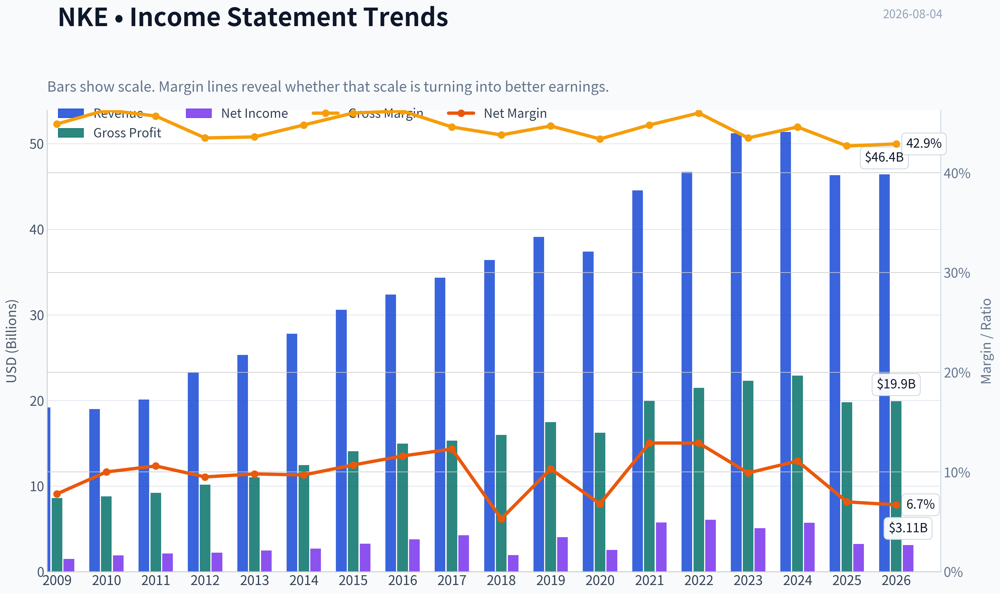
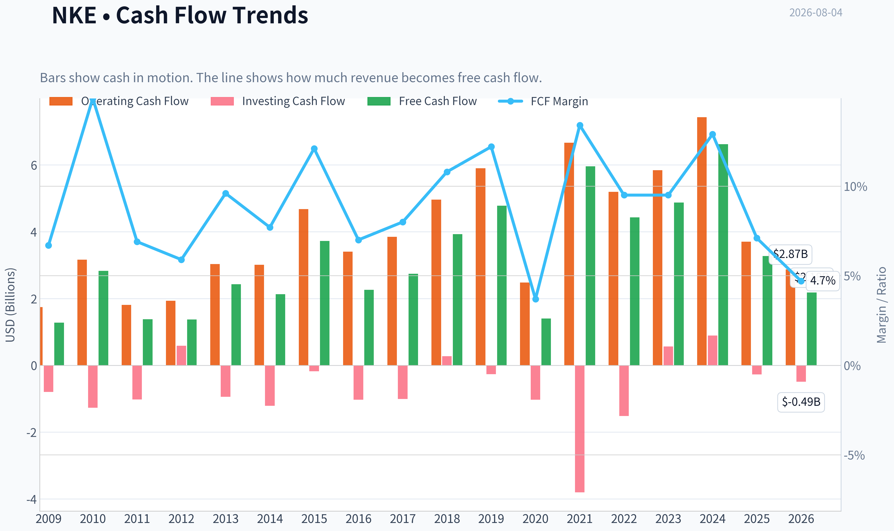
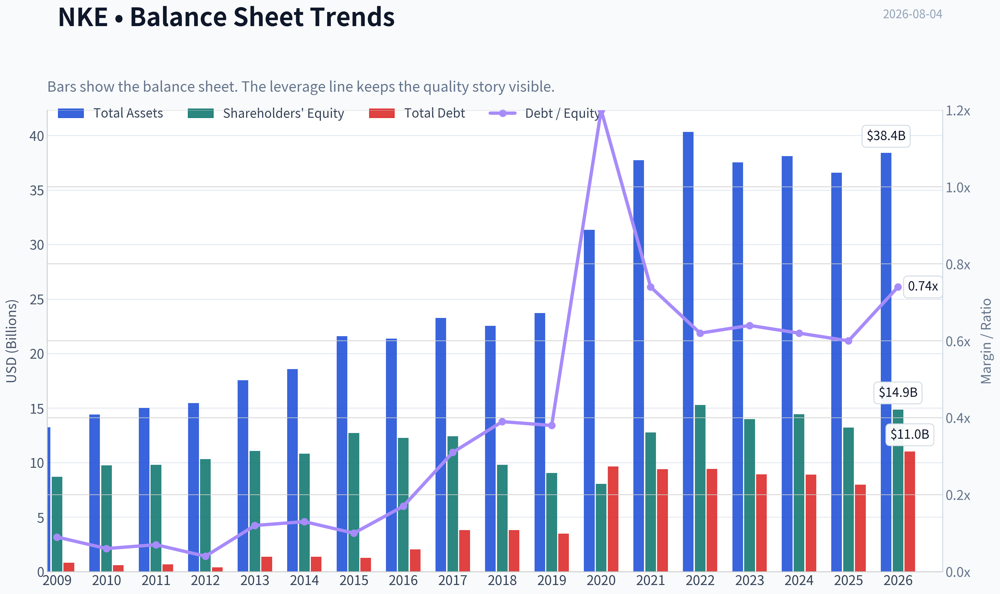
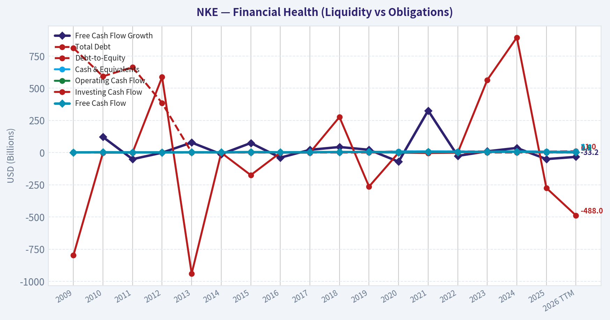
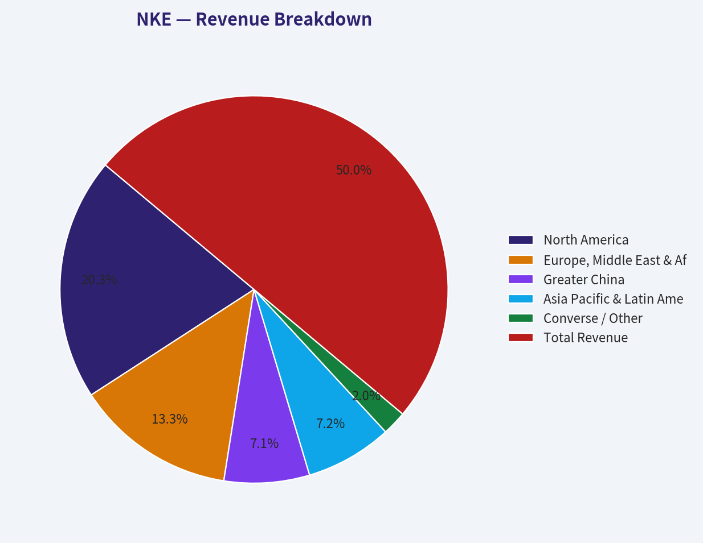
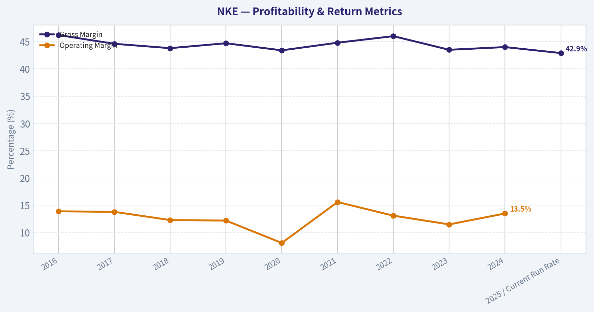
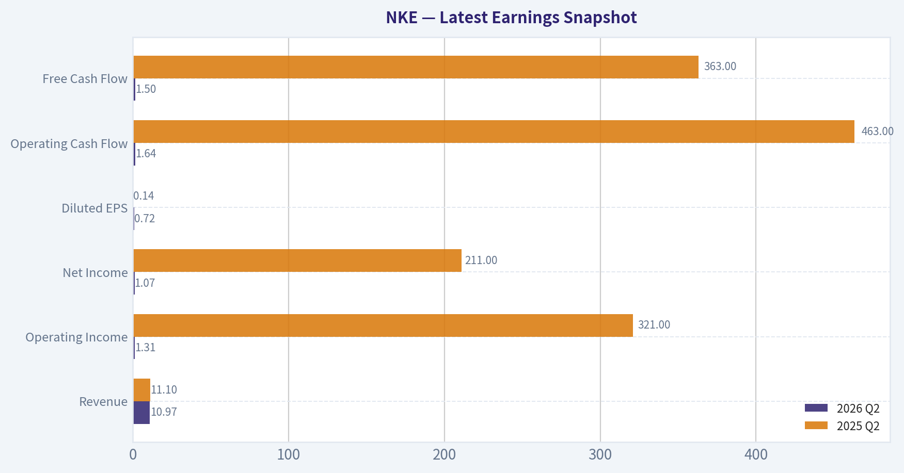
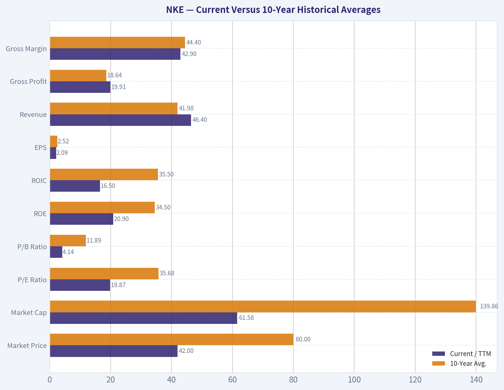
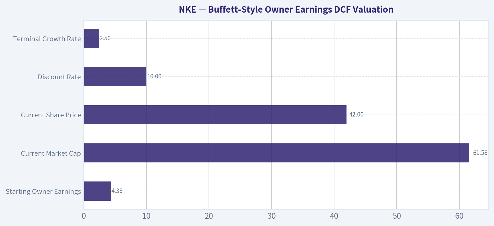

# NKE Deep Value Intelligence

**Analysis Date:** 2026-08-04

## Critical Disclaimer

*This analysis is generated by Deep Value Intelligence, an AI-powered multi-agent investing framework. Education & research only - not financial advice, not a financial advisor.*

---

## Table of Contents

1. Intelligence Summary
2. Analyst Team Reports
   - Fundamentals Analysis
   - Intrinsic Value Analysis (Buffett)
   - Trend & Growth Analysis (Lynch/Druckenmiller/Fisher)
   - Market Technical Analysis
   - Options Market Analysis
3. Research Team Commentary
4. Value Investing Team Commentary
5. Deep Values Commentary

---

## Intelligence Summary

### Thesis + Conditions

**Core Thesis:** **EXECUTIVE SUMMARY**
Nike (NKE) remains a legendary global franchise, but its current stock setup lacks a requisite margin of safety. Despite historical quality (20.9% ROE, 16.5% ROIC), the business is undergoing a structural transition characterized by contracting revenue, shrinking free cash flow, and fierce competition from agile rivals (On, Hoka).

**Key Risks:**
- Nike (NKE) remains a legendary global franchise, but its current stock setup lacks a requisite margin of safety. Despite historical quality (20.9% ROE, 16.5% ROIC), the business is undergoing a structural transition characterized by contracting revenue, shrinking free cash flow, and fierce competition from agile rivals (On, Hoka). Trading at a 19.8x P/E multiple on depressed and uncertain earnings, the stock remains priced for a smooth recovery that lacks operational confirmation. Based on strict value investing principles and past analytical misjudgments, we must not let historical brand prestige mask present-tense fundamental deterioration. Until there is undeniable evidence of margin stabilization or a genuinely distressed valuation, the risk of a value trap remains high.
- The Bull (Risky Analyst):** Argues that $41.53 is a generational floor. By focusing on Nike's historical 20.9% ROE and massive R&D/infrastructure advantages, the bull believes a 20x multiple is cheap once the current inventory and wholesale resets normalize, viewing the current setup as an inevitable mean-reversion trade.
- The Centrist (Neutral Analyst):** Suggests a scaled entry, arguing that while Nike is not dead, waiting for perfect data means missing the bottom. Advocates for a small starter position to balance the risk of a prolonged turnaround against the danger of missing the rebound.

**Confidence:** Low

---

## Analyst Team Reports

### Fundamentals Analysis

#### Latest Earnings Snapshot

*Most recent reported quarter anchored on 2026 Q2, with prior-year comparison when available.*

| Metric | 2026 Q2 | 2025 Q2 | YoY Change |
| --- | ---: | ---: | ---: |
| Revenue | $10.97B | $11.10B | -1.1% |
| Operating Income | $1.31B | $321.0M | +308.4% |
| Net Income | $1.07B | $211.0M | +406.6% |
| Diluted EPS | $0.72 | $0.14 | +414.3% |
| Operating Cash Flow | $1.64B | $463.0M | +253.6% |
| Free Cash Flow | $1.50B | $363.0M | +312.9% |

Key Takeaways: This snapshot anchors the most recent reported quarter before the narrative analysis. It helps readers separate long-run business quality from whatever changed in the latest earnings print.

#### 17-Year Financial Metrics for NKE

*All values below are computed deterministically from raw data - not estimated by AI.*

*Issuer profile: operating company (Consumer Cyclical / Footwear & Accessories).*

#### 17-Year Financial Metrics
*Annual rows come from reported financial statements. The final TTM row is computed from the latest four quarters.*

| Metric | 2009 | 2010 | 2011 | 2012 | 2013 | 2014 | 2015 | 2016 | 2017 | 2018 | 2019 | 2020 | 2021 | 2022 | 2023 | 2024 | 2025 | 2026 TTM |
| --- | --- | --- | --- | --- | --- | --- | --- | --- | --- | --- | --- | --- | --- | --- | --- | --- | --- | --- |
| Market Price | $11 | $15 | $17 | $22 | $26 | $33 | $44 | $48 | $47 | $64 | $70 | $90 | $126 | $110 | $99 | $90 | $59 | $42 |
| Market Cap | $7.00B | $8.94B | $20.51B | $25.41B | $28.25B | $69.67B | $89.92B | $96.22B | $89.66B | $119.12B | $124.84B | $156.90B | $219.62B | $191.44B | $165.24B | $145.40B | $90.13B | $61.58B |
| P/E Ratio | 4.71 | 4.69 | 9.60 | 11.51 | 11.42 | 25.81 | 27.48 | 25.56 | 21.11 | 61.37 | 30.98 | 61.61 | 38.33 | 31.69 | 32.59 | 25.48 | 28.05 | 19.87 |
| P/B Ratio | 0.81 | 0.92 | 2.09 | 2.46 | 2.55 | 6.44 | 7.08 | 7.85 | 7.23 | 12.14 | 13.81 | 19.48 | 17.20 | 12.53 | 11.80 | 10.08 | 6.82 | 4.14 |
| ROE | 17.1% | 19.6% | 21.8% | 21.4% | 22.3% | 24.9% | 25.8% | 30.7% | 34.2% | 19.7% | 44.6% | 31.5% | 44.9% | 39.6% | 36.2% | 39.5% | 24.4% | 20.9% |
| ROIC | 21.4% | 26.3% | 27.4% | 26.5% | 27.9% | 28.2% | 32.6% | 35.3% | 36.0% | 17.8% | 46.2% | 29.2% | 52.9% | 42.5% | 32.1% | 39.3% | 23.7% | 16.5% |
| EPS | $2.39 | $3.10 | $1.79 | $1.95 | $2.27 | $1.27 | $1.60 | $1.88 | $2.21 | $1.04 | $2.25 | $1.46 | $3.28 | $3.47 | $3.02 | $3.54 | $2.09 | $2.09 |
| Revenue | $19.18B | $19.01B | $20.12B | $23.33B | $25.31B | $27.80B | $30.60B | $32.38B | $34.35B | $36.40B | $39.12B | $37.40B | $44.54B | $46.71B | $51.22B | $51.36B | $46.31B | $46.40B |
| Gross Profit | $8.60B | $8.80B | $9.20B | $10.15B | $11.03B | $12.45B | $14.07B | $14.97B | $15.31B | $15.96B | $17.47B | $16.24B | $19.96B | $21.48B | $22.29B | $22.89B | $19.79B | $19.91B |
| Gross Margin | 44.9% | 46.3% | 45.7% | 43.5% | 43.6% | 44.8% | 46.0% | 46.2% | 44.6% | 43.8% | 44.7% | 43.4% | 44.8% | 46.0% | 43.5% | 44.6% | 42.7% | 42.9% |
| Operating Margin | 10.2% | 13.2% | 14.2% | 12.9% | 12.9% | 12.7% | 13.7% | 14.3% | 14.2% | 11.9% | 12.3% | 7.7% | 15.0% | 14.2% | 12.1% | 13.0% | 8.4% | 8.2% |
| Net Income | $1.49B | $1.91B | $2.13B | $2.21B | $2.47B | $2.69B | $3.27B | $3.76B | $4.24B | $1.93B | $4.03B | $2.54B | $5.73B | $6.05B | $5.07B | $5.70B | $3.22B | $3.11B |
| Net Margin | 7.8% | 10.0% | 10.6% | 9.5% | 9.8% | 9.7% | 10.7% | 11.6% | 12.3% | 5.3% | 10.3% | 6.8% | 12.9% | 12.9% | 9.9% | 11.1% | 7.0% | 6.7% |
| Revenue Growth | N/A | -0.8% | 5.8% | 16.0% | 8.5% | 9.8% | 10.1% | 5.8% | 6.1% | 6.0% | 7.5% | -4.4% | 19.1% | 4.9% | 9.6% | 0.3% | -9.8% | 0.2% |
| Net Income Growth | N/A | 28.2% | 11.9% | 3.7% | 11.8% | 8.9% | 21.5% | 14.9% | 12.8% | -54.4% | 108.4% | -37.0% | 125.6% | 5.6% | -16.1% | 12.4% | -43.5% | -3.4% |
| Free Cash Flow Growth | N/A | 121.0% | -51.2% | -0.8% | 77.8% | -12.4% | 74.3% | -39.3% | 21.5% | 43.3% | 21.8% | -70.8% | 326.2% | -25.7% | 10.0% | 35.8% | -50.6% | -33.2% |
| Total Book Value | $8.69B | $9.75B | $9.79B | $10.32B | $11.08B | $10.82B | $12.71B | $12.26B | $12.41B | $9.81B | $9.04B | $8.05B | $12.77B | $15.28B | $14.00B | $14.43B | $13.21B | $14.87B |
| Total Assets | $13.25B | $14.42B | $15.00B | $15.46B | $17.55B | $18.59B | $21.60B | $21.38B | $23.26B | $22.54B | $23.72B | $31.34B | $37.74B | $40.32B | $37.53B | $38.11B | $36.58B | $38.41B |
| Total Debt | $812.1M | $592.0M | $663.0M | $385.0M | $1.36B | $1.37B | $1.26B | $2.04B | $3.80B | $3.81B | $3.48B | $9.66B | $9.41B | $9.43B | $8.93B | $8.91B | $7.97B | $11.03B |
| Debt-to-Equity | 0.09 | 0.06 | 0.07 | 0.04 | 0.12 | 0.13 | 0.10 | 0.17 | 0.31 | 0.39 | 0.38 | 1.20 | 0.74 | 0.62 | 0.64 | 0.62 | 0.60 | 0.74 |
| Cash & Equivalents | $2.29B | $3.08B | $1.88B | $2.25B | $3.34B | $2.22B | $3.85B | $3.14B | $3.81B | $4.25B | $4.47B | $8.35B | $9.89B | $8.57B | $7.44B | $9.86B | $7.46B | $7.56B |
| Shareholders' Equity | $8.69B | $9.75B | $9.79B | $10.32B | $11.08B | $10.82B | $12.71B | $12.26B | $12.41B | $9.81B | $9.04B | $8.05B | $12.77B | $15.28B | $14.00B | $14.43B | $13.21B | $14.87B |
| Operating Cash Flow | $1.74B | $3.16B | $1.81B | $1.93B | $3.03B | $3.01B | $4.68B | $3.40B | $3.85B | $4.96B | $5.90B | $2.48B | $6.66B | $5.19B | $5.84B | $7.43B | $3.70B | $2.87B |
| Investing Cash Flow | $-798.0M | $-1.27B | $-1.02B | $586.0M | $-940.0M | $-1.21B | $-175.0M | $-1.03B | $-1.01B | $276.0M | $-264.0M | $-1.03B | $-3.80B | $-1.52B | $564.0M | $894.0M | $-275.0M | $-488.0M |
| Free Cash Flow | $1.28B | $2.83B | $1.38B | $1.37B | $2.43B | $2.13B | $3.72B | $2.26B | $2.74B | $3.93B | $4.78B | $1.40B | $5.96B | $4.43B | $4.87B | $6.62B | $3.27B | $2.18B |
| FCF Margin | 6.7% | 14.9% | 6.9% | 5.9% | 9.6% | 7.7% | 12.1% | 7.0% | 8.0% | 10.8% | 12.2% | 3.7% | 13.4% | 9.5% | 9.5% | 12.9% | 7.1% | 4.7% |
| Dividends / Share | $0.00 | $0.00 | $0.00 | $0.00 | $0.00 | $0.00 | $0.00 | $0.00 | $0.00 | $0.00 | $0.00 | $0.00 | $0.00 | $0.00 | $1.20 | $1.35 | $1.49 | $0.00 |

#### Profitability Metrics
- Return on Equity (ROE): 20.9%
- Return on Invested Capital (ROIC): 16.5%
- Return on Assets (ROA): 8.1%
- Gross Margin: 42.9%
- Operating Margin: 8.2%
- Net Profit Margin: 6.7%

#### Liquidity Metrics
- Current Ratio: 1.96
- Quick Ratio: 1.19

#### Leverage Metrics
- Debt-to-Equity Ratio: 0.74
- Interest Coverage Ratio: N/A
- Net Debt: $3.47B

#### Growth Metrics (Year-over-Year)
- Revenue Growth: 0.2%
- Net Income Growth: -3.4%
- Free Cash Flow Growth: -33.2%
- Revenue CAGR (3-Year): -3.2%
- Revenue CAGR (5-Year): 0.8%

#### Valuation Metrics
- P/E Ratio (TTM): 19.78
- Forward P/E: 18.08
- Price-to-Book: 4.14
- Price-to-Sales: 1.33
- PEG Ratio: 1.60
- EV/EBITDA: 12.91
- Free Cash Flow Yield: 3.5%
- Earnings Yield: 5.1%

#### Owner Earnings (Buffett Method, Code-Computed)
- Net Income: $3.22B
- + Depreciation & Amortization: $797.0M
- - Capital Expenditures: $-684.0M
- - Working Capital Changes: $-1.68B
- = **Owner Earnings: $4.38B**

#### Intrinsic Value (Code-Computed)
- Current Price: $42
- **Headline Intrinsic Value (business-model routed): $51**
  Business model: operating company - weighted blend [Damodaran FCFF + reverse-DCF fair + owner-earnings DCF] (operating_company)
  Model spread (min-max across DCFs): $21 - $56
  Margin of safety vs. price (headline): 18.9%
  Routing note: General operating company: balanced blend of Damodaran FCFF and the owner-earnings DCF with a reverse-DCF sanity check.
- Buffett Method (Owner Earnings):
  Conservative: $34
  Average: $56
  Optimistic: $69
- Cash Flow Method (FCF):
  Conservative: $3
  Average: $21
  Optimistic: $70
- Damodaran FCFF (WACC + margins + reinvestment):
  Conservative: $48
  Average: $52
  Optimistic: $70
  Monte Carlo band (P10-P90): $44 - $74 (median $56)
  P(intrinsic value > price): 95.0%
- Reverse-DCF: price implies ~1.7%/yr owner-earnings growth for 10y; trailing 3y was -6.1%, 5y 24.7%.

#### Piotroski F-Score: 3/9
- Positive Net Income: PASS
- Positive Operating Cash Flow: PASS
- ROA Improvement: FAIL
- Cash Flow > Net Income: FAIL
- Decreasing Debt: FAIL
- Improving Current Ratio: FAIL
- No Dilution: FAIL
- Improving Gross Margin: PASS
- Improving Asset Turnover: FAIL

ANALYST STANCE: **WATCH**

#### Nike, Inc. - Warren Buffett-Style Fundamental Analysis

Nike remains one of the world's strongest consumer brands, but the deterministic dataset shows a business in a difficult transition: revenue has stalled, margins have compressed, ROIC has fallen sharply from historical levels, free cash flow is weak, and leverage is higher than Nike's own long-term norm. At the current price of **$42**, the stock is no longer priced like the premium compounder it was in 2020-2022, and the model-based intrinsic value estimate of roughly **$51 per share** suggests upside. However, the margin of safety is not large enough to ignore the recent deterioration in business quality.

The Buffett-style conclusion is therefore **WATCH**, not yet **ADVOCATE**: Nike has a durable moat, but investors should demand either a deeper discount or clear evidence that revenue growth, gross margin, operating margin, and free cash flow are stabilizing.

---

#### Revenue Breakdown

| Revenue Source | Amount ($B) | % of Total |
|---|---:|---:|
| North America | $18.78 | 40.6% |
| Europe, Middle East & Africa | $12.36 | 26.7% |
| Greater China | $6.59 | 14.2% |
| Asia Pacific & Latin America | $6.70 | 14.5% |
| Converse / Other | $1.88 | 4.1% |
| **Total Revenue** | **$46.31** | **100.0%** |

Key Takeaways: Nike is still heavily dependent on North America and EMEA, which together represent roughly two-thirds of revenue. Greater China remains strategically important but no longer looks like a simple high-growth engine, especially given recent distribution and online-channel resets. The revenue mix is geographically diversified, but weakness in any one major region can still materially affect consolidated results.

---

#### Current Versus 10-Year Historical Averages

*10-year averages use FY2016-FY2025 annual data from the deterministic dataset. Current values use the 2026 TTM row where available.*

| Metric | Current / TTM | 10-Year Avg. | Current Standing Versus History | Buffett-Style Interpretation |
|---|---:|---:|---|---|
| Market Price | $42 | $80 | ~48% below average | The stock has reset dramatically from the premium valuation period. Price now reflects skepticism about Nike's growth and margin recovery. |
| Market Cap | $61.58B | $139.86B | ~56% below average | The market has removed a large amount of brand-growth premium. |
| P/E Ratio | 19.87x | 35.68x | Well below average | Valuation is cheaper than history, though historical P/E was inflated in low-earnings years such as 2018 and 2020. |
| P/B Ratio | 4.14x | 11.89x | Well below average | P/B is less useful for Nike because brand value is internally generated and not fully captured on the balance sheet. Cash-flow valuation is more important. |
| ROE | 20.9% | 34.5% | Materially below average | Still respectable, but no longer exceptional versus Nike's own history. |
| ROIC | 16.5% | 35.5% | Sharply below average | This is one of the biggest red flags; Nike's capital productivity has deteriorated significantly. |
| EPS | $2.09 | $2.52 | Below average | Earnings power is currently depressed. |
| Revenue | $46.40B | $41.98B | Above average, but below peak | Scale remains intact, but growth has stalled after peaking above $51B. |
| Gross Profit | $19.91B | $18.64B | Above average | Gross profit dollars remain large, but margin quality has weakened. |
| Gross Margin | 42.9% | 44.4% | ~1.5 percentage points below average | Pricing power and product/channel mix are under pressure. |
| Operating Margin | 8.2% | 12.3% | ~4.1 percentage points below average | Operating efficiency is meaningfully worse than historical norms. |
| Net Income | $3.11B | $4.23B | ~26% below average | Profitability has fallen faster than revenue, indicating margin compression. |
| Net Margin | 6.7% | 10.0% | ~3.3 percentage points below average | Nike is earning far less profit per dollar of sales than it historically did. |
| Revenue Growth | 0.2% | 4.5% | Well below average | The business is currently near flat-line growth. |
| Net Income Growth | -3.4% | 12.9% | Below average | Earnings momentum remains negative. |
| Free Cash Flow Growth | -33.2% | 27.2% | Far below average | The historical average is volatile and distorted by rebound years, but current FCF contraction is clearly weak. |
| Total Book Value | $14.87B | $12.13B | Above average | Equity base is larger than average, though book value understates Nike's brand moat. |
| Total Assets | $38.41B | $31.25B | Above average | Nike's asset base has expanded over the decade. |
| Total Debt | $11.03B | $6.74B | Significantly above average | Debt is elevated relative to Nike's historical balance sheet. |
| Debt-to-Equity | 0.74x | 0.57x | Above average | Leverage is not alarming, but it is less conservative than Nike's past profile. |
| Cash & Equivalents | $7.56B | $6.72B | Above average | Liquidity remains solid. |
| Shareholders' Equity | $14.87B | $12.13B | Above average | The equity cushion is adequate, though buybacks and intangibles affect interpretation. |
| Free Cash Flow | $2.18B | $4.03B | ~46% below average | Current cash generation is weak versus Nike's normal earning power. |
| Dividends per Share | $0.00 TTM | $0.40 | Below average | The deterministic TTM dividend field shows zero; annual rows show dividends of $1.20, $1.35, and $1.49 in FY2023-FY2025. |

Key Takeaways: Nike is cheaper than its own historical valuation averages, but it is also operating well below its own historical profitability and cash-flow averages. The most important deterioration is in **ROIC, operating margin, net margin, and free cash flow**, which are the core Buffett-style quality metrics. The stock may be undervalued if Nike normalizes, but the current financial trend does not yet prove that normalization is underway.

---

#### Market Metrics Interpretation

Nike's **current market price of $42** is far below its 10-year average of roughly **$80**, reflecting a major reset in investor expectations. The **market cap of $61.58B** is also far below the 10-year average of about **$139.86B**, which shows that the market is no longer capitalizing Nike as a high-confidence growth compounder.

The **P/E ratio of 19.87x** is below Nike's 10-year average of **35.68x**, suggesting the stock is cheaper than usual. However, Nike's historical P/E average was distorted by years of temporarily depressed earnings, so the lower current multiple is not automatically a bargain. The key question is whether current earnings are cyclically depressed or structurally impaired.

The **P/B ratio of 4.14x** is well below the 10-year average of **11.89x**, but book value is not the best way to value Nike. Nike's most important assets are brand equity, athlete relationships, design capabilities, distribution, and consumer loyalty, most of which are not fully reflected on the balance sheet. For Nike, intrinsic value should be anchored primarily on owner earnings and free cash flow, not on book value.

---

#### Profitability Analysis

Nike's profitability remains positive but has materially weakened. **ROE of 20.9%** and **ROIC of 16.5%** are still above what many companies can earn, but they are far below Nike's historical averages of **34.5% ROE** and **35.5% ROIC**. For a Buffett-style investor, the decline in ROIC is the most concerning sign because it suggests the business is currently generating much less return on the capital required to operate.

Revenue remains large at **$46.40B TTM**, above the 10-year average, but it is down from the FY2023-FY2024 peak of more than **$51B**. Gross profit of **$19.91B** is still above the 10-year average, yet **gross margin of 42.9%** is below the 10-year average of **44.4%**. That indicates Nike is still selling a large volume of product, but with weaker pricing, mix, channel efficiency, or inventory economics.

The bigger issue is operating leverage. **Operating margin is only 8.2%**, compared with a 10-year average of **12.3%**. **Net margin is 6.7%**, compared with a 10-year average of **10.0%**. This means Nike's current revenue base is not translating into the same level of earnings it historically produced.

---

#### Growth Analysis

Nike's growth profile has weakened significantly. **Revenue growth is only 0.2% TTM**, versus a 10-year average of **4.5%**. More importantly, the 3-year revenue CAGR is **-3.2%**, and the 5-year revenue CAGR is only **0.8%**, indicating that the slowdown is not merely a one-quarter issue.

**Net income growth is -3.4% TTM**, following a sharp FY2025 decline of **-43.5%**. Nike's earnings growth has been volatile over the decade, with large drops in 2018, 2020, and 2025 followed by rebounds in certain years. That volatility reduces earnings predictability, which is a negative under Buffett's framework.

**Free cash flow growth is -33.2% TTM**, and free cash flow has fallen to **$2.18B**, compared with a 10-year average of about **$4.03B**. This is a major warning sign because Buffett-style valuation depends heavily on durable, repeatable cash generation.

---

#### Balance Sheet and Financial Strength

Nike's balance sheet is still serviceable, but it is no longer as pristine as it once was. **Cash and equivalents are $7.56B**, above the 10-year average of **$6.72B**, and liquidity is supported by a **current ratio of 1.96** and **quick ratio of 1.19**. Nike does not appear to face near-term liquidity stress.

However, **total debt is $11.03B**, significantly above the 10-year average of **$6.74B**. **Debt-to-equity is 0.74x**, above the 10-year average of **0.57x**. Net debt is approximately **$3.47B**, which is manageable for a global brand of Nike's scale, but the increase in leverage reduces flexibility while earnings and cash flow are under pressure.

The balance sheet is not the primary problem; the primary problem is diminished earnings quality and cash conversion. Still, Buffett would prefer to see declining debt or improving cash flow before becoming aggressive.

---

#### Cash Flow and Dividend Analysis

Free cash flow is the clearest near-term concern. Nike generated **$2.18B of TTM free cash flow**, compared with a 10-year average of **$4.03B**. The **FCF yield of 3.5%** is not especially high for a company with stalled growth and falling margins.

The deterministic dataset shows **dividends per share of $0.00 for TTM**, while annual rows show **$1.20 in FY2023**, **$1.35 in FY2024**, and **$1.49 in FY2025**. Based strictly on the dataset, the latest TTM dividend field is zero, but the annual history indicates Nike has recently returned cash through dividends. The bigger issue is whether free cash flow can comfortably support ongoing shareholder returns if operating performance remains weak.

---

#### Buffett-Style Owner Earnings DCF Valuation

Assumptions:

| DCF Input | Value |
|---|---:|
| Starting Owner Earnings | $4.38B |
| Current Market Cap | $61.58B |
| Current Share Price | $42 |
| Implied Shares Outstanding | ~1.466B |
| Discount Rate | 10.0% |
| Terminal Growth Rate | 2.5% |
| Terminal Value Formula | Year 10 Owner Earnings x 1.025 ÷ (10.0% - 2.5%) |

Key Takeaways: The DCF starts from owner earnings of **$4.38B**, which is higher than current free cash flow but consistent with the code-computed Buffett owner earnings figure. A 10% discount rate is used to reflect the return a value investor would demand. The terminal growth rate is limited to 2.5%, avoiding any assumption that Nike can grow faster than the economy forever.

| Scenario | Explicit Owner Earnings Growth | PV of Years 1-10 Owner Earnings | PV of Terminal Value | Estimated Equity Value | Fair Value / Share | Margin of Safety vs. $42 |
|---|---:|---:|---:|---:|---:|---:|
| Conservative | 0.0% for 10 years, then 2.5% terminal | $26.91B | $23.08B | $49.99B | **$34** | **-23%** |
| Average / Base Case | 7.0% for 10 years, then 2.5% terminal | $37.73B | $45.41B | $83.14B | **$57** | **26%** |
| Optimistic | 9.5% for 10 years, then 2.5% terminal | $42.78B | $57.22B | $100.00B | **$68** | **38%** |

Key Takeaways: The conservative case suggests Nike is still too expensive if owner earnings stagnate for a decade. The base case supports a fair value near the high-$50s if Nike can recover to durable mid-to-high single-digit owner earnings growth. The optimistic case requires a strong brand turnaround, margin recovery, and renewed international growth, but it does not assume unrealistic perpetual high growth.

The broader model pack estimates a **headline intrinsic value of $51.21 per share**, using a weighted blend of Damodaran FCFF, reverse DCF, and owner-earnings DCF methods. That implies an approximately **18.9% margin of safety** versus the current price. The model spread is wide: **Owner Earnings DCF $55.84**, **FCF DCF $20.57**, and **Damodaran FCFF $52.40**. This wide spread is important because it shows that Nike's valuation is highly sensitive to whether current free cash flow weakness is temporary or structural.

Reverse DCF indicates the current price implies only about **1.7% annual owner-earnings growth for 10 years**. That is a low hurdle for a brand with Nike's historic moat, but recent 3-year performance has been negative, so the market's caution is understandable.

---

#### Economic Moat Assessment

Nike's moat remains real. The company benefits from global brand recognition, athlete endorsements, design credibility, sports culture relevance, scale purchasing, global distribution, and decades of consumer mindshare. These are valuable intangible assets that are difficult for competitors to replicate quickly.

However, the moat is under pressure. Competitors such as On, Hoka, Adidas, New Balance, Lululemon, and emerging performance brands have taken share in specific categories. Nike also faces execution risk from product innovation cycles, direct-to-consumer strategy changes, wholesale channel recalibration, China distribution changes, and consumer demand softness.

A Buffett investor would likely say Nike still has a moat, but the moat is currently producing lower economic returns than it should. The key test is whether Nike can restore ROIC and operating margins without sacrificing brand strength.

---

#### Management and Capital Allocation

Historically, Nike has created significant shareholder value through brand investment, global expansion, buybacks, and dividends. The long-term ROE record shows that management has usually been able to earn high returns on capital.

Recently, however, capital allocation looks less impressive. ROIC has fallen from levels above **30%-50%** in several historical years to **16.5% TTM**. Total debt has risen, free cash flow has weakened, and the Piotroski F-Score is only **3 out of 9**, reflecting weak recent fundamental momentum.

The dividend history shown in annual data suggests a willingness to return cash to shareholders, but Buffett-style investors would prefer that capital returns be funded by strong and rising owner earnings, not by balance-sheet flexibility during a downturn.

---

#### Key Investment Insights, Red Flags, and Opportunities

| Category | Key Point | Investment Significance |
|---|---|---|
| Moat | Nike remains one of the strongest global sportswear brands. | Durable brand equity supports long-term recovery potential. |
| Valuation | Current P/E and market cap are far below historical averages. | The market has already priced in a meaningful slowdown. |
| Intrinsic Value | Headline intrinsic value is about $51 versus a $42 price. | There is upside, but not a large enough margin of safety for a clean Buffett-style buy. |
| Profitability | ROE and ROIC are far below 10-year averages. | Quality has deteriorated, especially capital productivity. |
| Margins | Operating margin and net margin are materially below normal. | Earnings recovery depends heavily on margin normalization. |
| Growth | Revenue growth is nearly flat and 3-year revenue CAGR is negative. | Nike is not currently behaving like a compounder. |
| Cash Flow | TTM FCF is roughly 46% below the 10-year average. | Weak free cash flow makes valuation less certain. |
| Balance Sheet | Debt is elevated versus history, but liquidity remains adequate. | Financial risk is manageable but less conservative than before. |
| China / Distribution | Online and wholesale channel resets may pressure near-term results. | Execution risk remains high. |
| Opportunity | Reverse DCF implies only ~1.7% growth is priced in. | If Nike stabilizes, the stock could re-rate meaningfully. |

Key Takeaways: Nike offers a classic high-quality brand at a discounted valuation, but the business is not currently producing high-quality financial results. The biggest opportunity is a margin and brand-reset recovery. The biggest risk is that weaker growth and lower returns on capital are structural rather than temporary.

---

#### Final Investment Stance

| Decision Item | Assessment |
|---|---|
| Final Stance | **WATCH** |
| Buffett Quality Score | Good moat, currently weakened economics |
| Valuation Attractiveness | Moderately attractive, but not deeply cheap |
| Margin of Safety | Positive versus headline intrinsic value, insufficient versus turnaround risk |
| Main Buy Trigger | Evidence of revenue stabilization, gross margin recovery, operating margin improvement, and stronger FCF |
| Main Avoid Trigger | Continued ROIC decline, debt increase, weak China performance, or failure to regain product momentum |
| Suitable Investor Profile | Long-term investors willing to monitor a brand turnaround, not investors requiring immediate earnings momentum |

Key Takeaways: Nike is not a low-quality business, but it is currently a lower-performing version of a historically excellent business. At **$42**, the stock appears undervalued relative to the headline intrinsic value estimate of about **$51**, but the margin of safety is not large enough to offset weak recent fundamentals. The prudent Buffett-style stance is **WATCH** until Nike proves that its moat can again produce stronger growth, margins, and free cash flow.

#### Fundamental Visuals

This graph tracks the profitability and return metrics (ROE, ROIC, Margins) of **NKE** over the past decade, highlighting capital efficiency trends.

This chart illustrates the financial health of **NKE** over the last 10 years, mapping cash equivalents and free cash flow against total obligations (Debt).

This breakdown chart from <em>Revenue Breakdown</em> shows the proportional composition for **NKE** - useful for understanding what drives or risks the business.

This graph tracks the profitability and return metrics (ROE, ROIC, Margins) of **NKE** over the past decade, highlighting capital efficiency trends.

---

### Intrinsic Value Analysis (Buffett)

> *Following Warren Buffett's value investing philosophy: Circle of Competence, Economic Moat, Management Quality, and Margin of Safety.*

#### Intrinsic Value Snapshot

Price is what you pay. Intrinsic value is what the business may be worth based on the cash it can create for owners over time. We show a range, not one magic number.

- Current Price: $41.53
- Value Range (conservative to optimistic across both DCF methods): $2.86 to $70.28

##### Owner Earnings (Buffett Method)
- Net Income: $3,219,000,000.00
- Depreciation & Amortization: $797,000,000.00
- Capital Expenditures: $-684,000,000.00
- Working Capital Changes: $-1,678,000,000.00
- Owner Earnings: $4,384,000,000.00

##### Intrinsic Value
###### Buffett Method
Uses owner earnings. Stricter, and usually more conservative.
- Conservative: $34.27
- Average: $55.84
- Optimistic: $69.12
- Discount Rate: 10.0%

###### Cash Flow Method
Uses free cash flow. Better for companies spending heavily today to grow tomorrow.
- Conservative: $2.86
- Average: $20.57
- Optimistic: $70.28
- Discount Rate: 10.0%

ANALYST STANCE: **ADVOCATE** - Medium conviction

#### 1. Factor Scorecard

| Factor | Score | Evidence |
|---|---:|---|
| Factor 1: Circle of Competence & Business Simplicity | 3.5 / 5 | Nike makes money by designing, marketing, and selling athletic footwear, apparel, and equipment through wholesale, owned stores, and digital channels. The model is simple, but the next few years are less predictable because Nike is resetting distribution, rebuilding product momentum, and facing stronger competition. |
| Factor 2: Moat Test | 4.0 / 5 | Nike remains one of the world's strongest consumer brands, with sustained gross margins above 40%, global athlete/sports culture relevance, scale advantages, and direct consumer reach. The moat is still wide, but not clearly widening today. |
| Factor 3: Management Quality & Capital Allocation | 3.2 / 5 | New leadership under Elliott Hill is refocusing Nike on sport, wholesale relationships, and brand heat. Historically, Nike has returned large amounts of capital through dividends and buybacks, though buybacks were not always clearly bargain-priced. |
| Factor 4: Industry Structure | 3.0 / 5 | Athletic footwear and apparel is structurally attractive for leading brands but highly competitive. Nike faces real pressure from Adidas, Hoka, On, New Balance, Lululemon, and regional China brands. |
| Gate 5: Quality / Solvency Hard Floor | Not tripped | Earnings and cash flow are under pressure, but Nike is not in financial distress. Interest coverage and liquidity remain sound, and the balance sheet is manageable. |

**Key Takeaways:** Nike is still a high-quality branded consumer franchise, but it is not operating at peak strength. The hard solvency floor is not triggered, so the question is not survival; the question is whether the brand turnaround and current valuation offer enough upside.

---

#### 2. Moat Analysis

| Moat Source | Assessment | Evidence |
|---|---|---|
| Intangible Assets / Brand | Strong | Nike has global brand recognition, athlete endorsements, emotional connection with sport and performance, and decades of consumer trust. Gross margin is 42.9%, supporting evidence of pricing power. |
| Switching Costs | Low to Moderate | Consumers can switch shoes easily, but brand identity, athlete affiliation, running ecosystems, apps, and loyalty programs create some behavioral stickiness. |
| Cost Advantages | Moderate | Nike benefits from global scale in sourcing, marketing, logistics, product development, and sponsorship leverage. However, competitors can also access global manufacturing. |
| Network Effects | Limited | Nike has community, app, and cultural network effects, but this is not a true platform network effect like a marketplace or software ecosystem. |
| Moat Quality Rating | Wide but pressured | The brand remains powerful, but recent product-cycle missteps and competitive share gains by newer brands show the moat requires constant reinvestment. |

**Key Takeaways:** Nike's moat is primarily brand-based, not switching-cost-based. That brand remains highly valuable, but the company must restore product freshness and consumer excitement to prevent the moat from slowly narrowing.

---

#### 3. Management Quality Assessment

| Area | Score | Assessment |
|---|---:|---|
| Owner Orientation | 3.0 / 5 | Nike has a long history of dividends and buybacks, but repurchases have not always been clearly opportunistic. The company still appears focused on long-term brand equity rather than short-term liquidation of the franchise. |
| Candor & Execution | 3.0 / 5 | Recent underperformance has forced a strategic reset. The key test is whether management admits the limits of the prior direct-to-consumer push and rebuilds wholesale, innovation, and sport-led marketing discipline. |
| Capital Allocation | 3.5 / 5 | Nike's asset-light brand model historically generated high returns on capital. Capital allocation is good when reinvestment supports brand heat and innovation; less attractive when buybacks absorb capital at high valuations during slowing growth. |
| Overall Management Score | 3.2 / 5 | The new CEO has deep Nike experience and a clear turnaround mandate, but execution proof is still developing. |

**Key Takeaways:** Management is credible, but the burden of proof is higher than it was several years ago. Nike needs to demonstrate that capital is being directed toward product innovation, sport credibility, and profitable distribution rather than financial engineering.

---

#### 4. Financial Summary

| Fiscal Year | Revenue ($B) | Gross Margin | Operating Margin | Net Income ($B) | Free Cash Flow ($B) | Diluted EPS | ROE / ROIC |
|---:|---:|---:|---:|---:|---:|---:|---:|
| 2016 | 32.4 | 46.2% | 13.9% | 3.8 | 2.0 | $2.16 | ~30% / ~28% |
| 2017 | 34.4 | 44.6% | 13.8% | 4.2 | 2.7 | $2.51 | ~34% / ~29% |
| 2018 | 36.4 | 43.8% | 12.3% | 1.9 | 3.9 | $1.17 | ~17% / ~15% |
| 2019 | 39.1 | 44.7% | 12.2% | 4.0 | 4.8 | $2.49 | ~42% / ~31% |
| 2020 | 37.4 | 43.4% | 8.1% | 2.5 | 1.4 | $1.60 | ~29% / ~17% |
| 2021 | 44.5 | 44.8% | 15.6% | 5.7 | 6.0 | $3.56 | ~55% / ~34% |
| 2022 | 46.7 | 46.0% | 13.1% | 6.0 | 4.4 | $3.75 | ~43% / ~34% |
| 2023 | 51.2 | 43.5% | 11.5% | 5.1 | 4.9 | $3.23 | ~36% / ~25% |
| 2024 | 51.4 | 44.0% | 13.5% | 5.7 | 6.6 | $3.73 | ~40% / ~31% |
| 2025 / Current Run Rate | ~46-51 | 42.9% | ~9-10% | ~3.2 | ~2.2 | ~$2.16 | 20.9% / pressured |

**Key Takeaways:** Nike's long-term financial record remains strong, with high gross margins, high returns on capital, and meaningful free cash generation. The problem is the recent deterioration: revenue momentum has stalled, margins have compressed, and current free cash flow is well below the 2021-2024 peak range.

---

#### 5. Owner Earnings Calculation

| Item | Normalized Estimate |
|---|---:|
| Normalized net income | ~$5.15B |
| Plus: depreciation & amortization | ~$0.78B |
| Less: maintenance capital expenditure | ~($0.83B) |
| Less: normalized working-capital drag | ~$0.00B |
| Normalized owner earnings | ~$5.10B |
| Diluted shares outstanding estimate | ~1.47B |
| Normalized owner earnings per share | ~$3.48 |

**Key Takeaways:** Nike's current free cash flow yield of 3.5% implies depressed free cash flow of roughly $2.2 billion, but normalized owner earnings are closer to $5.1 billion if the brand stabilizes. This distinction matters because Nike is in a transition period; valuing only the trough would understate the franchise, while assuming an immediate full recovery would be too generous.

---

#### 6. Three-Scenario DCF Valuation

| Scenario | Key Assumption | Estimated Value / Share |
|---|---|---:|
| Scenario A: No Growth | $3.48 normalized owner earnings / 10% discount rate | ~$34.80 |
| Scenario B: GDP Growth | 3% perpetual growth, 10% discount rate | ~$51.20 |
| Scenario C: Historical Growth Haircut | 6% growth for 10 years, 3% terminal growth, 10% discount rate | ~$64.00 |
| Research Pack Headline Intrinsic Value | Business-model-routed weighted blend | $51.21 |
| 3-Model Spread | Owner earnings / FCF / Damodaran FCFF | $55.84 / $20.57 / $52.40 |

**Key Takeaways:** The no-growth case does not support the current price, but that case assumes Nike never recovers from today's weak operating cycle. The conservative GDP-growth case aligns closely with the research pack's $51.21 intrinsic value, suggesting the stock is modestly undervalued if Nike can merely stabilize and grow with the economy.

---

#### 7. Margin of Safety Analysis

| Metric | Value |
|---|---:|
| Current price | $42.00 |
| Headline intrinsic value | $51.21 |
| Margin of safety vs. headline value | 18.9% |
| Market capitalization | $61.61B |
| P/E | 19.8x |
| FCF yield | 3.5% |
| Reverse-DCF implied growth | ~1.7% per year for 10 years |
| Trailing 3-year growth | -6.1% |
| Trailing 5-year growth | 24.7% |

**Key Takeaways:** At $42, Nike does not look statistically cheap on current depressed free cash flow, but it does look reasonably priced against normalized intrinsic value. The reverse DCF is important: the market is pricing in only about 1.7% annual growth, which is not heroic for a global brand if management restores execution.

---

#### 8. Final Buffett Scorecard

| Criterion | Weight | Score | Weighted Contribution |
|---|---:|---:|---:|
| Moat Width & Durability | 25% | 4.0 | 1.00 |
| Valuation / Margin of Safety | 20% | 3.8 | 0.76 |
| Capital Returns - ROIC vs. WACC | 15% | 3.5 | 0.53 |
| Business Understanding & Predictability | 12% | 3.3 | 0.40 |
| Management Quality & Capital Allocation | 12% | 3.2 | 0.38 |
| Reinvestment Runway | 8% | 3.3 | 0.26 |
| Balance Sheet Strength | 4% | 4.0 | 0.16 |
| Industry Structure | 4% | 3.0 | 0.12 |
| Final Weighted Score | 100% |  | **3.61 / 5.00** |

**Key Takeaways:** Nike clears the threshold for an Advocate rating, but not by a wide margin. The brand, balance sheet, and valuation are attractive enough to lean positive, while the turnaround risk, competitive pressure, and weaker current cash flow keep conviction at medium rather than high.

---

#### 9. Investment Stance

**Stance: ADVOCATE - Medium conviction**

Nike is a classic Buffett-style brand franchise trading at a price that appears fair to modestly undervalued, not a deep bargain. The current price of $42 offers an estimated 18.9% margin of safety to the $51.21 headline intrinsic value, and the reverse DCF implies only modest long-term growth. For a brand with Nike's global reach, pricing power, and historical returns on capital, that is a reasonable setup.

The key risk is that Nike's moat is being tested. Product innovation, wholesale relationships, China distribution, and competition from newer performance brands all matter. If management restores brand heat and margins, the stock can compound from here. If Nike's relevance continues to erode, the apparent discount could prove to be a value trap.

For a long-term value investor, Nike is worth owning selectively at current levels, with the expectation of uneven near-term results. The position should be sized with respect for turnaround uncertainty, but the odds are favorable enough to support an **ADVOCATE** stance.
#### Valuation Bridge

This bridge places the current market price beside each intrinsic value lens so readers can see whether upside depends on one method or shows up across several methods.

| Scenario | Intrinsic Value / Share |
| --- | ---: |
| Buffett Method | $55.84 |
| Cash Flow Method | $20.57 |
| Damodaran Method | $52.40 |
| Current Price | $41.53 |

#### Key Takeaways

If one method is far above the others, the upside case depends on a specific modelling assumption. When several methods cluster together, the valuation story is more robust.

#### Valuation Visuals

This comparison chart from *Latest Earnings Snapshot* stacks current figures against historical benchmarks for **NKE**, making it easy to see where the company trades relative to its own averages.

This comparison chart from *Current Versus 10-Year Historical Averages* stacks current figures against historical benchmarks for **NKE**, making it easy to see where the company trades relative to its own averages.

This comparison chart from *Buffett-Style Owner Earnings DCF Valuation* stacks current figures against historical benchmarks for **NKE**, making it easy to see where the company trades relative to its own averages.

This comparison chart from *Buffett-Style Owner Earnings DCF Valuation* stacks current figures against historical benchmarks for **NKE**, making it easy to see where the company trades relative to its own averages.

---

### Trend & Growth Analysis (Lynch/Druckenmiller/Fisher)

> *Following Peter Lynch's GARP, Stanley Druckenmiller's macro-aware approach, and Philip Fisher's scuttlebutt methodology.*

ANALYST STANCE: **WATCH**

#### NKE Growth Investment Report - Nike, Inc.

| Snapshot Metric | Current Read |
|---|---:|
| Price | ~$42 |
| Market Cap | ~$61.6B |
| P/E | ~19.8x |
| Revenue Growth YoY | ~0.2% |
| Gross Margin | ~42.9% |
| ROE | ~20.9% |
| FCF Yield | ~3.5% |
| Current Ratio | ~2.0x |
| Headline Intrinsic Value | ~$51.21 |
| Margin of Safety vs. Price | ~18.9% |

**Key Takeaways:** Nike is no longer trading like an untouchable premium-growth compounder. The stock now reflects a challenged brand-reset story, with modest upside to estimated intrinsic value but very limited current revenue momentum. The business remains financially strong, but the growth inflection has not yet appeared.

---

#### 1. Lynch Classification

| Lynch Category | Fit for NKE | Rationale |
|---|---|---|
| Slow Grower | Partial | Current revenue growth is near flat at ~0.2%. |
| Stalwart | Historical fit | Nike has been a global brand compounder with strong ROE and scale. |
| Fast Grower | No | Current growth is far below the 15-25%+ threshold. |
| Cyclical | Partial | Consumer discretionary, China exposure, inventory cycles, and fashion cycles matter. |
| Turnaround | Best current fit | Brand reset, channel reset, China distribution changes, and product pipeline must revive growth. |
| Asset Play | No | Value is brand-driven, not hidden-asset-driven. |

**Key Takeaways:** Nike should be treated as a **turnaround/stalwart**, not a fast-growth stock. The brand is valuable, but the current investment case depends on reacceleration, not continuation of existing momentum. For a Lynch-style growth investor, this belongs on the watch list until the story improves.

---

#### 2. The Story in 3 Bullets

- Nike sells performance and lifestyle athletic products globally, with one of the strongest consumer brands in the world.
- The near-term story is a **brand and channel reset**: improve product innovation, rebalance direct-to-consumer and wholesale, clean up distribution, and rebuild momentum in China and lifestyle categories.
- The bull case is that Nike's innovation engine restarts, revenue growth returns to mid-single digits or better, and margins recover through operating leverage and better inventory discipline.

---

#### 3. TAM Analysis and 10x Test

| TAM Question | Assessment |
|---|---|
| Current Revenue Base | Large, roughly high-$40B to low-$50B annual revenue scale |
| 10x Revenue Target | ~$450B-$500B+ |
| Relevant TAM | Global athletic footwear, apparel, sportswear, lifestyle, digital commerce |
| Can NKE 10x and still be under 20% share? | Unlikely |
| TAM Growth | Moderate, supported by health, sport, athleisure, emerging markets |
| Runway Quality | Good for steady compounding, poor for ten-bagger math |

**Key Takeaways:** Nike still has a large global market, but it is already a giant. The company can plausibly grow for years, but a 10x revenue outcome is unrealistic from today's scale. This makes Nike more of a recovery-and-compounding candidate than a classic ten-bagger.

---

#### 4. Revenue Growth Trend

| Metric | Read |
|---|---:|
| Latest YoY Revenue Growth | ~0.2% |
| Pattern | Stagnant / decelerated |
| Growth Quality | Needs confirmation of organic reacceleration |
| Key Watch Item | Return to positive constant-currency growth across North America, China, and digital |
| Growth Investor Interpretation | Not yet an inflection |

**Key Takeaways:** Nike's current revenue trend is the main problem. Growth is not accelerating; it is essentially flat. A growth investor should wait for evidence that product innovation and channel resets are translating into better sell-through and stronger revenue growth.

---

#### 5. Unit Economics and Operating Quality

| Metric | Assessment |
|---|---|
| LTV/CAC | Not disclosed; less relevant than for SaaS or subscription models |
| NRR | Not applicable |
| Rule of 40 | Not applicable |
| Gross Margin | Strong at ~42.9%, but needs stabilization and improvement |
| ROE | Strong at ~20.9% |
| FCF Yield | Moderate at ~3.5% |
| Balance Sheet Liquidity | Healthy, current ratio ~2.0x |

**Key Takeaways:** Nike's unit economics cannot be analyzed like a software company, but the business still shows high-quality characteristics: strong brand margins, solid ROE, and healthy liquidity. The issue is not survival or balance-sheet stress. The issue is whether Nike can reignite demand and convert brand strength into renewed growth.

---

#### 6. Inflection Point Assessment

| Potential Inflection | Evidence Today | Verdict |
|---|---|---|
| Product Cycle Inflection | Not yet clear | Watch |
| Market Share Inflection | Competitive pressure from On, Hoka, Adidas, Lululemon, and emerging brands | Negative/uncertain |
| Margin Inflection | Possible if inventory and channel mix improve | Watch |
| TAM Inflection | No major new TAM expansion visible | Neutral |
| Competitive Inflection | Nike may benefit if innovation cadence improves, but competitors are not obviously stumbling | Not proven |
| China Channel Reset | Pou Sheng online Nike sales ending from 2027 signals distribution restructuring | Uncertain |

**Key Takeaways:** There are several possible inflection points, but none are proven yet. The China online channel reset could improve long-term control of the brand, but it may create near-term disruption. The key question is whether Nike's product pipeline can restore pricing power and consumer excitement.

---

#### 7. Macro Setup Evaluation

| Macro Factor | Impact on NKE |
|---|---|
| Consumer Discretionary Cycle | Mixed; pressure if consumers trade down |
| Interest Rates | Lower rates would help valuation sentiment, but not the core demand issue |
| China Exposure | Important risk and potential upside source |
| Secular Athleisure Trend | Positive long-term tailwind |
| Sports Participation / Wellness | Positive long-term tailwind |
| FX and Global Demand | Ongoing volatility risk |

**Key Takeaways:** Nike has secular support from health, sports, and athleisure trends, but the macro setup is not a major tailwind. Consumer softness and China uncertainty can weigh on the turnaround. Macro is acceptable, but company-specific execution matters far more.

---

#### 8. Fisher 15 Points Score

| Fisher Point | Score / 5 | Comment |
|---|---:|---|
| Market potential | 4 | Huge global category, but mature scale |
| New product determination | 3 | Needs visible innovation revival |
| R&D effectiveness | 3 | Brand has capability, recent execution questioned |
| Sales organization | 4 | Global distribution remains a major asset |
| Profit margin | 4 | Gross margin remains attractive |
| Improving margins | 3 | Possible, not yet proven |
| Labor/personnel relations | 3 | No major data-driven edge from current pack |
| Executive relations | 3 | Turnaround execution still under review |
| Management depth | 4 | Deep global organization |
| Cost analysis/accounting | 4 | Mature, sophisticated operator |
| Outstanding moat | 4 | Brand, athlete network, scale, distribution |
| Long-range profit outlook | 3 | Good but dependent on growth recovery |
| Dilution risk | 4 | Low concern versus early-stage growers |
| Candor in difficulties | 3 | Needs more evidence through the reset |
| Integrity | 4 | Blue-chip governance profile |

**Key Takeaways:** Nike scores well on brand, scale, distribution, and financial quality, but only average on current innovation momentum and margin improvement. The Fisher score reflects a good company, not yet a great growth stock. The main missing ingredient is proof that management can reignite growth.

**Fisher Score: 54 / 75 - Average to Good**

---

#### 9. Valuation Analysis

| Valuation Method | Current Read | Interpretation |
|---|---:|---|
| P/E | ~19.8x | Not expensive if earnings recover, but not cheap for flat growth |
| PEG using current revenue growth | Not meaningful / unattractive | 0.2% growth makes PEG unusable |
| PEG using normalized 10-12% EPS growth assumption | ~1.6x-2.0x | Fair to slightly expensive unless growth improves |
| FCF Yield | ~3.5% | Reasonable, not distressed-value cheap |
| Headline Intrinsic Value | ~$51.21 | ~19% upside from ~$42 |
| Reverse DCF Implied Growth | ~1.7% for 10 years | Market expectations appear low |
| P/S Estimate | Roughly ~1.2x-1.4x sales | Low versus Nike's historical premium |

**Key Takeaways:** Valuation is no longer the problem it was when Nike traded at a premium multiple. The stock appears modestly undervalued on intrinsic value and reverse-DCF expectations are low. However, a cheap-ish price alone is not enough for a growth mandate without revenue reacceleration.

---

#### 10. Scenario Analysis

| Scenario | Assumptions | 3-Year View |
|---|---|---|
| Bear Case | Revenue remains flat, China disruption persists, competitors take share, margins stay pressured | Stock remains value trap / limited upside |
| Base Case | Low-to-mid-single-digit revenue growth returns, margins stabilize, brand perception improves slowly | Moderate upside toward intrinsic value |
| Bull Case | Product innovation cycle hits, China stabilizes, DTC/wholesale reset improves sell-through, margins recover | Meaningful upside, but still unlikely to be a ten-bagger |

**Key Takeaways:** The bull case is a recovery story, not a hypergrowth story. Nike can generate attractive upside if expectations are low and execution improves. But the range of outcomes depends heavily on whether product heat and channel productivity return.

---

#### 11. Growth Investor Scorecard

| Criterion | Weight | Score / 5 | Weighted Score |
|---|---:|---:|---:|
| The Story | 10% | 3.0 | 0.30 |
| TAM & Runway | 20% | 3.0 | 0.60 |
| Revenue Growth | 20% | 1.5 | 0.30 |
| Unit Economics / Quality | 15% | 3.5 | 0.53 |
| Competitive Position | 10% | 3.5 | 0.35 |
| Management Quality | 10% | 3.0 | 0.30 |
| Macro Setup | 5% | 3.0 | 0.15 |
| Profitability Path | 5% | 3.5 | 0.18 |
| Valuation | 5% | 3.5 | 0.18 |
| **Total** | **100%** |  | **2.88 / 5.0** |

**Key Takeaways:** Nike's score is dragged down by weak revenue growth and uncertain inflection timing. Financial quality, brand strength, and valuation prevent a hard avoid. But under a growth-investing framework, this is not yet compelling enough to advocate.

---

#### 12. Position Size Stance

| Investor Type | Stance |
|---|---|
| Existing Long-Term Holder | Hold / Watch, avoid aggressive trimming if tax-sensitive and time horizon is long |
| New Growth Investor | Wait for confirmation before initiating |
| Value-Oriented Investor | Small starter position may be reasonable |
| Suggested Growth Portfolio Size | 0%-2%, only if willing to underwrite turnaround risk |
| Add Aggressively When | Revenue growth reaccelerates, gross margin improves, China stabilizes, and product cycle shows traction |

**Key Takeaways:** Nike is suitable as a small watch-position or recovery bet, not a high-conviction growth allocation. Existing holders can monitor for the inflection. New buyers should demand evidence that the turnaround is working before sizing up.

---

#### 13. Key Risks and Catalysts

| Category | Items to Watch |
|---|---|
| Risks | Continued flat or negative revenue growth; China disruption; loss of market share to On, Hoka, Adidas, and Lululemon; weak lifestyle demand; channel reset execution risk; margin pressure |
| Catalysts | New product cycle success; stronger direct and wholesale balance; inventory normalization; China stabilization; margin recovery; renewed athlete and sports marketing momentum; improving sell-through data |
| Data Needed Next | Constant-currency revenue by geography, digital growth, inventory trend, gross margin bridge, order book/sell-through commentary, management guidance |

**Key Takeaways:** The biggest risk is that Nike's brand remains strong in awareness but weaker in consumer urgency. The biggest catalyst is a visible product-led demand revival. The stock can work if the market sees proof that Nike is moving from reset to reacceleration.

---

#### Final View

Nike is a high-quality global brand trading at a more reasonable valuation, with low market expectations and some recovery upside. But it does **not** currently meet the Lynch/Fisher/Druckenmiller standard for a fast grower at an inflection point. The correct stance for a growth investor is **WATCH**: wait for evidence of revenue acceleration, product heat, China stabilization, and margin recovery before upgrading.

---

### Market Technical Analysis

ANALYST STANCE: **WATCH**

#### NKE Technical Indicator Selection and Market Context - August 4, 2026

Nike's chart remains structurally weak, but the stock is no longer in a clean downside acceleration phase. The dominant long-term picture is bearish: NKE is trading far below a declining 200-day SMA, and the 50-day SMA is also below the 200-day SMA, confirming that the broader trend is still damaged. However, the last several weeks show a lower-volatility basing attempt around the low-$40s, with repeated defense near the $40-$41 area and failed rallies near $44-$45.

For this market context, the most relevant indicators are: **close_10_ema, close_50_sma, close_200_sma, macd, rsi, boll_ub, boll_lb, and vwma**. These provide a balanced view of short-term trend, medium-term resistance, long-term regime, momentum, mean-reversion zones, volatility range, and volume-confirmed price behavior.

---

#### Selected Indicators and Why They Matter

| Indicator | Category | Current / Recent Signal | Why It Is Useful for NKE Now |
|---|---:|---:|---|
| close_10_ema | Short-term trend | Around $42.32 on Aug. 4 | Helps judge whether the recent bounce attempt is gaining or losing traction. |
| close_50_sma | Medium-term trend | Around $43.41 on Aug. 4 | Acts as nearby resistance; NKE has struggled to sustain trade above this zone. |
| close_200_sma | Long-term trend | Around $53.65 on Aug. 4 | Confirms the broader bearish regime and shows how far price remains below a true trend recovery. |
| macd | Momentum | Negative at about -0.34 | Momentum has improved from late June lows but remains below zero, suggesting incomplete recovery. |
| rsi | Momentum / exhaustion | Around 43.9 | Neutral-to-soft; not oversold enough for a high-conviction mean-reversion buy and not strong enough for trend-following confirmation. |
| boll_ub | Volatility / resistance | Around $44.65 | Defines the upper boundary of the recent trading range and likely breakout confirmation area. |
| boll_lb | Volatility / support | Around $40.92 | Marks the lower range boundary where buyers have recently appeared. |
| vwma | Volume-weighted trend | Around $42.43 | Shows whether price is being accepted by volume; current behavior is flat-to-soft rather than accumulation-heavy. |

Key Takeaways: The selected indicators show a stock trying to stabilize but still lacking trend confirmation. The most important nearby zone is roughly $43.40-$44.65, where the 50-day SMA and upper Bollinger Band create resistance. A break above that area would improve the tactical picture, while a break below $40.90 would suggest the base is failing.

---

#### Trend Structure: Bearish Long-Term, Range-Bound Short-Term

NKE's one-year price path is decisively negative. The stock traded in the low-to-mid $70s in August 2025, broke down through the $60s during late 2025 and early 2026, then suffered another major downside gap in early April 2026 into the mid-$40s. Since then, price has mostly oscillated between roughly $40 and $47, which suggests the market has shifted from aggressive liquidation into a potential base-building phase.

That said, base-building is not the same as a bullish reversal. The 200-day SMA has declined from about $57.72 in late June to about $53.65 by August 4, showing persistent long-term trend deterioration. The 50-day SMA has also slipped from roughly $44.05 in late June to about $43.41, meaning even the intermediate trend has not turned upward yet.

The short-term 10-day EMA near $42.32 is close to current trading levels, which indicates a lack of decisive short-term direction. Price is not deeply extended below it, but neither is it powering above the 50-day SMA. This creates a tactical "watch" setup rather than a clean buy or sell signal.

---

#### Momentum: Improving From June, But Still Not Bullish

MACD remains negative at approximately -0.34. This is important because it means the short- and intermediate-term moving average structure has not yet flipped into a positive momentum regime. However, MACD is much less negative than it was around late June, when it fell near -0.83, so downside momentum has moderated.

RSI near 43.9 also supports this interpretation. The stock is not deeply oversold; therefore, the easy contrarian rebound argument is weaker than it would be with RSI near 30. At the same time, RSI is not above 50-55 in a sustained way, so buyers have not proven control.

The momentum message is therefore nuanced: selling pressure has cooled, but buying strength remains insufficient. Traders looking for long setups should ideally wait for RSI to reclaim and hold above 50 while MACD continues improving toward zero or turns positive.

---

#### Volatility and Range Levels

The Bollinger Band structure is especially useful here because NKE has been trading sideways-to-down after a large prior decline. The upper band is near $44.65, and the lower band is near $40.92. This places the current battlefield in a relatively tight range compared with earlier 2026 volatility.

The upper band aligns closely with recent failed rally zones around $44-$45. A close above $44.65, especially with improving VWMA and RSI above 50, would suggest a stronger attempt to reclaim the spring/summer trading range. Until that happens, rallies toward the upper band should be treated cautiously.

The lower band around $40.92 is the key support reference. A breakdown below that level would threaten the late-June low zone and could invite another test of the psychological $40 area. If $40 fails with volume, the chart would shift from basing to renewed breakdown risk.

---

#### Volume-Weighted Confirmation

VWMA near $42.43 is very close to current price action, which indicates that volume-weighted participation is not strongly confirming either side. This is consistent with a market in balance rather than a clear accumulation phase.

The concern is that some of the highest-volume sessions in the last several months occurred around major downside gaps and selloffs, including late 2025, early April 2026, and late June/early July. That means the stock still carries overhead supply. For a more constructive reading, NKE would need to push above the 50-day SMA and upper Bollinger Band while also trading above VWMA, showing that buyers are willing to transact at higher prices.

---

#### Tactical Trading Interpretation

| Trading Zone | Approximate Level | Interpretation | Trader Response |
|---|---:|---|---|
| Breakdown support | Below $40.90, especially below $40 | Base failure risk increases materially. | Avoid new longs or use tight risk controls. |
| Lower range / support | $40.90-$41.50 | Potential tactical support zone, but not a confirmed reversal area. | Mean-reversion traders may watch for bullish candles and volume confirmation. |
| Neutral pivot | $42.30-$42.50 | Cluster near 10 EMA and VWMA. | Price above this zone is mildly constructive; below it is mildly bearish. |
| First resistance | $43.40-$43.50 | 50-day SMA area. | A close above this level would be an early improvement signal. |
| Breakout confirmation | $44.65-$45.00 | Upper Bollinger Band and recent rally ceiling. | Sustained close above this area would improve tactical bullish odds. |
| Long-term recovery zone | Above $53.65 | 200-day SMA area. | Needed to repair the broader bearish trend, but currently far away. |

Key Takeaways: NKE is trapped between support near $41 and resistance near $44.65. The stock needs to reclaim $43.50 first, then $45, before the setup becomes more attractive for momentum buyers. Below $40.90, the base would look vulnerable and downside risk would rise.

---

#### Bottom Line

NKE is best classified as a **watch-list / range-trading candidate**, not a high-conviction bullish setup. The stock has stabilized after a major decline, but the long-term trend remains bearish, the 50-day SMA is still overhead, MACD is still negative, and RSI is below the level typically associated with sustained upside momentum.

A more constructive tactical signal would require a close above the $44.65-$45.00 zone, ideally supported by RSI above 50, MACD improving toward positive territory, and price holding above VWMA. Until then, rallies may continue to meet resistance, and traders should respect the $40.90-$41.00 support area as the key downside trigger.

| Final Assessment | Signal |
|---|---|
| Long-term trend | Bearish |
| Medium-term trend | Weak / sideways-to-down |
| Short-term trend | Neutral-to-soft |
| Momentum | Improving but still negative |
| Volume confirmation | Not yet convincingly bullish |
| Key support | $40.90-$41.00 |
| Key resistance | $43.40, then $44.65-$45.00 |
| Trading stance | **WATCH** |

Key Takeaways: NKE is trying to form a base, but it has not yet proven a bullish reversal. The stock must break above $45 with stronger momentum to attract trend-following buyers. Until that happens, the more prudent stance is to watch closely, trade smaller, and respect downside risk below $41.

---

### Options Market Analysis

> *Reading options flow - put/call ratios, IV skew, and unusual activity - to gauge institutional positioning and event-driven risk.*

ANALYST STANCE: **WATCH**

#### NKE Options Market Sentiment Report
*Options data as of 2026-08-04. Analysis focuses on near-term expirations: 2026-08-07, 2026-08-14, and 2026-08-21.*

#### 1. Put/Call Ratio Analysis

| Expiry | Call OI | Put OI | Put/Call OI Ratio | Call Volume | Put Volume | Put/Call Volume Ratio | Read |
|---|---:|---:|---:|---:|---:|---:|---|
| 2026-08-07 | 25,250 | 27,352 | 1.08 | 12,932 | 7,811 | 0.60 | OI defensive, but current volume favors calls |
| 2026-08-14 | 9,441 | 4,273 | 0.45 | 4,299 | 2,375 | 0.55 | Bullish/call-heavy positioning |
| 2026-08-21 | 106,900 | 72,039 | 0.67 | 4,992 | 2,299 | 0.46 | Near neutral OI, bullish volume tilt |
| **Total Near-Term** | **141,591** | **103,664** | **0.73** | **22,223** | **12,485** | **0.56** | Slightly above neutral OI, but call-led trading activity |

**Key Takeaways:** NKE's total near-term put/call open interest ratio is **0.73**, very close to the historical neutral baseline of around **0.70**. However, the **put/call volume ratio of 0.56** shows that current trading activity is more call-heavy than put-heavy. This suggests positioning is not aggressively bearish; near-term flow leans modestly bullish, though existing OI still reflects some downside protection.

The most defensive expiration is the front-week **2026-08-07**, where put OI exceeds call OI with a ratio of **1.08**. That could represent short-term hedging or bearish positioning into the end of the week. But across the broader near-term chain, call volume is consistently stronger, implying traders are currently expressing more upside interest than downside fear.

---

#### 2. Implied Volatility Assessment

| Expiry | ATM Call IV | ATM Put IV | Call-Put IV Spread | IV Read |
|---|---:|---:|---:|---|
| 2026-08-07 | 48.2% | 46.6% | +1.6 pts call premium | Short-dated IV elevated, mild call demand |
| 2026-08-14 | 44.8% | 39.0% | +5.8 pts call premium | Clearer upside IV premium |
| 2026-08-21 | 42.7% | 37.8% | +4.9 pts call premium | Call-side IV remains richer |

**Key Takeaways:** Near-term ATM IV is elevated, especially in the front-week expiration where calls are priced near **48% IV** and puts near **47% IV**. Across all three expirations, call IV is higher than put IV, suggesting traders are paying more for upside exposure than downside protection. This is not the classic bearish put-skew setup; instead, the available data points to a mild **call-skew / upside-chase** dynamic.

Full OTM skew data was not provided, so the comparison is based on ATM call-versus-put IV rather than a complete OTM put-versus-OTM call surface. Even so, the consistent call IV premium is notable. There is no clear evidence from this dataset of a large event-volatility bid tied to a known near-term catalyst, though IV is not cheap for a large-cap consumer discretionary name.

---

#### 3. Unusual Options Activity

| Expiry | Type | Strike | Volume | Open Interest | Vol/OI | IV | Positioning Interpretation |
|---|---|---:|---:|---:|---:|---:|---|
| 2026-08-14 | Call | $41.50 | 1,307 | 117 | 11.2x | 41.8% | Fresh short-dated call activity; likely upside speculation |

**Key Takeaways:** The standout unusual activity is in the **2026-08-14 $41.50 call**, where volume is more than **11 times** existing open interest. That strongly suggests fresh positioning rather than simple rotation out of an existing trade. The short-dated nature of the contract points to a tactical upside bet rather than long-term institutional accumulation.

Because trade direction, bid/ask execution, and sweep/block details are not provided, this cannot be confidently labeled as "smart money." However, the high volume-to-open-interest ratio and short expiry make it meaningful for near-term sentiment. It looks more like aggressive upside speculation than defensive hedging.

---

#### 4. Open Interest Concentration and Pinning Risk

| Expiry | Call OI | Put OI | Total OI | Concentration Read |
|---|---:|---:|---:|---|
| 2026-08-07 | 25,250 | 27,352 | 52,602 | Balanced but slightly put-heavy into front-week expiry |
| 2026-08-14 | 9,441 | 4,273 | 13,714 | Lighter OI; less likely to dominate price action |
| 2026-08-21 | 106,900 | 72,039 | 178,939 | Largest OI concentration; most important expiry for pinning/gamma effects |

**Key Takeaways:** The largest open interest concentration is clearly in the **2026-08-21** expiration, with nearly **179,000 total contracts** outstanding. That expiry is likely the most important one for potential pinning, dealer hedging, and gamma-related price behavior. The data does not include strike-level OI, so specific gamma walls or max-pain strikes cannot be identified with precision.

At the expiry level, the 2026-08-21 chain has more call OI than put OI, which can create upside-sensitive dealer hedging dynamics depending on where spot price sits relative to the largest strikes. The front-week expiration is more put-heavy, so short-term downside hedges may create some resistance to a clean bullish read. Still, the largest expiry concentration favors calls on an open-interest basis.

---

#### 5. Overall Options Sentiment Signal: **BULLISH, with Moderate Confidence**

NKE's options market signal leans **BULLISH** in the near term. The primary drivers are the **call-heavy volume profile**, the **consistent ATM call IV premium over puts**, and the unusual activity in the **2026-08-14 $41.50 call**, which appears to be fresh short-dated upside positioning.

That said, this is not an aggressively bullish setup. The total put/call OI ratio of **0.73** is close to neutral, and the front-week OI ratio of **1.08** shows there is still meaningful short-term put protection in place. The bullish signal is therefore based more on **current flow** than on deeply established open-interest positioning.

Confidence is **moderate**, not high, because strike-level OI and full OTM skew data are unavailable. Without those, specific gamma walls, max-pain levels, and true downside skew cannot be fully assessed. Still, the available options data points to upside interest outweighing downside fear.

#### Final Summary Table

| Category | Signal / Value | Interpretation |
|---|---|---|
| Put/Call Ratio | OI ratio **0.73**; volume ratio **0.56** | OI near neutral, but current trading activity favors calls |
| IV Level | ATM IV roughly **38%-48%** across near-term expiries | Elevated but not clearly panic-driven |
| Skew Direction | Calls priced richer than puts at ATM | Mild upside chase / call-skew signal |
| Unusual Activity | 2026-08-14 **$41.50 call**, volume/OI **11.2x** | Fresh short-dated bullish speculation |
| Overall Signal | **BULLISH** | Call demand and unusual call activity outweigh neutral-to-slightly-defensive OI |

**Key Takeaways:** The options market is leaning bullish for NKE, mainly because traders are actively buying or trading calls more heavily than puts. The unusual $41.50 call activity adds to the upside read, especially given the very high volume relative to open interest. The main caveat is that open interest is not overwhelmingly bullish, so the signal should be treated as constructive but not decisive.

---

## Research Team Commentary

> *The Research Manager synthesizes the Bull vs Bear debate into action-free commentary. This is a pre-risk view, not the final stance.*

This is a classic value investing dilemma: separating the intrinsic value of a legendary franchise from the immediate reality of a broken business model. Having listened to both the bull and the bear, and heavily factoring in the lessons learned from my past evaluation of Nike, the path forward requires strict discipline.

Here is my synthesis of the debate, followed by a concrete action plan.

The bull builds their case on the permanence of Nike's brand equity. They argue that Nike is a global royalty on human movement, possessing a durable ecosystem moat and elite historical capital efficiency, evidenced by a trailing 20.9% ROE and 16.5% ROIC. To the bull, the current $41.53 price and roughly 20x P/E multiple represent a rare opportunity to buy a wonderful business at a fair price, arguing that the market is overly focused on a temporary channel reset rather than the 10-year compounding trajectory.

The bear fundamentally dismantles this by inverting the perspective. They argue that Nike's moat is leaking due to intense fragmentation from agile competitors like On, Hoka, and Lululemon, exacerbated by Nike's self-inflicted wounds in abandoning wholesale partners. Crucially, the bear points out that buying a business at 20x earnings when net income is down over 40% and free cash flow has halved is a classic yield trap. They warn that the reverse-DCF implies a heroic return to peak margins that is far from guaranteed, placing Nike firmly in Buffett's "too tough" pile.

Core Takeaway
Nike remains a premium global brand, but the stock is still a turnaround situation lacking hard operational confirmation. Historical brand strength and trailing returns on capital do not offset the current reality of severe earnings pressure, cash-flow weakness, and competitive share loss. At $41.53, the valuation still demands a successful turnaround, meaning there is an insufficient margin of safety for a long-term value investor to step in today.

Rationale
The last time we evaluated Nike when it was trading around $44, I made a critical error in my weighting. I allowed Nike's historical franchise quality to overshadow the present-tense deterioration of its fundamentals. I treated the setup as a balanced "wait and see," underestimating the probability of continued downside. We cannot make that mistake again.

Value investing requires us to measure price against intrinsic value, but intrinsic value is a moving target when earnings are shrinking. A 20x P/E multiple is only a "fair price" if the "E" is stable and growing. Right now, Nike's revenue is contracting by nearly 10%, and its free cash flow has collapsed. The fixed costs of athlete endorsements and demand creation are creating negative operating leverage.

As the bear rightly pointed out, turnarounds in the apparel space rarely happen overnight. Rebuilding wholesale relationships takes time, and restarting an innovation engine to reclaim market share from highly focused niche competitors is incredibly difficult. For a turnaround story with falling earnings and compressed margins, we must demand a substantial discount to intrinsic value to protect our capital. The current price implies a recovery that has not yet materialized. We need to see hard evidence that the bleeding has stopped before we treat this as a high-conviction value play. A falling knife does not become a value investment simply because the chart is consolidating.

Monitoring Plan
To shift our stance, I am looking for two out of these three conditions to be met over the next 1 to 4 quarters:
1. Operational Stabilization: We need to see sequential improvement in gross margins and a stabilization of revenue contraction, particularly in key battleground categories like premium running and women's apparel.
2. Channel Equilibrium: Clear evidence that the pivot back to wholesale distribution is bearing fruit without requiring margin-destroying promotional activity to clear inventory.
3. De-risked Valuation: Either the stock must drop to a level that prices in a terminal low-growth scenario (closer to the mid-$30s), or forward earnings estimates must clearly establish a durable trough.

Until we see measurable proof that Nike's fundamental deterioration has bottomed, the burden of proof remains entirely on the bulls.

Stance: WATCH (Bearish Bias / Await Confirmation)

---

## Value Investing Team Commentary

> *The Investor translates the research view into an investment thesis before risk review. This is still not the final stance.*

In the spirit of partnership and long-term business ownership, we must evaluate Nike (NKE) not as a ticker symbol fluctuating on a screen, but as a global enterprise in the midst of a significant structural transition. A value investor's greatest challenge is distinguishing between a **wonderful business hitting a temporary pothole** and a **dominant franchise whose economic moat is structurally narrowing.**

Based on the provided data and the lessons learned from previous miscalculations, here is my assessment of Nike from the perspective of owner-earnings and durable competitive advantage.

### 1. Business Quality and the "Leaky Moat"
Nike historically possesses the hallmarks of a "Buffett-style" business: elite brand equity, a global distribution network, and historically high returns on invested capital (ROIC of 16.5% and ROE of 20.9% are still respectable, though trending downward). However, a moat is only as good as the management's ability to defend it.

The pivot away from wholesale partners to a Direct-to-Consumer (DTC) model was an attempt to capture more margin, but it inadvertently lowered the "switching costs" for consumers. By vacating shelf space in stores like Foot Locker, Nike invited competitors (On, Hoka, New Balance) to fill the void. This was a strategic error in capital allocation and channel management. While Nike remains a "wonderful brand," it is currently an **impaired business model.**

### 2. Management and Capital Allocation
A key pillar of our framework is investing with managers who treat shareholders as partners. The current "reset" strategy-re-engaging wholesale and cleaning up inventory-is a necessary admission of past mistakes. However, for a value investor, the "innovation engine" is a black box. Unlike a predictable business like See's Candies, Nike requires constant, high-stakes product reinvention to maintain its premium pricing. Until we see the new product pipeline successfully commanding full-price sell-throughs, we cannot give management full credit for a turnaround.

### 3. Valuation: The Reverse-DCF Reality Check
At $41.53, Nike trades at roughly 20x P/E. To a casual observer, this looks "cheap" compared to its historical 30x+ multiples. However, **value and growth are joined at the hip.**

If we perform a reverse-DCF (implied growth check), a 20x multiple on *contracting* earnings assumes a fairly rapid return to high single-digit growth and margin expansion. With revenue contracting by 10% and free cash flow halved, the current price does not offer a **Quality-Scaled Margin of Safety.**
*   A truly wonderful, wide-moat business is a buy at a 10-15% discount.
*   A "turnaround" business-which Nike is today-requires a 35-40% discount to protect against the "too tough" pile.

The current price implies a recovery that is already "priced for perfection" in a scenario where the recovery hasn't even begun to show up in the financial statements.

### 4. Selective Contrarian Thinking: What is the Market Missing?
The prevailing market sentiment is shifting from "Nike is invincible" to "Nike is the next Intel." The contrarian opportunity arises when the market assumes the brand is dead.

**My contrarian view:** The market is currently focused on the *competition* (Hoka/On), but the real risk is **internal bureaucracy and loss of culture.** Nike's scale is its greatest advantage but also its greatest anchor. The market might be *underestimating* how long it takes to turn a $50 billion tanker. While the "crowd" is looking for a quarterly "beat and raise" to signal the bottom, the true value investor is looking for the **stabilization of the ROIC.** We are not there yet.

### 5. Margin of Safety and Decision Criteria
*   **Predictability:** Low. The athletic apparel space is currently hyper-competitive and fragmented.
*   **Balance Sheet:** Solid, but the negative operating leverage from fixed athlete contracts and demand creation remains a weight on earnings during revenue contraction.
*   **Price vs. Value:** The intrinsic value of Nike is likely in the high $40s *if* they return to peak efficiency. Buying at $41 provides virtually no cushion if the turnaround takes 3 years instead of 1.

### Final Assessment
We will not repeat the mistake of "hoping" for a reversal. We are business owners, and right now, this business is reporting shrinking sales and declining cash flows. We must demand a price that accounts for the risk that the competitive landscape has permanently changed. A 20x multiple on "broken" earnings is a speculative bet, not a value investment.

We will remain on the sidelines, keeping our "punch card" ready for a more significant price dislocation or undeniable proof that the innovation engine has restarted.

ANALYST STANCE: **WATCH**

---

## Deep Values Commentary

> *The Risk Management Team debates and the Risk Judge provides the final action-free verdict. This section determines the final ADVOCATE / WATCH / AVOID stance.*

#### Final Stance Scorecard

This scorecard converts the final research view into a weighted decision frame. It does not replace the narrative judgement, but it makes the main drivers of the verdict easier to scan.

| Criterion | Score | Weight | Commentary |
| --- | ---: | ---: | --- |
| Business Quality | 3.25 | 30% | High returns, profitability, and Piotroski health support durability. |
| Valuation Support | 3.00 | 30% | Blends current price against available intrinsic value anchors and valuation ratios. |
| Financial Strength | 3.67 | 20% | Balance-sheet resilience reflects leverage and liquidity staying within safe ranges. |
| Growth Durability | 1.33 | 20% | Recent revenue, earnings, and free cash flow growth indicate how durable expansion looks. |
| TOTAL / FINAL STANCE | 2.88 | 100% | AVOID |

#### Key Takeaways

The weighted score lands at **2.88 / 5.0**, while the final stance remains **AVOID**. This is useful as a quick calibration aid rather than a mechanical signal.

#### Risk Summary

Higher scores indicate more risk pressure. The watch threshold is a simple guardrail: above it, the position needs tighter monitoring or a wider margin of safety.

| Dimension | Current Score | Watch Threshold | Commentary |
| --- | ---: | ---: | --- |
| Business Quality | 2.75 | 3.00 | High returns, profitability, and Piotroski health support durability. |
| Valuation Support | 3.00 | 3.00 | Blends current price against available intrinsic value anchors and valuation ratios. |
| Financial Strength | 2.33 | 3.00 | Balance-sheet resilience reflects leverage and liquidity staying within safe ranges. |
| Growth Durability | 4.67 | 3.00 | Recent revenue, earnings, and free cash flow growth indicate how durable expansion looks. |

#### Key Takeaways

This view helps readers separate *where* the risk sits: valuation, business quality, balance sheet, or growth durability. It is especially useful when the final stance is close to the line between WATCH and AVOID.
