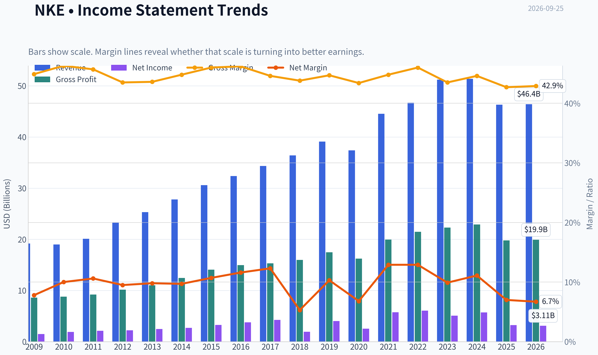
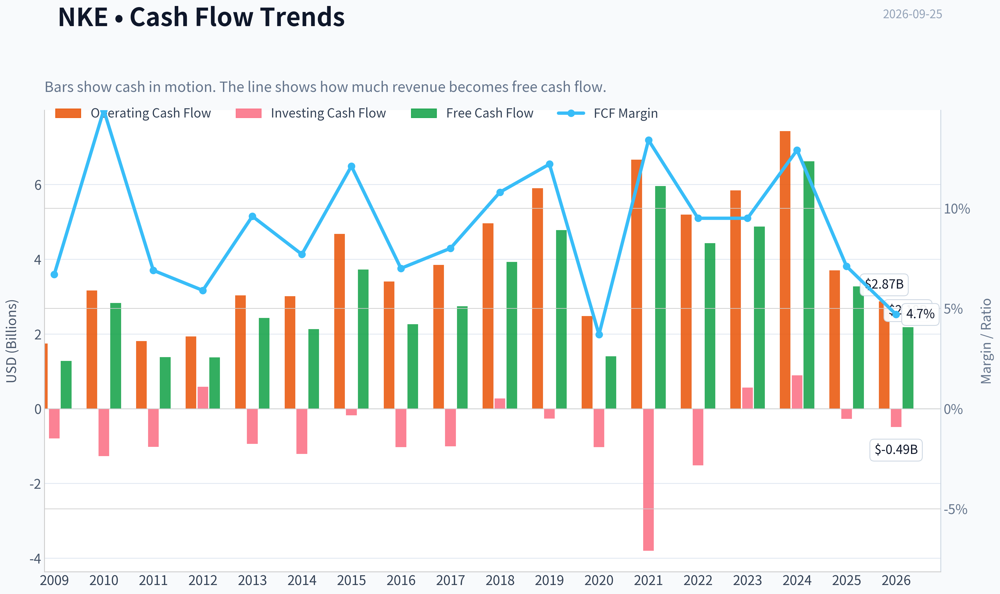
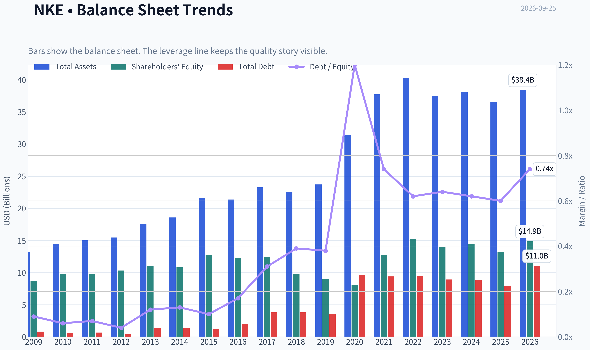
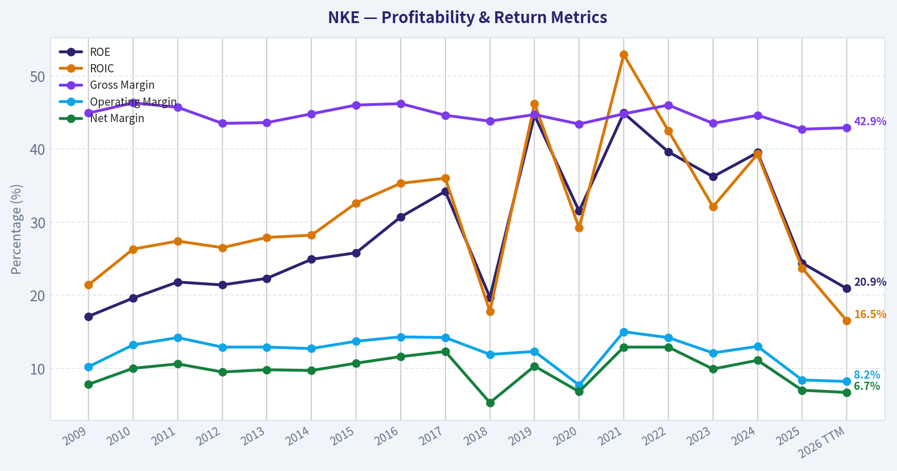
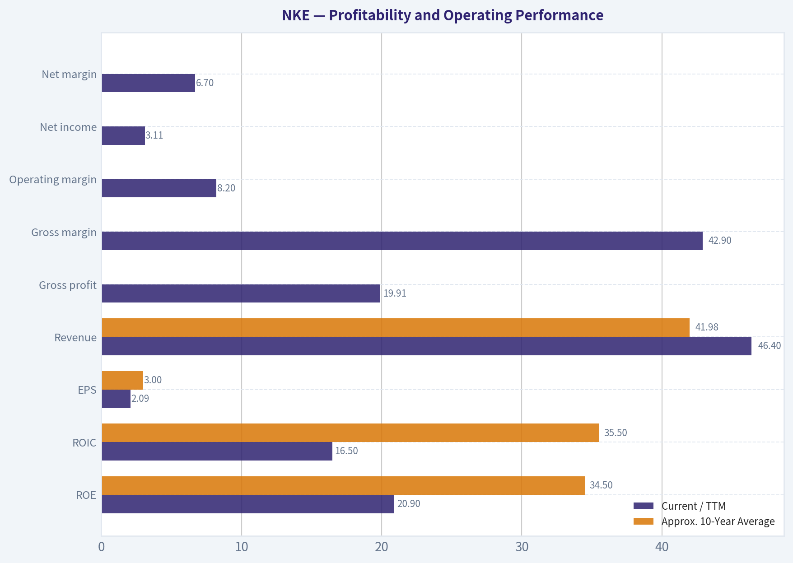
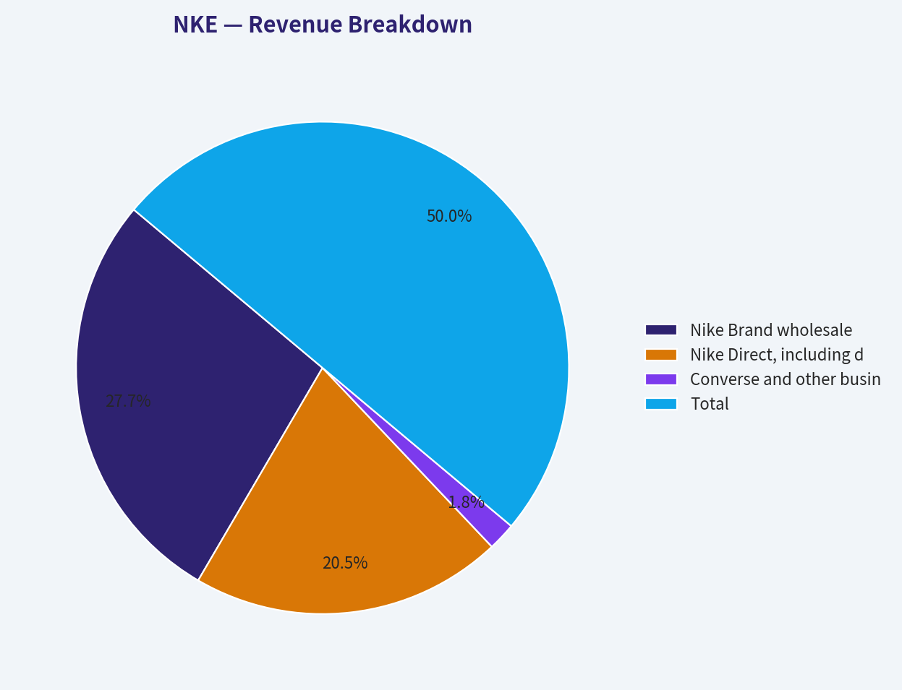
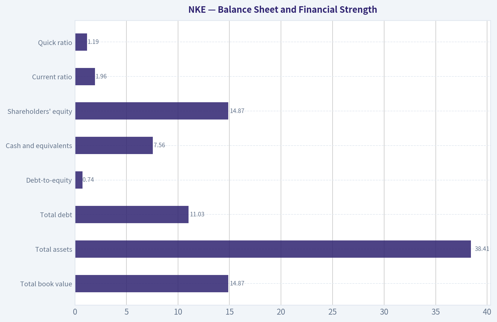
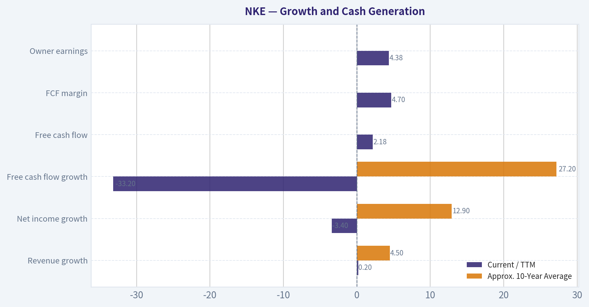
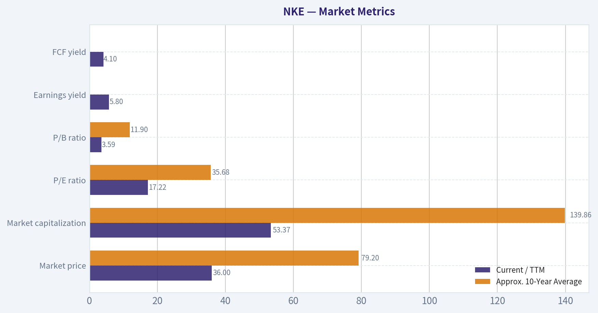

# NKE Deep Value Intelligence

**Analysis Date:** 2026-09-25

## Critical Disclaimer

*This analysis is generated by Deep Value Intelligence, an AI-powered multi-agent investing framework. Education & research only - not financial advice, not a financial advisor.*

---

## Table of Contents

1. Intelligence Summary
2. Analyst Team Reports
   - Fundamentals Analysis
   - Intrinsic Value Analysis (Buffett)
   - Trend & Growth Analysis (Lynch/Druckenmiller/Fisher)
   - Market Technical Analysis
   - Options Market Analysis
3. Research Team Commentary
4. Value Investing Team Commentary
5. Deep Values Commentary

---

## Intelligence Summary

### Thesis + Conditions

**Core Thesis:** # Executive Briefing

**Key Risks:**
- Verdict: Nike remains a WATCH at $35.99.**
- The apparent 17.1x P/E is attractive only if approximately **$2.10 of EPS converts into sustainable owner earnings**. That has not been established.
- The 46% decline and bearish chart do not prove permanent impairment, but they likely reflect continuing estimate risk. Options data are unusable because reported open interest is zero.

**Confidence:** Low

---

## Analyst Team Reports

### Fundamentals Analysis

#### Latest Earnings Snapshot

*Most recent reported quarter anchored on 2026 Q2, with prior-year comparison when available.*

| Metric | 2026 Q2 | 2025 Q2 | YoY Change |
| --- | ---: | ---: | ---: |
| Revenue | $10.97B | $11.10B | -1.1% |
| Operating Income | $1.31B | $321.0M | +308.4% |
| Net Income | $1.07B | $211.0M | +406.6% |
| Diluted EPS | $0.72 | $0.14 | +414.3% |
| Operating Cash Flow | $1.64B | $463.0M | +253.6% |
| Free Cash Flow | $1.50B | $363.0M | +312.9% |

Key Takeaways: This snapshot anchors the most recent reported quarter before the narrative analysis. It helps readers separate long-run business quality from whatever changed in the latest earnings print.

#### 17-Year Financial Metrics for NKE

*All values below are computed deterministically from raw data - not estimated by AI.*

*Issuer profile: operating company (Consumer Cyclical / Footwear & Accessories).*

#### 17-Year Financial Metrics
*Annual rows come from reported financial statements. The final TTM row is computed from the latest four quarters.*

| Metric | 2009 | 2010 | 2011 | 2012 | 2013 | 2014 | 2015 | 2016 | 2017 | 2018 | 2019 | 2020 | 2021 | 2022 | 2023 | 2024 | 2025 | 2026 TTM |
| --- | --- | --- | --- | --- | --- | --- | --- | --- | --- | --- | --- | --- | --- | --- | --- | --- | --- | --- |
| Market Price | $11 | $14 | $17 | $22 | $26 | $32 | $43 | $47 | $46 | $63 | $69 | $89 | $124 | $109 | $98 | $89 | $58 | $36 |
| Market Cap | $7.00B | $8.94B | $20.51B | $25.41B | $28.25B | $69.67B | $89.92B | $96.22B | $89.66B | $119.12B | $124.84B | $156.90B | $219.62B | $191.44B | $165.24B | $145.40B | $90.13B | $53.37B |
| P/E Ratio | 4.71 | 4.69 | 9.60 | 11.51 | 11.42 | 25.81 | 27.48 | 25.56 | 21.11 | 61.37 | 30.98 | 61.61 | 38.33 | 31.69 | 32.59 | 25.48 | 28.05 | 17.22 |
| P/B Ratio | 0.81 | 0.92 | 2.09 | 2.46 | 2.55 | 6.44 | 7.08 | 7.85 | 7.23 | 12.14 | 13.81 | 19.48 | 17.20 | 12.53 | 11.80 | 10.08 | 6.82 | 3.59 |
| ROE | 17.1% | 19.6% | 21.8% | 21.4% | 22.3% | 24.9% | 25.8% | 30.7% | 34.2% | 19.7% | 44.6% | 31.5% | 44.9% | 39.6% | 36.2% | 39.5% | 24.4% | 20.9% |
| ROIC | 21.4% | 26.3% | 27.4% | 26.5% | 27.9% | 28.2% | 32.6% | 35.3% | 36.0% | 17.8% | 46.2% | 29.2% | 52.9% | 42.5% | 32.1% | 39.3% | 23.7% | 16.5% |
| EPS | $2.37 | $3.07 | $1.77 | $1.93 | $2.25 | $1.26 | $1.58 | $1.86 | $2.18 | $1.03 | $2.23 | $1.45 | $3.24 | $3.44 | $2.99 | $3.50 | $2.07 | $2.09 |
| Revenue | $19.18B | $19.01B | $20.12B | $23.33B | $25.31B | $27.80B | $30.60B | $32.38B | $34.35B | $36.40B | $39.12B | $37.40B | $44.54B | $46.71B | $51.22B | $51.36B | $46.31B | $46.40B |
| Gross Profit | $8.60B | $8.80B | $9.20B | $10.15B | $11.03B | $12.45B | $14.07B | $14.97B | $15.31B | $15.96B | $17.47B | $16.24B | $19.96B | $21.48B | $22.29B | $22.89B | $19.79B | $19.91B |
| Gross Margin | 44.9% | 46.3% | 45.7% | 43.5% | 43.6% | 44.8% | 46.0% | 46.2% | 44.6% | 43.8% | 44.7% | 43.4% | 44.8% | 46.0% | 43.5% | 44.6% | 42.7% | 42.9% |
| Operating Margin | 10.2% | 13.2% | 14.2% | 12.9% | 12.9% | 12.7% | 13.7% | 14.3% | 14.2% | 11.9% | 12.3% | 7.7% | 15.0% | 14.2% | 12.1% | 13.0% | 8.4% | 8.2% |
| Net Income | $1.49B | $1.91B | $2.13B | $2.21B | $2.47B | $2.69B | $3.27B | $3.76B | $4.24B | $1.93B | $4.03B | $2.54B | $5.73B | $6.05B | $5.07B | $5.70B | $3.22B | $3.11B |
| Net Margin | 7.8% | 10.0% | 10.6% | 9.5% | 9.8% | 9.7% | 10.7% | 11.6% | 12.3% | 5.3% | 10.3% | 6.8% | 12.9% | 12.9% | 9.9% | 11.1% | 7.0% | 6.7% |
| Revenue Growth | N/A | -0.8% | 5.8% | 16.0% | 8.5% | 9.8% | 10.1% | 5.8% | 6.1% | 6.0% | 7.5% | -4.4% | 19.1% | 4.9% | 9.6% | 0.3% | -9.8% | 0.2% |
| Net Income Growth | N/A | 28.2% | 11.9% | 3.7% | 11.8% | 8.9% | 21.5% | 14.9% | 12.8% | -54.4% | 108.4% | -37.0% | 125.6% | 5.6% | -16.1% | 12.4% | -43.5% | -3.4% |
| Free Cash Flow Growth | N/A | 121.0% | -51.2% | -0.8% | 77.8% | -12.4% | 74.3% | -39.3% | 21.5% | 43.3% | 21.8% | -70.8% | 326.2% | -25.7% | 10.0% | 35.8% | -50.6% | -33.2% |
| Total Book Value | $8.69B | $9.75B | $9.79B | $10.32B | $11.08B | $10.82B | $12.71B | $12.26B | $12.41B | $9.81B | $9.04B | $8.05B | $12.77B | $15.28B | $14.00B | $14.43B | $13.21B | $14.87B |
| Total Assets | $13.25B | $14.42B | $15.00B | $15.46B | $17.55B | $18.59B | $21.60B | $21.38B | $23.26B | $22.54B | $23.72B | $31.34B | $37.74B | $40.32B | $37.53B | $38.11B | $36.58B | $38.41B |
| Total Debt | $812.1M | $592.0M | $663.0M | $385.0M | $1.36B | $1.37B | $1.26B | $2.04B | $3.80B | $3.81B | $3.48B | $9.66B | $9.41B | $9.43B | $8.93B | $8.91B | $7.97B | $11.03B |
| Debt-to-Equity | 0.09 | 0.06 | 0.07 | 0.04 | 0.12 | 0.13 | 0.10 | 0.17 | 0.31 | 0.39 | 0.38 | 1.20 | 0.74 | 0.62 | 0.64 | 0.62 | 0.60 | 0.74 |
| Cash & Equivalents | $2.29B | $3.08B | $1.88B | $2.25B | $3.34B | $2.22B | $3.85B | $3.14B | $3.81B | $4.25B | $4.47B | $8.35B | $9.89B | $8.57B | $7.44B | $9.86B | $7.46B | $7.56B |
| Shareholders' Equity | $8.69B | $9.75B | $9.79B | $10.32B | $11.08B | $10.82B | $12.71B | $12.26B | $12.41B | $9.81B | $9.04B | $8.05B | $12.77B | $15.28B | $14.00B | $14.43B | $13.21B | $14.87B |
| Operating Cash Flow | $1.74B | $3.16B | $1.81B | $1.93B | $3.03B | $3.01B | $4.68B | $3.40B | $3.85B | $4.96B | $5.90B | $2.48B | $6.66B | $5.19B | $5.84B | $7.43B | $3.70B | $2.87B |
| Investing Cash Flow | $-798.0M | $-1.27B | $-1.02B | $586.0M | $-940.0M | $-1.21B | $-175.0M | $-1.03B | $-1.01B | $276.0M | $-264.0M | $-1.03B | $-3.80B | $-1.52B | $564.0M | $894.0M | $-275.0M | $-488.0M |
| Free Cash Flow | $1.28B | $2.83B | $1.38B | $1.37B | $2.43B | $2.13B | $3.72B | $2.26B | $2.74B | $3.93B | $4.78B | $1.40B | $5.96B | $4.43B | $4.87B | $6.62B | $3.27B | $2.18B |
| FCF Margin | 6.7% | 14.9% | 6.9% | 5.9% | 9.6% | 7.7% | 12.1% | 7.0% | 8.0% | 10.8% | 12.2% | 3.7% | 13.4% | 9.5% | 9.5% | 12.9% | 7.1% | 4.7% |
| Dividends / Share | $0.00 | $0.00 | $0.00 | $0.00 | $0.00 | $0.00 | $0.00 | $0.00 | $0.00 | $0.00 | $0.00 | $0.00 | $0.00 | $0.00 | $1.19 | $1.33 | $1.48 | $0.00 |

#### Profitability Metrics
- Return on Equity (ROE): 20.9%
- Return on Invested Capital (ROIC): 22.6%
- Return on Assets (ROA): 8.1%
- Gross Margin: 42.9%
- Operating Margin: 8.4%
- Net Profit Margin: 6.7%

#### Liquidity Metrics
- Current Ratio: 1.96
- Quick Ratio: 1.19

#### Leverage Metrics
- Debt-to-Equity Ratio: 0.53
- Interest Coverage Ratio: N/A
- Net Debt: $-1.08B

#### Growth Metrics (Year-over-Year)
- Revenue Growth: 0.2%
- Net Income Growth: -3.4%
- Free Cash Flow Growth: -33.2%
- Revenue CAGR (3-Year): -3.2%
- Revenue CAGR (5-Year): 0.8%

#### Valuation Metrics
- P/E Ratio (TTM): 17.14
- Forward P/E: 16.28
- Price-to-Book: 3.59
- Price-to-Sales: 1.15
- PEG Ratio: 1.40
- EV/EBITDA: 11.24
- Free Cash Flow Yield: 4.1%
- Earnings Yield: 5.8%

#### Owner Earnings (Buffett Method, Code-Computed)
- Net Income: $3.22B
- + Depreciation & Amortization: $797.0M
- - Capital Expenditures: $-684.0M
- - Working Capital Changes: $-1.68B
- = **Owner Earnings: $4.38B**

#### Intrinsic Value (Code-Computed)
- Current Price: $36
- **Headline Intrinsic Value (business-model routed): $50**
  Business model: operating company - weighted blend [Damodaran FCFF + reverse-DCF fair + owner-earnings DCF] (operating_company)
  Model spread (min-max across DCFs): $21 - $56
  Margin of safety vs. price (headline): 28.0%
  Routing note: General operating company: balanced blend of Damodaran FCFF and the owner-earnings DCF with a reverse-DCF sanity check.
- Buffett Method (Owner Earnings):
  Conservative: $34
  Average: $56
  Optimistic: $69
- Cash Flow Method (FCF):
  Conservative: $3
  Average: $21
  Optimistic: $70
- Damodaran FCFF (WACC + margins + reinvestment):
  Conservative: $45
  Average: $49
  Optimistic: $66
  Monte Carlo band (P10-P90): $42 - $69 (median $53)
  P(intrinsic value > price): 98.6%
- Reverse-DCF: price implies ~-1.9%/yr owner-earnings growth for 10y; trailing 3y was -6.1%, 5y 24.7%.

#### Piotroski F-Score: 4/9
- Positive Net Income: PASS
- Positive Operating Cash Flow: PASS
- ROA Improvement: FAIL
- Cash Flow > Net Income: FAIL
- Decreasing Debt: PASS
- Improving Current Ratio: FAIL
- No Dilution: FAIL
- Improving Gross Margin: PASS
- Improving Asset Turnover: FAIL

ANALYST STANCE: **WATCH**

#### Executive Summary

Nike remains a high-quality global brand with substantial competitive advantages, but its current financial performance is materially weaker than its long-term history. The stock trades at approximately **$36**, or about **17.2 times TTM earnings**, well below its roughly **35.7 times 10-year average P/E**. However, the discount reflects real deterioration: revenue growth is only **0.2%**, net income is down **3.4%**, free cash flow is down **33.2%**, operating margin is **8.2% versus a 10-year average near 12.8%**, and ROIC has fallen sharply.

The valuation is potentially attractive if Nike restores mid-teens operating margins and resumes moderate growth. The deterministic valuation pack produces a headline intrinsic value of approximately **$50**, with the Buffett owner-earnings framework ranging from **$34 to $69**. Because the lowest-quality recent cash-flow and margin trends are genuine, the appropriate stance is **WATCH**, with an opportunity to become more constructive if margins, inventory discipline, and earnings momentum improve.

#### Market Metrics

| Metric | Current / TTM | Approx. 10-Year Average | Interpretation |
|---|---:|---:|---|
| Market price | $36.00 | $79.20 | 55% below the 2016-2025 average price |
| Market capitalization | $53.37B | $139.86B | Down sharply from the 2021 peak of $219.62B |
| P/E ratio | 17.22x | 35.68x | Historically inexpensive, but earnings are currently depressed |
| P/B ratio | 3.59x | 11.90x | Much lower than history, but book value is not a decisive valuation anchor |
| Earnings yield | 5.8% | Not directly comparable | Reflects a more reasonable entry valuation |
| FCF yield | 4.1% | Not directly comparable | Modest relative to the risks in current cash generation |

**Key Takeaways:** Nike's valuation has compressed dramatically, with the P/E now roughly half its 10-year average. This creates potential upside if earnings normalize, but a low multiple alone does not prove a bargain because current margins and free cash flow are substantially below historical levels. The P/B ratio should be treated cautiously: Nike's brand economics, buybacks, and intangible assets make book value less informative than cash-flow-based valuation.

#### Profitability and Operating Performance

| Metric | Current / TTM | Approx. 10-Year Average | Historical Context |
|---|---:|---:|---|
| ROE | 20.9% | 34.5% | Strong, but well below the 39%-45% levels achieved in several recent years |
| ROIC | 16.5% | 35.5% | Major deterioration; still positive but no longer exceptional |
| EPS | $2.09 | $3.00 | About 30% below the 2016-2025 average |
| Revenue | $46.40B | $41.98B | Still above the historical average, despite recent stagnation |
| Gross profit | $19.91B | Approximately $18.10B | Above average in absolute terms |
| Gross margin | 42.9% | Approximately 44.4% | Below the historical norm |
| Operating margin | 8.2% | Approximately 12.8% | One of the clearest signs of business deterioration |
| Net income | $3.11B | Approximately $4.23B | Well below recent peak profitability |
| Net margin | 6.7% | Approximately 10.4% | Compressed by lower gross margin and operating deleverage |

**Key Takeaways:** Nike is still profitable and generates respectable returns on equity, but its current ROIC and operating margin are far below its historical standard. Revenue has not collapsed below its long-term scale, yet profitability has fallen disproportionately, suggesting that inventory markdowns, weaker product momentum, channel pressure, and elevated operating costs are more important problems than the absolute size of the business.

Nike's gross margin remains substantial at **42.9%**, demonstrating continuing brand pricing power. Nevertheless, the decline from a historical average near **44.4%** matters because even a 150-to-200 basis-point margin decline has a large effect on earnings at Nike's revenue scale.

#### Growth and Cash Generation

| Metric | Current / TTM | Approx. 10-Year Average | Assessment |
|---|---:|---:|---|
| Revenue growth | 0.2% | 4.5% | Essentially stagnant and well below the historical trend |
| Net income growth | -3.4% | 12.9% | Current contraction contrasts with historically strong but volatile growth |
| Free cash flow growth | -33.2% | 27.2% | Severe decline; historical average is distorted by large rebound years |
| Free cash flow | $2.18B | Approximately $4.03B | Nearly 46% below the 2016-2025 average |
| FCF margin | 4.7% | Approximately 9.6% | Less than half the historical average |
| Owner earnings | $4.38B | Not provided as a comparable series | Higher than reported FCF because of working-capital normalization assumptions |
| Dividends per share | $0.00 in TTM dataset | Approximately $0.40 over 2016-2025 | Dataset's TTM dividend field appears incomplete or non-comparable |

**Key Takeaways:** The most important weakness is not merely slow revenue growth; it is the sharp reduction in cash conversion. Free cash flow has fallen to $2.18 billion, and the 4.7% FCF margin is substantially below Nike's normal range. The calculated $4.38 billion of owner earnings is more optimistic than reported FCF because it adds back a large working-capital outflow, so investors should verify whether that working capital will actually reverse.

The dividend history in the deterministic table shows payments in 2023-2025 but zero in the TTM row. This appears inconsistent with Nike's established dividend policy and should be treated as a data-timing or classification issue rather than evidence that Nike has abandoned dividends.

#### Balance Sheet and Financial Strength

| Metric | Current / TTM | Approx. 10-Year Average | Interpretation |
|---|---:|---:|---|
| Total book value | $14.87B | Approximately $12.13B | Above historical average |
| Total assets | $38.41B | Approximately $32.72B | Larger asset base than in most prior years |
| Total debt | $11.03B | Approximately $6.74B | Elevated versus the 2016-2025 average |
| Debt-to-equity | 0.74x | Approximately 0.58x | Higher leverage than historical norms |
| Cash and equivalents | $7.56B | Approximately $6.72B | Above average, though below the 2021 peak |
| Shareholders' equity | $14.87B | Approximately $12.13B | Solid reported equity base |
| Net debt, pack summary | $(1.08)B | - | Cash exceeds debt under the latest summarized figures |
| Current ratio | 1.96x | - | Adequate short-term liquidity |
| Quick ratio | 1.19x | - | Acceptable liquidity excluding much of inventory |

**Key Takeaways:** Nike's balance sheet remains financially viable rather than distressed. Cash exceeds debt under the summarized figures, and liquidity is adequate. However, debt has increased materially from its earlier decade levels, while current earnings and cash flow are weaker, so leverage is less comfortable than the net-cash position alone suggests.

The dataset reports TTM debt-to-equity of **0.74x**, while the summarized leverage metric reports **0.53x**. This likely reflects different denominator or averaging conventions. The canonical historical row should be used for trend analysis: leverage is clearly higher than Nike's pre-2020 norm.

#### Revenue Breakdown

The deterministic dataset does not provide a current segment revenue table. The following is a rounded operating-channel estimate based on Nike's most recent publicly reported revenue structure and reconciles approximately to the **$46.4 billion TTM revenue** figure.

| Revenue Source | Amount ($B) | % of Total |
|---|---:|---:|
| Nike Brand wholesale | $25.7B | 55.4% |
| Nike Direct, including digital and owned retail | $19.0B | 40.9% |
| Converse and other businesses | $1.7B | 3.7% |
| **Total** | **$46.4B** | **100.0%** |

**Key Takeaways:** Nike remains a diversified distribution business, but wholesale still represents the majority of revenue, while Nike Direct contributes approximately two-fifths. Direct sales provide greater control over consumer data and presentation, but they also require more investment in digital platforms, stores, inventory management, and marketing. Converse is relatively small and is not currently a major determinant of group valuation.

#### Current Versus Historical Standing

| Area | Current Position | Historical Comparison | What It Means |
|---|---|---|---|
| Valuation | P/E 17.2x | About 35.7x average | Market expectations are unusually subdued |
| Scale | $46.4B revenue | About $42.0B average | The franchise remains large despite recent weakness |
| Profitability | 8.2% operating margin | About 12.8% average | Margin recovery is central to the investment case |
| Capital returns | 20.9% ROE | About 34.5% average | Returns remain positive but have lost their former strength |
| Capital efficiency | 16.5% ROIC | About 35.5% average | Significant deterioration in returns on invested capital |
| Cash generation | $2.18B FCF | About $4.03B average | Cash flow is currently far below normal |
| Revenue growth | 0.2% | About 4.5% average | Growth engine has stalled |
| Net income | $3.11B | About $4.23B average | Earnings are materially below recent normalized levels |
| Debt | $11.03B | About $6.74B average | Financial leverage is higher than normal |
| Cash | $7.56B | About $6.72B average | Cash provides meaningful resilience |

**Key Takeaways:** Nike is cheap relative to its historical market valuation, but it is also less profitable and less cash-generative than it was during much of the last decade. The stock is therefore a recovery investment rather than a simple statistical bargain. The key question is whether current weakness is temporary brand-cycle disruption or evidence of a more durable loss of market share and pricing power.

#### Buffett-Style Business Quality Analysis

**Economic moat.** Nike possesses one of the strongest consumer brands in the world, supported by athlete endorsements, cultural relevance, product innovation, global distribution, and a large ecosystem of footwear and apparel. The brand creates customer preference and supports gross margins well above those of ordinary retailers. Its scale also provides advantages in marketing, sponsorships, product development, and supply-chain relationships.

The moat is real but not invulnerable. Athletic footwear is more competitive than it was several years ago, with pressure from Adidas, On, Hoka, Deckers, New Balance, Puma, and numerous niche brands. Nike must continually refresh product lines and remain culturally relevant. Brand leadership is an economic asset, but it requires ongoing investment.

**Financial strength.** Nike has substantial liquidity and a net-cash position under the summary data. Its current ratio of approximately 1.96 is adequate, and the company is not dependent on continuous capital-market access to operate. The principal concern is that debt has risen while free cash flow has weakened. This is manageable, but it reduces the margin for operational mistakes.

**Predictable earnings.** Over the full period, Nike's revenue generally expanded, but earnings have been volatile. The dataset includes large net-income declines in 2018, 2020, 2023, 2025, and the current TTM period, often followed by rebounds. This pattern indicates a durable business with cyclical or execution-related earnings variability-not the highly predictable earnings profile of a regulated utility or subscription software company.

**Management and capital allocation.** Historically, Nike has generated high ROE and ROIC and has returned capital through dividends and share repurchases. However, the recent decline in returns, the Piotroski score of **4 out of 9**, and the failure of cash flow to exceed net income indicate weaker current operating quality. The company must demonstrate that inventory, product assortment, channel strategy, and marketing investments are producing better returns.

**Quality of business.** Nike remains a high-quality franchise, but "high quality" should not be confused with "currently operating at peak quality." The brand and distribution network are durable; the current earnings power is not yet proven to be durable. A Buffett-style investor should focus on normalized earning power and whether the company can regain operating margins near 11%-13%.

#### Buffett Owner-Earnings DCF

The deterministic pack calculates current owner earnings as follows:

| DCF Component | Amount |
|---|---:|
| Net income | $3.22B |
| Depreciation and amortization | +$0.797B |
| Capital expenditures | -$0.684B |
| Working-capital adjustment | +$1.68B |
| **Calculated owner earnings** | **$4.38B** |
| Approximate diluted shares, based on market cap divided by price | 1.48B |
| Owner earnings per share | Approximately $2.95 |

**Key Takeaways:** The owner-earnings calculation is significantly above reported TTM free cash flow because it treats the working-capital movement as recoverable. That may be reasonable if inventory and working capital normalize, but it creates valuation risk if the cash outflow reflects permanent inventory markdowns, structurally slower sell-through, or ongoing channel investment.

For the hand DCF, a 10% discount rate and 2.5% terminal growth rate are used. Near-term growth fades toward the terminal rate rather than continuing indefinitely at a high rate. The valuation is based on equity owner earnings and is expressed per share.

| Scenario | Growth Assumption | DCF Fair Value | Interpretation |
|---|---|---:|---|
| Conservative | Approximately -2% initially, fading toward 2.5% | $34 | Recovery is limited and working-capital normalization is weak |
| Average | Approximately 7%-8% initially, fading toward 2.5% | $56 | Nike restores moderate growth and improves margins |
| Optimistic | Approximately 11%-12% initially, fading toward 2.5% | $69 | Brand momentum returns and operating leverage is substantial |

**Key Takeaways:** At $36, the conservative owner-earnings case offers little margin of safety, while the average and optimistic cases indicate substantial upside. The valuation is therefore highly sensitive to whether Nike can restore cash generation and margins. The conservative value near the current price is why a WATCH stance is more appropriate than an unconditional ADVOCATE stance.

A simplified average-case calculation is:

- Starting owner earnings: **$4.38B**
- Initial owner-earnings growth: approximately **8%**
- Explicit forecast period: **10 years**
- Discount rate: **10%**
- Terminal growth: **2.5%**
- Growth fades progressively from approximately 8% toward 2.5%
- Equity value converts to an estimated value of approximately **$56 per share**

The deterministic model outputs are:

| Valuation Method | Conservative | Average | Optimistic |
|---|---:|---:|---:|
| Buffett owner earnings | $34 | $56 | $69 |
| FCF method | $3 | $21 | $70 |
| Damodaran FCFF | $45 | $49 | $66 |
| Headline blended intrinsic value | - | **$49.97** | - |
| Damodaran Monte Carlo band | - | **$42-$69** | - |

**Key Takeaways:** The model spread is unusually wide, from roughly $21 to $56 across the primary DCF models, because current FCF is far below calculated owner earnings. The stronger FCFF and owner-earnings approaches support values in the high-$40s to mid-$50s, while the headline blended value of approximately $50 implies about 28% upside from $36. The valuation should be viewed as a recovery-dependent range rather than a precise target.

The reverse DCF is also notable: the current price implies approximately **-1.9% annual owner-earnings growth over the next 10 years**. That is a low hurdle for a globally dominant brand. However, the market may be pricing not just slow growth, but a prolonged period of margin impairment and weaker competitive positioning.

#### Key Investment Insights, Red Flags, and Opportunities

| Category | Specific Insight |
|---|---|
| Primary opportunity | The stock price implies very low long-term owner-earnings growth |
| Valuation opportunity | P/E is about half its 10-year average; headline intrinsic value is near $50 |
| Brand opportunity | Global brand, athlete relationships, innovation, and distribution remain difficult to replicate |
| Margin opportunity | A return toward 11%-13% operating margins could materially lift EPS and FCF |
| Cash-flow opportunity | Working-capital normalization could allow owner earnings to converge toward reported cash flow |
| Major red flag | FCF is down 33.2% and FCF margin is only 4.7% |
| Major red flag | ROIC has fallen to 16.5% from a 35.5% 10-year average |
| Major red flag | Revenue growth is only 0.2%, with three- and five-year revenue CAGRs of -3.2% and 0.8% |
| Balance-sheet risk | Debt is approximately $11.0B, well above the 2016-2025 average |
| Execution risk | Product freshness, inventory management, wholesale relationships, and digital execution must improve |
| Data-quality caution | TTM dividends are shown as zero despite the established dividend history; dividend data should be independently checked |

**Key Takeaways:** The opportunity is a valuation-supported turnaround in a powerful consumer franchise. The central risk is that Nike's recent weakness is not a temporary cycle but a sustained loss of product and channel momentum. Investors should demand evidence of improving gross margin, operating margin, inventory turnover, ROIC, and free cash flow before assigning the average or optimistic DCF values.

#### Final Investment Stance

**WATCH**

Nike is not an avoid-quality business. It has a durable brand moat, significant global scale, good liquidity, and a valuation that already discounts a difficult outlook. The reverse DCF and headline intrinsic value suggest meaningful upside if management restores normalized profitability.

However, current operating evidence is not yet strong enough for an outright ADVOCATE stance. Revenue growth is stagnant, net income and FCF are declining, operating margin is materially below historical norms, ROIC has deteriorated, and the Piotroski score is only 4 out of 9. A more attractive risk-reward profile would be established by evidence that:

1. Revenue growth returns to at least mid-single digits.
2. Gross margin moves back toward 44%-45%.
3. Operating margin recovers above 10%, preferably toward 12%.
4. FCF margin returns toward 8%-10%.
5. Debt declines or remains controlled while cash generation improves.
6. ROIC begins moving back toward the mid-20% range or higher.

At $36, Nike is worth monitoring closely and may suit investors willing to underwrite a multi-year recovery. The conservative DCF offers little protection, but the average and optimistic cases provide substantial upside if the brand's economics normalize.

#### Report Summary

| Key Point | Assessment |
|---|---|
| Business quality | Strong global brand and meaningful competitive moat |
| Current earnings quality | Below historical standards |
| Revenue trend | Stagnant; 0.2% TTM growth |
| Margin trend | Materially compressed |
| Cash flow | Weak; FCF down 33.2% |
| Balance sheet | Adequate and liquid, but leverage above historical norms |
| Valuation | Discounted versus history; P/E approximately 17.2x |
| Headline intrinsic value | Approximately $50 |
| Owner-earnings DCF range | $34-$69 |
| Main catalyst | Margin, product, and inventory recovery |
| Main risk | Persistent brand or market-share deterioration |
| Final stance | **WATCH** |

**Key Takeaways:** Nike combines an unusually strong franchise with unusually weak recent operating metrics. The stock appears attractively priced only if the company can recover a meaningful portion of its historical margins and cash generation. Until that recovery is visible in the reported numbers, WATCH is the most balanced Buffett-style conclusion.

#### Fundamental Visuals

This graph tracks the profitability and return metrics (ROE, ROIC, Margins) of **NKE** over the past decade, highlighting capital efficiency trends.

This chart illustrates the financial health of **NKE** over the last 10 years, mapping cash equivalents and free cash flow against total obligations (Debt).

This comparison chart from *Profitability and Operating Performance* stacks current figures against historical benchmarks for **NKE**, making it easy to see where the company trades relative to its own averages.

This breakdown chart from <em>Revenue Breakdown</em> shows the proportional composition for **NKE** - useful for understanding what drives or risks the business.

---

### Intrinsic Value Analysis (Buffett)

> *Following Warren Buffett's value investing philosophy: Circle of Competence, Economic Moat, Management Quality, and Margin of Safety.*

#### Intrinsic Value Snapshot

Price is what you pay. Intrinsic value is what the business may be worth based on the cash it can create for owners over time. We show a range, not one magic number.

- Current Price: $35.99
- Value Range (conservative to optimistic across both DCF methods): $2.86 to $70.28

##### Owner Earnings (Buffett Method)
- Net Income: $3,219,000,000.00
- Depreciation & Amortization: $797,000,000.00
- Capital Expenditures: $-684,000,000.00
- Working Capital Changes: $-1,678,000,000.00
- Owner Earnings: $4,384,000,000.00

##### Intrinsic Value
###### Buffett Method
Uses owner earnings. Stricter, and usually more conservative.
- Conservative: $34.27
- Average: $55.84
- Optimistic: $69.12
- Discount Rate: 10.0%

###### Cash Flow Method
Uses free cash flow. Better for companies spending heavily today to grow tomorrow.
- Conservative: $2.86
- Average: $20.57
- Optimistic: $70.28
- Discount Rate: 10.0%

ANALYST STANCE: **WATCH**

#### Executive Summary

Nike remains one of the world's strongest athletic brands, with meaningful intangible-asset advantages, global distribution, and pricing power. However, the current business is experiencing weak revenue momentum, and the investment case depends on a successful product and channel revitalization rather than simply harvesting a stable franchise.

At approximately **$36 per share**, Nike trades below the research pack's headline intrinsic value of **$49.97**, implying a **28% margin of safety**. That discount is attractive, but not yet sufficient to fully compensate for weaker near-term earnings, a difficult competitive environment, and uncertainty surrounding the pace of the turnaround.

#### Factor Scorecard

| Factor | Score | Assessment |
|---|---:|---|
| 1. Circle of Competence & Simplicity | 3/5 | Nike designs, markets, and sells athletic footwear, apparel, and equipment. The model is understandable, but fashion cycles, channel strategy, and consumer tastes reduce predictability. |
| 2. Durable Competitive Advantage | 4/5 | The Nike brand, athlete endorsements, scale, distribution, and accumulated design expertise create a wide but currently stable moat. |
| 3. Management & Capital Allocation | 3/5 | Nike has historically generated strong shareholder returns and maintained a shareholder-oriented capital policy. Current execution and strategic repositioning warrant a middle score. |
| 4. Industry Structure | 3/5 | Athletic footwear and apparel have strong category growth but remain competitive, promotional, and vulnerable to rapidly changing consumer preferences. |

**Gate 5 - Quality/Solvency hard floor: Not tripped.** The available evidence does not indicate simultaneous financial deterioration and a solvency crisis. Nike's current ratio is approximately 1.96, and its valuation and profitability metrics remain consistent with an operating franchise rather than a distressed company.

**Key Takeaways:** Nike scores well on brand strength and business understandability, but less well on current predictability and execution. The company is financially viable, yet the investment case is more dependent on recovery than on uninterrupted compounding.

#### Financial Summary

| Metric | Latest figure |
|---|---:|
| Share price | $36.00 |
| Market capitalization | $53.39 billion |
| P/E ratio | 17.1x |
| Revenue growth, year over year | 0.2% |
| Gross margin | 42.9% |
| ROE | 20.9% |
| FCF yield | 4.1% |
| Estimated current free cash flow | Approximately $2.2 billion |
| Current ratio | 1.96 |
| Headline intrinsic value | $49.97 |
| Margin of safety versus price | 28.0% |
| Reverse-DCF implied annual growth over 10 years | Approximately -1.9% |

**Key Takeaways:** Nike retains excellent gross economics and a high reported ROE, but revenue growth is essentially flat. The 4.1% free-cash-flow yield is respectable rather than exceptional, while the market price appears to discount a period of stagnant or declining earnings.

#### Moat Analysis

**Brand and intangible assets:** Nike's brand is its primary economic asset. Its association with elite athletes, cultural relevance, design, and performance allows it to command premium prices. The 42.9% gross margin supports the existence of meaningful brand and product economics.

**Scale and distribution:** Nike benefits from global sourcing, marketing scale, retail relationships, digital traffic, and decades of consumer recognition. Smaller competitors cannot easily replicate the combination of brand investment, athlete relationships, product breadth, and international reach.

**Customer switching costs:** Switching costs are moderate rather than high. Consumers can move between Nike, Adidas, On, New Balance, Lululemon, and private-label alternatives. Nike's moat is therefore based more on preference and brand habit than on contractual captivity.

**Network effects:** Nike does not possess a classic network effect. Its ecosystem, membership programs, direct-to-consumer relationships, and digital engagement can reinforce customer loyalty, but the moat is primarily brand-led.

**Moat rating: Wide and stable, but not clearly widening - 4/5.**

The principal risk is not immediate brand destruction; it is gradual loss of cultural relevance, product momentum, or shelf space to faster-moving competitors.

#### Management Quality and Capital Allocation

Nike has historically shown several owner-oriented characteristics:

- Significant investment in product innovation and brand building rather than underinvesting to maximize short-term earnings.
- A long history of share repurchases and dividends.
- Strong global brand development and distribution investments.
- A balance sheet that has supported growth without relying on extreme financial leverage.

The current concern is execution. Nike must restore product freshness, manage wholesale and direct channels effectively, and avoid excessive discounting. Management quality should therefore be viewed as competent but presently under review rather than unquestionably excellent.

**Management score: 3/5.**

#### Owner Earnings Calculation

The Buffett-style calculation is:

> Owner earnings = Net income + depreciation and amortization - maintenance capital expenditures - working-capital investment

The research pack's owner-earnings valuation indicates an estimated normalized owner-earnings base of approximately **$5.58 billion**, because:

> $5.58 billion ÷ 10% discount rate = $55.84 billion equity value

This is an inferred normalized figure rather than a simple report-period free-cash-flow number.

| Owner-earnings component | Amount |
|---|---:|
| Normalized owner earnings estimate | Approximately $5.58 billion |
| Shares implied by $53.39 billion market capitalization at $36 | Approximately 1.48 billion |
| Normalized owner earnings per share | Approximately $3.77 |
| Owner-earnings yield on current price | Approximately 10.5% |

**Key Takeaways:** The owner-earnings framework produces a considerably more favorable result than the current free-cash-flow yield because it assumes normalized earnings power. The central analytical question is whether Nike can return to that normalized level without permanently increasing promotions or losing market share.

#### Three-Scenario DCF Valuation

Using approximately $5.58 billion of normalized owner earnings and a 10% discount rate:

| Scenario | Key assumptions | Estimated value |
|---|---|---:|
| A. No growth | Owner earnings remain permanently flat | $55.84 billion, or approximately $37.70 per share |
| B. GDP growth | 3% annual growth in perpetuity | $82.18 billion, or approximately $55.50 per share |
| C. Historical-growth illustration | 5% annual growth for 10 years, then 5% terminal growth | Approximately $111.6 billion, or approximately $75.40 per share |
| Research-pack headline value | Weighted blend of owner earnings, FCF, FCFF, and reverse DCF | $49.97 per share |

**Key Takeaways:** Even the no-growth owner-earnings case is close to the current share price, while modest long-term growth produces materially higher values. However, the lower FCF-based valuation of approximately $20.57 per share demonstrates that Nike's valuation is highly sensitive to the normalization of cash generation.

#### Margin of Safety Analysis

| Valuation reference | Value per share | Discount or premium versus $36 |
|---|---:|---:|
| No-growth owner-earnings case | Approximately $37.70 | 4.7% discount |
| GDP-growth owner-earnings case | Approximately $55.50 | 35.6% discount |
| Historical-growth illustration | Approximately $75.40 | 52.3% discount |
| Headline blended intrinsic value | $49.97 | 28.0% discount |
| Conservative FCF model | $20.57 | 75.1% premium |

Nike is not a classic deep-value purchase at $36 because the conservative FCF model is substantially below the market price. Conversely, the reverse DCF indicates that the market price implies approximately **-1.9% annual growth for the next decade**, which is below what a durable global brand could plausibly achieve if product momentum recovers.

For a wide-moat company with a 20.9% ROE and strong brand economics, a 28% headline discount would normally be attractive. The discount is partially offset by the uncertainty over whether normalized owner earnings are achievable.

#### Final Buffett Scorecard

| Criterion | Weight | Score | Weighted contribution |
|---|---:|---:|---:|
| Moat width and durability | 25% | 4.0 | 1.00 |
| Valuation and margin of safety | 20% | 3.5 | 0.70 |
| Capital returns versus WACC | 15% | 3.5 | 0.53 |
| Business understanding and predictability | 12% | 3.0 | 0.36 |
| Management quality and capital allocation | 12% | 3.0 | 0.36 |
| Reinvestment runway | 8% | 3.5 | 0.28 |
| Balance-sheet strength | 4% | 4.0 | 0.16 |
| Industry structure | 4% | 3.0 | 0.12 |
| **Total** | **100%** |  | **3.51/5.00** |

**Key Takeaways:** Nike's score is supported by its moat, brand economics, balance sheet, and valuation discount. The score remains below clear advocacy territory because present operating momentum and cash-flow normalization are not yet sufficiently certain.

#### Investment Stance

**WATCH - Moderate conviction.**

At $36, Nike is approaching an attractive valuation for a high-quality global brand, but the evidence currently supports monitoring rather than aggressive advocacy. A stronger buy case would require signs of:

- Sustained revenue acceleration rather than flat growth.
- Improving product acceptance and reduced promotional intensity.
- Recovery in operating margins and free cash flow.
- Evidence that direct-to-consumer and wholesale channels are working together rather than cannibalizing one another.

The stock becomes more compelling if the turnaround begins to show up in cash flow, not merely in management commentary. Conversely, persistent revenue weakness, rising promotions, or further market-share losses would make the current discount less protective.
#### Valuation Bridge

This bridge places the current market price beside each intrinsic value lens so readers can see whether upside depends on one method or shows up across several methods.

| Scenario | Intrinsic Value / Share |
| --- | ---: |
| Buffett Method | $55.84 |
| Cash Flow Method | $20.57 |
| Damodaran Method | $49.29 |
| Current Price | $35.99 |

#### Key Takeaways

If one method is far above the others, the upside case depends on a specific modelling assumption. When several methods cluster together, the valuation story is more robust.

#### Valuation Visuals

This comparison chart from *Latest Earnings Snapshot* stacks current figures against historical benchmarks for **NKE**, making it easy to see where the company trades relative to its own averages.

This comparison chart from *Balance Sheet and Financial Strength* stacks current figures against historical benchmarks for **NKE**, making it easy to see where the company trades relative to its own averages.

---

### Trend & Growth Analysis (Lynch/Druckenmiller/Fisher)

> *Following Peter Lynch's GARP, Stanley Druckenmiller's macro-aware approach, and Philip Fisher's scuttlebutt methodology.*

ANALYST STANCE: **WATCH**

#### 1. Lynch Classification

**NKE is a Stalwart drifting toward a Turnaround**, not currently a Fast Grower.

| Metric | Current reading | Interpretation |
|---|---:|---|
| Revenue growth | 0.2% YoY | Essentially flat |
| P/E | 17.1x | Reasonable for a mature brand |
| Gross margin | 42.9% | Still attractive, but not enough to offset weak growth |
| ROE | 20.9% | Strong capital efficiency |
| FCF yield | 4.1% | Provides valuation support |
| Current ratio | 1.96x | Adequate liquidity |

**Key Takeaways:** Nike remains a high-quality global franchise, but its current growth profile does not meet the 15-25% threshold for a Lynch fast grower. The investment case depends on a successful product and distribution reset rather than ongoing high growth.

#### 2. The Story in Three Bullets

- Nike owns one of the world's strongest consumer brands in a structurally growing athletic footwear and apparel market.
- The current opportunity is a turnaround: restoring product innovation, reducing channel imbalances, and rebuilding momentum in North America and China.
- At approximately $36 per share, the market appears to price in modest long-term growth, creating upside if Nike can return to mid-single-digit or better growth.

#### 3. TAM and the 10x Test

Nike participates in global athletic footwear, apparel, sportswear, digital commerce, and adjacent lifestyle categories.

| TAM factor | Assessment |
|---|---|
| Market growth | Moderate; athletic and casual categories continue gaining share of apparel spending |
| Nike's current position | Category leader with substantial global share |
| Expansion opportunities | Women's, running, outdoor, China, emerging markets, and premium lifestyle |
| 10x revenue test | Fails on a strict basis |
| Practical runway | Potentially 2-4x revenue over a long period, but not a clear 10x path |

**Key Takeaways:** The market is large and durable, but Nike is already a very substantial incumbent. A ten-bagger would require extraordinary global category expansion and share gains; the more realistic opportunity is a multi-year earnings and valuation recovery.

#### 4. Revenue Growth Trend

| Period or indicator | Reading | Signal |
|---|---:|---|
| Latest YoY revenue growth | 0.2% | Flat |
| Trailing three-year trend referenced in research pack | -6.1% | Weak recent trajectory |
| Five-year trend referenced in research pack | 24.7% | Longer-term growth remains positive |
| Current pattern | Decelerated from historical growth | No confirmed acceleration |

**Key Takeaways:** Nike's recent revenue trend is the central investment problem. There is no evidence yet of the accelerating pattern that would justify a high-growth rating; stabilization is occurring before reacceleration.

#### 5. Unit Economics and Operating Efficiency

| Measure | Available data | Assessment |
|---|---:|---|
| LTV/CAC | Not disclosed in the research pack | Cannot verify |
| NRR | Not applicable | Nike is not a SaaS subscription business |
| Rule of 40 | Not applicable | Consumer brand, not subscription software |
| Gross margin | 42.9% | Healthy but exposed to markdowns and product mix |
| FCF yield | 4.1% | Positive cash-generation support |
| ROE | 20.9% | Strong |

**Key Takeaways:** Nike's economics are better evaluated through gross margin, inventory discipline, cash conversion, and return on capital rather than LTV/CAC or Rule of 40. The balance sheet and cash generation are supportive, but persistent discounting or weak product mix could pressure margins.

#### 6. Inflection Point Assessment

| Potential inflection | Current evidence | Status |
|---|---|---|
| Product cycle | New innovation and running performance products need to regain traction | Unconfirmed |
| Market share | No current evidence of accelerating share gains | Unconfirmed |
| Margin | 42.9% gross margin remains solid, but operating leverage is not yet visible | Neutral |
| TAM | Category remains durable, but Nike's incremental opportunity is more limited | Moderate |
| Competitive setup | Adidas, On, Hoka, New Balance, and others remain active | Mixed |
| Management reset | Strategic repositioning is the main catalyst | Developing |

**Key Takeaways:** Nike is a potential turnaround, not an established inflection. The decisive proof points will be several quarters of improving full-price sell-through, healthier inventory, renewed innovation, and sustained revenue acceleration.

#### 7. Macro Setup

| Macro factor | Impact on NKE |
|---|---|
| Interest rates | Surging yields are a valuation headwind for consumer discretionary stocks |
| Consumer spending | A resilient consumer helps, but lower-income pressure can increase promotions |
| China | Important upside lever but exposed to macroeconomic and geopolitical risk |
| Global athletic trend | Structural tailwind |
| Currency and tariffs | Potential margin and pricing volatility |
| Market regime | Cautious for long-duration growth; more favorable for value/turnaround setups |

**Key Takeaways:** The macro environment does not strongly favor Nike today. However, Nike's reasonable valuation and cash generation make it less rate-sensitive than an unprofitable high-growth company.

#### 8. Fisher 15-Point Assessment

Scores are preliminary because detailed management interviews, supplier checks, and customer scuttlebutt were not available.

| Fisher criterion | Score / 5 | Comment |
|---|---:|---|
| Market potential | 4 | Large global sportswear market |
| New-product determination | 3 | Innovation remains important but execution has weakened |
| R&D effectiveness | 3 | Strong historical capability; current product momentum unclear |
| Sales organization | 4 | Powerful global distribution |
| Profit margins | 4 | Strong brand economics |
| Margin improvement | 2 | Not yet demonstrated |
| Labor relations | 3 | No major issue identified |
| Executive relations | 3 | Strategic transition creates uncertainty |
| Management depth | 4 | Deep global organization |
| Cost analysis/accounting | 4 | Mature public-company controls |
| Outstanding moat | 5 | Brand, athlete ecosystem, scale, distribution |
| Long-range profit outlook | 4 | Attractive if the brand is reaccelerated |
| Dilution | 4 | No major dilution issue indicated |
| Management candor | 3 | Requires continued execution transparency |
| Management integrity | 4 | No major integrity concern identified |
| **Total** | **52 / 75** | **Average; below "good" threshold** |

**Key Takeaways:** Nike's strongest Fisher attributes are its brand moat, distribution, market potential, and organizational scale. The score is held back by uncertain innovation productivity, weak recent growth, and the lack of demonstrated margin improvement.

#### 9. Valuation Analysis

| Valuation method | Result | Interpretation |
|---|---:|---|
| Current P/E | 17.1x | Reasonable for a mature franchise |
| PEG | Not meaningful using 0.2% current growth | Current growth is too low for a useful PEG |
| FCF yield | 4.1% | Moderate cash-flow support |
| Headline intrinsic value | $49.97 | Approximately 28% above current price |
| Owner-earnings DCF | $55.84 | Bullish model |
| FCF model | $20.57 | Conservative model |
| Damodaran FCFF | $49.29 | Moderately bullish |
| Reverse DCF | Implies about -1.9% annual growth over 10 years | Low expectations embedded in price |

**Key Takeaways:** Nike appears undervalued if it merely stabilizes and returns to modest growth, but the valuation is not compelling enough to ignore execution risk. The wide $20.57-$55.84 model range shows substantial sensitivity to normalized cash flow and recovery assumptions.

**Scenario framework**

| Scenario | Operating assumption | Indicative outcome |
|---|---|---|
| Bear | Revenue remains stagnant, margins deteriorate, multiple compresses | Downside toward or below current valuation |
| Base | Low- to mid-single-digit revenue growth and gradual margin recovery | Upside toward approximately $50 |
| Bull | Product cycle succeeds, China recovers, and growth returns to high single digits | Potentially $60+ over several years |

#### 10. Growth Investor Scorecard

| Criterion | Weight | Score / 5 |
|---|---:|---:|
| Lynch story | 10% | 3.5 |
| TAM and runway | 20% | 3.0 |
| Revenue growth | 20% | 2.0 |
| Unit economics | 15% | 3.5 |
| Competitive position | 10% | 4.5 |
| Management quality | 10% | 3.2 |
| Macro setup | 5% | 2.8 |
| Profitability path | 5% | 3.8 |
| Valuation | 5% | 3.8 |
| **Weighted score** | **100%** | **3.1 / 5.0** |

**Key Takeaways:** Nike scores well on brand quality, competitive position, and valuation, but weak current revenue growth prevents an Advocate rating. A score of 3.1 supports monitoring or a small speculative position rather than a concentrated growth allocation.

#### 11. Position Size Stance

**Position stance: Small starter position or watchlist; approximately 1-2% maximum initially.**

Increase exposure only if Nike demonstrates:

1. Sustained positive revenue growth, preferably above 5%.
2. Improving full-price demand and lower promotional activity.
3. Gross-margin stabilization or expansion.
4. Better momentum in running, women's, China, and direct channels.
5. Evidence that new products are taking share from faster-growing competitors.

#### 12. Key Risks and Catalysts

| Catalysts | Risks |
|---|---|
| Successful product innovation cycle | Continued loss of share to On, Hoka, Adidas, New Balance, and others |
| Reacceleration in North America | Weak consumer demand and heavier discounting |
| China recovery | Geopolitical and macroeconomic pressure in China |
| Inventory normalization | Excess inventory and margin compression |
| Improved wholesale and direct-channel balance | Strategic missteps or executive turnover |
| Operating leverage | Brand fatigue and failure to regain cultural relevance |
| Share repurchases and cash generation | Surging yields compressing valuation multiples |

**Key Takeaways:** The catalyst is a visible operating recovery, not merely a cheaper stock price. The primary risk is that Nike remains a strong brand in a weak competitive position, producing years of low growth despite its attractive historical reputation.

#### Bottom Line

Nike is a **quality franchise at a potentially reasonable price**, but it is not currently a fast-growing ten-bagger candidate. The stock becomes more attractive if management proves that product innovation and distribution changes are producing sustained revenue acceleration. Until then, the appropriate Lynch-Druckenmiller stance is **WATCH**, with only a small position for investors willing to underwrite a multi-year turnaround.

#### Growth & Scorecard Visuals

This comparison chart from *Growth and Cash Generation* stacks current figures against historical benchmarks for **NKE**, making it easy to see where the company trades relative to its own averages.

---

### Market Technical Analysis

ANALYST STANCE: **AVOID**

#### NKE Technical Overview

The latest available trading session is September 24, 2026, when NKE closed at **$35.99**. The stock remains in a pronounced bearish trend across short-, medium-, and long-term time frames. Since September 2025, NKE has fallen from approximately **$67.03 to $35.99**, a decline of roughly **46%**. The most recent weakness is also persistent: the stock dropped from about **$40.33 on August 21 to $35.99**, representing a decline of approximately **11%** in just over one month.

Price is trading well below all three key moving averages. The close is approximately **$0.36 below the 10-day EMA**, **$3.58 below the 50-day SMA**, and **$12.75 below the 200-day SMA**. More importantly, all three averages are declining, which indicates that the weakness is not merely a short-term pullback. The 10-day EMA is below the 50-day SMA, while the 50-day SMA is substantially below the 200-day SMA, creating a strongly bearish moving-average structure.

The short-term trend is particularly fragile. NKE has remained below its 10-day EMA for most of the recent period, and the 10-day EMA declined from roughly **$39.76 on August 26 to $36.35 on September 24**. The 50-day SMA fell from approximately **$41.71 to $39.57** over the same period. Unless price can reclaim the 10-day EMA and then recover the $39.50-to-$40.00 region, rallies should be treated as countertrend rebounds rather than confirmed reversals.

#### Momentum and Trend Confirmation

MACD remains negative at approximately **-1.08**, confirming that medium-term momentum is still bearish. However, the MACD histogram improved to a slightly positive **0.018** on September 24 after remaining negative through most of the preceding month. This suggests that downside momentum has recently eased and that a short-term stabilization attempt may be developing.

That improvement is not yet sufficient to establish a bullish reversal. The MACD line is still below zero, price remains below every major moving average, and the stock has not produced a clear sequence of higher highs and higher lows. The histogram's move back above zero is therefore better interpreted as an early rebound signal within a larger downtrend, rather than a confirmed trend change.

RSI is approximately **36.9**, which indicates weak momentum but not a deeply oversold condition. RSI has remained mostly in the low-to-upper 30s during September, showing sustained selling pressure. The reading is close enough to 30 to permit a technical bounce, but it does not by itself imply that the decline is finished. In a persistent downtrend, RSI can remain below 40 for extended periods.

#### Volume, Volatility, and Trading Risk

VWMA is approximately **$36.57**, slightly above the latest close. This means recent trading volume has been concentrated at prices somewhat higher than the current market price, providing a near-term volume-weighted resistance level. A recovery above VWMA would be an initial sign that buyers are regaining control, but stronger confirmation would require a move above the declining 50-day SMA near $39.57.

Recent volume behavior reinforces the risk of further volatility. Several sharp-volume sessions occurred during the decline, including high-volume trading around the September 17-18 selloff. Elevated volume during downward moves generally indicates meaningful distribution rather than a low-liquidity drift lower. Traders should therefore be cautious about assuming that a modest bounce represents institutional accumulation.

ATR is approximately **$0.97**, meaning NKE's typical daily trading range is near one dollar. Relative to a $35.99 share price, this represents daily volatility of roughly **2.7%**, which is substantial. Position sizing should be conservative, and stops that are too tight may be vulnerable to ordinary daily fluctuations. A practical risk framework would use ATR-based stops rather than placing stops immediately beneath the latest low.

#### Key Levels and Scenarios

The first level to monitor is the **$36.35-$36.60** area, represented by the 10-day EMA and VWMA. A sustained close above this zone would suggest that immediate selling pressure is easing. The next important resistance is near **$39.50-$40.00**, where the 50-day SMA and prior late-August price structure converge.

On the downside, the recent low near **$35.50** is the first notable support. A decisive break below that level would extend the series of lower lows and could expose NKE to further price discovery. Because the 200-day SMA is far above the current price at approximately **$48.74**, it is not an immediate support level; instead, it highlights the depth of the long-term deterioration.

The preferred posture is to avoid initiating a bullish position until price reclaims at least the short-term averages and momentum indicators improve together. Aggressive traders may attempt a short-term oversold bounce near the $35.50 area, but that would be a tactical trade against the prevailing trend and should use disciplined risk controls. A more credible bullish setup would require a higher low, a close above VWMA and the 10-day EMA, improving RSI toward 45-50, and a sustained MACD recovery.

#### Selected Indicators

The selected indicators are **close_10_ema, close_50_sma, close_200_sma, macd, macdh, rsi, atr, and vwma**. Together they cover short-, medium-, and long-term trend direction; momentum and momentum acceleration; overbought or oversold conditions; volatility-adjusted risk; and volume-weighted price confirmation. MACD and its histogram are retained because the MACD line establishes the broader momentum regime while the histogram identifies recent changes in momentum acceleration.

| Indicator | Latest reading | Interpretation for NKE | Trading implication |
|---|---:|---|---|
| Close | $35.99 | Price remains in a broad declining structure | Bearish until a higher low and trend recovery develop |
| 10-day EMA | $36.35 | Short-term average is declining and above price | Initial resistance; reclaim would indicate stabilization |
| 50-day SMA | $39.57 | Medium-term trend remains firmly negative | Major resistance and confirmation threshold |
| 200-day SMA | $48.74 | Long-term trend is substantially bearish | Confirms structural weakness rather than near-term support |
| MACD | -1.08 | Momentum remains below the zero line | Bearish regime continues |
| MACD histogram | 0.018 | Recent downside momentum has eased slightly | Possible short-term bounce, but not a confirmed reversal |
| RSI | 36.91 | Weak momentum, near but not at oversold territory | Bounce risk exists, but no strong reversal signal |
| ATR | $0.97 | Daily volatility remains meaningful | Use wider, volatility-adjusted stops and smaller positions |
| VWMA | $36.57 | Volume-weighted price is above the current close | Near-term resistance; recovery above it would improve tone |

**Key Takeaways:** NKE remains technically bearish because price is below declining short-, medium-, and long-term moving averages, while MACD remains below zero and RSI shows sustained weakness. The slightly positive MACD histogram and near-oversold RSI allow for a possible short-term rebound, but neither confirms a durable reversal. Traders should generally avoid new bullish exposure unless NKE reclaims the $36.35-$36.60 area first and then demonstrates strength above the $39.50-$40.00 resistance zone.

#### Market Visuals

This comparison chart from *Market Metrics* stacks current figures against historical benchmarks for **NKE**, making it easy to see where the company trades relative to its own averages.

---

### Options Market Analysis

> *Reading options flow - put/call ratios, IV skew, and unusual activity - to gauge institutional positioning and event-driven risk.*

ANALYST STANCE: **WATCH**

#### NKE Options Market Report

**Data date:** September 25, 2026
**Near-term expirations reviewed:** September 25, October 2, and October 9, 2026

#### Put/Call Ratio Analysis

| Expiration | Call Volume | Put Volume | Volume Put/Call Ratio | Call OI | Put OI | OI Put/Call Ratio |
|---|---:|---:|---:|---:|---:|---:|
| Sep. 25, 2026 | 29,619 | 20,351 | 0.69 | 0 | 0 | N/A |
| Oct. 2, 2026 | 13,496 | 4,598 | 0.34 | 0 | 0 | N/A |
| Oct. 9, 2026 | 1,094 | 2,169 | 1.98 | 0 | 0 | N/A |
| **Combined** | **44,209** | **27,118** | **0.61** | **0** | **0** | **N/A** |

**Key Takeaways:** Near-term call volume exceeds put volume, producing a 0.61 volume put/call ratio versus the roughly 0.7 neutral baseline. That points modestly toward bullish speculation or call-heavy trading, especially in the October 2 expiration. However, all reported open interest is zero, so a reliable positioning analysis cannot be made.

#### Implied Volatility Assessment

| Expiration | Call ATM IV | Put ATM IV | Put-versus-Call IV Difference | Assessment |
|---|---:|---:|---:|---|
| Sep. 25, 2026 | 6.3% | 6.3% | 0.0 percentage points | No ATM skew |
| Oct. 2, 2026 | 2.3% | 2.2% | -0.1 points | Slight call IV premium |
| Oct. 9, 2026 | 1.8% | 1.6% | -0.2 points | Slight call IV premium |

**Key Takeaways:** Reported ATM implied volatility is exceptionally low, and puts do not carry a meaningful volatility premium over calls. The slight call-side premium suggests limited upside-chase interest rather than downside fear. These IV readings appear anomalously low for listed equity options and should be treated as potentially stale, incomplete, or corrupted data rather than as a dependable forecast of realized volatility.

No known catalyst can be confirmed from the supplied options data. Because the expirations are very short-dated, any earnings or scheduled corporate event occurring after September 25 could materially affect interpretation.

#### Unusual Options Activity

| Finding | Result |
|---|---|
| Contracts with volume greater than 5x open interest | None identified |
| Directional contract details | Not available |
| Smart-money versus retail distinction | Cannot be determined |

**Key Takeaways:** The data feed identifies no contracts meeting its unusual-activity threshold. This does not necessarily mean institutional activity is absent; the zero open-interest readings prevent meaningful volume-versus-position analysis. No specific strike, moneyness, expiry horizon, or sweep-type directional bet can be validated.

#### Open Interest Concentration and Gamma Levels

| Metric | Result |
|---|---|
| Highest call OI strikes | Not available; reported OI is zero |
| Highest put OI strikes | Not available; reported OI is zero |
| Expiration with greatest OI concentration | Not determinable |
| Gamma walls or pinning levels | Cannot be calculated |

**Key Takeaways:** There is no usable open-interest distribution for identifying max-pain levels, strike pinning, or gamma walls. Consequently, the options chain cannot currently support a reliable forecast of whether dealer hedging will dampen or amplify NKE's near-term price movement.

#### Overall Options Sentiment

The available flow leans **mildly bullish**, based on the combined 0.61 put/call volume ratio and stronger call volume in the September 25 and October 2 expirations. However, this is a **low-confidence signal** because the chain reports zero open interest across all near-term expirations, provides no contract-level unusual activity, and shows implausibly low implied-volatility readings.

The appropriate directional conclusion is therefore **WATCH**, not an aggressive bullish trade. The call-volume skew may reflect short-dated speculation, opening trades, closing trades, or a data-quality artifact. Confirmation would require valid open interest, current underlying price and strikes, and reliable IV skew data.

#### Summary

| Category | Assessment |
|---|---|
| Put/Call Ratio | Volume ratio 0.61, modestly bullish versus the 0.7 neutral baseline; OI ratio unavailable |
| IV Level | Extremely low reported IV; likely unreliable or incomplete |
| Skew Direction | Slight call skew; no meaningful downside put skew |
| Unusual Activity | None detected; contract-level analysis unavailable |
| Overall Signal | **Mildly BULLISH, but WATCH / low confidence** |

**Key Takeaways:** NKE's reported near-term options flow favors calls, but the evidence is not strong enough for a high-conviction bullish view. Zero open interest and unusually low IV materially undermine the analysis. Treat the signal as a tentative bullish lean only after validating the live options chain.

---

## Research Team Commentary

> *The Research Manager synthesizes the Bull vs Bear debate into action-free commentary. This is a pre-risk view, not the final stance.*

Core takeaway: Nike at $35.99 is a credible turnaround candidate, but not yet a sufficiently proven bargain. The global brand, distribution reach, product archive, 42.9% gross margin, and reported 22.6% ROIC support the view that the franchise is impaired rather than broken. At roughly 17.1 times earnings, the valuation is much more reasonable than it was previously. Nevertheless, the available evidence does not establish that earnings and free cash flow have bottomed, and the severe downtrend suggests the market is still revising expectations downward. I would keep Nike on a defensive watchlist rather than begin meaningful accumulation.

The strongest bull argument is that the market is asking relatively little from an unusually durable franchise. Nike remains one of the world's most recognized consumer brands, with advantages in athlete relationships, global distribution, marketing scale, lifestyle relevance, and product archives that competitors cannot reproduce quickly. Competitors can take profitable category share without destroying Nike, but Nike does not need to regain every lost point of share for the stock to work. Stabilization, modest revenue growth, some margin recovery, and sensible repurchases could plausibly produce mid-single-digit per-share growth over a decade.

The reported economics also remain respectable. A 42.9% gross margin indicates continuing pricing power and differentiation, while 22.6% ROIC suggests that the business still earns substantially more than its likely cost of capital. At 17 times earnings, Nike is no longer priced like an uninterrupted growth company. If approximately $2.10 of EPS is close to sustainable owner earnings and Nike can grow it by 5% or more over time, a value around $40 or higher is plausible. The stock could therefore offer worthwhile long-term returns if current earnings are near a trough.

The strongest bear argument is not that the brand has vanished; it is that the brand's future economic output is uncertain. On, Hoka, Adidas, and other competitors only need to take enough attractive share to increase Nike's marketing costs, reduce full-price sales, and pressure incremental margins. Nike is also trying to repair product innovation, wholesale relationships, inventory, North American demand, and China simultaneously. That is a broad turnaround rather than a single temporary problem.

Current ROIC deserves respect, but it should not be treated as proof that the turnaround is succeeding. It may be backward-looking and can appear elevated because decades of internally generated brand investment are not fully recorded as invested capital. The more important questions are whether ROIC is stable, whether new product spending produces profitable growth, and whether accounting earnings convert into cash. Those answers are missing from the handoff.

The bull's valuation is useful as a rough scenario analysis, but not reliable enough to establish a purchase decision. Treating EPS as owner earnings without verifying free cash flow, working-capital needs, capital expenditures, leases, and net debt creates false confidence. Conversely, the bear's mechanical reduction of the entire valuation by an assumed reinvestment rate is also too simplistic. Nike already expenses substantial marketing and product-development spending through its income statement, so applying a blanket payout-ratio haircut can double-count some reinvestment. The correct solution is not to accept either shortcut; it is to reconcile net income to normalized free cash flow.

That uncertainty matters because the bull's base value of approximately $40 is only 11% above the current price. A 10%-15% discount can be sufficient for a predictable, wide-moat compounder, but Nike is not currently predictable enough to receive the full quality concession. Its historical moat remains valuable, yet its current investability is weaker because revenue, margins, cash conversion, and competitive position have not been shown to be stabilizing. I would want closer to a 20%-30% discount to conservative normalized value while the turnaround remains unconfirmed, or I would accept a smaller discount only after operating evidence improves.

The market psychology is more interesting than it was at higher prices. A 46% decline signals substantial pessimism, and the 17 times earnings multiple no longer reflects euphoria. That creates the possibility of a sharp countertrend rally if results merely become less bad. But a large decline is not itself a margin of safety, particularly when the stock remains in pronounced short-, medium-, and long-term downtrends. The options data add little because reported open interest is zero and the volatility readings do not appear reliable enough to infer informed positioning.

The lesson from the earlier Nike assessments is especially relevant here. We previously gave too much weight to Nike's historical brand strength while underweighting present deterioration, and we sometimes interpreted post-selloff stabilization too generously. I would not repeat those mistakes by assuming that a lower price and a respectable current P/E prove a bottom. Nike now has a better valuation, but the burden of proof still rests with management. A great franchise can remain a poor stock until either the price becomes unmistakably cheap or the operating trend changes.

Rationale: From a Buffett-style perspective, Nike probably retains a durable moat, financial viability, and substantial recovery capacity. It is not a low-quality business or an obvious distress situation, so an outright AVOID would be too categorical. At the same time, the current evidence does not support the bull's confidence that low-single-digit growth is all the price implies, because normalized owner earnings have not been established. The shares appear somewhere between modestly undervalued and modestly overvalued depending on cash conversion and the durability of current earnings. That is not enough asymmetry for fresh long-term capital.

Monitoring plan: Over the next one to four quarters, the most important evidence will be the direction of revenue, margins, inventory, and free cash flow. The thesis would strengthen if North American sales stabilize, China stops deteriorating, and new products gain traction beyond legacy lifestyle franchises. Inventory should grow more slowly than sales, with fewer promotions and better full-price sell-through. Gross margin should improve without being offset by excessive marketing and operating expenses, and operating margin should begin recovering sequentially.

Cash conversion is essential. Nike should demonstrate that free cash flow broadly tracks or exceeds adjusted net income over a reasonable period, without relying on inventory liquidation that damages future pricing. ROIC should remain comfortably above the cost of capital, but its trend and incremental returns matter more than the headline 22.6% figure. Management should prioritize innovation and channel repair over aggressive repurchases until the turnaround is demonstrably self-funding.

The thesis would weaken if revenue continues contracting after inventory normalization, gross margin remains under pressure, promotions stay elevated, or competitors continue taking share across multiple core categories. Continued weakness in China, poor reception for new products, rising marketing expense without sales improvement, or free cash flow materially trailing earnings would suggest that current EPS is not a sound valuation base. Additional estimate cuts combined with failure to build a durable price base would also argue against buying.

For an upgrade to ADVOCATE, I would want either a materially lower price-roughly the conservative low-$30s area, subject to updated cash-flow data-or at least two quarters showing revenue stabilization, improving full-price demand, better operating margins, disciplined inventory, and credible free-cash-flow conversion. Technical confirmation is not a substitute for those fundamentals, but reclaiming and holding important medium-term trend levels would reduce the risk that apparent stabilization is merely another oversold bounce.

Nike is finally priced like a turnaround rather than an unquestioned compounder, but it is not yet priced or proven well enough to make the turnaround risk clearly attractive.

Stance: WATCH

---

## Value Investing Team Commentary

> *The Investor translates the research view into an investment thesis before risk review. This is still not the final stance.*

### Investment Commentary

Nike remains a valuable franchise, but the central question is no longer whether the Swoosh is globally recognized. It is whether that brand strength can again produce durable volume growth, full-price demand, expanding margins, and reliable free cash flow in a more fragmented competitive environment.

### Franchise quality: impaired, not broken

Nike retains substantial competitive advantages:

- Global consumer recognition and cultural relevance
- Scale in marketing, athlete sponsorships, sourcing, and distribution
- Long-standing wholesale relationships and direct consumer access
- A deep product archive that can be refreshed and monetized
- Financial capacity to invest through a difficult turnaround

The reported **42.9% gross margin** and **22.6% ROIC** suggest that the business still possesses meaningful economic differentiation. Competitors have taken share, but Nike does not need to eliminate On, Hoka, Adidas, or emerging brands to recover. It needs to restore credible innovation, improve product assortment, repair channel relationships, and convert more sales at full price.

Nevertheless, historical brand strength should not be confused with current competitive momentum. Footwear is partly a performance market and partly a fashion market. Consumer preferences can shift faster than a traditional brand-moat analysis implies. If Nike must spend materially more on marketing and promotions merely to defend revenue, its brand remains powerful but becomes less economically valuable.

### Turnaround complexity and management

This is a broad turnaround involving several interconnected issues:

- Product innovation and speed to market
- Excess reliance on legacy lifestyle franchises
- North American demand
- China
- Wholesale relationship repair
- Inventory and promotional activity
- Direct-to-consumer economics

Management deserves credit for continuing to invest in innovation and brand building rather than maximizing near-term reported earnings. However, capital allocation should now prioritize operational repair. Repurchasing shares is attractive only if normalized owner earnings are reasonably established and the shares are demonstrably undervalued. Buybacks undertaken while earnings estimates continue falling can destroy value despite a lower share price.

The reported **20.9% ROE** is less informative than it appears because years of repurchases can reduce accounting equity. Similarly, Nike's ROIC benefits from the fact that internally developed brand equity is expensed rather than recorded fully as invested capital. The key measure is therefore not the headline ROIC alone, but whether incremental product and marketing investment generates profitable growth.

### Valuation and reverse-DCF perspective

At **$35.99** and approximately **17.1 times earnings**, the market is no longer valuing Nike as an uninterrupted premium compounder. With implied EPS of roughly **$2.10**, the valuation appears reasonable if those earnings approximate sustainable owner earnings.

As a rough reverse-DCF illustration, if $2.10 per share were sustainable free cash flow, a 9% discount rate and 3% terminal growth rate would require approximately **3% annual cash-flow growth over the next decade** to justify the current price. That is not a demanding expectation for a healthy Nike. The difficulty is that the starting cash-flow base has not been verified.

Illustrative outcomes using earnings as an imperfect owner-earnings proxy are approximately:

- **Conservative case:** Lower normalized cash flow and weak growth could support a value in the low-to-mid $20s.
- **Base recovery case:** Approximately $2.10 of normalized cash flow growing around 4% could support a value near the high $30s.
- **Successful turnaround case:** Better cash conversion and mid-single-digit growth could support a value in the upper $40s.

These are scenario ranges, not precise appraisals. They show that the present price offers upside if current earnings are near a trough, but limited protection if normalized cash flow is materially below reported EPS.

A high-quality, predictable compounder can justify buying with only a 10%-15% discount to intrinsic value. Nike currently does not deserve that full quality concession because its earnings power is not sufficiently predictable. A turnaround of this breadth warrants closer to a **20%-30% discount to conservative normalized value**, unless operating results begin to establish a credible recovery. The low-$30s could become attractive, but only if additional deterioration does not reduce intrinsic value at the same time.

### Selective contrarian view

The approximately **46% decline since September 2025** indicates substantial pessimism. That is potentially useful: the market now appears to expect weak growth, continuing competitive pressure, and a prolonged recovery. Nike would not need to return immediately to its historical dominance for the shares to appreciate. Merely stabilizing revenue, reducing promotions, and improving cash conversion could drive a meaningful rerating.

What the market may be underestimating is Nike's ability to use its global scale, product archive, athlete relationships, and distribution network to recover without regaining every lost point of market share. Wholesale normalization could also improve availability and reduce some of the execution burden created by the earlier direct-to-consumer strategy.

However, contrarianism is justified only if present weakness is principally temporary. The market may be correctly recognizing a structural change toward more fragmented category leadership and faster fashion cycles. A falling share price is not evidence that expectations have fallen far enough, especially while earnings estimates and margins remain vulnerable.

The pronounced technical downtrend is not a reason by itself to reject a ten-year investment. It is, however, consistent with continuing estimate revisions and a lack of confidence in the turnaround. Short-term oversold signals or call activity should not override this evidence, particularly because the options data have zero reported open interest and therefore little analytical value.

### Evidence needed before committing capital

An upgrade would require either a materially better price relative to updated cash flow or operating proof across at least two quarters. The most important indicators are:

1. Revenue stabilization in North America and reduced deterioration in China
2. New-product traction beyond refreshed legacy franchises
3. Inventory growth below sales growth and less promotional activity
4. Higher gross margin supported by full-price selling rather than temporary cost effects
5. Sequential operating-margin improvement
6. Free cash flow broadly matching or exceeding normalized net income
7. Stable incremental returns on innovation and marketing investment

The thesis would weaken if sales continue contracting after inventory normalization, marketing expenses rise without revenue improvement, new products receive a poor response, or free cash flow persistently trails accounting earnings. Continued market-share losses across several major categories would suggest that the problem is structural rather than cyclical.

Nike is now priced like a turnaround, which makes it far more interesting than it was at a premium valuation. But the current price appears close to a reasonable base-case value rather than clearly below a conservative appraisal. The business belongs on a serious watchlist, not in the avoid-at-any-price category, but meaningful accumulation should await either stronger operating evidence or a larger valuation discount.

**ANALYST STANCE: WATCH** - Nike is an impaired but likely durable franchise with credible recovery capacity. At roughly $36, expectations are modest, but uncertain normalized free cash flow and a complex competitive turnaround leave too little margin of safety for an aggressive long-term purchase today.

---

## Deep Values Commentary

> *The Risk Management Team debates and the Risk Judge provides the final action-free verdict. This section determines the final ADVOCATE / WATCH / AVOID stance.*

#### Final Stance Scorecard

This scorecard converts the final research view into a weighted decision frame. It does not replace the narrative judgement, but it makes the main drivers of the verdict easier to scan.

| Criterion | Score | Weight | Commentary |
| --- | ---: | ---: | --- |
| Business Quality | 3.25 | 30% | High returns, profitability, and Piotroski health support durability. |
| Valuation Support | 3.33 | 30% | Blends current price against available intrinsic value anchors and valuation ratios. |
| Financial Strength | 4.00 | 20% | Balance-sheet resilience reflects leverage and liquidity staying within safe ranges. |
| Growth Durability | 1.33 | 20% | Recent revenue, earnings, and free cash flow growth indicate how durable expansion looks. |
| TOTAL / FINAL STANCE | 3.04 | 100% | WATCH |

#### Key Takeaways

The weighted score lands at **3.04 / 5.0**, while the final stance remains **WATCH**. This is useful as a quick calibration aid rather than a mechanical signal.

#### Risk Summary

Higher scores indicate more risk pressure. The watch threshold is a simple guardrail: above it, the position needs tighter monitoring or a wider margin of safety.

| Dimension | Current Score | Watch Threshold | Commentary |
| --- | ---: | ---: | --- |
| Business Quality | 2.75 | 3.00 | High returns, profitability, and Piotroski health support durability. |
| Valuation Support | 2.67 | 3.00 | Blends current price against available intrinsic value anchors and valuation ratios. |
| Financial Strength | 2.00 | 3.00 | Balance-sheet resilience reflects leverage and liquidity staying within safe ranges. |
| Growth Durability | 4.67 | 3.00 | Recent revenue, earnings, and free cash flow growth indicate how durable expansion looks. |

#### Key Takeaways

This view helps readers separate *where* the risk sits: valuation, business quality, balance sheet, or growth durability. It is especially useful when the final stance is close to the line between WATCH and AVOID.
