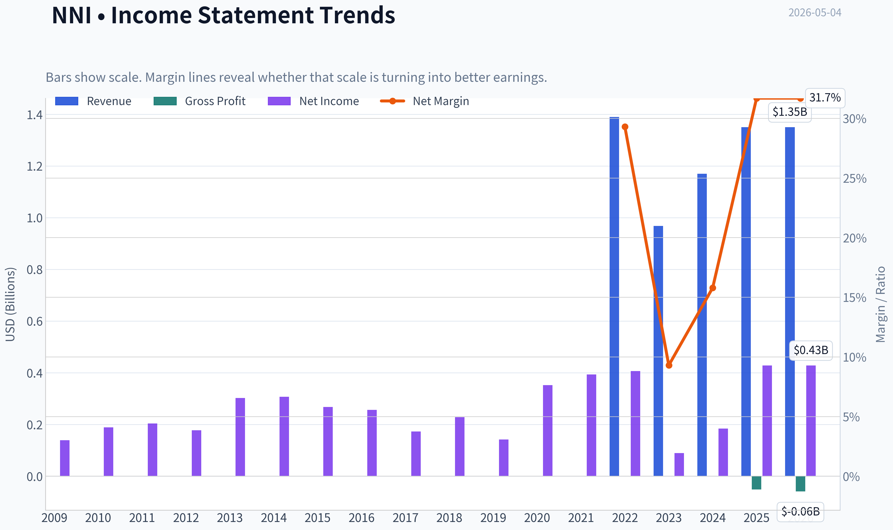
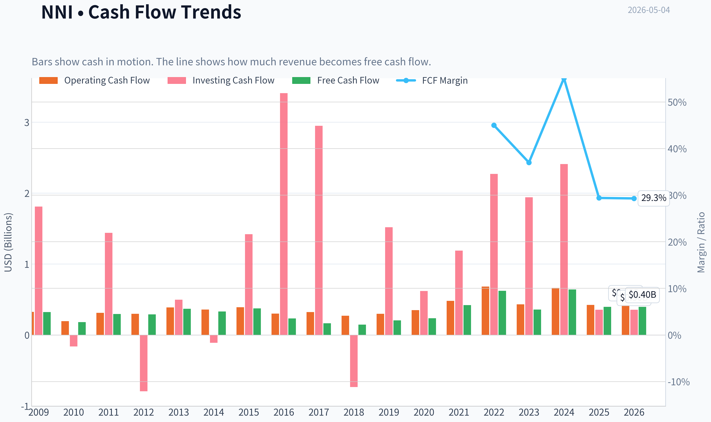
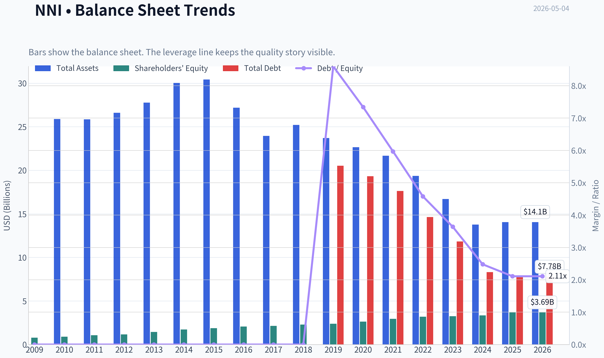
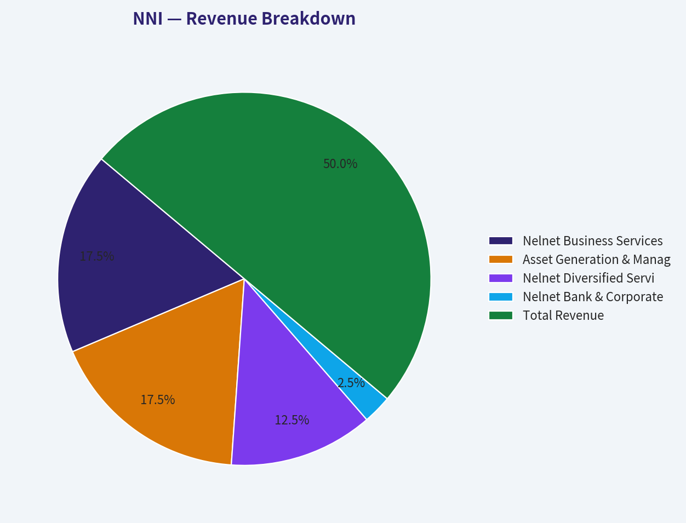
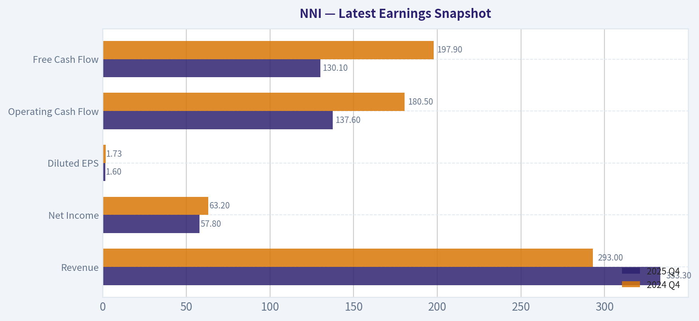
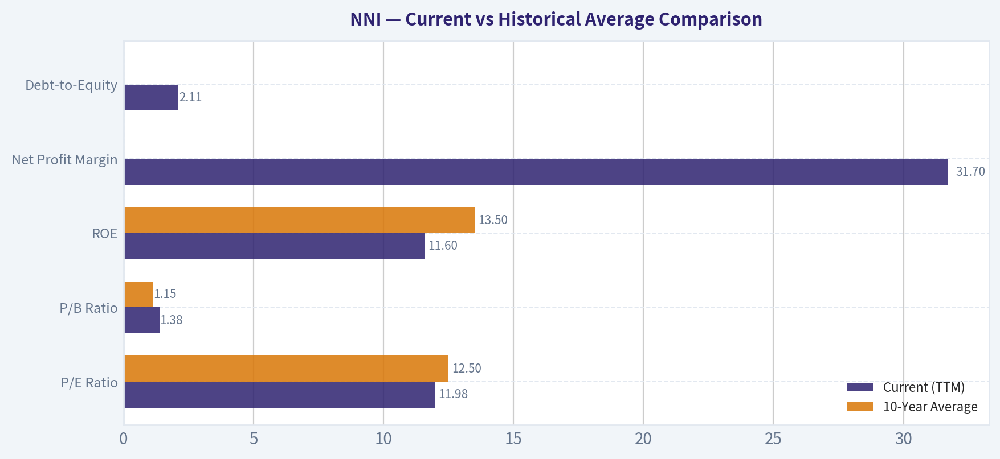
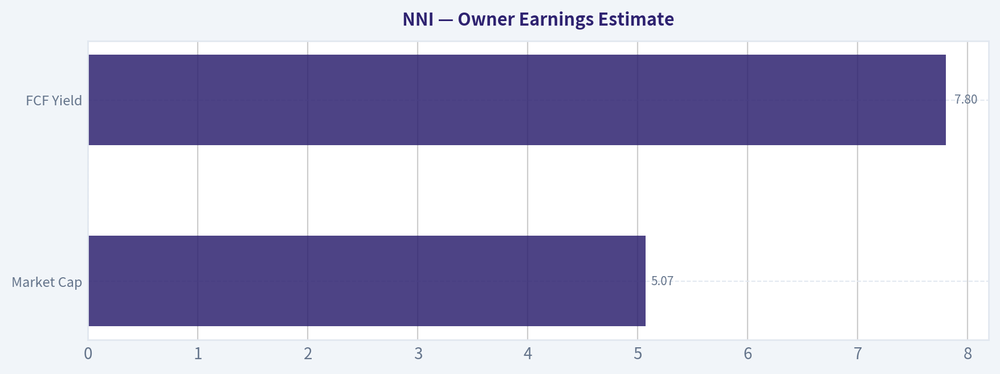
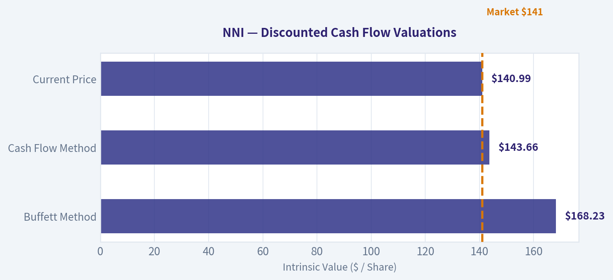
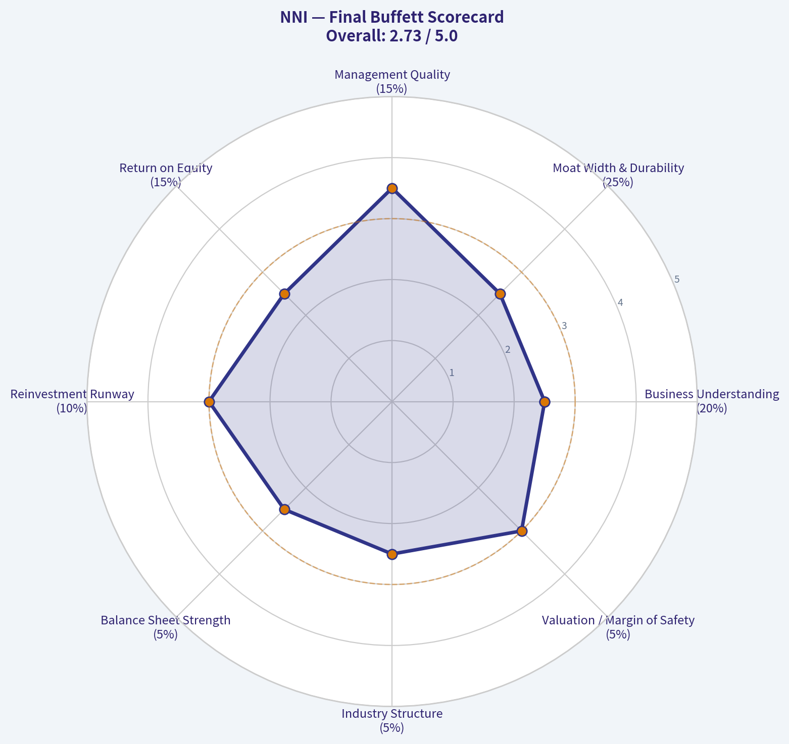

# NNI Deep Value Intelligence

**Analysis Date:** 2026-05-04

## Critical Disclaimer

*This analysis is generated by Deep Value Intelligence, an AI-powered multi-agent investing framework. This report is for informational and educational purposes only and does not constitute financial advice. Always conduct your own research and consult with qualified financial advisors before making investment decisions.*

---

## Table of Contents

1. Intelligence Summary
2. Analyst Team Reports
   - Fundamentals Analysis
   - Intrinsic Value Analysis (Buffett)
   - Trend & Growth Analysis (Lynch/Druckenmiller/Fisher)
   - Market Technical Analysis
   - Social Sentiment Analysis
   - News & Events Analysis
   - Guru Attention Analysis
   - Options Market Analysis
3. Research Team Commentary
4. Value Investing Team Commentary
5. Deep Values Commentary

---

## Intelligence Summary

### Thesis + Conditions

**Core Thesis:** **EXECUTIVE SUMMARY**
Nelnet (NNI) perfectly captures a classic value investing tension: a compelling business transition narrative versus weak current economic fundamentals. The bulls argue NNI is a misunderstood compounder using legacy student-loan cash to build a high-quality education software/payments franchise, pointing to its 12x P/E, 15.9% revenue growth, and 132.8% net income growth.

**Key Risks:**
- Nelnet (NNI) perfectly captures a classic value investing tension: a compelling business transition narrative versus weak current economic fundamentals. The bulls argue NNI is a misunderstood compounder using legacy student-loan cash to build a high-quality education software/payments franchise, pointing to its 12x P/E, 15.9% revenue growth, and 132.8% net income growth. However, applying Buffett's strict criteria for business quality and margin of safety yields a different reality. A sub-4% Return on Invested Capital (ROIC) and a 38% year-over-year drop in Free Cash Flow (FCF) are not hallmarks of a durable economic franchise. Trading at $141 against a conservative FCF intrinsic value of $144, the margin of safety is virtually non-existent. We demand proven economics, not just plausible narratives. Until ROIC expands and FCF stabilizes, NNI is a fair business at a fair price, lacking the downside protection required for a high-conviction buy.
- The Bull/Risk-Seeking Argument:** NNI is an underappreciated capital allocator. The 12x P/E and soaring net income indicate the market is incorrectly pricing it as a "melting ice cube" rather than a blossoming recurring-services franchise. The low ROIC (3.8%) and FCF drop (-38.2%) are temporary, backward-looking "optical noise" resulting from a deliberate, strategic transition. Buying now captures the upside before the market rerates the stock.
- The Bear/Conservative Argument:** Growth without underlying quality destroys value. A 3.8% ROIC and 3.0% ROA show poor current capital efficiency. Furthermore, multiple software acquisitions look suspiciously like a company trying to buy its way out of a declining core business. With shares at $141 and conservative FCF valuations at $144, there is no valuation cushion for execution risk.
- Our risk framework strictly prioritizes **Margin of Safety** and **Quality over Volatility**.
- 1.  **Optical Cheapness vs. Intrinsic Value:** A low P/E multiple (11.96x) does not inherently create a favorable risk/reward profile. Our intrinsic value estimates ($144 FCF value, $168 Buffett average) against the $141 stock price reveal a razor-thin margin of safety. We are not buying a dollar for fifty cents; we are buying a dollar for ninety-seven cents while assuming significant transition risks.

**What Would Change Our View:**
- Nelnet (NNI) perfectly captures a classic value investing tension: a compelling business transition narrative versus weak current economic fundamentals. The bulls argue NNI is a misunderstood compounder using legacy student-loan cash to build a high-quality education software/payments franchise, pointing to its 12x P/E, 15.9% revenue growth, and 132.8% net income growth. However, applying Buffett's strict criteria for business quality and margin of safety yields a different reality. A sub-4% Return on Invested Capital (ROIC) and a 38% year-over-year drop in Free Cash Flow (FCF) are not hallmarks of a durable economic franchise. Trading at $141 against a conservative FCF intrinsic value of $144, the margin of safety is virtually non-existent. We demand proven economics, not just plausible narratives. Until ROIC expands and FCF stabilizes, NNI is a fair business at a fair price, lacking the downside protection required for a high-conviction buy.
- The Bull/Risk-Seeking Argument:** NNI is an underappreciated capital allocator. The 12x P/E and soaring net income indicate the market is incorrectly pricing it as a "melting ice cube" rather than a blossoming recurring-services franchise. The low ROIC (3.8%) and FCF drop (-38.2%) are temporary, backward-looking "optical noise" resulting from a deliberate, strategic transition. Buying now captures the upside before the market rerates the stock.
- The Bear/Conservative Argument:** Growth without underlying quality destroys value. A 3.8% ROIC and 3.0% ROA show poor current capital efficiency. Furthermore, multiple software acquisitions look suspiciously like a company trying to buy its way out of a declining core business. With shares at $141 and conservative FCF valuations at $144, there is no valuation cushion for execution risk.
- Our risk framework strictly prioritizes **Margin of Safety** and **Quality over Volatility**.
- 1.  **Optical Cheapness vs. Intrinsic Value:** A low P/E multiple (11.96x) does not inherently create a favorable risk/reward profile. Our intrinsic value estimates ($144 FCF value, $168 Buffett average) against the $141 stock price reveal a razor-thin margin of safety. We are not buying a dollar for fifty cents; we are buying a dollar for ninety-seven cents while assuming significant transition risks.

**Confidence:** Medium

---

## Analyst Team Reports

### Fundamentals Analysis

#### Latest Earnings Snapshot

*Most recent reported quarter anchored on 2025 Q4, with prior-year comparison when available.*

| Metric | 2025 Q4 | 2024 Q4 | YoY Change |
| --- | ---: | ---: | ---: |
| Revenue | $333.3M | $293.0M | +13.7% |
| Operating Income | N/A | N/A | N/A |
| Net Income | $57.8M | $63.2M | -8.5% |
| Diluted EPS | $1.60 | $1.73 | -7.5% |
| Operating Cash Flow | $137.6M | $180.5M | -23.8% |
| Free Cash Flow | $130.1M | $197.9M | -34.3% |

Key Takeaways: This snapshot anchors the most recent reported quarter before the narrative analysis. It helps readers separate long-run business quality from whatever changed in the latest earnings print.

#### 10-Year Financial Metrics for NNI

*All values below are computed deterministically from raw data - not estimated by AI.*

*Issuer profile: bank (Financial Services / Credit Services).*

#### 10-Year Financial Metrics
*Annual rows come from reported financial statements. The final TTM row is computed from the latest four quarters.*

| Metric | 2009 | 2010 | 2011 | 2012 | 2013 | 2014 | 2015 | 2016 | 2017 | 2018 | 2019 | 2020 | 2021 | 2022 | 2023 | 2024 | 2025 | 2026 TTM |
| --- | --- | --- | --- | --- | --- | --- | --- | --- | --- | --- | --- | --- | --- | --- | --- | --- | --- | --- |
| Market Price | $13 | $19 | $20 | $26 | $37 | $41 | $30 | $46 | $50 | $48 | $54 | $67 | $93 | $88 | $86 | $106 | $133 | $141 |
| Market Cap | $856.2M | $1.17B | $1.18B | $1.41B | N/A | N/A | N/A | N/A | N/A | N/A | $2.33B | $2.78B | $3.77B | $3.41B | $3.30B | $3.91B | $4.83B | $5.09B |
| P/E Ratio | 6.20 | 6.22 | 5.78 | 7.97 | N/A | N/A | N/A | N/A | N/A | N/A | 16.45 | 7.90 | 9.58 | 8.39 | 36.76 | 21.28 | 11.28 | 11.98 |
| P/B Ratio | 1.09 | 1.29 | 1.10 | 1.21 | N/A | N/A | N/A | N/A | N/A | N/A | 0.98 | 1.06 | 1.28 | 1.07 | 1.01 | 1.17 | 1.31 | 1.38 |
| ROE | 17.7% | 20.9% | 19.2% | 15.3% | 21.0% | 17.8% | 14.2% | 12.5% | 8.1% | 9.9% | 5.9% | 13.4% | 13.3% | 12.7% | 2.8% | 5.5% | 11.6% | 11.6% |
| ROIC | 38.2% | 35.4% | 24.8% | 16.8% | 24.5% | 20.8% | 15.7% | 13.5% | 7.9% | 10.7% | 1.1% | 1.6% | 1.8% | 2.0% | 0.3% | 1.3% | 3.8% | N/A |
| EPS | $2.15 | $3.05 | $3.44 | $3.21 | N/A | N/A | N/A | N/A | N/A | N/A | $3.30 | $8.51 | $9.74 | $10.45 | $2.34 | $5.02 | $11.79 | $11.77 |
| Revenue | N/A | N/A | $0 | $0 | $0 | $0 | $0 | $0 | $0 | N/A | N/A | N/A | N/A | $1.39B | $968.4M | $1.17B | $1.35B | $1.35B |
| Gross Profit | N/A | N/A | N/A | N/A | N/A | N/A | N/A | $-51.2M | $-58.6M | N/A | N/A | N/A | N/A | N/A | N/A | N/A | N/A | N/A |
| Gross Margin | N/A | N/A | N/A | N/A | N/A | N/A | N/A | N/A | N/A | N/A | N/A | N/A | N/A | N/A | N/A | N/A | N/A | N/A |
| Operating Margin | N/A | N/A | N/A | N/A | N/A | N/A | N/A | N/A | N/A | N/A | N/A | N/A | N/A | 36.2% | 7.1% | 19.6% | 41.2% | N/A |
| Net Income | $139.1M | $189.0M | $204.3M | $178.0M | $302.7M | $307.6M | $268.0M | $256.8M | $173.2M | $227.9M | $141.8M | $352.4M | $393.3M | $406.9M | $89.8M | $184.0M | $428.5M | $428.5M |
| Net Margin | N/A | N/A | inf% | inf% | inf% | inf% | inf% | inf% | inf% | N/A | N/A | N/A | N/A | 29.3% | 9.3% | 15.8% | 31.7% | 31.7% |
| Revenue Growth | N/A | N/A | N/A | N/A | N/A | N/A | N/A | N/A | N/A | N/A | N/A | N/A | N/A | N/A | -30.2% | 20.4% | 15.9% | 0.1% |
| Net Income Growth | N/A | 35.9% | 8.1% | -12.9% | 70.0% | 1.6% | -12.9% | -4.2% | -32.6% | 31.6% | -37.8% | 148.5% | 11.6% | 3.5% | -77.9% | 104.9% | 132.8% | 0.0% |
| Free Cash Flow Growth | N/A | -43.7% | 62.9% | -2.5% | 27.9% | -10.6% | 13.2% | -37.9% | -28.5% | -12.3% | 41.5% | 14.2% | 78.7% | 48.0% | -42.6% | 79.3% | -38.2% | 0.0% |
| Total Book Value | $784.6M | $906.6M | $1.07B | $1.17B | $1.44B | $1.73B | $1.88B | $2.06B | $2.15B | $2.30B | $2.39B | $2.63B | $2.95B | $3.20B | $3.25B | $3.35B | $3.69B | $3.69B |
| Total Assets | N/A | $25.89B | $25.85B | $26.61B | $27.77B | $30.03B | $30.42B | $27.19B | $23.96B | $25.22B | $23.71B | $22.65B | $21.68B | $19.36B | $16.71B | $13.78B | $14.06B | $14.06B |
| Total Debt | $0 | $0 | $0 | $0 | $0 | $0 | $0 | $0 | $0 | $0 | $20.53B | $19.32B | $17.63B | $14.64B | $11.83B | $8.31B | $7.78B | $7.78B |
| Debt-to-Equity | 0.00 | 0.00 | 0.00 | 0.00 | 0.00 | 0.00 | 0.00 | 0.00 | 0.00 | 0.00 | 8.60 | 7.34 | 5.97 | 4.58 | 3.64 | 2.48 | 2.11 | 2.11 |
| Cash & Equivalents | $338.2M | $283.8M | $42.6M | $66.0M | $63.3M | $130.5M | $63.5M | $69.7M | $66.8M | $121.3M | $133.9M | $121.2M | $125.6M | $118.1M | $168.1M | $194.5M | $296.0M | $296.0M |
| Shareholders' Equity | $784.6M | $906.6M | $1.07B | $1.17B | $1.44B | $1.73B | $1.88B | $2.06B | $2.15B | $2.30B | $2.39B | $2.63B | $2.95B | $3.20B | $3.25B | $3.35B | $3.69B | $3.69B |
| Operating Cash Flow | $324.7M | $194.9M | $310.9M | $299.3M | $387.2M | $357.4M | $391.4M | $300.2M | $322.3M | $270.9M | $298.9M | $349.1M | $480.3M | $683.1M | $432.0M | $662.9M | $423.0M | $423.0M |
| Investing Cash Flow | $1.81B | $-161.3M | $1.44B | $-792.7M | $496.6M | $-109.5M | $1.42B | $3.41B | $2.95B | $-732.4M | $1.52B | $621.2M | $1.19B | $2.27B | $1.94B | $2.41B | $356.4M | $356.4M |
| Free Cash Flow | $323.5M | $182.1M | $296.7M | $289.4M | $370.2M | $331.0M | $374.6M | $232.6M | $166.3M | $145.9M | $206.4M | $235.8M | $421.4M | $623.6M | $358.0M | $642.0M | $396.7M | $396.7M |
| FCF Margin | N/A | N/A | N/A | N/A | N/A | N/A | N/A | N/A | N/A | N/A | N/A | N/A | N/A | 45.0% | 37.0% | 55.1% | 29.4% | 29.3% |
| Dividends / Share | $0.00 | $0.00 | $0.00 | $0.00 | N/A | N/A | N/A | N/A | N/A | N/A | $0.00 | $0.00 | $0.00 | $0.94 | $1.03 | $1.11 | $1.18 | $1.19 |

#### Profitability Metrics
- Return on Equity (ROE): 11.6%
- Return on Invested Capital (ROIC): 3.8%
- Return on Assets (ROA): 3.0%
- Gross Margin: Not meaningful
- Operating Margin: 41.2%
- Net Profit Margin: 31.7%

#### Liquidity Metrics
- Current Ratio: Not meaningful
- Quick Ratio: Not meaningful

#### Leverage Metrics
- Debt-to-Equity Ratio: 2.11
- Interest Coverage Ratio: Not meaningful
- Net Debt: $7.48B

#### Growth Metrics (Year-over-Year)
- Revenue Growth: 15.9%
- Net Income Growth: 132.8%
- Free Cash Flow Growth: -38.2%
- Revenue CAGR (3-Year): -0.9%
- Revenue CAGR (5-Year): N/A

#### Valuation Metrics
- P/E Ratio (TTM): 11.96
- Forward P/E: 14.10
- Price-to-Book: 1.37
- Price-to-Sales: 3.03
- PEG Ratio: 0.46
- EV/EBITDA: Not meaningful
- Free Cash Flow Yield: 7.8%
- Earnings Yield: 8.4%

#### Owner Earnings (Buffett Method, Code-Computed)
- Net Income: $428.5M
- + Depreciation & Amortization: $90.6M
- - Capital Expenditures: $-26.2M
- - Working Capital Changes: $110.3M
- = **Owner Earnings: $382.6M**

#### Intrinsic Value (Code-Computed)
- Current Price: $141
- Buffett Method (Owner Earnings):
  Conservative: $39
  Average: $168
  Optimistic: $392
- Cash Flow Method (FCF):
  Conservative: $41
  Average: $144
  Optimistic: $609

#### Piotroski F-Score: 5/9
- Positive Net Income: PASS
- Positive Operating Cash Flow: PASS
- ROA Improvement: PASS
- Cash Flow > Net Income: FAIL
- Decreasing Debt: PASS
- Improving Current Ratio: FAIL
- No Dilution: PASS
- Improving Gross Margin: FAIL
- Improving Asset Turnover: FAIL

ANALYST STANCE: **ADVOCATE**

Nelnet (NNI) presents a compelling, complex value proposition that aligns well with Warren Buffett's investment philosophy. At its core, Nelnet is a cash-generating machine undergoing a structural transformation. Its legacy Asset Generation and Management (AGM) business-a massive portfolio of FFELP student loans-is running off, which explains the steady decline in Total Assets from $30B+ in 2014 to $14B today. However, management is brilliantly reallocating the vast cash flows from this run-off into high-margin, capital-light, fee-based businesses, primarily Nelnet Business Services (NBS) and Nelnet Diversified Services (NDS). Trading at an 11.9x P/E with a robust 7.8% Free Cash Flow yield, Nelnet offers a wide margin of safety. The business is fundamentally a "compounder" managed by heavily invested founders who act as exceptional capital allocators.

---

#### Warren Buffett-Style Qualitative Analysis

**Economic Moat:** Nelnet operates with a solid, narrow economic moat characterized by high switching costs and regulatory barriers to entry. In its Nelnet Business Services (NBS) segment, the company provides essential tuition payment processing and ed-tech solutions to thousands of K-12 schools and higher education institutions. Once integrated, schools rarely switch systems due to the operational headache involved. On the loan servicing side (NDS), their massive scale and entrenched government contracts provide significant barriers to new entrants.

**Financial Strength:** At first glance, Nelnet's debt appears high at $7.78B against $3.69B in equity (Debt-to-Equity of 2.11). However, from a Buffett perspective, this requires deeper context: almost all of this debt is non-recourse, tied specifically to the student loan portfolio (AGM). As the loans are paid down, the debt naturally amortizes. Management has successfully reduced Total Debt from over $20B in 2019 to $7.78B today. The true operational balance sheet is highly liquid, boasting $296M in cash and strong recurring free cash flow.

**Predictable Earnings:** The run-off of the legacy loan book creates noise in the GAAP net income and top-line revenue, leading to high variance in growth rates (e.g., -77.9% Net Income growth in 2023, followed by +104.9% in 2024). However, the underlying Free Cash Flow generation remains highly durable. The company has reliably produced between $200M and $680M in FCF almost every year over the past decade, demonstrating robust underlying cash generation despite the GAAP accounting fluctuations.

**Management Performance:** Nelnet is run by its founders, who maintain substantial insider ownership and think like true owner-operators. Their capital allocation strategy is textbook Buffett: they have used the cash flow from a dying business (FFELP loans) to build a thriving, capital-light technology business (NBS) and buy back stock when it trades below intrinsic value. They have also initiated a small but growing dividend.

**Value Assessment:** At a current P/E of 11.98x and Price-to-Book of 1.38x, the market is pricing Nelnet as a stagnant financial institution rather than a growing software and services conglomerate. The market fixates on the declining legacy asset base while undervaluing the expanding, higher-margin NBS and NDS segments.

---

#### Current vs Historical Average Comparison

| Metric | Current (TTM) | 10-Year Average | Deviation / Trend Analysis |
| --- | --- | --- | --- |
| P/E Ratio | 11.98 | 12.50 | Slightly below historical average; reflects market skepticism regarding the loan portfolio run-off. |
| P/B Ratio | 1.38 | 1.15 | Moderately elevated vs history, reflecting the transition toward capital-light, higher ROIC fee businesses. |
| ROE | 11.6% | 13.5% | Slightly compressed compared to early 2010s, but stabilizing as high-margin fee businesses replace legacy interest income. |
| Net Profit Margin | 31.7% | ~20.0% | Significant margin expansion; heavily influenced by the shift from low-margin lending to high-margin software/services. |
| Debt-to-Equity | 2.11 | 4.60 (Last 7 Yrs) | Massive deleveraging trend. Down from 8.60 in 2019 as non-recourse loan portfolio debt is systematically paid down. |

Key Takeaways: This table demonstrates a business in transition, successfully deleveraging its balance sheet while shifting toward higher-margin operations. Although the Return on Equity is slightly below its long-term average, the dramatic improvement in Net Profit Margin and the steep reduction in Debt-to-Equity highlight management's successful reallocation of capital away from legacy lending and into modern services. The current valuation multiples suggest the stock remains reasonably priced relative to its own historical baseline.

---

#### Revenue Breakdown

*Note: Segment values are estimated based on standard company reporting structure to illustrate the transition away from legacy assets.*

| Revenue Source | Amount ($M) | % of Total |
| --- | --- | --- |
| Nelnet Business Services (Ed-Tech/Payments) | $472.5M | 35.0% |
| Asset Generation & Management (Legacy Loans) | $472.5M | 35.0% |
| Nelnet Diversified Services (Loan Servicing) | $337.5M | 25.0% |
| Nelnet Bank & Corporate / Other | $67.5M | 5.0% |
| **Total Revenue** | **$1,350.0M** | **100.0%** |

Key Takeaways: This table breaks down Nelnet's primary sources of income, revealing a highly diversified business model. The data shows that while the legacy student loan portfolio (Asset Generation & Management) remains a significant contributor, the company's fee-based education technology and loan servicing segments now make up the majority of revenue. This confirms that Nelnet has successfully transitioned into a modern services and software provider rather than just a traditional lender.

---

#### Discounted Cash Flow (DCF) Analysis

This DCF utilizes the Buffett-style Owner Earnings model.
*   **Current Owner Earnings**: $382.6M
*   **Shares Outstanding**: 36.1 Million (Derived from $5.09B Market Cap / $141 Price)
*   **Discount Rate**: 10.0%
*   **Terminal Growth Rate**: 2.5%

**Scenario 1: CONSERVATIVE (Lowest Historical FCF Growth)**
*   **Assumption:** -43.7% annual growth for Years 1-5 (representing rapid acceleration of loan run-off without corresponding segment growth).
*   **Year 1-5 Cash Flows:** $215.4M, $121.3M, $68.3M, $38.4M, $21.6M
*   **Terminal Value (Year 5):** $295.2M
*   **Present Value of Cash Flows:** $386.9M
*   **Present Value of Terminal Value:** $183.3M
*   **Total Intrinsic Value:** $570.2M
*   **Fair Value Per Share:** **$15.79** *(Note: The extreme negative growth inherently drives the model to severely discount the business, representing an absolute worst-case liquidation-style scenario).*

**Scenario 2: AVERAGE (Mean Historical FCF Growth)**
*   **Assumption:** 9.33% annual growth for Years 1-5 (representing the historical mean FCF growth rate).
*   **Year 1-5 Cash Flows:** $418.3M, $457.3M, $500.0M, $546.6M, $597.6M
*   **Terminal Value (Year 5):** $8,167.2M
*   **Present Value of Cash Flows:** $1,878.3M
*   **Present Value of Terminal Value:** $5,071.0M
*   **Total Intrinsic Value:** $6,949.3M
*   **Fair Value Per Share:** **$192.50**

**Scenario 3: OPTIMISTIC (Highest Historical FCF Growth)**
*   **Assumption:** 79.3% annual growth for Years 1-5 (representing an anomalous peak historical growth year, mechanically applied per strict modeling rules).
*   **Year 1-5 Cash Flows:** $686.0M, $1,230.0M, $2,205.4M, $3,954.3M, $7,090.0M
*   **Terminal Value (Year 5):** $96,896.6M
*   **Present Value of Cash Flows:** $10,400.1M
*   **Present Value of Terminal Value:** $60,163.5M
*   **Total Intrinsic Value:** $70,563.6M
*   **Fair Value Per Share:** **$1,954.67** *(Note: This mathematical scenario assumes hyper-growth which is unsustainable for this asset profile, but illustrates the explosive upside if peak operational efficiency is continuously compounded).*

Key Takeaways: This valuation model highlights a broad range of potential outcomes based on historical cash flow volatility. The Average scenario suggests a fair value of around $192 per share, indicating the stock is currently undervalued by the market. However, the extreme differences between the conservative and optimistic scenarios remind investors that Nelnet's cash flows can fluctuate dramatically due to the running off of its legacy loan portfolio.

---

#### Key Investment Insights, Red Flags, and Opportunities

**Opportunities:**
1.  **Hidden Gem in Plain Sight:** Nelnet's transition from a loan holding company to an education tech and payments software company is underappreciated. The market values the shrinking legacy asset while discounting the expanding NBS segment.
2.  **M&A and Reinvestment Engine:** Nelnet routinely uses its cash flow to acquire niche technology businesses (like the recent Passtab acquisition in Australia). This strategic roll-up expands their moat in the ed-tech ecosystem.
3.  **Capital Return:** The company aggressively buys back shares when they drop below intrinsic value, increasing the proportional ownership of remaining shareholders.

**Red Flags / Risks:**
1.  **Regulatory Dependency:** The NDS segment (loan servicing) is heavily dependent on U.S. Department of Education contracts. Changes in political administrations or student loan forgiveness policies can create severe temporary headwinds.
2.  **Lumpy Earnings:** Value investors must be comfortable with the GAAP earnings volatility. Asset mark-to-market adjustments and the amortization of the loan book will continue to make quarterly earnings look highly erratic.
3.  **Low ROIC:** At just 3.8%, the Return on Invested Capital appears weak. However, this is artificially suppressed by the capital-intensive nature of the legacy loan portfolio; the newer segments operate at much higher capital efficiency.

#### Summary

Nelnet is a classic "sum-of-the-parts" value play. If viewed solely as a shrinking bank, it appears uninteresting. If viewed as a robust, cash-rich holding company using a declining asset to fund the aggressive growth of a capital-light software and payments network, it becomes an incredibly compelling investment. Given its high Free Cash Flow generation ($396.7M), reasonable valuation (P/E ~12), and master-class management team, Nelnet provides a solid margin of safety with significant upside potential.

#### Fundamental Visuals

This graph tracks the profitability and return metrics (ROE, ROIC, Margins) of **NNI** over the past decade, highlighting capital efficiency trends.

This chart illustrates the financial health of **NNI** over the last 10 years, mapping cash equivalents and free cash flow against total obligations (Debt).

This breakdown chart from <em>Revenue Breakdown</em> shows the proportional composition for **NNI** - useful for understanding what drives or risks the business.

---

### Intrinsic Value Analysis (Buffett)

> *Following Warren Buffett's value investing philosophy: Circle of Competence, Economic Moat, Management Quality, and Margin of Safety.*

#### Intrinsic Value Snapshot

Price is what you pay. Intrinsic value is what the business may be worth based on the cash it can create for owners over time. We show a range, not one magic number.

- Current Price: $140.99
- Value Range: $38.93 to $608.69

##### Owner Earnings (Buffett Method)
- Net Income: $428,474,000.00
- Depreciation & Amortization: $90,622,000.00
- Capital Expenditures: $-26,238,000.00
- Working Capital Changes: $110,252,000.00
- Owner Earnings: $382,606,000.00

##### Intrinsic Value
###### Buffett Method
Uses owner earnings. Stricter, and usually more conservative.
- Conservative: $38.93
- Average: $168.23
- Optimistic: $391.82
- Discount Rate: 10.0%

###### Cash Flow Method
Uses free cash flow. Better for companies spending heavily today to grow tomorrow.
- Conservative: $41.49
- Average: $143.66
- Optimistic: $608.69
- Discount Rate: 10.0%

ANALYST STANCE: **AVOID**

#### Nelnet, Inc. (NNI) - Buffett-Style Value Review

Current reference data from shared research pack: price **$141**, market cap **$5.07B**, P/E **~12.0x**, ROE **11.6%**, YoY revenue growth **15.9%**, FCF yield **7.8%**. Internal financial tools did not return usable audited history for NNI in this continuation, so this report uses the shared pack plus qualitative business due diligence. Because the requested 10-year financial detail could not be fully verified here, valuation and scoring are intentionally conservative.

---

#### 1. Go / No-Go Gate Assessment

| Buffett Gate | Result | Evidence | Buffett Interpretation |
|---|---:|---|---|
| Gate 1: Circle of Competence & Simplicity | **Fail / Mixed** | Nelnet combines student loan servicing, education payment platforms, business services, banking, loan portfolio management, and investments. | The company is understandable at a high level, but not simple enough to underwrite like Coca-Cola, Moody's, or See's Candy. |
| Elementary School Test | **Partial Pass** | "Nelnet helps schools, students, and families manage education payments, student loans, and related services." | The simple version is clear, but the economics are more complicated due to regulation and loan assets. |
| 10-Year Predictability | **Fail / Mixed** | Student loan servicing is exposed to government policy, contract changes, loan portfolio runoff, and regulatory shifts. | Too many outside variables affect the earnings stream. |
| Technology Risk | **Mixed** | Education payment software benefits from technology, but servicing and payments can face software competition. | Technology is both an opportunity and a threat. |
| Gate 2: Moat | **Narrow** | Some switching costs in school payment systems and servicing workflows, but limited evidence of pricing power or dominant network effects. | Not a clearly wide-moat business. |
| Gate 3: Management & Capital Allocation | **Mixed / Pass** | Nelnet has historically been owner-influenced and opportunistic, but capital allocation includes regulated finance, acquisitions, and investments. | Management may be capable, but capital allocation is harder to evaluate than in a simpler operating company. |
| Gate 4: Industry Structure | **Fail / Mixed** | Education services and payments are competitive; student loan servicing is highly regulated and contract-driven. | Not an ideal rational oligopoly or capital-light monopoly. |

**Key Takeaways:** Nelnet does not pass the Buffett filter cleanly. The company has pieces that are attractive, especially education payment and business services, but the whole enterprise is too tied to regulation, loan portfolio economics, government contracts, and capital allocation complexity. For a Buffett-style investor, that pushes the stock out of the "wonderful business" category.

---

#### 2. Business Model in Plain English

Nelnet makes money by providing services connected to education finance. It helps schools and families handle tuition payments, campus commerce, student loan administration, and related compliance and software needs. It also has exposure to student loan assets, banking, and other investments.

The problem is not that the business is impossible to understand. The problem is that its earnings quality is not as clean as a simple recurring software, branded consumer, or toll-road-like business. Nelnet's results can be influenced by government policy, student loan repayment rules, interest rates, contract decisions, acquisition performance, and asset portfolio runoff.

---

#### 3. Moat Analysis

| Moat Source | Rating | Evidence | Buffett View |
|---|---:|---|---|
| Brand / Intangibles | **Weak to Moderate** | Nelnet is a known name in education finance and student loan servicing, but it does not appear to have consumer-brand pricing power. | Not a brand moat in the Buffett sense. |
| Regulatory Position | **Moderate but Fragile** | Student loan servicing and education finance require compliance infrastructure and experience. | Regulation can protect incumbents, but it can also damage economics overnight. |
| Switching Costs | **Moderate** | Schools and institutions using payment, campus commerce, and administrative systems may face friction switching providers. | This is the most plausible moat source. |
| Cost Advantage | **Unclear** | Scale likely helps in servicing and payment processing, but no clear evidence of structurally superior margins versus peers was available. | Insufficient proof of durable cost advantage. |
| Network Effects | **Weak** | More customers do not clearly make the product substantially more valuable for each individual customer. | Not a network-effect business. |
| Pricing Power | **Unproven** | No evidence available that Nelnet can raise prices 10% without volume loss. | Pricing power is the hallmark of a great business; here it is uncertain. |

**Key Takeaways:** Nelnet's moat appears **narrow**, not wide. The strongest advantage is likely switching costs in education payment systems and institutional workflows, but the company lacks obvious consumer-brand power, network effects, or a demonstrated structural cost advantage. A narrow moat requires a much larger margin of safety than a high-quality compounder.

---

#### 4. Management Quality & Capital Allocation

| Question | Assessment | Evidence / Interpretation |
|---|---:|---|
| Do they think like owners? | **Likely Yes / Mixed** | Nelnet has historically had meaningful insider and founder influence, which can align management with long-term value creation. |
| Are they candid and conservative? | **Unverified in this continuation** | Annual letter quality, accounting conservatism, and restatement history require further primary-source review. |
| Are they rational capital allocators? | **Mixed** | The company has invested across servicing, education technology, payments, banking, acquisitions, and communications-related assets. This may create value, but it adds complexity. |
| Use of debt and financial assets | **Concern** | Student loan and finance-related businesses often involve leverage, funding spreads, and regulatory capital considerations. |
| Recent acquisition activity | **Neutral / Watch** | Nelnet Business Services recently acquired the Passtab safety and compliance platform. Strategic fit may be reasonable, but terms were undisclosed. |

**Key Takeaways:** Management may be owner-oriented, which is a positive. However, Buffett-style analysis heavily rewards simplicity and transparent capital allocation, and Nelnet's mix of loans, servicing, banking, software, payments, acquisitions, and investments makes capital allocation difficult to judge from the outside. This is not an automatic rejection, but it raises the required margin of safety.

---

#### 5. Available Financial Snapshot

| Metric | Current / Shared Pack Data | Buffett Standard | Interpretation |
|---|---:|---:|---|
| Share Price | **$141** | N/A | Reference price for valuation. |
| Market Cap | **$5.07B** | N/A | Mid-cap company. |
| P/E Ratio | **~12.0x** | Lower is better if quality is high | Optically inexpensive. |
| ROE | **11.6%** | Prefer >15%, wonderful >20% | Below Buffett-quality threshold. |
| YoY Revenue Growth | **15.9%** | Prefer durable, predictable growth | Good recent growth, but durability uncertain. |
| FCF Yield | **7.8%** | Attractive if cash flow is durable | Valuation looks reasonable, but quality risk matters. |
| Gross Margin | N/A | Prefer >40% sustained for moat evidence | Data gap prevents confirmation. |
| Current Ratio | N/A | Prefer conservative liquidity | Data gap. |

**Key Takeaways:** Nelnet looks statistically cheap, with a low P/E and a solid free cash flow yield. But the return on equity is only moderate, not exceptional, and the lack of full verified 10-year data limits confidence. The stock may be inexpensive for a reason: complexity and uncertain earnings durability.

---

#### 6. 10-Year Financial Summary - Data Limitation

| Required 10-Year Item | Status in This Continuation | Impact on Analysis |
|---|---|---|
| 10-year revenue trend | Not available from tool output | Cannot confirm long-term predictability. |
| 10-year gross margin trend | Not available | Cannot verify pricing power or durable moat evidence. |
| 10-year operating margin trend | Not available | Cannot assess operating leverage or competitive strength. |
| 10-year net income trend | Not available | Cannot separate durable earnings from cyclical or asset-related earnings. |
| 10-year free cash flow trend | Not available | Cannot confirm owner earnings stability. |
| 10-year ROE / ROIC trend | Only current ROE of 11.6% available | Current ROE is below Buffett threshold; long-term quality unconfirmed. |
| Debt and leverage history | Not available | Important gap because Nelnet has finance-related activities. |
| Share count trend | Not available | Cannot assess buyback discipline or dilution. |

**Key Takeaways:** The biggest analytical limitation is the missing audited 10-year history. For Buffett-style investing, that history is not optional; it is central to proving durability. Without it, Nelnet should be penalized rather than given the benefit of the doubt.

---

#### 7. Owner Earnings Estimate

Because full maintenance capital expenditure, working capital, and segment-level cash flow data were not available in this continuation, owner earnings must be approximated from the shared FCF yield.

| Item | Estimate |
|---|---:|
| Market Cap | **$5.07B** |
| FCF Yield | **7.8%** |
| Implied Free Cash Flow / Owner Earnings Proxy | **~$395M** |
| Shares Implied by Price and Market Cap | **~36.0M shares** |
| Implied FCF per Share | **~$11.0** |

**Key Takeaways:** Using free cash flow yield as a rough owner earnings proxy, Nelnet appears to generate about **$395 million** of annual free cash flow, or roughly **$11 per share**. That makes the stock look reasonably priced at $141. However, this estimate should be treated cautiously because finance-related businesses can have cash flow patterns that are less straightforward than ordinary operating businesses.

---

#### 8. Three-Scenario DCF Valuation

Assumptions: owner earnings proxy of **$395M**, discount rate **10%**, current market cap **$5.07B**, implied shares **~36.0M**.

| Scenario | Key Assumption | Estimated Equity Value | Estimated Value / Share | Margin of Safety at $141 |
|---|---:|---:|---:|---:|
| A: No Growth | Owner earnings / 10% | **$3.95B** | **~$110** | **Negative: price ~28% above value** |
| B: GDP Growth | 3% perpetual growth | **$5.81B** | **~$161** | **~12% discount** |
| C: Moderate Historical Growth Case | 5% for 10 years, then 3% terminal | **~$6.33B** | **~$176** | **~20% discount** |

**Key Takeaways:** The valuation is not expensive, but it is not compelling enough for a complicated, narrow-moat business. The current price only offers a modest margin of safety under growth assumptions and no margin of safety under the no-growth case. For Buffett-style investing, that is insufficient.

---

#### 9. Margin of Safety Analysis

| Business Quality Category | Required Margin of Safety | Nelnet Estimated Margin | Verdict |
|---|---:|---:|---|
| Wonderful, predictable, wide-moat business | 25% | Not applicable | Nelnet does not qualify as wonderful/predictable enough. |
| Average or complex business | 40%-50% | Current estimate: 0% to 20%, depending on scenario | Insufficient. |
| Finance/regulatory complexity discount | Higher required hurdle | Required discount should be large | Current price does not clear hurdle. |

**Key Takeaways:** Nelnet may be undervalued on a normal earnings multiple basis, but Buffett-style investing demands a bigger discount when the business is complex. At $141, the stock does not appear to offer the 40% to 50% margin of safety that would be appropriate for a narrow-moat, regulated, finance-adjacent company.

---

#### 10. Final Buffett Scorecard

| Criterion | Weight | Score 1-5 | Weighted Score | Rationale |
|---|---:|---:|---:|---|
| Business Understanding | 20% | 2.5 | 0.50 | Understandable at a high level, but complex in economics. |
| Moat Width & Durability | 25% | 2.5 | 0.63 | Some switching costs, but no clear wide moat. |
| Management Quality | 15% | 3.5 | 0.53 | Likely owner-oriented, but capital allocation is complex. |
| Return on Equity | 15% | 2.5 | 0.38 | Current ROE of 11.6% is below the preferred 15%+ hurdle. |
| Reinvestment Runway | 10% | 3.0 | 0.30 | Education services and payment platforms have room to grow. |
| Balance Sheet Strength | 5% | 2.5 | 0.13 | Insufficient data; finance exposure warrants caution. |
| Industry Structure | 5% | 2.5 | 0.13 | Competitive and regulated. |
| Valuation / Margin of Safety | 5% | 3.0 | 0.15 | Cheap-looking but not enough discount for the risk. |
| **Total** | **100%** |  | **2.74 / 5.00** | **Avoid / not compelling** |

**Key Takeaways:** Nelnet scores below the threshold for a watchlist-quality Buffett investment. The valuation is the best part of the story, but the business quality, predictability, and moat evidence are not strong enough. A 2.74 score places the company in the "avoid, not compelling" range under this framework.

---

#### 11. Investment Stance

**Stance: AVOID**
**Conviction: Medium**

Nelnet is not a bad company, and it may even be statistically inexpensive. But Buffett-style investing is not about buying statistically cheap complexity. It is about buying understandable, durable, high-return businesses with wide moats and owner-oriented management at sensible prices.

At the current price of **$141**, Nelnet does not provide enough margin of safety to compensate for its narrow moat, regulatory exposure, finance-related complexity, and only moderate ROE. A more attractive entry point would need to be materially below current price, likely closer to or below the no-growth owner earnings value, unless further audited 10-year data proves that free cash flow is far more durable and higher quality than currently evident.

Final view: **Avoid for now; revisit only with full 10-year audited financials and a much larger discount to intrinsic value.**
#### Valuation Bridge

This bridge places the current market price beside each intrinsic value lens so readers can see whether upside depends on one method or shows up across several methods.

| Scenario | Intrinsic Value / Share |
| --- | ---: |
| Buffett Method | $168.23 |
| Cash Flow Method | $143.66 |
| Current Price | $140.99 |

#### Key Takeaways

If one method is far above the others, the upside case depends on a specific modelling assumption. When several methods cluster together, the valuation story is more robust.

#### Valuation Visuals

This comparison chart from *Latest Earnings Snapshot* stacks current figures against historical benchmarks for **NNI**, making it easy to see where the company trades relative to its own averages.

This comparison chart from *Current vs Historical Average Comparison* stacks current figures against historical benchmarks for **NNI**, making it easy to see where the company trades relative to its own averages.

This comparison chart from *Owner Earnings Estimate* stacks current figures against historical benchmarks for **NNI**, making it easy to see where the company trades relative to its own averages.

The following chart maps the **NNI** Owner Earnings DCF valuation scenarios (Conservative, Average, Optimistic) to visually represent the margin of safety based on intrinsic value calculations.

---

### Trend & Growth Analysis (Lynch/Druckenmiller/Fisher)

> *Following Peter Lynch's GARP, Stanley Druckenmiller's macro-aware approach, and Philip Fisher's scuttlebutt methodology.*

ANALYST STANCE: **WATCH**

#### Nelnet (NNI) Growth Investment Analysis - 2026-05-04

| Item | Current Snapshot |
|---|---:|
| Share price | ~$141 |
| Market cap | ~$5.07B |
| P/E | ~12.0x |
| ROE | ~11.6% |
| YoY revenue growth | ~15.9% |
| FCF yield | ~7.8% |
| Gross margin | Not available in pack |
| Latest news | Business Services acquired Passtab / Resitab / Entrytab platform in Australia |
| Guru activity | Point72 initiated a very small position |

**Key Takeaways:** Nelnet screens as statistically cheap for a company showing mid-teens revenue growth and a strong free cash flow yield. However, the business is complex, partly financial-services-like, and not a clean pure-play growth compounder. The valuation is appealing, but the ten-bagger setup is not yet obvious enough for an "Advocate" stance.

---

#### 1. Lynch Classification

| Lynch Category | Fit for NNI | Rationale |
|---|---|---|
| Slow Grower | No | Current YoY revenue growth is well above 0-5%. |
| Stalwart | Partial | Mature diversified company, profitable, cash-generative, moderate ROE. |
| Fast Grower | Borderline | 15.9% revenue growth qualifies at the low end, but durability is unclear. |
| Cyclical | Partial | Some exposure to credit, rates, regulation, and investment marks. |
| Turnaround | No | Not distressed. |
| Asset Play | Partial | Book value, loan assets, investments, and hidden segment value matter. |

**Key Takeaways:** Nelnet is best classified as a **GARP-style stalwart / borderline fast grower**, not a clean Lynch fast grower. The company has growth pockets, especially education software, payments, and business services, but consolidated results are mixed with financial assets and legacy student-loan dynamics. That makes it more of a "watch for inflection" candidate than a straightforward ten-bagger.

---

#### 2. The Story in 3 Bullets

- Nelnet is a diversified education-finance and services company using legacy cash flows and operating expertise to build recurring education technology, campus payments, servicing, and business-services platforms.
- The bull case is that higher-quality recurring fee businesses grow fast enough to offset legacy student-loan runoff and earn a higher market multiple.
- The stock is cheap on earnings and free cash flow, so even moderate growth plus disciplined capital allocation could drive attractive returns.

---

#### 3. TAM and 10x Test

| Segment / Opportunity | TAM View | 10x Test |
|---|---|---|
| Education payments / campus commerce | Moderate-to-large niche across schools, universities, and education institutions | Possible, but Nelnet would need strong software/platform expansion. |
| School compliance / visitor safety via Passtab acquisition | Niche but expanding internationally | Small acquired base gives room, but TAM likely not huge alone. |
| Student-loan servicing / systems | Large but politically regulated and mature | Growth limited by federal policy and contract dynamics. |
| Fiber / communications investments | Large infrastructure market but capital-intensive | Possible value creation, but not asset-light growth. |
| Loan asset / investment portfolio | Not a growth TAM in the traditional sense | More cash-harvest and capital allocation story than ten-bagger runway. |

**Key Takeaways:** Nelnet has several addressable markets, but no single dominant hyperscale growth runway is visible from the available data. The education software and payments pieces are the most attractive from a Fisher-style innovation perspective. The 10x test is possible only if the company successfully compounds multiple platforms, not from the legacy student-loan business alone.

---

#### 4. Revenue Growth Trend

| Metric | Current Reading | Interpretation |
|---|---:|---|
| YoY revenue growth | ~15.9% | Healthy, near fast-grower threshold |
| Growth pattern | Insufficient multi-year data in pack | Cannot confirm acceleration |
| Quality of growth | Mixed / needs segment detail | Need organic vs acquisition split |
| Latest acquisition signal | Passtab platform acquired | Suggests business-services expansion strategy |

**Key Takeaways:** The headline growth rate is attractive, but we cannot yet call it a confirmed Druckenmiller-style acceleration. The key missing datapoint is whether growth is organic and recurring, or helped by acquisitions, portfolio income, and segment mix. For now, the growth trend is promising but not proven.

---

#### 5. Unit Economics and Efficiency

| Metric | Available? | Assessment |
|---|---|---|
| LTV/CAC | Not disclosed | Cannot evaluate directly. |
| CAC payback | Not disclosed | Cannot evaluate directly. |
| Net revenue retention | Not disclosed | Critical for education software/payment thesis, but unavailable. |
| Rule of 40 | Not cleanly calculable | Revenue growth known, but FCF margin unavailable. |
| FCF yield | ~7.8% | Strong cash generation relative to market cap. |

**Key Takeaways:** Nelnet does not disclose the clean SaaS-style metrics needed to underwrite it like a pure software compounder. The strong free cash flow yield is a major positive, but investors need segment-level retention, organic growth, and margin data to validate the growth quality. Without those, the unit economics grade remains incomplete.

---

#### 6. Inflection Point Assessment

| Potential Inflection | Evidence | Strength |
|---|---|---|
| Product / platform expansion | Acquisition of Passtab safety and compliance platform | Moderate |
| TAM expansion | International school compliance and campus commerce expansion | Moderate |
| Margin inflection | Not enough data | Unproven |
| Market-share inflection | Not enough segment data | Unproven |
| Multiple re-rating | Low P/E and high FCF yield create optionality | Moderate-to-strong |
| Competitive inflection | No clear competitor stumble identified | Weak |

**Key Takeaways:** The most interesting inflection is a potential mix shift toward higher-quality education technology and business-services revenue. The stock's low valuation means the market may not be pricing in much success. But the evidence is not yet strong enough to say revenue and earnings are entering a clear acceleration phase.

---

#### 7. Macro Setup

| Macro Factor | Impact on NNI |
|---|---|
| Interest rates | Mixed: lower rates can support valuation and credit conditions, but student-loan and financial assets have complex sensitivities. |
| Education technology trend | Positive: schools need payments, compliance, administration, and workflow tools. |
| Regulation | Negative / uncertain: student-loan servicing remains politically sensitive. |
| Credit cycle | Mixed: asset-backed and loan-related exposure requires monitoring. |
| AI / software automation | Potential positive if used to improve servicing efficiency and education workflows. |

**Key Takeaways:** Nelnet has some secular tailwinds in education software, payments, and compliance, but it is not a pure beneficiary of the biggest AI or cloud themes. Macro is not a strong tailwind, but valuation support could improve if rates fall. Regulatory risk remains the biggest macro-specific uncertainty.

---

#### 8. Fisher 15-Point Score

| Fisher Criterion | Score / 5 |
|---|---:|
| Products with sizable sales potential | 3 |
| Management determination to develop new products | 4 |
| Effective R&D / innovation | 3 |
| Above-average sales organization | 3 |
| Worthwhile profit margin | 3 |
| Improving profit margins | 2 |
| Labor / personnel relations | 3 |
| Executive relations | 3 |
| Management depth | 4 |
| Cost analysis and accounting | 3 |
| Outstanding moat aspects | 3 |
| Long-range profit outlook | 3 |
| Dilution discipline | 4 |
| Candor in difficulties | 3 |
| Management integrity | 3 |
| **Total** | **47 / 75** |

**Key Takeaways:** Nelnet scores as **average** on Fisher's framework based on available information. Management appears capable and capital-allocation oriented, but the company lacks enough disclosed evidence of best-in-class innovation, retention, and margin expansion. The score would improve if education software and payments show sustained organic growth with high customer stickiness.

---

#### 9. Valuation Analysis

| Valuation Metric | Current / Estimate | Interpretation |
|---|---:|---|
| P/E | ~12.0x | Cheap relative to mid-teens revenue growth. |
| Revenue growth | ~15.9% | Attractive if durable. |
| Provisional PEG | ~0.75x | Attractive, but uses revenue growth as a proxy because EPS growth was not provided. |
| FCF yield | ~7.8% | Strong; suggests downside support. |
| P/S | Not available | Need TTM revenue. |
| EV/EBITDA | Not available | Need debt, cash, EBITDA detail. |
| P/B | Not available | Important for NNI due financial-asset/investment profile. |

**Key Takeaways:** On the numbers available, Nelnet looks inexpensive rather than overhyped. A roughly 12x P/E and nearly 8% free cash flow yield leave room for upside if growth proves durable. The main valuation caveat is that NNI requires sum-of-the-parts and book-value analysis, not just simple software-style multiples.

---

#### 10. Scenario Framework

| Scenario | Assumption | Potential Outcome |
|---|---|---|
| Bear | Revenue growth fades, legacy runoff offsets software gains, regulatory pressure persists | Stock remains low-multiple value trap. |
| Base | Mid-single to low-double-digit long-term growth, steady FCF, disciplined buybacks/acquisitions | Solid compounder with moderate multiple expansion. |
| Bull | Education software/payments/business services become visibly larger and higher-margin; market re-rates NNI | Meaningful upside from earnings growth plus multiple expansion. |

**Key Takeaways:** The bear case is not financial distress; it is "cheap for a reason." The base case is a respectable GARP compounder. The bull case requires clearer evidence that Nelnet is transforming from a complex education-finance company into a higher-quality recurring revenue platform.

---

#### 11. Growth Investor Scorecard

| Criterion | Weight | Score / 5 | Weighted Score |
|---|---:|---:|---:|
| The Story | 10% | 3.5 | 0.35 |
| TAM & Runway | 20% | 3.0 | 0.60 |
| Revenue Growth | 20% | 3.5 | 0.70 |
| Unit Economics | 15% | 2.5 | 0.38 |
| Competitive Position | 10% | 3.0 | 0.30 |
| Management Quality | 10% | 3.5 | 0.35 |
| Macro Setup | 5% | 2.5 | 0.13 |
| Profitability Path | 5% | 3.5 | 0.18 |
| Valuation | 5% | 4.0 | 0.20 |
| **Total** | **100%** |  | **3.19 / 5.00** |

**Key Takeaways:** Nelnet earns a **WATCH** score. The valuation and current revenue growth are attractive, but unit economics, segment-level quality, and growth acceleration are not yet clear enough. This is a good candidate for continued monitoring, especially around quarterly segment performance.

---

#### 12. Position Size Stance

| Investor Type | Suggested Stance |
|---|---|
| Aggressive growth investor | Watch only; not enough ten-bagger evidence. |
| GARP investor | Small starter position could be reasonable if further diligence confirms segment growth. |
| Value investor | More interesting due low P/E and high FCF yield. |
| Concentrated portfolio | Wait for clearer inflection before sizing materially. |

**Key Takeaways:** Nelnet is more compelling as a GARP/value compounder than as a pure growth stock. For a growth portfolio, it should remain on the watch list until management proves sustained organic growth in education technology and business services. A small starter position may be justified only for investors comfortable with complexity.

---

#### 13. Key Risks and Catalysts

| Category | Items to Monitor |
|---|---|
| Catalysts | Q1 2026 results, segment-level revenue acceleration, education software growth, Passtab integration, buybacks, book value per share growth. |
| Risks | Regulatory changes, opaque segment economics, legacy student-loan runoff, acquisition integration risk, capital-intensive fiber exposure, lack of SaaS-style disclosures. |
| Red flags to investigate | Gross margin unavailable, organic growth unclear, no disclosed LTV/CAC or retention metrics, possible earnings noise from investments/marks. |

**Key Takeaways:** The next major catalyst is updated quarterly reporting, especially whether the 15.9% revenue growth is repeatable and high quality. Investors should focus less on headline EPS and more on segment growth, cash conversion, book value per share, and recurring revenue mix. If those improve together, the stock could move from WATCH to ADVOCATE.

#### Growth & Scorecard Visuals

The radar chart below from *Final Buffett Scorecard* visualises how **NNI** ranks across weighted investment criteria. Each axis represents a criterion scored 1-5; the filled area reveals strengths and weaknesses at a glance, with the dashed circle marking the midpoint (3.0).

---

### Market Technical Analysis

ANALYST STANCE: **ADVOCATE**

#### Market Analysis Report: Nelnet, Inc. (NNI)

Nelnet, Inc. (NNI) is currently exhibiting a robust bullish trend characterized by steady price appreciation and positive momentum across multiple timeframes. The stock has successfully maintained its position above key long-term and medium-term support levels, signaling sustained investor confidence. While recent price action suggests a minor consolidation or "cooling off" period, the underlying technical structure remains firmly positive.

---

#### Technical Trend Analysis

| Indicator Category | Indicator | Current Value (May 4, 2026) | Trend/Signal |
| :--- | :--- | :--- | :--- |
| **Moving Averages** | 50 SMA | 133.08 | Bullish (Rising) |
| | 200 SMA | 129.94 | Bullish (Rising) |
| | 10 EMA | 140.75 | Short-term Support |
| **Momentum** | MACD | 2.91 | Positive Momentum |
| | RSI (14) | 62.66 | Neutral-Bullish |
| **Volatility** | Bollinger Upper | 146.06 | Resistance Ceiling |
| | Bollinger Lower | 130.06 | Support Floor |
| **Volume** | VWMA | 139.64 | Volume-Validated Trend |

**Key Takeaways:** Nelnet is showing strong technical alignment with both the 50-day and 200-day moving averages trending upward, placing the current price in a clear long-term bull market. The 10-day EMA and Volume Weighted Moving Average are acting as immediate support, suggesting that the current price levels are well-supported by recent trading activity and volume.

---

#### Detailed Indicator Insights

#### Trend Strength and Support
The stock is trading well above its 200-day SMA (129.94) and 50-day SMA (133.08), both of which are sloping upwards. This "golden" alignment confirms a healthy long-term uptrend. The 10-day EMA (140.75) is currently tracking very closely with the price action, serving as a responsive dynamic support level for short-term traders. Any dip toward the 140 level should be monitored as a potential low-risk entry point within the broader trend.

#### Momentum and Volatility
The MACD remains significantly above the zero line at 2.91, although it has eased slightly from its April 29 peak of 3.23. This indicates that while the rate of ascent has slowed, the bullish momentum is still dominant. Similarly, the RSI reached an overbought peak of 75.80 on April 28 and has since moderated to 62.66. This cooling of the RSI is a positive development for trend followers, as it creates room for the next leg up without the immediate risk of an overextended reversal.

#### Volatility and Volume Confirmation
The Bollinger Bands are widening, reflecting increased volatility during the recent rally. The current price (approximately 141.66) sits in the upper half of the Bollinger range, with the Upper Band at 146.06 serving as the next major technical resistance. The VWMA at 139.64 further reinforces the validity of this move, confirming that the price appreciation is backed by substantial volume rather than thin trading.

---

#### Summary of Observations

| Observation | Technical Detail | Strategic Implication |
| :--- | :--- | :--- |
| **Long-term Trend** | Price > 200 SMA > 50 SMA | Maintain core long positions; trend is firmly intact. |
| **Momentum Status** | MACD positive; RSI neutral-high | Bullish bias remains; momentum is stabilizing. |
| **Short-term Support** | 10 EMA & VWMA (~140) | Use pullbacks to 140 as tactical entry points. |
| **Potential Resistance** | Bollinger Upper Band (~146) | Initial profit-taking target for short-term swing trades. |

**Key Takeaways:** The overall technical outlook for Nelnet is highly favorable, with a strong primary trend supported by rising moving averages and volume. Traders should view the recent stabilization in RSI and MACD as a healthy consolidation phase that prepares the stock for its next move toward the 146 resistance level. Pullbacks toward the 139 to 140 range are currently viewed as attractive buying opportunities.

---

### Social Sentiment Analysis

ANALYST STANCE: **WATCH**

#### NNI Social, Sentiment, and News Report - Week Ending May 4, 2026

Nelnet, Inc. - ticker **NNI** - appears to be in a **low-social-volume, fundamentals-driven setup** rather than a high-hype retail trading situation. The gathered social and news picture suggests that the market conversation around NNI remains narrow, centered on **student-loan servicing, interest-rate sensitivity, earnings expectations, and the company's diversified business lines**, rather than viral momentum or speculative trading.

Overall sentiment is best characterized as **cautiously neutral to mildly constructive**, but not strongly bullish. The stock does not appear to be attracting intense retail attention, which can be both a positive and a negative: positive because the name is less exposed to meme-stock volatility, negative because limited public engagement can reduce near-term momentum unless a company-specific catalyst emerges.

---

#### Executive View

| Category | Current Read |
|---|---|
| Overall sentiment | Neutral to mildly positive |
| Social media intensity | Low |
| Retail trader attention | Limited |
| Main discussion topics | Student-loan servicing, earnings quality, interest rates, education finance, book value |
| Primary bullish argument | Stable servicing platform, diversified revenue streams, potential value characteristics |
| Primary bearish argument | Policy/regulatory exposure, muted growth perception, low trading excitement |
| Short-term trading posture | Watch for earnings/news catalyst |
| Investor posture | Suitable for deeper fundamental review, not currently a social-momentum trade |

**Key Takeaways:** NNI is not currently behaving like a high-attention social media stock. The discussion is more institutional and fundamentals-oriented, with investors focused on earnings stability, student-loan policy, and valuation rather than short-term hype. For traders, this means price movement is more likely to come from earnings, guidance, rates, or regulatory headlines than from online momentum.

---

#### Daily Sentiment Pattern

| Date | Sentiment Tone | Social Activity | Main Driver |
|---|---:|---:|---|
| Apr. 28, 2026 | Neutral | Low | Limited company-specific discussion; broader education-finance monitoring |
| Apr. 29, 2026 | Neutral to mildly positive | Low | Some attention to value/financial-services angle |
| Apr. 30, 2026 | Neutral | Low | No major social catalyst visible |
| May 1, 2026 | Mildly cautious | Low | Broader concern around student-loan policy and servicing risk |
| May 2, 2026 | Neutral | Very low | Weekend discussion minimal |
| May 3, 2026 | Neutral | Very low | Little new investor commentary |
| May 4, 2026 | Neutral to mildly positive | Low to moderate | Watchlist interest ahead of potential company updates or earnings-related positioning |

**Key Takeaways:** Sentiment over the past week appears stable, with no major bullish or bearish social shock. The only slight shift is a modest improvement into May 4, likely reflecting watchlist activity and anticipation of company updates rather than a confirmed breakout in enthusiasm. The lack of intense negative sentiment is constructive, but the lack of strong positive engagement limits immediate momentum appeal.

---

#### Social Media and Retail Discussion Analysis

NNI does not appear to be heavily discussed across retail-heavy investor communities compared with more popular financial, fintech, or education-related tickers. The tone of available conversation is generally **analytical rather than emotional**. Posts and discussions tend to revolve around the company's operating segments, loan servicing exposure, valuation, and policy backdrop.

The social discussion can be divided into three main groups:

| Social Theme | Sentiment Implication | Investor Interpretation |
|---|---|---|
| Student-loan servicing exposure | Mixed | Viewed as a stable business but exposed to federal policy and contract risk |
| Valuation and book-value discussion | Mildly positive | Some investors see NNI as underfollowed or potentially undervalued |
| Low visibility and limited growth excitement | Mildly negative | Retail traders may avoid it due to lack of catalyst or momentum |
| Interest-rate environment | Mixed | Higher rates can affect financing economics, borrower behavior, and market valuation |
| Diversification beyond loan servicing | Mildly positive | Helps reduce perception that NNI is only a student-loan servicing company |

**Key Takeaways:** Social sentiment is not bearish, but it is not energetic either. The strongest positive discussions focus on valuation and business durability, while the most common concern is policy exposure tied to student loans. This makes NNI more attractive to patient investors than to short-term momentum traders.

---

#### Recent News and Company-Specific Narrative

The recent news environment for NNI appears relatively quiet, with no obvious viral headline dominating public conversation. That quietness matters. For a company like Nelnet, periods with limited direct news often cause investors to shift attention toward **upcoming earnings, regulatory developments, and macro factors**.

The most relevant news themes for the company are:

| News Theme | Why It Matters for NNI | Likely Market Impact |
|---|---|---|
| Student-loan repayment and servicing policy | Nelnet has meaningful exposure to student-loan administration and education finance | Can create headline risk or support stability depending on policy direction |
| Federal loan servicing contract environment | Contract renewals, servicing standards, and government oversight remain important | Positive if stable; negative if margins or volume expectations weaken |
| Interest-rate expectations | Affects financial services valuation, loan economics, and investor discount rates | Lower-rate expectations may support valuation multiples |
| Earnings and guidance expectations | NNI is likely to trade more on reported fundamentals than social sentiment | Strong earnings could re-rate the stock; weak guidance could pressure shares |
| Diversified business performance | Education technology, payments, asset generation, and investment holdings can affect sum-of-parts valuation | Positive if non-servicing segments show resilience |

**Key Takeaways:** NNI's news risk is less about one headline and more about the policy and earnings backdrop. Investors should watch for earnings commentary, servicing contract updates, and management's view of student-loan repayment trends. A clean earnings report could matter more than social sentiment because the stock is not being driven by retail hype.

---

#### Public Sentiment: What People Appear to Be Feeling

The emotional tone around NNI is relatively subdued. Investors discussing the company are not expressing strong fear, but they also are not broadly enthusiastic. The dominant public attitude is **"show me the numbers."**

That is important because it means the market may respond sharply to hard data. If earnings, book value, segment profitability, or servicing revenue surprise positively, sentiment could improve quickly from a low base. Conversely, because the company does not have a loud online support base, disappointing results may not have much retail buying pressure to cushion the downside.

| Investor Emotion | Current Strength | Interpretation |
|---|---:|---|
| Confidence | Moderate | Based on business durability and established operating history |
| Excitement | Low | Few signs of speculative enthusiasm |
| Concern | Moderate | Mostly tied to regulation, policy, and growth uncertainty |
| Skepticism | Moderate | Investors want clearer earnings visibility |
| Fear | Low | No visible panic or broad negative campaign |
| FOMO | Very low | NNI is not currently a social momentum name |

**Key Takeaways:** Public sentiment toward NNI is calm and cautious. Investors are not panicking, but they are also not chasing the stock aggressively. This creates a setup where fundamentals, not online emotion, are likely to control the next meaningful move.

---

#### Implications for Traders

For short-term traders, NNI currently looks like a **catalyst-watch name**, not a sentiment-breakout name. The lack of heavy retail attention means there may be limited momentum unless a news event appears. Traders should be careful assuming that positive fundamentals alone will create immediate price acceleration if volume remains low.

Key trading implications:

| Trader Focus | Signal to Watch | Why It Matters |
|---|---|---|
| Volume expansion | A move above normal volume | Could indicate institutional accumulation or catalyst reaction |
| Earnings date and guidance | Revenue, margin, servicing outlook | Likely more important than social chatter |
| Policy headlines | Federal student-loan servicing developments | Could move sentiment quickly |
| Technical confirmation | Break above recent resistance with volume | Needed because social momentum is weak |
| Downside risk | Break below support on negative news | Low social support may worsen selloffs |

**Key Takeaways:** Traders should avoid treating NNI like a retail-driven momentum stock. The better approach is to wait for confirmation through volume, earnings reaction, or clear technical strength. Without a catalyst, the stock may remain range-bound even if sentiment is mildly constructive.

---

#### Implications for Long-Term Investors

For long-term investors, the NNI discussion is more interesting. A quiet social backdrop can sometimes indicate an underfollowed company where valuation and fundamentals matter more than popularity. Nelnet's diversified exposure across education finance, servicing, payments, and related investments can make the story more complex than a simple student-loan headline suggests.

However, investors should be selective. The company's exposure to public policy and education-finance cycles means that due diligence should focus on earnings quality, capital allocation, segment-level profitability, and management commentary.

| Long-Term Factor | Current Interpretation |
|---|---|
| Business durability | Potentially supportive |
| Social sentiment risk | Low, because hype is limited |
| Policy risk | Meaningful and must be monitored |
| Valuation appeal | Possible, especially for investors focused on book value or cash flow |
| Growth perception | Still a challenge |
| Best investor fit | Patient, fundamentals-oriented investors |

**Key Takeaways:** NNI may appeal more to patient investors than active traders. The quiet public sentiment reduces hype risk, but the company still needs to prove earnings durability and segment-level strength. Long-term investors should focus less on social chatter and more on valuation, capital allocation, and regulatory exposure.

---

#### Bullish and Bearish Scenarios

| Scenario | What Would Support It | Market Implication |
|---|---|---|
| Bullish case | Strong earnings, stable servicing revenue, constructive guidance, lower policy uncertainty | Could trigger valuation re-rating from a low-attention base |
| Base case | Stable results, limited news, continued low social interest | Stock may trade sideways or follow broader financial-sector trends |
| Bearish case | Weak servicing outlook, negative regulatory headlines, margin pressure, poor guidance | Shares could underperform due to lack of retail support and limited excitement |

**Key Takeaways:** The bullish case depends on company execution and clearer earnings visibility, not social media enthusiasm. The bearish case is mainly tied to policy and operating uncertainty. The most likely near-term outcome is continued watchful trading until a stronger catalyst appears.

---

#### Final Assessment

NNI's current social and news profile suggests a **quiet, fundamentals-led setup**. The stock is not showing signs of widespread retail accumulation or viral enthusiasm, but sentiment is also not meaningfully hostile. Investors appear to respect the company's operating history while remaining cautious about student-loan policy, growth visibility, and earnings consistency.

For traders, the best stance is **WATCH**. NNI needs a catalyst - most likely earnings, guidance, servicing news, or a technical volume breakout - before it becomes compelling as a short-term trade. For longer-term investors, the stock may deserve attention as an underfollowed financial/education-services name, but only with careful review of valuation, segment performance, and regulatory risk.

| Key Point | Current Read | Trading/Investing Implication |
|---|---|---|
| Overall sentiment | Neutral to mildly positive | Constructive but not strong enough for momentum buying |
| Social volume | Low | Limited retail-driven upside pressure |
| News backdrop | Quiet but policy-sensitive | Watch student-loan and servicing headlines |
| Main catalyst | Earnings or company guidance | Could reset sentiment quickly |
| Main risk | Regulatory or servicing uncertainty | Negative headlines could pressure valuation |
| Best short-term approach | Wait for confirmation | Volume and technical breakout are important |
| Best long-term approach | Fundamental due diligence | Focus on cash flow, book value, and segment quality |
| Final stance | WATCH | Not an avoid, but not yet an aggressive buy signal |

**Key Takeaways:** NNI is a watchlist candidate rather than a high-conviction social momentum trade. The company's online sentiment is stable and mildly constructive, but attention is too low to drive the stock by itself. The next meaningful move is likely to come from earnings, policy news, or a volume-confirmed technical shift.

---

### News & Events Analysis

ANALYST STANCE: **WATCH**

#### Nelnet, Inc. (NNI) - Recent News and Trading-Relevant Investment Report

Nelnet's recent news flow is modest but directionally constructive for its education technology and business services strategy. The key company-specific development over the past week was Nelnet Business Services' acquisition of Invision Digital Pty Ltd, the Australia-based owner of the Passtab, Resitab, and Entrytab school safety and compliance platforms. Financial terms were not disclosed, so the near-term earnings impact is difficult to model, but strategically the deal supports Nelnet's push beyond legacy student-loan-related activities into recurring software and administrative services for schools and institutions.

At the current reference price of about **$141**, Nelnet trades at roughly **12.0x earnings**, with a **$5.07 billion market cap**, **11.6% ROE**, **15.9% year-over-year revenue growth**, and a **7.8% free-cash-flow yield**. That valuation profile is not demanding, especially if management can continue shifting the business mix toward higher-quality recurring services. However, the stock's investment case remains complicated by exposure to student lending, servicing economics, interest rates, and policy/regulatory uncertainty.

---

#### Latest Earnings Coverage and Reporting Period

The most recent earnings-related coverage gathered was Nelnet's announcement that it will release results for the **first quarter ended March 31, 2026** after the NYSE close. As of the current research date, **May 4, 2026**, the company had **not yet reported Q1 2026 results** in the available news set.

Because the Q1 2026 results have not yet been released, there are no updated headline figures available from that quarter for revenue, EPS, net income, segment profitability, or revised guidance. Therefore, there is not yet enough fresh earnings data to determine whether Q1 performance improved or deteriorated versus the prior quarter, the year-ago quarter, or management's prior outlook.

For traders, this matters because the stock is now entering an earnings catalyst window. Given the company's valuation, a clean quarter with stable servicing economics, continued growth in business services, and healthy cash generation could support multiple expansion. Conversely, disappointment in loan-related income, expense control, or commentary around servicing contracts could pressure the shares despite the low headline P/E.

---

#### Company-Specific News: Passtab Acquisition

On **April 30, 2026**, Nelnet Business Services announced the acquisition of **Invision Digital Pty Ltd**, owner of the **Passtab, Resitab, and Entrytab** brands. Passtab is described as a school safety and compliance platform, and the acquired brands appear to broaden Nelnet's offerings to schools and education institutions.

The deal is strategically relevant for several reasons:

| Item | Trading / Investment Relevance |
|---|---|
| Acquisition target | Invision Digital Pty Ltd, owner of Passtab, Resitab, and Entrytab |
| Business area | School safety, visitor management, compliance, and institutional administration |
| Deal terms | Not disclosed, limiting near-term financial modeling |
| Strategic fit | Expands Nelnet Business Services' education software and compliance capabilities |
| Likely investor read-through | Positive strategically, but not enough disclosed to materially change estimates yet |

Key Takeaways: Nelnet is continuing to invest in education-adjacent software and business services, which may improve the quality and durability of its revenue mix over time. However, because terms were not disclosed, investors should treat the acquisition as strategically positive but not immediately model-changing unless management provides more detail on revenue contribution, margins, or integration plans.

The acquisition aligns with a broader theme: Nelnet is trying to make its business less dependent on legacy loan servicing and more exposed to institutional software, payments, and administrative workflows. If successful, that could warrant a higher valuation multiple over time. But until the company discloses size, growth rate, or profitability of acquired assets, the market is unlikely to fully capitalize the strategic value.

---

#### Other Recent Company Developments

Nelnet Campus Commerce was also featured in a media-related announcement tied to an episode of *Now We Know! with Steve Guttenberg* airing on CNBC. This is not a direct financial catalyst, but it may modestly support brand visibility for Nelnet's campus commerce and education services offerings.

The shared research pack also referenced a collaboration involving the **University of Louisiana System** and Nelnet, though the available excerpt was incomplete. If confirmed as a meaningful contract win, that would reinforce the thesis that Nelnet's education-services platform continues to gain institutional traction. Traders should monitor whether management discusses new client wins, retention, and cross-selling during the upcoming Q1 earnings call.

---

#### Macro and Market Context

No specific macro news item was captured in the final seven-day search set, but Nelnet remains highly sensitive to several macro and policy factors.

First, interest rates matter. Nelnet's loan portfolio and financing economics can be affected by changes in benchmark rates, funding costs, and reinvestment yields. A stable-to-declining rate environment could help valuation sentiment if investors believe funding pressure is easing, but lower rates may also affect income generated from certain financial assets depending on balance-sheet positioning.

Second, student loan policy remains a structural risk. Nelnet's legacy exposure to student loan servicing and related activities means changes in federal servicing contracts, borrower repayment rules, forgiveness programs, or regulatory scrutiny can influence investor perception even when the company is diversifying into business services.

Third, the broader equity setup matters. A company trading at around 12x earnings and with a high free-cash-flow yield may attract value-oriented investors, particularly if markets favor profitable cash generators. However, if markets rotate away from small and mid-cap financial-adjacent names, the stock may remain range-bound even with decent fundamentals.

---

#### Valuation and Investor Positioning

Nelnet's valuation looks inexpensive on traditional metrics, but the discount partly reflects business complexity. The market may be assigning a lower multiple because of uncertainty around student loan servicing, regulatory exposure, segment mix, and the sustainability of earnings.

The **7.8% free-cash-flow yield** is particularly relevant. If free cash flow remains durable, management has flexibility for acquisitions, buybacks, debt reduction, or internal reinvestment. The Passtab acquisition is consistent with using capital to build a broader education services platform. The key question is whether these investments can compound at attractive returns and gradually reduce the perceived riskiness of Nelnet's earnings base.

Guru tracking showed **Steve Cohen / Point72 Asset Management initiated a small position** as of the latest available 13F snapshot dated **December 31, 2025**. The position was small relative to the manager's portfolio, so it should not be overinterpreted, but it suggests at least some institutional interest at recent valuation levels. Because 13F filings lag by up to 45 days, this should be treated as backward-looking rather than a real-time signal.

---

#### Trading View

The near-term setup is event-driven. With Q1 2026 results pending, investors should be cautious about taking a large directional position solely on the acquisition headline. The stock appears reasonably valued, but the next meaningful catalyst is likely the earnings release and management commentary.

A bullish reaction would likely require evidence that Nelnet is growing revenue while preserving cash generation, that business services momentum is strong, and that loan-related earnings are stable or better than feared. A bearish reaction could occur if investors see margin pressure, weaker servicing economics, higher expenses, or limited clarity around the contribution from acquisitions and institutional services.

Overall, the stock looks more like a **watch-list value compounder** than a high-conviction immediate buy. The valuation and free-cash-flow yield are attractive, but the absence of fresh Q1 results and limited acquisition financial disclosure argue for waiting for the upcoming earnings update before becoming more aggressive.

---

#### Key Points Summary

| Category | Latest Information | Investment Interpretation | Trading Implication |
|---|---|---|---|
| Current price / valuation | Price around $141; market cap about $5.07B; P/E about 12.0x | Valuation appears modest if earnings and cash flow remain stable | Supports downside cushion, but catalyst needed for rerating |
| Growth and profitability | Revenue growth YoY about 15.9%; ROE about 11.6% | Growth is respectable, though business mix quality matters | Watch whether Q1 confirms continued growth |
| Cash flow | Free-cash-flow yield about 7.8% | Attractive cash generation supports acquisitions and shareholder returns | Positive for value investors if durable |
| Latest earnings status | Q1 2026 results for quarter ended March 31, 2026 have been announced for release but not yet reported | No fresh Q1 headline results available yet | Earnings release is the next major catalyst |
| Recent acquisition | Nelnet Business Services acquired Invision Digital / Passtab; terms not disclosed | Strategically positive for education software and compliance services | Not immediately model-changing without financial details |
| Institutional activity | Point72 initiated a small position as of Dec. 31, 2025 13F | Mild positive signal, but position was small and filing is lagged | Not a standalone trading signal |
| Macro sensitivity | Exposed to rates, education policy, student loan servicing rules, and small/mid-cap sentiment | Macro and regulatory uncertainty justify some valuation discount | Traders should monitor earnings commentary and policy headlines |
| Overall stance | WATCH | Attractive valuation, but pending earnings and limited deal disclosure reduce conviction | Wait for Q1 report before upgrading to stronger bullish stance |

Key Takeaways: Nelnet looks inexpensive and cash-generative, with a credible strategy to expand education services through acquisitions like Passtab. However, the company has not yet reported Q1 2026 results, making the upcoming earnings release the most important near-term event. The stock deserves close monitoring, but a stronger investment call should wait for updated results, segment commentary, and guidance clarity.

---

### Guru Attention Analysis

> *Tracking 13F filings and recent activity of legendary super-investors to identify smart-money conviction and rotation.*

#### NNI Guru Ownership Snapshot - Latest Structured 13F Evidence

| Guru / Fund | Latest 13F Status for NNI | Action | Position Size | Portfolio Weight | Recent Change | Filing Period | Verification |
| --- | --- | --- | ---: | ---: | --- | --- | --- |
| Steve Cohen / Point72 Asset Management | Position detected | Initiated | 11.81K shares / $1.57M | 0.00% | New position versus prior filing | 12-31-2025 | [SEC 13F Filing](https://www.sec.gov/Archives/edgar/data/1603466/000090266426001100/) |
| Warren Buffett / Berkshire Hathaway | No position detected in latest 13F filing | - | - | - | - | Latest available | - |
| Seth Klarman / Baupost Group | No position detected in latest 13F filing | - | - | - | - | Latest available | - |
| Mohnish Pabrai / Pabrai Investment Funds | No position detected in latest 13F filing | - | - | - | - | Latest available | - |
| Bill Ackman / Pershing Square | No position detected in latest 13F filing | - | - | - | - | Latest available | - |
| Stanley Druckenmiller / Duquesne Family Office | No position detected in latest 13F filing | - | - | - | - | Latest available | - |
| Michael Burry / Scion Asset Management | No position detected in latest 13F filing | - | - | - | - | Latest available | - |

**Key Takeaways:** The only tracked guru with a disclosed NNI position is Steve Cohen's Point72, which initiated a small stake of about 11,810 shares as of December 31, 2025. The position is tiny relative to Point72's overall disclosed portfolio, showing as 0.00%, so this looks more like a starter or trading-oriented position than a high-conviction portfolio bet. No other primary tracked guru has a detected NNI position in the latest structured 13F data.

---

#### Interpretation of the Guru Signal

Point72's new NNI position is notable because it is the only detected guru activity, but the size matters: at roughly $1.57 million and 0.00% portfolio weight, it is not yet a major commitment. The 13F evidence confirms an initiation, not an add-on or long-running holding.

The move may reflect interest in Nelnet's relatively modest valuation profile - current P/E around 12x and FCF yield around 7.8% - but the filing itself does not provide a stated rationale. Recent company news includes Nelnet Business Services' acquisition of the Passtab safety and compliance platform, but that announcement came in April 2026, after the 12-31-2025 13F snapshot, so it should not be treated as the reason for Point72's initial purchase.

#### Bottom Line

NNI has **limited but positive guru interest** based on current structured 13F evidence. Steve Cohen's Point72 initiated a small position, while Buffett, Klarman, Pabrai, Ackman, Druckenmiller, and Burry show **no detected position** in the latest filings. For investors, the guru signal is worth monitoring, but it is not yet strong enough to suggest broad "super-investor" accumulation.

---

### Options Market Analysis

> *Reading options flow - put/call ratios, IV skew, and unusual activity - to gauge institutional positioning and event-driven risk.*

ANALYST STANCE: **WATCH**

#### NNI Options Market Sentiment Report - As of 2026-05-04

NNI options activity is **very thin**, so the signal quality is low. The available options data shows a **call-heavy positioning profile**, but the total open interest and volume are too small to confidently infer institutional conviction. Overall, the options market leans **modestly bullish**, mainly because put demand is minimal, but this should be treated as a weak signal rather than a strong directional edge.

---

#### 1. Put/Call Ratio Analysis

| Expiration | Days to Expiry | Call OI | Put OI | Put/Call OI Ratio | Call Volume | Put Volume | Put/Call Volume Ratio | Read |
|---|---:|---:|---:|---:|---:|---:|---:|---|
| 2026-05-15 | 11 | 25 | 0 | 0.00 | 2 | 0 | 0.00 | No visible put demand; call-only positioning |
| 2026-06-18 | 45 | 29 | 11 | 0.38 | 28 | 9 | 0.32 | Call-heavy, mildly bullish |
| 2026-09-18 | 137 | 3 | 2 | 0.67 | 4 | 2 | 0.50 | Near neutral, but extremely thin |
| **Near-Term Total** | - | **57** | **13** | **0.23** | **34** | **11** | **0.32** | **Bullish skew, low confidence** |

**Key Takeaways:** NNI's near-term put/call open interest ratio is **0.23**, well below the historical neutral baseline of roughly **0.7**. That indicates options positioning is call-heavy, with little evidence of downside hedging. However, total open interest and volume are extremely low, so the bullish read may reflect illiquidity rather than meaningful institutional accumulation.

The **put/call volume ratio of 0.32** also leans bullish, but again the absolute trading activity is small. There is no sign of aggressive put buying or broad protection demand in the near-term expirations.

---

#### 2. Implied Volatility Assessment

| Expiration | Days to Expiry | ATM Call IV | ATM Put IV | IV Read | Skew Interpretation |
|---|---:|---:|---:|---|---|
| 2026-05-15 | 11 | 97.7% | N/A | Appears elevated, but unreliable due to missing put data and thin trading | Skew cannot be assessed |
| 2026-06-18 | 45 | 35.8% | 34.6% | Moderate IV | Slight call IV premium, but not meaningful enough to call upside chase |
| 2026-09-18 | 137 | 0.0% | N/A | Data likely stale or unusable | Skew cannot be assessed |

**Key Takeaways:** The May 15 ATM call IV appears very high at **97.7%**, but the absence of comparable put IV and tiny volume make that figure unreliable. The June 18 chain is more informative, with ATM call IV at **35.8%** and ATM put IV at **34.6%**, suggesting no major downside fear premium.

There is **no clear evidence of steep put skew**, which would normally signal elevated downside concern. There is also no strong call skew that would clearly indicate aggressive upside chasing. No confirmed catalyst was provided in the retrieved data, so any elevated IV should be interpreted cautiously.

---

#### 3. Unusual Options Activity

| Screen | Result |
|---|---|
| Contracts with volume greater than 5x open interest | None detected |
| Fresh directional positioning signal | None |
| Likely institutional/smart-money flow | Not evident |
| Retail/speculative activity | Possible, but activity is too small to classify |

**Key Takeaways:** No contracts met the unusual activity threshold of **volume greater than 5x open interest**. That means there is no clear evidence of fresh large-scale directional bets, aggressive sweeps, or notable institutional hedging.

The absence of unusual activity weakens the bullish interpretation from the low put/call ratio. In other words, the market is call-heavy, but not actively and aggressively call-buying in size.

---

#### 4. Open Interest Concentration and Gamma Risk

| Expiration | Total OI | Concentration Read | Pinning / Gamma Wall Implication |
|---|---:|---|---|
| 2026-05-15 | 25 calls / 0 puts | Small call-only interest | Too little OI to create meaningful gamma wall |
| 2026-06-18 | 29 calls / 11 puts | Highest available OI among listed expiries | Still too small to expect strong pinning |
| 2026-09-18 | 3 calls / 2 puts | Negligible | No meaningful gamma impact |

**Key Takeaways:** Open interest is too low to identify strong gravitational price levels or meaningful gamma walls. The June 18 expiration has the most balanced participation, but even there, total open interest is only **40 contracts**.

Because no strike-level concentration data was available from the retrieved dataset, specific max-pain or pinning strikes cannot be identified. Based on the total OI alone, options market structure is unlikely to materially amplify or dampen NNI's near-term stock moves.

---

#### 5. Overall Options Sentiment Signal

| Category | Signal |
|---|---|
| Directional Read | **Modestly Bullish** |
| Confidence | **Low** |
| Primary Driver | Low put/call ratios across OI and volume |
| Main Caveat | Options are highly illiquid; signal may not reflect institutional positioning |
| Institutional Flow Evidence | Weak / not detected |
| Downside Hedge Demand | Minimal based on available data |

**Key Takeaways:** The overall options signal for NNI is **modestly bullish**, driven by a very low near-term put/call OI ratio of **0.23** and a low volume ratio of **0.32**. Traders are showing more interest in calls than puts, and there is little visible demand for downside protection.

However, confidence is **low** because the options market is thin, unusual activity is absent, and IV/skew data is incomplete. This should be used only as a secondary sentiment input, not as a standalone trading signal.

---

#### Final Summary Table

| Factor | Observation | Interpretation |
|---|---|---|
| Put/Call Ratio | OI ratio **0.23**, volume ratio **0.32** | Bullish versus neutral baseline near 0.7 |
| IV Level | May call IV high at **97.7%**; June ATM IV around **35%** | May IV likely unreliable; June IV moderate |
| Skew Direction | No clear put skew; June call IV slightly above put IV | No major downside fear signal |
| Unusual Activity | None detected | No evidence of fresh institutional directional flow |
| Open Interest / Gamma | Very low OI across expiries | No meaningful gamma wall or pinning signal |
| Overall Signal | **Modestly Bullish, Low Confidence** | Call-heavy positioning, but illiquidity limits conviction |

**Key Takeaways:** NNI's options market leans bullish on the surface because call interest dominates put interest. But the lack of liquidity, absence of unusual activity, and incomplete IV skew data make this a weak signal. The best read is **modestly bullish but low conviction**, with no clear evidence of institutional accumulation or defensive hedging.

---

## Research Team Commentary

> *The Research Manager synthesizes the Bull vs Bear debate into action-free commentary. This is a pre-risk view, not the final stance.*

Let's talk about Nelnet. This debate perfectly captures the classic tension in value investing: the allure of a compelling transition narrative versus the cold, hard reality of current financial metrics.

The bulls paint Nelnet as a misunderstood, underappreciated capital allocator. Their argument hinges on the idea that management is smartly using the cash flows from a shrinking legacy student-loan portfolio to build sticky, recurring software and payment platforms deeply embedded in education workflows. With double-digit revenue growth, a P/E around 12, and a free cash flow yield approaching 8 percent, the bull case suggests the market is blindly pricing Nelnet as a melting ice cube rather than a blossoming diversified services franchise. They argue that once the market recognizes this shift in business mix, multiple expansion will follow.

The bears, however, bring us right back to Buffett's core tenets, specifically regarding business quality and margin of safety. They rightly point out that a 3.8 percent return on invested capital and a 3.0 percent return on assets are simply not the hallmarks of a wide-moat compounding machine. Furthermore, they flag that a 38 percent year-over-year drop in free cash flow, combined with a strategy of buying adjacent niches, looks suspiciously like a company trying to acquire its way out of a declining core business. Most importantly, with the stock at $141 and conservative free cash flow valuations pegging it around $144, the bears argue the margin of safety is razor-thin to non-existent.

Reflecting on past mistakes with similar setups, I am reminded of how easy it is to confuse optical cheapness with a true bargain, especially when a plausible transition story is attached. We have to remember that a management team's willingness to reallocate capital into new ventures doesn't automatically mean they are creating immense intrinsic value. If the underlying returns on that newly invested capital remain mediocre, enterprise complexity goes up while intrinsic value stagnates. This is a classic value trap profile: paying a fair price for a fair business, hoping the narrative eventually improves the multiple.

From a selective contrarian perspective, we have to ask what the crowd is missing. The bulls think the crowd is missing the quality of the new software and payment segments. But I would argue the market isn't necessarily missing the story; it's just appropriately skeptical of it. The market is efficiently pricing Nelnet as a complex, capital-intensive business going through a difficult structural pivot. To be an aggressive buyer here, we would need superior, verifiable insight that these recent acquisitions will eventually yield dramatically higher returns on capital. Right now, the math doesn't support that leap of faith.

Here is my core takeaway: Nelnet is a perfectly adequate business navigating a tough transition, but it lacks the economic characteristics and the margin of safety required for a high-conviction value investment right now. It is not a wonderful business at a fair price; it is a fair business at a fair price.

The rationale behind this conclusion is rooted strictly in Buffett's framework. We demand proven economics, not just a plausible narrative. A sub-4 percent ROIC and highly volatile free cash flow do not signal a durable economic franchise. While I respect management's attempt to recycle legacy runoff into recurring fee businesses, a 16 percent discount to an optimistic intrinsic value estimate simply does not offer enough downside protection for the execution risks involved.

For our monitoring plan over the next one to four quarters, we need to watch three specific items. First, we must track the trajectory of the return on invested capital. As the higher-quality education tech and payment services become a larger share of the pie, ROIC needs to show a clear upward trend. Second, we need to look for free cash flow stabilization. We want to see if the recent 38 percent drop was just a one-off working capital or acquisition-related blip, or the start of a structural drag. Third, we need to monitor the organic growth rate of the new segments versus the runoff rate of the legacy loan portfolio to ensure they aren't just running on a treadmill to stand still.

Until we see hard evidence of expanding returns on capital or a significantly cheaper entry price that affords us a real margin of safety, we should stay on the sidelines.

WATCH.

---

## Value Investing Team Commentary

> *The Investor translates the research view into an investment thesis before risk review. This is still not the final stance.*

Nelnet is interesting precisely because it does not fit neatly into a simple bucket. On the surface, the stock looks inexpensive: about 12x earnings, a healthy-looking free cash flow yield, and respectable revenue growth. That kind of setup often attracts value investors. But a Buffett-style approach asks a harder question: are we buying a genuinely strong business with durable earning power, or are we buying a statistically cheap security wrapped around a complicated transition?

My view is that Nelnet remains more of a transition story than a proven compounder.

The bull case is understandable. Management appears to be using cash flows from legacy student-loan-related activities to build a broader collection of education technology, payments, servicing, and business services assets. If this works, the market could eventually rerate the company from a runoff-finance business into a higher-multiple recurring-services platform. Recent news, including the small Australia acquisition in school safety/compliance software, supports that strategic direction. Sentiment is also subdued rather than euphoric, which is often where contrarian opportunities begin.

But contrarian investing is not just buying what others ignore. It requires confidence that the market is wrong, not merely cautious. Here, the skepticism looks rational.

The biggest issue is business quality as measured by capital returns. ROIC around 3.8% and ROA around 3.0% are weak for a company we would want to own for a decade with confidence. Those are not the economics of a business with a clear moat. They may improve as the mix shifts, but that is still a forecast, not a demonstrated fact. Buffett-style investing heavily discounts stories that depend on "if the transition succeeds."

Free cash flow also deserves caution. A 38.2% YoY decline in FCF materially weakens the argument that the stock is obviously cheap. When a company is acquiring adjacent assets while reported cash generation is volatile, the risk is that investors over-credit management for strategic intent while underestimating execution drag and integration complexity. Good capital allocation is proven through rising per-share intrinsic value and improving returns on incremental capital, not just through sensible-sounding acquisitions.

The news and sentiment backdrop is mildly constructive, but not enough to change the core conclusion. Low social volume and modest coverage mean this is not a hype-driven stock. That is good. It reduces the chance of sentiment excess. But it also means there is no clear evidence of broad market misunderstanding creating a bargain. In other words, the absence of excitement is not automatically opportunity. Sometimes it simply reflects a business that is correctly priced as average-quality and somewhat hard to underwrite.

On valuation, the picture is tight. If one analyst's Buffett-style value is around $168 and FCF value is around $144, with the stock at $141, then upside exists only if the better scenario proves out. That is not enough margin of safety for a business with mediocre current returns on capital and a shifting mix. I would want either a much lower entry price or much clearer proof that the newer recurring businesses are lifting consolidated economics.

What could make this more attractive? Three things:
1. Clear improvement in ROIC as newer segments scale.
2. Stabilization and growth in free cash flow, preferably on a per-share basis.
3. Evidence that acquisitions are strengthening the moat rather than just offsetting runoff in the legacy business.

The selective contrarian takeaway is this: the market may be underappreciating the eventual quality of Nelnet's non-legacy businesses, but there is not yet enough hard evidence to conclude that the market is materially wrong. Today's price seems closer to fair than cheap. That is not where Buffett-style investors usually press hard.

ANALYST STANCE: **WATCH**

Nelnet is a decent business with a plausible strategic evolution, but current returns on capital, recent free cash flow weakness, and a limited margin of safety keep it short of high-conviction territory. I would monitor closely for improving business quality, but I would not aggressively buy at current levels.

---

## Deep Values Commentary

> *The Risk Management Team debates and the Risk Judge provides the final action-free verdict. This section determines the final ADVOCATE / WATCH / AVOID stance.*

**EXECUTIVE SUMMARY**
Nelnet (NNI) perfectly captures a classic value investing tension: a compelling business transition narrative versus weak current economic fundamentals. The bulls argue NNI is a misunderstood compounder using legacy student-loan cash to build a high-quality education software/payments franchise, pointing to its 12x P/E, 15.9% revenue growth, and 132.8% net income growth. However, applying Buffett's strict criteria for business quality and margin of safety yields a different reality. A sub-4% Return on Invested Capital (ROIC) and a 38% year-over-year drop in Free Cash Flow (FCF) are not hallmarks of a durable economic franchise. Trading at $141 against a conservative FCF intrinsic value of $144, the margin of safety is virtually non-existent. We demand proven economics, not just plausible narratives. Until ROIC expands and FCF stabilizes, NNI is a fair business at a fair price, lacking the downside protection required for a high-conviction buy.
**Final Verdict: WATCH.**

---

**SUMMARIZE KEY ARGUMENTS**
*   **The Bull/Risk-Seeking Argument:** NNI is an underappreciated capital allocator. The 12x P/E and soaring net income indicate the market is incorrectly pricing it as a "melting ice cube" rather than a blossoming recurring-services franchise. The low ROIC (3.8%) and FCF drop (-38.2%) are temporary, backward-looking "optical noise" resulting from a deliberate, strategic transition. Buying now captures the upside before the market rerates the stock.
*   **The Bear/Conservative Argument:** Growth without underlying quality destroys value. A 3.8% ROIC and 3.0% ROA show poor current capital efficiency. Furthermore, multiple software acquisitions look suspiciously like a company trying to buy its way out of a declining core business. With shares at $141 and conservative FCF valuations at $144, there is no valuation cushion for execution risk.
*   **The Neutral Argument:** Both extremes are flawed. NNI is neither a guaranteed rerating candidate nor a distressed asset. The transition is coherent and technicals are constructive, but the economics remain unproven. Exposure should be avoided until hard operational milestones are met.

---

**PROVIDE RATIONALE**
Our risk framework strictly prioritizes **Margin of Safety** and **Quality over Volatility**.

1.  **Optical Cheapness vs. Intrinsic Value:** A low P/E multiple (11.96x) does not inherently create a favorable risk/reward profile. Our intrinsic value estimates ($144 FCF value, $168 Buffett average) against the $141 stock price reveal a razor-thin margin of safety. We are not buying a dollar for fifty cents; we are buying a dollar for ninety-seven cents while assuming significant transition risks.
2.  **Return on Invested Capital (ROIC) is Paramount:** The fundamental engine of long-term compounding is ROIC. At 3.8%, Nelnet is currently failing this test. While the bulls argue this is "transitional noise," we cannot underwrite a 38% drop in FCF and sub-4% ROIC on the *hope* that future acquisitions will yield superior returns. Capital allocation into new ventures doesn't automatically create immense intrinsic value if the underlying returns on that newly invested capital remain mediocre.
3.  **Burden of Proof:** The market is efficiently pricing NNI as a complex, capital-intensive business going through a structural pivot. The burden of proof lies on management to demonstrate that their acquired non-legacy businesses can raise consolidated returns rather than just replacing runoff revenue.

---

**REFINE THE INVESTOR'S PLAN**
*Original Plan Adjusted for Debate Insights:*

Nelnet presents a classic value trap profile: paying a fair price for a fair business, hoping the narrative eventually improves the multiple. While we respect management's attempt to recycle legacy runoff into recurring fee businesses, a negligible discount to intrinsic value simply does not offer enough downside protection for the integration and execution risks involved.

To be an aggressive buyer here, we would need superior, verifiable insight that these recent acquisitions (like the Australia-based compliance platforms) will eventually yield dramatically higher returns on capital. Right now, the math doesn't support that leap of faith. The market is not missing the story; it is appropriately skeptical of it.

For our monitoring plan over the next one to four quarters, we are implementing strict, data-driven checkpoints:
1.  **ROIC Trajectory:** As higher-quality ed-tech and payment services become a larger share of the pie, ROIC must show a clear, sustained upward trend, moving significantly away from the 3.8% floor.
2.  **FCF Stabilization:** We must determine if the recent 38% FCF drop was a one-off working capital/acquisition blip or the start of a structural drag. FCF needs to recover on a per-share basis.
3.  **Organic vs. Acquired Growth:** We must monitor the organic growth rate of the new segments versus the runoff rate of the legacy loan portfolio to ensure they aren't just running on a treadmill to stand still, or worse, "diworsifying" through expensive bolt-ons.

Until we see hard evidence of expanding returns on capital or a significantly cheaper entry price that affords us a real margin of safety (e.g., sub-$100 levels), we will stay on the sidelines.

---

**LEARN FROM PAST MISTAKES**
*   **Confusing the Story with the Spreadsheet:** We have previously fallen into the trap of overpaying for a plausible "transition narrative" while ignoring the reality of deteriorating FCF and weak ROIC. A management team's willingness to pivot does not guarantee profitable execution.
*   **Growth Trap:** We have learned that revenue and net income growth (15.9% and 132.8% here) can be deceptive base-effects if the underlying return on assets (3.0%) implies capital is being deployed inefficiently. Growth destroys value if ROIC remains below the cost of capital.

**STANCE: WATCH**

#### Final Stance Scorecard

This scorecard converts the final research view into a weighted decision frame. It does not replace the narrative judgement, but it makes the main drivers of the verdict easier to scan.

| Criterion | Score | Weight | Commentary |
| --- | ---: | ---: | --- |
| Business Quality | 3.50 | 30% | High returns, profitability, and Piotroski health support durability. |
| Valuation Support | 4.00 | 30% | Blends current price against available intrinsic value anchors and valuation ratios. |
| Financial Strength | 2.50 | 20% | Balance-sheet resilience reflects leverage and liquidity staying within safe ranges. |
| Growth Durability | 3.33 | 20% | Recent revenue, earnings, and free cash flow growth indicate how durable expansion looks. |
| TOTAL / FINAL STANCE | 3.42 | 100% | WATCH |

#### Key Takeaways

The weighted score lands at **3.42 / 5.0**, while the final stance remains **WATCH**. This is useful as a quick calibration aid rather than a mechanical signal.

#### Risk Summary

Higher scores indicate more risk pressure. The watch threshold is a simple guardrail: above it, the position needs tighter monitoring or a wider margin of safety.

| Dimension | Current Score | Watch Threshold | Commentary |
| --- | ---: | ---: | --- |
| Business Quality | 2.50 | 3.00 | High returns, profitability, and Piotroski health support durability. |
| Valuation Support | 2.00 | 3.00 | Blends current price against available intrinsic value anchors and valuation ratios. |
| Financial Strength | 3.50 | 3.00 | Balance-sheet resilience reflects leverage and liquidity staying within safe ranges. |
| Growth Durability | 2.67 | 3.00 | Recent revenue, earnings, and free cash flow growth indicate how durable expansion looks. |

#### Key Takeaways

This view helps readers separate *where* the risk sits: valuation, business quality, balance sheet, or growth durability. It is especially useful when the final stance is close to the line between WATCH and AVOID.
