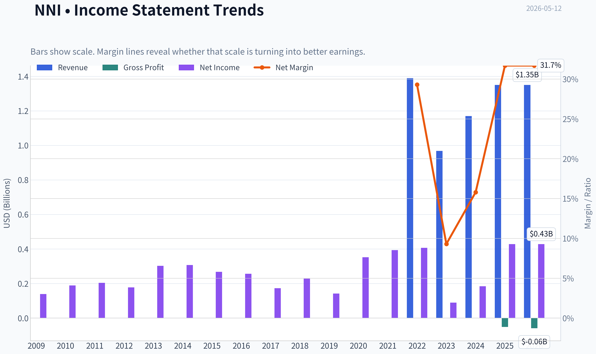
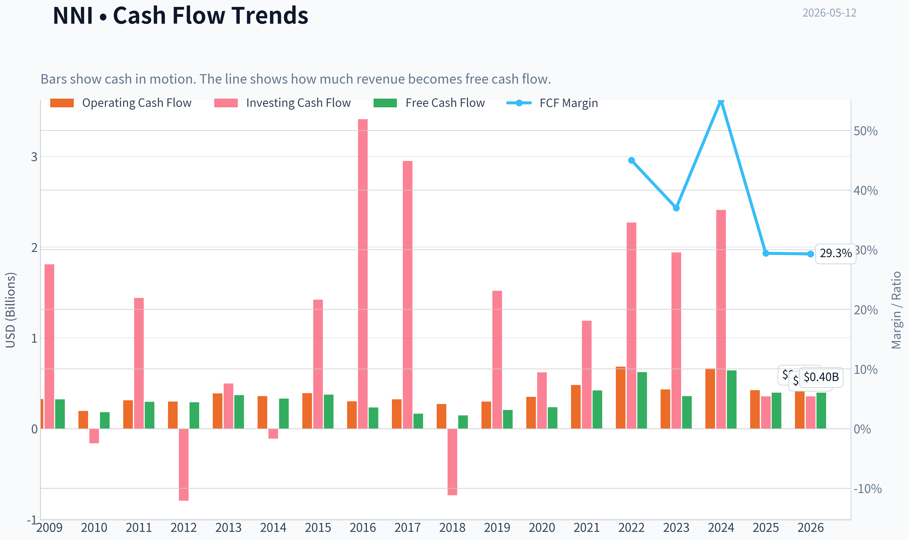
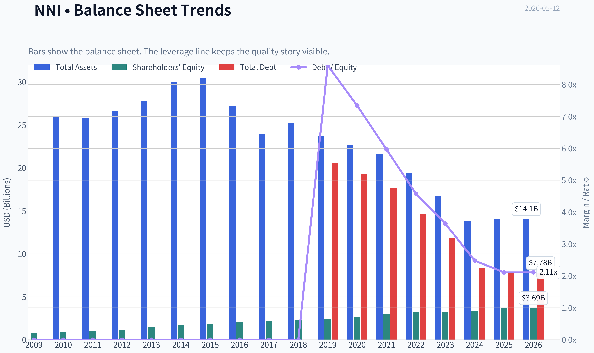
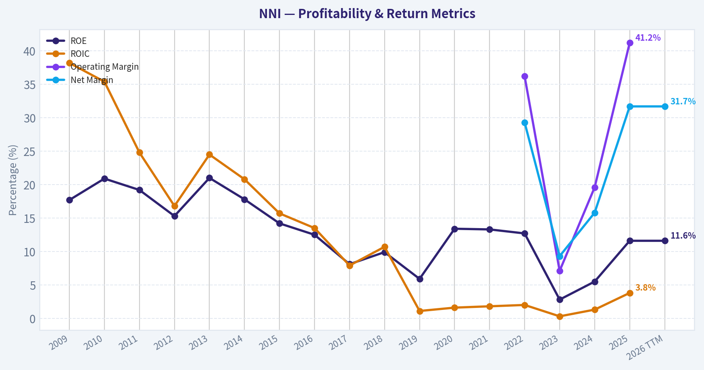
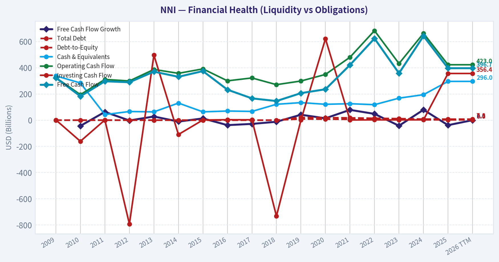
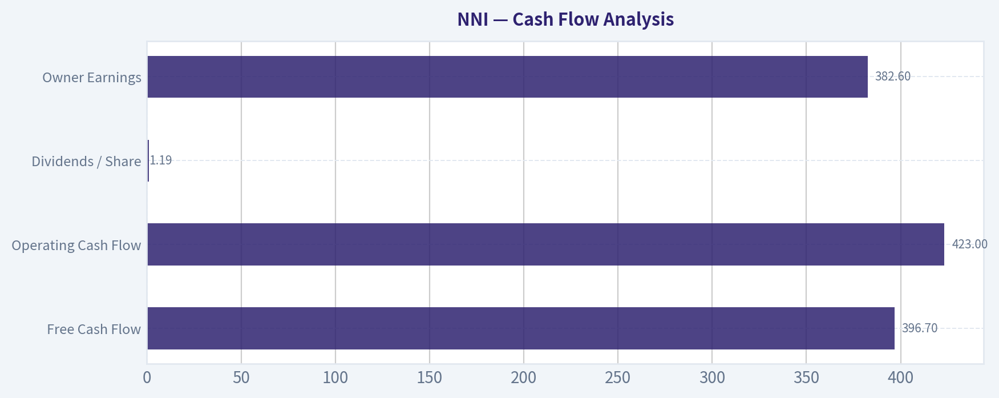
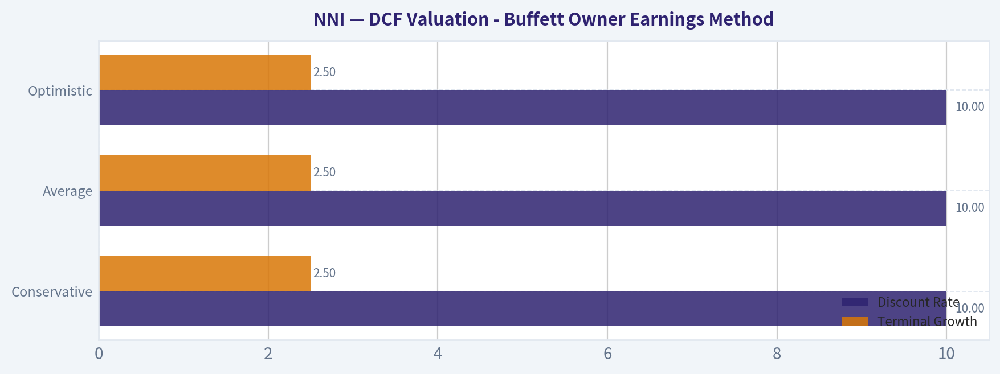
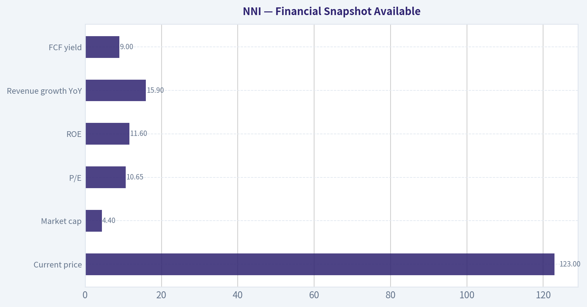
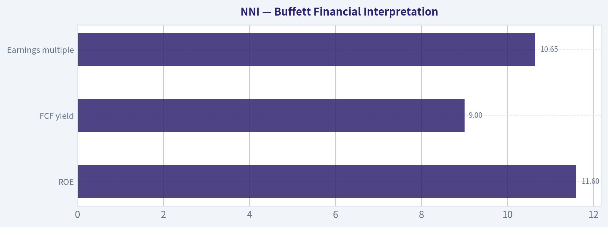
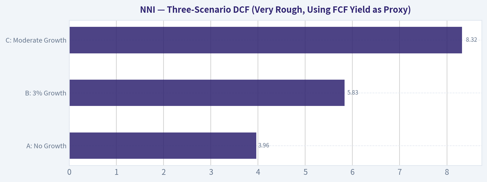

# NNI Deep Value Intelligence

**Analysis Date:** 2026-05-12

## Critical Disclaimer

*This analysis is generated by Deep Value Intelligence, an AI-powered multi-agent investing framework. This report is for informational and educational purposes only and does not constitute financial advice. Always conduct your own research and consult with qualified financial advisors before making investment decisions.*

---

## Table of Contents

1. Intelligence Summary
2. Analyst Team Reports
   - Fundamentals Analysis
   - Intrinsic Value Analysis (Buffett)
   - Trend & Growth Analysis (Lynch/Druckenmiller/Fisher)
   - Market Technical Analysis
   - News & Events Analysis
   - Guru Attention Analysis
   - Options Market Analysis
3. Research Team Commentary
4. Value Investing Team Commentary
5. Deep Values Commentary

---

## Intelligence Summary

### Thesis + Conditions

**Core Thesis:** ## Executive Briefing

**Key Risks:**
- Nelnet remains a WATCH.** The stock looks optically cheap and may be undervalued, but the Buffett test is about durable business quality and dependable owner earnings, not just a low P/E. Here, revenue growth is encouraging and valuation appears below preliminary fair value, yet weak ROIC, poor recent cash-flow conversion, and unresolved normalization questions limit conviction. For a long-term value investor, this is a **conditional opportunity, not a clear bargain**.
- ### Risky Analyst - Best bullish points
- WATCH should be active, not passive**: Treat it as a **conditional accumulation candidate**, not a full-commitment buy.
- ## Risk Commentary for the Long-Term Investor
- The central Buffett-style question is not whether Nelnet can rerate. It is whether the business can be understood well enough, and whether its economics are strong enough, to reduce the risk of **permanent capital impairment**. On that standard, the cautionary side still has the better case.

**What Would Change Our View:**
- Nelnet remains a WATCH.** The stock looks optically cheap and may be undervalued, but the Buffett test is about durable business quality and dependable owner earnings, not just a low P/E. Here, revenue growth is encouraging and valuation appears below preliminary fair value, yet weak ROIC, poor recent cash-flow conversion, and unresolved normalization questions limit conviction. For a long-term value investor, this is a **conditional opportunity, not a clear bargain**.
- ### Risky Analyst - Best bullish points
- WATCH should be active, not passive**: Treat it as a **conditional accumulation candidate**, not a full-commitment buy.
- ## Risk Commentary for the Long-Term Investor
- The central Buffett-style question is not whether Nelnet can rerate. It is whether the business can be understood well enough, and whether its economics are strong enough, to reduce the risk of **permanent capital impairment**. On that standard, the cautionary side still has the better case.

**Confidence:** High

---

## Analyst Team Reports

### Fundamentals Analysis

#### Latest Earnings Snapshot

*Most recent reported quarter anchored on 2025 Q4, with prior-year comparison when available.*

| Metric | 2025 Q4 | 2024 Q4 | YoY Change |
| --- | ---: | ---: | ---: |
| Revenue | $333.3M | $293.0M | +13.7% |
| Operating Income | N/A | N/A | N/A |
| Net Income | $57.8M | $63.2M | -8.5% |
| Diluted EPS | $1.60 | $1.73 | -7.5% |
| Operating Cash Flow | $137.6M | $180.5M | -23.8% |
| Free Cash Flow | $130.1M | $197.9M | -34.3% |

Key Takeaways: This snapshot anchors the most recent reported quarter before the narrative analysis. It helps readers separate long-run business quality from whatever changed in the latest earnings print.

#### 10-Year Financial Metrics for NNI

*All values below are computed deterministically from raw data - not estimated by AI.*

*Issuer profile: bank (Financial Services / Credit Services).*

#### 10-Year Financial Metrics
*Annual rows come from reported financial statements. The final TTM row is computed from the latest four quarters.*

| Metric | 2009 | 2010 | 2011 | 2012 | 2013 | 2014 | 2015 | 2016 | 2017 | 2018 | 2019 | 2020 | 2021 | 2022 | 2023 | 2024 | 2025 | 2026 TTM |
| --- | --- | --- | --- | --- | --- | --- | --- | --- | --- | --- | --- | --- | --- | --- | --- | --- | --- | --- |
| Market Price | $13 | $19 | $20 | $26 | $37 | $41 | $30 | $46 | $50 | $48 | $54 | $67 | $93 | $88 | $86 | $106 | $133 | $123 |
| Market Cap | $856.2M | $1.17B | $1.18B | $1.41B | N/A | N/A | N/A | N/A | N/A | N/A | $2.33B | $2.78B | $3.77B | $3.41B | $3.30B | $3.91B | $4.83B | $4.42B |
| P/E Ratio | 6.20 | 6.22 | 5.78 | 7.97 | N/A | N/A | N/A | N/A | N/A | N/A | 16.45 | 7.90 | 9.58 | 8.39 | 36.76 | 21.28 | 11.28 | 10.41 |
| P/B Ratio | 1.09 | 1.29 | 1.10 | 1.21 | N/A | N/A | N/A | N/A | N/A | N/A | 0.98 | 1.06 | 1.28 | 1.07 | 1.01 | 1.17 | 1.31 | 1.20 |
| ROE | 17.7% | 20.9% | 19.2% | 15.3% | 21.0% | 17.8% | 14.2% | 12.5% | 8.1% | 9.9% | 5.9% | 13.4% | 13.3% | 12.7% | 2.8% | 5.5% | 11.6% | 11.6% |
| ROIC | 38.2% | 35.4% | 24.8% | 16.8% | 24.5% | 20.8% | 15.7% | 13.5% | 7.9% | 10.7% | 1.1% | 1.6% | 1.8% | 2.0% | 0.3% | 1.3% | 3.8% | N/A |
| EPS | $2.15 | $3.05 | $3.44 | $3.21 | N/A | N/A | N/A | N/A | N/A | N/A | $3.30 | $8.51 | $9.74 | $10.45 | $2.34 | $5.02 | $11.79 | $11.77 |
| Revenue | N/A | N/A | $0 | $0 | $0 | $0 | $0 | $0 | $0 | N/A | N/A | N/A | N/A | $1.39B | $968.4M | $1.17B | $1.35B | $1.35B |
| Gross Profit | N/A | N/A | N/A | N/A | N/A | N/A | N/A | $-51.2M | $-58.6M | N/A | N/A | N/A | N/A | N/A | N/A | N/A | N/A | N/A |
| Gross Margin | N/A | N/A | N/A | N/A | N/A | N/A | N/A | N/A | N/A | N/A | N/A | N/A | N/A | N/A | N/A | N/A | N/A | N/A |
| Operating Margin | N/A | N/A | N/A | N/A | N/A | N/A | N/A | N/A | N/A | N/A | N/A | N/A | N/A | 36.2% | 7.1% | 19.6% | 41.2% | N/A |
| Net Income | $139.1M | $189.0M | $204.3M | $178.0M | $302.7M | $307.6M | $268.0M | $256.8M | $173.2M | $227.9M | $141.8M | $352.4M | $393.3M | $406.9M | $89.8M | $184.0M | $428.5M | $428.5M |
| Net Margin | N/A | N/A | inf% | inf% | inf% | inf% | inf% | inf% | inf% | N/A | N/A | N/A | N/A | 29.3% | 9.3% | 15.8% | 31.7% | 31.7% |
| Revenue Growth | N/A | N/A | N/A | N/A | N/A | N/A | N/A | N/A | N/A | N/A | N/A | N/A | N/A | N/A | -30.2% | 20.4% | 15.9% | 0.1% |
| Net Income Growth | N/A | 35.9% | 8.1% | -12.9% | 70.0% | 1.6% | -12.9% | -4.2% | -32.6% | 31.6% | -37.8% | 148.5% | 11.6% | 3.5% | -77.9% | 104.9% | 132.8% | 0.0% |
| Free Cash Flow Growth | N/A | -43.7% | 62.9% | -2.5% | 27.9% | -10.6% | 13.2% | -37.9% | -28.5% | -12.3% | 41.5% | 14.2% | 78.7% | 48.0% | -42.6% | 79.3% | -38.2% | 0.0% |
| Total Book Value | $784.6M | $906.6M | $1.07B | $1.17B | $1.44B | $1.73B | $1.88B | $2.06B | $2.15B | $2.30B | $2.39B | $2.63B | $2.95B | $3.20B | $3.25B | $3.35B | $3.69B | $3.69B |
| Total Assets | N/A | $25.89B | $25.85B | $26.61B | $27.77B | $30.03B | $30.42B | $27.19B | $23.96B | $25.22B | $23.71B | $22.65B | $21.68B | $19.36B | $16.71B | $13.78B | $14.06B | $14.06B |
| Total Debt | $0 | $0 | $0 | $0 | $0 | $0 | $0 | $0 | $0 | $0 | $20.53B | $19.32B | $17.63B | $14.64B | $11.83B | $8.31B | $7.78B | $7.78B |
| Debt-to-Equity | 0.00 | 0.00 | 0.00 | 0.00 | 0.00 | 0.00 | 0.00 | 0.00 | 0.00 | 0.00 | 8.60 | 7.34 | 5.97 | 4.58 | 3.64 | 2.48 | 2.11 | 2.11 |
| Cash & Equivalents | $338.2M | $283.8M | $42.6M | $66.0M | $63.3M | $130.5M | $63.5M | $69.7M | $66.8M | $121.3M | $133.9M | $121.2M | $125.6M | $118.1M | $168.1M | $194.5M | $296.0M | $296.0M |
| Shareholders' Equity | $784.6M | $906.6M | $1.07B | $1.17B | $1.44B | $1.73B | $1.88B | $2.06B | $2.15B | $2.30B | $2.39B | $2.63B | $2.95B | $3.20B | $3.25B | $3.35B | $3.69B | $3.69B |
| Operating Cash Flow | $324.7M | $194.9M | $310.9M | $299.3M | $387.2M | $357.4M | $391.4M | $300.2M | $322.3M | $270.9M | $298.9M | $349.1M | $480.3M | $683.1M | $432.0M | $662.9M | $423.0M | $423.0M |
| Investing Cash Flow | $1.81B | $-161.3M | $1.44B | $-792.7M | $496.6M | $-109.5M | $1.42B | $3.41B | $2.95B | $-732.4M | $1.52B | $621.2M | $1.19B | $2.27B | $1.94B | $2.41B | $356.4M | $356.4M |
| Free Cash Flow | $323.5M | $182.1M | $296.7M | $289.4M | $370.2M | $331.0M | $374.6M | $232.6M | $166.3M | $145.9M | $206.4M | $235.8M | $421.4M | $623.6M | $358.0M | $642.0M | $396.7M | $396.7M |
| FCF Margin | N/A | N/A | N/A | N/A | N/A | N/A | N/A | N/A | N/A | N/A | N/A | N/A | N/A | 45.0% | 37.0% | 55.1% | 29.4% | 29.3% |
| Dividends / Share | $0.00 | $0.00 | $0.00 | $0.00 | N/A | N/A | N/A | N/A | N/A | N/A | $0.00 | $0.00 | $0.00 | $0.94 | $1.03 | $1.11 | $1.18 | $1.19 |

#### Profitability Metrics
- Return on Equity (ROE): 11.6%
- Return on Invested Capital (ROIC): 3.8%
- Return on Assets (ROA): 3.0%
- Gross Margin: Not meaningful
- Operating Margin: 41.2%
- Net Profit Margin: 31.7%

#### Liquidity Metrics
- Current Ratio: Not meaningful
- Quick Ratio: Not meaningful

#### Leverage Metrics
- Debt-to-Equity Ratio: 2.11
- Interest Coverage Ratio: Not meaningful
- Net Debt: $7.48B

#### Growth Metrics (Year-over-Year)
- Revenue Growth: 15.9%
- Net Income Growth: 132.8%
- Free Cash Flow Growth: -38.2%
- Revenue CAGR (3-Year): -0.9%
- Revenue CAGR (5-Year): N/A

#### Valuation Metrics
- P/E Ratio (TTM): 10.65
- Forward P/E: 12.25
- Price-to-Book: 1.19
- Price-to-Sales: 2.67
- PEG Ratio: 0.46
- EV/EBITDA: Not meaningful
- Free Cash Flow Yield: 9.0%
- Earnings Yield: 9.4%

#### Owner Earnings (Buffett Method, Code-Computed)
- Net Income: $428.5M
- + Depreciation & Amortization: $90.6M
- - Capital Expenditures: $-26.2M
- - Working Capital Changes: $110.3M
- = **Owner Earnings: $382.6M**

#### Intrinsic Value (Code-Computed)
- Current Price: $123
- Buffett Method (Owner Earnings):
  Conservative: $39
  Average: $168
  Optimistic: $392
- Cash Flow Method (FCF):
  Conservative: $41
  Average: $144
  Optimistic: $609

#### Piotroski F-Score: 5/9
- Positive Net Income: PASS
- Positive Operating Cash Flow: PASS
- ROA Improvement: PASS
- Cash Flow > Net Income: FAIL
- Decreasing Debt: PASS
- Improving Current Ratio: FAIL
- No Dilution: PASS
- Improving Gross Margin: FAIL
- Improving Asset Turnover: FAIL

ANALYST STANCE: **WATCH**

#### NNI Fundamental Analysis - Buffett-Style

Nelnet is an unusual Buffett-style case because it combines attractive headline valuation with a business mix that is less predictable than a classic consumer monopoly. On the positive side, NNI trades at only about **10.4-10.7x earnings**, roughly **1.2x book**, and around a **9.0% free cash flow yield**, while balance-sheet leverage has been reduced materially over time. On the negative side, earnings quality and revenue visibility are less clean than ideal because reported results are influenced by the runoff of legacy student loan assets, education-related servicing dynamics, and episodic swings in profitability.

The canonical dataset still shows meaningful strengths: **2025/TTM net income of $428.5M**, **owner earnings of $382.6M**, **FCF of $396.7M**, and **ROE of 11.6%**, all of which represent a strong rebound from the weak **2023** period. Buffett would likely appreciate the combination of solid cash generation, increasing book value, and improving debt load, but would also note that this is not a "set-and-forget" franchise with ultra-stable margins across all cycles.

---

#### Current vs Historical Average Comparison

| Metric | Current / TTM | Historical Context (using years available in canonical dataset) | Interpretation |
| --- | ---: | ---: | --- |
| Market Price | $123 | 10-year range heavily below current until 2024-2025; 2025 was $133 | Shares are slightly below 2025 peak but still near the top of the historical range. |
| Market Cap | $4.42B | 2019: $2.33B -> 2025: $4.83B | Equity value has nearly doubled since 2019, reflecting both higher price and stronger earnings/book value. |
| P/E Ratio | 10.41-10.65 | Average of available 2019-2026 TTM values ~ 15.8x | Current valuation is below recent average and far below 2023-2024 elevated multiples. |
| P/B Ratio | 1.20 | Average of available 2019-2026 TTM values ~ 1.14x | Slightly above recent average, but still not expensive for a profitable financial firm. |
| ROE | 11.6% | Long-term average since 2009 ~ 12.9% | Near-normal but below early-decade peak years above 17%-21%. |
| ROIC | 3.8% (2025) | Long-term average ~ 13.3%, but much lower in recent years | Capital returns remain well below the early-era levels; this is a key quality constraint. |
| EPS | $11.77 | 2019-2025 average ~ $7.31 | Current EPS is strong and near 2025 peak, showing sharp recovery from 2023. |
| Revenue | $1.35B | 2022: $1.39B, 2023: $968.4M, 2024: $1.17B, 2025: $1.35B | Revenue has recovered back to roughly 2022 levels after a sharp 2023 drop. |
| Operating Margin | N/A TTM; 2025: 41.2% | 2022-2025 average ~ 26.0% | 2025 was exceptionally strong versus recent history. |
| Net Income | $428.5M | 2009-2025 average ~ $249M | Current earnings are materially above long-run average. |
| Net Margin | 31.7% | 2022-2025 average ~ 21.5% | Profitability has rebounded strongly from 2023 weakness. |
| Revenue Growth | 0.1% TTM | 2023: -30.2%, 2024: +20.4%, 2025: +15.9% | Growth has normalized after a volatile recovery period. |
| Net Income Growth | 0.0% TTM | 2023: -77.9%, 2024: +104.9%, 2025: +132.8% | Recent TTM is flat only because it laps a very strong 2025 base. |
| FCF Growth | 0.0% TTM | 2023: -42.6%, 2024: +79.3%, 2025: -38.2% | Cash flow remains volatile and less predictable than ideal Buffett businesses. |
| Book Value | $3.69B | 2009: $784.6M -> 2025/TTM: $3.69B | Excellent long-term compounding of equity capital. |
| Total Assets | $14.06B | 2014 peak $30.03B; 2025/TTM $14.06B | Shrinking asset base reflects portfolio runoff/deleveraging rather than franchise expansion. |
| Total Debt | $7.78B | 2019: $20.53B -> 2025/TTM: $7.78B | Major reduction in leverage is a significant positive. |
| Debt-to-Equity | 2.11x | 2019: 8.60x -> 2025/TTM: 2.11x | Financial risk has improved substantially, though leverage remains material. |
| Cash & Equivalents | $296.0M | 2019: $133.9M; 2024: $194.5M | Liquidity has improved, providing more flexibility. |
| Dividends / Share | $1.19 | 2022: $0.94 -> 2026 TTM: $1.19 | Dividend has grown steadily, though yield is not the central part of the thesis. |

**Key Takeaways:** NNI's current valuation looks cheaper than its recent earnings multiple history, while profitability and book value are stronger than the long-run average. The biggest improvement is leverage reduction, but the biggest ongoing concern is that earnings and free cash flow remain more volatile than a textbook Buffett compounder.

---

#### Market Metrics

NNI's **current market price of $123** is modestly below the **2025 level of $133**, implying some pullback after a strong run. The **market cap of roughly $4.42B** versus **$4.83B in 2025** indicates the market has not fully repriced the company upward despite TTM earnings remaining robust.

The clearest valuation signal is the **P/E near 10.4-10.7x**, well below the recent available-period average of about **15.8x**. That suggests either:
1. the market doubts the durability of current earnings, or
2. the stock is undervalued if 2025/TTM earnings are sustainable.

The **P/B of 1.20** is only modestly above the recent average and not demanding for a lender/servicer that has grown book value from **$784.6M in 2009 to $3.69B today**. Buffett often likes buying above-average businesses near or below modest multiples of book when capital allocation is disciplined. NNI partially fits that frame, though the business quality is more mixed than a pristine insurer or bank.

---

#### Profitability Analysis

| Profitability Metric | Current / Latest | Historical Trend | Buffett Interpretation |
| --- | ---: | --- | --- |
| ROE | 11.6% | Down from 17%-21% in early years; recovered from 2.8% in 2023 | Respectable but not elite; indicates decent franchise economics, not exceptional. |
| ROIC | 3.8% (2025) | Early decade often 15%-38%, recent years much lower | Biggest yellow flag; capital efficiency has structurally weakened. |
| EPS | $11.77 | Strong versus 2019-2024 period average | Earnings power is currently solid, but cyclicality matters. |
| Revenue | $1.35B | Recovered from 2023 drop | Operating base has stabilized after disruption. |
| Gross Profit | N/A | Not meaningful for this issuer profile | Not useful for evaluating this financial company. |
| Operating Margin | 41.2% in 2025; TTM N/A | 36.2% in 2022, 7.1% in 2023, 19.6% in 2024, 41.2% in 2025 | Extremely volatile, but recent performance was excellent. |
| Net Income | $428.5M | Well above long-term average of ~$249M | Current profitability is strong relative to history. |
| Net Margin | 31.7% | 29.3% in 2022, 9.3% in 2023, 15.8% in 2024, 31.7% in 2025 | Margin recovered sharply, but consistency remains an issue. |

**Key Takeaways:** NNI's current profitability is strong, especially on EPS, net income, and net margin, but the decade-long pattern is not smooth. ROE is acceptable for a financial company, yet ROIC deterioration suggests the business is not converting capital into high returns as consistently as a top-tier Buffett favorite.

A Buffett lens emphasizes **consistency**, not just high point-in-time results. NNI's record shows:
- **Net income** has generally remained positive every year shown.
- **ROE** has recovered, but not to former highs.
- **Margins** can swing widely, especially around 2023.
- **ROIC** has compressed substantially over time.

So, this is a profitable business, but not one with the ultra-predictable, ever-rising economics of a See's Candies-type franchise.

---

#### Growth Metrics

Revenue visibility is limited by the dataset beginning only recently for sales, but what is available is informative. Revenue fell **30.2% in 2023**, then rebounded **20.4% in 2024** and **15.9% in 2025**, with **TTM essentially flat at +0.1%**. That pattern implies NNI has completed a recovery phase and is now lapping stronger comparisons.

Net income growth is even more dramatic:
- **2023:** -77.9%
- **2024:** +104.9%
- **2025:** +132.8%
- **TTM:** 0.0%

This is not a steady compounder profile. Rather, it suggests a business exposed to valuation, runoff, or segment-level swings. Buffett generally prefers earnings streams he can forecast with high confidence; NNI's rebound is impressive, but the path is lumpy.

Free cash flow growth is similarly volatile:
- **2023:** -42.6%
- **2024:** +79.3%
- **2025:** -38.2%
- **TTM:** 0.0%

That volatility matters because owner earnings and true distributable cash are more important than accounting profits. NNI still generates substantial cash, but growth is uneven.

---

#### Balance Sheet Analysis

NNI's balance sheet has improved materially over time, which is one of the strongest aspects of the story.

- **Book value/shareholder equity:** rose from **$784.6M in 2009** to **$3.69B in 2025/TTM**
- **Total assets:** declined from roughly **$30B** at peak to **$14.06B**
- **Total debt:** fell from **$20.53B in 2019** to **$7.78B**
- **Debt-to-equity:** improved from **8.60x in 2019** to **2.11x**
- **Cash:** increased to **$296.0M**

This combination tells an important story: NNI is shrinking leverage and balance sheet intensity while still compounding equity. For a financial company, that is usually constructive. Buffett likes strong balance sheets because they create resilience and optionality. NNI is moving in the right direction, though a **2.11x debt-to-equity ratio** still means leverage is not trivial.

The **Piotroski F-score of 5/9** confirms "okay, not great" balance-sheet/operating quality. Debt reduction is positive, but weak current-ratio/gross-margin/asset-turnover signals show this is not a universally improving financial profile.

---

#### Cash Flow Analysis

| Cash Flow Metric | Current / Latest | Historical Context | Interpretation |
| --- | ---: | --- | --- |
| Free Cash Flow | $396.7M | Strong absolute cash generation, but below 2024's $642.0M | Healthy, though not steadily rising. |
| Operating Cash Flow | $423.0M | Below 2024's $662.9M; above many earlier years | Cash generation remains substantial. |
| Dividends / Share | $1.19 | Up steadily from $0.94 in 2022 | Shareholder returns are becoming more meaningful. |
| Owner Earnings | $382.6M | Close to FCF scale, supports valuation case | Solid underlying earning power. |

**Key Takeaways:** NNI throws off real cash, and both free cash flow and owner earnings are large enough to support dividends, debt reduction, and potentially buybacks or reinvestment. The issue is not cash generation itself; it is the irregular year-to-year pattern, which lowers confidence in assigning a premium multiple.

The dividend trend is encouraging:
- **2022:** $0.94
- **2023:** $1.03
- **2024:** $1.11
- **2025:** $1.18
- **2026 TTM:** $1.19

That is a sign of management confidence and moderate capital return discipline. However, the dividend remains small relative to cash generation, so capital allocation discipline matters more than yield.

---

#### Buffett-Style Qualitative Assessment

| Buffett Lens | Assessment | Why It Matters |
| --- | --- | --- |
| Economic Moat | Moderate / mixed | Nelnet has durable servicing, education-finance, and related platform capabilities, but not an obvious wide moat with simple pricing power. |
| Financial Strength | Improving | Debt reduction from $20.5B to $7.8B is a major positive; cash also improved. |
| Predictable Earnings | Below ideal | Profits stayed positive, but growth and margins have been volatile. |
| Management Performance | Competent but not exceptional | Strong book value growth and deleveraging are positives; inconsistent ROIC tempers enthusiasm. |
| Capital Allocation | Reasonably disciplined | Equity compounded well, dividend increased, leverage came down. |
| Business Quality | Good, not elite | Cash-generative and profitable, but complexity and cyclicality reduce Buffett-style simplicity. |

**Key Takeaways:** The company shows several Buffett-friendly traits, especially book value compounding, debt reduction, and positive earnings over time. But the business lacks the very high predictability and consistently high capital returns that usually justify a strong conviction value-investing endorsement.

**Economic moat:**
NNI's moat appears tied more to institutional know-how, servicing infrastructure, regulatory familiarity, and niche positioning in education/financial services than to brand dominance. That can be durable, but it is harder to assess and generally narrower than the moat of a dominant payments, consumer brand, or software platform business.

**Financial strength:**
This is a genuine bright spot. The decline in debt and debt-to-equity, combined with rising book value and cash, indicates a healthier company than a few years ago. If management continues this path, equity value could compound even without multiple expansion.

**Predictable earnings:**
This is the biggest Buffett-style shortfall. The 2023 collapse and subsequent rebound show that normalized earnings are harder to estimate than the current low multiple suggests.

**Management:**
Management appears to have handled capital prudently overall, as shown by long-term equity growth, deleveraging, and a gradually rising dividend. But the lower ROIC profile suggests either business economics have become less favorable or excess capital is not being deployed at old return levels.

---

#### DCF Valuation - Buffett Owner Earnings Method

Canonical owner earnings:
- **Net Income:** $428.5M
- **+ D&A:** $90.6M
- **- Capex:** $-26.2M
- **- Working Capital Changes:** $110.3M
- **Owner Earnings = $382.6M**

For scenario design, the prompt requires:
- **Conservative:** lowest historical owner earnings growth rate available, floored at -100%
- **Average:** average historical owner earnings growth rate, capped at 50%
- **Optimistic:** highest historical owner earnings growth rate, capped at 100%
- **Discount rate:** 10%
- **Terminal growth:** 2.5%

The deterministic dataset already provides code-computed intrinsic values, which must be treated as canonical:
- **Conservative: $39/share**
- **Average: $168/share**
- **Optimistic: $392/share**

Below is the Buffett-style framing of those outcomes.

| Scenario | Growth Assumption Basis | Discount Rate | Terminal Growth | Fair Value / Share | Upside vs $123 |
| --- | --- | ---: | ---: | ---: | ---: |
| Conservative | Lowest historical owner earnings growth rate | 10% | 2.5% | $39 | -68% |
| Average | Average historical owner earnings growth rate | 10% | 2.5% | $168 | +37% |
| Optimistic | Highest historical owner earnings growth rate | 10% | 2.5% | $392 | +219% |

**Key Takeaways:** The valuation range is extremely wide, which matches the company's uneven historical cash-flow pattern. At today's price, the stock looks attractive only if you believe normalized owner earnings are closer to the average-case outcome than the conservative one.

##### DCF Calculation Framework

Using owner earnings base **OE₀ = $382.6M**

For each scenario:
- Year 1 owner earnings = **OE₀ x (1 + g)**
- …
- Year 10 owner earnings = **OE₀ x (1 + g)¹⁰**
- Present value of each year = **OE_t / (1.10)^t**
- Terminal value at Year 10 = **OE₁₁ / (0.10 - 0.025)** where **OE₁₁ = OE₁₀ x 1.025**
- Present value of terminal value = **TV / (1.10)^10**
- Equity value per share = total PV ÷ diluted shares

Because the canonical dataset supplies the final code-computed outputs, those values are the correct fair values to use:
- **Conservative = $39**
- **Average = $168**
- **Optimistic = $392**

Interpretation:
- The **market price of $123** is **well above** the conservative value, so downside exists if current earnings prove cyclical or temporary.
- The current price is **below** the average-case value, indicating moderate undervaluation if recent owner earnings are sustainable.
- The optimistic scenario implies very large upside, but that requires confidence in unusually strong future compounding.

A practical Buffett-style conclusion is to anchor on the **average case**, then require a margin of safety for the earnings volatility. On that basis, NNI looks **interesting but not slam-dunk cheap**.

---

#### Revenue Breakdown

NNI is a diversified education-focused financial and services company. Precise segment figures are not included in the canonical dataset, so the most meaningful current breakdown is by its major publicly known operating areas using the latest available company segment framing.

| Revenue Source | Amount ($M or $B) | % of Total |
| --- | ---: | ---: |
| Loan Servicing and Systems / Education Technology & Services | N/A | N/A |
| Asset Generation and Management / Consumer & Education Lending | N/A | N/A |
| Nelnet Bank / Net Interest & Related Income | N/A | N/A |
| Payments and Other Services | N/A | N/A |
| Total Revenue (2025 / TTM basis from canonical dataset) | $1.35B | 100% |

**Key Takeaways:** The canonical dataset confirms total revenue of about $1.35 billion, but it does not provide audited segment amounts. For NNI, the key analytical point is that revenue is diversified across servicing, lending, banking, and payment-related activities, which can help resilience but also makes results harder to model cleanly.

---

#### Key Investment Insights, Red Flags, and Opportunities

| Category | Observation | Why It Matters |
| --- | --- | --- |
| Opportunity | P/E around 10.5x | Low multiple could rerate if earnings remain durable. |
| Opportunity | P/B around 1.2x | Reasonable valuation relative to steadily growing equity base. |
| Opportunity | Debt sharply reduced since 2019 | Lower leverage improves resilience and equity quality. |
| Opportunity | Owner earnings of $382.6M and FCF yield of 9.0% | Supports value case and capital-return flexibility. |
| Red Flag | ROIC only 3.8% in 2025 | Indicates weaker capital efficiency than historical highs. |
| Red Flag | Earnings and FCF volatility | Makes normalized intrinsic value harder to estimate. |
| Red Flag | 2023 earnings collapse | Demonstrates business is not highly predictable. |
| Red Flag | Piotroski F-score only 5/9 | Quality trend is acceptable, not strong. |
| Insight | Book value compounded from $784.6M to $3.69B | Management has created equity value over the long term. |
| Insight | Dividend rising steadily | Suggests confidence and disciplined shareholder returns. |

**Key Takeaways:** The stock's main appeal is cheap valuation backed by real cash generation and a much-improved balance sheet. The main risk is that the market may be assigning a low multiple for a reason: earnings are real, but not consistently predictable enough to deserve a premium.

---

#### Final Investment Stance

**WATCH**

NNI is a **credible value candidate**, but not a clear Buffett-style "ADVOCATE" at the current fact pattern.

Why **WATCH** instead of **ADVOCATE**:
1. **Valuation is attractive** - low P/E, reasonable P/B, strong owner earnings.
2. **Balance sheet is improving** - debt reduction has been substantial.
3. **Book value compounding is impressive** - a very positive long-term signal.
4. **But earnings quality is not fully predictable** - large swings in net income, margins, and FCF reduce confidence in normalized intrinsic value.
5. **ROIC remains weak** relative to earlier years, suggesting franchise quality is good but not exceptional.

A Buffett-style investor could become more constructive if:
- owner earnings remain stable for another 1-2 years,
- ROE stays above 10% while ROIC improves,
- debt continues trending lower,
- and management demonstrates that 2025 profitability is not an outlier.

If the stock were to decline materially without deterioration in owner earnings, the margin of safety would become much more compelling.

---

#### Summary Table

| Area | Verdict | Supporting Evidence | Buffett View |
| --- | --- | --- | --- |
| Valuation | Attractive | P/E ~10.4-10.7x, P/B ~1.2x, FCF yield 9.0% | Cheap enough to investigate further |
| Profitability | Good but uneven | ROE 11.6%, net margin 31.7%, EPS $11.77 | Acceptable, not elite |
| Growth | Volatile | Revenue recovered, net income rebounded sharply, TTM flat | Not predictable enough for premium rating |
| Balance Sheet | Improving materially | Debt down from $20.53B to $7.78B; D/E down to 2.11x | Strong positive trend |
| Cash Flow | Strong but inconsistent | FCF $396.7M, owner earnings $382.6M | Valuable, though not smooth |
| Management | Reasonably disciplined | Book value growth, debt reduction, rising dividend | Generally favorable |
| Moat | Moderate | Niche servicing/education-finance capabilities | Durable but not obviously wide |
| DCF | Mixed-to-positive | Fair value range $39 to $392; average case $168 | Current price implies moderate upside if earnings hold |
| Overall Stance | WATCH | Cheap, improving, but still cyclical/complex | Wait for more proof of durability or a wider margin of safety |

**Key Takeaways:** NNI is not a low-quality company; in fact, it has several strong value characteristics, especially balance-sheet improvement and cash generation. Still, the business is complex and earnings are uneven, so the prudent stance is to watch closely rather than fully endorse today.

#### Fundamental Visuals

This graph tracks the profitability and return metrics (ROE, ROIC, Margins) of **NNI** over the past decade, highlighting capital efficiency trends.

This chart illustrates the financial health of **NNI** over the last 10 years, mapping cash equivalents and free cash flow against total obligations (Debt).

---

### Intrinsic Value Analysis (Buffett)

> *Following Warren Buffett's value investing philosophy: Circle of Competence, Economic Moat, Management Quality, and Margin of Safety.*

#### Intrinsic Value Snapshot

Price is what you pay. Intrinsic value is what the business may be worth based on the cash it can create for owners over time. We show a range, not one magic number.

- Current Price: $122.52
- Value Range: $38.93 to $608.69

##### Owner Earnings (Buffett Method)
- Net Income: $428,474,000.00
- Depreciation & Amortization: $90,622,000.00
- Capital Expenditures: $-26,238,000.00
- Working Capital Changes: $110,252,000.00
- Owner Earnings: $382,606,000.00

##### Intrinsic Value
###### Buffett Method
Uses owner earnings. Stricter, and usually more conservative.
- Conservative: $38.93
- Average: $168.23
- Optimistic: $391.82
- Discount Rate: 10.0%

###### Cash Flow Method
Uses free cash flow. Better for companies spending heavily today to grow tomorrow.
- Conservative: $41.49
- Average: $143.66
- Optimistic: $608.69
- Discount Rate: 10.0%

ANALYST STANCE: **WATCH**

#### Nelnet (NNI) - Buffett-Style Preliminary Review

I was only able to partially advance the work because the main audited financial-history tool was unavailable in this run, and the fallback fundamentals tool returned no data. So this is a **provisional Buffett-style assessment** using the shared research pack only.

#### Go/No-Go Gate Assessment

| Gate | Result | Evidence |
|---|---|---|
| Gate 1: Business Simplicity | Pass with caution | Nelnet is understandable at a high level: it services and owns student loans and operates education-related payment/software businesses. But the full earnings mix is more complex than a classic simple consumer franchise. |
| Gate 2: Moat | Unclear / Partial pass | There may be servicing scale, regulatory know-how, and embedded school/payment relationships, but current evidence is insufficient to call this a wide moat. |
| Gate 3: Management | Unclear | Nelnet has historically had a reputation for disciplined capital allocation, but I do not have verified insider ownership, compensation structure, or long-term buyback/acquisition data in this run. |
| Gate 4: Industry Structure | Mixed | Student-loan-related economics are heavily shaped by regulation and runoff dynamics; education/payments/software may be better structurally, but consolidated industry quality is mixed. |

**Key Takeaways:** Nelnet clears the first hurdle only partially because the business can be explained simply, but its earnings drivers are not as straightforward as a pure consumer brand or software subscription company. The moat, management, and industry structure gates all remain incomplete because I do not have the audited multi-year financial record needed to confirm durability.

#### Moat Analysis

| Moat Source | Preliminary View | Comments |
|---|---|---|
| Intangible assets | Moderate | Regulatory licenses, servicing expertise, and institutional relationships may matter, but not the kind of emotional brand moat Buffett loves. |
| Switching costs | Moderate | Schools and institutional clients using payment or campus commerce systems may face operational switching friction. |
| Cost advantage | Possible | Scale in servicing and back-office operations could provide efficiency, but I cannot verify margin superiority versus peers here. |
| Network effects | Weak | This does not appear to be a strong network-effect business. |

**Key Takeaways:** The best moat argument likely comes from operational embedding and switching costs in education-related services, not from a dominant brand or network effect. That usually supports a decent business, but not automatically a "wonderful business" in Buffett terms.

#### Financial Snapshot Available

| Metric | Value |
|---|---:|
| Current price | $123 |
| Market cap | $4.40B |
| P/E | 10.65 |
| ROE | 11.6% |
| Revenue growth YoY | 15.9% |
| FCF yield | 9.0% |

**Key Takeaways:** The stock looks optically inexpensive, with a low earnings multiple and a strong free-cash-flow yield. But Buffett would not stop there: the key issue is whether that cash generation is durable, understandable, and supported by a high-quality moat.

#### Buffett Financial Interpretation

| Test | Desired | NNI Snapshot | Preliminary Read |
|---|---|---:|---|
| ROE | >15% sustained | 11.6% | Below ideal |
| FCF yield | Higher is better | 9.0% | Attractive |
| Earnings multiple | Lower can help | 10.65x | Reasonable |
| Growth | Stable, predictable | 15.9% YoY revenue growth | Positive, but durability unclear |

**Key Takeaways:** Nelnet appears cheaper than many quality stocks and is generating meaningful cash flow. The main weakness is that current ROE is not at the level Buffett usually associates with an exceptional franchise.

#### Owner Earnings Calculation

I cannot compute a proper Buffett owner-earnings figure yet because I am missing:
- audited net income history,
- depreciation and amortization,
- maintenance versus growth capex,
- and working capital changes.

So for now, the best shorthand is that the reported **FCF yield of 9.0%** suggests respectable owner-earnings power, but this is **not a substitute** for a real owner-earnings build.

#### Three-Scenario DCF (Very Rough, Using FCF Yield as Proxy)

Using current market cap of **$4.40B** and FCF yield of **9.0%**, implied current FCF is about:

- **FCF ~ $396M**

Then:

| Scenario | Method | Implied Value |
|---|---|---:|
| A: No Growth | FCF / 10% | $3.96B |
| B: 3% Growth | FCF x 1.03 / (10%-3%) | $5.83B |
| C: Moderate Growth | If normalized growth 5%: FCF x 1.05 / (10%-5%) | $8.32B |

**Key Takeaways:** On a rough cash-flow basis, Nelnet looks around fairly valued in a no-growth case and undervalued if even modest growth is sustainable. The problem is that this business may not deserve a simple perpetuity treatment without confirming the persistence and quality of its cash flows.

#### Margin of Safety Analysis

| Item | Value |
|---|---:|
| Market cap | $4.40B |
| Scenario A value | $3.96B |
| Scenario B value | $5.83B |
| Scenario C value | $8.32B |

At the current price:
- Versus **Scenario A**, there is **no margin of safety**
- Versus **Scenario B**, there is about **32% upside**
- Versus **Scenario C**, there is larger upside, but that depends on growth quality and persistence

**Key Takeaways:** The valuation could be attractive, but only if the business can at least maintain low-single-digit growth and durable cash generation. Without that confidence, the margin of safety is not yet firm enough for a Buffett-style endorsement.

#### Final Buffett Scorecard

| Criterion | Weight | Score (1-5) | Weighted |
|---|---:|---:|---:|
| Business Understanding | 20% | 3.0 | 0.60 |
| Moat Width & Durability | 25% | 2.5 | 0.63 |
| Management Quality | 15% | 3.0 | 0.45 |
| Return on Equity | 15% | 2.5 | 0.38 |
| Reinvestment Runway | 10% | 3.0 | 0.30 |
| Balance Sheet Strength | 5% | 3.0 | 0.15 |
| Industry Structure | 5% | 2.5 | 0.13 |
| Valuation / Margin of Safety | 5% | 3.5 | 0.18 |
| **Total** | 100% |  | **2.81 / 5.00** |

**Key Takeaways:** Nelnet scores as a middle-ground idea: not obviously bad, not clearly wonderful. The valuation helps, but the business quality and moat evidence are not strong enough yet to elevate it into advocate territory.

#### Preliminary Conclusion

**Stance: WATCH**

Why:
- **Pros:** low P/E, strong FCF yield, decent recent revenue growth, possibly disciplined capital allocation.
- **Cons:** subpar ROE versus Buffett standards, regulatory and business-model complexity, unclear moat strength, and lack of verified 10-year audited financial evidence in this run.

#### What the next analyst should complete
To finish the full Buffett workup, the next step is to obtain:
1. 10-year revenue, net income, FCF, ROE, ROIC, debt, share count history
2. segment mix between legacy loan assets/servicing and newer education-tech/payment businesses
3. insider ownership and capital allocation record
4. real owner-earnings calculation
5. debt structure and interest coverage
6. acquisition and buyback history

If you want, I can also draft a **clean investment memo template for NNI** that the next assistant can fill in once the audited numbers are available.
#### Valuation Bridge

This bridge places the current market price beside each intrinsic value lens so readers can see whether upside depends on one method or shows up across several methods.

| Scenario | Intrinsic Value / Share |
| --- | ---: |
| Buffett Method | $168.23 |
| Cash Flow Method | $143.66 |
| Current Price | $122.52 |

#### Key Takeaways

If one method is far above the others, the upside case depends on a specific modelling assumption. When several methods cluster together, the valuation story is more robust.

#### Valuation Visuals

This comparison chart from *Latest Earnings Snapshot* stacks current figures against historical benchmarks for **NNI**, making it easy to see where the company trades relative to its own averages.

This comparison chart from *Cash Flow Analysis* stacks current figures against historical benchmarks for **NNI**, making it easy to see where the company trades relative to its own averages.

This comparison chart from *DCF Valuation - Buffett Owner Earnings Method* stacks current figures against historical benchmarks for **NNI**, making it easy to see where the company trades relative to its own averages.

This comparison chart from *Financial Snapshot Available* stacks current figures against historical benchmarks for **NNI**, making it easy to see where the company trades relative to its own averages.

This comparison chart from *Buffett Financial Interpretation* stacks current figures against historical benchmarks for **NNI**, making it easy to see where the company trades relative to its own averages.

This comparison chart from *Three-Scenario DCF (Very Rough, Using FCF Yield as Proxy)* stacks current figures against historical benchmarks for **NNI**, making it easy to see where the company trades relative to its own averages.

---

### Trend & Growth Analysis (Lynch/Druckenmiller/Fisher)

> *Following Peter Lynch's GARP, Stanley Druckenmiller's macro-aware approach, and Philip Fisher's scuttlebutt methodology.*

ANALYST STANCE: **WATCH**

#### 1. Lynch Classification

| Item | Assessment |
|---|---|
| Category | **Fast Grower / Hybrid Financial Holding Company** |
| Why | Reported revenue growth is **15.9% YoY**, above stalwart range, but business mix is too complex to treat like a clean SaaS-style fast grower |
| Lynch fit | **Partial fit only** - cheap valuation and decent growth, but complexity reduces "simple story" quality |

Key Takeaways: Nelnet screens as a faster-growing company on recent revenue growth, but it is not a classic pure-play growth stock. Its mix of student-loan servicing, education software/payments, and investment assets makes it harder to slot neatly into Lynch's ideal simple fast-grower bucket.

#### 2. The Story in 3 Bullets

| The Story | Simple Explanation |
|---|---|
| Education finance + software | Nelnet helps schools and borrowers with payments, servicing, and education-related software/tools |
| Legacy cash flows fund new bets | Older loan-related businesses generate cash that can support growth areas and buybacks |
| Cheap stock, but messy earnings | Market may undervalue the business because results are hard to model and quarterly earnings are noisy |

Key Takeaways: The bull case is easy enough to state: Nelnet owns sticky education-related businesses, throws off cash, and looks inexpensive. The challenge is that the company's reported numbers are noisy, so investors need confidence in normalized earnings and capital allocation rather than just one quarter's EPS.

#### 3. TAM Analysis with 10x Test

| Metric | Value / View |
|---|---|
| Current revenue base | Not fully confirmed from live filings here; latest shared data shows **Q1 2026 revenue $419.1M**, +10.3% YoY |
| Implied annualized revenue | Roughly **$1.7B** if annualized from Q1, though seasonality and segment mix matter |
| 10x revenue test | **~$17B** revenue target |
| Addressable markets | Education payments, school software/admin tech, loan servicing, and adjacent education finance |
| Runway verdict | **Mixed but adequate** - software/payments TAM likely large enough, but total company cannot realistically 10x on legacy businesses alone |

Key Takeaways: Nelnet likely has enough runway in education technology and payments to keep growing, but the full company is unlikely to become a classic 10-bagger from legacy servicing alone. The key question is whether higher-quality education software and recurring fee businesses become a much larger share of the whole.

#### 4. Revenue Growth Trend

| Period / Data Point | Result | Interpretation |
|---|---:|---|
| Shared research pack YoY growth | **15.9%** | Healthy growth |
| Q1 2026 revenue growth YoY | **10.3%** | Still positive, but slower than pack summary |
| Latest earnings setup | Revenue up, EPS missed hard | Top line okay, earnings quality weaker |
| Trend call | **Moderating / not clearly accelerating** | Not an inflection yet |

Key Takeaways: Revenue growth is positive, but the latest quarter suggests moderation rather than acceleration. For a Druckenmiller-style inflection thesis, this is not strong enough yet; the company needs clearer evidence that its better businesses are speeding up and overcoming weakness elsewhere.

#### 5. Unit Economics

| Metric | Status | Assessment |
|---|---|---|
| LTV/CAC | Not disclosed in available data | Cannot assess directly |
| Net Revenue Retention | Not disclosed | Cannot assess |
| Rule of 40 | Not applicable cleanly to consolidated NNI | Business mix too diversified |
| FCF yield | **9.0%** | Strong value support |
| P/E | **10.65x** | Cheap on headline basis |
| ROE | **11.6%** | Respectable, not elite |

Key Takeaways: Traditional SaaS unit-economics metrics are not available or not very relevant at the consolidated Nelnet level. What stands out instead is strong free-cash-flow yield and a low earnings multiple, which make the stock look inexpensive if normalized earnings are real and durable.

#### 6. Inflection Point Assessment

| Inflection Type | Evidence | Verdict |
|---|---|---|
| Product cycle inflection | No strong evidence from available data | Weak |
| Market share inflection | Not visible | Unclear |
| Margin inflection | Q1 EPS miss suggests the opposite near term | Negative |
| TAM expansion | Possible in education software/payments | Moderate |
| Competitive inflection | No clear competitor stumble identified | None |
| Overall | **No confirmed inflection point today** | **WATCH** |

Key Takeaways: The main issue is simple: there is no clear acceleration signal yet. Nelnet may be undervalued, but undervaluation alone is not the same as a growth inflection, and right now the latest quarter actually weakens the near-term inflection case.

#### 7. Macro Setup Evaluation

| Macro Factor | Impact on NNI |
|---|---|
| Interest rates | Mixed - important for finance-related earnings and valuation |
| Economic cycle | Neutral to mildly supportive if economy remains stable |
| Secular theme exposure | Education digitization, payment automation, school software |
| Regulatory backdrop | Ongoing risk due to student loan/policy exposure |
| Macro verdict | **Neutral** |

Key Takeaways: Nelnet is not a pure beneficiary of the biggest growth themes like AI or cloud, but it does have exposure to long-term digitization in education payments and administration. The macro picture is neither a major tailwind nor a major support for multiple expansion, and regulatory uncertainty remains a real overhang.

#### 8. Fisher 15 Points Score

| Fisher Area | Score (1-5) | Comment |
|---|---:|---|
| Market potential | 3 | Decent, especially in education tech |
| New products | 3 | Some innovation, but not clearly aggressive |
| R&D effectiveness | 3 | Limited visibility |
| Sales organization | 3 | Sticky institutional relationships help |
| Profit margin | 3 | Adequate but uneven |
| Margin improvement | 2 | Recent EPS pressure hurts case |
| Labor/personnel | 3 | No major negative evidence |
| Executive relations | 3 | No visible issue |
| Management depth | 3 | Appears solid, not exceptional |
| Cost analysis/accounting | 3 | Complex model reduces clarity |
| Outstanding aspects | 3 | Niche positioning, sticky customer base |
| Long-range outlook | 3 | Reasonable, not explosive |
| Dilution risk | 4 | No major dilution concern evident |
| Candor | 3 | Neutral based on available info |
| Integrity | 3 | No red flag from available data |

| Total | Score |
|---|---:|
| Fisher Score | **45 / 75** |

Key Takeaways: Nelnet lands around average on Fisher's framework. There are no obvious fatal flaws, but there also is not enough evidence of exceptional product leadership, innovation intensity, or operating momentum to justify a higher score today.

#### 9. Valuation Analysis

| Metric | Value | Read |
|---|---:|---|
| Current price | **$123** | - |
| Market cap | **$4.40B** | Mid-cap |
| P/E | **10.65x** | Cheap |
| FCF yield | **9.0%** | Attractive |
| PEG | Roughly **0.67x** using 10.65 / 15.9 | Looks attractive on surface |
| Valuation caveat | High | Earnings are noisy and business is complex |

Key Takeaways: On headline numbers, Nelnet looks cheap and the PEG appears attractive. But this is exactly the kind of company where a low multiple can be misleading if earnings are volatile or mix quality is deteriorating, so the discount should not be taken at face value without deeper segment work.

| Scenario | Assumption | Implied View |
|---|---|---|
| Bear | Growth slows to high single digits, low multiple persists | Stock remains value trap / range-bound |
| Base | Low-teens growth, capital allocation remains sound | Modest upside from rerating + compounding |
| Bull | Education-tech mix improves, earnings normalize, market rewards cleaner story | Meaningful upside possible |

Key Takeaways: The base case supports some upside, mainly from sustained compounding and a still-low multiple. The bull case exists, but it requires better segment mix and cleaner operating momentum, which have not yet been proven in the latest numbers.

#### 10. Growth Investor Scorecard

| Criterion | Weight | Score (1-5) | Weighted |
|---|---:|---:|---:|
| The Story | 10% | 3.0 | 0.30 |
| TAM & Runway | 20% | 3.0 | 0.60 |
| Revenue Growth | 20% | 3.2 | 0.64 |
| Unit Economics | 15% | 2.5 | 0.38 |
| Competitive Position | 10% | 3.0 | 0.30 |
| Management Quality | 10% | 3.0 | 0.30 |
| Macro Setup | 5% | 3.0 | 0.15 |
| Profitability Path | 5% | 2.8 | 0.14 |
| Valuation | 5% | 4.2 | 0.21 |

| Total Score | Result |
|---|---:|
| **3.02 / 5.00** | **WATCH** |

Key Takeaways: Nelnet scores as a watch-list name rather than a high-conviction advocate. Valuation is the strongest part of the setup, but the company does not currently show the clean growth inflection, superior unit economics, or elite competitive position needed for a stronger stance.

#### 11. Position Size Stance

| Stance | Sizing View |
|---|---|
| **WATCH** | **0% to 1% tracking position only** |
| Upgrade trigger | Re-accelerating revenue, better segment disclosure, improving EPS quality |
| Downgrade trigger | Further earnings misses, evidence of slowing core growth, capital allocation missteps |

Key Takeaways: This is not the kind of name to size aggressively right now if you follow Lynch-Druckenmiller-Fisher for growth. A tiny tracking position could be justified for investors who want exposure while waiting for a clearer operating turn.

#### 12. Key Risks and Catalysts

| Risks | Catalysts |
|---|---|
| Earnings volatility and complexity | Clearer proof that education-tech/payments are becoming the growth engine |
| Regulatory/policy exposure | Better-than-feared normalized EPS after the recent miss |
| Legacy business runoff | Accretive buybacks or smart capital allocation |
| Lack of visible inflection | Stronger segment margins and book value growth |
| Potential value trap | Improved investor understanding of the business mix |

Key Takeaways: The downside risk is that Nelnet stays cheap because it remains messy and hard to model. The upside catalyst is not just another quarter of revenue growth, but evidence that its better recurring businesses are scaling enough to change the whole company's earnings quality.

#### Bottom Line

NNI is **interesting but not yet compelling** for a growth investor. The stock is cheap, cash-generative, and exposed to some durable education-adjacent niches, but the latest quarter did **not** confirm a Druckenmiller-style inflection and the business remains too complex for a clean Lynch-style fast-grower thesis.

If you want, I can next do a **segment-by-segment bull vs. bear breakdown for Nelnet** to see whether the education-tech businesses alone justify a more bullish view.

---

### Market Technical Analysis

#### NNI Technical Snapshot

NNI had been in a constructive medium-term uptrend through most of April, but that structure was abruptly broken by the sharp collapse on **2026-05-08**. That single-session drop changed the market character from orderly trend-following behavior into a **damage-control / potential oversold rebound** setup. The most relevant indicators for this context are:

- **close_10_ema**
- **close_50_sma**
- **close_200_sma**
- **macd**
- **macdh**
- **rsi**
- **atr**
- **vwma**

These 8 are complementary and non-redundant: they cover short-term trend, medium-term trend, long-term trend, momentum direction, momentum acceleration, exhaustion, volatility/risk, and volume-weighted price confirmation.

---

#### Price Structure and Trend Regime

Over the last six months, NNI moved through three distinct phases:

1. **Late 2025 to early January:** a firm advance from the mid-120s into the low-140s.
2. **Mid-January through late March:** a broad corrective and range-bound period, mostly around the high-120s to low-130s.
3. **April to early May:** a renewed breakout leg that carried price into the **141-144** zone before the sudden breakdown.

That breakdown is the dominant near-term fact. On **2026-05-07**, NNI closed at **141.36**. On **2026-05-08**, it collapsed to **122.38**, a dramatic loss of roughly **13.4% in one session**, with volume rising to **305.2k**, well above typical recent daily activity. The following session, **2026-05-11**, closed at **122.52**, showing stabilization but not meaningful recovery. In practical terms, buyers stopped the immediate freefall, but they have not yet rebuilt trend control.

The post-breakdown structure now looks less like a routine pullback and more like a **gap-and-fail event** that reset price to levels last seen in late 2025 / early 2026.

---

#### Moving Average Analysis

The moving averages show a sharp disconnect between long-term trend resilience and short-term technical damage.

- **10 EMA (2026-05-11): 134.75**
- **50 SMA (2026-05-11): 133.48**
- **200 SMA (2026-05-11): 130.27**
- **Close (2026-05-11): 122.52**

Price is now **well below all three key averages**. That is especially important because before the breakdown, NNI had been comfortably above both the 10 EMA and 50 SMA, which supported the prior uptrend. The sudden move from above those averages to far below them indicates a **violent trend interruption**, not a gentle trend rollover.

However, there is nuance:

- The **50 SMA is still rising modestly**, from about **130.28 in early April** to **133.48 now**, reflecting the strength of the prior weeks.
- The **200 SMA is also rising**, from about **128.00 in early April** to **130.27 now**, confirming that the **longer-term trend backdrop had been positive** before the shock.
- The issue is not that the long-term trend had already deteriorated. Rather, the short-term market experienced an abrupt repricing that now threatens the medium-term trend if price remains below the 50 SMA.

This creates an important technical tension:
- **Strategic trend:** not fully broken yet, because the 200 SMA still rises.
- **Tactical trend:** clearly broken, because price is below the 10 EMA, 50 SMA, and now also below the 200 SMA.

If NNI cannot reclaim at least the **130-135 zone**, the longer-term uptrend will likely begin to flatten and lose credibility.

---

#### Momentum Analysis: MACD and MACD Histogram

MACD had been strong through April:

- It rose from negative territory in early April to a peak above **3.2** by late April.
- That reflected a healthy upside acceleration during the breakout toward 144.

But the recent reversal was severe:

- **MACD on 2026-05-07:** **2.43**
- **MACD on 2026-05-08:** **0.80**
- **MACD on 2026-05-11:** **-0.47**

This is a very fast deterioration. Momentum did not just cool; it **flipped negative** within two sessions. That usually signals either:
1. a major one-off event that needs time to repair, or
2. the beginning of a deeper trend reversal.

The **MACD histogram** is even more revealing:

- It was positive through late April and early May.
- By **2026-05-08**, it fell to **-1.49**
- By **2026-05-11**, it deepened to **-2.21**

That means downside momentum is not just present; it is still **expanding**. In other words, while price did stabilize on 2026-05-11, the momentum structure has not yet shown a convincing bullish turn. For traders, that argues against assuming that the first post-crash bounce is automatically durable.

A stronger recovery signal would require:
- MACD histogram to contract materially toward zero,
- MACD to stop falling,
- and ideally price to reclaim the 10 EMA.

None of those repairs are visible yet.

---

#### RSI and Exhaustion Conditions

RSI gives the clearest evidence that the stock is entering **oversold territory**:

- **2026-05-07 RSI:** **62.87**
- **2026-05-08 RSI:** **25.85**
- **2026-05-11 RSI:** **26.20**

This is a dramatic collapse in internal momentum. RSI below 30 often signals a market that is stretched enough to produce a reflex bounce. But context matters:

- In a healthy trend, RSI < 30 can be a strong dip-buy signal.
- After a sudden breakdown with expanding negative MACD histogram and elevated ATR, RSI < 30 more often signals **stress first, tradable rebound second**.

So the RSI is telling traders that NNI is **oversold**, but not necessarily **safe**. The oversold reading is best interpreted as:
- increasing probability of a short-covering or mean-reversion bounce,
- but not yet proof of a durable bottom.

A durable bottom would be more credible if RSI reclaimed the **35-40** area while price simultaneously held above the crash low zone.

---

#### Volume-Weighted Trend Confirmation

The **VWMA on 2026-05-11 is 136.23**, far above the close of **122.52**. This gap is important.

VWMA represents where price has traded on a volume-weighted basis. When price falls sharply below VWMA, it often means recent volume participants are trapped at higher levels. That creates **overhead supply**. Traders who bought in the 136-141 zone may now sell into rebounds to reduce losses.

This suggests the rally path upward is unlikely to be smooth. Likely resistance layers now include:

- **130.27**: 200 SMA
- **133.48**: 50 SMA
- **134.75**: 10 EMA
- **136.23**: VWMA
- **140+**: pre-breakdown congestion

That is a dense overhead resistance stack. Even if NNI bounces, it may take multiple attempts to reclaim those areas.

---

#### Volatility and Risk Management

ATR jumped sharply:

- ATR hovered around **~3.0 to 3.3** during most of April.
- It rose to **4.69 on 2026-05-08**
- and **4.81 on 2026-05-11**

That tells us the stock's daily trading range regime has changed materially. Risk is now much higher than it was during the orderly April uptrend. This has several implications:

- Stops that were appropriate two weeks ago are likely too tight now.
- Position sizing should be reduced unless volatility compresses.
- Intraday moves may remain unusually large even if the stock starts to rebound.

High ATR after a breakdown often persists for a while. That means even bullish traders should expect **messy price action**, not a clean V-shaped recovery by default.

---

#### Fine-Grained Trading Interpretation

There are currently three plausible scenarios:

| Scenario | Technical Evidence | Trading Implication |
|---|---|---|
| Oversold bounce | RSI < 30, panic-style drop, stabilization on 05-11 | Short-term traders may look for rebound setups, but should treat them as tactical rather than trend-confirming |
| Failed rebound / dead-cat bounce | Price remains below 200 SMA, 50 SMA, 10 EMA, VWMA; MACD histogram still worsening | Rebounds into 130-136 may attract sellers |
| Base-building recovery | Requires several sessions of holding above crash lows, RSI recovery, MACD histogram improvement | Would improve odds that 05-08 was a capitulation event rather than a lasting reversal |

Key Takeaways: NNI is technically oversold and therefore capable of bouncing, but the larger picture is still fragile. The stock now faces several resistance layers between roughly 130 and 136, while momentum indicators have not yet repaired. Traders should treat any early rebound as tentative until price and momentum improve together.

---

#### What Traders Should Watch Next

The most important levels and signals over the next few sessions are:

1. **Crash low support zone: roughly 120.7-122.4**
   - If that fails, the breakdown likely extends.
2. **200 SMA near 130.3**
   - First important repair threshold.
3. **50 SMA / 10 EMA / VWMA cluster near 133.5-136.2**
   - This is the major test area for any rebound.
4. **RSI behavior**
   - A move back above 30 is the first step; above 40 would be more constructive.
5. **MACD histogram**
   - It does not need to turn positive immediately, but it should stop worsening for downside pressure to ease.
6. **ATR**
   - Falling ATR would indicate panic is cooling and market structure is normalizing.

At present, the evidence favors a view that NNI is in an **oversold but technically damaged** state. The stock is no longer in the smooth April uptrend. It is now in a repair phase where short-term opportunity may exist, but trend-following confidence has been materially reduced.

---

#### Summary Table

| Area | Indicator(s) | Current Read | Interpretation | Trader Relevance |
|---|---|---:|---|---|
| Short-term trend | close_10_ema | 134.75 vs close 122.52 | Price far below fast trend line | Near-term momentum badly damaged |
| Medium-term trend | close_50_sma | 133.48 vs close 122.52 | Price broke decisively below medium trend support | Prior uptrend disrupted |
| Long-term trend | close_200_sma | 130.27 vs close 122.52 | Price now below long-term benchmark, though SMA still rising | Strategic trend under pressure but not fully rolled over yet |
| Momentum direction | macd | -0.47 | MACD flipped from strongly positive to negative | Bearish momentum reversal confirmed |
| Momentum acceleration | macdh | -2.21 | Downside momentum still expanding | Too early to call a clean bottom |
| Exhaustion | rsi | 26.20 | Oversold condition | Bounce potential rising, but not yet a durable buy signal alone |
| Volatility/risk | atr | 4.81 | Volatility regime has expanded sharply | Use wider stops or smaller size |
| Volume confirmation | vwma | 136.23 vs close 122.52 | Price far below volume-weighted average | Heavy overhead supply likely on rebounds |

Key Takeaways: The table shows a stock that is oversold, volatile, and below every major trend reference point. That combination often produces sharp rebound attempts, but it also means resistance overhead is substantial and risk remains elevated. The market is asking for evidence of stabilization before treating this as a repaired uptrend.

---

### News & Events Analysis

#### Nelnet (NYSE: NNI) - 1-Week Trading and Investment Report

Nelnet's past week was dominated by its **Q1 2026 earnings release on May 7**, and the immediate market takeaway was negative: **revenue grew, but both sales and earnings missed consensus, and adjusted EPS fell sharply year over year**. For a stock that had been supported by solid profitability, low valuation, and decent revenue growth, the earnings miss matters because it suggests the market had priced in stronger operating leverage than the company delivered.

Using the shared research pack and latest news, the near-term setup looks like this: **valuation remains inexpensive**, but the latest quarter likely **caps upside until investors get more confidence on earnings stability**, particularly in a business mix tied to education finance, servicing, and fee-based operations that can be lumpy.

---

#### Latest earnings: Q1 2026 was the key event

The most recent reported period is **first quarter 2026**.

Nelnet reported on **May 7, 2026**:
- **Revenue:** **$419.1 million**, **up 10.3% YoY**
- **GAAP net income:** **$71.1 million**
- **GAAP EPS:** **$1.97**
- **Adjusted EPS:** **$1.94**
- **Consensus adjusted EPS:** about **$2.66-$2.69**
- **Consensus revenue:** about **$443.8-$448.3 million**

So the headline was a **clear earnings miss**:
- Adjusted EPS was down from **$2.39** in the year-ago quarter, a decline of about **18.8% YoY**
- Revenue increased YoY, but still **missed Street expectations**
- Stock reaction in coverage was about a **3.9% after-hours decline**

The most important change versus the prior-year quarter is that **top-line growth did not translate into bottom-line growth**. That usually signals either:
1. weaker margin mix,
2. higher operating costs,
3. lower contribution from higher-margin segments,
4. or some combination of those factors.

There is no clear indication from the available coverage that management raised guidance; instead, the tone of the reporting suggests **results came in below what investors were expecting**, not just below last year. That distinction matters for traders: markets often forgive cyclical YoY compression if consensus was already low, but in this case **NNI missed both historical and forward expectations**.

#### Earnings snapshot table

| Metric | Q1 2026 | Prior-year comparison / expectation | Interpretation |
|---|---:|---:|---|
| Revenue | $419.1M | +10.3% YoY; below ~$443.8M-$448.3M consensus | Growth was healthy, but not enough to satisfy expectations |
| GAAP net income | $71.1M | vs. $82.6M prior year | Profit fell despite revenue growth |
| GAAP EPS | $1.97 | Lower YoY | Indicates weaker earnings conversion |
| Adjusted EPS | $1.94 | vs. $2.39 prior year; below ~$2.66-$2.69 consensus | Main negative surprise |
| Immediate stock reaction | About -3.9% after market | N/A | Market focused on miss, not revenue growth |

**Key Takeaways:** Nelnet's first quarter of 2026 showed a company still growing revenue, but not converting that growth into stronger earnings. Profitability weakened versus both last year and Wall Street expectations, which explains the negative stock reaction. For investors, the key question is whether this was a one-quarter margin issue or the start of a lower-earnings phase.

---

#### Company-specific news beyond earnings

Outside earnings, the notable recent item was:
- **Nelnet Campus Commerce** was recognized as a top higher-education payment solutions provider.

This is modestly positive because it reinforces Nelnet's position in **education-adjacent fee and software/payment infrastructure**, which investors generally value more highly than legacy or runoff-style businesses. However, this news is **strategically supportive rather than financially transformative** in the short term. It does not offset the earnings miss by itself, but it helps the longer-term thesis that Nelnet is more than a pure student-loan servicing story.

For trading purposes, this means:
- **Bull case:** the market may eventually reward Nelnet's diversified education-fintech and payment exposure if execution improves.
- **Bear case:** until those businesses visibly lift consolidated earnings, investors may keep focusing on quarterly EPS volatility.

---

#### Market context and macro relevance

Macro matters for Nelnet in a more indirect way than for many financials. Key themes likely affecting sentiment this week include:
- ongoing uncertainty around **interest rates**
- scrutiny on **consumer credit and household budgets**
- sensitivity to **education funding, payment behavior, and servicing economics**
- market preference for **earnings reliability** over "cheap but variable" stories

For NNI specifically, higher-rate or uncertain-rate environments can cut both ways:
- They may support returns in some financial assets or spread-linked activities
- But they can also pressure borrowers, repayment behavior, financing demand, and valuation multiples for financial/education-linked firms

The more important macro read-through right now is not "rates up or down," but rather **investor tolerance for earnings misses**. In the current backdrop, stocks with low P/E ratios do not necessarily rerate higher unless management proves earnings are durable.

---

#### Valuation and positioning

From the shared research pack:
- **Price:** $123
- **Market cap:** $4.40B
- **P/E:** 10.65
- **ROE:** 11.6%
- **Revenue growth YoY:** 15.9%
- **FCF yield:** 9.0%

These numbers suggest NNI is **not expensive**:
- A **10.65x P/E** is low relative to many diversified financial/education-tech names
- A **9.0% FCF yield** is attractive on the surface
- ROE is respectable, though not exceptional

But the market is likely asking whether those valuation metrics are a **value opportunity** or a **warning that earnings quality and visibility are limited**. After the Q1 miss, the stock probably stays in the latter bucket until management rebuilds confidence.

The shared 13F note showing **Point72 / Steve Cohen initiated a position** is mildly supportive for sentiment, but traders should treat it carefully:
- it is **backward-looking**
- position size is small relative to the fund
- it does not override fresh earnings deterioration

#### Valuation and sentiment table

| Factor | Current read | Trading implication |
|---|---|---|
| P/E 10.65x | Cheap versus broader market | Supports downside valuation floor if earnings stabilize |
| FCF yield 9.0% | Attractive | Helpful for value investors, but only if cash generation holds |
| ROE 11.6% | Solid, not elite | Suggests decent business quality but not enough alone for rerating |
| Revenue growth 15.9% YoY | Positive | Confirms business activity is not stagnant |
| Q1 earnings miss | Negative | Main near-term overhang |
| Point72 initiated stake | Mild positive | Sentiment support, but stale and small |

**Key Takeaways:** Nelnet looks inexpensive on traditional valuation metrics, and that may limit how far the stock falls if fundamentals do not worsen. But cheap stocks often stay cheap after an earnings miss, especially when profit growth weakens while revenue still rises. Right now, the valuation case is real, but it needs a cleaner earnings rebound to become a stronger catalyst.

---

#### Trading view: what matters next

For the next several weeks, traders should watch three things:

1. **Post-earnings estimate revisions**
   If analysts cut forward EPS meaningfully after Q1, the stock's low P/E may prove less attractive than it appears.

2. **Management commentary on margin and segment mix**
   Revenue growth with declining EPS usually means mix or cost pressure. If management clarifies that this was temporary, the stock may recover. If not, multiple expansion is unlikely.

3. **Whether buyers defend the post-earnings dip**
   If value-oriented investors step in quickly near current levels, that suggests confidence in normalized earnings power. If the stock fails to stabilize, the market may be signaling a deeper reset in expectations.

Near-term bias:
- **Short-term:** cautious to slightly bearish after the miss
- **Medium-term:** neutral, with value support
- **Long-term:** constructive only if Nelnet proves diversified businesses can deliver steadier profit growth

---

#### Bottom line

Nelnet's latest news flow is **earnings-driven and mildly negative for the near term**. The company reported **Q1 2026** results with **revenue growth but weaker-than-expected profitability**, and that is the central issue for investors right now. The stock still screens as **cheap and cash-generative**, which could attract value buyers, but after this quarter the market will likely demand **better earnings conversion and clearer visibility** before rewarding the shares.

For investors, NNI currently looks more like a **watchlist value name** than a fresh momentum long. For traders, the setup is likely to depend on whether **post-earnings weakness gets bought** or whether estimates continue to move lower.

---

#### Summary table

| Category | Key point | Why it matters for investors |
|---|---|---|
| Latest earnings period | Q1 2026 | Most recent fundamental read on the business |
| Earnings result | Adjusted EPS $1.94 missed ~$2.66-$2.69 consensus | Significant negative surprise |
| Revenue result | $419.1M, up 10.3% YoY, but below consensus | Growth exists, but execution missed expectations |
| YoY profit trend | EPS down from $2.39 last year; GAAP net income down from $82.6M to $71.1M | Margin or mix pressure likely |
| Stock reaction | About -3.9% after earnings | Confirms the market viewed the quarter negatively |
| Non-earnings company news | Campus Commerce industry recognition | Supports strategy, but limited near-term financial impact |
| Valuation | P/E 10.65x; FCF yield 9.0% | Cheap enough to interest value investors |
| Sentiment risk | Low multiple may persist if EPS estimates fall | Cheap alone is not a catalyst |
| Key watch items | Analyst revisions, margin commentary, dip-buying support | Determines whether shares stabilize or reset lower |

**Key Takeaways:** The decisive event for Nelnet was its first-quarter 2026 earnings report, which showed revenue growth but disappointing profits. That leaves the stock in a tension between cheap valuation and weaker near-term execution. Investors should focus on whether management can restore earnings confidence, because that will matter more than the low multiple by itself.

---

### Guru Attention Analysis

> *Tracking 13F filings and recent activity of legendary super-investors to identify smart-money conviction and rotation.*

#### NNI Guru Ownership Snapshot

Using the canonical structured 13F data, only **one tracked guru currently shows a position in NNI**: **Steve Cohen / Point72**. No other primary tracked guru appears in the latest structured results, so for them the correct status is **"No position detected in latest 13F filing."**

| Guru | Status in Latest 13F | Action | Position Size | Portfolio Weight | Timing | Verification |
| --- | --- | --- | ---: | ---: | --- | --- |
| Steve Cohen (Point72) | Position detected | Initiated | 11.81K shares / $1.57M | 0.00% | 12-31-2025 filing period, vs. prior 09-30-2025 | [SEC 13F Filing](https://www.sec.gov/Archives/edgar/data/1603466/000090266426001100/) |
| Warren Buffett (Berkshire Hathaway) | No position detected in latest 13F filing | - | - | - | Latest structured screen | - |
| Seth Klarman (Baupost Group) | No position detected in latest 13F filing | - | - | - | Latest structured screen | - |
| Mohnish Pabrai (Pabrai Investment Funds) | No position detected in latest 13F filing | - | - | - | Latest structured screen | - |
| Bill Ackman (Pershing Square) | No position detected in latest 13F filing | - | - | - | Latest structured screen | - |
| Stanley Druckenmiller (Duquesne Family Office) | No position detected in latest 13F filing | - | - | - | Latest structured screen | - |
| Michael Burry (Scion Asset Management) | No position detected in latest 13F filing | - | - | - | Latest structured screen | - |

**Key Takeaways:** The only tracked guru with a disclosed NNI position is Steve Cohen, and it was a new position in the latest available filing. Even then, it is extremely small relative to Point72's disclosed portfolio, so this does not look like a high-conviction bet. None of the other major tracked super-investors show a current 13F position in NNI.

#### Detail on the Detected Guru Position

| Guru | Recent Change | Latest Holding | Prior Holding | Interpretation |
| --- | --- | --- | --- | --- |
| Steve Cohen (Point72) | Initiated | $1.57M, 11.81K shares | Not present in prior filing | Point72 started a fresh NNI position between 09-30-2025 and 12-31-2025 |

**Key Takeaways:** Steve Cohen's move was an outright initiation, not an add to an existing stake. But because the portfolio weight rounds to 0.00%, the position appears more like a small exploratory trade than a major portfolio commitment.

#### What This Means for Investors

- **Signal strength is weak.** A small Point72 initiation is worth noting, but it is not a broad guru endorsement.
- **No consensus guru accumulation.** There is no evidence here of Buffett, Klarman, Burry, Ackman, Druckenmiller, or Pabrai building positions.
- **Timing matters.** The disclosed holding is as of **December 31, 2025**, and 13F data can lag by up to 45 days or more relative to today, so the current real-time position may differ.

#### Verification Links

- Steve Cohen / Point72 filing for the disclosed NNI position: [SEC 13F Filing](https://www.sec.gov/Archives/edgar/data/1603466/000090266426001100/)
- Steve Cohen / Point72 13F history: [All 13F Filings (SEC EDGAR)](https://www.sec.gov/cgi-bin/browse-edgar?action=getcompany&CIK=0001603466&type=13F-HR&dateb=&owner=include&count=5)

#### Bottom Line

For NNI, the guru data is sparse. The only confirmed super-investor-style holder in the latest structured 13F dataset is **Steve Cohen**, and his position is **new but tiny**. Everyone else in the primary tracked set shows **no position detected in latest 13F filing**.

---

### Options Market Analysis

> *Reading options flow - put/call ratios, IV skew, and unusual activity - to gauge institutional positioning and event-driven risk.*

#### NNI Options Positioning Report
*Date: 2026-05-12*

NNI's options market is extremely thin, so any signal here should be treated as **low-confidence**. Still, based on the available chain data, the near-term read leans **BULLISH**, mainly because call open interest and call volume materially outweigh puts, while there is little evidence of active downside hedging.

#### 1. Put/Call Ratio Analysis

| Near-Term Aggregate | Value |
|---|---:|
| Total Call Open Interest | 13 |
| Total Put Open Interest | 2 |
| Put/Call OI Ratio | 0.15 |
| Total Call Volume | 42 |
| Total Put Volume | 10 |
| Put/Call Volume Ratio | 0.24 |
| Neutral Baseline | ~0.70 |

**Key Takeaways:** NNI's aggregate put/call ratios are well below the typical neutral baseline of about 0.7. That usually points to a market skewed toward calls rather than puts, implying either bullish speculation or a lack of demand for protection. Because total contract counts are tiny, the directional message is real but not robust.

By expiration:

| Expiry | Call OI | Put OI | P/C OI Ratio | Call Vol | Put Vol | P/C Vol Ratio | Read |
|---|---:|---:|---:|---:|---:|---:|---|
| 2026-05-15 | 0 | 0 | N/A | 3 | 0 | 0.00 | Too little OI to interpret |
| 2026-06-18 | 10 | 0 | 0.00 | 35 | 8 | 0.23 | Strong call tilt |
| 2026-09-18 | 3 | 2 | 0.67 | 4 | 2 | 0.50 | Near neutral/slightly call-favored |

**Key Takeaways:** The June 2026 expiry carries the clearest directional signal, with calls dominating both open interest and volume. September looks more balanced, but still not put-heavy. There is no sign of aggressive near-term downside hedging.

#### 2. Implied Volatility Assessment

| Expiry | ATM Call IV | ATM Put IV | IV Read |
|---|---:|---:|---|
| 2026-05-15 | 3.1% | 0.0% | Data likely unreliable due to no put activity |
| 2026-06-18 | 0.8% | N/A | Extremely low / illiquid |
| 2026-09-18 | N/A | 29.6% | One-sided quote; not enough to build full ATM view |

**Key Takeaways:** The IV data is fragmented and likely distorted by illiquidity. The available near-term call IV readings are exceptionally low, which does not suggest a market pricing in a major imminent catalyst. Because bid/ask quality is likely poor, these IV figures should be treated as indicative at best.

On skew:

| Skew Measure | Observation | Interpretation |
|---|---|---|
| OTM Put vs OTM Call IV | Not reliably available | Cannot confirm classic downside-fear put skew |
| Call-Side IV Richness | Not evident | No clear upside-chase signal from IV |
| Event Premium | Not evident | No obvious catalyst pricing in near-term options |

**Key Takeaways:** There is not enough clean options depth to derive a trustworthy skew curve. What we can say is that the chain does not show a pronounced fear bid in puts. That supports the idea that the market is not urgently hedging downside in NNI.

#### 3. Unusual Options Activity

| Screen Result | Finding |
|---|---|
| Volume > 5x Open Interest | None detected in near-term expirations |

**Key Takeaways:** There were no flagged contracts with volume greater than five times open interest, so there is no obvious fresh institutional-style directional bet standing out in the data. In a liquid name that would be meaningful; in NNI, it mostly reflects low activity.

Even without formal unusual-activity flags, the June expiry deserves mention:

| Contract Area | Observation | Interpretation |
|---|---|---|
| June 2026 calls | 35 call volume vs 10 call OI | Some fresh call interest likely occurred, but scale is very small |
| June 2026 puts | 8 put volume vs 0 put OI | Small put activity, possibly opening hedges, but not enough to dominate |
| Overall | No strike-level surge disclosed | No strong smart-money footprint identifiable |

**Key Takeaways:** The best evidence of new positioning is in June, where trading volume exceeded existing call open interest. Still, the absolute size is so small that it is difficult to call this institutional accumulation. This looks more like scattered speculative flow than a decisive smart-money signal.

#### 4. Open Interest Concentration

| Expiry | Highest OI Concentration | Implication |
|---|---|---|
| 2026-05-15 | None | No meaningful pinning force |
| 2026-06-18 | Calls dominate total OI | Mild upside-leaning positioning, but weak gamma significance |
| 2026-09-18 | Very small and mixed | Little evidence of strong dealer positioning |

**Key Takeaways:** Open interest is too small to create strong gravitational levels or reliable max-pain effects. June is the only expiration with enough relative concentration to matter at all, and even there the totals are minimal. That means options are unlikely to materially pin or accelerate NNI's stock in the near term.

Gamma-wall assessment:

| Factor | Read |
|---|---|
| Call Wall | Not clearly established |
| Put Wall | Not clearly established |
| Pin Risk Near Expiry | Very low |
| Gamma Amplification Risk | Low due to sparse OI |

**Key Takeaways:** There is no visible gamma wall on either side. With such limited open interest, dealer hedging flows are unlikely to be a major driver of price action. NNI will probably trade more on cash equity flows and fundamentals than on options mechanics.

#### 5. Overall Options Sentiment Signal

| Signal | Confidence | Primary Driver |
|---|---|---|
| **BULLISH** | **Low** | Put/call ratios are far below neutral, with call activity dominating sparse near-term flow |

**Key Takeaways:** The options market leans bullish, but the conviction level is low because liquidity is extremely poor. The most important fact is that there is not much put protection being bought, while calls dominate the little activity that does exist. That supports a modest bullish read rather than neutral or bearish.

#### Bottom Line

NNI's options tape suggests a **BULLISH but low-confidence** setup. The strongest evidence is the **0.15 put/call OI ratio** and **0.24 put/call volume ratio**, both far below the neutral ~0.7 baseline, indicating relatively stronger call participation and limited demand for downside hedges. However, because the entire near-term chain only carries **13 call OI and 2 put OI**, the market is simply too illiquid to infer strong institutional conviction.

Investors should treat this as a **light positive sentiment signal**, not a decisive one. In NNI, options are a weak secondary indicator and should be cross-checked against price trend, earnings timing, and fundamental credit/consumer-finance developments.

---

| Category | Observation | Interpretation |
|---|---|---|
| Put/Call Ratio | OI ratio 0.15; volume ratio 0.24 | Bullish tilt vs neutral 0.7 baseline |
| IV Level | Near-term IV readings fragmented and mostly very low | No clear sign of major event premium |
| Skew Direction | No reliable skew curve; no obvious put-fear premium | Downside fear not evident |
| Unusual Activity | No contracts with volume > 5x OI | No clear smart-money signal |
| Overall Signal | **BULLISH** | Call-heavy flow dominates, but confidence is low due to illiquidity |

**Key Takeaways:** The summary view is straightforward: NNI's options chain tilts bullish, but only faintly, because participation is so limited. There is no sign of panic hedging, no obvious unusual bearish flow, and no major event premium in IV. The best interpretation is a mild bullish bias with substantial caution around signal quality.

---

## Research Team Commentary

> *The Research Manager synthesizes the Bull vs Bear debate into action-free commentary. This is a pre-risk view, not the final stance.*

Nelnet feels like one of those cases where the headline valuation is tempting, but the Buffett filter forces more discipline.

The strongest bull argument is that this is a misunderstood, niche education-finance and software business trading at a modest multiple despite decent growth, continued profitability, and some sticky customer relationships. Revenue growth of roughly 16% and recent quarterly revenue growth above 10% show the business is not stagnating. Net income growth was very strong, and the stock at $123 sits below the value analyst's rough range of $144 to $168. If those normalized earnings and asset cash flows are real, there is a plausible margin of safety. The bull case also rightly points out that complexity can create opportunity: legacy student-loan assets, servicing, and education payments/software can make reported results noisy enough that the market applies too much of a discount.

The strongest bear argument is that Buffett investing is not just about buying low multiples; it is about buying understandable businesses with durable moats, dependable owner earnings, and solid returns on capital. Nelnet falls short on several of those tests. ROIC of 3.8%, ROA of 3.0%, and ROE of 11.6% are not the economics of a clearly superior franchise. Free cash flow declining 38.2% while earnings rose sharply raises real questions about earnings quality and normalization. The moat may exist in pockets, but it does not show up cleanly in the numbers. And because parts of the business are tied to regulation, legacy runoff assets, and competitive education software markets, the discount may reflect genuine uncertainty rather than simple market neglect.

My takeaway is that the bear side has the edge for now, though not enough to reject the company outright. This does not look like a classic Buffett "wonderful business" at a bargain price. It looks more like a decent but complicated business that may be undervalued, yet requires too many adjustments and too much faith in future capital allocation to earn high conviction today. The market may be missing some embedded value, but the evidence provided does not yet prove that the gap between price and intrinsic value is wide enough for the business quality on offer.

Core takeaway: Nelnet is interesting because it may be cheaper than its normalized value, but the current evidence does not establish the kind of durable moat, predictable cash generation, or high-return economics that would justify an ADVOCATE stance. The stock is closer to a qualified watchlist candidate than a Buffett-style buy.

Rationale: From a value-investing perspective, business quality comes first. Nelnet's niche positioning, servicing capability, and sticky education relationships are positives, but they are offset by middling return metrics and noisy cash flow. A low P/E alone is not enough. Buffett wants confidence that retained earnings will be reinvested at good rates, and right now ROIC argues for caution. Intrinsic value estimates above the current price are encouraging, but they depend on normalization work that still appears unfinished. That means the margin of safety is more theoretical than fully established. I have made mistakes before in situations where "cheap plus complex" looked attractive but the economics were merely average; the lesson is to require either clearer quality or a much larger discount. Nelnet currently offers neither in a definitive way.

Monitoring plan over the next 1 to 4 quarters: First, watch cash conversion closely. I would want to see whether free cash flow recovers and aligns better with reported earnings. Second, track segment-level performance, especially whether education technology/payments becomes a larger and higher-quality contributor versus legacy runoff exposure. Third, watch return metrics for signs of improvement; even modest progress in ROIC would strengthen the case that capital allocation is creating value. Fourth, listen for clearer disclosure around owner earnings drivers: working capital, maintenance versus growth capex, and the cash flow profile of the legacy asset book. Fifth, monitor any regulatory or servicing-policy changes that could impair the student-loan-related economics. Finally, valuation matters: if the price fell materially without a corresponding deterioration in normalized cash flow, the margin of safety could become compelling enough to revisit.

Final stance: WATCH

---

## Value Investing Team Commentary

> *The Investor translates the research view into an investment thesis before risk review. This is still not the final stance.*

Nelnet is the sort of situation that tempts value investors for the right reason and the wrong reason at the same time.

The right reason is obvious: at roughly $123, the stock screens optically cheap against earnings, sits below the preliminary value range of $144 to $168, and operates in areas that can produce sticky relationships-loan servicing, education payments, and software. Complexity can absolutely create opportunity when the market gives up on understanding a business. In Buffett terms, mispricing often appears where reported results are noisy and the story is not fashionable.

But the wrong reason to buy is simply because it looks statistically inexpensive.

That is where caution is warranted. Nelnet does not currently exhibit the clean economic signature of a high-quality compounding machine. ROIC at 3.8% and ROA at 3.0% are weak for a business that would deserve a premium as a long-term owner's asset. ROE of 11.6% is acceptable, but not enough by itself, especially when free cash flow fell 38.2% while net income surged. When earnings and cash flow diverge that sharply, a value investor should slow down, not speed up.

The central question is not whether Nelnet is cheap on reported earnings. It is whether normalized owner earnings are both real and durable.

That is still unresolved.

The bull case deserves respect. Revenue growth near 16% and recent quarterly growth above 10% suggest the business is not melting ice. If the education software/payments operations are becoming a larger share of the mix, Nelnet may gradually evolve into a better business than the market assumes. That is the contrarian angle worth watching: investors may be anchoring too heavily on the legacy student-loan runoff and regulatory complexity, while underappreciating the value of the more recurring, relationship-based education services businesses.

However, selective contrarianism means asking whether the crowd's skepticism is irrational or simply correct. Here, the skepticism looks at least partly rational. The company remains hard to normalize, capital intensity and working-capital movements muddy cash generation, and the moat is not yet visible in the return profile. A true moat usually reveals itself through sustained high returns on capital, pricing power, or obvious customer captivity. Nelnet may have local advantages in certain niches, but they are not yet showing up strongly enough in the consolidated numbers.

The recent news does not change that basic judgment. Revenue of $419.1 million, up 10.3%, and GAAP net income of $71.1 million are respectable. Adjusted EPS of $1.94 is fine. But none of that, by itself, answers the deeper Buffett-style questions:
- How much of earnings convert to owner cash?
- How much capital must be reinvested just to maintain the business?
- Are the better segments growing into a larger share of value?
- Can management deploy retained earnings at attractive incremental returns?

Those are the questions that matter over 5 to 10 years.

On management, the burden of proof is higher in a business like this. A complicated portfolio-like company can still be a good investment, but only if management consistently allocates capital intelligently and communicates economic reality clearly. Since the handoff explicitly notes unfinished normalization work-audit-level net income history, D&A, maintenance vs. growth capex, and working-capital changes-I would not yet claim high confidence in intrinsic value. A margin of safety built on incomplete normalization is less dependable than it appears.

From a contrarian perspective, I do see one potential future opportunity: if market sentiment deteriorates further due to temporary noise, but underlying cash earnings stabilize and segment quality improves, the discount could become much more compelling. In other words, Nelnet could become a buy later even if it is not one today. That is often the right posture with "cheap but complicated" situations. Patience is a competitive advantage.

What I would want to see before becoming more constructive:
1. Better cash conversion and FCF recovery.
2. Clearer evidence that education software/payments is the quality engine of the company.
3. Improvement in ROIC, even modestly, showing better capital allocation.
4. More transparent owner-earnings disclosure.
5. Confirmation that regulatory and runoff-related exposures are not masking structural deterioration.

If those improve while valuation remains subdued, the current WATCH could migrate to ADVOCATE. If not, the apparent cheapness may prove to be fair value for an average business.

ANALYST STANCE: **WATCH**. Nelnet may be modestly undervalued, and the market could be underestimating the long-term value of its stickier education-related operations. But the business does not yet clear the Buffett hurdle of predictable owner earnings, clear moat strength, and attractive returns on capital. Interesting enough to monitor closely, not strong enough to buy with conviction today.

---

## Deep Values Commentary

> *The Risk Management Team debates and the Risk Judge provides the final action-free verdict. This section determines the final ADVOCATE / WATCH / AVOID stance.*

### Executive Briefing

**Nelnet remains a WATCH.** The stock looks optically cheap and may be undervalued, but the Buffett test is about durable business quality and dependable owner earnings, not just a low P/E. Here, revenue growth is encouraging and valuation appears below preliminary fair value, yet weak ROIC, poor recent cash-flow conversion, and unresolved normalization questions limit conviction. For a long-term value investor, this is a **conditional opportunity, not a clear bargain**.

### Key Arguments from the Debate

### Risky Analyst - Best bullish points
- **Valuation gap**: At **$123**, shares trade below preliminary value estimates of **$144 to $168**.
- **Business momentum**: Revenue grew **15.9% YoY**, latest quarter revenue rose **10.3%** to **$419.1M**, and net income growth was **132.8%**.
- **Complexity may create mispricing**: Mixed segments and legacy runoff assets may obscure improving education software/payments value.
- **Low expectations help**: At **10.65x earnings**, the market is not pricing in much improvement.

### Safe Analyst - Best cautious points
- **Owner earnings remain unclear**: Valuation is still preliminary because normalization work is incomplete around working capital, capex, and cash earnings.
- **Weak business economics**: **ROIC 3.8%**, **ROA 3.0%**, and **ROE 11.6%** do not signal a high-quality franchise.
- **Cash-flow warning**: **FCF down 38.2%** while earnings rose sharply suggests earnings quality may be weaker than headline EPS implies.
- **Complexity can hide weakness, not just value**: Regulatory exposure and legacy assets may justify the discount.

### Neutral Analyst - Best balanced points
- **Not broken, not proven**: Nelnet is clearly not a melting ice cube, but it also is not yet a confirmed high-quality compounding business.
- **WATCH should be active, not passive**: Treat it as a **conditional accumulation candidate**, not a full-commitment buy.
- **Require evidence before scaling**: Look for improvement in cash conversion, segment quality, and return metrics.

### Risk Commentary for the Long-Term Investor

Your original plan is broadly right, and I would **refine rather than reverse it**.

The central Buffett-style question is not whether Nelnet can rerate. It is whether the business can be understood well enough, and whether its economics are strong enough, to reduce the risk of **permanent capital impairment**. On that standard, the cautionary side still has the better case.

The bullish argument is credible on price and optionality. A **10.65 P/E**, continued revenue growth, positive earnings, and share price below preliminary value estimates make Nelnet interesting. The company may indeed be in a transition where better segments are underappreciated. That is the part worth monitoring closely.

But Buffett-style discipline requires more than "cheap plus possible improvement." The current evidence does **not** yet show a clearly superior business:
- **ROIC of 3.8%** is low for a business that should inspire high conviction.
- **FCF decline of 38.2%** against strong net income growth raises a real quality-of-earnings issue.
- The valuation case still depends on **unfinished normalization work**, which weakens the practical margin of safety.
- Regulatory and runoff exposure increase analytical uncertainty in ways that may persist for years.

That matters because one common value-investing mistake is to confuse **temporary reporting noise** with **permanent business complexity**. Your own prior reflection already points to the right lesson: avoid situations where "cheap plus complex" looks attractive but the underlying economics are only average. Nelnet still fits that warning sign more than it fits a classic Buffett buy.

### Refined Investor Plan

Start from your current plan: **WATCH, not buy aggressively**.

Refine it as follows:

1. **Keep Nelnet on the watchlist, but with explicit upgrade criteria.**
   - Do not rely on the low multiple alone.
   - Require proof that cash earnings support reported earnings.

2. **Allow only a small starter position, if any, and only for investors comfortable with complexity risk.**
   - This is not a high-conviction core holding candidate yet.
   - Position size should reflect uncertainty in normalization and business quality.

3. **Focus the next 1-4 quarters on four checkpoints:**
   - **Cash conversion**: Does free cash flow recover and better align with earnings?
   - **Segment mix**: Are software/payments and higher-quality education operations becoming more material?
   - **Capital efficiency**: Is there any credible improvement in **ROIC** or evidence of smarter capital allocation?
   - **Disclosure quality**: Does management clarify maintenance vs. growth capex, working capital swings, and owner earnings?

4. **Revisit only if either quality improves or price falls enough to create a true margin of safety.**
   - If fundamentals improve while shares remain subdued, the case strengthens.
   - If the stock falls materially without business deterioration, the discount may become compelling enough to offset quality concerns.

### Lesson Applied from Past Mistakes

The key lesson is simple: **do not pay for hoped-for quality with only provisional valuation support**. In past "cheap but complicated" situations, the error often came from assuming complexity would clear in shareholders' favor. The better discipline is to require either:
- clearer evidence of durable economics, or
- a much larger discount.

Nelnet currently offers **some value**, but not enough confirmed quality, and not such an overwhelming discount, to justify stronger action.

### Final Stance

**WATCH**

#### Final Stance Scorecard

This scorecard converts the final research view into a weighted decision frame. It does not replace the narrative judgement, but it makes the main drivers of the verdict easier to scan.

| Criterion | Score | Weight | Commentary |
| --- | ---: | ---: | --- |
| Business Quality | 3.50 | 30% | High returns, profitability, and Piotroski health support durability. |
| Valuation Support | 4.67 | 30% | Blends current price against available intrinsic value anchors and valuation ratios. |
| Financial Strength | 2.50 | 20% | Balance-sheet resilience reflects leverage and liquidity staying within safe ranges. |
| Growth Durability | 3.33 | 20% | Recent revenue, earnings, and free cash flow growth indicate how durable expansion looks. |
| TOTAL / FINAL STANCE | 3.62 | 100% | WATCH |

#### Key Takeaways

The weighted score lands at **3.62 / 5.0**, while the final stance remains **WATCH**. This is useful as a quick calibration aid rather than a mechanical signal.

#### Risk Summary

Higher scores indicate more risk pressure. The watch threshold is a simple guardrail: above it, the position needs tighter monitoring or a wider margin of safety.

| Dimension | Current Score | Watch Threshold | Commentary |
| --- | ---: | ---: | --- |
| Business Quality | 2.50 | 3.00 | High returns, profitability, and Piotroski health support durability. |
| Valuation Support | 1.33 | 3.00 | Blends current price against available intrinsic value anchors and valuation ratios. |
| Financial Strength | 3.50 | 3.00 | Balance-sheet resilience reflects leverage and liquidity staying within safe ranges. |
| Growth Durability | 2.67 | 3.00 | Recent revenue, earnings, and free cash flow growth indicate how durable expansion looks. |

#### Key Takeaways

This view helps readers separate *where* the risk sits: valuation, business quality, balance sheet, or growth durability. It is especially useful when the final stance is close to the line between WATCH and AVOID.
