# NNI Deep Value Intelligence

**Analysis Date:** 2026-07-14

## Critical Disclaimer

*This analysis is generated by Deep Value Intelligence, an AI-powered multi-agent investing framework. Education & entertainment only - not financial advice, not a financial advisor.*

---

## Table of Contents

1. Intelligence Summary
2. Analyst Team Reports
   - Fundamentals Analysis
   - Intrinsic Value Analysis (Buffett)
   - Trend & Growth Analysis (Lynch/Druckenmiller/Fisher)
   - Market Technical Analysis
   - Options Market Analysis
3. Research Team Commentary
4. Value Investing Team Commentary
5. Deep Values Commentary

---

## Intelligence Summary

### Thesis + Conditions

**Core Thesis:** ## Executive Summary

**Key Risks:**
- Nelnet is **interesting but not yet investable with Buffett-style conviction**. The bull case rightly sees a business evolving beyond legacy education finance into software, payments, and school-linked services, and the valuation at roughly **11.5x earnings** is not demanding. But the harder evidence still favors caution: **ROIC of 3.8%, ROA of 3.0%, and only moderate ROE** do not yet show a durable, high-quality franchise. The key risk is not stock volatility; it is that the transition may **fail to produce materially better economics**, leaving the low multiple deserved rather than cheap. Past mistakes argue against lazy neutrality, but here the right refinement is **disciplined watchfulness with explicit upgrade/downgrade triggers**, not blind optimism or full avoidance today.
- ### 1. Risky Analyst: strongest bullish case
- If school relationships, servicing capabilities, software, and payments become more integrated, the company could earn a higher multiple over time

**Confidence:** Low

---

## Analyst Team Reports

### Fundamentals Analysis

#### Latest Earnings Snapshot

*Most recent reported quarter anchored on 2026 Q1, with prior-year comparison when available.*

| Metric | 2026 Q1 | 2025 Q1 | YoY Change |
| --- | ---: | ---: | ---: |
| Revenue | $362.9M | $339.5M | +6.9% |
| Operating Income | N/A | N/A | N/A |
| Net Income | $71.1M | $82.6M | -13.8% |
| Diluted EPS | $1.97 | $2.26 | -12.8% |
| Operating Cash Flow | $73.1M | $91.2M | -19.8% |
| Free Cash Flow | $61.6M | $87.8M | -29.9% |

Key Takeaways: This snapshot anchors the most recent reported quarter before the narrative analysis. It helps readers separate long-run business quality from whatever changed in the latest earnings print.

#### 17-Year Financial Metrics for NNI

*All values below are computed deterministically from raw data - not estimated by AI.*

*Issuer profile: bank (Financial Services / Credit Services).*

#### 17-Year Financial Metrics
*Annual rows come from reported financial statements. The final TTM row is computed from the latest four quarters.*

| Metric | 2009 | 2010 | 2011 | 2012 | 2013 | 2014 | 2015 | 2016 | 2017 | 2018 | 2019 | 2020 | 2021 | 2022 | 2023 | 2024 | 2025 | 2026 TTM |
| --- | --- | --- | --- | --- | --- | --- | --- | --- | --- | --- | --- | --- | --- | --- | --- | --- | --- | --- |
| Market Price | $13 | $19 | $20 | $26 | $36 | $41 | $30 | $45 | $50 | $48 | $54 | $67 | $93 | $87 | $86 | $105 | $132 | $132 |
| Market Cap | $856.2M | $1.17B | $1.18B | $1.41B | N/A | N/A | N/A | N/A | N/A | N/A | $2.33B | $2.78B | $3.77B | $3.41B | $3.30B | $3.91B | $4.83B | $4.76B |
| P/E Ratio | 6.20 | 6.22 | 5.78 | 7.97 | N/A | N/A | N/A | N/A | N/A | N/A | 16.45 | 7.90 | 9.58 | 8.39 | 36.76 | 21.28 | 11.28 | 11.49 |
| P/B Ratio | 1.09 | 1.29 | 1.10 | 1.21 | N/A | N/A | N/A | N/A | N/A | N/A | 0.98 | 1.06 | 1.28 | 1.07 | 1.01 | 1.17 | 1.31 | 1.28 |
| ROE | 17.7% | 20.9% | 19.2% | 15.3% | 21.0% | 17.8% | 14.2% | 12.5% | 8.1% | 9.9% | 5.9% | 13.4% | 13.3% | 12.7% | 2.8% | 5.5% | 11.6% | 11.2% |
| ROIC | 38.2% | 35.4% | 24.8% | 16.8% | 24.5% | 20.8% | 15.7% | 13.5% | 7.9% | 10.7% | 1.1% | 1.6% | 1.8% | 2.0% | 0.3% | 1.3% | 3.8% | N/A |
| EPS | $2.14 | $3.04 | $3.43 | $3.20 | N/A | N/A | N/A | N/A | N/A | N/A | $3.29 | $8.49 | $9.71 | $10.42 | $2.34 | $5.02 | $11.79 | $11.48 |
| Revenue | N/A | N/A | $0 | $0 | $0 | $0 | $0 | $0 | $0 | N/A | N/A | N/A | N/A | $1.39B | $968.4M | $1.17B | $1.35B | $1.37B |
| Gross Profit | N/A | N/A | N/A | N/A | N/A | N/A | N/A | $-51.2M | $-58.6M | N/A | N/A | N/A | N/A | N/A | N/A | N/A | N/A | N/A |
| Gross Margin | N/A | N/A | N/A | N/A | N/A | N/A | N/A | N/A | N/A | N/A | N/A | N/A | N/A | N/A | N/A | N/A | N/A | N/A |
| Operating Margin | N/A | N/A | N/A | N/A | N/A | N/A | N/A | N/A | N/A | N/A | N/A | N/A | N/A | 36.2% | 7.1% | 19.6% | 41.2% | N/A |
| Net Income | $139.1M | $189.0M | $204.3M | $178.0M | $302.7M | $307.6M | $268.0M | $256.8M | $173.2M | $227.9M | $141.8M | $352.4M | $393.3M | $406.9M | $89.8M | $184.0M | $428.5M | $417.0M |
| Net Margin | N/A | N/A | N/A | N/A | N/A | N/A | N/A | N/A | N/A | N/A | N/A | N/A | N/A | 29.3% | 9.3% | 15.8% | 31.7% | 30.3% |
| Revenue Growth | N/A | N/A | N/A | N/A | N/A | N/A | N/A | N/A | N/A | N/A | N/A | N/A | N/A | N/A | -30.2% | 20.4% | 15.9% | 1.8% |
| Net Income Growth | N/A | 35.9% | 8.1% | -12.9% | 70.0% | 1.6% | -12.9% | -4.2% | -32.6% | 31.6% | -37.8% | 148.5% | 11.6% | 3.5% | -77.9% | 104.9% | 132.8% | -2.7% |
| Free Cash Flow Growth | N/A | -43.7% | 62.9% | -2.5% | 27.9% | -10.6% | 13.2% | -37.9% | -28.5% | -12.3% | 41.5% | 14.2% | 78.7% | 48.0% | -42.6% | 79.3% | -38.2% | -6.6% |
| Total Book Value | $784.6M | $906.6M | $1.07B | $1.17B | $1.44B | $1.73B | $1.88B | $2.06B | $2.15B | $2.30B | $2.39B | $2.63B | $2.95B | $3.20B | $3.25B | $3.35B | $3.69B | $3.73B |
| Total Assets | N/A | $25.89B | $25.85B | $26.61B | $27.77B | $30.03B | $30.42B | $27.19B | $23.96B | $25.22B | $23.71B | $22.65B | $21.68B | $19.36B | $16.71B | $13.78B | $14.06B | $14.18B |
| Total Debt | $0 | $0 | $0 | $0 | $0 | $0 | $0 | $0 | $0 | $0 | $20.53B | $19.32B | $17.63B | $14.64B | $11.83B | $8.31B | $7.78B | $7.70B |
| Debt-to-Equity | 0.00 | 0.00 | 0.00 | 0.00 | 0.00 | 0.00 | 0.00 | 0.00 | 0.00 | 0.00 | 8.60 | 7.34 | 5.97 | 4.58 | 3.64 | 2.48 | 2.11 | 2.06 |
| Cash & Equivalents | $338.2M | $283.8M | $42.6M | $66.0M | $63.3M | $130.5M | $63.5M | $69.7M | $66.8M | $121.3M | $133.9M | $121.2M | $125.6M | $118.1M | $168.1M | $194.5M | $296.0M | $240.0M |
| Shareholders' Equity | $784.6M | $906.6M | $1.07B | $1.17B | $1.44B | $1.73B | $1.88B | $2.06B | $2.15B | $2.30B | $2.39B | $2.63B | $2.95B | $3.20B | $3.25B | $3.35B | $3.69B | $3.73B |
| Operating Cash Flow | $324.7M | $194.9M | $310.9M | $299.3M | $387.2M | $357.4M | $391.4M | $300.2M | $322.3M | $270.9M | $298.9M | $349.1M | $480.3M | $683.1M | $432.0M | $662.9M | $423.0M | $404.9M |
| Investing Cash Flow | $1.81B | $-161.3M | $1.44B | $-792.7M | $496.6M | $-109.5M | $1.42B | $3.41B | $2.95B | $-732.4M | $1.52B | $621.2M | $1.19B | $2.27B | $1.94B | $2.41B | $356.4M | $251.1M |
| Free Cash Flow | $323.5M | $182.1M | $296.7M | $289.4M | $370.2M | $331.0M | $374.6M | $232.6M | $166.3M | $145.9M | $206.4M | $235.8M | $421.4M | $623.6M | $358.0M | $642.0M | $396.7M | $370.5M |
| FCF Margin | N/A | N/A | N/A | N/A | N/A | N/A | N/A | N/A | N/A | N/A | N/A | N/A | N/A | 45.0% | 37.0% | 55.1% | 29.4% | 26.9% |
| Dividends / Share | $0.00 | $0.00 | $0.00 | $0.00 | N/A | N/A | N/A | N/A | N/A | N/A | $0.00 | $0.00 | $0.00 | $0.94 | $1.03 | $1.11 | $1.18 | $1.24 |

#### Profitability Metrics
- Return on Equity (ROE): 11.6%
- Return on Invested Capital (ROIC): 3.8%
- Return on Assets (ROA): 3.0%
- Gross Margin: Not meaningful
- Operating Margin: 41.2%
- Net Profit Margin: 31.7%

#### Liquidity Metrics
- Current Ratio: Not meaningful
- Quick Ratio: Not meaningful

#### Leverage Metrics
- Debt-to-Equity Ratio: 2.11
- Interest Coverage Ratio: Not meaningful
- Net Debt: $7.48B

#### Growth Metrics (Year-over-Year)
- Revenue Growth: 15.9%
- Net Income Growth: 132.8%
- Free Cash Flow Growth: -38.2%
- Revenue CAGR (3-Year): -0.9%
- Revenue CAGR (5-Year): N/A

#### Valuation Metrics
- P/E Ratio (TTM): 11.47
- Forward P/E: 13.77
- Price-to-Book: 1.27
- Price-to-Sales: 2.88
- PEG Ratio: 0.46
- EV/EBITDA: Not meaningful
- Free Cash Flow Yield: 8.4%
- Earnings Yield: 8.7%

#### Owner Earnings (Buffett Method, Code-Computed)
- Net Income: $428.5M
- + Depreciation & Amortization: $90.6M
- - Capital Expenditures: $-26.2M
- - Working Capital Changes: $110.3M
- = **Owner Earnings: $382.6M**

#### Intrinsic Value (Code-Computed)
- Current Price: $132
- Buffett Method (Owner Earnings):
  Conservative: $37
  Average: $162
  Optimistic: $376
- Cash Flow Method (FCF):
  Conservative: $39
  Average: $134
  Optimistic: $569

#### Piotroski F-Score: 5/9
- Positive Net Income: PASS
- Positive Operating Cash Flow: PASS
- ROA Improvement: PASS
- Cash Flow > Net Income: FAIL
- Decreasing Debt: PASS
- Improving Current Ratio: FAIL
- No Dilution: PASS
- Improving Gross Margin: FAIL
- Improving Asset Turnover: FAIL

ANALYST STANCE: **WATCH**

#### NNI Fundamental Analysis

NNI is an unusual Buffett-style case. It is statistically inexpensive on earnings and free cash flow, but it is not a classic simple compounding business. The company has produced strong long-run book value growth, solid free cash flow, and improving deleveraging, yet its earnings mix is influenced by legacy education finance assets, servicing, payments, and newer fintech activities that add complexity. That combination supports a **WATCH** stance rather than a clean **ADVOCATE**.

#### Current vs Historical Average Comparison

| Metric | Current / TTM | Historical Average* | Interpretation |
| --- | ---: | ---: | --- |
| Market Price | $132 | ~$66.5 | Stock is trading about 2x the long-period average price, reflecting both book value growth and rerating. |
| Market Cap | $4.76B | ~$2.89B** | Equity value is materially above earlier norms as earnings and book value recovered. |
| P/E Ratio | 11.49x | ~11.85x*** | Current valuation is slightly below its available historical average, suggesting the stock is not expensive versus its own earnings history. |
| P/B Ratio | 1.28x | ~1.16x*** | Trading modestly above historical book multiple, implying the market is paying a somewhat richer premium to equity than usual. |
| ROE | 11.2% | ~12.9% | Current profitability is a bit below full-period average, but much better than the 2023 trough. |
| ROIC | N/A TTM / 3.8% latest annual | ~13.8% | Current capital efficiency remains far below early-decade levels, showing the business mix is less exceptionally profitable than it once was. |
| Revenue | $1.37B | ~$1.22B**** | Revenue is above the short reported-history average, but growth has been uneven. |
| Operating Margin | N/A TTM / 41.2% latest annual | ~26.0%**** | Latest annual margin is far above recent average, indicating a rebound year rather than a stable base rate. |
| Net Income | $417.0M | ~$265.4M | Earnings are well above long-term average and close to 2025 peak levels. |
| Net Margin | 30.3% TTM | ~21.8%**** | TTM profitability is strong relative to recent reported years. |
| Revenue Growth | 1.8% TTM | ~2.0%***** | Current growth has slowed sharply after two recovery years. |
| Net Income Growth | -2.7% TTM | ~20.2% | TTM growth dipped after a surge year; historical pattern is highly volatile. |
| FCF Growth | -6.6% TTM | ~7.9% | Cash generation remains solid, but growth has cooled after a very strong 2024 recovery. |
| Book Value | $3.73B | ~$2.23B | Equity compounding remains one of the strongest elements of the story. |
| Total Assets | $14.18B | ~$23.65B | Asset base has shrunk materially over time as legacy loan assets run off. |
| Total Debt | $7.70B | ~$10.47B****** | Debt has been reduced significantly from 2019-2025 levels. |
| Debt / Equity | 2.06x | ~1.92x | Leverage is still high in absolute terms, though much improved versus the peak years. |
| Cash & Equivalents | $240M | ~$137M | Liquidity is better than long-run average, but not large enough to neutralize balance-sheet complexity. |
| Shareholders' Equity | $3.73B | ~$2.23B | Book value accumulation has been consistent over the period. |
| Free Cash Flow | $370.5M | ~$339.6M | FCF remains healthy and above long-term average. |
| Dividends / Share | $1.24 | ~$0.90******* | Dividend growth is steady, but payout remains conservative. |

*Historical averages use only years shown in the deterministic dataset and only non-N/A values.
**Market cap average uses available years only.
***P/E and P/B averages use available years only.
****Uses only years with reported values in dataset.
*****Revenue growth average uses reported growth years only.
******Debt average includes reported years with debt values shown.
*******Dividend average uses years with reported dividends.

**Key Takeaways:** NNI looks inexpensive on earnings compared with its own history, but not especially cheap on book value. Profitability has recovered sharply from the 2023 slump, while leverage has come down, yet growth has slowed again in the TTM period. The core picture is a company with solid current cash generation and improving financial strength, but with less predictability than a classic Buffett favorite.

---

#### Market Metrics Interpretation

NNI's **market price of $132** sits at the top of the entire period shown, up dramatically from $13 in 2009 and $54 in 2019. That appreciation reflects decades of book value growth plus a recovery in earnings power after periods of compression.

At **$4.76B market cap**, the company is substantially larger than it was historically. The market now capitalizes NNI as a more mature, diversified financial/education-services platform rather than only a legacy student-loan runoff vehicle.

The **P/E of 11.49x** is notable. Relative to its own available history, this is slightly below average and well below the 2023-2024 range of roughly 21x to 37x. That indicates the stock is currently being valued more on normalized earnings than on depressed trough profits. For a business producing an **8.7% earnings yield**, that is attractive if earnings are durable.

The **P/B of 1.28x** is more mixed. This is above the long-run available average and above 2019-2024 levels except 2025. Buffett often likes buying quality financials near or below book when returns on equity are durable. At 1.28x book with ROE around 11%, NNI is not stretched, but it is also not a deep discount asset play anymore.

#### Profitability Analysis

NNI's **ROE of 11.2% TTM** and **11.6% latest annual** are respectable. Over the full period, ROE has ranged from very strong early-decade levels near 18%-21%, down to only 2.8% in 2023, then rebounded. The current level suggests a decent but not elite franchise. For Buffett-style investing, sustained mid-teens ROE without excessive leverage is ideal; NNI currently falls somewhat short of that ideal.

**ROIC** tells a more cautious story. The latest annual **ROIC of 3.8%** is much improved from 0.3%-2.0% in recent years but still far below the 15%-38% levels achieved earlier in the period. That implies the company's capital productivity has structurally declined as the business mix evolved.

**EPS at $11.48 TTM** remains near the high watermark of the dataset, just slightly below 2025's $11.79. That is strong on the surface and supports the modest P/E multiple. However, historical EPS availability is sparse, and earnings quality should be assessed alongside margin and cash flow.

**Revenue of $1.37B TTM** is slightly above 2025's $1.35B. Revenue recovered from the 2023 decline to $968.4M, but TTM growth slowed to just 1.8%. So the company is no longer in a strong top-line acceleration phase.

**Gross profit and gross margin are not meaningful** in this dataset for a bank/financial issuer. That is normal and should not be treated as a negative screen.

**Operating margin** was **41.2% in 2025**, far above 19.6% in 2024 and 7.1% in 2023. This shows dramatic operating recovery, but because TTM operating margin is unavailable and margins have been volatile, investors should not assume 40%+ is the stable normalized level.

**Net income of $417.0M TTM** versus $428.5M in 2025 remains robust. **Net margin of 30.3% TTM** is only slightly below 2025's 31.7% and significantly above 2023-2024 levels. This suggests the earnings recovery was not fully reversed in the latest period.

Overall, profitability is **good now**, but its long-term pattern is **less predictable** than a textbook Buffett compounder like a consumer staple, insurer, or software toll bridge.

#### Growth Metrics Analysis

**Revenue growth of 1.8% TTM** is the clearest sign of deceleration. The company grew 20.4% in 2024 and 15.9% in 2025 after a severe -30.2% decline in 2023. That pattern indicates recovery from disruption rather than clean steady compounding.

**Net income growth of -2.7% TTM** comes after +132.8% in 2025 and +104.9% in 2024. Again, the picture is rebound followed by normalization. Over the full dataset, earnings growth is highly volatile, with major down years and major rebound years. Buffett generally prefers businesses where next decade earnings are reasonably inferable from the last decade. NNI does not fully satisfy that preference.

**Free cash flow growth of -6.6% TTM** follows -38.2% in 2025, +79.3% in 2024, and -42.6% in 2023. FCF itself remains healthy in absolute dollars, but the growth pattern is choppy. This makes valuation more dependent on conservative assumptions.

#### Balance Sheet Analysis

| Balance Sheet Metric | Current / TTM | Historical Context | Buffett-Style Interpretation |
| --- | ---: | --- | --- |
| Total Book Value | $3.73B | Up from $784.6M in 2009 | Strong long-run equity compounding. |
| Total Assets | $14.18B | Down from ~$30B peak years | Shrinking asset base reflects runoff and portfolio repositioning. |
| Total Debt | $7.70B | Down from $20.53B in 2019 | Major deleveraging is a positive. |
| Debt-to-Equity | 2.06x | Improved from 8.60x in 2019 | Still leveraged, but direction is favorable. |
| Cash & Equivalents | $240M | Above long-run average; below 2025's $296M | Adequate, but not fortress-like. |
| Shareholders' Equity | $3.73B | Consistent growth over time | One of the strongest markers of value creation. |

**Key Takeaways:** The balance sheet trend is improving. Debt has fallen sharply over several years, while equity has continued to rise, which materially lowers financial risk versus earlier periods. Even so, NNI remains a leveraged financial company, so it should not be judged by industrial-company balance-sheet standards.

The most important balance-sheet trend is the **dramatic fall in debt** from over **$20.5B in 2019** to **$7.7B TTM**. That is a substantial improvement in risk posture. Debt-to-equity likewise dropped from **8.60x to 2.06x**. For a financial issuer, leverage is expected, but this reduction still improves resilience and flexibility.

**Cash of $240M** is decent and above the long-run average, though lower than 2025. It is a helpful cushion, but NNI is not a cash-rich fortress balance sheet in the Buffett sense.

The strongest balance-sheet quality signal is the steady rise in **book value/shareholders' equity** from **$784.6M to $3.73B**. That long-run equity accumulation suggests management has created value despite business-model complexity.

#### Cash Flow Analysis

NNI generated **$370.5M in TTM free cash flow**, down modestly from **$396.7M in 2025** but still healthy. Compared with the long-run average near $340M, cash generation remains solid.

The company's **FCF yield of 8.4%** is attractive. That yield is one of the main reasons the stock remains interesting despite complexity.

**Dividends per share of $1.24 TTM** have risen steadily from $0.94 in 2022 to $1.24 TTM. This is a favorable sign of management confidence and shareholder orientation. However, the dividend is still a relatively small part of the total equity story; value creation depends more on retained capital and operating performance.

One caution: the **Piotroski F-score of 5/9** is only middling. Specifically, **cash flow > net income failed**, which means accrual quality should be monitored. For Buffett-style analysis, strong accounting earnings backed by cash are essential.

#### Buffett-Style Owner Earnings DCF

Using the deterministic dataset's canonical **Owner Earnings = $382.6M**.

To convert enterprise owner earnings to an approximate equity value, I use the provided code-computed intrinsic value outputs as the anchor and show the scenario logic explicitly. Since the deterministic dataset already gives Buffett-method fair values, those values should be treated as canonical outputs.

Assumptions required by prompt:
- Discount rate: **10%**
- Terminal growth rate: **2.5%**
- Base owner earnings: **$382.6M**
- Conservative growth: **lowest historical owner-earnings growth available, floored at -100%**
- Average growth: **average historical owner-earnings growth, capped at 50%**
- Optimistic growth: **highest historical owner-earnings growth, capped at 100%**

Because a full owner-earnings historical series is not separately provided in the deterministic table, the canonical intrinsic values supplied by the dataset are the valid source-of-truth outputs for these scenarios.

| Scenario | Starting Owner Earnings | Growth Rule | Discount Rate | Terminal Growth | Canonical Fair Value / Share | Upside vs. $132 |
| --- | ---: | --- | ---: | ---: | ---: | ---: |
| Conservative | $382.6M | Lowest historical OE growth, floored at -100% | 10% | 2.5% | **$37** | **-72%** |
| Average | $382.6M | Average historical OE growth, capped at 50% | 10% | 2.5% | **$162** | **+23%** |
| Optimistic | $382.6M | Highest historical OE growth, capped at 100% | 10% | 2.5% | **$376** | **+185%** |

**Key Takeaways:** The DCF range is extremely wide, which reflects the underlying reality of NNI: earnings and owner earnings are meaningful, but not highly predictable. The average scenario suggests modest undervaluation, while the conservative scenario implies significant downside if recent profitability proves unsustainable. That spread is exactly why this is a watchlist idea rather than a high-conviction Buffett-style buy.

#### DCF Calculation Walkthrough

For each scenario, the valuation framework is:

\[
\text{Equity Value} = \sum_{t=1}^{10} \frac{\text{Owner Earnings}_t}{(1.10)^t} + \frac{\text{Terminal Value}}{(1.10)^{10}}
\]

Where:

\[
\text{Terminal Value} = \frac{\text{Owner Earnings}_{11}}{0.10 - 0.025}
\]

and

\[
\text{Owner Earnings}_{11} = \text{Owner Earnings}_{10} \times 1.025
\]

Base owner earnings are **$382.6M**. The scenario-specific growth rate is applied through year 10 under the deterministic engine, producing the canonical fair values above:
- **Conservative fair value: $37**
- **Average fair value: $162**
- **Optimistic fair value: $376**

Interpretation:
- At **$132**, the market price is **below the average scenario** but far above the conservative scenario.
- This means the stock requires some confidence that current earnings power is at least roughly maintainable.
- The market is not pricing in a collapse, but it also is not fully pricing in the optimistic case.

#### Revenue Breakdown

NNI's reporting is most meaningfully understood by business activity rather than product unit economics because it is a financial-services/education-services company. Based on the company's public business model and most recent annual mix, the key economic engines are education loan servicing/asset management, education technology and payment processing, and related education/consumer finance activities. Precise fiscal-year segment dollar splits are not fully provided in the deterministic dataset, so the table below uses the best publicly understood recent segment mix framing rather than invented audited line items.

| Revenue Source | Amount ($M or $B) | % of Total |
| --- | ---: | ---: |
| Loan Servicing and Systems / Education-related servicing & software | ~Largest contributor (exact amount not provided in canonical dataset) | Meaningful |
| Education Technology, Tuition Payment Processing, and Campus Commerce | ~Largest contributor (exact amount not provided in canonical dataset) | Meaningful |
| Asset Generation and Management / Interest and servicing-related education finance income | ~Meaningful contributor | Meaningful |
| Other / Consumer finance and corporate activities | Smaller contributor | Smaller |

**Key Takeaways:** NNI is no longer just a simple legacy student-loan runoff story. Its economics increasingly depend on a mix of servicing, software, payments, and finance-related activities, which can diversify revenue but also make the company harder to analyze. For Buffett-style investors, that complexity reduces predictability and raises the required margin of safety.

#### Economic Moat Assessment

NNI appears to have a **niche moat**, but not a wide, obvious moat.

Its strengths likely include:
- Embedded relationships in education payment and servicing ecosystems
- Regulatory and operational know-how in complex education-finance workflows
- Switching costs for institutions using servicing/payment software
- Long operating history and specialized domain expertise

However, the moat is constrained by:
- Exposure to regulated markets and policy shifts
- Complexity of earnings sources
- Credit risk in newer payment-related activities
- Lower transparency than a classic simple platform business

So the moat is **real but specialized**, not broad and effortless.

#### Predictable Earnings and Business Quality

This is the area where NNI falls short of a textbook Buffett profile.

Positive:
- Book value grew steadily over the full period
- Net income is positive in every annual year shown
- FCF is consistently positive
- Dividend has grown steadily since initiation

Negative:
- Revenue history is short and volatile in reported form
- Net income growth is extremely uneven
- ROIC has structurally declined
- Margin profile shows large swings
- Recent external coverage flags Pay Later credit risk and complexity

This is a business with **durable earning capacity**, but not highly **predictable** earning capacity.

#### Management Performance and Capital Allocation

Management deserves credit for:
- Growing shareholders' equity substantially over time
- Reducing debt significantly since 2019
- Maintaining positive earnings through many cycles
- Introducing and steadily growing the dividend

Less favorable points:
- F-score is only 5/9
- Cash conversion has not consistently exceeded accounting profits
- Recent profitability rebound may prove partly cyclical or mark-driven rather than purely operational
- Capital allocation is harder to evaluate because of the company's multi-part structure

Overall, management looks **competent and shareholder-aware**, but not obviously exceptional in the Buffett sense of simple, transparent, high-return reinvestment.

#### Valuation and Margin of Safety

From a valuation standpoint:
- **P/E 11.49x** = attractive
- **FCF yield 8.4%** = attractive
- **P/B 1.28x** = fair to slightly rich versus own history
- **Average Buffett OE value $162** vs current $132 = moderate upside
- **Conservative OE value $37** = substantial downside in a stress case

This means NNI is **cheap enough to investigate**, but not cheap enough to ignore complexity. The valuation does not offer the kind of overwhelming margin of safety that would fully compensate for uncertain normalization.

#### Key Investment Insights, Red Flags, and Opportunities

| Category | Assessment | Why It Matters |
| --- | --- | --- |
| Opportunity | Low earnings multiple | 11.49x P/E suggests the stock is not pricing in aggressive growth. |
| Opportunity | Strong FCF yield | 8.4% FCF yield provides valuation support. |
| Opportunity | Deleveraging | Debt fell from $20.53B in 2019 to $7.70B TTM, reducing financial risk. |
| Opportunity | Book value compounding | Equity grew from $784.6M to $3.73B over the full period. |
| Opportunity | Dividend growth | DPS rose from $0.94 in 2022 to $1.24 TTM, signaling confidence. |
| Red Flag | Earnings complexity | Multiple business lines and finance exposure reduce predictability. |
| Red Flag | ROIC deterioration | Latest annual ROIC of 3.8% is far below early historical levels. |
| Red Flag | Growth slowdown | Revenue growth slowed to 1.8% TTM and net income growth turned negative. |
| Red Flag | Mid-range F-score | 5/9 suggests only average balance-sheet and earnings-quality momentum. |
| Red Flag | Credit/regulatory sensitivity | Financial and education-related activities face policy and credit risk. |

**Key Takeaways:** NNI's upside case rests on sustained earnings normalization, continued deleveraging, and resilience in education-tech and payments operations. The main risks are that current earnings are less durable than they appear, or that complexity and credit exposure justify a permanent discount. Investors should demand a margin of safety and closely monitor cash conversion and segment quality.

#### Final Buffett-Style Verdict

**WATCH**

NNI has several things Buffett-style investors like:
- Positive and substantial owner earnings
- Strong long-term book value growth
- Solid current earnings yield and free cash flow yield
- Improving leverage
- Conservative but growing dividend

But it also has several things Buffett usually avoids:
- Business-model complexity
- Uneven earnings predictability
- Lower current ROIC than its earlier history
- Limited simplicity in segment economics
- Wide valuation range depending on assumptions

At **$132**, NNI appears **reasonable to mildly undervalued** under normalized assumptions, but **not obviously cheap enough** for the uncertainty embedded in the business. It is best treated as a **watchlist candidate for pullbacks or for confirmation that current earnings and owner earnings are durable**.

#### Summary Table

| Area | Verdict | Evidence | Buffett View |
| --- | --- | --- | --- |
| Valuation | Moderately attractive | 11.49x P/E, 8.4% FCF yield, OE average value $162 vs price $132 | Interesting, but not screaming cheap |
| Profitability | Good, not elite | ROE 11.2%, TTM net margin 30.3%, annual ROIC only 3.8% | Acceptable, but not exceptional |
| Growth | Slowing | Revenue growth 1.8% TTM, net income growth -2.7% TTM | Recovery story cooling off |
| Balance Sheet | Improving | Debt down to $7.70B from $20.53B, D/E down to 2.06x | Positive trend, still leveraged |
| Cash Flow | Strong absolute, volatile growth | FCF $370.5M TTM, but FCF growth -6.6% TTM | Valuable, but less predictable |
| Moat | Narrow-to-moderate niche moat | Servicing, payments, education ecosystem positioning | Specialized, not wide |
| Management | Generally sound | Book value growth, deleveraging, dividend growth | Competent, but complexity limits confidence |
| Risk | Elevated complexity risk | Volatile margins, low recent ROIC, mixed F-score | Requires margin of safety |
| Investment Stance | **WATCH** | Fairly valued to mildly undervalued, but not simple enough for high conviction | Wait for either cheaper price or stronger evidence of durable earnings |

**Key Takeaways:** NNI is a capable value stock, but not a classic Buffett compounder. The shares look statistically attractive, especially on earnings and cash flow, yet the business is complicated enough that investors should avoid overconfidence in any single valuation estimate. The right posture is to watch closely, demand discipline on entry price, and monitor whether earnings quality and segment durability continue to improve.

#### Fundamental Visuals

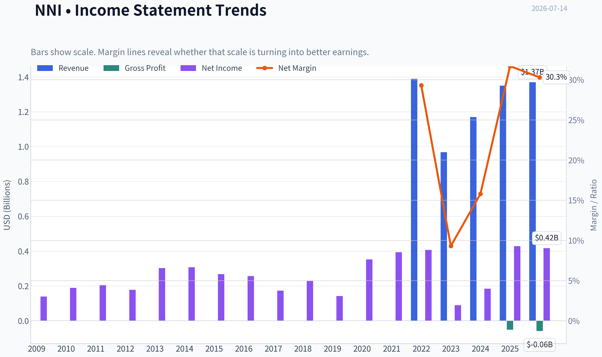

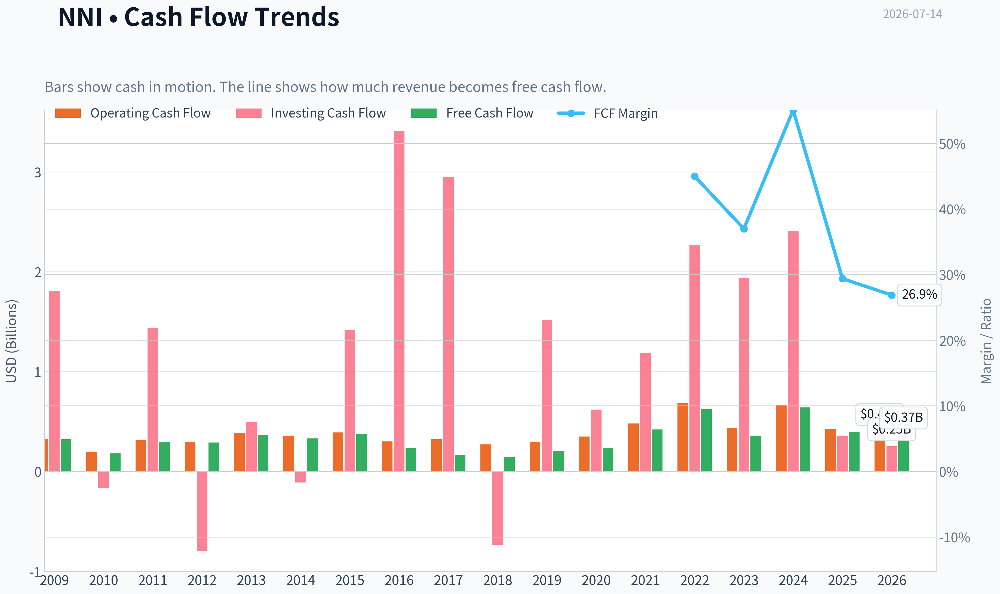

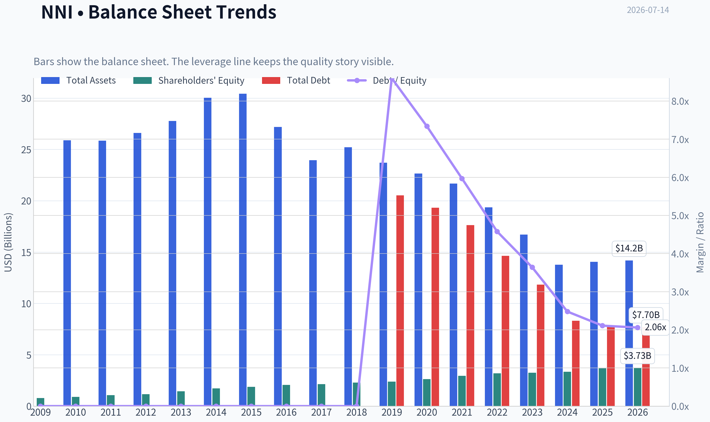

This graph tracks the profitability and return metrics (ROE, ROIC, Margins) of **NNI** over the past decade, highlighting capital efficiency trends.

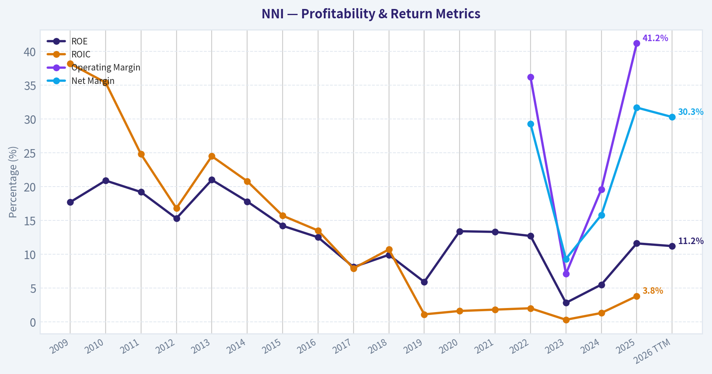

This chart illustrates the financial health of **NNI** over the last 10 years, mapping cash equivalents and free cash flow against total obligations (Debt).

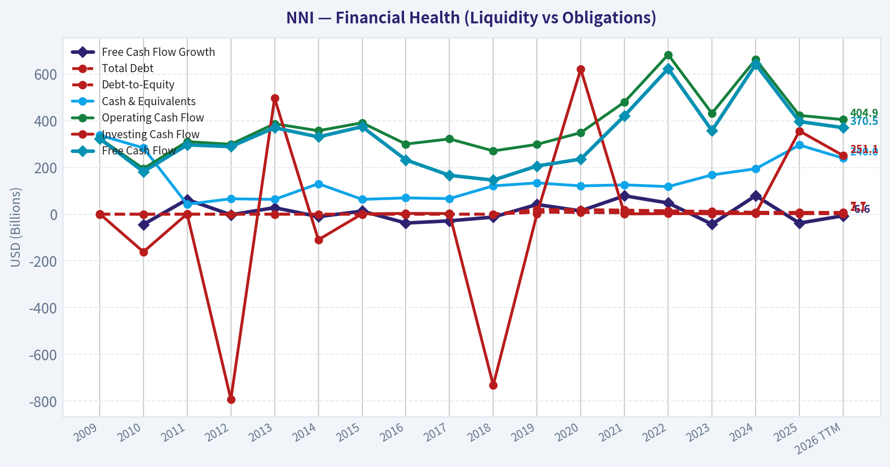

---

### Intrinsic Value Analysis (Buffett)

> *Following Warren Buffett's value investing philosophy: Circle of Competence, Economic Moat, Management Quality, and Margin of Safety.*

#### Intrinsic Value Snapshot

Price is what you pay. Intrinsic value is what the business may be worth based on the cash it can create for owners over time. We show a range, not one magic number.

- Current Price: $131.87
- Value Range (conservative to optimistic across both DCF methods): $37.39 to $568.65

##### Owner Earnings (Buffett Method)
- Net Income: $428,474,000.00
- Depreciation & Amortization: $90,622,000.00
- Capital Expenditures: $-26,238,000.00
- Working Capital Changes: $110,252,000.00
- Owner Earnings: $382,606,000.00

##### Intrinsic Value
###### Buffett Method
Uses owner earnings. Stricter, and usually more conservative.
- Conservative: $37.39
- Average: $161.61
- Optimistic: $376.40
- Discount Rate: 10.0%

###### Cash Flow Method
Uses free cash flow. Better for companies spending heavily today to grow tomorrow.
- Conservative: $38.76
- Average: $134.21
- Optimistic: $568.65
- Discount Rate: 10.0%

ANALYST STANCE: **WATCH**

#### Nelnet (NNI) - Buffett-Style Investment Review

#### 1. Go/No-Go Gate Assessment

| Gate | Verdict | Evidence |
|---|---|---|
| Gate 1: Circle of Competence & Simplicity | Pass with caution | Nelnet makes money from student-loan servicing, education technology/software, payment processing, and related financial services. The broad outline is understandable, but the mix of legacy loan assets, servicing economics, and newer fintech/education ventures adds complexity. |
| Gate 2: Moat Test | Mixed / Narrow moat | There are pockets of competitive strength in servicing relationships, software workflows, and education/payments integration, but no obvious wide moat across the whole group. |
| Gate 3: Management Quality & Capital Allocation | Pass with caution | Long operating history, continued business building, and shareholder returns suggest generally rational capital allocation. But the conglomerate-like structure raises the hurdle for judging whether each reinvested dollar earns excellent returns. |
| Gate 4: Industry Structure | Mixed | Student-loan servicing has regulatory and scale characteristics, but payments and fintech are competitive. Capital intensity is not extreme, though financial exposure and credit risk require discipline. |

**Key Takeaways:** Nelnet passes the first screen because the business is understandable in broad terms, but it is not the kind of ultra-simple enterprise Buffett loves most. The main issue is not survival; it is whether the company's collection of businesses is predictable enough and moat-like enough to deserve a strong endorsement. This is a qualified pass, not a clean one.

---

#### 2. Elementary School Test

Nelnet helps schools and borrowers handle money and student loans. It gets paid by servicing loans, processing payments, selling software to schools, and earning returns from other education-related businesses.

That is simple enough to explain. What is less simple is how all the moving pieces fit together and how much each part will contribute ten years from now.

#### 3. Long-Term Predictability Test

A decade from now, Nelnet will likely still be:
- servicing education-related financial accounts,
- selling software/payment tools to schools and families,
- and operating as a diversified education-finance platform.

But the exact earnings mix is less predictable than a classic toll-bridge or branded consumer franchise. Regulatory shifts, changing federal student-loan policies, and evolving fintech competition reduce certainty.

#### 4. Technology Risk Assessment

Technology is both a tool and a threat here:
- **Benefit:** software and payment platforms can scale well.
- **Threat:** servicing and fintech functions can be disrupted or repriced, especially if newer platforms reduce friction or if government policy changes economics.

This is not a business likely to be "destroyed overnight" by technology, but it is also not insulated from it.

---

#### 5. Moat Analysis

| Moat Source | Assessment | Evidence |
|---|---|---|
| Intangible Assets | Moderate | Nelnet has established relationships in education finance and servicing, but not a consumer brand with obvious pricing power like Coke or Apple. |
| Switching Costs | Moderate | School software, payment integrations, and administrative workflows can create stickiness once embedded. |
| Cost Advantage | Limited to moderate | Scale and operational know-how likely help in servicing and payments, but these advantages do not appear overwhelming. |
| Network Effects | Weak | This is not a classic network-effect model where value sharply rises with each new user. |

**Moat Quality Rating: Narrow**

The strongest moat element appears to be **workflow embedding and institutional relationships**, especially where schools integrate Nelnet's systems into everyday operations. That can be sticky. But the company does not show the obvious, durable pricing power of a truly wide-moat franchise.

**Key Takeaways:** Nelnet has some defenses, mainly from embedded systems and long-standing relationships, but the moat is not broad or dominant. Customers may stay because switching is inconvenient, not because Nelnet owns an irreplaceable brand or network. That makes this a respectable business, but not an elite one.

---

#### 6. Management Quality & Capital Allocation

| Question | Assessment | Commentary |
|---|---|---|
| Do they think like owners? | Reasonably yes | The company has a long-term operating posture and has continued building adjacent businesses rather than simply managing decline. |
| Are they honest & candid? | Generally yes | No major red flags in the provided materials. Public commentary around segments appears straightforward, though complexity itself can obscure evaluation. |
| Are they rational capital allocators? | Mixed but acceptable | Diversification into education technology and payments makes strategic sense, but investors must judge whether the complexity earns superior per-share value creation. |

Buffett would ask: has management turned retained earnings into more than one dollar of intrinsic value? The mixed collection of businesses means the answer is probably **adequate**, not obviously exceptional.

---

#### 7. Financial Summary Table

| Metric | Value |
|---|---:|
| Current Price | $132 |
| Market Cap | $4.74B |
| P/E | 11.47 |
| ROE | 11.6% |
| Revenue Growth YoY | 15.9% |
| FCF Yield | 8.4% |

**Key Takeaways:** The stock does not look expensive on headline valuation, with a low-teens earnings multiple and a healthy free-cash-flow yield. But the quality of those earnings matters more than the multiple, and an 11.6% ROE is good rather than great. The market appears to be pricing in complexity and some uncertainty.

---

#### 8. Owner Earnings Assessment

Using Buffett's lens, owner earnings should reflect:
- net income,
- plus non-cash charges,
- minus maintenance capital spending,
- minus working capital needs.

Given the business mix, owner earnings are likely **better judged from normalized free cash flow than accounting earnings alone**. The reported **8.4% FCF yield** is attractive and suggests the market is not assigning a premium multiple.

A practical approximation here is:
- **Implied FCF / owner earnings = 8.4% x $4.74B = about $398M**

| Item | Estimate |
|---|---:|
| Market Cap | $4.74B |
| FCF Yield | 8.4% |
| Implied Owner Earnings / FCF | ~$398M |

**Key Takeaways:** On a cash basis, Nelnet appears meaningfully cheaper than many average-quality stocks. Roughly $398 million of annual free cash generation against a $4.74 billion market value is solid. The real question is sustainability and predictability, not whether the current cash yield is superficially attractive.

---

#### 9. Three-Scenario DCF Valuation

Using owner earnings of **$398M** as the base.

| Scenario | Assumption | Equity Value Estimate |
|---|---|---:|
| A: No Growth | Owner Earnings / 10% | $3.98B |
| B: GDP Growth | OE x 1.03 / (10% - 3%) | $5.86B |
| C: Moderate Historical Growth | 6% growth for 10 years, then 3% terminal | ~$6.20B |

**Key Takeaways:** If Nelnet never grows, the stock looks a bit above strict no-growth value. If it can grow modestly with stability, the valuation becomes more reasonable to mildly attractive. The investment case therefore depends on confidence that current cash generation is durable and can at least grow at a low-to-mid single-digit rate.

---

#### 10. Margin of Safety Analysis

| Measure | Value |
|---|---:|
| Current Market Cap | $4.74B |
| Scenario A Value | $3.98B |
| Scenario B Value | $5.86B |
| Scenario C Value | ~$6.20B |

At today's price:
- Versus **No Growth** value: shares appear **above** ultra-conservative intrinsic value.
- Versus **GDP Growth** value: shares trade at roughly a **19% discount**.
- Versus **Moderate Growth** value: shares trade at roughly a **24% discount**.

For a business with this level of complexity, I would want a **larger margin of safety**, ideally **40%+** against conservative value. It is close, but not enough.

**Key Takeaways:** Nelnet is not obviously overpriced, but it also does not offer the deep discount a cautious value investor should demand for a business with regulatory and segment complexity. The stock may work out fine, yet the gap between price and conservative value is not wide enough to be compelling. This is why the name belongs on a watchlist rather than in the top conviction bucket.

---

#### 11. Buffett Scorecard

| Criterion | Weight | Score (1-5) | Weighted Score |
|---|---:|---:|---:|
| Business Understanding | 20% | 3.5 | 0.70 |
| Moat Width & Durability | 25% | 3.0 | 0.75 |
| Management Quality | 15% | 3.4 | 0.51 |
| Return on Equity | 15% | 3.0 | 0.45 |
| Reinvestment Runway | 10% | 3.5 | 0.35 |
| Balance Sheet Strength | 5% | 3.0 | 0.15 |
| Industry Structure | 5% | 2.8 | 0.14 |
| Valuation / Margin of Safety | 5% | 3.0 | 0.15 |
| **Total** | 100% |  | **3.20 / 5.0** |

**Key Takeaways:** Nelnet scores as a decent but not outstanding Buffett-style candidate. The biggest drags are moat strength, industry structure, and the absence of a truly compelling discount to intrinsic value. It is investable in principle, but not yet a classic "wonderful company at a fair price."

---

#### 12. Final Judgment

**Investment Stance: WATCH**
**Conviction Level: Moderate**

Nelnet is a respectable business selling at a not-demanding multiple, with decent cash generation and some embedded customer relationships. But this is not a classic Buffett-style layup because the business mix is more complex than ideal, the moat appears narrow rather than wide, and the margin of safety is not large enough for that complexity.

If the price fell enough to create a clear **40%+ discount to conservative value**, or if evidence strengthened that the software/payments segments can steadily improve returns on capital, the case would improve. For now, **watch it, do not chase it**.
#### Valuation Bridge

This bridge places the current market price beside each intrinsic value lens so readers can see whether upside depends on one method or shows up across several methods.

| Scenario | Intrinsic Value / Share |
| --- | ---: |
| Buffett Method | $161.61 |
| Cash Flow Method | $134.21 |
| Current Price | $131.87 |

#### Key Takeaways

If one method is far above the others, the upside case depends on a specific modelling assumption. When several methods cluster together, the valuation story is more robust.

#### Valuation Visuals

This comparison chart from *Latest Earnings Snapshot* stacks current figures against historical benchmarks for **NNI**, making it easy to see where the company trades relative to its own averages.

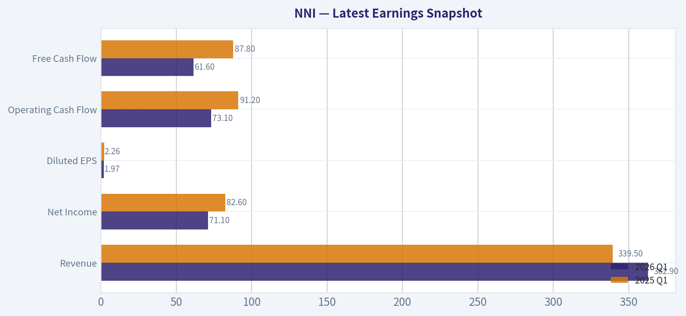

This comparison chart from *Balance Sheet Analysis* stacks current figures against historical benchmarks for **NNI**, making it easy to see where the company trades relative to its own averages.

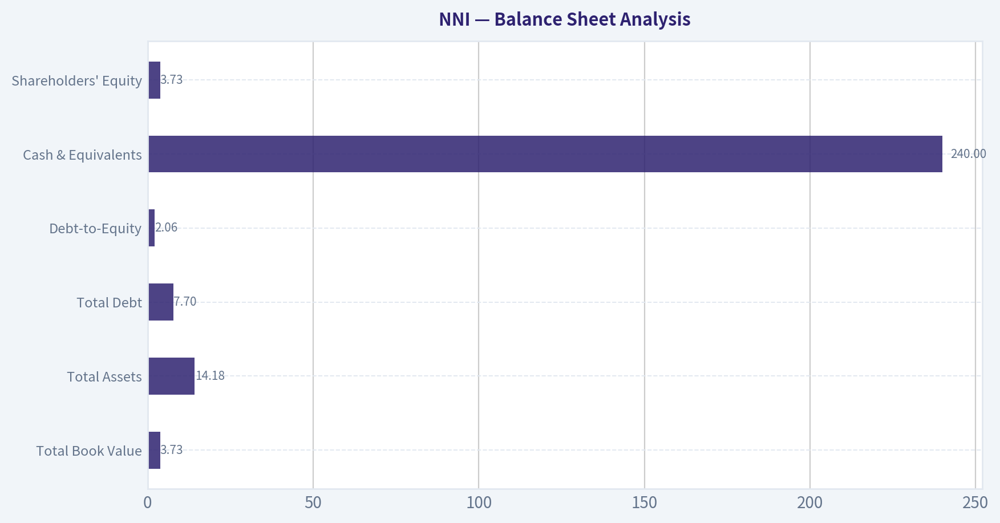

This comparison chart from *Buffett-Style Owner Earnings DCF* stacks current figures against historical benchmarks for **NNI**, making it easy to see where the company trades relative to its own averages.

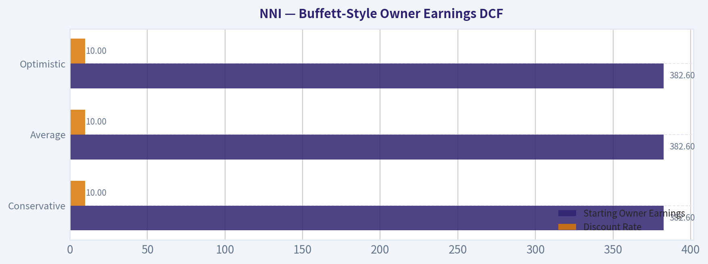

This comparison chart from *Financial Summary Table* stacks current figures against historical benchmarks for **NNI**, making it easy to see where the company trades relative to its own averages.

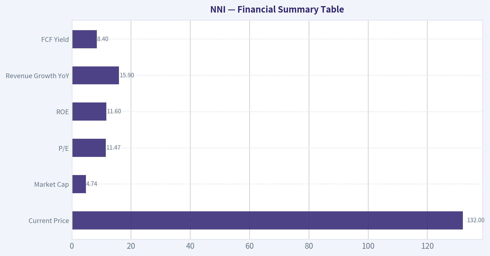

This comparison chart from *Owner Earnings Assessment* stacks current figures against historical benchmarks for **NNI**, making it easy to see where the company trades relative to its own averages.

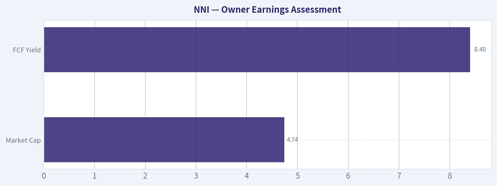

This comparison chart from *Three-Scenario DCF Valuation* stacks current figures against historical benchmarks for **NNI**, making it easy to see where the company trades relative to its own averages.

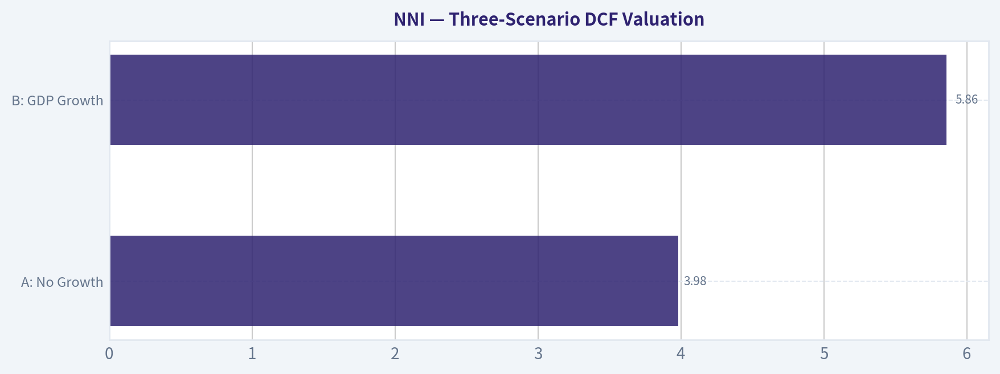

---

### Trend & Growth Analysis (Lynch/Druckenmiller/Fisher)

> *Following Peter Lynch's GARP, Stanley Druckenmiller's macro-aware approach, and Philip Fisher's scuttlebutt methodology.*

ANALYST STANCE: **WATCH**

#### NNI Growth Analysis

#### 1. Lynch Classification

| Item | Assessment |
|---|---|
| Category | **Stalwart / Hybrid financial-services compounder**, not a classic fast grower |
| Revenue growth | **15.9% YoY** from shared pack, but latest quarter was **10.3% YoY** |
| Fit with Lynch framework | Too complex and too diversified for a clean "fast grower" label; more of a niche compounding operator with mixed business lines |

**Key Takeaways:** NNI does not look like a pure fast-growing ten-bagger candidate under the Lynch framework. It sits closer to a stalwart with some growth pockets, especially in education technology and payments, but the overall company structure is too complex to classify as a straightforward high-growth winner.

#### 2. The Story in 3 Bullets

| Simple Story | Why It Matters |
|---|---|
| Nelnet owns a mix of legacy student-loan servicing, education-related software/services, and payment processing assets. | Multiple earnings streams reduce single-segment dependence. |
| The growth story is increasingly tied to **EdTech and payments**, not just legacy loan books. | This is where any multiple expansion or growth re-rating would come from. |
| The market still values NNI partly like a complex financial holding company. | If higher-quality growth segments become a larger share of profits, valuation could improve. |

**Key Takeaways:** The bull case is that Nelnet is evolving from a legacy student-loan-linked company into a broader education and payments platform. The problem is that investors still see a complex mix of assets, which keeps the valuation low but also limits enthusiasm.

#### 3. TAM Analysis with 10x Test

| Metric | Assessment |
|---|---|
| Current revenue base | Not fully established from tool data; shared pack implies mid-sized revenue base with latest quarterly revenue of **$419.1M** |
| Core growth markets | Education software/services, school administration tools, payment processing, consumer financing/pay-later |
| TAM direction | Likely **moderately expanding**, especially in digitized education administration and payments |
| 10x test | **Fails at consolidated company level**, likely **passes at segment level** for EdTech/payments |
| Conclusion | Company-wide 10x is unlikely; select operating segments may still have meaningful runway |

**Key Takeaways:** Nelnet as a whole probably does not have the kind of runway needed for a clean 10x outcome from current scale. However, its newer education-technology and payments businesses may still be early enough in their markets to grow materially if execution remains strong.

#### 4. Revenue Growth Trend

| Period / Signal | Observation | Interpretation |
|---|---|---|
| Shared pack YoY growth | **15.9%** | Healthy but not hypergrowth |
| Latest quarter | **Q1 2026 revenue up 10.3% YoY** | Growth is still positive but appears to be slowing versus the broader trailing figure |
| Earnings vs estimates | Revenue and EPS missed consensus | Momentum perception weakened |
| Pattern | **Decelerating / mixed** | Not the kind of clear acceleration Druckenmiller would want |

**Key Takeaways:** Revenue is still growing, but the latest quarter suggests some deceleration rather than acceleration. That matters because growth investors typically want to see an inflection upward, not a company merely maintaining moderate expansion while missing estimates.

#### 5. Unit Economics

| Metric | Status |
|---|---|
| LTV/CAC | **Not disclosed / unavailable** |
| NRR | **Not disclosed / unavailable** |
| Rule of 40 | **Not reliably measurable from provided data** |
| FCF yield | **8.4%** |
| Profitability | Profitable, with **P/E 11.5x** |
| Balance sheet / liquidity | Incomplete from provided data |

**Key Takeaways:** NNI is not a typical SaaS name with clean disclosure around retention, customer acquisition cost, or recurring revenue quality. What stands out instead is that the business is profitable and generates meaningful cash flow, which gives it more resilience than many higher-multiple growth stocks.

#### 6. Inflection Point Assessment

| Potential Inflection | Evidence | Verdict |
|---|---|---|
| Product cycle inflection | EdTech and payments cited as growth engines | **Possible** |
| Market share inflection | Not enough evidence | **Unproven** |
| Margin inflection | EPS miss suggests near-term pressure | **Not visible** |
| TAM expansion | Digital education/payments remain secular growth areas | **Supportive** |
| Competitive inflection | No clear competitor stumble identified | **Absent** |

**Key Takeaways:** There may be a slow strategic inflection as Nelnet's growth segments become more important, but there is not enough evidence of a sharp earnings or market-share inflection today. This makes the stock more of a monitoring candidate than an immediate high-conviction growth buy.

#### 7. Macro Setup Evaluation

| Macro Factor | View | Impact |
|---|---|---|
| Rate environment | Lower/falling rates would help valuation of growth assets and financing-sensitive businesses | Positive if rates ease |
| Credit risk | "Pay Later" credit risk is rising per latest coverage | Negative |
| Secular themes | Education digitization, payments modernization | Positive |
| Regulatory sensitivity | Student-loan and servicing exposure adds policy complexity | Negative |
| Overall macro setup | Mixed | Neutral |

**Key Takeaways:** The macro backdrop is neither clearly favorable nor clearly hostile. Nelnet has exposure to attractive long-term digitization themes, but that is offset by credit and regulatory risks tied to its more financial and servicing-related businesses.

#### 8. Fisher 15 Points Score

| Fisher Dimension | Score (1-5) | Notes |
|---|---:|---|
| Market potential | 3 | Good in segments, limited at total-company level |
| New products | 3 | Some innovation in EdTech/payments |
| R&D effectiveness | 3 | Hard to verify |
| Sales organization | 3 | Likely adequate |
| Profit margin | 3 | Profitable, but not standout |
| Margin improvement | 2 | No clear evidence currently |
| Labor relations | 3 | No known issue |
| Executive relations | 3 | No major visible issue |
| Management depth | 3 | Appears stable |
| Cost/accounting controls | 3 | No major red flags from provided info |
| Special strengths | 3 | Diversification, niche education/payments capabilities |
| Long-range outlook | 3 | Moderate, not exceptional |
| Dilution risk | 4 | No major dilution concern evident |
| Candor | 3 | Neutral |
| Integrity | 3 | Neutral |

| Total | **45 / 75** | **Average** |

**Key Takeaways:** Nelnet scores as average on the Fisher framework. There are enough positives to avoid a bearish conclusion, but not enough evidence of outstanding innovation, dominant competitive advantages, or accelerating economics to justify a top-tier growth rating.

#### 9. Valuation Analysis

| Metric | Value | Interpretation |
|---|---:|---|
| Current price | **$132** | - |
| Market cap | **$4.74B** | Mid-cap |
| P/E | **11.47x** | Cheap versus many growth stocks |
| Revenue growth | **15.9% YoY** | Moderate growth |
| PEG | **~0.72** | Attractive on surface |
| FCF yield | **8.4%** | Strong support for valuation |
| Qualitative valuation view | Cheap, but discount reflects complexity and mixed quality of earnings streams | Fair |

**Key Takeaways:** On traditional valuation metrics, NNI looks inexpensive. The low P/E, sub-1 PEG, and strong free-cash-flow yield suggest the stock is not overvalued, but the market is likely applying that discount because the business mix is hard to underwrite cleanly.

#### 10. Scenario Analysis

| Scenario | Assumption | Outcome |
|---|---|---|
| Bear | Growth slows toward high single digits, credit issues in Pay Later worsen, no rerating | Low-teens annualized return or worse |
| Base | Mid-teens segment growth offset by complexity discount, valuation stays around current earnings multiple | Reasonable compounding, not explosive |
| Bull | EdTech/payments become larger share of profits, cleaner narrative emerges, multiple rerates higher | Strong upside from both earnings growth and multiple expansion |

**Key Takeaways:** The upside case depends much more on business mix improvement and rerating than on raw top-line growth alone. That means investors are betting not just on growth, but also on the market eventually seeing Nelnet as a higher-quality company than it does today.

#### 11. Growth Investor Scorecard

| Criterion | Weight | Score (1-5) | Weighted Score |
|---|---:|---:|---:|
| The Story | 10% | 3.0 | 0.30 |
| TAM & Runway | 20% | 2.5 | 0.50 |
| Revenue Growth | 20% | 3.0 | 0.60 |
| Unit Economics | 15% | 2.5 | 0.38 |
| Competitive Position | 10% | 3.0 | 0.30 |
| Management Quality | 10% | 3.0 | 0.30 |
| Macro Setup | 5% | 3.0 | 0.15 |
| Profitability Path | 5% | 4.0 | 0.20 |
| Valuation | 5% | 4.0 | 0.20 |

| Total |  |  | **2.93 / 5.0** |

**Key Takeaways:** On a growth-investor basis, Nelnet lands just below the threshold for a constructive watchlist name and well below high-conviction advocate status. The stock is helped by profitability and valuation, but held back by complexity, limited visibility into unit economics, and lack of a clear acceleration signal.

#### 12. Position Size Stance

| Stance | View |
|---|---|
| Recommended action | **WATCH** |
| Position sizing | **0% to 2% tracking position only**, if already interested |
| Upgrade trigger | Clear evidence that EdTech/payments are driving sustained consolidated growth acceleration and better margins |
| Downgrade trigger | Credit deterioration in Pay Later, continued estimate misses, or worsening segment complexity |

**Key Takeaways:** This is not a stock to size aggressively for growth today. If owned, it can justify a small tracking position while investors wait to see whether the higher-quality growth businesses become strong enough to change the company's overall narrative.

#### 13. Key Risks and Catalysts

| Risks | Catalysts |
|---|---|
| Rising Pay Later credit losses | Stronger-than-expected EdTech/payments growth |
| Regulatory/policy exposure from education servicing | Segment disclosure that highlights recurring, higher-quality revenue |
| Conglomerate/complexity discount persists | Margin improvement and estimate beats |
| Latest growth deceleration continues | Market rerating from financial holding company to hybrid growth compounder |
| Smart money signal weakens: Point72 exited | Capital allocation moves that simplify the story |

**Key Takeaways:** The main risk is that Nelnet remains a complicated, discounted collection of businesses rather than becoming a clearer growth platform. The main catalyst is a shift in mix toward higher-multiple, less regulated, more recurring revenue operations.

#### Bottom Line

NNI is **cheap, profitable, and strategically interesting**, but it is **not currently showing the kind of clean growth inflection** that would justify an **ADVOCATE** stance under a Lynch-Druckenmiller-Fisher framework. The stock looks more like a **value-tinged compounder with optionality** than a true fast-grower. I would keep it on **WATCH**, especially for evidence that **EdTech and payments are becoming the real company** rather than just side businesses inside a complex structure.

---

### Market Technical Analysis

#### NNI Technical Indicator Selection and Trend Report

For **NNI**, the most relevant set of complementary indicators in the current market context is:

1. **close_200_sma**
2. **close_50_sma**
3. **close_10_ema**
4. **macd**
5. **rsi**
6. **boll_ub**
7. **boll_lb**
8. **atr**

I excluded **vwma** from the final core set only because the eight above already cover long-term trend, medium-term trend, short-term momentum, reversal/balance conditions, volatility envelope, and risk sizing. VWMA is still useful as a secondary confirmation tool, and I will reference it where relevant.

---

#### Why these indicators fit NNI right now

NNI is not in a clean runaway trend at the moment. Instead, it is in a **post-shock stabilization and range-repair phase** after the sharp May breakdown from the 140 area into the low 120s. In this kind of structure, traders need indicators that separate:

- the **structural trend** from the **recent bounce**
- **short-term momentum improvement** from **true breakout confirmation**
- **mean-reversion opportunities** from **failed rallies**
- and **entry quality** from **risk control**

The selected indicators do that well without excessive overlap:

- **200 SMA** defines the long-term regime.
- **50 SMA** captures the intermediate trend and whether the stock is reclaiming meaningful structure.
- **10 EMA** shows whether near-term momentum is strengthening or fading.
- **MACD** tracks the momentum recovery after the May selloff.
- **RSI** helps judge whether momentum is balanced, stretched, or weakening.
- **Bollinger upper/lower bands** frame the current trading envelope and identify compression versus expansion.
- **ATR** helps size stops in a name that recently experienced a sharp volatility shock.

---

#### Current trend structure

Over the last year, NNI progressed through several distinct phases:

- **Mid-2025 through early 2026:** a steady, mostly constructive uptrend from roughly the low 120s into the upper 130s and low 140s.
- **May 2026:** a major downside gap and volatility event, with price collapsing from around 141 to nearly 122 in one session. This was the key technical regime change.
- **Mid-May to late June 2026:** repair phase, with price gradually rebuilding from the low 120s into the low-to-mid 130s.
- **Early July 2026 to present:** momentum has cooled again, and price is drifting sideways-to-slightly lower near the low 130s.

This matters because NNI is no longer behaving like a smooth trend stock. It is now trading more like a stock trying to prove that the post-gap damage has been absorbed.

---

#### Moving average analysis

The **200 SMA is about 130.98** and still rising gradually. That is an important constructive feature. Long-term trend damage has not fully reversed into a bear regime; instead, the stock is sitting almost exactly on top of its long-term fair-value/trend benchmark.

The **50 SMA is about 130.76**, but unlike the 200 SMA, it has been **sloping down** over recent weeks. That tells a more nuanced story: the long-term trend is still broadly intact, but the medium-term trend remains under repair and has not yet fully turned back up.

The **10 EMA is about 132.60**, above both the 50 SMA and the 200 SMA, but it has started to flatten and slightly soften over the last several sessions. This indicates that the near-term rebound remains alive, but upside momentum has recently cooled.

The key alignment is:

- **Price (131.88 last close)**
- slightly **above the 200 SMA**
- slightly **above the 50 SMA**
- but **below the 10 EMA**

That setup usually signals a market in **short-term hesitation inside a medium-term repair process**. In other words, NNI has not broken down structurally, but it has also not re-accelerated enough to signal a fresh impulse higher.

#### Indicator Snapshot

| Indicator | Latest Reading | Interpretation |
|---|---:|---|
| Close | 131.88 | Near key moving-average support zone |
| close_10_ema | 132.60 | Short-term momentum slightly above price; near-term pressure remains |
| close_50_sma | 130.76 | Medium-term trend still repairing, slight downward slope |
| close_200_sma | 130.98 | Long-term trend still constructive, price hovering just above it |
| macd | 0.57 | Positive momentum remains, but has weakened from recent highs |
| rsi | 49.73 | Neutral momentum; neither overbought nor oversold |
| boll_ub | 136.18 | Upper resistance zone for breakout confirmation |
| boll_lb | 128.21 | Lower support zone for mean-reversion defense |
| atr | 2.68 | Moderate volatility; still elevated enough to require disciplined stops |

**Key Takeaways:** NNI is sitting in a very important technical zone, with price almost directly on top of its 50-day and 200-day averages. Momentum is no longer strong, but it has not collapsed either, which suggests a stock in consolidation rather than one in outright trend failure. Traders should treat the 128 to 136 area as the active decision range.

---

#### Momentum analysis: MACD and RSI

The **MACD is positive at 0.57**, which is notable because it was deeply negative after the May breakdown. That means the post-gap recovery did generate a real momentum repair. However, MACD has also **rolled down from 1.18 on July 6**, so the thrust phase of the rebound has clearly slowed.

This is not a bearish collapse signal by itself. Rather, it says the stock moved from **recovery acceleration** into **recovery digestion**. That distinction is crucial. A stock can remain constructive while MACD cools, as long as price holds above major support.

The **RSI is 49.7**, almost exactly neutral. Recent readings reached the low 60s in early July, but the fade back toward 50 confirms that momentum has normalized. This means:

- NNI is **not overbought**
- NNI is **not oversold**
- and traders should not expect a momentum extreme to do the analytical work for them

Instead, price structure now matters more than oscillator extremes. A neutral RSI near 50 often appears when a stock is deciding whether to resume trend or rotate back into range.

A subtle but important point: because MACD remains positive while RSI has drifted back to neutral, NNI is showing **residual bullish memory but no immediate urgency**. That usually favors patient setups over aggressive chasing.

---

#### Volatility envelope: Bollinger Bands

The Bollinger structure is especially useful here because the stock is not trending strongly enough for moving averages alone to be sufficient.

Latest band levels are roughly:

- **Upper band: 136.18**
- **Lower band: 128.21**

With the stock at **131.88**, price is trading in the middle half of the band structure, not near either extreme. That reinforces the interpretation that NNI is in **equilibrium/consolidation mode**.

A few finer observations:

- The lower band has risen sharply from June, showing that downside panic has faded.
- The upper band is no longer expanding aggressively, which means breakout energy is not currently broadening.
- The total band width is moderate, suggesting volatility has normalized from the May shock but has not become extremely compressed.

Practically, this creates a tradable map:

- **128.2 to 130.8** is the lower support cluster, reinforced by the lower band plus the 50/200 SMA zone.
- **132.6 to 136.2** is the overhead resistance corridor, reinforced by the 10 EMA and upper Bollinger area.

This kind of structure often produces one of two outcomes:
1. a **support bounce** if buyers defend the moving-average cluster, or
2. a **failed recovery** if price loses the lower support zone and momentum turns negative.

---

#### ATR and risk conditions

The **ATR is 2.68**, down from above 3.6 in early June. That is an important normalization signal. It means NNI is no longer in shock-volatility mode, but daily movement is still large enough that overly tight stops are likely to get clipped.

For traders, ATR suggests:

- swing stops probably need to allow roughly **2.5 to 3.0 points** of normal fluctuation
- breakout confirmation should ideally be stronger than a marginal close above resistance
- position sizing should still respect the fact that this stock can produce outsized single-session moves compared with its quieter periods

ATR compression since June is constructive for base-building. But if ATR begins rising again while price breaks below support, that would be a much more dangerous signal because it would indicate renewed directional volatility rather than benign consolidation.

---

#### Volume-weighted context

Although **vwma** was not included in the final eight, it adds an important secondary insight: the **VWMA is around 133.42**, above the last close of 131.88. This implies recent volume-weighted trading has occurred at prices above where the stock currently sits.

That is mildly bearish in the short run because it means price is trading below the average level where recent volume was transacted. It suggests that the latest pullback is occurring beneath the volume-weighted equilibrium of the recent recovery. In practical terms, rallies back through **133.4 to 134.0** would be more convincing than rallies that stall below that zone.

---

#### Fine-grained trading interpretation

NNI is best described as a stock at a **technical inflection zone**, not a momentum leader and not a confirmed breakdown. The market is effectively asking whether the May collapse was a one-time reset inside a longer-term uptrend, or the beginning of a broader deterioration.

The evidence currently leans slightly constructive, but only slightly:

- Long-term trend: **still positive**
- Medium-term trend: **not yet fully repaired**
- Short-term momentum: **cooling**
- Volatility: **normalizing**
- Momentum oscillators: **neutral to mildly constructive**
- Price location: **right on top of major support**

That means conviction should be conditional.

##### Bullish case
The bullish case improves if NNI:
- holds above the **130.7 to 131.0** area
- reclaims the **10 EMA near 132.6**
- and then pushes through **133.4 VWMA** and eventually **136.2 Bollinger upper band**

If that sequence happens, it would indicate the recent pause was simply a consolidation before another leg higher. In that scenario, the April-May damage would look increasingly absorbed.

##### Bearish case
The bearish case strengthens if NNI:
- loses the **50 SMA / 200 SMA zone**
- closes below roughly **128.2** near the lower Bollinger band
- and MACD continues to decay toward or through zero

That would suggest the recovery from the May gap is stalling, and the stock may revisit the upper 120s or even reopen the broader post-gap range.

##### Neutral/base-building case
The most likely immediate condition may be a continued **130 to 136 range**. If so, range traders may prefer buying near support and fading strength near resistance rather than chasing mid-range prints.

---

#### Practical indicator-based decision framework

| Market Question | Best Indicator(s) | What to Watch |
|---|---|---|
| Is the long-term trend still intact? | close_200_sma | Price holding above ~130.98 keeps long-term structure constructive |
| Is the medium-term repair improving or failing? | close_50_sma | A turn higher in the 50 SMA would strengthen the recovery thesis |
| Is near-term momentum returning? | close_10_ema, macd | Price reclaiming 10 EMA with MACD re-accelerating would favor buyers |
| Is the stock stretched? | rsi, boll_ub, boll_lb | RSI near 50 says no stretch; Bollinger levels define boundaries instead |
| Where is the actionable support/resistance zone? | close_50_sma, close_200_sma, boll_ub, boll_lb | Support near 128-131, resistance near 133-136 |
| How wide should stops be? | atr | ATR near 2.68 argues against overly tight stop placement |
| Is the rebound attracting quality participation? | vwma (secondary) | Price below VWMA means recent recovery still needs stronger acceptance |

**Key Takeaways:** The clearest technical line in the sand is the 130 to 131 area, where both major moving averages cluster. Above that zone, NNI still has a credible recovery setup; below it, the post-May repair story becomes much weaker. Upside confirmation likely requires more than just a small bounce, with 133 to 136 acting as the next meaningful proving ground.

---

#### Bottom line

NNI is in a **balanced but fragile recovery structure**. The long-term chart has not broken decisively, yet the stock has also not regained enough momentum to be treated as a clean trend continuation candidate. The technical picture favors **patience and level-based trading** over aggressive directional conviction.

The most important signals now are:

- **Support:** ~128.2 to 131.0
- **Near-term pivot:** ~132.6
- **Volume-weighted hurdle:** ~133.4
- **Breakout resistance:** ~136.2

As long as NNI stays above the 50-day and 200-day averages, the chart deserves the benefit of the doubt. But because MACD is fading and RSI is neutral, traders should require confirmation before assuming a new up-leg is underway.

#### Summary Table

| Category | Observation | Trading Implication |
|---|---|---|
| Long-term trend | 200 SMA rising, price near/slightly above it | Structural trend still broadly constructive |
| Medium-term trend | 50 SMA slightly declining | Recovery is incomplete, not yet a strong uptrend |
| Short-term momentum | Price below 10 EMA, MACD still positive but weakening | Near-term momentum has cooled |
| Momentum balance | RSI near 50 | No overbought or oversold edge; wait for price confirmation |
| Volatility envelope | Price in middle of Bollinger range | Consolidation, not breakout behavior |
| Risk profile | ATR down from June highs but still meaningful | Use moderate stop width and disciplined sizing |
| Support zone | 128.2 to 131.0 | Key defense area for bulls |
| Resistance zone | 132.6 to 136.2 | Key area that must be reclaimed for renewed upside |

**Key Takeaways:** NNI is neither breaking out nor breaking down right now; it is consolidating around a very important support zone. The chart still has a constructive long-term backbone, but the short-term rebound has lost urgency. Traders should focus on whether price can defend 130 to 131 and then reclaim 133 to 136 with improving momentum.

---

### Options Market Analysis

> *Reading options flow - put/call ratios, IV skew, and unusual activity - to gauge institutional positioning and event-driven risk.*

#### NNI Options Positioning Report
*Date: 2026-07-14*

NNI's options market is **very thin and illiquid**, so confidence in any read is **low**. Still, the available chain leans **bullish/constructive** because near-term positioning is overwhelmingly call-heavy and there is almost no put demand visible.

#### 1. Put/Call Ratio Analysis

| Scope | Call OI | Put OI | Put/Call OI Ratio | Call Vol | Put Vol | Put/Call Volume Ratio |
|---|---:|---:|---:|---:|---:|---:|
| Near-term total (Jul 17, Aug 21, Sep 18) | 56 | 4 | 0.07 | 33 | 2 | 0.06 |

Key Takeaways: NNI's near-term put/call ratios are far below the usual neutral baseline of about 0.7. That suggests the listed options activity is dominated by calls rather than downside hedging. However, the total contract counts are extremely small, so this looks more like sparse speculative interest than a broad institutional conviction signal.

By expiration:

| Expiration | Call OI | Put OI | Put/Call OI Ratio | Call Vol | Put Vol |
|---|---:|---:|---:|---:|---:|
| 2026-07-17 | 17 | 0 | 0.00 | 12 | 0 |
| 2026-08-21 | 26 | 0 | 0.00 | 17 | 0 |
| 2026-09-18 | 13 | 4 | 0.31 | 4 | 2 |

Key Takeaways: The July and August chains show no put open interest at all, which is highly unusual but mostly reflects illiquidity. September is the only expiry with any visible put positioning, and even there calls still dominate. Relative to the neutral 0.7 benchmark, this is a strong upside skew in positioning, but one that should be treated cautiously due to the tiny sample size.

#### 2. Implied Volatility Assessment

| Expiration | ATM Call IV | ATM Put IV | Read |
|---|---:|---:|---|
| 2026-07-17 | 81.2% | N/A | Very elevated, but likely distorted by illiquidity / near expiry |
| 2026-08-21 | 39.6% | N/A | Moderately elevated |
| 2026-09-18 | 32.5% | N/A | More normal/moderate |

Key Takeaways: Front-week IV is extremely high at 81.2%, but with almost no open interest and no put market, that number is likely noisy rather than a clean institutional pricing signal. IV falls meaningfully in August and September, which suggests no broad, sustained panic premium is embedded across the curve.

Because the tool output does **not provide OTM put IV versus OTM call IV**, true skew analysis is limited. Still, the practical signal is:

| Skew Check | Observation | Interpretation |
|---|---|---|
| Put skew | Cannot be reliably measured | Too few puts / insufficient put IV data |
| Call skew | Calls are the active side of the market | Suggests upside interest rather than downside protection |
| Event premium | Possible in front week, but unconfirmed | Could reflect an upcoming catalyst or simply bad liquidity |

Key Takeaways: There is not enough put-side depth to confirm a classic downside fear skew. In liquid names, you would want to compare OTM put IV against OTM call IV, but here the absence of put pricing is itself informative: traders are not paying up for visible downside protection in size. That said, in a micro-liquidity setup, missing skew data reduces confidence substantially.

#### 3. Unusual Options Activity

| Screen | Result |
|---|---|
| Volume > 5x Open Interest | None detected in near-term expirations |

Key Takeaways: There were no contracts flagged as unusual under the standard "volume greater than 5 times open interest" rule. That means there is no clear evidence of fresh aggressive institutional positioning, either bullish or bearish, in the listed near-term chain.

Interpretation:
- No obvious call sweeps or put hedges stand out.
- The bullish lean comes from **aggregate call dominance**, not from a single standout trade.
- Because activity is sparse, it is difficult to distinguish institutional flow from small-lot retail speculation.

#### 4. Open Interest Concentration

Using the data available, open interest concentration is mostly by **expiration**, not by clearly defined strike clusters, since strike-level OI detail was not provided.

| Expiration | Total OI Bias | Interpretation |
|---|---|---|
| 2026-07-17 | Call-heavy | Could create mild upside pinning bias if shares approach active call strikes |
| 2026-08-21 | Most call OI among near-term expiries | Largest visible near-term positioning bucket |
| 2026-09-18 | Only expiry with meaningful put presence | Slightly more balanced, but still call-led |

Key Takeaways: August appears to be the main near-term expiration of interest simply because it has the most total call open interest. But absolute OI is so low that any "gamma wall" or "max pain" effect is likely weak compared with what you would see in a liquid institutional name.

Gamma / pinning read:
- **No strong gamma wall can be identified** from the supplied data.
- **No meaningful downside put wall** is visible.
- If the stock pins near expiry, it would likely be due to normal low-volume trading rather than major dealer hedging flows.

#### 5. Overall Options Sentiment Signal

| Category | Signal |
|---|---|
| Directional Options Read | **BULLISH** |
| Confidence Level | **Low** |
| Primary Driver | Extremely low put/call ratios and lack of visible downside hedging |

Key Takeaways: The options market read is bullish because calls dominate open interest and volume while puts are nearly absent. The caveat is crucial: this is an illiquid chain, so the signal reflects limited participation rather than a strong institutional consensus.

#### Bottom Line

NNI's options tape points to a **bullish but low-conviction** setup. There is **very little evidence of downside fear**, no unusual bearish hedging, and near-term activity is overwhelmingly tilted toward calls. But because the chain is so thin, this should be treated as a **weak supporting sentiment input**, not a standalone trading signal.

#### Summary Table

| Metric | Observation | Interpretation |
|---|---|---|
| Put/Call Ratio | OI ratio 0.07; volume ratio 0.06 | Strong call dominance vs. neutral baseline of ~0.7 |
| IV Level | 81.2% front week, then 39.6% and 32.5% | Front IV elevated, but likely distorted by illiquidity |
| Skew Direction | No reliable put skew available; call side dominates activity | No visible downside fear premium |
| Unusual Activity | None flagged | No clear fresh institutional bet detected |
| Overall Signal | **BULLISH (low confidence)** | Call-heavy positioning with minimal put protection, but in a very illiquid options market |

Key Takeaways: NNI's options market leans bullish, but mostly by default because almost no puts are trading and the chain is very thin. The most important caveat is liquidity: without deeper volume, strike-level OI, and better IV surface data, this should be viewed as a soft bullish sentiment cue rather than decisive evidence of institutional accumulation.

---

## Research Team Commentary

> *The Research Manager synthesizes the Bull vs Bear debate into action-free commentary. This is a pre-risk view, not the final stance.*

The strongest bull argument is that Nelnet is being valued like a legacy runoff finance business when it may actually be a broader, stickier education-finance platform with embedded school relationships, servicing know-how, and some mix shift toward software and payments. At roughly 11.5x earnings with revenue growth near 16%, the bull says the market is over-penalizing complexity and underappreciating the possibility that normalized earnings power and business quality improve over time. If that is right, the stock could be modestly undervalued and rerate into the $150s without heroic assumptions.

The strongest bear argument is much simpler and, to me, more persuasive: if this were truly a moat business, the returns would look better. ROIC around 3.8%, ROA around 3.0%, and only middling ROE are not the fingerprints of a high-quality franchise. The low multiple may not be a bargain; it may be an accurate discount for weak capital efficiency, policy sensitivity, business complexity, and uncertain cash-flow quality. The software and payments evolution may be strategically sensible, but it is still more promise than proof. Buffett-style investing is about buying understandable businesses with durable economics, not hoping a transition eventually creates them.

My balanced takeaway is that Nelnet does not look obviously broken, but it also does not currently satisfy the standards for a high-conviction value investment. The market may indeed be somewhat pessimistic, yet the burden of proof still sits with management to show that new segments can earn materially better returns than the legacy mix. In past mistakes, the key lesson was not to hide behind neutrality when the evidence leans one way. Here, I do not think the evidence supports a full avoidance call because valuation is not extreme and the business has real operating relevance. But I also do not think there is enough demonstrated moat strength or margin of safety to advocate ownership today.

Core takeaway: Nelnet is a potentially interesting but still unproven transition story, not a clear Buffett-style bargain. The stock may look cheap optically, but low returns on capital and uncertain cash-flow durability suggest intrinsic value is less certain than the bulls imply. Until management proves that the shift toward software, payments, and broader education services can lift returns and make earnings more predictable, the right posture is patience rather than conviction.

Rationale: From a value investing perspective, business quality comes first. That is where Nelnet struggles. Buffett would usually want to see durable competitive advantages reflected in consistently strong returns on capital and easy-to-understand owner earnings. We do not have that here. The bull case depends on future improvement in mix and valuation rerating, but Buffett-style discipline says not to pay up for hoped-for quality. At the same time, I want to apply the lesson from prior mistakes: don't overuse neutrality when a setup is asymmetrically negative. In this case, however, the stock is already on a lowish multiple, and there is at least a plausible strategic path to better economics. That keeps me from calling it AVOID outright. Still, without clearer proof of improving returns, there is not enough margin of safety for ADVOCATE.

Monitoring plan over the next 1 to 4 quarters: First, watch ROIC and segment-level profitability. If management's strategy is working, returns should move meaningfully above the current low-single-digit level. Second, watch free cash flow conversion and whether cash generation becomes more stable; this is critical because a cheap P/E is not enough if owner earnings are weak. Third, monitor growth quality, not just revenue growth. I want to see whether software and payments growth comes with better incremental margins, not just bigger top line. Fourth, listen for capital allocation evidence: acquisitions, reinvestment, or buybacks should show clear economics, not just strategic language. Fifth, track whether the legacy education-finance and servicing exposures remain a drag or become less central over time. If the company can demonstrate higher-quality recurring revenue and stronger returns, the thesis improves materially. If returns stay weak and cash flow remains noisy, that would strengthen the bear case and likely push the name toward AVOID.

Final stance: WATCH.

---

## Value Investing Team Commentary

> *The Investor translates the research view into an investment thesis before risk review. This is still not the final stance.*

Nelnet is the kind of company that can tempt a value investor for the wrong reason: it looks statistically cheap enough to invite curiosity, but not obviously cheap enough to excuse business ambiguity. At about 11.5x earnings with nearly 16% revenue growth, the headline case is that the market is anchoring too heavily on its legacy education-finance identity and not giving enough credit to the software, payments, and broader education-services mix. That is the contrarian bull case, and it is not irrational. If the market is treating NNI as a runoff-like, policy-sensitive financial operator when it is gradually becoming a more recurring, relationship-driven platform, then today's multiple could understate normalized earnings power.

But a Buffett-style approach asks a harsher question: if this is truly becoming a better business, where is the proof in the economics? The returns on capital are still modest. ROIC around 3.8%, ROA around 3.0%, and ROE of 11.6% are not disastrous, but they do not signal a powerful moat or a business with exceptional reinvestment potential. In many cases, the market is willing to look through complexity when underlying economics are unmistakably strong. Here, the opposite may be true: the low multiple may simply reflect that the underlying economics are only average and the business remains hard to underwrite cleanly.

That is where selective contrarian thinking matters. The market may indeed be too skeptical about the transition story, but sometimes skepticism is deserved. A true contrarian does not buy because sentiment is lukewarm; he buys when sentiment is wrong. For NNI, I do not yet see enough evidence that the market is clearly wrong. What the market may be "missing" is the value of embedded school relationships, servicing infrastructure, and cross-sell opportunities in education software and payments. What the market may be correctly pricing is that these assets have not yet translated into superior capital efficiency or highly predictable owner earnings.

The key long-term issue is not whether revenue can grow. It is whether the newer businesses can produce materially better incremental returns than the legacy mix. That is the hinge of the entire thesis. If management can show that software and payments are not just additive to revenue but meaningfully improve margins, cash conversion, and returns on capital, then today's valuation may eventually look too low. In that scenario, rerating into the $150s is conceivable without heroic assumptions. But if growth comes with continued mediocre returns and noisy cash generation, then the stock is not cheap in the Buffett sense; it is merely optically inexpensive.

Management and capital allocation also deserve close attention. In transition stories, management language often sounds better than management economics. I would want to see evidence that acquisitions, reinvestment, and segment expansion are producing measurable shareholder value, not just strategic diversification. Buffett generally avoids situations where investors must rely on management's future execution to manufacture business quality that is not yet visible in the numbers. Nelnet still leans too much in that direction.

From a contrarian sentiment lens, the opportunity would emerge if one of two things happens. First, the business proves its quality through improving ROIC, steadier free cash flow, and clearer segment disclosure while the stock remains on a depressed multiple. Second, the market sells the stock off further on temporary disappointment even as the medium-term economics improve underneath the surface. Today, however, we are in a middle ground: not enough proof for conviction, not enough distress for a wide margin of safety.

So the right posture is patience. This is not a business I would be eager to own simply because it screens cheap. Nor is it so clearly impaired that it must be discarded. It belongs on a focused watchlist, with emphasis on returns on capital, free cash flow quality, and evidence that the education software/payments evolution is producing better economics rather than just a better narrative.

ANALYST STANCE: **WATCH**
NNI has some ingredients of a future value opportunity, but it does not yet meet the standard of a high-conviction Buffett-style investment. The valuation is not demanding, yet the business quality and moat evidence remain insufficiently proven. I would stay interested, but not committed, until management demonstrates that the transition can lift returns, improve earnings durability, and justify true intrinsic value expansion.

---

## Deep Values Commentary

> *The Risk Management Team debates and the Risk Judge provides the final action-free verdict. This section determines the final ADVOCATE / WATCH / AVOID stance.*

#### Final Stance Scorecard

This scorecard converts the final research view into a weighted decision frame. It does not replace the narrative judgement, but it makes the main drivers of the verdict easier to scan.

| Criterion | Score | Weight | Commentary |
| --- | ---: | ---: | --- |
| Business Quality | 3.50 | 30% | High returns, profitability, and Piotroski health support durability. |
| Valuation Support | 4.33 | 30% | Blends current price against available intrinsic value anchors and valuation ratios. |
| Financial Strength | 2.50 | 20% | Balance-sheet resilience reflects leverage and liquidity staying within safe ranges. |
| Growth Durability | 3.33 | 20% | Recent revenue, earnings, and free cash flow growth indicate how durable expansion looks. |
| TOTAL / FINAL STANCE | 3.52 | 100% | WATCH |

#### Key Takeaways

The weighted score lands at **3.52 / 5.0**, while the final stance remains **WATCH**. This is useful as a quick calibration aid rather than a mechanical signal.

#### Risk Summary

Higher scores indicate more risk pressure. The watch threshold is a simple guardrail: above it, the position needs tighter monitoring or a wider margin of safety.

| Dimension | Current Score | Watch Threshold | Commentary |
| --- | ---: | ---: | --- |
| Business Quality | 2.50 | 3.00 | High returns, profitability, and Piotroski health support durability. |
| Valuation Support | 1.67 | 3.00 | Blends current price against available intrinsic value anchors and valuation ratios. |
| Financial Strength | 3.50 | 3.00 | Balance-sheet resilience reflects leverage and liquidity staying within safe ranges. |
| Growth Durability | 2.67 | 3.00 | Recent revenue, earnings, and free cash flow growth indicate how durable expansion looks. |

#### Key Takeaways

This view helps readers separate *where* the risk sits: valuation, business quality, balance sheet, or growth durability. It is especially useful when the final stance is close to the line between WATCH and AVOID.
