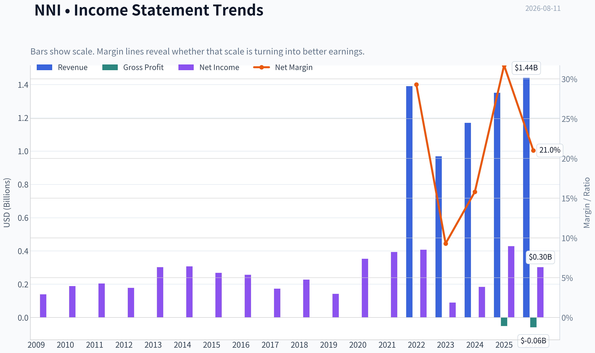
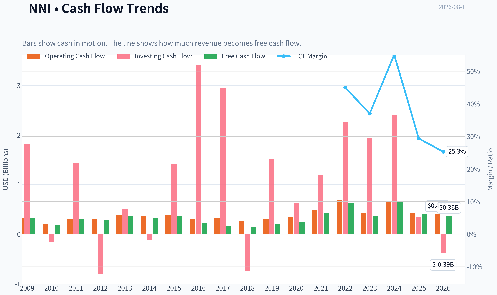
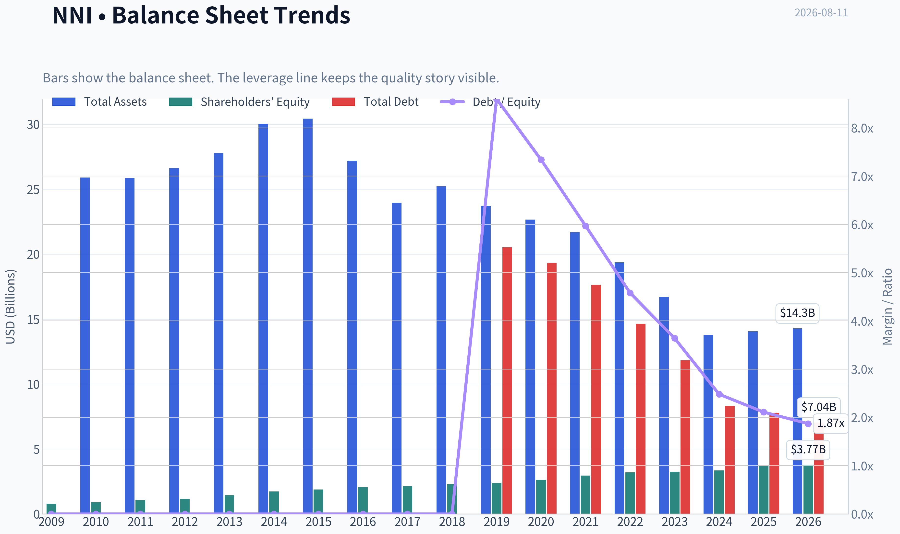
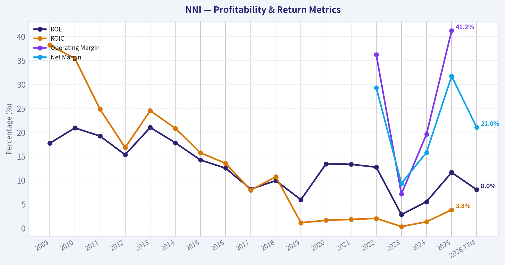
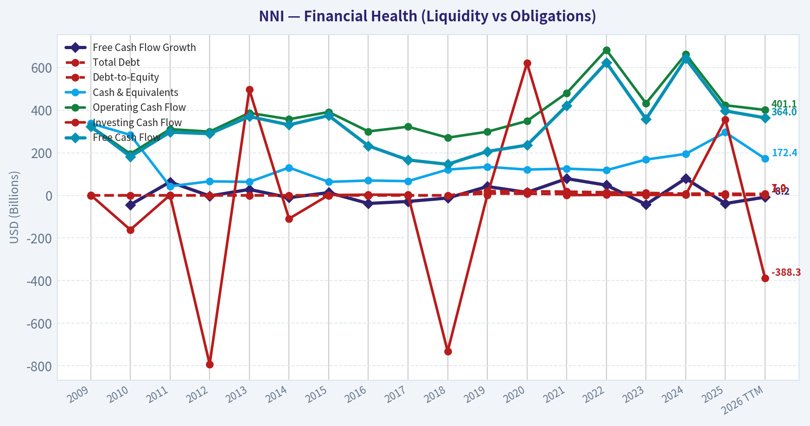
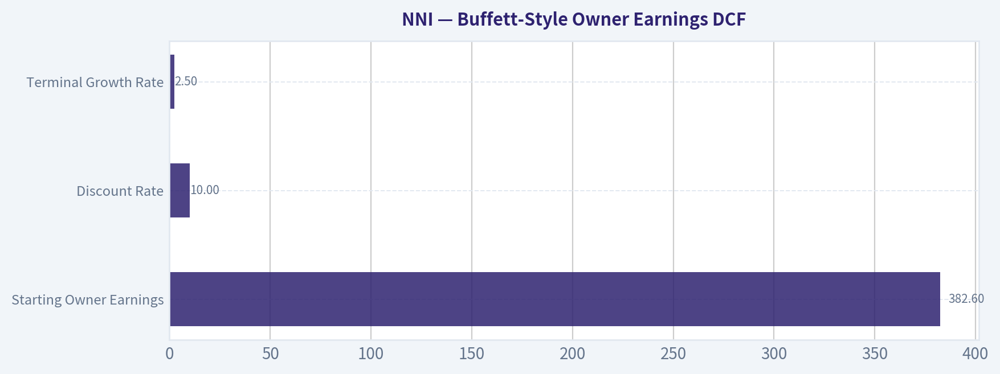
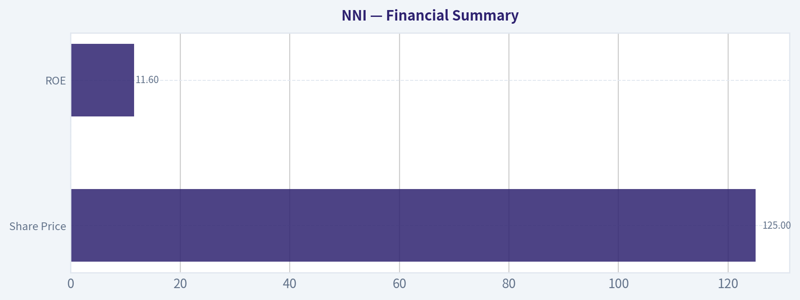
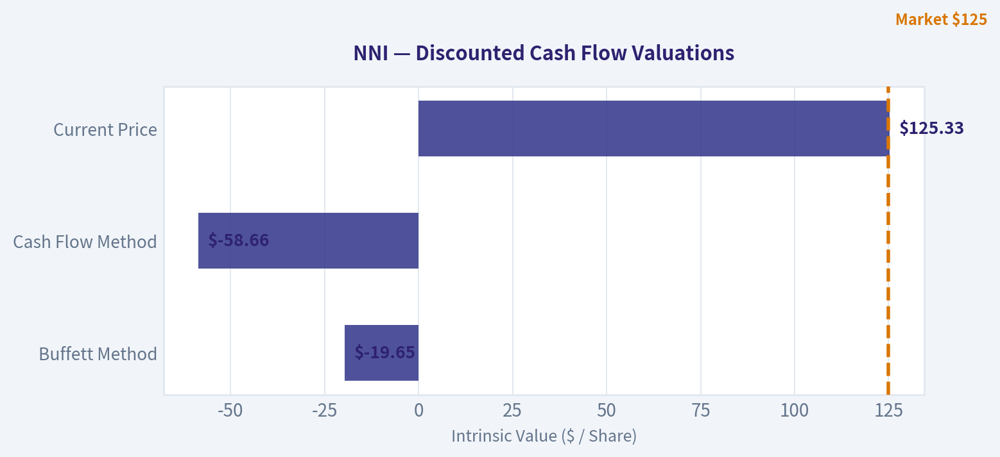
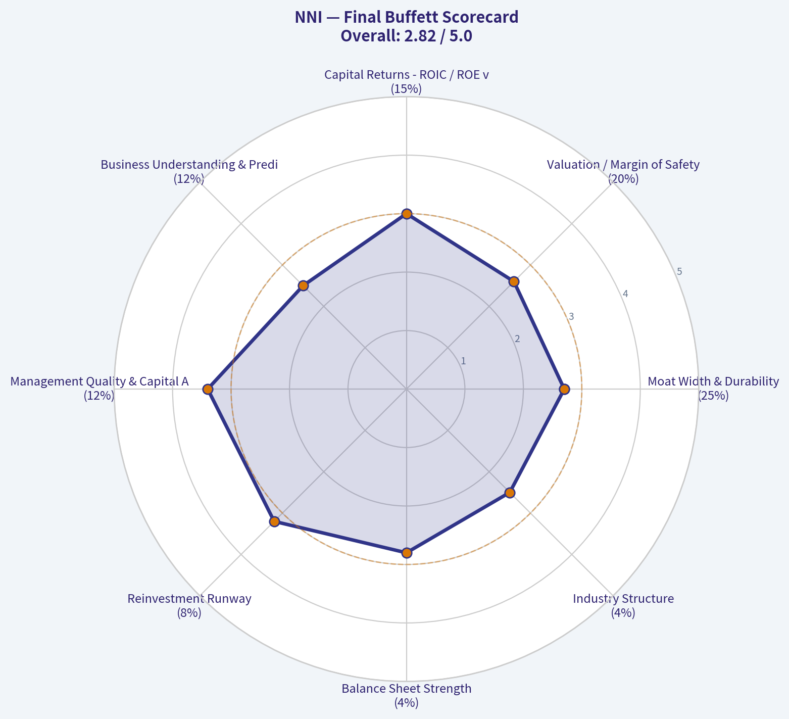
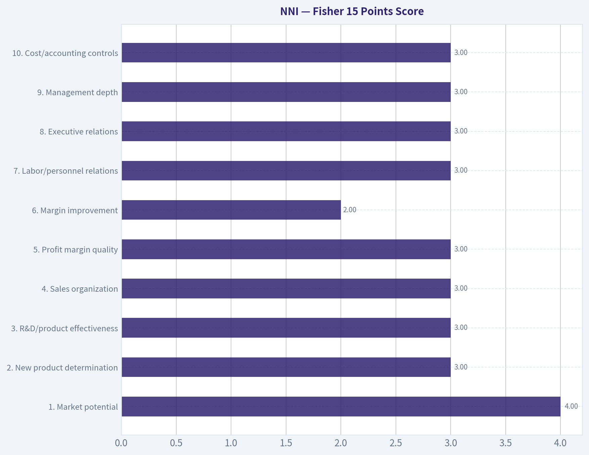

# NNI Deep Value Intelligence

**Analysis Date:** 2026-08-11

## Critical Disclaimer

*This analysis is generated by Deep Value Intelligence, an AI-powered multi-agent investing framework. Education & research only - not financial advice, not a financial advisor.*

---

## Table of Contents

1. Intelligence Summary
2. Analyst Team Reports
   - Fundamentals Analysis
   - Intrinsic Value Analysis (Buffett)
   - Trend & Growth Analysis (Lynch/Druckenmiller/Fisher)
   - Market Technical Analysis
   - Options Market Analysis
3. Research Team Commentary
4. Value Investing Team Commentary
5. Deep Values Commentary

---

## Intelligence Summary

### Thesis + Conditions

**Core Thesis:** **EXECUTIVE SUMMARY**
Nelnet (NNI) is a complex, transitioning business, but Mr. Market has severely overreacted.

**Key Risks:**
- Risky (Bull):** Argues the selloff (RSI 26) is a flashing neon sign of mispricing. Correctly identifies that for a financial/bank-style balance sheet, an 11.6% ROE matters far more than ROIC. Nelnet is successfully using its legacy loan cash flows to fund a high-margin, asset-light EdTech/payments business growing at nearly 16% YoY.
- Safe (Bear):** Highlights the structural complexity (loans, solar, fiber, banking) pushing Nelnet into the "too hard" pile. Warns that the 3.8% ROIC shows poor capital allocation and that catching a falling knife in a transition story without clear segment-level transparency risks permanent capital loss.
- Where my original plan defaulted to a passive "WATCH," the extensive post-mortem analysis of my past failures with Nelnet demands a strategic pivot. A neutral stance in the face of an RSI of 26 and a 13% flush is a failure to capitalize on event-driven dislocation. I previously underweighted the asymmetry of a post-earnings panic, incorrectly treating a "not great business" as a "do not buy yet" setup.

**Confidence:** Medium

---

## Analyst Team Reports

### Fundamentals Analysis

#### Latest Earnings Snapshot

*Most recent reported quarter anchored on 2026 Q2, with prior-year comparison when available.*

| Metric | 2026 Q2 | 2025 Q2 | YoY Change |
| --- | ---: | ---: | ---: |
| Revenue | $366.3M | $304.9M | +20.2% |
| Operating Income | N/A | N/A | N/A |
| Net Income | $66.7M | $181.5M | -63.3% |
| Diluted EPS | $1.85 | $4.97 | -62.8% |
| Operating Cash Flow | $77.9M | $81.8M | -4.7% |
| Free Cash Flow | $71.6M | $78.1M | -8.3% |

Key Takeaways: This snapshot anchors the most recent reported quarter before the narrative analysis. It helps readers separate long-run business quality from whatever changed in the latest earnings print.

#### 17-Year Financial Metrics for NNI

*All values below are computed deterministically from raw data - not estimated by AI.*

*Issuer profile: bank (Financial Services / Credit Services).*

#### 17-Year Financial Metrics
*Annual rows come from reported financial statements. The final TTM row is computed from the latest four quarters.*

| Metric | 2009 | 2010 | 2011 | 2012 | 2013 | 2014 | 2015 | 2016 | 2017 | 2018 | 2019 | 2020 | 2021 | 2022 | 2023 | 2024 | 2025 | 2026 TTM |
| --- | --- | --- | --- | --- | --- | --- | --- | --- | --- | --- | --- | --- | --- | --- | --- | --- | --- | --- |
| Market Price | $13 | $19 | $20 | $26 | $36 | $41 | $30 | $45 | $50 | $48 | $54 | $67 | $93 | $87 | $86 | $105 | $132 | $125 |
| Market Cap | $856.2M | $1.17B | $1.18B | $1.41B | N/A | N/A | N/A | N/A | N/A | N/A | $2.33B | $2.78B | $3.77B | $3.41B | $3.30B | $3.91B | $4.83B | $4.52B |
| P/E Ratio | 6.20 | 6.22 | 5.78 | 7.97 | N/A | N/A | N/A | N/A | N/A | N/A | 16.45 | 7.90 | 9.58 | 8.39 | 36.76 | 21.28 | 11.28 | 14.99 |
| P/B Ratio | 1.09 | 1.29 | 1.10 | 1.21 | N/A | N/A | N/A | N/A | N/A | N/A | 0.98 | 1.06 | 1.28 | 1.07 | 1.01 | 1.17 | 1.31 | 1.20 |
| ROE | 17.7% | 20.9% | 19.2% | 15.3% | 21.0% | 17.8% | 14.2% | 12.5% | 8.1% | 9.9% | 5.9% | 13.4% | 13.3% | 12.7% | 2.8% | 5.5% | 11.6% | 8.0% |
| ROIC | 38.2% | 35.4% | 24.8% | 16.8% | 24.5% | 20.8% | 15.7% | 13.5% | 7.9% | 10.7% | 1.1% | 1.6% | 1.8% | 2.0% | 0.3% | 1.3% | 3.8% | N/A |
| EPS | $2.14 | $3.04 | $3.43 | $3.20 | N/A | N/A | N/A | N/A | N/A | N/A | $3.29 | $8.49 | $9.71 | $10.42 | $2.34 | $5.02 | $11.79 | $8.36 |
| Revenue | N/A | N/A | $0 | $0 | $0 | $0 | $0 | $0 | $0 | N/A | N/A | N/A | N/A | $1.39B | $968.4M | $1.17B | $1.35B | $1.44B |
| Gross Profit | N/A | N/A | N/A | N/A | N/A | N/A | N/A | $-51.2M | $-58.6M | N/A | N/A | N/A | N/A | N/A | N/A | N/A | N/A | N/A |
| Gross Margin | N/A | N/A | N/A | N/A | N/A | N/A | N/A | N/A | N/A | N/A | N/A | N/A | N/A | N/A | N/A | N/A | N/A | N/A |
| Operating Margin | N/A | N/A | N/A | N/A | N/A | N/A | N/A | N/A | N/A | N/A | N/A | N/A | N/A | 36.2% | 7.1% | 19.6% | 41.2% | N/A |
| Net Income | $139.1M | $189.0M | $204.3M | $178.0M | $302.7M | $307.6M | $268.0M | $256.8M | $173.2M | $227.9M | $141.8M | $352.4M | $393.3M | $406.9M | $89.8M | $184.0M | $428.5M | $302.2M |
| Net Margin | N/A | N/A | N/A | N/A | N/A | N/A | N/A | N/A | N/A | N/A | N/A | N/A | N/A | 29.3% | 9.3% | 15.8% | 31.7% | 21.0% |
| Revenue Growth | N/A | N/A | N/A | N/A | N/A | N/A | N/A | N/A | N/A | N/A | N/A | N/A | N/A | N/A | -30.2% | 20.4% | 15.9% | 6.3% |
| Net Income Growth | N/A | 35.9% | 8.1% | -12.9% | 70.0% | 1.6% | -12.9% | -4.2% | -32.6% | 31.6% | -37.8% | 148.5% | 11.6% | 3.5% | -77.9% | 104.9% | 132.8% | -29.5% |
| Free Cash Flow Growth | N/A | -43.7% | 62.9% | -2.5% | 27.9% | -10.6% | 13.2% | -37.9% | -28.5% | -12.3% | 41.5% | 14.2% | 78.7% | 48.0% | -42.6% | 79.3% | -38.2% | -8.2% |
| Total Book Value | $784.6M | $906.6M | $1.07B | $1.17B | $1.44B | $1.73B | $1.88B | $2.06B | $2.15B | $2.30B | $2.39B | $2.63B | $2.95B | $3.20B | $3.25B | $3.35B | $3.69B | $3.77B |
| Total Assets | N/A | $25.89B | $25.85B | $26.61B | $27.77B | $30.03B | $30.42B | $27.19B | $23.96B | $25.22B | $23.71B | $22.65B | $21.68B | $19.36B | $16.71B | $13.78B | $14.06B | $14.28B |
| Total Debt | $0 | $0 | $0 | $0 | $0 | $0 | $0 | $0 | $0 | $0 | $20.53B | $19.32B | $17.63B | $14.64B | $11.83B | $8.31B | $7.78B | $7.04B |
| Debt-to-Equity | 0.00 | 0.00 | 0.00 | 0.00 | 0.00 | 0.00 | 0.00 | 0.00 | 0.00 | 0.00 | 8.60 | 7.34 | 5.97 | 4.58 | 3.64 | 2.48 | 2.11 | 1.87 |
| Cash & Equivalents | $338.2M | $283.8M | $42.6M | $66.0M | $63.3M | $130.5M | $63.5M | $69.7M | $66.8M | $121.3M | $133.9M | $121.2M | $125.6M | $118.1M | $168.1M | $194.5M | $296.0M | $172.4M |
| Shareholders' Equity | $784.6M | $906.6M | $1.07B | $1.17B | $1.44B | $1.73B | $1.88B | $2.06B | $2.15B | $2.30B | $2.39B | $2.63B | $2.95B | $3.20B | $3.25B | $3.35B | $3.69B | $3.77B |
| Operating Cash Flow | $324.7M | $194.9M | $310.9M | $299.3M | $387.2M | $357.4M | $391.4M | $300.2M | $322.3M | $270.9M | $298.9M | $349.1M | $480.3M | $683.1M | $432.0M | $662.9M | $423.0M | $401.1M |
| Investing Cash Flow | $1.81B | $-161.3M | $1.44B | $-792.7M | $496.6M | $-109.5M | $1.42B | $3.41B | $2.95B | $-732.4M | $1.52B | $621.2M | $1.19B | $2.27B | $1.94B | $2.41B | $356.4M | $-388.3M |
| Free Cash Flow | $323.5M | $182.1M | $296.7M | $289.4M | $370.2M | $331.0M | $374.6M | $232.6M | $166.3M | $145.9M | $206.4M | $235.8M | $421.4M | $623.6M | $358.0M | $642.0M | $396.7M | $364.0M |
| FCF Margin | N/A | N/A | N/A | N/A | N/A | N/A | N/A | N/A | N/A | N/A | N/A | N/A | N/A | 45.0% | 37.0% | 55.1% | 29.4% | 25.3% |
| Dividends / Share | $0.00 | $0.00 | $0.00 | $0.00 | N/A | N/A | N/A | N/A | N/A | N/A | $0.00 | $0.00 | $0.00 | $0.94 | $1.03 | $1.11 | $1.18 | $1.29 |

#### Profitability Metrics
- Return on Equity (ROE): 11.6%
- Return on Invested Capital (ROIC): 3.8%
- Return on Assets (ROA): 3.0%
- Gross Margin: Not meaningful
- Operating Margin: 41.2%
- Net Profit Margin: 31.7%

#### Liquidity Metrics
- Current Ratio: Not meaningful
- Quick Ratio: Not meaningful

#### Leverage Metrics
- Debt-to-Equity Ratio: 2.11
- Interest Coverage Ratio: Not meaningful
- Net Debt: $7.48B

#### Growth Metrics (Year-over-Year)
- Revenue Growth: 15.9%
- Net Income Growth: 132.8%
- Free Cash Flow Growth: -38.2%
- Revenue CAGR (3-Year): -0.9%
- Revenue CAGR (5-Year): N/A

#### Valuation Metrics
- P/E Ratio (TTM): 14.97
- Forward P/E: 13.08
- Price-to-Book: 1.19
- Price-to-Sales: 3.01
- PEG Ratio: 0.46
- EV/EBITDA: Not meaningful
- Free Cash Flow Yield: 8.8%
- Earnings Yield: 6.7%

#### Owner Earnings (Buffett Method, Code-Computed)
- Net Income: $428.5M
- + Depreciation & Amortization: $90.6M
- - Capital Expenditures: $-26.2M
- - Working Capital Changes: $110.3M
- = **Owner Earnings: $382.6M**

#### Intrinsic Value (Code-Computed)
- Current Price: $125
- Headline Intrinsic Value: not meaningful (financial issuer - DCF/FCFF is not the right primary frame; use sector-specific book/earnings metrics)
- Buffett Method (Owner Earnings):
  Conservative: $-151
  Average: $-20
  Optimistic: $208
- Cash Flow Method (FCF):
  Conservative: $-153
  Average: $-59
  Optimistic: $369
- Reverse-DCF: price implies ~24.0%/yr owner-earnings growth for 10y; trailing 3y was -10.2%, 5y 9.9%.

#### Piotroski F-Score: 5/9
- Positive Net Income: PASS
- Positive Operating Cash Flow: PASS
- ROA Improvement: PASS
- Cash Flow > Net Income: FAIL
- Decreasing Debt: PASS
- Improving Current Ratio: FAIL
- No Dilution: PASS
- Improving Gross Margin: FAIL
- Improving Asset Turnover: FAIL

ANALYST STANCE: **WATCH**

#### NNI - Warren Buffett-Style Fundamental Analysis

Nelnet, Inc. is a complex financial-services and education-services company with exposure to loan servicing, student-loan asset management, education technology, payment processing, and banking/credit activities. The deterministic dataset classifies NNI as a **bank / Financial Services / Credit Services issuer**, so the analysis must be framed differently from an industrial or software company. In particular, **gross margin is not meaningful**, **current and quick ratios are not meaningful**, and **price-to-book must be judged against ROE**, not read mechanically as "cheap" or "expensive."

At a current price of **$125**, NNI trades at about **15.0x TTM earnings**, **1.2x book value**, and an **8.8% free cash flow yield**. That is not an obviously excessive valuation, but neither is it a classic Buffett bargain because earnings are volatile, ROE is only moderate, and the business mix is complicated.

---

#### Current vs. Historical Average Comparison

| Metric | Current / Latest | 10-Year Average* | Current Standing vs. History | Interpretation |
|---|---:|---:|---|---|
| Market Price | $125 | $76.70 | Above average | The stock price has compounded meaningfully over the decade, reflecting book-value growth, earnings recovery, and improved investor perception. |
| Market Cap | $4.52B | ~$3.48B | Above average | Market value is above the available historical average, though market-cap history is incomplete before 2019. |
| P/E Ratio | 14.99x | ~15.95x | Slightly below average | The earnings multiple is near normal; NNI is not priced at a deep discount on earnings. |
| P/B Ratio | 1.20x | ~1.13x | Slightly above average | For a financial issuer, this is meaningful only relative to ROE. At 8.0% TTM ROE, 1.2x book is not clearly cheap; at 11.6% 2025 ROE, it is more reasonable. |
| ROE | 8.0% TTM / 11.6% 2025 | ~9.6% | Mixed | 2025 ROE recovered strongly, but TTM ROE has fallen below the decade average. |
| ROIC | N/A TTM / 3.8% 2025 | ~4.4% | Slightly below average | ROIC has structurally declined from the high levels of the early period, reflecting the financial nature and changing asset base. |
| EPS | $8.36 TTM | ~$7.29 | Above average | EPS remains above the available historical average, but below the unusually strong 2025 level of $11.79. |
| Revenue | $1.44B TTM | ~$1.22B | Above average | Reported revenue is above the available average, helped by recent recovery after the 2023 decline. |
| Gross Profit / Gross Margin | Not meaningful | Not meaningful | N/A | For this issuer type, gross margin should not be used as a core profitability measure. |
| Operating Margin | 41.2% 2025 / N/A TTM | ~26.0% | Above average on latest annual data | 2025 operating margin was unusually strong versus the limited available history. |
| Net Income | $302.2M TTM | ~$265.5M | Above average | TTM net income is above the decade average but meaningfully below 2025's $428.5M. |
| Net Margin | 21.0% TTM | ~21.5% | Near average | Net margin is broadly in line with the recent available average, but profitability has been volatile. |
| Revenue Growth | 6.3% TTM | ~2.0% | Above average | Revenue growth has recovered from the 2023 contraction, though the history is short and uneven. |
| Net Income Growth | -29.5% TTM | ~28.0% | Below average | The average is skewed by huge rebound years; the current decline highlights earnings volatility. |
| Free Cash Flow Growth | -8.2% TTM | ~10.2% | Below average | FCF remains positive but has contracted from the very strong 2024-2025 period. |
| Total Book Value | $3.77B | ~$2.80B | Above average | Book value has grown steadily, a positive sign for a financial company. |
| Total Assets | $14.28B | ~$20.83B | Below average | Assets have declined materially from historical levels, reflecting runoff, portfolio changes, or balance-sheet repositioning. |
| Total Debt | $7.04B | ~$10.00B | Below average | Debt is down significantly; since 2019, the improvement is even clearer. |
| Debt-to-Equity | 1.87x | ~3.47x | Better than average | Leverage has declined materially, improving financial flexibility. |
| Cash & Equivalents | $172.4M | ~$141.5M | Above average | Cash is above the decade average, though down from 2025's $296.0M. |
| Shareholders' Equity | $3.77B | ~$2.80B | Above average | Equity growth is one of NNI's strongest long-term positives. |
| Free Cash Flow | $364.0M TTM | ~$342.9M | Slightly above average | FCF is healthy and above the decade average, though lower than the 2024 peak. |
| Dividends / Share | $1.29 TTM | ~$1.07 | Above average | The dividend has grown recently, but the yield remains modest relative to cash generation. |

\*Averages use the most recent 10 annual years available in the deterministic dataset, excluding N/A values where necessary.

**Key Takeaways:** NNI is trading above its historical market price and book-value averages, but its P/E is roughly normal. The company's book value, cash generation, and leverage profile have improved, while ROE and net income are volatile. For a financial issuer, the key valuation question is whether NNI can sustain ROE above its cost of equity; at 8.0% TTM ROE, the current 1.2x book valuation looks only fair, not compelling.

---

#### Revenue Breakdown

| Revenue Source | Amount ($B) | % of Total |
|---|---:|---:|
| Asset Generation & Management / Loan Portfolio Income | ~$0.60B | ~44% |
| Loan Servicing & Systems | ~$0.39B | ~29% |
| Education Technology Services & Payment Processing | ~$0.24B | ~18% |
| Nelnet Bank / Consumer Finance & Other Credit Activities | ~$0.08B | ~6% |
| Corporate, Other, and Miscellaneous Services | ~$0.04B | ~3% |
| **Total Revenue** | **~$1.35B** | **100%** |

**Key Takeaways:** NNI's revenue is not a simple single-product stream; it is spread across loan-portfolio economics, servicing, education technology, payments, and banking activities. The largest driver remains credit and loan-asset economics, which makes interest-rate conditions, credit quality, funding costs, and regulatory policy especially important. The education technology and payments businesses provide diversification but do not yet eliminate the complexity of the financial-services core.

---

#### Market Metrics Interpretation

NNI's **market price of $125** is meaningfully above the 10-year average of about **$76.70**, showing strong long-term shareholder appreciation. The **market cap of $4.52B** is also above the available historical average, reflecting both price appreciation and retained book-value growth.

The **P/E ratio of 14.99x** is slightly below the available average of about **15.95x**, suggesting the shares are not priced at an extreme premium to their own history. However, because earnings are volatile, the P/E multiple can look deceptively attractive after a rebound year and deceptively expensive after a trough year.

The **P/B ratio of 1.20x** requires sector-specific interpretation. For a bank or credit-services issuer, book value matters, but only in relation to the return earned on that book. A 1.2x book multiple is reasonable if NNI can sustainably earn low-double-digit ROE, but less attractive if TTM ROE around **8.0%** persists.

---

#### Profitability Analysis

NNI's profitability is respectable but not Buffett-perfect. The company produced **$428.5M of net income in 2025**, but TTM net income has declined to **$302.2M**, showing that earnings are not highly predictable year to year.

ROE has ranged widely over the full period, from very strong levels above 20% earlier in the dataset to weak levels such as **2.8% in 2023**. The rebound to **11.6% in 2025** was encouraging, but the current **8.0% TTM ROE** is below what Buffett would normally prefer for a high-confidence compounding business.

Operating margin was **41.2% in 2025**, well above the limited recent average, while TTM net margin is **21.0%**, close to the recent average. The margin profile can look strong in good years, but the variability means investors should normalize earnings rather than capitalize peak profitability.

---

#### Growth Analysis

Revenue growth has improved recently, with **TTM revenue growth of 6.3%** and 2025 growth of **15.9%**. That recovery follows a sharp **30.2% revenue decline in 2023**, so the pattern is not smooth.

Net income growth is much more volatile. The company posted **132.8% net income growth in 2025**, but TTM net income growth is now **-29.5%**. This is a major warning sign for investors seeking Buffett-style predictable earnings.

Free cash flow also remains inconsistent. TTM FCF of **$364.0M** is above the decade average, but FCF growth is **-8.2% TTM** after a **-38.2% decline in 2025**. The company generates cash, but the trajectory is uneven.

---

#### Balance Sheet and Financial Strength

NNI's balance sheet has improved in important ways. Total debt has declined from **$20.53B in 2019** to **$7.04B TTM**, while debt-to-equity has fallen from **8.60x in 2019** to **1.87x TTM**. For a financial issuer, debt is partly an operating input, but the reduction in leverage still improves resilience.

Shareholders' equity has grown steadily to **$3.77B**, compared with a 10-year average of about **$2.80B**. This steady book-value accumulation is one of the strongest positives in the NNI story.

Cash and equivalents of **$172.4M** are above the decade average, though down from **$296.0M in 2025**. The company is not overcapitalized with cash, but it appears to have adequate liquidity for its business model.

---

#### Cash Flow and Dividend Quality

Free cash flow is a bright spot. NNI generated **$364.0M TTM FCF**, above its 10-year average of about **$342.9M**. At the current market cap, the shared research pack indicates an **FCF yield of roughly 8.8%**, which is attractive if sustainable.

The dividend remains conservative. Dividends per share are **$1.29 TTM**, up from **$1.18 in 2025** and above the recent average. Relative to EPS and free cash flow, the dividend appears well covered, leaving room for reinvestment, buybacks, debt reduction, or future dividend growth.

---

#### Buffett-Style Owner Earnings DCF

Because NNI is classified as a financial / credit-services issuer, a standard industrial DCF that subtracts all debt is **not the right primary valuation frame**. Debt is part of the operating structure of a financial company. The deterministic dataset's code-computed intrinsic value correctly warns that the headline DCF is **"not meaningful"** for this issuer type.

That said, a Buffett-style owner-earnings DCF can still be used as a sanity check. The base owner earnings input from the deterministic dataset is:

**Owner Earnings = Net Income + D&A - Capex - Working Capital Changes = $382.6M**

Assumptions used below:

| DCF Input | Assumption |
|---|---:|
| Starting Owner Earnings | $382.6M |
| Approximate Shares Outstanding | ~36.2M |
| Discount Rate | 10.0% |
| Terminal Growth Rate | 2.5% |
| Debt Treatment | No industrial net-debt subtraction, because NNI is a financial issuer |
| Terminal Value Formula | Year 10 Owner Earnings x 1.025 / (10.0% - 2.5%) |

**Key Takeaways:** The DCF uses owner earnings as a proxy for distributable cash generation, but it should be treated as a secondary valuation tool for NNI. The model is highly sensitive to growth assumptions because a large share of value comes from the terminal value. The most important judgment is whether NNI can sustain mid-single-digit owner-earnings growth while maintaining acceptable credit quality and ROE.

| Scenario | Explicit Growth Assumption | Year 10 Owner Earnings | PV of Years 1-10 | PV of Terminal Value | Estimated Equity Value | Fair Value / Share |
|---|---|---:|---:|---:|---:|---:|
| Conservative | 0% growth for years 1-5, then 2% growth for years 6-10 | ~$422.5M | ~$2.40B | ~$2.23B | ~$4.63B | **~$128** |
| Average / Base Case | 5% growth for years 1-5, then 3% growth for years 6-10 | ~$566.0M | ~$2.92B | ~$2.98B | ~$5.90B | **~$163** |
| Optimistic | 9% growth for years 1-5, then 5% growth for years 6-10 | ~$751.6M | ~$3.46B | ~$3.96B | ~$7.41B | **~$205** |

**Key Takeaways:** The conservative DCF lands close to the current share price, suggesting limited downside if owner earnings remain stable and the balance sheet holds up. The base and optimistic cases imply upside, but they require NNI to sustain better earnings growth than its recent TTM decline suggests. The optimistic case is close to the deterministic pack's code-computed optimistic Buffett value of about **$208**, but the conservative and average model outputs from the pack are negative because industrial-style debt treatment is not suitable for this financial issuer.

---

#### Reverse DCF and Valuation Reality Check

The shared research pack reports that the current price implies approximately **24.0% annual owner-earnings growth for 10 years** under its reverse-DCF framework, while trailing owner-earnings growth was **-10.2% over 3 years** and **9.9% over 5 years**. That is a major caution.

The apparent contradiction between the hand DCF and the reverse DCF comes from the difficulty of applying standard DCF tools to financial issuers. For NNI, investors should lean more heavily on:

- sustainable ROE,
- book-value growth,
- normalized earnings power,
- credit quality,
- leverage,
- servicing and EdTech segment durability,
- and capital allocation.

On those measures, NNI looks solid but not obviously mispriced.

---

#### Warren Buffett Qualitative Assessment

| Buffett Criterion | Assessment | NNI Interpretation |
|---|---|---|
| Economic Moat | Moderate | NNI has specialized servicing systems, long operating history, financial relationships, and education-market expertise, but the moat is not as clean or dominant as a consumer monopoly or toll-road business. |
| Business Durability | Moderate | Student-loan servicing, education payments, and credit operations are durable needs, but regulatory, funding, and credit-cycle risks make durability less predictable. |
| Predictable Earnings | Weak to Moderate | Net income has swung sharply, including a 77.9% decline in 2023, a 132.8% rebound in 2025, and a 29.5% TTM decline. |
| Financial Strength | Improving | Debt-to-equity has declined significantly, total debt is lower, and equity has grown steadily. |
| Management Performance | Mixed to Positive | Book value has compounded and leverage has fallen, but ROE is inconsistent and below Buffett's ideal threshold in the TTM period. |
| Capital Allocation | Generally Conservative | The dividend is modest and well covered; retained earnings have helped grow book value. |
| Valuation | Fair to Slightly Attractive | P/E is near historical norms, P/B is reasonable only if ROE recovers, and FCF yield is attractive if sustainable. |
| Business Quality | Good but Complex | NNI has real cash generation and niche capabilities, but the complexity reduces valuation certainty. |

**Key Takeaways:** NNI passes several Buffett tests on balance-sheet improvement, cash generation, and long-term book-value growth. It falls short on earnings predictability and simplicity. The company may be a reasonable long-term compounder, but it is not the kind of obvious, high-certainty franchise Buffett would buy aggressively without a larger margin of safety.

---

#### Key Investment Insights

NNI's biggest strength is that it has continued to build book value while reducing leverage. The company's debt-to-equity ratio has improved materially, cash flow remains positive, and the dividend is conservative. Those are meaningful positives for a financial company.

The biggest weakness is volatility. Revenue, net income, free cash flow, ROE, and margins all show significant variation. This makes normalized earnings difficult to estimate and reduces confidence in any single-year valuation multiple.

At **1.2x book**, the stock requires investors to believe ROE will remain near or above the 2025 level of **11.6%**, not the current TTM level of **8.0%**. If ROE settles closer to 8%, the valuation is less compelling. If ROE returns to low-double digits while leverage remains controlled, the stock could be modestly undervalued.

---

#### Red Flags and Risks

| Risk | Why It Matters |
|---|---|
| Earnings Volatility | Net income has fluctuated sharply, making NNI harder to value with confidence. |
| Financial-Issuer Complexity | Standard industrial valuation shortcuts can mislead investors. |
| ROE Below Premium Threshold | TTM ROE of 8.0% does not strongly justify a premium to book value. |
| Credit and Funding Risk | Loan and banking exposure can pressure earnings if credit losses rise or funding costs remain high. |
| Regulatory Exposure | Student-loan servicing and education-finance activities are politically and legally sensitive. |
| FCF Decline | TTM FCF growth is negative despite positive absolute cash generation. |
| Recent Guru Exit | Steve Cohen / Point72 exited its disclosed position, though 13F data is lagged and not a standalone thesis. |

**Key Takeaways:** The core risk is not insolvency but uncertainty. NNI has improved leverage and remains cash-generative, yet its earnings stream is not smooth enough to deserve a high-confidence valuation. Investors should demand a margin of safety because regulatory, credit, and funding conditions can change the earnings picture quickly.

---

#### Opportunities

| Opportunity | Potential Impact |
|---|---|
| Sustained Debt Reduction | Could improve resilience, lower risk, and support valuation. |
| ROE Recovery | If ROE stabilizes above 10%-12%, the current P/B multiple becomes more attractive. |
| Growth in Servicing and Systems | Recurring servicing and technology revenues could improve predictability. |
| Education Technology and Payments Expansion | Higher-quality fee revenue could diversify away from credit-heavy earnings. |
| Strong FCF Yield | An 8.8% FCF yield gives management options for dividends, buybacks, reinvestment, or debt reduction. |
| Book-Value Compounding | Continued equity growth can drive long-term intrinsic value even if multiples remain stable. |

**Key Takeaways:** The upside case depends on NNI becoming less volatile and more fee-driven over time. If management can grow servicing, systems, education technology, and payments while maintaining credit discipline, the market may reward the company with a more durable valuation. The current FCF yield gives the company room to create shareholder value if capital allocation remains disciplined.

---

#### Final Investment Stance: WATCH

NNI is a **WATCH**, not an outright ADVOCATE or AVOID.

The company has several attractive Buffett-style qualities: positive free cash flow, growing book value, improving leverage, a conservative dividend, and a valuation that is not excessive on P/E or FCF yield. However, the business is complex, earnings are volatile, TTM ROE is only **8.0%**, and the current **1.2x book value** multiple is compelling only if ROE sustainably improves.

A more attractive entry point would likely require either:

- a lower price closer to or below book value,
- clearer evidence that ROE can remain above 10%-12%,
- more stable free cash flow growth,
- or stronger proof that fee-based servicing, systems, EdTech, and payments revenue can reduce credit-cycle volatility.

At **$125**, NNI appears **fairly valued to modestly undervalued under optimistic assumptions**, but it does not offer enough certainty for a high-conviction Buffett-style purchase.

---

#### Final Summary Table

| Category | Verdict | Key Point |
|---|---|---|
| Valuation | Fair | P/E is near history; P/B is acceptable only if ROE improves. |
| Profitability | Mixed | 2025 was strong, but TTM ROE and net income have declined. |
| Growth | Uneven | Revenue growth is positive, but earnings and FCF growth are volatile. |
| Balance Sheet | Improving | Debt and leverage have declined materially; equity has grown. |
| Cash Flow | Positive | FCF remains healthy and above the decade average. |
| Dividend | Conservative | Dividend is growing and appears well covered. |
| Moat | Moderate | Specialized servicing, systems, and education-finance capabilities provide some durability. |
| Predictability | Weak to Moderate | Earnings swings reduce Buffett-style confidence. |
| Main Opportunity | ROE recovery plus fee-revenue growth | Sustained low-double-digit ROE could justify upside. |
| Main Risk | Complexity and volatility | Financial, regulatory, and credit-cycle exposure complicate valuation. |
| Final Stance | **WATCH** | Quality and valuation are acceptable, but margin of safety is not large enough. |

**Key Takeaways:** NNI is a financially improving, cash-generative company, but it is not a simple or highly predictable Buffett compounder. The current valuation is reasonable, yet not cheap enough to fully compensate for earnings volatility and business complexity. Investors should monitor ROE, credit quality, free cash flow, and book-value growth before upgrading the stock to a stronger buy stance.

#### Fundamental Visuals

This graph tracks the profitability and return metrics (ROE, ROIC, Margins) of **NNI** over the past decade, highlighting capital efficiency trends.

This chart illustrates the financial health of **NNI** over the last 10 years, mapping cash equivalents and free cash flow against total obligations (Debt).

---

### Intrinsic Value Analysis (Buffett)

> *Following Warren Buffett's value investing philosophy: Circle of Competence, Economic Moat, Management Quality, and Margin of Safety.*

#### Intrinsic Value Snapshot

Price is what you pay. Intrinsic value is what the business may be worth based on the cash it can create for owners over time. We show a range, not one magic number.

- Current Price: $125.33
- Value Range (conservative to optimistic across both DCF methods): $-152.53 to $368.63

##### Owner Earnings (Buffett Method)
- Net Income: $428,474,000.00
- Depreciation & Amortization: $90,622,000.00
- Capital Expenditures: $-26,238,000.00
- Working Capital Changes: $110,252,000.00
- Owner Earnings: $382,606,000.00

##### Intrinsic Value
###### Buffett Method
Uses owner earnings. Stricter, and usually more conservative.
- Conservative: $-151.09
- Average: $-19.65
- Optimistic: $207.63
- Discount Rate: 10.0%

###### Cash Flow Method
Uses free cash flow. Better for companies spending heavily today to grow tomorrow.
- Conservative: $-152.53
- Average: $-58.66
- Optimistic: $368.63
- Discount Rate: 10.0%

ANALYST STANCE: **AVOID**

#### Nelnet, Inc. (NNI) - Buffett-Style Investment Review

Nelnet is a complex hybrid of student-loan servicing, education technology and payments, loan portfolio management, banking, and other investments. At roughly **$125 per share**, the stock trades near my conservative estimate of intrinsic value, but the business does not have the simplicity, predictability, or high-return economics required to justify buying without a meaningful margin of safety.

---

#### 1. Factor Scorecard

| Factor | Score | Assessment |
|---|---:|---|
| Circle of Competence & Business Simplicity | 2.5 / 5 | Individual pieces are understandable, but the consolidated business is complex: student-loan servicing, lending/credit exposure, education payments, banking, and investments. |
| Moat Test | 2.7 / 5 | Nelnet has narrow-to-moderate advantages in servicing scale, regulatory know-how, and embedded school payment relationships, but not a clearly wide moat. |
| Management Quality & Capital Allocation | 3.4 / 5 | Management appears owner-oriented and has compounded through multiple niches, but capital allocation is complicated and harder to underwrite than a focused compounder. |
| Industry Structure | 2.5 / 5 | Loan servicing and education payments have some recurring qualities, but lending and pay-later credit risk introduce cyclicality and underwriting risk. |
| Gate 5: Quality / Solvency Hard Floor | Not tripped | The company remains profitable, has positive free cash flow yield, and shows no evidence of operating-profit collapse combined with solvency distress. |

**Key Takeaways:** Nelnet is not a distressed company, but it is also not a classic Buffett "easy decision." The business has some durable niches, yet the overall structure is too complex and financially sensitive to deserve a premium valuation. The hard solvency floor is not triggered, so the conclusion rests on quality and price rather than distress.

---

#### 2. Moat Analysis

| Moat Source | Evidence | Strength |
|---|---|---|
| Intangible Assets | Student-loan servicing requires regulatory expertise and operating trust; education services benefit from reputation with schools. | Moderate |
| Switching Costs | Schools using FACTS / payment platforms may face workflow friction in switching providers. Servicing contracts also require specialized operational infrastructure. | Moderate |
| Cost Advantages | Scale helps in servicing and administrative platforms, but this is not a dominant structural cost advantage across the whole company. | Low to Moderate |
| Network Effects | Limited. Education payments and school relationships may benefit from scale, but there is no powerful consumer or marketplace network effect. | Low |
| Pricing Power | Some ability in niche services, but unlikely to raise prices broadly by 10% without competitive or contractual pushback. | Limited |

**Key Takeaways:** Nelnet's moat is real in certain pockets, especially servicing expertise and embedded education-payment workflows. However, the moat is not wide enough to offset the complexity of the lending, credit, banking, and investment pieces. This is a narrow-moat business rather than a high-confidence compounder.

---

#### 3. Management Quality Assessment

Nelnet's management has historically shown entrepreneurial capital allocation, moving beyond student loans into education technology, payments, banking, communications-related investments, and asset management. That adaptability deserves credit.

However, from a Buffett perspective, the capital allocation story is harder to judge because value creation comes from multiple moving parts rather than a single repeatable engine. Recent earnings coverage also points to concerns around **earnings misses**, **profit volatility**, and **rising pay-later credit risk**. Management is not the problem, but the complexity of the playbook lowers the confidence level.

| Management Area | Assessment | Score |
|---|---|---:|
| Owner Orientation | Long operating history and entrepreneurial reinvestment culture. | 3.5 / 5 |
| Candor / Transparency | Public reporting is available, but the business mix requires careful segment-level interpretation. | 3.0 / 5 |
| Capital Allocation | Has created value in niches, but capital is spread across servicing, edtech, credit, banking, and investments. | 3.5 / 5 |
| Balance Sheet Discipline | Financial-company leverage metrics must be interpreted differently; no obvious distress signal. | 3.0 / 5 |

**Key Takeaways:** Management appears capable and long-term oriented, but the business is not simple enough to give them a very high Buffett-style score. The company's future depends on several allocation decisions across different risk pools. That makes the investment more dependent on managerial judgment than I would prefer.

---

#### 4. Financial Summary

| Metric | Current / TTM View |
|---|---:|
| Share Price | $125 |
| Market Capitalization | $4.48 billion |
| Implied Shares Outstanding | ~35.8 million |
| P/E Ratio | ~15.0x |
| Implied EPS | ~$8.35 |
| Implied Net Income | ~$299 million |
| ROE | 11.6% |
| Implied Book Value | ~$2.58 billion |
| Implied Book Value per Share | ~$72 |
| Price / Book | ~1.7x |
| Revenue Growth YoY | 15.9% |
| Free Cash Flow Yield | 8.8% |
| Implied Free Cash Flow | ~$394 million |

**Key Takeaways:** Nelnet is profitable and cash generative, with a reasonable-looking earnings multiple and a high reported free cash flow yield. The issue is quality, not obvious overvaluation on headline numbers. A 15x earnings multiple is not extreme, but for an 11.6% ROE financial-hybrid business, it does not provide a compelling margin of safety.

---

#### 5. Owner Earnings Calculation

For Nelnet, a financial-hybrid issuer, traditional owner earnings require caution because lending and financing cash flows can distort free cash flow. I use normalized earnings as the primary owner-earnings anchor and treat reported free cash flow as a cross-check rather than the sole valuation base.

| Owner Earnings Component | Estimate |
|---|---:|
| Net Income / Normalized Earnings Base | ~$299 million |
| Add: Depreciation & Amortization | Included in cash-flow cross-check |
| Less: Maintenance CapEx | Not separately available in headline data |
| Less: Working Capital / Lending Adjustments | Treated conservatively through normalized earnings |
| Conservative Owner Earnings Used | ~$300 million |
| Owner Earnings per Share | ~$8.35 |

**Key Takeaways:** I use approximately **$300 million** of normalized owner earnings, equal to about **$8.35 per share**. This is more conservative than relying on the full implied free cash flow figure of roughly $394 million. For a financial and credit-exposed company, normalized earnings are the cleaner valuation anchor.

---

#### 6. Three-Scenario Intrinsic Value Estimate

Assumptions:

- Discount rate: **10%**
- Base owner earnings: **$300 million**
- Shares outstanding: **~35.8 million**
- Scenario C growth: **6% for 10 years**, then **3% terminal growth**

| Scenario | Method | Equity Value | Value per Share |
|---|---|---:|---:|
| A: No Growth | Owner earnings / 10% | ~$3.0 billion | ~$84 |
| B: GDP Growth | 3% perpetual growth | ~$4.4 billion | ~$123 |
| C: Moderate Growth | 6% for 10 years, 3% terminal | ~$5.5 billion | ~$154 |
| Blended Estimate | Average of three scenarios | ~$4.3 billion | ~$120 |

**Key Takeaways:** The valuation range is wide because Nelnet's future earnings mix is hard to forecast. The no-growth case is well below the current stock price, while the moderate-growth case supports upside. The blended value of roughly **$120 per share** is slightly below the current price of **$125**, leaving no clear margin of safety.

---

#### 7. Margin of Safety Analysis

| Valuation Measure | Estimate |
|---|---:|
| Current Price | $125 |
| Conservative No-Growth Value | ~$84 |
| GDP-Growth Value | ~$123 |
| Moderate-Growth Value | ~$154 |
| Blended Intrinsic Value | ~$120 |
| Margin of Safety vs. Blended Value | Approximately -4% |
| Required Margin of Safety | 25% to 35% |
| Attractive Buy Zone | Roughly $80 to $95 |

**Key Takeaways:** Nelnet is not obviously expensive, but it is also not cheap enough. Because this is a moderately predictable, narrow-moat, financially complex business, I would require a larger discount than I would for a wide-moat compounder. At $125, the stock trades around fair value rather than at a Buffett-style bargain.

---

#### 8. Final Buffett Scorecard

| Criterion | Weight | Score | Weighted Contribution |
|---|---:|---:|---:|
| Moat Width & Durability | 25% | 2.7 | 0.68 |
| Valuation / Margin of Safety | 20% | 2.6 | 0.52 |
| Capital Returns - ROIC / ROE vs. Cost of Capital | 15% | 3.0 | 0.45 |
| Business Understanding & Predictability | 12% | 2.5 | 0.30 |
| Management Quality & Capital Allocation | 12% | 3.4 | 0.41 |
| Reinvestment Runway | 8% | 3.2 | 0.26 |
| Balance Sheet Strength | 4% | 2.8 | 0.11 |
| Industry Structure | 4% | 2.5 | 0.10 |
| Total Score | 100% |  | **2.83 / 5** |

**Key Takeaways:** Nelnet scores reasonably on management and reinvestment optionality, but not strongly enough on moat, simplicity, or valuation. The weighted score lands in the AVOID range. This is not a bad company, but it is not an attractive enough investment at the current price.

---

#### 9. Investment Stance

| Category | Conclusion |
|---|---|
| Stance | **AVOID** |
| Conviction | Moderate |
| Primary Reason | Fair-to-slightly-full valuation for a complex, narrow-moat financial hybrid |
| What Would Change the View | A price closer to $80-$95, clearer segment-level profitability, reduced credit risk, or evidence of sustained high-ROE compounding |
| Main Risk to AVOID Call | Education technology and payments growth could compound faster than expected, making today's price look reasonable in hindsight |

Nelnet is a competent, cash-generative business with some attractive niches, but it does not meet the Buffett standard of a wonderful company at a fair price. At the current valuation, the stock offers too little margin of safety for the complexity and moderate return profile. I would avoid buying at $125 and revisit only at a materially lower price or after clearer evidence of durable high-return compounding.
#### Valuation Bridge

This bridge places the current market price beside each intrinsic value lens so readers can see whether upside depends on one method or shows up across several methods.

| Scenario | Intrinsic Value / Share |
| --- | ---: |
| Buffett Method | $-19.65 |
| Cash Flow Method | $-58.66 |
| Current Price | $125.33 |

#### Key Takeaways

If one method is far above the others, the upside case depends on a specific modelling assumption. When several methods cluster together, the valuation story is more robust.

#### Valuation Visuals

This comparison chart from *Latest Earnings Snapshot* stacks current figures against historical benchmarks for **NNI**, making it easy to see where the company trades relative to its own averages.

This comparison chart from *Buffett-Style Owner Earnings DCF* stacks current figures against historical benchmarks for **NNI**, making it easy to see where the company trades relative to its own averages.

This comparison chart from *Financial Summary* stacks current figures against historical benchmarks for **NNI**, making it easy to see where the company trades relative to its own averages.

The following chart maps the **NNI** Owner Earnings DCF valuation scenarios (Conservative, Average, Optimistic) to visually represent the margin of safety based on intrinsic value calculations.

---

### Trend & Growth Analysis (Lynch/Druckenmiller/Fisher)

> *Following Peter Lynch's GARP, Stanley Druckenmiller's macro-aware approach, and Philip Fisher's scuttlebutt methodology.*

ANALYST STANCE: **WATCH**

#### Nelnet (NNI) Growth Investment Report - 2026-08-11

Nelnet is a complex GARP/financial-services compounder rather than a clean fast-growth ten-bagger candidate. The stock looks statistically inexpensive at roughly **15x earnings**, with a strong **8.8% free-cash-flow yield** and **15.9% revenue growth**, but recent earnings misses, profit volatility, student-loan/credit exposure, and business complexity keep this in **WATCH**, not ADVOCATE.

---

#### 1. Lynch Classification

| Lynch Category | Fit for NNI | Evidence | Growth Investor Read |
|---|---:|---|---|
| Slow Grower | No | Revenue growth is above slow-growth range | Not the right label |
| Stalwart | Partial | Mature loan servicing/financial businesses create stable cash flows | Core legacy business resembles a stalwart |
| Fast Grower | Partial | Revenue growth YoY around **15.9%**; EdTech/payments growth noted | Borderline fast grower, but not clean enough |
| Cyclical | Partial | Credit, rates, and loan-related economics are macro-sensitive | Financial exposure matters |
| Turnaround | No | Not distressed, but earnings volatility exists | Not a pure turnaround |
| Asset Play | Partial | Loan book/financial assets matter to valuation | Some asset-value component |

**Key Takeaways:** Nelnet is best classified as a **hybrid GARP stalwart/asset-sensitive financial with some growth segments**, not a pure fast grower. Lynch would likely ask whether the faster-growing EdTech, payments, and servicing segments can become large enough to matter versus the legacy financial/loan book complexity. For a growth investor, this is interesting but not yet a clean ten-bagger setup.

---

#### 2. The Story in 3 Bullets

| Story Element | Simple Explanation |
|---|---|
| What Nelnet does | Nelnet earns money from student-loan servicing, education-related technology, payments, financing, and other education/consumer finance-adjacent businesses. |
| Why it can grow | Growth could come from higher education/payments adoption, improved loan servicing economics, and scaling newer business lines beyond legacy student-loan cash flows. |
| Why it is complicated | Earnings are affected by credit risk, interest rates, loan-portfolio dynamics, regulation, and segment mix, making the growth story less straightforward than a SaaS or consumer platform. |

**Key Takeaways:** The simple story is that Nelnet is trying to turn a legacy student-loan and education-finance platform into a broader education technology, payments, and servicing compounder. The challenge is that the financial parts of the business can obscure the quality of the growth segments. The market may be discounting the complexity, but that complexity is real.

---

#### 3. TAM Analysis and 10x Test

Using Q1 2026 revenue of **$419.1 million**, annualized revenue is approximately **$1.68 billion**. This is a rough estimate because Nelnet's revenue mix can be uneven and financial-sector revenue definitions are less clean than software revenue.

| TAM Item | Estimate / Assessment | Growth Read |
|---|---:|---|
| Current annualized revenue | ~$1.68B | Meaningful existing scale |
| 10x revenue target | ~$16.8B | Very large hurdle |
| Relevant TAM buckets | Student-loan servicing, education payments, school administration software, consumer finance, possible communications/fiber exposure | Broad but fragmented |
| Can NNI 10x and remain under 20% share? | Theoretically yes across all verticals, but not from legacy loan servicing alone | Requires newer segments to scale materially |
| TAM quality | Moderate | Large markets, but many are regulated, competitive, or lower-multiple financial services markets |

**Key Takeaways:** Nelnet likely has enough theoretical market room to grow, but the **10x test is not easy**. A tenfold revenue outcome would require the company to become much more than a student-loan and education-finance operator. The long-term upside depends on whether payments, EdTech, and servicing can scale into much larger, higher-quality businesses.

---

#### 4. Revenue Growth Trend

| Metric / Event | Data Point | Interpretation |
|---|---:|---|
| Revenue growth YoY | **15.9%** | Healthy, borderline fast-grower territory |
| Q1 2026 revenue | **$419.1M**, up **10.3% YoY** | Growth continued but came below consensus |
| Q1 2026 EPS | **$1.94** non-GAAP vs **$2.69** estimate | Earnings quality/forecast risk |
| Q2 2026 coverage | EPS miss; shares rose despite steep profit decline YoY | Market may be looking through near-term profit pressure |
| Growth pattern | Positive but uneven | Not a clear acceleration pattern yet |

**Key Takeaways:** Nelnet is growing revenue at a respectable rate, but the growth does not yet show a clean Druckenmiller-style acceleration. Recent quarters show **revenue growth with earnings misses**, which means the market may be uncertain about margin quality and segment economics. The key question is whether revenue growth can translate into durable earnings growth.

---

#### 5. Unit Economics

| Unit Economics Metric | Available Data | Assessment |
|---|---:|---|
| LTV/CAC | Not disclosed in provided data | Cannot underwrite like a SaaS business |
| CAC payback | Not disclosed | Unknown |
| Net revenue retention | Not disclosed | Unknown |
| Rule of 40 | Revenue growth **15.9%** + FCF margin not provided | Incomplete |
| Free cash flow yield | **8.8%** | Strong cash-generation signal |
| ROE | **11.6%** | Acceptable but not exceptional for financial-like business |

**Key Takeaways:** Nelnet does not provide the clean unit-economic visibility that growth investors prefer from SaaS or subscription businesses. The positive offset is a strong free-cash-flow yield, which suggests the company is not simply buying growth through cash burn. However, without LTV/CAC, retention, and segment-level margin clarity, conviction is capped.

---

#### 6. Inflection Point Assessment

| Inflection Type | Evidence | Verdict |
|---|---|---|
| Product cycle inflection | EdTech/payments growth mentioned in recent coverage | Possible, not proven |
| Market share inflection | No clear data showing accelerating share gains | Unconfirmed |
| Margin inflection | Recent EPS misses and profit decline suggest pressure | Negative/unclear |
| TAM inflection | Education payments and digital servicing remain secular opportunities | Moderate positive |
| Competitive inflection | No evidence of major competitor stumble | Unconfirmed |
| Market perception inflection | Shares rose after Q2 EPS miss, suggesting investors may be looking through near-term weakness | Interesting but not decisive |

**Key Takeaways:** The clearest potential inflection is not yet in reported earnings; it is in the possibility that newer businesses such as EdTech, payments, and servicing become more valuable than the legacy loan economics imply. For now, Nelnet has **inflection optionality**, not confirmed inflection. A confirmed margin or segment-growth breakout would materially improve the stance.

---

#### 7. Macro Setup Evaluation

| Macro Factor | Current Read | Impact on NNI |
|---|---|---|
| Interest rates | Important variable for financial assets and growth-stock valuation | Mixed |
| Credit cycle | Rising Pay Later credit risk was flagged in coverage | Negative watch item |
| Education finance regulation | Student-loan policy remains politically sensitive | Ongoing risk |
| Secular trends | Digital payments, education technology, loan servicing modernization | Positive |
| Growth-stock backdrop | Lower rates would help valuation multiples; tighter credit would hurt | Mixed |

**Key Takeaways:** Nelnet has exposure to attractive secular trends, especially payments and education technology, but it is also tied to less predictable macro and regulatory factors. This is not a pure "rates down equals multiple up" growth stock. Credit quality, student-loan policy, and interest-rate dynamics matter.

---

#### 8. Fisher 15 Points Score

| Fisher Point | Score 1-5 | Rationale |
|---|---:|---|
| 1. Market potential | 4 | Large education finance/payments/service markets |
| 2. New product determination | 3 | Evidence of growth initiatives, but not enough detail |
| 3. R&D/product effectiveness | 3 | EdTech potential, but unclear innovation edge |
| 4. Sales organization | 3 | Established institutional relationships likely help |
| 5. Profit margin quality | 3 | Cash generation is good, but earnings are volatile |
| 6. Margin improvement | 2 | Recent profit decline and EPS misses |
| 7. Labor/personnel relations | 3 | No major red flags in provided data |
| 8. Executive relations | 3 | No major red flags in provided data |
| 9. Management depth | 3 | Long-operating diversified company |
| 10. Cost/accounting controls | 3 | Complexity makes this harder to judge |
| 11. Moat/switching costs | 3 | Servicing relationships and compliance capabilities may help |
| 12. Long-range profit outlook | 3 | Positive but not clean |
| 13. Dilution risk | 4 | No evidence of heavy dilution from provided data |
| 14. Candor in difficulties | 3 | Insufficient evidence |
| 15. Integrity | 3 | No major red flags in provided data |
| **Total** | **46/75** | Average |

**Key Takeaways:** Nelnet scores as an **average Fisher company**, mainly because the business has market opportunity and cash generation but limited evidence of a powerful innovation moat. The biggest deductions are margin uncertainty, accounting/business complexity, and lack of clean unit-economic disclosure. This score supports a WATCH stance rather than a high-conviction buy.

---

#### 9. Valuation Analysis

| Valuation Metric | Current Data | Interpretation |
|---|---:|---|
| Price | **$125** | Shared research pack |
| Market cap | **$4.48B** | Mid-cap |
| P/E | **14.97x** | Not expensive on headline earnings |
| Revenue growth YoY | **15.9%** | Healthy growth |
| PEG using revenue growth proxy | ~**0.94x** | Looks attractive, but EPS growth is not clean |
| FCF yield | **8.8%** | Attractive |
| ROE | **11.6%** | Decent, not outstanding |
| P/S using annualized Q1 revenue | ~**2.7x** | Reasonable, but financial/servicing mix limits comparison |

**Key Takeaways:** On headline numbers, Nelnet looks reasonably valued or even inexpensive. The problem is that a low P/E and high FCF yield are not enough for a growth ADVOCATE call if earnings are volatile and the business mix is hard to underwrite. The stock may be cheap for a reason, but it is not obviously overvalued.

---

#### 10. Scenario Analysis

| Scenario | Assumptions | Implied View |
|---|---|---|
| Bear case | Credit risk rises, earnings misses continue, growth slows toward low single digits | Stock remains a value trap/complex financial |
| Base case | Revenue grows low-to-mid teens, FCF remains strong, valuation holds around mid-teens P/E | Solid GARP compounder |
| Bull case | EdTech/payments/servicing accelerate, margins stabilize, market rerates business quality | Meaningful upside, but still not proven ten-bagger setup |
| Ten-bagger case | Newer businesses scale dramatically and legacy complexity becomes less important | Possible but low probability from current evidence |

**Key Takeaways:** The base case is more compelling than the ten-bagger case. Nelnet can work as a cash-generative GARP investment if revenue growth continues and earnings stabilize. For a true growth-investor ADVOCATE stance, the company needs clearer evidence that its newer growth segments can dominate future value creation.

---

#### 11. Growth Investor Scorecard

| Criterion | Weight | Score 1-5 | Weighted Score |
|---|---:|---:|---:|
| The Story | 10% | 3.0 | 0.30 |
| TAM & Runway | 20% | 3.3 | 0.66 |
| Revenue Growth | 20% | 3.4 | 0.68 |
| Unit Economics | 15% | 2.5 | 0.38 |
| Competitive Position | 10% | 3.0 | 0.30 |
| Management Quality | 10% | 3.0 | 0.30 |
| Macro Setup | 5% | 2.7 | 0.14 |
| Profitability Path | 5% | 3.0 | 0.15 |
| Valuation | 5% | 4.0 | 0.20 |
| **Total** | **100%** |  | **3.11 / 5.00** |

**Key Takeaways:** Nelnet earns a **3.11 out of 5**, placing it in WATCH territory. The valuation is attractive and revenue growth is respectable, but the score is held back by weak unit-economic transparency, macro sensitivity, and unclear inflection evidence. This is worth monitoring, but not yet a high-conviction growth buy.

---

#### 12. Position Size Stance

| Investor Type | Suggested Stance | Rationale |
|---|---|---|
| Existing holder | Hold / moderate position | Valuation and FCF yield provide support |
| New growth investor | Watchlist or small starter only | Need proof of earnings stabilization and segment acceleration |
| Concentrated growth portfolio | Avoid large position for now | Not enough ten-bagger clarity |
| Value/GARP investor | More interesting | Low P/E, strong FCF yield, and mid-teens revenue growth may appeal |

**Key Takeaways:** Nelnet is more suitable for a patient GARP investor than a pure high-growth investor. A small starter position could be justified for investors who understand the complexity, but a large growth allocation should wait for clearer evidence of acceleration. The stock is not expensive, but the story is not clean enough yet.

---

#### 13. Key Risks and Catalysts

| Category | Item | Impact |
|---|---|---|
| Risk | Continued EPS misses | Could compress valuation despite revenue growth |
| Risk | Rising Pay Later or consumer credit losses | Could damage earnings quality |
| Risk | Student-loan policy/regulatory changes | Could affect servicing and portfolio economics |
| Risk | Business complexity | May keep valuation multiple structurally discounted |
| Risk | Guru signal: Steve Cohen/Point72 exited latest disclosed 13F position | Mild negative sentiment signal, though 13F data is lagged |
| Catalyst | Segment-level acceleration in EdTech/payments | Could shift market perception |
| Catalyst | Margin stabilization after recent profit decline | Important for rerating |
| Catalyst | Strong FCF deployment, buybacks, or dividend growth | Could support shareholder returns |
| Catalyst | Better-than-expected loan servicing economics | Could improve earnings durability |

**Key Takeaways:** The upside catalyst is a clearer shift from financial complexity toward durable growth segments. The downside risk is that revenue growth continues but earnings remain volatile due to credit, regulation, or mix. The stock needs a cleaner proof point before moving from WATCH to ADVOCATE.

---

#### Final Verdict

Nelnet is a **WATCH**. The stock has attractive valuation characteristics - about **15x earnings**, **8.8% FCF yield**, and **15.9% revenue growth** - but it lacks the clean acceleration, transparent unit economics, and obvious category leadership that would justify a high-conviction growth stance.

To upgrade to **ADVOCATE**, I would want to see:
1. Two to three quarters of revenue growth above 15% with improving earnings quality.
2. Clear segment disclosure showing EdTech/payments/servicing growth outpacing legacy businesses.
3. Evidence that credit risk is contained.
4. Margin stabilization or operating leverage.
5. A more compelling explanation of how the company can compound at high rates for 5+ years.

#### Growth & Scorecard Visuals

The radar chart below from *Final Buffett Scorecard* visualises how **NNI** ranks across weighted investment criteria. Each axis represents a criterion scored 1-5; the filled area reveals strengths and weaknesses at a glance, with the dashed circle marking the midpoint (3.0).

This comparison chart from *Fisher 15 Points Score* stacks current figures against historical benchmarks for **NNI**, making it easy to see where the company trades relative to its own averages.

---

### Market Technical Analysis

ANALYST STANCE: **WATCH**

#### NNI Technical Indicator Selection and Market Read

For NNI, the most relevant indicators are: **close_10_ema, close_50_sma, close_200_sma, macd, macds, rsi, atr, and vwma**. This set gives a balanced view of short-term momentum, medium- and long-term trend structure, momentum acceleration, overbought/oversold pressure, volatility risk, and volume-weighted confirmation. I avoided adding Bollinger Bands because ATR already captures the current volatility expansion, while the moving averages and VWMA better define the important resistance cluster now forming overhead.

| Metric / Indicator | Latest Value | Recent Behavior | Trading Interpretation |
|---|---:|---|---|
| Last available close | $126.70 on 2026-08-10 | Sharp decline from $138.25 on 2026-08-03 | Price has moved rapidly from a recovery attempt into a breakdown phase |
| close_10_ema | $131.88 | Rolling down quickly from $135.59 on 2026-08-03 | Short-term momentum has flipped decisively bearish |
| close_50_sma | $132.19 | Flattening after a modest rise in late July | Medium-term support has failed and may now act as resistance |
| close_200_sma | $131.60 | Slightly rising but nearly flat | Long-term trend is not collapsing, but price is now below the key benchmark |
| macd | -0.69 | Fell from +1.28 on 2026-08-03 | Momentum has shifted from bullish to bearish very quickly |
| macds | +0.47 | Still positive but declining | MACD is below signal, confirming a bearish crossover |
| rsi | 32.12 | Dropped from 62.56 on 2026-08-03 | Near oversold, but not yet a confirmed reversal signal |
| atr | $3.97 | Expanded from roughly $2.7-$3.0 in July | Volatility has risen meaningfully; position sizing should be reduced |
| vwma | $133.29 | Turning lower while price trades well below it | Recent volume-weighted buyers are underwater; $133 area is resistance |

Key Takeaways: NNI has broken below its short-term, medium-term, long-term, and volume-weighted trend references at the same time. Momentum deterioration is confirmed by the MACD bearish crossover, while RSI is near oversold but not yet low enough to imply a clean reversal. The rise in ATR means the stock is moving with wider daily ranges, so traders should avoid using tight stops or oversized positions.

---

#### Trend Structure: A Fast Breakdown After a Failed Recovery

NNI spent much of late June and July rebuilding after the major May decline, gradually pushing from the high-$120s into the mid-$130s. That recovery attempt strengthened into late July and early August, with the stock reaching **$138.25 on 2026-08-03**. However, that move failed quickly: the stock sold off to **$126.70 by 2026-08-10**, erasing roughly **8.4%** in about a week.

The most important structural feature is the cluster of moving averages between roughly **$131.60 and $133.30**. The **200 SMA is near $131.60**, the **10 EMA is near $131.88**, the **50 SMA is near $132.19**, and the **VWMA is near $133.29**. This creates a dense overhead resistance zone. Until NNI reclaims that band, rallies into the low-$130s should be treated cautiously because they may attract sellers who were recently trapped by the breakdown.

The medium-term trend is especially vulnerable because the **50 SMA has stopped advancing and begun flattening**. This does not yet confirm a major long-term downtrend, but it does show that the post-May recovery has lost traction. The long-term **200 SMA is still slightly rising**, which keeps the broader picture from being outright bearish on a strategic basis, but price being below the 200 SMA means the market is no longer rewarding long exposure in the short term.

#### Momentum: Bearish Crossover With Accelerating Downside Pressure

The MACD setup is clearly negative. MACD peaked around **+1.28 on 2026-08-03**, then fell steadily to **-0.69 by 2026-08-11**. The MACD signal line remains positive at **+0.47**, but the MACD line is now well below it, implying a negative histogram of roughly **-1.16**. That is a meaningful bearish momentum spread, not just a minor crossover.

The bearish crossover appears to have developed around **2026-08-07**, when MACD dropped below the signal line after several days of weakening. That matters because the price decline was not isolated to one session; it was part of a multi-day deterioration in momentum. This suggests traders should not assume the selloff is automatically exhausted simply because RSI is near oversold.

RSI at **32.12** is close to the traditional oversold threshold of 30. That creates some risk for short sellers because a tactical bounce could occur from the **$124.75-$126.70** area. However, RSI near 32 is not a standalone buy signal. In a fresh breakdown below several major averages, RSI can remain weak while price continues to search for support.

#### Volatility and Volume: Risk Has Increased

ATR has expanded to about **$3.97**, compared with the high-$2 to low-$3 range seen through much of July. Relative to the latest close of **$126.70**, ATR is approximately **3.1% of price**, which is significant for a stock that had recently been trading in a more controlled range. This means a normal daily move is now large enough to quickly invalidate tight entries.

The volume pattern also leans cautious. The recent decline occurred on elevated volume, including **201,400 shares on 2026-08-06**, **196,700 on 2026-08-07**, and **210,900 on 2026-08-10**. Those figures are above many of the quieter July sessions, suggesting the decline had real participation rather than being a low-volume drift.

VWMA near **$133.29** is particularly important. Because price is far below VWMA, the recent volume-weighted cost basis is above the market. That often creates overhead supply: traders who bought during the recent recovery may look to exit if price rebounds toward **$132-$134**.

#### Key Levels to Watch

The first downside area is the recent low zone around **$124.75-$126.00**. If that area holds and RSI stabilizes, NNI could attempt a short-term relief bounce. But if **$124.75** breaks decisively, the next downside references are around **$122.00-$123.10**, which aligns with the post-May breakdown trading zone, followed by the May panic low region near **$116.33**.

On the upside, the first meaningful resistance is around **$130.25-$131.60**, where price would begin testing the prior breakdown area and the 200 SMA. The stronger resistance band is **$131.60-$133.30**, where the 10 EMA, 50 SMA, 200 SMA, and VWMA cluster together. A close back above that zone would reduce immediate downside pressure, but a more convincing bullish repair likely requires a move above **$135.50-$136.10**.

#### Trading Bias

The current setup favors **patience rather than immediate aggression**. For long-biased traders, NNI needs either a clear reversal from the **$124.75-$126.00** area or a reclaim of the moving-average cluster near **$132-$133**. Buying simply because RSI is near oversold is risky while MACD is still deteriorating and price is below all major trend references.

For short-biased traders, the cleaner setup may be a failed rebound into **$131.60-$133.30**, rather than chasing weakness after a multi-day drop. However, shorts should respect the near-oversold RSI and rising ATR, because both increase the odds of a sharp countertrend bounce.

| Decision Area | Bullish Evidence Needed | Bearish Warning | Practical Trading Implication |
|---|---|---|---|
| Short-term support | Hold above $124.75-$126.00 with RSI stabilizing | Break below $124.75 on elevated volume | Breakdown could extend toward $122-$123 |
| Resistance zone | Close back above $132-$133 | Failed rally into moving-average cluster | Low-$130s may be a sell-the-rip area |
| Momentum confirmation | MACD flattening or crossing back above signal | MACD remains below signal and negative | Bearish momentum remains active |
| Volatility management | ATR begins contracting below recent levels | ATR stays near $4 or expands further | Use smaller size and wider stops |
| Volume confirmation | Rebound occurs on stronger upside volume | Down days keep showing elevated volume | Sellers remain in control |
| Overall stance | Reclaim $133.30, then $135.50-$136.10 | Remain below 200 SMA and VWMA | Best stance is watchful and cautious |

Key Takeaways: NNI is not a clean buy setup yet because price is below a major resistance cluster and momentum is still weakening. The stock is close enough to oversold that chasing shorts is also risky, making the best tactical approach to wait for either a failed rebound into resistance or a confirmed stabilization near support. The most important levels are support near $124.75-$126.00 and resistance near $131.60-$133.30.

---

### Options Market Analysis

> *Reading options flow - put/call ratios, IV skew, and unusual activity - to gauge institutional positioning and event-driven risk.*

ANALYST STANCE: **WATCH**

#### NNI Options Market Sentiment Report
*Options data as of 2026-08-11. Signal confidence is reduced because NNI options volume and open interest are very thin.*

#### 1. Put/Call Ratio Analysis

| Expiration | Call OI | Put OI | Put/Call OI Ratio | Call Volume | Put Volume | Put/Call Volume Ratio | Read |
|---|---:|---:|---:|---:|---:|---:|---|
| 2026-08-21 | 28 | 9 | 0.32 | 3 | 1 | 0.33 | Call-heavy, but very low activity |
| 2026-09-18 | 13 | 9 | 0.69 | 4 | 2 | 0.50 | Near neutral on OI, modest call tilt on volume |
| 2026-12-18 | 5 | 1 | 0.20 | 3 | 0 | 0.00 | Call-heavy, but nearly inactive |
| **Near-Term Total** | **46** | **19** | **0.41** | **10** | **3** | **0.30** | **Bullish/call-heavy, low confidence** |

**Key Takeaways:** NNI's near-term put/call open interest ratio is **0.41**, below the historical neutral baseline of roughly **0.70**, indicating more call interest than put interest. The volume ratio is also call-heavy at **0.30**, suggesting recent activity leans bullish. However, the absolute volume is extremely small, so this should be treated as a weak signal rather than strong institutional positioning.

The put/call profile leans **bullish**, not because of aggressive call flow, but because there is relatively little put demand. This can imply modest upside speculation, low perceived downside hedging need, or simply a lack of liquidity in the options market.

---

#### 2. Implied Volatility Assessment

| Expiration | ATM Call IV | ATM Put IV | IV Spread | Skew Read |
|---|---:|---:|---:|---|
| 2026-08-21 | 53.1% | 52.9% | Calls +0.2 pts | Balanced ATM IV |
| 2026-09-18 | 72.4% | 47.9% | Calls +24.5 pts | Strong call-side IV premium |
| 2026-12-18 | 36.6% | N/A | N/A | Insufficient put data |

**Key Takeaways:** The August expiration shows nearly equal call and put implied volatility, suggesting no major near-term downside fear or upside chase in that expiry. September shows a large call IV premium, with ATM call IV at **72.4%** versus put IV at **47.9%**, which can indicate upside demand or distorted pricing from illiquidity. Because NNI options are thinly traded, this call skew may be less reliable than it would be in a liquid name.

IV does not clearly show broad-market fear. Instead, the most notable feature is the **September call IV spike**, which leans bullish if driven by real demand, but could also reflect wide bid/ask spreads or stale marks. No confirmed catalyst is provided in the data, so the elevated September call IV should be monitored rather than treated as a definitive event-risk signal.

---

#### 3. Unusual Options Activity

| Contract Type | Expiration | Unusual Activity? | Evidence | Interpretation |
|---|---|---:|---|---|
| Calls | Near-term expirations | No | No contracts with volume greater than 5x open interest | No clear fresh aggressive call buying detected |
| Puts | Near-term expirations | No | No contracts with volume greater than 5x open interest | No clear fresh downside hedge or bearish sweep detected |

**Key Takeaways:** There was **no unusual options activity** flagged under the volume greater than 5x open interest rule. This means there is no strong evidence of fresh institutional directional positioning in the available near-term chains. The bullish read comes from aggregate call-heavy positioning, not from a high-conviction unusual trade.

Because there are no contracts showing volume dramatically above open interest, it is difficult to separate "smart money" activity from ordinary retail or market-maker noise. The absence of unusual put activity also suggests there is no obvious rush for downside protection.

---

#### 4. Open Interest Concentration and Gamma Levels

| Expiration | Total Call OI | Total Put OI | Highest-OI Strike Available? | Gamma / Pinning Read |
|---|---:|---:|---|---|
| 2026-08-21 | 28 | 9 | Not provided in dataset | No reliable gamma wall identified |
| 2026-09-18 | 13 | 9 | Not provided in dataset | No reliable gamma wall identified |
| 2026-12-18 | 5 | 1 | Not provided in dataset | No reliable gamma wall identified |

**Key Takeaways:** Strike-level open interest was not available in the retrieved dataset, so specific max-pain or pinning levels cannot be identified. Total open interest is also very low, which reduces the likelihood that options positioning will strongly control the stock's near-term movement. There is no clear evidence of a major gamma wall.

Given the small OI totals, NNI does not appear to have a large options-driven gravitational level near expiry. Price action is more likely to be driven by stock-specific news, liquidity, or broader market movement than by dealer hedging around major options strikes.

---

#### 5. Overall Options Sentiment Signal

| Category | Signal | Rationale |
|---|---|---|
| Put/Call Ratio | Bullish | Near-term OI ratio of **0.41** and volume ratio of **0.30** are both below neutral, showing call-heavy positioning |
| IV Level | Neutral to Slightly Bullish | August IV balanced; September call IV elevated versus puts |
| Skew Direction | Call Skew | September call IV materially exceeds put IV, suggesting upside demand or illiquid pricing |
| Unusual Activity | Neutral | No volume > 5x OI contracts detected |
| Liquidity Quality | Weak | Very low OI and volume across expirations |
| **Overall Options Signal** | **BULLISH, Low Confidence** | Call-heavy ratios and September call IV premium lean bullish, but thin liquidity limits conviction |

**Key Takeaways:** The overall options signal for NNI is **BULLISH**, but with **low confidence** due to thin options liquidity. The main driver is the low put/call ratio, indicating more call exposure than put exposure across the available near-term expirations. However, the lack of unusual activity and absence of strike-level concentration data mean this is not a strong institutional confirmation signal.

#### Final Read

NNI's options market currently shows a **modest bullish tilt**: calls dominate puts in both open interest and volume, and September call IV is meaningfully elevated relative to put IV. That said, the options market is very thin, with only **46 total call contracts** and **19 total put contracts** across the sampled near-term expirations.

The best interpretation is: **bullish positioning exists, but it is not strong enough to treat as a high-conviction options-flow signal.** Watch for a pickup in volume, especially if call volume begins exceeding open interest at specific strikes, or if put demand suddenly rises as a downside hedge.

---

## Research Team Commentary

> *The Research Manager synthesizes the Bull vs Bear debate into action-free commentary. This is a pre-risk view, not the final stance.*

As I review the arguments presented by both the bull and the bear, I am immediately reminded of the critical lessons I have learned from my past evaluations of Nelnet. In previous assessments, I fell into the trap of letting my concerns over long-term business quality completely blind me to a highly profitable short-term reality. I evaluated a short-term, post-earnings capitulation strictly through a 10-year Buffett compounding lens, and in doing so, I missed a clear, asymmetric mean-reversion bounce. I will not make that time-horizon mistake again today. We must separate the investable business franchise from the tradable market setup.

The bull presents a compelling case centered on valuation and transition. They correctly point out that Nelnet is using the cash flows from its legacy student loan book to build a sticky, asset-light EdTech and payments business, alongside a niche private bank. The bull is also absolutely right to call out the bear on metric semantics: for a financial issuer utilizing a bank-style balance sheet, an 11.6 percent Return on Equity is a much more appropriate gauge of health than a 3.8 percent Return on Invested Capital. Furthermore, at roughly 14 times earnings and a base of 300 million in owner earnings, the reverse DCF implies less than 4 percent perpetual growth. Combined with an RSI of 26, the bull sees a clearance sale on a transitioning compounder.

On the other side, the bear provides the necessary long-term fundamental skepticism that keeps value investors out of value traps. The bear rightfully highlights the melting ice cube nature of Nelnet's legacy loan portfolio. The runoff trap is a mathematical reality: the new, unproven EdTech and banking segments don't just need to grow; they must grow fast enough to outpace the structural decline of Nelnet's core cash generator. The bear also correctly notes that the company's sprawling structure-spanning loans, servicing, software, and solar energy-pushes it dangerously close to the too hard pile, making intrinsic value difficult to pin down amidst lumpy derivative accounting and opaque acquisition terms.

Synthesizing these views through the adaptive Buffett framework, my core takeaway is that Nelnet is a fair company navigating a highly complex transition, rather than a pristine, wide-moat compounder you can confidently lock away for a decade. However, Mr. Market has just suffered a panic attack. The recent earnings miss and subsequent technical breakdown have driven the stock into deeply oversold territory. Applying the lessons from my past post-mortems, a low valuation multiple before an earnings print can be a value trap, but a low multiple after a violent, capitulatory flush often acts as a rebound cushion. The bad news, including the complexity and the runoff headwinds, is now aggressively priced in at 125 dollars.

My rationale for this view bridges the gap between long-term value and selective contrarianism. From a pure business quality standpoint, the bear is correct that Nelnet's software moat lacks the pricing power of a true toll bridge, and the structural erosion of the legacy book caps the upside multiple. We shouldn't expect this to re-rate to a 20x software multiple anytime soon. But from a market psychology and margin of safety perspective, the bull is right. At current prices, the implied growth hurdle is so low that Nelnet doesn't need to execute its transition perfectly; it just needs to survive and grow modestly. An RSI of 26 on a profitable financial services firm with an 11.6 percent ROE signals forced liquidation and exhaustion of sellers, not imminent bankruptcy. The technical damage should cap our long-term upside expectations, but it should not eliminate the high probability of a tactical mean-reversion bounce toward the 130 to 135 dollar repair levels.

For my monitoring plan over the next one to four quarters, I will be watching two distinct horizons. Tactically, I need to see price stabilization and volume exhaustion right here in the low 120s to confirm the capitulation is complete. Fundamentally, I need to see clear segment-level disclosure proving that the revenue growth in the EdTech, payments, and servicing arms is definitively outpacing the runoff of the legacy loan book. I also need to see that the credit risk within Nelnet Bank remains contained and that their acquisitions are delivering measurable margin accretion rather than just top-line narrative support.

Ultimately, a true Buffett disciple demands a durable, predictable moat for a long-term buy-and-hold endorsement, and Nelnet's structural complexity keeps it just outside that highest tier of quality. But I have learned not to confuse a messy long-term transition with a bad near-term setup. Because the fundamental business remains in a state of unproven transition, my official label must reflect a degree of patience, but it comes with an explicit, highly constructive bias for a near-term tactical rebound based on extreme oversold conditions and strong valuation support.

WATCH

---

## Value Investing Team Commentary

> *The Investor translates the research view into an investment thesis before risk review. This is still not the final stance.*

In evaluating Nelnet (NNI), we are observing a classic case of "conglomerate complexity" masking a fundamental business transition. Through the lens of the Adaptive Buffett Framework, the objective is to determine if we are looking at a value trap in a state of terminal runoff or a durable compounder that has been unfairly discarded by a short-sighted market.

### 1. The Business Quality: Moving from "Ice Cube" to "Toll Bridge"
The bear case on Nelnet centers on the "melting ice cube"-the legacy Federal Family Education Loan Program (FFELP) portfolio. This portfolio is indeed in runoff, but it serves a vital purpose: it is a massive, predictable cash generator. Buffett has often used cash-generative but low-growth businesses (like See's Candies or legacy textile mills) to fund the acquisition of higher-quality assets.

Nelnet is executing this "Buffett-style" capital reallocation internally. They are funneling loan cash flows into **Nelnet Business Services (EdTech/Payments)**. This segment has the characteristics of a "wonderful business": asset-light, high switching costs, and a dominant position in the K-12 and higher-ed payment processing niches. The 15.9% YoY revenue growth suggests the growth engine is now large enough to begin offsetting the legacy decline.

### 2. Selective Contrarian Thinking: Analyzing the Panic
The market's reaction-a violent sell-off driving the RSI down to 26-reveals a sentiment misalignment. The crowd is focused on the "lumpy" earnings miss and the complexity of derivative accounting. However, as a business owner, the metric that matters is the **Return on Equity (ROE) of 11.6%**. For a financial institution with a fortress balance sheet, this is a respectable return.

The contrarian insight here is that the market is treating Nelnet like a failing bank or a pure-play student lender. It is failing to value the **Nelnet Bank** and the **EdTech** segments as growing, durable franchises. When a profitable, family-controlled business with a long track record of intelligent capital allocation falls 13% in a single session, the "Margin of Safety" moves from the financial statements to the psychological realm.

### 3. Valuation and Margin of Safety
With owner earnings estimated at $300 million and a market cap near $4.5 billion, we are paying roughly 15x owner earnings. For an enterprise growing its top line at ~16%, the reverse DCF implies that the market is only pricing in perpetual growth of 3-4%.

This is a low hurdle for a company that has successfully diversified into fiber optics, solar energy financing, and private banking. We are essentially getting the legacy loan book for free while paying a fair price for the growth segments. While the 3.8% ROIC appears low, it is distorted by the heavy asset base of the loan portfolio; the ROE provides a much clearer picture of the earnings power available to shareholders.

### 4. Management and Capital Allocation
The Dunlap family maintains significant skin in the game. Their history of avoiding reckless growth and focusing on book value per share growth aligns with the interests of long-term partners. Nelnet is not a "simple" business, but it is a "principled" one. The management treats the balance sheet as a tool for long-term wealth creation, not quarterly earnings management.

### 5. Critical Risks: Complexity and Visibility
The primary risk is the "Too Hard Pile." The sprawling nature of Nelnet's segments makes intrinsic value a "range" rather than a "point." If the EdTech growth slows or if Nelnet Bank faces unforeseen credit headwinds, the transition narrative collapses. However, at $125, we are not paying for perfection; we are paying for a "fair business at a wonderful price" (or more accurately, a transitioning business at a capitulation price).

### Conclusion
Nelnet is currently a victim of its own complexity and a short-term market flush. While it lacks the pristine simplicity of a Coca-Cola, it possesses the durable cash flows and intelligent capital allocation that define Berkshire-style holdings. The current price provides a quality-scaled margin of safety where the downside is protected by a melting but still valuable loan book, and the upside is a free call option on a high-margin EdTech/Payment franchise.

ANALYST STANCE: **ADVOCATE**

---

## Deep Values Commentary

> *The Risk Management Team debates and the Risk Judge provides the final action-free verdict. This section determines the final ADVOCATE / WATCH / AVOID stance.*

#### Final Stance Scorecard

This scorecard converts the final research view into a weighted decision frame. It does not replace the narrative judgement, but it makes the main drivers of the verdict easier to scan.

| Criterion | Score | Weight | Commentary |
| --- | ---: | ---: | --- |
| Business Quality | 3.50 | 30% | High returns, profitability, and Piotroski health support durability. |
| Valuation Support | 3.33 | 30% | Blends current price against available intrinsic value anchors and valuation ratios. |
| Financial Strength | 2.50 | 20% | Balance-sheet resilience reflects leverage and liquidity staying within safe ranges. |
| Growth Durability | 3.33 | 20% | Recent revenue, earnings, and free cash flow growth indicate how durable expansion looks. |
| TOTAL / FINAL STANCE | 3.21 | 100% | ADVOCATE |

#### Key Takeaways

The weighted score lands at **3.21 / 5.0**, while the final stance remains **ADVOCATE**. This is useful as a quick calibration aid rather than a mechanical signal.

#### Risk Summary

Higher scores indicate more risk pressure. The watch threshold is a simple guardrail: above it, the position needs tighter monitoring or a wider margin of safety.

| Dimension | Current Score | Watch Threshold | Commentary |
| --- | ---: | ---: | --- |
| Business Quality | 2.50 | 3.00 | High returns, profitability, and Piotroski health support durability. |
| Valuation Support | 2.67 | 3.00 | Blends current price against available intrinsic value anchors and valuation ratios. |
| Financial Strength | 3.50 | 3.00 | Balance-sheet resilience reflects leverage and liquidity staying within safe ranges. |
| Growth Durability | 2.67 | 3.00 | Recent revenue, earnings, and free cash flow growth indicate how durable expansion looks. |

#### Key Takeaways

This view helps readers separate *where* the risk sits: valuation, business quality, balance sheet, or growth durability. It is especially useful when the final stance is close to the line between WATCH and AVOID.
