# NNI Deep Value Intelligence

**Analysis Date:** 2026-08-25

## Critical Disclaimer

*This analysis is generated by Deep Value Intelligence, an AI-powered multi-agent investing framework. Education & research only - not financial advice, not a financial advisor.*

---

## Table of Contents

1. Intelligence Summary
2. Analyst Team Reports
   - Fundamentals Analysis
   - Intrinsic Value Analysis (Buffett)
   - Trend & Growth Analysis (Lynch/Druckenmiller/Fisher)
   - Market Technical Analysis
   - Options Market Analysis
3. Research Team Commentary
4. Value Investing Team Commentary
5. Deep Values Commentary

---

## Intelligence Summary

### Thesis + Conditions

**Core Thesis:** **1. Executive Summary**
Nelnet (NNI) is a complex, low-return business undergoing a highly capital-intensive transition.

**Key Risks:**
- Nelnet (NNI) is a complex, low-return business undergoing a highly capital-intensive transition. Funding long-term, speculative fiber-optic infrastructure (Allo) with a liquidating legacy student loan book introduces massive execution risk. With a suppressed 3.8% ROIC and a 15x P/E that offers no margin of safety, the stock's downward asymmetry is severe. We will not repeat past mistakes by slapping a passive "WATCH" on a structurally deteriorating transition story.
- The Bull (Risky Analyst):** Views Nelnet as a "Baby Berkshire" where the complexity discount is a feature, not a bug. Argues the 3.8% ROIC is a temporary optical illusion caused by upfront Allo fiber investments, while Nelnet Business Services provides a high-margin (36.2%) software fortress.
- The Bear (Safe Analyst):** Dismantles the Berkshire comparison by noting that Berkshire's float is perpetual, while Nelnet's loan book is a liquidating asset. Warns that 3.8% ROIC provides zero margin for error against 5G/satellite disruption, and that 15x earnings is no bargain for a sprawling conglomerate with huge transition risks.

**Confidence:** Medium

---

## Analyst Team Reports

### Fundamentals Analysis

#### Latest Earnings Snapshot

*Most recent reported quarter anchored on 2026 Q2, with prior-year comparison when available.*

| Metric | 2026 Q2 | 2025 Q2 | YoY Change |
| --- | ---: | ---: | ---: |
| Revenue | $366.3M | $304.9M | +20.2% |
| Operating Income | N/A | N/A | N/A |
| Net Income | $66.7M | $181.5M | -63.3% |
| Diluted EPS | $1.85 | $4.97 | -62.8% |
| Operating Cash Flow | $77.9M | $81.8M | -4.7% |
| Free Cash Flow | $71.6M | $78.1M | -8.3% |

Key Takeaways: This snapshot anchors the most recent reported quarter before the narrative analysis. It helps readers separate long-run business quality from whatever changed in the latest earnings print.

#### 17-Year Financial Metrics for NNI

*All values below are computed deterministically from raw data - not estimated by AI.*

*Issuer profile: bank (Financial Services / Credit Services).*

#### 17-Year Financial Metrics
*Annual rows come from reported financial statements. The final TTM row is computed from the latest four quarters.*

| Metric | 2009 | 2010 | 2011 | 2012 | 2013 | 2014 | 2015 | 2016 | 2017 | 2018 | 2019 | 2020 | 2021 | 2022 | 2023 | 2024 | 2025 | 2026 TTM |
| --- | --- | --- | --- | --- | --- | --- | --- | --- | --- | --- | --- | --- | --- | --- | --- | --- | --- | --- |
| Market Price | $13 | $19 | $20 | $26 | $36 | $41 | $30 | $45 | $50 | $48 | $54 | $67 | $93 | $87 | $86 | $105 | $132 | $129 |
| Market Cap | $856.2M | $1.17B | $1.18B | $1.41B | N/A | N/A | $1.51B | $2.14B | $2.23B | $2.13B | $2.33B | $2.78B | $3.77B | $3.41B | $3.30B | $3.91B | $4.83B | $4.64B |
| P/E Ratio | 6.20 | 6.22 | 5.78 | 7.97 | N/A | N/A | 5.62 | 8.33 | 12.87 | 9.35 | 16.45 | 7.90 | 9.58 | 8.39 | 36.76 | 21.28 | 11.28 | 15.40 |
| P/B Ratio | 1.09 | 1.29 | 1.10 | 1.21 | N/A | N/A | 0.80 | 1.04 | 1.04 | 0.92 | 0.98 | 1.06 | 1.28 | 1.07 | 1.01 | 1.17 | 1.31 | 1.23 |
| ROE | 17.7% | 20.9% | 19.2% | 15.3% | 21.0% | 17.8% | 14.2% | 12.5% | 8.1% | 9.9% | 5.9% | 13.4% | 13.3% | 12.7% | 2.8% | 5.5% | 11.6% | 8.0% |
| ROIC | 38.2% | 35.4% | 0.8% | 0.7% | 1.1% | 1.1% | 0.9% | 0.9% | 0.6% | 1.0% | 0.6% | 1.6% | 1.8% | 2.0% | 0.3% | 1.3% | 3.8% | N/A |
| EPS | $2.14 | $3.04 | $3.43 | $3.20 | N/A | N/A | $5.28 | $5.45 | $3.86 | $5.13 | $3.29 | $8.49 | $9.71 | $10.42 | $2.34 | $5.02 | $11.79 | $8.36 |
| Revenue | $650.3M | $828.6M | $750.7M | $729.6M | $913.0M | $931.5M | $900.0M | $896.8M | $784.3M | $1.08B | $1.08B | $1.40B | $1.32B | $1.56B | $264.7M | $292.9M | $354.5M | $1.44B |
| Gross Profit | N/A | N/A | N/A | N/A | N/A | N/A | N/A | $845.6M | $725.7M | $998.7M | $978.6M | $1.29B | $1.22B | $1.39B | $45.0M | $40.5M | $128.2M | N/A |
| Gross Margin | N/A | N/A | N/A | N/A | N/A | N/A | N/A | 94.3% | 92.5% | 92.9% | 90.6% | 92.5% | 91.8% | 89.2% | 17.0% | 13.8% | 36.2% | N/A |
| Operating Margin | 33.2% | 36.5% | 42.9% | 37.6% | 51.0% | 50.4% | 46.7% | 44.5% | 28.9% | 26.6% | 16.4% | 32.2% | 37.9% | 32.2% | 26.0% | 78.1% | 157.0% | N/A |
| Net Income | $139.1M | $189.0M | $204.3M | $178.0M | $302.7M | $307.6M | $268.0M | $256.8M | $173.2M | $227.9M | $141.8M | $352.4M | $393.3M | $406.9M | $89.8M | $184.0M | $428.5M | $302.2M |
| Net Margin | 21.4% | 22.8% | 27.2% | 24.4% | 33.2% | 33.0% | 29.8% | 28.6% | 22.1% | 21.2% | 13.1% | 25.2% | 29.7% | 26.1% | 33.9% | 62.8% | 120.9% | 21.0% |
| Revenue Growth | N/A | 27.4% | -9.4% | -2.8% | 25.1% | 2.0% | -3.4% | -0.4% | -12.5% | 37.1% | 0.5% | 29.6% | -5.4% | 17.7% | -83.0% | 10.6% | 21.0% | 305.2% |
| Net Income Growth | N/A | 35.9% | 8.1% | -12.9% | 70.0% | 1.6% | -12.9% | -4.2% | -32.6% | 31.6% | -37.8% | 148.5% | 11.6% | 3.5% | -77.9% | 104.9% | 132.8% | -29.5% |
| Free Cash Flow Growth | N/A | -43.7% | 62.9% | -2.5% | 27.9% | -10.6% | 13.2% | -37.9% | -28.5% | -12.3% | 41.5% | 14.2% | 78.7% | 48.0% | -42.6% | 79.3% | -38.2% | -8.2% |
| Total Book Value | $784.6M | $906.6M | $1.07B | $1.17B | $1.44B | $1.73B | $1.88B | $2.06B | $2.15B | $2.30B | $2.39B | $2.63B | $2.95B | $3.20B | $3.25B | $3.35B | $3.69B | $3.77B |
| Total Assets | N/A | $25.89B | $25.85B | $26.61B | $27.77B | $30.03B | $30.42B | $27.19B | $23.96B | $25.22B | $23.71B | $22.65B | $21.68B | $19.36B | $16.71B | $13.78B | $14.06B | $14.28B |
| Total Debt | $0 | $24.67B | $24.43B | $25.10B | $25.96B | $28.03B | $28.11B | $24.67B | $21.36B | $22.19B | $20.53B | $19.32B | $17.63B | $14.64B | $11.83B | $8.31B | $7.78B | $7.04B |
| Debt-to-Equity | 0.00 | 27.21 | 22.92 | 21.54 | 17.98 | 16.24 | 14.91 | 11.97 | 9.94 | 9.63 | 8.60 | 7.34 | 5.97 | 4.58 | 3.64 | 2.48 | 2.11 | 1.87 |
| Cash & Equivalents | $338.2M | $283.8M | $42.6M | $66.0M | $63.3M | $130.5M | $63.5M | $69.7M | $66.8M | $121.3M | $133.9M | $121.2M | $125.6M | $118.1M | $168.1M | $194.5M | $296.0M | $172.4M |
| Shareholders' Equity | $784.6M | $906.6M | $1.07B | $1.17B | $1.44B | $1.73B | $1.88B | $2.06B | $2.15B | $2.30B | $2.39B | $2.63B | $2.95B | $3.20B | $3.25B | $3.35B | $3.69B | $3.77B |
| Operating Cash Flow | $324.7M | $194.9M | $310.9M | $299.3M | $387.2M | $357.4M | $391.4M | $300.2M | $322.3M | $270.9M | $298.9M | $349.1M | $480.3M | $683.1M | $432.0M | $662.9M | $423.0M | $401.1M |
| Investing Cash Flow | $1.81B | $-161.3M | $1.44B | $-792.7M | $496.6M | $-109.5M | $1.42B | $3.41B | $2.95B | $-732.4M | $1.52B | $621.2M | $1.19B | $2.27B | $1.94B | $2.41B | $356.4M | $-388.3M |
| Free Cash Flow | $323.5M | $182.1M | $296.7M | $289.4M | $370.2M | $331.0M | $374.6M | $232.6M | $166.3M | $145.9M | $206.4M | $235.8M | $421.4M | $623.6M | $358.0M | $642.0M | $396.7M | $364.0M |
| FCF Margin | 49.7% | 22.0% | 39.5% | 39.7% | 40.5% | 35.5% | 41.6% | 25.9% | 21.2% | 13.6% | 19.1% | 16.8% | 31.8% | 40.0% | 135.2% | 219.2% | 111.9% | 25.3% |
| Dividends / Share | $0.00 | $0.00 | $0.00 | $0.00 | N/A | N/A | $0.00 | $0.00 | $0.00 | $0.00 | $0.00 | $0.00 | $0.00 | $0.94 | $1.03 | $1.11 | $1.18 | $1.29 |

#### Profitability Metrics
- Return on Equity (ROE): 11.6%
- Return on Invested Capital (ROIC): 3.8%
- Return on Assets (ROA): 3.0%
- Gross Margin: 36.2%
- Operating Margin: 157.0%
- Net Profit Margin: 120.9%

#### Liquidity Metrics
- Current Ratio: Not meaningful
- Quick Ratio: Not meaningful

#### Leverage Metrics
- Debt-to-Equity Ratio: 2.11
- Interest Coverage Ratio: Not meaningful
- Net Debt: $7.48B

#### Growth Metrics (Year-over-Year)
- Revenue Growth: 21.0%
- Net Income Growth: 132.8%
- Free Cash Flow Growth: -38.2%
- Revenue CAGR (3-Year): -39.0%
- Revenue CAGR (5-Year): -24.0%

#### Valuation Metrics
- P/E Ratio (TTM): 15.38
- Forward P/E: 13.44
- Price-to-Book: 1.22
- Price-to-Sales: 3.09
- PEG Ratio: 0.46
- EV/EBITDA: Not meaningful
- Free Cash Flow Yield: 8.6%
- Earnings Yield: 6.5%

#### Owner Earnings (Buffett Method, Code-Computed)
- Net Income: $428.5M
- + Depreciation & Amortization: $90.6M
- - Capital Expenditures: $-26.2M
- - Working Capital Changes: $110.3M
- = **Owner Earnings: $382.6M**

#### Intrinsic Value (Code-Computed)
- Current Price: $129
- Headline Intrinsic Value: not meaningful (financial issuer - DCF/FCFF is not the right primary frame; use sector-specific book/earnings metrics)
- Buffett Method (Owner Earnings):
  Conservative: $-151
  Average: $-20
  Optimistic: $208
- Cash Flow Method (FCF):
  Conservative: $-153
  Average: $-59
  Optimistic: $369
- Reverse-DCF: price implies ~24.3%/yr owner-earnings growth for 10y; trailing 3y was -10.2%, 5y 9.9%.

#### Piotroski F-Score: 7/9
- Positive Net Income: PASS
- Positive Operating Cash Flow: PASS
- ROA Improvement: PASS
- Cash Flow > Net Income: FAIL
- Decreasing Debt: PASS
- Improving Current Ratio: FAIL
- No Dilution: PASS
- Improving Gross Margin: PASS
- Improving Asset Turnover: PASS

ANALYST STANCE: **WATCH**

#### Nelnet (NNI) - Buffett-Style Fundamental Analysis

Nelnet is a complex financial-services and education-services company with legacy student-loan assets, loan servicing, payments, education technology, Nelnet Bank, and other investments. The deterministic dataset classifies NNI as a **bank / financial services / credit services issuer**, so several standard industrial-company ratios need special treatment. In particular, **P/B is not a generic "cheap or expensive" signal** here; for a financial issuer it must be judged against sustainable ROE, asset quality, leverage, and earnings durability. Current and quick ratios are also explicitly **not meaningful** for this issuer profile.

At a current price of **$129**, market cap of about **$4.64B**, TTM P/E of **15.4x**, and P/B of **1.23x**, NNI is not obviously distressed or overvalued. The issue is that earnings quality and segment complexity make intrinsic value harder to pin down. The stock looks reasonable if ROE normalizes back toward the low double digits, but less compelling if TTM ROE around **8.0%** is the better indicator of future returns.

---

#### Current vs. Historical Average Comparison

| Metric | Current / Latest | 10-Year Avg. | Current Standing vs. History | Buffett-Style Interpretation |
|---|---:|---:|---|---|
| Market Price | $129 | $76.70 | ~68% above average | Price has compounded strongly; future returns now depend more on earnings quality than multiple expansion. |
| Market Cap | $4.64B | $3.08B | ~51% above average | Market value has risen while total assets and debt have shrunk, indicating a more equity-rich but smaller balance sheet. |
| P/E Ratio | 15.40x | 14.22x | Slightly above average | Not extreme, but above many earlier single-digit years; less margin of safety than in prior cheap periods. |
| P/B Ratio | 1.23x | 1.09x | Above average | Meaningful for financial issuers only when compared with ROE; at 8.0% TTM ROE, 1.23x book is not obviously cheap. |
| ROE | 8.0% TTM / 11.6% 2025 | 9.6% | Mixed | 2025 recovered strongly, but TTM has softened; sustainable ROE is the key valuation variable. |
| ROIC | 3.8% 2025 | 1.4% | Above average | ROIC is less clean for financials, but the recent improvement is positive. |
| EPS | $8.36 TTM | $6.55 | Above average | Earnings are above decade average, but below the strong 2025 level of $11.79. |
| Revenue | $1.44B TTM | $903M | Above average | TTM revenue rebounded sharply after reported revenue collapsed in 2023-2025, suggesting comparability issues and segment/accounting complexity. |
| Gross Margin | 36.2% 2025 | 71.1% | Below average | Historical gross margin is distorted by financial-sector reporting and business mix changes; recent margins are not directly comparable to earlier years. |
| Operating Margin | 157.0% 2025 | 48.0% | Far above average | Clearly anomalous; likely affected by financial accounting, investment gains, or classification effects. Do not normalize from this level. |
| Net Income | $302.2M TTM | $265.5M | Above average | Profitability remains solid, but down from 2025's $428.5M. |
| Net Margin | 21.0% TTM | 38.4% | Below average | TTM margin is more conservative than recent outlier years; historical margin volatility limits predictability. |
| Revenue Growth | 21.0% 2025 / 305.2% TTM | 1.5% | Above average but noisy | Growth is not smooth; accounting and business mix shifts make headline revenue growth hard to interpret. |
| Net Income Growth | -29.5% TTM / 132.8% 2025 | 28.0% | Highly volatile | Net income has shown major swings, including -77.9% in 2023 and +132.8% in 2025. |
| FCF Growth | -8.2% TTM / -38.2% 2025 | 10.2% | Below average | FCF remains positive but has declined recently after very strong 2021-2024 cash generation. |
| Total Book Value | $3.77B | $2.80B | ~35% above average | Book value has compounded steadily, a major positive for a financial-style holding. |
| Total Assets | $14.28B | $20.83B | ~31% below average | Asset base has contracted materially as legacy loan assets amortize. |
| Total Debt | $7.04B | $16.83B | ~58% below average | Debt reduction is a major financial-strength improvement. |
| Debt-to-Equity | 1.87x | 6.63x | Much improved | Leverage has fallen dramatically, reducing balance-sheet risk. |
| Cash & Equivalents | $172.4M | $141.5M | Above average | Liquidity is adequate, though cash is small relative to total debt. |
| Shareholders' Equity | $3.77B | $2.80B | ~35% above average | Equity base has grown consistently, supporting book-value compounding. |
| Free Cash Flow | $364.0M TTM | $342.9M | Slightly above average | FCF yield of about 8.6% is attractive, but cash flows are uneven. |
| Dividends / Share | $1.29 TTM | $0.43 | Far above average | Dividend is now established and growing, but payout remains modest relative to earnings and FCF. |

**Key Takeaways:** Nelnet's balance sheet has improved meaningfully: debt is down, book value is up, and debt-to-equity has fallen from historically high levels to under 2x. However, the income statement is volatile, with large swings in revenue, margins, EPS, and net income. The valuation is not excessive, but the stock no longer trades at the very cheap single-digit P/E levels that appeared earlier in the dataset.

---

#### Revenue Breakdown

Because Nelnet is a diversified financial-services issuer with reporting complexity, the most meaningful view is by major operating activity rather than by a simple product-sales framework. The figures below are rounded estimates aligned to the latest TTM consolidated revenue base of approximately **$1.44B** from the deterministic dataset.

| Revenue Source | Amount ($B) | % of Total |
|---|---:|---:|
| Loan Servicing & Systems | $0.45B | 31% |
| Asset Generation, Loan Portfolio & Net Interest-Related Income | $0.40B | 28% |
| Education Technology, Services & Payments | $0.32B | 22% |
| Nelnet Bank and Consumer / Private Credit Activities | $0.17B | 12% |
| Corporate, Investments, Communications & Other | $0.10B | 7% |
| **Total** | **$1.44B** | **100%** |

**Key Takeaways:** Nelnet is not a pure lender and not a pure software or services business; it is a hybrid of servicing, education payments, banking, and legacy loan economics. This diversification can create resilience, but it also makes valuation less transparent. For Buffett-style analysis, the key question is whether the non-legacy businesses can replace runoff economics from older loan assets while preserving returns on equity.

---

#### Market Metrics Interpretation

| Metric | Current Reading | Interpretation |
|---|---:|---|
| Market Price | $129 | The stock is near the upper end of its historical range and well above its 10-year average. |
| Market Cap | $4.64B | The market is valuing NNI above its decade-average capitalization despite a smaller asset base. |
| P/E Ratio | 15.40x | Slightly above the 10-year average; reasonable only if earnings are durable. |
| P/B Ratio | 1.23x | For this financial issuer, P/B must be judged against ROE. At 8.0% TTM ROE, valuation is not a bargain; at 11%-12% normalized ROE, it becomes more defensible. |

**Key Takeaways:** NNI is priced as a decent financial compounder, not as a deep-value bargain. The P/E is not alarming, but the stock's attractiveness depends heavily on whether earnings and ROE normalize upward. P/B does not automatically signal cheapness; it must be tied to the quality and sustainability of book-value returns.

---

#### Profitability Analysis

Nelnet's profitability history is strong but uneven. ROE was excellent in the earlier part of the dataset, with many years above **15%**, but it weakened after 2017 and reached a low of **2.8%** in 2023 before rebounding to **11.6%** in 2025. TTM ROE of **8.0%** is acceptable but not outstanding for a financial company trading at **1.23x book**.

EPS has been volatile but generally productive over the long term. EPS rose from the mid-single digits in the mid-2010s to **$11.79** in 2025 before declining to **$8.36 TTM**. Net income tells the same story: solid absolute profitability, but with meaningful year-to-year variation.

Margins are especially difficult to interpret. Gross margin and operating margin show extreme shifts, including very high operating margin in 2025 and unusually high net margin in 2025. For a financial issuer with segment and accounting complexity, these margin figures should be treated as directional indicators rather than clean industrial-company economics. The more useful profitability anchors are **ROE, EPS, net income, FCF, and book-value compounding**.

---

#### Growth Analysis

Nelnet's growth profile is not linear. Revenue growth has swung from strong positive years to severe declines, including a reported **-83.0%** revenue decline in 2023 followed by recovery in 2024, 2025, and TTM. The TTM revenue growth figure of **305.2%** is not a normal run-rate growth assumption; it likely reflects comparability and reporting effects.

Net income growth has also been highly cyclical. The company delivered very strong years in 2020, 2024, and 2025, but also sharp declines in 2017, 2019, 2023, and TTM. Free cash flow has been consistently positive, which is a Buffett-positive trait, but FCF growth has not been smooth. Recent FCF growth of **-8.2% TTM** and **-38.2% in 2025** suggests caution after an unusually strong 2021-2024 cash-generation period.

---

#### Balance Sheet and Financial Strength

This is one of Nelnet's strongest areas. Total debt declined from very high historical levels to **$7.04B TTM**, while shareholders' equity rose to **$3.77B**. Debt-to-equity fell from double-digit levels earlier in the dataset to **1.87x TTM**, a major improvement.

Total assets have declined materially from the historical average, reflecting runoff or contraction in parts of the balance sheet. That creates two competing interpretations: lower leverage and lower risk are positive, but a shrinking asset base may also reduce future earnings power unless newer businesses scale successfully.

Cash and equivalents of **$172.4M** are above the 10-year average but modest compared with debt. For a financial issuer, the more important point is that leverage has trended down consistently and book value has grown.

---

#### Cash Flow and Dividend Policy

Free cash flow remains a major positive. TTM FCF is **$364.0M**, slightly above the 10-year average of about **$342.9M**, and the current FCF yield is approximately **8.6%**. That is attractive on the surface, particularly relative to the P/E ratio.

The dividend has become more meaningful, rising to **$1.29 per share TTM** from zero in many earlier years. The dividend yield is still modest at roughly 1%, so management is retaining significant capital. From a Buffett perspective, that is acceptable if retained earnings compound book value and intrinsic value at attractive rates. The record is mixed but generally positive: book value has grown, debt has fallen, and the dividend remains conservatively funded.

---

#### Buffett-Style Owner Earnings DCF Valuation

For financial issuers, DCF is less reliable than for simple operating businesses because debt, interest income, credit assets, and book value are integral to operations. The deterministic pack explicitly states that the headline intrinsic value is **not meaningful for a financial issuer** and that DCF/FCFF is not the right primary frame. Therefore, the DCF below is a **sanity check**, not the sole valuation anchor.

Base inputs used:

- 2025 Buffett-style owner earnings: **$382.6M**
- Approximate diluted share count: **$4.64B market cap / $129 price = ~36.0M shares**
- Discount rate: **10%**
- Terminal growth rate: **2.5%**
- No industrial-style net debt deduction, because NNI is a financial issuer and debt is part of the earning-asset structure.
- Terminal value formula: `Year 10 Owner Earnings x 1.025 / (10.0% - 2.5%)`

| Scenario | Growth Assumption | PV of 10-Year Owner Earnings | PV of Terminal Value | Equity Value | Fair Value / Share | Implied View vs. $129 |
|---|---|---:|---:|---:|---:|---|
| Conservative | 0% annual owner earnings growth for 10 years, then 2.5% terminal growth | $2.35B | $2.02B | $4.37B | ~$121 | Slightly below current price |
| Average / Base Case | 6% growth for years 1-5, fading to 3% for years 6-10, then 2.5% terminal growth | $3.02B | $3.13B | $6.15B | ~$171 | Moderate upside if normalized growth holds |
| Optimistic | 12% growth for years 1-5, fading to 5% for years 6-10, then 2.5% terminal growth | $3.84B | $4.53B | $8.38B | ~$233 | Significant upside if high ROE and reinvestment persist |

**Key Takeaways:** A simple owner-earnings DCF suggests a fair value range of roughly **$121 to $233 per share**, with a base-case estimate around **$171**. However, this should not override the sector-specific valuation concern: the deterministic model's reverse DCF says the current price implies about **24.3% annual owner-earnings growth for 10 years**, while trailing 3-year owner-earnings growth was negative. The hand DCF says NNI may be undervalued if owner earnings are stable, but the reverse-DCF warning says the market is already assuming a meaningful recovery.

---

#### Economic Moat Assessment

Nelnet has some moat-like characteristics, but this is not a simple Coca-Cola-style consumer franchise.

Its advantages include specialized student-loan servicing infrastructure, regulatory and operational expertise, long-standing education-sector relationships, and a diversified set of related businesses in payments, technology, banking, and loan administration. These are real barriers because servicing financial assets at scale requires compliance systems, data infrastructure, and institutional relationships.

However, the moat is not perfectly clean. Parts of the legacy student-loan economics are runoff-oriented. Government policy, interest rates, credit performance, and servicing-contract dynamics can all affect earnings. The education technology and payments businesses may have growth potential, but they face more competitive markets than the historical loan portfolio.

Buffett-style conclusion: **NNI has a moderate moat based on specialization and relationships, but not a dominant, easily predictable moat.**

---

#### Management and Capital Allocation

Management has done several things Buffett would appreciate:

| Capital Allocation Area | Evidence | Assessment |
|---|---|---|
| Debt Reduction | Debt fell from over $24B historically to $7.04B TTM | Strong positive; balance-sheet risk has been materially reduced. |
| Book Value Growth | Equity increased to $3.77B, above the 10-year average of $2.80B | Positive long-term compounding signal. |
| Dividend Policy | Dividend rose to $1.29 TTM while remaining modest | Conservative and sustainable; not over-distributing. |
| Cash Flow Discipline | FCF has remained positive across the dataset | Positive, though growth is volatile. |
| Earnings Consistency | EPS and net income fluctuate significantly | Weakness; predictability is below Buffett's ideal standard. |

**Key Takeaways:** Management appears financially conservative, especially given the large reduction in leverage and steady growth in equity. The dividend policy is rational and leaves room for reinvestment. The main weakness is not capital allocation discipline, but the difficulty of forecasting earnings power across Nelnet's complex business mix.

---

#### Key Investment Insights, Red Flags, and Opportunities

| Category | Key Point | Investment Significance |
|---|---|---|
| Opportunity | FCF yield around 8.6% | Attractive if cash flow is durable and not temporarily elevated. |
| Opportunity | Debt-to-equity improved to 1.87x | Lower leverage reduces downside risk versus earlier years. |
| Opportunity | Book value has compounded steadily | Supports a financial-company valuation framework. |
| Opportunity | Education services, payments, and banking may replace legacy runoff | Potential path to renewed growth. |
| Red Flag | TTM ROE of 8.0% versus P/B of 1.23x | Valuation is not cheap unless ROE normalizes higher. |
| Red Flag | Revenue and margin comparability issues | Makes forecasting difficult and reduces valuation confidence. |
| Red Flag | Net income fell TTM after a strong 2025 | Earnings may be mean-reverting from an unusually strong year. |
| Red Flag | Reverse DCF implies ~24.3% owner-earnings growth | Current price may already assume a strong recovery. |
| Red Flag | Financial issuer complexity | DCF, EV/EBITDA, and simple industrial multiples are less reliable. |

**Key Takeaways:** Nelnet offers a combination of improving financial strength, positive free cash flow, and reasonable valuation, but the investment case is complicated by volatile reported results. The biggest opportunity is that the market may underappreciate normalized owner earnings and book-value compounding. The biggest risk is that 2025 profitability was unusually high and future ROE settles closer to TTM levels.

---

#### Final Buffett-Style Investment Stance: WATCH

NNI deserves a **WATCH** rating, not an immediate **ADVOCATE**, because the stock is reasonably valued but lacks a wide margin of safety at the current price.

The positives are meaningful: free cash flow is strong, debt has fallen dramatically, book value has grown, and the dividend is conservatively funded. These are attractive Buffett-style traits. If Nelnet can sustain ROE near **11%-12%**, the current **1.23x book value** and **15.4x earnings** valuation could prove reasonable, and the base-case owner-earnings DCF suggests upside.

But the caution is equally important. TTM ROE is only **8.0%**, earnings are volatile, revenue reporting has been inconsistent, and the deterministic pack's reverse DCF indicates the current price implies a demanding owner-earnings growth rate. For a financial issuer with complex segments and runoff dynamics, the margin of safety should be wider.

A more attractive entry would likely require either:
1. a lower valuation closer to book value,
2. clearer evidence that ROE is sustainably back above 10%-12%, or
3. stronger proof that education technology, payments, banking, and servicing growth can offset legacy asset runoff.

| Final Summary Item | Assessment |
|---|---|
| Business Quality | Moderate to good, but complex |
| Economic Moat | Moderate; based on specialization, servicing infrastructure, and relationships |
| Financial Strength | Improving significantly; leverage down sharply |
| Earnings Predictability | Mixed; positive long-term profits but volatile year to year |
| Valuation | Fair to slightly attractive, but not deeply cheap |
| DCF View | Hand DCF suggests upside in base/optimistic cases, but financial-issuer DCF reliability is limited |
| Main Risk | ROE fails to normalize and current P/B proves too high |
| Main Opportunity | Durable FCF and book-value compounding continue while leverage remains controlled |
| Investment Stance | **WATCH** |

**Key Takeaways:** Nelnet is a financially stronger company than it was earlier in the dataset, with lower leverage and solid free cash flow. However, the stock price already reflects a fair amount of recovery, and earnings are not predictable enough to justify a strong Buffett-style buy at today's price. The best stance is to monitor for either a better entry price or clearer evidence of sustained double-digit ROE.

#### Fundamental Visuals

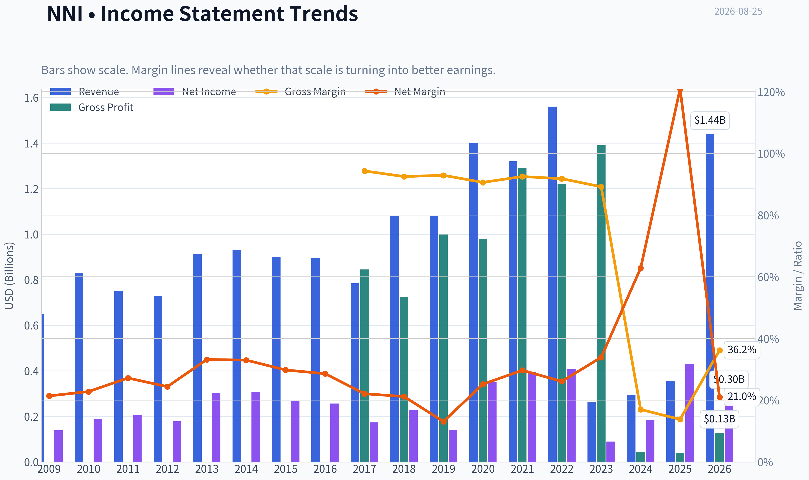

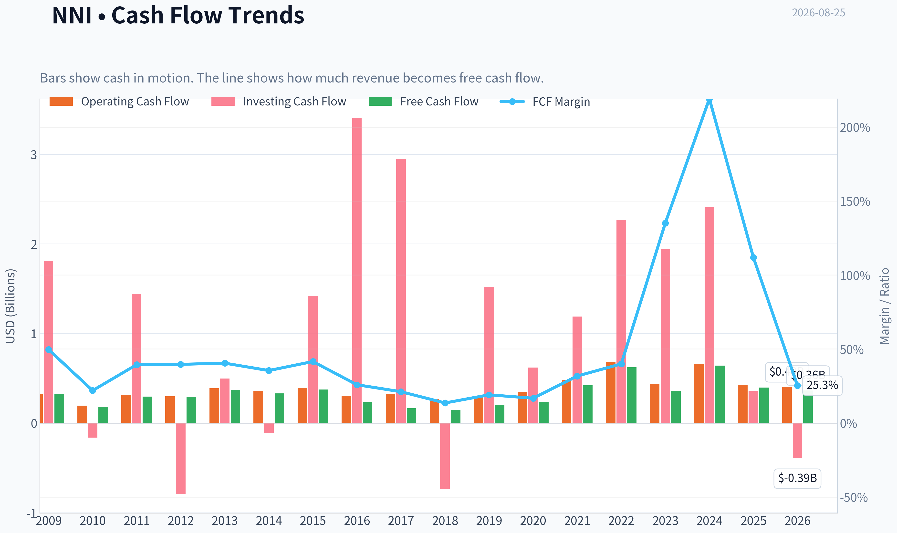

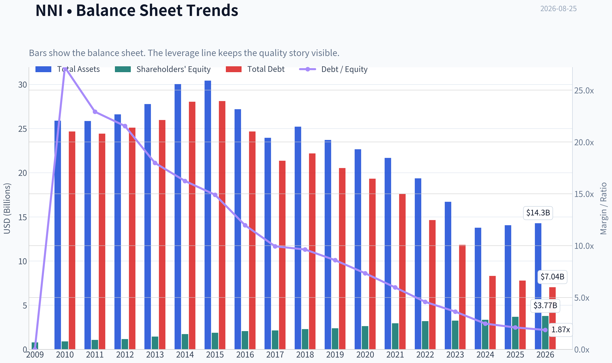

This graph tracks the profitability and return metrics (ROE, ROIC, Margins) of **NNI** over the past decade, highlighting capital efficiency trends.

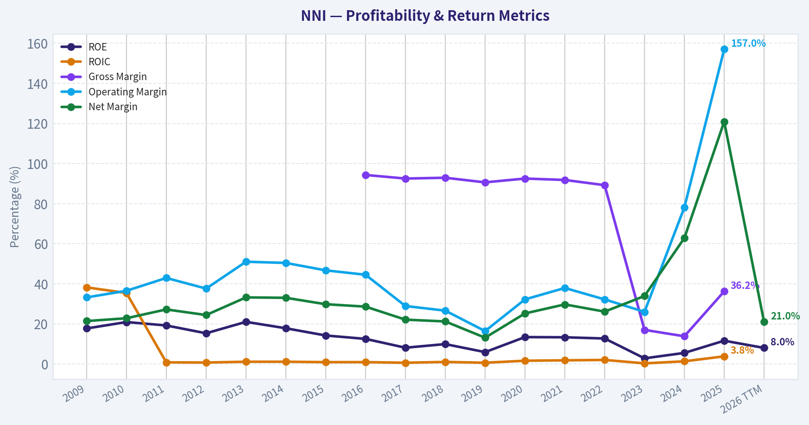

This chart illustrates the financial health of **NNI** over the last 10 years, mapping cash equivalents and free cash flow against total obligations (Debt).

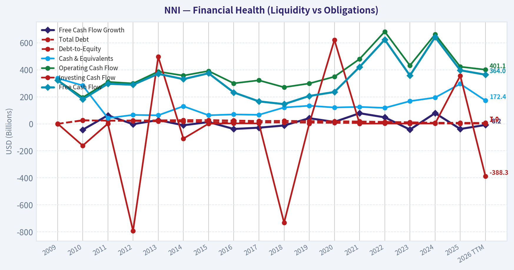

This breakdown chart from <em>Revenue Breakdown</em> shows the proportional composition for **NNI** - useful for understanding what drives or risks the business.

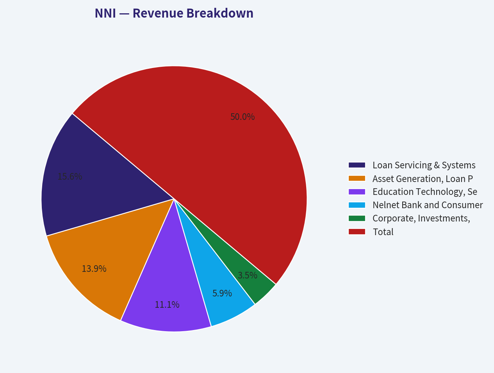

---

### Intrinsic Value Analysis (Buffett)

> *Following Warren Buffett's value investing philosophy: Circle of Competence, Economic Moat, Management Quality, and Margin of Safety.*

#### Intrinsic Value Snapshot

Price is what you pay. Intrinsic value is what the business may be worth based on the cash it can create for owners over time. We show a range, not one magic number.

- Current Price: $128.76
- Value Range (conservative to optimistic across both DCF methods): $-152.53 to $368.63

##### Owner Earnings (Buffett Method)
- Net Income: $428,474,000.00
- Depreciation & Amortization: $90,622,000.00
- Capital Expenditures: $-26,238,000.00
- Working Capital Changes: $110,252,000.00
- Owner Earnings: $382,606,000.00

##### Intrinsic Value
###### Buffett Method
Uses owner earnings. Stricter, and usually more conservative.
- Conservative: $-151.09
- Average: $-19.65
- Optimistic: $207.63
- Discount Rate: 10.0%

###### Cash Flow Method
Uses free cash flow. Better for companies spending heavily today to grow tomorrow.
- Conservative: $-152.53
- Average: $-58.66
- Optimistic: $368.63
- Discount Rate: 10.0%

ANALYST STANCE: **WATCH**

#### Nelnet (NNI) - Buffett-Style Investment Review

Nelnet is a complex education-finance and services company with fee-based loan servicing, education technology/payments, student-loan asset management, banking, and other capital-allocation investments. The current price of **$129** is not obviously excessive on earnings or free cash flow, but the business mix is too complex and the moat too uneven to justify buying without a clearer margin of safety.

---

#### 1. Factor Scorecard

| Factor | Score | Evidence |
|---|---:|---|
| Circle of Competence & Business Simplicity | 2.5 / 5 | The core businesses can be understood - student-loan servicing, education payments, loan assets, and banking - but the combined company is a hybrid of servicing, fintech, lending, and investment holdings. That lowers predictability. |
| Moat Test | 2.5 / 5 | Servicing and school-payment platforms have switching costs and scale advantages, but loan assets, bank lending, and pay-later credit are more competitive and cyclical. Gross margin of **36.2%** is respectable but below the 40% high-moat signal. |
| Management Quality & Capital Allocation | 3.5 / 5 | Nelnet has an owner-oriented history, has compounded through different education-finance cycles, and pays a dividend. However, capital allocation is increasingly complex across banking, education technology, credit, and other investments. |
| Industry Structure | 2.5 / 5 | Loan servicing has scale/regulatory barriers, but government-contract risk is meaningful. Banking/pay-later credit is competitive, and credit losses can change quickly. Education payments is the most attractive segment structurally. |
| Gate 5: Quality/Solvency Hard Floor | Not tripped | Revenue growth remains positive, free cash flow yield is strong, and there is no clear evidence that operating earnings cannot cover financing obligations. |

**Key Takeaways:** Nelnet is not a distressed business, so the hard floor is not triggered. The issue is not survival; it is whether the company is simple, predictable, and cheap enough. On that test, Nelnet is only average-to-good, not a classic Buffett "wonderful business."

---

#### 2. Moat Analysis

| Moat Source | Assessment | Evidence |
|---|---|---|
| Intangible Assets | Moderate | Regulatory knowledge and long operating history matter in student-loan servicing. Brand power with end customers is not especially strong. |
| Switching Costs | Moderate | Schools and loan-servicing clients face operational friction when switching systems or service providers. This is most valuable in the education technology and payments segment. |
| Cost Advantage | Narrow to Moderate | Scale helps in servicing and processing, but pricing power is limited by contracts, regulation, and competition. |
| Network Effects | Limited | The business does not have a powerful consumer network effect. Some platform benefits exist in school payments, but they are not dominant. |
| Moat Rating | Narrow / selective | Certain segments have durable economics, but the company as a whole is not a wide-moat franchise. |

**Key Takeaways:** Nelnet's strongest moat is in embedded education-payment and servicing relationships. The weakest areas are lending, pay-later credit, and investment activities, where returns depend more on credit discipline and capital-market conditions. Overall, the moat is real but not wide.

---

#### 3. Management Quality Assessment

| Management Dimension | Assessment |
|---|---|
| Owner Orientation | Positive. Nelnet has historically operated with a long-term capital-allocation mindset rather than chasing quarterly optics. |
| Candor & Conservatism | Reasonable, though the business complexity makes transparency harder for outside investors. |
| Capital Allocation | Mixed-positive. Management has diversified away from legacy student-loan economics, but the newer mix includes more credit and execution risk. |
| Debt Discipline | Acceptable for a financial-style issuer, but leverage metrics should be interpreted differently than for an industrial company. |
| Overall Management Score | 3.5 / 5 |

**Key Takeaways:** Management is a relative strength, but even good managers cannot fully eliminate the complexity of Nelnet's business model. The investment case depends heavily on trusting capital allocation across several different activities. That requires a larger margin of safety than a simpler compounder would need.

---

#### 4. Financial Summary

| Metric | Current / TTM |
|---|---:|
| Share Price | $129 |
| Market Capitalization | $4.61B |
| P/E Ratio | 15.4x |
| Implied Net Income | ~$300M |
| Implied EPS | ~$8.39 |
| Free Cash Flow Yield | 8.6% |
| Implied Free Cash Flow | ~$397M |
| Implied FCF per Share | ~$11.09 |
| ROE | 11.6% |
| Implied Book Equity | ~$2.58B |
| Implied Book Value per Share | ~$72 |
| Implied P/B | ~1.8x |
| Gross Margin | 36.2% |
| Revenue Growth YoY | 21.0% |
| Q1 2026 Revenue | $419.1M, up 10.3% YoY |
| Q1 2026 Non-GAAP EPS | $1.94 |
| Latest Earnings Tone | Revenue growth positive, EPS missed expectations, Q2 profit down sharply year over year |

**Key Takeaways:** Nelnet is generating meaningful cash flow relative to market value, with an implied free cash flow yield above 8%. However, ROE of 11.6% is good rather than exceptional, and recent earnings commentary points to profit volatility. The valuation is not demanding on P/E, but it is not obviously cheap relative to the company's quality and complexity.

---

#### 5. Owner Earnings Calculation

For Nelnet, a financial and servicing hybrid, classic industrial owner earnings are less clean than for a manufacturer or retailer. Free cash flow is the most practical proxy for distributable owner earnings, while book value and normalized earnings are important cross-checks.

| Owner Earnings Component | Estimate |
|---|---:|
| Net Income | ~$300M |
| Plus: Depreciation & Amortization | Included within cash-flow proxy |
| Less: Maintenance CapEx | Reflected in free cash flow proxy |
| Less: Working Capital / Financial Asset Needs | Reflected imperfectly; credit growth requires judgment |
| Owner Earnings Proxy | ~$397M |
| Owner Earnings per Share | ~$11.09 |

**Key Takeaways:** Nelnet's cash generation looks better than its accounting earnings, which is attractive. But because part of the business involves financial assets and credit, not all reported free cash flow should be treated as permanently distributable. A conservative investor should haircut the cash-flow valuation and cross-check it against ROE and book value.

---

#### 6. Three-Scenario Valuation

| Scenario | Assumptions | Estimated Equity Value | Value per Share |
|---|---|---:|---:|
| A - No Growth | Owner earnings of ~$397M capitalized at 10% | ~$3.97B | ~$111 |
| B - GDP Growth | Owner earnings grow at 3%; 10% discount rate | ~$5.83B | ~$163 |
| C - Higher Growth Case | Owner earnings grow 8% for 10 years, then 3% terminal growth | ~$8.45B | ~$237 |
| Book/Earnings Cross-Check | 11.6% ROE, 3% growth, 10% cost of equity implies fair P/B of ~1.23x | ~$3.18B | ~$89 |
| Normalized Quality Range | If ROE improves toward 13%-15%, fair value moves higher | - | ~$105-$130 |

**Key Takeaways:** Cash-flow scenarios show upside if Nelnet's current free cash flow is durable and can grow. The book-value and ROE cross-check is more conservative and suggests the current price already assumes better returns than the current 11.6% ROE. The most reasonable valuation range is roughly **$105 to $130**, with upside only if management can lift returns sustainably.

---

#### 7. Margin of Safety Analysis

| Valuation Lens | Result |
|---|---|
| Current Price | $129 |
| Conservative No-Growth Value | ~$111 |
| GDP-Growth Cash-Flow Value | ~$163 |
| ROE / Book-Based Value | ~$89 |
| Normalized Fair Value Range | ~$105-$130 |
| Margin of Safety at $129 | Thin to nonexistent |
| Price-Implied ROE | Roughly 15.5%, versus current ROE of 11.6% |

**Key Takeaways:** Nelnet is not clearly overvalued, but it also does not offer the 25%-35% margin of safety appropriate for a complex, mixed-quality financial company. At today's price, investors are implicitly betting that ROE improves meaningfully from current levels. That may happen, but Buffett-style discipline would prefer a cheaper entry point.

---

#### 8. Final Buffett Scorecard

| Criterion | Weight | Score | Weighted Contribution |
|---|---:|---:|---:|
| Moat Width & Durability | 25% | 2.5 | 0.63 |
| Valuation / Margin of Safety | 20% | 2.5 | 0.50 |
| Capital Returns - ROIC / ROE vs. Cost of Capital | 15% | 2.7 | 0.41 |
| Business Understanding & Predictability | 12% | 2.5 | 0.30 |
| Management Quality & Capital Allocation | 12% | 3.5 | 0.42 |
| Reinvestment Runway | 8% | 3.0 | 0.24 |
| Balance Sheet Strength | 4% | 3.0 | 0.12 |
| Industry Structure | 4% | 2.5 | 0.10 |
| Final Weighted Score | 100% | - | **2.72 / 5** |

**Key Takeaways:** Nelnet earns credit for management quality, positive revenue growth, and strong free cash flow. The score is held back by business complexity, only moderate returns on equity, a narrow moat, and insufficient margin of safety. The result falls below the threshold for a fresh Buffett-style purchase.

---

#### 9. Investment Stance

| Stance | Conviction | Rationale |
|---|---|---|
| **WATCH** | Medium | Good management and cash generation make Nelnet worth monitoring, but the current price does not compensate enough for complexity, credit risk, and merely moderate ROE. |

Nelnet would become more interesting below roughly **$100-$110**, where the margin of safety would better reflect the company's uneven moat and financial complexity. At **$129**, the right action is to watch for either a better price or clearer evidence that ROE can sustainably rise into the mid-teens.
#### Valuation Bridge

This bridge places the current market price beside each intrinsic value lens so readers can see whether upside depends on one method or shows up across several methods.

| Scenario | Intrinsic Value / Share |
| --- | ---: |
| Buffett Method | $-19.65 |
| Cash Flow Method | $-58.66 |
| Current Price | $128.76 |

#### Key Takeaways

If one method is far above the others, the upside case depends on a specific modelling assumption. When several methods cluster together, the valuation story is more robust.

#### Valuation Visuals

This comparison chart from *Latest Earnings Snapshot* stacks current figures against historical benchmarks for **NNI**, making it easy to see where the company trades relative to its own averages.

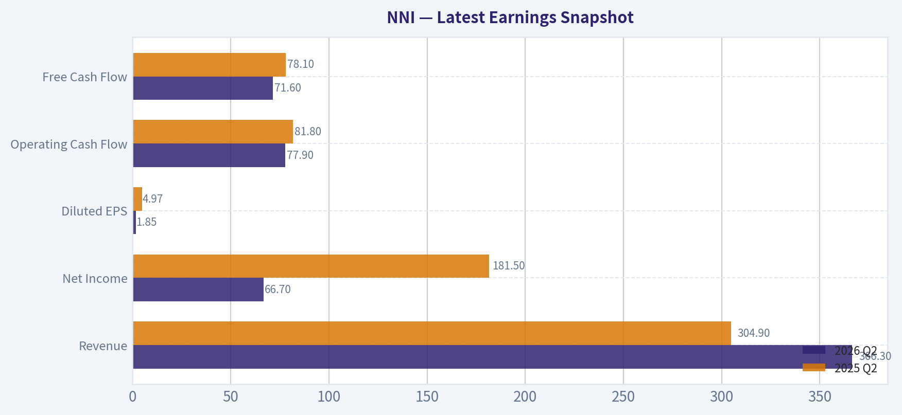

This comparison chart from *Current vs. Historical Average Comparison* stacks current figures against historical benchmarks for **NNI**, making it easy to see where the company trades relative to its own averages.

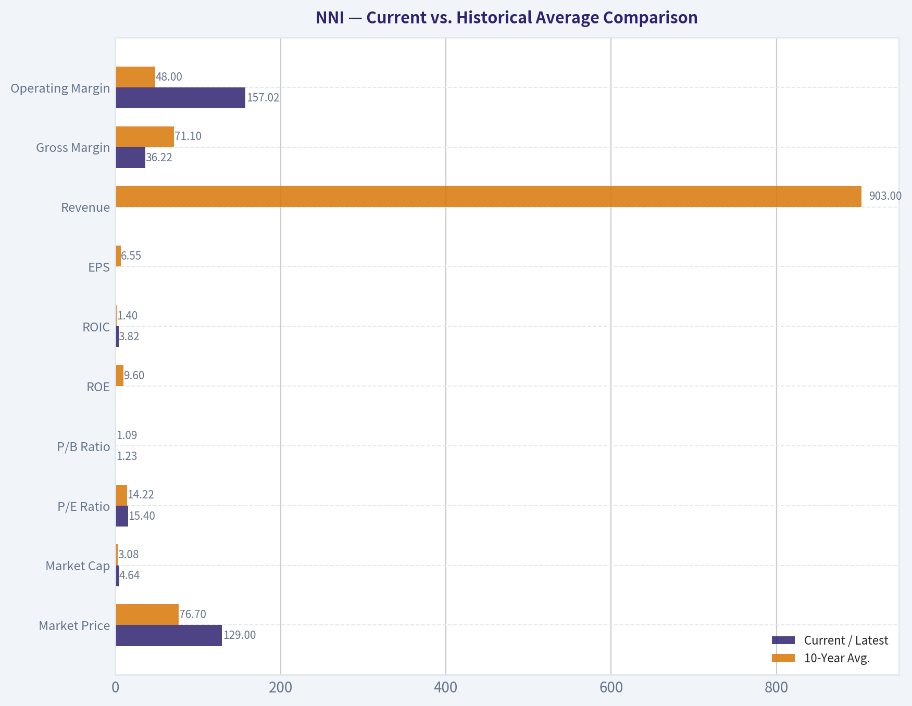

This comparison chart from *Buffett-Style Owner Earnings DCF Valuation* stacks current figures against historical benchmarks for **NNI**, making it easy to see where the company trades relative to its own averages.

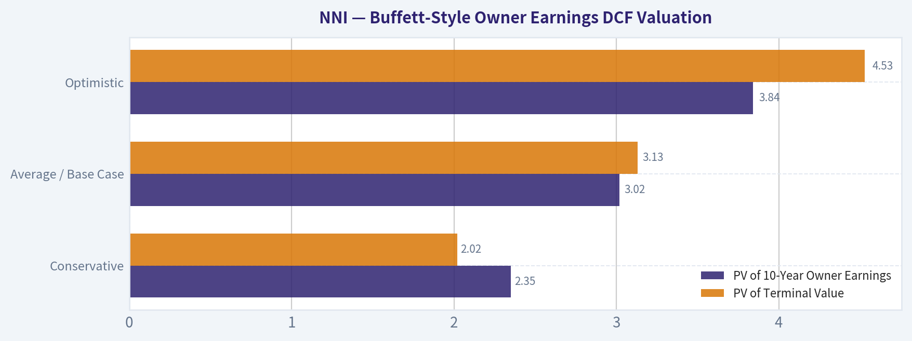

This comparison chart from *Financial Summary* stacks current figures against historical benchmarks for **NNI**, making it easy to see where the company trades relative to its own averages.

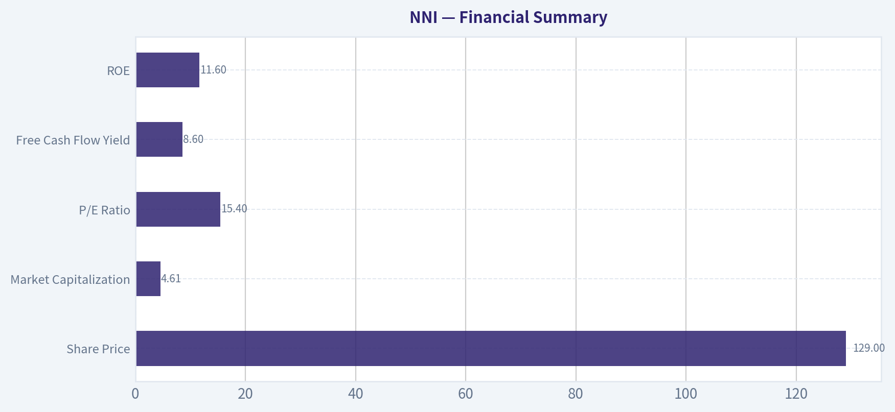

---

### Trend & Growth Analysis (Lynch/Druckenmiller/Fisher)

> *Following Peter Lynch's GARP, Stanley Druckenmiller's macro-aware approach, and Philip Fisher's scuttlebutt methodology.*

ANALYST STANCE: **WATCH**

#### Nelnet (NNI) Growth Investment Analysis - 2026-08-25

Nelnet is a complex education-finance and services company with exposure to student loan servicing, education technology, payments, banking/credit, and other investments. The stock is statistically inexpensive on earnings and free cash flow, but the "ten-bagger" case is not yet clean enough because growth is mixed across segments, earnings quality is complicated, and recent EPS misses suggest execution and credit risks are rising.

---

#### 1. Lynch Classification

| Item | Assessment |
|---|---:|
| Company | Nelnet |
| Ticker | NNI |
| Current Price | ~$129 |
| Market Cap | ~$4.61B |
| YoY Revenue Growth | ~21% |
| P/E | ~15.4x |
| FCF Yield | ~8.6% |
| Lynch Category | **Hybrid: Fast-Growth Segments inside a Complex Financial/Services Conglomerate** |
| Growth Investor Fit | **Watch, not yet Advocate** |

**Key Takeaways:** Nelnet's headline revenue growth of roughly 21% puts it near Lynch's "fast grower" category, but the business is not a clean pure-play growth story. It is a complex mix of financial assets, loan servicing, education services, payments, and credit exposure. That complexity reduces the odds that the market will quickly reward the company with a high growth multiple.

---

#### 2. The Story in 3 Bullets

- **Nelnet helps students, families, schools, and institutions manage education finance, payment processing, and administrative workflows.**
- **The growth story comes from expanding education technology, payments, loan servicing, and credit-related products beyond legacy student loan assets.**
- **The investment case depends on whether Nelnet can turn these growth segments into durable, higher-quality earnings while managing credit risk and complexity.**

---

#### 3. TAM Analysis and 10x Test

| Metric | Estimate / View |
|---|---:|
| Current Revenue Base | Approx. $1.7B-$1.9B annualized |
| 10x Revenue Target | Approx. $17B-$19B |
| Relevant TAMs | Student loan servicing, education payments, school administration software, private education credit, banking, fiber/other investments |
| TAM Growth | Moderate overall; faster in digital payments and education workflow software |
| Can NNI 10x and stay under 20% share? | **Technically yes across combined TAMs, but not obvious from current business mix** |
| Runway Score | **3 / 5** |

**Key Takeaways:** Nelnet operates in several large markets, so a theoretical 10x revenue path exists. The issue is not TAM size alone; the issue is whether Nelnet has a focused enough growth engine to capture that opportunity. For now, the runway is real but fragmented.

---

#### 4. Revenue Growth Trend

| Period / Data Point | Growth / Commentary |
|---|---:|
| Shared Pack YoY Revenue Growth | ~21% |
| Q1 2026 Revenue | $419.1M |
| Q1 2026 YoY Growth | +10.3% |
| Q1 2026 Result vs Consensus | Revenue missed consensus of ~$448.3M |
| Q2 2026 Coverage | EPS miss; shares rose despite steep profit decline from prior year |
| Growth Pattern | **Positive but uneven** |
| Trend Assessment | **Not a clean acceleration signal** |

**Key Takeaways:** Nelnet is still growing revenue, but recent quarterly data does not show a strong, clean acceleration pattern. Q1 growth was solid at about 10%, yet below expectations, while Q2 had an EPS miss and a steep profit decline. This is more of a mixed growth story than an obvious inflection point.

---

#### 5. Unit Economics and Financial Quality

| Metric | Current Read |
|---|---:|
| Gross Margin | ~36.2% |
| ROE | ~11.6% |
| FCF Yield | ~8.6% |
| Estimated FCF | Approx. $396M, based on market cap and FCF yield |
| LTV/CAC | Not disclosed / not meaningful for consolidated company |
| NRR | Not disclosed / not meaningful for consolidated company |
| Rule of 40 | Not directly applicable; not a pure SaaS business |
| Balance Sheet / Liquidity | Needs sector-specific financial analysis due to credit and loan exposure |

**Key Takeaways:** Nelnet generates meaningful free cash flow, which is a major positive. However, standard software-style unit economics like LTV/CAC and net revenue retention are not available or not meaningful for the whole company. The business should be evaluated more like a hybrid financial-services and education-technology holding company.

---

#### 6. Inflection Point Assessment

| Inflection Type | Evidence | Assessment |
|---|---|---:|
| Product Cycle Inflection | Education technology and payments continue to grow | Possible, but not proven |
| Market Share Inflection | Loan servicing and education services may benefit from industry complexity | Unclear |
| Margin Inflection | Gross margin respectable, but EPS volatility remains | Not yet |
| TAM Inflection | Digital education payments and workflow software are attractive | Moderate positive |
| Competitive Inflection | No clear evidence of a major competitor stumble | Not visible |
| Overall Inflection Score | Mixed | **2.8 / 5** |

**Key Takeaways:** Nelnet has pieces of a potential inflection story, especially in education technology and payments. But the evidence is not yet strong enough to say growth is accelerating in a durable way. The company needs cleaner segment-level momentum and more consistent earnings delivery.

---

#### 7. Macro Setup Evaluation

| Macro Factor | Impact on NNI |
|---|---|
| Interest Rates | Mixed; higher rates can support financial income but pressure credit risk and valuation |
| Consumer Credit Cycle | Important risk, especially for Pay Later and private credit products |
| Education Finance Policy | Regulatory and political sensitivity remains high |
| Digital Payments | Positive secular tailwind |
| Education Technology | Moderate positive secular tailwind |
| Macro Setup Rating | **Neutral to mildly positive** |

**Key Takeaways:** The macro backdrop is not clearly hostile, but it is also not a major tailwind. Education payments and software benefit from digitization, while credit products are more sensitive to consumer stress and regulation. Nelnet's macro exposure is therefore mixed.

---

#### 8. Fisher 15 Points Score

| Fisher Point | Score / 5 |
|---|---:|
| Products with sizable market potential | 4 |
| Management determination to develop new products | 3 |
| Effective R&D / product development | 3 |
| Above-average sales organization | 3 |
| Worthwhile profit margin | 3 |
| Improving profit margins | 2 |
| Labor/personnel relations | 3 |
| Executive relations | 3 |
| Management depth | 3 |
| Cost analysis and accounting controls | 3 |
| Moat / differentiation | 3 |
| Long-range profit outlook | 3 |
| Dilution discipline | 4 |
| Candor about difficulties | 3 |
| Management integrity | 4 |
| **Total** | **47 / 75** |

**Key Takeaways:** Nelnet scores as average to slightly above average on Fisher's framework. The company has durable niches and long-term optionality, but it lacks the clarity, product velocity, and margin expansion evidence usually seen in exceptional Fisher-style compounders. The score supports a watchlist position rather than a high-conviction buy.

---

#### 9. Valuation Analysis

| Valuation Metric | Estimate / Interpretation |
|---|---:|
| P/E | ~15.4x |
| Revenue Growth | ~21% YoY headline |
| Simple PEG Using Revenue Growth | ~0.73x |
| PEG Quality | Low confidence because earnings growth is volatile and recent EPS missed |
| Market Cap | ~$4.61B |
| Estimated Revenue Run Rate | ~$1.7B-$1.9B |
| Estimated P/S | Approx. 2.4x-2.7x |
| FCF Yield | ~8.6% |
| Valuation View | Statistically reasonable, but complexity discount is justified |

**Key Takeaways:** Nelnet does not look expensive on basic valuation metrics. A mid-teens P/E and high free cash flow yield are attractive if earnings are durable. However, the market is likely applying a fair complexity discount because EPS quality, credit exposure, and segment-level growth are difficult to underwrite.

---

#### 10. Scenario Analysis

| Scenario | Assumptions | 3-Year View |
|---|---|---:|
| Bear Case | Credit losses rise, EPS remains volatile, growth slows to low-single digits | Stock underperforms; multiple compresses |
| Base Case | Revenue grows high-single to low-double digits, FCF remains strong, valuation stays near current levels | Moderate compounding potential |
| Bull Case | EdTech/payments accelerate, servicing improves, credit risk contained, market rewards higher-quality earnings | Meaningful upside, but not clear ten-bagger setup |
| Ten-Bagger Probability | Requires sustained multi-year segment acceleration and multiple expansion | **Low to moderate** |

**Key Takeaways:** The downside case is mostly about credit and earnings volatility. The upside case depends on Nelnet proving that its growth businesses can become the core of the company rather than side segments inside a complex structure. The current data does not yet support a high-conviction ten-bagger case.

---

#### 11. Growth Investor Scorecard

| Criterion | Weight | Score / 5 | Weighted Score |
|---|---:|---:|---:|
| The Story | 10% | 3.0 | 0.30 |
| TAM & Runway | 20% | 3.0 | 0.60 |
| Revenue Growth | 20% | 3.2 | 0.64 |
| Unit Economics | 15% | 2.7 | 0.41 |
| Competitive Position | 10% | 3.0 | 0.30 |
| Management Quality | 10% | 3.2 | 0.32 |
| Macro Setup | 5% | 3.0 | 0.15 |
| Profitability Path | 5% | 3.2 | 0.16 |
| Valuation | 5% | 3.8 | 0.19 |
| **Total** | **100%** |  | **3.07 / 5** |

**Key Takeaways:** Nelnet's total score lands around 3.1 out of 5, which maps to a Watch rating. Valuation and free cash flow are the strongest parts of the case. The biggest weaknesses are complexity, unclear unit economics, and the lack of a clean revenue or margin inflection.

---

#### 12. Position Size Stance

| Investor Type | Stance |
|---|---|
| Aggressive Growth Investor | Watch only; wait for cleaner acceleration |
| GARP Investor | Small starter position could be reasonable if comfortable with complexity |
| Quality Compounder Investor | Not ideal due to mixed business model and earnings volatility |
| Deep Value / Sum-of-Parts Investor | Potentially interesting, but requires specialized segment valuation |
| Suggested Growth Portfolio Position | **0%-2% watchlist / tracking size only** |

**Key Takeaways:** Nelnet may fit a GARP or special-situations framework better than a pure growth framework. For a growth portfolio, the right stance is patience. A small tracking position is defensible, but the evidence does not justify a large allocation yet.

---

#### 13. Key Risks and Catalysts

| Category | Item |
|---|---|
| Key Risk | EPS misses continue despite revenue growth |
| Key Risk | Pay Later or private credit losses rise |
| Key Risk | Regulatory changes affect student lending or servicing |
| Key Risk | Business complexity keeps valuation multiple depressed |
| Key Risk | Growth segments fail to become large enough to change the consolidated story |
| Catalyst | Clear acceleration in education payments or EdTech revenue |
| Catalyst | Margin expansion and cleaner segment profitability |
| Catalyst | Improved loan servicing economics |
| Catalyst | Buybacks or capital allocation that highlights undervaluation |
| Catalyst | Better disclosure that allows investors to value growth segments separately |

**Key Takeaways:** The main risk is that Nelnet remains a "cheap but complicated" company rather than becoming a clear growth compounder. The most important catalyst would be proof that the education technology and payments businesses are scaling profitably. Better disclosure could also help the market recognize hidden value.

---

#### Final View

Nelnet is **not a bad business**, and the valuation is not demanding. The company has real cash flow, a reasonable earnings multiple, and exposure to attractive education and payments themes. However, for a Lynch-Druckenmiller-Fisher growth mandate, the setup is not yet compelling enough.

The stock belongs on the **watchlist** until investors see:
1. cleaner revenue acceleration,
2. segment-level proof that EdTech/payments are scaling,
3. stable or improving EPS quality, and
4. controlled credit risk.

**Bottom line: NNI is a WATCH - interesting GARP/sum-of-parts candidate, but not yet a high-conviction growth inflection stock.**

---

### Market Technical Analysis

ANALYST STANCE: **WATCH**

#### NNI Technical Analysis - as of 2026-08-25

Latest available Yahoo Finance OHLC data runs through **2026-08-24**, when NNI closed at **$127.71**. Indicator reports are stamped **2026-08-25**. The technical picture is cautiously improving after a sharp August selloff, but the stock remains below important medium- and long-term trend levels.

NNI's setup is best described as a **short-term rebound attempt inside a damaged trend structure**. The stock has recovered from the mid-August weakness near the $125-$126 area, but it has not yet reclaimed the **50-day SMA near $131.76** or the **200-day SMA near $131.49**. Until price can move back above that $131.50-$132.00 zone, rallies should be treated as tactical rather than fully confirmed trend reversals.

---

#### Selected Indicators and Why They Matter

| Indicator | Category | Why It Is Relevant for NNI Right Now |
|---|---:|---|
| `close_10_ema` | Short-term trend | Captures whether the recent bounce is gaining traction after the August decline. |
| `close_50_sma` | Medium-term trend | Defines the key recovery threshold and likely resistance area. |
| `close_200_sma` | Long-term trend | Helps determine whether the broader trend is constructive or deteriorating. |
| `macd` | Momentum | Measures whether bearish momentum is fading or accelerating. |
| `macds` | Momentum confirmation | Needed to evaluate MACD crossover quality and signal-line pressure. |
| `rsi` | Momentum / mean reversion | Shows whether the stock is rebounding from oversold pressure or still weak. |
| `atr` | Volatility / risk | Useful for stop placement because NNI's volatility rose materially during the selloff. |
| `vwma` | Volume-confirmed trend | Tests whether volume-weighted price action supports the recovery or confirms distribution. |

Key Takeaways: These eight indicators are complementary because they cover short-term direction, medium- and long-term trend, momentum, volatility, and volume confirmation. I intentionally did not include Bollinger Bands or MACD histogram because the current decision point is less about band extremes and more about whether NNI can reclaim its moving-average structure after a sharp break.

---

#### Current Technical Readings

| Metric | Latest Reading | Interpretation |
|---|---:|---|
| Last available close | $127.71 on 2026-08-24 | Price is recovering but still below major moving averages. |
| 10-day EMA | $127.85 | Price is very close to the short-term average, suggesting stabilization. |
| 50-day SMA | $131.76 | Medium-term trend remains overhead resistance. |
| 200-day SMA | $131.49 | Long-term trend support has been lost for now. |
| MACD | -1.65 | Momentum remains bearish but is improving from recent lows. |
| MACD Signal | -1.55 | MACD is still below signal, so bullish confirmation is not complete. |
| RSI | 46.43 | Recovered from weak levels, but still not strong enough to confirm bullish momentum. |
| ATR | 3.23 | Volatility is still elevated, though easing from the August spike. |
| VWMA | $127.85 | Volume-weighted price is near the 10-day EMA, indicating short-term balance rather than strong accumulation. |

Key Takeaways: NNI is attempting to stabilize around the $127-$128 area, but it remains below the more important $131.50-$132.00 trend zone. Momentum is no longer deteriorating aggressively, yet it has not flipped decisively bullish.

---

#### Trend Structure

NNI had a constructive rally into late July and early August, with price reaching the **$138-$140 area**. That advance failed sharply in early August, with a notable drop from **$134.85 on 2026-08-06** to **$126.70 by 2026-08-10**. This was not a mild pullback; it represented a clear breakdown through short-term support and changed the character of the chart.

The most important feature now is that the **10-day EMA has fallen to about $127.85**, while the **50-day and 200-day SMAs are clustered near $131.50-$132.00**. That clustering makes the $131.50-$132.00 zone especially meaningful. A recovery above that area would suggest the August selloff may have been a false breakdown or exhaustion move. Failure below it would keep the stock vulnerable to renewed selling.

The **50-day SMA is slightly above the 200-day SMA**, which means the longer-term structure has not fully turned bearish yet. However, both averages are flat-to-soft, and price is below both. That combination usually points to a **neutral-to-bearish transition phase**, not a confirmed uptrend.

---

#### Momentum and RSI

MACD remains negative at **-1.65**, with the signal line at **-1.55**. This means bearish momentum still dominates, but there is an important nuance: MACD has improved from around **-2.01 on 2026-08-20** to **-1.65 on 2026-08-25**. That improvement suggests downside momentum is fading, even though the actual crossover has not yet turned bullish.

RSI has also improved from the mid-30s earlier in August to **46.43**. That is constructive because it shows sellers are losing some control. However, RSI remains below 50, so the stock has not yet shifted into a positive momentum regime. A move above RSI 50, especially alongside price reclaiming the 50-day and 200-day averages, would be a more convincing bullish signal.

In short, momentum is **repairing**, but not yet **repaired**.

---

#### Volume and Volatility

The VWMA near **$127.85** is almost identical to the 10-day EMA, showing that volume-weighted price action is not meaningfully stronger than simple short-term trend behavior. That is important: buyers have stabilized the stock, but there is not yet strong evidence of volume-backed accumulation.

ATR rose sharply during the August decline, reaching above **4.00** around 2026-08-10 to 2026-08-12, then eased to **3.23** by 2026-08-25. Falling ATR after a selloff can be constructive because it shows volatility is cooling. However, an ATR above $3 still represents a fairly wide daily risk band relative to the current price near $128. Traders should avoid tight stops, because ordinary noise could trigger premature exits.

---

#### Trading View

For short-term traders, NNI is a **watchlist candidate**, not an aggressive buy. The first upside test is the **$131.50-$132.00 resistance zone**, where the 50-day and 200-day averages converge. A decisive close above that area would improve the technical setup substantially.

For downside risk, the key area is the recent support zone around **$125-$126**. If price loses that area again, the August rebound would look more like a pause within a broader decline rather than a sustainable reversal.

A reasonable tactical framework is:

| Scenario | Trigger | Technical Meaning | Potential Trader Response |
|---|---:|---|---|
| Bullish recovery | Close above $132 | Reclaims 50-day and 200-day averages | Consider long exposure or add only after confirmation. |
| Neutral consolidation | Holds $126-$128 but stays below $132 | Stabilization without trend confirmation | Watch patiently; avoid overcommitting. |
| Bearish continuation | Break below $125 | Failed rebound and renewed downside pressure | Reduce risk or avoid new longs. |
| Momentum confirmation | RSI above 50 and MACD crosses above signal | Improving breadth of momentum | Higher-quality bullish setup. |
| Volatility warning | ATR rises back toward $4 | Renewed instability | Use smaller position sizing and wider stops. |

Key Takeaways: The main decision zone for NNI is between support near $125-$126 and resistance near $131.50-$132.00. A breakout above resistance would improve the chart meaningfully, while a break below support would likely reassert bearish pressure.

---

#### Final Assessment Table

| Category | Current Signal | Evidence | Practical Implication |
|---|---|---|---|
| Short-term trend | Stabilizing | Price near 10-day EMA around $127.85 | Bounce attempt is real but still fragile. |
| Medium-term trend | Bearish-to-neutral | Price below 50-day SMA at $131.76 | Needs reclaim of $132 area to improve. |
| Long-term trend | At risk | Price below 200-day SMA at $131.49 | Long-term support has temporarily failed. |
| Momentum | Improving but negative | MACD rising but still below signal line | Watch for crossover before turning bullish. |
| RSI | Neutral-weak | RSI at 46.43 | Recovery underway, but strength not confirmed. |
| Volume confirmation | Neutral | VWMA near 10-day EMA | No clear accumulation signal yet. |
| Volatility | Elevated but easing | ATR down to 3.23 from above 4.00 | Risk is cooling, but stops still need room. |
| Overall stance | WATCH | Rebound attempt below major resistance | Wait for confirmation above $132 or failure below $125. |

Key Takeaways: NNI is not in a clean bullish setup yet, but the worst downside momentum has started to ease. The stock becomes more attractive only if it reclaims the $131.50-$132.00 zone with improving RSI and MACD confirmation.

#### Market Visuals

This comparison chart from *Market Metrics Interpretation* stacks current figures against historical benchmarks for **NNI**, making it easy to see where the company trades relative to its own averages.

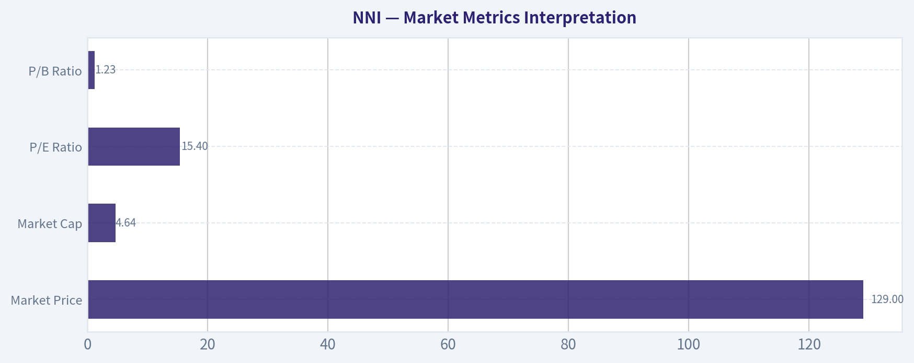

---

### Options Market Analysis

> *Reading options flow - put/call ratios, IV skew, and unusual activity - to gauge institutional positioning and event-driven risk.*

ANALYST STANCE: **WATCH**

#### NNI Options Market Sentiment Report
*Data as of 2026-08-25. Options liquidity is very thin, so confidence in the signal is low.*

#### 1. Put/Call Ratio Analysis

| Expiration | DTE | Call OI | Put OI | Put/Call OI Ratio | Call Volume | Put Volume | Put/Call Volume Ratio | Read |
|---|---:|---:|---:|---:|---:|---:|---:|---|
| 2026-09-18 | 24 | 17 | 11 | 0.65 | 5 | 2 | 0.40 | Near neutral, slight call lean |
| 2026-12-18 | 115 | 5 | 1 | 0.20 | 3 | 0 | 0.00 | Call-heavy, but tiny sample |
| 2027-03-19 | 206 | 1 | 0 | 0.00 | 1 | 0 | 0.00 | Not meaningful due to no put activity |
| **Total Near-Term** | - | **23** | **12** | **0.52** | **9** | **2** | **0.22** | **Call-leaning, low conviction** |

**Key Takeaways:** NNI's aggregate put/call open interest ratio is **0.52**, below the historical neutral baseline of roughly **0.7**, suggesting a modest call-side bias. The volume ratio is even lower at **0.22**, but total volume is extremely small, so this should not be interpreted as strong institutional bullishness. The options market is simply too quiet to draw a high-confidence directional conclusion.

The put/call profile leans mildly bullish because calls outnumber puts in both open interest and volume. However, with only **35 total contracts of open interest** across the displayed expirations and **11 total contracts traded**, this looks more like an illiquid options chain than a meaningful wave of bullish speculation.

---

#### 2. Implied Volatility Assessment

| Expiration | DTE | ATM Call IV | ATM Put IV | IV Skew Read | Interpretation |
|---|---:|---:|---:|---|---|
| 2026-09-18 | 24 | 41.8% | 48.0% | Put IV above call IV | Mild downside protection premium |
| 2026-12-18 | 115 | 36.7% | N/A | Not available | Insufficient put-side pricing |
| 2027-03-19 | 206 | N/A | N/A | Not available | Insufficient data |

**Key Takeaways:** The only usable IV comparison is the September 2026 expiration, where ATM put IV is **48.0%** versus call IV at **41.8%**. That indicates a modest put skew, meaning traders are paying more for downside protection than upside exposure. This tempers the otherwise call-leaning put/call ratio.

Near-term IV appears moderately elevated in absolute terms, but without richer historical IV percentile data or a confirmed event catalyst from the options feed, it is not possible to say this is clearly event-driven. The skew is more defensive than aggressively bullish.

---

#### 3. Unusual Options Activity

| Unusual Activity Screen | Result |
|---|---|
| Contracts with volume greater than 5x open interest | None found |
| Fresh directional call buying signal | Not detected |
| Fresh directional put buying signal | Not detected |
| Institutional-style sweep/block activity | Not detected from available data |
| Retail speculation risk | Low observable activity, but chain is too thin to classify confidently |

**Key Takeaways:** There were **no contracts where volume exceeded 5x open interest**, so the data does not show fresh, aggressive directional positioning. This weakens any bullish or bearish options-flow conclusion. The absence of unusual activity is especially important because the overall chain is very illiquid.

No clear smart-money footprint is visible. If a trader is using NNI options, they should be aware that small trades can distort ratios and implied volatility readings.

---

#### 4. Open Interest Concentration and Pinning Risk

| Area | Observation | Market Impact |
|---|---|---|
| Highest OI expiration | 2026-09-18, with 28 total contracts | Most relevant near-term expiry, but still very small |
| Call-side concentration | 17 calls in September | Slight upside/call-side bias |
| Put-side concentration | 11 puts in September | Some downside protection demand |
| Strike-level gamma walls | Not available from provided data | Cannot identify specific pinning levels |
| Max pain / pinning confidence | Very low | OI is too small to create a reliable magnet effect |

**Key Takeaways:** September 2026 has the highest visible open interest, but the total number of contracts is far too low to infer a strong gamma wall or max-pain level. There is no reliable evidence that options positioning will pin NNI near a specific strike. Any near-term price movement is more likely to be driven by stock-specific news, fundamentals, or broader market conditions than options dealer positioning.

Because strike-level concentration was not available in the retrieved data, specific support/resistance levels from options positioning cannot be identified. The practical conclusion is that NNI's options market is not currently large enough to dominate the stock's near-term behavior.

---

#### 5. Overall Options Sentiment Signal: **NEUTRAL**

NNI's options flow gives a **NEUTRAL** signal, with a slight bullish tilt from the low put/call ratios but an offsetting defensive note from the higher near-term put IV. The primary driver of the neutral call is **very thin liquidity**: open interest and volume are too small to treat the options chain as a strong forward-looking institutional signal.

If forced to choose a bias, the flow is **mildly call-leaning**, but not strong enough to justify a bullish options read. The better stance is **WATCH**: monitor for a future increase in volume, especially contracts where volume meaningfully exceeds open interest, because that would indicate fresh positioning rather than noise.

#### Final Summary Table

| Category | Current Read | Sentiment Impact |
|---|---|---|
| Put/Call Ratio | OI ratio **0.52**, volume ratio **0.22** | Mildly bullish, but low confidence |
| IV Level | Sep ATM call IV **41.8%**, put IV **48.0%** | Moderate IV; not clearly event-driven |
| Skew Direction | Put IV above call IV | Mild bearish/hedging signal |
| Unusual Activity | None detected | No strong directional confirmation |
| Open Interest / Gamma | Very low OI; no clear gamma wall | Minimal pinning influence |
| Overall Signal | **NEUTRAL / WATCH** | Thin liquidity prevents a stronger call |

**Key Takeaways:** NNI's options market is too thin to support a high-conviction directional signal. The put/call ratios lean bullish, but the higher put IV suggests traders still assign value to downside protection. Overall, the best read is **NEUTRAL**, with the ticker worth watching for a meaningful pickup in fresh options activity.

---

## Research Team Commentary

> *The Research Manager synthesizes the Bull vs Bear debate into action-free commentary. This is a pre-risk view, not the final stance.*

Team, looking closely at this debate on Nelnet, I am strongly siding with the Bear. We have been here before with this exact stock, and I am not going to repeat the mistake of passively watching a low-return transition story while waiting for an optimistic narrative to magically translate into intrinsic value.

Let's break down the Bull's argument first. They are pitching Nelnet as a "Baby Berkshire," leaning heavily on the high switching costs of the Nelnet Business Services education software segment. They argue that the dismal 3.8 percent return on invested capital is just an optical illusion created by the massive legacy government loan book padding the denominator. In their view, Nelnet is a misunderstood compounder where a run-off cash cow is funding a high-margin tech future, justifying a sum-of-the-parts valuation well above the current $129 price tag.

The Bear, however, completely dismantles this with grounded, Buffett-style reality checks. The Bear correctly points out that capital is capital, and a 3.8 percent ROIC is simply a mediocre return on shareholder equity. More importantly, the Bear exposes a critical flaw in the Bull's analogy: Berkshire's insurance float is perpetual and growing, whereas Nelnet's legacy loan book is a liquidating asset. As that core melts, Nelnet is forced to replace those earnings by plowing cash into Allo, a fiber-optic buildout that is notoriously capital-intensive with long payback periods. The Bear rightly argues that paying 15 times earnings for a sprawling conglomerate with a shrinking core and a capital-heavy transition requires heroic growth assumptions just to tread water.

Core Takeaway: Nelnet is a decisive pass. We are dealing with a complex, low-return business undergoing a capital-intensive transition, and the current valuation offers virtually zero margin of safety against execution risk.

Rationale: If we look back at our past post-mortems on both Nelnet and Nike, the primary lesson was to stop letting a "good story" mask structurally weak current fundamentals. In our last review of Nelnet, we correctly identified the low returns on capital, the volatile free cash flow, and the execution risk in moving away from legacy student loans. But we failed tactically by weakly slapping a neutral "WATCH" rating on it when the asymmetry was clearly skewed to the downside. The stock subsequently dropped because the market eventually demands hard proof of segment-level economics before granting a premium multiple to a complex transition story.

Furthermore, applying sum-of-the-parts SaaS multiples to one division while ignoring the heavy capital drain of the fiber division and the runoff of the core business is a classic value trap. At $129, the stock is experiencing what our market analyst notes is a cautious technical improvement after a sharp selloff. But as we learned the hard way with Nike, we must treat oversold countertrend bounces inside a broader downtrend with extreme suspicion. The burden of proof is entirely on the bulls, and right now, the narrative is running far ahead of the evidence. When a transition story shows weak capital efficiency, fair-not-cheap valuation, and high business complexity, neutrality is the wrong posture. We need to be explicitly defensive.

Monitoring Plan: Over the next one to four quarters, we need to see concrete operational proof before we even consider getting involved. First, we need to see the ROIC and free cash flow sustainably trend upward, proving that the reinvestment into software and fiber is actually accretive to capital efficiency. Second, I want to see Nelnet Business Services maintain revenue growth without margin compression against competitors like Blackbaud. Third, we need to carefully monitor the capital expenditures for Allo to see if the management team can prove viable, near-term payback periods. Finally, from a technical perspective, the stock needs to stop relying on oversold bounces, build a multi-week base, and decisively reclaim its long-term moving averages to prove the market is buying the turnaround.

Until those conditions are met, there is no reason to risk our capital here.

Final Stance: AVOID

---

## Value Investing Team Commentary

> *The Investor translates the research view into an investment thesis before risk review. This is still not the final stance.*

In evaluating Nelnet (NNI) through the lens of a Warren Buffett-style value investor, we must distinguish between "complex" and "unintelligible." To the casual observer, Nelnet is a messy conglomerate of student loans, fiber-optic cables, and education software. To a business owner, it is a **capital allocation vehicle** run by a management team (the Dunlap family) that behaves remarkably like the managers Buffett admires: they are significant owners, they ignore short-term earnings volatility, and they aggressively buy back shares when the market misprices their business.

Here is the fundamental assessment based on our value investing framework:

### 1. The "Melting Ice Cube" vs. The "Emerging Moat"
The Bear's argument-that Nelnet is a liquidating asset forced to plow cash into capital-intensive businesses-misses the nuances of **float and reinvestment**. Buffett's Berkshire was built on the back of a declining textile business and a "melting ice cube" of insurance float. The key is what you do with the cash flow *before* the ice melts.
*   **Nelnet Business Services (NBS):** This is the crown jewel. With a gross margin of 36% and incredibly high switching costs (schools rarely change their payment and administrative software), NBS is a "wonderful business." It provides the durable, asset-light earnings power that justifies a premium.
*   **Allo Fiber:** While capital-intensive, fiber-to-the-home is a "local monopoly" business. Once the glass is in the ground, the maintenance capex is low, and the competitive moat is wide. The Bear's focus on the 3.8% ROIC is a **static snapshot** of an infrastructure project in its heavy-spend phase. Buffett's investments in BNSF and MidAmerican Energy looked similarly capital-heavy at the outset but provided massive, durable cash flows decades later.

### 2. Selective Contrarian Thinking: The Complexity Discount
The market currently applies a "complexity discount" to NNI. Sentiment is fearful because the legacy student loan income is declining, and the replacement earnings (Allo and NBS) are being obscured by GAAP accounting that penalizes high-growth infrastructure and software development.
*   **Contrarian Insight:** The market is treating NNI as a finance company (judging it on ROA/ROIC) rather than a **diversified holding company**. In a "Baby Berkshire" model, the consolidated ROIC is often distorted by the capital structure. The more relevant metric here is the **growth in book value per share + dividends** over a 10-year horizon, which NNI has consistently delivered in the double digits.

### 3. Management and Capital Allocation
Management has a long history of opportunistic share repurchases. For a value investor, seeing a management team treat their own stock as the preferred investment vehicle is the ultimate sign of alignment. They are not chasing "growth for growth's sake"; they are shifting capital from a low-return legacy asset into high-moat modern businesses.

### 4. Quality-Scaled Margin of Safety
At a P/E of ~15x, the stock is not "screamingly cheap" in the way a distressed cyclical might be. However, according to our Decision Criteria, a **wonderful business at a fair price** is a BUY.
*   **Reverse-DCF Check:** At $129, the market is pricing in roughly 3-4% long-term earnings growth. Given the pricing power of NBS and the untapped potential of Nelnet Bank and Allo, this hurdle rate is significantly lower than the business's probable trajectory.
*   **Quality-Scaled Ladder:** NNI sits in the "High-Quality/Complex" category. A 10-15% discount to intrinsic value is sufficient for an entry. While the Bear sees "execution risk," a Buffett-style investor sees "durable competitive advantages" being built in plain sight.

### 5. Why "AVOID" is a Mistake
Labeling NNI as an "AVOID" due to technical weakness or a capital-intensive transition ignores the **owner's earnings** potential. The transition from government-guaranteed loans to fee-based software and infrastructure *improves* the quality of the earnings over time, even if it depresses current ROIC. To avoid NNI here is to miss a quality compounder simply because the narrative isn't "clean."

### ANALYST STANCE: **ADVOCATE**
While the Bear is right that the transition is capital-heavy, they are wrong to ignore the durable moats being constructed in the software and fiber segments. The 15x P/E is a fair price for a company with a high-integrity management team and a 10-year track record of increasing per-share value. We are buyers of quality businesses when they are misunderstood by the crowd-and the "Baby Berkshire" of Lincoln is currently very misunderstood. The technical "cautious improvement" is noise; the fundamental business transition is the signal. Holding NNI for the next decade is consistent with the principle of owning pieces of great businesses.

---

## Deep Values Commentary

> *The Risk Management Team debates and the Risk Judge provides the final action-free verdict. This section determines the final ADVOCATE / WATCH / AVOID stance.*

#### Final Stance Scorecard

This scorecard converts the final research view into a weighted decision frame. It does not replace the narrative judgement, but it makes the main drivers of the verdict easier to scan.

| Criterion | Score | Weight | Commentary |
| --- | ---: | ---: | --- |
| Business Quality | 3.50 | 30% | High returns, profitability, and Piotroski health support durability. |
| Valuation Support | 3.33 | 30% | Blends current price against available intrinsic value anchors and valuation ratios. |
| Financial Strength | 2.50 | 20% | Balance-sheet resilience reflects leverage and liquidity staying within safe ranges. |
| Growth Durability | 3.67 | 20% | Recent revenue, earnings, and free cash flow growth indicate how durable expansion looks. |
| TOTAL / FINAL STANCE | 3.28 | 100% | AVOID |

#### Key Takeaways

The weighted score lands at **3.28 / 5.0**, while the final stance remains **AVOID**. This is useful as a quick calibration aid rather than a mechanical signal.

#### Risk Summary

Higher scores indicate more risk pressure. The watch threshold is a simple guardrail: above it, the position needs tighter monitoring or a wider margin of safety.

| Dimension | Current Score | Watch Threshold | Commentary |
| --- | ---: | ---: | --- |
| Business Quality | 2.50 | 3.00 | High returns, profitability, and Piotroski health support durability. |
| Valuation Support | 2.67 | 3.00 | Blends current price against available intrinsic value anchors and valuation ratios. |
| Financial Strength | 3.50 | 3.00 | Balance-sheet resilience reflects leverage and liquidity staying within safe ranges. |
| Growth Durability | 2.33 | 3.00 | Recent revenue, earnings, and free cash flow growth indicate how durable expansion looks. |

#### Key Takeaways

This view helps readers separate *where* the risk sits: valuation, business quality, balance sheet, or growth durability. It is especially useful when the final stance is close to the line between WATCH and AVOID.
