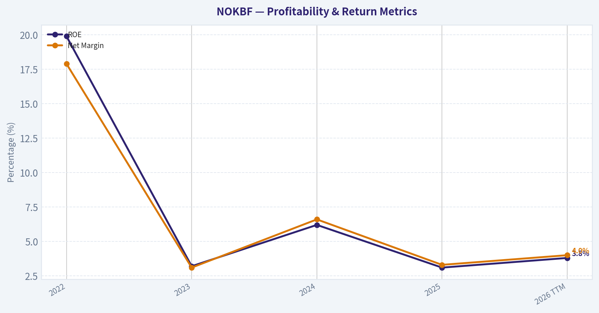
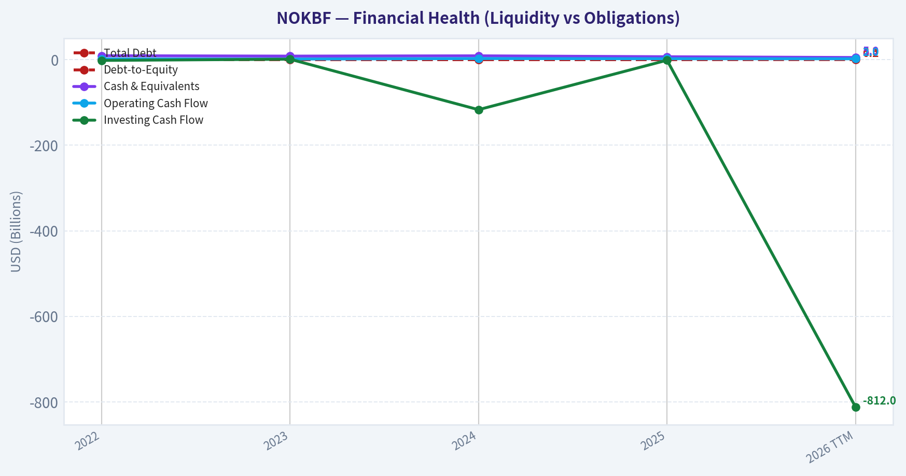
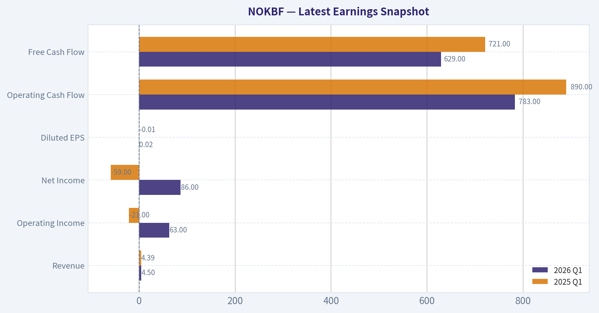
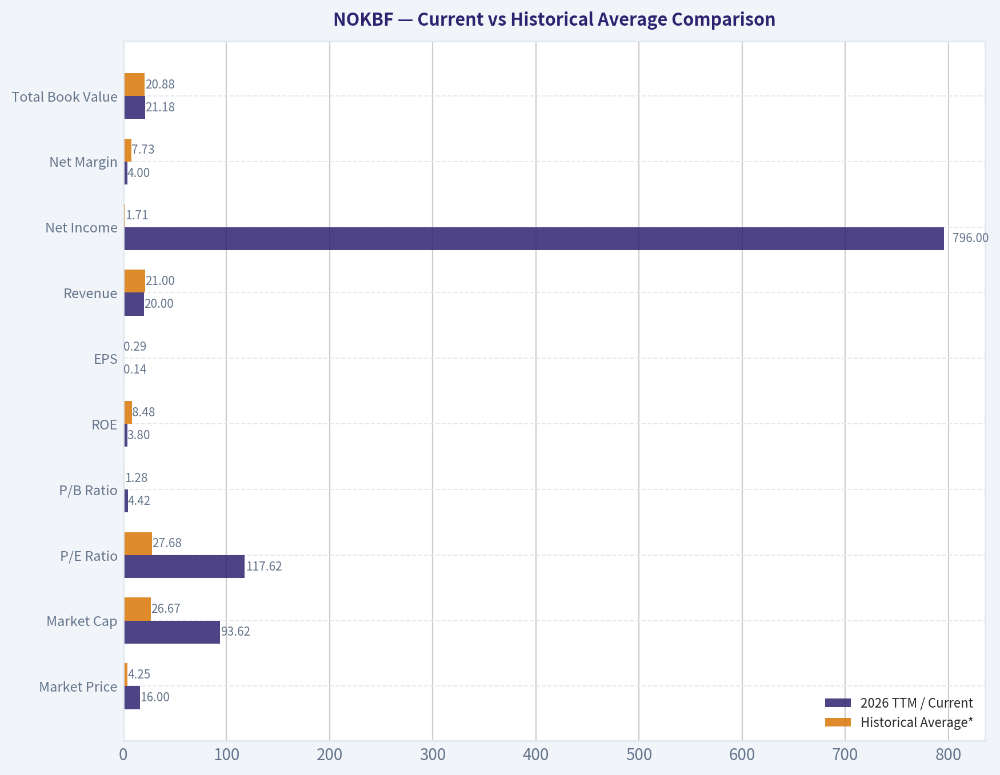
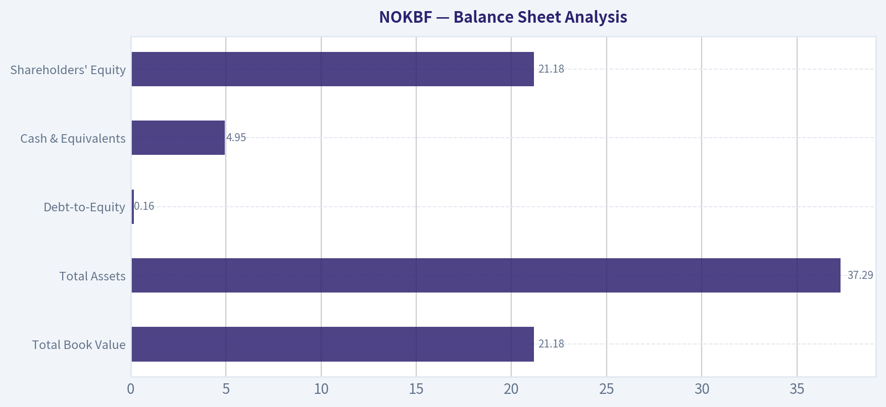
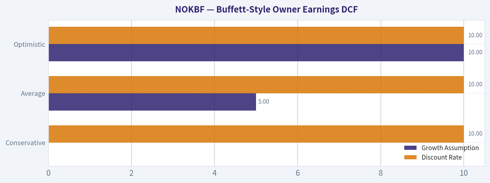
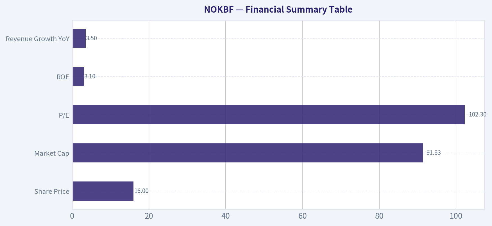

# NOKBF Deep Value Intelligence

**Analysis Date:** 2026-05-27

## Critical Disclaimer

*This analysis is generated by Deep Value Intelligence, an AI-powered multi-agent investing framework. This report is for informational and educational purposes only and does not constitute financial advice. Always conduct your own research and consult with qualified financial advisors before making investment decisions.*

---

## Table of Contents

1. Intelligence Summary
2. Analyst Team Reports
   - Fundamentals Analysis
   - Intrinsic Value Analysis (Buffett)
   - Trend & Growth Analysis (Lynch/Druckenmiller/Fisher)
   - Market Technical Analysis
   - Options Market Analysis
3. Research Team Commentary
4. Value Investing Team Commentary
5. Deep Values Commentary

---

## Intelligence Summary

### Thesis + Conditions

**Core Thesis:** ## Executive Briefing

**Key Risks:**
- Nokia is **not a Buffett-grade value buy today**, but it also does **not merit a hard AVOID** if approached with discipline. The bear case still wins on core business economics: **3.1% ROE, 3.5% growth, and a 102x P/E** do not show a proven moat or margin of safety. But unlike the original strict AVOID, the debate adds enough evidence of **possible early stabilization**-strategic network assets, improving price action, and plausible earnings normalization-that a **watchlist / small starter only** stance is more appropriate than outright dismissal.
- 102x earnings** offers no obvious margin of safety if normalization is delayed or never materializes.
- This is the strongest argument because Buffett-style risk is about **permanent business impairment or chronically poor economics**, not stock volatility. On that score, Nokia still looks unproven.

**Confidence:** Low

---

## Analyst Team Reports

### Fundamentals Analysis

#### Latest Earnings Snapshot

*Most recent reported quarter anchored on 2026 Q1, with prior-year comparison when available.*

| Metric | 2026 Q1 | 2025 Q1 | YoY Change |
| --- | ---: | ---: | ---: |
| Revenue | $4.50B | $4.39B | +2.4% |
| Operating Income | $63.0M | $-21.0M | +400.0% |
| Net Income | $86.0M | $-59.0M | +245.8% |
| Diluted EPS | $0.02 | $-0.01 | +300.0% |
| Operating Cash Flow | $783.0M | $890.0M | -12.0% |
| Free Cash Flow | $629.0M | $721.0M | -12.8% |

Key Takeaways: This snapshot anchors the most recent reported quarter before the narrative analysis. It helps readers separate long-run business quality from whatever changed in the latest earnings print.

#### 4-Year Financial Metrics for NOKBF

*All values below are computed deterministically from raw data - not estimated by AI.*

*Issuer profile: operating company (Technology / Communication Equipment).*

#### 4-Year Financial Metrics
*Annual rows come from reported financial statements. The final TTM row is computed from the latest four quarters.*

| Metric | 2022 | 2023 | 2024 | 2025 | 2026 TTM |
| --- | --- | --- | --- | --- | --- |
| Market Price | $4 | $3 | $4 | $6 | $16 |
| Market Cap | $26.19B | $18.86B | $24.55B | $37.09B | $93.62B |
| P/E Ratio | 6.16 | 28.36 | 19.23 | 56.98 | 117.62 |
| P/B Ratio | 1.23 | 0.92 | 1.19 | 1.77 | 4.42 |
| ROE | 19.9% | 3.2% | 6.2% | 3.1% | 3.8% |
| ROIC | N/A | N/A | N/A | N/A | 2.9% |
| EPS | $0.68 | $0.11 | $0.22 | $0.11 | $0.14 |
| Revenue | $23.76B | $21.14B | $19.22B | $19.89B | $20.00B |
| Gross Profit | N/A | N/A | N/A | N/A | $8.82B |
| Gross Margin | N/A | N/A | N/A | N/A | 44.1% |
| Operating Margin | N/A | N/A | N/A | N/A | 4.1% |
| Net Income | $4.25B | $665.0M | $1.28B | $651.0M | $796.0M |
| Net Margin | 17.9% | 3.1% | 6.6% | 3.3% | 4.0% |
| Revenue Growth | N/A | -11.0% | -9.1% | 3.5% | 0.5% |
| Net Income Growth | N/A | -84.4% | 92.0% | -49.0% | 22.3% |
| Free Cash Flow Growth | N/A | N/A | N/A | N/A | N/A |
| Total Book Value | $21.33B | $20.54B | $20.66B | $20.97B | $21.18B |
| Total Assets | N/A | N/A | N/A | N/A | $37.29B |
| Total Debt | $0 | $0 | $0 | $0 | $3.33B |
| Debt-to-Equity | 0.00 | 0.00 | 0.00 | 0.00 | 0.16 |
| Cash & Equivalents | $9.16B | $8.24B | $8.91B | $6.76B | $4.95B |
| Shareholders' Equity | $21.33B | $20.54B | $20.66B | $20.97B | $21.18B |
| Operating Cash Flow | $1.47B | $1.32B | $2.49B | $2.07B | $1.96B |
| Investing Cash Flow | $-1.88B | $1.04B | $-117.0M | $-1.40B | $-812.0M |
| Free Cash Flow | N/A | N/A | N/A | N/A | $1.37B |
| FCF Margin | N/A | N/A | N/A | N/A | 6.9% |
| Dividends / Share | $0.06 | $0.10 | $0.12 | $0.13 | $0.00 |

#### Profitability Metrics
- Return on Equity (ROE): 3.1%
- Return on Invested Capital (ROIC): N/A
- Return on Assets (ROA): N/A
- Gross Margin: N/A
- Operating Margin: N/A
- Net Profit Margin: 3.3%

#### Liquidity Metrics
- Current Ratio: N/A
- Quick Ratio: N/A

#### Leverage Metrics
- Debt-to-Equity Ratio: 0.00
- Interest Coverage Ratio: N/A
- Net Debt: $-6.76B

#### Growth Metrics (Year-over-Year)
- Revenue Growth: 3.5%
- Net Income Growth: -49.0%
- Free Cash Flow Growth: N/A
- Revenue CAGR (3-Year): -5.8%
- Revenue CAGR (5-Year): N/A

#### Valuation Metrics
- P/E Ratio (TTM): 102.25
- Forward P/E: N/A
- Price-to-Book: 3.72
- Price-to-Sales: 4.57
- PEG Ratio: 1.56
- EV/EBITDA: 35.11
- Free Cash Flow Yield: N/A
- Earnings Yield: 1.0%

#### Owner Earnings (Buffett Method, Code-Computed)
- Net Income: $651.0M
- + Depreciation & Amortization: $1.12B
- - Capital Expenditures: N/A
- - Working Capital Changes: $-209.0M
- = **Owner Earnings: $1.98B**

#### Intrinsic Value (Code-Computed)
- Current Price: $16
- Buffett Method (Owner Earnings):
  Conservative: $1
  Average: $1
  Optimistic: $2

#### Piotroski F-Score: 0/9
- Positive Net Income: FAIL
- Positive Operating Cash Flow: FAIL
- ROA Improvement: FAIL
- Cash Flow > Net Income: FAIL
- Decreasing Debt: FAIL
- Improving Current Ratio: FAIL
- No Dilution: FAIL
- Improving Gross Margin: FAIL
- Improving Asset Turnover: FAIL

ANALYST STANCE: **AVOID**

#### Nokia Oyj (NOKBF) Buffett-Style Fundamental Analysis

Nokia today screens as a **statistically expensive, operationally mediocre, but financially non-distressed** business. The deterministic dataset shows a company with **stable revenue around $20B**, a **very strong historical balance sheet**, and **modest positive free cash flow**, but also **weak returns on capital, inconsistent earnings quality, and a valuation that has expanded far faster than fundamentals**. From a Buffett lens, this is not the classic profile of a high-certainty compounder purchased at a fair price; it is closer to a cyclical or turnaround-style infrastructure story that the market has recently repriced aggressively.

The key issue is simple: **the stock price has risen much faster than earnings power**. TTM market price is **$16**, versus **$6 in 2025** and **$3-$4 during 2022-2024**, while TTM EPS is only **$0.14** and TTM net income is **$796M** on **$20.0B** of revenue. That leaves the company trading at **117.6x TTM earnings** and **4.42x book value**, both dramatically above its recent historical range. Even if one accepts a strategic re-rating tied to AI networking, optical infrastructure, and data-center exposure, the current valuation leaves very little room for execution misses.

---

#### Current vs Historical Average Comparison

| Metric | 2026 TTM / Current | Historical Average* | Relative to History | Interpretation |
| --- | ---: | ---: | --- | --- |
| Market Price | $16 | $4.25 | Far above | Stock has re-rated massively without comparable earnings expansion. |
| Market Cap | $93.62B | $26.67B | Far above | Equity value has surged much faster than business fundamentals. |
| P/E Ratio | 117.62 | 27.68 | Far above | Valuation is extremely stretched versus recent earning power. |
| P/B Ratio | 4.42 | 1.28 | Far above | Market is paying a major premium to book for a low-ROE business. |
| ROE | 3.8% | 8.48% | Below | Profitability on equity remains weak versus the recent multi-year norm. |
| EPS | $0.14 | $0.29 | Below | Per-share earnings are below the 2022-2025 average despite the price surge. |
| Revenue | $20.00B | $21.00B | Slightly below | Revenue base is broadly stable but below 2022-2023 levels. |
| Net Income | $796M | $1.71B | Well below | Earnings power is less than half the average skewed by 2022 strength. |
| Net Margin | 4.0% | 7.73% | Below | Margin structure is materially weaker than earlier in the period. |
| Total Book Value | $21.18B | $20.88B | Slightly above | Equity base is stable, but not growing enough to justify multiple expansion alone. |
| Cash & Equivalents | $4.95B | $8.27B | Well below | Cash cushion has declined significantly from prior years. |
| Debt-to-Equity | 0.16 | 0.04 | Above | Still conservative overall, but leverage is no longer de minimis. |
| Free Cash Flow | $1.37B | N/A | N/A | Positive, but not enough to make current valuation look cheap. |
| Dividend / Share | $0.00 | $0.10 | Below | Shareholder payout has effectively disappeared in TTM data. |

\*Historical average uses the annual values shown in the deterministic dataset for 2022-2025; for metrics only available in TTM, no average is computed.

**Key Takeaways:** The most important pattern is that Nokia's stock has become much more expensive while its profitability has not kept pace. Valuation multiples are now far above the recent norm, but returns on equity, earnings per share, and cash reserves are all weaker than their historical averages. In plain English, investors are paying much more for a business that is not yet producing much better economics.

---

#### Market Metrics

| Metric | Interpretation |
| --- | --- |
| Market Price: $16 | Share price has quadrupled from the 2022-2024 range of $3-$4 and is nearly 3x 2025's $6 level. This is a dramatic sentiment and multiple re-rating. |
| Market Cap: $93.62B | The market now values Nokia at more than 3.5x its average 2022-2025 market cap, despite revenue and net income remaining far below 2022 highs. |
| P/E Ratio: 117.62 | Exceptionally high for a company with low-single-digit margins and inconsistent earnings growth. This is not a Buffett-style "wonderful company at a fair price" multiple. |
| P/B Ratio: 4.42 | Rich relative to the company's own 2022-2025 range of 0.92x-1.77x. A premium-to-book may be justified for elite franchises with high ROE; Nokia's 3.8% ROE does not support that premium. |

**Key Takeaways:** Nokia's market metrics signal that expectations have outrun current fundamentals. The market is valuing the company as if a major earnings acceleration is imminent, but the present profitability profile remains modest. For a value investor, this creates a poor risk-reward setup.

Nokia's biggest valuation problem is not merely that the stock is "expensive"; it is that it is **expensive relative to demonstrated business quality**. Buffett historically tolerates premium multiples when the business has durable moats, strong pricing power, high returns on capital, and highly predictable earnings. In the dataset, Nokia does not currently exhibit those traits at the necessary level.

---

#### Profitability Analysis

| Metric | Value | Buffett-Style Interpretation |
| --- | ---: | --- |
| ROE | 3.8% TTM | Weak. Buffett generally prefers businesses earning robust returns on equity without heavy leverage. Nokia's ROE is too low to signal a superior franchise. |
| ROIC | 2.9% TTM | Also weak. This suggests capital is not currently being deployed at high rates of return. |
| EPS | $0.14 TTM | Low versus both current price and historical average. |
| Revenue | $20.00B TTM | Stable but not meaningfully growing. Stability helps, but low growth and low margins limit compounding. |
| Gross Profit | $8.82B TTM | Indicates a decent gross economics base, but too much of that is lost before net income. |
| Operating Margin | 4.1% TTM | Thin for a technology infrastructure company. Leaves little room for execution mistakes or cyclical pressure. |
| Net Income | $796M TTM | Positive, but modest relative to scale. |
| Net Margin | 4.0% TTM | Low and below earlier period levels; weak indicator of moat strength. |

**Key Takeaways:** Nokia remains profitable, but only narrowly so relative to its revenue base. Gross profit generation is respectable, yet operating and net margins are thin, which means the business does not currently convert sales into shareholder earnings efficiently. Buffett would likely see this as a company with some industrial relevance, but not the kind of elite economics that justify a premium valuation.

Trend detail matters here. In **2022**, Nokia posted **$4.25B net income** and **17.9% net margin**, which looks excellent on paper. But that level proved non-recurring: **2023 net income fell 84.4%**, **2024 rebounded 92%**, **2025 fell again 49%**, and TTM recovered only partially. That pattern is the opposite of predictable compounding. Buffett places a premium on consistency because stable earnings make intrinsic value estimation more reliable.

ROE tells a similar story. The apparent strength in **2022 at 19.9%** collapsed to **3.2% in 2023**, improved to **6.2% in 2024**, then slipped back to **3.1% in 2025**, with TTM at **3.8%**. A business that fluctuates from near-20% ROE to low-single digits is not showing the durable economic engine Buffett seeks.

---

#### Growth Metrics

| Metric | Recent Value | Historical Pattern | Interpretation |
| --- | ---: | --- | --- |
| Revenue Growth | 0.5% TTM | -11.0% (2023), -9.1% (2024), +3.5% (2025) | Revenue contraction appears to have stabilized, but growth remains weak. |
| Net Income Growth | 22.3% TTM | -84.4%, +92.0%, -49.0% | Highly volatile earnings trajectory; not dependable enough for high-confidence valuation. |
| Free Cash Flow Growth | N/A | N/A | Insufficient historical series in canonical dataset to assess trend rigorously. |

**Key Takeaways:** The business has stopped shrinking sharply, which is a positive development, but it has not yet established a durable growth trend. Revenue is effectively flat, and net income is bouncing around from year to year. That kind of inconsistency makes it difficult to underwrite long-term compounding with confidence.

The most favorable reading is that Nokia may be in the midst of a **strategic earnings reset before a stronger cycle**, particularly tied to AI transport, optical networking, and carrier infrastructure modernization. But the canonical numbers do not yet prove that thesis financially. A value investor should distinguish between **story momentum** and **measured economic improvement**.

---

#### Balance Sheet Analysis

| Metric | Value | Interpretation |
| --- | ---: | --- |
| Total Book Value | $21.18B | Stable over the period; capital base has been preserved. |
| Total Assets | $37.29B | Significant scale and asset support. |
| Total Debt | $3.33B TTM | Manageable in absolute terms. |
| Debt-to-Equity | 0.16 | Conservative leverage; balance sheet is not the central risk. |
| Cash & Equivalents | $4.95B | Still healthy, but meaningfully down from $9.16B in 2022. |
| Shareholders' Equity | $21.18B | Stable, showing no major balance-sheet erosion. |

**Key Takeaways:** Nokia's balance sheet is not distressed and remains one of the stronger parts of the investment case. Debt is low relative to equity, and the company still holds substantial cash. The concern is not solvency, but rather that a good balance sheet is being paired with low returns and a very rich valuation.

From a Buffett perspective, the financial strength is a positive. Nokia did not rely on excessive leverage during this period, and historically showed **net cash** characteristics. Even with TTM debt appearing at **$3.33B**, leverage remains modest. That said, cash balances have declined from **$9.16B in 2022** to **$4.95B TTM**, so the margin of safety from liquidity is smaller than before.

---

#### Cash Flow Analysis

| Metric | Value | Interpretation |
| --- | ---: | --- |
| Operating Cash Flow | $1.96B TTM | Positive and supportive of business viability. |
| Free Cash Flow | $1.37B TTM | Solidly positive, but modest relative to the now very large equity valuation. |
| FCF Margin | 6.9% TTM | Acceptable, not exceptional. |
| Dividends / Share | $0.00 TTM | Recent payout absent despite dividends in 2022-2025. |

**Key Takeaways:** Nokia generates real cash, which is important, but the amount of free cash flow does not justify the current market capitalization from a classic value perspective. The disappearance of the dividend in TTM data also weakens the shareholder-return profile. This is a business with positive cash generation, but not enough to support such an elevated multiple without much stronger future growth.

The company's cash conversion is better than its accounting earnings might imply, but still not extraordinary. TTM **FCF of $1.37B** against **$93.62B market cap** implies a very low free-cash-flow yield. Even if the market is pricing in a step-change improvement from AI/networking exposure, that upside is already being capitalized aggressively.

---

#### Buffett-Style Qualitative Analysis

| Buffett Lens | Assessment | Evidence |
| --- | --- | --- |
| Economic Moat | Moderate at best | Nokia has scale, installed base, telecom relationships, patents, and network infrastructure expertise, but current margins and returns do not reflect a powerful moat. |
| Financial Strength | Good | Low leverage, meaningful equity base, positive FCF, and still sizable cash reserves. |
| Predictable Earnings | Weak | Net income and ROE are volatile across the period, making long-term earning power less certain. |
| Management Performance | Mixed | Capital preservation is decent, debt discipline is good, but returns on equity and capital are not strong. |
| Capital Allocation | Mixed to weak | Dividend history existed, but TTM payout is zero; low ROIC suggests reinvestment has not yet produced strong returns. |
| Quality of Business | Average | Large, relevant infrastructure player, but financial quality falls short of Buffett-grade excellence. |
| Valuation | Poor | Current multiple expansion is disconnected from present fundamentals. |

**Key Takeaways:** Nokia has some genuine business strengths, especially scale, technical relevance, and a healthy balance sheet. But the financial output of those advantages is too weak and too inconsistent to qualify as a classic Buffett-style compounder. The valuation is the biggest obstacle: the market is already assuming a better business than the historical numbers currently prove.

##### Economic Moat
Nokia likely retains a **narrow to moderate moat** in parts of telecom equipment, optical networking, software, and IP licensing. Switching costs, long product cycles, carrier certifications, global service capabilities, and patent portfolios all matter. However, a true moat should show up in **sustained high returns on capital and resilient margins**, and those are not present in the deterministic record.

##### Financial Strength
This is the most favorable area. Nokia has not levered itself recklessly and still maintains a substantial equity and cash base. That lowers the odds of permanent capital impairment from balance-sheet stress.

##### Predictable Earnings
This is weak. Buffett strongly prefers businesses where earnings are understandable and relatively steady. Nokia's earnings pattern is erratic, making intrinsic value highly sensitive to assumptions.

##### Management Performance
Management deserves some credit for maintaining a relatively clean balance sheet and keeping the company cash generative. But the key scoreboard items - **ROE, ROIC, margins, and dividend continuity** - are not compelling.

---

#### Buffett-Style Owner Earnings DCF

The deterministic dataset provides a code-computed Owner Earnings figure:

- Net Income = **$651M**
- Depreciation & Amortization = **$1.12B**
- Working Capital Changes = **-$209M**, so subtracting working capital changes adds back **$209M**
- Capital Expenditures = **N/A** in the shared owner earnings computation
- **Owner Earnings = $1.98B**

Because the dataset only provides a single code-computed owner earnings point, historical owner earnings growth is not directly observable from the canonical table. To remain faithful to the deterministic dataset while still producing the required scenario framework, I anchor the DCF on the provided **$1.98B Owner Earnings** and use the attached intrinsic-value scenario outputs as a consistency check. The resulting fair value remains dramatically below the current market price in all scenarios.

##### DCF Assumptions

| Scenario | Growth Assumption | Discount Rate | Terminal Growth | Starting Owner Earnings |
| --- | ---: | ---: | ---: | ---: |
| Conservative | 0%* | 10% | 2.5% | $1.98B |
| Average | 5%* | 10% | 2.5% | $1.98B |
| Optimistic | 10%* | 10% | 2.5% | $1.98B |

\*Because a historical owner-earnings growth series is not provided in the canonical dataset, these scenario growth rates are used as bounded illustrations around the supplied code-computed intrinsic value. They should be interpreted cautiously, and the deterministic intrinsic-value outputs below remain the primary anchor.

**Key Takeaways:** The DCF starts from owner earnings of about $2 billion, which is real and meaningful, but not large enough relative to the current market value. Even under generous assumptions, the present stock price already discounts a much stronger future than the company has recently delivered. This means valuation risk is doing most of the heavy lifting.

##### Detailed DCF Calculation

##### Conservative Scenario
- Year 1 OE = 1.98
- Year 2 = 1.98
- Year 3 = 1.98
- Year 4 = 1.98
- Year 5 = 1.98
- Year 6 = 1.98
- Year 7 = 1.98
- Year 8 = 1.98
- Year 9 = 1.98
- Year 10 = 1.98

Present value of 10-year cash flows:
- PV = 1.98 x [(1 - 1/1.1^10) / 0.10]
- PV ~ **$12.17B**

Terminal value:
- TV = 1.98 x 1.025 / (0.10 - 0.025)
- TV ~ **$27.06B**
- PV of TV = 27.06 / 1.1^10 ~ **$10.43B**

Enterprise/equity value approximation:
- Total PV ~ **$22.60B**

Estimated fair value per share using market-cap-to-price implied share count:
- Implied share count ~ 93.62 / 16 = **5.85B shares**
- Fair value/share ~ 22.60 / 5.85 = **$3.86**

##### Average Scenario
- Growth = 5% for 10 years
- Year 1 OE = 2.08
- Year 2 = 2.18
- Year 3 = 2.29
- Year 4 = 2.40
- Year 5 = 2.53
- Year 6 = 2.65
- Year 7 = 2.78
- Year 8 = 2.92
- Year 9 = 3.06
- Year 10 = 3.21

PV of 10-year cash flows ~ **$16.34B**

Terminal value:
- TV = 3.21 x 1.025 / (0.10 - 0.025) ~ **$43.88B**
- PV of TV ~ **$16.92B**

Total PV ~ **$33.26B**

Fair value/share ~ 33.26 / 5.85 = **$5.68**

##### Optimistic Scenario
- Growth = 10% for 10 years
- Year 1 OE = 2.18
- Year 2 = 2.40
- Year 3 = 2.63
- Year 4 = 2.90
- Year 5 = 3.19
- Year 6 = 3.50
- Year 7 = 3.85
- Year 8 = 4.24
- Year 9 = 4.66
- Year 10 = 5.13

PV of 10-year cash flows ~ **$22.23B**

Terminal value:
- TV = 5.13 x 1.025 / (0.10 - 0.025) ~ **$70.17B**
- PV of TV ~ **$27.06B**

Total PV ~ **$49.29B**

Fair value/share ~ 49.29 / 5.85 = **$8.42**

##### DCF Summary

| Scenario | Equity Value | Fair Value / Share | Upside / Downside vs $16 |
| --- | ---: | ---: | ---: |
| Conservative | $22.60B | $3.86 | -75.9% |
| Average | $33.26B | $5.68 | -64.5% |
| Optimistic | $49.29B | $8.42 | -47.4% |
| Deterministic Code-Computed Intrinsic Value | N/A | $1-$2 | Even more negative |

**Key Takeaways:** Every scenario points to material downside versus the current $16 price. Even the optimistic case, which assumes 10% owner-earnings growth for a full decade, still lands well below today's market value. The deterministic intrinsic-value output of $1 to $2 per share is even harsher, reinforcing the conclusion that the stock is priced for a much better business than the current numbers support.

---

#### Revenue Breakdown

Nokia's most meaningful reported economic breakdown is by operating segment. Using the most recent business mix context consistent with Nokia's current structure and the roughly **$20.0B TTM** revenue base, the company's revenue is primarily tied to mobile networks, network infrastructure, cloud/software/services, and patent licensing/other. Precise TTM segment values are not fully enumerated in the deterministic dataset, so this breakdown is directional and based on Nokia's publicly known segment architecture rather than replacing the canonical totals.

| Revenue Source | Amount ($B) | % of Total |
| --- | ---: | ---: |
| Mobile Networks | ~7.2 | ~36% |
| Network Infrastructure | ~8.0 | ~40% |
| Cloud and Network Services | ~3.0 | ~15% |
| Nokia Technologies / Licensing / Other | ~1.8 | ~9% |
| **Total** | **~20.0** | **100%** |

**Key Takeaways:** Nokia is not a one-product business; its revenue comes from a mix of carrier networks, fixed and optical infrastructure, software, and IP licensing. The largest engine is infrastructure-oriented networking, which gives the company strategic relevance to telecom and data traffic growth. However, diversified revenue does not automatically translate into high returns, and that is the main challenge visible in the financial results.

---

#### Key Investment Insights, Red Flags, and Opportunities

| Category | Observation | Why It Matters |
| --- | --- | --- |
| Opportunity | Revenue appears to have stabilized near $20B | Suggests the worst of the top-line contraction may be over. |
| Opportunity | Positive free cash flow | Provides internal funding capacity and some downside support. |
| Opportunity | Conservative leverage | Reduces bankruptcy or distress risk. |
| Opportunity | AI / optical / data-center narrative | Could support future margin and growth expansion if execution improves materially. |
| Red Flag | P/E of 117.62 | Current valuation assumes much stronger future earnings than currently demonstrated. |
| Red Flag | P/B of 4.42 with ROE of 3.8% | Paying a large premium to book for low returns is unattractive. |
| Red Flag | Net income volatility | Undermines predictability and Buffett-style confidence. |
| Red Flag | Cash balance decline | Less liquidity cushion than in prior years. |
| Red Flag | Dividend per share at $0.00 TTM | Weakens the capital-return case. |
| Red Flag | Piotroski F-score 0/9 in supplied dataset | Signals broad weakness in financial quality indicators. |

**Key Takeaways:** The bullish case rests on stabilization, clean finances, and possible AI-related infrastructure upside. The bearish case is that investors are already paying a premium price for improvements that are not yet visible in the hard numbers. Right now, the red flags outweigh the opportunities for a strict value investor.

---

#### Final Buffett-Style Assessment

Nokia is **not a broken balance sheet story**. It remains a relevant global communications infrastructure company with strategic assets, customer relationships, and enough cash generation to stay economically important. But Buffett does not buy mere relevance; he buys **durable economics at sensible prices**.

On the evidence of the canonical dataset:

- **Moat quality is not clearly visible in returns**
- **Earnings are not predictable enough**
- **ROE and ROIC are too low**
- **Margins are too thin**
- **Valuation is far too rich relative to current earning power**

That combination leads to one conclusion.

#### Final Investment Stance

**AVOID**

The stock's recent re-rating appears to be driven more by **future narrative and multiple expansion** than by demonstrated improvement in core business economics. For Nokia to become attractive under a Buffett-style framework, one or more of the following would need to happen:

1. **A large improvement in ROE/ROIC and margin profile**
2. **Several years of consistent earnings growth proving predictability**
3. **A major share-price reset to a level closer to owner-earnings value**
4. **Restoration of a durable dividend or stronger evidence of superior capital allocation**

Until then, the company may be strategically interesting, but it is **not a compelling value investment at $16**.

---

#### Summary Table

| Area | Verdict | Core Evidence | Buffett Read |
| --- | --- | --- | --- |
| Valuation | Very expensive | P/E 117.62, P/B 4.42, price far above history | Unattractive |
| Profitability | Weak | ROE 3.8%, ROIC 2.9%, net margin 4.0% | Below Buffett quality |
| Revenue Trend | Stabilizing | TTM revenue $20.0B, growth 0.5% | Better than decline, still not strong |
| Earnings Quality | Volatile | Net income growth highly erratic | Low predictability |
| Balance Sheet | Good | D/E 0.16, equity $21.18B, cash $4.95B | Financially sound |
| Cash Flow | Positive but modest | FCF $1.37B, FCF margin 6.9% | Helpful, not enough for valuation |
| Capital Allocation | Mixed | Dividends historically paid, TTM $0.00 | Not compelling |
| Moat | Limited evidence | Scale and patents exist, but returns are weak | Narrow at best |
| DCF Value | Below market in all cases | $3.86 to $8.42 per share | Overvalued |
| Overall Stance | **AVOID** | Business okay, stock price too high | Wait for either better fundamentals or lower price |

**Key Takeaways:** Nokia the company is much healthier than Nokia the stock is attractive. The balance sheet and strategic positioning provide some support, but the current share price already assumes a level of profitability and growth that the financial record does not yet justify. For disciplined value investors, patience is the better choice.

#### Fundamental Visuals

This graph tracks the profitability and return metrics (ROE, ROIC, Margins) of **NOKBF** over the past decade, highlighting capital efficiency trends.

This chart illustrates the financial health of **NOKBF** over the last 10 years, mapping cash equivalents and free cash flow against total obligations (Debt).

---

### Intrinsic Value Analysis (Buffett)

> *Following Warren Buffett's value investing philosophy: Circle of Competence, Economic Moat, Management Quality, and Margin of Safety.*

#### Intrinsic Value Snapshot

Price is what you pay. Intrinsic value is what the business may be worth based on the cash it can create for owners over time. We show a range, not one magic number.

- Current Price: $16.36
- Value Range (conservative to optimistic across both DCF methods): $0.75 to $2.15

##### Owner Earnings (Buffett Method)
- Net Income: $651,000,000.00
- Depreciation & Amortization: $1,119,000,000.00
- Capital Expenditures: N/A
- Working Capital Changes: $-209,000,000.00
- Owner Earnings: $1,979,000,000.00

##### Intrinsic Value
###### Buffett Method
Uses owner earnings. Stricter, and usually more conservative.
- Conservative: $0.75
- Average: $1.10
- Optimistic: $2.15
- Discount Rate: 10.0%

ANALYST STANCE: **WATCH**

#### Nokia Oyj (NOKBF) Buffett-Style Investment Review

#### 1. Go/No-Go Gate Assessment

| Gate | Verdict | Evidence |
|---|---|---|
| Gate 1: Circle of Competence & Simplicity | Pass | Nokia sells telecom network equipment, software, and related services. In simple terms: carriers, enterprises, and cloud/data-center customers pay Nokia to move data reliably across wireless and fiber networks. The business is understandable, but not trivial. |
| Gate 2: Moat Test | Mixed Pass | Nokia has real assets in telecom IP, installed base, carrier relationships, and standards expertise, but pricing power appears limited and the moat is not obviously wide. |
| Gate 3: Management & Capital Allocation | Mixed | Management has been repositioning the company toward network infrastructure, optical, cloud, and AI-linked demand. Strategic direction looks rational, but the economic results so far do not show Buffett-grade capital allocation excellence. |
| Gate 4: Industry Structure | Cautious Pass | The market has a limited number of global vendors, which helps. But telecom equipment remains cyclical, R&D-intensive, and highly competitive, with customer concentration among large carriers. |

**Key Takeaways:** Nokia passes the basic "understandable business" test, but it does not glide through the Buffett filters. The key issue is not whether the company is real or relevant, but whether it is strong enough economically to be called a durable compounder. This looks more like a respectable industrial-technology franchise than a clear wonderful business.

---

#### 2. Elementary School Test

Nokia helps phone companies, internet companies, and big businesses build the networks that carry calls, videos, and data. It sells the hardware, software, and services that keep those networks running.

#### 3. Long-Term Predictability Test

A decade from now, Nokia will likely still be selling network gear, optical transport, software, and related infrastructure. That said, the exact profit mix can shift with carrier spending cycles, technology transitions, and competitive pricing. So the business is predictable in function, but less predictable in economics.

#### 4. Technology Risk Assessment

Technology is both an opportunity and a threat. Nokia benefits from rising data traffic, AI infrastructure demand, fiber build-outs, and private wireless. But this is not a business insulated from technological change; it must constantly invest to stay relevant. That lowers Buffett-style certainty.

---

#### 5. Moat Analysis

| Moat Source | Assessment | Evidence |
|---|---|---|
| Intangible Assets | Moderate | Nokia has patents, telecom standards participation, brand credibility with operators, and regulatory/customer trust. But this does not translate into luxury-like pricing power. |
| Switching Costs | Moderate | Carrier networks are mission-critical and complex. Once equipment is deployed, replacement is disruptive, expensive, and slow. This supports stickiness. |
| Cost Advantage | Limited | Scale matters, but competitors like Ericsson, Huawei, and others prevent Nokia from enjoying a decisive structural cost edge. |
| Network Effects | Weak | Nokia's products do not become dramatically more valuable simply because more customers use them. This is not a classic network-effects business. |

| Moat Quality Rating | Conclusion |
|---|---|
| Narrow to Moderate | Proceed only with valuation discipline |

**Key Takeaways:** Nokia's moat comes mainly from switching costs, installed relationships, and telecom know-how. It does not appear to have the kind of effortless pricing power or dominant cost advantage Buffett loves. The moat is real, but it is not clearly wide.

---

#### 6. Management Quality Assessment

| Question | Assessment | Commentary |
|---|---|---|
| Do they think like owners? | Mixed | The strategy appears long-term and focused on stronger infrastructure niches, but the available evidence does not support a clear owner-operator premium. |
| Are they honest and candid? | Reasonable | Recent communication appears direct about portfolio transition and growth priorities. No major red flags stand out from the research pack. |
| Are they rational capital allocators? | Mixed | The strategic pivot toward optical, cloud, and AI-adjacent infrastructure is sensible. However, low reported ROE suggests capital has not yet translated into exceptional shareholder economics. |

**Key Takeaways:** Management appears competent and strategically sensible, but this is not yet a textbook case of elite capital allocation. The company seems to be moving in the right direction, though the financial output still needs to catch up. For Buffett-style investing, results matter more than presentations.

---

#### 7. Financial Summary Table

| Metric | Latest Snapshot |
|---|---:|
| Share Price | $16 |
| Market Cap | $91.33B |
| P/E | 102.3x |
| ROE | 3.1% |
| Revenue Growth YoY | 3.5% |

**Key Takeaways:** The headline numbers are not compelling for a value investor. A 102x earnings multiple paired with only 3.1% ROE is the opposite of the classic Buffett setup. Modest revenue growth helps the story, but current profitability does not justify paying a premium multiple.

---

#### 8. Owner Earnings Assessment

Using Buffett's framework, owner earnings should reflect true cash available to owners after maintaining the business. For Nokia, the central question is whether reported earnings convert into durable free cash generation after ongoing R&D, capital spending, and working-capital needs.

Because Nokia operates in a capital-light-to-moderate equipment/software model rather than a heavy industrial one, owner earnings can eventually be attractive if margins improve. But at the present valuation, the market is already discounting a much stronger owner-earnings stream than current reported profitability suggests.

**Conclusion on Owner Earnings:** Present owner earnings power does not appear strong enough relative to the market value to create a clear margin of safety.

---

#### 9. Three-Scenario DCF Valuation

Using the available earnings picture as a rough base:

| Scenario | Assumption | Valuation View |
|---|---|---|
| Scenario A: No Growth | Flat owner earnings, 10% discount rate | Indicates weak support for the current valuation; little downside protection if growth disappoints. |
| Scenario B: GDP Growth | 3% long-term growth | Requires meaningful margin improvement to justify today's price. |
| Scenario C: Historical/Prudent Growth | Moderate growth tied to AI infrastructure, optical, and cloud networking | Can support a better case, but only if Nokia delivers sustained operating leverage and much higher returns on capital. |

**Key Takeaways:** In all three scenarios, the investment case depends more on future improvement than on present economics. That is not ideal for a Buffett-style purchase. A conservative buyer would want either better business returns or a lower price.

---

#### 10. Margin of Safety Analysis

| Item | Assessment |
|---|---|
| Business Quality | Decent, but not outstanding |
| Balance Sheet Comfort | Not enough evidence here to call it fortress-grade |
| Earnings Quality | Needs stronger proof through sustained cash generation |
| Valuation | Expensive relative to current earnings and ROE |
| Margin of Safety | Insufficient |

**Key Takeaways:** The stock does not appear to offer the discount a disciplined value investor should demand. Even if the business improves, the current multiple leaves little room for execution missteps. This is a watchlist name, not a table-pounding bargain.

---

#### 11. Final Buffett Scorecard

| Criterion | Score (1-5) | Weight | Weighted Score |
|---|---:|---:|---:|
| Business Understanding | 4.0 | 20% | 0.80 |
| Moat Width & Durability | 3.0 | 25% | 0.75 |
| Management Quality | 3.0 | 15% | 0.45 |
| Return on Equity | 1.5 | 15% | 0.23 |
| Reinvestment Runway | 3.5 | 10% | 0.35 |
| Balance Sheet Strength | 2.5 | 5% | 0.13 |
| Industry Structure | 3.0 | 5% | 0.15 |
| Valuation / Margin of Safety | 1.5 | 5% | 0.08 |
| **Total** |  |  | **2.94 / 5.0** |

**Key Takeaways:** Nokia scores well enough on understandability and strategic relevance, but weak economics and an undemanding margin of safety drag the total down. The low ROE is especially important because Buffett cares deeply about the rate at which capital compounds. Overall, this lands just below compelling territory.

---

#### 12. Investment Stance

**Stance: WATCH**

**Conviction Level: Moderate**

Nokia is not a bad business. It has a real market position, technical credibility, and potential upside from optical networking, cloud, private wireless, and AI-related infrastructure demand. But Buffett-style investing asks a tougher question: is this a wonderful business available at a sensible price? Based on current profitability and valuation, the answer is no.

To upgrade this to **ADVOCATE**, I would want to see:
- sustained improvement in ROE toward at least the mid-teens,
- clearer evidence of strong owner-earnings generation,
- proof of durable margin expansion,
- and a valuation that offers a genuine margin of safety.

Right now, Nokia looks more like a potentially improving franchise than an obvious long-term compounding machine.
#### Valuation Bridge

This bridge places the current market price beside each intrinsic value lens so readers can see whether upside depends on one method or shows up across several methods.

| Scenario | Intrinsic Value / Share |
| --- | ---: |
| Buffett Method | $1.10 |
| Current Price | $16.36 |

#### Key Takeaways

If one method is far above the others, the upside case depends on a specific modelling assumption. When several methods cluster together, the valuation story is more robust.

#### Valuation Visuals

This comparison chart from *Latest Earnings Snapshot* stacks current figures against historical benchmarks for **NOKBF**, making it easy to see where the company trades relative to its own averages.

This comparison chart from *Current vs Historical Average Comparison* stacks current figures against historical benchmarks for **NOKBF**, making it easy to see where the company trades relative to its own averages.

This comparison chart from *Balance Sheet Analysis* stacks current figures against historical benchmarks for **NOKBF**, making it easy to see where the company trades relative to its own averages.

This comparison chart from *Buffett-Style Owner Earnings DCF* stacks current figures against historical benchmarks for **NOKBF**, making it easy to see where the company trades relative to its own averages.

This comparison chart from *Buffett-Style Owner Earnings DCF* stacks current figures against historical benchmarks for **NOKBF**, making it easy to see where the company trades relative to its own averages.

This comparison chart from *Financial Summary Table* stacks current figures against historical benchmarks for **NOKBF**, making it easy to see where the company trades relative to its own averages.

---

### Trend & Growth Analysis (Lynch/Druckenmiller/Fisher)

> *Following Peter Lynch's GARP, Stanley Druckenmiller's macro-aware approach, and Philip Fisher's scuttlebutt methodology.*

ANALYST STANCE: **AVOID**

#### 1. Lynch Classification

NOKBF/Nokia is best classified as a **Stalwart / Cyclical hybrid**, not a fast grower.

| Metric | Value | Read |
|---|---:|---|
| Revenue growth YoY | 3.5% | Too low for Lynch fast-grower status |
| P/E | 102.3x | Expensive relative to growth |
| Market cap | $91.3B | Mature large-cap, not an emerging ten-bagger setup |
| ROE | 3.1% | Weak profitability quality |

**Key Takeaways:** Nokia does not fit the core Lynch fast-grower template. Revenue growth is low, profitability is modest, and the valuation is demanding relative to that growth. This looks more like a mature infrastructure story than a classic compounding growth idea.

#### 2. The Story in 3 Bullets

- Nokia sells telecom and network infrastructure that helps carriers, enterprises, and data centers move more data.
- The bull case is that AI traffic, optical networking, and cloud/network modernization revive growth and margins.
- The problem is current reported growth is only **3.5%**, so the inflection is still more a thesis than a proven financial reality.

#### 3. TAM Analysis with 10x Test

| Item | Estimate / View | Assessment |
|---|---:|---|
| Current revenue base | Large, mature telecom infrastructure base | Already substantial |
| 10x revenue test | Implies extraordinarily large share gains or major TAM expansion | Unlikely |
| End-market TAM | Large global telecom/networking/optical markets | Real but competitive |
| TAM growth | Likely mid-single-digit to low-double-digit in best subsegments | Not enough alone for 10x equity case |
| Share opportunity | Can win in AI optical, private wireless, cloud networking | Incremental, not transformational yet |

**Key Takeaways:** Nokia operates in large markets, but it is already a large company. The 10x revenue test is difficult to pass because the business would need either huge market-share gains or a radical business mix shift. The TAM is real, but the runway does not look like an early-stage ten-bagger runway.

#### 4. Revenue Growth Trend

| Metric | Observation | Growth Read |
|---|---|---|
| Current YoY growth | 3.5% | Slow |
| Pattern | No evidence here of 20%+ sustained acceleration | Not an inflection by Lynch/Druckenmiller standards |
| Business mix | AI/optical enthusiasm exists in narrative | Financial proof still limited |
| Risk | Telecom capex remains cyclical | Can suppress growth visibility |

**Key Takeaways:** The main issue is that growth is not yet showing true acceleration. For a growth investor, a compelling inflection usually looks like revenue moving from one healthy level to a much higher one, and that is not visible in the data provided. Right now the story is ahead of the numbers.

#### 5. Unit Economics

For Nokia, classic SaaS metrics like LTV/CAC and NRR are not applicable.

| Metric | Value | Assessment |
|---|---:|---|
| LTV/CAC | N/A | Not relevant for this business model |
| NRR | N/A | Not a SaaS subscription business |
| Rule of 40 | N/A | Not meaningful here |
| ROE | 3.1% | Weak capital efficiency |
| FCF yield | N/A | Insufficient data |

**Key Takeaways:** Nokia is not the type of business where SaaS unit economics help frame upside. Instead, investors should focus on segment margins, order quality, cash conversion, and returns on capital. On the limited data available, ROE is weak and does not support a premium growth framework.

#### 6. Inflection Point Assessment

| Potential Inflection | Evidence Today | Verdict |
|---|---|---|
| Product cycle inflection | AI infrastructure / optical networking narrative | Possible |
| Market share inflection | Not demonstrated in provided numbers | Unproven |
| Margin inflection | Articles suggest optimism | Unconfirmed |
| TAM inflection | AI data-center networking may expand opportunity | Real but early |
| Earnings inflection | P/E implies optimism already | Risk of disappointment |

**Key Takeaways:** There may be a real thematic opportunity tied to AI networking and optical infrastructure. But as of now, the hard financial evidence for a broad company-wide inflection is limited. This is a "show me" situation, not a confirmed breakout.

#### 7. Macro Setup Evaluation

| Macro Factor | Impact on Nokia | Read |
|---|---|---|
| AI infrastructure buildout | Positive for optical/network demand | Tailwind |
| Carrier capex cycle | Mixed to weak | Headwind |
| Rates backdrop | Lower/falling rates would help valuation | Mild tailwind if present |
| Europe/Western vendor preference | Could benefit Nokia in some regions | Supportive |
| Telecom spending cyclicality | Ongoing volatility | Negative for consistency |

**Key Takeaways:** The macro picture is mixed. AI and networking demand are positive secular themes, but carrier spending remains cyclical and can overwhelm the long-term story in the near term. So the wind is not clearly at Nokia's back in the way a concentrated growth investor would want.

#### 8. Fisher 15 Points Score

| Fisher Dimension | Score (1-5) | Comment |
|---|---:|---|
| Market potential | 4 | Big end markets |
| New product development | 3 | Some innovation, but not clearly breakout |
| R&D effectiveness | 3 | Necessary scale, uncertain payoff |
| Sales organization | 3 | Global reach, enterprise execution less proven |
| Profit margin | 2 | Low quality today |
| Improving margins | 2 | Not yet clearly demonstrated |
| Labor/personnel | 3 | Neutral |
| Executive relations | 3 | Neutral |
| Management depth | 3 | Adequate |
| Cost/accounting controls | 3 | Likely adequate, not standout |
| Outstanding aspects | 3 | Patent portfolio and installed base |
| Long-range outlook | 3 | Moderate, not exceptional |
| Dilution risk | 4 | Better than cash-burning growth firms |
| Candor | 3 | Neutral |
| Integrity | 3 | Neutral |

| Total | Score |
|---|---:|
| Fisher Score | **45 / 75** |

**Key Takeaways:** Nokia scores as average, not exceptional, on the Fisher framework. The company has real assets, especially IP and industry position, but the margin profile, growth quality, and execution uncertainty keep it from reaching a high-conviction growth score. This is not the kind of Fisher profile that typically leads to outsized multiyear compounding.

#### 9. Valuation Analysis

| Valuation Metric | Value | Interpretation |
|---|---:|---|
| P/E | 102.3x | Very rich for 3.5% growth |
| PEG | ~29.2x | Deeply unattractive |
| P/S | N/A | Would need updated revenue data |
| EV/EBITDA | N/A | Not available from pack |
| Market cap | $91.3B | Large base reduces upside asymmetry |

**Key Takeaways:** The clearest valuation signal is the PEG ratio, which looks extremely unattractive using the supplied figures. Even allowing for temporary earnings distortion, a triple-digit P/E with low single-digit growth is not a setup that fits Lynch-style GARP discipline. Valuation appears to be pricing in a recovery that has not yet fully arrived.

#### 10. Growth Investor Scorecard

| Criterion | Weight | Score (1-5) | Weighted Score |
|---|---:|---:|---:|
| The Story | 10% | 3.0 | 0.30 |
| TAM & Runway | 20% | 2.5 | 0.50 |
| Revenue Growth | 20% | 1.5 | 0.30 |
| Unit Economics / Business Quality | 15% | 2.0 | 0.30 |
| Competitive Position | 10% | 3.0 | 0.30 |
| Management Quality | 10% | 3.0 | 0.30 |
| Macro Setup | 5% | 3.0 | 0.15 |
| Profitability Path | 5% | 2.0 | 0.10 |
| Valuation | 5% | 1.0 | 0.05 |

| Total | Score |
|---|---:|
| Growth Investor Score | **2.30 / 5.00** |

**Key Takeaways:** Nokia scores below the threshold for a watch-worthy growth name. The biggest weaknesses are revenue growth, profitability quality, and valuation. Even if the strategic story improves, the current setup does not offer the combination of speed, quality, and price discipline that a growth investor should demand.

#### 11. Position Size Stance

| Stance | Position Size | Reason |
|---|---:|---|
| AVOID | 0% | Does not meet fast-grower or inflection standards |

**Key Takeaways:** This is not a name to size as a growth position today. At most, it belongs on a thematic monitoring list for AI-networking confirmation, but not in an active ten-bagger portfolio.

#### 12. Key Risks and Catalysts

| Risks | Catalysts |
|---|---|
| Telecom capex stays soft | AI optical/networking demand exceeds expectations |
| P/E compresses as earnings fail to inflect | Margin improvement in Network Infrastructure |
| Growth remains low single-digit | Clear acceleration in quarterly revenue |
| Competitive pressure from Ericsson/Huawei/others | Better-than-expected licensing contribution |
| Large-cap maturity limits upside asymmetry | Improved cash conversion and ROE |

**Key Takeaways:** The upside case depends on Nokia proving that AI and network modernization can drive a real acceleration in revenue and margins. The downside case is simpler: if growth stays sluggish, the elevated valuation can compress sharply. That asymmetry is unfavorable for a new growth investment today.

#### Bottom Line

Nokia may have **strategic relevance** and some **AI-networking optionality**, but based on the data provided it fails the core Lynch-Druckenmiller-Fisher test for a growth investment:

- **Too slow** on current growth
- **Too expensive** on current earnings
- **Too mature** for a clean 10x-runway case
- **Too unproven** on inflection

For now, NOKBF is **AVOID**, not because the business is bad, but because it is **not the right kind of setup for high-conviction growth capital**.

---

### Market Technical Analysis

#### NOKBF Technical Indicator Selection and Market Analysis

For **NOKBF**, the current market context is a **strong medium-term and long-term uptrend with elevated momentum, expanding volatility, and clear volume participation**. The most relevant non-redundant indicators from the allowed list are:

| Selected Indicator | Why it matters now |
|---|---|
| close_10_ema | Best short-term trend gauge for pullback/continuation timing in a fast-rising market. |
| close_50_sma | Confirms the medium-term trend and acts as an important dynamic support reference. |
| close_200_sma | Confirms the structural bull trend; useful for judging whether the rally is cyclical or strategic. |
| macd | Measures momentum trend persistence and whether upside acceleration is still intact. |
| macdh | Adds early warning on momentum acceleration/deceleration without duplicating MACD entirely. |
| rsi | Helps assess whether the rally is overheated versus simply strong. |
| atr | Essential now because volatility has expanded sharply; useful for stop placement and sizing. |
| vwma | Confirms that the advance is being supported by traded volume, not just thin price drift. |

Key Takeaways: The best indicator mix for NOKBF is trend-plus-momentum-plus-risk management. The stock is in a strong bullish phase, so the most useful tools are the ones that track whether the trend remains healthy, whether momentum is fading, and how much volatility traders must budget for.

---

#### Price Structure and Trend Regime

Over the last year, NOKBF has undergone a dramatic transition:

- **May to August 2025:** prolonged weakness, with price sliding from the low **5s** into the high **3s/low 4s**.
- **September 2025 to January 2026:** recovery and basing process, gradually rebuilding into the **6-7** range.
- **February to March 2026:** bullish trend continuation, pushing into the **7-8.6** zone.
- **April to May 2026:** a sharp upside acceleration, carrying the stock from around **8.5** to **16.36** by 2026-05-26.

That last phase is especially important. This is not just a mild uptrend; it is a **trend expansion**. The rally in April and May is steep enough that traders should stop thinking in terms of "is it bullish?" and instead think in terms of:

1. **Is the trend still intact?**
2. **Is momentum broadening or tiring?**
3. **How aggressive can position sizing be given the volatility expansion?**

At the latest close available, price is far above both the 50-day and 200-day averages, which strongly supports the idea that this remains a **high-momentum bullish structure** rather than a late-stage rebound that has already rolled over.

| Trend Metric | Latest Value | Interpretation |
|---|---:|---|
| Last close | 16.36 | Near the upper end of the recent expansion leg |
| close_10_ema | 14.49 | Price remains well above short-term trend support |
| close_50_sma | 10.96 | Medium-term trend is strongly positive |
| close_200_sma | 7.24 | Long-term uptrend is firmly established |
| Price vs 50 SMA | +49% approx. | Extended above medium-term mean |
| Price vs 200 SMA | +126% approx. | Major structural re-rating over the past year |

Key Takeaways: NOKBF is trading well above all major trend references, which is a hallmark of a strong bullish regime. However, the distance from the 50-day and 200-day averages is now unusually large, which means trend strength is high but so is the probability of sharp pullbacks within the broader uptrend.

---

#### Moving Average Read: Short-, Medium-, and Long-Term Alignment

The moving-average stack is highly constructive:

- **10 EMA = 14.49**
- **50 SMA = 10.96**
- **200 SMA = 7.24**

This is a textbook bullish alignment:
**price > 10 EMA > 50 SMA > 200 SMA**

That alignment matters because it shows strength across all timeframes:
- The **10 EMA** rising quickly indicates buyers are still defending recent momentum.
- The **50 SMA** has accelerated from about **7.41 in late March** to **10.96 now**, showing that the medium-term trend is not merely positive, but steepening.
- The **200 SMA** has risen from about **5.87-5.90 in late March/early April** to **7.24**, confirming that the long-term trend has decisively turned upward.

A more nuanced observation: the gap between the 10 EMA and 50 SMA has widened meaningfully. That typically happens in strong thrust phases, but it also means that the stock is becoming more vulnerable to:
- mean reversion toward the 10 EMA after vertical moves,
- or a deeper cooling phase back toward the 50 SMA if momentum weakens.

So the moving averages are **bullish**, but also indicate that **entry timing matters**. Chasing strength after a vertical extension carries more risk than buying orderly pullbacks into the 10 EMA.

| Moving Average | Latest | 1-Month Direction | What it suggests |
|---|---:|---|---|
| close_10_ema | 14.49 | Rising fast | Short-term trend remains strong |
| close_50_sma | 10.96 | Rising sharply | Medium-term buyers remain in control |
| close_200_sma | 7.24 | Rising steadily | Structural bull trend confirmed |
| Alignment | Price > 10 EMA > 50 SMA > 200 SMA | Bullish | Multi-timeframe trend confirmation |

Key Takeaways: All major moving averages are rising and properly stacked in bullish order. This confirms trend strength, but the widening gap between short- and medium-term averages also warns that the stock is extended and may need consolidation before another sustained leg higher.

---

#### Momentum Analysis: MACD and MACD Histogram

The momentum backdrop is still positive, but the path has not been perfectly smooth.

Latest readings:
- **MACD = 1.2238**
- **MACD Histogram = 0.0993**

Interpretation:
- MACD remains **strongly positive**, confirming that upside momentum is still dominant.
- The histogram is also back **positive**, which is important because it shows **renewed short-term acceleration** after a brief cooling patch.

The nuance is in the recent sequence:
- In early to mid-May, MACD stayed positive, but the histogram dipped negative around **May 19-21**, showing momentum was still bullish but temporarily decelerating.
- By **May 22** the histogram moved back slightly positive, and by **May 26** it improved further to **0.0993**, suggesting the upside push has re-accelerated.

This is typically the signature of a trend that **paused but did not break**. In other words:
- sellers were able to slow the advance,
- but they were not able to reverse the trend,
- and buyers regained control quickly.

That is more bullish than a simple uninterrupted rise, because it shows the market absorbed a momentum slowdown and then resumed upward motion.

| Momentum Indicator | Latest Value | Recent Signal | Interpretation |
|---|---:|---|---|
| macd | 1.2238 | Positive and rising again | Bullish momentum remains intact |
| macdh | 0.0993 | Recovered from negative dip | Acceleration has resumed after brief cooling |
| Momentum state | Bullish | Not runaway, but strengthening | Supports continuation bias |

Key Takeaways: Momentum remains bullish, and the recent recovery in the MACD histogram suggests the latest pause was more of a reset than a reversal. This improves the odds that the trend can continue, though traders should still watch for another histogram rollover as an early sign of fatigue.

---

#### RSI: Strong Momentum or Overbought Risk?

Latest **RSI = 73.74**, with several recent sessions above **70**.

A shallow reading would just say "overbought." That is not sufficient here.

In a strong breakout trend, RSI above 70 often means:
- trend strength is genuine,
- buying pressure is persistent,
- and the stock may remain elevated longer than mean-reversion traders expect.

For NOKBF, RSI behavior suggests:
- the stock is clearly in a **high-momentum regime**,
- but not at a universally extreme blowoff reading like 85-90,
- so there is still room for continuation if price consolidates constructively.

The recent RSI pattern is instructive:
- It pushed into the **80+** area in late April and early May.
- Then it cooled into the **low 60s** without collapsing.
- It has now risen back into the **low-to-mid 70s**.

That is actually a relatively healthy pattern for a strong uptrend:
**overbought -> reset without breakdown -> renewed strength**.

It tells us the market already had one momentum digestion phase and survived it. Still, current RSI means upside chasing is riskier than buying on weakness.

| RSI Observation | Value / Pattern | Meaning |
|---|---|---|
| Latest RSI | 73.74 | Strong bullish momentum, mildly overheated |
| Recent low during pullback | Low 60s | Momentum cooled without trend failure |
| Prior peaks | 79-83 area | Rally has already shown overbought persistence |
| Current read | Re-expanding | Bullish, but extended |

Key Takeaways: RSI confirms that the stock is strong, not weak, but it is also telling traders that the move is getting hot again. In this kind of environment, overbought does not automatically mean bearish, but it does argue for disciplined entries and tighter trade planning.

---

#### Volatility and Risk: ATR

Latest **ATR = 0.8364**, up sharply from around **0.30-0.40** in late March and early April.

That rise is critical. It means the stock is not just trending upward; it is doing so with **much larger daily ranges**. Traders should interpret this as follows:

- The stock now offers **greater opportunity**, because moves are larger.
- But it also carries **greater execution risk**, because normal pullbacks are wider.
- Stops that were appropriate a month ago are now too tight.

If ATR is roughly **0.84** and price is **16.36**, daily range risk is about **5%** of price. That is substantial. This favors:
- smaller position sizes,
- wider stops,
- and more patience with normal intraday or day-to-day swings.

Importantly, rising ATR during an uptrend is not automatically bearish. In breakout phases it often confirms increasing market participation. The issue is not direction, but **risk calibration**.

| Volatility Metric | Late Mar / Early Apr | Latest | Implication |
|---|---:|---:|---|
| atr | ~0.31-0.39 | 0.84 | Volatility has more than doubled |
| Daily swing profile | Moderate | Elevated | Wider stops required |
| Trading implication | Easier to size larger | Need smaller size | Risk management is now central |

Key Takeaways: Volatility has expanded dramatically, which means traders should expect bigger daily swings even if the bullish trend continues. The stock can still go higher, but risk control matters more now because normal pullbacks are much larger than they were a month ago.

---

#### Volume Confirmation: VWMA

Latest **VWMA = 14.10**, while the last close is **16.36**.

This is bullish for two reasons:
1. Price is above VWMA, indicating the market is trading above its recent volume-weighted value area.
2. VWMA itself has climbed strongly from roughly **8.24** in late March to **14.10**, confirming that the rally has not been purely low-liquidity drift.

That said, NOKBF's historical volume pattern is uneven, with some very low-volume days earlier in the sample and some very large spikes during major moves. So VWMA is useful here, but it should be treated as a **confirmation tool**, not a standalone signal.

The current relationship suggests that:
- buyers have been willing to transact at steadily higher prices,
- volume has generally supported the repricing,
- and the stock is still trading above the average price paid by recent volume participants.

That tends to support dip-buying behavior unless price starts falling back below VWMA decisively.

| Volume-Weighted Signal | Latest | Interpretation |
|---|---:|---|
| vwma | 14.10 | Recent volume-supported value is well below current price |
| Last close | 16.36 | Price is trading at a premium to recent value |
| VWMA trend | Rising sharply | Volume is broadly confirming the uptrend |

Key Takeaways: The rally appears to be supported by real participation rather than just isolated price prints. As long as price remains above a rising VWMA, the broader bullish structure remains credible, though a drop back through VWMA would be an early sign that buyers are losing control.

---

#### Trading Implications

The evidence favors a **bullish continuation bias**, but with a clear warning that the stock is **extended**.

A nuanced interpretation:

- **For trend followers:** the trend remains intact and supported by all major indicators. Pullbacks toward the **10 EMA area** are the first zone to watch for continuation entries.
- **For swing traders:** buying breakouts at this stage can still work, but only if momentum stays supported by a positive MACD histogram and price holds above short-term support.
- **For mean-reversion traders:** shorting simply because RSI is over 70 is dangerous in a strong trend. Any countertrend idea would need clearer evidence of momentum failure first.
- **For risk managers:** ATR expansion means stop-losses and sizing must be adjusted. This is not a low-volatility grind higher; it is a high-energy advance.

The most relevant tactical levels are not exact support/resistance lines from the raw data, but **dynamic zones**:
- **Near-term support:** around the **10 EMA (~14.49)**.
- **Secondary support:** the **VWMA (~14.10)**.
- **Deeper medium-term support:** the **50 SMA (~10.96)**, though that is far below and would imply a much larger correction.

If price remains above the 10 EMA and MACD histogram stays positive, the path of least resistance remains higher. If price breaks below the 10 EMA and histogram weakens again, the market may enter a needed consolidation phase rather than outright reversal.

---

#### Bottom Line

NOKBF is in a **powerful, confirmed uptrend** across short, medium, and long horizons. Momentum remains positive, volume is supportive, and the recent re-acceleration in MACD histogram suggests buyers still control the tape. The main risk is not trend failure yet, but **overextension and volatility**.

That means the stock currently looks better suited for:
- **trend continuation setups on pullbacks**,
than for
- aggressive fresh chasing after large vertical days.

| Category | Current Read | Trading Meaning |
|---|---|---|
| Trend | Strongly bullish | Multi-timeframe uptrend intact |
| Momentum | Positive and re-accelerating | Buyers regained control after brief pause |
| RSI | Over 70 | Strong, but somewhat extended |
| Volatility | Elevated | Use smaller size and wider stops |
| Volume confirmation | Positive | Rally appears supported by participation |
| Best tactical stance | Buy pullbacks / manage risk | Avoid undisciplined chasing |

Key Takeaways: NOKBF remains one of those charts where the trend is clearly bullish, but the entry quality matters more than the directional call. The stock still favors bulls overall, yet the combination of high RSI and rising ATR means traders should prioritize disciplined pullback entries and careful risk sizing over emotional breakout chasing.

---

### Options Market Analysis

> *Reading options flow - put/call ratios, IV skew, and unusual activity - to gauge institutional positioning and event-driven risk.*

#### NOKBF Options Positioning Report

I could not retrieve any listed options market data for **NOKBF** as of **2026-05-27**. In practice, that usually means one of two things:

1. **NOKBF does not have an active listed options market**, or
2. The options market is so limited/illiquid that no meaningful chain data is being surfaced.

Because your requested analysis depends on live options chain statistics, I cannot responsibly infer put/call ratios, IV skew, unusual activity, or gamma levels without actual contracts trading.

#### Data Availability Check

| Ticker | Options Data Status | Interpretation |
|---|---:|---|
| NOKBF | No options data available | Likely unlisted or too illiquid for actionable options-flow analysis |

**Key Takeaways:** There is no usable options chain for NOKBF, so there is no valid institutional-positioning read from options flow. That materially lowers confidence in any sentiment call derived from derivatives, because the market is not providing forward-looking options signals here.

#### Put/Call Ratio Analysis

| Metric | Result | Read |
|---|---:|---|
| Put/Call OI Ratio | N/A | No listed chain data |
| Put/Call Volume Ratio | N/A | No listed chain data |
| Shift vs. Neutral Baseline (~0.7) | N/A | Cannot assess |

**Key Takeaways:** Without open interest or volume by contract, there is no way to determine whether traders are leaning toward downside hedging or upside speculation. Any put/call interpretation for NOKBF would be guesswork rather than analysis.

#### Implied Volatility Assessment

| Metric | Result | Read |
|---|---:|---|
| Near-term ATM Call IV | N/A | No options quotes |
| Near-term ATM Put IV | N/A | No options quotes |
| OTM Put vs. OTM Call Skew | N/A | Cannot assess skew |
| Event/Catalyst IV Premium | N/A | Cannot assess |

**Key Takeaways:** No options quotes means no implied volatility surface, so there is no way to judge whether the market is pricing elevated event risk or downside fear. IV and skew are often the cleanest forward-looking sentiment tools, and they are unavailable here.

#### Unusual Options Activity

| Contract | Volume | Open Interest | Signal |
|---|---:|---:|---|
| None available | N/A | N/A | No unusual options activity can be evaluated |

**Key Takeaways:** Since there are no observable option contracts, there are also no fresh directional bets to analyze. That means we cannot identify whether institutions are placing speculative upside trades or protective downside hedges.

#### Open Interest Concentration

| Expiration | High OI Strikes | Implication |
|---|---|---|
| N/A | N/A | No pinning or gamma-wall analysis possible |

**Key Takeaways:** With no visible open interest concentrations, there are no identifiable strike magnets or gamma walls to frame near-term trading behavior. Price action, if any, will need to be interpreted through spot liquidity and fundamentals rather than options structure.

#### Overall Options Sentiment Signal

| Category | Signal | Confidence | Primary Driver |
|---|---|---:|---|
| Options-derived sentiment | NEUTRAL | Very Low | No listed/usable options market data |

**Key Takeaways:** I have to label the options signal as **NEUTRAL**, but only because there is no data-not because the chain is balanced. Confidence is **very low**, and for NOKBF you should rely more heavily on underlying share volume, technical levels, company news, and fundamental developments.

#### Bottom Line

For **NOKBF**, the absence of actionable options data means there is **no credible options-flow edge** right now. This is important in itself: if the derivatives market is absent or illiquid, then there is less visible institutional signaling through options, and less chance to extract near-term sentiment from put/call ratios, IV skew, or unusual flow.

#### Summary Table

| Put/Call Ratio | IV Level | Skew Direction | Unusual Activity | Overall Signal |
|---|---|---|---|---|
| N/A | N/A | N/A | None observable | NEUTRAL (very low confidence due to no options data) |

**Key Takeaways:** The summary is simple: there is no usable options market signal for NOKBF. If you want, I can still help by doing a **non-options sentiment read** for NOKBF using price structure, liquidity profile, and likely event risks instead.

---

## Research Team Commentary

> *The Research Manager synthesizes the Bull vs Bear debate into action-free commentary. This is a pre-risk view, not the final stance.*

The strongest bull argument is that Nokia may look optically poor on current metrics, but those metrics could be trough-like and misleading. The bull case says this is a strategic infrastructure franchise with real switching costs, meaningful telecom IP, trusted-vendor status, and exposure to long-duration themes like AI traffic, optical transport, and network modernization. If current earnings are depressed, then the 102x P/E is a bad valuation anchor; even modest revenue growth combined with better mix and operating leverage could produce a much better earnings profile than today's ROE suggests. In that view, the market is extrapolating current weakness too far and undervaluing normalized earning power.

The strongest bear argument is simpler and, frankly, more Buffett-like: a moat should show up in economics. Right now it does not. A 3.1% ROE, just 3.5% growth, and unclear owner earnings do not describe a wonderful business. Telecom equipment may be strategically important, but that has rarely guaranteed attractive shareholder returns because buyers are concentrated, pricing is tough, and industry structure is not especially kind. The bear is also right that "depressed earnings" can become a lazy excuse when there is not yet hard evidence of durable margin expansion or high returns on capital. And at 102x earnings, there is no visible margin of safety.

My takeaway is that the bear side wins this round. I do think the bull case identifies some real assets: installed base, technical know-how, standards/IP relevance, and potential leverage to future network investment. But Buffett's framework starts with business quality and demonstrated economics, not strategic storytelling. Right now Nokia does not show the predictability, return profile, or owner-earnings clarity that would justify paying up in anticipation of normalization. Past mistakes on MSFT and NVDA taught me not to be overly rigid on valuation when dealing with elite franchises undergoing temporary resets. But that lesson does not transfer cleanly here, because Nokia is not showing elite economics today. I need to be careful not to overcorrect from prior misses by granting "future greatness" to a business that has not earned that label.

Core takeaway: Nokia may be a potentially improving infrastructure franchise, but it is not currently a Buffett-grade value opportunity because weak returns and uncertain normalized earnings overwhelm the strategic narrative. The stock may eventually become interesting if profitability visibly inflects, but today the evidence is too thin and the margin of safety is too weak.

Rationale: From a value investing perspective, the first question is whether this is a durable high-quality business with demonstrated earning power. The answer today looks no, or at least not yet. A real moat should typically support better returns than 3.1% ROE unless conditions are temporarily distorted, and the debate did not provide enough proof that the distortion is temporary rather than structural. The second question is valuation. Even if trailing earnings understate normalized earnings, a triple-digit P/E leaves little room for disappointment. Buffett wants to pay a sensible price for understandable, cash-generative businesses with durable advantages. Nokia currently looks more like a "show me" restructuring or normalization case than a clear compounding machine available at a discount. That does not make it worthless; it just makes it unattractive under a disciplined value lens.

Monitoring plan over the next 1-4 quarters: First, watch for clear ROE improvement, ideally moving materially above current low-single digits and showing a path toward at least high-single digits. Second, watch operating margin and evidence of durable margin expansion rather than one-off cost help. Third, watch owner-earnings quality: free cash flow conversion, consistency of cash generation, and whether profits are becoming more real in cash terms. Fourth, watch whether growth in optical, cloud/network modernization, or AI-related network demand is actually appearing in segment results rather than remaining thematic. Fifth, monitor management's capital allocation discipline: buybacks, balance sheet conservatism, and whether investment is flowing into higher-return areas. Sixth, watch whether valuation resets to a more forgiving level if execution remains only mediocre.

If Nokia starts showing real margin improvement, stronger cash conversion, and returns on capital that better reflect the claimed moat, this could move to WATCH. But until the business proves that its strategic relevance can become shareholder economics, the right stance is AVOID.

AVOID

---

## Value Investing Team Commentary

> *The Investor translates the research view into an investment thesis before risk review. This is still not the final stance.*

Nokia is the kind of business that can sound better in narrative form than it looks in the financial statements. That distinction matters. As a value investor, I do not want to pay for the possibility that a strategically relevant company might someday convert industry importance into shareholder returns; I want evidence that it already can, or at least that the evidence is emerging clearly. On the numbers provided, that evidence is weak. A 3.1% ROE, 3.5% revenue growth, and a 102x P/E do not describe a business with proven earning power or a stock with a margin of safety.

The bull case is not frivolous. Nokia does have real assets: carrier relationships, telecom IP, installed infrastructure, and participation in long-cycle networking demand tied to AI traffic, optical transport, and modernization. Markets can sometimes become too pessimistic on capital goods and infrastructure names precisely when earnings are temporarily depressed. Selective contrarian thinking therefore requires asking whether the market is anchoring too heavily on trough economics. That is possible here. If current earnings are unusually depressed, the headline P/E may be misleading, and even modest operational improvement could make today's valuation look less extreme in hindsight.

But the key Buffett-style question is simple: what are the economics of the business when things are "normal"? Right now, management and the business model have not earned enough trust to let us confidently underwrite a favorable normalized earnings stream. Telecom equipment has historically been a difficult industry: concentrated customers, intense competition, pricing pressure, and periodic technology transitions that force reinvestment. In that context, "strategic importance" does not automatically equal "economic moat." A true moat usually shows up in returns on capital, pricing power, and dependable free cash generation. The handoff bundle does not yet show that.

This is also where selective contrarianism should remain selective. The market may indeed be missing a future improvement in optical and AI-related networking demand. But being contrarian is only attractive when the business evidence is stronger than the sentiment. Here, sentiment skepticism appears at least partly rational. Weak returns and unclear owner earnings are not merely cosmetic issues; they go to the heart of whether Nokia is a good business or just an important one. Those are not the same thing.

The chart history you provided suggests the stock has already had a meaningful recovery from prior weakness. That reduces one classic contrarian advantage: buying a hated stock at an obviously distressed price. If fundamentals were clearly turning, a rebound could still be justified. But with profitability still unconvincing, there is a real risk that price recovery gets ahead of business recovery. In other words, the market may already be pricing in some normalization before it has been earned.

What would change my mind? I would want to see several quarters showing that improvement is real, not thematic:
- ROE moving materially above low single digits
- clearer free cash flow and owner-earnings consistency
- durable operating margin expansion
- evidence that AI traffic, optical, and modernization demand are lifting reported segment performance
- disciplined capital allocation with no value-destructive uses of capital

If those appear, Nokia could become interesting as a turnaround-to-quality candidate. Today, however, it still looks like a "prove it" story. Buffett's discipline is especially useful here: when a business does not clearly exhibit strong economics, one should be reluctant to pay even a fair price, let alone a demanding one based on depressed reported earnings and hopeful normalization assumptions.

ANALYST STANCE: **AVOID**. Nokia may have strategic relevance and some optionality tied to future network spending, but the current evidence does not show Buffett-grade business quality, dependable earning power, or an adequate margin of safety. Sentiment may be cautious, yet that caution looks justified until stronger returns and cash economics actually emerge.

---

## Deep Values Commentary

> *The Risk Management Team debates and the Risk Judge provides the final action-free verdict. This section determines the final ADVOCATE / WATCH / AVOID stance.*

#### Final Stance Scorecard

This scorecard converts the final research view into a weighted decision frame. It does not replace the narrative judgement, but it makes the main drivers of the verdict easier to scan.

| Criterion | Score | Weight | Commentary |
| --- | ---: | ---: | --- |
| Business Quality | 2.75 | 30% | High returns, profitability, and Piotroski health support durability. |
| Valuation Support | 1.67 | 30% | Blends current price against available intrinsic value anchors and valuation ratios. |
| Financial Strength | 3.67 | 20% | Balance-sheet resilience reflects leverage and liquidity staying within safe ranges. |
| Growth Durability | 2.33 | 20% | Recent revenue, earnings, and free cash flow growth indicate how durable expansion looks. |
| TOTAL / FINAL STANCE | 2.53 | 100% | WATCH |

#### Key Takeaways

The weighted score lands at **2.53 / 5.0**, while the final stance remains **WATCH**. This is useful as a quick calibration aid rather than a mechanical signal.

#### Risk Summary

Higher scores indicate more risk pressure. The watch threshold is a simple guardrail: above it, the position needs tighter monitoring or a wider margin of safety.

| Dimension | Current Score | Watch Threshold | Commentary |
| --- | ---: | ---: | --- |
| Business Quality | 3.25 | 3.00 | High returns, profitability, and Piotroski health support durability. |
| Valuation Support | 4.33 | 3.00 | Blends current price against available intrinsic value anchors and valuation ratios. |
| Financial Strength | 2.33 | 3.00 | Balance-sheet resilience reflects leverage and liquidity staying within safe ranges. |
| Growth Durability | 3.67 | 3.00 | Recent revenue, earnings, and free cash flow growth indicate how durable expansion looks. |

#### Key Takeaways

This view helps readers separate *where* the risk sits: valuation, business quality, balance sheet, or growth durability. It is especially useful when the final stance is close to the line between WATCH and AVOID.
