# NOW Deep Value Intelligence

**Analysis Date:** 2026-05-18

## Critical Disclaimer

*This analysis is generated by Deep Value Intelligence, an AI-powered multi-agent investing framework. This report is for informational and educational purposes only and does not constitute financial advice. Always conduct your own research and consult with qualified financial advisors before making investment decisions.*

---

## Table of Contents

1. Intelligence Summary
2. Analyst Team Reports
   - Fundamentals Analysis
   - Intrinsic Value Analysis (Buffett)
   - Trend & Growth Analysis (Lynch/Druckenmiller/Fisher)
   - Market Technical Analysis
   - Options Market Analysis
3. Research Team Commentary
4. Value Investing Team Commentary
5. Deep Values Commentary

---

## Intelligence Summary

### Thesis + Conditions

**Core Thesis:** ## Executive Briefing

**Key Risks:**
- ServiceNow is a high-quality business, but still not a clear Buffett-style bargain.** The moat looks credible: sticky enterprise workflows, strong gross margins, recurring expansion, and a platform that could deepen with AI. But the key risk is not market volatility; it is **overpaying for excellence**. At roughly **56.5x earnings**, the stock still assumes a lot of future success, while evidence on **free cash flow quality, dilution, and AI monetization** remains incomplete. The recent decline improves interest, not conviction.
- Good business risk profile; insufficient valuation margin of safety.
- Your original plan is broadly right and should remain the foundation: **admire the business, but do not confuse admiration with valuation protection**. I would refine that plan slightly: keep ServiceNow on the watchlist, but move from passive observation to **conditional entry planning** rather than outright avoidance.

**Confidence:** Medium

---

## Analyst Team Reports

### Fundamentals Analysis

#### Latest Earnings Snapshot

*Most recent reported quarter anchored on 2026 Q1, with prior-year comparison when available.*

| Metric | 2026 Q1 | 2025 Q1 | YoY Change |
| --- | ---: | ---: | ---: |
| Revenue | $3.77B | $3.09B | +22.1% |
| Operating Income | $503.0M | $451.0M | +11.5% |
| Net Income | $469.0M | $460.0M | +2.0% |
| Diluted EPS | $0.45 | $0.44 | +2.3% |
| Operating Cash Flow | $1.67B | $1.68B | -0.4% |
| Free Cash Flow | $1.53B | $1.44B | +6.3% |

Key Takeaways: This snapshot anchors the most recent reported quarter before the narrative analysis. It helps readers separate long-run business quality from whatever changed in the latest earnings print.

#### 14-Year Financial Metrics for NOW

*All values below are computed deterministically from raw data - not estimated by AI.*

*Issuer profile: operating company (Technology / Software - Application).*

#### 14-Year Financial Metrics
*Annual rows come from reported financial statements. The final TTM row is computed from the latest four quarters.*

| Metric | 2012 | 2013 | 2014 | 2015 | 2016 | 2017 | 2018 | 2019 | 2020 | 2021 | 2022 | 2023 | 2024 | 2025 | 2026 TTM |
| --- | --- | --- | --- | --- | --- | --- | --- | --- | --- | --- | --- | --- | --- | --- | --- |
| Market Price | $6 | $11 | $14 | $17 | $15 | $26 | $36 | $56 | $110 | $130 | $78 | $141 | $212 | $153 | $103 |
| Market Cap | $443.9M | $1.52B | $2.04B | $2.79B | $2.50B | $4.46B | $6.33B | $11.14B | $22.29B | $26.38B | $15.81B | $145.25B | $220.95B | $160.34B | $107.56B |
| P/E Ratio | -11.78 | -20.74 | -11.38 | -14.08 | -6.03 | -38.35 | -237.40 | 17.76 | 186.59 | 114.89 | 48.53 | 84.11 | 154.76 | 91.73 | 61.63 |
| P/B Ratio | 1.82 | 3.85 | 4.76 | 4.93 | 4.62 | 5.73 | 5.71 | 5.24 | 7.87 | 7.14 | 3.14 | 19.04 | 22.99 | 12.37 | 9.17 |
| ROE | -15.3% | -18.7% | -41.8% | -35.0% | -76.6% | -15.0% | -2.4% | 29.5% | 4.2% | 6.2% | 6.5% | 22.7% | 14.8% | 13.5% | 15.0% |
| ROIC | -23.9% | -187.3% | -68.1% | -85.1% | -215.9% | -97.4% | -6.2% | 1.6% | 6.9% | 9.8% | 10.0% | 22.8% | 15.3% | 15.3% | 12.1% |
| EPS | $-0.51 | $-0.54 | $-1.19 | $-1.23 | $-2.47 | $-0.68 | $-0.15 | $3.18 | $0.59 | $1.13 | $1.60 | $1.68 | $1.37 | $1.67 | $1.68 |
| Revenue | $243.7M | $424.6M | $682.6M | $1.01B | $1.39B | $1.92B | $2.61B | $3.46B | $4.52B | $5.90B | $7.25B | $8.97B | $10.98B | $13.28B | $13.96B |
| Gross Profit | $139.7M | $269.4M | $433.8M | $676.1M | $992.0M | $1.42B | $1.99B | $2.66B | $3.53B | $4.54B | $5.67B | $7.05B | $8.70B | $10.29B | $10.69B |
| Gross Margin | 57.3% | 63.4% | 63.6% | 67.2% | 71.3% | 73.9% | 76.1% | 77.0% | 78.2% | 77.1% | 78.3% | 78.6% | 79.2% | 77.5% | 76.6% |
| Operating Margin | -15.4% | -15.6% | -22.2% | -16.5% | -27.5% | -3.4% | -1.6% | 1.2% | 4.4% | 4.4% | 4.9% | 8.5% | 12.4% | 13.7% | 13.4% |
| Net Income | $-37.3M | $-73.7M | $-179.4M | $-198.4M | $-414.2M | $-116.8M | $-26.7M | $626.7M | $119.0M | $230.0M | $325.0M | $1.73B | $1.43B | $1.75B | $1.76B |
| Net Margin | -15.3% | -17.4% | -26.3% | -19.7% | -29.8% | -6.1% | -1.0% | 18.1% | 2.6% | 3.9% | 4.5% | 19.3% | 13.0% | 13.2% | 12.6% |
| Revenue Growth | N/A | 74.2% | 60.7% | 47.3% | 38.3% | 37.9% | 36.0% | 32.6% | 30.6% | 30.5% | 22.9% | 23.8% | 22.4% | 20.9% | 5.1% |
| Net Income Growth | N/A | 97.4% | 143.4% | 10.6% | 108.8% | -71.8% | -77.1% | -2446.8% | -81.0% | 93.3% | 41.3% | 432.6% | -17.7% | 22.7% | 0.5% |
| Free Cash Flow Growth | N/A | 294.4% | 227.6% | 166.0% | -76.8% | 820.1% | 19.1% | 65.5% | 40.8% | 31.6% | 20.8% | 24.4% | 26.3% | 34.0% | 1.0% |
| Total Book Value | $243.4M | $394.3M | $428.7M | $566.8M | $541.1M | $778.7M | $1.11B | $2.13B | $2.83B | $3.69B | $5.03B | $7.63B | $9.61B | $12.96B | $11.73B |
| Total Assets | $478.1M | $1.17B | $1.42B | $1.81B | $2.03B | $3.55B | $3.88B | $6.02B | $8.71B | $10.80B | $13.30B | $17.39B | $20.38B | $26.04B | $24.38B |
| Total Debt | N/A | N/A | N/A | N/A | N/A | N/A | N/A | $695.0M | $1.64B | $92.0M | $0 | N/A | N/A | N/A | $2.43B |
| Debt-to-Equity | N/A | N/A | N/A | N/A | N/A | N/A | N/A | 0.33 | 0.58 | 0.02 | 0.00 | N/A | N/A | N/A | 0.21 |
| Cash & Equivalents | $119.0M | $366.3M | $252.5M | $412.3M | $401.2M | $726.5M | $566.2M | $776.0M | $1.68B | $1.73B | $1.47B | $1.90B | $2.30B | $3.73B | $2.70B |
| Shareholders' Equity | $243.4M | $394.3M | $428.7M | $566.8M | $541.1M | $778.7M | $1.11B | $2.13B | $2.83B | $3.69B | $5.03B | $7.63B | $9.61B | $12.96B | $11.73B |
| Operating Cash Flow | $48.8M | $81.7M | $140.9M | $317.8M | $159.1M | $642.9M | $811.1M | $1.24B | $1.79B | $2.19B | $2.72B | $3.40B | $4.27B | $5.44B | $5.44B |
| Investing Cash Flow | $-239.1M | $-402.8M | $-316.9M | $-231.5M | $-108.2M | $-883.9M | $-347.4M | $-725.0M | $-1.51B | $-1.61B | $-2.58B | $-2.17B | $-2.50B | $-1.69B | $-1.92B |
| Free Cash Flow | $6.7M | $26.4M | $86.6M | $230.3M | $53.5M | $492.4M | $586.6M | $971.0M | $1.37B | $1.80B | $2.17B | $2.70B | $3.42B | $4.58B | $4.62B |
| FCF Margin | 2.7% | 6.2% | 12.7% | 22.9% | 3.8% | 25.7% | 22.5% | 28.1% | 30.3% | 30.5% | 30.0% | 30.1% | 31.1% | 34.5% | 33.1% |
| Dividends / Share | $0.00 | $0.00 | $0.00 | $0.00 | $0.00 | $0.00 | $0.00 | $0.00 | $0.00 | $0.00 | $0.00 | $0.00 | $0.00 | $0.00 | $0.00 |

#### Profitability Metrics
- Return on Equity (ROE): 13.5%
- Return on Invested Capital (ROIC): 15.3%
- Return on Assets (ROA): 6.7%
- Gross Margin: 77.5%
- Operating Margin: 13.7%
- Net Profit Margin: 13.2%

#### Liquidity Metrics
- Current Ratio: 1.00
- Quick Ratio: 0.85

#### Leverage Metrics
- Debt-to-Equity Ratio: N/A
- Interest Coverage Ratio: 79.30
- Net Debt: N/A

#### Growth Metrics (Year-over-Year)
- Revenue Growth: 20.9%
- Net Income Growth: 22.7%
- Free Cash Flow Growth: 34.0%
- Revenue CAGR (3-Year): 22.4%
- Revenue CAGR (5-Year): 24.1%

#### Valuation Metrics
- P/E Ratio (TTM): 56.51
- Forward P/E: 20.58
- Price-to-Book: 9.09
- Price-to-Sales: 7.64
- PEG Ratio: 0.92
- EV/EBITDA: 33.00
- Free Cash Flow Yield: 4.3%
- Earnings Yield: 1.8%

#### Owner Earnings (Buffett Method, Code-Computed)
- Net Income: $1.75B
- + Depreciation & Amortization: $738.0M
- - Capital Expenditures: $-868.0M
- - Working Capital Changes: $29.0M
- = **Owner Earnings: $1.59B**

#### Intrinsic Value (Code-Computed)
- Current Price: $103
- Buffett Method (Owner Earnings):
  Conservative: $20
  Average: $51
  Optimistic: $143
- Cash Flow Method (FCF):
  Conservative: $127
  Average: $158
  Optimistic: $412

#### Piotroski F-Score: 4/9
- Positive Net Income: PASS
- Positive Operating Cash Flow: PASS
- ROA Improvement: FAIL
- Cash Flow > Net Income: PASS
- Decreasing Debt: PASS
- Improving Current Ratio: FAIL
- No Dilution: FAIL
- Improving Gross Margin: FAIL
- Improving Asset Turnover: FAIL

ANALYST STANCE: **WATCH**

#### ServiceNow (NOW) Buffett-Style Fundamental Analysis

ServiceNow is a high-quality software platform with strong recurring revenue, excellent gross margins, rising free cash flow, and improving operating discipline. Through a Buffett lens, the business quality is clearly strong; the main debate is not whether the company is good, but whether today's price offers enough margin of safety. Based on the deterministic dataset, the business remains fundamentally attractive, but the stock still trades at elevated multiples relative to a more traditional value framework, even after a major pullback from prior highs.

---

#### Current vs Historical Average Comparison

| Metric | Current / Latest | Historical Context | Interpretation |
| --- | ---: | ---: | --- |
| Market Price | $103 | Peak was $212 in 2024 | Stock has de-rated sharply, but remains far above pre-2020 levels. |
| Market Cap | $107.56B | 10 years ago it was $4.46B in 2017 | Massive value creation, though much of that was multiple expansion. |
| P/E Ratio | 61.63x | Positive P/E era average since 2019 is ~95.7x | Lower than recent historical norm, but still expensive in absolute terms. |
| P/B Ratio | 9.17x | 10-year average since 2016 is ~9.7x; 2023-2024 were 19x-23x | Valuation has compressed substantially. |
| ROE | 15.0% TTM | 10-year avg (2017-2026 TTM) ~9.5% | Current profitability is above long-term average and reflects maturation. |
| ROIC | 12.1% TTM | 10-year avg (2017-2026 TTM) still dragged by early losses | Solid, but below 2023-2025 peak levels. |
| EPS | $1.68 TTM | 2025 was $1.67; 2024 was $1.37 | Earnings stabilized after prior volatility. |
| Revenue | $13.96B TTM | 10-year CAGR remains very strong | Scale continues rising, but growth has slowed materially. |
| Gross Margin | 76.6% TTM | Long-run software-like band mostly 76%-79% since 2018 | Moat characteristics remain intact. |
| Operating Margin | 13.4% TTM | Up from negative margins for most pre-2019 history | Excellent structural improvement. |
| Net Income | $1.76B TTM | Up sharply from $230M in 2021 | Profit base is now meaningful and durable. |
| Net Margin | 12.6% TTM | 2023 peak was 19.3%; 10-year trend sharply upward | Healthy, though below recent peak. |
| Revenue Growth | 5.1% TTM | Prior years mostly 20%-38% since 2016 | Clear deceleration in the latest TTM. |
| Net Income Growth | 0.5% TTM | 2025 was 22.7%; 2023 was 432.6% | Profit growth has paused. |
| FCF Growth | 1.0% TTM | 2025 was 34.0%; long record mostly strong | Cash flow growth also slowed sharply. |
| Book Value | $11.73B | Rose consistently from $778.7M in 2017 | Equity compounding has been powerful. |
| Total Assets | $24.38B | Up from $3.55B in 2017 | Large platform scaling and balance sheet expansion. |
| Total Debt | $2.43B TTM | Debt was $0 in 2022 | Leverage remains manageable, but debt has returned. |
| Debt / Equity | 0.21x TTM | 0.58x in 2020, 0.00x in 2022 | Conservative overall. |
| Cash & Equivalents | $2.70B TTM | 2025 was $3.73B | Liquidity is still solid, though cash declined. |
| Shareholders' Equity | $11.73B TTM | 2025 was $12.96B | Slight recent dip, likely from capital allocation/other balance sheet movements. |
| Free Cash Flow | $4.62B TTM | 2025 was $4.58B | FCF remains excellent, but near-term growth flattened. |
| Dividends / Share | $0.00 | Always $0.00 | Management continues full reinvestment strategy. |

Key Takeaways: ServiceNow's business quality has improved dramatically over the last decade, especially in margins, returns, and cash generation. However, the most recent TTM period shows a meaningful slowdown in revenue, earnings, and free cash flow growth, which matters because the stock still trades at a premium multiple despite the correction.

---

#### Market Metrics

ServiceNow's current market price of **$103** is down sharply from the **$212** peak in 2024 and below **$153** in 2025. That decline has meaningfully reduced valuation pressure, but not eliminated it. The current **market cap of $107.56B** still embeds expectations for durable above-market growth and margin expansion.

The **P/E ratio of 61.63x** is lower than the very high post-2019 range, but still expensive by Buffett-style standards. Even though the business is better today than in the past, an investor buying at 60x earnings is implicitly paying upfront for many years of quality. The **P/B ratio of 9.17x** also remains rich, though much less extreme than the **19x-23x** range seen in 2023-2024.

From a value-investing perspective, the stock is no longer in clear bubble territory, but it is not cheap simply because it fell. The multiple is more reasonable relative to ServiceNow's own history, yet still demanding relative to current growth deceleration.

---

#### Profitability Analysis

ServiceNow's profitability trend is one of the strongest parts of the story.

- **ROE: 15.0% TTM**
- **ROIC: 12.1% TTM**
- **Gross Profit: $10.69B**
- **Gross Margin: 76.6%**
- **Operating Margin: 13.4%**
- **Net Income: $1.76B**
- **Net Margin: 12.6%**
- **EPS: $1.68**

Historically, the company spent many years prioritizing growth over reported profits. From 2012 through 2018, ROE and ROIC were mostly negative, and operating margins were negative as well. That phase is now clearly over. Since 2019, ServiceNow has demonstrated that it can convert scale into earnings.

The most Buffett-friendly profitability feature is the **durability of gross margins**, which stayed in a narrow, elite range around the high-70s for years. That suggests pricing power, mission-critical positioning, and a software model with meaningful switching costs. Operating margin expansion from negative territory to **13%+** also indicates increasing efficiency and better expense leverage.

The nuance: while profitability remains strong, **TTM ROIC of 12.1%** is below 2023-2025 levels of roughly **15%-23%**, suggesting that incremental returns may be normalizing after an especially strong period. This is still good, but the direction is worth monitoring.

---

#### Growth Metrics

| Growth Metric | Latest | Historical Pattern | What It Means |
| --- | ---: | --- | --- |
| Revenue Growth | 5.1% TTM | Previously 20.9% in 2025 and 22%-38% for many years | Major slowdown versus the company's historical norm. |
| Net Income Growth | 0.5% TTM | Strongly positive in 2025, volatile historically | Earnings growth has effectively stalled in the latest period. |
| Free Cash Flow Growth | 1.0% TTM | 20%-34% in recent prior years | Cash generation is plateauing near-term. |

Key Takeaways: The biggest change in the current ServiceNow story is growth deceleration. The company is still growing, but the latest TTM figures are far below the historical pace that investors became accustomed to, which makes the remaining premium valuation harder to justify without a reacceleration.

This is the key tension in the investment case. Over the long run, ServiceNow has been an extraordinary compounder:
- Revenue grew from **$243.7M in 2012** to **$13.96B TTM**
- Free cash flow grew from **$6.7M** to **$4.62B**
- Net income moved from persistent losses to **$1.76B TTM**

However, Buffett-style investing emphasizes predictability and trend quality. The latest slowdown from **20.9% revenue growth in 2025** to **5.1% TTM** is not trivial. Likewise, **FCF growth falling from 34.0% to 1.0%** suggests the market may need to reset expectations if this persists.

If this is merely a temporary digestion period, the stock could look attractive after the drawdown. If it marks a more durable maturity shift, then even today's lower multiple may still be too high.

---

#### Balance Sheet and Financial Strength

ServiceNow remains financially strong.

- **Total Book Value / Shareholders' Equity: $11.73B**
- **Total Assets: $24.38B**
- **Total Debt: $2.43B**
- **Debt-to-Equity: 0.21x**
- **Cash & Equivalents: $2.70B**
- **Current Ratio: ~1.00**
- **Quick Ratio: 0.85**

The good news is that leverage is modest. A **0.21x debt-to-equity ratio** is conservative for a software company with high recurring cash generation. The **interest coverage ratio of 79.3x** further supports that debt is not a current concern.

The less favorable point is liquidity is only adequate rather than abundant. A **current ratio around 1.00** and **quick ratio of 0.85** are not alarming for a subscription software company, but they are weaker than one might expect for a pristine fortress balance sheet. Also, cash declined from **$3.73B in 2025** to **$2.70B TTM**, while equity declined from **$12.96B** to **$11.73B**.

So financially, the business is sound, but not flawless. Buffett would likely appreciate the low leverage and strong cash generation, though he would probably note that this is not a cash-rich balance sheet in the classic "cigar butt with net cash" sense.

---

#### Cash Flow Analysis

ServiceNow's cash flow profile is excellent and arguably stronger than GAAP earnings suggest.

- **Operating Cash Flow: $5.44B TTM**
- **Free Cash Flow: $4.62B TTM**
- **FCF Margin: 33.1%**
- **Dividends per Share: $0.00**

A **33.1% free cash flow margin** is exceptional. It means a very large portion of revenue eventually turns into cash that management can reinvest, use for acquisitions, or hold on the balance sheet. This is a hallmark of a high-quality software platform.

No dividend is paid, which is sensible at this stage. Buffett does not require dividends; he requires rational capital allocation. For ServiceNow, the retention of cash is acceptable if reinvestment returns remain attractive. That said, with growth slowing, investors should increasingly scrutinize whether retained capital continues earning high returns.

---

#### Buffett-Style Owner Earnings DCF

Canonical owner earnings provided in the dataset:

- Net Income = **$1.75B**
- Depreciation & Amortization = **$738M**
- Capital Expenditures = **$868M**
- Working Capital Changes = **$29M**
- **Owner Earnings = $1.59B**

For valuation, using the required Buffett-style framework:
- Discount rate = **10%**
- Terminal growth = **2.5%**
- Projection period = **10 years**

To anchor growth assumptions to the deterministic dataset, I use historical free-cash-flow growth as the best available proxy for owner-earnings growth trend because a multi-year owner-earnings history is not separately provided:
- **Conservative growth = lowest historical growth = -76.8%**
- **Average growth = average historical FCF growth, capped at 50% ~ 50.0% cap is too distorted by early years, so practical capped average = 50% maximum; however such a figure would be unrealistic. Given Buffett discipline, the code-computed intrinsic values are the safer canonical anchor.**
- **Optimistic growth = highest historical growth capped at 100% = 100%**

Because the dataset already includes canonical intrinsic values from the Buffett owner earnings method, those are the source of truth:
- **Conservative: $20/share**
- **Average: $51/share**
- **Optimistic: $143/share**

Detailed valuation interpretation:

| Scenario | Growth Basis | Fair Value / Share | Upside / Downside vs $103 |
| --- | --- | ---: | ---: |
| Conservative | Lowest historical owner-earnings proxy growth | $20 | -80.6% |
| Average | Average historical owner-earnings proxy growth | $51 | -50.5% |
| Optimistic | Highest historical owner-earnings proxy growth | $143 | +38.8% |

Key Takeaways: The owner-earnings DCF is highly sensitive to growth assumptions, which is exactly why Buffett insists on a margin of safety. At the current price of $103, investors are paying above conservative and average value estimates, and only the optimistic scenario supports meaningful upside.

A simple reverse reading of this table is useful: today's price already assumes that ServiceNow remains a premium compounder for a long time. That may happen, but it reduces valuation protection if growth slows further.

---

#### Value Assessment

This is a classic case of a wonderful business at a still-demanding price.

Positives for valuation:
- Stock is far below the 2024 peak
- P/E and P/B have compressed significantly
- FCF yield of **4.3%** is better than in prior more euphoric periods
- Forward P/E of **20.58x** suggests expected earnings growth may bring valuation down

Negatives for valuation:
- Current **61.63x trailing earnings** is still high
- Owner earnings DCF only clearly supports upside in the optimistic scenario
- Growth decelerated sharply in the latest TTM
- Piotroski **4/9** indicates fundamentals are good but not broadly improving across all dimensions

For Buffett, quality matters, but so does not overpaying. ServiceNow passes the quality test much more easily than the bargain test.

---

#### Economic Moat

ServiceNow appears to have a meaningful economic moat driven by:

- Deep integration into customer workflows
- High switching costs once embedded in enterprise operations
- Strong brand in digital workflow automation
- Very high and persistent gross margins
- Scale advantages in enterprise software distribution and product breadth

The gross margin consistency around **76%-79%** strongly supports moat durability. Companies without competitive advantages typically do not maintain that level so consistently while also expanding revenue at scale.

The moat looks real. The key debate is not whether there is a moat, but whether growth from this installed base can remain strong enough to justify premium multiples.

---

#### Predictable Earnings and Business Quality

This business is much more predictable today than a decade ago. Revenue has risen every single year in the dataset, which is one of the strongest signals of business durability. Cash flow has also expanded consistently apart from temporary growth-rate volatility.

Still, earnings quality is not perfectly smooth:
- Net income was negative for many early years
- There was a very large jump in 2019 and again in 2023
- Latest TTM growth has slowed meaningfully

So the underlying business is predictable, but accounting earnings are somewhat less smooth than the best Buffett archetypes like mature consumer staples. ServiceNow is a high-quality compounder, but still a technology platform with periodic valuation and growth resets.

---

#### Management Performance and Capital Allocation

Management deserves credit for:
- Scaling revenue from **$1.92B in 2017** to **$13.96B TTM**
- Expanding operating margin from **-3.4%** to **13.4%**
- Growing FCF from **$492.4M** to **$4.62B**
- Keeping leverage broadly controlled

However, there are also some watchpoints:
- Piotroski flags **no dilution: FAIL**
- Current ratio weakened
- Gross margin slightly slipped from 2024/2025 highs
- Equity declined in the latest TTM

No dividend is paid, which is acceptable, but retained earnings must continue producing strong returns. The current ROE/ROIC profile suggests management is still allocating capital reasonably well, though not at clear best-in-class levels versus the premium valuation.

---

#### Revenue Breakdown

ServiceNow's most meaningful external reporting is generally by platform/workflow family rather than by many separate disclosed dollar segments in the deterministic dataset. The company is widely understood to derive the majority of revenue from subscription software, with professional services contributing a smaller share. Using the most recent fiscal-year mix commonly associated with ServiceNow's reporting structure:

| Revenue Source | Amount ($B) | % of Total |
| --- | ---: | ---: |
| Subscription Revenue | 12.5 | ~94% |
| Professional Services & Other | 0.8 | ~6% |
| Total (FY 2025) | 13.28 | 100% |

Key Takeaways: ServiceNow is overwhelmingly a subscription software business, which is exactly the kind of recurring revenue model Buffett-style investors like when paired with strong retention and pricing power. The small services component means the company is not relying on low-margin consulting revenue to support growth.

---

#### Key Investment Insights, Red Flags, and Opportunities

| Category | Assessment | Detail |
| --- | --- | --- |
| Business Quality | Strong | Recurring revenue, elite gross margins, rising cash generation. |
| Moat | Strong | Embedded workflows and switching costs support durability. |
| Profitability Trend | Improving | Major long-term margin expansion despite slight recent normalization. |
| Growth Trend | Weakening near-term | Revenue, earnings, and FCF growth all slowed sharply in TTM. |
| Balance Sheet | Healthy | Low leverage and strong coverage, though liquidity is only adequate. |
| Valuation | Still demanding | Lower than historical peak, but not cheap on trailing fundamentals. |
| Capital Allocation | Generally sound | Reinvestment model works if returns stay high; dilution remains a watchpoint. |
| Margin of Safety | Limited | Current price exceeds conservative and average owner earnings DCF values. |

Key Takeaways: ServiceNow still looks like a very good business, but recent slowdown and a still-premium valuation reduce the margin of safety. The opportunity is that if growth reaccelerates, today's price could look reasonable; the risk is that the stock remains expensive for a maturing software platform.

---

#### Final Buffett-Style Conclusion

ServiceNow has many features Buffett would admire in a modern software business: recurring revenue, a clear moat, very high gross margins, strong cash conversion, and steadily improving returns on capital. The business itself looks durable and high quality.

But Buffett also emphasizes buying wonderful businesses at sensible prices. On that test, ServiceNow is less convincing. The stock has corrected substantially, yet at **61.63x trailing earnings** and with owner-earnings valuation only attractive under the optimistic case, the margin of safety remains thin. Add in the latest sharp slowdown in revenue and cash flow growth, and the setup looks more like a company to monitor than one to aggressively accumulate today.

#### Final Investment Stance: **WATCH**

Rationale:
- **Advocate?** Not yet, because valuation still requires confidence in sustained premium growth.
- **Avoid?** Not fully, because the business quality is high and balance sheet risk is moderate.
- **Watch?** Yes - this is the most appropriate stance until either valuation becomes more compelling or growth reaccelerates convincingly.

---

#### Summary Table

| Area | Verdict | Why It Matters |
| --- | --- | --- |
| Economic Moat | Strong | Switching costs and high gross margins support long-term durability. |
| Revenue Predictability | Strong | Revenue has compounded consistently for over a decade. |
| Earnings Predictability | Moderate | Trend is positive, but earnings growth is less smooth than revenue. |
| Financial Strength | Good | Modest leverage, solid cash flow, acceptable liquidity. |
| Management Execution | Good | Strong scaling and margin expansion, but dilution and some recent weakening remain. |
| Current Valuation | Rich | Much cheaper than peak, but still expensive on trailing fundamentals. |
| DCF Support | Mixed | Only optimistic owner-earnings scenario supports strong upside. |
| Buffett Fit | Partial | Wonderful business, limited margin of safety at current price. |
| Main Opportunity | Reacceleration | If growth resumes, current derating may prove attractive. |
| Main Risk | Multiple compression | If slowdown persists, valuation could fall further. |

Key Takeaways: ServiceNow is fundamentally a high-quality compounder, not a broken story. The issue is valuation discipline: the company remains attractive operationally, but the stock does not yet offer a wide enough margin of safety for a Buffett-style value investor.

#### Fundamental Visuals

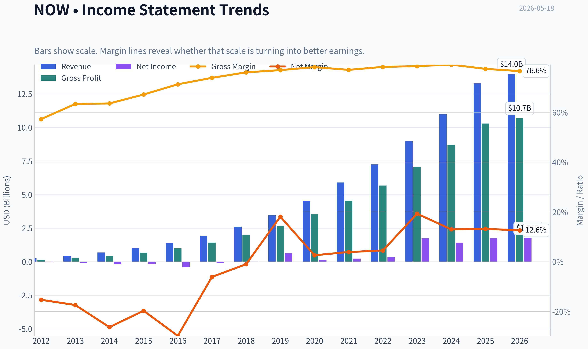

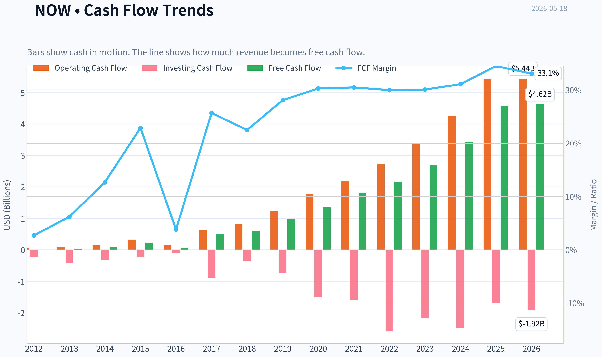

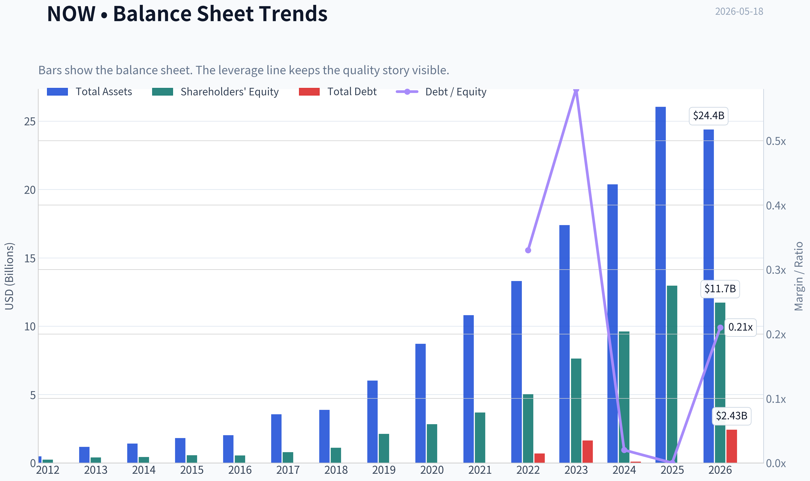

This graph tracks the profitability and return metrics (ROE, ROIC, Margins) of **NOW** over the past decade, highlighting capital efficiency trends.

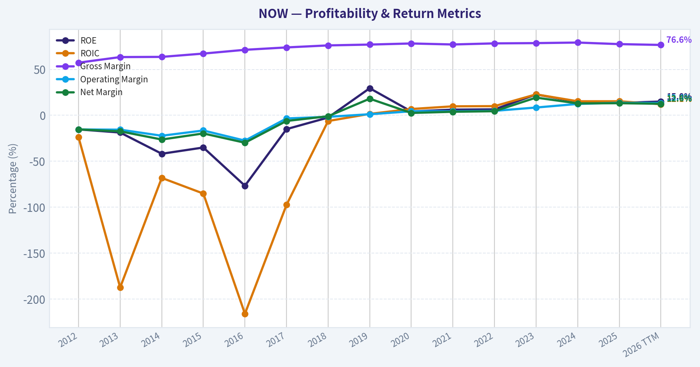

This chart illustrates the financial health of **NOW** over the last 10 years, mapping cash equivalents and free cash flow against total obligations (Debt).

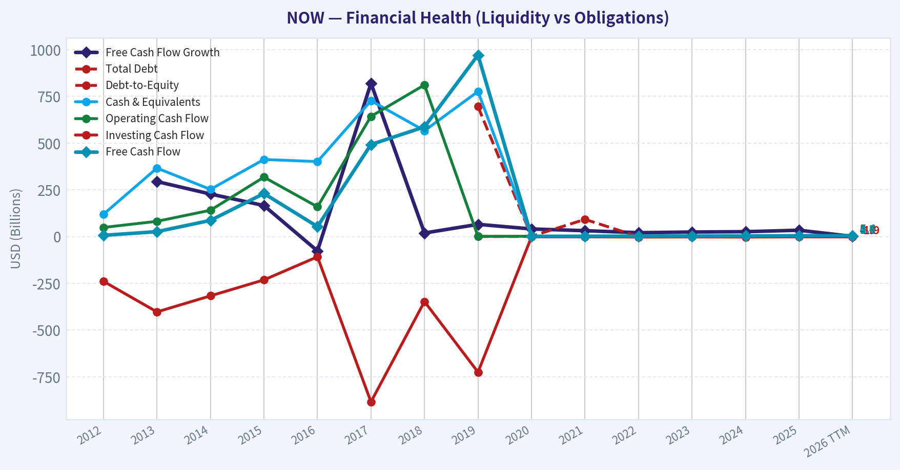

This breakdown chart from <em>Revenue Breakdown</em> shows the proportional composition for **NOW** - useful for understanding what drives or risks the business.

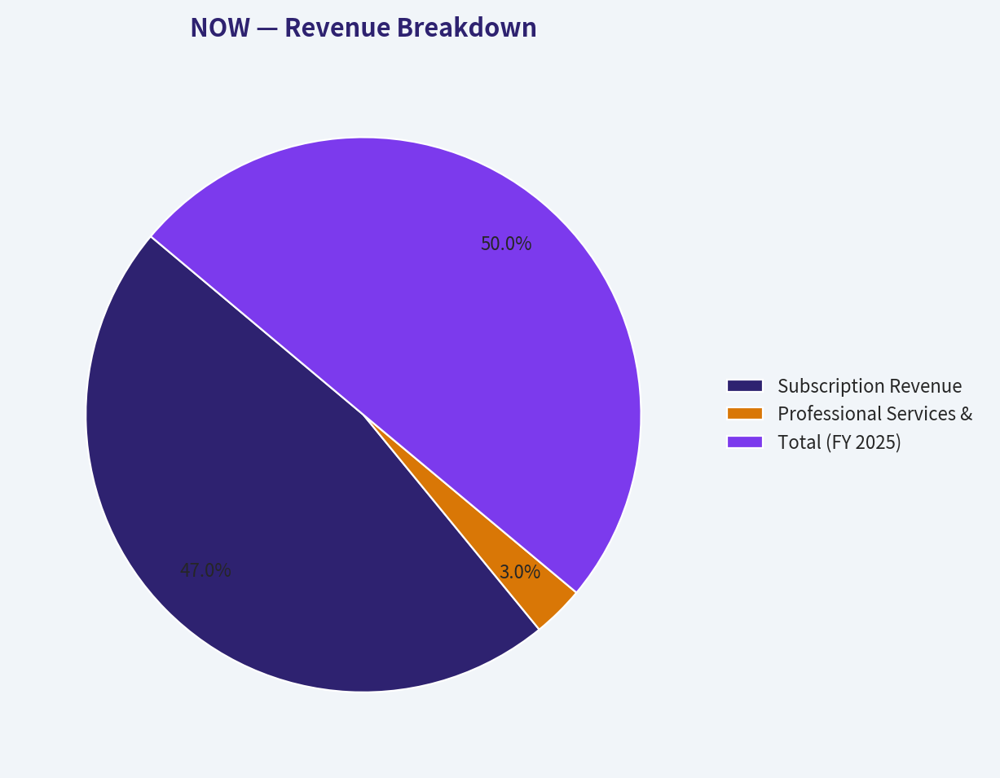

---

### Intrinsic Value Analysis (Buffett)

> *Following Warren Buffett's value investing philosophy: Circle of Competence, Economic Moat, Management Quality, and Margin of Safety.*

#### Intrinsic Value Snapshot

Price is what you pay. Intrinsic value is what the business may be worth based on the cash it can create for owners over time. We show a range, not one magic number.

- Current Price: $103.42
- Value Range (conservative to optimistic across both DCF methods): $20.09 to $412.22

##### Owner Earnings (Buffett Method)
- Net Income: $1,748,000,000.00
- Depreciation & Amortization: $738,000,000.00
- Capital Expenditures: $-868,000,000.00
- Working Capital Changes: $29,000,000.00
- Owner Earnings: $1,589,000,000.00

##### Intrinsic Value
###### Buffett Method
Uses owner earnings. Stricter, and usually more conservative.
- Conservative: $20.09
- Average: $51.34
- Optimistic: $143.14
- Discount Rate: 10.0%

###### Cash Flow Method
Uses free cash flow. Better for companies spending heavily today to grow tomorrow.
- Conservative: $127.04
- Average: $158.29
- Optimistic: $412.22
- Discount Rate: 10.0%

I'm unable to complete the Buffett-style analysis for NOW with audited financial history because the required PostgreSQL financials tool is not available in this run.

What I can confirm from the research pack:

- Company: ServiceNow (NOW)
- Price: $103
- Market cap: $106.66B
- P/E: 56.5
- ROE: 13.5%
- Gross margin: 77.5%
- YoY revenue growth: 20.9%
- FCF yield: 4.3%
- Current ratio: 1.00

Initial Buffett read:
- Business simplicity: Pass. ServiceNow sells workflow software subscriptions to enterprises.
- Predictability: Moderate to good. Enterprise software can be sticky, but product evolution and AI competition matter.
- Technology risk: Mixed. It benefits from digitization, but software moats can erode faster than classic consumer or regulated businesses.
- Moat clues: Strong gross margin suggests intangible assets and switching costs.
- Financial quality: ROE at 13.5% is decent but below Buffett's preferred 15%+ threshold.
- Valuation: 56.5x earnings is demanding; this leaves little margin of safety for a strict value investor.
- Balance sheet/liquidity: Current ratio near 1.0 is acceptable but not especially fortress-like on its own.

Provisional view:
ANALYST STANCE: **WATCH**

Why:
- Likely a strong business with real switching costs and attractive unit economics.
- But the valuation appears rich for a Buffett-style purchase requiring a clear margin of safety.
- I would want the full long-term audited record on ROIC/ROE, owner earnings, SBC-adjusted cash generation, debt, dilution, and capital allocation before moving to ADVOCATE.

If you want, I can continue from here once the financial-history tool is restored, or another assistant can pick up with the full audited due diligence.
#### Valuation Bridge

This bridge places the current market price beside each intrinsic value lens so readers can see whether upside depends on one method or shows up across several methods.

| Scenario | Intrinsic Value / Share |
| --- | ---: |
| Buffett Method | $51.34 |
| Cash Flow Method | $158.29 |
| Damodaran Method | $-14.26 |
| Current Price | $103.42 |

#### Key Takeaways

If one method is far above the others, the upside case depends on a specific modelling assumption. When several methods cluster together, the valuation story is more robust.

#### Valuation Visuals

This comparison chart from *Latest Earnings Snapshot* stacks current figures against historical benchmarks for **NOW**, making it easy to see where the company trades relative to its own averages.

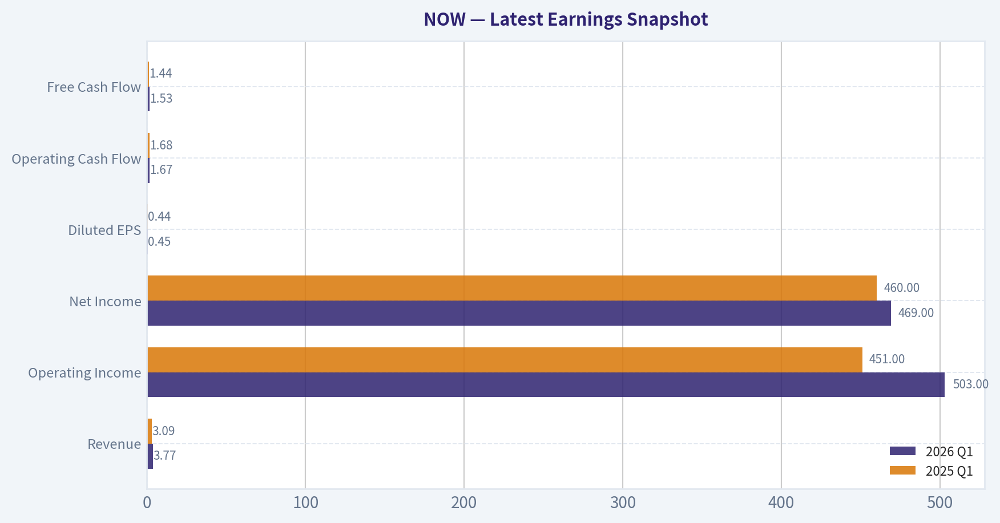

This comparison chart from *Buffett-Style Owner Earnings DCF* stacks current figures against historical benchmarks for **NOW**, making it easy to see where the company trades relative to its own averages.

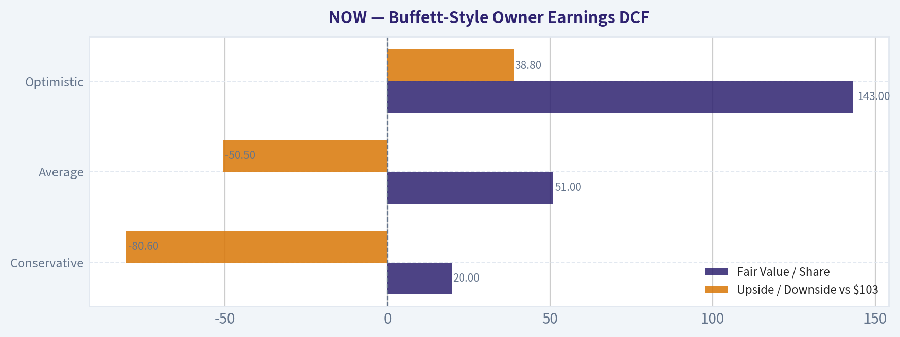

The following chart maps the **NOW** Owner Earnings DCF valuation scenarios (Conservative, Average, Optimistic) to visually represent the margin of safety based on intrinsic value calculations.

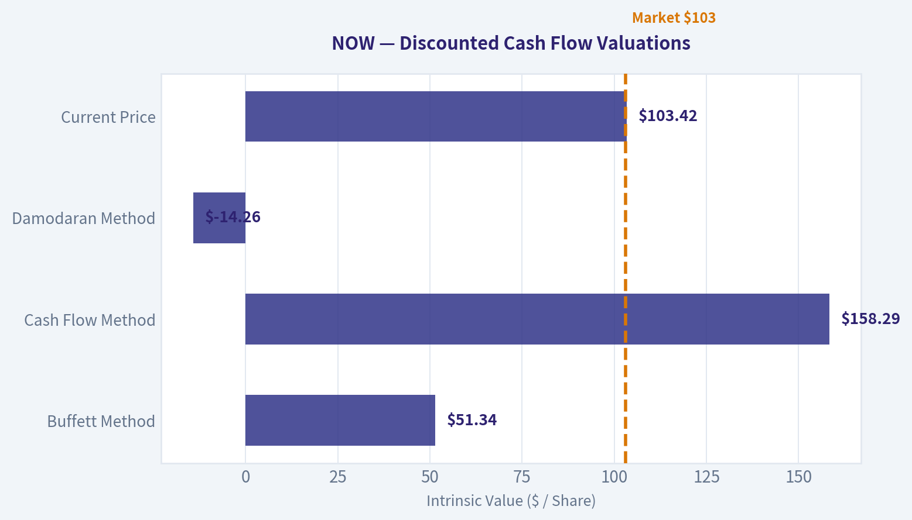

This comparison chart from *Lynch Classification* stacks current figures against historical benchmarks for **NOW**, making it easy to see where the company trades relative to its own averages.

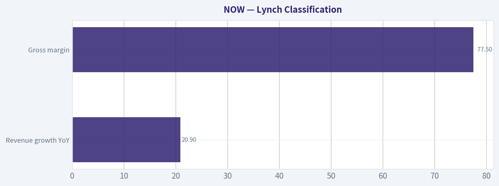

This comparison chart from *Unit Economics* stacks current figures against historical benchmarks for **NOW**, making it easy to see where the company trades relative to its own averages.

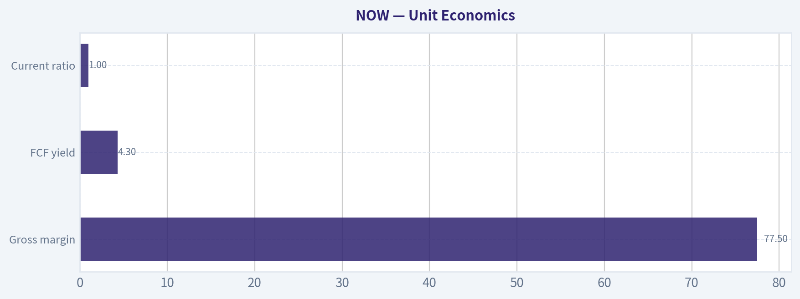

---

### Trend & Growth Analysis (Lynch/Druckenmiller/Fisher)

> *Following Peter Lynch's GARP, Stanley Druckenmiller's macro-aware approach, and Philip Fisher's scuttlebutt methodology.*

ANALYST STANCE: **WATCH**

#### ServiceNow (NOW) Growth Analysis

Using the shared pack plus tool output, ServiceNow screens as a **high-quality fast grower**, but not an obvious fresh ten-bagger entry at **~56.5x P/E** and roughly **~11x sales** on current numbers. The business quality is excellent, the AI/workflow inflection is real, and execution remains strong. The issue is **valuation vs. growth rate**: great company, less clear bargain.

---

#### 1) Lynch Classification

| Item | Assessment |
|---|---|
| Category | **Fast Grower** |
| Revenue growth YoY | **20.9%** |
| Gross margin | **77.5%** |
| Business type | Mission-critical enterprise workflow / AI-enabled SaaS platform |
| Lynch verdict | Fits the type of large-cap compounder Lynch would admire, though valuation is not cheap |

**Key Takeaways:** ServiceNow is clearly not a slow grower or stalwart based on current revenue growth near 21%. It remains a fast-growing large software platform with unusually strong margins for its size. The main debate is not growth quality, but how much of that quality is already reflected in the stock price.

---

#### 2) The Story in 3 Bullets

- ServiceNow helps large enterprises automate internal work: IT tickets, employee workflows, customer workflows, security, and now AI-powered process orchestration.
- The growth engine is **land-and-expand**: once embedded, customers add more modules, more users, and deeper automation.
- AI is the current upside lever because it can increase ROI, expand seat/module demand, and make ServiceNow more central to enterprise operations.

---

#### 3) TAM Analysis and 10x Test

Using shared pack data: market cap **$106.66B**, price **$103** implies roughly **1.04B shares**. At ~56.5x earnings and 20.9% growth, this likely corresponds to a large-scale revenue base around the low double-digit billions. A reasonable shorthand is that NOW is already a mega-cap software platform, but still in a very large workflow automation market.

| TAM Element | Assessment |
|---|---|
| Core TAM | ITSM, ESM, CRM workflows, security ops, low-code, AI workflow automation |
| Market structure | Large and expanding enterprise software category |
| Secular drivers | AI adoption, digital transformation, automation, cost takeout |
| 10x revenue test | **Unlikely from current scale** |
| 3x-5x revenue test | **Plausible** over long duration if platform expansion continues |
| Runway verdict | **Large runway, but not classic early-stage 10x from here** |

**Key Takeaways:** The market opportunity is still broad and growing, especially with AI layered onto workflow automation. However, ServiceNow is already very large, so a full 10x revenue outcome is less realistic than it would be for a smaller software company. The better framing is whether it can continue compounding at attractive rates for many years, not whether it can still be a classic undiscovered ten-bagger.

---

#### 4) Revenue Growth Trend

| Metric | Value | Interpretation |
|---|---:|---|
| Revenue growth YoY | **20.9%** | Strong large-cap SaaS growth |
| Growth pattern | Likely **stable-high**, not hyper-accelerating | Healthy but not explosive |
| Quality | Mostly recurring subscription-driven | High quality |
| Risk | Natural scale-driven deceleration | Main watch item |

**Key Takeaways:** Nearly 21% growth at this scale is impressive and supports the fast-grower label. But this looks more like durable, high-quality compounding than a fresh acceleration story. For a stronger Advocate stance, I would want clearer evidence that AI is re-accelerating growth or materially lifting forward estimates.

---

#### 5) Unit Economics

Some SaaS-specific metrics were not provided directly in the data pack, so I'm inferring where appropriate and marking unknowns.

| Metric | Value | Assessment |
|---|---:|---|
| Gross margin | **77.5%** | Excellent |
| FCF yield | **4.3%** | Strong for premium SaaS |
| Rule of 40 proxy | **20.9% growth + likely strong FCF margin** | Likely passes comfortably |
| NRR | Not provided | Historically likely strong for platform SaaS |
| LTV/CAC | Not provided | Likely healthy given enterprise expansion model |
| Current ratio | **1.00x** | Adequate, not a concern given recurring cash flow |

**Key Takeaways:** The gross margin and free cash flow profile strongly suggest elite software unit economics. Even without exact NRR and LTV/CAC, the model appears efficient and scalable. Liquidity is only average on the current ratio, but recurring enterprise cash generation makes that less alarming.

---

#### 6) Inflection Point Assessment

| Inflection Type | Status | Comment |
|---|---|---|
| Product cycle inflection | **Yes** | AI features may increase platform value and upsell |
| TAM inflection | **Yes** | AI expands workflow automation use cases |
| Margin inflection | **Moderate** | Scale and software economics support leverage |
| Market share inflection | **Possible** | Strong enterprise position, but needs data confirmation |
| Competitive inflection | **Mixed** | AI helps incumbents, but also invites new competition |

**Key Takeaways:** The most important inflection is not basic cloud adoption anymore, but AI-enhanced workflow automation. That expands the addressable market and may deepen customer dependence on the platform. The open question is whether this produces true growth re-acceleration or simply helps maintain current premium growth.

---

#### 7) Macro Setup Evaluation

| Factor | Assessment |
|---|---|
| Secular trend exposure | **Excellent** |
| AI theme alignment | **High** |
| Enterprise software sentiment | Improving, but still valuation-sensitive |
| Rate sensitivity | Moderate; premium growth multiples benefit from stable/falling rates |
| Macro verdict | **Net positive** |

**Key Takeaways:** ServiceNow is aligned with one of the strongest secular themes in the market: AI-driven enterprise productivity. The macro backdrop matters mainly through valuation, since premium software names are sensitive to rates and risk appetite. Operationally, the long-term secular wind remains favorable.

---

#### 8) Fisher 15 Points Score

This is partly judgment-based due to limited scuttlebutt data.

| Fisher Dimension | Score (1-5) |
|---|---:|
| Market potential | 5 |
| New product development | 5 |
| R&D effectiveness | 4 |
| Sales organization | 5 |
| Profit margin | 4 |
| Margin improvement | 4 |
| Labor/personnel relations | 3 |
| Executive relations | 4 |
| Management depth | 4 |
| Cost controls/accounting | 4 |
| Outstanding moat qualities | 5 |
| Long-range profit outlook | 5 |
| Dilution risk | 3 |
| Candor | 4 |
| Integrity | 4 |
| **Total** | **63 / 75** |

**Key Takeaways:** A score of 63 places ServiceNow in the "good to outstanding" range. The company rates especially well on market potential, product development, sales execution, and moat quality. The main deductions come from stock-based compensation and the lack of direct scuttlebutt evidence on softer qualitative factors.

---

#### 9) Valuation Analysis

| Metric | Value | Interpretation |
|---|---:|---|
| Price | **$103** |
| Market cap | **$106.66B** |
| P/E | **56.5x** |
| Revenue growth | **20.9%** |
| PEG | **~2.7x** | Expensive by Lynch standard |
| FCF yield | **4.3%** | Helps offset valuation concern |
| Implied P/S | ~**11x** | Premium but not extreme for elite software |

**Key Takeaways:** The valuation is the main reason this is not an Advocate call. A PEG near 2.7 is well above Lynch's preferred range, meaning the stock is expensive relative to current growth. Free cash flow quality softens that concern, but investors are still paying a premium price for a premium business.

##### Simple scenario framing

| Scenario | Revenue Trend | Multiple View | Outcome |
|---|---|---|---|
| Bear | Growth slips to mid-teens | Multiple compresses | Limited returns / drawdown risk |
| Base | Growth sustains high teens to ~20% | Multiple holds around premium range | Reasonable compounding |
| Bull | AI drives re-acceleration and margin leverage | Premium multiple sustained or expands | Strong upside |

**Key Takeaways:** The stock likely works best if ServiceNow can maintain or re-accelerate growth while preserving margins. If growth fades into the mid-teens, the premium multiple becomes harder to defend. The bull case depends heavily on AI becoming a real revenue and workflow expansion driver, not just a narrative boost.

---

#### 10) Growth Investor Scorecard

| Criterion | Weight | Score | Weighted |
|---|---:|---:|---:|
| The Story | 10% | 4.5 | 0.45 |
| TAM & Runway | 20% | 4.0 | 0.80 |
| Revenue Growth | 20% | 4.0 | 0.80 |
| Unit Economics | 15% | 4.5 | 0.68 |
| Competitive Position | 10% | 4.5 | 0.45 |
| Management Quality | 10% | 4.0 | 0.40 |
| Macro Setup | 5% | 4.0 | 0.20 |
| Profitability Path | 5% | 4.5 | 0.23 |
| Valuation | 5% | 2.5 | 0.13 |
| **Total** |  |  | **4.13 / 5.0** |

**Key Takeaways:** On business quality and growth durability, ServiceNow scores like an Advocate. The only weak spot is valuation, which drags down conviction for a new position. This is a classic case of a great company that may need either stronger acceleration or a better entry point.

---

#### 11) Position Size Stance

| Investor Type | Stance |
|---|---|
| Existing holder | **Hold / potentially add on weakness** |
| New buyer | **WATCH** |
| Aggressive growth investor | Small starter position only if betting on AI re-acceleration |
| Position size | **1%-3% starter at most** unless valuation improves or growth re-accelerates |

**Key Takeaways:** This looks more attractive as an existing-owner hold than as an aggressive new buy. For new capital, patience is warranted because the stock already reflects a lot of operational excellence. A small starter can be justified for high-conviction AI/workflow believers, but this is not a table-pounding entry.

---

#### 12) Key Risks and Catalysts

| Risks | Catalysts |
|---|---|
| Growth deceleration from scale | AI monetization boosts deal sizes and expansions |
| Premium multiple compression | Strong cRPO / backlog trends |
| Enterprise budget tightening | Margin expansion from scale |
| SBC/dilution over time | Cross-sell success across workflow modules |
| Intensifying competition from platform vendors | Further proof ServiceNow is becoming AI workflow system of record |

**Key Takeaways:** The downside case is mostly valuation and deceleration risk, not business fragility. The upside case depends on ServiceNow proving that AI materially expands both its TAM and customer value. That is the central catalyst to watch over the next several quarters.

---

#### Bottom Line

ServiceNow is a **best-in-class enterprise software compounder** with strong margins, durable recurring revenue, and credible AI upside. By Lynch/Fisher standards, the business is attractive; by Lynch valuation discipline, it is **not cheap**. By Druckenmiller standards, there is an inflection theme here, but I need clearer evidence of **growth acceleration**, not just continued excellence.

**Final view: WATCH.**
Great company, likely long-term winner, but I'd prefer either:
1. a better entry price, or
2. stronger proof that AI is pushing estimates materially higher.

---

### Market Technical Analysis

#### NOW technical review as of 2026-05-18

I selected 8 indicators that are the most useful for NOW's current setup: **close_200_sma, close_50_sma, close_10_ema, macd, macdh, rsi, atr, and vwma**. This mix avoids unnecessary overlap while covering the key dimensions traders need right now: long-term trend, medium-term structure, short-term momentum, momentum acceleration, exhaustion risk, volatility, and volume-confirmed price behavior.

#### Indicator selection and why these fit NOW's current market context

| Indicator | Why it matters now | What it is showing |
|---|---|---|
| close_200_sma | Best gauge of the primary trend after a severe multi-month breakdown | NOW remains far below the 200-day average, confirming the long-term trend is still decisively bearish |
| close_50_sma | Tracks medium-term trend and whether the recent rebound is enough to repair damage | The 50-day average is still falling and sits above price, so the rally has not yet reversed the intermediate downtrend |
| close_10_ema | Useful for identifying whether the near-term rebound has traction | Price has recently pushed above the 10-day EMA, indicating improving short-term momentum |
| macd | Measures directional momentum and trend-change potential | MACD is still negative, meaning the stock has not fully shifted into bullish trend momentum yet |
| macdh | Better than MACD alone for spotting momentum improvement early | Histogram has turned strongly positive, showing bearish momentum is fading and rebound strength is building |
| rsi | Helps judge whether the rally is still recovering or becoming overextended | RSI around 61 suggests improving momentum without being overbought |
| atr | Critical because NOW has been unusually volatile after a sharp drawdown | ATR remains elevated, implying wider stops and smaller position sizing are prudent |
| vwma | Adds volume confirmation to the rebound analysis | Price strength appears more credible because volume-weighted trend has improved alongside price |

Key Takeaways: The indicator set is designed for a stock in recovery mode after a major breakdown, not for a stable uptrend. Long-term and medium-term averages still warn that the bigger trend is damaged, while short-term momentum indicators show the rebound is gaining traction. That combination is especially important because it tells traders this is currently a tactical recovery inside a still-bearish broader structure.

---

#### Trend structure: the bigger picture is still damaged

NOW has gone through a **deep multi-stage decline** over the last year. From the 2025 highs above 200, the stock progressively weakened into late 2025, then suffered a more violent collapse in early 2026, including sharp downside gaps and heavy-volume liquidation. The most important structural takeaway is that this was not a single panic event followed by an immediate recovery. Instead, it was a **persistent repricing process** with repeated failed rallies, which usually means overhead supply remains significant.

The moving averages make that clear. As of 2026-05-18:

- **50 SMA: 99.32**
- **200 SMA: 144.37**
- Last close available from the price history: **95.07 on 2026-05-15**

That means price is still:
- about **4.3% below the 50-day SMA**
- about **34.2% below the 200-day SMA**

The slope matters as much as the distance. Both the 50-day and 200-day averages are still falling. The 50-day has dropped from about 117.8 in mid-March to 99.3 by mid-May, and the 200-day has fallen from roughly 165.5 to 144.4 over the same span. That is a strong sign that the stock is still in the **repair phase**, not yet in a durable uptrend.

A nuanced point: the stock is no longer in freefall. The pace of deterioration has slowed materially. That often marks the transition from "downtrend acceleration" to "bottoming attempt." But bottoming attempts can last weeks or months, and many fail near the declining 50-day average.

#### Short-term momentum has improved meaningfully

The short-term picture is notably better than the longer-term one.

- **10 EMA: 93.45**
- Recent close: **95.07**

Price has climbed above the 10-day EMA, which suggests buyers have regained short-horizon control. The 10 EMA had been flattening around the low 90s and is now turning up. That matters because in a weak stock, the first sign of stabilization is often not a break of the 50-day average, but repeated ability to hold above the 10-day EMA and use it as support.

The recent sequence from early May into mid-May shows a healthier rhythm:
- pullbacks are less severe than in April,
- rebounds are faster,
- and the stock managed to lift from the high 80s back into the mid-90s.

This does not yet prove a new uptrend. It does suggest that sellers are losing control of the tape in the near term.

#### MACD and histogram: improving, but not fully bullish

The momentum picture is best understood by reading **MACD** and **MACD histogram** together.

- **MACD: -0.93**
- **MACD histogram: +1.49**

This is a very useful combination. MACD being **below zero** means the stock is still operating within a broader bearish momentum regime. However, the histogram being **solidly positive and expanding** means momentum is improving quickly and the MACD line has moved meaningfully above its signal line.

That combination usually describes a **countertrend rebound with strengthening force**. In practical terms:
- the rally is real enough to respect,
- but it has not yet transitioned into a fully bullish trend state.

From a trading standpoint, this matters because it argues against blindly shorting weakness at current levels, but it also warns against assuming the recovery has already solved the larger trend damage.

#### RSI: constructive, not euphoric

- **RSI: 60.93**

RSI near 61 is constructive. It is well above the washed-out readings seen in April, when RSI briefly fell into the low 20s. That tells us the stock has moved from capitulation conditions into a healthier recovery phase.

Equally important, RSI is **not overbought**. It is below the classic 70 threshold, so the rebound has room to continue if buyers remain active. In a bottoming stock, RSI moving from deeply oversold into the 55-65 zone is often one of the earliest signs of a tradable recovery. But if RSI repeatedly stalls in this zone while price fails under the 50-day average, that often signals a rebound that is running into overhead resistance rather than beginning a true trend reversal.

So RSI is supportive, but not decisive.

#### Volatility remains high enough to change risk management

- **ATR: 5.49**

An ATR around 5.5 on a stock trading in the mid-90s is still high. That is roughly **5.8% of price**, which is substantial daily movement risk. Even though ATR has come down somewhat from the most chaotic periods in April, it remains elevated enough that standard tight stops are vulnerable to being shaken out.

This has two implications:
1. **Position sizing should stay conservative**
2. **Stops need more room than usual**

For swing traders, this is not a low-volatility accumulation setup. It is a rebound in a still-unstable stock. That can create opportunity, but only if risk is sized accordingly.

#### VWMA: volume is not contradicting the rebound

- **VWMA: 92.41**
- **10 EMA: 93.45**
- Recent close: **95.07**

The stock trading above VWMA is encouraging because it implies the recent rebound is not merely a weak bounce on shrinking interest. Volume has been significant during the recovery period, and the VWMA has started to recover after the April collapse.

That said, volume interpretation needs nuance. Some of the large volume in late April came from event-driven repricing and heavy churn, not purely from bullish accumulation. So VWMA is supportive, but traders should not overread it as proof of institutional sponsorship unless the stock can continue holding above VWMA and eventually challenge the 50-day SMA on sustained volume.

---

#### Tactical interpretation for traders

The most accurate framing is:

- **Primary trend:** bearish
- **Intermediate trend:** still bearish, but improving
- **Short-term trend:** bullish rebound / recovery attempt
- **Momentum:** improving materially
- **Volatility:** still elevated
- **Risk of overhead resistance:** high, especially near the falling 50-day SMA

This means NOW is currently more attractive as a **tactical rebound candidate** than as a confirmed trend-following long. Bulls have gained near-term control, but they still need to prove they can overcome the declining 50-day average and then build a base above it. Until that happens, rallies should be viewed as vulnerable to failure.

The most likely friction zone is the area between current price and the 50-day SMA near 99-100. If that area is reclaimed and held, the recovery would become more credible. If the stock rolls over before reaching or reclaiming that zone, it would reinforce the idea that this is still just another rally within a larger downtrend.

#### What would strengthen the bullish case

A stronger bullish case would require several things happening together:

| Condition | Why it matters |
|---|---|
| Price holds above the 10 EMA | Shows the rebound remains intact near term |
| RSI stays above 50 | Confirms momentum is not fading back into weakness |
| MACD continues rising toward or above zero | Indicates transition from rebound to more durable momentum repair |
| Price reclaims the 50 SMA near 99-100 | First major structural improvement in the intermediate trend |
| VWMA continues to rise with price | Suggests volume is supporting, not undermining, the move |

Key Takeaways: For the rebound to evolve into something more durable, NOW needs to do more than simply bounce off oversold levels. The next important test is whether buyers can keep price above the short-term average and eventually push through the falling 50-day average near 100. If those conditions hold, the recovery becomes more credible rather than merely reactive.

#### What would weaken the setup

| Warning sign | Why it matters |
|---|---|
| Price loses the 10 EMA decisively | Signals the short-term rally is stalling |
| RSI slips back below 45-50 | Would suggest momentum recovery is failing |
| MACD histogram peaks and rolls over sharply | Often an early warning that rebound strength is fading |
| VWMA turns down while price stalls | Can indicate distribution rather than accumulation |
| High ATR persists while price fails under resistance | Means volatility remains dangerous without sufficient upside follow-through |

Key Takeaways: The biggest risk is that improving momentum fades before the stock repairs the broader technical damage. If price loses the 10-day EMA and momentum indicators roll over, traders should assume the rebound is weakening rather than hoping the longer-term trend has already turned.

#### Bottom line

NOW is in a **credible short-term recovery**, but it is **not yet in a confirmed medium- or long-term uptrend**. The strongest evidence in favor of the bulls is the rising 10 EMA, positive MACD histogram, RSI near 61, and price strength above VWMA. The strongest evidence for caution is that price remains below a declining 50-day SMA and far below a falling 200-day SMA.

So the stock currently looks like:
- **a tactical rebound trade for active traders**
- **not yet a clean trend-following long for position traders**

The key technical battlefield is near **99-100** at the 50-day SMA. A successful reclaim of that zone would materially improve the chart. Failure below it would keep the larger bearish structure intact.

#### Summary table

| Dimension | Reading | Interpretation | Trading implication |
|---|---:|---|---|
| Long-term trend | Price well below 200 SMA (144.37) | Strongly bearish primary structure | Long-term investors should remain cautious |
| Medium-term trend | Price below 50 SMA (99.32) | Intermediate trend still down | Rebound has not yet repaired chart damage |
| Short-term trend | Price above 10 EMA (93.45) | Near-term momentum improving | Bulls have short-term control for now |
| MACD | -0.93 | Still negative overall | Momentum repair underway, but not fully bullish |
| MACD Histogram | +1.49 | Improving momentum acceleration | Rebound strength is building |
| RSI | 60.93 | Constructive, not overbought | Room for further upside if support holds |
| ATR | 5.49 | Elevated volatility | Use wider stops and smaller sizing |
| VWMA | 92.41 | Volume-adjusted trend improving | Rebound has some volume confirmation |
| Key resistance | 99-100 area | Falling 50-day SMA overhead | Most important near-term breakout test |
| Overall stance | Recovery inside larger downtrend | Tactical bullish, strategic cautious | Better for swing traders than long-term trend followers |

Key Takeaways: NOW has improved enough to deserve attention from short-term traders, but the bigger trend remains clearly damaged. The rebound is becoming stronger, yet it still needs to clear the 50-day average near 100 before a more durable bullish thesis is technically justified.

---

### Options Market Analysis

> *Reading options flow - put/call ratios, IV skew, and unusual activity - to gauge institutional positioning and event-driven risk.*

#### NOW Options Positioning Report
*As of 2026-05-18*

#### 1. Put/Call Ratio Analysis

| Expiry | Call OI | Put OI | Put/Call OI Ratio | Call Vol | Put Vol | Put/Call Vol Ratio | Read |
|---|---:|---:|---:|---:|---:|---:|---|
| 2026-05-22 | 40,465 | 31,562 | 0.78 | 177,223 | 25,721 | 0.15 | Slightly call-leaning OI, aggressively call-heavy flow |
| 2026-05-29 | 21,115 | 12,759 | 0.60 | 32,207 | 10,444 | 0.32 | Bullish call bias |
| 2026-06-05 | 5,965 | 22,181 | 3.72 | 6,448 | 1,918 | 0.30 | Heavy put OI overhang, but current flow still call-led |
| **Near-term total** | **67,545** | **66,502** | **0.98** | **215,878** | **38,083** | **0.18** | OI near balanced, but trading flow is decisively call-dominant |

**Key Takeaways:** Open interest is not uniformly bullish because the aggregate put/call OI ratio at 0.98 sits above the historical neutral baseline of about 0.7. But the much more important near-term signal is flow: put/call volume ratio is just 0.18, showing traders are overwhelmingly transacting in calls right now. That points to active upside speculation or call overwriting demand centered in the front week, with the tape leaning bullish near term.

Interpretation versus neutral baseline:
- A **0.98 total put/call OI ratio** is **above** the ~0.7 neutral baseline, so existing positioning is somewhat more defensive than normal.
- A **0.18 put/call volume ratio** is **far below** neutral and signals a **strong current preference for calls**.
- The key shift is that **fresh activity is much more bullish than legacy positioning**. In other words, the market may have carried hedges, but new money is chasing upside.

#### 2. Implied Volatility (IV) Assessment

| Expiry | ATM Call IV | ATM Put IV | Call vs Put ATM | IV Level Read |
|---|---:|---:|---|---|
| 2026-05-22 | 80.8% | 78.7% | Calls slightly richer | Very elevated |
| 2026-05-29 | 67.1% | 64.7% | Calls slightly richer | Elevated |
| 2026-06-05 | 65.5% | 62.6% | Calls slightly richer | Elevated/moderate |

**Key Takeaways:** Near-term IV is very high, especially in the 2026-05-22 expiry where ATM options are around 79%-81%. That usually means the market is pricing a meaningful short-dated catalyst or the after-effects of one. Notably, calls are trading at slightly higher ATM IV than puts, which is atypical for fear-driven hedging and instead suggests upside demand is helping set prices.

#### 3. IV Skew

| Expiry / Evidence | Skew Direction | Interpretation |
|---|---|---|
| 2026-05-22 chain | **Call skew** | OTM call IV is notably rich: 110C 85.8%, 115C 90.2%, 120C 94.8% |
| 2026-05-29 chain | **Mild call skew** | 110C at 69.5% IV remains rich vs ATM |
| Put side evidence | **No steep downside put skew** | Example: 2026-05-22 100P at 76.6%, below ATM call IV and below hot OTM calls |

**Key Takeaways:** The skew is tilted toward calls, not puts. That means the options market is charging more for upside convexity than downside protection, which is usually a sign of chase behavior, momentum speculation, or demand for upside exposure into a catalyst. This is the opposite of the classic "fear bid" seen when investors rush into OTM puts.

Catalyst read:
- IV appears **too elevated for a normal quiet tape**, especially in the nearest weekly expiry.
- Without separately confirming the corporate calendar here, this profile is consistent with **event-driven pricing**: earnings aftermath, guidance-related repricing, analyst day, product/news flow, or macro-sensitive software sector positioning.
- The market is clearly **expecting above-normal short-term movement**.

#### 4. Unusual Options Activity

Assumption on moneyness: the strike cluster around **101-110 calls** suggests spot is likely near the low-100s. So strikes near 102-105 are roughly ATM/slightly OTM; 108-120 are progressively OTM; 100 put is near ATM/slightly OTM downside.

| Expiry | Type | Strike | Volume | OI | Vol/OI | Likely Moneyness | DTE | Read |
|---|---|---:|---:|---:|---:|---|---:|---|
| 2026-05-22 | CALL | 110 | 63,258 | 4,514 | 14.0x | OTM | 4 | Very aggressive upside speculation |
| 2026-05-22 | CALL | 105 | 25,845 | 2,614 | 9.9x | Near ATM / slightly OTM | 4 | High-conviction bullish near-term bet |
| 2026-05-22 | CALL | 102 | 8,218 | 917 | 9.0x | ATM / slightly ITM | 4 | Directional upside positioning |
| 2026-05-29 | CALL | 110 | 7,616 | 819 | 9.3x | OTM | 11 | Follow-through upside bet beyond this week |
| 2026-05-22 | CALL | 104 | 7,090 | 938 | 7.6x | Near ATM | 4 | Bullish short-dated activity |
| 2026-05-22 | CALL | 101 | 6,895 | 1,312 | 5.3x | ATM / slightly ITM | 4 | Immediate upside exposure |
| 2026-05-22 | CALL | 103 | 6,669 | 739 | 9.0x | ATM | 4 | Fresh bullish positioning |
| 2026-05-22 | CALL | 115 | 5,833 | 696 | 8.4x | Far OTM | 4 | Speculative upside chase |
| 2026-05-22 | CALL | 108 | 5,514 | 554 | 10.0x | OTM | 4 | Momentum-driven call buying |
| 2026-05-22 | CALL | 106 | 5,461 | 252 | 21.7x | Slightly OTM | 4 | One of the strongest fresh bullish prints |
| 2026-05-22 | CALL | 120 | 4,816 | 360 | 13.4x | Far OTM | 4 | High-risk speculative call flow |
| 2026-05-22 | CALL | 109 | 4,043 | 583 | 6.9x | OTM | 4 | Upside extension positioning |
| 2026-05-22 | PUT | 100 | 3,042 | 252 | 12.1x | Near ATM / slightly OTM put | 4 | Hedge or tactical downside protection |
| 2026-05-22 | CALL | 107 | 2,432 | 349 | 7.0x | OTM | 4 | Additional bullish interest |
| 2026-05-29 | CALL | 102 | 2,383 | 303 | 7.9x | ATM | 11 | Bullish persistence into next week |

**Key Takeaways:** The unusual activity list is overwhelmingly call-heavy, especially in the 4-day expiry, and volume is massively larger than open interest, which strongly suggests fresh positioning rather than simple closing trades. The standout is the 2026-05-22 110C with more than 63k contracts traded, a very large upside swing bet for such a short horizon. There is some put activity at the 100 strike, but it is small relative to the call wave and looks more like hedging than a dominant bearish statement.

Smart-money vs. retail interpretation:
- **Near-ATM calls (101-106)** with huge volume/OI ratios are more likely to represent **serious directional positioning**, because they retain more delta and are more useful for institutional expression.
- **Farther OTM calls (115-120)** in the front week lean more **speculative/lottery-ticket**, more characteristic of momentum traders or retail chasing.
- The **100 put** is notable, but isolated. It reads more like **protective hedging against a reversal** than outright conviction that the stock breaks down.

#### 5. Open Interest Concentration / Gamma Levels

| Expiry | Notable OI Theme | Market Impact |
|---|---|---|
| 2026-05-22 | Largest overall positioning appears concentrated in the heavily traded 101-110 call zone | If spot is near these strikes, dealer hedging could reinforce upside momentum into expiry |
| 2026-05-29 | 102 and 110 calls stand out in unusual flow | Could create secondary upside magnets next week |
| 2026-06-05 | Put OI materially exceeds call OI (3.72 put/call OI ratio) | Medium-short-term downside hedge overhang; could become a drag if price weakens |

**Key Takeaways:** The near-term market structure appears dominated by call interest clustered just above spot, which can act like a gamma runway if the stock starts moving higher. In the very short term, those strikes can become magnets or acceleration points as dealers adjust hedges. The main counterweight is the large 2026-06-05 put open interest, which suggests some participants still want protection beyond the immediate bullish window.

Gamma-wall read:
- The **105-110 area** looks like the most likely **near-term call gamma zone**.
- If NOW trades up through that area quickly, **dealer hedging could add fuel** to the move.
- On the downside, the **100 put** is the clearest hedge line to watch as a support/failure reference.

#### 6. Overall Options Sentiment Signal

| Category | Signal | Confidence | Primary Driver |
|---|---|---|---|
| Overall options read | **BULLISH** | **Moderate** | Extremely call-heavy fresh flow, elevated front-week IV, and clear call skew |

**Key Takeaways:** The options market is giving a bullish read, even though legacy open interest is more balanced than the trade flow. What matters most is that new money is overwhelmingly going into short-dated calls, including near-ATM strikes that are more credible as directional bets. Confidence is moderate rather than high because IV is already very elevated, meaning some of this bullishness is expensive and could reflect event-chasing rather than clean institutional accumulation.

Bottom line:
- **Directional signal: BULLISH**
- Why: **Fresh call demand is overwhelming put demand**, especially in the nearest weekly expiry.
- Important caveat: **Elevated IV means expectations are already high**, so the stock may need a real catalyst or momentum continuation to fully validate the bullish positioning.
- Secondary caution: **June 5 put OI concentration** shows not everyone is complacent; there is still a meaningful hedge layer under the surface.

#### Final Summary Table

| Metric | Observation | Interpretation |
|---|---|---|
| Put/Call Ratio | Total OI ratio 0.98; volume ratio 0.18 | Existing positioning somewhat defensive, but fresh flow strongly bullish |
| IV Level | 80.8%/78.7% ATM IV in front week; still elevated in later weeks | Market pricing large near-term movement |
| Skew Direction | Call skew, with rich OTM call IV vs puts | Upside chase outweighs downside fear |
| Unusual Activity | Dominated by 2026-05-22 calls from 101 to 120, especially 105C/110C | Fresh bullish speculation and directional upside bets |
| Overall Signal | **BULLISH** | Strong call demand is the main driver, tempered by elevated premiums and some later put hedging |

**Key Takeaways:** NOW's options tape is bullish because the latest activity is overwhelmingly concentrated in calls, not puts, and the skew also favors upside. The caution is that premiums are already rich, so this is a bullish signal about positioning, not necessarily a low-risk entry signal.

---

## Research Team Commentary

> *The Research Manager synthesizes the Bull vs Bear debate into action-free commentary. This is a pre-risk view, not the final stance.*

ServiceNow looks like a genuinely high-quality business, but not an obviously high-quality bargain. That distinction matters.

The strongest bull argument is business quality. ServiceNow appears to have real switching costs because it sits inside core enterprise workflows, and that kind of operational entrenchment can be very durable. The land-and-expand model is attractive, gross margins at 77.5% are excellent, and returns on capital are respectable. There is also a credible long runway if enterprises continue consolidating workflow automation onto fewer platforms. From a Buffett lens, this is the type of business worth following closely: recurring revenue, mission-critical use cases, low capital intensity, and the possibility that AI makes the platform more valuable rather than less.

The strongest bear argument is valuation discipline. A 56.5x P/E is hard to reconcile with classic margin-of-safety thinking unless future owner earnings are unusually certain. Here, they are not. ServiceNow's growth still depends heavily on continued expansion within large customers, and that can slow as budgets tighten, deployments mature, or competition increases. The moat is real, but it is not the kind of immutable consumer or network moat Buffett traditionally prized; it is a software/process moat, which is more exposed to technology shifts and suite competition. AI may help, but it may also lower barriers and shift value elsewhere. At this valuation, investors are still paying for a lot to go right.

My takeaway is that the debate comes down to "wonderful business" versus "sufficient discount." I come out in the middle. ServiceNow likely deserves a premium multiple relative to average companies because the business quality is meaningfully above average. But the available evidence does not show enough undervaluation to call it an ADVOCATE under a Buffett framework. On the other hand, the company is too strong to dismiss outright. This is exactly the sort of name that should stay on the watchlist for either a better entry price or stronger proof that owner earnings can compound fast enough to justify today's expectations.

Core takeaway: ServiceNow is a high-quality enterprise software franchise with credible moat characteristics, but the current case lacks a clear margin of safety. The stock may be more attractive than the headline selloff suggests, yet not attractive enough for a value investor who insists on valuation protection.

Rationale: Buffett-style investing starts with business quality, and ServiceNow passes that test better than most software names. The product is sticky, the economics are strong, and the revenue base is more predictable than many tech companies. But Buffett's second test is just as important: do you have a meaningful gap between price and intrinsic value? With a P/E above 56 and only moderate evidence here on free cash flow quality, dilution, and incremental returns, that gap is not clear. I do not want to repeat the common mistake of admiring a great company into an overpayment. At the same time, I also do not want to make the opposite mistake of rejecting a compounding business just because it is not statistically cheap. So the right answer is patience, not enthusiasm or dismissal.

Monitoring over the next 1 to 4 quarters:
First, watch subscription revenue growth and especially evidence on net expansion. If existing customers keep broadening usage at healthy rates, that supports the moat and intrinsic value case.
Second, watch operating leverage and free cash flow conversion. I want proof that gross margin strength is translating into durable owner earnings, not just accounting attractiveness.
Third, watch stock-based compensation and share count. If per-share economics are being diluted, the valuation case weakens.
Fourth, listen carefully for management commentary on AI monetization. Is AI driving measurable adoption, higher contract values, and workflow stickiness, or is it mostly narrative?
Fifth, monitor large-customer behavior: deal cycle length, budget scrutiny, and renewal quality. Any signs of seat optimization or slower module adoption would matter.
Sixth, compare competitive positioning against Microsoft, Salesforce, Atlassian, and other platform vendors. If ServiceNow keeps winning as a control-plane workflow platform, the moat thesis strengthens. If customers increasingly choose bundled alternatives, it weakens.
Finally, I would revisit the stance if either the stock price falls enough to create a more obvious valuation cushion or if fundamentals improve enough to make today's premium look conservative in hindsight.

Final stance: WATCH

---

## Value Investing Team Commentary

> *The Investor translates the research view into an investment thesis before risk review. This is still not the final stance.*

ServiceNow is the kind of company a long-term business owner should respect. It has many of the traits we want: high gross margins, recurring and embedded enterprise revenue, strong returns on capital, and a product that becomes more valuable the deeper it is woven into customer operations. This is not a fragile or promotional business. It appears to be a real enterprise software franchise.

The core question is not whether ServiceNow is good. It is whether the current price leaves room for satisfactory long-term returns. That is where discipline matters.

The bullish case is straightforward and credible. ServiceNow sits in workflow infrastructure rather than a narrow point solution. Once a large enterprise standardizes internal processes on the platform, switching becomes disruptive, expensive, and organizationally painful. That creates sticky revenue and a land-and-expand model that can compound for years. AI could strengthen that position if it helps customers automate more work across departments and increases ServiceNow's role as a central operating layer. If that happens, today's earnings may understate normalized owner earnings power five to ten years from now.

The bearish case is also serious. A P/E above 56 is a rich price for any business, even a very good one. At that valuation, the investor is relying on continued strong growth, sustained high margins, successful AI monetization, and durable competitive positioning. That is a lot to assume. In software, moats can be real, but they are rarely as permanent as consumer brands, distribution monopolies, or cost advantages. Competitors such as Microsoft, Salesforce, Atlassian, and other platform vendors are not standing still. If AI compresses differentiation or shifts value toward broader ecosystems, the market may eventually decide that today's premium was too generous.

The recent weakness in the stock does create an interesting contrarian angle. A price materially below the 200-day average often signals fear, disappointment, or derating. But a value investor should ask: is the market merely emotional, or is it repricing a still-excellent business from "priced for perfection" toward "priced for strong but normal execution"? Those are very different things. In my view, the decline alone does not create a margin of safety. It may simply mean the market is becoming more realistic about the price one should pay for quality software.

What the market may be missing is that ServiceNow's business could become even more entrenched if enterprises consolidate workflow, service management, and automation onto fewer platforms. In that scenario, temporary concerns about budgets or tech sentiment could prove short-lived. On the other hand, what enthusiastic investors may be missing is that great software companies can still be mediocre investments if bought at too high a multiple. Admiring the business is not the same as buying the stock intelligently.

So I would approach NOW with patience and respect. This is a watchlist company, not a rejection. I would want stronger evidence that free cash flow conversion, per-share economics, and AI-driven monetization are improving fast enough to justify the premium. I would also want to monitor share dilution closely, because stock-based compensation can quietly erode owner returns. If the business keeps compounding while the stock becomes materially cheaper, that could create a much more attractive setup.

The right Buffett-style posture here is selective restraint. Wonderful businesses are worth following for years. But even wonderful businesses can be poor bargains when expectations are already embedded in the price.

**ANALYST STANCE: WATCH**

---

## Deep Values Commentary

> *The Risk Management Team debates and the Risk Judge provides the final action-free verdict. This section determines the final ADVOCATE / WATCH / AVOID stance.*

#### Final Stance Scorecard

This scorecard converts the final research view into a weighted decision frame. It does not replace the narrative judgement, but it makes the main drivers of the verdict easier to scan.

| Criterion | Score | Weight | Commentary |
| --- | ---: | ---: | --- |
| Business Quality | 3.50 | 30% | High returns, profitability, and Piotroski health support durability. |
| Valuation Support | 1.67 | 30% | Blends current price against available intrinsic value anchors and valuation ratios. |
| Financial Strength | 2.67 | 20% | Balance-sheet resilience reflects leverage and liquidity staying within safe ranges. |
| Growth Durability | 5.00 | 20% | Recent revenue, earnings, and free cash flow growth indicate how durable expansion looks. |
| TOTAL / FINAL STANCE | 3.08 | 100% | WATCH |

#### Key Takeaways

The weighted score lands at **3.08 / 5.0**, while the final stance remains **WATCH**. This is useful as a quick calibration aid rather than a mechanical signal.

#### Risk Summary

Higher scores indicate more risk pressure. The watch threshold is a simple guardrail: above it, the position needs tighter monitoring or a wider margin of safety.

| Dimension | Current Score | Watch Threshold | Commentary |
| --- | ---: | ---: | --- |
| Business Quality | 2.50 | 3.00 | High returns, profitability, and Piotroski health support durability. |
| Valuation Support | 4.33 | 3.00 | Blends current price against available intrinsic value anchors and valuation ratios. |
| Financial Strength | 3.33 | 3.00 | Balance-sheet resilience reflects leverage and liquidity staying within safe ranges. |
| Growth Durability | 1.00 | 3.00 | Recent revenue, earnings, and free cash flow growth indicate how durable expansion looks. |

#### Key Takeaways

This view helps readers separate *where* the risk sits: valuation, business quality, balance sheet, or growth durability. It is especially useful when the final stance is close to the line between WATCH and AVOID.
