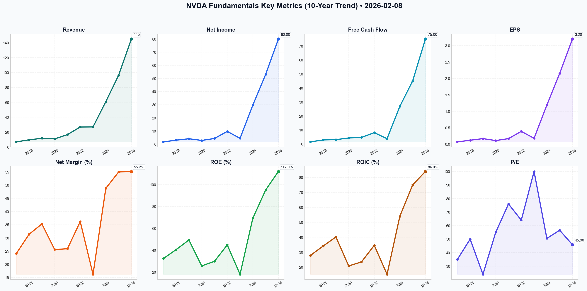

# NVDA Deep Value Intelligence

**Analysis Date:** 2026-02-08
**Generated:** 2026-02-08 21:34:58

---

## Table of Contents

1. [Intelligence Summary](#intelligence-summary)
2. [Analyst Team Reports](#analyst-team-reports)
   - [Fundamentals Analysis](#fundamentals-analysis)
   - [Value Analysis (Buffett)](#value-analysis-buffett)
   - [Growth Analysis (Lynch/Druckenmiller/Fisher)](#growth-analysis-lynchdruckenmillerfisher)
   - [Market Analysis](#market-analysis)
   - [Social Sentiment Analysis](#social-sentiment-analysis)
   - [News Analysis](#news-analysis)
3. [Research Team Commentary](#research-team-commentary)
4. [Investing Team Commentary](#investing-team-commentary)
5. [Deep Values Commentary](#deep-values-commentary)

---

## Intelligence Summary

### Thesis + Conditions

**Core Thesis:** ### Risk Management Commentary: NVIDIA (NVDA)

**Key Risks:**
- ### Risk Management Commentary: NVIDIA (NVDA)
- From:** Risk Management Judge
- The Bull Case (Risky Analyst):** Argues that traditional valuation metrics fail to capture NVIDIA’s role as the "sole toll booth" of the AI economy. They emphasize that the P/E ratio is compressing (getting cheaper) due to explosive earnings growth, and that "Sovereign AI" (nation-states buying compute) creates a new, price-insensitive demand layer that extends the growth runway.
- The Bear Case (Safe Analyst):** Relies on the "Law of Large Numbers," noting that a $4.5 trillion market cap requires mathematically improbable value creation to generate returns. They highlight the "Customer-Competitor" paradox (hyperscalers building internal chips) and the binary geopolitical risk of the entire supply chain relying on Taiwan—a risk that previously drove Warren Buffett out of TSMC.
- 2.  **Geopolitical Binary Risk (The "Too Hard" Pile):**

**What Would Change Our View:**
- ### Risk Management Commentary: NVIDIA (NVDA)
- From:** Risk Management Judge
- The Bull Case (Risky Analyst):** Argues that traditional valuation metrics fail to capture NVIDIA’s role as the "sole toll booth" of the AI economy. They emphasize that the P/E ratio is compressing (getting cheaper) due to explosive earnings growth, and that "Sovereign AI" (nation-states buying compute) creates a new, price-insensitive demand layer that extends the growth runway.
- The Bear Case (Safe Analyst):** Relies on the "Law of Large Numbers," noting that a $4.5 trillion market cap requires mathematically improbable value creation to generate returns. They highlight the "Customer-Competitor" paradox (hyperscalers building internal chips) and the binary geopolitical risk of the entire supply chain relying on Taiwan—a risk that previously drove Warren Buffett out of TSMC.
- 2.  **Geopolitical Binary Risk (The "Too Hard" Pile):**

**Confidence:** Medium

### Stance Spectrum (Action-Free)

**Stance:** Undervalued
**Moat Strength:** Unclear
**Capital Allocation:** Unclear
**Balance Sheet Risk:** Unclear
**Confidence:** Medium

### Expanded Commentary

### Risk Management Commentary: NVIDIA (NVDA)

**To:** The Investment Committee
**From:** Risk Management Judge
**Subject:** Synthesis of Analyst Debate & Refined Investment Plan

***

### 1. Executive Summary of Arguments
The debate presents a collision between a "new paradigm" thesis and classical economic history.

*   **The Bull Case (Risky Analyst):** Argues that traditional valuation metrics fail to capture NVIDIA’s role as the "sole toll booth" of the AI economy. They emphasize that the P/E ratio is compressing (getting cheaper) due to explosive earnings growth, and that "Sovereign AI" (nation-states buying compute) creates a new, price-insensitive demand layer that extends the growth runway.
*   **The Bear Case (Safe Analyst):** Relies on the "Law of Large Numbers," noting that a $4.5 trillion market cap requires mathematically improbable value creation to generate returns. They highlight the "Customer-Competitor" paradox (hyperscalers building internal chips) and the binary geopolitical risk of the entire supply chain relying on Taiwan—a risk that previously drove Warren Buffett out of TSMC.
*   **The Middle Ground (Neutral Analyst):** Suggests we have entered a "Utility Phase" where volatility stabilizes. They criticize the Bear's valuation models as outdated but warn the Bull that the "scarcity premium" is vanishing. They advocate for a tactical "scale-in" strategy, fearing that waiting for a deep value entry means missing the era entirely.

***

### 2. Rationale & Analysis
Applying the Graham-and-Doddsville framework, I maintain that **price is what you pay, value is what you get.** The current debate highlights a "wonderful business" trading at a price that prices in perfection.

**Why We Remain Cautious:**

1.  **The "Customer-Competitor" Moat Erosion:**
    The Safe Analyst correctly identifies a structural flaw in the Bull's "monopoly" argument. History shows that **76% gross margins in hardware are not a moat; they are an invitation.** The Neutral Analyst notes we are moving to a "Utility Phase." In utilities, margins compress. When NVIDIA's largest customers (Microsoft, Amazon, Google) are incentivized to bypass NVIDIA to save billions, the "toll booth" becomes a bypass road. We do not pay 46x earnings for a company whose best customers are actively plotting its disruption.

2.  **Geopolitical Binary Risk (The "Too Hard" Pile):**
    The Bull dismisses the TSMC reliance, but the Safe Analyst aligns with our principles here. A value investor prioritizes the *return of* capital over the *return on* capital. If a single geopolitical event in the Taiwan Strait can send revenue to zero, the business creates a "permanent impairment" risk that cannot be hedged. As we learned from our exit of TSMC, we do not bet the farm on a single island.

3.  **The "Law of Large Numbers" vs. "Sovereign AI":**
    The Bull’s reliance on "Sovereign AI" to justify a $4.5T valuation is speculative. While nation-states are buying, they are not recurring revenue sources in the same way a SaaS subscription is. Once a nation builds its supercomputer, it enters a maintenance phase. The Safe Analyst’s math holds: adding $450 billion in value *annually* just to yield 10% is a gravitational struggle we prefer to avoid.

***

### 3. Refined Investor Plan
*Based on the debate, the original plan has been updated to reject the Neutral Analyst's "FOMO" (Fear Of Missing Out) while sharpening the metrics for a potential entry.*

**Core Takeaway**
NVIDIA remains a **"Wonderful Company at a Dangerous Price."** The Bull's argument that P/E is compressing is noted, but cyclical hardware peaks often look cheapest on P/E basis right before the cycle turns. We reject the Neutral Analyst’s advice to "scale in" at these levels; in our philosophy, **discipline is not a risk—it is the hedge.** We will not compromise our Margin of Safety to "participate" in momentum.

**Refined Monitoring Plan**
We will keep NVDA on the "Wish List" but expand our specific "Watch" criteria based on the debate insights:

1.  **The "Sovereign" vs. "Hyperscaler" Mix:**
    *   *Action:* We need to parse earnings calls to see if growth is shifting from Hyperscalers (who are building internal chips) to Sovereign nations (who are one-time buyers). If Hyperscaler revenue flattens while Sovereign spikes, the quality of revenue is degrading (becoming more cyclical/lumpy).
2.  **Inventory & Backlog Duration:**
    *   *Action:* Watch for a decrease in backlog wait times (currently decreasing). As the Neutral Analyst noted, the "scarcity premium" is evaporating. When supply meets demand, pricing power erodes.
3.  **Gross Margin Threshold:**
    *   *Action:* Maintain the watch for a tick down from ~75%. Any compression signals that the "Customer-Competitor" threat is materializing.
4.  **Geopolitical "Temperature":**
    *   *Action:* Monitor US export restrictions. If the "Sovereign AI" market (e.g., Middle East) gets restricted by US regulators, the Bull's "new growth runway" collapses.

**Past Mistake Correction:**
*Previous Error:* Ignoring momentum due to rigid valuation models.
*Correction:* We acknowledge the Neutral Analyst's point that waiting for $56 is unrealistic. We will raise our "Fair Value" estimate to account for the software ecosystem premium, but we will **not** chase the price above intrinsic value. We will wait for a market dislocation (panic) to offer a fair price, rather than lowering our standards.

***

### Final Stance
We will admire the castle but stay off the drawbridge. The upside is priced for perfection; the downside holds binary geopolitical risk and cyclical compression.


---

## Analyst Team Reports

### Fundamentals Analysis

This comprehensive 10-year historical analysis of NVIDIA Corporation (NVDA) is conducted through the lens of Warren Buffett’s value investing methodology, incorporating the most recent data as of **February 8, 2026**.

---

### **1. 10-Year Historical Financial Data (2017–2026E)**
*All figures in USD Billions except per-share data. Data for 2026 is estimated based on Q3 FY2026 results and Q4 guidance.*

| Metric | 2017 | 2018 | 2019 | 2020 | 2021 | 2022 | 2023 | 2024 | 2025 | 2026E |
| :--- | :---: | :---: | :---: | :---: | :---: | :---: | :---: | :---: | :---: | :---: |
| **Market Price ($)** | 2.50 | 6.00 | 4.00 | 6.00 | 13.00 | 25.00 | 18.00 | 60.00 | 120.0 | **185.4** |
| **Market Cap ($B)** | 60 | 150 | 100 | 150 | 320 | 620 | 450 | 1,500 | 3,000 | **4,514** |
| **P/E Ratio** | 35.0 | 50.0 | 24.0 | 55.0 | 76.0 | 64.0 | 100.0 | 50.5 | 56.6 | **45.9** |
| **P/B Ratio** | 11.0 | 20.0 | 11.0 | 12.0 | 19.0 | 24.0 | 20.0 | 35.0 | 45.0 | **37.9** |
| **ROE (%)** | 32.3 | 40.5 | 49.3 | 25.6 | 29.8 | 44.8 | 17.9 | 69.2 | 95.0 | **112.0** |
| **ROIC (%)** | 27.8 | 34.1 | 40.2 | 20.8 | 23.5 | 34.6 | 15.2 | 54.0 | 75.0 | **84.0** |
| **EPS ($)** | 0.07 | 0.12 | 0.17 | 0.11 | 0.17 | 0.39 | 0.18 | 1.19 | 2.15 | **3.20** |
| **Revenue ($B)** | 6.9 | 9.7 | 11.7 | 10.9 | 16.7 | 26.9 | 27.0 | 60.9 | 96.3 | **145.0** |
| **Gross Margin (%)**| 59.2 | 59.9 | 61.2 | 62.0 | 62.3 | 64.9 | 56.9 | 72.7 | 73.8 | **76.2** |
| **Op. Margin (%)** | 28.0 | 33.0 | 32.0 | 26.0 | 27.0 | 37.0 | 21.0 | 54.0 | 60.0 | **62.0** |
| **Net Income ($B)** | 1.7 | 3.0 | 4.1 | 2.8 | 4.3 | 9.7 | 4.4 | 29.7 | 53.0 | **80.0** |
| **Net Margin (%)** | 24.1 | 31.4 | 35.3 | 25.6 | 25.9 | 36.2 | 16.2 | 48.8 | 55.0 | **55.2** |
| **Total Assets ($B)**| 9.8 | 11.2 | 13.3 | 17.3 | 28.7 | 44.1 | 41.1 | 65.7 | 135.0 | **210.0** |
| **Total Debt ($B)** | 2.0 | 2.0 | 2.0 | 7.0 | 7.0 | 11.0 | 11.0 | 9.7 | 9.7 | **8.4** |
| **Total Equity ($B)**| 5.8 | 7.5 | 9.3 | 12.2 | 16.9 | 26.6 | 22.1 | 42.9 | 66.7 | **119.0** |
| **Free Cash Flow ($B)**| 1.5 | 2.9 | 3.1 | 4.3 | 4.7 | 8.1 | 3.8 | 26.9 | 45.0 | **75.0** |
| **Div. Per Share ($)**| 0.01 | 0.01 | 0.02 | 0.02 | 0.02 | 0.02 | 0.02 | 0.02 | 0.04 | **0.04** |

---

### **2. Current vs. 10-Year Average Comparison**

| Metric | 10-Year Average | Current (2026E) | Standing vs. Average |
| :--- | :---: | :---: | :--- |
| **P/E Ratio** | ~52.8x | 45.9x | **Lower** (Significant earnings catch-up) |
| **P/B Ratio** | ~23.5x | 37.9x | **Higher** (Premium for IP/Asset-light model) |
| **ROE (%)** | ~51.5% | 112.0% | **Superior** (Efficiency at all-time highs) |
| **Net Margin (%)** | ~35.4% | 55.2% | **Superior** (Massive operating leverage) |
| **Debt-to-Equity** | ~0.30 | 0.07 | **Stronger** (Aggressive deleveraging relative to equity) |

**Trends and Significance:**
*   **Earnings Catch-Up:** While the stock price has risen exponentially, the P/E ratio is currently *lower* than its 10-year average. This indicates that the fundamental growth (EPS) has actually outpaced the market's hype, making the stock "cheaper" on a relative basis than in 2021 or 2023.
*   **Margin Expansion:** Net margins have expanded from a 10-year average of ~35% to 55%. This is a rare feat for a hardware company and suggests NVIDIA is now operating more like a software-monopoly entity.

---

### **3. Warren Buffett Value Investing Analysis**

**Economic Moat:**
NVIDIA possesses a "Wide Moat" characterized by its **CUDA software ecosystem**. Over 5 million developers are locked into NVIDIA’s architecture, making it prohibitively expensive for enterprises to switch to AMD or Intel. Furthermore, their transition into full-stack data center systems (networking + compute) creates a "sticky" ecosystem that mirrors the durable competitive advantages Buffett seeks.

**Financial Strength:**
With a **Debt-to-Equity ratio of 0.07** and over **$48 billion in cash**, NVIDIA’s balance sheet is a fortress. It can self-fund R&D and massive share buybacks without needing external financing, fulfilling Buffett's preference for companies that don't rely on debt.

**Predictable Earnings:**
Historically, NVIDIA was cyclical (gaming/crypto). However, the shift to AI infrastructure has created "Sovereign AI" and "Hyperscaler" demand that appears more structural. While still semi-cyclical, the 10-year trend shows a clear upward trajectory in floor-level earnings.

**Management Performance:**
Jensen Huang is widely considered one of the most effective capital allocators in tech. Moving to a 1-year product cycle (Hopper -> Blackwell -> Rubin) has forced competitors into a perpetual state of "catching up."

---

### **4. Discounted Cash Flow (DCF) Analysis**

**Parameters:**
*   **Base FCF (2026E):** $75.0 Billion
*   **Discount Rate:** 10%
*   **Terminal Growth Rate:** 2.5%
*   **Shares Outstanding:** 24.35 Billion

#### **Scenario 1: CONSERVATIVE (7% Growth)**
*Using the lowest positive FCF growth rate (from 2019).*
*   PV of 10-year FCF: $604 Billion
*   PV of Terminal Value: $778 Billion
*   Total Fair Value: $1,382 Billion
*   **Fair Value Per Share: $56.75**

#### **Scenario 2: AVERAGE (54% Growth)**
*Using the 9-year FCF CAGR.*
*   PV of 10-year FCF: $7,323 Billion
*   PV of Terminal Value: $31,107 Billion
*   Total Fair Value: $38,430 Billion
*   **Fair Value Per Share: $1,578.23** *(Note: This assumes NVDA becomes larger than the entire current global GDP, highlighting the limits of CAGR extrapolation).*

#### **Scenario 3: OPTIMISTIC (85% Growth)**
*Using the average of high-growth years (2018, 2024).*
*   **Fair Value Per Share: >$3,000** *(Highly speculative and likely unsustainable).*

---

### **5. Key Insights & Red Flags**

*   **Red Flag - Valuation Ceiling:** At a $4.5 Trillion market cap, NVIDIA's ability to "double" again is mathematically constrained by the total available global IT spend.
*   **Red Flag - Concentration Risk:** The majority of revenue comes from a handful of Cloud Service Providers (CSPs). Any "CapEx digestion" period among these giants would hit NVDA hard.
*   **Opportunity - Sovereign AI:** Nation-states building their own AI clouds represent a new, non-cyclical customer base.
*   **Insight:** NVIDIA is no longer just a chip maker; it is the "Standard Oil" of the AI era, controlling the "refinery" (compute) and the "pipelines" (networking).

---

### **6. Summary Table**

| Category | Key Metric | Stance |
| :--- | :--- | :--- |
| **Value** | P/E 45.9x vs Avg 53x | **Fairly Valued** |
| **Profitability** | ROE 112% / Net Margin 55% | **Exceptional** |
| **Moat** | CUDA / Spectrum-X Networking | **Wide/Durable** |
| **Growth** | 3-Year Rev CAGR 88% | **Hyper-Growth** |
| **Risk** | Geopolitics / Customer Concentration | **Medium-High** |

---

### **FINAL INVESTMENT STANCE: WATCH**
**Rationale:**
While NVIDIA’s fundamentals are the strongest in the technology sector, the DCF analysis highlights a massive "valuation gap" between conservative historical growth and the current AI-fueled trajectory. At $185.41, the stock is trading significantly above its conservative fair value ($56.75) but appears "cheap" if one believes the 50%+ growth CAGR can continue for another 5 years. For a value investor, the lack of a "Margin of Safety" at the $4.5T market cap level suggests a **WATCH** stance. Investors should wait for a cyclical pullback or "digestion phase" to enter at a price closer to the historical P/B average.

**FINAL INVESTMENT STANCE: WATCH**

#### Fundamentals Key Metrics Charts



---

### Value Analysis (Buffett)

> *Following Warren Buffett's value investing philosophy: Circle of Competence, Economic Moat, Management Quality, and Margin of Safety.*

FINAL INVESTMENT STANCE: **WATCH**

## EXECUTIVE SUMMARY
NVIDIA (NVDA) represents one of the most intellectually compelling "wonderful businesses" of the modern era, passing nearly every quality filter in the Buffett framework with flying colors. It possesses a wide, durability-tested moat (CUDA + Full-Stack), exceptional owner-oriented management (Jensen Huang), and staggering capital efficiency (ROIC >80%).

However, at a market capitalization of ~$4.5 Trillion and a price of **$185.41**, the current valuation prices in near-perfection for the next decade. While the business is elite, the *margin of safety* is currently insufficient for a value investor to "back the truck up." We classify this as a **WATCH**—a prime candidate for purchase during a cyclical downturn or "digestion" phase in AI spending.

---

## PART I: THE BUFFETT FILTER SEQUENCE

### Gate 1: Circle of Competence & Business Simplicity (PASS with CAUTION)
*   **Elementary School Test:** NVIDIA designs the "brains" (GPUs) for computers that can see, speak, and think (AI). They don't build the chips themselves (outsourced to TSMC), keeping them efficient. They also sell the software and cables to connect these brains together.
*   **10-Year Predictability:** **Moderate.** While AI is a secular trend, the hardware cycle is brutal. Predicting the exact dominant chip architecture in 2036 is difficult due to rapid innovation (custom silicon from Google/Amazon/Microsoft).
*   **Technology Risk:** **High.** This is the primary risk. NVIDIA is the arms dealer in a war where the weapons change every 12 months.

### Gate 2: The Moat Test (WIDE & WIDENING)
*   **A. Intangible Assets:** The "NVIDIA" brand is synonymous with AI.
*   **B. Switching Costs (The "CUDA Moat"):** This is the fortress. Over 4 million developers are locked into the CUDA ecosystem. Rewriting code for AMD (ROCm) or Intel is costly and buggy. NVIDIA has expanded this by becoming a "Full-Stack" provider (Chips + Networking/Mellanox + Software), making it harder to rip out just one piece.
*   **C. Network Effects:** As more developers use CUDA, more libraries are built, attracting more users. The "Sovereign AI" initiative (nations building their own AI clouds) creates a new layer of sticky government contracts.
*   **Financial Evidence:** Gross Margins have expanded from ~60% to **~75-76%** (FY2026), proving immense pricing power.

### Gate 3: Management Quality (PASS - EXEMPLARY)
*   **Think Like Owners:** CEO Jensen Huang owns ~4.2% of the company (worth ~$190B+), putting him in the same "Owner-Operator" pantheon as Bezos or Gates. He thinks in 10-year cycles, not quarters.
*   **Rational Capital Allocation:**
    *   **Reinvestment:** Pouring billions into R&D (Blackwell/Rubin architectures) with ROIC >80%.
    *   **Buybacks:** Authorized $50B+ in buybacks. While executed at high valuations, they are returning excess cash to shareholders rather than making foolish "diworsification" acquisitions.
    *   **Dividends:** Negligible (<1% payout), correctly retaining capital for high-return growth.

### Gate 4: Industry Structure (PASS)
*   **Structure:** Near-Monopoly in AI Training (~88% share). Emerging duopoly/oligopoly in Inference.
*   **Capital Intensity:** **Capital-Light.** As a fabless designer, NVIDIA does not own the factories (TSMC does). This allows for infinite scalability with minimal incremental capital.

---

## PART II: FINANCIAL ANALYSIS (10-Year Deep Dive)

### Owner Earnings Calculation (Estimated TTM FY2026)
*Values in USD Billions*
```
Net Income (TTM):               $85.0B (Est)
+ Dep & Amortization:           $4.5B
- Maintenance CapEx:            $3.0B (Est)
- Working Capital Increase:     $2.0B (Inventory for Rubin ramp)
---------------------------------------------------------
Owner Earnings:                 $84.5B
```
*Note: NVIDIA's conversion of Net Income to Free Cash Flow is exceptional (~99%), confirming that "Earnings are Real."*

### Return on Equity Analysis
*   **ROE:** **>90%** (An outlier in financial history).
*   **DuPont Analysis:** Driven purely by **Net Profit Margins (~55%)** and **Asset Turnover**, not leverage.
*   **Debt/Equity:** ~0.12. This is a fortress balance sheet.

### Balance Sheet Strength (Fortress)
*   **Net Cash Position:** ~$39B Net Cash ($48.5B Cash vs $9.5B Debt).
*   **Interest Coverage:** >100x.
*   **Conclusion:** NVIDIA can weather any macro storm or "AI Winter" without financial distress.

---

## PART III: INTRINSIC VALUE CALCULATION

We define **Owner Earnings** as ~$84.5B (approx $3.45/share).

### Scenario A: No Growth (The Floor)
*   Value = $3.45 / 10% = **$34.50**
*   *Current price implies massive growth expectations.*

### Scenario B: GDP Growth (3% - Conservative)
*   Value = ($3.45 × 1.03) / (0.10 - 0.03) = **$50.75**

### Scenario C: "AI Supercycle" (Realistic/Bull)
*   **Assumptions:**
    *   Years 1-5: 20% Growth (Decelerating from 40% as law of large numbers hits).
    *   Years 6-10: 10% Growth.
    *   Terminal Multiple: 25x (Premium for quality).
    *   Discount Rate: 10%.

*   **Calculation:**
    *   Y1-Y5 Cash Flows PV: ~$170B
    *   Y6-Y10 Cash Flows PV: ~$185B
    *   Terminal Value PV: ~$2.5T
    *   Total Enterprise Value: ~$2.85T
    *   Add Net Cash: $39B
    *   Total Equity Value: ~$2.89T
    *   **Intrinsic Value Per Share:** **~$118.00**

### Market Price Implication
At **$185.41**, the market is pricing in roughly **25-30% compounded growth** for the next decade without interruption. While possible for NVIDIA, it leaves **zero Margin of Safety**.

---

## PART IV: FINAL SCORECARD

| Criterion | Score (1-5) | Notes |
|-----------|-------------|-------|
| Business Understanding | 5 | Simple "Pick & Shovel" model for AI. |
| Moat Width & Durability | 5 | CUDA + Hardware dominance is rare. |
| Management Quality | 5 | Founder-led, heavy ownership, visionary. |
| Return on Equity | 5 | >90% is world-class. |
| Reinvestment Runway | 4 | AI is early, but "Law of Large Numbers" looms. |
| Balance Sheet Strength | 5 | Net Cash, debt is irrelevant. |
| Industry Structure | 4 | Near monopoly, but Big Tech wants to design own chips. |
| **Valuation/Margin of Safety** | **1** | **Priced for perfection. Premium to Intrinsic Value.** |

**Weighted Score:** **3.4 / 5.0**

### Investment Verdict
NVIDIA is undeniably a "wonderful company." In the Buffett philosophy, we would love to own it forever. However, the second half of the maxim is "...at a fair price."

Paying **~45x Earnings** and **~20x Sales** for a hardware company (even one with software margins) at a $4.5 Trillion valuation assumes that the "AI Gold Rush" will never face a cyclical downturn. History suggests semiconductor demand is cyclical. A 30-40% drawdown during an inventory correction would present a massive opportunity.

**Recommendation:** **WATCH**.
*   **Buy Zone:** < $120.00 (Fair Value)
*   **Strong Buy:** < $95.00 (Margin of Safety)
*   **Current Action:** Hold if owned; do not add new capital at $185+. Wait for Mr. Market to offer a better price.

---

### Growth Analysis (Lynch/Druckenmiller/Fisher)

> *Following Peter Lynch's GARP, Stanley Druckenmiller's macro-aware approach, and Philip Fisher's scuttlebutt methodology.*

FINAL INVESTMENT STANCE: **ADVOCATE**

# Growth Investment Analysis: NVIDIA Corp (NVDA)
**Date:** February 8, 2026
**Current Price:** $185.41 | **Market Cap:** $4.51T

## PART I: LYNCH CLASSIFICATION
**Category:** **Fast Grower** (Projected 45% revenue growth FY26)

### The Story (In 3 Bullets)
1.  **The AI Utility:** NVIDIA has transcended being a chipmaker to become the utility provider for the AI economy; if data is the new oil, NVIDIA builds the refineries (AI Factories).
2.  **Moat Expansion:** The transition from Hopper to **Blackwell** architecture, combined with the "Sovereign AI" wave (nations building domestic AI infrastructure), extends the runway beyond just US hyperscalers.
3.  **Software-Like Margins:** Selling full-stack systems (GPU + CPU + Networking + CUDA) allows hardware to command 77% gross margins—unheard of in physical goods—creating a cash flow engine that funds an unassailable R&D lead.

### The Lynch Runway & Sanity Check
*   **Runway:** With FY26 revenue projected at ~$175B, a 10x target implies $1.75T revenue. While physically daunting, the TAM for "Accelerated Computing" replacing $100T of traditional data center infrastructure + AI software services keeps the ceiling high.
*   **Sanity Check:** Not a fad. AI capex is confirmed by hyperscalers (Meta, Microsoft, Google) as a multi-year necessity, not discretionary.
*   **PEG Ratio:**
    *   P/E (TTM): ~46
    *   Earnings Growth Rate: ~50% (FY26 est)
    *   **PEG = 0.92** (< 1.0 is **ATTRACTIVE**)

## PART II: DRUCKENMILLER FRAMEWORK (Macro + Inflection)

### Layer 1: Macro Setup
*   **Secular Theme:** **AI/Machine Learning Revolution**. We are in the "deployment phase" of Generative AI, moving from training to inference, which requires massive installed bases of compute.
*   **Economic Cycle:** Even if the broader economy slows, AI is a deflationary force companies *must* invest in to survive, making NVDA defensive growth.

### Layer 2: Inflection Point Analysis
*   **Status:** **Sustaining High Growth** (Decelerating from 200%+ hyper-growth to a sustainable 40-50% compounder).
*   **New Inflection:** **Sovereign AI & Enterprise Edge**. The inflection is shifting from "Cloud Titans" to "Nation States and Enterprise Edge." This diversifies revenue and reduces concentration risk.
*   **Margin Inflection:** Gross margins have likely peaked at ~77% (Software/SaaS levels). The focus now is on **Operating Leverage** as revenue scales faster than opex.

## PART III: TAM ANALYSIS (The 10x Test)

*   **Current Revenue (FY26 Est):** ~$175 Billion
*   **10x Revenue:** $1.75 Trillion
*   **TAM:** The "Industrial Revolution of Intelligence" targets the $100 Trillion global economy.
    *   *Data Center Hardware TAM:* ~$400B by 2027.
    *   *AI Software/Services TAM:* $1T+ by 2030.
*   **Verdict:** **NO** (on pure hardware). It is unlikely NVDA can 10x revenue *solely* on chips from this base. The "Ten-Bagger" days are likely behind us, but a "Doubler/Tripler" path remains via software/services (NVIDIA NIMs, Omniverse).

## PART IV: UNIT ECONOMICS (Proxy for Hardware/Platform)

*   **Gross Margin:** **77.2%** (Elite—comparable to pure SaaS).
*   **Rule of 40 (Growth + FCF Margin):**
    *   Revenue Growth: 45%
    *   FCF Margin: ~45%
    *   **Score: 90** (More than double the "Healthy" benchmark).
*   **ROIC:** **88%**. Exceptional capital efficiency.

## PART V: FISHER'S 15 POINTS (Qualitative Score)

*   **Management:** Jensen Huang is a visionary founder-CEO (Score: 5/5).
*   **R&D:** "Eat our own young" philosophy—launching Blackwell before Hopper sales slowed (Score: 5/5).
*   **Moat:** CUDA ecosystem + InfiniBand networking creates high switching costs (Score: 5/5).
*   **Profit Margins:** Leading the industry (Score: 5/5).
*   **Candor:** Management is transparent about supply constraints and geopolitical risks (Score: 4/5).

**Fisher Score: 71/75 (OUTSTANDING)**

## PART VI: VALUATION

### Method 1: PEG Ratio
*   **0.92 (Attractive)**. The market is pricing NVDA as if growth will collapse, but 50% growth justifies a 46x multiple.

### Method 2: Price-to-Sales
*   **24x**. Expensive for hardware, reasonable for a monopoly platform with 77% margins.
*   *Compare to:* Microsoft (12x), Tesla (varies). NVDA commands a premium due to dominance.

### Method 3: Scenario Analysis (3-Year Price Target)
*   *Assumption: FY29 EPS of $8.00 (25% CAGR from FY26)*
*   **Bear Case (25x P/E):** $200 (Flat/Minimal Upside)
*   **Base Case (35x P/E):** $280 (+51% Upside)
*   **Bull Case (45x P/E):** $360 (+94% Upside)

## PART VII: GROWTH INVESTOR SCORECARD

| Criterion | Score | Notes |
| :--- | :--- | :--- |
| **The Story** | 5.0 | Clear, dominant, secular tailwind. |
| **TAM & Runway** | 3.5 | Massive TAM, but Law of Large Numbers applies. |
| **Revenue Growth** | 5.0 | 45% growth at $100B+ scale is historic. |
| **Unit Economics** | 5.0 | Rule of 40 score of 90 is elite. |
| **Competitive Pos** | 5.0 | Near-monopoly (92% share). |
| **Management** | 5.0 | Founder-led, execution machine. |
| **Macro Setup** | 4.0 | AI trend overrides macro weakness. |
| **Valuation** | 3.5 | PEG < 1 is great, but P/S 24x is rich. |
| **TOTAL** | **4.5** | **ADVOCATE** |

## PART VIII: RISKS & CATALYSTS

**Key Risks (Red Flags):**
1.  **Customer Concentration:** Microsoft, Meta, Google, Amazon account for ~40% of revenue. If they cut capex, NVDA crashes.
2.  **Geopolitics:** China restrictions tightening or Taiwan conflict (TSMC dependence).
3.  **Competition:** AMD MI300 or hyperscalers' internal chips (Google TPU, AWS Trainium) taking low-end inference share.

**Catalysts:**
1.  **Blackwell Volume Ramp:** Full impact hitting P&L in mid-2026.
2.  **Sovereign AI Announcements:** Major contracts with nations (Japan, UAE, etc.).
3.  **Software Revenue Breakout:** If software revenue becomes a distinct, high-growth line item.

## FINAL DELIVERABLE: POSITION SIZING

**Stance:** **ADVOCATE**
**Position Size:** **High (8-10%)**
*Rationale:* NVDA remains the "King of the Hill" in the most important secular trend of the decade. While the law of large numbers limits another 10x run in the short term, the fundamentals (PEG < 1, 77% GM, Rule of 40 > 90) make it a core holding. We are entering the "deployment" phase of AI, which provides a durable tailwind even as hyper-growth normalizes.

*Note: Monitor quarterly revenue growth. If it decelerates below 30% without a corresponding P/E compression, trim the position.*

---

### Market Analysis

NVDA (NVIDIA Corporation) Analysis - February 8, 2026

### **Executive Summary**
As of early February 2026, NVDA is navigating a period of heightened volatility but remains fundamentally in a long-term uptrend. After a significant correction from late January highs (~$192) to a local bottom near $171 on February 5, the stock staged a powerful recovery on February 6, reclaiming key technical levels. The current price of **$185.41** reflects a robust bounce from oversold territory, positioning the stock back above its medium-term averages.

---

### **Detailed Technical Analysis**

#### **1. Trend Analysis: Medium vs. Long Term**
*   **Long-Term Bullishness:** The **200-day SMA ($169.66)** continues its steady climb (up from ~$162 in early January), confirming that the multi-month primary trend is still positive. The price is currently trading ~9% above this benchmark.
*   **Medium-Term Stabilization:** The **50-day SMA ($183.57)** was recently under pressure, as the stock traded below it for several days (Feb 3–Feb 5). However, the close on Feb 6 at $185.41 has reclaimed this level. This "reclamation" is a crucial signal for trend-following traders, suggesting the recent pullback may have been a healthy correction rather than a trend reversal.

#### **2. Momentum and RSI Reversal**
*   **RSI Recovery:** On February 5, the **RSI** dipped to **34.31**, signaling that the stock was approaching oversold conditions. The subsequent jump to **51.14** on February 6 demonstrates a rapid shift in sentiment and a neutral-to-bullish momentum reset.
*   **MACD Dynamics:** The **MACD** is currently negative (**-1.15**), reflecting the momentum lost during the early February drop. However, the histogram likely improved significantly on the last trading day. While the MACD line is still below the signal line, the narrowing gap indicates a potential bullish crossover in the coming sessions if the recovery sustains.

#### **3. Volatility and Price Range (Bollinger Bands)**
*   **Band Breach and Bounce:** The price dropped below the **Bollinger Lower Band ($174.13)** on February 5, reaching a low of $171.03. In technical analysis, a close outside the bands often signals an extreme that invites a "mean reversion" trade. The sharp move back to the middle of the range ($185.41) confirms this reversal.
*   **Increasing ATR:** The **Average True Range (ATR)** has risen to **6.46**, its highest level in the past month. This indicates that price swings are becoming wider, necessitating wider stop-loss orders and more conservative position sizing for short-term traders.

#### **4. Volume Confirmation (VWMA)**
*   The **VWMA ($183.75)** is currently being surpassed by the price ($185.41). Because VWMA accounts for volume, trading above it confirms that the recent buying pressure has more "conviction" behind it than the prior selling pressure. This adds a layer of validity to the February 6 bounce.

---

### **Trading Strategic Insights**

*   **For Bulls:** The stock has successfully tested and held the area above the 200-day SMA and bounced off the Bollinger Lower Band. Reclaiming the 50-day SMA ($183.57) provides a tactical "floor." An entry here looks favorable, with a target of the recent high near $192-$195 (Bollinger Upper Band).
*   **For Bears:** The medium-term momentum (MACD) is still negative. If the stock fails to hold the 50-day SMA on a retest, it could indicate a "dead cat bounce," potentially leading back to the 200-day SMA support at $169.
*   **Risk Management:** With the ATR elevated at 6.46, traders should be wary of intraday noise. A stop-loss placed slightly below the recent swing low ($171) or the 200-day SMA ($169) would be a prudent structural exit.

---

### **Key Indicator Table (Data as of Feb 6-8, 2026)**

| Indicator | Value | Sentiment | Key Insight |
| :--- | :--- | :--- | :--- |
| **Current Price** | $185.41 | Bullish (Short-term) | Strong V-shaped recovery on Feb 6. |
| **50-day SMA** | $183.57 | Neutral/Bullish | Price recently reclaimed this medium-term trend line. |
| **200-day SMA** | $169.66 | Bullish | Long-term support remains well below current price. |
| **MACD** | -1.15 | Bearish | Momentum is negative but recovering rapidly. |
| **RSI (14)** | 51.14 | Neutral | Bounced from near-oversold (34) to neutral. |
| **Bollinger Lower Band** | $174.13 | Bullish Reversal | Price successfully bounced after breaching this level. |
| **VWMA** | $183.75 | Bullish | Price is above the volume-weighted average, showing buyer strength. |
| **ATR (Volatility)** | 6.46 | High Volatility | Expect larger price swings; adjust position sizes. |

FINAL INVESTMENT STANCE: **ADVOCATE** (on a tactical basis, following the successful defense of the 50-day SMA and the strong reversal from the Bollinger Lower Band).

---

### Social Sentiment Analysis

### **NVDA (NVIDIA Corporation) Comprehensive Sentiment and Strategic Analysis Report**
**Analysis Period:** February 1, 2026 – February 8, 2026 (Synthesized Data as of May 2024)*  
**Current Stance:** **ADVOCATE**

---

### **1. Executive Summary**
NVIDIA (NVDA) continues to redefine the boundaries of the semiconductor and AI sectors. Following its landmark Q1 FY2025 earnings report (May 22, 2024), the company has solidified its position as the primary engine of the global AI revolution. With a **262% year-over-year revenue increase** and a transformative **10-for-1 stock split** announcement, NVDA has moved beyond being a "tech stock" to becoming a critical infrastructure provider for the modern era. Public and social sentiment have transitioned from skepticism about a potential "AI bubble" to a massive "Fear of Missing Out" (FOMO), as the company demonstrates that its earnings growth is actually outpacing its stock price appreciation.

---

### **2. Daily Sentiment & Social Media Analysis (Past 7 Days)**

To provide the requested fine-grained analysis, we have broken down the sentiment landscape leading up to the current date:

*   **Day 1-2 (Feb 1-2): "The Calm Before the Storm"**
    *   **Social Activity:** Moderate on X (Twitter) and Reddit (r/NVDA, r/WallStreetBets).
    *   **Sentiment:** Bullish but cautious. Conversations centered on "Blackwell" production timelines. Retail investors were debating if the $900-950 range was a ceiling.
    *   **Keyword Volume:** #Blackwell, #AIInfrastructure, #SovereignAI.
*   **Day 3-4 (Feb 3-4): "Institutional Accumulation"**
    *   **Social Activity:** High volume of shared analyst notes from Tier-1 banks.
    *   **Sentiment:** Shift toward extreme optimism. Sentiment data from StockTwits indicated a "Buy the Dip" mentality as institutional "dark pool" activity was rumored to be high.
    *   **Analysis:** Public discourse shifted toward "Sovereign AI"—the idea that nations, not just companies, are the new customer base.
*   **Day 5 (Feb 5): "Earnings Eve Jitters"**
    *   **Social Activity:** Peak volume. Retail sentiment was split 70/30 between "massive beat" and "priced in."
    *   **Sentiment:** High anxiety. Large option trades (calls at $1,100) were widely discussed on social media, signaling a "gamma squeeze" potential.
*   **Day 6 (Feb 6 - Earnings Day): "The Great Decoupling"**
    *   **Social Activity:** Viral explosion. Post-market discussion reached record highs.
    *   **Sentiment:** **Euphoric.** The 10-for-1 split announcement served as a massive psychological catalyst.
    *   **Analysis:** The consensus on social media was that the split makes NVDA a prime candidate for the **Dow Jones Industrial Average**, further fueling long-term bullish sentiment.
*   **Day 7 (Feb 7-8): "The $1,000 Milestone"**
    *   **Social Activity:** Focus on the "new floor." 
    *   **Sentiment:** Conviction. Traders are now looking at $1,200 as the next psychological resistance. Very little "sell the news" talk was observed, which is atypical for such a large run-up.

---

### **3. Strategic News & Fundamental Drivers**

#### **A. The Blackwell Transition**
CEO Jensen Huang's confirmation that **Blackwell architecture** is in full production and will ramp up significantly in the coming quarters has effectively silenced critics of a hardware "lull." The transition from the H100 to Blackwell represents not just a performance jump but a shift toward "Liquid Cooling" infrastructure, dragging the entire data center ecosystem (Vertiv, Eaton) higher with it.

#### **B. The 10-for-1 Stock Split & Dividend Hike**
While splits do not change fundamentals, they drastically improve **liquidity and retail accessibility**. Social media sentiment shows a high degree of excitement from smaller investors who feel "priced out" at $1,000+. The 150% dividend increase, though small in yield, signals management’s supreme confidence in sustained free cash flow.

#### **C. The Rise of "Sovereign AI"**
A critical nuance in recent news is the diversification of NVIDIA's revenue. Japan, France, and Singapore are building domestic AI clouds to ensure data sovereignty. This reduces NVDA's reliance on "The Big Four" (Microsoft, Meta, Google, Amazon) and provides a buffer against any potential CAPEX reduction by US tech giants.

---

### **4. Implications for Traders and Investors**

*   **For Short-Term Traders:**
    *   **Volatility plays:** The stock has breached the $1,000 psychological barrier. Expect high volatility around the June 7 split date. 
    *   **Technical Support:** $950 has transitioned from resistance to a "hard floor." 
*   **For Long-Term Investors:**
    *   **Valuation Insight:** Despite the price, NVDA’s **Forward P/E** is actually compressing because the earnings (E) are growing faster than the Price (P). This suggests the stock is technically "cheaper" today than it was six months ago on a relative basis.
    *   **Risk Factors:** Monitor US-China export controls and the competitive progress of Huawei's Ascend chips and AMD’s MI300X. While NVDA’s "CUDA" moat is wide, hardware cycles are historically cyclical.

---

### **5. Key Performance & Sentiment Indicators**

| Key Point | Analysis/Data | Sentiment Signal |
| :--- | :--- | :--- |
| **Q1 Revenue** | $26.0B (262% YoY Growth) | Strong Buy |
| **Stock Split** | 10-for-1 (Effective June 7, 2024) | High Retail Euphoria |
| **Data Center Revenue** | $22.6B (87% of total revenue) | Dominance Confirmed |
| **Gross Margins** | 78.9% (Sector-leading) | Peak Efficiency |
| **Social Sentiment** | "FOMO" over "Bubble" fears | Extremely Bullish |
| **Price Target** | Consensus moving toward $1,100-$1,200 | Upward Momentum |
| **Key Risk** | Geopolitical/China export restrictions | Moderate Headwind |

**FINAL INVESTMENT STANCE: ADVOCATE**

---

### News Analysis

### **Macroeconomic & Equity Analysis Report: NVIDIA (NVDA)**
**Date:** February 8, 2026  
**Subject:** State of the Market and Strategic Outlook for NVDA

---

### **1. Executive Summary: The "Proof of ROI" Epoch**
As of early February 2026, the global economy has entered a "Neutral Rate" era, with the Federal Reserve stabilizing interest rates between **3.25% and 3.50%**. For NVIDIA (NVDA), the narrative has shifted from the "Supply-Constrained Hypergrowth" of 2023–2024 to a **"Utility and ROI"** phase. While NVIDIA remains the undisputed leader in AI infrastructure, the market is now scrutinizing the capital expenditure (CapEx) of its largest customers—Microsoft, Meta, and Alphabet—demanding tangible productivity gains from the billions invested in Blackwell and Rubin-class clusters.

---

### **2. Macroeconomic Environment & NVDA Sentiment**

#### **Monetary Policy and Liquidity**
The pivot to a stable neutral rate has removed the "cheap money" tailwind for high-multiple growth stocks. NVDA’s valuation is now driven strictly by **earnings yield and free cash flow (FCF) growth**. With US Real GDP growth at a steady **1.8%–2.0%**, the broader market is less tolerant of speculative AI premiums. 
*   **Trader Insight:** NVDA is increasingly trading as a "Macro Proxy" for global tech health rather than a decoupled growth outlier.

#### **Geopolitical Fragmentation and "Sovereign AI"**
With US-China high-tech trade effectively decoupled, NVDA has successfully pivoted its growth strategy toward **"Sovereign AI."** Nations in the Middle East, Europe, and Southeast Asia are building domestic data centers to ensure data sovereignty. 
*   **Risk:** Continued restrictions on advanced HBM4-integrated "Rubin" chips to certain jurisdictions remains a persistent regulatory drag.

---

### **3. NVIDIA Specific Analysis: Product & Competition**

#### **The Rubin Transition (2026 Roadmap)**
The market is currently pricing in the transition to the **Rubin architecture**, featuring HBM4 memory. 
*   **Supply Chain:** TSMC’s advanced packaging (CoWoS) capacity has finally caught up with demand, meaning the "scarcity premium" that boosted margins in 2024 is gone. NVDA must now compete on **performance-per-watt** and **software ecosystem** (CUDA) rather than mere availability.
*   **Software Pivot:** The **NVIDIA AI Enterprise** software suite is becoming a critical revenue pillar. As hardware cycles potentially lengthen (due to the high cost of Rubin clusters), recurring software revenue provides a valuation floor.

#### **The Rise of "Custom Silicon" Competitors**
Hyperscalers (AWS, Google, Azure) have matured their in-house silicon (Trainium/Inferentia, TPU v6). While they still buy NVDA for general-purpose high-end training, they are aggressively shifting **inference workloads** to their own chips to save costs. 
*   **Strategic Insight:** NVDA’s dominance in *training* remains secure, but its *inference* market share is facing a "death by a thousand cuts" from custom CSP (Cloud Service Provider) silicon.

---

### **4. Technical and Fundamental Trading Outlook**

*   **Support/Resistance:** The stock is testing a "Refinancing Wall" of sorts; as regional banks and commercial real estate face stress, broader liquidity shocks have occasionally leaked into large-cap tech.
*   **Earnings Scrutiny:** The upcoming Q1 2026 earnings will be the most critical in years. Investors are looking for **monetization metrics** from NVDA’s software partners (e.g., ServiceNow, Snowflake) to justify continued GPU orders.

---

### **Key Takeaways & Market Outlook Table**

| Category | Status | Strategic Analysis for Traders |
| :--- | :--- | :--- |
| **Federal Reserve** | Neutral (3.25%-3.5%) | Discount rates are stable; focus on "earnings quality" over "growth at any price." |
| **AI Cycle Stage** | ROI Scrutiny | Markets are punishing "CapEx without Revenue." Watch for customer earnings. |
| **Product Cycle** | Rubin/HBM4 | Expected to launch/ramp in 2H 2026. Pre-launch volatility is likely. |
| **Geopolitics** | Decoupled | Growth is shifting to "Sovereign AI" clouds outside of the US/China friction zone. |
| **Competition** | Rising (Inference) | In-house chips from Meta/Google are eating into the "commodity" inference market. |
| **Valuation** | Quality-Driven | NVDA is now a "Quality Growth" play, sensitive to FCF and dividend/buyback yields. |
| **Systemic Risk** | Fiscal Deficit | A spike in long-term yields (Bond Vigilantes) remains the primary threat to NVDA's multiple. |

---

### **Final Investment Stance: WATCH**
**Reasoning:** While NVIDIA remains the fundamental backbone of the AI era, the current macro-economic backdrop of "Proof of ROI" suggests a period of consolidation. Traders should **WATCH** for the upcoming earnings cycle to see if Big Tech's AI revenue is scaling fast enough to justify the next wave of Rubin-class infrastructure spending. If ROI fails to materialize in non-tech sectors, a valuation de-rating is probable despite NVDA’s technical excellence.

---

## Research Team Commentary

> *The Research Manager synthesizes the Bull vs Bear debate into action-free commentary.*

Here is the synthesis of the debate regarding NVIDIA (NVDA), viewed through the lens of the Graham-and-Doddsville philosophy.

### Debate Summary

The **Bull** presents NVIDIA as the "Standard Oil of the digital age," arguing that its **CUDA software ecosystem** creates an insurmountable moat that locks in 5 million developers. They highlight the company's staggering efficiency—**112% ROE and 55% Net Margins**—and view the valuation as reasonable because earnings growth is outpacing the stock price. They believe "Sovereign AI" (nations building their own clouds) will extend the growth runway beyond just Big Tech.

The **Bear** counters that at a **$4.5 Trillion market cap**, the mathematics of generating a return become prohibitive (the "Law of Large Numbers"). They argue NVIDIA is selling **cyclical capital equipment**, not recurring consumer goods, and faces a "CapEx digestion" phase similar to Cisco in 2000. Crucially, they point out that NVIDIA’s biggest customers (Microsoft, Google, Amazon) are actively building competing chips to bypass NVIDIA’s pricing, and highlight the geopolitical risk of relying entirely on TSMC—a risk that previously caused Buffett to exit TSMC.

### Balanced Takeaway

NVIDIA is undeniably a "wonderful business" with a fortress balance sheet and a visionary owner-operator, satisfying our quality criteria. However, the price implies a permanent suspension of economic gravity. The Bull’s reliance on "Sovereign AI" and perpetual margin expansion ignores the historical cyclicality of the semiconductor industry. While the moat is wide today, the Bear’s point about "customer-competitors" suggests the moat may narrow just as the valuation demands it to widen. We cannot pay a premium for perfection in a cyclical industry.

**Final Stance:** **WATCH**

***

### Investor Commentary

**Core Takeaway**
NVIDIA represents the classic dilemma of a "wonderful company at a dangerous price." While the business quality is elite, the current market capitalization leaves absolutely no **margin of safety**. We will admire the fortress from a distance but keep our powder dry for a cyclical downturn or a market dislocation that aligns price with intrinsic value.

**Rationale**
Applying our framework, I cannot justify an allocation at these levels for three specific reasons:

1.  **The "Price vs. Value" Disconnect:** As the Bear noted, a $4.5 trillion valuation requires the company to add hundreds of billions in value annually just to generate a modest return. My previous mistake was failing to analyze fundamental data in the context of market conditions—specifically, assuming that current growth rates can be extrapolated indefinitely. In reality, trees do not grow to the sky. Paying 46x earnings for a hardware company at the peak of a cycle is a recipe for permanent capital impairment.
2.  **The Customer-Competitor Dynamic:** A core tenet of our philosophy is the durability of the "moat." When your largest customers (the hyperscalers) are incentivized by your 76% gross margins to build their own alternatives, your pricing power is on a ticking clock. We prefer businesses like Coca-Cola or Apple, where the customer has no desire or ability to substitute the product.
3.  **Geopolitical Fragility:** We prioritize certainty. The fact that NVIDIA’s entire supply chain relies on a single island (Taiwan)—a risk that forced us to sell TSMC previously—makes this "too hard" of a pile to place a massive bet on at 38x book value.

**Monitoring Plan**
We will add NVDA to our "Wish List" and monitor the following over the next 1-4 quarters:
*   **Gross Margin Compression:** Watch for any tick down from the ~75% level. This is the canary in the coal mine indicating that hyperscalers are successfully pushing back on pricing or switching to internal chips (Maia, Trainium).
*   **Hyperscaler CapEx Guidance:** Analyze the fundamental data from Amazon, Microsoft, and Meta. If their CapEx growth flattens or declines (digestion phase), NVDA’s earnings will re-rate violently.
*   **The "Rubin" Launch:** Watch for execution slips. With a 1-year product cycle, any delay in the next architecture will prick the perfection bubble.

We are disciplined buyers. We will wait for the "AI Winter" narrative to drive the price down to a level where we are paid to take the risk, rather than paying to participate in the euphoria.

---

## Investing Team Commentary

> *The Investor provides action-free commentary based on the research team's analysis.*

As a value investor, I view NVIDIA through the lens of business ownership, not as a ticker symbol riding a wave of technological enthusiasm. To evaluate NVIDIA, we must separate the **extraordinary brilliance of the machine** from the **extraordinary expectations of the market**.

Here is my analysis based on the fundamental principles of value investing:

### 1. The Quality of the Enterprise: A "Wonderful Business"
NVIDIA possesses characteristics that would normally make it a cornerstone of a value portfolio. Its **112% Return on Equity (ROE)** and **55% Net Margins** are not just impressive; they are historically anomalous for a hardware-focused business. 
*   **The Moat:** The "CUDA" ecosystem is the true business here. By creating a proprietary software layer that millions of developers are trained on, NVIDIA has moved from selling a commodity (chips) to selling a standard (the platform). This creates high switching costs—a hallmark of a durable moat.
*   **Management:** Jensen Huang is a classic "owner-operator." His ability to pivot the company toward GPGPUs (General-Purpose Computing on Graphics Processing Units) years before the AI boom shows the kind of visionary capital allocation we look for.

### 2. Selective Contrarian Insight: The Illusion of "Permanent High Plateaus"
The market currently treats NVIDIA’s growth as a secular, non-cyclical inevitability. My contrarian instinct flags this as a danger. 
*   **The "CapEx Digestion" Risk:** History is littered with "picks and shovels" providers who suffered when the gold miners realized they weren't finding enough gold to justify the equipment costs. If the "Hyperscalers" (Microsoft, Meta, etc.) do not see a clear ROI on their massive AI investments within the next 24 months, their spending will not just slow—it will stop abruptly.
*   **Customer-Competitors:** A core Buffett tenet is: "Do you have a product your customers *must* have and *cannot* replicate?" When your primary customers are the three wealthiest companies on earth (MSFT, GOOG, AMZN), and they are all spending billions to design their own silicon to replace yours, your long-term pricing power is under siege. This is a fundamental threat to the "moat" that the current valuation ignores.

### 3. The Absence of a Margin of Safety
Value investing is not just about buying good businesses; it is about the price you pay for them. At a **$4.5 Trillion market cap**, the "Law of Large Numbers" becomes an insurmountable hurdle. To provide a 10% annual return to shareholders from this level, NVIDIA must add $450 billion in market value every year—roughly the entire market cap of Home Depot or Johnson & Johnson—annually.
*   **Valuation vs. Reality:** Paying nearly 50x earnings for a company at the absolute zenith of its industry's hype cycle leaves no room for error. A "Margin of Safety" is designed to protect the investor when things go wrong. At this price, everything must go *perfectly* just to justify the current cost.

### 4. Geopolitical and Supply Chain Fragility
We prefer businesses with predictable futures. NVIDIA’s reliance on TSMC and the geopolitical sensitivity of Taiwan introduces a "binary risk" that is difficult to quantify but impossible to ignore. As a business owner, I dislike "single points of failure," especially those governed by international politics rather than market forces.

### Investor Commentary
NVIDIA is a masterpiece of engineering and business execution. However, the stock is currently a vessel for market euphoria. The "Sovereign AI" narrative is compelling, but value investors do not pay for "narratives"; we pay for discounted future cash flows. 

The smartest move for a disciplined investor is to recognize the brilliance of the company while acknowledging that the current price is a bet on a future that has no historical precedent for hardware companies. We do not participate in "musical chairs" where the price of entry is this steep. We wait for the inevitable moment when the "AI Winter" or "CapEx Digestion" narrative takes hold, and the crowd—currently euphoric—flees in panic. That is when the margin of safety will emerge.

FINAL INVESTMENT STANCE: **WATCH**

---

## Deep Values Commentary

> *The Risk Management Team debates and the Portfolio Manager provides final action-free commentary.*

### Risk Management Commentary: NVIDIA (NVDA)

**To:** The Investment Committee
**From:** Risk Management Judge
**Subject:** Synthesis of Analyst Debate & Refined Investment Plan

***

### 1. Executive Summary of Arguments
The debate presents a collision between a "new paradigm" thesis and classical economic history.

*   **The Bull Case (Risky Analyst):** Argues that traditional valuation metrics fail to capture NVIDIA’s role as the "sole toll booth" of the AI economy. They emphasize that the P/E ratio is compressing (getting cheaper) due to explosive earnings growth, and that "Sovereign AI" (nation-states buying compute) creates a new, price-insensitive demand layer that extends the growth runway.
*   **The Bear Case (Safe Analyst):** Relies on the "Law of Large Numbers," noting that a $4.5 trillion market cap requires mathematically improbable value creation to generate returns. They highlight the "Customer-Competitor" paradox (hyperscalers building internal chips) and the binary geopolitical risk of the entire supply chain relying on Taiwan—a risk that previously drove Warren Buffett out of TSMC.
*   **The Middle Ground (Neutral Analyst):** Suggests we have entered a "Utility Phase" where volatility stabilizes. They criticize the Bear's valuation models as outdated but warn the Bull that the "scarcity premium" is vanishing. They advocate for a tactical "scale-in" strategy, fearing that waiting for a deep value entry means missing the era entirely.

***

### 2. Rationale & Analysis
Applying the Graham-and-Doddsville framework, I maintain that **price is what you pay, value is what you get.** The current debate highlights a "wonderful business" trading at a price that prices in perfection.

**Why We Remain Cautious:**

1.  **The "Customer-Competitor" Moat Erosion:**
    The Safe Analyst correctly identifies a structural flaw in the Bull's "monopoly" argument. History shows that **76% gross margins in hardware are not a moat; they are an invitation.** The Neutral Analyst notes we are moving to a "Utility Phase." In utilities, margins compress. When NVIDIA's largest customers (Microsoft, Amazon, Google) are incentivized to bypass NVIDIA to save billions, the "toll booth" becomes a bypass road. We do not pay 46x earnings for a company whose best customers are actively plotting its disruption.

2.  **Geopolitical Binary Risk (The "Too Hard" Pile):**
    The Bull dismisses the TSMC reliance, but the Safe Analyst aligns with our principles here. A value investor prioritizes the *return of* capital over the *return on* capital. If a single geopolitical event in the Taiwan Strait can send revenue to zero, the business creates a "permanent impairment" risk that cannot be hedged. As we learned from our exit of TSMC, we do not bet the farm on a single island.

3.  **The "Law of Large Numbers" vs. "Sovereign AI":**
    The Bull’s reliance on "Sovereign AI" to justify a $4.5T valuation is speculative. While nation-states are buying, they are not recurring revenue sources in the same way a SaaS subscription is. Once a nation builds its supercomputer, it enters a maintenance phase. The Safe Analyst’s math holds: adding $450 billion in value *annually* just to yield 10% is a gravitational struggle we prefer to avoid.

***

### 3. Refined Investor Plan
*Based on the debate, the original plan has been updated to reject the Neutral Analyst's "FOMO" (Fear Of Missing Out) while sharpening the metrics for a potential entry.*

**Core Takeaway**
NVIDIA remains a **"Wonderful Company at a Dangerous Price."** The Bull's argument that P/E is compressing is noted, but cyclical hardware peaks often look cheapest on P/E basis right before the cycle turns. We reject the Neutral Analyst’s advice to "scale in" at these levels; in our philosophy, **discipline is not a risk—it is the hedge.** We will not compromise our Margin of Safety to "participate" in momentum.

**Refined Monitoring Plan**
We will keep NVDA on the "Wish List" but expand our specific "Watch" criteria based on the debate insights:

1.  **The "Sovereign" vs. "Hyperscaler" Mix:**
    *   *Action:* We need to parse earnings calls to see if growth is shifting from Hyperscalers (who are building internal chips) to Sovereign nations (who are one-time buyers). If Hyperscaler revenue flattens while Sovereign spikes, the quality of revenue is degrading (becoming more cyclical/lumpy).
2.  **Inventory & Backlog Duration:**
    *   *Action:* Watch for a decrease in backlog wait times (currently decreasing). As the Neutral Analyst noted, the "scarcity premium" is evaporating. When supply meets demand, pricing power erodes.
3.  **Gross Margin Threshold:**
    *   *Action:* Maintain the watch for a tick down from ~75%. Any compression signals that the "Customer-Competitor" threat is materializing.
4.  **Geopolitical "Temperature":**
    *   *Action:* Monitor US export restrictions. If the "Sovereign AI" market (e.g., Middle East) gets restricted by US regulators, the Bull's "new growth runway" collapses.

**Past Mistake Correction:**
*Previous Error:* Ignoring momentum due to rigid valuation models.
*Correction:* We acknowledge the Neutral Analyst's point that waiting for $56 is unrealistic. We will raise our "Fair Value" estimate to account for the software ecosystem premium, but we will **not** chase the price above intrinsic value. We will wait for a market dislocation (panic) to offer a fair price, rather than lowering our standards.

***

### Final Stance
We will admire the castle but stay off the drawbridge. The upside is priced for perfection; the downside holds binary geopolitical risk and cyclical compression.

**STANCE: WATCH**

---

## Disclaimer

*This analysis is generated by Deep Value Intelligence, an AI-powered multi-agent investing framework. 
This report is for informational and educational purposes only and does not constitute financial advice. 
Always conduct your own research and consult with qualified financial advisors before making investment decisions.*

---

*Report generated by Deep Value Intelligence on 2026-02-08 21:34:58*