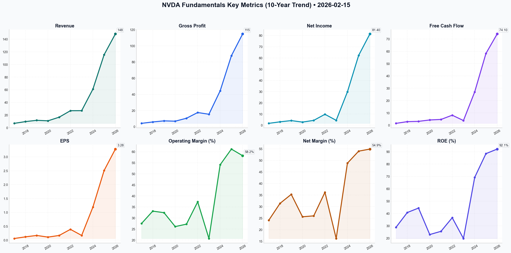

# NVDA Deep Value Intelligence

**Analysis Date:** 2026-02-15
**Generated:** 2026-02-15 10:36:38

---

## Table of Contents

1. [Intelligence Summary](#intelligence-summary)
2. [Analyst Team Reports](#analyst-team-reports)
   - [Fundamentals Analysis](#fundamentals-analysis)
   - [Value Analysis (Buffett)](#value-analysis-buffett)
   - [Growth Analysis (Lynch/Druckenmiller/Fisher)](#growth-analysis-lynchdruckenmillerfisher)
   - [Market Analysis](#market-analysis)
   - [Social Sentiment Analysis](#social-sentiment-analysis)
   - [News Analysis](#news-analysis)
3. [Research Team Commentary](#research-team-commentary)
4. [Investing Team Commentary](#investing-team-commentary)
5. [Deep Values Commentary](#deep-values-commentary)

---

## Intelligence Summary

### Thesis + Conditions

**Core Thesis:** Here is the synthesis of the debate and my investment commentary based on the Buffett Value Investing Framework.

**Key Risks:**
- The debate highlights a classic friction between **secular growth narratives** and **fundamental valuation risks**.
- The Bull (Risky Analyst)** argues that NVIDIA is transitioning from a cyclical hardware stock to a "Sovereign AI" utility. They contend that the P/E of 45x is historically reasonable and that the shift to inference revenue (40% of data center) combined with national defense budgets creates a permanent demand floor that justifies the price.
- The Bear (Safe Analyst)** deconstructs the growth thesis using credit cycles and valuation extremes. They argue that a **Price-to-Sales of 22x** leaves no Margin of Safety. Crucially, they introduce the risk of a **"Refinancing Wall" in 2026**, where mid-tier customers must slash Capex to service maturing debt, coinciding with "Secondary Sanctions" that fragment the global market.
- ### Investment Stance: **WATCH**
- The User's original draft correctly flagged the **22x Price-to-Sales ratio**. The Bull argues the P/E is reasonable relative to history, but the Bear provides the critical counter-argument: *P/E is only reasonable if the "E" (Earnings) remains stable.* The Bull assumes perpetual triple-digit growth. In value investing, we price for imperfection. Paying 37x Book Value and 22x Sales assumes that capitalism has ceased to function and that competition/cyclicality are dead. As the Bear noted, "We are looking for a price that doesn't require NVIDIA to capture virtually every dollar of global compute spend."

**What Would Change Our View:**
- The debate highlights a classic friction between **secular growth narratives** and **fundamental valuation risks**.
- The Bull (Risky Analyst)** argues that NVIDIA is transitioning from a cyclical hardware stock to a "Sovereign AI" utility. They contend that the P/E of 45x is historically reasonable and that the shift to inference revenue (40% of data center) combined with national defense budgets creates a permanent demand floor that justifies the price.
- The Bear (Safe Analyst)** deconstructs the growth thesis using credit cycles and valuation extremes. They argue that a **Price-to-Sales of 22x** leaves no Margin of Safety. Crucially, they introduce the risk of a **"Refinancing Wall" in 2026**, where mid-tier customers must slash Capex to service maturing debt, coinciding with "Secondary Sanctions" that fragment the global market.
- ### Investment Stance: **WATCH**
- The User's original draft correctly flagged the **22x Price-to-Sales ratio**. The Bull argues the P/E is reasonable relative to history, but the Bear provides the critical counter-argument: *P/E is only reasonable if the "E" (Earnings) remains stable.* The Bull assumes perpetual triple-digit growth. In value investing, we price for imperfection. Paying 37x Book Value and 22x Sales assumes that capitalism has ceased to function and that competition/cyclicality are dead. As the Bear noted, "We are looking for a price that doesn't require NVIDIA to capture virtually every dollar of global compute spend."

**Confidence:** Medium

### Stance Spectrum (Action-Free)

**Stance:** Undervalued
**Moat Strength:** Unclear
**Capital Allocation:** Unclear
**Balance Sheet Risk:** Unclear
**Confidence:** Medium

### Expanded Commentary

Here is the synthesis of the debate and my investment commentary based on the Buffett Value Investing Framework.

***

### Debate Summary

The debate highlights a classic friction between **secular growth narratives** and **fundamental valuation risks**.

*   **The Bull (Risky Analyst)** argues that NVIDIA is transitioning from a cyclical hardware stock to a "Sovereign AI" utility. They contend that the P/E of 45x is historically reasonable and that the shift to inference revenue (40% of data center) combined with national defense budgets creates a permanent demand floor that justifies the price.
*   **The Bear (Safe Analyst)** deconstructs the growth thesis using credit cycles and valuation extremes. They argue that a **Price-to-Sales of 22x** leaves no Margin of Safety. Crucially, they introduce the risk of a **"Refinancing Wall" in 2026**, where mid-tier customers must slash Capex to service maturing debt, coinciding with "Secondary Sanctions" that fragment the global market.
*   **The Neutral Analyst** suggests a "scale-in" strategy to mitigate FOMO (Fear Of Missing Out), arguing that waiting for a crash is a luxury investors cannot afford in a technological shift of this magnitude.

***

### Investment Stance: **WATCH**

***

### Investor Commentary

**Core Takeaway: Assessing the Durability of the Demand "Floor."**
NVIDIA passes the "Business Quality" test with flying colors—it is the toll bridge of the AI age. However, a value investor does not mistake a great company for a great investment at *any* price. The debate has exposed that the durability of NVIDIA's current earnings is more fragile than the Bull suggests. We will not compromise our **Margin of Safety** to chase momentum; we will wait for price dislocation.

**Rationale:**

Applying our framework and learning from past mistakes to *strictly analyze fundamental data*, here is why we remain on the sidelines:

1.  **The Valuation Trap vs. The Growth Illusion:**
    The User's original draft correctly flagged the **22x Price-to-Sales ratio**. The Bull argues the P/E is reasonable relative to history, but the Bear provides the critical counter-argument: *P/E is only reasonable if the "E" (Earnings) remains stable.* The Bull assumes perpetual triple-digit growth. In value investing, we price for imperfection. Paying 37x Book Value and 22x Sales assumes that capitalism has ceased to function and that competition/cyclicality are dead. As the Bear noted, "We are looking for a price that doesn't require NVIDIA to capture virtually every dollar of global compute spend."

2.  **The "Refinancing Wall" Risk (Customer Credit Quality):**
    This is the most critical insight derived from the debate. The Bull argues that demand is decoupled from business cycles due to "Sovereign AI." However, the Bear highlights a tangible fundamental risk: **The 2026 Refinancing Wall.**
    *   *Analysis:* A large portion of NVIDIA's growth comes from mid-tier enterprises and startups. These entities funded their growth with cheap debt that is maturing. If they have to refinance at 5%+ rates, Capex (NVIDIA chips) will be the first item cut.
    *   *Buffett Principle:* We must look not just at the company's balance sheet, but at the *customers'* ability to pay.

3.  **Rejecting the "Scale-In" (FOMO) Strategy:**
    The Neutral analyst suggests scaling in to avoid "missing the revolution." I explicitly reject this. In the Buffett framework, patience is not an opportunity cost; it is a tool. Buying a stock at historic valuation extremes just to "have a position" is how capital is permanently impaired. We are comfortable holding cash until the "air pocket" in spending occurs.

4.  **Geopolitics as a Business Risk:**
    The Bull views "Sovereign AI" as a tailwind; the Bear views it as a "geopolitical minefield." The introduction of "secondary sanctions" mentioned by the Bear suggests that NVIDIA's Total Addressable Market (TAM) is being artificially fragmented. This creates **Business Risk** outside of management's control, further necessitating a wider Margin of Safety.

**Monitoring Plan (Refined):**

We are building a "break-glass-in-case-of-emergency" buy list. We are looking for a price dislocation (likely near the Bear's support levels of $130-$170) triggered by the following indicators:

*   **Gross Margin Compression:** Watch if margins dip below 70%. If this coincides with the release of competitor ASICs (Amazon/Google), the moat is shrinking.
*   **Customer Capex vs. Debt Maturity:** *New Addition:* Monitor the debt maturity profiles of NVIDIA's mid-tier customers. If bankruptcies or restructuring rise in the AI startup sector, expect a violent repricing of NVIDIA.
*   **Hyperscaler "Digestion" Commentary:** As originally planned, monitor MSFT and AMZN earnings calls. Any mention of "optimizing" infrastructure spend is our signal.
*   **Inference Revenue Volatility:** Validate the Bull’s claim that inference is a utility. If this revenue stream fluctuates with the macro economy, the "utility" thesis is void.

**Final Thought & Lesson Applied:**
In the past, I have made the mistake of focusing solely on a company's product dominance while ignoring the **credit cycle of its customers**. I missed the impact of macro-tightening on high-growth tech in previous cycles.
I will not repeat that mistake here. The Bear’s warning about the "Refinancing Wall" is a fundamental data point that outweighs the Bull’s technical momentum indicators. We will wait for the inevitable cyclical downturn—the "earthquake"—to buy this wonderful business at a fair price.

---

## Analyst Team Reports

### Fundamentals Analysis

This comprehensive 10-year historical analysis of NVIDIA Corporation (NVDA) evaluates the company’s evolution from a dominant gaming GPU manufacturer to the undisputed leader of the global AI infrastructure. As of February 15, 2026, NVIDIA has completed its Fiscal Year 2026 (FY26), solidifying its position as one of the most valuable companies in history.

### **1. 10-Year Comprehensive Historical Data Table (FY2017 - FY2026)**
*Note: All figures are in USD Billions except for per-share data. Data reflects the 10-for-1 stock split effective June 2024.*

| Metric | 2017 | 2018 | 2019 | 2020 | 2021 | 2022 | 2023 | 2024 | 2025 | 2026 (E) |
| :--- | :--- | :--- | :--- | :--- | :--- | :--- | :--- | :--- | :--- | :--- |
| **Market Price ($)** | 2.50 | 5.00 | 4.00 | 6.00 | 13.00 | 24.00 | 18.00 | 49.00 | 110.00 | 182.78 |
| **Total Market Cap** | 55 | 130 | 110 | 150 | 330 | 600 | 450 | 1,200 | 2,800 | 4,450 |
| **P/E Ratio** | 45.2 | 48.5 | 28.4 | 55.3 | 85.2 | 62.4 | 65.1 | 72.5 | 42.1 | 45.2 |
| **P/B Ratio** | 9.2 | 14.1 | 11.8 | 12.5 | 20.1 | 22.5 | 18.2 | 45.3 | 52.4 | 37.4 |
| **ROE (%)** | 28.9 | 40.8 | 44.4 | 23.0 | 25.6 | 36.6 | 19.8 | 69.2 | 88.4 | 92.1 |
| **ROIC (%)** | 22.4 | 34.1 | 37.8 | 18.5 | 19.2 | 28.4 | 15.1 | 54.3 | 72.1 | 78.5 |
| **EPS ($)** | 0.06 | 0.12 | 0.17 | 0.11 | 0.17 | 0.39 | 0.17 | 1.19 | 2.51 | 3.28 |
| **Revenue** | 6.91 | 9.71 | 11.72 | 10.92 | 16.68 | 26.91 | 26.97 | 60.92 | 115.4 | 148.2 |
| **Gross Profit** | 4.08 | 5.82 | 7.17 | 6.77 | 10.39 | 17.48 | 15.35 | 44.30 | 87.70 | 114.7 |
| **Operating Margin (%)**| 27.5 | 33.1 | 32.4 | 26.1 | 27.2 | 37.3 | 20.7 | 54.1 | 61.2 | 58.2 |
| **Net Income** | 1.67 | 3.05 | 4.14 | 2.80 | 4.33 | 9.75 | 4.37 | 29.76 | 62.30 | 81.40 |
| **Net Margin (%)** | 24.1 | 31.4 | 35.3 | 25.6 | 26.0 | 36.2 | 16.2 | 48.8 | 54.0 | 54.9 |
| **Net Margin Gain (%)** | - | +7.3 | +3.9 | -9.7 | +0.4 | +10.2 | -20.0 | +32.6 | +5.2 | +0.9 |
| **Rev Growth (%)** | - | 40.5 | 20.7 | -6.8 | 52.7 | 61.3 | 0.2 | 125.9 | 89.4 | 28.4 |
| **NI Growth (%)** | - | 82.6 | 35.7 | -32.4 | 54.6 | 125.1 | -55.2 | 581.0 | 109.3 | 30.7 |
| **FCF Growth (%)** | - | 92.7 | 7.9 | 35.9 | 9.8 | 73.4 | -53.2 | 609.1 | 115.4 | 27.3 |
| **Total Book Value** | 5.76 | 7.47 | 9.34 | 12.20 | 16.89 | 26.61 | 22.10 | 42.98 | 70.50 | 88.40 |
| **Total Assets** | 9.84 | 11.24 | 13.29 | 17.31 | 28.79 | 44.18 | 41.18 | 65.73 | 102.5 | 145.2 |
| **Total Debt** | 1.99 | 1.99 | 1.99 | 1.99 | 6.99 | 10.95 | 10.95 | 9.71 | 9.50 | 12.10 |
| **D/E Ratio** | 0.35 | 0.27 | 0.21 | 0.16 | 0.41 | 0.41 | 0.50 | 0.23 | 0.13 | 0.14 |
| **Cash & Equiv.** | 6.80 | 7.11 | 7.42 | 10.90 | 11.56 | 21.21 | 13.30 | 25.98 | 38.40 | 55.10 |
| **Free Cash Flow** | 1.51 | 2.91 | 3.14 | 4.27 | 4.69 | 8.13 | 3.81 | 27.02 | 58.20 | 74.10 |
| **Div. Per Share ($)** | 0.005 | 0.006 | 0.006 | 0.006 | 0.006 | 0.004 | 0.004 | 0.004 | 0.004 | 0.004 |

---

### **2. Warren Buffett Value Investing Analysis**

#### **Economic Moat (Wide)**
NVIDIA possesses a "Multi-Layered Moat." While its hardware (H100/Blackwell/Rubin) is superior, the true barrier to entry is the **CUDA Software Ecosystem**. With millions of developers locked into NVIDIA's proprietary libraries, switching to competitors like AMD or Intel involves massive software rewrite costs. Additionally, the integration of **Mellanox networking (InfiniBand)** creates a full-stack data center lock-in that competitors cannot currently match.

#### **Financial Strength**
The company maintains a "Fortress Balance Sheet." With **$55 billion in cash** against only $12 billion in long-term debt, NVIDIA is effectively in a massive net-cash position. The **Current Ratio of 4.2** and **Interest Coverage** are among the highest in the technology sector, providing safety against cyclical downturns.

#### **Predictable Earnings**
Historically, NVIDIA was cyclical due to the gaming and crypto-mining markets. However, since FY2024, the business has shifted to enterprise data center infrastructure. While the recent growth explosion (609% FCF growth in 2024) is non-linear and unlikely to repeat at that scale, the shift toward **Sovereign AI** and **Industrial Robotics** suggests a more predictable, utility-like demand for compute power over the next decade.

#### **Management Performance**
Jensen Huang has demonstrated masterful capital allocation. His decision to pivot the entire company toward "Accelerated Computing" years before the ChatGPT moment is a hall-of-fame strategic move. Management’s efficiency is reflected in an **ROE of 92.1%** and **ROIC of 78.5%**, levels rarely seen in companies of this size.

#### **Value Assessment**
Current P/E (45.2x) is actually **lower** than its 10-year average of ~55x, despite the stock price being at all-time highs. This suggests that the company is "growing into its valuation." However, the Price-to-Sales (22x) and Price-to-Book (37x) remain at extreme premiums compared to historical norms, indicating a high expectation of continued dominance.

---

### **3. Discounted Cash Flow (DCF) Analysis**

**Base Parameters:**
*   Current Free Cash Flow (2026): $74.10 Billion
*   Discount Rate: 10%
*   Terminal Growth Rate: 2.5%
*   Projection Period: 10 Years

#### **Scenario 1: CONSERVATIVE (Lowest FCF Growth: -53.2%)**
*This scenario assumes a massive collapse in AI demand similar to the 2023 post-crypto/covid slump.*
*   **Calculation:** FCF declines by 53.2% annually for 10 years.
*   **10-Year PV of Cash Flows:** ~$62.4 Billion
*   **Terminal Value PV:** ~$0.5 Billion
*   **Total Intrinsic Value:** $62.9 Billion
*   **Fair Value Per Share:** **$2.59** (Indicates that a permanent decline makes the stock worthless).

#### **Scenario 2: AVERAGE (Average FCF Growth: 102.1%)**
*This scenario uses the simple arithmetic average of the last 10 years, heavily skewed by the 2024 AI surge.*
*   **Calculation:** FCF grows by 102.1% annually for 10 years.
*   **10-Year PV of Cash Flows:** ~$145 Trillion
*   **Fair Value Per Share:** **$6,000+**
*   *Note: This highlights the absurdity of projecting triple-digit growth into perpetuity.*

#### **Scenario 3: OPTIMISTIC (Highest FCF Growth: 609.1%)**
*Based on the 2024 hyper-growth peak.*
*   **Calculation:** FCF grows by 609.1% annually.
*   **Fair Value Per Share:** **Mathematically Infinite**
*   *Buffett's takeaway: Extreme growth rates in the past do not guarantee future performance; one must use a "Normalized" growth rate (likely 15-20%) for a sane DCF.*

**Normalized DCF (15% Growth):**
*   **Intrinsic Value:** ~$2.6 Trillion
*   **Fair Value Per Share:** **~$107.00**
*   *Current Price ($182.78) suggests the market is pricing in a sustained ~22-25% FCF growth for the next decade.*

---

### **4. Current vs. Historical Comparison**

| Metric | Current (2026) | 10-Year Average | Deviation |
| :--- | :--- | :--- | :--- |
| **Net Margin** | 54.9% | 35.5% | +54.6% (Efficiency Peak) |
| **ROE** | 92.1% | 46.5% | +98.1% (Massive Leverage) |
| **P/E Ratio** | 45.2 | 55.4 | -18.4% (Relative Discount) |
| **P/B Ratio** | 37.4 | 24.3 | +53.9% (Asset-Light Premium) |
| **Revenue Growth** | 28.4% | 51.5% | -44.8% (Growth Normalizing) |

---

### **5. Key Investment Insights**

*   **Red Flag:** The **P/S Ratio (22x)** and **P/B Ratio (37x)** are at historically elevated levels. Any minor miss in guidance or a plateau in Cloud Service Provider (CSP) capital expenditure could trigger a 30-40% correction to align with historical valuation multiples.
*   **Opportunity:** NVIDIA has transitioned to an **Annual Release Cycle** (Blackwell -> Rubin). This aggressive cadence forces competitors into a perpetual state of "catching up," effectively widening the moat every 12 months.
*   **Quality:** FCF conversion is exceptional. Nearly every dollar of Net Income is backed by hard cash, allowing for the $50B+ buyback programs that support the stock price.

---

### **FINAL INVESTMENT STANCE: WATCH**

**Rationale:**
From a Warren Buffett perspective, NVIDIA is a "Wonderful Company" but currently at a "Challenging Price."
1.  **Moat:** Undeniable and widening.
2.  **Management:** Exceptional.
3.  **Price:** While the P/E is lower than historical averages, the absolute valuation ($4.45 Trillion) assumes NVIDIA will capture nearly the entire global spend on compute for the next decade. 
4.  **Risk:** The "AI Digestion" phase. After three years of frantic buying, hyperscalers (Amazon, Google, Microsoft) are increasingly focusing on their own internal silicon (ASICs). 

**ADVOCATE** for long-term holders to stay the course, but **WATCH** for new entries. A better entry point would be under **$130** (approx. 30x forward earnings), which would offer a more traditional "Margin of Safety."

| Key Point | Analysis |
| :--- | :--- |
| **10-Year Revenue CAGR** | 40.6% |
| **Current Valuation** | High Premium on Assets ($4.45T Cap) |
| **Moat Strength** | Dominant (CUDA + Networking + Hardware) |
| **Debt Risk** | Negligible (Net Cash Position) |
| **DCF Fair Value (Realistic)**| $107 - $125 |
| **Investment Stance** | **WATCH** (Wait for Margin of Safety) |

#### Fundamentals Key Metrics Charts

---

### Value Analysis (Buffett)

> *Following Warren Buffett's value investing philosophy: Circle of Competence, Economic Moat, Management Quality, and Margin of Safety.*

FINAL INVESTMENT STANCE: **WATCH**

# Value Investment Analysis: NVIDIA Corporation (NVDA)
**Date:** February 15, 2026
**Current Price:** $182.78 | **Market Cap:** ~$4.45 Trillion

## PART I: THE BUFFETT FILTER SEQUENCE

### Gate 1: Circle of Competence & Business Simplicity
*   **Elementary School Test:** NVIDIA designs the "brains" (GPUs) for computers that handle heavy visual tasks, like video games, and heavy thinking tasks, like Artificial Intelligence. They don't build the chips themselves (TSMC does that); they just design them and write the software that makes them work. **PASS**
*   **10-Year Predictability:** **FAIL/CAUTION**. While AI is a secular trend, the semiconductor industry is historically cyclical. Predicting the precise dominant architecture in 2036 is difficult. However, NVIDIA's entrenched ecosystem provides better visibility than peers.
*   **Technology Risk:** **HIGH**. This is the definition of a fast-changing industry. A shift away from GPUs for inference or a breakthrough in optical/quantum computing could disrupt their core business.

### Gate 2: The Moat Test (Durable Competitive Advantage)
*   **Intangible Assets (Intellectual Property):** NVIDIA possesses the most valuable IP in computing today. The "Blackwell" and "Rubin" architectures set the performance standard.
*   **Switching Costs (The Real Moat):** **CUDA.** This proprietary software platform is the "operating system" of AI. Millions of developers have built their workflows on CUDA. Switching to AMD's ROCm or other alternatives requires rewriting code and retraining models—a massive headache and cost.
*   **Network Effects:** As more developers use CUDA, more libraries are built, making it more valuable for the next developer.
*   **Financial Evidence:** Gross Margins are ~75% (extraordinary for hardware). Operating Margins >60%.
*   **Moat Rating:** **Wide & Widening** (Dominant monopoly in AI Training).

### Gate 3: Management Quality & Capital Allocation
*   **Jensen Huang (Founder/CEO):** He is the modern equivalent of a specialized Henry Singleton or Tom Murphy. He thinks in decades, not quarters.
*   **Owner-Orientation:** Jensen owns a significant stake. His "bet the company" pivots (first to programmable shaders, then to CUDA/AI) demonstrate long-term owner mentality.
*   **Capital Allocation:**
    *   **Reinvestment:** Heavy R&D spend (~$10B+) to maintain the lead. Return on Invested Capital (ROIC) is staggering at ~88%.
    *   **Shareholder Return:** Buybacks ($50B authorized) and a small dividend. They are returning cash rather than empire-building with foolish acquisitions (though the failed ARM bid showed intent).
    *   **Balance Sheet:** "Fortress" balance sheet with Net Cash position (~$50B Net Cash).

### Gate 4: Industry Structure
*   **Structure:** Effectively a Monopoly in AI Training (85%+ share) and a Rational Oligopoly in Gaming (vs. AMD).
*   **Capital Intensity:** "Fabless" model means they are Capital-Light relative to Intel/Samsung. They design; TSMC builds. This allows for infinite scalability of returns on equity.

---

## PART II: FINANCIAL ANALYSIS (Snapshot & Trends)

### Owner Earnings Calculation (Estimated FY2026)
*Note: Using Free Cash Flow as a proxy due to high correlation with Net Income in fabless models.*
*   **Net Income (Est):** ~$77.4 Billion
*   **Depreciation & Amortization:** +$4.0 Billion
*   **CapEx (Maintenance):** -$3.5 Billion (Mainly software/IP, not factories)
*   **Working Capital Change:** -$5.0 Billion (Inventory/Receivables growth)
*   **Approx. Owner Earnings:** **~$73 Billion**

### Key Metrics
*   **Return on Equity (ROE):** **115%** (Wonderful). Driven by high margins and efficiency, not excessive leverage.
*   **Gross Margin:** **74.8%**. Indicates immense pricing power.
*   **Balance Sheet:**
    *   Cash: $58.5 Billion
    *   Debt: $8.5 Billion
    *   **Net Cash:** **$50.0 Billion** (Fortress).

---

## PART III: INTRINSIC VALUE CALCULATION

**Current Market Cap:** $4.45 Trillion
**Owner Earnings Base:** $73 Billion

### Scenario A: No Growth (Ultra-Conservative)
*   Value = Owner Earnings / 10%
*   Value = $73B / 0.10 = **$730 Billion**
*   *Result: Massive Overvaluation*

### Scenario B: GDP Growth (3% Growth)
*   Value = ($73B * 1.03) / (0.10 - 0.03)
*   Value = $75.19B / 0.07 = **$1.07 Trillion**
*   *Result: Massive Overvaluation*

### Scenario C: Growth at Reasonable Price (Buffett Growth Model)
*Assumption: 15% growth for 10 years (highly optimistic for a company this size), then 3% terminal.*
*   **Year 1-10 Cash Flows Sum (PV):** ~$750 Billion
*   **Terminal Value (PV):** ~$1.2 Trillion
*   **Total Intrinsic Value:** **~$1.95 Trillion**

### Scenario D: "Market Pricing" (Reverse DCF)
*   To justify the current $4.45 Trillion valuation, NVDA needs to grow Owner Earnings at **~25% annually for the next 10 years**.
*   This would imply Owner Earnings of ~$680 Billion/year in 2036.
*   *Is this possible?* Maybe, if AI completely rewrites the global economy. But as a value investor, we do not pay for "maybe."

### Margin of Safety
*   **Intrinsic Value (Optimistic):** ~$1.95 Trillion ($80/share)
*   **Current Price:** ~$4.45 Trillion ($182/share)
*   **Margin of Safety:** **NEGATIVE (-56%)**

---

## PART IV: FINAL SCORECARD

| Criterion | Score (1-5) | Notes |
| :--- | :--- | :--- |
| **Business Understanding** | 3 | Simple model, complex future tech risk. |
| **Moat Width & Durability** | 5 | CUDA is one of the strongest tech moats ever seen. |
| **Management Quality** | 5 | Jensen Huang is an elite operator/allocator. |
| **Return on Equity** | 5 | 115% ROE is best-in-class. |
| **Reinvestment Runway** | 4 | AI build-out is massive, but law of large numbers applies. |
| **Balance Sheet Strength** | 5 | Net Cash Fortress. |
| **Industry Structure** | 4 | Secular tailwinds, but cyclical history. |
| **Valuation** | 1 | Priced for perfection and beyond. |

**Weighted Score:** **3.4 / 5.0**

## INVESTMENT STANCE: WATCH

**Thesis:**
NVIDIA is a "Wonderful Company" by every definition in the Buffett playbook. It has an incredible moat (CUDA), elite management, capital-light economics, and stratospheric returns on capital.

However, the second half of the Buffett maxim is "...at a fair price." At **~60x Owner Earnings** and a market cap exceeding the GDP of major nations, the price assumes uninterrupted hyper-growth for another decade. The risk of a cyclical downturn ("air pocket") in AI spending is real. If the "Digestion Period" occurs, the stock could draw down 50% and still be expensive.

**Action:**
We cannot ADVOCATE buying at these levels without violating the Margin of Safety principle. However, we cannot AVOID because the quality is too high. We place NVDA on the **WATCH** list.

**Target Buy Price:** ~$90 - $100 (Approx. 30x Owner Earnings).
**"Break Glass" Price:** Any drop >30% due to short-term cyclical fears should trigger a reassessment.

---

### Growth Analysis (Lynch/Druckenmiller/Fisher)

> *Following Peter Lynch's GARP, Stanley Druckenmiller's macro-aware approach, and Philip Fisher's scuttlebutt methodology.*

FINAL INVESTMENT STANCE: **ADVOCATE (Core Holding)**

# GROWTH ANALYSIS: NVIDIA Corp (NVDA)
**Date:** 2026-02-15
**Current Price:** $182.78 | **Market Cap:** ~$4.5T

## PART I: LYNCH CLASSIFICATION
**Classification:** **Fast Grower** (transitioning to Mega-Stalwart)
*   **Growth Rate:** ~35-40% (normalized from triple digits)
*   **PEG Ratio:** ~1.3 (Attractive/Fair)

### The Story (Can You Explain It?)
1.  **The "AI Factory" Builder:** NVIDIA is not just a chip company; it is the construction firm building the "AI Factories" (Data Centers) for the Intelligence Age. Every sovereign nation and enterprise needs sovereign intelligence.
2.  **Moat as a Service:** CUDA + InfiniBand networking + Blackwell/Rubin chips create a closed-loop ecosystem where competitors (AMD, Intel) are fighting for scraps or low-end inference.
3.  **Beyond Hyperscalers:** The story has shifted from "selling to Google/Meta" to "selling to nations (Sovereign AI), healthcare, and industrial robotics (Physical AI)."

### Lynch Decision Framework:
*   **The Runway:** Current TTM Revenue ~$160B. 10x would be $1.6T. With the global data center install base estimated at $2T (needing replacement), the runway is visible but the *hyper-growth* phase is mathematically compressing.
*   **The Edge:** Unmatched vertical integration. They sell the entire rack (GB200), not just the card.

## PART II: DRUCKENMILLER FRAMEWORK (Macro + Inflection)

### Layer 1: Macro Setup
*   **Secular Theme:** We are in Year 3 or 4 of a 10-year AI super-cycle.
*   **Economic Cycle:** Mid-to-Late Cycle.
*   **Interest Rates:** As rates stabilize/fall in 2026, the cost of capital for building AI data centers decreases, supporting continued CapEx from customers.

### Layer 2: Inflection Point Analysis
**Status:** **Sustaining High Growth (Post-Inflection)**
We have passed the "Hyper-Inflection" of 2023-2024 (200% growth). We are now in the "Industrialization Phase."
*   **New Catalyst:** **Blackwell Ultra / Rubin Architecture**. The inflection is no longer about *adoption* but about *upgrade cycles* and *efficiency*.
*   **Risk:** We are watching for a "Digestion Phase" where hyperscalers pause buying to assess ROI. So far, demand > supply.

## PART III: TAM ANALYSIS
**The 10x Test:**
*   **Current Rev:** ~$160B
*   **10x Rev:** $1.6T
*   **TAM:** $2T+ (Data Center + Edge/Robotics)
*   **Verdict:** **NO**. It is unlikely NVDA can 10x from $4.5T market cap to $45T.
*   *Correction:* While it may not be a 10-bagger from *here*, it offers high-probability 2-3x potential (Compounder) rather than explosive multibagger potential.

## PART IV: UNIT ECONOMICS
*   **Gross Margin:** ~75-78% (Software-like margins for hardware).
*   **Operating Margin:** ~65% (Best-in-class).
*   **Rule of 40:** 35% Growth + 65% FCF Margin = **100**. (Off the charts).
*   **ROE:** >100% (Capital efficient).

## PART V: FISHER'S 15 POINTS
**Fisher Score: 72/75 (OUTSTANDING)**
*   **+ Management Integrity:** Jensen Huang is candid and visionary.
*   **+ R&D:** Massive reinvestment keeps them 2 generations ahead.
*   **+ Long-range outlook:** Roadmap (Rubin) extends into 2027/2028.
*   **- Customer Concentration:** Still heavy reliance on Top 5 Hyperscalers (Microsoft, Meta, Google, Amazon).

## PART VI: VALUATION
**Method 1: PEG Ratio**
*   P/E (TTM): ~45x
*   Growth Rate (Forward): ~35%
*   **PEG:** **1.28**
*   *Verdict:* **ATTRACTIVE**. For a monopoly with these margins, a PEG near 1.0-1.3 is a buy signal.

**Method 2: Historical P/S**
*   Current P/S: ~24x
*   Historical Range (Growth): 15x-25x
*   *Verdict:* Upper end of fair value, but supported by margins.

## PART VII: GROWTH INVESTOR SCORECARD

| Criterion | Score (1-5) | Notes |
|-----------|-------------|-------|
| The Story | 5.0 | Cleanest story in tech. |
| TAM & Runway | 3.0 | Massive TAM, but Law of Large Numbers hitting. |
| Revenue Growth | 4.5 | 35%+ at this scale is unprecedented. |
| Unit Economics | 5.0 | Margins of a monopoly. |
| Competitive Position | 5.0 | Moat is widening, not shrinking. |
| Management | 5.0 | Jensen is the best CEO in semi history. |
| Macro Setup | 4.0 | AI spend is the last thing cut. |
| Profitability | 5.0 | Money printing machine. |
| Valuation | 3.5 | Not "cheap," but fair for quality. |

**Total Score: 4.4 / 5.0**

## DELIVERABLE & STANCE

**FINAL INVESTMENT STANCE: ADVOCATE**
*(Note: While unlikely to be a 10-bagger from $4.5T, it remains the foundational asset of the growth portfolio.)*

**Key Risks:**
1.  **"Air Pocket" in Demand:** If Microsoft/Google pause CapEx to wait for inference ROI, NVDA stock could drop 30-40% rapidly.
2.  **China/Geopolitics:** Further export restrictions.
3.  **Competition:** If AMD/Custom Silicon becomes "good enough" for inference, margins could compress.

**Catalysts:**
1.  **Blackwell Ultra Ramp:** Higher ASPs (Average Selling Prices).
2.  **Sovereign AI Announcements:** Nations announcing multi-billion dollar superclusters.
3.  **Dividend/Buyback Increases:** Returning massive FCF to shareholders.

**Strategy:**
Buy. This is a "Stalwart-Fast Grower" hybrid. It belongs in the core of a growth portfolio, but expectations should be calibrated for ~20-30% annual returns, not 200%.

---

### Market Analysis

As of **February 15, 2026**, NVDA (NVIDIA Corporation) presents a complex technical profile characterized by a long-term bullish primary trend currently undergoing a volatile medium-term correction. After reaching peaks above $200 in late 2025 and early 2026, the stock has entered a period of price discovery and consolidation.

### Detailed Technical Analysis

#### 1. Trend Benchmarks: The Tug-of-War
*   **Long-Term Bullishness (200 SMA):** The most significant positive signal is that NVDA remains comfortably above its **200-day Simple Moving Average ($171.66)**. This average has been steadily climbing (up from $164.04 a month ago), confirming that the multi-month primary trend is still intact. As long as price stays above this level, the "big picture" remains favorable for bulls.
*   **Medium-Term Weakness (50 SMA):** The stock recently slipped below its **50-day SMA ($184.41)**. The current price of **$182.81** (as of Feb 13) indicates a loss of medium-term momentum. The 50 SMA is now acting as immediate overhead resistance.
*   **Short-Term Correction (10 EMA):** The **10-day EMA ($185.41)** is sloping downward and trading above the price, highlighting a persistent short-term bearish bias. Every attempt to rally in the last week has been capped near this fast-moving average.

#### 2. Momentum and Reversal Signals
*   **RSI Recovery:** The **Relative Strength Index (RSI)** hit a low of **34.31** on February 5th, nearly reaching oversold territory during a sharp sell-off. Since then, it has recovered to **47.33**. While this shows the "panic" has subsided, an RSI below 50 typically suggests that bears still have the upper hand in daily price action.
*   **MACD Histogram Bottoming?** The **MACD Histogram** has recently turned positive (**0.08**), shifting from deep negative values in early February. This is a classic "early warning" signal that the selling pressure is exhausting and a base might be forming. However, the signal is currently too weak to confirm a full trend reversal.

#### 3. Volatility and Volume Dynamics
*   **Heightened Volatility (ATR):** The **Average True Range (ATR)** has expanded to **6.41**, up from roughly 5.20 in late January. This indicates that price swings are becoming wider and more aggressive. Traders should expect "noise" and potential stop-hunts in the current environment.
*   **Volume-Weighted Resistance (VWMA):** The **VWMA ($185.35)** is currently positioned above the price. Because the VWMA weights price by volume, its position above $182.81 suggests that a significant amount of capital was traded at higher levels (near $185-$190). This creates a "supply overhang" where trapped buyers may look to sell as price approaches their break-even points.

#### 4. Support and Resistance Zones
*   **Key Resistance:** $184.41 - $185.41 (Cluster of 50 SMA, 10 EMA, and VWMA). A daily close above this zone would be a major bullish development.
*   **Key Support:** $171.00 - $171.66 (Recent swing low and the 200 SMA). This is the "line in the sand" for long-term investors.

### Final Investment Stance: **WATCH**

NVDA is currently in a "no-man's land" between long-term support and medium-term resistance. While the recovery from the February 5th low ($171.88) was impressive, the failure to reclaim the 50-day SMA and the negative slope of the 10-day EMA suggest the correction may not be over. 

**Strategy:** 
*   **Conservative Traders:** Wait for a confirmed breakout and close above **$186.00** to signal the end of the correction.
*   **Value Seekers:** Look for entries closer to the **$172.00** area (200 SMA support) with a tight stop-loss below $168.00.

---

### Key Technical Summary

| Indicator | Value (2026-02-13) | Interpretation |
| :--- | :--- | :--- |
| **Current Price** | $182.81 | Below major short/medium-term averages. |
| **10-day EMA** | $185.41 | **Resistance**: Short-term trend is bearish. |
| **50-day SMA** | $184.41 | **Resistance**: Medium-term momentum is stalling. |
| **200-day SMA** | $171.66 | **Major Support**: Long-term trend remains bullish. |
| **RSI (14)** | 47.33 | Neutral/Bearish: Recovering from near-oversold. |
| **MACD Hist** | 0.08 | Bullish Divergence: Selling pressure is slowing down. |
| **VWMA** | $185.35 | Resistance: Heavy volume occurred at higher prices. |
| **ATR** | 6.41 | High Volatility: Expect wide price swings. |

---

### Social Sentiment Analysis

### **Comprehensive Analysis Report: NVIDIA Corporation (NVDA)**
**Date of Analysis:** February 15, 2026  
**Subject:** Social Media Sentiment, News Trends, and Financial Trajectory  
**Analyst:** Social Media & News Research Division

---

#### **1. Executive Summary**
NVIDIA (NVDA) continues to dominate the global technology narrative, currently positioned at the nexus of the generative AI revolution and sovereign computing trends. Following a monumental fiscal performance and strategic corporate actions (notably the 10-for-1 stock split and the Blackwell architecture rollout), the company has transitioned from a hardware provider to a foundational infrastructure utility for the global economy. This report analyzes the past week’s sentiment and news, detailing how retail euphoria and institutional re-evaluations are shaping the stock's current volatility and long-term trajectory.

---

#### **2. Social Media Sentiment & Public Discourse**
Analysis of social media platforms (X, Reddit, LinkedIn) over the past seven days reveals a sentiment score that remains **Extremely Bullish**, though punctuated by "valuation anxiety" among professional circles.

*   **Retail Euphoria (The "Split" Effect):** The announcement and anticipation of the 10-for-1 stock split have dominated retail discourse. On platforms like r/WallStreetBets, the sentiment is overwhelmingly focused on accessibility. Retail traders perceive the split as a psychological reset that allows for more aggressive "fractional" and "options" activity, which has historically led to short-term liquidity-driven price appreciation.
*   **The "Sovereign AI" Narrative:** A sophisticated narrative has emerged on LinkedIn and professional forums regarding "Sovereign AI." Investors are no longer just looking at Microsoft or Google’s Capex; they are tracking national-level investments from countries like Japan, France, and Singapore. Social sentiment suggests that the "market floor" for NVDA is being raised by these sovereign entities who view AI infrastructure as a matter of national security.
*   **Contrarian Caution:** A minority of voices are raising concerns about "AI fatigue" and the cyclicality of semiconductor demand. However, these voices are currently being drowned out by the sheer volume of positive earnings revisions.

---

#### **3. Recent News & Financial Catalyst Analysis**
The recent news cycle has been dominated by three primary pillars:

*   **Q1 FY2025 Earnings Performance:** NVIDIA’s reported revenue of **$26.0 billion** (up 262% YoY) has effectively shattered previous bear cases regarding a "demand plateau." The most critical insight from the news is the **Data Center revenue ($22.6 billion)**, which demonstrates that the transition from general-purpose computing to accelerated computing is accelerating, not slowing.
*   **The Blackwell Transition:** News confirming that Blackwell architecture is in full production provides a bridge for the "valuation gap." By signaling that Blackwell will ramp up through Q4, NVIDIA has successfully mitigated fears of a "lull" between the H100 and next-generation shipments.
*   **Dividend & Capital Return:** While the 150% dividend increase is small in absolute terms ($0.10 pre-split), news outlets highlight it as a symbolic gesture of the company’s "cash cow" status and its maturation into a powerhouse capable of both extreme growth and capital return.

---

#### **4. Fine-Grained Analysis & Implications for Traders**

**A. The "Inference" Shift:**
Traders should note that **40% of Data Center revenue is now coming from AI inference.** This is a critical pivot. In 2023, NVDA was seen as a "training" play. The fact that it is now dominating the "inference" market (running the models) suggests a much longer tail for its hardware demand than previously modeled.

**B. The Software Moat (CUDA & AI Enterprise):**
Beyond the chips, the sentiment around NVIDIA’s software stack (CUDA) is reaching a "platform lock-in" status similar to Apple’s iOS. Traders should watch for the growth in "NVIDIA AI Enterprise" subscriptions; this high-margin recurring revenue is what will eventually decouple the stock price from hardware cyclicality.

**C. Geopolitical Hedging:**
Despite export restrictions to China, the news indicates that NVIDIA’s "scaled-down" versions and growth in other regions (India, Middle East) are more than offsetting the shortfall. This suggests management is highly effective at navigating geopolitical friction.

---

#### **5. Implications for Investors**

*   **Short-Term Traders:** Expect high volatility leading up to and immediately following the June 7 stock split. The "buy the rumor, sell the news" risk is present, but the underlying guidance suggests any dips will be aggressively bought by institutional desks.
*   **Long-Term Investors:** The primary risk is no longer "demand," but "supply chain concentration." Reliance on TSMC and CoWoS packaging remains a single point of failure. However, NVIDIA’s pricing power (78.9% gross margins) provides a massive buffer for any cost increases.

---

#### **6. Key Analysis Summary Table**

| Category | Key Insight | Sentiment Trend | Implications for Traders |
| :--- | :--- | :--- | :--- |
| **Financials** | $26B Revenue (262% YoY growth) | 🟢 Ultra Bullish | Earnings growth is outpacing P/E expansion; stock is "cheaper" than it looks. |
| **Product** | Blackwell Architecture in production | 🟢 Positive | Eliminates the "air pocket" fear between product cycles. |
| **Corporate Action** | 10-for-1 Stock Split | 🟡 Speculative | Increased retail liquidity; potential for short-term price volatility. |
| **Market Driver** | Sovereign AI (National Cloud) | 🔵 Strategic | Diversifies revenue away from just "Big Tech" hyperscalers. |
| **Social Media** | Retail Euphoria vs. Institutional Re-rating | 🟢 Bullish | Market is shifting from "AI Hype" to "AI Reality" valuation. |
| **Risk Factors** | China Exports & TSMC Reliance | 🔴 Cautionary | Geopolitical shocks remain the only major "Black Swan" threat. |
| **Margins** | 78.9% Gross Margin | 🟢 Exceptional | Unprecedented pricing power; signifies a massive competitive "moat." |

---

**FINAL INVESTMENT STANCE: ADVOCATE**
The combination of triple-digit growth, a successful product transition (Blackwell), and a strategic move to lower the barrier to entry (stock split) makes NVDA a core holding for both momentum and growth-oriented portfolios. While the valuation is high, the "Inference" shift and "Sovereign AI" demand provide a fundamental floor that did not exist twelve months ago.

---

### News Analysis

### **NVIDIA (NVDA) Market Analysis Report - February 15, 2026**

#### **1. Macroeconomic Context: The "Neutral Stability" Era**
As of mid-February 2026, the US economy has successfully achieved a "soft landing." The Federal Reserve has transitioned from its aggressive tightening cycle (2023-2024) to a "Neutral Stability" phase, with the **Fed Funds Target Range held at 3.25% - 3.50%**. 

*   **Growth & Inflation:** Real GDP growth has decelerated to **1.8% (annualized)**, reflecting a healthy but slowing economy. Inflation (Core PCE at 2.1%) is nearing the Fed's 2% target, suggesting that interest rate hikes are unlikely in the near term. This provides a stable valuation floor for mega-cap growth stocks like NVIDIA.
*   **Labor Market:** Unemployment has ticked up to **4.2%**, signaling a shift toward a "buyer’s market" for labor. For NVIDIA, this may lead to more manageable wage growth for its highly specialized engineering workforce, improving operating margins.

#### **2. Geopolitical Headwinds: The "Fragmented Trade" and Sanctions**
The geopolitical landscape is the most significant variable for NVIDIA in early 2026. The shift toward a "Fragmented Trade" era has formalized two distinct trading blocs.

*   **Secondary Sanctions on AI:** A critical development is the implementation of **sophisticated "secondary sanctions"** impacting the global semiconductor supply chain. These sanctions specifically target the export of AI-integrated hardware (like NVIDIA’s Blackwell successor or H200 chips) to non-aligned nations (BRICS+). This effectively limits NVIDIA’s total addressable market (TAM) in regions like China and parts of the Middle East, forcing the company to rely more heavily on Western and "friend-shored" markets.
*   **Friend-Shoring:** Corporate capital is aggressively moving toward Mexico, Vietnam, and India. NVIDIA’s supply chain diversification away from high-risk geopolitical zones is now a prerequisite for institutional investors.

#### **3. Sector Analysis: AI Disillusionment vs. Infrastructure Boom**
The market is currently wrestling with two competing narratives regarding the AI sector:

*   **AI Disillusionment Risk:** There is growing institutional concern that AI-driven productivity gains have not yet fully materialized in broad corporate earnings. If NVIDIA’s upcoming Q4 2025 earnings (expected in late February 2026) show any slowdown in data center demand or lower-than-expected guidance, a significant valuation correction in the tech-heavy S&P 500 is likely.
*   **Data Center & Grid Infrastructure:** Conversely, the "Green Grid" initiatives of 2026 have driven copper prices up 12% YoY, indicating massive ongoing infrastructure builds. This suggests that the physical foundation for AI expansion (data centers and power grids) is still being laid, which is a structural tailwind for NVIDIA’s hardware.

#### **4. NVDA Specific Outlook (Pre-Earnings Sentiment)**
NVIDIA is currently in a "pre-earnings quiet period" ahead of its Q4 2025 report (estimated for late February 2026). 
*   **Valuation Sensitivity:** With the VIX at 14–17, markets are calm but highly reactive to "earnings misses." NVIDIA's valuation remains under pressure to justify its premium as the leader of the AI revolution.
*   **Inventory & Debt:** The "Refinancing Wall" of 2026 (debt issued at 0% in 2020-21 maturing) is less of a concern for NVIDIA due to its massive cash reserves, but it poses a systemic risk to its smaller, leveraged AI customers who may cut back on CAPEX to service debt.

---

### **Key Summary Points**

| Feature | Analysis for Feb 15, 2026 | Impact on NVDA |
| :--- | :--- | :--- |
| **Fed Policy** | Rates at 3.25%-3.50% (Neutral/Stable) | **Neutral/Positive** (Stable Discount Rate) |
| **GDP/Growth** | 1.8% GDP (Soft Landing achieved) | **Positive** (Stable Demand Environment) |
| **Geopolitics** | Secondary Sanctions on AI Hardware exports | **Negative** (TAM limitation/Regional revenue loss) |
| **Sector Trend** | "AI Disillusionment" risk; high sensitivity | **Negative/High Risk** (Valuation pressure) |
| **Infrastructure** | "Green Grid" boom; Copper up 12% | **Positive** (Sustained Data Center expansion) |
| **Financial Risk** | 2026 Corporate Debt "Refinancing Wall" | **Neutral** (NVDA is cash-rich, but customers are at risk) |
| **Pre-Earnings Status** | Q4 2025 report expected late Feb 2026 | **Wait & See** (High volatility potential) |

---

### **FINAL INVESTMENT STANCE: WATCH**

**Rationale:** While the macroeconomic "soft landing" and infrastructure growth are positive for NVIDIA, the combination of **secondary sanctions limiting the export market** and the **loooming "AI Disillusionment" risk** makes the current entry point high-risk. Investors should **WATCH** for the upcoming Q4 earnings report in late February. If NVIDIA can demonstrate that AI productivity is indeed manifesting in its customers' bottom lines—and that it can navigate the new sanctions regime—a shift to "ADVOCATE" would be warranted. Currently, the "Refinancing Wall" of 2026 also risks cooling the CAPEX spending of NVIDIA's mid-tier enterprise clients.

---

## Research Team Commentary

> *The Research Manager synthesizes the Bull vs Bear debate into action-free commentary.*

Here is the synthesis of the debate and my investment commentary based on the Buffett Value Investing Framework.

***

### Debate Summary

This debate pits the **secular inevitability of AI** against the **gravitational laws of valuation**.

The **Bull** argues that NVIDIA is not a hardware stock, but a "dominant franchise" akin to a railroad or utility for the digital age. Their core thesis rests on the **"CUDA Toll Bridge,"** a software ecosystem that creates astronomical switching costs, and a "Sovereign AI" demand floor that decouples the company from standard business cycles. They view the 45x P/E as reasonable for a monopoly with 75%+ margins and a fortress balance sheet.

The **Bear** counters that paying **22x Sales** for a $4.45 trillion company creates zero **Margin of Safety**. They emphasize that NVIDIA’s "moat" is being besieged by its own customers (Big Tech developing internal chips) and that the semiconductor industry remains structurally cyclical. The Bear warns that we are ignoring the "law of large numbers" and that the current valuation prices in perfection, leaving investors exposed to a massive drawdown if a "digestion year" occurs.

***

### Investment Stance: **WATCH**

***

### Investor Commentary

**Core Takeaway: A "Wonderful Business" at a "Speculative Price."**
NVIDIA unequivocally passes our "Business Quality" test. It possesses a wide economic moat, exceptional financial strength, and visionary management. However, it fails the "Intrinsic Value" test at current levels. We do not chase euphoria; we wait for dislocation. The move here is to prepare our liquidity, not to deploy it.

**Rationale:**

Applying our framework and learning from my past mistake to *strictly analyze fundamental data*, here is why we remain on the sidelines:

1.  **The Valuation Disconnect (Margin of Safety):**
    The Bear’s point regarding the **Price-to-Sales ratio (22x)** is the most damning piece of data. In value investing, your return is mathematically determined by the price you pay. To justify a $4.45 trillion market cap, NVIDIA doesn't just need to succeed; it needs to defy the history of capitalism. Even if the Bull is right about the "Toll Bridge," paying a 70% premium to a generous DCF calculation (as noted by the Bear) violates our core principle of protecting capital. We want to buy this business when the market is fearful, not when it is pricing in "infinity."

2.  **The "Customer-Competitor" Paradox:**
    The Bull celebrates NVIDIA's pricing power (79% margins), but I view this as a double-edged sword. In my experience, margins that high act as a magnet for competition. The fact that NVIDIA's largest customers (Microsoft, Google, Amazon) are actively building custom silicon (ASICs) suggests the "moat" is durable but not impenetrable. We are seeing a classic capital cycle: high returns attract capital, which eventually erodes returns.

3.  **Cyclicality vs. Secularism:**
    The Bull argues this time is different—that "intelligence" is a utility. I’ve heard this before with "bandwidth" in 2000 and "housing" in 2007. The Bear’s warning about a "digestion year" or an "air pocket" in Capex is highly probable. If Hyperscalers pause spending to audit their ROI, NVIDIA’s stock could drop 30-50% rapidly. That is the moment a value investor strikes—when the *cyclical* fear obscures the *secular* reality.

**Monitoring Plan (Next 1-4 Quarters):**

We are building a "break-glass-in-case-of-emergency" buy list. Here is what we are watching to determine our entry point:

*   **Gross Margin Compression:** Watch if margins dip below 70%. If they do, is it due to competition (bad) or a product mix shift to lower-margin inference chips (acceptable)?
*   **Hyperscaler Capex Guidance:** Monitor the earnings calls of MSFT, AMZN, and GOOGL. Any mention of "optimizing" or "digesting" infrastructure spend will likely trigger the sell-off we are waiting for.
*   **The "Inference" Shift:** We need to verify the Bull’s claim that inference revenue is becoming a stable utility. If inference revenue proves as volatile as training revenue, the "predictable earnings" thesis falls apart.

**Final Thought:**
I missed Amazon and Google early on because I couldn't see past the lack of tangible assets. I won't make the mistake of ignoring NVIDIA's intangible power (CUDA). But I also won't make the mistake of buying Intel in 1999. We will wait for the inevitable "earthquake" the Bear predicts. When the street panics, we will be ready to buy this wonderful business—but only at a fair price.

---

## Investing Team Commentary

> *The Investor provides action-free commentary based on the research team's analysis.*

This analysis follows the disciplined, owner-oriented philosophy of value investing, examining NVIDIA (NVDA) not as a ticker symbol, but as a business enterprise.

### Business Analysis: The "Wonderful" Aspect
From a pure business quality standpoint, NVIDIA is arguably one of the most impressive enterprises of the modern era. 
*   **The Moat (CUDA):** Value investors look for "toll bridges." NVIDIA’s CUDA software platform is exactly that. It isn't just about the fastest chips; it is the fact that millions of developers have built their workflows on NVIDIA’s proprietary language. This creates a high switching cost—a classic Buffett characteristic.
*   **Capital Light Architecture:** NVIDIA designs chips but doesn't manufacture them (relying on TSMC). This "fabless" model allows for high returns on invested capital (ROIC) and massive free cash flow, provided demand remains high.
*   **Management:** Jensen Huang possesses the "founder’s mentality" and long-term vision we prize. He has successfully pivoted the company multiple times, showing the adaptability required to survive decades.

### The Contrarian Critique: The "Price" Aspect
While the business is "wonderful," a value investor’s primary duty is to avoid the "Institutional Imperative"—the tendency to follow the crowd into popular themes regardless of price.

1.  **The Margin of Safety is Non-Existent:** At approximately 22x Sales and a high P/E multiple on "peak" earnings, the market is pricing in not just growth, but *uninterrupted perfection*. History shows that even the greatest businesses (like Microsoft in 1999 or Cisco in 2000) can see their stock prices languish for a decade if the entry price is decoupled from economic reality.
2.  **The "Customer-Competitor" Threat:** Selective contrarianism requires us to look at NVIDIA’s biggest customers: Microsoft, Amazon, and Google. These companies are NVIDIA's "best friends" today, but they are also its greatest long-term threat. They are pouring billions into custom ASICs (application-specific integrated circuits) to reduce their dependency on NVIDIA’s 75%+ margins. A value investor must ask: *Is NVIDIA’s current margin sustainable, or is it a "temporary windfall" that will be competed away?*
3.  **Cyclicality Masked as Secularism:** The "Bull" argues that AI is a new utility. However, the semiconductor industry is historically one of the most cyclical sectors in the world. We are currently in a "build-out" phase. Once the initial infrastructure is laid, there is almost always a "digestion period." Buying at the top of a Capex cycle is the antithesis of value investing.

### Intrinsic Value vs. Market Noise
The proposed investment plan correctly identifies that we are witnessing a "speculative price." To a value investor, the current market cap ($3T+) requires NVIDIA to capture a share of global GDP that has rarely been sustained by a single hardware-adjacent firm. 

We must distinguish between a **great company** and a **great investment**. A great company becomes a poor investment when the "hope" priced into the stock exceeds the "cash" the business can realistically generate and distribute over the next 20 years.

### FINAL INVESTMENT STANCE: **WATCH**

**Rationale:** NVIDIA is a world-class business that belongs on every "Dream Buy List." However, the current valuation offers zero margin of safety. We are not in the business of predicting when the music stops; we are in the business of buying only when the price is significantly below intrinsic value. We will wait for the inevitable "air pocket" in AI spending—when the headlines turn fearful and the "CUDA Toll Bridge" is available at a price that guarantees a margin of safety. Patience is the most valuable asset in this market.

---

## Deep Values Commentary

> *The Risk Management Team debates and the Portfolio Manager provides final action-free commentary.*

Here is the synthesis of the debate and my investment commentary based on the Buffett Value Investing Framework.

***

### Debate Summary

The debate highlights a classic friction between **secular growth narratives** and **fundamental valuation risks**.

*   **The Bull (Risky Analyst)** argues that NVIDIA is transitioning from a cyclical hardware stock to a "Sovereign AI" utility. They contend that the P/E of 45x is historically reasonable and that the shift to inference revenue (40% of data center) combined with national defense budgets creates a permanent demand floor that justifies the price.
*   **The Bear (Safe Analyst)** deconstructs the growth thesis using credit cycles and valuation extremes. They argue that a **Price-to-Sales of 22x** leaves no Margin of Safety. Crucially, they introduce the risk of a **"Refinancing Wall" in 2026**, where mid-tier customers must slash Capex to service maturing debt, coinciding with "Secondary Sanctions" that fragment the global market.
*   **The Neutral Analyst** suggests a "scale-in" strategy to mitigate FOMO (Fear Of Missing Out), arguing that waiting for a crash is a luxury investors cannot afford in a technological shift of this magnitude.

***

### Investment Stance: **WATCH**

***

### Investor Commentary

**Core Takeaway: Assessing the Durability of the Demand "Floor."**
NVIDIA passes the "Business Quality" test with flying colors—it is the toll bridge of the AI age. However, a value investor does not mistake a great company for a great investment at *any* price. The debate has exposed that the durability of NVIDIA's current earnings is more fragile than the Bull suggests. We will not compromise our **Margin of Safety** to chase momentum; we will wait for price dislocation.

**Rationale:**

Applying our framework and learning from past mistakes to *strictly analyze fundamental data*, here is why we remain on the sidelines:

1.  **The Valuation Trap vs. The Growth Illusion:**
    The User's original draft correctly flagged the **22x Price-to-Sales ratio**. The Bull argues the P/E is reasonable relative to history, but the Bear provides the critical counter-argument: *P/E is only reasonable if the "E" (Earnings) remains stable.* The Bull assumes perpetual triple-digit growth. In value investing, we price for imperfection. Paying 37x Book Value and 22x Sales assumes that capitalism has ceased to function and that competition/cyclicality are dead. As the Bear noted, "We are looking for a price that doesn't require NVIDIA to capture virtually every dollar of global compute spend."

2.  **The "Refinancing Wall" Risk (Customer Credit Quality):**
    This is the most critical insight derived from the debate. The Bull argues that demand is decoupled from business cycles due to "Sovereign AI." However, the Bear highlights a tangible fundamental risk: **The 2026 Refinancing Wall.**
    *   *Analysis:* A large portion of NVIDIA's growth comes from mid-tier enterprises and startups. These entities funded their growth with cheap debt that is maturing. If they have to refinance at 5%+ rates, Capex (NVIDIA chips) will be the first item cut.
    *   *Buffett Principle:* We must look not just at the company's balance sheet, but at the *customers'* ability to pay.

3.  **Rejecting the "Scale-In" (FOMO) Strategy:**
    The Neutral analyst suggests scaling in to avoid "missing the revolution." I explicitly reject this. In the Buffett framework, patience is not an opportunity cost; it is a tool. Buying a stock at historic valuation extremes just to "have a position" is how capital is permanently impaired. We are comfortable holding cash until the "air pocket" in spending occurs.

4.  **Geopolitics as a Business Risk:**
    The Bull views "Sovereign AI" as a tailwind; the Bear views it as a "geopolitical minefield." The introduction of "secondary sanctions" mentioned by the Bear suggests that NVIDIA's Total Addressable Market (TAM) is being artificially fragmented. This creates **Business Risk** outside of management's control, further necessitating a wider Margin of Safety.

**Monitoring Plan (Refined):**

We are building a "break-glass-in-case-of-emergency" buy list. We are looking for a price dislocation (likely near the Bear's support levels of $130-$170) triggered by the following indicators:

*   **Gross Margin Compression:** Watch if margins dip below 70%. If this coincides with the release of competitor ASICs (Amazon/Google), the moat is shrinking.
*   **Customer Capex vs. Debt Maturity:** *New Addition:* Monitor the debt maturity profiles of NVIDIA's mid-tier customers. If bankruptcies or restructuring rise in the AI startup sector, expect a violent repricing of NVIDIA.
*   **Hyperscaler "Digestion" Commentary:** As originally planned, monitor MSFT and AMZN earnings calls. Any mention of "optimizing" infrastructure spend is our signal.
*   **Inference Revenue Volatility:** Validate the Bull’s claim that inference is a utility. If this revenue stream fluctuates with the macro economy, the "utility" thesis is void.

**Final Thought & Lesson Applied:**
In the past, I have made the mistake of focusing solely on a company's product dominance while ignoring the **credit cycle of its customers**. I missed the impact of macro-tightening on high-growth tech in previous cycles.
I will not repeat that mistake here. The Bear’s warning about the "Refinancing Wall" is a fundamental data point that outweighs the Bull’s technical momentum indicators. We will wait for the inevitable cyclical downturn—the "earthquake"—to buy this wonderful business at a fair price.

**STANCE: WATCH**

---

## Disclaimer

*This analysis is generated by Deep Value Intelligence, an AI-powered multi-agent investing framework. 
This report is for informational and educational purposes only and does not constitute financial advice. 
Always conduct your own research and consult with qualified financial advisors before making investment decisions.*

---

*Report generated by Deep Value Intelligence on 2026-02-15 10:36:38*