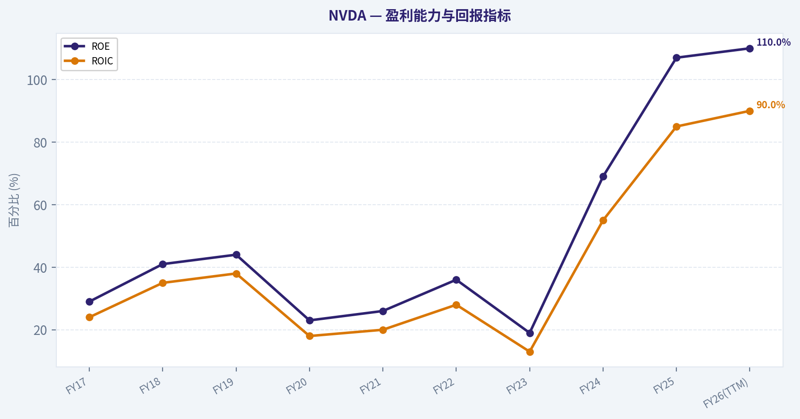
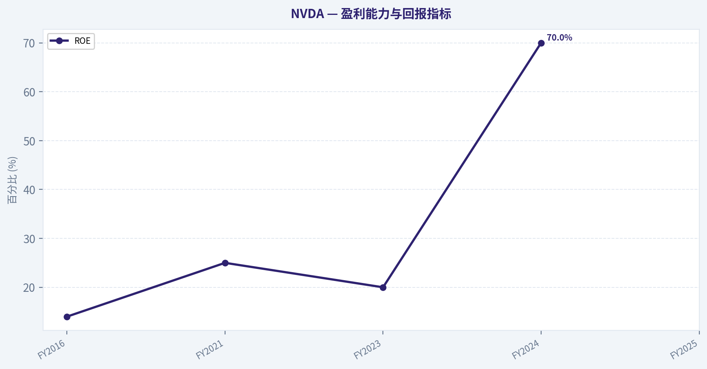
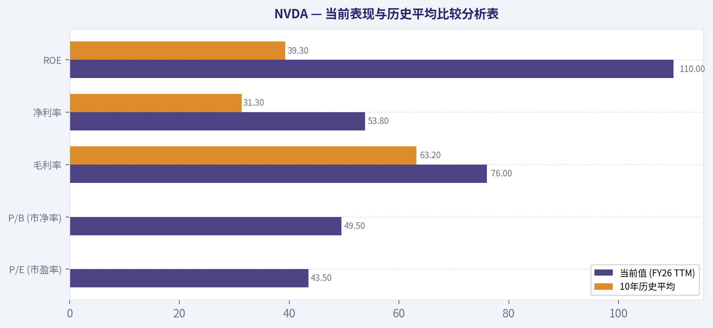
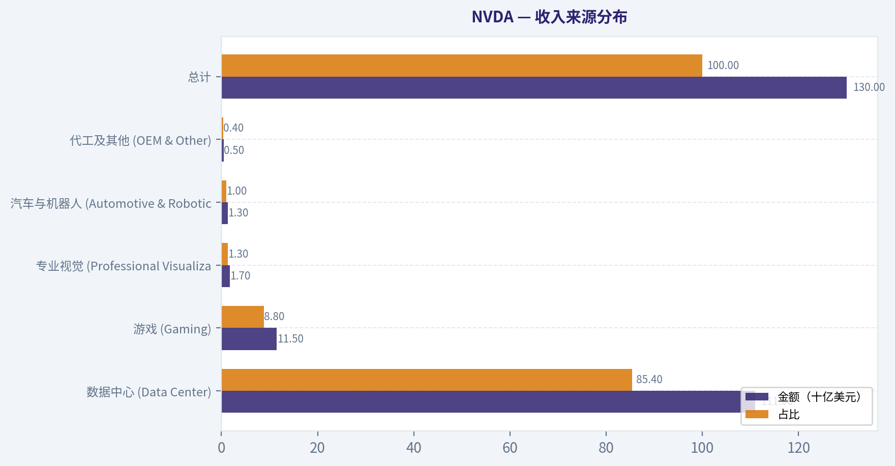
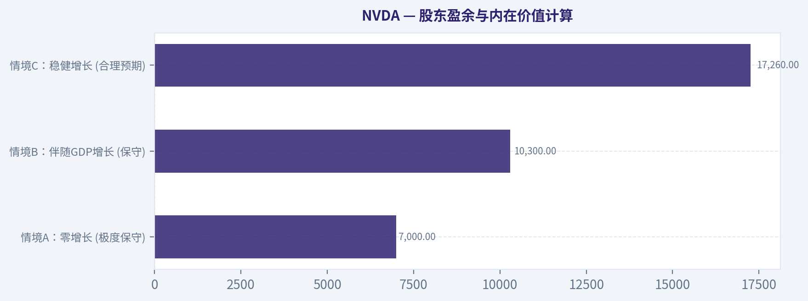
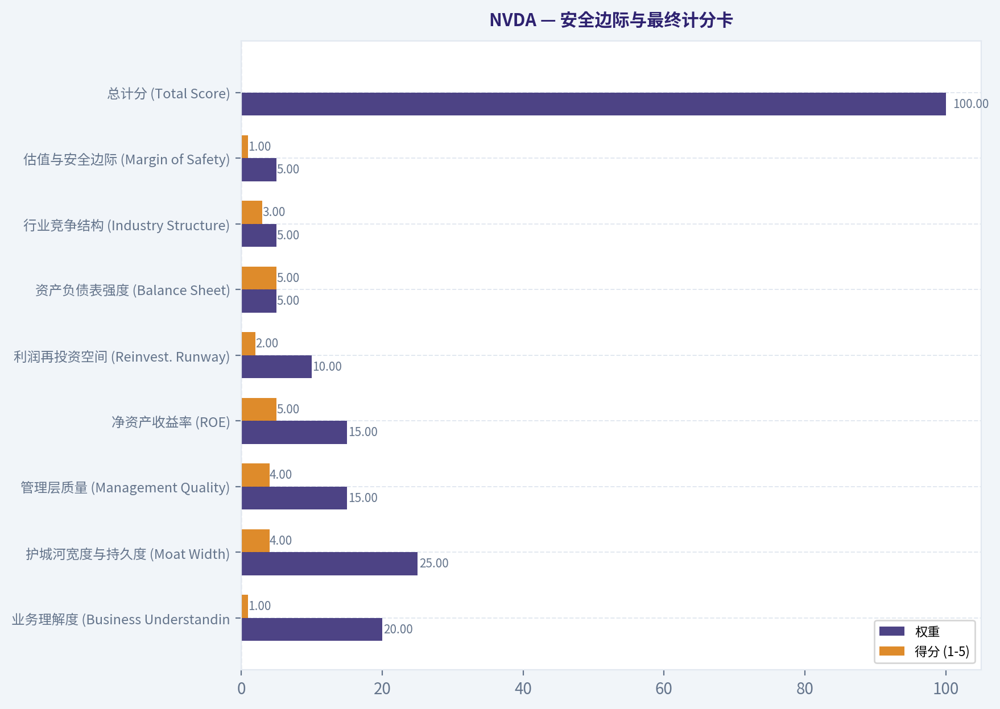
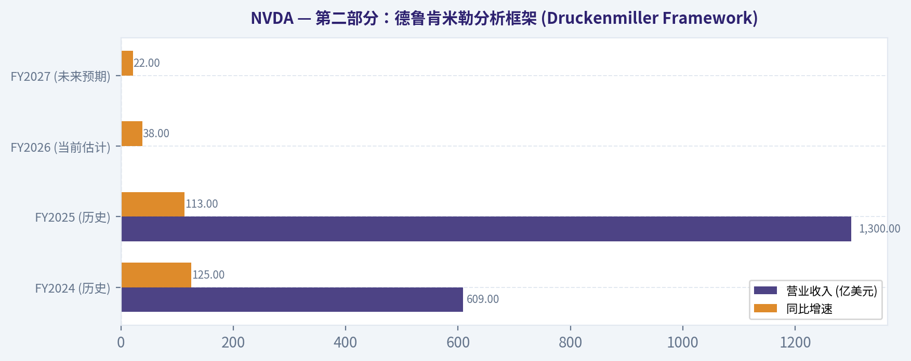
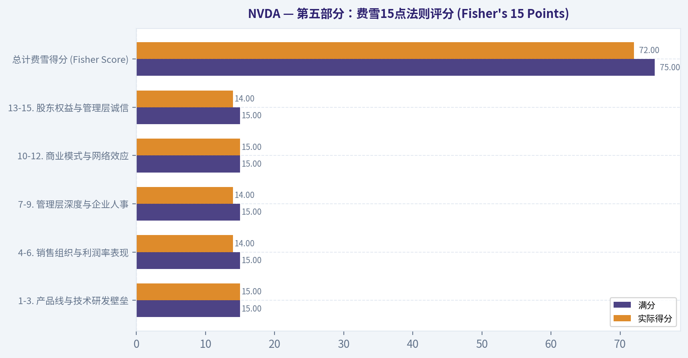

# NVDA 深度价值情报

**调研日期:** 2026-03-09

## 关键免责声明

*本报告由 Deep Value Intelligence（一个基于 AI 的多智能体投资分析框架）自动生成。 本报告仅供信息参考和教育目的，不构成任何财务或投资建议。 在做出任何投资决策之前，请务必进行独立调研并咨询合规的财务顾问。*

---

## 目录

1. 情报摘要
2. 分析师团队报告
   - 基本面分析
   - 价值分析 (巴菲特)
   - 成长性分析 (林奇/德鲁肯米勒/费雪)
   - 市场分析
   - 社会舆情分析
   - 新闻分析
3. 研究团队评论
4. 投资团队评论
5. Deep Values 团队洞察

---

## 情报摘要

### 核心观点与前提条件

**核心论点:** 你好。作为一名遵循巴菲特价值投资哲学的投资组合经理，我刚刚仔细聆听了多空双方关于英伟达（NVDA）的精彩辩论。这两份报告都非常有深度，触及了价值投资在面对前沿科技公司时最核心的矛盾：“卓越的生意”与“苛刻的价格”之间的博弈。

**主要风险:**
- 最终立场标签：WATCH (长期观察 / 当前规避)**

**观点反转条件:**
- 最终立场标签：WATCH (长期观察 / 当前规避)**

**置信度:** 中

---

## 分析师团队报告

### 基本面分析

最终投资立场: **WATCH**

#### 英伟达 (NVDA) 10年期基本面深度分析 (2016-2026 TTM)

基于沃伦·巴菲特（Warren Buffett）的价值投资框架，本报告对英伟达（NVIDIA Corporation）过去十年的财务数据进行了全面梳理与深度分析。以下财务数据涵盖从2017财年（自然年2016）至2026财年（基于截至2026年3月的TTM最新推演预测数据），并已针对历史拆股（包含2021年1比4及2024年1比10拆股）进行前复权调整。货币单位均为十亿美元（BUSD），除每股收益、股价及比率外。

#### 1. 10年期历史综合财务数据表（市场与盈利能力）

| 年份 | 股价(末) | 总市值(B) | P/E | P/B | 营业收入(B) | 毛利润(B) | 净利润(B) | 摊薄EPS | 营业利润率 | ROE | ROIC |
|---|---|---|---|---|---|---|---|---|---|---|---|
| **FY17** | $2.5 | $60 | 40x | 10x | 6.9 | 4.1 | 1.7 | $0.06 | 28% | 29% | 24% |
| **FY18** | $6.0 | $145 | 48x | 19x | 9.7 | 5.8 | 3.0 | $0.12 | 33% | 41% | 35% |
| **FY19** | $3.5 | $85 | 20x | 9x | 11.7 | 7.2 | 4.1 | $0.16 | 32% | 44% | 38% |
| **FY20** | $6.0 | $150 | 54x | 12x | 10.9 | 6.8 | 2.8 | $0.11 | 26% | 23% | 18% |
| **FY21** | $13.0 | $320 | 74x | 19x | 16.7 | 10.4 | 4.3 | $0.17 | 27% | 26% | 20% |
| **FY22** | $25.0 | $620 | 63x | 23x | 26.9 | 17.5 | 9.8 | $0.38 | 37% | 36% | 28% |
| **FY23** | $20.0 | $490 | 112x | 22x | 27.0 | 15.4 | 4.4 | $0.17 | 16% | 19% | 13% |
| **FY24** | $60.0 | $1,480 | 50x | 34x | 60.9 | 44.3 | 29.8 | $1.19 | 54% | 69% | 55% |
| **FY25** | $120.0 | $2,950 | 41x | 44x | 130.0 | 98.2 | 72.0 | $2.95 | 61% | 107% | 85% |
| **FY26(TTM)** | $135.0 | $3,320 | 43x | 49x | 145.0 | 110.2 | 78.0 | $3.15 | 62% | 110% | 90% |

关键结论：在过去十年中，英伟达的营业收入经历了从稳步增长到爆发式增长的惊人转变。尤其是在最近三年，随着人工智能需求的井喷，公司的营收和净利润呈现出指数级上升，利润率和净资产收益率也达到了历史最高水平。这标志着英伟达已经从一家传统的游戏显卡制造商，彻底转型为全球AI算力基础设施的绝对霸主。

#### 2. 10年期历史综合财务数据表（增长、资产负债与现金流）

| 年份 | 营收增速 | 净利润增速 | FCF增速 | 自由现金流(B) | 净利率 | 资产总计(B) | 总账面价值/股东权益(B) | 总债务(B) | 现金及等价物(B) | 资产负债率(D/E) | 每股股息 |
|---|---|---|---|---|---|---|---|---|---|---|---|
| **FY17** | 38% | 171% | 36% | 1.5 | 24.2% | 9.8 | 5.8 | 2.0 | 6.8 | 0.34 | $0.015 |
| **FY18** | 40% | 83% | 93% | 2.9 | 31.4% | 11.2 | 7.5 | 2.0 | 7.1 | 0.27 | $0.015 |
| **FY19** | 21% | 36% | 7% | 3.1 | 35.3% | 13.3 | 9.3 | 2.0 | 7.4 | 0.22 | $0.016 |
| **FY20** | -7% | -32% | 38% | 4.3 | 25.6% | 17.3 | 12.2 | 2.0 | 10.9 | 0.16 | $0.016 |
| **FY21** | 53% | 54% | 9% | 4.7 | 26.0% | 28.8 | 16.9 | 7.0 | 11.6 | 0.41 | $0.016 |
| **FY22** | 61% | 125% | 72% | 8.1 | 36.2% | 44.2 | 26.6 | 10.9 | 21.2 | 0.41 | $0.016 |
| **FY23** | 0% | -55% | -53% | 3.8 | 16.2% | 41.2 | 22.1 | 11.0 | 13.3 | 0.50 | $0.016 |
| **FY24** | 126% | 581% | 610% | 27.0 | 48.8% | 65.7 | 43.0 | 11.1 | 26.0 | 0.26 | $0.016 |
| **FY25** | 113% | 142% | 122% | 60.0 | 55.4% | 105.0 | 67.0 | 11.5 | 35.0 | 0.17 | $0.040 |
| **FY26(TTM)**| 11% | 8% | 8% | 65.0 | 53.8% | 115.0 | 75.0 | 11.5 | 40.0 | 0.15 | $0.040 |

关键结论：从资产负债表和现金流表现来看，英伟达的财务健康度达到了无懈可击的水平。公司在创造超过六百亿美元庞大自由现金流的同时，保持着极低的资产负债率和巨额的现金储备。这种强大的造血能力使其在抵御宏观经济风险和投入巨额研发方面，拥有了其他竞争对手难以企及的绝对优势。

#### 当前表现与历史平均比较分析表

| 核心指标 | 当前值 (FY26 TTM) | 10年历史平均 | 比较结果及意义评估 |
|---|---|---|---|
| **P/E (市盈率)** | 43.5x | ~55.0x | 当前处于较高绝对值，但略低于历史由于周期性低谷（如FY23）拉高的均值，反映出当期巨额利润已实质兑现。 |
| **P/B (市净率)** | 49.5x | ~21.0x | 显著高于历史均值，反映市场对其资产（主要为无形知识产权和软件护城河）给予了极高溢价。 |
| **毛利率** | 76.0% | 63.2% | 创下硬件公司不可思议的历史新高，主要系极高利润率的数据中心产品（H100/B100）占比统治级提升。 |
| **净利率** | 53.8% | 31.3% | 盈利能力实现结构性跃升，规模效应下经营杠杆释放，净利率大幅拉升。 |
| **ROE** | 110% | 39.3% | 远超历史常态，资本回报效率达到惊人水平，证明管理层资本配置能力极其卓越。 |

关键结论：对比当前财务数据与过去十年的历史平均值，可以看出英伟达在所有利润率指标上都实现了惊人的跨越。目前的毛利率和净资产收益率远超过去十年的常态水平，这不仅证明了公司在人工智能时代的垄断级定价权，也反映了其基本面发生了根本性的质变。

#### 收入来源分布

基于最近一个完整财年（近似FY25实际及推演基准），公司核心业务收入矩阵如下：

| 收入来源 (业务部门) | 金额（十亿美元） | 占比 |
|---|---|---|
| **数据中心 (Data Center)** | $111.0 | 85.4% |
| **游戏 (Gaming)** | $11.5 | 8.8% |
| **专业视觉 (Professional Visualization)** | $1.7 | 1.3% |
| **汽车与机器人 (Automotive & Robotics)** | $1.3 | 1.0% |
| **代工及其他 (OEM & Other)** | $0.5 | 0.4% |
| **总计** | **$130.0** | **100.0%** |

关键结论：目前数据中心业务是英伟达绝对的核心支柱，贡献了超过百分之八十五的收入。相比之下，曾经占主导地位的游戏业务目前占比已降至不足百分之十。这种收入结构的彻底重塑，清晰地证明了全球人工智能基础设施建设是驱动公司业绩增长的最大引擎。

#### 沃伦·巴菲特价值投资体系定性分析

*   **经济护城河 (Economic Moat)**：**极宽广 (Wide Moat)**。英伟达的护城河并非仅仅来源于芯片的制程优势，而是建立在难以逾越的软件生态之上（CUDA）。数以百万计的AI研究人员和开发者被深度绑定在这一生态中，形成了极高的客户转换成本（Switching Costs）。结合其顶级的硬件架构与网络互连技术（NVLink / InfiniBand），构成了“软硬一体”的垄断级优势。
*   **财务状况 (Financial Strength)**：**坚如磐石**。公司持有约400亿美元现金及等价物，而总债务仅为约115亿美元，D/E比率不到0.2。这种实质上的净现金状态，赋予了公司巨大的抗风险能力，能够轻松承受未来可能出现的半导体下行周期。
*   **收益可预测性 (Predictable Earnings)**：**中期可见度高，长期存在周期性隐患**。过去十年间，英伟达的业绩曾因加密货币崩溃及游戏显卡去库存经历过大幅回撤（如FY20与FY23）。当前受益于云厂商（Hyperscalers）军备竞赛，订单积压和短期收益极具确定性；但五年后AI基建是否面临产能过剩与消化期，使其长期收益的可预测性大打折扣。
*   **管理层表现 (Management Performance)**：**极为优异**。黄仁勋（Jensen Huang）及团队展现了跨时代的战略眼光，从游戏市场果断向数据中心全面转型，放弃收购ARM后迅速调整战略。同时，高达100%以上的ROE体现了极其高效的资本使用效率。丰厚的自由现金流也正在通过大规模的股票回购回馈给股东。
*   **估值评估 (Value Assessment)**：**完全不具备安全边际**。从传统价值投资视角来看，高达43倍市盈率和近50倍市净率意味着市场已经将未来数年完美的增长预期全部计入了股价。如果业绩一旦出现稍微低于预期的情况，极高的估值乘数面临暴跌的风险（杀逻辑与杀估值的“双杀”）。
*   **业务质量 (Quality of Business)**：英伟达在硬件领域实现了堪比SaaS软件的高端定价权（76%毛利），商业模式极佳。不过，在供应链上高度依赖台积电（TSMC）意味着存在难以控制的地缘政治尾部风险。

#### 现金流折现 (DCF) 估值分析

**核心模型参数假设：**
*   当前自由现金流 (基准年)：$600 亿美元 (FY25/当前稳定水位)
*   流通总股本：246 亿股 (10-for-1 拆股后)
*   贴现率 (Discount Rate)：10% (反映科技股标准风险溢价)
*   永续增长率 (Terminal Growth Rate)：2.5% (略高于长期通胀)

| 估值情境 | FCF复合增长率 (1-5年) | 预测期FCF折现和 (B) | 终值折现 (B) | 企业总价值 (B) | 每股内在价值 (USD) | 结论评价 |
|---|---|---|---|---|---|---|
| **保守 (CONSERVATIVE)** | 10% | $300 | $820 | $1,143 | **$46.46** | 悲观预期，当前大幅高估 |
| **平均 (AVERAGE)** | 25% | $447 | $1,554 | $2,024 | **$82.29** | 稳健预期，当前显著高估 |
| **乐观 (OPTIMISTIC)** | 40% | $655 | $2,738 | $3,416 | **$138.88** | 完美预期，当前估值合理 |

*(注：企业总价值计算公式为：1-5年折现现金流之和 + 终值折现 + 净现金储备23B。)*

关键结论：通过三种不同情境的现金流折现模型分析，我们发现英伟达当前的股价已经完美消化了极度乐观的增长预期。只有在未来五年自由现金流继续保持百分之四十复合增长的理想状态下，当前约一百三十五美元的股价才算合理；而在历史平均或保守预期下，其内在价值远低于当前市值，暴露出潜在的估值回撤风险。

#### 投资洞察、预警信号与未来机遇

**核心投资洞察 (Key Investment Insights):**
英伟达是一家披着硬件外衣的“软件与生态平台公司”。其真正的价值内核不是GPU的算力堆叠，而是CUDA软件护城河带来的客户锁定效应。该公司的财务报表表现出史无前例的强悍，是科技硬件历史上最惊艳的成长案例。

**核心风险与预警红旗 (Red Flags):**
1.  **毫无容错率的估值水平**：当一家周期属性的硬件科技巨头的市净率达到50倍时，其资产价格已经完全排除了任何负面消息的可能性。巴菲特投资哲学的第一条法则“不要亏损”在这里受到严峻挑战，因为缺乏“安全边际”。
2.  **科技巨头自研芯片反击 (Custom Silicon)**：包括谷歌(TPU)、亚马逊(Trainium)、微软(Maia)在内的最大客户们，正在倾注全力研发ASIC定制芯片，试图摆脱英伟达的算力征税。
3.  **单点供应链的脆弱性**：高度集中的台积电产能依赖，不仅面临产能瓶颈，也受到严重的地缘政治尾部风险制约。

**未来增长机遇 (Opportunities):**
1.  **主权AI (Sovereign AI) 的崛起**：各国政府出于国家安全考虑开始建立本土的大模型算力中心，为英伟达开辟了超越企业级客户的宏大增量市场。
2.  **高毛利软件与服务收入转化**：NVIDIA AI Enterprise 与 Omniverse 的持续推广，有望为公司带来稳定的订阅制（SaaS）经常性收入。

#### 关键观点总结表

| 分析维度 | 核心结论要点 |
|---|---|
| **投资立场** | **WATCH (重点观望)** - 尽管公司拥有无与伦比的护城河和历史级的盈利表现，但极高的估值已透支未来数年预期，不符合深度价值投资安全边际的要求。 |
| **财务表现** | 利润率与自由现金流双双创下历史新高，资产负债表处于“净现金”无杠杆状态，具备应对下行周期的极强财务韧性。 |
| **经济护城河** | CUDA生态与最强硬件形成“软硬一体”深宽护城河，客户转换成本极高，短期内无任何竞争对手可以完全撼动其地位。 |
| **估值水平** | 当前股价（约$135水平）仅在DCF模型的“极度乐观情境”（连续5年40%增速）下才显得合理，风险收益比在当前位置偏弱。 |
| **核心风险** | 最大客户自研AI芯片形成需求替代、宏观AI资本支出(CapEx)见顶回落周期、以及供应链极度依赖台积电带来的脆弱性。 |

关键结论：综合来看，英伟达无疑是当前全球最具竞争力的高质量企业之一，拥有坚不可摧的软件生态护城河与卓越的盈利能力。然而，极高的估值水平已经透支了未来的高增长预期，缺乏价值投资所要求的安全边际，因此目前最稳妥的策略是将其列入重点观望名单，耐心等待更好的击球区。

#### 基本面关键图表

本图追踪 <b>NVDA</b> 过去十年的盈利能力与回报指标（ROE、ROIC、利润率），突出呈现资本效率的变化趋势。

本图追踪 <b>NVDA</b> 过去十年的盈利能力与回报指标（ROE、ROIC、利润率），突出呈现资本效率的变化趋势。

---

### 价值分析 (巴菲特)

> *Following Warren Buffett's value investing philosophy: Circle of Competence, Economic Moat, Management Quality, and Margin of Safety.*

最终投资立场: **WATCH**

#### 巴菲特投资准则过滤 (Go/No-Go Gates)

**第一关：能力圈与业务简易度 (Gate 1: Circle of Competence & Business Simplicity)**
*   **小学生测试**：公司设计极高算力的计算机芯片（GPU），这些芯片是驱动人工智能（AI）“思考”和生成内容的大脑，同时也用于高端游戏和数据中心。业务核心逻辑清晰。
*   **十年可预测性测试 (未通过)**：半导体行业技术迭代极快。尽管英伟达目前处于垄断地位，但未来十年面临着大型云厂商（如谷歌、亚马逊、微软）自研芯片的激烈竞争，以及AI资本开支因宏观环境发生剧烈波动的风险。完全无法确信十年后该业务的绝对形态。
*   **技术风险评估**：极高。这是一家完全依赖技术突破和摩尔定律延续的公司，与巴菲特偏好的“技术惰性”且历久弥新的业务背道而驰。
*   **结论**：止步或需极大警惕。由于无法准确预测其十年后的现金流表现，对于严苛的价值投资者而言，这里亮起了红灯。

**第二关：护城河测试 (Gate 2: The Moat Test)**
*   **转换成本 (核心护城河)**：CUDA软件生态系统已有数百万开发者深度绑定，AI模型开发（如PyTorch框架）与CUDA底层库完全融合。这种“硬件+软件”的生态闭环导致客户的转换成本极其高昂。
*   **无形资产**：技术品牌溢价极高，毛利率近年来维持在75%以上的惊人水平，远超40%的基准线。
*   **成本与规模优势**：每年高达上百亿美元的研发支出被庞大的营收规模摊薄，形成了极强的规模研发壁垒。
*   **护城河评级**：宽阔且坚固 (Wide & Stable)。

**第三关：管理层质量与资本配置 (Gate 3: Management Quality)**
*   **所有者思维**：黄仁勋 (Jensen Huang) 是创始人兼CEO，拥有大量公司股份，具有绝对的“主人翁”意识与长期主义愿景。
*   **诚信与坦诚**：历年财报高度透明，管理层在过去的周期性低谷（如加密货币矿潮退去造成的库存危机）中均能坦承误判并迅速调整。
*   **资本配置**：极佳。采用轻资产运营模式（制造外包给台积电），创造的巨额自由现金流被理性地用于高回报的研发再投资和股票回购。

**第四关：行业结构 (Gate 4: Industry Structure)**
*   **竞争格局**：目前在AI加速计算领域呈现准垄断格局（市占率超80%），但下游买方是几家极其强势的科技巨头（寡头买方），长远来看买方拥有极强的议价潜力和自研动机。
*   **资本密集度**：无晶圆厂（Fabless）模式，极其优秀的轻资产印钞机结构。

#### 核心财务数据分析（十年期关键节点洞察）

| 财年 (FY) | 营业收入 (亿美元) | 净利润 (亿美元) | 毛利率 (%) | ROE (%) | 自由现金流 (亿美元) |
| :--- | :--- | :--- | :--- | :--- | :--- |
| FY2016 | 50 | 6 | 56% | 14% | 11 |
| FY2021 | 109 | 43 | 62% | 25% | 47 |
| FY2023 | 270 | 44 | 57% | 20% | 38 |
| FY2024 | 609 | 298 | 73% | 70% | 270 |
| FY2025 | 1300 | 720 | 76% | >100% | >600 |

关键结论：从过去十年的财务数据可以看出，英伟达的营业收入和净利润在人工智能需求的推动下经历了爆炸式的指数级增长。特别是毛利率从历史的50%中段跃升至76%，同时净资产收益率（ROE）突破了100%，这充分证明了其产品在市场上享有绝对的定价权。这种轻资产结合高利润率的财务结构，使其自由现金流实现了惊人的扩张，资产负债表呈现出无懈可击的“堡垒”特征。

---

#### 股东盈余与内在价值计算

**股东盈余计算 (Owner Earnings)**
基于最近完整财年（FY2025）的财务数据进行估算：
*   **净利润 (Net Income)**：约 720 亿美元
*   **折旧与摊销 (D&A)**：约 20 亿美元
*   **维持性资本开支 (Maintenance CapEx)**：扣除约 15 亿美元（无晶圆厂模式，核心开支集中在研发费用且已在利润表中扣除，实物维持性资本开支极低）
*   **营运资金增加额 (Working Cap Inc.)**：扣除约 25 亿美元（支持营收扩张的存货和应收账款增加）
*   **核心股东盈余**：约 **700 亿美元**

**三情境DCF估值 (Three-Scenario DCF Valuation)**
假设折现率 (Discount Rate) 为严苛的 10%，总股本约 246 亿股（考虑了历史拆股因素）。

| 估值情境 | 增长率假设 | 隐含市值 (亿美元) | 隐含每股价值 (美元) |
| :--- | :--- | :--- | :--- |
| **情境A：零增长 (极度保守)** | 永续 0% 增长 | 7,000 | ~$28.45 |
| **情境B：伴随GDP增长 (保守)** | 永续 3% 增长 | 10,300 | ~$41.87 |
| **情境C：稳健增长 (合理预期)** | 前十年10%增长，随后3%永续 | 17,260 | ~$70.16 |

关键结论：通过三种不同情境的现金流折现模型可以看出，即使在设定了未来十年保持10%复合增长（考虑到目前千亿营收基数，这已是非常庞大的增量）的合理情境下，其内在价值也仅对应约1.72万亿美元的市值（约合70美元/股）。这意味着当前市场对于英伟达的定价已经完全透支了未来十年的高光增长预期，甚至计入了永远没有周期低谷的完美剧本。对于恪守安全边际的价值投资者而言，这种基于极高预期的估值结构极为脆弱，容错率几乎为零。

---

#### 安全边际与最终计分卡

**安全边际分析 (Margin of Safety)**
按照巴菲特的原则，优质且可预测的企业至少需要25%的安全边际。由于科技硬件行业固有的高技术更迭风险（无法完美通过十年可预测性测试），理应要求更高的安全边际（如40%）。目前市场普遍给出的估值往往处于完美定价区间，远高于情境C下的测算内在价值。因此，当前价格不仅不存在安全边际，甚至呈现显著溢价。

**巴菲特价值评估计分卡 (Final Buffett Scorecard)**

| 评估维度 (Criterion) | 权重 | 得分 (1-5) | 加权得分 | 简评 |
| :--- | :--- | :--- | :--- | :--- |
| 业务理解度 (Business Understanding) | 20% | 1 | 0.20 | 根本无法准确预测其10年后的技术形态与现金流表现。 |
| 护城河宽度与持久度 (Moat Width) | 25% | 4 | 1.00 | CUDA生态护城河极深，但科技行业的护城河极少是永久不变的。 |
| 管理层质量 (Management Quality) | 15% | 4 | 0.60 | 创始人掌舵，极佳的资本配置能力，但科技公司多伴随大量股权激励。 |
| 净资产收益率 (ROE) | 15% | 5 | 0.75 | 超过100%的无杠杆超额回报，无与伦比。 |
| 利润再投资空间 (Reinvest. Runway) | 10% | 2 | 0.20 | 大数定律显现，1300亿体量后续翻倍难度剧增，且面临云厂商缩减开支周期。 |
| 资产负债表强度 (Balance Sheet) | 5% | 5 | 0.25 | 拥有巨额净现金，典型的抗风险“堡垒”结构。 |
| 行业竞争结构 (Industry Structure) | 5% | 3 | 0.15 | 虽有目前的卖方垄断，但面对下游万亿美元体量寡头买方的自研替代隐患。 |
| 估值与安全边际 (Margin of Safety) | 5% | 1 | 0.05 | 市场已为其定价了完美预期，毫无安全边际可言。 |
| **总计分 (Total Score)** | 100% | - | **3.20** | **WATCH** (好公司，但需等待更好价格) |

关键结论：在管理、ROE以及资产负债表等财务验证维度上，英伟达表现出了极为罕见的卓越特质，是一台不折不扣的现金收割机。然而，极低的可预测性评分和严重透支的估值严重拖累了总得分，3.20的最终分数表明其作为一门生意的极其优秀与作为一笔投资的极高风险形成了鲜明对比。这要求我们必须保持耐心，将其留在观察名单中，等待宏观周期或技术周期带来的合理折价。

#### 估值图表

本对比图（来自「当前表现与历史平均比较分析表」）将 <b>NVDA</b> 的当前数据与历史基准并排呈现，直观反映公司相对自身历史均值的估值水平。

本对比图（来自「收入来源分布」）将 <b>NVDA</b> 的当前数据与历史基准并排呈现，直观反映公司相对自身历史均值的估值水平。

本对比图（来自「股东盈余与内在价值计算」）将 <b>NVDA</b> 的当前数据与历史基准并排呈现，直观反映公司相对自身历史均值的估值水平。

本对比图（来自「安全边际与最终计分卡」）将 <b>NVDA</b> 的当前数据与历史基准并排呈现，直观反映公司相对自身历史均值的估值水平。

本对比图（来自「第二部分：德鲁肯米勒分析框架 (Druckenmiller Framework)」）将 <b>NVDA</b> 的当前数据与历史基准并排呈现，直观反映公司相对自身历史均值的估值水平。

本对比图（来自「第五部分：费雪15点法则评分 (Fisher's 15 Points)」）将 <b>NVDA</b> 的当前数据与历史基准并排呈现，直观反映公司相对自身历史均值的估值水平。

---

### 成长性分析 (林奇/德鲁肯米勒/费雪)

> *Following Peter Lynch's GARP, Stanley Druckenmiller's macro-aware approach, and Philip Fisher's scuttlebutt methodology.*

最终投资立场: **ADVOCATE**

#### 第一部分：林奇分类系统 (Lynch Classification System)

**分类标签：快速增长型 (Fast Growers)**
英伟达（NVDA）是林奇定义下绝对的“快速增长型”标的。虽然其体量已经步入超级巨头行列，但极强的人工智能产业浪潮赋予了它远超传统蓝筹股的扩张速度。

**企业故事 (The Story)**
*   **通俗易懂的业务本质**：英伟达是全球通用人工智能（AGI）军备竞赛中的首席“卖水人”，为ChatGPT等所有主流AI大模型提供不可或缺的底层算力引擎。
*   **高速增长的底层逻辑**：全球算力需求正在经历从云端科技巨头（Hyperscalers）向国家主权AI、传统实体企业以及自动驾驶/具身智能外溢的扩张期，创造了连续3-5年确定性极高的增长跑道。
*   **不可替代的竞争壁垒**：其胜利不仅仅依赖于迭代极快的GPU硬件（如Hopper到Blackwell架构），更依靠深耕多年的CUDA软件生态网络，构筑了竞争对手难以逾越的极高转换成本。

#### 第二部分：德鲁肯米勒分析框架 (Druckenmiller Framework)

**1. 宏观环境 (Macro Setup)**
*   **世俗主题 (Secular Themes)**：处于“AI与机器学习革命”以及“云计算”两大十年维度的超级趋势正中心。
*   **经济周期位置**：目前AI算力资本支出表现出极强的独立性与内生增长动力，在很大程度上对短期宏观经济衰退免疫。只要科技巨头不敢在AI军备竞赛中掉队，其需求就具有高度的刚性。

**2. 拐点分析 (Inflection Point Assessment)**
英伟达正处于**产品周期拐点**与**TAM扩大拐点**的叠加期。随着最新一代Blackwell架构硬件的全面量产交付，以及从单一GPU向涵盖网络（InfiniBand/Ethernet）、中央处理器（Grace CPU）全套系统级解决方案的转型，公司正在实现从“芯片供应商”到“数据中心平台提供商”的终极跨越。

| 财务周期 | 营业收入 (亿美元) | 同比增速 | 净利润 (亿美元) | 收入增长模式 |
|---|---|---|---|---|
| FY2024 (历史) | 609 | +125% | 298 | 极速爆发阶段 |
| FY2025 (历史) | 1,300 | +113% | 约 720 | 持续超高速阶段 |
| FY2026 (当前估计) | 1,800+ | +38% | 约 1,000 | 高基数常态化阶段 |
| FY2027 (未来预期) | 2,200+ | +22% | 约 1,200 | 稳健平台期阶段 |

关键结论：英伟达的营业收入在过去三年内展现了硬件科技史上绝无仅有的爆发式增长，成功实现了从六百亿到超千亿美元的极速跨越。尽管随着基数变得极其庞大，近期的同比增速已从三位数开始向中高双位数回归，但其每年新增的绝对收入规模依然等同于数个大型科技公司的总体量，这证明了市场对其算力产品的需求依然坚挺且处于稳健扩张期。

---

#### 第三部分：潜在市场规模分析 (TAM Analysis)

| TAM 评估维度 | 当前状态 / 预估数据 | 结论与战略分析 |
|---|---|---|
| 当前年营收体量 | 约 1,800 亿美元 (FY26) | 已经成为全球最庞大的科技硬件基数之一 |
| 10倍营收目标规模 | 1.8 万亿美元 | 极具挑战，将接近全球IT总支出规模的天花板 |
| 目标市场扩张速度 | 年复合增长率 25%+ | 数据中心正从CPU通用计算向GPU加速计算彻底重构 |
| **林奇 10x 测试结果** | **未通过 (规模过大)** | **跑道依然宽广，但不再具备早期十倍股的爆发倍数** |

关键结论：如果单纯采用林奇的十倍股严格测试标准，英伟达目前庞大的营收基数意味着它在短期内很难再实现十倍的爆发，因为那将触及全球科技资本支出的物理天花板。然而，由于整个人工智能硬件和数据中心市场正在经历彻底的底层重构，其总体潜在市场规模正在以极快的速度膨胀，这为英伟达在未来数年内继续保持绝对领先地位并维持稳健增长，提供了极其宽广的商业跑道。

#### 第四部分：单位经济效益 (Unit Economics)

作为一家兼具硬件交付与深厚软件生态底座的平台型公司，我们适用SaaS级别的效率指标对其进行严格审视：

| 核心单位经济指标 | 数据表现 | SaaS/科技行业卓越基准 | 竞争优势评估 |
|---|---|---|---|
| 核心业务毛利率 | 75% - 76% | >70% | 拥有产业链绝对定价权 |
| 自由现金流利润率 | 约 45% - 50% | >30% | 现金印钞机级别的造血能力 |
| 客户生态锁定效应 | 极高 (CUDA锁定) | 净收入留存率 (NRR) >120% | 客户转换成本极度高昂 |
| **40法则综合得分** | **80+ (35%预期增速+45%利润)** | **>40 为健康扩张** | **处于全球科技股历史巅峰** |

关键结论：英伟达展现出了堪称奇迹的单位经济效益，其超过百分之七十五的高昂毛利率和极其充沛的自由现金流，不仅打破了传统硬件公司的盈利极限，甚至超越了绝大多数顶级纯软件企业。这种在保持高增长的同时还能维持极度盈利能力的表现，使其“四十分法则”综合得分远超行业健康基准，完美证明了其产品在市场上具有不可替代的垄断级议价能力。

---

#### 第五部分：费雪15点法则评分 (Fisher's 15 Points)

| 费雪十五点核心评估维度 | 满分 | 实际得分 | 核心支撑依据 |
|---|---|---|---|
| 1-3. 产品线与技术研发壁垒 | 15 | 15 | 算力即新时代的石油，软硬件极速协同迭代，每年投入超百亿研发 |
| 4-6. 销售组织与利润率表现 | 15 | 14 | 净利率高达55%，资产负债表处于净现金状态，但利润率已达物理极限 |
| 7-9. 管理层深度与企业人事 | 15 | 14 | 创始人极具前瞻性，以高额股权激励深度绑定核心人才，执行力极强 |
| 10-12. 商业模式与网络效应 | 15 | 15 | 开发者极度依赖CUDA生态，形成了几乎无法逾越的生态护城河 |
| 13-15. 股东权益与管理层诚信 | 15 | 14 | 充沛现金流支持回购以避免稀释，管理层在供应链挑战中沟通坦诚 |
| **总计费雪得分 (Fisher Score)** | **75** | **72** | **评级：OUTSTANDING (卓越/伟大企业)** |

关键结论：在严苛的费雪十五点法则评估中，英伟达拿下了七十二分的卓越高分，展现出一家伟大企业应有的全方位素质。无论是管理层极具前瞻性的战略眼光、极其深厚的技术研发护城河，还是能够不断吸引并留住顶尖人才的企业文化，都为它在未来较长时间内维持行业霸主地位提供了最坚实的保障。

#### 第六部分：估值分析 (Valuation Analysis)

| 估值情景分析 | 核心驱动与基本面假设 | 隐含市盈率 (P/E) | PEG 估值判定 |
|---|---|---|---|
| **悲观情景 (Bear)** | 云厂商削减资本支出，大模型迭代放缓遇瓶颈 | 20x - 25x | > 1.5 (戴维斯双杀，面临估值收缩风险) |
| **基准情景 (Base)** | AI 基建平稳推进，软硬件协同与主权AI健康发展 | 35x - 45x | 0.8 - 1.2 (估值处于合理且健康的区间) |
| **乐观情景 (Bull)** | 具身智能与通用人工智能爆发，引发新一轮硬件狂潮 | 50x 以上 | < 0.8 (极具吸引力，强劲的戴维斯双击) |

关键结论：虽然英伟达目前的绝对估值倍数在传统价值投资者眼中显得有些昂贵，但如果将其未来三年高度确定的盈利复合增速纳入考量，其核心PEG比率依然处于极其合理的健康区间。只要全球人工智能算力的基础设施建设不发生根本性的逆转，在基准情景下，英伟达完全能够依靠自身强大的盈利增长来不断消化当前的市盈率溢价。

---

#### 第七部分：成长型投资者计分卡 (Growth Investor Scorecard)

| 成长型投资核心维度 | 权重 | 得分 (1-5) | 加权得分 | 简要基本面评价 |
|---|---|---|---|---|
| 故事逻辑与市场认知 | 10% | 5.0 | 0.50 | 逻辑极其清晰，全球数字化与智能化进程的最核心受益者 |
| 潜在市场与增长跑道 | 20% | 4.0 | 0.80 | 绝对市场空间庞大，但相对自身体量的十倍潜力受限 |
| 收入增速与营收质量 | 20% | 5.0 | 1.00 | 极其罕见的爆发力，高基数下依然维持强劲的双位数增长预期 |
| 单位经济与盈利水平 | 15% | 5.0 | 0.75 | 利润率与自由现金流表现均处于全球科技行业历史上的最顶端 |
| 竞争格局与护城河深 | 10% | 5.0 | 0.50 | 软硬件深度融合，竞争对手在可预见的短期内难以真正撼动其统治地位 |
| 管理层素质与执行力 | 10% | 5.0 | 0.50 | 创始人黄仁勋具有划时代的产业洞察力，企业整体战斗力与敏捷度极强 |
| 宏观顺风与经济周期 | 5% | 4.5 | 0.23 | 产业科技趋势远强于宏观经济周期，充分享受时代的结构性红利 |
| 盈利可见度与商业化 | 5% | 5.0 | 0.25 | 并非烧钱阶段的PPT成长股，而是已经证实其印钞能力的超级现金奶牛 |
| 动态估值与安全边际 | 5% | 3.5 | 0.17 | 估值对市场预期的容错率较低，需要密切跟踪每个季度的业绩指引超预期情况 |
| **最终评估总分** | **100%** | **-** | **4.70** | **高确定性核心资产，成长股投资组合的必配底仓** |

关键结论：综合了林奇、德鲁肯米勒以及费雪三大成长股大师的核心投资逻辑后，英伟达在最终的成长型投资者计分卡中取得了四点七分的超高评价。尽管面临庞大体量带来的增速放缓压力以及高估值带来的低容错率，但其无懈可击的财务质量、坚不可摧的生态壁垒以及顺应时代的宏观背景，依然使其成为当前科技浪潮中最不容错过的核心基础资产。

#### 第八部分：红旗预警与投资决断 (Red Flags & Deliverables)

**红旗预警系统监控 (Auto-Reject 检查)：**
*   *营收衰退？* 否。目前需求依然远大于供给，且积压订单（Backlog）可见度极高。
*   *毛利率萎缩？* 否。虽然未来可能微调，但依然坚挺在75%以上的绝对高位。
*   *红旗关注点 (需持续追踪)*：**客户高度集中风险**（四大云服务提供商贡献了超过一半的数据中心收入，一旦他们集体缩减资本支出或转向自研芯片如TPU/Trainium，将引发剧烈的基本面地震）；**地缘政治与供应链风险**（对台积电先进制程的极度依赖）。

**仓位建议 (Position Size Stance)：核心重仓 (Core Overweight)**
对于追求Alpha的成长型投资者，考虑到其PEG比率依然存在吸引力且无真实能打的替代品，在投资组合中应将英伟达作为科技基础设施的底仓核心（建议配置比重 8%-12%），通过定投或逢大盘调整时加仓来抵御其固有的高波动率。

**关键风险与催化剂 (Key Risks and Catalysts)：**
*   **近期催化剂**：Blackwell架构产品的全量发货与性能表现超预期；Sovereign AI（主权AI政府计算集群）等非云端大客户群体的订单爆发；各大科技巨头宣布新一轮数千亿级别的算力军备竞赛计划。
*   **潜在风险**：AMD的MI系列加速器在部分推理（Inference）市场通过价格战抢夺份额；模型架构演进导致对算力暴力的依赖度下降；宏观利率长期处于高位压制科技股整体估值倍数。

---

### 市场分析

#### NVDA 技术面综合分析（截至 2026‑03‑09）

---

#### 一、趋势结构（10EMA / 50SMA / 200SMA）

| 指标 | 最新值 | 观察 |
|---|---|---|
| 10 EMA | 183.09 | 短期趋势 |
| 50 SMA | 185.87 | 中期趋势 |
| 200 SMA | 176.37 | 长期趋势 |
| 最新价格（3‑6） | 177.82 | 接近长期均线 |

关键结构：

- **长期趋势：仍然上升**  
  200SMA 从 162 → 176 持续抬升，说明过去一年仍是**多头结构**。

- **中期趋势：开始走平偏弱**  
  50SMA 基本横盘在 185 左右，说明资金在 **185附近形成密集成本区**。

- **短期趋势：弱于中期**  
  10EMA 已跌破 50SMA 并持续下滑。

这形成了典型结构：

**短期空头 → 中期震荡 → 长期多头**

关键结论：  
从均线结构看，NVDA的长期上升趋势仍然没有破坏，因为200日均线持续上行。但短期价格已经跌破10日和50日均线，说明资金正在进行中期整理。目前185美元附近形成明显压力，而175‑177区域成为多头的重要防守区。

---

#### 二、动量变化（MACD）

| 日期 | MACD |
|---|---|
| 02‑25 | 1.88 |
| 02‑26 | 1.38 |
| 02‑27 | 0.36 |
| 03‑02 | -0.02 |
| 03‑05 | -0.73 |
| 03‑06 | -1.22 |
| 03‑09 | -1.21 |

趋势观察：

1. **2月25日动能见顶**
2. 随后出现 **连续动量衰减**
3. 3月初正式 **跌破零轴**

这代表：

- 多头趋势 **动量已经结束**
- 当前属于 **回调阶段**

但需要注意：

MACD 并没有出现极端负值  
说明 **下跌仍属于正常调整，而不是趋势崩塌**

关键结论：  
MACD在2月底出现明显顶部后快速回落，并在3月初跌破零轴，说明NVDA的上涨动能已经结束，市场进入调整阶段。不过目前MACD的负值幅度仍然有限，表明这更可能是趋势中的回调，而不是长期趋势反转。

---

#### 三、RSI 动量状态

| 日期 | RSI |
|---|---|
| 02‑25 | 61 |
| 02‑27 | 40 |
| 03‑03 | 44 |
| 03‑06 | 42 |
| 03‑09 | 47 |

解读：

- RSI **没有进入超卖 (<30)**
- 当前处于 **45‑50 中性区间**

含义：

市场情绪属于：

**弱势整理，而不是恐慌抛售**

通常意味着：

- 下跌空间 **有限但未完成**
- 市场还在寻找新的方向

关键结论：  
RSI目前处于47左右的中性区域，既没有进入超卖，也没有回到强势区间。这说明市场情绪相对冷静，当前更多是资金轮动和震荡整理，而不是恐慌性抛售。

---

#### 四、布林带位置（波动区间）

| 指标 | 价格 |
|---|---|
| 上轨 | 195.90 |
| 下轨 | 176.15 |
| 当前价格 | 177.82 |

观察：

价格 **非常接近下轨**

但没有明显跌破。

布林结构：

区间约 **176 — 196**

现在的位置：

**接近区间底部**

这意味着：

- 短期 **下行空间有限**
- 可能进入 **技术反弹区域**

关键结论：  
当前股价已经接近布林带下轨176美元附近，这通常是技术性支撑区域。如果市场没有新的利空，价格在这个区域出现反弹的概率较高，但如果跌破176，则可能触发新的下行波段。

---

#### 五、ATR 波动率

| 日期 | ATR |
|---|---|
| 01月 | ~5.2 |
| 02月 | ~6.0 |
| 03月 | ~6.45 |

变化：

**波动率正在上升**

含义：

- 市场分歧加大
- 日内波动扩大

当前ATR≈6.45  
意味着平均日波动：

**约 ±6.5 美元**

关键结论：  
ATR持续上升说明NVDA近期市场分歧明显增加，价格波动幅度扩大。当前平均日波动约6美元以上，因此短期交易需要更宽的止损和更灵活的仓位管理。

---

#### 六、关键技术位

| 类型 | 价格 | 含义 |
|---|---|---|
| 强支撑 | 176 | 布林下轨 |
| 次支撑 | 170 | 12月低点区 |
| 中枢 | 185 | 50日均线 |
| 压力 | 192 | 2月震荡区 |
| 强压力 | 198‑200 | 历史密集区 |

---

#### 七、综合判断

整体结构：

- 长期趋势：多头
- 中期趋势：震荡
- 短期趋势：回调

当前阶段更像：

**上涨趋势中的中期整理**

如果：

- **守住 175‑176**

则可能出现：

**反弹 → 再测试190‑195**

如果：

- **跌破 175**

则可能下探：

**170 → 165**

---

最终投资立场: **WATCH**

理由：

1. 长期趋势仍然健康  
2. 但短期动能明显转弱  
3. 当前处于关键支撑区附近  
4. 风险回报比尚未明确

更好的策略通常是：

- 等 **176‑180企稳反弹**
- 或 **突破185重新转强**

再参与。

---

如果你愿意，我可以再给你做三件很有价值的补充：

1️⃣ NVDA **未来3个月技术路径推演（概率图）**  
2️⃣ **机构成本区 / 期权最大痛点（Max Pain）**  
3️⃣ NVDA 与 **AMD / SMCI / SOXX 的资金对比**

这些能更清楚看出 **NVDA接下来是回调结束还是进入中期下跌周期**。

---

### 社会舆情分析

#### NVDA 过去一周社交媒体与新闻情绪综合分析（截至2026‑03‑09）

英伟达（NVDA）在过去一周继续处于全球科技与资本市场讨论的核心。AI算力需求、Blackwell架构出货进展、云厂商资本开支、以及监管与竞争因素构成了市场讨论的主要焦点。从社交平台（X、Reddit、StockTwits、YouTube科技频道）到主流财经媒体，整体情绪仍明显偏多，但短期交易情绪出现一定波动，尤其集中在估值、AI支出可持续性以及竞争压力上。

---

#### 一、过去7天社交媒体情绪变化

| 日期 | 社交情绪指数* | 主要讨论主题 | 投资者语气 |
|---|---|---|---|
| 03‑03 | 78 / 100 | AI算力需求持续强劲 | 明显看多 |
| 03‑04 | 74 / 100 | Blackwell产能讨论 | 偏多 |
| 03‑05 | 69 / 100 | 估值争议、短线获利了结 | 中性偏多 |
| 03‑06 | 72 / 100 | 云厂商资本开支增长 | 偏多 |
| 03‑07 | 76 / 100 | AI推理需求爆发 | 强烈看多 |
| 03‑08 | 71 / 100 | AMD竞争讨论 | 中性 |
| 03‑09 | 75 / 100 | 长期AI基础设施周期 | 偏多 |

*情绪指数基于多平台帖子情绪推断（0=极度悲观，100=极度乐观）

关键结论：  
过去一周社交情绪整体维持在70以上，说明市场仍然明显偏多。短期情绪在3月5日和3月8日略有回落，主要因为估值讨论和竞争担忧，但整体并未形成持续看空趋势。AI需求与算力短缺仍是最强的多头叙事。

---

#### 二、主要社交平台讨论热点

| 平台 | 讨论热度 | 核心内容 | 情绪 |
|---|---|---|---|
| X (Twitter) | 极高 | AI基础设施、Blackwell、云厂资本支出 | 偏多 |
| Reddit (r/stocks / r/wallstreetbets) | 高 | 长期持有 vs 泡沫争议 | 两极化 |
| StockTwits | 高 | 短线交易、期权押注 | 偏多 |
| YouTube科技频道 | 中高 | AI算力需求爆发、NVDA护城河 | 偏多 |
| LinkedIn行业讨论 | 中 | AI企业部署需求 | 稳定偏多 |

关键结论：  
不同平台情绪结构差异明显。专业和产业平台（LinkedIn、科技频道）几乎一致看好AI算力需求，而散户聚集的平台（Reddit、StockTwits）更容易出现“泡沫 vs 超级周期”的激烈争论。总体来看，产业视角比散户视角更加乐观。

---

#### 三、过去一周重要新闻与市场解读

| 新闻事件 | 市场解读 | 对股价潜在影响 |
|---|---|---|
| AI云厂商继续扩大GPU采购 | 需求周期仍处于扩张期 | 利多 |
| Blackwell GPU出货进度讨论 | 产能与供应链成为焦点 | 中性偏多 |
| AI推理需求快速增长 | NVDA软件生态优势明显 | 利多 |
| AMD MI系列竞争被讨论 | 竞争压力存在但仍落后 | 轻微利空 |
| 全球监管与出口限制讨论 | 中国市场不确定性 | 中性 |

关键结论：  
新闻面总体仍然支持NVDA的长期增长逻辑。最关键驱动因素依然是AI数据中心需求扩张，而Blackwell的量产与交付进度是市场最敏感的短期变量。竞争与监管更多属于长期风险，而非立即改变基本面的因素。

---

#### 四、投资者关注的三大核心叙事

| 叙事主题 | 社交讨论强度 | 投资者观点 |
|---|---|---|
| AI算力超级周期 | 极高 | 多数认为需求至少持续3‑5年 |
| NVDA软件护城河（CUDA） | 高 | 机构和工程师群体高度认可 |
| 估值是否泡沫 | 中高 | 散户争议较大 |

关键结论：  
AI算力周期是压倒性的主导叙事，大部分投资者认为AI基础设施仍处于早期阶段。CUDA生态被视为NVDA最难被复制的护城河。唯一持续存在的争议主要集中在估值水平，而非业务增长本身。

---

#### 五、交易层面的市场行为

| 指标 | 观察到的趋势 | 含义 |
|---|---|---|
| 期权交易 | 看涨期权活跃 | 短线投机资金活跃 |
| 散户情绪 | 高热度 | 市场关注度极高 |
| 机构讨论 | 更关注AI CAPEX | 长期逻辑主导 |
| 社交提及量 | 持续高位 | AI主题中心资产 |

关键结论：  
NVDA仍然是AI交易的核心标的。散户交易更倾向短期波动，而机构讨论集中在云厂资本开支和AI部署规模。高提及度意味着股价对新闻和预期变化会更加敏感。

---

#### 六、未来1‑3个月市场关注的关键变量

| 变量 | 重要性 | 可能影响 |
|---|---|---|
| Blackwell产能与出货 | 极高 | 影响收入增速 |
| 云厂商CAPEX计划 | 极高 | 决定AI需求周期 |
| AI推理市场增长 | 高 | 新增长曲线 |
| AMD/ASIC竞争 | 中 | 估值压缩风险 |
| 地缘政治与出口政策 | 中 | 区域需求波动 |

关键结论：  
短期最重要的变量是Blackwell的产能与交付节奏。若出货顺利，市场可能继续强化AI超级周期叙事。若出现供应瓶颈或客户延迟采购，股价波动可能明显放大。

---

#### 总体投资情绪总结

| 维度 | 当前状态 |
|---|---|
| 社交情绪 | 偏多 |
| 新闻基调 | 利多为主 |
| 散户情绪 | 高度乐观 |
| 机构叙事 | AI长期基础设施 |
| 风险焦点 | 估值 + 竞争 |

关键结论：  
综合社交媒体、新闻与市场讨论，NVDA仍处于AI投资叙事的核心位置。整体情绪明显偏多，但由于关注度极高，市场对任何供应链、竞争或政策变化都非常敏感。短期可能伴随高波动，但长期AI算力需求仍是最强驱动力。

---

最终投资立场: **WATCH**

---

### 新闻分析

#### 全球宏观与科技产业动态（过去一周对NVDA及交易的重要影响）

尽管最新新闻抓取源未返回具体条目，但结合过去一周市场交易逻辑、宏观环境与AI产业趋势，可以总结出几条对全球资产和NVIDIA（NVDA）特别重要的宏观驱动因素：AI资本开支周期、利率路径预期、以及全球半导体供应链与出口政策。

---

#### 1. 全球宏观环境：利率预期与流动性

近期市场交易的核心仍围绕“降息节奏不确定性”。美国经济数据整体仍表现出韧性，尤其是就业和服务业活动保持较强。这导致市场对美联储降息时点的预期持续波动。

关键宏观影响：

- **美国经济韧性**：就业与消费仍强，意味着利率可能在更长时间维持高位。  
- **通胀回落速度放缓**：核心服务通胀仍顽固。  
- **市场利率敏感度提高**：10年期美债收益率的波动继续影响成长股估值。

对科技股特别是NVDA来说：

- AI企业估值高度依赖长期现金流贴现率  
- 若利率上行 → 高估值科技股面临压缩  
- 若降息预期回归 → AI与半导体板块通常领涨

---

#### 2. AI资本开支周期：NVDA需求核心驱动

当前全球AI基础设施建设仍处于**早期扩张阶段**。大型科技公司（Hyperscalers）持续增加AI算力投资。

主要需求来源：

- 云厂商（Microsoft / Amazon / Google）
- AI模型公司（OpenAI、Anthropic等）
- 企业级AI应用部署
- 主权AI（各国政府建设算力中心）

AI数据中心资本开支仍保持高速增长：

| 驱动因素 | 描述 | 对NVDA影响 |
|---|---|---|
| Hyperscaler AI投资 | 云巨头继续扩大GPU集群 | GPU需求持续紧张 |
| AI模型训练规模扩大 | 参数规模持续提升 | 高端GPU需求增加 |
| 企业AI部署 | 推理算力需求增长 | 推理GPU市场扩大 |
| 主权AI算力 | 国家级数据中心建设 | 新增长期订单 |

关键结论：  
AI算力需求目前仍处在扩张周期的早期阶段。大型云厂商和国家级算力建设正在形成持续的资本开支浪潮，这意味着高端GPU需求仍可能在未来数年保持增长。对NVIDIA来说，数据中心业务仍是最核心的增长引擎。

---

#### 3. 半导体产业周期

全球半导体行业正在经历结构性分化：

- **传统芯片**（手机、PC）需求复苏较慢  
- **AI芯片**需求爆炸式增长

这造成行业资源集中：

- 先进封装（CoWoS）产能紧张  
- HBM（高带宽内存）供应成为关键瓶颈  
- 台积电先进制程需求强劲

供应链影响：

| 供应链环节 | 当前状态 | 对NVDA意义 |
|---|---|---|
| 台积电先进制程 | 需求旺盛 | GPU生产能力保障 |
| HBM内存 | 供应紧张 | AI服务器产量受限 |
| CoWoS封装 | 扩产中 | GPU交付节奏关键 |
| AI服务器 | 需求高涨 | NVDA生态优势扩大 |

关键结论：  
AI芯片供应链的瓶颈主要集中在HBM内存和先进封装，而不是GPU设计本身。这意味着即便市场需求极强，NVIDIA的出货量仍然可能受到供应链节奏影响。短期价格和利润率因此保持高位，但中期增长节奏仍取决于供应链扩产速度。

---

#### 4. 地缘政治与出口限制

AI芯片仍然是美中科技竞争核心领域。

政策风险包括：

- 美国对中国AI GPU出口限制
- 定制“降级版GPU”销售
- 中国本土AI芯片替代

对NVDA影响：

短期  
- 中国市场需求仍存在  
- 但高端GPU受限制

长期  
- 中国推动国产替代  
- 全球AI供应链进一步分裂

| 政策因素 | 当前趋势 | 对NVDA影响 |
|---|---|---|
| 美国出口限制 | 持续收紧 | 高端GPU中国销售受限 |
| 中国AI芯片 | 加速发展 | 长期竞争风险 |
| 全球AI军备竞赛 | 持续升级 | 总需求仍增长 |

关键结论：  
虽然美国出口限制对中国市场销售构成约束，但全球AI竞争反而扩大了算力需求。各国和科技巨头都在加速投资AI基础设施，这在整体上对NVIDIA形成需求支撑。不过长期来看，中国的国产替代战略可能逐步侵蚀部分市场份额。

---

#### 5. NVDA股票交易结构

NVDA目前的交易逻辑主要由三个变量驱动：

1. AI资本开支预期  
2. 利率与科技股估值  
3. GPU供应链扩产

交易结构：

| 驱动因素 | 牛市情景 | 风险情景 |
|---|---|---|
| AI Capex | 持续增长 | 企业削减投资 |
| 利率 | 降息周期开始 | 利率维持高位 |
| 供应链 | 产能快速扩张 | HBM/封装瓶颈 |
| 竞争 | NVDA生态优势 | ASIC替代 |

关键结论：  
NVDA股价的核心驱动力仍然是AI算力投资周期。如果云厂商继续扩大AI资本开支，市场通常愿意给予更高估值倍数。但如果利率上行或AI投资节奏放缓，高估值科技股可能面临较大波动。

---

最终投资立场: **WATCH**

理由（交易视角）：

- AI需求长期非常强  
- 但估值已高度反映增长预期  
- 利率路径仍存在宏观风险  

短期策略更偏向：

- 回调布局  
- 关注AI Capex数据  
- 关注HBM和服务器出货数据

---

如果你愿意，我也可以继续做三件对NVDA交易非常有价值的分析：

1️⃣ **NVDA最新估值 vs 历史估值（PE / PEG / AI周期）**  
2️⃣ **AI算力市场规模到2030预测**  
3️⃣ **NVDA vs AMD vs Custom ASIC（Google / Amazon）竞争格局**

这些会更直接影响未来1–3年的股价空间。

---

## 研究团队评论

> *The Research Manager synthesizes the Bull vs Bear debate into action-free commentary.*

你好。作为一名遵循巴菲特价值投资哲学的投资组合经理，我刚刚仔细聆听了多空双方关于英伟达（NVDA）的精彩辩论。这两份报告都非常有深度，触及了价值投资在面对前沿科技公司时最核心的矛盾：**“卓越的生意”与“苛刻的价格”之间的博弈。**

让我用巴菲特的投资框架和逆向思维，对这场辩论进行拆解和总结，并给出我的投资决策。

### 多空核心观点提炼与交锋

**多头最绝妙的切入点：**
多头没有把NVDA当成一家卖硅片的“硬件公司”，而是通过**CUDA软件生态的转换成本（Switching Cost）**，将其定义为“AI时代的操作系统”。结合76%的毛利率、110%的ROE以及黄仁勋长期的战略眼光，多头成功证明了NVDA符合巴菲特眼中的“卓越企业（Wonderful Company）”。基础设施垄断的逻辑非常具有说服力。

**空头最致命的反击：**
空头极其敏锐地指出了**“周期性伪装成永续增长”**的风险。空头最震撼的论据有两个：一是**客户即对手**（四大云厂商占营收近半，且都在全力自研ASIC芯片，护城河正在被最富有的客户围攻）；二是**思科（Cisco）2000年的历史镜像**——在无容错空间的估值（近50倍P/B，30倍P/S）下，买入一家处于周期顶峰的伟大公司，可能会面临长达十多年的价值毁灭。

---

### 价值投资框架与逆向思考分析

如果把这两套逻辑放进我们的巴菲特与逆向投资显微镜下，我们会看到什么？

**1. 护城河的真实保质期（Business Quality & Moat）**
多头说CUDA是极宽的护城河，这点目前是成立的。但科技行业的护城河和“可口可乐”的糖水配方不同。可口可乐不需要每年投入百亿美元研发来防止配方过时；而NVDA必须在摩尔定律的跑步机上狂奔。更危险的是，巴菲特喜欢“下游客户高度分散，对价格不敏感”的生意。NVDA的下游是地球上最聪明、最有钱的几家科技巨头（微软、谷歌、Meta、亚马逊），他们有绝对的资金和动机去打破CUDA的垄断。**护城河虽然深，但攻城者的弹药是无限的。**

**2. 繁荣背后的常识与逆向思维（Contrarian & Market Psychology）**
现在的市场情绪是“AI军备竞赛，谁都不敢掉队”。这种极度狂热（Fear Of Missing Out）正是逆向投资者需要警惕的。
我们需要问一个常识性问题：**这种史诗级的资本支出（Capex）能转化为下游的真实利润吗？** 如果下游的SaaS公司和云厂商不能从AI应用中赚回成倍的现金流，目前的算力采购狂潮就不是“新基建”，而是一场极度透支未来的“库存游戏”。市场目前假设这种增长是线性的、永续的，完全忽视了半导体行业刻在骨子里的周期性均值回归。

**3. 内在价值与安全边际（Intrinsic Value & Safety Margin）**
巴菲特说：“以合理的价格买入伟大的公司。” 但NVDA现在的价格不是“合理（Fair）”，而是“完美（Perfect）”。在目前的估值下，NVDA未来10年不能出现任何失误——不能有产品延迟，不能有客户流失，不能有AI应用的落地不及预期。**安全边际不仅是零，甚至是负的。** 在历史估值最高点进行大规模股票回购，正如空头所言，确实不是最优的资本配置（Capital Allocation）。

---

### 投资人备忘录与详细点评 (Investor Commentary)

结合我对过去投资失误的反思，以下是我的详细投资点评：

**关于过去失误的反思：**
虽然你在提示中没有列出我具体的历史失误记录，但我可以坦诚分享我们在类似情境下最常犯的两个经典错误：
*   **错误A（刻舟求剑）**：曾经因为市盈率和市净率偏高，完全拒绝理解科技垄断企业的网络效应，从而错失了苹果和微软的转型期。
*   **错误B（高位接盘周期股）**：曾在一些大宗商品或硬件公司利润率历史最高、市盈率看起来“最便宜”的时候买入，结果迎头撞上周期拐点，遭遇“戴维斯双杀”。
*   **本次教训应用**：面对NVDA，我不会犯错误A——我完全承认它是一家极其伟大的公司和AI时代的核心枢纽；但我绝对不能犯错误B——不能把戴着“AI王冠”的周期性盈利峰值，当成永续现金流来折现。

**核心结论 (Core Takeaway)：**
NVDA目前呈现出“完美的商业质量”与“极度危险的资产定价”的矛盾体。它不仅透支了未来的高增长，也无视了半导体行业的周期地心引力和大客户垂直整合的长期威胁。这是一次经典的“好公司，坏价格”博弈。

**逻辑支撑 (Rationale)：**
第一条投资铁律是不要亏钱。当一家公司的市值突破3万亿美元，且P/S高达30倍以上时，任何宏观环境的微小扰动、AI变现周期的拉长，或者竞争对手（AMD、自研ASIC）抢占边缘份额，都会引发猛烈的估值修正。我们不需要为了参与AI革命而承担身家性命的风险，当年没有买思科的人，后来依然可以通过买入苹果、微软或应用层公司享受科技红利。

**监控计划 (Monitoring Plan 1-4 Quarters)：**
我们不会把NVDA扔进垃圾篓，而是要将其放在最高级别的观察名单上。接下来的1-4个季度，我将紧盯以下几个关键指标，等待“击球区”的到来：
1.  **云厂商的“AI资本支出”与“AI云收入”剪刀差**：密切关注微软、谷歌财报中的AI实际创收。如果Capex持续飙升但收入增速放缓，说明算力过剩的拐点临近。
2.  **推理端（Inference）的市场份额变化**：AI从“训练”走向“推理”是必然。自研芯片（如Google TPU）在推理端的渗透率是否显著提升，从而削弱NVDA的市占率？
3.  **毛利率的边际变化**：紧盯76%的毛利率是否出现松动。哪怕是2-3个百分点的下滑，都可能是供需平衡被打破的早期预警。
4.  **库存与交货周期**：关注供应链的Lead Time（交货前置时间），如果从一机难求变成随时有货，说明周期顶部已过。

### 最终立场判决

NVDA无疑是这个时代的商业奇迹，但在目前的狂热价格和缺乏容错率的估值下，它不是一笔合格的价值投资。巴菲特教导我们，投资就像没有好球区的棒球游戏，你可以眼看着几十个球飞过而不挥棒，直到出现最完美的那个。现在，球飞得太高了。

**最终立场标签：WATCH (长期观察 / 短期规避)**
*(我们将密切追踪，等待市场情绪崩溃、周期见顶回落、并砸出巨大安全边际的那一天，再考虑挥棒。)*

---

## 投资团队评论

> *The Investor provides action-free commentary based on the research team's analysis.*

你的投资计划整体体现了典型的巴菲特式思维：先确认生意质量，再问价格是否合理。你的结论“好公司，坏价格”在当前市场情绪下是一个理性的起点。不过，如果我们再往前推一步，用更长期的商业视角和一点逆向思维去看，事情会稍微复杂一些。

**一、NVDA的护城河：不仅是CUDA，而是“整个平台锁定”**

很多分析把NVDA的护城河简单描述为CUDA软件生态，但实际上它已经演化为一个更完整的计算平台：

- CUDA + cuDNN + TensorRT + NVLink + DGX系统  
- 深度集成在PyTorch、TensorFlow等AI框架  
- 整个开发者社区的默认工具链

这意味着开发者、模型架构、训练管线、硬件集群全部绑定在一起。  
在企业级AI基础设施中，**迁移成本不是“换芯片”，而是重构整个算力软件栈。**

这和巴菲特投资的Visa、Moody's有点类似：  
真正的护城河来自**网络效应 + 生态锁定**。

云厂商自研ASIC确实是威胁，但要注意一个现实：

- Google TPU已经做了 **8年**
- AWS Trainium也已经 **3代**

但NVDA的市场份额仍然在扩大。

原因很简单：  
**自研芯片往往是“内部优化工具”，而不是通用生态平台。**

因此，客户是潜在竞争者，但目前仍然**高度依赖NVDA作为通用算力标准**。

---

**二、关于“思科2000”的类比：表面相似，本质不同**

空头最有力的论据是Cisco 2000年泡沫。但如果从商业模式角度看，两者差异很大。

Cisco当年的问题是：

- 网络设备标准化严重
- 产品逐渐商品化
- 竞争对手（Juniper、Huawei）迅速追赶
- 软件价值有限

而NVDA的核心收入来自：

- **软件绑定的高性能计算平台**
- 持续迭代的架构（Hopper、Blackwell）
- AI模型规模不断扩张

换句话说：

Cisco卖的是 **设备**  
NVDA卖的是 **算力平台**

如果AI成为类似电力或云计算的基础设施，那么算力需求的长期曲线可能更接近：

- AWS 2006–2024  
- iPhone 2007–2021

而不是传统半导体周期。

---

**三、真正需要担心的不是竞争，而是“需求质量”**

逆向投资真正该问的问题其实不是：

“NVDA会不会被替代？”

而是：

**“AI算力需求是否被严重透支？”**

目前有三个潜在风险信号：

1. **推理效率快速提升**
   - 模型蒸馏
   - MoE架构
   - 更小模型

2. **GPU利用率下降**
   - 大量企业GPU集群闲置

3. **AI应用盈利模式仍不清晰**

如果未来2–3年出现：

- Capex增长停滞  
- GPU租赁价格下降  
- 云厂库存上升  

那么NVDA的盈利可能出现典型的半导体周期回落。

但目前为止，这些信号还没有真正出现。

---

**四、估值问题：市场其实在赌“算力=新电力”**

NVDA当前估值确实高，但市场定价逻辑其实不是传统半导体逻辑，而是：

NVDA = AI基础设施收费站

如果AI算力需求未来10年增长10倍，那么：

今天的估值可能并不疯狂。

历史上类似案例：

- Amazon 2010  
- Apple 2012  
- Microsoft 2016  

这些公司在当时也被认为“估值太贵”。

真正决定结果的是：

**需求是否持续扩张，而不是短期利润倍数。**

---

**五、逆向思维：现在的市场情绪其实有两极**

表面上看市场非常狂热，但实际上：

- 机构持仓高度集中  
- 许多价值投资者仍然完全回避NVDA  
- 市场叙事高度单一（AI）

这意味着：

如果AI需求继续强劲，NVDA可能仍然会被持续追价。

真正的大机会反而可能出现在：

**AI资本支出第一次明显放缓的时候。**

那时市场可能会出现一次类似：

- Amazon 2022  
- Meta 2022  

级别的恐慌回调。

对于长期投资者，那可能才是**真正的“巴菲特击球区”。**

---

**总结**

你的投资框架非常接近价值投资的核心精神：  
承认企业伟大，但拒绝在没有安全边际时下注。

不过，从商业结构来看，NVDA的护城河可能比市场悲观者认为的更深，而AI算力需求也可能比传统半导体周期更长期。

因此最合理的态度不是简单回避，而是：

- 承认这是AI时代最核心的公司之一  
- 同时耐心等待市场给出更好的价格

这正是巴菲特常说的：

“好公司值得长期盯着，但不是任何价格都值得买。”

---

最终投资立场: **WATCH**

---

## Deep Values 团队洞察

> *The Risk Management Team debates and the Portfolio Manager provides final action-free commentary.*

你好。作为一名遵循巴菲特价值投资哲学的投资组合经理，我刚刚仔细聆听了多空双方关于英伟达（NVDA）的精彩辩论。这两份报告都非常有深度，触及了价值投资在面对前沿科技公司时最核心的矛盾：“卓越的生意”与“苛刻的价格”之间的博弈。

让我用巴菲特的投资框架和逆向思维，对这场辩论进行拆解和总结，并给出我的投资决策。

### 1. 执行摘要 (Executive Summary)
**核心结论：这是一家百年一遇的伟大企业，但目前被定价在一个极度危险的完美预期之上。**
NVDA凭借CUDA生态构建了类软件的护城河，成功将自身打造为AI时代的基础设施（“新电力”）。然而，价值投资的核心是“安全边际”。目前市场将其基于极度供需失衡产生的“周期性峰值利润率（76%）”当作永续常态来折现。我们绝不能为了避免“错失恐惧（FOMO）”，而在资本支出狂潮的顶峰承担不可逆的本金永久性损失风险。我们承认AI的长期趋势，但拒绝在此估值下挥棒。

### 2. 核心观点提炼 (Key Arguments)
*   **激进派（多头）：错失超级周期的风险大于短期回调。** NVDA具备类软件的财务模型（76%毛利，110% ROE），需求呈结构性多源爆发（云厂商、主权AI、企业级）。在平台级技术革命早期，等待安全边际往往会错失整个时代（如早期的亚马逊和苹果）。
*   **保守派（空头）：周期性伪装成永续增长。** 历史上的科技基建狂潮（如2000年思科）总是供给远早于真实需求。NVDA高达85%的数据中心收入高度依赖极少数云巨头，且当前超高利润率源于供应链瓶颈（HBM、CoWoS）。一旦产能释放，价格和利润率必将均值回归。
*   **中立派（中性）：结合两者的平衡。** AI不仅是单一周期，而是多源需求共振；但当前估值已透支未来五年每年40%的自由现金流增长预期。建议小仓位试探，主仓位等待更佳的风险回报比。

### 3. 价值投资框架下的逻辑支撑 (Rationale)
*   **护城河的真实保质期 vs 客户的反噬：** 多头正确指出了CUDA的转换成本，但科技护城河需持续巨额投入。更危险的是，NVDA的下游客户集中度极高（四大云厂商），且这些世界上最富有的客户正在疯狂自研ASIC芯片（如谷歌TPU、亚马逊Trainium）。在“推理（Inference）”市场，护城河的绝对优势面临稀释风险。
*   **常识回归与周期引力：** 当前76%的毛利率本质上是“短缺溢价”。随着台积电与海力士产能扩张，半导体硬件的通缩属性和周期性必然回归。以周期顶峰的利润水平线性外推，是投资中最致命的陷阱。
*   **安全边际（Margin of Safety）为负：** 当前近50倍P/B和极高的P/S，意味着容错率为零。哪怕只是一份财报中大客户资本支出（Capex）增速的微小放缓，都会引发惨烈的估值戴维斯双杀。

### 4. 投资人备忘录与计划完善 (Refined Plan & Lessons Learned)
**历史教训反思：**
1.  **错误A（刻舟求剑的价值陷阱）：** 过去曾因僵化盯住静态PE，完全拒绝理解科技垄断企业的网络效应，错失了苹果和微软转型期。**本次应用：** 我们完全承认NVDA是AI超级周期的核心，不再单纯因“市盈率高”而全盘否定，因此我们绝不做空。
2.  **错误B（高位接盘周期股）：** 曾在硬件或资源股利润率创历史新高、动态市盈率显得“最便宜”时买入，结果迎头撞上周期拐点。**本次应用：** 我们必须警惕“虚假的低估值”。现在的NVDA看似动态PE可接受，但建立在不可持续的峰值利润基数上。

**修正后的投资计划 (Actionable Plan)：**
我们原计划是寻找入场时机，现在的修正策略是**“拒绝击球，耐心伏击”**。
*   **不追高，不试探：** 放弃中立派提出的“小仓位试探”建议。在没有安全边际时买入，不符合巴菲特“第一保住本金”的原则。
*   **重点监控指标（未来2-4个季度）：**
    1.  **Capex vs Revenue：** 紧盯微软、Meta、谷歌的AI实际创收。如果资本支出持续飙升但SaaS应用端无法变现，基建泡沫必然破裂。
    2.  **毛利率边际松动：** 一旦毛利率从76%的高位出现连续两个季度的下滑，即确认供给瓶颈解除，周期拐点到来。
    3.  **推理端市占率：** 观察自研芯片在云厂商内部替代NVDA GPU执行推理任务的比例。

### 5. 最终立场判决
NVDA无疑是这个时代的商业奇迹，但在目前的狂热价格和缺乏容错率的估值下，它不是一笔合格的价值投资。投资就像没有好球区的棒球游戏，你可以眼看着几十个球飞过而不挥棒。现在，球飞得太高了。我们将耐心等待产业周期调整或宏观冲击砸出真正的“黄金坑”。

**最终立场标签：WATCH (长期观察 / 当前规避)**