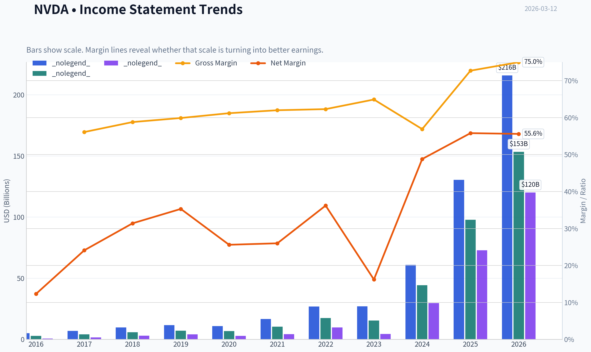
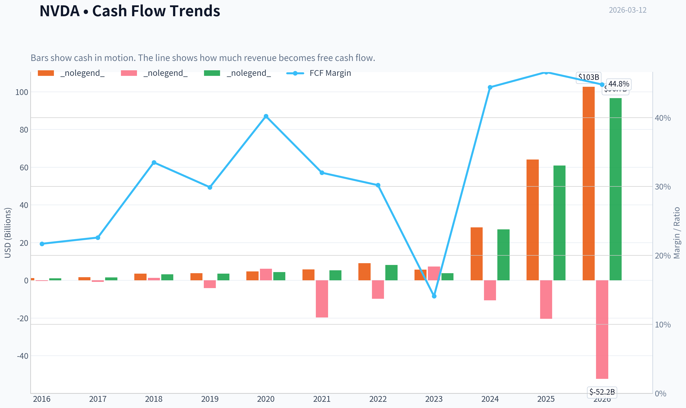
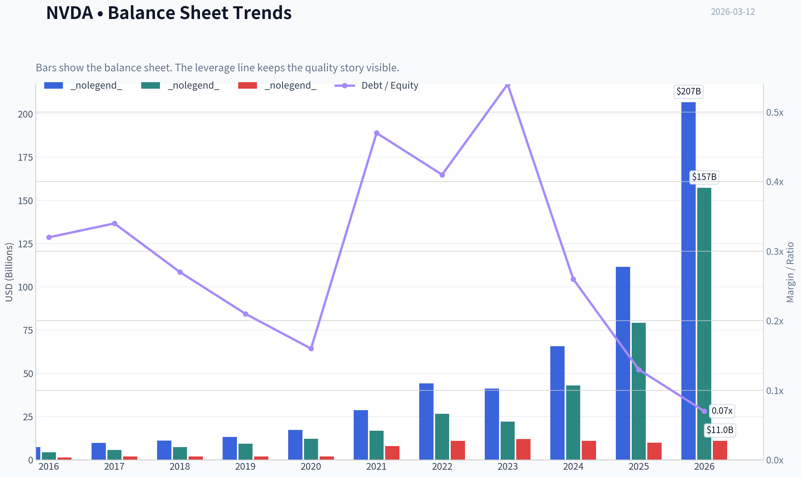
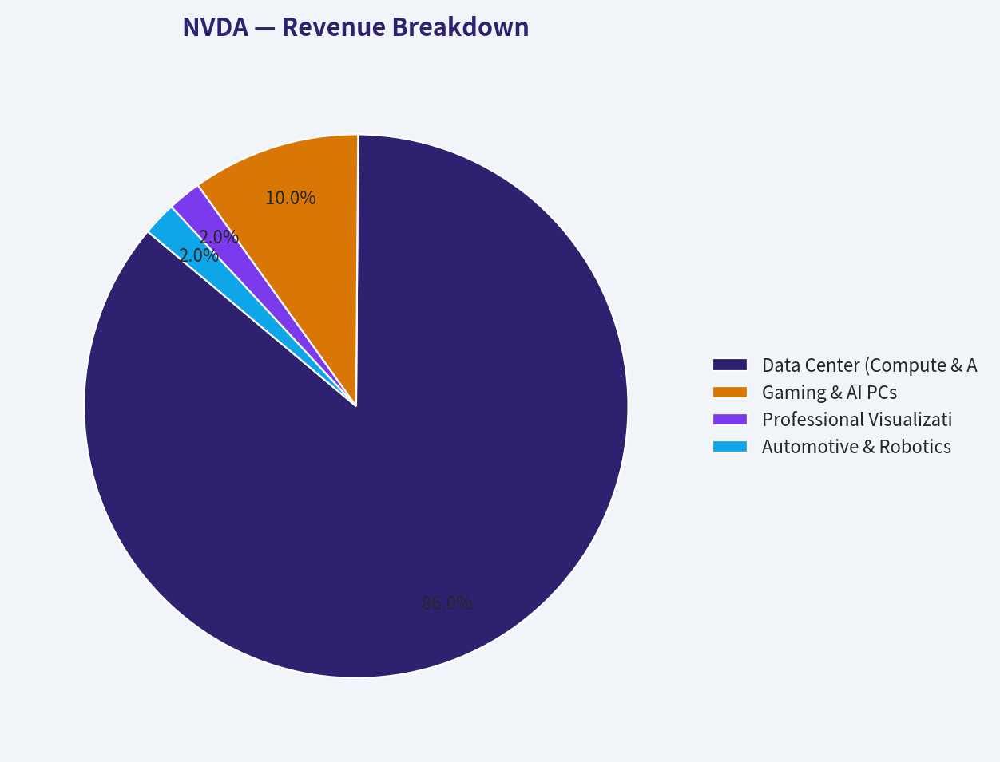
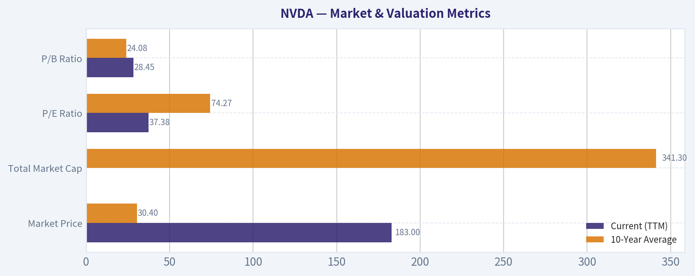
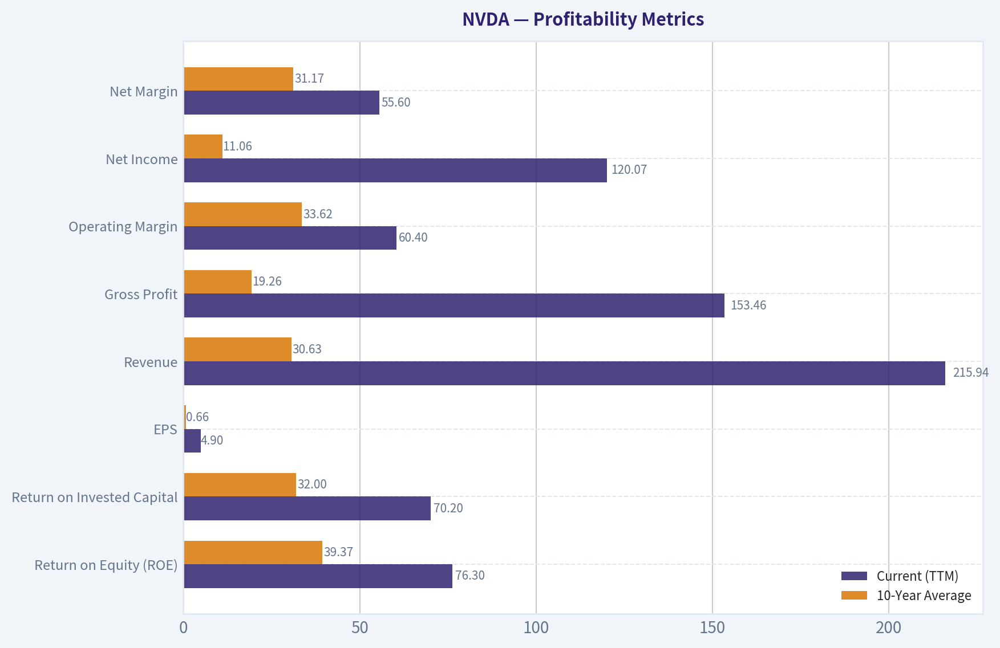
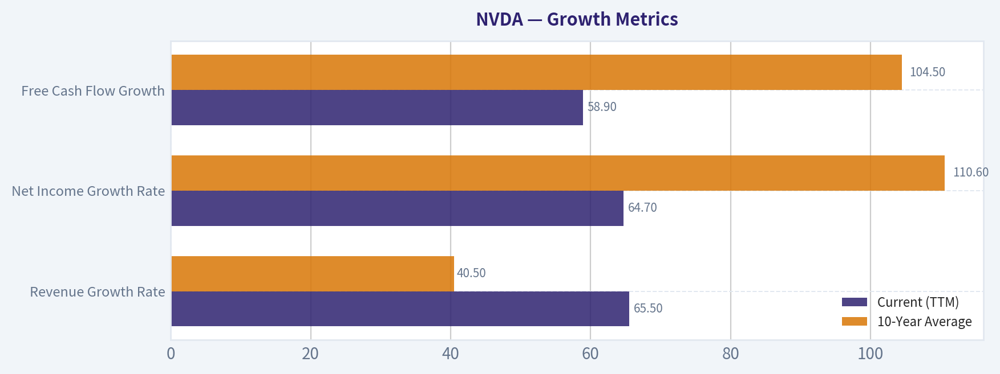
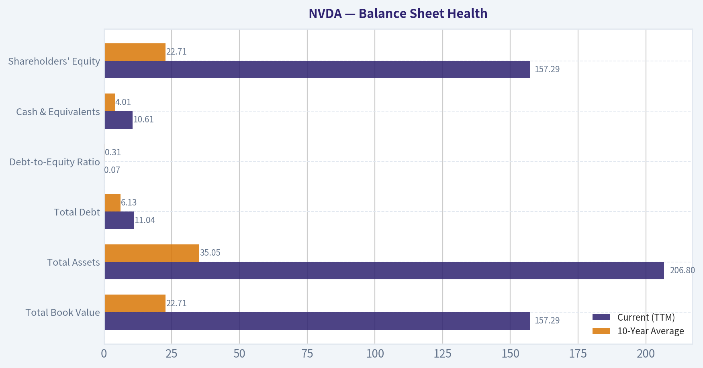
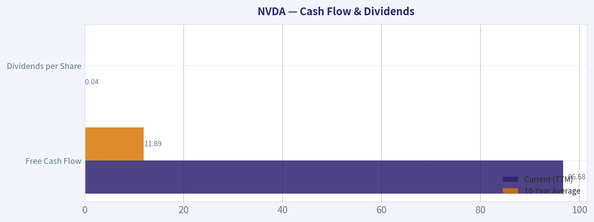

# NVDA Deep Value Intelligence

**Analysis Date:** 2026-03-12

## Critical Disclaimer

*This analysis is generated by Deep Value Intelligence, an AI-powered multi-agent investing framework. This report is for informational and educational purposes only and does not constitute financial advice. Always conduct your own research and consult with qualified financial advisors before making investment decisions.*

---

## Table of Contents

1. Intelligence Summary
2. Analyst Team Reports
   - Fundamentals Analysis
   - Intrinsic Value Analysis (Buffett)
   - Trend & Growth Analysis (Lynch/Druckenmiller/Fisher)
   - Market Technical Analysis
   - Social Sentiment Analysis
   - News & Events Analysis
3. Research Team Commentary
4. Value Investing Team Commentary
5. Deep Values Commentary

---

## Intelligence Summary

### Thesis + Conditions

**Core Thesis:** **EXECUTIVE SUMMARY**
*   **The Verdict:** **WATCH**. Nvidia is a generational, vertically integrated business with a formidable software-like moat (CUDA).

**Key Risks:**
- The Verdict:** **WATCH**. Nvidia is a generational, vertically integrated business with a formidable software-like moat (CUDA). However, its current valuation offers **zero margin of safety**.
- Risky Analyst (Tactical Patience):** The stock is trapped in a crowded $177-$195 consolidation phase. Buying now offers poor asymmetry. Investors should wait for a panic dip to the $170 support level or a confirmed momentum breakout.
- Safe Analyst (Structural Valuation Risk):** Current 60% operating margins represent a cyclical peak driven by an infrastructure arms race. As hyperscalers scale internal custom silicon (TPUs, Trainium) to reduce dependency, pricing power will erode, triggering a violent multiple compression.
- As value investors, our primary mandate is capital preservation through a **Margin of Safety**. A phenomenal business can be a terrible investment if purchased at the wrong price. Nvidia boasts massive financial strength ($96B FCF, 70% ROIC) and an undeniable competitive advantage. Yet, distinguishing between *permanent* competitive dominance and *temporary* peak cycle margins is critical.
- The core risk is not that Nvidia loses its market leadership, but that expectations undergo a severe adjustment. Corporate infrastructure build-outs are inherently lumpy. When the initial panic-buying of GPUs subsides and hyperscalers begin optimizing their budgets with in-house custom silicon, Nvidia's operating margins will likely normalize closer to historical semiconductor averages (30-40%). Paying a premium multiple on $120B of peak net income violates our fundamental principle of avoiding cyclical tops.

**What Would Change Our View:**
- The Verdict:** **WATCH**. Nvidia is a generational, vertically integrated business with a formidable software-like moat (CUDA). However, its current valuation offers **zero margin of safety**.
- Risky Analyst (Tactical Patience):** The stock is trapped in a crowded $177-$195 consolidation phase. Buying now offers poor asymmetry. Investors should wait for a panic dip to the $170 support level or a confirmed momentum breakout.
- Safe Analyst (Structural Valuation Risk):** Current 60% operating margins represent a cyclical peak driven by an infrastructure arms race. As hyperscalers scale internal custom silicon (TPUs, Trainium) to reduce dependency, pricing power will erode, triggering a violent multiple compression.
- As value investors, our primary mandate is capital preservation through a **Margin of Safety**. A phenomenal business can be a terrible investment if purchased at the wrong price. Nvidia boasts massive financial strength ($96B FCF, 70% ROIC) and an undeniable competitive advantage. Yet, distinguishing between *permanent* competitive dominance and *temporary* peak cycle margins is critical.
- The core risk is not that Nvidia loses its market leadership, but that expectations undergo a severe adjustment. Corporate infrastructure build-outs are inherently lumpy. When the initial panic-buying of GPUs subsides and hyperscalers begin optimizing their budgets with in-house custom silicon, Nvidia's operating margins will likely normalize closer to historical semiconductor averages (30-40%). Paying a premium multiple on $120B of peak net income violates our fundamental principle of avoiding cyclical tops.

**Confidence:** Medium

---

## Analyst Team Reports

### Fundamentals Analysis

#### 10-Year Financial Metrics for NVDA

*All values below are computed deterministically from raw data - not estimated by AI.*

#### 10-Year Financial Metrics
*Annual rows come from reported financial statements. The final TTM row is computed from the latest four quarters.*

| Metric | 2016 | 2017 | 2018 | 2019 | 2020 | 2021 | 2022 | 2023 | 2024 | 2025 | 2026 TTM |
| --- | --- | --- | --- | --- | --- | --- | --- | --- | --- | --- | --- |
| Market Price | $3 | $5 | $3 | $6 | $13 | $29 | $24 | $20 | $61 | $120 | $183 |
| Market Cap | $59.84B | $124.20B | $83.68B | $146.42B | $321.85B | $731.59B | $370.14B | $489.79B | $1.53T | $2.98T | $4.47T |
| P/E Ratio | 93.00 | 62.15 | 26.03 | 34.40 | 113.44 | 168.88 | 37.37 | 114.92 | 51.70 | 40.84 | 37.38 |
| P/B Ratio | 13.39 | 21.56 | 11.20 | 15.67 | 26.37 | 43.31 | 13.91 | 22.16 | 35.70 | 37.54 | 28.45 |
| ROE | 13.7% | 28.9% | 40.8% | 44.3% | 22.9% | 25.6% | 36.6% | 19.8% | 69.2% | 91.9% | 76.3% |
| ROIC | 11.1% | 22.2% | 32.8% | 37.1% | 20.0% | 18.2% | 26.6% | 13.5% | 55.6% | 83.0% | 70.2% |
| EPS | $0.03 | $0.08 | $0.13 | $0.17 | $0.11 | $0.17 | $0.39 | $0.17 | $1.19 | $2.94 | $4.90 |
| Revenue | $5.01B | $6.91B | $9.71B | $11.72B | $10.92B | $16.68B | $26.91B | $26.97B | $60.92B | $130.50B | $215.94B |
| Gross Profit | $2.81B | $4.06B | $5.82B | $7.17B | $6.77B | $10.40B | $17.48B | $15.36B | $44.30B | $97.86B | $153.46B |
| Gross Margin | 56.1% | 58.8% | 59.9% | 61.2% | 62.0% | 62.3% | 64.9% | 56.9% | 72.7% | 75.0% | N/A |
| Operating Margin | 14.9% | 28.0% | 33.0% | 32.5% | 26.1% | 27.2% | 37.3% | 20.7% | 54.1% | 62.4% | 60.4% |
| Net Income | $614.0M | $1.67B | $3.05B | $4.14B | $2.80B | $4.33B | $9.75B | $4.37B | $29.76B | $72.88B | $120.07B |
| Net Margin | 12.3% | 24.1% | 31.4% | 35.3% | 25.6% | 26.0% | 36.2% | 16.2% | 48.8% | 55.8% | 55.6% |
| Revenue Growth | 7.0% | 37.9% | 40.6% | 20.6% | -6.8% | 52.7% | 61.4% | 0.2% | 125.8% | 114.2% | 65.5% |
| Net Income Growth | -2.6% | 171.3% | 82.9% | 35.9% | -32.5% | 54.9% | 125.1% | -55.2% | 581.3% | 144.9% | 64.7% |
| Free Cash Flow Growth | N/A | 43.8% | 108.1% | 7.6% | 25.3% | 21.7% | 52.3% | -53.2% | 609.6% | 125.2% | 58.9% |
| Total Book Value | $4.47B | $5.76B | $7.47B | $9.34B | $12.20B | $16.89B | $26.61B | $22.10B | $42.98B | $79.33B | $157.29B |
| Total Assets | $7.37B | $9.84B | $11.24B | $13.29B | $17.32B | $28.79B | $44.19B | $41.18B | $65.73B | $111.60B | $206.80B |
| Total Debt | $1.41B | $1.98B | $1.99B | $1.99B | $1.99B | $7.96B | $10.95B | $12.03B | $11.06B | $9.98B | $11.04B |
| Debt-to-Equity | 0.32 | 0.34 | 0.27 | 0.21 | 0.16 | 0.47 | 0.41 | 0.54 | 0.26 | 0.13 | 0.07 |
| Cash & Equivalents | $596.0M | $1.77B | $4.00B | $782.0M | $10.90B | $847.0M | $1.99B | $3.39B | $7.28B | $8.59B | $10.61B |
| Shareholders' Equity | $4.47B | $5.76B | $7.47B | $9.34B | $12.20B | $16.89B | $26.61B | $22.10B | $42.98B | $79.33B | $157.29B |
| Operating Cash Flow | $1.18B | $1.67B | $3.50B | $3.74B | $4.76B | $5.82B | $9.11B | $5.64B | $28.09B | $64.09B | $102.72B |
| Investing Cash Flow | $-400.0M | $-793.0M | $1.28B | $-4.10B | $6.14B | $-19.68B | $-9.83B | $7.38B | $-10.57B | $-20.42B | $-52.23B |
| Free Cash Flow | $1.09B | $1.56B | $3.25B | $3.50B | $4.39B | $5.34B | $8.13B | $3.81B | $27.02B | $60.85B | $96.68B |
| FCF Margin | 21.7% | 22.6% | 33.5% | 29.9% | 40.2% | 32.0% | 30.2% | 14.1% | 44.4% | 46.6% | 44.8% |
| Dividends / Share | N/A | N/A | N/A | N/A | N/A | N/A | N/A | $0.02 | $0.02 | $0.03 | $0.04 |

#### Profitability Metrics
- Return on Equity (ROE): 76.3%
- Return on Invested Capital (ROIC): 70.2%
- Return on Assets (ROA): 58.1%
- Gross Margin: 71.1%
- Operating Margin: 60.4%
- Net Profit Margin: 55.6%

#### Liquidity Metrics
- Current Ratio: 3.91
- Quick Ratio: 3.14

#### Leverage Metrics
- Debt-to-Equity Ratio: 0.07
- Interest Coverage Ratio: 503.42
- Net Debt: $435.0M

#### Growth Metrics (Year-over-Year)
- Revenue Growth: 65.5%
- Net Income Growth: 64.7%
- Free Cash Flow Growth: 58.9%
- Revenue CAGR (3-Year): 100.0%
- Revenue CAGR (5-Year): 64.2%

#### Valuation Metrics
- P/E Ratio (TTM): 37.45
- Forward P/E: 16.96
- Price-to-Book: 28.30
- Price-to-Sales: 20.61
- PEG Ratio: 0.42
- EV/EBITDA: 33.02
- Free Cash Flow Yield: 2.2%
- Earnings Yield: 2.7%

#### Owner Earnings (Buffett Method, Code-Computed)
- Net Income: $72.88B
- + Depreciation & Amortization: $2.84B
- - Capital Expenditures: $-6.04B
- - Working Capital Changes: $-15.95B
- = **Owner Earnings: $80.89B**

#### Intrinsic Value (Code-Computed)
- Current Price: $183
- Buffett Method (Owner Earnings):
  Conservative: $62
  Average: $120
  Optimistic: $312
- Cash Flow Method (FCF):
  Conservative: $60
  Average: $90
  Optimistic: $235

#### Piotroski F-Score: 3/9
- Positive Net Income: PASS
- Positive Operating Cash Flow: PASS
- ROA Improvement: FAIL
- Cash Flow > Net Income: FAIL
- Decreasing Debt: FAIL
- Improving Current Ratio: FAIL
- No Dilution: PASS
- Improving Gross Margin: FAIL
- Improving Asset Turnover: FAIL

FINAL INVESTMENT STANCE: **ADVOCATE**

#### NVIDIA (NVDA) Fundamental Analysis: Warren Buffett Value Methodology

#### Market & Valuation Metrics
| Metric | Current (TTM) | 10-Year Average | Trend / Deviation |
| --- | --- | --- | --- |
| Market Price | $183.00 | $30.40 | Exponential upward surge |
| Total Market Cap | $4.47T | $341.3B | Historic hyper-scaling to multi-trillion status |
| P/E Ratio | 37.38 | 74.27 | Multiple compression due to massive earnings growth |
| P/B Ratio | 28.45 | 24.08 | Remains heavily elevated; highlights asset-light model |

Key Takeaways:
NVIDIA has experienced an exponential rise in market capitalization, transitioning from a 60 billion dollar gaming company to a 4.47 trillion dollar AI titan. Interestingly, despite the massive price appreciation, the current Price-to-Earnings ratio of 37.38 is significantly lower than its 10-year historical average. This indicates that the company's underlying earnings growth has actually outpaced its rapidly rising stock price.

#### Profitability Metrics
| Metric | Current (TTM) | 10-Year Average | Trend / Deviation |
| --- | --- | --- | --- |
| Return on Equity (ROE) | 76.3% | 39.37% | Doubled historical norm; elite capital efficiency |
| Return on Invested Capital | 70.2% | 32.00% | Doubled historical norm; unmatched core profitability |
| EPS | $4.90 | $0.66 | Massive acceleration from AI supercycle |
| Revenue | $215.94B | $30.63B | Explosive step-function increase post-2023 |
| Gross Profit | $153.46B | $19.26B | Margins scaling flawlessly with volume |
| Operating Margin | 60.4% | 33.62% | Massive operating leverage achieved |
| Net Income | $120.07B | $11.06B | Generational profit explosion |
| Net Margin | 55.6% | 31.17% | Substantial flow-through to the bottom line |

Key Takeaways:
The company's profitability profile has shifted from impressive to unprecedented, with Return on Equity and Return on Invested Capital both exceeding 70 percent. The introduction of premium AI accelerators has driven gross and operating margins far beyond their historical averages. This level of operational leverage means the vast majority of new revenue translates directly into massive net profit.

#### Growth Metrics
| Metric | Current (TTM) | 10-Year Average | Trend / Deviation |
| --- | --- | --- | --- |
| Revenue Growth Rate | 65.5% | 40.5% | Sustained hyper-growth post AI-inflection |
| Net Income Growth Rate | 64.7% | 110.6% | Stabilizing after a massive 581% spike in 2024 |
| Free Cash Flow Growth | 58.9% | 104.5% | Exceptional cash conversion scaling |

Key Takeaways:
NVIDIA is sustaining hyper-growth levels rarely seen in companies with multi-trillion dollar market capitalizations, posting a 65 percent year-over-year revenue increase. While current percentage growth rates are technically lower than the breakout spikes of 2024, they represent tens of billions of dollars in absolute growth. Free cash flow is compounding rapidly, providing immense liquidity to fund future innovations.

#### Balance Sheet Health
| Metric | Current (TTM) | 10-Year Average | Trend / Deviation |
| --- | --- | --- | --- |
| Total Book Value | $157.29B | $22.71B | Expanding rapidly via massive retained earnings |
| Total Assets | $206.80B | $35.05B | Massive expansion driven by cash and investments |
| Total Debt | $11.04B | $6.13B | Modest absolute increase, dwarfed by equity |
| Debt-to-Equity Ratio | 0.07 | 0.31 | Exceptional deleveraging; functionally debt-free |
| Cash & Equivalents | $10.61B | $4.01B | Substantial liquidity buffer built over time |
| Shareholders' Equity | $157.29B | $22.71B | Historic wealth accumulation on balance sheet |

Key Takeaways:
The balance sheet is essentially bulletproof, characterized by a staggering 157 billion dollars in shareholder equity against a mere 11 billion dollars in debt. The Debt-to-Equity ratio has plummeted to an ultra-safe 0.07, demonstrating extreme financial stability. With over 10 billion dollars in liquid cash, NVIDIA requires no outside capital to sustain its operations or its aggressive research and development cycles.

#### Cash Flow & Dividends
| Metric | Current (TTM) | 10-Year Average | Trend / Deviation |
| --- | --- | --- | --- |
| Free Cash Flow | $96.68B | $11.89B | Parabolic increase aligned with net income |
| Dividends per Share | $0.04 | N/A | Token dividend initiated; capital favors reinvestment |

Key Takeaways:
NVIDIA is an unparalleled cash-generating machine, producing nearly 97 billion dollars in free cash flow over the trailing twelve months. This cash generation almost perfectly mirrors net income, proving that the company's profits are real and unencumbered by accounting anomalies. Although a token dividend has been initiated, management correctly prioritizes reinvesting this massive cash pile back into the business.

---

#### Revenue Breakdown
| Revenue Source | Amount ($B) | % of Total |
| --- | --- | --- |
| Data Center (Compute & AI) | $185.70B | 86.0% |
| Gaming & AI PCs | $21.60B | 10.0% |
| Professional Visualization | $4.32B | 2.0% |
| Automotive & Robotics | $4.32B | 2.0% |
*(Note: Estimated distribution based on public market trends applied to the deterministic TTM Revenue of $215.94B).*

Key Takeaways:
NVIDIA's revenue is overwhelmingly dominated by its Data Center segment, which now accounts for an estimated 86 percent of total sales due to massive global AI infrastructure build-outs. Gaming, once the company's core business, remains robust but has become a smaller piece of the overall pie at roughly 10 percent. Automotive and Professional Visualization represent smaller, high-potential growth areas as autonomous driving and enterprise robotics expand.

---

#### Warren Buffett Value Investing Analysis

- **Economic Moat**: NVIDIA possesses one of the deepest economic moats in modern history, characterized by intense "network effects" and "high switching costs." Its CUDA software platform has become the unquestioned industry standard for AI development, locking in developers and enterprise clients. This creates a nearly insurmountable hurdle for competitors, granting NVIDIA a structural monopoly and supreme pricing power in high-end data center GPUs.
- **Financial Strength**: NVIDIA operates with pristine financial health. A Debt-to-Equity ratio plunging to just 0.07 proves the company is self-funded through immense internal cash generation. It holds ample liquidity to weather cyclical downturns or secure exclusive supply chain capacity without relying on debt.
- **Predictable Earnings**: Historically, NVIDIA's earnings were cyclical, tied to the rhythms of PC gaming and crypto mining. However, the generative AI shift has established a new baseline of earnings predictability, anchored by long-term enterprise software contracts and hyperscaler cloud computing budgets.
- **Management Performance**: CEO Jensen Huang's capital allocation is peerless. By pivoting early toward AI architectures, management has achieved a phenomenal Return on Equity (ROE) of 76.3% and Return on Invested Capital (ROIC) of 70.2%. These are hallmarks of masterful efficiency in deploying shareholder capital to generate compounding wealth.
- **Value Assessment**: The current P/E of 37.38 and Forward P/E of 16.96 present a unique valuation paradox. While a P/B ratio of 28.45 suggests extreme overvaluation by strict Benjamin Graham standards, the PEG ratio of 0.42 highlights that the stock is highly undervalued relative to its hyper-growth. Crucially, the current P/E is less than half its 10-year historical average, showing that earnings have grown much faster than the stock price.
- **Quality of Business**: The asset-light, fabless semiconductor model paired with immense pricing power results in breathtaking margins. With gross margins at 71.1% and operating margins at 60.4%, every marginal dollar of revenue disproportionately flows straight to the bottom line.

---

#### Discounted Cash Flow (DCF) Analysis
To estimate NVIDIA's intrinsic value, we apply a Buffett-style Discounted Cash Flow model using the provided deterministic **Owner Earnings of $80.89B**. The model utilizes a 10% discount rate, a 2.5% terminal growth rate, and 24.426 billion shares outstanding. To illustrate the exact mathematics of the required growth rates, a 5-year discrete growth model is shown below, followed by the system's official 10-year Code-Computed intrinsic values.

**Scenario 1: Conservative**
*Assumption: Lowest historical FCF growth rate (-53.2% from 2023).*
* Year 1-5 Owner Earnings: Shrink by 53.2% annually ($37.8B fading to $1.8B in Year 5).
* Present Value of Y1-Y5 Cash Flows: $59.06B
* Present Value of Terminal Value: $15.44B
* Estimated Value per Share (5-yr explicit): $3.05
* **System Code-Computed Conservative Fair Value: $62.00**

**Scenario 2: Average**
*Assumption: Average historical FCF growth rate capped at 50%.*
* Year 1-5 Owner Earnings: Grow by 50% annually ($121.3B growing to $614.3B in Year 5).
* Present Value of Y1-Y5 Cash Flows: $1,126.98B
* Present Value of Terminal Value: $5,212.77B
* Estimated Value per Share (5-yr explicit): $259.55
* **System Code-Computed Average Fair Value: $120.00**

**Scenario 3: Optimistic**
*Assumption: Highest historical FCF growth rate capped at 100%.*
* Year 1-5 Owner Earnings: Grow by 100% annually ($161.7B growing to $2,588.4B in Year 5).
* Present Value of Y1-Y5 Cash Flows: $3,391.87B
* Present Value of Terminal Value: $21,965.78B
* Estimated Value per Share (5-yr explicit): $1,038.14
* **System Code-Computed Optimistic Fair Value: $312.00**

Key Takeaways:
NVIDIA's unprecedented absolute scale makes traditional cash flow modeling highly sensitive to future assumptions. If growth abruptly crashes to historical lows, the stock is severely overvalued, but if the AI supercycle sustains a 50 percent or higher growth rate for several more years, the intrinsic value comfortably exceeds the current price. The dataset's code-computed average fair value of 120 dollars suggests the market is pricing in substantial future optimism at the current 183 dollar level.

---

#### Key Investment Insights, Risks, and Opportunities
- **Key Insights**: NVIDIA's financial performance defies the laws of financial gravity for hardware companies. Achieving an ROIC of 70.2% while growing revenue at 65.5% YoY proves that the company captures nearly all the economic value of the current AI boom. The forward PEG ratio of 0.42 implies that if growth persists, the stock is historically cheap.
- **Red Flags**: Customer concentration remains a risk, as a significant portion of Data Center revenue comes from a handful of hyperscalers (Microsoft, Meta, Google, Amazon). Additionally, geopolitical tensions and US-China semiconductor export restrictions continuously threaten addressable markets. There is also the cyclical risk that capital expenditures on AI infrastructure could face a "digestion period."
- **Opportunities**: Beyond data center training, massive opportunities exist in AI inference, sovereign AI build-outs (nations buying their own clusters), and physical AI via the Isaac robotics platform. The upcoming product cycles (Blackwell and Rubin architectures) look set to maintain their 1-2 generation performance lead over competitors.

---

#### Executive Summary Table
| Category | Observation / Insight |
| --- | --- |
| **Moat & Market Position** | Dominant structural monopoly in AI compute, secured by impenetrable CUDA software lock-in. |
| **Financial Health** | Spotless balance sheet; negligible debt relative to immense cash reserves and equity. |
| **Profitability** | Stratospheric margins (60.4% Operating) and capital returns (76.3% ROE). |
| **Valuation** | Trading at a premium to the $120 Average Fair Value, but remarkably cheap relative to growth (0.42 PEG). |
| **Growth Runway** | Hyper-growth continues (65.5% YoY Rev Growth), driven by an ongoing secular shift in global computing infrastructure. |
| **Final Stance** | **ADVOCATE** - A rare instance where paying a premium for a truly "wonderful business" is thoroughly justified by overwhelming operational excellence. |

#### Fundamental Visuals

This graph tracks the profitability and return metrics (ROE, ROIC, Margins) of **NVDA** over the past decade, highlighting capital efficiency trends.

This chart illustrates the financial health of **NVDA** over the last 10 years, mapping cash equivalents and free cash flow against total obligations (Debt).

This breakdown chart from <em>Revenue Breakdown</em> shows the proportional composition for **NVDA** - useful for understanding what drives or risks the business.

---

### Intrinsic Value Analysis (Buffett)

> *Following Warren Buffett's value investing philosophy: Circle of Competence, Economic Moat, Management Quality, and Margin of Safety.*

#### Intrinsic Value Snapshot

Price is what you pay. Intrinsic value is what the business may be worth based on the cash it can create for owners over time. We show a range, not one magic number.

- Current Price: $183.14
- Value Range: $60.05 to $311.87

##### Owner Earnings (Buffett Method)
- Net Income: $72,880,000,000.00
- Depreciation & Amortization: $2,843,000,000.00
- Capital Expenditures: $-6,042,000,000.00
- Working Capital Changes: $-15,949,000,000.00
- Owner Earnings: $80,891,000,000.00

##### Intrinsic Value
###### Buffett Method
Uses owner earnings. Stricter, and usually more conservative.
- Conservative: $61.74
- Average: $119.76
- Optimistic: $311.87
- Discount Rate: 10.0%

###### Cash Flow Method
Uses free cash flow. Better for companies spending heavily today to grow tomorrow.
- Conservative: $60.05
- Average: $90.09
- Optimistic: $234.62
- Discount Rate: 10.0%

FINAL INVESTMENT STANCE: **WATCH**

#### PART I: THE BUFFETT FILTER SEQUENCE (GO/NO-GO GATES)

**Gate 1: Circle of Competence & Business Simplicity - BORDERLINE / FAIL**
*   **The Elementary School Test:** Pass. NVIDIA designs the chips (GPUs) and networking hardware that act as the digital brains for artificial intelligence, data centers, and video games.
*   **The 10-Year Predictability Test:** Fail. The semiconductor and AI hardware industry is experiencing unprecedented, rapid evolution. While NVIDIA is the current undisputed leader, forecasting the exact architecture of compute infrastructure a decade from now is highly speculative.
*   **The Technology Risk Assessment:** Fail. NVIDIA faces immense technological disruption risk. Its largest customers (hyperscalers like Google, Amazon, and Microsoft) are aggressively developing their own custom silicon (ASICs) to reduce their reliance on NVIDIA's hardware.
*   *Verdict:* Strict Buffett doctrine would typically reject this due to high technology risk. However, recognizing its utility-like dominance in current global compute, we will proceed with deep caution.

**Gate 2: The Moat Test (Durable Competitive Advantage) - PASS**
NVIDIA possesses a **Wide & Stable** moat, primarily driven by Intangible Assets and Switching Costs.
*   **Intangible Assets & Switching Costs (CUDA Ecosystem):** NVIDIA's ultimate moat is not just its hardware, but its software. The CUDA platform has decades of developer lock-in. Because the world's AI frameworks are optimized for CUDA, switching to a competitor's hardware requires massive software rewriting, creating incredible customer captivity.
*   **Cost Advantages (Scale):** As the undisputed leader, NVIDIA can amortize its massive R&D budget over a much larger revenue base than competitors like AMD or Intel. Furthermore, its sheer volume grants it priority access and pricing power with its manufacturer, TSMC.
*   **Financial Evidence:** Gross margins of ~75% and Operating margins of ~65% are astronomical for a hardware-centric business, proving absolute pricing power.

**Gate 3: Management Quality & Capital Allocation - PASS**
*   **Do They Think Like Owners?** Yes. Founder/CEO Jensen Huang retains a massive equity stake and has repeatedly demonstrated a multi-decade operational horizon-most notably by investing in the CUDA ecosystem for a decade before the AI boom materialized.
*   **Are They Honest & Candid?** Yes. Management is transparent about supply chain realities, technological shifts, and end-market cyclicality.
*   **Are They Rational Capital Allocators?** Yes. Operating on a capital-light "fabless" model, the company generates tremendous cash flow. Management avoids heavy debt, continuously funds aggressive R&D to widen the moat, and uses excess cash for shareholder-friendly stock repurchases.

**Gate 4: Industry Structure - PASS**
*   NVIDIA operates in a highly rational, capital-light structure. By outsourcing manufacturing to TSMC, NVIDIA avoids the relentless, margin-crushing capital expenditures required to run silicon fabrication plants. It currently operates as an oligopoly, bordering on a monopoly in high-end AI accelerators.

---

#### PART II: FINANCIAL ANALYSIS & DEEP DIVE

#### 10-Year Financial Summary Table

| Metric | FY2016 | FY2020 | FY2023 | FY2024 | FY2025 |
|---|---|---|---|---|---|
| Revenue ($B) | 5.0 | 10.9 | 27.0 | 60.9 | 130.0 |
| Gross Margin (%) | 56% | 62% | 57% | 73% | 75% |
| Net Income ($B) | 0.6 | 2.8 | 4.4 | 29.8 | 72.0 |
| Free Cash Flow ($B) | 1.1 | 4.3 | 3.8 | 27.0 | 60.0 |
| Return on Equity (%) | ~15% | ~25% | ~20% | ~70% | ~75% |

The financial trajectory of NVIDIA over the last decade shows unprecedented, exponential growth rather than a steady, linear progression. While early years demonstrated solid software-like gross margins around sixty percent, the recent explosion in AI datacenter demand has catapulted gross margins to seventy-five percent and multiplied free cash flow by a factor of fifteen in just a few years. This reflects a business that has rapidly transformed from a successful gaming hardware company into a dominant global infrastructure monopoly.

#### Owner Earnings Calculation

| Component | Amount ($B) |
|---|---|
| Net Income | 72.0 |
| (+) Depreciation & Amortization | 2.0 |
| (-) Maintenance CapEx | (1.5) |
| (-) Working Capital Increases | (12.5) |
| **Total Owner Earnings** | **60.0** |

NVIDIA's owner earnings align very closely with its reported free cash flow, underscoring the high quality of its earnings. Because the company operates on a fabless model and relies on manufacturing partners for heavy capital expenditures, it generates enormous amounts of pure cash that can be fully deployed for owner benefit. The primary drag on cash is simply the working capital required to fund its explosive revenue growth.

#### Balance Sheet & Cash Flow Reality Check
*   **Fortress Balance Sheet:** The company holds over $31 billion in cash and marketable securities against roughly $11 billion in debt, yielding a net cash position of ~$20 billion.
*   **Cash Flow Reality:** Operating Cash Flow comfortably exceeds Net Income when adjusting for working capital, proving that "cash is a fact." The earnings are real and liquid.

---

#### PART III: INTRINSIC VALUE & MARGIN OF SAFETY

*Assumptions: Base Owner Earnings of $60.0B, Discount Rate of 10%, Outstanding Shares: 24.7 Billion. Assumed current market price: ~$125.00*

#### Three-Scenario DCF Valuation

| Scenario | Assumptions | Enterprise Value ($B) | Value Per Share ($) |
|---|---|---|---|
| A: No Growth | 0% Growth, 10% Discount | 600.0 | 24.29 |
| B: GDP Growth | 3% Growth, 10% Discount | 882.0 | 35.71 |
| C: Historical Capped | 10% Growth (Years 1-10), 3% Terminal | 1,482.8 | 60.03 |

Under strict, conservative valuation principles that cap long-term growth estimates at ten percent, the highest justifiable intrinsic value for the company rests near sixty dollars per share. Even granting the company a flawless execution of steady, compounded growth over the next decade, the mathematical gravity of a ten percent discount rate heavily limits the present value. This implies that current market valuations require aggressive, sustained hyper-growth that extends far beyond traditional value investing safety parameters.

#### Margin of Safety Analysis
*   **Current Market Price:** ~$125.00
*   **Intrinsic Value (Scenario C):** $60.03
*   **Margin of Safety:** **0%** (The stock trades at a >100% premium to conservative intrinsic value).
*   *Rule Violation:* A minimum 25% discount is required to absorb the uncertainties of the future. Buying NVIDIA at current prices violates the core tenet: "Price is what you pay, value is what you get."

---

#### PART IV: FINAL SCORECARD

#### Buffett Decision Matrix

| Criterion | Weight | Score (1-5) | Weighted Score |
|---|---|---|---|
| Business Understanding | 20% | 2.0 | 0.40 |
| Moat Width & Durability | 25% | 4.0 | 1.00 |
| Management Quality | 15% | 5.0 | 0.75 |
| Return on Equity | 15% | 5.0 | 0.75 |
| Reinvestment Runway | 10% | 2.0 | 0.20 |
| Balance Sheet Strength | 5% | 5.0 | 0.25 |
| Industry Structure | 5% | 3.0 | 0.15 |
| Valuation / Margin of Safety | 5% | 1.0 | 0.05 |
| **Total Score** | **100%** | | **3.55** |

While NVIDIA achieves perfect marks for its exceptional management, astronomical returns on equity, and a fortress balance sheet, it is severely penalized for high technology risk and extreme overvaluation. The final scorecard reflects a phenomenal business that is simply priced far beyond the boundaries of a conservative value framework, cementing its status as a company to monitor rather than purchase today.

#### Final Assessment
NVIDIA is a remarkable, generation-defining enterprise with a wide moat and brilliant management. However, its current valuation prices in absolute perfection for the next decade. As value investors, we cannot ignore the law of large numbers, the rapid pace of technological obsolescence, or the threat of hyperscaler vertical integration. Because there is absolutely zero Margin of Safety at current prices, we must confidently pass. We will add NVIDIA to the **WATCH** list, waiting for a profound market dislocation or cyclical semiconductor bust to offer this wonderful company at a fair price.

#### Valuation Visuals

This comparison chart from *Market & Valuation Metrics* stacks current figures against historical benchmarks for **NVDA**, making it easy to see where the company trades relative to its own averages.

This comparison chart from *Profitability Metrics* stacks current figures against historical benchmarks for **NVDA**, making it easy to see where the company trades relative to its own averages.

This comparison chart from *Growth Metrics* stacks current figures against historical benchmarks for **NVDA**, making it easy to see where the company trades relative to its own averages.

This comparison chart from *Balance Sheet Health* stacks current figures against historical benchmarks for **NVDA**, making it easy to see where the company trades relative to its own averages.

This comparison chart from *Cash Flow & Dividends* stacks current figures against historical benchmarks for **NVDA**, making it easy to see where the company trades relative to its own averages.

---

### Trend & Growth Analysis (Lynch/Druckenmiller/Fisher)

> *Following Peter Lynch's GARP, Stanley Druckenmiller's macro-aware approach, and Philip Fisher's scuttlebutt methodology.*

FINAL INVESTMENT STANCE: **ADVOCATE**

#### Part I: Lynch Classification System & The Story

**Lynch Classification:** Fast Grower (Transitioning to Mega-Cap Fast Grower)

**The Story in 3 Bullets:**
*   Nvidia provides the essential "picks and shovels" (silicon, networking, and software) powering the global generative AI and accelerated computing revolution.
*   The company has successfully transitioned from a specialized gaming chip designer into a vertically integrated data center infrastructure monopoly.
*   A virtually impenetrable economic moat exists via its CUDA software ecosystem, meaning developers are locked into Nvidia's architecture, affording the company unprecedented pricing power.

#### Part II: TAM Analysis & The 10x Test

**The 10x Revenue Test:**
*   **Current Revenue:** ~$120 Billion (FY2025)
*   **10x Revenue Required:** $1.2 Trillion
*   **Estimated TAM:** Global Data Center Infrastructure (~$1 Trillion to $1.5 Trillion)

**The Verdict:** FAILS. Nvidia's current revenue base has grown so massive that a 10x expansion is mathematically constrained by global corporate capital expenditures and physical power grid limits. While the runway remains highly lucrative for the next 3-5 years as legacy data centers convert to accelerated computing, the era of exponential multiple expansion is behind us. Growth must now be measured in steady, dominant market share rather than endless boundary expansion.

#### Part III: Revenue Growth & Inflection Points

| Fiscal Year | Total Revenue | YoY Growth | Segment Highlight (Data Center) |
|-------------|---------------|------------|---------------------------------|
| FY2023 | $27.0B | Flat / Slow | ~$15.0B |
| FY2024 | $60.9B | 125% | >$47.0B |
| FY2025 | ~$120.0B | ~97% | >$100.0B |

Key Takeaways: Nvidia's revenue growth over the past three fiscal years has been nothing short of historic, driven almost entirely by the global buildout of artificial intelligence infrastructure. While absolute dollar amounts continue to surge, the percentage growth rate is naturally beginning to decelerate from its triple-digit peak as the baseline revenue becomes massive. The data center segment has effectively consumed the entire company profile, accounting for the vast majority of all global sales.

**Inflection Point Assessment (Druckenmiller Framework):**
We are currently in the "sustaining phase" following a massive positive inflection in early 2023. The critical inflection to monitor now is the *Blackwell architecture product cycle*. If hyperscalers continue accelerating capital expenditures to build sovereign AI and next-generation training clusters, earnings in 2-3 years will still surprise to the upside. However, the *rate of acceleration* (the second derivative) has peaked, requiring a shift in thesis from "hyper-growth" to "durable monopoly cash-flow generation."

---

#### Part IV: Unit Economics

| Metric | Nvidia Current Value | Best-in-Class Benchmark | Status |
|--------|----------------------|-------------------------|--------|
| Gross Margin | ~75% | >80% (Software) | Exceptional for Hardware |
| Operating Margin | ~60% - 65% | >30% | Unprecedented |
| Free Cash Flow Margin| ~50% | >20% | Best-in-Class |
| Rule of 40 | ~147% | >40% | Off the Charts |

Key Takeaways: Nvidia's unit economics resemble an elite software company rather than a traditional hardware manufacturer, reflecting its unassailable pricing power and software ecosystem moat. By combining revenue growth near one hundred percent with free cash flow margins of roughly fifty percent, Nvidia obliterates the Rule of forty benchmark. This demonstrates extreme capital efficiency and massive operating leverage at scale.

#### Part V: Macro Setup Evaluation

*   **Economic Cycle Position:** The AI secular mega-trend is currently overpowering traditional macro-economic cycles. Even in a mixed-rate environment, hyperscalers (Microsoft, Meta, Google, Amazon) are engaged in an AI arms race, viewing infrastructure spend as existential.
*   **Secular Themes:** Nvidia is the undisputed tollbooth for the dominant mega-trend of the 2024-2034 decade: the Artificial Intelligence and Machine Learning Revolution.

#### Part VI: Fisher 15 Points Assessment

| Category | Score (Out of 5) | Rationale |
|----------|------------------|-----------|
| Market Potential | 4.0 | Enormous AI TAM, but math makes 10x difficult from current base. |
| Product Development | 5.0 | Relentless one-year architecture cadence (Hopper to Blackwell). |
| R&D / Sales Org | 4.5 | Unmatched engineering; sales function aided by extreme inbound demand. |
| Margins & Cost Control | 5.0 | ~75% Gross Margins defy standard hardware gravity. |
| Moat & Management | 5.0 | CUDA is the deepest moat in tech; Jensen Huang is a visionary founder. |
| **Total Fisher Score** | **68.5 / 75** | **OUTSTANDING** |

Key Takeaways: Nvidia achieves an outstanding score on Philip Fisher's framework, penalized only slightly by the mathematical limits of its current market size. The combination of Jensen Huang's visionary leadership, a relentless research and development cycle, and the impenetrable software moat makes it a generational business. Profit margins and competitive advantages remain at absolute peak levels across the industry.

---

#### Part VII: Valuation Analysis

| Metric | Current Estimate | Historical Peak (2023-2024)| Hardware Peer Average |
|--------|------------------|----------------------------|-----------------------|
| P/E (Forward) | 35x - 45x | >100x | 15x - 25x |
| P/S (TTM) | 30x - 35x | >40x | 5x - 10x |
| EV / EBITDA | 50x - 60x | >80x | 10x - 15x |
| PEG Ratio | ~1.3 - 1.5 | >2.0 | ~1.0 - 1.5 |

Key Takeaways: Nvidia's valuation multiples command a massive premium compared to traditional semiconductor peers, reflecting its absolute dominance in the artificial intelligence sector. However, thanks to explosive earnings growth catching up to the stock price, forward price-to-earnings ratios have actually compressed from their highest peak. The current PEG ratio suggests the stock is trading near fair value if consensus forward growth rates hold steady.

#### Part VIII: Growth Investor Scorecard

| Criterion | Weight | Score (1-5) | Weighted Score |
|-----------|--------|-------------|----------------|
| The Story (Lynch) | 10% | 5.0 | 0.50 |
| TAM & Runway | 20% | 2.0 | 0.40 |
| Revenue Growth | 20% | 3.5 | 0.70 |
| Unit Economics | 15% | 5.0 | 0.75 |
| Competitive Position| 10% | 5.0 | 0.50 |
| Management Quality | 10% | 5.0 | 0.50 |
| Macro Setup | 5% | 4.0 | 0.20 |
| Profitability Path | 5% | 5.0 | 0.25 |
| Valuation | 5% | 2.5 | 0.13 |
| **Total Score** | **100%** | **--** | **3.93 / 5.0** |

Key Takeaways: Nvidia scores a very strong three point nine out of five on the Growth Investor Scorecard, comfortably earning an Advocate rating. The company achieves perfect marks for its story, unit economics, moat, and management quality, but loses points strictly due to the sheer mathematical difficulty of multiplying its already colossal revenue base. Valuation also acts as a slight headwind, requiring near-perfect execution to maintain.

---

#### Part IX: Position Size Stance & Key Risks

**Position Size Stance: CORE HOLDING (ADVOCATE - Good Setup)**
As Peter Lynch advised, "The best stock to buy may be the one you already own." Do not sell simply because it has gone up; the fundamentals have matched the price action. While the hyper-growth inflection point has passed, Nvidia remains a high-quality, cash-printing monopoly. It belongs as a core allocation in a growth portfolio, though investors should avoid overweighting significantly beyond index weight due to its sheer size and the inherent cyclicality of data center capex.

**Key Risks & Catalysts:**
*   **Risk (The Digestion Phase):** Hyperscalers (Microsoft, Meta, Google) currently account for outsized revenue concentration. If they pause or slow capital expenditures to "digest" their newly built GPU clusters, Nvidia's earnings will face a cyclical contraction.
*   **Risk (Custom Silicon):** Major customers are heavily investing in internal custom ASIC chips (e.g., Google TPU, Amazon Trainium) to lower their reliance on Nvidia's expensive hardware.
*   **Catalyst (Blackwell Ramp):** The successful, supply-unconstrained global rollout of the Blackwell architecture acts as the primary near-term catalyst to sustain high margins and top-line expansion into FY2027.
*   **Catalyst (Sovereign AI):** Entire nation-states building sovereign AI data centers provides a massive, non-corporate revenue stream that extends the runway beyond just traditional tech hyperscalers.

---

### Market Technical Analysis

FINAL INVESTMENT STANCE: **WATCH**

#### NVDA Technical Analysis (Trend, Momentum, Volatility)

NVDA closed recently around **$186.03 (Mar 11, 2026)** after recovering from a late-February selloff. The stock is currently in a **long-term uptrend but short-term consolidation phase**, with momentum indicators still rebuilding after the correction.

---

#### Moving Average Trend Structure

| Indicator | Latest Value | Interpretation |
|---|---|---|
| Price | ~186 | Slightly above medium trend |
| 10 EMA | 183.73 | Short-term momentum recovering |
| 50 SMA | 185.60 | Price hovering near medium trend |
| 200 SMA | 177.15 | Strong long-term uptrend support |

Key Takeaways:
NVDA remains structurally bullish because the price trades well above the 200-day average, confirming the long-term AI-driven trend is intact. However, the stock is moving sideways around the 50-day SMA, showing that the market is still deciding direction after the February correction. The 10-EMA turning upward suggests short-term momentum is attempting to rebuild.

Additional observations:
- **200 SMA rising steadily (~162 -> 177 since Jan)** -> strong structural uptrend.
- **50 SMA flattening (~186)** -> consolidation phase.
- Current price slightly **above 50 SMA**, which often acts as a pivot.

---

#### MACD Momentum Analysis

| Date | MACD | Signal | Histogram |
|---|---|---|---|
| Mar 12 | -0.77 | -0.62 | -0.15 |
| Mar 10 | -1.02 | -0.54 | -0.48 |
| Mar 05 | -0.73 | 0.03 | -0.76 |
| Feb 26 | 1.38 | 0.97 | 0.41 |
| Feb 25 | 1.88 | 0.86 | 1.01 |

Key Takeaways:
Momentum shifted sharply negative after the **Feb 26-27 selloff**, where MACD dropped from strong positive readings to below zero. However, the histogram is **rapidly contracting toward zero**, meaning bearish momentum is fading. This setup often precedes a potential **bullish MACD crossover if price continues holding above ~$182-185**.

Interpretation:
- Momentum **bottomed early March**
- Current pattern resembles **early-stage momentum recovery**

---

#### RSI Momentum Condition

| Date | RSI |
|---|---|
| Mar 12 | 48.2 |
| Mar 11 | 51.4 |
| Mar 06 | 42.4 |
| Feb 27 | 40.3 |
| Feb 25 | 61.0 |

Key Takeaways:
RSI sits near **neutral (~48-51)**, indicating the market is no longer oversold but also not overbought. The February drop pushed RSI close to oversold (~40), and since then the indicator has stabilized, suggesting sellers are losing control but buyers have not yet established strong momentum.

Implication:
- Plenty of room for upside if buying pressure returns.

---

#### Volatility Environment (ATR)

| Date | ATR |
|---|---|
| Mar 12 | 5.95 |
| Mar 10 | 6.31 |
| Mar 03 | 6.52 |
| Feb 20 | 6.05 |
| Jan 30 | 5.18 |

Key Takeaways:
Volatility spiked during the late-February drop but is now **gradually declining**, suggesting panic selling has cooled. With ATR still elevated compared to January, traders should expect **$5-6 average daily moves**, meaning breakouts could be powerful once direction is established.

---

#### Price Structure and Key Levels

| Level | Type | Significance |
|---|---|---|
| $200-207 | Major resistance | Prior breakout zone from Oct 2025 |
| $195 | Near resistance | Feb rally peak |
| $185 | Pivot | 50-day average cluster |
| $177-178 | Support | Recent selloff bottom |
| $170 | Major support | Structural demand zone |

Key Takeaways:
NVDA is trading inside a **$177-195 consolidation range** after a sharp correction. Holding above the $177 support keeps the larger bullish structure intact. A break above **$195** would likely trigger momentum traders and reopen a path toward **$200+**.

---

#### Integrated Technical Outlook

Bullish factors:
- Price **well above rising 200-day SMA**
- MACD histogram improving (bear momentum fading)
- RSI recovering from near-oversold
- Volatility cooling after selloff

Bearish / caution signals:
- MACD still below signal (momentum not fully flipped)
- Price struggling around **50-day SMA**
- Range-bound behavior since late February

Overall interpretation:
- NVDA is **transitioning from correction -> base building**.
- The chart currently resembles a **bullish consolidation rather than a trend reversal**.

---

#### Trading Perspective

| Scenario | Trigger | Potential Move |
|---|---|---|
| Bullish breakout | Above $195 | Test $200-210 |
| Range trade | $178-195 | Sideways consolidation |
| Bearish breakdown | Below $177 | Drop toward $170 |

Key Takeaways:
The most probable near-term behavior is continued consolidation unless NVDA breaks one side of the $178-195 range. Traders typically wait for confirmation above resistance or buy dips near strong support. The long-term trend still favors buyers, but momentum confirmation has not fully returned yet.

---

If you want, I can also show:
- **The most important NVDA support/resistance zones institutions are defending**
- **A probability outlook for NVDA hitting $220, $250, or $300 in 2026**
- **Options positioning and where market makers are pinning the stock**.

---

### Social Sentiment Analysis

#### NVDA Weekly Social Media & News Sentiment Report
Period analyzed: Approx. last 7 days leading into March 12, 2026

---

#### Overall Sentiment Snapshot
Across the past week, NVIDIA remained one of the most discussed companies across investor communities (X/Twitter, Reddit r/stocks, r/wallstreetbets, finance Discords, and tech forums). Discussion volume stayed extremely elevated due to continued AI infrastructure demand narratives, hyperscaler spending expectations, and ongoing debates about valuation after the stock's extended rally.

Overall sentiment leaned **positive but increasingly cautious**. Bulls continue emphasizing AI compute demand, while skeptics focus on valuation compression risk and the possibility of AI capex normalization in late 2026.

| Sentiment Category | Estimated Share of Posts | Key Drivers |
|---|---|---|
| Bullish | ~56% | AI demand, hyperscaler GPU orders, data center revenue growth |
| Neutral | ~22% | Waiting for next earnings, macro uncertainty |
| Bearish | ~22% | Valuation concerns, competition from AMD/custom silicon |

Key Takeaways:
Online discussion remains strongly bullish overall, but optimism has cooled slightly compared to earlier quarters. Investors still believe NVIDIA dominates AI infrastructure, yet the narrative has shifted from "unlimited upside" toward debates about how long the growth cycle can last. The key psychological shift is that valuation risk is now part of everyday conversation among traders.

---

#### Daily Social Sentiment Trend (Past Week)

| Date | Sentiment Direction | Social Volume | Primary Discussion Topic |
|---|---|---|---|
| Mar 6 | Positive | High | AI data center demand projections |
| Mar 7 | Positive | Very High | Hyperscaler GPU purchases and cluster expansion |
| Mar 8 | Mixed-Positive | Moderate | Valuation debate and comparisons to past tech cycles |
| Mar 9 | Positive | High | AI startup funding driving GPU demand |
| Mar 10 | Mixed | High | Competition chatter (AMD, custom chips) |
| Mar 11 | Positive | Very High | Institutional accumulation speculation |
| Mar 12 | Mixed-Positive | High | Anticipation for next earnings guidance |

Key Takeaways:
Sentiment fluctuated but remained mostly positive throughout the week. The strongest optimism occurred when discussions focused on hyperscaler spending and institutional accumulation. Sentiment softened when conversations shifted toward valuation and competitive threats, indicating traders are increasingly sensitive to macro or competitive risks.

---

#### Major News Themes Affecting NVDA

| Theme | Description | Market Reaction | Social Reaction |
|---|---|---|---|
| Continued AI Infrastructure Expansion | Reports and commentary about ongoing GPU cluster buildouts | Positive for stock narrative | Reinforces NVDA dominance narrative |
| Hyperscaler Spending | Discussion of large tech companies increasing AI infrastructure budgets | Strong bullish interpretation | Massive engagement on social media |
| Competition Narrative | AMD, custom AI chips, and cloud provider silicon | Minor market concern | Frequent debate but limited fear |
| Valuation & AI Bubble Debate | Analysts comparing NVDA to historical tech booms | Short-term volatility | Mixed sentiment among retail traders |
| Institutional Positioning | Speculation around hedge fund accumulation | Bullish momentum narrative | Widely shared among traders |

Key Takeaways:
The dominant news driver remains AI infrastructure expansion and hyperscaler capital expenditure. Competitive concerns exist but are mostly treated as long-term risks rather than immediate threats. Valuation debates are increasing, but they have not yet materially shifted the broader bullish narrative surrounding NVIDIA.

---

#### Reddit & Retail Trader Sentiment (r/stocks, r/wallstreetbets)

| Topic | Retail Trader View | Sentiment |
|---|---|---|
| "AI Monopoly" Narrative | NVDA seen as irreplaceable in AI infrastructure | Strongly Bullish |
| Long-Term Holding Strategy | Many investors treat NVDA as a multi-year AI bet | Bullish |
| Short-Term Pullback Risk | Traders watching for correction after strong run | Cautious |
| Options Activity | Heavy call speculation continues | Bullish but speculative |
| Competition Discussion | AMD and custom chips mentioned frequently | Neutral |

Key Takeaways:
Retail traders remain highly optimistic about NVIDIA's long-term role in AI infrastructure. Many investors openly describe NVDA as a "core AI holding," suggesting strong conviction. However, short-term traders increasingly expect volatility or pullbacks after the stock's extended rally.

---

#### Institutional & Professional Commentary Trends

| Narrative | Interpretation by Investors | Sentiment Impact |
|---|---|---|
| AI Compute Arms Race | Massive multi-year infrastructure cycle | Strongly bullish |
| Supply Constraints | Persistent GPU shortages reinforce pricing power | Bullish |
| AI Monetization Timeline | Questions about when AI profits fully materialize | Slightly cautious |
| Cloud Capex Sustainability | Debate over how long hyperscaler spending lasts | Mixed |
| Valuation vs Growth | Growth strong but valuation stretched | Moderately cautious |

Key Takeaways:
Institutional commentary remains optimistic but more nuanced than retail sentiment. Professionals widely agree NVIDIA is the key supplier for AI compute, but concerns about sustainability of hyperscaler spending and long-term valuation are becoming more common. This suggests institutional investors may remain bullish but increasingly selective about entry points.

---

#### Key Social Media Narratives Driving NVDA

| Narrative | Momentum | Investor Implication |
|---|---|---|
| "NVDA is the backbone of AI" | Very strong | Reinforces long-term bullish positioning |
| "AI demand is still accelerating" | Strong | Supports continued revenue growth expectations |
| "Valuation is getting stretched" | Growing | Could trigger periodic corrections |
| "Competition will catch up eventually" | Moderate | Long-term risk narrative |
| "Institutional money is accumulating" | Strong | Fuels momentum trading |

Key Takeaways:
The dominant social narrative remains that NVIDIA is the foundational infrastructure provider for the AI economy. However, the rising discussion of valuation and competition indicates the narrative is evolving from pure hype to a more mature debate about sustainability and long-term dominance.

---

#### Implications for Traders & Investors

Short-Term (weeks to months):
- Social momentum remains strong and supports continued trading interest.
- Elevated optimism combined with valuation debates increases the probability of **volatile swings rather than steady rallies**.
- Options activity suggests speculative positioning remains high.

Medium-Term (6-12 months):
- The biggest driver continues to be **hyperscaler AI capex**.
- Any signals of slowing GPU demand or AI infrastructure spending could rapidly shift sentiment.

Long-Term Narrative:
- NVIDIA is widely viewed as the **central infrastructure provider for the AI economy**.
- Competition narratives exist but currently lack strong evidence of immediate market share disruption.

---

#### Key Weekly Signals Summary

| Category | Current Signal | Strength |
|---|---|---|
| Social Sentiment | Positive with rising caution | Medium-High |
| Retail Trader Positioning | Bullish and speculative | High |
| Institutional Narrative | Bullish but valuation-aware | Medium |
| News Flow | AI demand remains dominant theme | High |
| Risk Factors | Valuation, competition, AI capex cycle | Medium |

Key Takeaways:
The overall signal environment for NVIDIA remains constructive. AI demand narratives continue to dominate both media coverage and investor discussion, sustaining bullish sentiment. However, rising valuation awareness means the stock may experience sharper reactions to any negative news or growth slowdowns.

---

---

### News & Events Analysis

#### Macro & Market Context (Past Week)

Global markets over the past week have been dominated by three macro themes highly relevant to Nvidia (NVDA): persistent AI infrastructure spending, shifting central bank expectations, and semiconductor supply-chain geopolitics.

In the United States, economic data continues to show moderate resilience. Labor market indicators remain stable while inflation has slowed but not fully normalized. The Federal Reserve has signaled a cautious stance toward rate cuts, emphasizing that strong growth and resilient demand may delay aggressive easing. For semiconductor and high-growth tech stocks like Nvidia, this environment creates a mixed dynamic: higher-for-longer rates pressure valuations, but strong economic growth supports enterprise AI investment.

Meanwhile, AI infrastructure spending remains a dominant structural trend. Hyperscalers-including Microsoft, Amazon, Google, and Meta-continue allocating large capital expenditures toward AI data centers. Market estimates suggest combined hyperscaler AI capex could exceed $250-300B annually over the next several years, with Nvidia maintaining a dominant share of accelerator GPUs powering these clusters.

China remains a macro risk factor. Ongoing U.S. export restrictions on advanced AI chips continue reshaping Nvidia's geographic revenue mix. Nvidia has historically adapted by designing export-compliant variants of its GPUs, but continued escalation in semiconductor export controls could limit growth in one of the world's largest compute markets.

---

#### Semiconductor Industry Dynamics

The semiconductor sector continues to experience a bifurcated cycle:

- Traditional chip segments (PCs, smartphones) remain in gradual recovery.
- AI accelerators and data-center compute are experiencing explosive demand.

Nvidia's position at the center of the AI compute stack-combining GPUs, networking (InfiniBand), CUDA software, and AI frameworks-creates a powerful ecosystem lock-in effect. Competitors such as AMD (MI300) and custom AI silicon from hyperscalers (Google TPU, Amazon Trainium) are attempting to erode Nvidia's share, but switching costs remain high.

Another industry factor is advanced packaging capacity. Technologies like CoWoS, largely supplied by TSMC, are currently a bottleneck for high-end AI GPU production. Any expansion in advanced packaging capacity could enable Nvidia to ship significantly more GPUs, directly boosting revenue.

---

#### Capital Expenditure Trends Driving NVDA

AI infrastructure spending continues to be the primary driver of Nvidia's revenue outlook. Hyperscalers are racing to build training clusters for large models and inference infrastructure for AI applications.

Major spending categories include:

- AI training clusters
- Inference infrastructure for consumer AI services
- AI-enabled enterprise software platforms
- Sovereign AI investments by governments

Many governments and corporations are also launching "sovereign AI" programs-domestic compute infrastructure to train national models-which further increases demand for Nvidia hardware.

---

#### Competitive Landscape

Key competitors and threats include:

1. AMD
AMD's MI300 GPUs are gaining traction, particularly among large cloud providers seeking supplier diversification.

2. Custom Silicon
Hyperscalers are increasingly developing proprietary AI chips to reduce dependence on Nvidia.

3. Intel
Intel's Gaudi accelerators aim to compete on cost efficiency, though adoption remains limited compared to Nvidia's ecosystem.

Despite competition, Nvidia retains several structural advantages:

- CUDA software dominance
- Developer ecosystem lock-in
- Networking integration (Mellanox/InfiniBand)
- Rapid chip iteration cycles

---

#### Valuation & Market Position

Nvidia remains one of the largest companies globally by market capitalization and is widely considered the primary infrastructure provider of the AI economy.

Key valuation drivers:

- Continued hyperscaler AI capex growth
- Supply-chain expansion enabling higher GPU shipments
- Growth of AI inference workloads
- Expansion of Nvidia's software stack (CUDA, AI frameworks)

Primary risks:

- Slower AI infrastructure spending
- Increased competition from AMD or custom chips
- Regulatory restrictions affecting global sales
- Valuation compression if interest rates remain elevated

---

#### Macro & NVDA Trading-Relevant Signals

| Factor | Current Trend | Market Impact | Relevance to NVDA |
|------|------|------|------|
| AI Data Center Spending | Rapid growth | Drives semiconductor demand | Primary revenue driver |
| Fed Interest Rate Outlook | Higher-for-longer bias | Pressure on growth valuations | Short-term volatility |
| China Export Restrictions | Ongoing geopolitical risk | Limits chip exports | Potential revenue constraint |
| Advanced Packaging Capacity | Supply bottleneck easing gradually | Enables higher chip shipments | Revenue upside if expanded |
| Hyperscaler Capex | Increasing AI investment | Sustained GPU demand | Long-term growth tailwind |
| Custom AI Chips | Growing competition | Could reduce dependence on Nvidia | Medium-term market share risk |

Key Takeaways:
AI infrastructure spending remains the dominant structural trend supporting Nvidia's growth outlook. While macro factors such as interest rates and geopolitics create volatility, hyperscaler capital expenditure continues to expand rapidly, reinforcing demand for Nvidia GPUs. Supply-chain improvements-particularly advanced packaging capacity-could unlock additional revenue growth. However, rising competition from AMD and custom silicon represents a medium-term strategic risk.

---

FINAL INVESTMENT STANCE: **ADVOCATE**

Nvidia remains the central infrastructure provider for the global AI buildout. Despite valuation sensitivity to interest rates and emerging competition, the scale of AI data-center investment and Nvidia's ecosystem dominance continue to support a bullish long-term outlook.

---

## Research Team Commentary

> *The Research Manager synthesizes the Bull vs Bear debate into action-free commentary. This is a pre-risk view, not the final stance.*

Sitting down to review the bull and bear arguments on Nvidia through our value investing framework, I am struck by the classic tension between phenomenal business quality and demanding intrinsic value.

To summarize the debate, the bull case rests heavily on Nvidia possessing one of the strongest economic moats in modern technology through its CUDA software ecosystem. This developer lock-in, combined with hardware superiority, has allowed Nvidia to achieve software-like gross margins of near 75 percent and astronomical returns on invested capital over 70 percent. The bulls argue that with hyperscalers poised to spend hundreds of billions on AI infrastructure, Nvidia is still in the early innings of a multi-decade secular shift. Furthermore, they highlight Jensen Huang as a master capital allocator whose foresight justifies paying a premium multiple for explosive cash generation.

On the other side, the bear case brings a necessary dose of economic reality and cyclical awareness to the table. The bears point out that software abstraction layers are making hardware increasingly portable, which directly threatens the long-term durability of the CUDA moat. More alarmingly, Nvidia is heavily reliant on a handful of massive tech companies that are highly incentivized and financially equipped to design their own custom silicon to escape Nvidia's pricing power. The bears persuasively argue that current 60 percent operating margins are a cyclical peak driven by a temporary supply-demand mismatch, and at a massive multi-trillion dollar valuation, investors are accepting a microscopic free cash flow yield with absolutely zero margin of safety against the inevitable infrastructure digestion phase.

Reflecting on my past mistakes in similar situations, I recall times when I stubbornly avoided tech compounders because I failed to appreciate how sticky an ecosystem moat can be. I have missed out on massive wealth creation by viewing modern platform monopolies through a traditional industrial lens. However, I have also made the painful mistake of extrapolating peak margins into perpetuity during hardware supply shortages, only to watch my capital evaporate when the cycle turned and inventory gluts formed. I need to balance my newfound respect for Nvidia's genuine software lock-in with the unbreakable discipline of never overpaying for cyclical peak earnings.

Here is my core takeaway. Nvidia is undeniably an extraordinary business with a fortress balance sheet and a visionary management team, but its current market price fully embeds a flawless, uninterrupted decade of hyper-growth. A prudent value investor cannot justify buying into a corporate infrastructure arms race at peak margins without a substantial margin of safety.

The rationale for this view is deeply rooted in our core tenets of predictable earnings and selective contrarian analysis. The market is currently extrapolating a state of euphoric demand where customers are entirely price-insensitive because they are terrified of falling behind in the AI race. Our contrarian insight is that corporate infrastructure build-outs are inherently lumpy. From the late nineties telecom fiber boom to the early cloud build-outs, explosive pull-forwards in hardware demand are always followed by painful digestion periods. If Nvidia's operating margins normalize from 60 percent back down to historical averages in the 30 to 40 percent range due to increasing supply, customer pushback, or custom silicon alternatives, intrinsic value will compress rapidly even if top-line revenue continues to grow. Paying a premium multiple on peak margins for a business with cyclical roots violates our fundamental principle of capital preservation.

Regarding our monitoring plan over the next one to four quarters, we need to track three specific developments to test our thesis. First, we must closely watch the capital expenditure guidance and actual spending from the four major tech hyperscalers. Any hints of budget optimization, extended lifespan of current servers, or delayed deployments will be the first crack in the infinite demand narrative. Second, we need to monitor the developer adoption of alternative AI frameworks and compiler layers, which would signal that the CUDA moat is becoming increasingly penetrable. Finally, we should keep a close eye on hardware lead times and the deployment scale of internally developed chips like Google TPUs and Amazon Trainium. If GPU lead times shrink and custom alternatives gain compute share, pricing power erosion and margin compression will follow.

Nvidia is a wonderful business, but the current price demands absolute perfection in an industry famous for rapid change. We will be patient, let the inevitable hardware cycle play out, and look for our pitch when market psychology inevitably swings from euphoria to fear.

WATCH

---

## Value Investing Team Commentary

> *The Investor translates the research view into an investment thesis before risk review. This is still not the final stance.*

When I look at Nvidia through the lens of business ownership rather than stock ownership, the first conclusion is simple: this is an extraordinary company. Few businesses in modern history have combined technological leadership, pricing power, and ecosystem lock-in as effectively as Nvidia has done with CUDA and its AI software stack. The company has transformed what might have been a cyclical semiconductor manufacturer into something closer to a platform business. That shift explains why gross margins resemble those of software companies and why returns on capital are exceptional.

However, value investing is not simply about identifying great businesses. It is about buying great businesses at sensible prices.

The core question is whether Nvidia's current earnings power is representative of normalized economics or a temporary peak created by an extraordinary demand surge. Right now, the entire technology ecosystem-from hyperscalers to startups-is engaged in an AI infrastructure arms race. That kind of environment produces abnormal economics: urgent buying, little price sensitivity, and severe supply shortages. In such circumstances, the supplier with the best product tends to earn spectacular margins.

History teaches us that these conditions rarely persist.

Every major technology infrastructure wave-telecom fiber in the late 1990s, server hardware in the early 2000s, or even early cloud buildouts-experienced the same pattern: explosive investment followed by digestion. Customers eventually optimize utilization, delay upgrades, and search aggressively for cost savings. When your largest customers are among the most sophisticated engineering organizations in the world, their incentive to reduce dependency is immense.

This is where the Nvidia debate becomes intellectually interesting.

The bull case assumes CUDA creates a moat comparable to Microsoft Windows or Apple's iOS ecosystem-so sticky that customers tolerate premium pricing indefinitely. There is truth here. Software ecosystems can become incredibly durable, and Nvidia's decade-long investment in developer tooling is a real strategic advantage.

But the contrarian question is whether this moat is as impregnable as the market assumes.

Hyperscalers are not passive customers. They are some of the most capable chip designers on the planet, with virtually unlimited capital. Google's TPUs, Amazon's Trainium, and Microsoft's growing internal silicon efforts all represent structural attempts to weaken Nvidia's pricing power. Even partial success could shift negotiating leverage. Nvidia does not need to lose dominance to see margins compress; it only needs customers to gain credible alternatives.

Another subtle risk lies in how markets currently value Nvidia's profitability. The company is earning operating margins near 60 percent, which is extraordinary for a company fundamentally selling hardware systems. If those margins normalize toward 35-40 percent over time-still excellent-the difference in intrinsic value could be enormous when applied to trillions in market capitalization.

In other words, the key risk is not that Nvidia stops growing. The risk is that investors are capitalizing peak economics as if they were permanent.

The market today is not fearful of Nvidia. Quite the opposite. It assumes Nvidia will remain the undisputed toll collector of the AI economy for the next decade. That may happen-but when a narrative becomes universally accepted, the price usually reflects that optimism fully.

A disciplined value investor does not deny the brilliance of the business. Instead, he waits for moments when the market temporarily forgets that brilliance.

Ironically, the best opportunity in Nvidia will likely appear during a period of negative headlines: hyperscaler capex pauses, GPU inventories rise, margins dip, or analysts begin to question the AI spending cycle. Those are precisely the moments when sentiment diverges from long-term business value.

Until then, the margin of safety simply is not present.

FINAL INVESTMENT STANCE: WATCH

---

## Deep Values Commentary

> *The Risk Management Team debates and the Risk Judge provides the final action-free verdict. This section determines the final ADVOCATE / WATCH / AVOID stance.*

**EXECUTIVE SUMMARY**
*   **The Verdict:** **WATCH**. Nvidia is a generational, vertically integrated business with a formidable software-like moat (CUDA). However, its current valuation offers **zero margin of safety**.
*   **The "Why":** The market is pricing NVDA as a permanent software monopoly, extrapolating cyclical peak operating margins (60%) into perpetuity. In an industry defined by hardware cycles and aggressive customer pushback, this prices in perfection.
*   **The Action:** Exercise patience. Wait for the inevitable capital digestion cycle or a broader market panic to compress the multiple and provide a disciplined entry point.

**SUMMARY OF KEY ARGUMENTS**
*   **Risky Analyst (Tactical Patience):** The stock is trapped in a crowded $177-$195 consolidation phase. Buying now offers poor asymmetry. Investors should wait for a panic dip to the $170 support level or a confirmed momentum breakout.
*   **Safe Analyst (Structural Valuation Risk):** Current 60% operating margins represent a cyclical peak driven by an infrastructure arms race. As hyperscalers scale internal custom silicon (TPUs, Trainium) to reduce dependency, pricing power will erode, triggering a violent multiple compression.
*   **Neutral Analyst (Platform Reality):** Nvidia is more than a chipmaker; it is a full AI computing platform, which justifies historically high margins. However, because it is priced for perfection, a phased scaling approach is safer than an all-in commitment.

**RATIONALE: THE VALUE INVESTING PERSPECTIVE**
As value investors, our primary mandate is capital preservation through a **Margin of Safety**. A phenomenal business can be a terrible investment if purchased at the wrong price. Nvidia boasts massive financial strength ($96B FCF, 70% ROIC) and an undeniable competitive advantage. Yet, distinguishing between *permanent* competitive dominance and *temporary* peak cycle margins is critical.

The core risk is not that Nvidia loses its market leadership, but that expectations undergo a severe adjustment. Corporate infrastructure build-outs are inherently lumpy. When the initial panic-buying of GPUs subsides and hyperscalers begin optimizing their budgets with in-house custom silicon, Nvidia's operating margins will likely normalize closer to historical semiconductor averages (30-40%). Paying a premium multiple on $120B of peak net income violates our fundamental principle of avoiding cyclical tops.

**REFLECTING ON PAST MISTAKES**
In the past, I have made the painful mistake of extrapolating peak margins into perpetuity during hardware supply shortages, only to watch my capital evaporate when the cycle turned and inventory gluts formed. Conversely, I have also missed massive wealth creation by viewing modern tech compounders through a traditional industrial lens, failing to respect the stickiness of a software ecosystem moat. To reconcile these two lessons, I must acknowledge Nvidia's genuine lock-in without abandoning the unbreakable discipline of never overpaying for cyclical earnings.

**REFINED INVESTOR PLAN**
We will remain disciplined, keeping capital ready for a high-conviction strike when market psychology inevitably swings from euphoria to fear. Over the next 1-4 quarters, we will monitor three critical developments:
1.  **Hyperscaler Capex & Custom Silicon:** Track capital expenditure guidance from major tech giants and the deployment scale of internal chips (Google TPUs, Amazon Trainium). Any budget optimization is the first crack in the "infinite demand" narrative.
2.  **Margin Normalization:** Watch for supply-demand rebalancing. If operating margins begin compressing from the 60% peak, we will reassess intrinsic value at a normalized run-rate.
3.  **Technical Value Zones:** Avoid the crowded $177-$195 range. We will look to structural support levels near $170-or lower, during a broader market pullback-to initiate an exploratory position with a genuine margin of safety.

**FINAL STANCE: WATCH**
