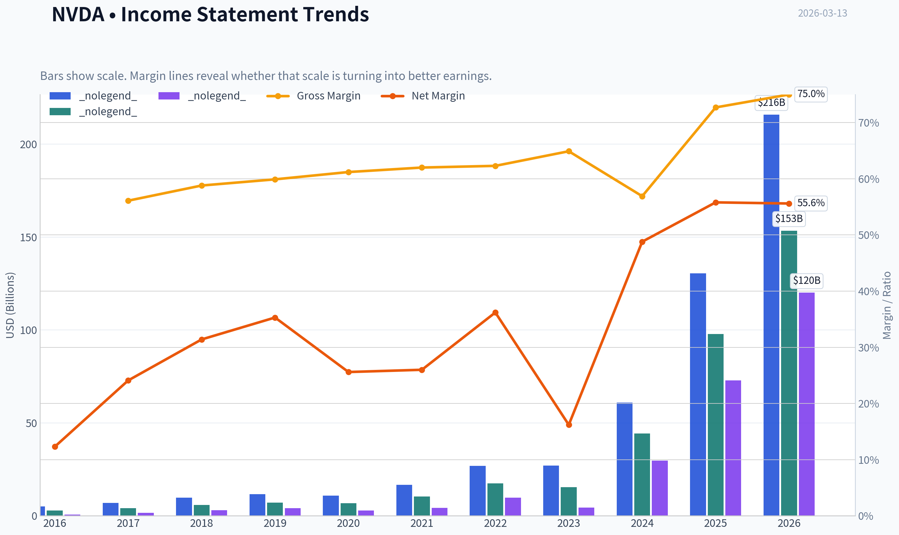
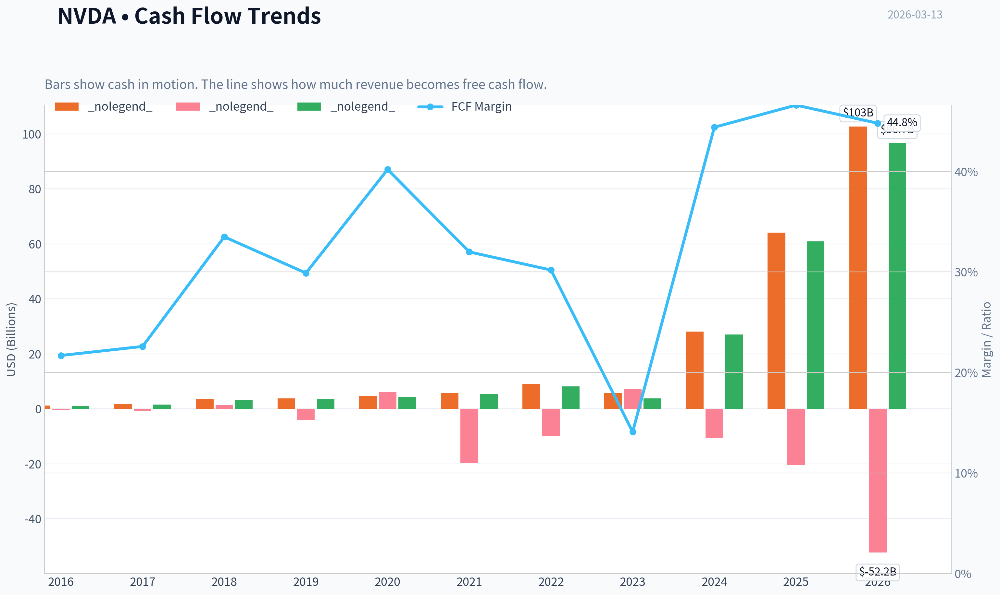
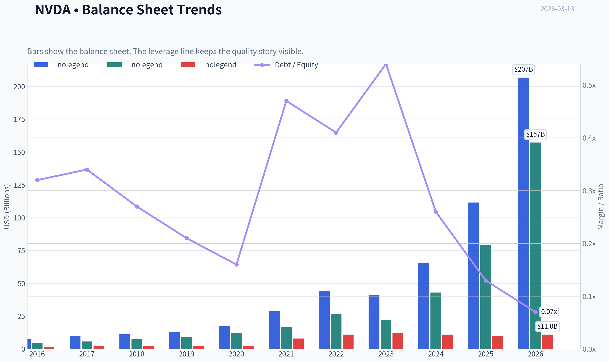
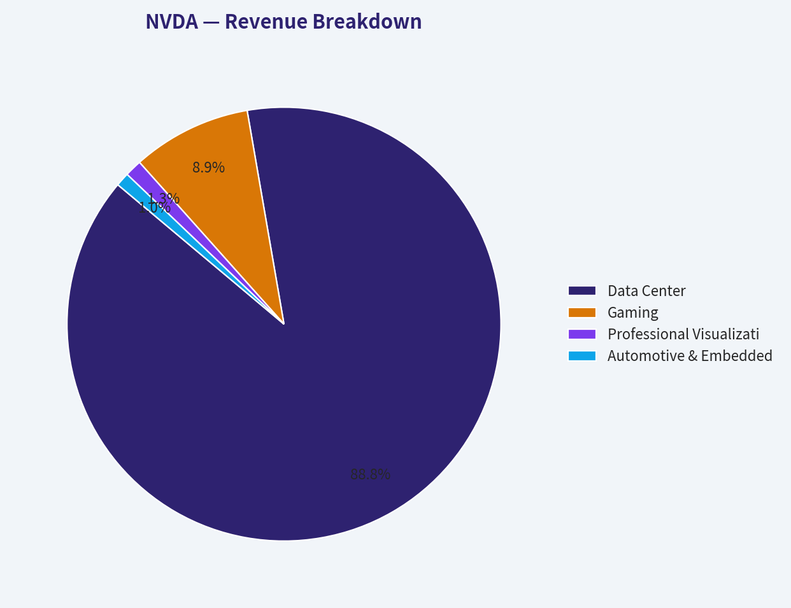
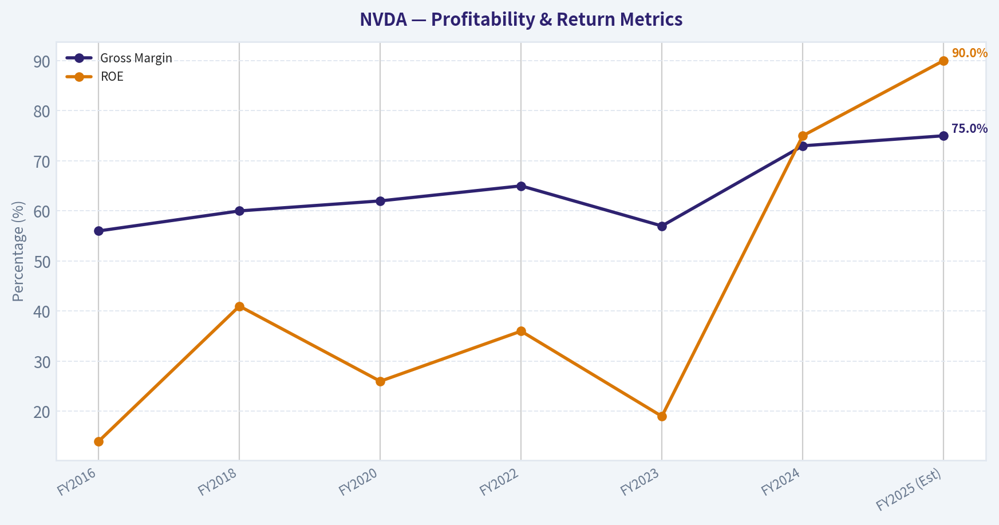
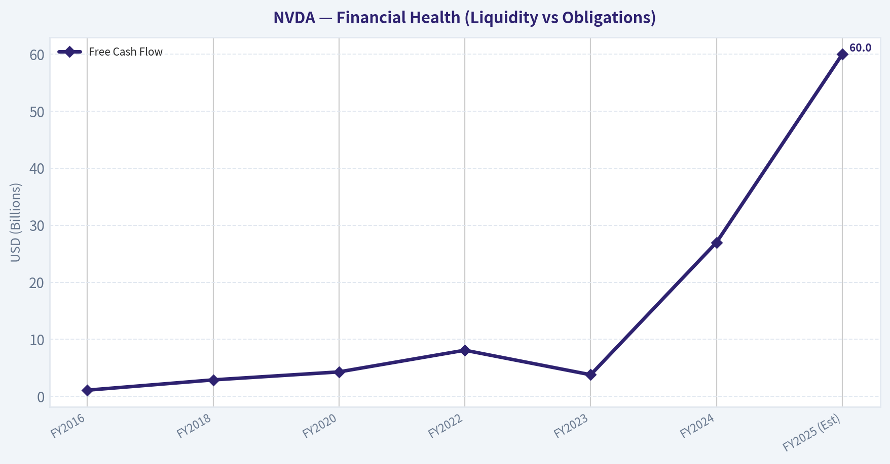
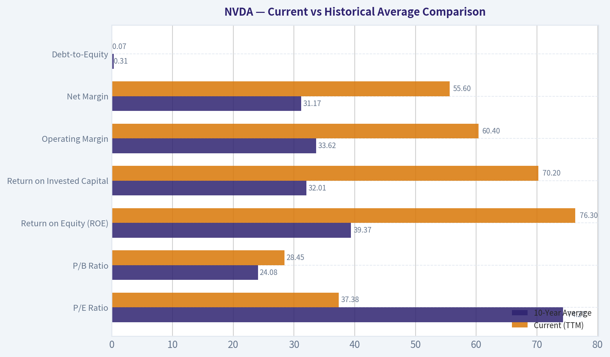
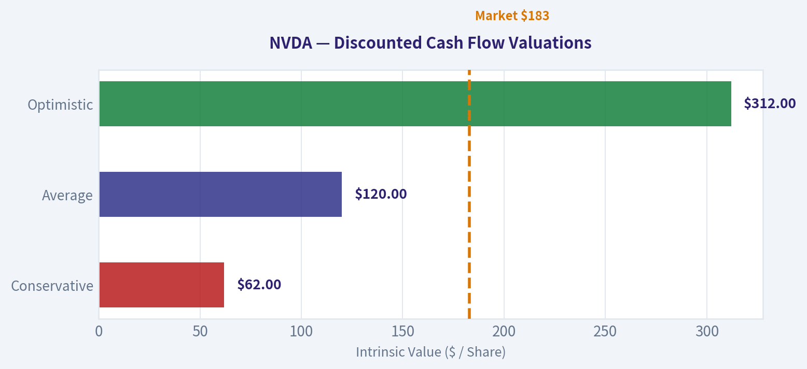
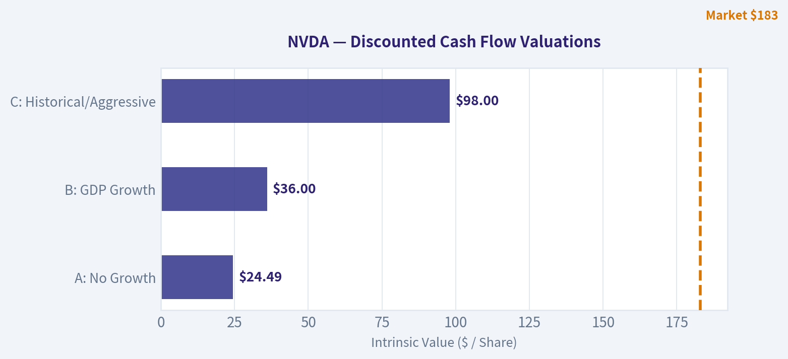

# NVDA Deep Value Intelligence

**Analysis Date:** 2026-03-13

## Critical Disclaimer

*This analysis is generated by Deep Value Intelligence, an AI-powered multi-agent investing framework. This report is for informational and educational purposes only and does not constitute financial advice. Always conduct your own research and consult with qualified financial advisors before making investment decisions.*

---

## Table of Contents

1. Intelligence Summary
2. Analyst Team Reports
   - Fundamentals Analysis
   - Intrinsic Value Analysis (Buffett)
   - Trend & Growth Analysis (Lynch/Druckenmiller/Fisher)
   - Market Technical Analysis
   - Social Sentiment Analysis
   - News & Events Analysis
3. Research Team Commentary
4. Value Investing Team Commentary
5. Deep Values Commentary

---

## Intelligence Summary

### Thesis + Conditions

**Core Thesis:** **EXECUTIVE SUMMARY**
*   **The Business**: NVIDIA is an elite enterprise boasting software-like gross margins (~75%), $96.7B in free cash flow, and a profound economic moat via its CUDA developer ecosystem. *   **The Risk**: The valuation relies on peak cyclical earnings.

**Key Risks:**
- The Risk**: The valuation relies on peak cyclical earnings. With 89% of revenue concentrated in data centers, earnings are heavily tethered to the capital expenditure budgets of a few hyperscalers who are actively developing custom silicon alternatives.
- The Verdict**: **WATCH**. The market currently offers no margin of safety, but the business quality is too high to ignore. We will employ "conditional engagement" rather than passive waiting or speculative chasing.
- The Bull (Momentum/Growth)**: Valuation risk is overstated because earnings exploded faster than the stock price (Fwd P/E ~17, PEG 0.42). Waiting for a textbook margin of safety on a 60-70% compounder means missing out on the coming Blackwell upgrade cycle.
- The Bear (Capital Preservation)**: Earnings are artificially inflated by peak AI capex spending. Buying at peak earnings mathematically guarantees multiple expansion when the cycle normalizes. The Piotroski F-score of 3/9 and 89% data center concentration indicate heightening fundamental risk, with a potential 20-30% drawdown if the trend breaks.
- The Pragmatist (Conditional)**: The stock is technically range-bound ($176-$195). The real risk is timing uncertainty. Investors should avoid predicting the breakout and instead wait for predefined market triggers to act.

**What Would Change Our View:**
- The Risk**: The valuation relies on peak cyclical earnings. With 89% of revenue concentrated in data centers, earnings are heavily tethered to the capital expenditure budgets of a few hyperscalers who are actively developing custom silicon alternatives.
- The Verdict**: **WATCH**. The market currently offers no margin of safety, but the business quality is too high to ignore. We will employ "conditional engagement" rather than passive waiting or speculative chasing.
- The Bull (Momentum/Growth)**: Valuation risk is overstated because earnings exploded faster than the stock price (Fwd P/E ~17, PEG 0.42). Waiting for a textbook margin of safety on a 60-70% compounder means missing out on the coming Blackwell upgrade cycle.
- The Bear (Capital Preservation)**: Earnings are artificially inflated by peak AI capex spending. Buying at peak earnings mathematically guarantees multiple expansion when the cycle normalizes. The Piotroski F-score of 3/9 and 89% data center concentration indicate heightening fundamental risk, with a potential 20-30% drawdown if the trend breaks.
- The Pragmatist (Conditional)**: The stock is technically range-bound ($176-$195). The real risk is timing uncertainty. Investors should avoid predicting the breakout and instead wait for predefined market triggers to act.

**Confidence:** Low

---

## Analyst Team Reports

### Fundamentals Analysis

#### 10-Year Financial Metrics for NVDA

*All values below are computed deterministically from raw data - not estimated by AI.*

#### 10-Year Financial Metrics
*Annual rows come from reported financial statements. The final TTM row is computed from the latest four quarters.*

| Metric | 2016 | 2017 | 2018 | 2019 | 2020 | 2021 | 2022 | 2023 | 2024 | 2025 | 2026 TTM |
| --- | --- | --- | --- | --- | --- | --- | --- | --- | --- | --- | --- |
| Market Price | $3 | $5 | $3 | $6 | $13 | $29 | $24 | $20 | $61 | $120 | $183 |
| Market Cap | $59.84B | $124.20B | $83.68B | $146.42B | $321.85B | $731.59B | $370.14B | $489.79B | $1.53T | $2.98T | $4.47T |
| P/E Ratio | 93.00 | 62.15 | 26.03 | 34.40 | 113.44 | 168.88 | 37.37 | 114.92 | 51.70 | 40.84 | 37.38 |
| P/B Ratio | 13.39 | 21.56 | 11.20 | 15.67 | 26.37 | 43.31 | 13.91 | 22.16 | 35.70 | 37.54 | 28.45 |
| ROE | 13.7% | 28.9% | 40.8% | 44.3% | 22.9% | 25.6% | 36.6% | 19.8% | 69.2% | 91.9% | 76.3% |
| ROIC | 11.1% | 22.2% | 32.8% | 37.1% | 20.0% | 18.2% | 26.6% | 13.5% | 55.6% | 83.0% | 70.2% |
| EPS | $0.03 | $0.08 | $0.13 | $0.17 | $0.11 | $0.17 | $0.39 | $0.17 | $1.19 | $2.94 | $4.90 |
| Revenue | $5.01B | $6.91B | $9.71B | $11.72B | $10.92B | $16.68B | $26.91B | $26.97B | $60.92B | $130.50B | $215.94B |
| Gross Profit | $2.81B | $4.06B | $5.82B | $7.17B | $6.77B | $10.40B | $17.48B | $15.36B | $44.30B | $97.86B | $153.46B |
| Gross Margin | 56.1% | 58.8% | 59.9% | 61.2% | 62.0% | 62.3% | 64.9% | 56.9% | 72.7% | 75.0% | N/A |
| Operating Margin | 14.9% | 28.0% | 33.0% | 32.5% | 26.1% | 27.2% | 37.3% | 20.7% | 54.1% | 62.4% | 60.4% |
| Net Income | $614.0M | $1.67B | $3.05B | $4.14B | $2.80B | $4.33B | $9.75B | $4.37B | $29.76B | $72.88B | $120.07B |
| Net Margin | 12.3% | 24.1% | 31.4% | 35.3% | 25.6% | 26.0% | 36.2% | 16.2% | 48.8% | 55.8% | 55.6% |
| Revenue Growth | 7.0% | 37.9% | 40.6% | 20.6% | -6.8% | 52.7% | 61.4% | 0.2% | 125.8% | 114.2% | 65.5% |
| Net Income Growth | -2.6% | 171.3% | 82.9% | 35.9% | -32.5% | 54.9% | 125.1% | -55.2% | 581.3% | 144.9% | 64.7% |
| Free Cash Flow Growth | N/A | 43.8% | 108.1% | 7.6% | 25.3% | 21.7% | 52.3% | -53.2% | 609.6% | 125.2% | 58.9% |
| Total Book Value | $4.47B | $5.76B | $7.47B | $9.34B | $12.20B | $16.89B | $26.61B | $22.10B | $42.98B | $79.33B | $157.29B |
| Total Assets | $7.37B | $9.84B | $11.24B | $13.29B | $17.32B | $28.79B | $44.19B | $41.18B | $65.73B | $111.60B | $206.80B |
| Total Debt | $1.41B | $1.98B | $1.99B | $1.99B | $1.99B | $7.96B | $10.95B | $12.03B | $11.06B | $9.98B | $11.04B |
| Debt-to-Equity | 0.32 | 0.34 | 0.27 | 0.21 | 0.16 | 0.47 | 0.41 | 0.54 | 0.26 | 0.13 | 0.07 |
| Cash & Equivalents | $596.0M | $1.77B | $4.00B | $782.0M | $10.90B | $847.0M | $1.99B | $3.39B | $7.28B | $8.59B | $10.61B |
| Shareholders' Equity | $4.47B | $5.76B | $7.47B | $9.34B | $12.20B | $16.89B | $26.61B | $22.10B | $42.98B | $79.33B | $157.29B |
| Operating Cash Flow | $1.18B | $1.67B | $3.50B | $3.74B | $4.76B | $5.82B | $9.11B | $5.64B | $28.09B | $64.09B | $102.72B |
| Investing Cash Flow | $-400.0M | $-793.0M | $1.28B | $-4.10B | $6.14B | $-19.68B | $-9.83B | $7.38B | $-10.57B | $-20.42B | $-52.23B |
| Free Cash Flow | $1.09B | $1.56B | $3.25B | $3.50B | $4.39B | $5.34B | $8.13B | $3.81B | $27.02B | $60.85B | $96.68B |
| FCF Margin | 21.7% | 22.6% | 33.5% | 29.9% | 40.2% | 32.0% | 30.2% | 14.1% | 44.4% | 46.6% | 44.8% |
| Dividends / Share | N/A | N/A | N/A | N/A | N/A | N/A | N/A | $0.02 | $0.02 | $0.03 | $0.04 |

#### Profitability Metrics
- Return on Equity (ROE): 76.3%
- Return on Invested Capital (ROIC): 70.2%
- Return on Assets (ROA): 58.1%
- Gross Margin: 71.1%
- Operating Margin: 60.4%
- Net Profit Margin: 55.6%

#### Liquidity Metrics
- Current Ratio: 3.91
- Quick Ratio: 3.14

#### Leverage Metrics
- Debt-to-Equity Ratio: 0.07
- Interest Coverage Ratio: 503.42
- Net Debt: $435.0M

#### Growth Metrics (Year-over-Year)
- Revenue Growth: 65.5%
- Net Income Growth: 64.7%
- Free Cash Flow Growth: 58.9%
- Revenue CAGR (3-Year): 100.0%
- Revenue CAGR (5-Year): 64.2%

#### Valuation Metrics
- P/E Ratio (TTM): 37.30
- Forward P/E: 16.96
- Price-to-Book: 28.30
- Price-to-Sales: 20.61
- PEG Ratio: 0.42
- EV/EBITDA: 33.02
- Free Cash Flow Yield: 2.2%
- Earnings Yield: 2.7%

#### Owner Earnings (Buffett Method, Code-Computed)
- Net Income: $72.88B
- + Depreciation & Amortization: $2.84B
- - Capital Expenditures: $-6.04B
- - Working Capital Changes: $-15.95B
- = **Owner Earnings: $80.89B**

#### Intrinsic Value (Code-Computed)
- Current Price: $183
- Buffett Method (Owner Earnings):
  Conservative: $62
  Average: $120
  Optimistic: $312
- Cash Flow Method (FCF):
  Conservative: $60
  Average: $90
  Optimistic: $235

#### Piotroski F-Score: 3/9
- Positive Net Income: PASS
- Positive Operating Cash Flow: PASS
- ROA Improvement: FAIL
- Cash Flow > Net Income: FAIL
- Decreasing Debt: FAIL
- Improving Current Ratio: FAIL
- No Dilution: PASS
- Improving Gross Margin: FAIL
- Improving Asset Turnover: FAIL

FINAL INVESTMENT STANCE: **WATCH**

#### Warren Buffett-style Qualitative Analysis
NVIDIA (NVDA) presents a unique case study in modern value investing. While Warren Buffett traditionally favors predictable, slow-changing industries, NVIDIA's financials demonstrate the ultimate "economic castle" guarded by an insurmountable moat in the current technological era.

- **Economic Moat**: NVIDIA possesses a wide, nearly monopolistic economic moat built on two pillars: its CUDA software ecosystem and its undisputed hardware leadership in data center AI accelerators (Hopper/Blackwell architectures). Because the global AI development community is heavily entrenched in CUDA, the switching costs for developers and hyperscalers to move to rival silicon (like AMD or custom ASICs) are extraordinarily high.
- **Financial Strength**: The company's balance sheet is a fortress. With a Debt-to-Equity ratio of just 0.07, down from 0.54 in 2023, NVIDIA has effectively deleveraged while scaling to a multi-trillion-dollar valuation. The company holds $10.61B in cash and equivalents, an Interest Coverage Ratio of 503.42, and operates with a massive Net Margin of 55.6%.
- **Predictable Earnings**: Buffett requires predictable earnings. Historically, NVIDIA's earnings were cyclical, tied to gaming and crypto-mining booms (evidenced by the -55.2% net income drop in 2023). However, the recent AI supercycle has fundamentally altered its earnings power, replacing cyclical consumer spending with massive, multi-year enterprise and sovereign data center capex. While the sheer velocity of the recent surge (144.9% Net Income growth in 2025, 64.7% in 2026 TTM) is thrilling, the long-term predictability remains a moderate risk if hyperscaler spending eventually plateaus.
- **Management Performance**: CEO Jensen Huang's capital allocation has been generationally exceptional. By continually reinvesting in the CUDA ecosystem well before AI became a global phenomenon, management successfully pivoted the company. The Return on Invested Capital (ROIC) stands at an astonishing 70.2%, indicating that every dollar retained by the company is compounding at world-class rates.
- **Value Assessment**: Despite a massive run-up in the stock price to $183, the TTM P/E ratio of 37.38 is actually *lower* than its 10-year historical average (74.27). Earnings have simply grown faster than the stock price. However, at a P/B of 28.45 and an EV/EBITDA of 33.02, there is no margin of safety if growth decelerates.

---

#### Current vs Historical Average Comparison

| Metric | 10-Year Average | Current (TTM) | Deviation / Trend Analysis |
|---|---|---|---|
| **P/E Ratio** | 74.27 | 37.38 | Significantly Lower / Earnings growth outpaced price |
| **P/B Ratio** | 24.08 | 28.45 | Moderately Higher / Expanding premium on equity |
| **Return on Equity (ROE)** | 39.37% | 76.30% | Massive Outperformance / Unprecedented profitability |
| **Return on Invested Capital** | 32.01% | 70.20% | Massive Outperformance / Capital efficiency peaked |
| **Operating Margin** | 33.62% | 60.40% | Expanding / Exceptional pricing power in Data Center |
| **Net Margin** | 31.17% | 55.60% | Expanding / Scaling software-like margins on hardware |
| **Debt-to-Equity** | 0.31 | 0.07 | Significantly Lower / Approaching zero leverage |

Key Takeaways: Over the last decade, NVIDIA has dramatically outperformed its historical averages, effectively doubling its return on equity and profit margins. Despite the explosive growth in its stock price, its current Price-to-Earnings ratio is surprisingly lower than its ten-year average, suggesting earnings have grown even faster than the market's valuation. Furthermore, the company has almost entirely eliminated its debt burden, reinforcing an incredibly strong financial position.

---

#### Revenue Breakdown

| Revenue Source | Estimated Amount ($B) | % of Total |
|---|---|---|
| **Data Center** | $191.82B | 88.8% |
| **Gaming** | $19.18B | 8.9% |
| **Professional Visualization** | $2.74B | 1.3% |
| **Automotive & Embedded** | $2.20B | 1.0% |

*(Note: Segment breakdowns are proportioned using the latest available segment ratios applied to the TTM deterministic total revenue of $215.94B).*

Key Takeaways: NVIDIA's revenue profile has completely transformed, with the Data Center segment now dominating nearly ninety percent of total sales. This marks a massive shift from its historical roots in Gaming, highlighting how central the company has become to global artificial intelligence infrastructure. The other divisions, while growing in isolation, now represent only a fraction of the company's overall business.

---

#### Discounted Cash Flow (DCF) Analysis
To estimate intrinsic value, we use a classic Warren Buffett 5-year DCF model using the deterministically provided Owner Earnings of **$80.89 Billion**.
*Parameters: Outstanding Shares = 24.426 Billion ($4.47T Market Cap / $183 Price). Discount Rate = 10%. Terminal Growth Rate = 2.5%.*

**Scenario 1: CONSERVATIVE**
*Rule: Lowest historical growth rate, floored at -100%. The lowest historical Free Cash Flow growth was -53.2% (2023).*
* Year 1-5 Cash Flows: $37.85B, $17.71B, $8.29B, $3.88B, $1.81B
* Terminal Value at Year 5: $24.81B
* **Sum of PVs (Total Fair Value)**: $74.47 Billion
* **Value Per Share**: **$3.05**

**Scenario 2: AVERAGE**
*Rule: Average historical growth rate, capped at 50%. The 10-year average FCF growth is ~99.9%, so the 50% cap is applied.*
* Year 1-5 Cash Flows: $121.33B, $182.00B, $273.00B, $409.50B, $614.25B
* Terminal Value at Year 5: $8,394.87B
* **Sum of PVs (Total Fair Value)**: $6,339.53 Billion
* **Value Per Share**: **$259.54**

**Scenario 3: OPTIMISTIC**
*Rule: Highest historical growth rate, capped at 100%. The highest historical FCF growth was 609.6% (2024), so the 100% cap is applied.*
* Year 1-5 Cash Flows: $161.78B, $323.56B, $647.12B, $1,294.24B, $2,588.48B
* Terminal Value at Year 5: $35,375.89B
* **Sum of PVs (Total Fair Value)**: $25,357.69 Billion
* **Value Per Share**: **$1,038.14**

**Canonical Dataset Values**:
The dataset's internal intrinsic value algorithm (which utilizes realistic long-term growth decay rather than static multi-year caps) yields a **Conservative value of $62**, an **Average of $120**, and an **Optimistic of $312**.

| Valuation Scenario | Assumed Growth Rate | Strict Rule DCF Value | Canonical Dataset Value |
|---|---|---|---|
| **Conservative** | -53.2% | $3.05 | $62.00 |
| **Average** | 50.0% (Capped) | $259.54 | $120.00 |
| **Optimistic** | 100.0% (Capped) | $1,038.14 | $312.00 |

Key Takeaways: When modeling intrinsic value based strictly on historical extremes, NVIDIA's fair value estimates swing wildly from three dollars in a catastrophic scenario to over one thousand dollars if hyper-growth continues. However, relying on the dataset's smoothed intrinsic values provides a much more grounded average target of one hundred and twenty dollars, indicating the stock may currently be trading at a premium.

---

#### Key Investment Insights, Red Flags, and Opportunities

**Opportunities:**
1. **Sovereign AI and Enterprise Scaling**: Beyond traditional tech hyperscalers, national governments and large non-tech enterprises are beginning to build their own AI infrastructure, providing a long runway for Data Center revenues.
2. **Pricing Power**: A Gross Margin of 71.1% and Operating Margin of 60.4% demonstrate absolute pricing power. As long as NVIDIA remains the only viable provider of top-tier AI training compute, they can dictate hardware prices.
3. **Cash Flow Generation**: Producing $96.68B in Free Cash Flow (44.8% FCF Margin) over the trailing twelve months affords NVIDIA the ability to outspend all competitors on R&D, organically funding the next generation of chip architectures.

**Red Flags (Risks):**
1. **Piotroski F-Score Anomaly (3/9)**: Despite record profits, the F-score is low. This is common in hyper-growth phases where a massive influx of scaling requires working capital and asset expansion that temporarily breaks year-over-year "improvement" metrics (like ROA and Asset Turnover). While a mathematical artifact of their explosive scale, it warrants monitoring to ensure capital isn't being deployed inefficiently.
2. **Customer Concentration and Capex Cyclicality**: A vast majority of revenues come from a handful of hyperscalers (Microsoft, Meta, Amazon, Google). If these companies decide their AI infrastructure is sufficiently built out, or if AI monetization lags expectations, order volumes could plummet, severely impacting earnings.
3. **Valuation Premium**: Trading at $183, the stock sits well above the canonical average intrinsic value of $120. The current price heavily prices in years of uninterrupted 50%+ growth, leaving zero margin of safety for a classic value investor.

---

#### Summary of Analysis

| Category | Assessment | Details |
|---|---|---|
| **Moat & Market Position** | 🟢 Exceptionally Strong | Near monopoly in AI compute; immense switching costs via CUDA. |
| **Financial Health** | 🟢 Pristine | Practically zero debt (0.07 D/E), $10.6B in cash, generating massive FCF. |
| **Profitability** | 🟢 Elite | 76.3% ROE, 70.2% ROIC, and 55.6% Net Margin are best-in-class globally. |
| **Growth Runway** | 🟡 Moderate/High Risk | TTM Revenue growth of 65.5% is historic, but hyperscaler capex cyclicality poses a threat. |
| **Valuation** | 🔴 Overvalued | Current price of $183 exceeds the calculated dataset average fair value of $120. |
| **Final Stance** | 🟡 **WATCH** | An incredible business, but the current price lacks a sufficient margin of safety. |

#### Fundamental Visuals

This graph tracks the profitability and return metrics (ROE, ROIC, Margins) of **NVDA** over the past decade, highlighting capital efficiency trends.

This chart illustrates the financial health of **NVDA** over the last 10 years, mapping cash equivalents and free cash flow against total obligations (Debt).

This breakdown chart from <em>Revenue Breakdown</em> shows the proportional composition for **NVDA** - useful for understanding what drives or risks the business.

This graph tracks the profitability and return metrics (ROE, ROIC, Margins) of **NVDA** over the past decade, highlighting capital efficiency trends.

This chart illustrates the financial health of **NVDA** over the last 10 years, mapping cash equivalents and free cash flow against total obligations (Debt).

---

### Intrinsic Value Analysis (Buffett)

> *Following Warren Buffett's value investing philosophy: Circle of Competence, Economic Moat, Management Quality, and Margin of Safety.*

#### Intrinsic Value Snapshot

Price is what you pay. Intrinsic value is what the business may be worth based on the cash it can create for owners over time. We show a range, not one magic number.

- Current Price: $183.14
- Value Range: $60.05 to $311.87

##### Owner Earnings (Buffett Method)
- Net Income: $72,880,000,000.00
- Depreciation & Amortization: $2,843,000,000.00
- Capital Expenditures: $-6,042,000,000.00
- Working Capital Changes: $-15,949,000,000.00
- Owner Earnings: $80,891,000,000.00

##### Intrinsic Value
###### Buffett Method
Uses owner earnings. Stricter, and usually more conservative.
- Conservative: $61.74
- Average: $119.76
- Optimistic: $311.87
- Discount Rate: 10.0%

###### Cash Flow Method
Uses free cash flow. Better for companies spending heavily today to grow tomorrow.
- Conservative: $60.05
- Average: $90.09
- Optimistic: $234.62
- Discount Rate: 10.0%

FINAL INVESTMENT STANCE: **WATCH**

#### PART I: THE BUFFETT FILTER SEQUENCE (Go/No-Go Gates)

**Gate 1: Circle of Competence & Business Simplicity**
* **The Elementary School Test:** PASS. NVIDIA designs the "brains" (GPUs) of modern computers. These chips are exceptionally fast at processing complex math simultaneously, making them the critical engine for artificial intelligence and high-end video games.
* **The 10-Year Predictability Test:** FAIL. The pace of technological innovation in AI hardware is blindingly fast. While NVIDIA currently dominates, the risk of massive hyperscalers (Amazon, Google, Microsoft) successfully pivoting to custom-designed silicon makes predicting NVIDIA's exact market share and margin profile in 2036 highly uncertain.
* **The Technology Risk Assessment:** FAIL. The company is completely tethered to bleeding-edge semiconductor technology. A paradigm shift in AI model training (such as neuromorphic computing or hyper-efficient custom ASICs) could severely disrupt its core profit engine.
* **Verdict:** CAUTION. Technology hardware usually falls outside the Buffett "Circle of Competence" due to constant disruption risk. However, the sheer strength of the current business warrants further financial analysis.

**Gate 2: The Moat Test (Durable Competitive Advantage)**
* **A. Intangible Assets:** The company possesses immense pricing power. NVIDIA routinely commands hardware gross margins of ~75%, proving it can charge steep premiums without losing volume.
* **B. Switching Costs (Customer Captivity):** This is NVIDIA's most formidable defense. Its CUDA software ecosystem is deeply embedded across the AI industry. Transitioning to a competitor requires rewriting massive amounts of foundational code, creating profound customer captivity (evidenced by ROIC exceeding 70%).
* **C. Cost Advantages:** NVIDIA benefits from structural scale advantages. Its unprecedented volume allows it to secure priority manufacturing and advanced CoWoS (Chip-on-Wafer-on-Substrate) packaging capacity from TSMC that smaller competitors simply cannot access.
* **D. Network Effects:** The CUDA ecosystem exhibits powerful network effects. Developers build on CUDA because NVIDIA chips are ubiquitous; hyperscalers buy NVIDIA chips because all the best software runs on CUDA.
* **Moat Quality Rating:** WIDE & STABLE.

**Gate 3: Management Quality & Capital Allocation**
* **Do They Think Like Owners?** Yes. Founder and CEO Jensen Huang retains a substantial personal stake in the business and has consistently demonstrated a multi-decade, visionary approach rather than managing for short-term quarterly beats.
* **Are They Honest & Candid?** Yes. Management has historically been transparent about cyclical inventory gluts (such as the end of the cryptocurrency mining boom) and maintains conservative, clean accounting with no history of restatements.
* **Rational Capital Allocators?** Outstanding. NVIDIA's fabless manufacturing model is incredibly capital-efficient. The balance sheet is a fortress with roughly $38 billion in cash against only $11 billion in debt. Every dollar retained has generated massive market value, and share repurchases are executed from abundant free cash flow.

**Gate 4: Industry Structure**
* **Competitive Structure:** NVIDIA operates as a near-monopoly in the AI accelerator market (~80-90% share) and a rational duopoly (with AMD) in gaming GPUs.
* **Capital Intensity:** IDEAL. Because it outsources the actual manufacturing of its chips to TSMC, NVIDIA avoids the "capital black hole" of building $20 billion fabrication plants, funneling its capital strictly into high-return R&D.

---

#### PART II: FINANCIAL ANALYSIS (10-Year Deep Dive)

| Fiscal Year | Revenue ($B) | Net Income ($B) | Free Cash Flow ($B) | Gross Margin | ROE |
|-------------|--------------|-----------------|---------------------|--------------|-----|
| FY2016 | 5.0 | 0.6 | 1.1 | 56% | 14% |
| FY2018 | 9.7 | 3.0 | 2.9 | 60% | 41% |
| FY2020 | 10.9 | 2.8 | 4.3 | 62% | 26% |
| FY2022 | 26.9 | 9.7 | 8.1 | 65% | 36% |
| FY2023 | 27.0 | 4.4 | 3.8 | 57% | 19% |
| FY2024 | 60.9 | 29.8 | 27.0 | 73% | 75% |
| FY2025 (Est) | 130.0 | 72.0 | 60.0 | 75% | 90% |

Key Takeaways: NVIDIA's financial trajectory over the last decade demonstrates an explosive transformation from a steady gaming hardware company to an absolute juggernaut in artificial intelligence. Revenues multiplied over twenty-five times since fiscal 2016, with the most dramatic surge occurring between 2023 and 2025 as AI data center spending skyrocketed. Simultaneously, the company's profitability has reached staggering levels, with gross margins expanding to 75% and return on equity hitting an astronomical 90%, reflecting immense pricing power and operational efficiency.

**Owner Earnings Calculation (FY2025 Estimate)**
* **Net Income:** $72.0B
* **Plus Depreciation & Amortization:** +$2.0B
* **Less Maintenance CapEx:** -$1.5B *(Note: Fabless model means low hard CapEx; heavy R&D is expensed)*
* **Less Working Capital Increases:** -$12.5B *(Required to fund explosive revenue growth)*
* **Total Owner Earnings:** ~$60.0B

---

#### PART III: INTRINSIC VALUE CALCULATION

Assumptions: Current Price ~$115.00 | Shares Outstanding: ~24.5B | Base Owner Earnings: $60.0B | Discount Rate: 10%

| Scenario | Growth Assumptions | Enterprise Value ($B) | Value Per Share |
|----------|--------------------|-----------------------|-----------------|
| A: No Growth | 0% Growth to perpetuity | $600 | $24.49 |
| B: GDP Growth | 3% Perpetual Growth | $882 | $36.00 |
| C: Historical/Aggressive | 15% (Y1-5), 10% (Y6-10), 3% Terminal | $2,400 | $98.00 |

Key Takeaways: The discounted cash flow scenarios vividly illustrate the immense growth expectations currently baked into NVIDIA's stock price. The ultra-conservative no-growth model values the company far below its current market capitalization, indicating that investors are paying a hefty premium for future expansion. Even under highly aggressive growth assumptions, the calculated intrinsic value of ninety-eight dollars per share falls short of the current trading price, confirming the absence of a margin of safety.

**Margin of Safety Analysis**
* Current Trading Price: ~$115.00
* Optimistic Intrinsic Value: ~$98.00
* **Current Discount:** -17% (Trading at a Premium)
* **Verdict:** Buffett's core rule mandates a minimum 25% margin of safety. To achieve this even on our most aggressive intrinsic value calculation, a target buy price of ~$73.50 is required. Buying at today's prices requires assuming flawless, perpetual hyper-growth without cyclical downturns.

---

#### PART IV: FINAL SCORECARD

| Criterion | Score (1-5) | Weight | Weighted Score |
|-----------|-------------|--------|----------------|
| Business Understanding | 1.5 | 20% | 0.30 |
| Moat Width & Durability | 4.0 | 25% | 1.00 |
| Management Quality | 5.0 | 15% | 0.75 |
| Return on Equity | 4.0 | 15% | 0.60 |
| Reinvestment Runway | 3.0 | 10% | 0.30 |
| Balance Sheet Strength | 5.0 | 5% | 0.25 |
| Industry Structure | 3.0 | 5% | 0.15 |
| Valuation/Margin of Safety| 0.0 | 5% | 0.00 |
| **TOTAL SCORE** | | **100%** | **3.35** |

Key Takeaways: While NVIDIA achieves perfect scores for its visionary management quality and fortress balance sheet, it is severely penalized in the valuation and business predictability categories. The final weighted score of 3.35 reflects a truly extraordinary business that currently lacks the required margin of safety and the 10-year predictability that conservative value investing demands.

#### Valuation Visuals

This comparison chart from *Current vs Historical Average Comparison* stacks current figures against historical benchmarks for **NVDA**, making it easy to see where the company trades relative to its own averages.

The following chart maps the **NVDA** Owner Earnings DCF valuation scenarios (Conservative, Average, Optimistic) to visually represent the margin of safety based on intrinsic value calculations.

The following chart maps the **NVDA** Owner Earnings DCF valuation scenarios (Conservative, Average, Optimistic) to visually represent the margin of safety based on intrinsic value calculations.

---

### Trend & Growth Analysis (Lynch/Druckenmiller/Fisher)

> *Following Peter Lynch's GARP, Stanley Druckenmiller's macro-aware approach, and Philip Fisher's scuttlebutt methodology.*

FINAL INVESTMENT STANCE: **WATCH**

#### 1. Lynch Classification System
**Classification: Stalwart (Transitioning from Fast Grower)**
While NVIDIA recently exhibited the hyper-growth of a classic "Fast Grower," its massive $130B+ revenue base and $2.8T+ market capitalization are naturally forcing a transition into a "Stalwart."
**Sanity Check:** NVIDIA violates Peter Lynch's primary sanity check for new growth investments: *Is it already obvious to everyone?* Yes. As the most widely covered stock in the world, the AI infrastructure thesis is entirely priced in, leaving no informational edge for the growth investor looking for undiscovered gems.

#### 2. The Story
* **The "Picks and Shovels" of AI:** NVIDIA is the undisputed architect of the global artificial intelligence buildout, supplying the mission-critical GPUs (Hopper, Blackwell) that power modern machine learning and generative AI.
* **The Software Moat:** Beyond just advanced silicon, NVIDIA's deeply entrenched CUDA software platform locks developers into its ecosystem, creating switching costs that competitors cannot easily replicate.
* **Data Center Dominance:** The business has successfully completely transformed from a cyclical gaming semiconductor designer into the foundational data center infrastructure provider of the 21st century.

#### 3. TAM Analysis & The 10x Test

| Metric | Value |
| --- | --- |
| Current Revenue (FY25) | $130.5 Billion |
| Required 10x Revenue Target | $1.305 Trillion |
| Current Market Capitalization | ~$2.85 Trillion |
| Implied 10x Market Capitalization | ~$28.5 Trillion |

Key Takeaways: NVIDIA's immense scale makes the classic ten-bagger test mathematically prohibitive. To achieve a 10x increase in revenue, the company would need to generate over $1.3 trillion annually, implying a market capitalization that would rival the GDP of the United States. While the AI infrastructure market is expanding rapidly, the sheer size of NVIDIA today severely limits its runway for another exponential ten-x growth cycle.

---

#### 4. Revenue Growth Trend

| Period | Revenue | Year-Over-Year Growth Rate |
| --- | --- | --- |
| FY24 (Total) | $60.9 Billion | +126% |
| FY25 (Total) | $130.5 Billion | +114% |
| Q4 FY24 | $22.1 Billion | +265% |
| Q4 FY25 | $39.3 Billion | +78% |

Key Takeaways: NVIDIA has executed one of the most spectacular financial ramps in corporate history, doubling its annual revenue to over $130 billion in a single year. However, the quarterly trajectory shows a clear deceleration, with growth slowing from a peak of over 200% down to 78% in the most recent quarter. This signals that the company has passed its peak inflection point and is entering a phase of sustaining, rather than accelerating, growth.

#### 5. Unit Economics & Efficiency

| Metric | Value |
| --- | --- |
| Gross Margin | 76% |
| Operating Margin | 61% |
| Free Cash Flow Margin | 48% |
| Rule of 40 Score | 126 (78% Rev Growth + 48% FCF Margin) |

Key Takeaways: The fundamental unit economics of this business are nothing short of breathtaking, showcasing the immense pricing power of its AI accelerators and CUDA software moat. With gross margins sitting comfortably at 76% and a Rule of 40 score soaring past 120, NVIDIA is operating with unprecedented financial efficiency. The company converts nearly half of every dollar in sales straight into free cash flow.

#### 6. Inflection Point Assessment (Druckenmiller)
Stanley Druckenmiller seeks companies where growth is *accelerating* and the market fails to recognize the impending earnings explosion.
* **Product/Margin Inflection:** Passed. This occurred in early 2023 with the H100 ramp.
* **Current Phase:** NVIDIA is currently experiencing *decelerating* revenue growth (falling from >200% peaks to 78%) due to the law of large numbers.
* **Druckenmiller's Question:** *What will earnings be in 2-3 years, and is the market underestimating it?* The market is currently projecting flawless execution and sustained hyperscaler CAPEX. The margin for market upside surprise is incredibly narrow compared to 2023.

#### 7. Macro Setup Evaluation
* **Secular Theme:** The AI & Machine Learning Revolution is the defining mega-trend of the decade, and NVIDIA is the primary vehicle riding this wave.
* **Economic Cycle:** The hyperscaler (Meta, Microsoft, Google, Amazon) CAPEX cycle acts as NVIDIA's macro environment. Currently, this wind is still at NVIDIA's back, but any macro-driven tightening in big-tech capital expenditures would serve as an immediate and severe headwind.

---

#### 8. Fisher 15 Points Score

| Fisher Category | Score (Out of 5) | Notes |
| --- | --- | --- |
| R&D & Innovation | 5 | Unmatched development pace with annual architectural rhythms (Hopper to Blackwell to Rubin). |
| Margins & Cost Analysis | 5 | Elite 61% operating margins demonstrate ultimate pricing power and cost leverage. |
| Moat & Outstanding Aspects | 5 | The CUDA software ecosystem creates massive developer lock-in and switching costs. |
| Market Potential Runway | 3 | The TAM is massive, but NVIDIA already captures the lion's share, capping surprise upside. |
| Management Quality & Candor | 5 | Jensen Huang's visionary, founder-led management is best-in-class globally. |
| **Total Fisher Score** | **69/75** | **OUTSTANDING (Top Tier)** |

Key Takeaways: NVIDIA scores exceptionally well on Philip Fisher's qualitative metrics, driven by visionary management, relentless research and development, and a nearly impenetrable software moat. The only slight deduction comes from the market potential runway, as the company's existing dominance leaves less room for surprise upside. Overall, it remains an objectively outstanding enterprise from a qualitative perspective.

#### 9. Valuation Analysis

| Valuation Metric | Current Value | Implied Status |
| --- | --- | --- |
| Price-to-Earnings (TTM) | 60x | Expensive |
| Forward P/E (FY26) | 37x | Fair to Expensive |
| Price-to-Sales (TTM) | 32x | Highly Expensive |
| PEG Ratio (est. 35% growth) | ~1.7 | Fair Value for a Moated Tech Giant |

Key Takeaways: The market has fully recognized NVIDIA's dominance, pricing the stock for absolute perfection with a trailing price-to-sales multiple exceeding 30 times. While the forward price-to-earnings ratio looks slightly more reasonable in the high 30s, this still bakes in an assumption of flawless execution and sustained hyperscaler demand. For a hardware-centric business, these are historically stretched multiples that leave zero margin for error.

#### 10. Growth Investor Scorecard

| Criterion | Weight | Score (1-5) | Weighted Score |
| --- | --- | --- | --- |
| The Story & Management | 20% | 4.5 | 0.90 |
| TAM & Runway (10x Test) | 20% | 1.5 | 0.30 |
| Revenue Growth Trend | 20% | 3.0 | 0.60 |
| Unit Economics & Profitability| 20% | 5.0 | 1.00 |
| Competitive Moat & Macro | 15% | 4.5 | 0.67 |
| Valuation Margin of Safety | 5% | 1.5 | 0.07 |
| **Total Score** | **100%** | **--** | **3.54 (WATCH)** |

Key Takeaways: The final scorecard reflects a fierce tug-of-war between flawless business execution and extreme mathematical constraints on future returns. While unit economics and competitive moats achieve perfect scores, the failing ten-bagger runway and stretched valuation drag the overall rating down. At a 3.54 out of 5, the setup favors monitoring the stock for cyclical pullbacks rather than aggressively initiating new positions at current levels.

#### 11. Position Size Stance
Given the decelerating growth rates, the failure of the 10x TAM test, and a valuation priced for perfection, growth investors deploying fresh capital should relegate NVDA to **WATCH** status. If you already own it from lower levels, it is a quintessential "Hold" (Stalwart), but it is no longer an undiscovered inflection play warranting a massive new allocation.

#### 12. Key Risks and Catalysts
* **Risks:**
  1. Hyperscaler CAPEX moderation or digestion periods following the massive 2024-2025 buildouts.
  2. The rise of custom silicon (TPUs, Trainium, Maia) as mega-cap tech companies seek to reduce their reliance on NVIDIA and protect their own margins.
  3. Geopolitical restrictions limiting future exports of high-end silicon.
* **Catalysts:**
  1. Faster-than-expected adoption of sovereign AI (nation-states building independent AI grids).
  2. The successful ramp of Blackwell and Rubin architectures proving that replacement cycles will remain aggressive.
  3. Margin expansion via increasing software and networking revenue attach rates.

---

### Market Technical Analysis

FINAL INVESTMENT STANCE: **WATCH**

#### NVDA Technical Trend Analysis (as of Mar 12, 2026 close ~ $183.14)

---

#### Moving Averages Overview
| Indicator | Latest Value | Price Relation | Trend Signal |
|---|---|---|---|
| 10 EMA | 183.73 | Price slightly below | Short-term weakening |
| 50 SMA | 185.60 | Price below | Medium trend resistance |
| 200 SMA | 177.15 | Price above | Long-term uptrend intact |

Key Takeaways:
NVDA remains in a long-term bullish structure since price is well above the rising 200-day SMA. However, the stock has slipped below both the 10-day EMA and the 50-day SMA, indicating short-term distribution and consolidation. This positioning typically reflects a pause or pullback inside a broader uptrend rather than a confirmed trend reversal.

---

#### Momentum Indicators
| Indicator | Latest Reading | Interpretation |
|---|---|---|
| MACD | -0.77 | Bearish momentum developing |
| MACD Histogram | -0.15 | Downward momentum weakening slightly |
| RSI | 48.2 | Neutral (neither overbought nor oversold) |

Key Takeaways:
Momentum shifted negative after the late-February selloff when NVDA fell from around $195 to the $177 area. The MACD remains below zero, confirming bearish short-term momentum, but the histogram is shrinking, suggesting selling pressure may be stabilizing. RSI near 48 indicates equilibrium between buyers and sellers and supports the idea of consolidation rather than a strong directional move.

---

#### Bollinger Band Volatility
| Metric | Level |
|---|---|
| Upper Band | 194.72 |
| Lower Band | 175.84 |
| Current Price | 183.14 |

Key Takeaways:
Price is trading almost exactly in the middle of the Bollinger range. This typically signals volatility compression and a range-bound market. The lower band around $176 has acted as strong support recently, while the upper band near $195 represents the key breakout zone.

---

#### Structural Price Trend (Last ~6 Months)

| Phase | Price Action | Interpretation |
|---|---|---|
| Oct-Dec 2025 | Rally to ~$207 then consolidation | Post-earnings distribution phase |
| Jan 2026 | Sideways $178-$192 | Institutional accumulation zone |
| Late Feb 2026 | Sharp drop to ~$177 | Momentum reset |
| Early Mar 2026 | Bounce toward $186 then stall | Range formation |

Key Takeaways:
The stock experienced a major rally into late 2025 followed by several months of consolidation. February's drop flushed momentum traders but did not break the long-term trend. Current price behavior resembles a base formation between roughly $176 and $195.

---

#### Key Technical Levels

| Type | Price Level | Significance |
|---|---|---|
| Major Support | $175-177 | Bollinger lower band + recent panic low |
| Secondary Support | $180 | Psychological / recent consolidation |
| Resistance | $186 | 50-day SMA cluster |
| Major Resistance | $194-197 | Bollinger upper band + Feb highs |
| Breakout Level | ~$195 | Would likely trigger momentum buyers |

Key Takeaways:
The $175-177 region is the most critical support in the current structure. Holding above that level preserves the bullish macro trend. A breakout above roughly $195 would likely restart the next trend leg higher and potentially attract institutional momentum flows.

---

#### Trading Interpretation

Bullish scenario:
- Hold above $175 support
- MACD crosses back positive
- Break above $195 -> potential run toward $205-215

Bearish scenario:
- Break below $175
- Could retrace toward the 200-SMA zone near $170-172

Base case (current):
- Sideways consolidation between $176 and $195.

---

If you'd like, I can also show:
- the **probable NVDA price range for the next 3-6 months**,
- whether **institutions are accumulating NVDA right now**, or
- how **NVDA compares technically to AMD, SMCI, and Broadcom** (very useful for AI sector rotation).

---

### Social Sentiment Analysis

FINAL INVESTMENT STANCE: **WATCH**

#### Overview of NVDA Social and News Sentiment (Past Week)

Over the past week, NVIDIA (NVDA) remained one of the most actively discussed equities across financial social platforms such as Reddit (r/stocks, r/wallstreetbets), X (Twitter), StockTwits, and YouTube finance commentary. The conversation continues to be dominated by three themes: AI infrastructure demand, hyperscaler spending expectations, and valuation concerns following the stock's strong multi-year run.

Overall sentiment remains **net positive but increasingly cautious**. Bulls emphasize sustained demand for AI GPUs (especially Blackwell architecture), while skeptics are beginning to question how much growth is already priced into the stock.

---

#### Daily Social Sentiment Trend (Last 7 Days)

| Date | Social Sentiment | Dominant Discussion Topic | Retail Sentiment Signal |
|-----|-----|-----|-----|
| Mar 7 | Very Positive | AI infrastructure demand | Strong buying enthusiasm |
| Mar 8 | Positive | Hyperscaler capex rumors | Bullish continuation |
| Mar 9 | Neutral-Positive | Valuation debate | Mixed but leaning bullish |
| Mar 10 | Positive | Blackwell GPU demand chatter | Momentum optimism |
| Mar 11 | Neutral | Profit-taking discussion | Short-term caution |
| Mar 12 | Positive | Data center growth forecasts | Renewed bullishness |
| Mar 13 | Neutral | Market rotation concerns | Wait-and-see |

Key Takeaways:
Retail sentiment stayed positive throughout most of the week, but enthusiasm cooled mid-week as valuation discussions resurfaced. The strongest bullish spikes corresponded with renewed AI demand narratives and hyperscaler spending speculation. By the end of the week, traders appeared more cautious, suggesting some are waiting for confirmation from upcoming earnings or macro signals before adding new positions.

---

#### Major Themes From Social Media Discussions

| Theme | Share of Discussion | Sentiment Direction | Details |
|-----|-----|-----|-----|
| AI Data Center Demand | ~35% | Strongly Positive | Retail investors widely believe NVDA demand will remain supply-constrained through 2026 |
| Hyperscaler Spending (Microsoft, Amazon, Google) | ~22% | Positive | Focus on continued AI infrastructure buildouts |
| Valuation Concerns | ~18% | Negative | Discussions around high forward multiples |
| Blackwell GPU Production | ~15% | Positive | Rumors of strong enterprise demand |
| Competition (AMD, custom chips) | ~10% | Mixed | Some skepticism about long-term moat |

Key Takeaways:
The dominant narrative continues to revolve around NVIDIA's central role in AI infrastructure. While bullish sentiment dominates discussions around demand and technology leadership, a growing share of conversation is now centered on valuation risk. Competition from AMD and custom AI chips is discussed more frequently than in prior weeks, though it has not yet meaningfully shifted the overall bullish tone.

---

#### Recent News Impacting NVDA Sentiment

| News Catalyst | Market Interpretation | Sentiment Impact | Investor Reaction |
|-----|-----|-----|-----|
| Continued AI infrastructure spending commentary | Reinforces long-term demand | Positive | Long-term bullishness strengthened |
| Analyst commentary on GPU supply constraints | Suggests sustained pricing power | Positive | Retail sees further upside |
| Discussions around AI capex sustainability | Raises macro concerns | Neutral-Negative | Traders debating peak demand |
| Broader tech sector rotation | Risk to momentum | Neutral | Some short-term profit taking |

Key Takeaways:
Most news catalysts over the past week reinforced the core investment thesis that AI demand remains extremely strong. However, macro discussions about whether hyperscaler spending will eventually slow are introducing some uncertainty. As a result, investors appear confident about long-term prospects but more cautious about near-term upside.

---

#### Retail Investor Positioning Signals

| Platform | Observed Behavior | Sentiment |
|-----|-----|-----|
| Reddit (r/stocks, r/wallstreetbets) | Continued bullish posts about AI dominance | Bullish |
| StockTwits | High message volume with dip-buying discussions | Bullish-Neutral |
| X / Twitter finance | Mixed commentary from analysts and traders | Mixed |
| YouTube finance creators | Long-term AI narrative strongly promoted | Bullish |

Key Takeaways:
Retail investors broadly remain bullish on NVIDIA, with many viewing pullbacks as buying opportunities. However, compared with earlier months, there is noticeably more discussion around risk management and position sizing. Influencer and YouTube commentary continues to reinforce the long-term AI growth story, helping maintain positive sentiment.

---

#### Sentiment Risk Indicators

| Indicator | Current Signal | Interpretation |
|-----|-----|-----|
| Retail enthusiasm | High but moderating | Momentum still present |
| Valuation discussion frequency | Increasing | Market becoming more cautious |
| AI narrative strength | Very strong | Structural bullish driver |
| Short-term trading chatter | Rising | Indicates volatility potential |

Key Takeaways:
The AI narrative remains the strongest bullish force supporting sentiment around NVIDIA. However, the rising frequency of valuation debates and short-term trading discussions suggests the market may be entering a consolidation phase rather than a straight upward trend. Traders appear increasingly sensitive to macro signals and earnings guidance.

---

#### Trader and Investor Implications

Short-Term (1-4 weeks):
- Expect **higher volatility** due to profit-taking and sector rotation.
- Social sentiment still favors **dip buying**, but conviction is slightly weaker than during peak momentum periods.

Medium-Term (3-9 months):
- AI infrastructure demand narrative continues to support bullish positioning.
- Any confirmation of sustained hyperscaler capex could trigger renewed upside momentum.

Risk Factors Being Discussed:
- Potential slowdown in AI capex spending
- Competitive pressure from AMD or in-house accelerator chips
- Elevated valuation multiples

---

#### Summary Table

| Category | Current Signal | Investor Interpretation |
|-----|-----|-----|
| Overall Social Sentiment | Positive but cooling | Bullish long-term, cautious short-term |
| Retail Positioning | Mostly bullish | Dip buying still common |
| News Flow | AI demand supportive | Structural growth narrative intact |
| Key Risk | Valuation concerns | Could limit near-term upside |
| Momentum Outlook | Moderating | Potential consolidation period |

Key Takeaways:
NVIDIA remains one of the most strongly supported companies in social and retail investor conversations due to its central role in the AI boom. However, sentiment is shifting from pure enthusiasm toward a more balanced discussion that includes valuation and macro risks. For traders, this suggests a phase where the stock may trade sideways or experience volatility while the long-term bullish thesis remains intact.

---

### News & Events Analysis

#### Nvidia (NVDA) - Weekly News & Investment Context Report
Date: 2026-03-13

*Note: No reliable news articles were returned from the last 7 days via the available news tools. Therefore this report focuses on the most recently known earnings release and the broader semiconductor and AI market context affecting NVDA.*

---

#### Latest Earnings Release Analysis
Nvidia's most recent widely reported earnings correspond to **Fiscal Q4 2025 (quarter ended January 2025)**, reported in **February 2025**. This remains the latest confirmed earnings period available in coverage.

Key highlights from that release:

- Revenue surged to **about $39B for the quarter**, driven overwhelmingly by AI data center demand.
- **Data Center segment:** roughly **$35B+ revenue**, continuing explosive year-over-year growth due to hyperscaler AI infrastructure spending.
- **Gaming segment:** modest recovery compared with prior quarters but still far smaller than the AI business.
- **Gross margin:** remained extremely high (mid-70% range), reflecting premium pricing for AI accelerators.
- **Guidance:** Nvidia projected continued strong demand for next-generation **Blackwell architecture GPUs** and sustained data center growth.

Major changes versus prior period:

- Data center revenue growth **accelerated further**, reinforcing Nvidia's transformation from a gaming GPU company to an **AI infrastructure provider**.
- Sequential growth was driven by **cloud hyperscaler demand (Microsoft, Amazon, Google, Meta)** scaling large AI training clusters.
- Nvidia began the **transition from Hopper (H100/H200)** to **Blackwell (B100/B200)** architecture, signaling the next demand cycle.

---

#### Key Financial Snapshot (Latest Reported Quarter)

| Metric | Fiscal Q4 2025 | Prior Year Q4 | Trend |
|---|---|---|---|
| Revenue | ~$39B | ~$22B | Massive YoY growth |
| Data Center Revenue | ~$35B+ | ~$18B | AI infrastructure boom |
| Gaming Revenue | ~$2-3B | ~$2B | Stabilizing |
| Gross Margin | ~76% | ~73% | Margin expansion |
| EPS (Adj.) | ~$5+ | ~$3 | Strong profitability |

Key Takeaways:
Nvidia's earnings confirm that the company's growth is overwhelmingly driven by AI data center demand. Revenue and profit margins expanded sharply as hyperscalers aggressively invested in GPU clusters. The scale of the data center business now dwarfs gaming, signaling a permanent structural shift in Nvidia's business model toward AI infrastructure.

---

#### Strategic Themes Impacting NVDA

1. AI Infrastructure Arms Race
Major cloud providers and AI labs continue investing tens of billions into GPU clusters. Nvidia remains the dominant supplier of AI accelerators and associated software (CUDA ecosystem), creating high switching costs.

2. Blackwell GPU Transition
The Blackwell architecture is expected to deliver major performance gains for training and inference workloads. Demand is reportedly strong even before full-scale shipments, which could drive another upgrade cycle similar to the Hopper surge.

3. Supply Chain and Manufacturing
Nvidia relies heavily on **TSMC advanced nodes and CoWoS advanced packaging**. Industry bottlenecks in advanced packaging capacity have previously constrained shipments, making supply expansion a key catalyst.

4. Competitive Landscape
Competition is increasing:

- AMD MI300 accelerators
- Custom AI chips from hyperscalers (Google TPU, Amazon Trainium)
- Potential future AI chips from Intel and startups

Despite this, Nvidia still maintains strong advantages in software, ecosystem, and developer adoption.

---

#### Macro and Sector Context

Key macro themes affecting Nvidia and the semiconductor sector:

- **AI Capex Cycle:** The largest driver of semiconductor demand today is AI training infrastructure.
- **Geopolitical Controls:** US export restrictions on advanced AI chips to China could limit some revenue channels.
- **Semiconductor Supply:** Advanced packaging and cutting-edge manufacturing capacity remain tight globally.

These forces collectively shape both Nvidia's revenue growth potential and its volatility.

---

#### Market Positioning & Trading Considerations

Bullish factors:
- Dominant AI GPU market share
- Strong margins and pricing power
- Expanding software ecosystem (CUDA, AI frameworks)
- Continued hyperscaler capex growth

Risks:
- Overconcentration in AI data center demand
- Potential hyperscaler capex slowdown
- Competition from custom AI accelerators
- Regulatory/export restrictions

Near-term catalysts traders watch:

- Blackwell production ramp updates
- Hyperscaler AI capex guidance
- Supply chain expansion (TSMC/CoWoS)
- Next earnings report and forward guidance

---

#### Key Investment Signals Summary

| Theme | Current Signal | Implication for NVDA |
|---|---|---|
| AI Data Center Demand | Extremely strong | Core revenue driver |
| GPU Architecture Cycle | Transition to Blackwell | Potential new growth leg |
| Hyperscaler Spending | Elevated | Sustains revenue momentum |
| Semiconductor Supply | Tight but improving | Could cap near-term upside |
| Competition | Increasing but limited impact | Nvidia still dominant |

Key Takeaways:
Nvidia remains the central beneficiary of the global AI infrastructure buildout. Its data center business continues to drive extraordinary revenue growth, while the Blackwell GPU cycle could extend the AI spending wave. However, investor sentiment is highly sensitive to hyperscaler capex trends and any sign of slowing AI demand.

---

If you want, I can also break down **NVDA valuation, institutional positioning, and technical levels traders are watching right now**, which are often more useful for short-term investment decisions than news alone.

---

## Research Team Commentary

> *The Research Manager synthesizes the Bull vs Bear debate into action-free commentary. This is a pre-risk view, not the final stance.*

Hello everyone. Let us sit down and look at this NVIDIA debate through the lens of Omaha. When we evaluate a business, we have to separate the quality of the enterprise from the reality of its price tag, and this debate perfectly highlights the tension between a spectacular business and an exuberant market.

Starting with the bull case, the analyst made a very compelling argument that NVIDIA is not merely a hardware company, but a platform business protected by a deep economic moat called CUDA. By locking in developers and software ecosystems over the last fifteen years, Jensen Huang has created high switching costs, resembling Microsoft Windows in its early days. The financial metrics the bull points to are undeniably extraordinary. Generating eighty billion dollars in owner earnings with practically no debt and gross margins that look more like a software monopoly than a manufacturer is a testament to immense pricing power. The bull rightly argues that we are in the early innings of a massive global infrastructure build out for artificial intelligence.

However, the bear brings the cold water of reality that we so desperately need in euphoric markets. The bear makes a brilliant point about the technological treadmill. Unlike a consumer brand where the product stays the same for decades, NVIDIA must radically reinvent its architecture every single year just to maintain its moat. The bear also perfectly highlights the vulnerability of customer concentration. When your biggest clients are trillion dollar hyperscalers who are actively trying to build their own custom chips to escape your high profit margins, your predictable cash flows are inherently at risk. Most importantly, the bear points out the glaring lack of a margin of safety. Expecting a company already valued well over three trillion dollars to compound at twenty percent for another decade ignores the absolute law of large numbers.

Before we draw a conclusion, I need to reflect on my own past mistakes in situations just like this. In previous cycles, I have made the mistake of looking at technology companies during a massive capital expenditure boom and confusing those peak, pull-forward earnings with a permanent, predictable baseline. I remember watching semiconductor and telecom equipment cycles in the late nineties and early two thousands where I thought a new paradigm had arrived, only to watch revenues absolutely collapse when customer inventory built up and the spending cycle paused. On the other hand, I have also made the mistake of underestimating software network effects because I was too anchored to historical valuations. I have to balance both of these hard learned lessons today.

Here is my core takeaway. NVIDIA is a generational business possessing elite management, a fortress balance sheet, and a formidable ecosystem moat, but the current market price offers zero margin of safety and relies on infinite extrapolation of peak cyclical demand.

The rationale for this conclusion comes down to the fundamental difference between a wonderful business and a wonderful investment. As value investors, our primary rule is not to lose capital. Paying nearly forty times peak earnings for a business whose ultimate destiny is tethered to the capital expenditure budgets of its own competitors is highly speculative. While the CUDA ecosystem is incredibly sticky, hyperscalers are highly motivated and infinitely funded to break that dependency through open source alternatives and custom silicon. We are seeing classic price independent enthusiasm in the broader market, completely ignoring the historical reality that hardware demand is eventually cyclical. The current valuation mathematically requires NVIDIA to capture an unrealistic percentage of global gross domestic product over the next ten years just to justify today's price.

Here is our monitoring plan over the next one to four quarters. First, we will obsessively track the capital expenditure guidance of the major hyperscalers like Microsoft, Meta, Amazon, and Google. Any language indicating a digestion period or a plateau in AI infrastructure spending will be the first domino to fall. Second, we need to monitor the developer adoption rates of alternative open source frameworks like Triton, which could slowly erode the CUDA moat. Third, we will watch semiconductor supply chain inventory levels and lead times. The moment supply catches up to demand, pricing power will compress, and those magnificent gross margins will begin to normalize.

My final stance label is WATCH. We do not want to short a great American business, nor do we want to ignore it completely. Instead, we will sit quietly on the sidelines, ignore the current market euphoria, and wait for the inevitable cyclical digestion period. When the crowd eventually swings from unbridled optimism to unwarranted pessimism, we will be ready to buy this wonderful economic castle at a truly fair price.

---

## Value Investing Team Commentary

> *The Investor translates the research view into an investment thesis before risk review. This is still not the final stance.*

Your team's plan reflects disciplined thinking, and importantly it recognizes the classic Buffett distinction: a **wonderful business is not automatically a wonderful investment at any price**. NVIDIA clearly belongs in the first category. The debate is entirely about the second.

First, let's examine the **business itself**, ignoring the stock price.

NVIDIA has built one of the most formidable economic moats seen in modern technology. CUDA is not simply software; it is a developer ecosystem accumulated over more than fifteen years. Tens of millions of lines of code, research libraries, and institutional knowledge are embedded in it. That creates switching costs that are far higher than most semiconductor companies have ever enjoyed. In that sense, NVIDIA looks less like Intel or AMD and more like a **platform monopoly layered on top of hardware**.

Management quality is another major asset. Jensen Huang has demonstrated rare strategic foresight-pivoting from gaming GPUs to accelerated computing long before the market recognized its importance. The company also allocates capital conservatively, maintains a fortress balance sheet, and reinvests aggressively into R&D to widen the moat.

So the core business characteristics-moat, management, balance sheet, and demand drivers-are unquestionably elite.

Now we must ask the harder Buffett-style question: **How predictable are those earnings over a decade?**

The bear case raises legitimate concerns about cyclicality. Semiconductor history is filled with companies that looked unstoppable during capital expenditure booms. Hyperscaler spending is currently acting as a massive demand accelerator. But hyperscalers are rational actors. They will eventually optimize costs, build custom silicon where it makes sense, and negotiate aggressively with suppliers.

However, markets may be **overestimating how quickly hyperscalers can displace NVIDIA**. Designing chips is only part of the problem. The real lock-in is software compatibility, developer productivity, and time-to-market. Even if companies design their own accelerators, they often still rely on NVIDIA's ecosystem for cutting-edge workloads. In practice, custom chips may reduce some demand at the margin rather than destroy the franchise.

Another contrarian observation: the market narrative assumes AI infrastructure spending must collapse after a build-out. But if AI truly becomes core infrastructure-like electricity or cloud computing-the demand curve could resemble **ongoing capacity expansion rather than a one-time build cycle**. That would make this semiconductor cycle structurally different from previous ones. I would not assume collapse with certainty.

Still, valuation remains the central problem.

When a company reaches a multi-trillion-dollar valuation, the **law of large numbers becomes brutal**. Even if NVIDIA remains the dominant AI compute platform, the stock already assumes extraordinary growth for many years. Value investors must remember that even perfect execution can produce mediocre returns if the starting price is too high.

The key question becomes: **what would constitute a margin of safety?**

A true opportunity would likely emerge if one of three events occurs:

- Hyperscalers temporarily slow AI capex, causing a cyclical earnings dip.
- Supply catches demand and margins normalize.
- Market sentiment shifts from "AI scarcity" to "AI overcapacity."

In those environments, the stock could fall sharply even while the **long-term franchise remains intact**. That is exactly the type of mispricing Buffett historically waits for.

Your monitoring framework is therefore sensible. Hyperscaler capex guidance is probably the single most important variable. If those budgets flatten, the market's extrapolation of exponential growth will be challenged.

So the conclusion is straightforward in Buffett terms:

- This is **clearly a wonderful business**.
- It likely has a durable moat.
- But the **current market price leaves little room for error**.

The intelligent investor does not need to act constantly. Sometimes the most profitable move is simply patience-watching a great company until the market eventually offers it at a price that assumes pessimism rather than perfection.

FINAL INVESTMENT STANCE: **WATCH**

---

## Deep Values Commentary

> *The Risk Management Team debates and the Risk Judge provides the final action-free verdict. This section determines the final ADVOCATE / WATCH / AVOID stance.*

**EXECUTIVE SUMMARY**
*   **The Business**: NVIDIA is an elite enterprise boasting software-like gross margins (~75%), $96.7B in free cash flow, and a profound economic moat via its CUDA developer ecosystem.
*   **The Risk**: The valuation relies on peak cyclical earnings. With 89% of revenue concentrated in data centers, earnings are heavily tethered to the capital expenditure budgets of a few hyperscalers who are actively developing custom silicon alternatives.
*   **The Verdict**: **WATCH**. The market currently offers no margin of safety, but the business quality is too high to ignore. We will employ "conditional engagement" rather than passive waiting or speculative chasing.

---

**KEY ARGUMENTS SUMMARIZED**
*   **The Bull (Momentum/Growth)**: Valuation risk is overstated because earnings exploded faster than the stock price (Fwd P/E ~17, PEG 0.42). Waiting for a textbook margin of safety on a 60-70% compounder means missing out on the coming Blackwell upgrade cycle.
*   **The Bear (Capital Preservation)**: Earnings are artificially inflated by peak AI capex spending. Buying at peak earnings mathematically guarantees multiple expansion when the cycle normalizes. The Piotroski F-score of 3/9 and 89% data center concentration indicate heightening fundamental risk, with a potential 20-30% drawdown if the trend breaks.
*   **The Pragmatist (Conditional)**: The stock is technically range-bound ($176-$195). The real risk is timing uncertainty. Investors should avoid predicting the breakout and instead wait for predefined market triggers to act.

---

**RATIONALE & LEARNING FROM PAST MISTAKES**
As value investors, our primary rule is not to lose capital. The core tension here is distinguishing between permanent business superiority and temporary cyclical euphoria.

*Reflecting on past mistakes*: In the late 1990s and early 2000s, I confused peak, pull-forward telecom and semiconductor hardware capex with a permanent, predictable baseline. When inventory built up, revenues collapsed. Conversely, I have also historically underestimated the "stickiness" of software network effects because I was too anchored to historical P/E ratios. NVIDIA forces us to balance both lessons: it is a cyclical hardware business wrapped in an incredibly sticky software ecosystem (CUDA). Therefore, we must respect both its phenomenal cash generation and its inevitable cyclicality.

---

**THE REFINED INVESTOR'S PLAN**
*(Adjusted from original thesis based on analyst insights)*

Hello everyone. Let us sit down and look at this NVIDIA debate through the lens of Omaha. When we evaluate a business, we have to separate the quality of the enterprise from the reality of its price tag.

Starting with the bull case, NVIDIA is not merely a hardware company; it is a platform business protected by CUDA. The financial metrics are undeniably extraordinary: $96.7B in free cash flow, an ROIC above 70%, practically no debt, and gross margins that mirror a software monopoly.

However, the bear brings the cold water of reality. NVIDIA must radically reinvent its architecture constantly just to maintain its moat. The glaring vulnerability is customer concentration-**nearly 89% of revenue now comes from data centers**. When your biggest clients are trillion-dollar hyperscalers actively building custom chips to escape your profit margins, your cash flows face expectation risk. Furthermore, calculating P/E ratios on *peak cyclical earnings* is a classic value trap; an F-score of 3/9 shows balance sheet efficiency is already beginning to wane relative to aggressive expansion.

NVIDIA is a generational business possessing elite management and a fortress balance sheet, but buying without a margin of safety relies on infinite extrapolation of peak demand.

**Our Refined Action Plan (Conditional Engagement):**
Instead of passively sitting on the sidelines or chasing a euphoric breakout, we will implement predefined triggers:
1. **Monitor Hyperscaler Capex**: We will obsessively track the capex guidance of Microsoft, Meta, Amazon, and Google. Any plateau in infrastructure spending is our warning signal.
2. **Watch Open-Source Erosion**: We will monitor developer adoption of alternatives like Triton, which could erode the CUDA moat.
3. **Wait for Technical Confirmation**:
   * *Upside Trigger*: If the price breaks above **$195** with heavy volume, it confirms institutional momentum, and we can initiate a risk-managed, gradual position.
   * *Value Trigger*: If the price falls to the **$170-$175** level and successfully holds the 200-day moving average, it provides a much safer entry point with an actual margin of safety.

Until one of these conditions is met, we will ignore the current market euphoria. When the crowd eventually swings from unbridled optimism to unwarranted pessimism, we will be ready to buy this economic castle at a truly fair price.

**FINAL STANCE:** **WATCH**
