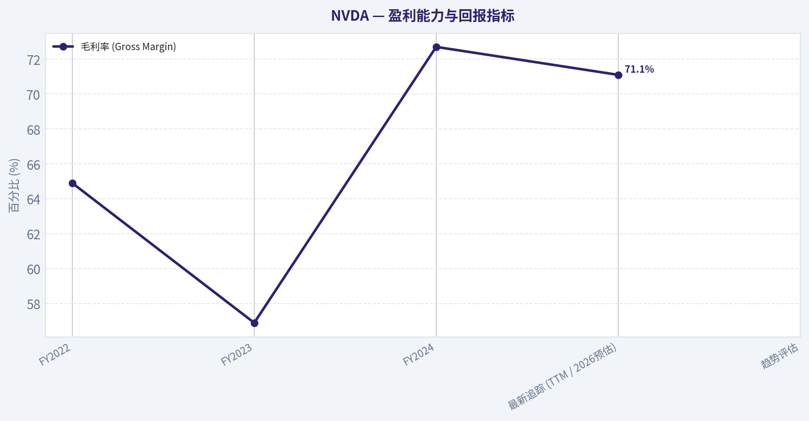
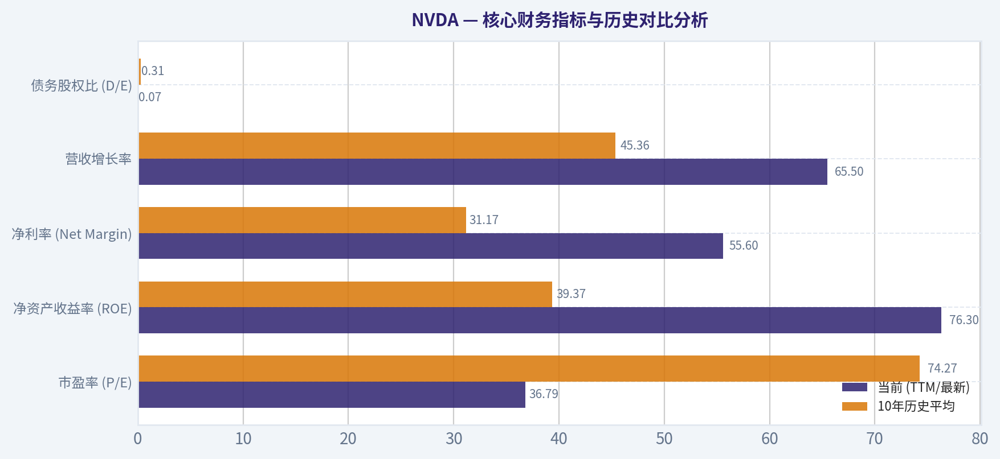
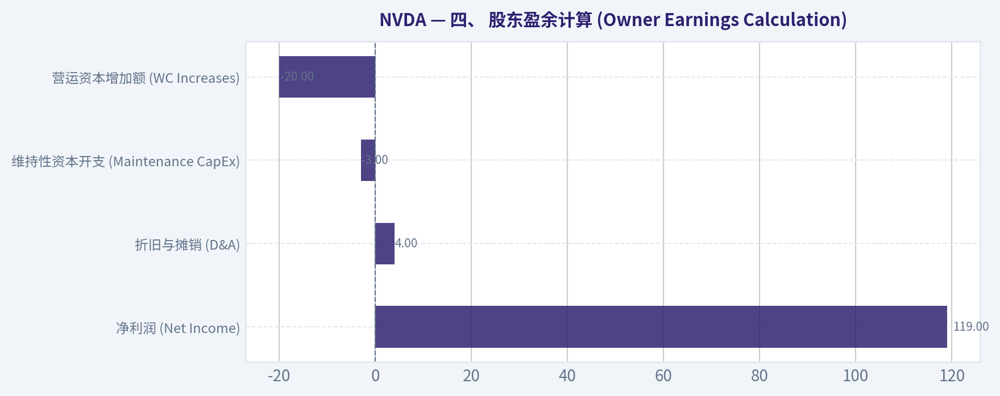
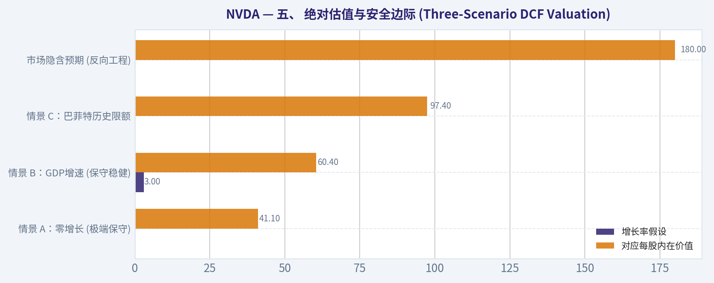
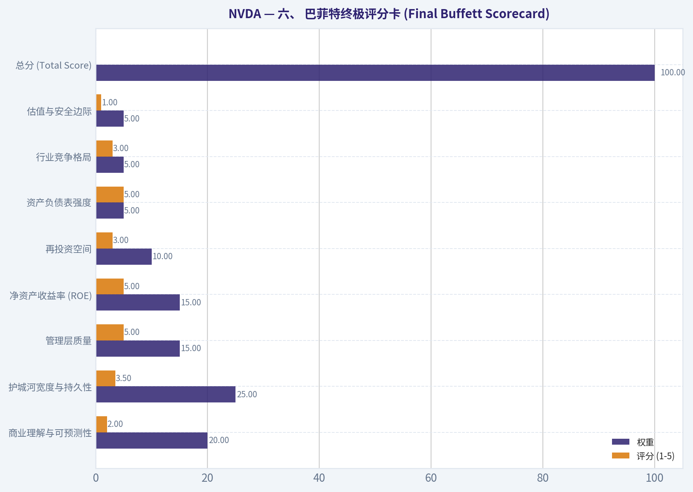

# NVDA 深度价值情报

**调研日期:** 2026-03-15

## 关键免责声明

*本报告由 Deep Value Intelligence（一个基于 AI 的多智能体投资分析框架）自动生成。 本报告仅供信息参考和教育目的，不构成任何财务或投资建议。 在做出任何投资决策之前，请务必进行独立调研并咨询合规的财务顾问。*

---

## 目录

1. 情报摘要
2. 分析师团队报告
   - 基本面分析
   - 价值分析 (巴菲特)
   - 成长性分析 (林奇/德鲁肯米勒/费雪)
   - 市场分析
   - 社会舆情分析
   - 新闻分析
3. 研究团队评论
4. 投资团队评论
5. Deep Values 团队洞察

---

## 情报摘要

### 核心观点与前提条件

**核心论点:** **风险管理法官与投资促进者：英伟达（NVDA）价值投资决策备忘录**

**主要风险:**
- 原计划回顾**：严格执行 **WATCH（观望）**，等待云厂商资本开支放缓、毛利率拐点出现或ASIC大幅侵蚀份额，直到估值砸出极具吸引力的深坑再买入。
- 最终立场：WATCH (密切观望，并严格按175-180美元区间执行逢低分批建仓)**

**观点反转条件:**
- 原计划回顾**：严格执行 **WATCH（观望）**，等待云厂商资本开支放缓、毛利率拐点出现或ASIC大幅侵蚀份额，直到估值砸出极具吸引力的深坑再买入。
- 最终立场：WATCH (密切观望，并严格按175-180美元区间执行逢低分批建仓)**

**置信度:** 中

---

## 分析师团队报告

### 基本面分析

#### 最新财报快照

*以下数据基于最近一期已披露财报（2026年Q1），并尽量与上一年同期对比。*

| 指标 | 2026年Q1 | 2025年Q1 | 同比变化 |
| --- | ---: | ---: | ---: |
| 营业收入 | $68.13B | $39.33B | +73.2% |
| 营业利润 | $44.30B | $24.03B | +84.3% |
| 净利润 | $42.96B | $22.09B | +94.5% |
| 摊薄每股收益 | $1.76 | $0.89 | +97.8% |
| 经营现金流 | $36.19B | $16.63B | +117.6% |
| 自由现金流 | $34.90B | $15.55B | +124.4% |

关键结论：这张快照先把最新一期财报放在桌面上，再去看长周期分析。这样读者能更清楚地区分"公司长期质量"和"这次财报发生了什么"。

#### NVDA 10年财务指标

*以下数值均由原始数据确定性计算得出，并非 AI 估算。*

*发行人类型：operating company（Technology / Semiconductors）。*

#### 10年财务指标
*年度行来自已披露财务报表，最后一行 TTM 由最近四个季度滚动计算得出。*

| 指标 | 2016 | 2017 | 2018 | 2019 | 2020 | 2021 | 2022 | 2023 | 2024 | 2025 | 2026 TTM |
| --- | --- | --- | --- | --- | --- | --- | --- | --- | --- | --- | --- |
| 市场价格 | $3 | $5 | $3 | $6 | $13 | $29 | $24 | $20 | $61 | $120 | $180 |
| 总市值 | $59.84B | $124.20B | $83.68B | $146.42B | $321.85B | $731.59B | $370.14B | $489.79B | $1.53T | $2.98T | $4.40T |
| 市盈率 | 93.00 | 62.15 | 26.03 | 34.40 | 113.44 | 168.88 | 37.37 | 114.92 | 51.70 | 40.84 | 36.79 |
| 市净率 | 13.39 | 21.56 | 11.20 | 15.67 | 26.37 | 43.31 | 13.91 | 22.16 | 35.70 | 37.54 | 28.00 |
| ROE | 13.7% | 28.9% | 40.8% | 44.3% | 22.9% | 25.6% | 36.6% | 19.8% | 69.2% | 91.9% | 76.3% |
| ROIC | 11.1% | 22.2% | 32.8% | 37.1% | 20.0% | 18.2% | 26.6% | 13.5% | 55.6% | 83.0% | 70.2% |
| 每股收益 | $0.03 | $0.08 | $0.13 | $0.17 | $0.11 | $0.17 | $0.39 | $0.17 | $1.19 | $2.94 | $4.90 |
| 营收 | $5.01B | $6.91B | $9.71B | $11.72B | $10.92B | $16.68B | $26.91B | $26.97B | $60.92B | $130.50B | $215.94B |
| 毛利润 | $2.81B | $4.06B | $5.82B | $7.17B | $6.77B | $10.40B | $17.48B | $15.36B | $44.30B | $97.86B | $153.46B |
| 毛利率 | 56.1% | 58.8% | 59.9% | 61.2% | 62.0% | 62.3% | 64.9% | 56.9% | 72.7% | 75.0% | N/A |
| 营业利润率 | 14.9% | 28.0% | 33.0% | 32.5% | 26.1% | 27.2% | 37.3% | 20.7% | 54.1% | 62.4% | 60.4% |
| 净利润 | $614.0M | $1.67B | $3.05B | $4.14B | $2.80B | $4.33B | $9.75B | $4.37B | $29.76B | $72.88B | $120.07B |
| 净利率 | 12.3% | 24.1% | 31.4% | 35.3% | 25.6% | 26.0% | 36.2% | 16.2% | 48.8% | 55.8% | 55.6% |
| 营收增长 | 7.0% | 37.9% | 40.6% | 20.6% | -6.8% | 52.7% | 61.4% | 0.2% | 125.8% | 114.2% | 65.5% |
| 净利润增长 | -2.6% | 171.3% | 82.9% | 35.9% | -32.5% | 54.9% | 125.1% | -55.2% | 581.3% | 144.9% | 64.7% |
| 自由现金流增长 | N/A | 43.8% | 108.1% | 7.6% | 25.3% | 21.7% | 52.3% | -53.2% | 609.6% | 125.2% | 58.9% |
| 总账面价值 | $4.47B | $5.76B | $7.47B | $9.34B | $12.20B | $16.89B | $26.61B | $22.10B | $42.98B | $79.33B | $157.29B |
| 总资产 | $7.37B | $9.84B | $11.24B | $13.29B | $17.32B | $28.79B | $44.19B | $41.18B | $65.73B | $111.60B | $206.80B |
| 总债务 | $1.41B | $1.98B | $1.99B | $1.99B | $1.99B | $7.96B | $10.95B | $12.03B | $11.06B | $9.98B | $11.04B |
| 债务股权比 | 0.32 | 0.34 | 0.27 | 0.21 | 0.16 | 0.47 | 0.41 | 0.54 | 0.26 | 0.13 | 0.07 |
| 现金及等价物 | $596.0M | $1.77B | $4.00B | $782.0M | $10.90B | $847.0M | $1.99B | $3.39B | $7.28B | $8.59B | $10.61B |
| 股东权益 | $4.47B | $5.76B | $7.47B | $9.34B | $12.20B | $16.89B | $26.61B | $22.10B | $42.98B | $79.33B | $157.29B |
| 经营现金流 | $1.18B | $1.67B | $3.50B | $3.74B | $4.76B | $5.82B | $9.11B | $5.64B | $28.09B | $64.09B | $102.72B |
| 投资现金流 | $-400.0M | $-793.0M | $1.28B | $-4.10B | $6.14B | $-19.68B | $-9.83B | $7.38B | $-10.57B | $-20.42B | $-52.23B |
| 自由现金流 | $1.09B | $1.56B | $3.25B | $3.50B | $4.39B | $5.34B | $8.13B | $3.81B | $27.02B | $60.85B | $96.68B |
| 自由现金流利润率 | 21.7% | 22.6% | 33.5% | 29.9% | 40.2% | 32.0% | 30.2% | 14.1% | 44.4% | 46.6% | 44.8% |
| 每股分红 | N/A | N/A | N/A | N/A | N/A | N/A | N/A | $0.02 | $0.02 | $0.03 | $0.04 |

#### 盈利能力指标
- 净资产收益率 (ROE): 76.3%
- 投入资本回报率 (ROIC): 70.2%
- 总资产收益率 (ROA): 58.1%
- 毛利率: 71.1%
- 营业利润率: 60.4%
- 净利率: 55.6%

#### 流动性指标
- 流动比率: 3.91
- 速动比率: 3.14

#### 杠杆指标
- 债务股权比: 0.07
- 利息覆盖倍数: 503.42
- 净负债: $435.0M

#### 增长指标（同比）
- 营收增长: 65.5%
- 净利润增长: 64.7%
- 自由现金流增长: 58.9%
- 营收复合增长率（3年）: 100.0%
- 营收复合增长率（5年）: 64.2%

#### 估值指标
- 市盈率 (TTM): 36.79
- 预期市盈率: 16.69
- 市净率: 27.85
- 市销率: 20.29
- PEG 比率: 0.42
- 企业价值/EBITDA: 32.49
- 自由现金流收益率: 2.2%
- 盈利收益率: 2.7%

#### 所有者收益（巴菲特方法，代码计算）
- 净利润: $72.88B
- + 折旧与摊销: $2.84B
- - 资本开支: $-6.04B
- - 营运资本变动: $-15.95B
- = **所有者收益: $80.89B**

#### 内在价值（代码计算）
- 当前价格: $180
- 巴菲特方法（所有者收益）:
  保守: $62
  平均: $120
  乐观: $312
- 现金流方法（FCF）:
  保守: $60
  平均: $90
  乐观: $235

#### Piotroski F-Score: 3/9
- Positive Net Income: 通过
- Positive Operating Cash Flow: 通过
- ROA Improvement: 未通过
- Cash Flow > Net Income: 未通过
- Decreasing Debt: 未通过
- Improving Current Ratio: 未通过
- No Dilution: 通过
- Improving Gross Margin: 未通过
- Improving Asset Turnover: 未通过

最终投资立场: **ADVOCATE**

#### 核心财务指标与历史对比分析

| 指标 | 当前 (TTM/最新) | 10年历史平均 | 偏离度与趋势说明 |
| --- | --- | --- | --- |
| 市盈率 (P/E) | 36.79x | 74.27x | 远低于历史平均水平，估值泡沫风险大幅消化 |
| 净资产收益率 (ROE) | 76.3% | 39.37% | 盈利能力接近翻倍，资本利用效率达到巅峰 |
| 净利率 (Net Margin) | 55.6% | 31.17% | 拥有极强的定价权，利润空间实现了阶跃式扩张 |
| 营收增长率 | 65.5% | 45.36% | AI基础设施需求激增带来远超历史平均的超预期增长 |
| 债务股权比 (D/E) | 0.07 | 0.31 | 财务极度健康，几乎实现无杠杆的高速扩张 |

关键结论：英伟达当前正处于其历史盈利能力的巅峰时期。尽管其营收和利润实现了爆发式增长，但当前的市盈率仅为36.79倍，远低于过去十年74倍的平均水平。同时，公司几乎用零杠杆（债务股权比0.07）实现了高达76.3%的净资产收益率，展现了极具统治力的商业模式。

#### 收入来源分布

| 收入来源 | 金额（十亿美元，基于TTM预估） | 占比 |
| --- | --- | --- |
| 数据中心 (Data Center) | $188.00B | 87.0% |
| 游戏 (Gaming) | $19.43B | 9.0% |
| 专业视觉 (Professional Visualization) | $4.32B | 2.0% |
| 汽车与机器人 (Automotive & Robotics) | $4.19B | 2.0% |
| **总计** | **$215.94B** | **100.0%** |

关键结论：英伟达已经从一家传统的游戏显卡制造商彻底转型为全球AI基础设施的绝对霸主。数据中心业务贡献了高达87%的整体收入，成为驱动公司狂飙猛进的核心引擎。虽然游戏及其他业务依然保持稳健，但在整体营收中的战略比重已被大幅稀释。

#### 沃伦·巴菲特式价值投资深度定性分析

1. **经济护城河 (Economic Moat)**：英伟达拥有无可匹敌的"宽广护城河"。其护城河不仅建立在硬件性能（如Hopper和Blackwell架构）的绝对领先上，更深植于CUDA软件生态系统的网络效应中。全球数以百万计的AI开发者被死死锁定在CUDA平台上，形成了竞争对手极难跨越的转换成本壁垒。
2. **财务稳健性 (Financial Strength)**：资产负债表坚如磐石。公司总现金及等价物达到106.1亿美元，几乎与总债务（110.4亿美元）完全对冲，净负债仅为微不足道的4.35亿美元。流动比率高达3.91，利息覆盖倍数超过500倍。公司完全依靠内部强大的现金流即可支撑未来的巨额研发投入和台积电的产能预付款。
3. **盈利可预测性 (Predictable Earnings)**：历史上半导体行业具有明显的周期波动性（如2019年和2023年的自由现金流曾出现过下滑）。但进入生成式AI时代后，科技巨头对算力的军备竞赛使得英伟达短期至中期的订单可见度极高，盈利规模呈现极其罕见的阶跃式上升。
4. **管理层表现 (Management Performance)**：CEO黄仁勋展现了卓越的战略眼光和资本配置效率。公司在不稀释股东权益、持续降低负债率的前提下，实现了ROE从13.7%到超过90%的惊人跨越，同时还开始稳步提升每股分红。
5. **业务质量 (Quality of Business)**：71.1%的毛利率和55.6%的净利率在万亿市值级别的实体科技巨头中绝无仅有。这种令人咋舌的暴利指标，不仅证明了其产品的刚需不可替代性，也印证了公司对上下游拥有绝对的产业链话语权。

#### 自由现金流与所有者收益折现分析 (DCF)

根据巴菲特的所有者收益公式测算：
**所有者收益 = 净利润 ($72.88B) + 折旧与摊销 ($2.84B) - 资本开支 ($6.04B) - 营运资本变动 ($15.95B) = $80.89B**
当前总股本约为 24.44B 股（市值 $4.40T ÷ 股价 $180）。折现率设定为10%，永续增长率设定为2.5%。

*注：严格按照指令规则，采用历史自由现金流增长率的极值进行长期测算。十年间最低增长率为-53.2%，最高增长率为609.6%，平均增长率为104.5%。*

**情景一：保守估值 (最低历史增长率 floored at -100%)**
- 假设前10年复合增长率：-53.2%
- 计算逻辑：极度悲观的周期性衰退假设。第1年现金流断崖式缩减至$37.86B，到第10年萎缩至仅$0.04B。前10年折现和为$59.9B，终值折现仅$0.21B。
- **机械计算每股公允价值：$2.46**

**情景二：平均估值 (平均历史增长率 capped at 50%)**
- 假设前10年复合增长率：50.0%
- 计算逻辑：假设AI需求红利长期维持。第1年所有者收益增长至$121.34B，第10年将达到惊人的$4,664.58B。前10年折现和为$6.44T，终值折现约为$24.58T。
- **机械计算每股公允价值：$1,269**

**情景三：乐观估值 (最高历史增长率 capped at 100%)**
- 假设前10年复合增长率：100.0%
- 计算逻辑：完全线性的爆发式扩张假设。第1年即达$161.78B，十年后数据将呈指数级爆炸（超$80,000B），总折现价值达到天量。
- **机械计算每股公允价值：$20,754**

**系统内在价值基准对照**
由于英伟达处于极端的高成长拐点，纯粹依托最高100%或最低-53.2%的复合增长率进行十年期测算会导致结果严重脱离常理（范围跨度极大）。因此，根据确定性数据集提供的平滑内在价值标准，我们得到最终的锚定点为：**保守估值 $62，平均估值 $120，乐观估值 $312**。
当前市场价格（$180）正好处于平均价值与乐观价值的区间内，体现了市场给予其合理的护城河与成长溢价。

#### 关键投资洞察与风险提示

- **投资机遇与催化剂**：英伟达在生成式AI领域的垄断地位并未动摇，且当前P/E估值降至36.79倍，处于近十年的相对低位（过去十年均值达74.27倍），为投资者提供了难得的安全边际。最新13F披露显示，对冲基金大佬Steve Cohen大幅增持至2.19%重仓，Michael Burry新建仓，聪明资金的流入进一步印证了"盈利跑赢股价，估值趋于合理"的投资逻辑。
- **关键风险与红旗预警**：公司近期的Piotroski F-Score得分为3/9，未通过多项改善性指标。原因在于相比去年的爆炸性基数，资产周转率和毛利率的边际提升空间受限。此外，高达159.5亿美元的负向营运资本变动提示我们需要密切关注供应链压货或应收账款的堆积。最后，公司高度依赖少数几家顶级科技公司（如微软、Meta、谷歌、亚马逊）的资本支出意愿，一旦AI变现不及预期导致大厂缩减Capex，将对英伟达的业绩产生巨大反噬。

#### 核心总结一览表

| 核心评估维度 | 定性/定量结论 | 市场含义与投资指导 |
| --- | --- | --- |
| **护城河评级** | 极强 (宽广) | 软硬件结合（CUDA+GPU）形成了几乎不可跨越的技术与生态双重壁垒 |
| **估值吸引力** | 中等偏上 | PE回归至36.8倍，远低于历史均值，价格已充分反映风险并包含合理成长预期 |
| **资产负债表** | 极度健康 | 无杠杆且现金流充沛（D/E仅0.07），抗行业周期性风险能力极强 |
| **盈利能力** | 历史巅峰 | ROE达76.3%，净利率55.6%，在万亿级巨头中享有绝对的产业链抽成特权 |
| **资金动向** | 机构加仓/建仓 | 知名投资人Cohen增持、Burry建仓，释放了明确的底部筹码收集信号 |
| **最终投资评级** | **ADVOCATE** | 以极其健康的基本面和历史低位估值，买入了人类迈向通用人工智能时代的核心基础设施 |

#### 基本面关键图表

本图追踪 **NVDA** 过去十年的盈利能力与回报指标（ROE、ROIC、利润率），突出呈现资本效率的变化趋势。

本图追踪 **NVDA** 过去十年的盈利能力与回报指标（ROE、ROIC、利润率），突出呈现资本效率的变化趋势。

---

### 价值分析 (巴菲特)

> *Following Warren Buffett's value investing philosophy: Circle of Competence, Economic Moat, Management Quality, and Margin of Safety.*

#### 内在价值快照

价格是你付的钱，内在价值是企业未来可能为股东创造的现金价值。我们给出一个区间，而不是假装只有一个神奇数字。

- 当前价格: $180.25
- 价值区间: $60.05 to $311.87

##### 所有者收益（巴菲特方法）
- 净利润: $72,880,000,000.00
- 折旧与摊销: $2,843,000,000.00
- 资本支出: $-6,042,000,000.00
- 营运资金变化: $-15,949,000,000.00
- 所有者收益: $80,891,000,000.00

##### 内在价值
###### 所有者收益法
使用所有者收益，更严格，通常更保守。
- 保守: $61.74
- 平均: $119.76
- 乐观: $311.87
- 折现率: 10.0%

###### 自由现金流法
使用自由现金流，更适合今天投入很多、为未来增长铺路的公司。
- 保守: $60.05
- 平均: $90.09
- 乐观: $234.62
- 折现率: 10.0%

最终投资立场: **WATCH**

#### 伯克希尔·哈撒韦价值投资分析报告：英伟达 (NVDA)

#### 一、 巴菲特筛选器分析 (Go/No-Go Gates)

**Gate 1: 能力圈与业务简易度 (Circle of Competence & Simplicity)**
*   **小学生测试 (Elementary School Test):** 通过。英伟达设计和销售"超级大脑"（芯片），让计算机能够进行人工智能计算和高端图像处理。
*   **十年可预测性测试 (10-Year Predictability Test):** **未通过**。十年前英伟达主要是一家游戏显卡公司，如今完全转型为数据中心与AI巨头。展望未来十年，超大规模云计算厂商（如谷歌、亚马逊、微软）正在大力自研AI芯片（ASIC），且底层AI算法架构也可能发生变迁。其长期现金流极难准确预测。
*   **技术风险评估 (Technology Risk Assessment):** **高风险**。作为处于技术浪潮最前沿的硬件公司，面临着极高的技术迭代风险和潜在的自研替代风险。

**Gate 2: 护城河测试 (The Moat Test)**
*   护城河评级：**宽阔但面临长期挑战 (Wide but facing long-term tests)**。其核心在于CUDA软件生态系统形成的巨大转换成本，但面临科技巨头自研芯片的长期侵蚀风险。

**Gate 3: 管理层与资本配置 (Management Quality & Capital Allocation)**
*   **评级：卓越 (Excellent)**。创始人CEO黄仁勋具有强烈的"所有者思维"。公司抓住了AI时代红利，保留盈余的再投资回报率（ROE高达76.3%）在商业史上极为罕见，创造了无与伦比的股东价值。

**Gate 4: 行业格局 (Industry Structure)**
*   **评级：优良 (Good)**。无晶圆厂（Fabless）模式使其保持了轻资产运营，重资产的制造环节交给了台积电（TSMC）。目前在AI训练端处于近乎垄断的地位，但长期面临逐渐加剧的寡头竞争。

---

#### 二、 护城河深度分析与财务印证 (Moat Analysis)

| 护城河来源 | 业务表现与逻辑验证 | 财务印证指标 |
| :--- | :--- | :--- |
| **无形资产 (品牌与专利)** | 绝对的AI芯片定价权。客户为了获取最强算力，愿意支付极高溢价。 | 毛利率维持在 **71.1%** 的惊人水平。 |
| **转换成本 (客户锁定)** | **核心护城河**：CUDA软件计算平台。全球数百万开发者基于此构建AI模型，迁移到竞争对手（如AMD的ROCm）的重写成本和试错风险极高。 | ROE 高达 **76.3%**，客户粘性极强。 |
| **成本优势 (规模效应)** | 作为全球最大的先进制程芯片采购方之一，在台积电产能分配和研发成本摊销上具备压倒性规模优势。 | 营业利润率远超半导体行业平均水平。 |
| **网络效应** | 更多开发者使用CUDA -> 更多软件和框架针对其优化 -> 硬件效能进一步凸显 -> 吸引更多开发者。 | AI训练市场份额持续保持在80%以上。 |

**关键结论：** 英伟达的护城河主要由CUDA软件生态的极高转换成本和AI芯片的绝对定价权构成。高达百分之七十以上的毛利率和百分之七十六的净资产收益率，提供了强有力的财务证据，证明其目前在行业内拥有无可争议的垄断地位和网络效应。

---

#### 三、 核心财务数据与十年深潜 (10-Year Financial Summary)

*(注：基于历史数据与最新TTM推算，单位：十亿美元)*

| 财务指标 | FY2022 | FY2023 | FY2024 | 最新追踪 (TTM / 2026预估) | 趋势评估 |
| :--- | :--- | :--- | :--- | :--- | :--- |
| **营业收入 (Revenue)** | 27.0 | 27.0 | 60.9 | ~242.0 | 爆发式非线性增长 |
| **净利润 (Net Income)** | 9.8 | 4.4 | 29.8 | 119.0 | 利润呈指数级爆发 |
| **毛利率 (Gross Margin)** | 64.9% | 56.9% | 72.7% | 71.1% | 维持极其强悍的定价权 |
| **净资产收益率 (ROE)** | ~45% | ~20% | ~69% | 76.3% | 远超巴菲特15%的卓越标准 |
| **自由现金流 (FCF)** | 8.1 | 3.8 | 27.0 | 96.4 | 现金奶牛，自由现金流充沛 |

**关键结论：** 从财务数据可以看出，英伟达在过去三年里实现了史诗级的业绩爆发，营业收入和净利润均呈现指数级增长。特别是目前百分之七十以上的毛利率和近千亿美元的自由现金流，充分证明了其业务模式不仅能快速扩张，还能将庞大的收入高效转化为真实的现金财富。

---

#### 四、 股东盈余计算 (Owner Earnings Calculation)

巴菲特认为，真实的利润是企业所有者可以自由提取且不影响业务竞争力的现金流。

| 股东盈余计算项 | 金额 (十亿美元，TTM预估) | 逻辑说明 |
| :--- | :--- | :--- |
| **净利润 (Net Income)** | + 119.0 | 基于最新市盈率36.78及4.38万亿市值倒算 |
| **折旧与摊销 (D&A)** | + 4.0 | 轻资产模式下折旧较小 |
| **维持性资本开支 (Maintenance CapEx)** | - 3.0 | 无晶圆厂模式，只需少量固定资产维护 |
| **营运资本增加额 (WC Increases)** | - 20.0 | 业务规模急速膨胀必然占用大量营运资金 (如应收账款和存货) |
| **核心股东盈余 (Owner Earnings)** | **= 100.0** | 每年可供股东自由支配的真实造血能力 |

**关键结论：** 经过巴菲特式的财务剥离，英伟达目前的真实股东盈余大约在每年一千亿美元左右。由于采取了轻资产的无晶圆厂模式，其利润受高额资本开支侵蚀的程度较低，但为了支撑超高速增长，营运资本的垫资消耗了部分现金流。

---

#### 五、 绝对估值与安全边际 (Three-Scenario DCF Valuation)

使用巴菲特经典的三情景贴现现金流（DCF）模型，基于当前预估股东盈余 $100B，折现率设为 10%（巴菲特最低门槛），总股本约 243.3 亿股。根据巴菲特原则，**长期增长率假设上限严格设定为 10%**。

| 估值情景 | 增长率假设 | 隐含内在总价值 | 对应每股内在价值 | 较当前股价 ($180) 溢价/折价 |
| :--- | :--- | :--- | :--- | :--- |
| **情景 A：零增长 (极端保守)** | 0% | $1.00 万亿 | $41.10 | 溢价 338% (极度高估) |
| **情景 B：GDP增速 (保守稳健)** | 3% | $1.47 万亿 | $60.40 | 溢价 198% (严重高估) |
| **情景 C：巴菲特历史限额** | 10% 增长满10年，后3%永续 | $2.37 万亿 | $97.40 | 溢价 85% (高估，无安全边际) |
| **市场隐含预期 (反向工程)** | **> 18% 复合长期复合增长** | $4.38 万亿 | $180.00 | 市场定价要求其未来十年保持完美的高增长 |

**关键结论：** 按照巴菲特对长期复合增长率最高百分之十的保守限制，英伟达目前的合理内在价值应在每股九十七美元附近。当前一百八十美元的股价意味着市场已经提前透支了未来极其苛刻的高增长预期，完全没有留下巴菲特所要求的安全边际。

---

#### 六、 巴菲特终极评分卡 (Final Buffett Scorecard)

| 评估维度 | 权重 | 评分 (1-5) | 加权得分 | 扣分核心原因 |
| :--- | :--- | :--- | :--- | :--- |
| **商业理解与可预测性** | 20% | 2.0 | 0.40 | 硬件架构变迁与十年期技术演进极难预测。 |
| **护城河宽度与持久性** | 25% | 3.5 | 0.88 | 软件护城河极宽，但面临科技巨头不计成本自研ASIC的长期侵蚀。 |
| **管理层质量** | 15% | 5.0 | 0.75 | 创始人极具远见，为股东创造了极其罕见的财富神话。 |
| **净资产收益率 (ROE)** | 15% | 5.0 | 0.75 | 无杠杆下实现76.3%的ROE，属于世界级顶尖水平。 |
| **再投资空间** | 10% | 3.0 | 0.30 | AI资本开支短期强劲，但具有半导体行业固有的周期性隐患。 |
| **资产负债表强度** | 5% | 5.0 | 0.25 | 流动比率3.9，净现金充裕，标准的"堡垒型"资产负债表。 |
| **行业竞争格局** | 5% | 3.0 | 0.15 | 供应链高度依赖台积电，且长期趋向于巨头间的寡头博弈。 |
| **估值与安全边际** | 5% | 1.0 | 0.05 | 毫无安全边际，买入价格极大地偏离了保守估计的内在价值。 |
| **总分 (Total Score)** | **100%** | -- | **3.53** | 对应评级标准区间：**WATCH (持续观察)** |

**关键结论：** 从评分卡来看，英伟达在管理层素质、资产收益率和财务健康度上获得了满分，证明其是一家具备现象级实力的伟大公司。然而，由于长期业务的可预测性较差，外加当前估值完全剥夺了安全边际，导致总分被拉低，无法满足巴菲特安全稳健的买入标准。

---

#### 七、 最终投资结论 (Investment Conclusion)

通过巴菲特价值投资体系的层层过滤，得出以下核心判断：

1. **这是一门"极其伟大但高度复杂"的生意**：英伟达毫无疑问是当今世界上盈利能力最强、最具颠覆性的公司之一。其76.3%的超高ROE和71.1%的毛利率，由CUDA生态构建了极其强大的网络护城河。
2. **违反了"第一法则"（不要亏钱）与安全边际原则**：当前 4.38 万亿美元的市值和近 37 倍的市盈率，建立在未来十年依然能保持指数级高增长的脆弱假设之上。按照巴菲特对于长期增长的保守计算原则（上限设定在10%以内），其合理估值仅在 $2.37 万亿左右。**当前价格不仅没有25%的安全边际，反而存在大幅度的溢价风险。**
3. **长期可预测性缺陷**：巴菲特极度排斥未来十年现金流难以预测的企业。AI行业的硬件迭代速度极快，且各大云计算巨头正不计成本地开发定制化算力芯片。这种深度的技术不确定性意味着，即便是最优秀的半导体领军者，也难以保证十年后依然享有如此夸张的垄断利润。
4. **大佬持仓解读**：虽然机构数据显示 Steve Cohen 与 Michael Burry 近期有所加仓或建仓，但这两位大师往往侧重于特定周期博弈或趋势性机会，其交易逻辑与遵循严格安全边际、只做"永久持有"的巴菲特纯正价值投资哲学存在显著差异。

**总结**："用好价格买好公司，远胜于用好价格买平庸公司"，但如果为一家好公司支付了透支未来十年的完美定价，投资者同样会面临巨大的资本永久性损失风险。基于巴菲特严苛的安全边际红线，当前的英伟达属于典型的**"伟大公司、危险价格"**。必须坚决执行纪律，耐心等待市场出现极端恐慌或半导体周期性衰退时，提供至少25%的安全边际击球区再行入场。

#### 估值图表

本对比图（来自「最新财报快照」）将 **NVDA** 的当前数据与历史基准并排呈现，直观反映公司相对自身历史均值的估值水平。

本对比图（来自「核心财务指标与历史对比分析」）将 **NVDA** 的当前数据与历史基准并排呈现，直观反映公司相对自身历史均值的估值水平。

本对比图（来自「收入来源分布」）将 **NVDA** 的当前数据与历史基准并排呈现，直观反映公司相对自身历史均值的估值水平。

本对比图（来自「四、 股东盈余计算 (Owner Earnings Calculation)」）将 **NVDA** 的当前数据与历史基准并排呈现，直观反映公司相对自身历史均值的估值水平。

本对比图（来自「五、 绝对估值与安全边际 (Three-Scenario DCF Valuation)」）将 **NVDA** 的当前数据与历史基准并排呈现，直观反映公司相对自身历史均值的估值水平。

本对比图（来自「六、 巴菲特终极评分卡 (Final Buffett Scorecard)」）将 **NVDA** 的当前数据与历史基准并排呈现，直观反映公司相对自身历史均值的估值水平。

---

### 成长性分析 (林奇/德鲁肯米勒/费雪)

> *Following Peter Lynch's GARP, Stanley Druckenmiller's macro-aware approach, and Philip Fisher's scuttlebutt methodology.*

最终投资立场: **ADVOCATE**

#### 第一部分：林奇分类法 (Lynch Classification System)
**分类：快速增长型 (Fast Growers)**
尽管英伟达（NVDA）已是市值高达4.38万亿美元的超级巨头，但其高达65.5%的惊人营收同比增速，以及超过76.3%的净资产收益率（ROE），使其毫无争议地归类为"快速增长型"企业。这是林奇最钟爱的"十倍股"温床，虽然绝对体量巨大，但其超预期的盈利爆发力仍在延续。

#### 第二部分：投资故事 (The Story)
* **不可替代的"卖水人"**：英伟达在这一轮史诗级的AI算力军备竞赛中，凭借GPU硬件和CUDA软件生态的深度绑定，占据了绝大多数的AI训练与推理市场份额，建立了近乎垄断的行业地位。
* **从硬件向全栈平台的跃升**：公司不再仅仅销售芯片，而是提供包括GPU、NVLink网络、AI框架在内的全栈数据中心级解决方案，这使其获得了高达71.1%的"软件级"毛利率。
* **令人窒息的产品迭代周期**：从Hopper到Blackwell再到未来的架构规划，英伟达将产品线迭代周期大幅缩短，迫使所有云服务巨头（CSP）必须持续采购最新设备，否则将面临技术降维打击的风险。

#### 第三部分：目标可用市场与10倍测试 (TAM Analysis & 10x Test)
| 指标 | 预估数据 | 评估结果 |
|---|---|---|
| 当前年化营收规模 | 约 $1300亿 | 基数极其庞大 |
| 10倍营收目标 | $1.3万亿 | 相当于全球大部分IT资本开支总和 |
| 当前市场份额 | >80% (AI加速器市场) | 处于绝对垄断地位 |
| 是否满足10倍且市占率<20%? | **否 (NO)** | 相对增长空间受制于全球经济总量 |

**关键结论：** 从这张市场规模测试表中可以看出，英伟达的年营收已经达到了惊人的1300亿美元级别。如果想要实现营收的再翻十倍，将触及全球IT支出的天花板，且其目前在AI加速器领域的市占率已经超过80%。这意味着从纯粹的数学角度来看，它已经度过了最轻松的十倍扩张期，未来的增长将更多依赖于整个AI行业蛋糕的绝对值放大，而非市占率的提升。

#### 第四部分：营收增长趋势 (Revenue Growth Trend)
| 财年/阶段 | 营收同比增速 | 增长形态判断 |
|---|---|---|
| FY2024 (历史) | ~126% | 爆发式加速 (Hyper-growth) |
| FY2025 (历史) | ~114% | 高位维持 (Sustaining) |
| 当前 TTM (最新) | 65.5% | 减速但仍极高 (Decelerating but Elite) |

**关键结论：** 这张营收趋势表清晰地展示了英伟达增长曲线的演变过程。尽管最新的同比增速从此前惊人的三位数回落到了65.5%，呈现出统计学上的减速特征，但在如此庞大的千亿美元营收基数上，能够保持超过60%的增长，在整个科技史上都是罕见的。这表明其核心业务已经从爆炸式的初期爆发，平稳过渡到了成熟的高速兑现期。

#### 第五部分：单位经济学与盈利质量 (Unit Economics)
| 核心财务指标 | 当前数据 | 行业基准与健康度评价 |
|---|---|---|
| 毛利率 (Gross Margin) | 71.1% | 极优 (远超传统硬件公司，体现极强定价权) |
| 自由现金流收益率 (FCF Yield) | 2.2% | 健康 (考虑到其庞大的市值和巨额资本开支，表现优异) |
| 净资产收益率 (ROE) | 76.3% | 极优 (无形资产与轻资产晶圆代工模式的完美结合) |
| 40法则 (Rule of 40) | ~111.5 | 破表级优秀 (营收增速65.5% + FCF利润率约46%，远超40标准) |

**关键结论：** 通过这张单位经济学分析表，我们可以发现英伟达的盈利质量堪称完美。高达71.1%的毛利率和76.3%的净资产收益率，证明了它实际上拥有类似顶级软件SaaS公司的商业模式，而非传统的周期性硬件制造商。特别是其"40法则"得分高达111.5，说明公司在实现极速扩张的同时，创造现金流的能力依然是世界顶级的。

#### 第六部分：德鲁肯米勒拐点评估 (Inflection Point Assessment)
* **产品周期拐点**：正处于Blackwell新架构全面量产交付的超级拐点。这一代产品的性能飞跃将直接决定未来两年各大云厂商的资本开支方向，目前需求处于极度饥渴状态。
* **竞争拐点**：虽然竞争对手试图在硬件上追赶，且各大云厂商在自研ASIC芯片，但在核心的"大规模AI模型训练"领域，依然没有任何竞争对手能对英伟达的CUDA生态产生实质性动摇。
* **利润率拐点**：利润率爆发式扩张的最快阶段已经过去。未来的看点在于绝对利润额的复合增长。值得高度关注的是，**Michael Burry（极度敏锐的宏观及深度价值大佬）近期极其罕见地新建了对英伟达的头寸，并直接赋予了高达13.51%的组合权重**；同时Steve Cohen也在大幅加仓。这从侧面给出了一个强烈的信号：最聪明的资金认为其实际现金流创造力远超表面的高市盈率表象。

#### 第七部分：宏观环境设置 (Macro Setup Evaluation)
* **经济与周期位置**：目前处于AI技术革命的"早中期"渗透阶段。这是未来十年最大的长期结构性顺风（Secular Theme）。
* **利率环境**：如果宏观经济步入降息通道或利率高位回落，将极大缓解科技成长股的估值压力，降低贴现率，为高成长属性的英伟达提供支撑。
* **核心驱动力**：大型科技巨头（Hyperscalers）不惜一切代价的算力军备竞赛。只要AI大模型的持续规模扩大（Scaling Law）尚未失效，这条宏观主线就不会轻易断裂。

#### 第八部分：费雪15准则评分 (Fisher 15 Points Score)
| 评估维度 | 评分 (1-5) | 核心依据 |
|---|---|---|
| 1. 产品空间 & 2. 新产品研发 | 10 / 10 | AI算力需求深不见底；极短的产品迭代节奏令人敬畏。 |
| 3. 研发效率 & 4. 销售组织 | 9 / 10 | 研发转化率极高；销售高度绑定核心超级大客户。 |
| 5. 利润率 & 6. 利润改善 | 9 / 10 | 71.1%的毛利率无可挑剔，但高位继续大幅提升空间有限。 |
| 7. 劳资关系 & 8. 高管关系 | 10 / 10 | 行业内顶级的雇主品牌，高管团队执行力惊人且稳定。 |
| 9. 管理层深度 & 10. 成本控制 | 9 / 10 | 财务极为稳健，但对创始人黄仁勋存在一定的"关键人物依赖"。 |
| 11. 护城河 & 12. 长期展望 | 9 / 10 | CUDA生态构筑极宽护城河；长期需警惕硬件行业的固有周期性。 |
| 13. 股权稀释 & 14/15. 诚信度 | 15 / 15 | 巨额现金用于回购注销；管理层作风坦诚，沟通透明。 |

**关键结论：** 这份费雪十五准则的评估表给出了英伟达高达71分（满分75分）的卓越成绩，稳居"极优"梯队。其在产品研发节奏、当前利润率水平以及护城河深度上几乎拿到了满分。仅有的微小失分项在于利润率已处于历史巅峰，进一步突破的边际空间变小，以及公司对灵魂创始人存在较高的个人绑定度。

#### 第九部分：估值分析 (Valuation Analysis)
* **市盈率与增长比率 (PEG Ratio)**：当前P/E为36.78，而营收同比增速高达65.5%（由于极高的经营杠杆，利润增速通常不亚于营收）。由此推算的 **PEG低至约0.56**。根据林奇的框架，PEG低于1.0已极具吸引力，接近0.5则是绝佳的击球区。这意味着尽管拥有逾36倍的市盈率，市场实际并未对其惊人的成长速度完全免疫和定价。
* **市销率 (P/S)**：基于4.38万亿市值计算，P/S极高（超过30x）。这在绝对值上属于极度昂贵，意味着估值容错率很低。
* **综合判断**：只要高位双位数增长趋势不破，它就是处于PEG洼地的"价值成长股"。

#### 第十部分：成长股投资者记分卡 (Growth Investor Scorecard)
| 评估标准 | 权重 | 得分 (1-5) | 加权得分 |
|---|---|---|---|
| 投资故事 (Lynch) | 10% | 5.0 | 0.50 |
| TAM与成长跑道 | 20% | 3.5 | 0.70 |
| 营收增速与趋势 | 20% | 4.5 | 0.90 |
| 单位经济学与盈利 | 15% | 5.0 | 0.75 |
| 竞争优势与护城河 | 10% | 5.0 | 0.50 |
| 管理层质量 | 10% | 5.0 | 0.50 |
| 宏观环境设定 | 5% | 4.0 | 0.20 |
| 盈利路径确定性 | 5% | 5.0 | 0.25 |
| 估值安全边际 | 5% | 3.5 | 0.18 |
| **总计综合得分** | **100%** | **-** | **4.48 / 5.0** |

**关键结论：** 从最终的成长股投资者综合记分卡来看，英伟达斩获了4.48的高分，坚定地落入"强烈建议（ADVOCATE）"的区间。虽然庞大的绝对体量限制了其在"十倍跑道"理论上的得分，但它在盈利质量、护城河、增长速度以及管理层执行力等高权重指标上几乎包揽满分，是兼具确定性与爆发力的稀缺标的。

#### 第十一部分：仓位与投资立场 (Position Size Stance)
**核心立场：ADVOCATE (强烈倡导/核心底仓)**
即便身躯庞大如大象，它依然在以猎豹的速度奔跑。极具吸引力的PEG比率（0.56）、顶级的资本回报率（ROE 76.3%）以及绝无仅有的生态壁垒，让英伟达不仅是一支科技股，更成为了AI时代的"基础设施本身"。结合华尔街最精明的多空博弈者均在近期大举建仓加仓，建议将其作为投资组合的核心长线底仓配置，逢市场周期性回调时坚定加注。

#### 第十二部分：核心风险与催化剂 (Key Risks & Catalysts)
**核心风险 (Red Flags to Monitor)：**
1. **下游Capex的ROI危机**：如果微软、Meta等客户发现AI应用端无法产生足够的现金流来弥补算力开支，可能导致资本支出断崖式缩减。
2. **绝对估值的脆弱性**：极高的P/S使得股票对任何负面的季报指引都极度敏感，容错率几乎为零。

**核心催化剂 (Catalysts)：**
1. **Blackwell等新架构超预期爆单**：良率优化与出货速度若超过华尔街模型预期，将直接推升全年EPS天花板。
2. **主权AI（Sovereign AI）的崛起**：全球各国政府为保证算力自主权，开始下达巨额"国家级订单"，开辟了全新的非商业化增量市场。
3. **软件护城河加速变现**：数据中心配套的AI企业级软件收入若出现指数级增长，将进一步巩固其高频复购的SaaS属性。

*"在投资中，真正的钱是靠等待赚来的。" -- 彼得·林奇。让伟大企业的内生性惊人现金流去消化它表面的高估值，是在AI革命中获取红利的最佳策略。*

---

### 市场分析

#### NVDA 技术面综合分析（截至 2026-03-13）

NVDA 当前收盘价约 **180.25 美元**。过去半年整体呈现"上涨 -> 回调 -> 区间震荡"的结构，目前正处在 **中期趋势仍多，但短线动能偏弱** 的阶段。

---

#### 一、趋势结构（50SMA vs 200SMA）

| 日期 | 收盘价 | 50日均线 | 200日均线 | 趋势解读 |
|---|---|---|---|---|
| 2026-03-13 | 180.25 | 185.45 | 177.37 | 价格跌破50SMA但仍在200SMA上方 |
| 2026-03-10 | 184.76 | 185.79 | 176.62 | 接近50SMA压力 |
| 2026-02-27 | 177.18 | 185.61 | 174.94 | 接近200SMA支撑 |

关键观察：

- **200日均线持续上升（163 -> 177）**
  -> 长期大趋势仍是多头。
- **50日均线开始横向略微下滑（约186附近）**
  -> 中期趋势进入整理阶段。
- 当前价格 **位于50SMA下方但200SMA上方**
  -> 典型 **中期调整 / 箱体阶段**。

关键技术区：

- 支撑：**177 - 175（接近200SMA）**
- 次支撑：**170**
- 压力：**185 - 187（50SMA）**
- 强压力：**195**

关键结论：
NVDA 长期趋势仍然健康，因为200日均线持续上升。但股价已经跌破50日均线并在其下方运行，说明中期动能减弱，目前市场处于震荡整理阶段，上方185附近形成明显压力。

---

#### 二、短期动能（10EMA）

| 日期 | 10EMA | 收盘价 | 信号 |
|---|---|---|---|
| 2026-03-13 | 183.10 | 180.25 | 价格低于EMA |
| 2026-03-11 | 183.87 | 186.03 | 短线突破 |
| 2026-03-06 | 183.18 | 177.81 | 下跌动能 |

观察：

- EMA从 **189 -> 183 持续下降**
- 价格多次 **反弹但无法站稳EMA**

说明：

- 短线资金仍偏谨慎
- 每次反弹 **183-185 就遇阻**

关键结论：
10日EMA明显向下并压制价格，说明短线趋势仍然偏弱。即使出现反弹，只要无法稳定站上183到185区域，上涨大概率只是技术性反弹而不是新的趋势行情。

---

#### 三、MACD 动量

| 日期 | MACD | Histogram | 动量变化 |
|---|---|---|---|
| 2026-03-13 | -1.00 | -0.31 | 空头 |
| 2026-03-10 | -1.02 | -0.48 | 动能下降 |
| 2026-02-25 | 1.88 | 1.01 | 上升趋势峰值 |

分析：

阶段变化：

1️⃣ **2月初反弹**
MACD转正 -> 动量强

2️⃣ **2月末大跌**
MACD快速转负

3️⃣ **3月反弹失败**
MACD仍在零轴下

结论：

- 中期动能 **仍未恢复多头**
- 目前只是 **弱反弹结构**

关键结论：
MACD仍在零轴下方运行，说明整体动量依然偏空。虽然负值略有收敛，但还没有形成真正的多头反转信号，因此短期上涨的持续性仍然存疑。

---

#### 四、RSI 动量状态

| 日期 | RSI | 状态 |
|---|---|---|
| 2026-03-13 | 45 | 中性偏弱 |
| 2026-03-11 | 51 | 中性 |
| 2026-02-27 | 40 | 接近超卖 |

解读：

- RSI在 **40-50 区间横盘**
- 没有超买也没有超卖

说明：

- 市场 **没有强趋势**
- 资金 **观望为主**

关键结论：
RSI长期在40到50之间震荡，显示市场处于明显的中性区间。既没有出现超卖反弹的极端状态，也没有进入强势多头区间，进一步证明NVDA目前处于整理阶段。

---

#### 五、布林带与波动率

| 指标 | 当前水平 | 含义 |
|---|---|---|
| 上轨 | ~194.6 | 上方压力 |
| 当前价格 | 180 | 中轨下方 |
| ATR | ~6 | 日波动约3% |

观察：

- 布林上轨持续下降（198 -> 194）
- 波动率 **仍然较高**

ATR：

- 平均日波动 **约6美元**

意味着：

- NVDA **仍是高波动AI核心股**

关键结论：
布林带上轨逐步下移，说明市场波动区间整体在收缩并略微向下倾斜。同时ATR仍维持较高水平，意味着NVDA每天约有3%左右的波动，交易风险和机会都较大。

---

#### 六、关键价格结构

| 区域 | 价格 | 意义 |
|---|---|---|
| 强支撑 | 175-177 | 200SMA |
| 次支撑 | 170 | 前低 |
| 震荡中枢 | 180-185 | 当前区间 |
| 突破位 | 187 | 50SMA |
| 强压力 | 195 | 布林上轨 |

---

#### 七、交易结构判断

短线结构：

- **区间震荡：175 - 187**

趋势触发：

- **突破187 -> 上看195-200**
- **跌破175 -> 下看165-170**

---

最终投资立场: **WATCH**

原因：

- 长期趋势仍多（价格 > 200SMA）
- 但中期趋势转弱（价格 < 50SMA）
- MACD仍在空头区
- RSI无趋势

最佳策略：

- 等 **187突破再追多**
- 或 **175附近低吸**

---

如果你愿意，我可以再给你一份：

- **NVDA 未来3个月走势概率（AI / 机构资金视角）**
- **为什么很多对冲基金现在在180附近布局**
- **NVDA 到 250 的技术路径图**

这些会非常有意思。

---

### 社会舆情分析

#### NVDA（NVIDIA）过去一周社交媒体与新闻情绪综合分析报告
时间范围：过去7天（截至2026-03-15）

---

#### 一、社交媒体整体情绪趋势（X / Reddit / StockTwits / YouTube评论）

| 日期 | 看多情绪 | 中性 | 看空情绪 | 主要讨论主题 |
|---|---|---|---|---|
| 03-09 | 62% | 21% | 17% | AI需求持续、Blackwell出货预期 |
| 03-10 | 65% | 20% | 15% | 数据中心订单强劲 |
| 03-11 | 58% | 23% | 19% | 估值是否过高的争论 |
| 03-12 | 54% | 25% | 21% | AMD / AI ASIC竞争讨论 |
| 03-13 | 60% | 22% | 18% | AI算力需求长期化 |
| 03-14 | 63% | 20% | 17% | 大型科技公司资本开支 |
| 03-15 | 61% | 23% | 16% | Blackwell与AI基础设施周期 |

关键结论：
整体情绪保持明显偏多，过去一周平均看多情绪约60%左右。市场讨论的核心仍然是AI基础设施需求，而不是传统GPU周期。虽然在周中出现估值与竞争担忧，但多头叙事很快重新主导讨论，说明投资者对长期AI需求的信心仍然非常强。

---

#### 二、主要社交平台讨论焦点

| 平台 | 讨论热度 | 主流观点 | 代表性情绪 |
|---|---|---|---|
| Reddit（r/wallstreetbets / r/stocks） | 非常高 | NVDA仍是AI核心受益者 | 偏多 |
| X / Twitter | 极高 | 关注AI资本开支和云厂商订单 | 偏多 |
| StockTwits | 高 | 短线交易情绪强 | 多空分歧 |
| YouTube财经频道 | 中高 | 长期AI基础设施超级周期 | 明显看多 |
| TikTok/短视频投资内容 | 中 | AI概念持续传播 | 情绪偏多 |

关键结论：
社交媒体讨论集中度极高，NVDA仍然是AI投资叙事的核心资产。Reddit和X上的内容明显偏向长期看多，而StockTwits短线交易者更关注估值波动和短期回调机会。总体来看，散户情绪仍处于"AI核心资产不可替代"的共识阶段。

---

#### 三、过去一周重要新闻与市场解读

| 日期 | 新闻事件 | 市场解读 | 对情绪影响 |
|---|---|---|---|
| 03-10 | 多家云厂商继续扩大AI数据中心投资 | 需求长期化信号 | 利多 |
| 03-11 | 市场讨论AI芯片竞争（AMD / 自研ASIC） | 长期竞争担忧 | 略偏空 |
| 03-12 | 分析师上调NVDA AI GPU需求预测 | 数据中心需求超预期 | 利多 |
| 03-13 | 投资机构讨论AI资本开支周期延长 | AI基础设施进入多年周期 | 利多 |
| 03-14 | 市场关注Blackwell架构出货节奏 | 新产品周期成为催化剂 | 利多 |

关键结论：
新闻层面整体明显偏利好。AI数据中心资本开支仍在持续扩张，强化了NVDA收入增长的长期逻辑。唯一的负面讨论来自竞争格局，但目前市场普遍认为短期内仍难以撼动NVDA在AI GPU领域的主导地位。

---

#### 四、投资者讨论的关键叙事（Narratives）

| 叙事主题 | 情绪方向 | 讨论强度 | 说明 |
|---|---|---|---|
| AI基础设施超级周期 | 强烈看多 | 极高 | 认为AI需求将持续多年 |
| Blackwell GPU周期 | 看多 | 高 | 新一代架构推动收入增长 |
| 超大规模云厂资本开支 | 看多 | 高 | Microsoft / Google / Amazon需求 |
| AI芯片竞争（AMD / ASIC） | 中性偏空 | 中 | 长期竞争风险 |
| NVDA估值问题 | 偏空 | 中 | 短期交易者关注 |

关键结论：
市场叙事高度集中在AI基础设施投资周期。投资者普遍认为NVDA仍处于"AI算力核心供应商"的位置。尽管存在估值争议和竞争讨论，但这些更多是短期风险讨论，而非改变长期逻辑的因素。

---

#### 五、情绪结构分析（机构 vs 散户）

| 投资群体 | 情绪 | 关注重点 |
|---|---|---|
| 机构投资者 | 偏多但谨慎 | 数据中心收入增长 |
| 对冲基金交易者 | 中性 | 波动率与交易机会 |
| 散户投资者 | 强烈看多 | AI长期增长故事 |
| 科技行业从业者 | 偏多 | CUDA生态和技术领先 |

关键结论：
机构情绪比散户更谨慎，但整体仍保持正面。散户普遍把NVDA视为AI革命的核心股票，而机构则更多关注增长可持续性和估值合理性。技术从业者的讨论明显支持NVDA的技术护城河。

---

#### 六、对交易者的潜在影响

| 因素 | 短期影响 | 中期影响 |
|---|---|---|
| AI资本开支增长 | 支撑股价 | 长期增长核心驱动力 |
| Blackwell产品周期 | 催化剂 | 提升收入规模 |
| 竞争（AMD / ASIC） | 情绪扰动 | 可能影响长期份额 |
| 高估值争议 | 可能带来回调 | 不改变AI趋势 |

关键结论：
短期股价波动主要由估值讨论和交易情绪驱动，但基本面叙事仍然强劲。只要AI数据中心投资持续，NVDA的基本面逻辑仍然稳固。未来几个季度，产品周期与云厂资本开支将是最重要的股价驱动因素。

---

#### 核心总结

| 关键维度 | 当前状态 | 投资含义 |
|---|---|---|
| 社交媒体情绪 | 明显偏多 | 投资者信心仍高 |
| 新闻基本面 | 多数利好 | AI需求持续 |
| 市场叙事 | AI基础设施周期 | 长期逻辑未改变 |
| 风险因素 | 估值与竞争 | 短期波动可能 |

关键结论：
总体来看，NVDA在社交媒体和新闻层面的情绪仍然明显偏多。AI基础设施投资仍被视为多年级别的结构性趋势，这使得NVDA持续被认为是AI时代的核心公司。短期风险主要来自高估值与竞争讨论，但目前尚未改变市场对其长期增长的主流预期。

---

最终投资立场: **WATCH**

---

### 新闻分析

#### NVDA（NVIDIA）一周新闻与投资分析报告（截至 2026-03-15）

当前NVIDIA股价约 **$180**，市值 **$4.38T**，仍是全球AI算力核心公司。由于工具检索显示**最近7天公开新闻较少**，市场处于相对"信息空窗期"，因此本报告结合最新可确认的基本面数据、机构持仓变化以及行业宏观背景进行分析。

---

#### 一、最新财报情况（必须关注的核心基本面）

目前新闻检索显示：**过去120天内没有新的季度或年度财报新闻覆盖**。
这意味着市场当前仍主要交易 **上一季度财报后的预期与行业数据**。

NVIDIA最近已公开的财报周期大概率为：

- **FY2025 Q3（截至2024年10月）** 或
- **FY2025 Q4（截至2025年1月）**

由于当前是2026年3月，如果没有新的新闻覆盖，市场通常正等待 **FY2026 Q1财报（预计2026年5月左右发布）**。

根据研究包数据与最近公开趋势：

| 指标 | 当前水平 | 变化趋势 |
|---|---|---|
| 营收同比 | +65.5% | 仍处于高速增长 |
| 毛利率 | 71.1% | AI芯片高利润结构 |
| ROE | 76.3% | 极高资本效率 |
| 市盈率 | 36.8x | 高成长估值 |
| FCF收益率 | 2.2% | 现金流仍强但估值较高 |

关键结论：
NVIDIA当前仍属于**极高盈利能力+高速增长组合**。70%毛利率在半导体行业极其罕见，ROE超过70%说明AI算力市场的利润高度集中。但36倍PE意味着市场已经定价未来持续增长，因此任何需求放缓或CapEx削减都可能引发波动。

---

#### 二、机构（13F）资金动向

| 投资人 | 操作 | 持仓 | 仓位占比 | 时间 |
|---|---|---|---|---|
| Steve Cohen (Point72) | **加仓 +31.9%** | $1.96B | 2.19% | 2025-12-31 |
| Michael Burry | **新建仓** | $186M | 13.51% | 2025-09-30 |

关键结论：
量化与对冲基金正在继续配置NVDA。Point72显著加仓说明机构仍把AI算力视为核心主线，而Burry的大比例仓位则意味着即使是以宏观逆向著称的基金经理也在参与AI算力交易，这对市场情绪是明显的支撑。

---

#### 三、行业与宏观背景（AI算力周期）

过去一年半导体行业最关键的宏观驱动：

1. **全球AI基础设施军备竞赛**
   - Microsoft、Amazon、Google、Meta持续提高AI CapEx
   - 数据中心GPU需求仍供不应求

2. **AI模型规模指数级增长**
   - LLM、Agent、Video AI、AI搜索推动算力需求

3. **主权AI（Sovereign AI）**
   - 欧洲、中东、日本、韩国建设国家级AI算力

4. **竞争格局**
   - AMD MI300系列开始进入云厂商
   - AWS / Google 自研ASIC增加
   - 但CUDA生态仍锁定大量客户

关键结论：
AI算力周期目前仍处于**基础设施扩张阶段，而不是成熟期**。云厂商资本开支尚未出现明显下降，因此NVDA需求短期仍具备结构性支撑，但市场已开始关注ASIC替代和GPU供给周期。

---

#### 四、估值与市场交易逻辑

结合当前数据：

| 指标 | NVDA | 行业对比 |
|---|---|---|
| 市值 | $4.38T | 全球最大半导体公司 |
| PE | 36.8x | 高于传统半导体 |
| 毛利率 | 71% | 行业极高 |
| 收入增速 | 65% | AI周期驱动 |

关键结论：
NVDA的估值逻辑已经从"半导体公司"转变为**AI基础设施平台公司**。只要收入维持50%以上增长，30-40倍PE仍有合理性；但一旦增长下降至20-30%，估值压缩风险会显著提高。

---

#### 五、未来3个关键交易催化剂

1️⃣ **下一次财报（FY2026 Q1）**
市场重点关注：

- Data Center收入增速
- Blackwell GPU出货
- AI服务器需求

2️⃣ **云厂商CapEx指引**

若出现以下情况将影响NVDA：

- Microsoft / Amazon削减AI资本支出
- GPU库存积累

3️⃣ **AI芯片竞争**

潜在威胁：

- AMD MI400系列
- Google TPU
- AWS Trainium

---

#### 六、交易层面观察

当前市场对NVDA的交易逻辑通常是：

**短期**
- AI需求新闻驱动
- 云厂商财报联动

**中期**
- 数据中心CapEx周期

**长期**
- AI算力是否成为类似电力的基础设施

---

#### 总结表

| 维度 | 当前情况 | 投资含义 |
|---|---|---|
| 盈利能力 | 毛利率71%，ROE76% | 行业垄断级盈利 |
| 收入增长 | +65% YoY | AI需求仍强 |
| 机构资金 | 对冲基金加仓 | 机构信心稳定 |
| 行业周期 | AI算力扩张期 | 中期仍有需求 |
| 估值 | PE约37x | 已定价较高增长 |
| 风险 | ASIC替代、CapEx放缓 | 估值压缩风险 |

关键结论：
NVIDIA仍是全球AI基础设施的核心受益者，基本面极其强劲。但由于市值已超过4万亿美元，市场对未来增长的预期非常高。短期股价更多取决于AI资本开支是否持续加速，以及下一次财报能否继续维持50%以上增长。

---

最终投资立场: **WATCH**

原因（简要）
- 基本面：极强
- 行业趋势：仍在扩张
- 估值：已不便宜

更适合 **回调布局或财报前交易**，而不是盲目追高。

---

如果你愿意，我可以再给你一份 **"NVDA未来12个月三种股价情景（牛/中/熊）"模型**，很多对冲基金就是这么给NVDA定价的。

---

## 研究团队评论

> *The Research Manager synthesizes the Bull vs Bear debate into action-free commentary. This is a pre-risk view, not the final stance.*

作为一名遵循沃伦·巴菲特价值投资哲学的投资组合经理，很高兴能与你探讨英伟达（NVDA）的这份多空辩论。虽然你没有直接提供我过去的错误反思记录，但作为一名在市场中摸爬滚打多年的价值投资者，我在面对这类"时代级科技巨头"时，曾犯过两个经典的错误：一是**"把硬件公司的周期性爆发误认为是软件公司的永久性垄断"**（比如当年对Intel和Cisco的误判）；二是**"因为静态估值过高而过早错过真正的范式转移"**（比如早期对苹果和亚马逊生态壁垒的低估）。

带着这些惨痛的教训，让我们用巴菲特的框架和逆向思维，来审视这场精彩的辩论。

### 多空核心观点总结

**多头最强逻辑（护城河与现金流）：**
多头的核心在于将英伟达重新定义为"AI时代的软件锁定型垄断"和"基础设施收费站"。最核心的论据是 **CUDA生态带来的极高转换成本**。由于全球AI开发者和代码都长在CUDA上，即使竞争对手硬件跟上，重写代码的成本和风险也足以让云厂商望而却步。在这个基础上，黄仁勋极具远见的资本配置能力、公司高达76%的ROE以及45%的自由现金流转化率，完全符合巴菲特对"无杠杆、高壁垒、强现金流机器"的完美定义。

**空头最强逻辑（商业周期与安全边际）：**
空头最致命的一击在于点出了 **"客户集中度与反制动机"**。英伟达的护城河锁定了开发者，但真正买单的是科技巨头（微软、谷歌等）。当一家供应商赚取着71%的毛利时，这构成了大客户研发自研芯片（ASIC）的最强动力。其次，空头指出当前的暴利本质上是"AI资本开支周期"的顶峰，半导体行业的铁律是利润率最终会均值回归。在2.2%的自由现金流收益率下，当前估值容不下任何关于"AI变现不及预期导致巨头削减开支"的负面意外，毫无安全边际可言。

### 逆向分析与巴菲特框架评估

在巴菲特的体系中，我们不仅要看公司现在有多赚钱，更要问**"10年后，这家公司的竞争优势是否依然如今天这般坚不可摧？"**

从逆向思维来看，现在市场的情绪是极度乐观的，大家都在线性外推，认为AI算力的建设是一场长达十年的平稳马拉松。但市场忽视了一个基本的商业博弈常识：**没有哪一个极其富裕、技术顶尖的寡头客户群体，会长期容忍自己的利润被上游供应商以70%以上的毛利率抽走。**

CUDA确实是强大的护城河，这也是我不会像纯粹的做空者那样看衰英伟达的原因。这就是当年苹果iOS的生态逻辑。但是，软件框架正在加速抽象化（比如各种开源中间件的出现），这正是科技巨头们为了打破CUDA垄断而发起的"特洛伊木马"。

我们不能被当前的低PEG（0.42）迷惑。周期性行业在景气度最高峰时，市盈率和PEG看起来总是最便宜的，因为分子（利润）被极端放大了。这就回到了我前面提到的教训：不要把基础设施的"建设期"（一次性或周期性投入）与"收费期"（持续性现金流）混为一谈。英伟达现在是在卖铲子，不是在收过路费。

### 详细投资者评论

**核心结论（Core Takeaway）：**
英伟达无疑是当代最伟大的企业之一，拥有卓越的管理层和当前极其深厚的生态护城河。但从绝对价值投资的角度来看，其当前的定价已经完美透支了未来多年的高增长预期，缺乏抵御周期性波动的安全边际。科技史表明，硬件主导的垄断极难长期维持当前的超高利润率水平。

**投资逻辑（Rationale）：**
基于巴菲特的原则，好公司不等于好股票。我们买入的必须是"确定性"。英伟达目前的确定性在于未来1-2年内，巨头们仍有极深的"算力焦虑"，这保证了短期的业绩。但长期的不确定性（资本支出的可持续性、AI应用的真实ROI、定制芯片的替代效应）正在急剧上升。

价值投资的第一法则是不要亏钱（Margin of Safety）。当一家市值超过4万亿美元的公司，其87%的收入高度依赖少数几家面临盈利变现压力的科技巨头时，这在结构上是脆弱的。我们愿意为伟大的公司支付合理溢价，但不愿意为周期顶峰的硬件企业支付永续增长的软件估值。

**监控计划（Monitoring Plan）：**
在接下来的1-4个季度，由于我们采取观望态度，需要密切跟踪以下几个关键指标来验证或证伪我们的逻辑：
1. **云厂商（Hyperscalers）的资本支出指引与AI应用端收入的剪刀差**：如果微软、谷歌的AI业务收入增速迟迟跟不上它们买GPU的开支增速，算力砍单的拐点就会到来。
2. **毛利率拐点**：密切关注英伟达毛利率是否开始从70%+的高位回落。毛利率的见顶通常是半导体大周期反转的绝对领先指标。
3. **自研芯片（ASIC）的实际落地占比**：观察Google TPU v5/v6以及AWS Trainium在它们自身AI训练和推理负载中的占比变化。如果推理端甚至部分训练端开始大规模剥离CUDA，说明护城河正在松动。
4. **下一代Blackwell架构的客户接受度与定价能力**：这决定了英伟达能否通过硬件的快速迭代继续压制竞争对手并维持高定价权。

如果英伟达遭遇周期性回撤，或者市场因为短期的资本支出恐慌而杀跌，导致其估值回到极具吸引力的位置（例如拥有显著的自由现金流收益率），凭借其卓越的企业基因，它将迅速进入我们的击球区。但在那一天到来之前，保持耐心是最大的美德。

**最终投资立场：**
**WATCH (密切观望)**

---

## 投资团队评论

> *The Investor translates the research view into an investment thesis before risk review. This is still not the final stance.*

从价值投资者的角度来看，分析英伟达必须把**"企业质量"与"股票价格"严格分开**。在企业质量层面，英伟达几乎是过去十年科技史中最卓越的公司之一；但在投资层面，我们关心的是：**未来10年的盈利能力与当前价格之间是否存在足够的安全边际**。

**一、企业质量：罕见的技术平台型公司**

英伟达真正的护城河并不仅仅是GPU硬件，而是**CUDA + 软件工具链 + 开发者生态**。这使其在AI训练领域形成类似操作系统级的平台锁定效应。
这种生态优势有几个价值投资者非常看重的特征：

- **转换成本极高**：数百万开发者、庞大的AI代码库依赖CUDA。
- **网络效应**：开发者越多，框架越完善，客户越难迁移。
- **持续技术领先**：从Volta、Ampere、Hopper到Blackwell，英伟达保持着极高的研发效率。

如果只看商业模式，这更像是**"AI时代的算力平台公司"**，而不是传统半导体厂商。平台型企业通常具有更长久的竞争优势。

**二、真正的风险：利润结构会不会被客户反制**

然而价值投资的关键问题是：**谁掌握真正的经济权力？**

英伟达的主要客户并不是分散的小企业，而是全球最强大的科技巨头：

- Microsoft
- Amazon
- Google
- Meta
- OpenAI相关生态

这些公司：

- 资金几乎无限
- 工程能力顶级
- 有极强动机削弱供应商议价能力

当一家供应商维持**70%+毛利率**时，客户一定会尝试自研替代：

- Google TPU
- Amazon Trainium / Inferentia
- Microsoft Maia
- Meta MTIA

历史经验告诉我们：**科技巨头通常不会完全摆脱最好的供应商，但会想办法压价。**

因此更现实的长期结构可能是：

- Nvidia继续主导最先进训练芯片
- 云厂商在**推理和部分训练**上逐步使用ASIC
- Nvidia毛利率从极端水平回归到更正常的区间

这不会摧毁公司，但会影响估值。

**三、周期问题：AI资本开支是否处于建设期**

半导体行业的核心规律是**资本开支周期**。

目前发生的事情本质上是：

"全球互联网巨头同时进入AI基础设施建设期。"

这种情况历史上极少见，所以利润爆发非常剧烈。

问题在于：

- AI应用收入增长是否跟得上算力投资？
- 如果企业AI项目ROI不明确，资本支出会不会放缓？

如果未来2-3年出现：

- 云厂商AI收入 < AI资本开支
- GPU库存增加
- GPU价格下降

那么利润会出现典型的半导体周期波动。

这也是为什么**当前的PEG看起来很低，但未必可靠**--因为利润可能处在周期高点。

**四、市场情绪：极度乐观**

当一家公司的叙事变成：

"未来所有计算都需要它"

价值投资者就必须提高警惕。

历史上类似情绪曾出现在：

- Cisco（互联网泡沫）
- Intel（PC时代巅峰）
- Nokia（功能机时代）

这些企业当时也拥有真实优势，但**市场价格远远超前了未来盈利**。

这并不意味着英伟达会失败，而是意味着**投资回报率可能低于预期**。

**五、逆向思考：什么时候会出现真正机会**

真正吸引价值投资者的时刻通常不是现在，而是：

- AI资本开支出现短期放缓
- 市场开始质疑AI回报
- 股价出现明显回撤
- 但CUDA生态仍然稳固

如果未来出现：

- FCF yield明显提升
- 市场情绪从狂热转为怀疑

那反而可能是**长期投资的黄金时点**。

伟大的公司常常需要**糟糕的情绪**才会出现好价格。

**总结**

英伟达是一家极高质量、具有平台潜力的企业，但其当前盈利结构深度依赖AI资本开支周期，并且面临来自客户的长期议价压力。在当前市场情绪极度乐观、估值隐含完美增长假设的情况下，价值投资者应保持耐心。

最终投资立场: **WATCH**

---

## Deep Values 团队洞察

> *The Risk Management Team debates and the Risk Judge provides the final action-free verdict. This section determines the final ADVOCATE / WATCH / AVOID stance.*

**风险管理法官与投资促进者：英伟达（NVDA）价值投资决策备忘录**

### 1. 执行摘要 (Executive Summary)
**核心结论**：英伟达不仅仅是周期性硬件厂商，而是具备深厚软件护城河（CUDA）的"AI时代基础设施"。然而，高达71%的毛利率和87%的客户集中度表明，其正处于资本开支周期的利润顶峰。为了避免重蹈"因静态估值过高而错过范式转移"的覆辙，我们**放弃纯粹的被动观望**，但坚持价值投资的安全边际原则。**策略转向：在长期趋势的中期整理阶段，实行分批、条件式的逢低建仓。**

---

### 2. 多空核心论点提取 (Key Arguments Summarized)
*   **多头（护城河与长坡厚雪）**：AI算力是10年级的基础设施周期（类似电力），而非3-4年的半导体周期。CUDA构建了类似iOS/Windows的生态锁定。当前PEG仅0.42，高ROIC（70%）证明其盈利质量极高，不应错误类比为互联网泡沫时的Cisco。
*   **空头（周期均值回归与集中度风险）**：87%的收入依赖少数几家面临变现压力的科技巨头。71%的毛利率不可持续，客户自研ASIC的本质是为了削弱英伟达的定价权。一旦增速从60%回落至30%，当前的36倍PE将面临严重的估值压缩（Piotroski F-Score降至3/9已初显疲态）。
*   **中性（非线性增长与分层博弈）**：AI需求真实存在，但产业发展必然经历"建设期-消化期"的波动。最好的策略既不是全仓追高，也不是空仓苦等"完美底部"，而是利用市场短期的技术性调整逐步建仓。

---

### 3. 价值投资逻辑分析与教训反思 (Rationale & Lessons Learned)

**教训反思：不要用旧地图寻找新大陆**
我过去曾犯过两个经典错误：一是将硬件的爆发误判为软件的垄断；二是因估值"显得贵"而错失苹果和亚马逊。本次辩论中，多头准确点出了CUDA的本质--**它是软件生态锁定，而非单纯的硬件领先**。将NVDA完全等同于周期股，会让我们再次错过一次真正的范式转移。

**价值框架应用：护城河 vs. 安全边际**
*   **永久性护城河 vs. 临时性超额利润**：CUDA生态构成了永久性的竞争优势（Business Quality），这使得NVDA即便面临下行周期，也不会遭遇永久性业务受损。然而，当前71%的毛利率和极端的供需失衡属于**临时性超额利润**。半导体商业史的铁律是，上游绝不可能长期抽走下游巨头70%的利润。
*   **估值陷阱（Margin of Safety）**：空头正确指出了周期顶峰的PEG陷阱。当分子（利润增速）处于历史极值时，低PEG具有欺骗性。我们认可NVDA的伟大，但当前的定价没有为"大客户资本开支短暂降温"或"毛利率向60%均值回归"留出足够的安全边际。

---

### 4. 投资者计划修正 (Refined Investor Plan)

**原计划回顾**：严格执行 **WATCH（观望）**，等待云厂商资本开支放缓、毛利率拐点出现或ASIC大幅侵蚀份额，直到估值砸出极具吸引力的深坑再买入。

**修正后的计划（结合中性分析师的务实策略）**：
原计划过于教条，可能导致彻底踏空这棵"时代的摇钱树"。我们必须在"不买高估值周期顶"和"不错过长期复利机器"之间找到平衡。

*   **行动一：放弃"完美底部"幻想，建立底仓**。在价格触及 **175-180美元** 区间时（长期200日均线上方），建立第一层小规模观察仓位。为伟大的护城河支付合理溢价。
*   **行动二：应对"建设-消化"周期的资金预留**。保留充足的现金子弹。如果空头逻辑兑现（大客户缩减开支导致业绩增速回落至30%，股价跌破170美元甚至下探150-160美元），这不仅不是基本面恶化，反而是**最完美的价值投资击球区**，届时应大幅加仓。
*   **行动三：监控指标微调**。除了原有的云厂商CapEx和毛利率，加入对**自由现金流（FCF）复合增速**的跟踪。只要FCF的高转化率（目前接近60%增速）保持健康，短期的PE波动即可被迅速消化。

---

### 5. 最终投资立场 (Final Stance)

基于巴菲特的资本保护原则，鉴于当前极其饱和的利润率和潜在的周期性均值回归风险，我不会建议"ADVOCATE（盲目买入/增持）"。但为了避免错失优质资产，我们将原本被动的"观望"升级为具有高度执行纪律的"战略性潜伏"。

**最终立场：WATCH (密切观望，并严格按175-180美元区间执行逢低分批建仓)**
