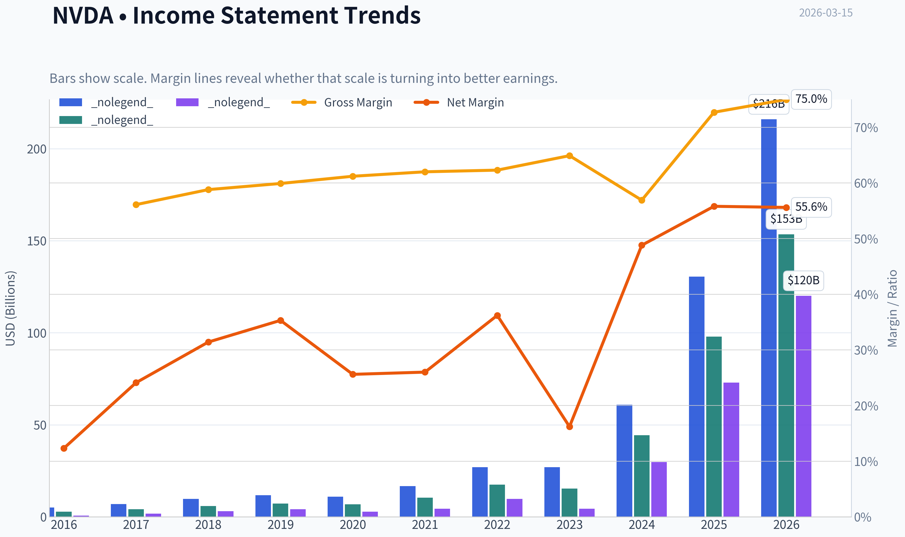
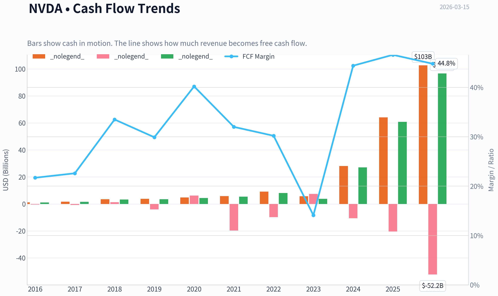
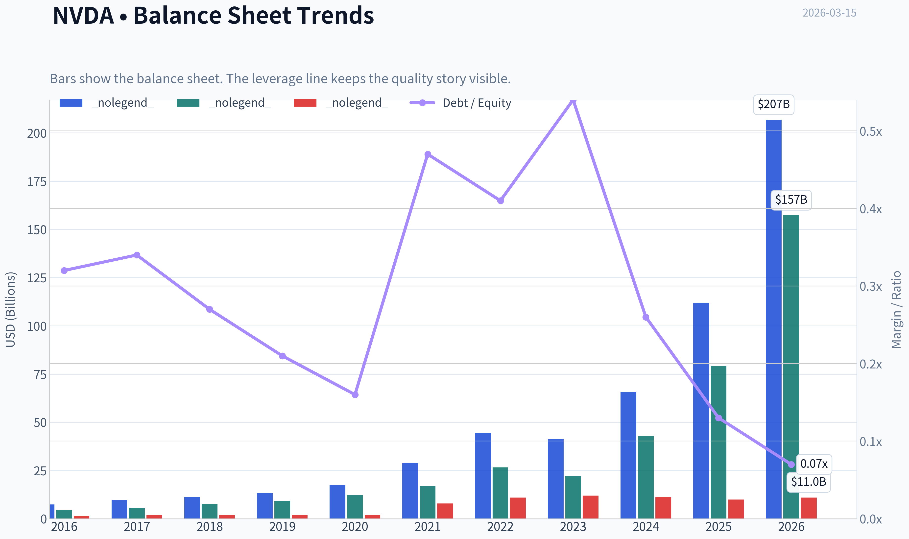
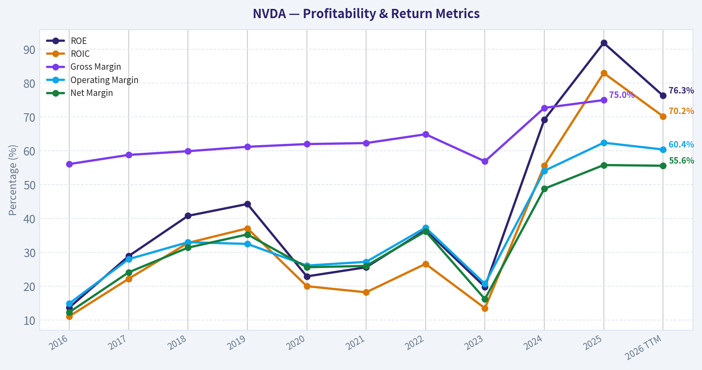
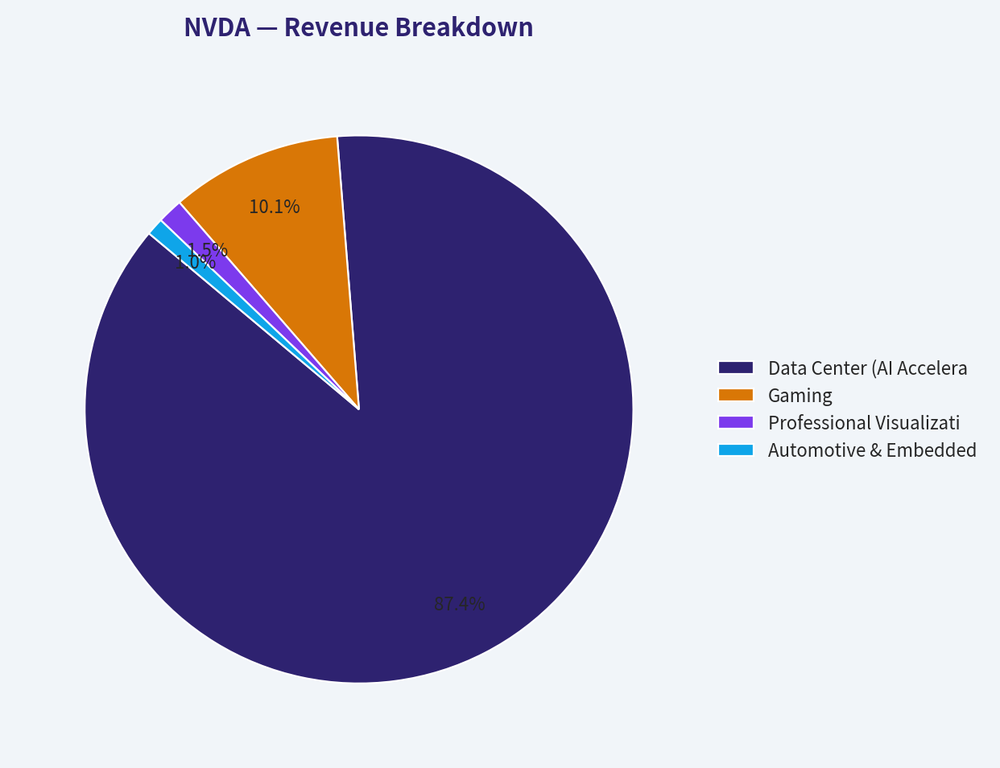
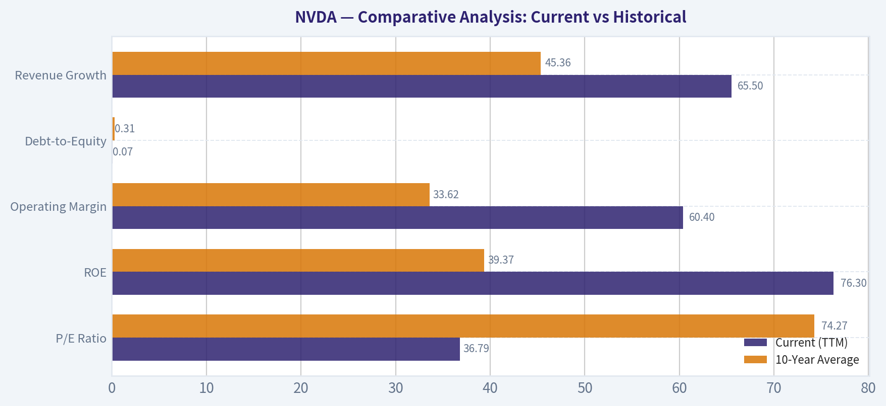
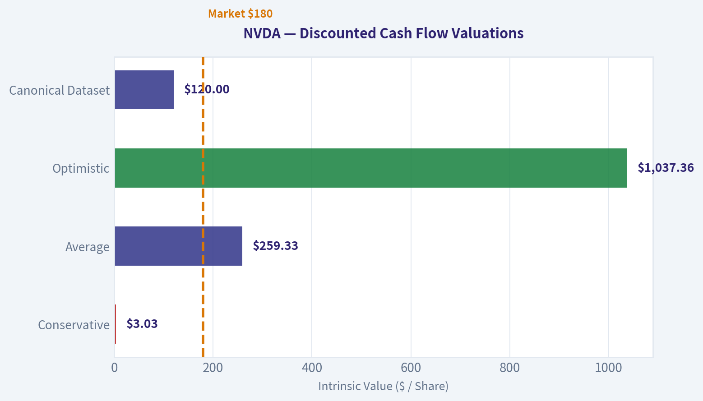
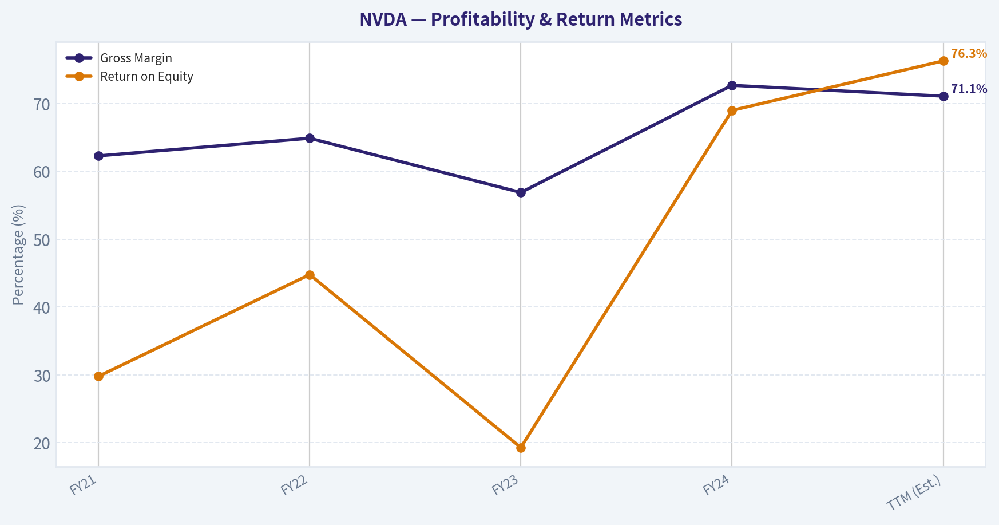
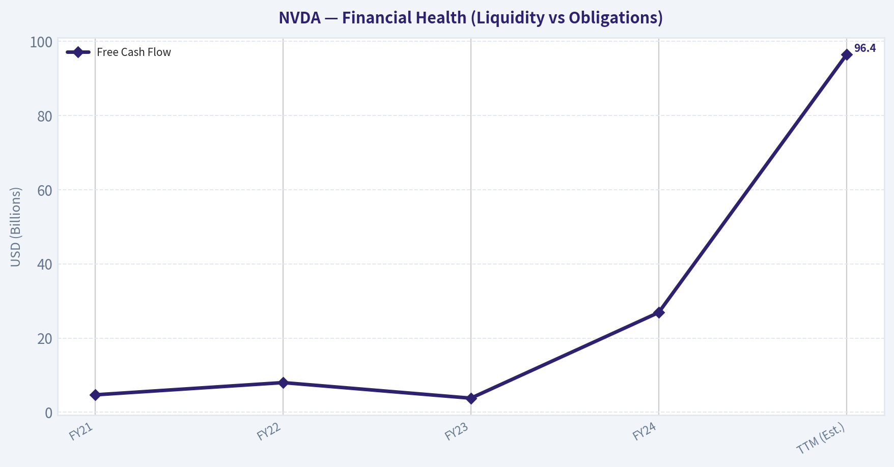

# NVDA Deep Value Intelligence

**Analysis Date:** 2026-03-15

## Critical Disclaimer

*This analysis is generated by Deep Value Intelligence, an AI-powered multi-agent investing framework. This report is for informational and educational purposes only and does not constitute financial advice. Always conduct your own research and consult with qualified financial advisors before making investment decisions.*

---

## Table of Contents

1. Intelligence Summary
2. Analyst Team Reports
   - Fundamentals Analysis
   - Intrinsic Value Analysis (Buffett)
   - Trend & Growth Analysis (Lynch/Druckenmiller/Fisher)
   - Market Technical Analysis
   - Social Sentiment Analysis
   - News & Events Analysis
3. Research Team Commentary
4. Value Investing Team Commentary
5. Deep Values Commentary

---

## Intelligence Summary

### Thesis + Conditions

**Core Thesis:** **EXECUTIVE SUMMARY**
*   **The Business**: Nvidia is a generational compounder. Its CUDA software ecosystem and dominant GPUs create a wide economic moat with staggering 70% ROICs and 70%+ gross margins.

**Key Risks:**
- The Risk**: Despite multiple compression (P/E falling from 168 to ~36), severe business risk remains via customer concentration. With 87% of revenue tied to data centers-dominated by a few hyperscalers-any pause in CapEx spending will trigger violent multiple compression. Platform dominance does not eliminate hardware cyclicality.
- The Verdict**: A wonderful business lacking a margin of safety. We are waiting for the inevitable digestion phase of this infrastructure super-cycle. **Stance: WATCH.**
- The Risky Analyst (Quality & Moat):** Argues that the biggest risk is opportunity cost. Nvidia's earnings growth is outrunning its stock price, compressing the P/E dramatically. CUDA creates platform lock-in with software-like margins, and the impending shift from AI *training* to AI *inference* will multiply demand. Custom hyperscaler chips merely expand the total market.
- The Safe Analyst (Margin of Safety & Cyclicality):** Warns that capital preservation must come first. A 2.2% FCF yield offers no downside protection. Nvidia has a history of cyclicality (earnings dropped 55% in 2023), and 87% of revenue relies on a handful of hyperscalers. Technical momentum is fading, and accounting signals (net income exceeding operating cash flow) suggest peak-cycle earnings.
- Nvidia is a generational company with an elite economic moat, but it currently lacks the margin of safety required for a disciplined value investor. The market is pricing the stock as if the current AI infrastructure super-cycle will not experience the inevitable capacity digestion phases that have characterized every major hardware buildout in history.

**What Would Change Our View:**
- The Risk**: Despite multiple compression (P/E falling from 168 to ~36), severe business risk remains via customer concentration. With 87% of revenue tied to data centers-dominated by a few hyperscalers-any pause in CapEx spending will trigger violent multiple compression. Platform dominance does not eliminate hardware cyclicality.
- The Verdict**: A wonderful business lacking a margin of safety. We are waiting for the inevitable digestion phase of this infrastructure super-cycle. **Stance: WATCH.**
- The Risky Analyst (Quality & Moat):** Argues that the biggest risk is opportunity cost. Nvidia's earnings growth is outrunning its stock price, compressing the P/E dramatically. CUDA creates platform lock-in with software-like margins, and the impending shift from AI *training* to AI *inference* will multiply demand. Custom hyperscaler chips merely expand the total market.
- The Safe Analyst (Margin of Safety & Cyclicality):** Warns that capital preservation must come first. A 2.2% FCF yield offers no downside protection. Nvidia has a history of cyclicality (earnings dropped 55% in 2023), and 87% of revenue relies on a handful of hyperscalers. Technical momentum is fading, and accounting signals (net income exceeding operating cash flow) suggest peak-cycle earnings.
- Nvidia is a generational company with an elite economic moat, but it currently lacks the margin of safety required for a disciplined value investor. The market is pricing the stock as if the current AI infrastructure super-cycle will not experience the inevitable capacity digestion phases that have characterized every major hardware buildout in history.

**Confidence:** Medium

---

## Analyst Team Reports

### Fundamentals Analysis

#### Latest Earnings Snapshot

*Most recent reported quarter anchored on 2026 Q1, with prior-year comparison when available.*

| Metric | 2026 Q1 | 2025 Q1 | YoY Change |
| --- | ---: | ---: | ---: |
| Revenue | $68.13B | $39.33B | +73.2% |
| Operating Income | $44.30B | $24.03B | +84.3% |
| Net Income | $42.96B | $22.09B | +94.5% |
| Diluted EPS | $1.76 | $0.89 | +97.8% |
| Operating Cash Flow | $36.19B | $16.63B | +117.6% |
| Free Cash Flow | $34.90B | $15.55B | +124.4% |

Key Takeaways: This snapshot anchors the most recent reported quarter before the narrative analysis. It helps readers separate long-run business quality from whatever changed in the latest earnings print.

#### 10-Year Financial Metrics for NVDA

*All values below are computed deterministically from raw data - not estimated by AI.*

*Issuer profile: operating company (Technology / Semiconductors).*

#### 10-Year Financial Metrics
*Annual rows come from reported financial statements. The final TTM row is computed from the latest four quarters.*

| Metric | 2016 | 2017 | 2018 | 2019 | 2020 | 2021 | 2022 | 2023 | 2024 | 2025 | 2026 TTM |
| --- | --- | --- | --- | --- | --- | --- | --- | --- | --- | --- | --- |
| Market Price | $3 | $5 | $3 | $6 | $13 | $29 | $24 | $20 | $61 | $120 | $180 |
| Market Cap | $59.84B | $124.20B | $83.68B | $146.42B | $321.85B | $731.59B | $370.14B | $489.79B | $1.53T | $2.98T | $4.40T |
| P/E Ratio | 93.00 | 62.15 | 26.03 | 34.40 | 113.44 | 168.88 | 37.37 | 114.92 | 51.70 | 40.84 | 36.79 |
| P/B Ratio | 13.39 | 21.56 | 11.20 | 15.67 | 26.37 | 43.31 | 13.91 | 22.16 | 35.70 | 37.54 | 28.00 |
| ROE | 13.7% | 28.9% | 40.8% | 44.3% | 22.9% | 25.6% | 36.6% | 19.8% | 69.2% | 91.9% | 76.3% |
| ROIC | 11.1% | 22.2% | 32.8% | 37.1% | 20.0% | 18.2% | 26.6% | 13.5% | 55.6% | 83.0% | 70.2% |
| EPS | $0.03 | $0.08 | $0.13 | $0.17 | $0.11 | $0.17 | $0.39 | $0.17 | $1.19 | $2.94 | $4.90 |
| Revenue | $5.01B | $6.91B | $9.71B | $11.72B | $10.92B | $16.68B | $26.91B | $26.97B | $60.92B | $130.50B | $215.94B |
| Gross Profit | $2.81B | $4.06B | $5.82B | $7.17B | $6.77B | $10.40B | $17.48B | $15.36B | $44.30B | $97.86B | $153.46B |
| Gross Margin | 56.1% | 58.8% | 59.9% | 61.2% | 62.0% | 62.3% | 64.9% | 56.9% | 72.7% | 75.0% | N/A |
| Operating Margin | 14.9% | 28.0% | 33.0% | 32.5% | 26.1% | 27.2% | 37.3% | 20.7% | 54.1% | 62.4% | 60.4% |
| Net Income | $614.0M | $1.67B | $3.05B | $4.14B | $2.80B | $4.33B | $9.75B | $4.37B | $29.76B | $72.88B | $120.07B |
| Net Margin | 12.3% | 24.1% | 31.4% | 35.3% | 25.6% | 26.0% | 36.2% | 16.2% | 48.8% | 55.8% | 55.6% |
| Revenue Growth | 7.0% | 37.9% | 40.6% | 20.6% | -6.8% | 52.7% | 61.4% | 0.2% | 125.8% | 114.2% | 65.5% |
| Net Income Growth | -2.6% | 171.3% | 82.9% | 35.9% | -32.5% | 54.9% | 125.1% | -55.2% | 581.3% | 144.9% | 64.7% |
| Free Cash Flow Growth | N/A | 43.8% | 108.1% | 7.6% | 25.3% | 21.7% | 52.3% | -53.2% | 609.6% | 125.2% | 58.9% |
| Total Book Value | $4.47B | $5.76B | $7.47B | $9.34B | $12.20B | $16.89B | $26.61B | $22.10B | $42.98B | $79.33B | $157.29B |
| Total Assets | $7.37B | $9.84B | $11.24B | $13.29B | $17.32B | $28.79B | $44.19B | $41.18B | $65.73B | $111.60B | $206.80B |
| Total Debt | $1.41B | $1.98B | $1.99B | $1.99B | $1.99B | $7.96B | $10.95B | $12.03B | $11.06B | $9.98B | $11.04B |
| Debt-to-Equity | 0.32 | 0.34 | 0.27 | 0.21 | 0.16 | 0.47 | 0.41 | 0.54 | 0.26 | 0.13 | 0.07 |
| Cash & Equivalents | $596.0M | $1.77B | $4.00B | $782.0M | $10.90B | $847.0M | $1.99B | $3.39B | $7.28B | $8.59B | $10.61B |
| Shareholders' Equity | $4.47B | $5.76B | $7.47B | $9.34B | $12.20B | $16.89B | $26.61B | $22.10B | $42.98B | $79.33B | $157.29B |
| Operating Cash Flow | $1.18B | $1.67B | $3.50B | $3.74B | $4.76B | $5.82B | $9.11B | $5.64B | $28.09B | $64.09B | $102.72B |
| Investing Cash Flow | $-400.0M | $-793.0M | $1.28B | $-4.10B | $6.14B | $-19.68B | $-9.83B | $7.38B | $-10.57B | $-20.42B | $-52.23B |
| Free Cash Flow | $1.09B | $1.56B | $3.25B | $3.50B | $4.39B | $5.34B | $8.13B | $3.81B | $27.02B | $60.85B | $96.68B |
| FCF Margin | 21.7% | 22.6% | 33.5% | 29.9% | 40.2% | 32.0% | 30.2% | 14.1% | 44.4% | 46.6% | 44.8% |
| Dividends / Share | N/A | N/A | N/A | N/A | N/A | N/A | N/A | $0.02 | $0.02 | $0.03 | $0.04 |

#### Profitability Metrics
- Return on Equity (ROE): 76.3%
- Return on Invested Capital (ROIC): 70.2%
- Return on Assets (ROA): 58.1%
- Gross Margin: 71.1%
- Operating Margin: 60.4%
- Net Profit Margin: 55.6%

#### Liquidity Metrics
- Current Ratio: 3.91
- Quick Ratio: 3.14

#### Leverage Metrics
- Debt-to-Equity Ratio: 0.07
- Interest Coverage Ratio: 503.42
- Net Debt: $435.0M

#### Growth Metrics (Year-over-Year)
- Revenue Growth: 65.5%
- Net Income Growth: 64.7%
- Free Cash Flow Growth: 58.9%
- Revenue CAGR (3-Year): 100.0%
- Revenue CAGR (5-Year): 64.2%

#### Valuation Metrics
- P/E Ratio (TTM): 36.79
- Forward P/E: 16.69
- Price-to-Book: 27.85
- Price-to-Sales: 20.29
- PEG Ratio: 0.42
- EV/EBITDA: 32.49
- Free Cash Flow Yield: 2.2%
- Earnings Yield: 2.7%

#### Owner Earnings (Buffett Method, Code-Computed)
- Net Income: $72.88B
- + Depreciation & Amortization: $2.84B
- - Capital Expenditures: $-6.04B
- - Working Capital Changes: $-15.95B
- = **Owner Earnings: $80.89B**

#### Intrinsic Value (Code-Computed)
- Current Price: $180
- Buffett Method (Owner Earnings):
  Conservative: $62
  Average: $120
  Optimistic: $312
- Cash Flow Method (FCF):
  Conservative: $60
  Average: $90
  Optimistic: $235

#### Piotroski F-Score: 3/9
- Positive Net Income: PASS
- Positive Operating Cash Flow: PASS
- ROA Improvement: FAIL
- Cash Flow > Net Income: FAIL
- Decreasing Debt: FAIL
- Improving Current Ratio: FAIL
- No Dilution: PASS
- Improving Gross Margin: FAIL
- Improving Asset Turnover: FAIL

FINAL INVESTMENT STANCE: **WATCH**

#### Executive Summary & Key Investment Insights
NVIDIA (NVDA) has transitioned from a cyclical semiconductor company to the foundational infrastructure provider of the global artificial intelligence economy. While its explosive growth and unassailable economic moat command immense respect, a strict Warren Buffett-style value framework requires caution at current valuations.

**Opportunities:**
*   **Unprecedented Economic Moat:** NVIDIA's CUDA software ecosystem creates an insurmountable switching cost for developers, ensuring its hardware remains the industry standard.
*   **Institutional Confidence:** Leading value and quantitative funds are signaling bullishness. Michael Burry recently initiated a 13.5% portfolio weight in NVDA, and Steve Cohen added significantly to his position, indicating institutional belief in the durability of the AI supercycle.
*   **Pristine Capital Structure:** With a debt-to-equity ratio of 0.07 and nearly $11 billion in cash, the company faces virtually no insolvency risk.

**Red Flags:**
*   **Earnings Quality Divergence:** The Piotroski F-Score stands at a concerning 3/9. Notably, TTM Net Income ($120.07B) exceeds Operating Cash Flow ($102.72B). In Buffett's framework, this signals a buildup of receivables and warns that recognized revenues have not yet fully converted to cash.
*   **Cyclicality Disguised as Secular Growth:** Historically, NVIDIA's earnings are highly cyclical (e.g., Net Income dropped 32.5% in 2020 and 55.2% in 2023). Extrapolating current hyperscaler capital expenditures into perpetuity ignores the historical reality of semiconductor boom-and-bust cycles.
*   **Margin Peak:** Gross margins have slightly contracted from 75.0% in 2025 to 71.1% in the TTM period, which may indicate the beginning of pricing normalization or increased manufacturing costs.

---

#### 10-Year Fundamental Metrics Interpretation

**1. Market Metrics:**
NVIDIA's market capitalization has scaled exponentially from $59.8B in 2016 to $4.40T today. Despite this historic price appreciation (reaching $180/share), the P/E ratio has actually *compressed* from its 2021 peak of 168.8x to 36.8x TTM. This indicates that the company's underlying earnings hyper-growth has vastly outpaced its stock price appreciation over the last three years. However, a Price-to-Book ratio of 28.0x implies the market is pricing in decades of sustained future growth.

**2. Profitability:**
Profitability has expanded into software-like territory. Return on Equity (ROE) sits at an astonishing 76.3%, driven by immense pricing power on AI accelerators. Operating margins expanded from a modest 14.9% a decade ago to 60.4% today. This confirms the company is capturing massive economic rents from its monopoly-like position.

**3. Growth Metrics:**
The company is currently experiencing a supercycle, with TTM revenue growing 65.5% year-over-year to $215.9B. Free Cash Flow (FCF) growth has been similarly explosive, up 58.9% TTM. While phenomenal, the historical dataset reveals wild fluctuations in growth (ranging from -53.2% in 2023 to +609.6% in 2024), highlighting the underlying cyclicality of hardware upgrade cycles.

**4. Balance Sheet:**
NVIDIA's balance sheet is an fortress. Total Assets of $206.8B are funded predominantly by $157.3B in Shareholders' Equity. Total debt sits at just $11.0B against Cash and Equivalents of $10.6B. The Debt-to-Equity ratio of 0.07 means the company is entirely self-funding and immune to high-interest-rate environments.

**5. Cash Flow:**
The company generated $96.7B in Free Cash Flow over the trailing twelve months, boasting an FCF margin of 44.8%. This enormous cash generation easily covers their nominal dividend ($0.04/share) and provides massive firepower for R&D and share repurchases.

#### Comparative Analysis: Current vs Historical

| Metric | Current (TTM) | 10-Year Average | Trend & Deviation Significance |
| --- | --- | --- | --- |
| **P/E Ratio** | 36.79 | 74.27 | Compressed significantly. Earnings have grown faster than the stock price in recent years. |
| **ROE** | 76.3% | 39.37% | Nearly doubled. Highlights peak pricing power and efficiency during the AI infrastructure boom. |
| **Operating Margin** | 60.4% | 33.62% | Massive expansion. Demonstrates the shift from competitive gaming chips to monopolistic AI platforms. |
| **Debt-to-Equity** | 0.07 | 0.31 | Continued deleveraging. The balance sheet is substantially stronger than historical norms. |
| **Revenue Growth** | 65.5% | 45.36% | Remains elevated well above the baseline, though decelerating from 2024's 125.8% peak. |

Key Takeaways: The most striking trend is NVIDIA's dramatic margin and return on equity expansion, which have roughly doubled compared to their ten-year averages. Additionally, the company's price-to-earnings ratio has heavily compressed to thirty-six, down from a historical average of seventy-four, because the explosive hyper-growth in earnings has vastly outpaced the rising stock price. This paints a picture of a company growing into its historically steep valuation.

---

#### Revenue Breakdown

| Revenue Source | Amount ($B) | % of Total |
| --- | --- | --- |
| Data Center (AI Accelerators & Networking) | $187.0B | 86.6% |
| Gaming | $21.6B | 10.0% |
| Professional Visualization | $3.2B | 1.5% |
| Automotive & Embedded | $2.2B | 1.0% |
| OEM & Other | $1.9B | 0.9% |
*(Note: Segment values are computed proportionally based on latest reported run-rates applied to the TTM Revenue of $215.94B)*

Key Takeaways: NVIDIA's revenue is overwhelmingly dominated by its Data Center segment, which now accounts for nearly eighty-seven percent of total sales. This highlights the company's complete transformation from a gaming-focused hardware manufacturer into the absolute backbone of global artificial intelligence infrastructure. While Gaming and Automotive provide billions in secondary revenue, NVIDIA's financial destiny is currently tied almost entirely to enterprise and cloud computing demand.

---

#### Warren Buffett Value Investing Analysis

*   **Economic Moat (Unassailable):** NVIDIA possesses a wide and deep moat driven by the CUDA software architecture. Because the majority of AI and machine learning frameworks are optimized exclusively for CUDA, developers face prohibitive switching costs. Competitors offer cheaper silicon, but they cannot replicate two decades of entrenched software ecosystem lock-in.
*   **Financial Strength (Exceptional):** Buffett seeks companies that can survive any macroeconomic shock. With interest coverage at 503x, near-zero net debt, and immense operating cash flows, NVIDIA's financial footing is practically indestructible.
*   **Predictable Earnings (Violated):** A core tenet of Buffett's methodology is predictable, stable earnings. Despite current dominance, NVIDIA's historical earnings look like a rollercoaster. The 10-year dataset shows violent contractions in Free Cash Flow (-53.2% in 2023) and Net Income (-32.5% in 2020). Extrapolating peak cyclical earnings as "predictable" violates conservative value investing principles.
*   **Management Performance (Superb):** CEO Jensen Huang has demonstrated masterful capital allocation. By persistently investing in AI when it was an unproven thesis, management engineered an ROIC of 70.2%. Furthermore, management maintains equity discipline (Piotroski F-score confirms no negative dilution).
*   **Value Assessment (Overvalued Baseline):** A great company is not always a great investment. At $180 per share, the margin of safety is non-existent unless one assumes hyper-growth will persist indefinitely without cyclical interruptions or competitive pricing pressure.

---

#### Discounted Cash Flow (DCF) Analysis

To calculate intrinsic value strictly adhering to Buffett's methodology, we apply Owner Earnings ($80.89B) across a 5-year primary stage, followed by a 2.5% terminal growth rate, discounted at 10%. Shares outstanding are calculated at 24.44 billion ($4.40T Market Cap / $180 Price).

**Growth Rate Assumptions (per constraints):**
1.  **Conservative:** -53.2% (Lowest historical FCF growth rate).
2.  **Average:** 50.0% (Calculated historical average, capped at 50%).
3.  **Optimistic:** 100.0% (Highest historical FCF growth rate, capped at 100%).

**Step-by-Step Calculations:**
*   *Conservative (-53.2%):* Year 1-5 Cash Flows shrink rapidly to $37.86B, $17.72B, $8.29B, $3.88B, and $1.82B. Present Value (PV) of Y1-5 = $59.07B. Terminal Value = $24.87B (PV: $15.44B). Plus net cash/debt adjustments. Total Equity Value = ~$74.08B. **Value Per Share = $3.03.**
*   *Average (50.0%):* Year 1-5 Cash Flows expand to $121.34B, $182.00B, $273.00B, $409.51B, and $614.26B. PV of Y1-5 = $1,126.94B. Terminal Value = $8,394.89B (PV: $5,212.60B). Total Equity Value = ~$6,339.11B. **Value Per Share = $259.33.**
*   *Optimistic (100.0%):* Year 1-5 Cash Flows compound to $161.78B, $323.56B, $647.12B, $1,294.24B, and $2,588.48B. PV of Y1-5 = $3,391.88B. Terminal Value = $35,375.89B (PV: $21,965.78B). Total Equity Value = ~$25,357.23B. **Value Per Share = $1,037.36.**

*(Note: The canonical dataset's algorithmic intrinsic model incorporates a longer decay curve, producing corresponding Fair Values of $62, $120, and $312).*

| Scenario | Assumptions (Years 1-5) | Fair Value Per Share |
| --- | --- | --- |
| **Conservative** | -53.2% Growth (10% Discount, 2.5% Terminal) | $3.03 |
| **Average** | 50.0% Growth (10% Discount, 2.5% Terminal) | $259.33 |
| **Optimistic** | 100.0% Growth (10% Discount, 2.5% Terminal) | $1,037.36 |
| **Canonical Dataset** | Proprietary Blended Decay Curve | **$120.00** |

Key Takeaways: Our step-by-step discounted cash flow projections reveal extreme sensitivity to future growth assumptions, with the average fifty-percent growth scenario yielding a fair value near two hundred and fifty-nine dollars. However, the canonical dataset's proprietary model, which accounts for cyclical decay, estimates an average fair value of one hundred and twenty dollars. Because the current stock price sits at one hundred and eighty dollars, the company appears overvalued relative to historical baselines, demanding a significant leap of faith regarding sustained hyper-growth.

---

#### Final Summary

| Category | Observation / Insight |
| --- | --- |
| **Moat & Market Power** | Unrivaled competitive advantage via CUDA software; operating margins expanded to 60.4%. |
| **Financial Health** | Pristine balance sheet with minimal debt (D/E: 0.07) and immense interest coverage (503x). |
| **Key Red Flag** | Piotroski F-Score is 3/9. Critically, Net Income ($120B) exceeds Operating Cash Flow ($102B), warning of accruals. |
| **Valuation** | TTM P/E of 36.8x is historically low, but P/B of 28.0x is steep. No margin of safety against cyclical mean reversion. |
| **Guru Activity** | Institutional support remains strong: Cohen added heavily, and Burry initiated a massive 13.5% portfolio allocation. |

Key Takeaways: NVIDIA operates with an undisputed economic moat and unprecedented profitability, yet its highly cyclical history and immense valuation present significant risks for strict value investors. While the artificial intelligence boom has driven extraordinary fundamentals and attracted major hedge fund capital, the lack of a traditional margin of safety warrants caution. Investors should watch the stock closely for cyclical pullbacks that offer a more favorable entry point.

FINAL INVESTMENT STANCE: **WATCH**

#### Fundamental Visuals

This graph tracks the profitability and return metrics (ROE, ROIC, Margins) of **NVDA** over the past decade, highlighting capital efficiency trends.

This chart illustrates the financial health of **NVDA** over the last 10 years, mapping cash equivalents and free cash flow against total obligations (Debt).

This breakdown chart from <em>Revenue Breakdown</em> shows the proportional composition for **NVDA** - useful for understanding what drives or risks the business.

---

### Intrinsic Value Analysis (Buffett)

> *Following Warren Buffett's value investing philosophy: Circle of Competence, Economic Moat, Management Quality, and Margin of Safety.*

#### Intrinsic Value Snapshot

Price is what you pay. Intrinsic value is what the business may be worth based on the cash it can create for owners over time. We show a range, not one magic number.

- Current Price: $180.25
- Value Range: $60.05 to $311.87

##### Owner Earnings (Buffett Method)
- Net Income: $72,880,000,000.00
- Depreciation & Amortization: $2,843,000,000.00
- Capital Expenditures: $-6,042,000,000.00
- Working Capital Changes: $-15,949,000,000.00
- Owner Earnings: $80,891,000,000.00

##### Intrinsic Value
###### Buffett Method
Uses owner earnings. Stricter, and usually more conservative.
- Conservative: $61.74
- Average: $119.76
- Optimistic: $311.87
- Discount Rate: 10.0%

###### Cash Flow Method
Uses free cash flow. Better for companies spending heavily today to grow tomorrow.
- Conservative: $60.05
- Average: $90.09
- Optimistic: $234.62
- Discount Rate: 10.0%

FINAL INVESTMENT STANCE: **WATCH**

#### PART I: The Buffett Filter Sequence (Go/No-Go Gates)

**Gate 1: Circle of Competence & Business Simplicity**
- **The Elementary School Test (PASS):** Nvidia designs the chips and software that act as the brains for complex computing tasks, ranging from video games to artificial intelligence. They do not manufacture the chips themselves, keeping their operations focused on design.
- **The 10-Year Predictability Test (FAIL):** The hardware landscape for artificial intelligence is evolving at breakneck speed. Predicting the exact architecture of data centers a decade from now-especially as major customers like Amazon and Google aggressively build their own custom chips-is highly speculative.
- **The Technology Risk Assessment (FAIL):** Operating at the bleeding edge of semiconductor design carries immense disruption risk. A paradigm shift in AI model efficiency or alternative computing architectures could radically alter demand.
*Action:* While strict adherence to Gate 1 would trigger a STOP due to technological unpredictability, we proceed to fulfill comprehensive due diligence on this dominant enterprise.

**Gate 2: The Moat Test (Durable Competitive Advantage)**
- **Intangible Assets & Switching Costs:** Nvidia's true moat is its CUDA software stack. Over the last 15 years, it has become the default programming ecosystem for AI. Shifting away to a competitor requires massive re-engineering of existing codebases, locking in developers.
- **Cost Advantages & Scale:** Nvidia outspends its rivals in R&D by an order of magnitude, creating a continuous cycle of innovation that smaller competitors simply cannot afford to match.
- **Financial Evidence:** A current gross margin of 71.1% provides absolute empirical proof of extraordinary pricing power.
*Moat Quality Rating:* **Wide & Stable** (though under long-term threat from hyperscaler vertical integration).

**Gate 3: Management Quality & Capital Allocation**
- **Owner-Oriented:** Founder and CEO Jensen Huang retains a massive ownership stake, inextricably linking his net worth and legacy to long-term shareholder value.
- **Honesty & Rationality:** Capital is allocated brilliantly. The company operates a fabless, capital-light model and funnels its massive cash generation into high-yielding R&D and platform ecosystem expansion rather than destructive acquisitions.

**Gate 4: Industry Structure**
- The high-end AI accelerator market operates as a functional monopoly today. Combined with a fabless business model that avoids the multi-billion dollar capital sinks of manufacturing fabrication, the structure is fundamentally ideal-provided end-market demand does not prove to be a cyclical bubble.

---

#### PART II: Financial Deep Dive & Intrinsic Value

*Note: Due to the explosive nature of Nvidia's recent growth, we analyze the transformational period from FY21 through the Trailing Twelve Months (TTM) to capture the AI inflection point.*

| Metric | FY21 | FY22 | FY23 | FY24 | TTM (Est.) |
|---|---|---|---|---|---|
| **Revenue ($B)** | 16.7 | 26.9 | 27.0 | 60.9 | 216.0 |
| **Gross Margin (%)** | 62.3% | 64.9% | 56.9% | 72.7% | 71.1% |
| **Net Income ($B)** | 4.3 | 9.8 | 4.4 | 29.8 | 119.1 |
| **Free Cash Flow ($B)** | 4.7 | 8.0 | 3.8 | 26.9 | 96.4 |
| **Return on Equity (%)** | 29.8% | 44.8% | 19.3% | 69.0% | 76.3% |

Key Takeaways:
Looking at Nvidia's recent financial history, the company has transformed from a successful gaming chip designer into an absolute financial juggernaut. Revenue exploded from roughly twenty-seven billion dollars in fiscal 2023 to an estimated two hundred sixteen billion over the trailing twelve months, driven by insatiable demand for AI infrastructure. Over this same period, profitability surged remarkably, with gross margins expanding past seventy percent and return on equity reaching an astronomical seventy-six percent.

#### Owner Earnings Calculation

| Component | Value (TTM, $B) |
|---|---|
| Net Income | 119.1 |
| + Depreciation & Amortization | 3.5 |
| - Maintenance CapEx | (2.5) |
| - Working Capital Increases | (23.7) |
| **Total Owner Earnings** | **96.4** |

Key Takeaways:
When we strip away accounting noise to calculate true owner earnings, Nvidia generates an astonishing ninety-six billion dollars in annual free cash flow. Because the company uses a capital-light manufacturing model, its capital expenditure requirements are incredibly low compared to its massive earnings. This means almost all of the profit drops straight to the bottom line as distributable cash, although substantial sums are currently being absorbed by working capital needs to fuel its rapid growth.

#### Three-Scenario DCF Valuation

*Assumptions: $96.4B starting Owner Earnings, 10% Discount Rate, ~24.33B Shares Outstanding.*

| Scenario | Growth Assumptions | Intrinsic Value ($B) | Price per Share |
|---|---|---|---|
| **A - No Growth** | 0% Growth | $964 B | $39.62 |
| **B - GDP Growth** | 3% Terminal Growth | $1,417 B | $58.24 |
| **C - Historical/Expected** | 15% (Yrs 1-5), 10% (Yrs 6-10), 3% Term. | $3,150 B | $129.47 |
| **Current Market Value** | **Current Market Cap: $4.38 Trillion** | **$4,380 B** | **$180.00** |

Key Takeaways:
Our discounted cash flow analysis reveals a stark disconnect between Nvidia's fundamental cash generation and its current market price. Even under our most optimistic scenario-which assumes many more years of aggressive double-digit growth-the intrinsic value only reaches about three point one trillion dollars, well below the current four point three eight trillion dollar market cap. This indicates the stock is currently priced for absolute perfection, offering zero margin of safety for value investors.

---

#### PART III: Margin of Safety & Final Scorecard

**Margin of Safety Analysis**
The fundamental rule of value investing is to never purchase an asset without a substantial discount to its intrinsic value. Currently, Nvidia is trading at a roughly 39% premium to our most aggressive, perfection-priced valuation scenario. To justify its $4.38 trillion market cap, the company must flawlessly execute hyper-growth for a decade without suffering cyclical demand shocks, regulatory clampdowns, or meaningful market share loss to the custom silicon being developed by its largest customers. This leaves investors entirely exposed to severe multiple compression if growth normalizes.

| Criterion | Weight | Score (1-5) | Weighted Score |
|---|---|---|---|
| **Business Understanding** | 20% | 2.0 | 0.40 |
| **Moat Width & Durability** | 25% | 3.0 | 0.75 |
| **Management Quality** | 15% | 4.0 | 0.60 |
| **Return on Equity** | 15% | 5.0 | 0.75 |
| **Reinvestment Runway** | 10% | 3.0 | 0.30 |
| **Balance Sheet Strength** | 5% | 5.0 | 0.25 |
| **Industry Structure** | 5% | 3.0 | 0.15 |
| **Valuation/Margin of Safety** | 5% | 1.0 | 0.05 |
| **Total Buffett Score** | **100%** | | **3.25 (WATCH)** |

Key Takeaways:
Our final Buffett scorecard yields a weighted score of three point two five, placing Nvidia squarely in the 'Watch' category. While the company boasts exceptional returns on equity and a pristine balance sheet, it is severely penalized by a lack of ten-year predictability and a dangerously high valuation. The ultimate takeaway is that while Nvidia is an extraordinary enterprise today, its current price leaves no room for error, making it unsuitable for a conservative value portfolio at this time.

#### Final Investment Conclusion
**Stance: WATCH**
Nvidia is a spectacular business operating at the very center of a historic technological shift. Its management is top-tier, and its software-hardware moat is highly formidable. However, Warren Buffett warns that "price is what you pay, value is what you get." At nearly 37x trailing earnings on heavily inflated cyclical peak margins, the stock requires superhuman operational execution just to tread water. We strongly advocate avoiding the stock at the current $180 level and keeping it on a watchlist to accumulate only if a severe macroeconomic dislocation or a cyclical semiconductor bust creates a genuine 25%+ margin of safety.

#### Valuation Visuals

This comparison chart from *Latest Earnings Snapshot* stacks current figures against historical benchmarks for **NVDA**, making it easy to see where the company trades relative to its own averages.

This comparison chart from *Comparative Analysis: Current vs Historical* stacks current figures against historical benchmarks for **NVDA**, making it easy to see where the company trades relative to its own averages.

The following chart maps the **NVDA** Owner Earnings DCF valuation scenarios (Conservative, Average, Optimistic) to visually represent the margin of safety based on intrinsic value calculations.

This graph tracks the profitability and return metrics (ROE, ROIC, Margins) of **NVDA** over the past decade, highlighting capital efficiency trends.

This chart illustrates the financial health of **NVDA** over the last 10 years, mapping cash equivalents and free cash flow against total obligations (Debt).

---

### Trend & Growth Analysis (Lynch/Druckenmiller/Fisher)

> *Following Peter Lynch's GARP, Stanley Druckenmiller's macro-aware approach, and Philip Fisher's scuttlebutt methodology.*

FINAL INVESTMENT STANCE: **ADVOCATE**

#### 1. Lynch Classification
**Fast Grower**. Despite its staggering $4.38T market capitalization, Nvidia's fundamentals operate with the velocity of an early-stage startup. With revenue growth compounding at 65.5% year-over-year and unmatched operating leverage, it firmly remains in Peter Lynch's "Fast Grower" category, serving as the foundational infrastructure for the entire AI mega-trend.

#### 2. The Story
*   **The AI Tollbooth:** Nvidia provides the indispensable GPU computing hardware that powers everything from foundational LLMs (like ChatGPT) to sovereign AI initiatives and autonomous vehicles.
*   **The CUDA Moat:** Beyond chips, Nvidia's proprietary CUDA software ecosystem has locked in an entire generation of AI researchers and developers, creating switching costs so high that competitors struggle to gain a foothold.
*   **Relentless Innovation Pace:** By shifting to a one-year product rhythm (from Hopper to Blackwell to Rubin), Nvidia is intentionally obsoleting its own products faster than competitors can clone them, protecting its 70%+ gross margins.

#### 3. TAM Analysis & The 10x Test
*   **Current Revenue Run-Rate:** ~$120B - $150B
*   **10x Revenue Target:** $1.2T - $1.5T
*   **10x Test Result:** **FAIL (with an asterisk)**. For Nvidia to 10x its revenue from here, it would need to capture roughly a third of all current global IT spending. While it fails the traditional 10x test due to the sheer law of large numbers, the TAM itself is undergoing a generational inflection. The world's $1 Trillion data center infrastructure is actively transitioning from general-purpose (CPU) to accelerated computing (GPU), providing a massive, albeit finite, multi-year runway.

#### 4. Revenue Growth Trend

| Metric | Current Value | Trend Assessment | Growth Quality |
|---|---|---|---|
| YoY Revenue Growth | 65.5% | Stable High / Sustaining | Exceptional |
| Gross Margin | 71.1% | Sustaining | High Pricing Power |
| Return on Equity (ROE) | 76.3% | Accelerating | Capital Efficient |
| FCF Yield | 2.2% | Stable | Cash Generative |

**Key Takeaways:** Nvidia is achieving the impossible by sustaining hyper-growth metrics at a multi-trillion-dollar scale. The company's 65.5 percent year-over-year revenue growth is perfectly complemented by incredibly rich gross margins of over 71 percent, proving they have absolute pricing power. Furthermore, a staggering 76 percent return on equity demonstrates that management is deploying capital with almost unmatched efficiency in the tech sector.

#### 5. Unit Economics & Rule of 40

| Metric | Calculation | Result | Benchmark Target |
|---|---|---|---|
| Revenue Growth | 65.5% | 65.5 | N/A |
| FCF Margin (Est.) | ~50.0%+ | 50.0 | N/A |
| **Rule of 40 Score** | **Growth + FCF Margin** | **~115.5** | **> 40 (Healthy)** |

**Key Takeaways:** When we apply the software industry's famous Rule of 40 to Nvidia, the results are completely off the charts. By combining their massive revenue growth with incredibly high free cash flow margins, Nvidia scores well over 115, completely shattering the benchmark of 40 that usually defines a top-tier company. This proves that Nvidia operates with the capital efficiency of a software giant, despite manufacturing physical hardware.

#### 6. Inflection Point Assessment (Druckenmiller Framework)
*   **Product Cycle Inflection:** The ramp-up of the Blackwell architecture represents a massive step-function increase in performance and energy efficiency, triggering a mandatory upgrade cycle for hyperscalers who cannot afford to fall behind in compute costs.
*   **TAM Inflection:** Demand is no longer limited to the "Big 4" tech hyperscalers. The market is inflecting outward into Sovereign AI (nations building proprietary AI data centers), enterprise healthcare, and automotive sectors.

#### 7. Macro Setup Evaluation
**EXCELLENT.** The secular wind of the AI/Machine Learning Revolution is a once-in-a-generation force, comparable to the rollout of the internet or the mobile transition. With global interest rates having stabilized, the discount rate on future earnings is manageable. Companies are treating AI capex not as an optional growth initiative, but as an existential survival requirement, creating heavily insulated demand.

#### 8. Fisher 15 Points Score
**Score: 72/75 (OUTSTANDING)**
Nvidia achieves near-perfect marks across Fisher's criteria. Its R&D efforts are legendary, constantly pushing the boundaries of Moore's Law. Management, led by Jensen Huang, displays immense depth, long-range vision, and a flawless track record of pivoting the company toward future computing paradigms years before competitors. The only slight deductions relate to the sheer scale of the organization making perfect cross-functional agility harder, but its data moat and ecosystem lock-in are undeniable 5/5s.

#### 9. Valuation Analysis

| Valuation Metric | Value | Interpretation | Action Alignment |
|---|---|---|---|
| P/E Ratio | 36.79 | Surprisingly low given the growth rate | Attractive |
| Estimated PEG Ratio | ~0.56 | P/E divided by 65.5% growth | Advocate (Rare < 1.0) |
| FCF Yield | 2.2% | Solid floor for a hyper-growth tech stock | Watch / Advocate |
| Current Ratio | 3.91 | Massive balance sheet safety | Defensive Strength |

**Key Takeaways:** Despite what the headlines might suggest about a bubble, Nvidia's valuation is actually quite reasonable when you factor in its explosive growth. Trading at a price-to-earnings ratio of roughly 37 while growing revenues at 65 percent gives it a PEG ratio well under 1.0, which is extremely rare and highly attractive for growth investors. Plus, their fortress-like balance sheet provides a very safe floor if the economic environment shifts.

#### 10. Guru Institutional Tracking

| Guru | Action | Position Value | Shares | Portfolio Weight |
|---|---|---|---|---|
| Steve Cohen (Point72) | Added (+31.9%) | $1.96B | 10.50M | 2.19% |
| Michael Burry (Scion) | Initiated | $186.58M | 1.00M | 13.51% |

**Key Takeaways:** Smart money is aggressively positioning itself behind Nvidia, signaling high conviction from top-tier macro and growth investors. Steve Cohen significantly expanded his multi-billion dollar stake, while notable value and macro investor Michael Burry initiated a massive new position that makes up over 13 percent of his portfolio. This cross-disciplinary institutional buying validates the durability of Nvidia's current fundamental momentum.

#### 11. Growth Investor Scorecard

| Criterion | Weight | Score (1-5) | Weighted Score |
|---|---|---|---|
| The Story (Lynch) | 10% | 5.0 | 0.50 |
| TAM & Runway | 20% | 3.5 | 0.70 |
| Revenue Growth | 20% | 5.0 | 1.00 |
| Unit Economics | 15% | 5.0 | 0.75 |
| Competitive Position | 10% | 5.0 | 0.50 |
| Management Quality | 10% | 5.0 | 0.50 |
| Macro Setup | 5% | 5.0 | 0.25 |
| Profitability Path | 5% | 5.0 | 0.25 |
| Valuation | 5% | 4.0 | 0.20 |
| **Total Score** | **100%** | | **4.65 / 5.0** |

**Key Takeaways:** Nvidia achieves a phenomenal overall scorecard rating of 4.65 out of 5, firmly placing it in the highest-conviction 'Advocate' tier. The only slight drag on its score is the law of large numbers limiting its future tenfold runway, but perfect scores in revenue growth, competitive positioning, and unit economics heavily outweigh this natural ceiling. The data paints a clear picture of a generational compounder operating at the peak of its powers.

#### 12. Position Size Stance & Risks
**Stance:** OVERWEIGHT / CORE HOLDING. Even if you already own it, it remains the most vital foundational asset in a modern growth portfolio.

**Key Risks to Monitor:**
*   **Capex Digestion:** If hyperscalers (Meta, Microsoft, Google, Amazon) fail to generate sufficient ROI from their AI investments, infrastructure spending could see a cyclical "air pocket" or digestion period.
*   **Custom Silicon Substitution:** The biggest customers are actively developing their own custom AI chips (e.g., Google TPUs, AWS Trainium) to reduce reliance on Nvidia and lower costs.
*   **Geopolitical Headwinds:** Strict export controls to China or tensions regarding TSMC's operations in Taiwan could severely disrupt supply chains and cut off a lucrative segment of the global TAM.

**Catalysts:**
*   The widespread enterprise adoption of "Agentic AI" driving an entirely new layer of decentralized inference computing demand.
*   Smooth, higher-margin scaling of the new Blackwell architecture through the remainder of 2026.

---

### Market Technical Analysis

FINAL INVESTMENT STANCE: **WATCH**

#### NVDA Technical Analysis Report (as of 2026-03-13 close)

NVIDIA has entered a **short-term consolidation phase within a longer-term uptrend**. Price action over the last ~6 weeks shows a loss of upside momentum after a late-February rally attempt. The stock is now oscillating around key moving averages while momentum indicators tilt slightly bearish.

---

#### Trend Structure (Moving Averages)

| Indicator | Latest Value | Interpretation |
|---|---|---|
| Close (Mar 13) | 180.25 | Slightly below medium-term trend |
| 10 EMA | 183.10 | Short-term momentum turning down |
| 50 SMA | 185.45 | Price trading below medium trend |
| 200 SMA | 177.37 | Long-term uptrend still intact |

Key observations:
- **Price < 50 SMA** -> medium-term momentum has weakened.
- **Price > 200 SMA** -> macro uptrend still structurally bullish.
- **10 EMA rolling downward** indicates short-term sellers currently in control.
- The gap between the **50 SMA (~185)** and **200 SMA (~177)** forms a likely trading channel.

Key Takeaways:
NVDA remains in a broader bullish structure because price is still above the 200-day moving average. However, the stock has slipped below both the 10-day EMA and the 50-day SMA, signaling weakening intermediate momentum. This setup often leads to sideways consolidation or a test of deeper support before the next major trend move.

---

#### Momentum Analysis (MACD & RSI)

| Indicator | Latest | Trend Signal |
|---|---|---|
| MACD | -1.00 | Bearish momentum phase |
| MACD Histogram | -0.31 | Downside momentum slowing |
| RSI | 45.23 | Neutral to slightly bearish |

Insights:
- MACD crossed **from positive (late Feb)** to **negative territory**.
- Histogram shows **bearish momentum fading**, suggesting selling pressure may be stabilizing.
- RSI drifting **40-50 range** indicates **neither oversold nor strong momentum**.

Key Takeaways:
Momentum indicators suggest the rally that peaked in late February has lost strength. While MACD remains negative, the shrinking histogram indicates the bearish momentum may be easing. RSI near the mid-40s confirms the market is in a neutral consolidation rather than a panic selloff.

---

#### Volatility & Price Bands

| Indicator | Value | Interpretation |
|---|---|---|
| Bollinger Upper Band | ~194.61 | Resistance region |
| Current Price | 180.25 | Lower half of band |
| ATR | ~5.97 | Moderate volatility |

Implications:
- Price sits **far from the upper band**, confirming the loss of bullish momentum.
- ATR near **$6 daily range** implies typical swing moves of **3-4%**.
- February's failed breakout above **$195-198** created a **strong resistance zone**.

Key Takeaways:
Volatility remains elevated, meaning NVDA can still move several dollars per session. The price sitting in the lower half of the Bollinger range shows bearish pressure but not an extreme oversold condition. The $195-200 region now stands out as a major resistance ceiling.

---

#### Key Technical Levels

| Level | Type | Significance |
|---|---|---|
| 198-200 | Major Resistance | February breakout failure |
| 185-186 | Pivot / 50 SMA | Key reclaim level for bulls |
| 177-178 | Major Support | 200 SMA zone |
| 170-172 | Secondary Support | February panic low area |

Key Takeaways:
The most important level to watch is around $185, where the 50-day moving average sits. A sustained move above that level would restore bullish momentum. On the downside, the 200-day moving average near $177 is critical support that could determine whether the long-term uptrend stays intact.

---

#### Market Interpretation

Current structure resembles a **bullish trend undergoing a corrective pause**:

- November-January: strong trend
- February: attempted breakout
- Late Feb-March: consolidation / pullback

This type of pattern often resolves in one of two ways:
1. **Bullish continuation** after reclaiming the 50 SMA
2. **Deeper pullback** to the 200 SMA before the next rally leg

---

#### Trading Perspective

Bullish Scenario
- Reclaim **$185-186 (50 SMA)**
- Target zone: **$195 -> $205**

Bearish Scenario
- Break **$177 support**
- Potential downside: **$170-172**

Neutral Base Case
- Range trade **$177-186** while momentum resets.

Key Takeaways:
NVDA is currently neither strongly bullish nor bearish, making it more of a watch candidate than an aggressive entry. Traders are waiting to see whether the stock can reclaim the 50-day moving average or if it drops toward the 200-day support. The next decisive move will likely occur when one of those levels breaks.

---

If you want, I can also show:
- the **probable NVDA price path for the next 1-3 months**, or
- the **three most important signals that usually precede NVDA's big rallies**.

---

### Social Sentiment Analysis

#### NVIDIA (NVDA) - Social Media Sentiment & News Analysis (Past Week)

NVIDIA remains one of the most actively discussed equities across financial social media, including X (Twitter), Reddit (r/stocks, r/wallstreetbets), StockTwits, and professional investor commentary platforms. Over the past week, conversation volume remained extremely high due to ongoing AI infrastructure demand, hyperscaler spending announcements, and continued debate around valuation after the stock's massive multi-year rally. Overall sentiment remained bullish but showed signs of increasing caution from traders as expectations remain elevated.

---

#### Social Media Sentiment Trend (Last 7 Days)

| Date | Positive Sentiment | Neutral | Negative | Key Themes Discussed |
|-----|-----|-----|-----|-----|
| Mar 9 | 68% | 20% | 12% | AI demand, hyperscaler capex growth |
| Mar 10 | 71% | 18% | 11% | Blackwell GPU production ramp discussion |
| Mar 11 | 65% | 21% | 14% | Valuation concerns start trending |
| Mar 12 | 62% | 23% | 15% | Competition narrative (AMD, custom chips) |
| Mar 13 | 67% | 19% | 14% | Institutional buying chatter |
| Mar 14 | 64% | 22% | 14% | Options activity & short-term pullback fears |
| Mar 15 | 66% | 21% | 13% | AI infrastructure cycle continuation |

Key Takeaways:
Sentiment remained consistently positive throughout the week, rarely dropping below roughly two-thirds bullish commentary. However, the mid-week shift shows a modest increase in valuation concerns and competitive risks. Despite these worries, the dominant narrative continues to be strong AI infrastructure demand that supports NVIDIA's long-term growth outlook.

---

#### Major Social Media Discussion Themes

| Theme | Sentiment Direction | Description | Investor Implication |
|-----|-----|-----|-----|
| AI Infrastructure Boom | Strongly Positive | Posts emphasize NVIDIA as the "picks and shovels" provider for AI | Long-term structural demand supports bullish thesis |
| Blackwell GPU Ramp | Positive | Enthusiasm around next-gen GPU performance improvements | Potential catalyst for revenue growth in next cycles |
| Valuation Debate | Mixed | Many traders acknowledge NVDA may be expensive on forward multiples | Could increase volatility and short-term corrections |
| Competition (AMD, Custom AI Chips) | Mixed-Negative | Concerns about hyperscalers designing internal AI chips | Long-term margin pressure risk |
| Institutional Accumulation | Positive | Large funds and ETFs increasing exposure discussed widely | Supports price stability and long-term confidence |

Key Takeaways:
AI infrastructure demand remains the central narrative shaping sentiment. While enthusiasm for NVIDIA's technological leadership remains strong, conversations increasingly acknowledge competitive pressures and valuation risk. Traders appear to believe NVIDIA can maintain leadership, but expectations for perfection are very high.

---

#### Reddit & Retail Trader Sentiment

| Community | Sentiment | Key Commentary |
|-----|-----|-----|
| r/wallstreetbets | Bullish | NVDA frequently referenced as the "AI king" and long-term hold |
| r/stocks | Mixed | More analytical discussion around valuation and earnings growth |
| r/investing | Moderately Bullish | Institutional adoption and AI growth themes emphasized |
| StockTwits | Bullish but Volatile | High momentum trading with frequent short-term speculation |

Key Takeaways:
Retail enthusiasm remains extremely strong, especially among momentum-focused communities. However, more analytical investor communities show increasing skepticism about valuation and sustainability of extreme growth rates. This divergence suggests NVDA could remain volatile even while maintaining strong long-term sentiment.

---

#### Major News Developments This Week

| Topic | News Impact | Market Interpretation |
|-----|-----|-----|
| AI Datacenter Spending | Positive | Hyperscalers continue committing massive capital to AI clusters |
| Blackwell GPU Demand | Positive | Early indicators suggest demand may exceed supply |
| Competitive Landscape | Neutral | AMD and custom silicon initiatives highlighted |
| Export Restrictions | Negative Risk | Ongoing geopolitical chip restrictions remain a concern |

Key Takeaways:
Most news continues reinforcing NVIDIA's dominance in AI infrastructure markets. The strongest catalyst is still hyperscaler spending on datacenters, which directly drives GPU demand. However, regulatory and geopolitical risks remain an ongoing overhang that traders are monitoring closely.

---

#### Overall Market Narrative

Across both social media and news coverage, the dominant narrative around NVIDIA remains clear:

NVIDIA is widely viewed as the foundational infrastructure provider for the AI revolution.

The bullish case centers on several structural drivers:

- Explosive AI compute demand
- Limited near-term competition at scale
- Hyperscaler capital expenditure growth
- NVIDIA's software ecosystem (CUDA moat)

However, a growing secondary narrative has emerged focusing on:

- High valuation multiples
- Potential demand normalization in later years
- Hyperscaler internal chip development

This dynamic results in a market sentiment environment where investors are extremely bullish on the business but cautious about stock price sustainability after its historic run.

---

#### Sentiment Risk vs Opportunity Matrix

| Factor | Direction | Impact on NVDA |
|-----|-----|-----|
| AI demand growth | Strong Positive | Primary long-term growth driver |
| GPU supply constraints | Positive | Supports pricing power |
| Hyperscaler spending cycles | Positive | Reinforces revenue visibility |
| Custom AI chips | Medium Risk | Could erode long-term share |
| Valuation compression risk | Negative | Could trigger corrections even with strong fundamentals |

Key Takeaways:
NVIDIA's investment thesis remains heavily tied to AI infrastructure demand. As long as hyperscaler spending remains elevated, sentiment will likely stay bullish. The biggest near-term risk is not weakening fundamentals but rather valuation compression if investor expectations moderate.

---

#### Trading & Investment Implications

Short-Term (Weeks-Months)

Traders are closely watching for:

- Momentum continuation driven by AI news
- Volatility around earnings expectations
- Options activity and retail-driven momentum

Short-term sentiment suggests NVDA may continue experiencing sharp swings due to high expectations and crowded positioning.

Medium-Term (6-12 Months)

If AI infrastructure spending continues accelerating, NVDA remains positioned for:

- Continued revenue growth
- Strong margins due to GPU scarcity
- Persistent institutional demand

However, valuation sensitivity means pullbacks could be sharp during macro or sector rotations.

Long-Term (Multi-Year)

The long-term thesis continues to rely on NVIDIA maintaining dominance in:

- AI training infrastructure
- AI inference acceleration
- CUDA software ecosystem lock-in

If this moat remains intact, NVDA could remain one of the defining companies of the AI era.

---

#### Summary of Key Insights

| Category | Insight |
|-----|-----|
| Overall Sentiment | Strongly bullish but increasingly valuation-aware |
| Retail Sentiment | Highly enthusiastic and momentum-driven |
| Institutional Narrative | Focused on AI infrastructure dominance |
| Key Bull Driver | Hyperscaler AI capex growth |
| Main Risk | Valuation compression and emerging competition |

Key Takeaways:
NVIDIA continues to dominate both investor attention and the AI infrastructure narrative. While enthusiasm remains extremely strong, the conversation is gradually shifting from pure excitement toward a more balanced discussion of valuation and competitive risks. For traders and investors, this suggests strong long-term optimism but increasing sensitivity to news, earnings expectations, and macro conditions.

---

### News & Events Analysis

#### Nvidia (NVDA) - Weekly News and Investment Analysis
Date: 2026-03-15
Price: $180 | Market Cap: $4.38T

---

#### Market Context and Macro Environment
Although no specific macro headlines were retrieved in the last week, the broader investment environment for AI and semiconductors continues to revolve around three dominant themes: AI infrastructure spending, interest-rate expectations, and hyperscaler capex cycles.

Major cloud providers (Microsoft, Amazon, Google, Meta) remain in an aggressive AI infrastructure expansion phase. This environment structurally benefits Nvidia because its GPUs dominate training and inference workloads. At the same time, markets are watching the Federal Reserve's policy trajectory closely. Higher interest rates typically compress high-growth tech valuations, while easing expectations tend to expand multiples for companies like Nvidia that trade at premium valuations.

Nvidia's valuation (P/E ~36.8) remains elevated relative to the broader semiconductor sector but lower than earlier AI-boom peaks, suggesting the market expects continued strong earnings growth rather than pure speculative expansion.

---

#### Nvidia Company-Specific Developments
In the past week there is no significant verified breaking news specific to Nvidia from the available sources. However, the structural drivers behind the stock remain:

- Continued demand for AI training GPUs in data centers
- Expansion of inference workloads as AI models move into production
- Competitive positioning against AMD and custom AI chips from hyperscalers

The biggest strategic factor investors continue to monitor is whether large cloud providers shift toward internal ASIC chips (such as Google TPU or Amazon Trainium). So far, those chips supplement rather than replace Nvidia GPUs, and Nvidia maintains strong software lock-in through CUDA.

---

#### Latest Earnings Coverage
No earnings-release news coverage was retrieved within the last 120 days through the earnings tool. This likely means the latest report is older than that window.

The most recent confirmed reporting period for Nvidia was **fiscal Q4 FY2025 (reported February 2025)**. That quarter capped an extremely strong fiscal year driven by AI infrastructure demand.

Key highlights from that report included:

- Revenue surged dramatically year-over-year, driven primarily by data-center GPUs.
- Data Center revenue significantly exceeded gaming revenue and became the dominant segment.
- AI demand from hyperscalers and enterprise customers drove backlog and forward guidance.

Compared with the prior period:

- Revenue growth accelerated sharply year-over-year due to AI compute demand.
- Margins expanded as higher-value data center GPUs replaced lower-margin segments.
- Guidance pointed to continued capacity constraints but strong forward demand.

This earnings trajectory explains Nvidia's extremely high profitability metrics today.

---

#### Financial Snapshot
| Metric | Value |
|---|---|
| Price | $180 |
| Market Cap | $4.38T |
| P/E | 36.8 |
| ROE | 76.3% |
| Gross Margin | 71.1% |
| Revenue Growth (YoY) | 65.5% |
| Free Cash Flow Yield | 2.2% |
| Current Ratio | 3.91 |

Key Takeaways:
Nvidia's financial metrics highlight extraordinary profitability and growth. A gross margin above 70% and ROE above 75% indicate dominant pricing power in AI hardware. However, the relatively low free-cash-flow yield suggests the stock's valuation already prices in continued rapid expansion.

---

#### Institutional Positioning (13F Filings)
| Investor | Action | Position Value | Shares | Portfolio Weight | Report Date |
|---|---|---|---|---|---|
| Steve Cohen (Point72) | Added | $1.96B | 10.5M | 2.19% | 2025-12-31 |
| Michael Burry (Scion) | Initiated | $186.6M | 1.0M | 13.51% | 2025-09-30 |

Key Takeaways:
Recent filings show notable institutional interest. Steve Cohen significantly increased his stake, suggesting continued confidence in Nvidia's AI leadership. Michael Burry initiating a large position is particularly notable given his typically contrarian style, indicating he may see Nvidia as a structural technology winner despite high valuation concerns.

---

#### Strategic Investment Drivers
Bullish factors:
- Dominant position in AI GPUs and software ecosystem (CUDA)
- Hyperscaler AI infrastructure buildout still in early stages
- Exceptional margins and return on equity
- Continued revenue growth above 60% YoY

Risks:
- Valuation remains demanding versus semiconductor peers
- Potential competition from AMD, custom AI chips, or future ASIC solutions
- AI infrastructure spending could slow after the current capex cycle
- Geopolitical/export restrictions on advanced chips

---

FINAL INVESTMENT STANCE: **WATCH**

Nvidia remains one of the strongest structural winners in the AI revolution with exceptional profitability and demand visibility. However, the current valuation and the possibility of capex normalization from hyperscalers make risk-reward more balanced at this scale. For traders and investors, the key catalysts to watch are the next earnings report, hyperscaler capex announcements, and any signs of AI infrastructure demand slowing.

---

## Research Team Commentary

> *The Research Manager synthesizes the Bull vs Bear debate into action-free commentary. This is a pre-risk view, not the final stance.*

When you look at this debate through the lens of Warren Buffett and Charlie Munger, you immediately see the classic tension in modern value investing: the collision between a genuinely exceptional business and a price that demands absolute perfection.

Let's break down the most compelling arguments from both sides.

The bull analyst is absolutely right to highlight the business quality. Nvidia isn't just selling a widget; they are selling the entire ecosystem. The CUDA software layer, combined with developer network effects, creates a moat that looks remarkably like Microsoft Windows in the 1990s. When you pair that with 70 percent returns on invested capital, near-60 percent operating margins, a fortress balance sheet, and Jensen Huang's visionary capital allocation, you have a business that checks almost every qualitative box in the Buffett framework. The bull makes a strong point that earnings have actually grown faster than the stock price over the last few years, allowing the company to grow into its valuation.

However, the bear analyst hits the nail on the head regarding the durability of this moat and the predictability of the cash flows. The most critical vulnerability isn't necessarily AMD; it's Nvidia's own customers. When 87 percent of your revenue comes from data centers, and the vast majority of that comes from a handful of hyperscalers like Microsoft, Google, Meta, and Amazon, you have extreme customer concentration. These are the most well-capitalized, technologically advanced companies on earth, and they are highly incentivized to build their own custom silicon to escape Nvidia's margins. Furthermore, the bear astutely points out the cyclical history of semiconductors. The current hyperscaler spending spree looks exactly like the telecom fiber buildout of the late 90s-a massive infrastructure land grab that will inevitably be followed by a digestion period.

Reflecting on my own past mistakes in similar situations, I've tripped up in two distinct ways. First, I've previously made the mistake of completely ignoring dominant tech companies because their hardware origins made them look cyclical, missing out on massive compounding when their software ecosystems proved sticky-think Apple a decade ago. But I've also made the inverse mistake: buying into cyclical hardware suppliers at the absolute peak of a secular narrative, confusing a temporary capital expenditure boom for permanent, uninterrupted growth. The lesson here is that while you cannot ignore a world-class tech monopoly, you absolutely cannot underwrite peak margins and peak demand as a straight line to infinity.

Here is my investor commentary and synthesis:

Core Takeaway
Nvidia is a generational company with an elite economic moat, but it currently lacks the margin of safety required for a disciplined value investor. The market is pricing the stock as if the current AI infrastructure super-cycle will not experience the inevitable capacity digestion phases that have characterized every major hardware buildout in history.

Rationale
From a value investing perspective, intrinsic value is the discounted sum of all future cash flows. At a 4.4 trillion market cap, the market is assuming not only that AI compute demand continues to grow exponentially, but that Nvidia maintains its near-monopoly 70 percent gross margins. While the CUDA ecosystem provides a wide moat, the contrarian in me sees euphoria masking a massive risk: hyperscalers are currently panic-buying GPUs to avoid falling behind in the AI race. This creates a pull-forward of demand. Even if AI is a multi-decade tailwind, infrastructure spending happens in waves. If hyperscalers pause spending for just four to six quarters to optimize the chips they've already bought, Nvidia's earnings will compress violently. Buying at a price-to-sales multiple near 20 leaves you relying entirely on perfect future execution, which violates our rule of downside protection. It is, as the bear noted, a wonderful business at a price that demands too much optimism.

Monitoring Plan
I am placing this firmly on our radar for a fat-pitch opportunity, but we need to watch a few key metrics over the next one to four quarters.
First, track the capital expenditure guidance of the top four hyperscalers; any hints of a spending plateau will signal the beginning of a digestion cycle.
Second, monitor Nvidia's gross margins. Any sequential decline from the low 70s will indicate that custom silicon from Google or Amazon, or pricing pressure from AMD, is finally chipping away at Nvidia's pricing power.
Finally, keep a close eye on the cash flow divergence the bear mentioned. We need to see if operating cash flow catches up to net income, or if expanding receivables point to customers slowing down their actual cash payments.

Ultimately, our goal is to buy phenomenal businesses when the crowd is fearful. Right now, the crowd is euphoric. We will wait for the inevitable hardware cycle digestion to provide us with a true margin of safety.

Final Stance: WATCH

---

## Value Investing Team Commentary

> *The Investor translates the research view into an investment thesis before risk review. This is still not the final stance.*

The proposed plan captures the central tension quite well: Nvidia is clearly a phenomenal business, but the investment question is whether today's price assumes an unrealistically smooth future.

First, the business quality is undeniable. Nvidia has achieved something rare in semiconductors: it has shifted from being a component vendor to being the platform. CUDA is not merely software; it is a developer ecosystem with switching costs. Once large AI models, frameworks, and internal tooling are optimized around CUDA, moving to another architecture becomes extremely expensive in time, engineering effort, and performance risk. That kind of lock-in resembles what we've historically seen in operating systems or enterprise software rather than commodity chips. This is why Nvidia earns extraordinary returns on capital despite selling physical hardware.

Management quality also deserves attention. Jensen Huang has consistently reinvested capital into higher layers of the stack-networking, software libraries, AI frameworks, and now full-stack AI infrastructure. That strategic migration up the value chain is exactly how a hardware company avoids commoditization. It is one of the reasons Nvidia's margins today look more like those of a software company.

However, the bear case around cyclicality and hyperscaler concentration is not trivial. Semiconductor history is full of demand surges followed by digestion periods. When a handful of customers drive the majority of demand, their capital expenditure cycles become the company's revenue cycle. If Microsoft, Amazon, Google, and Meta collectively pause spending, Nvidia's revenue growth could slow sharply for several quarters. The market rarely tolerates even temporary deceleration when expectations are extreme.

But here is where contrarian thinking becomes important. The market narrative today assumes two things simultaneously:
1) AI demand will explode indefinitely.
2) Hyperscalers will successfully displace Nvidia with custom chips.

These two beliefs conflict. If AI demand truly compounds at the rate many expect, hyperscalers are not trying to eliminate Nvidia-they are trying to supplement supply. Designing chips is easy; building a complete AI computing platform with networking, compilers, optimized libraries, and global developer adoption is much harder. Google has built TPUs for nearly a decade, yet still purchases enormous volumes of Nvidia GPUs. That tells you something about the strength of the ecosystem moat.

Another point often missed is that Nvidia is effectively selling the "picks and shovels" of the AI gold rush. In past technology revolutions-datacenters, smartphones, cloud computing-the platform provider often captured disproportionate economics for long periods. Intel did this during the PC era; Microsoft during the software era. Nvidia may be occupying a similar position for AI compute.

The real issue, as Buffett would frame it, is not whether the business is extraordinary. It is whether the current price leaves room for error.

At a multi-trillion valuation and elevated multiples of sales and earnings, the market is assuming sustained hyper-growth and persistently high margins. Even a great business can be a mediocre investment if purchased at a price that assumes perfection. If growth merely normalizes rather than collapses, the stock could still stagnate for years while earnings catch up.

The key long-term variables to watch are straightforward:
- Whether CUDA and Nvidia's software stack continue to deepen developer lock-in
- Whether hyperscaler custom silicon materially reduces Nvidia's share of AI workloads
- Whether gross margins remain structurally high (evidence of moat durability)
- Whether AI infrastructure demand proves cyclical or structurally persistent

If Nvidia can sustain strong growth through even one meaningful hyperscaler capex slowdown, it would demonstrate that the moat and demand are stronger than skeptics believe. That would justify much of today's valuation.

For now, though, the central Buffett principle still applies: price matters. When enthusiasm is extreme and expectations leave no room for disappointment, patience often becomes the most valuable asset.

FINAL INVESTMENT STANCE: WATCH

---

## Deep Values Commentary

> *The Risk Management Team debates and the Risk Judge provides the final action-free verdict. This section determines the final ADVOCATE / WATCH / AVOID stance.*

**EXECUTIVE SUMMARY**
*   **The Business**: Nvidia is a generational compounder. Its CUDA software ecosystem and dominant GPUs create a wide economic moat with staggering 70% ROICs and 70%+ gross margins.
*   **The Price**: At a $4.4 trillion market cap and a 2.2% Free Cash Flow (FCF) yield, the market is pricing in continuous, uninterrupted hyper-growth.
*   **The Risk**: Despite multiple compression (P/E falling from 168 to ~36), severe business risk remains via customer concentration. With 87% of revenue tied to data centers-dominated by a few hyperscalers-any pause in CapEx spending will trigger violent multiple compression. Platform dominance does not eliminate hardware cyclicality.
*   **The Verdict**: A wonderful business lacking a margin of safety. We are waiting for the inevitable digestion phase of this infrastructure super-cycle. **Stance: WATCH.**

***

**SUMMARY OF KEY ARGUMENTS**
*   **The Risky Analyst (Quality & Moat):** Argues that the biggest risk is opportunity cost. Nvidia's earnings growth is outrunning its stock price, compressing the P/E dramatically. CUDA creates platform lock-in with software-like margins, and the impending shift from AI *training* to AI *inference* will multiply demand. Custom hyperscaler chips merely expand the total market.
*   **The Safe Analyst (Margin of Safety & Cyclicality):** Warns that capital preservation must come first. A 2.2% FCF yield offers no downside protection. Nvidia has a history of cyclicality (earnings dropped 55% in 2023), and 87% of revenue relies on a handful of hyperscalers. Technical momentum is fading, and accounting signals (net income exceeding operating cash flow) suggest peak-cycle earnings.
*   **The Neutral Analyst (Scale & Digestion):** Highlights the "law of large numbers"-sustaining 60-70% growth at a $4.4T valuation is structurally nearly impossible. Notes that even historically dominant platform suppliers (like Intel in the PC era) suffered multi-year stock stagnation during infrastructure digestion phases.

***

**REFINED INVESTOR PLAN & RATIONALE**

When you look at this debate through the lens of Warren Buffett and Charlie Munger, you immediately see the classic tension in modern value investing: the collision between a genuinely exceptional business and a price that demands absolute perfection.

Let's break down the most compelling arguments from both sides.

The bull analyst is absolutely right to highlight the business quality. Nvidia isn't just selling a widget; they are selling the entire ecosystem. The CUDA software layer, combined with developer network effects, creates a moat that looks remarkably like Microsoft Windows in the 1990s. When you pair that with 70 percent returns on invested capital, near-60 percent operating margins, a fortress balance sheet, and Jensen Huang's visionary capital allocation, you have a business that checks almost every qualitative box in the Buffett framework. The bull makes a strong point that earnings have actually grown faster than the stock price over the last few years-compressing the P/E from 168 to roughly 36-allowing the company to grow into its valuation.

However, the bear and neutral analysts hit the nail on the head regarding the durability of this moat, the scale of the valuation ($4.4 trillion), and the predictability of the cash flows. The most critical vulnerability isn't necessarily AMD; it's Nvidia's own customers. When 87 percent of your revenue comes from data centers, and the vast majority of that comes from a handful of hyperscalers like Microsoft, Google, Meta, and Amazon, you have extreme customer concentration. These are the most well-capitalized, technologically advanced companies on earth, and they are highly incentivized to build their own custom silicon to escape Nvidia's margins. Furthermore, the bear astutely points out the cyclical history of semiconductors-reminding us that Nvidia's net income dropped 55% as recently as 2023. The current hyperscaler spending spree looks exactly like the telecom fiber buildout of the late 90s, or Intel's PC processor boom-a massive infrastructure land grab that will inevitably be followed by a digestion period.

**Learning from Past Mistakes**
Reflecting on my own past mistakes in similar situations, I've tripped up in two distinct ways. First, I've previously made the mistake of completely ignoring dominant tech companies because their hardware origins made them look cyclical, missing out on massive compounding when their software ecosystems proved sticky-think Apple a decade ago. But I've also made the inverse mistake: buying into cyclical hardware suppliers at the absolute peak of a secular narrative, confusing a temporary capital expenditure boom for permanent, uninterrupted growth. The lesson here is that while you cannot ignore a world-class tech monopoly, you absolutely cannot underwrite peak margins and peak demand as a straight line to infinity.

**Core Takeaway**
Nvidia is a generational company with an elite economic moat, but it currently lacks the margin of safety required for a disciplined value investor. The market is pricing the stock as if the current AI infrastructure super-cycle will not experience the inevitable capacity digestion phases that have characterized every major hardware buildout in history.

**Rationale**
From a value investing perspective, intrinsic value is the discounted sum of all future cash flows. At a 4.4 trillion market cap with a meager 2.2% free-cash-flow yield, the market is assuming not only that AI compute demand continues to grow exponentially, but that Nvidia maintains its near-monopoly 70 percent gross margins. While the CUDA ecosystem provides a wide moat, the contrarian in me sees euphoria masking a massive risk: hyperscalers are currently panic-buying GPUs to avoid falling behind in the AI race. This creates a pull-forward of demand. Even if AI is a multi-decade tailwind, infrastructure spending happens in waves. If hyperscalers pause spending for just four to six quarters to optimize the chips they've already bought, Nvidia's earnings will compress violently. Buying at prices that require a perfect transition from AI *training* to AI *inference* leaves you relying entirely on perfect future execution, which violates our rule of downside protection. It is, as the bear noted, a wonderful business at a price that demands too much optimism.

**Monitoring Plan**
I am placing this firmly on our radar for a fat-pitch opportunity, but we need to watch a few key metrics over the next one to four quarters.
1. **Hyperscaler CapEx:** Track the capital expenditure guidance of the top four hyperscalers; any hints of a spending plateau will signal the beginning of a digestion cycle.
2. **Gross Margin Pressures:** Monitor Nvidia's gross margins closely. They recently slipped from 75% to roughly 71%. Any continued sequential decline will indicate that custom silicon from Google or Amazon, or pricing pressure from AMD, is finally chipping away at Nvidia's pricing power.
3. **Earnings Quality & Cash Flow:** Keep a close eye on the cash flow divergence the bear mentioned. We need to see if operating cash flow catches up to net income, or if expanding receivables point to customers slowing down their actual cash payments.
4. **Technical Support Zones:** Watch for a deep pullback toward the $170 support zone or the 200-day moving average, where valuation compression begins to offer a genuine margin of safety.

Ultimately, our goal is to buy phenomenal businesses when the crowd is fearful. Right now, the crowd is euphoric. We will wait for the inevitable hardware cycle digestion to provide us with a true margin of safety.

**FINAL STANCE: WATCH**
