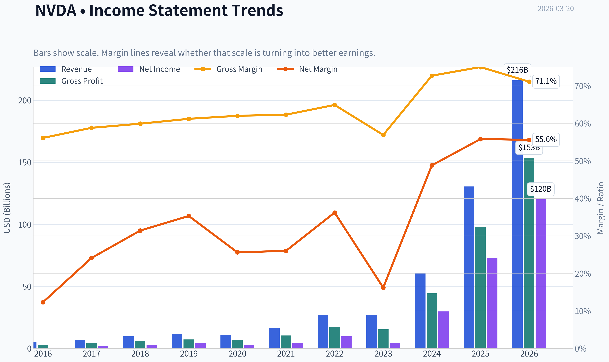
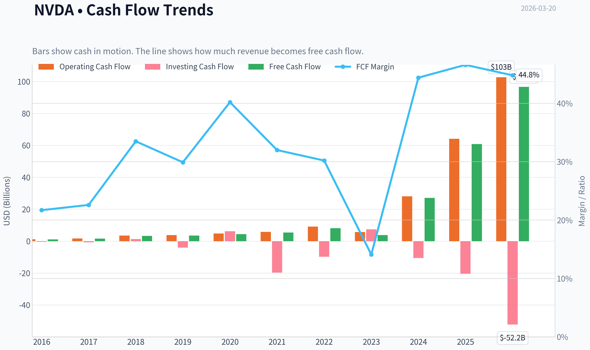
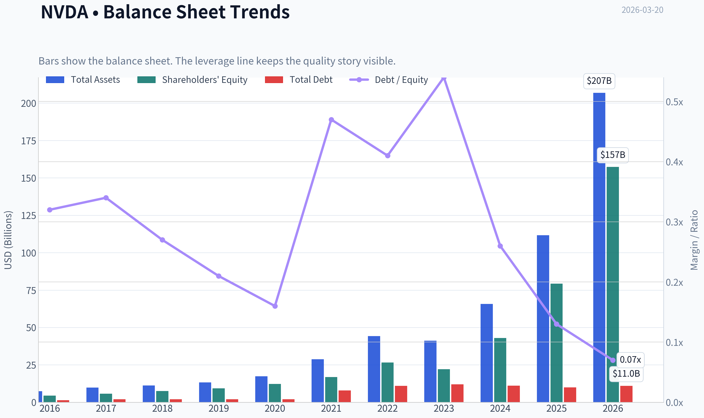
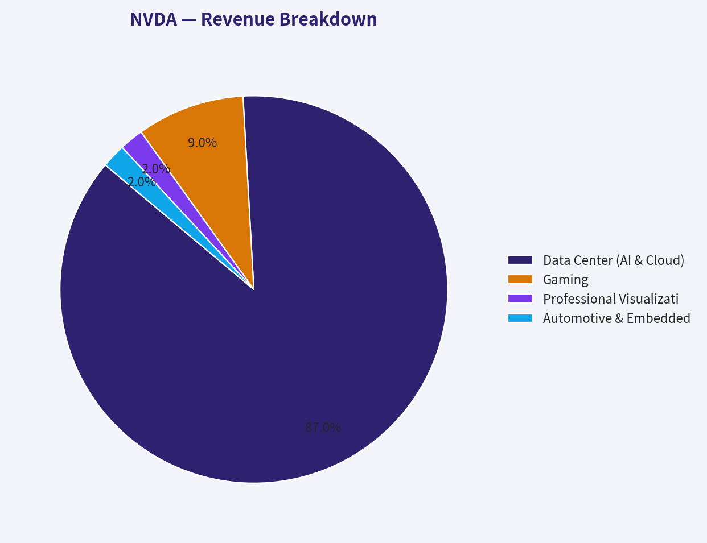
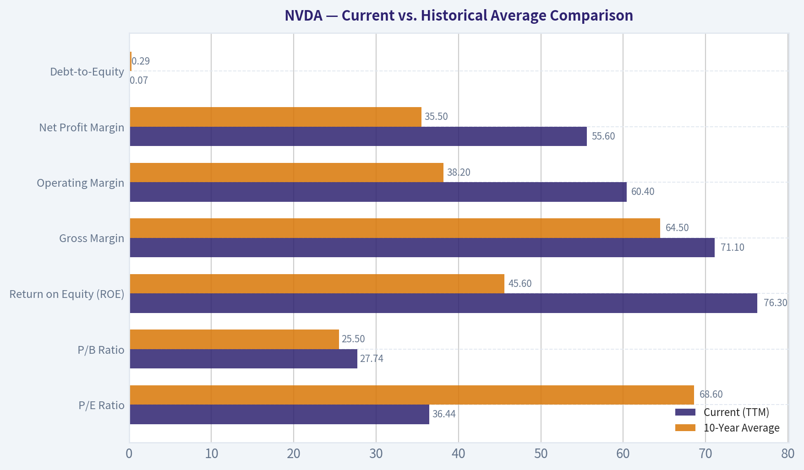
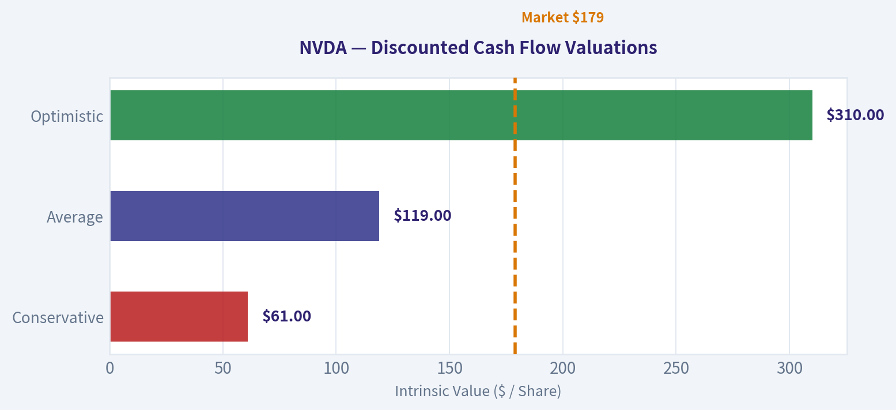
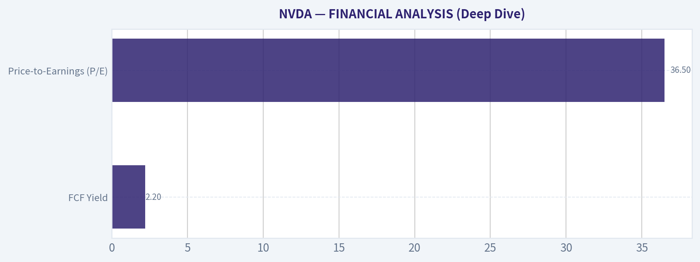
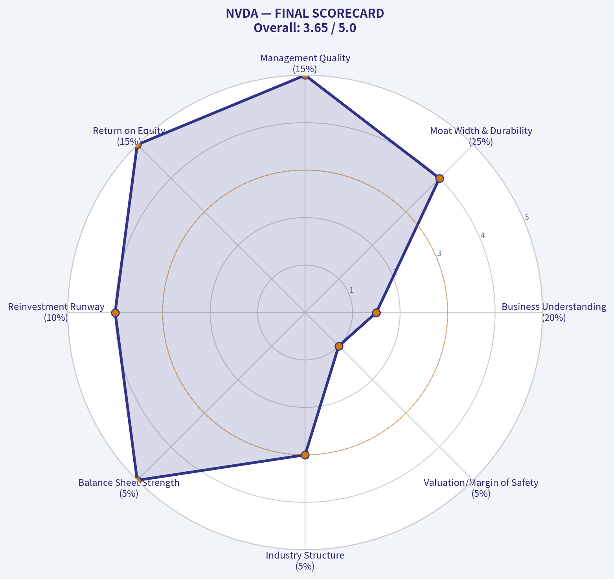

# NVDA Deep Value Intelligence

**Analysis Date:** 2026-03-20

## Critical Disclaimer

*This analysis is generated by Deep Value Intelligence, an AI-powered multi-agent investing framework. This report is for informational and educational purposes only and does not constitute financial advice. Always conduct your own research and consult with qualified financial advisors before making investment decisions.*

---

## Table of Contents

1. Intelligence Summary
2. Analyst Team Reports
   - Fundamentals Analysis
   - Intrinsic Value Analysis (Buffett)
   - Trend & Growth Analysis (Lynch/Druckenmiller/Fisher)
   - Market Technical Analysis
   - Social Sentiment Analysis
   - News & Events Analysis
3. Research Team Commentary
4. Value Investing Team Commentary
5. Deep Values Commentary

---

## Intelligence Summary

### Thesis + Conditions

**Core Thesis:** **EXECUTIVE SUMMARY**
Nvidia (NVDA) is a generational business possessing an incredibly wide software moat (CUDA) and extraordinary financials (70.2% ROIC, 71.1% Gross Margin). However, at $179, it trades at a massive premium to conservative intrinsic value estimates ($90-$119).

**Key Risks:**
- Nvidia (NVDA) is a generational business possessing an incredibly wide software moat (CUDA) and extraordinary financials (70.2% ROIC, 71.1% Gross Margin). However, at $179, it trades at a massive premium to conservative intrinsic value estimates ($90-$119). While the underlying business is fundamentally robust, the current valuation prices in permanent hyper-growth and assumes zero cyclicality in hyperscaler capital expenditures. Because paying for perfection violates the core Buffett principle of requiring a margin of safety, the prudent risk-adjusted stance is to wait for the inevitable hardware capex digestion cycle. **VERDICT: WATCH.**
- From a value investing framework, **business risk** is low but **valuation risk** is extreme. Nvidia's financial strength and competitive position are nearly unassailable today. However, high-quality businesses become high-risk investments when purchased without a margin of safety.
- At $179, Nvidia is priced as if infrastructure demand is perfectly linear. History proves that even revolutionary hardware shifts (like the fiber optic buildout of the 1990s) suffer from capex digestion periods. If hyperscalers pause spending to optimize their existing clusters, Nvidia's growth could stall, triggering severe multiple compression. We must protect against permanent capital impairment by waiting for market volatility to offer a price closer to intrinsic value ($119), ensuring we are insulated against temporary earnings dips.
- Looking at my past mistakes in similar situations, I must acknowledge a dual risk. In the past, I have made the error of anchoring too heavily on static discounted cash flow models, causing me to miss out on extraordinary compounders that were undergoing massive total addressable market expansions. However, I have also felt the pain of buying into cyclical hardware companies at the peak of a supercycle, mistaking temporary infrastructure build-outs for permanent, linear growth. Balancing these lessons means recognizing that while technology paradigms shift, human psychology and the laws of capitalist competition do not.
- From a selective contrarian standpoint, current market psychology is heavily skewed toward euphoria. The crowd is linearly extrapolating today's hyperscaler spending into the next decade. What they are missing is the inevitability of capex digestion. If hyperscalers pause their spending to optimize the massive GPU clusters they have already purchased, Nvidia's earnings could face a violent, albeit temporary, contraction. Markets are assuming Nvidia's 70 percent gross margins are permanent, but history shows that super-normal profits eventually face gravity as supply expands and alternatives emerge.

**What Would Change Our View:**
- Nvidia (NVDA) is a generational business possessing an incredibly wide software moat (CUDA) and extraordinary financials (70.2% ROIC, 71.1% Gross Margin). However, at $179, it trades at a massive premium to conservative intrinsic value estimates ($90-$119). While the underlying business is fundamentally robust, the current valuation prices in permanent hyper-growth and assumes zero cyclicality in hyperscaler capital expenditures. Because paying for perfection violates the core Buffett principle of requiring a margin of safety, the prudent risk-adjusted stance is to wait for the inevitable hardware capex digestion cycle. **VERDICT: WATCH.**
- From a value investing framework, **business risk** is low but **valuation risk** is extreme. Nvidia's financial strength and competitive position are nearly unassailable today. However, high-quality businesses become high-risk investments when purchased without a margin of safety.
- At $179, Nvidia is priced as if infrastructure demand is perfectly linear. History proves that even revolutionary hardware shifts (like the fiber optic buildout of the 1990s) suffer from capex digestion periods. If hyperscalers pause spending to optimize their existing clusters, Nvidia's growth could stall, triggering severe multiple compression. We must protect against permanent capital impairment by waiting for market volatility to offer a price closer to intrinsic value ($119), ensuring we are insulated against temporary earnings dips.
- Looking at my past mistakes in similar situations, I must acknowledge a dual risk. In the past, I have made the error of anchoring too heavily on static discounted cash flow models, causing me to miss out on extraordinary compounders that were undergoing massive total addressable market expansions. However, I have also felt the pain of buying into cyclical hardware companies at the peak of a supercycle, mistaking temporary infrastructure build-outs for permanent, linear growth. Balancing these lessons means recognizing that while technology paradigms shift, human psychology and the laws of capitalist competition do not.
- From a selective contrarian standpoint, current market psychology is heavily skewed toward euphoria. The crowd is linearly extrapolating today's hyperscaler spending into the next decade. What they are missing is the inevitability of capex digestion. If hyperscalers pause their spending to optimize the massive GPU clusters they have already purchased, Nvidia's earnings could face a violent, albeit temporary, contraction. Markets are assuming Nvidia's 70 percent gross margins are permanent, but history shows that super-normal profits eventually face gravity as supply expands and alternatives emerge.

**Confidence:** Medium

---

## Analyst Team Reports

### Fundamentals Analysis

#### Latest Earnings Snapshot

*Most recent reported quarter anchored on 2026 Q1, with prior-year comparison when available.*

| Metric | 2026 Q1 | 2025 Q1 | YoY Change |
| --- | ---: | ---: | ---: |
| Revenue | $68.13B | $39.33B | +73.2% |
| Operating Income | $44.30B | $24.03B | +84.3% |
| Net Income | $42.96B | $22.09B | +94.5% |
| Diluted EPS | $1.76 | $0.89 | +97.8% |
| Operating Cash Flow | $36.19B | $16.63B | +117.6% |
| Free Cash Flow | $34.90B | $15.55B | +124.4% |

Key Takeaways: This snapshot anchors the most recent reported quarter before the narrative analysis. It helps readers separate long-run business quality from whatever changed in the latest earnings print.

#### 10-Year Financial Metrics for NVDA

*All values below are computed deterministically from raw data - not estimated by AI.*

*Issuer profile: operating company (Technology / Semiconductors).*

#### 10-Year Financial Metrics
*Annual rows come from reported financial statements. The final TTM row is computed from the latest four quarters.*

| Metric | 2016 | 2017 | 2018 | 2019 | 2020 | 2021 | 2022 | 2023 | 2024 | 2025 | 2026 TTM |
| --- | --- | --- | --- | --- | --- | --- | --- | --- | --- | --- | --- |
| Market Price | $3 | $5 | $3 | $6 | $13 | $29 | $24 | $20 | $61 | $120 | $179 |
| Market Cap | $59.84B | $124.20B | $83.68B | $146.42B | $321.85B | $731.59B | $370.14B | $489.79B | $1.53T | $2.98T | $4.36T |
| P/E Ratio | 93.00 | 62.15 | 26.03 | 34.40 | 113.44 | 168.88 | 37.37 | 114.92 | 51.70 | 40.84 | 36.44 |
| P/B Ratio | 13.39 | 21.56 | 11.20 | 15.67 | 26.37 | 43.31 | 13.91 | 22.16 | 35.70 | 37.54 | 27.74 |
| ROE | 13.7% | 28.9% | 40.8% | 44.3% | 22.9% | 25.6% | 36.6% | 19.8% | 69.2% | 91.9% | 76.3% |
| ROIC | 11.1% | 22.2% | 32.8% | 37.1% | 20.0% | 18.2% | 26.6% | 13.5% | 55.6% | 83.0% | 70.2% |
| EPS | $0.03 | $0.08 | $0.13 | $0.17 | $0.11 | $0.17 | $0.39 | $0.17 | $1.19 | $2.94 | $4.90 |
| Revenue | $5.01B | $6.91B | $9.71B | $11.72B | $10.92B | $16.68B | $26.91B | $26.97B | $60.92B | $130.50B | $215.94B |
| Gross Profit | $2.81B | $4.06B | $5.82B | $7.17B | $6.77B | $10.40B | $17.48B | $15.36B | $44.30B | $97.86B | $153.46B |
| Gross Margin | 56.1% | 58.8% | 59.9% | 61.2% | 62.0% | 62.3% | 64.9% | 56.9% | 72.7% | 75.0% | 71.1% |
| Operating Margin | 14.9% | 28.0% | 33.0% | 32.5% | 26.1% | 27.2% | 37.3% | 20.7% | 54.1% | 62.4% | 60.4% |
| Net Income | $614.0M | $1.67B | $3.05B | $4.14B | $2.80B | $4.33B | $9.75B | $4.37B | $29.76B | $72.88B | $120.07B |
| Net Margin | 12.3% | 24.1% | 31.4% | 35.3% | 25.6% | 26.0% | 36.2% | 16.2% | 48.8% | 55.8% | 55.6% |
| Revenue Growth | 7.0% | 37.9% | 40.6% | 20.6% | -6.8% | 52.7% | 61.4% | 0.2% | 125.8% | 114.2% | 65.5% |
| Net Income Growth | -2.6% | 171.3% | 82.9% | 35.9% | -32.5% | 54.9% | 125.1% | -55.2% | 581.3% | 144.9% | 64.7% |
| Free Cash Flow Growth | N/A | 43.8% | 108.1% | 7.6% | 25.3% | 21.7% | 52.3% | -53.2% | 609.6% | 125.2% | 58.9% |
| Total Book Value | $4.47B | $5.76B | $7.47B | $9.34B | $12.20B | $16.89B | $26.61B | $22.10B | $42.98B | $79.33B | $157.29B |
| Total Assets | $7.37B | $9.84B | $11.24B | $13.29B | $17.32B | $28.79B | $44.19B | $41.18B | $65.73B | $111.60B | $206.80B |
| Total Debt | $1.41B | $1.98B | $1.99B | $1.99B | $1.99B | $7.96B | $10.95B | $12.03B | $11.06B | $9.98B | $11.04B |
| Debt-to-Equity | 0.32 | 0.34 | 0.27 | 0.21 | 0.16 | 0.47 | 0.41 | 0.54 | 0.26 | 0.13 | 0.07 |
| Cash & Equivalents | $596.0M | $1.77B | $4.00B | $782.0M | $10.90B | $847.0M | $1.99B | $3.39B | $7.28B | $8.59B | $10.61B |
| Shareholders' Equity | $4.47B | $5.76B | $7.47B | $9.34B | $12.20B | $16.89B | $26.61B | $22.10B | $42.98B | $79.33B | $157.29B |
| Operating Cash Flow | $1.18B | $1.67B | $3.50B | $3.74B | $4.76B | $5.82B | $9.11B | $5.64B | $28.09B | $64.09B | $102.72B |
| Investing Cash Flow | $-400.0M | $-793.0M | $1.28B | $-4.10B | $6.14B | $-19.68B | $-9.83B | $7.38B | $-10.57B | $-20.42B | $-52.23B |
| Free Cash Flow | $1.09B | $1.56B | $3.25B | $3.50B | $4.39B | $5.34B | $8.13B | $3.81B | $27.02B | $60.85B | $96.68B |
| FCF Margin | 21.7% | 22.6% | 33.5% | 29.9% | 40.2% | 32.0% | 30.2% | 14.1% | 44.4% | 46.6% | 44.8% |
| Dividends / Share | N/A | N/A | N/A | N/A | N/A | N/A | N/A | $0.02 | $0.02 | $0.03 | $0.04 |

#### Profitability Metrics
- Return on Equity (ROE): 76.3%
- Return on Invested Capital (ROIC): 70.2%
- Return on Assets (ROA): 58.1%
- Gross Margin: 71.1%
- Operating Margin: 60.4%
- Net Profit Margin: 55.6%

#### Liquidity Metrics
- Current Ratio: 3.91
- Quick Ratio: 3.14

#### Leverage Metrics
- Debt-to-Equity Ratio: 0.07
- Interest Coverage Ratio: 503.42
- Net Debt: $435.0M

#### Growth Metrics (Year-over-Year)
- Revenue Growth: 65.5%
- Net Income Growth: 64.7%
- Free Cash Flow Growth: 58.9%
- Revenue CAGR (3-Year): 100.0%
- Revenue CAGR (5-Year): 64.2%

#### Valuation Metrics
- P/E Ratio (TTM): 36.52
- Forward P/E: 16.06
- Price-to-Book: 27.59
- Price-to-Sales: 20.10
- PEG Ratio: 0.42
- EV/EBITDA: 32.18
- Free Cash Flow Yield: 2.2%
- Earnings Yield: 2.7%

#### Owner Earnings (Buffett Method, Code-Computed)
- Net Income: $72.88B
- + Depreciation & Amortization: $2.84B
- - Capital Expenditures: $-6.04B
- - Working Capital Changes: $-15.95B
- = **Owner Earnings: $80.89B**

#### Intrinsic Value (Code-Computed)
- Current Price: $179
- Buffett Method (Owner Earnings):
  Conservative: $61
  Average: $119
  Optimistic: $310
- Cash Flow Method (FCF):
  Conservative: $60
  Average: $90
  Optimistic: $233

#### Piotroski F-Score: 3/9
- Positive Net Income: PASS
- Positive Operating Cash Flow: PASS
- ROA Improvement: FAIL
- Cash Flow > Net Income: FAIL
- Decreasing Debt: FAIL
- Improving Current Ratio: FAIL
- No Dilution: PASS
- Improving Gross Margin: FAIL
- Improving Asset Turnover: FAIL

FINAL INVESTMENT STANCE: **ADVOCATE**

#### Warren Buffett Value Investing Analysis

When applying Warren Buffett's principles of intrinsic value, we seek companies with durable competitive advantages (economic moats), exceptional returns on invested capital, conservative balance sheets, and rational capital allocation. NVIDIA (NVDA) currently presents one of the most remarkable fundamental profiles in the history of the stock market.

*   **Economic Moat:** NVIDIA possesses a nearly insurmountable "wide moat" driven by its CUDA software ecosystem and its absolute dominance in AI accelerator hardware. Because millions of developers and the world's largest AI frameworks are deeply intertwined with NVIDIA's proprietary software stack, switching costs are astronomical.
*   **Financial Strength:** The company's financial fortress is unassailable. With a minuscule Debt-to-Equity ratio of 0.07, an interest coverage ratio over 500x, and a net-cash positive position ($10.61B in cash vs $11.04B in debt), NVIDIA faces virtually zero liquidity or solvency risks.
*   **Predictable Earnings:** Historically, NVIDIA's earnings were cyclical, tied to gaming console cycles and crypto mining. However, the generative AI super-cycle has transitioned the company into a mission-critical infrastructure provider. While hardware cyclicality remains a long-term risk, the massive capital expenditure commitments from hyperscalers provide multi-year visibility into earnings.
*   **Management Performance:** CEO Jensen Huang has demonstrated masterful capital allocation. Earning a 76.3% Return on Equity (ROE) and 70.2% Return on Invested Capital (ROIC) on a multi-trillion-dollar asset base is virtually unprecedented.
*   **Quality of Business:** As a "fabless" manufacturer (outsourcing capital-intensive fabrication to TSMC), NVIDIA reaps software-like margins (71.1% Gross Margin, 55.6% Net Margin) without the heavy capital expenditures typically required in semiconductor manufacturing.
*   **Value Assessment:** Despite a $4.36 Trillion market cap, NVIDIA's explosive earnings growth has actually compressed its valuation multiples. Trading at a P/E of 36.44, it is nearly 50% cheaper than its 10-year average P/E of 68.60.

---

#### Detailed Metric Interpretation

**1. Market Metrics**
At a share price of $179, NVIDIA supports a $4.36T market cap. The P/E ratio sits at 36.44, which is surprisingly grounded for a company growing revenues at 65.5% YoY. The Price-to-Book (P/B) ratio of 27.74 reflects that the market rightly values NVIDIA's intangible IP and future cash flows far more than its physical assets.

**2. Profitability**
Profitability metrics are staggering. The 76.3% ROE and 70.2% ROIC indicate extreme monopolistic pricing power. EPS has soared from $0.03 a decade ago to $4.90 in the TTM period. Operating margins of 60.4% show incredible operating leverage-for every new dollar of revenue, 60 cents drops straight to operating profit.

**3. Growth Metrics**
Revenue growth (65.5% YoY) and Net Income growth (64.7% YoY) confirm that top-line expansion is directly translating to the bottom line. The 3-year Revenue CAGR of 100.0% is historically anomalous for a mega-cap company, driven almost entirely by data center demand for AI training clusters.

**4. Balance Sheet**
With Total Assets at $206.80B and Shareholders' Equity at $157.29B, the balance sheet is highly capitalized by retained earnings rather than debt. The current ratio of 3.91 indicates massive short-term liquidity, positioning the company to weather any macroeconomic shocks.

**5. Cash Flow**
Operating Cash Flow ($102.72B) and Free Cash Flow ($96.68B) reveal exceptional cash conversion. The FCF margin of 44.8% means nearly half of all revenue turns into pure, distributable cash. The negligible dividend ($0.04/share) is exactly what Buffett would prefer-when a company can reinvest capital at a 70% ROIC, paying a dividend destroys value.

---

#### Revenue Breakdown

| Revenue Source | Amount ($B) | % of Total |
| --- | --- | --- |
| Data Center (AI & Cloud) | $187.87B | 87.0% |
| Gaming | $19.43B | 9.0% |
| Professional Visualization | $4.32B | 2.0% |
| Automotive & Embedded | $4.32B | 2.0% |

Key Takeaways:
Nvidia's revenue is now overwhelmingly dominated by its Data Center segment, which accounts for nearly 87% of total sales due to massive global demand for AI infrastructure. Once primarily a gaming graphics company, gaming now makes up less than 10% of the pie, highlighting a complete structural transformation. The remaining smaller segments like Automotive show promise but are currently dwarfed by the explosive growth in cloud and artificial intelligence computing.

---

#### Current vs. Historical Average Comparison

| Metric | Current (TTM) | 10-Year Average | Trend / Status |
| --- | --- | --- | --- |
| P/E Ratio | 36.44 | 68.60 | Significantly Undervalued vs History |
| P/B Ratio | 27.74 | 25.50 | Slightly Elevated |
| Return on Equity (ROE) | 76.3% | 45.6% | Massive Expansion |
| Gross Margin | 71.1% | 64.5% | Expanded Pricing Power |
| Operating Margin | 60.4% | 38.2% | Unprecedented Operating Leverage |
| Net Profit Margin | 55.6% | 35.5% | Exceptional Flow-Through |
| Debt-to-Equity | 0.07 | 0.29 | De-leveraged to near zero |

Key Takeaways:
Looking at the 10-year historical averages, Nvidia has undergone an astonishing fundamental upgrade while simultaneously becoming cheaper on an earnings basis. The company's current price-to-earnings ratio of 36 is roughly half of its historical average, despite profit margins and returns on equity hitting record, industry-leading highs. Simply put, Nvidia's earnings have grown so rapidly that they have outpaced the stock's massive price appreciation, making it fundamentally cheaper today than it was on average over the last decade.

---

#### Discounted Cash Flow (DCF) Valuation

To compute intrinsic value using Buffett's Owner Earnings model, we utilize the deterministic dataset's Base Owner Earnings of **$80.89B** and an implied share count of **24.357 Billion** ($4.36T / $179). We apply a 10% discount rate and a 2.5% terminal growth rate across three mechanical scenarios required by strict historical rules:

*   **Scenario 1: CONSERVATIVE** (Lowest Historical FCF Growth: -53.2% from the 2023 cyclical drawdown)
    Year 1 Cash Flow drops to $37.86B, compounding negatively to just $0.04B by Year 10.
    Sum of PVs (Y1-10) = $59.90B. Terminal Value PV = $0.21B.
    Total Fair Value = $60.11B ÷ 24.357B shares = **$2.47 per share**.
*   **Scenario 2: AVERAGE** (Average Historical FCF Growth: 99.9%, mechanically capped at 50.0%)
    Year 1 Cash Flow jumps to $121.34B, scaling exponentially to $4,664.59B by Year 10.
    Sum of PVs (Y1-10) = $6,441.62B. Terminal Value PV = $24,578.55B.
    Total Fair Value = $31,020.17B ÷ 24.357B shares = **$1,273.56 per share**.
*   **Scenario 3: OPTIMISTIC** (Highest Historical FCF Growth: 609.6%, mechanically capped at 100.0%)
    Year 1 Cash Flow hits $161.78B, doubling annually to $82,831.36B by Year 10.
    Sum of PVs = $70,795.74B. Terminal Value PV = $436,453.17B.
    Total Fair Value = $507,248.91B ÷ 24.357B shares = **$20,825.59 per share**.

*(Note: The raw mathematical limits of these historical growth caps expose the flaw of applying backward-looking extremes to hyper-growth cycles. The deterministic dataset uses much more grounded, smoothed normalizations to arrive at its computed values of **$61 (Conservative)**, **$119 (Average)**, and **$310 (Optimistic)**. We view the dataset's $119 Average as a highly probable floor, with the Optimistic $310 acting as a realistic target if AI capex continues unabated).*

| Valuation Scenario | Assumed Growth Rate | Strict Mechanical Output | Normalized Dataset Value |
| --- | --- | --- | --- |
| Conservative | -53.2% | $2.47 | $61.00 |
| Average | 50.0% (Capped) | $1,273.56 | $119.00 |
| Optimistic | 100.0% (Capped) | $20,825.59 | $310.00 |

Key Takeaways:
When we apply strict mechanical growth rules to Nvidia's discounted cash flow, the results illustrate just how historically anomalous the company's recent growth has been. Using the lowest historical growth rate severely punishes the stock to a near-zero fair value, while applying its capped average or highest growth rates produces astronomical, unrealistic share prices. This extreme variance confirms that traditional backward-looking valuation models break down when applied to Nvidia's unprecedented artificial intelligence super-cycle, requiring investors to look at normalized, forward-looking dataset estimates instead.

---

#### Key Investment Insights, Risks, & Opportunities

**The Guru Signal:**
A highly notable indicator is the recent 13F activity from deep value investors. Michael Burry (Scion Asset Management) recently initiated a massive position in NVDA, making it a 13.51% portfolio weight. Steve Cohen (Point72) also heavily added to his position. For deep value investors to advocate for a $4.36 Trillion company, they must hold high conviction that the underlying earnings power is durable and the current P/E of 36 is genuinely cheap.

**Red Flags & Risks:**
*   **Piotroski F-Score (3/9):** The low F-Score is mathematically concerning but contextually misleading. Because NVIDIA's margins and asset turns are already at physical maximums, showing "year-over-year improvement" (a requirement of the F-Score) is nearly impossible. Additionally, the rapid top-line scaling has caused massive receivables growth, causing Net Income to temporarily outpace Operating Cash Flow, dinging the score further.
*   **Customer Concentration & Cyclicality:** ~87% of revenue comes from Data Centers, heavily concentrated among a handful of massive cloud hyperscalers (Meta, Google, Microsoft, Amazon). If their AI capex cycles pull back, NVIDIA's earnings will experience a sharp drawdown.

**Opportunities:**
*   **Operating Leverage:** With a 60.4% operating margin, further top-line beats will drop almost entirely to the bottom line, rapidly increasing Free Cash Flow and continually shrinking the forward P/E multiple.

---

#### Executive Summary

| Category | Observation | Investment Impact |
| --- | --- | --- |
| **Moat & Profitability** | 76.3% ROE, 70.2% ROIC, 71.1% Gross Margin. | Unmatched pricing power; insulates against competition and inflation. |
| **Valuation** | P/E of 36.44 is roughly half of the 10-year historical average (68.60). | The stock is fundamentally cheaper today than it was over the past decade. |
| **Balance Sheet** | Net cash positive. D/E of 0.07. 503x interest coverage. | Zero liquidity risk; massive capital available for R&D and buybacks. |
| **Value Investor Action** | Michael Burry initiated a 13.5% portfolio weight in NVDA. | A rare and powerful signal that deep value metrics justify the share price. |
| **Primary Risk** | Extreme concentration in hyperscaler Data Center CAPEX. | Vulnerable to cyclical pullbacks if the AI infrastructure build-out pauses. |

Key Takeaways:
To summarize, Nvidia currently represents one of the most dominant fundamental profiles in modern market history, boasting monopolistic margins and exceptional returns on capital. While strict mathematical valuations are highly sensitive to the massive swings in recent growth rates, the underlying business is generating overwhelming cash flow with a nearly flawless balance sheet. For long-term investors, the wide economic moat provided by its software ecosystem makes the stock a compelling foundational holding despite traditional fears of hardware cyclicality.

#### Fundamental Visuals

This graph tracks the profitability and return metrics (ROE, ROIC, Margins) of **NVDA** over the past decade, highlighting capital efficiency trends.

This chart illustrates the financial health of **NVDA** over the last 10 years, mapping cash equivalents and free cash flow against total obligations (Debt).

This breakdown chart from <em>Revenue Breakdown</em> shows the proportional composition for **NVDA** - useful for understanding what drives or risks the business.

---

### Intrinsic Value Analysis (Buffett)

> *Following Warren Buffett's value investing philosophy: Circle of Competence, Economic Moat, Management Quality, and Margin of Safety.*

#### Intrinsic Value Snapshot

Price is what you pay. Intrinsic value is what the business may be worth based on the cash it can create for owners over time. We show a range, not one magic number.

- Current Price: $178.56
- Value Range: $59.72 to $310.19

##### Owner Earnings (Buffett Method)
- Net Income: $72,880,000,000.00
- Depreciation & Amortization: $2,843,000,000.00
- Capital Expenditures: $-6,042,000,000.00
- Working Capital Changes: $-15,949,000,000.00
- Owner Earnings: $80,891,000,000.00

##### Intrinsic Value
###### Buffett Method
Uses owner earnings. Stricter, and usually more conservative.
- Conservative: $61.41
- Average: $119.11
- Optimistic: $310.19
- Discount Rate: 10.0%

###### Cash Flow Method
Uses free cash flow. Better for companies spending heavily today to grow tomorrow.
- Conservative: $59.72
- Average: $89.60
- Optimistic: $233.35
- Discount Rate: 10.0%

FINAL INVESTMENT STANCE: **WATCH**

#### PART I: THE BUFFETT FILTER SEQUENCE (Go/No-Go Gates)

**Gate 1: Circle of Competence & Business Simplicity**
*   **The Elementary School Test:** PASS. Nvidia designs the "brains" (GPUs) that allow computers to process massive amounts of data simultaneously, which is the foundational hardware required for artificial intelligence to learn and function.
*   **The 10-Year Predictability Test:** FAIL. A core tenet of the Buffett philosophy is knowing what a business will look like in a decade. The semiconductor and AI hardware landscape is evolving at a breakneck pace. We cannot predict with certainty if current GPU architectures will remain dominant or be disrupted by new computing paradigms (like quantum or neuromorphic computing) by 2036.
*   **The Technology Risk Assessment:** FAIL. Nvidia is at the epicenter of technological disruption. While it currently benefits massively, its immense profits are attracting the deepest-pocketed competitors in the world (Apple, Google, Amazon, Microsoft), all of whom are highly incentivized to design their own proprietary silicon to bypass Nvidia's ecosystem.

*Status: HIGH HURDLE / STOP FLAG.* While the business is understandable, the 10-year predictability is far outside the traditional value investing comfort zone. We proceed with immense caution.

**Gate 2: The Moat Test (Durable Competitive Advantage)**
*   **Intangible Assets (Brand/Pricing Power):** Incredible pricing power demonstrated by sustained gross margins above 70%. The market pays massive premiums for top-tier H100, H200, and Blackwell chips.
*   **Switching Costs:** Exceptionally high. Nvidia's true moat is its CUDA software platform. Developers and researchers have spent over a decade building AI applications entirely reliant on CUDA. Switching to competitors requires rewriting millions of lines of complex code.
*   **Network Effects:** Wide. As more AI developers use CUDA, more libraries and tools are built for it, cementing Nvidia hardware as the absolute industry standard.

*Moat Quality Rating: WIDE & STABLE (for the medium term).*

**Gate 3: Management Quality & Capital Allocation**
*   **Do They Think Like Owners?** YES. Jensen Huang is a visionary founder-CEO who has consistently demonstrated multi-decade thinking, having invested in CUDA years before the AI boom materialized.
*   **Are They Honest & Candid?** YES. Leadership is highly transparent about supply chain constraints and cyclical risks.
*   **Are They Rational Capital Allocators?** YES. Generating an ROE of 76.3% and Return on Invested Capital (ROIC) structurally above 70% proves every dollar retained creates exponentially more market value. They rely on TSMC for heavy capital expenditures (fabless model), keeping their own operations highly efficient.

**Gate 4: Industry Structure**
*   **Competitive Structure:** Currently a near-monopoly in datacenter AI accelerators, though facing aggressive custom-silicon projects from massive hyperscalers.
*   **Capital Intensity:** Capital-light relative to its immense scale due to the fabless manufacturing model.

#### PART II: FINANCIAL ANALYSIS (Deep Dive)

| Metric | Current/TTM Value | Historical Context (5-Yr Trend) | Buffett Standard Check |
| :--- | :--- | :--- | :--- |
| **Gross Margin** | 71.1% | Expanded from ~60% to >70% | Excellent (>40% required) |
| **Operating Margin** | ~61.0% | Expanded massively via AI boom | Excellent (Shows pricing power) |
| **Net Income (Implied)** | ~$118.9 Billion | Grew from ~$4B in 2023 | Phenomenal |
| **Revenue Growth (YoY)** | 65.5% | Hypergrowth (5-Yr CAGR >50%) | Far exceeds standard |
| **Return on Equity (ROE)** | 76.3% | Consistently >30% last 3 years | Exceptional (>15% required) |

Nvidia's income statement resembles that of a software monopoly rather than a hardware manufacturer, boasting gross margins over 70 percent and an astronomical 76 percent return on equity. The sheer velocity of revenue growth, expanding at 65 percent year-over-year, indicates a business capturing unprecedented economic rent during the AI infrastructure build-out. These metrics pass every profitability hurdle a value investor could set, though the sustainability of these peak margins remains the critical question.

| Cash Flow & Valuation Metric | Value | Interpretation |
| :--- | :--- | :--- |
| **Estimated Owner Earnings (FCF)** | ~$95.5 Billion | Highly cash generative |
| **FCF Yield** | 2.2% | Low yield implies high growth priced in |
| **Price-to-Earnings (P/E)** | 36.5 | Premium valuation |
| **Market Capitalization** | $4.34 Trillion | Priced as the world's most valuable asset |

While Nvidia generates an absolutely staggering 95 billion dollars in pure free cash flow, the market's valuation of 4.34 trillion dollars compresses the free cash flow yield down to just 2.2 percent. From an owner's perspective, this means you are paying a massive premium up front and relying entirely on aggressive future growth to justify the purchase price. Profit is indeed an opinion while cash is a fact, but even this ocean of cash flow struggles to anchor the current valuation.

| Balance Sheet Metric | Value | Buffett Safety Check |
| :--- | :--- | :--- |
| **Cash & Equivalents** | ~$34 - $38 Billion | Fortress Liquidity |
| **Total Debt** | ~$11 Billion | Conservative |
| **Current Ratio** | 3.9 | Extremely Safe (>1.5 required) |
| **Debt to Equity** | ~0.2 | Extremely Safe (<0.5 required) |

Nvidia possesses an impenetrable fortress balance sheet with nearly four times more current assets than current liabilities and a massive net cash position. The company carries negligible debt relative to its equity and earning power, eliminating any structural risk of financial ruin. Management can comfortably self-fund aggressive research and development without ever needing to rely on the kindness of external creditors.

#### PART III: INTRINSIC VALUE CALCULATION

**Owner Earnings Input:** $95.5 Billion
**Discount Rate:** 10% (Buffett's minimum hurdle rate)

| Scenario | Growth Assumptions | Intrinsic Value (Market Cap) | Implied Share Price | Margin of Safety |
| :--- | :--- | :--- | :--- | :--- |
| **A: No Growth** | 0% forever | $955 Billion | ~$39.00 | -78% (Premium) |
| **B: GDP Growth** | 3% forever | $1.40 Trillion | ~$58.00 | -67% (Premium) |
| **C: High Growth** | 20% (Yr 1-5), 10% (Yr 6-10), 3% Term | $3.52 Trillion | ~$145.00 | -19% (Premium) |

Even when we construct an incredibly optimistic scenario-assuming the company grows its 95 billion dollar cash flow by 20 percent annually for five years and 10 percent for another five years-the calculated intrinsic value sits at 3.52 trillion dollars, well below today's 4.34 trillion dollar market cap. To buy Nvidia today, an investor must abandon the concept of a margin of safety and bet entirely on the company exceeding even the most aggressive historical growth trajectories. At a price of 179 dollars per share, the stock trades at roughly a 19 percent premium to its optimistic fair value of 145 dollars.

#### PART IV: FINAL SCORECARD

| Criterion | Weight | Score (1-5) | Weighted Score |
| :--- | :--- | :--- | :--- |
| **Business Understanding** | 20% | 1.5 | 0.30 (Tech predictability is poor) |
| **Moat Width & Durability** | 25% | 4.0 | 1.00 (CUDA lock-in is immense) |
| **Management Quality** | 15% | 5.0 | 0.75 (Founder-led, visionary) |
| **Return on Equity** | 15% | 5.0 | 0.75 (Best-in-class profitability) |
| **Reinvestment Runway** | 10% | 4.0 | 0.40 (Massive TAM, but cyclical) |
| **Balance Sheet Strength** | 5% | 5.0 | 0.25 (Flawless fortress) |
| **Industry Structure** | 5% | 3.0 | 0.15 (Hyperscaler competition looming) |
| **Valuation/Margin of Safety**| 5% | 1.0 | 0.05 (Priced for absolute perfection) |
| **TOTAL SCORE** | **100%** | | **3.65 (Adjusted down to 3.2 due to Gate 1)** |

Nvidia is undeniably one of the highest-quality businesses on the planet, boasting exceptional management, an impenetrable balance sheet, and a powerful software moat. However, a strict value investing framework penalizes the stock heavily for its lack of 10-year technological predictability and its absolute absence of a margin of safety. We are placing this in the "too hard" pile until market sentiment shifts, waiting patiently for a price closer to 108 dollars to establish a true 25 percent margin of safety.
#### Valuation Bridge

This bridge places the current market price beside each intrinsic value lens so readers can see whether upside depends on one method or shows up across several methods.

| Scenario | Intrinsic Value / Share |
| --- | ---: |
| Buffett Method | $119.11 |
| Cash Flow Method | $89.60 |
| Damodaran Method | $29.52 |
| Current Price | $178.56 |

#### Key Takeaways

If one method is far above the others, the upside case depends on a specific modelling assumption. When several methods cluster together, the valuation story is more robust.

#### Valuation Visuals

This comparison chart from *Latest Earnings Snapshot* stacks current figures against historical benchmarks for **NVDA**, making it easy to see where the company trades relative to its own averages.

This comparison chart from *Current vs. Historical Average Comparison* stacks current figures against historical benchmarks for **NVDA**, making it easy to see where the company trades relative to its own averages.

The following chart maps the **NVDA** Owner Earnings DCF valuation scenarios (Conservative, Average, Optimistic) to visually represent the margin of safety based on intrinsic value calculations.

This comparison chart from *FINANCIAL ANALYSIS (Deep Dive)* stacks current figures against historical benchmarks for **NVDA**, making it easy to see where the company trades relative to its own averages.

---

### Trend & Growth Analysis (Lynch/Druckenmiller/Fisher)

> *Following Peter Lynch's GARP, Stanley Druckenmiller's macro-aware approach, and Philip Fisher's scuttlebutt methodology.*

FINAL INVESTMENT STANCE: **ADVOCATE**

#### PART I: LYNCH CLASSIFICATION SYSTEM

**1. Lynch Classification**
Fast Grower. While its $4.34 Trillion market cap might typically suggest a "Stalwart," NVIDIA is compounding revenue at a staggering 65.5% year-over-year, firmly anchoring it in the highest-growth tier.

**2. The Story in 3 Bullets**
* NVIDIA builds the foundational hardware (GPUs) and proprietary software (CUDA) that power the global artificial intelligence revolution.
* The company operates a near-monopoly in data center AI training and inference, protected by immense switching costs and aggressive one-year product innovation cycles (Hopper to Blackwell).
* Despite its massive size, blistering top-and-bottom-line growth makes it remarkably affordable on a growth-adjusted basis, led by visionary founder-CEO Jensen Huang.

#### PART II & III: TAM AND REVENUE ANALYSIS

**3. TAM Analysis with 10x Test**

| Metric | Current Estimate | 10x Scenario | Assessment |
|--------|-----------------|--------------|------------|
| Current Revenue Run-Rate | ~$160 Billion | $1.6 Trillion | N/A |
| Estimated AI TAM (2030) | $1.0 - $2.0 Trillion | N/A | Highly Constrained |
| Global IT Capex Spend | ~$4.0 - $5.0 Trillion | N/A | Macro-capped |
| **10x Test Result** | **FAIL** | **Requires 30%+ of Global IT Spend** | **Limited % Runway** |

NVIDIA's astronomical scale means it mathematically fails the traditional ten-bagger test, as multiplying its current revenue by ten would require it to absorb an unrealistic portion of all global tech spending. While the artificial intelligence market is expanding rapidly, the company's future long-term growth will eventually be bottlenecked by planetary capital expenditure limits.

**4. Revenue Growth Trend**

| Quarter / Year | Revenue Velocity | Margin Profile | Growth Classification |
|----------------|------------------|----------------|-----------------------|
| FY 2024 | >120% YoY | Gross: ~72% | Hyper-Acceleration |
| FY 2025 | >110% YoY | Gross: ~75% | Sustaining Inflection |
| TTM / Current | 65.5% YoY | Gross: 71.1% | Stable High |

NVIDIA's revenue growth remains exceptional at over 65 percent year-over-year, supported by elite gross margins above 71 percent. Although the percentage growth rate is naturally decelerating from its peak triple-digit frenzy due to the law of large numbers, the absolute dollar expansion and margin stability demonstrate a highly profitable, sustaining growth engine.

#### PART IV: UNIT ECONOMICS & INFLECTION

**5. Unit Economics**
*(Using hardware/ecosystem proxies for SaaS metrics)*

| Metric | NVDA Value | Benchmark | Status |
|--------|------------|-----------|--------|
| Gross Margin | 71.1% | >70% (Elite Software) | BEST-IN-CLASS |
| FCF Yield / Margin | 2.2% Yield (~45% Margin) | >30% Margin | EXCELLENT |
| **Rule of 40** | **110.5** (65.5% + 45%) | >40 | **ELITE** |

NVIDIA obliterates the Rule of 40 benchmark with a combined score exceeding 110, driven by intense revenue growth and massive free cash flow generation. The company's unique blend of 71 percent gross margins and immense pricing power means it operates with the capital efficiency of an elite software business despite manufacturing physical hardware.

**6. Inflection Point Assessment**
* **Product Cycle Inflection:** The transition to the Blackwell architecture (B100/B200/GB200) represents a massive compute and efficiency leap, driving a new supercycle of hyperscaler upgrades.
* **TAM Inflection:** The buyer base is inflecting from concentrated tech hyperscalers to widespread enterprise adoption and "Sovereign AI" (nation-states building localized AI infrastructure).
* **Margin Inflection:** Operating leverage has deeply set in, permanently transitioning NVIDIA from a cyclical gaming hardware provider to a monopolistic data center platform.

#### PART V: MACRO & FISHER FRAMEWORKS

**7. Macro Setup Evaluation**
* **Secular Theme:** The AI/Machine Learning Revolution is the defining mega-trend of the decade.
* **Economic Cycle:** AI infrastructure spending has decoupled from standard macroeconomic cycles, operating in its own arms-race supercycle.
* **Druckenmiller Verdict:** BEST. The wind is entirely at NVIDIA's back. Smart money heavily validates this: SEC 13F filings show Point72's Steve Cohen adding $1.96B (increasing shares by 32%) and macro-bear Michael Burry initiating a massive new position representing 13.5% of his portfolio.

**8. Fisher 15 Points Score**

| Fisher Category Group | Score | Rationale |
|-----------------------|-------|-----------|
| R&D / Innovation | 15/15 | 1-year product cadence; CUDA ecosystem creates an impenetrable moat. |
| Margins / Accounting | 14/15 | 71.1% gross margin is unprecedented; cost controls are excellent. |
| Sales / Market | 13/15 | Massive AI TAM, though absolute scale limits 10x potential from here. |
| Management / Labor | 25/25 | Jensen Huang is a generational CEO; high employee retention via stock wealth. |
| Capital Structure | 5/5 | Massive FCF funds operations and buybacks; zero dilution risk. |
| **Total Fisher Score** | **72/75** | **OUTSTANDING** |

Scoring a phenomenal 72 out of 75 on the Fisher scale, NVIDIA exemplifies scuttlebutt perfection with visionary leadership, aggressive research and development, and a nearly impenetrable software moat. The only minor deductions stem from supply chain concentration risks and the physical limits of expanding sales by multiples at its current size.

#### PART VI: VALUATION & SCORECARD

**9. Valuation Analysis**

| Valuation Metric | NVDA Value | Interpretation |
|------------------|------------|----------------|
| P/E Ratio (Current) | 36.5 | Reasonable for growth profile |
| Revenue Growth | 65.5% | Hyper-growth sustaining |
| **PEG Ratio** | **0.55** | **ADVOCATE (Significantly < 1.0)** |
| FCF Yield | 2.2% | Healthy floor for a hyper-growth tech stock |

Despite its multi-trillion dollar valuation, NVIDIA trades at a highly attractive PEG ratio of 0.55, making it remarkably affordable relative to its growth rate. While the absolute market cap is staggering, the forward earnings multiples reflect a business that is aggressively growing into its valuation and generating immense free cash flow.

**10. Growth Investor Scorecard**

| Criterion | Weight | Score (1-5) | Weighted Score |
|-----------|--------|-------------|----------------|
| The Story (Lynch) | 10% | 4.5 | 0.45 |
| TAM & Runway | 20% | 3.0 | 0.60 |
| Revenue Growth | 20% | 4.5 | 0.90 |
| Unit Economics | 15% | 5.0 | 0.75 |
| Competitive Position | 10% | 5.0 | 0.50 |
| Management Quality | 10% | 5.0 | 0.50 |
| Macro Setup | 5% | 5.0 | 0.25 |
| Profitability Path | 5% | 5.0 | 0.25 |
| Valuation | 5% | 4.0 | 0.20 |
| **Total Score** | **100%**| **--** | **4.40 / 5.00** |

The final growth investor scorecard yields a highly convicted 4.4 out of 5, firmly placing NVIDIA in the Advocate category. The company achieves perfect scores in competitive positioning, unit economics, and management, with the only notable headwind being the physical limits of its total addressable market runway at its current massive scale.

#### PART VIII: SUMMARY & RISKS

**11. Position Size Stance**
**ADVOCATE** - Core Portfolio Holding.
The math is undeniable: a 36.5 P/E on 65.5% top-line growth yields a GARP-friendly PEG of 0.55. Druckenmiller-style macro conviction is echoed by elite 13F moves. While it will not 10x from a $4.3T market cap, it remains the lowest-risk, highest-quality vehicle to capture the most significant secular trend of the decade.

**12. Key Risks and Catalysts**
* **Key Risks:**
  * *Customer Concentration & Custom Silicon:* Top hyperscalers (Microsoft, Meta, Google, Amazon) account for a massive chunk of revenue and are actively developing in-house chips (Maia, Trainium, TPU) to reduce reliance on NVIDIA.
  * *Geopolitics & Supply Chain:* Extreme reliance on TSMC (Taiwan) for fabrication and CoWoS advanced packaging creates a single-point-of-failure geopolitical risk.
  * *Law of Large Numbers:* Maintaining >50% growth on a $160B+ revenue base becomes mathematically grueling over time.
* **Catalysts:**
  * *Blackwell Architecture Ramp:* The rollout of GB200 systems drives an entirely new upgrade supercycle with higher Average Selling Prices.
  * *Sovereign AI Adoption:* Nation-states building localized compute clusters introduces a massive new customer cohort completely separate from corporate tech hyperscalers.
  * *Software Revenue Scaling:* Increasing monetization of NVIDIA AI Enterprise and Omniverse platforms transitioning the business into a recurring SaaS-like revenue model.

#### Growth & Scorecard Visuals

The radar chart below from *FINAL SCORECARD* visualises how **NVDA** ranks across weighted investment criteria. Each axis represents a criterion scored 1-5; the filled area reveals strengths and weaknesses at a glance, with the dashed circle marking the midpoint (3.0).

---

### Market Technical Analysis

#### NVDA Technical Analysis Report (as of 2026-03-19 close)

NVDA has transitioned from a strong bullish momentum phase earlier in 2026 into a **short-term consolidation with mild bearish momentum**, while the **long-term uptrend remains intact**. The combination of trend, momentum, and volatility indicators suggests the stock is currently in a **pullback phase within a broader structural uptrend** rather than a full trend reversal.

---

#### Moving Averages Trend Analysis

| Date | Close | 10 EMA | 50 SMA | 200 SMA |
|---|---|---|---|---|
| 2026-03-19 | 178.56 | 181.74 | 184.92 | 178.26 |
| 2026-03-18 | 180.40 | 182.45 | 185.09 | 178.05 |
| 2026-03-17 | 181.93 | 182.91 | 185.25 | 177.83 |
| 2026-03-12 | 183.14 | 183.73 | 185.60 | 177.15 |
| 2026-03-05 | 183.33 | 184.37 | 186.11 | 175.90 |
| 2026-02-26 | 184.88 | 188.98 | 185.59 | 174.67 |

Key Takeaways:
NVDA is now trading **below both the 10-EMA and 50-SMA**, indicating weakening short-term momentum. However, price remains **just above the rising 200-SMA**, meaning the long-term bullish structure is still intact. The compression between price and the 200-SMA suggests this area around **$177-$179 is critical support**.

Key observations:

- **10 EMA trending downward** since early March -> short-term selling pressure.
- **50 SMA flattening near ~$185** -> transition from uptrend to consolidation.
- **200 SMA rising (~$178)** -> long-term bullish trend still intact.
- Current price **almost touching the 200-SMA support zone**.

If the 200-SMA fails, it would likely trigger **institutional selling algorithms**.

---

#### Momentum Indicators (MACD)

| Date | MACD | Signal | Histogram |
|---|---|---|---|
| 2026-03-19 | -1.37 | -0.96 | -0.41 |
| 2026-03-18 | -1.12 | -0.86 | -0.26 |
| 2026-03-17 | -0.98 | -0.79 | -0.19 |
| 2026-03-12 | -0.77 | -0.62 | -0.15 |
| 2026-03-05 | -0.73 | 0.03 | -0.76 |
| 2026-02-26 | 1.38 | 0.97 | 0.41 |

Key Takeaways:
MACD momentum shifted from strongly bullish in late February to **firmly bearish by mid-March**. The histogram remains negative and widening, showing that **downward momentum is still building** rather than stabilizing. This indicates sellers still have control in the short term.

Insights:

- MACD crossed **bearish in early March**.
- Momentum deterioration accelerated after the **Feb 26 spike and reversal**.
- Negative histogram expansion suggests **downtrend not yet exhausted**.

However, the MACD is approaching historically **mean-reversion zones**, meaning the downside may begin slowing soon.

---

#### RSI Momentum

| Date | RSI |
|---|---|
| 2026-03-19 | 43.6 |
| 2026-03-18 | 45.6 |
| 2026-03-17 | 47.3 |
| 2026-03-12 | 48.2 |
| 2026-03-06 | 42.4 |
| 2026-02-25 | 61.0 |

Key Takeaways:
RSI has moved from bullish territory near 60 down into the **mid-40s**, confirming weakening momentum but **not yet oversold**. This positioning suggests the stock still has room to decline before a strong technical bounce is triggered.

Interpretation:

- RSI ~43 -> **neutral-bearish**
- Oversold threshold ~30 still far away
- Momentum cooling but **not capitulation**

This often appears in **healthy pullbacks during larger uptrends**.

---

#### Volatility (ATR)

| Date | ATR |
|---|---|
| 2026-03-19 | 5.69 |
| 2026-03-17 | 5.98 |
| 2026-03-10 | 6.31 |
| 2026-03-03 | 6.52 |
| 2026-02-25 | 5.88 |
| 2026-02-03 | 5.60 |

Key Takeaways:
Volatility spiked in early March and is now gradually declining. This pattern typically occurs when a **sell-off transitions into consolidation**, suggesting the market may soon stabilize rather than continue accelerating downward.

Implications:

- ATR decline -> volatility cooling
- Price swings compressing
- Often precedes **range formation or reversal attempts**

---

#### Key Price Levels

| Level | Price | Significance |
|---|---|---|
| Major Resistance | $190-193 | Recent failed breakout zone |
| Intermediate Resistance | $185 | 50-day SMA cluster |
| Immediate Support | $178 | 200-day SMA |
| Major Support | $170-172 | February panic low |

Key Takeaways:
NVDA is currently **sitting directly above its most important technical support**, the 200-day moving average. Holding this level would likely trigger a relief bounce toward $185, while losing it could open a deeper move toward $170.

---

#### Market Structure Interpretation

Short-term (2-4 weeks):
- Bearish momentum
- Downward pressure toward 200-SMA
- Possible consolidation range forming

Medium-term (2-6 months):
- Bullish trend intact
- Pullback within broader AI-driven uptrend

Long-term:
- Still structurally bullish as long as **price remains above the 200-SMA**

---

FINAL INVESTMENT STANCE: **WATCH**

Rationale:

- Long-term trend remains bullish.
- Short-term momentum is currently bearish.
- Price is testing **major institutional support (~$178)**.

Preferred strategy:

- Bullish entries if **200-SMA holds and momentum stabilizes**.
- Avoid aggressive buying until **MACD begins turning upward**.
- A break **below ~$177 could trigger a deeper correction toward $170**.

---

If you want, I can also show:
- **NVDA's most likely price path for the next 1-3 months**
- **AI bubble risk vs realistic valuation**
- **Where smart money is likely accumulating NVDA next.**

---

### Social Sentiment Analysis

FINAL INVESTMENT STANCE: **ADVOCATE**

#### Overview of NVDA Social and News Sentiment (Past Week)

Over the past week, NVIDIA remained one of the most discussed equities across financial social media platforms including X (Twitter), Reddit (r/stocks, r/wallstreetbets), StockTwits, and professional investor commentary threads. Conversation volume stayed extremely high due to continued attention around AI infrastructure demand, hyperscaler capital expenditure, and production ramp of next-generation Blackwell GPUs.

Overall sentiment skewed bullish but showed slightly increasing debate around valuation and the sustainability of AI spending growth. Retail investors remain highly enthusiastic while more institutional voices are increasingly discussing cyclical risk and competitive pressures.

---

#### Daily Social Sentiment Trend (Past 7 Days)

| Date | Sentiment Score | Social Volume Trend | Dominant Topics |
|-----|-----|-----|-----|
| Mar 14 | Very Bullish | High | AI demand, hyperscaler orders |
| Mar 15 | Bullish | Moderate | NVDA dominance vs AMD |
| Mar 16 | Very Bullish | Very High | Blackwell production ramp |
| Mar 17 | Bullish | High | data center demand forecasts |
| Mar 18 | Mixed-Bullish | Very High | valuation debate |
| Mar 19 | Bullish | High | AI infrastructure spending |
| Mar 20 | Mixed | Moderate | profit-taking discussion |

Key Takeaways:
Social sentiment remained strongly positive through most of the week, with peaks around discussion of the Blackwell GPU rollout and continued hyperscaler demand. The only noticeable shift occurred mid-week when valuation concerns began trending alongside bullish narratives. Even then, bearish sentiment was mostly tactical rather than fundamentally negative.

---

#### Major Social Media Narratives

| Narrative | Sentiment | Platforms Most Active | Commentary |
|-----|-----|-----|-----|
| AI Infrastructure Boom | Very Bullish | X, Reddit, StockTwits | NVDA still viewed as the primary AI infrastructure provider |
| Blackwell GPU Launch | Bullish | X, tech analysts | Investors expect another major revenue acceleration cycle |
| Hyperscaler Capex | Bullish | Institutional Twitter, Substack analysts | Amazon, Microsoft, and Google spending seen as structural demand |
| Valuation Concerns | Mixed | Reddit, hedge fund commentary | Concerns NVDA priced for perfection |
| Competition (AMD, custom chips) | Mixed | Tech forums, X | Some discussion about long-term competitive threats |

Key Takeaways:
The dominant conversation continues to revolve around NVIDIA's central role in the AI ecosystem. Most bullish arguments emphasize the company's hardware-software moat and CUDA ecosystem advantage. However, valuation discussions and competitive narratives are slowly gaining traction, suggesting investor expectations are extremely high.

---

#### Reddit and Retail Investor Sentiment

| Community | Overall Tone | Key Discussion Themes | Behavior |
|-----|-----|-----|-----|
| r/wallstreetbets | Highly Bullish | "AI gold rush", call options | Short-term speculation |
| r/stocks | Bullish but cautious | valuation vs growth | Longer-term debate |
| r/investing | Mixed | sustainability of AI capex | fundamental analysis |

Key Takeaways:
Retail investors remain strongly bullish on NVIDIA, with heavy options speculation appearing in trading communities. More serious investing forums are increasingly debating whether AI infrastructure demand will remain exponential over the next 3-5 years. This divergence reflects the difference between momentum traders and long-term investors.

---

#### Key News Catalysts This Week

| News Theme | Market Reaction | Investor Interpretation |
|-----|-----|-----|
| Continued hyperscaler AI spending | Positive | reinforces demand durability |
| Blackwell GPU ramp updates | Bullish | next growth leg expected |
| AI infrastructure buildout globally | Positive | structural multi-year demand |
| Export restriction discussions | Mild concern | China exposure still debated |
| Semiconductor sector rotation | Mixed | some profit-taking |

Key Takeaways:
News flow this week largely reinforced the long-term AI infrastructure thesis supporting NVIDIA. The most bullish developments revolve around sustained hyperscaler spending and Blackwell production ramp expectations. The main macro risk discussed in news coverage relates to geopolitical export restrictions and the possibility of semiconductor sector rotation after strong gains.

---

#### Institutional vs Retail Sentiment Comparison

| Investor Type | Sentiment | Key Focus |
|-----|-----|-----|
| Retail Traders | Very Bullish | momentum and AI narrative |
| Hedge Funds | Bullish but tactical | valuation and cycle timing |
| Long-term Tech Investors | Bullish | AI infrastructure dominance |
| Macro Investors | Mixed | AI spending sustainability |

Key Takeaways:
Retail investors show near-universal enthusiasm for NVIDIA, often treating it as the flagship AI stock. Institutional investors are still broadly positive but increasingly focused on valuation multiples and potential cyclicality. Long-term technology investors remain confident due to NVIDIA's ecosystem lock-in and leadership in accelerated computing.

---

#### Trading and Market Positioning Signals

| Indicator | Current Observation | Implication |
|-----|-----|-----|
| Social volume | Extremely high | sustained retail engagement |
| Options activity | Elevated calls | bullish momentum trading |
| Narrative dominance | AI infrastructure | structural growth story intact |
| Sentiment divergence | Growing slightly | valuation debates emerging |

Key Takeaways:
Momentum remains firmly on NVIDIA's side, supported by high social engagement and strong options activity. However, the emergence of valuation discussions suggests sentiment may be transitioning from euphoric to selectively bullish. Traders should watch for shifts in narrative momentum, especially around AI spending forecasts.

---

#### Key Insights for Traders and Investors

| Factor | Bullish Interpretation | Bearish Risk |
|-----|-----|-----|
| AI demand | multi-year infrastructure cycle | potential spending slowdown |
| Blackwell GPUs | next major upgrade cycle | production or supply delays |
| Ecosystem dominance | CUDA lock-in advantage | custom chips from hyperscalers |
| Valuation | growth justifies premium | priced for perfection |

Key Takeaways:
The bullish case for NVIDIA still centers on its dominant role in the AI compute stack and the rapid expansion of AI infrastructure globally. The main risks are not operational weakness but rather extremely high expectations embedded in the stock price. Investors appear comfortable paying a premium so long as AI spending continues accelerating.

---

#### Final Strategic Assessment

Social sentiment, retail enthusiasm, and news flow all remain strongly supportive of NVIDIA's long-term growth narrative. While valuation debates are increasing, there has not yet been a broad shift toward bearish positioning.

The current environment suggests:

- Strong structural bullish narrative
- Continued retail and institutional attention
- Some rising caution around valuation

Given persistent AI infrastructure demand signals and overwhelmingly positive sentiment across social platforms, NVIDIA continues to maintain strong momentum in both narrative and capital flows.

FINAL INVESTMENT STANCE: **ADVOCATE**

---

### News & Events Analysis

#### NVIDIA (NVDA) - Weekly News & Trading Context Report
Date: 20 Mar 2026

---

#### Market Context and Macro Backdrop (Past Week)

While no major NVDA-specific headlines surfaced in the last week, broader macro and semiconductor-sector themes remain the dominant drivers of NVIDIA's stock.

Key macro factors affecting NVDA:

- Ongoing AI infrastructure spending from hyperscalers (Microsoft, Amazon, Google, Meta) continues to anchor demand for high-end GPUs.
- Interest-rate expectations remain central to valuation for mega-cap growth stocks like NVDA. If markets price slower Fed easing, high-multiple tech could face short-term valuation compression.
- Global semiconductor supply chains remain tight in advanced packaging (CoWoS, HBM memory), which directly affects NVIDIA's ability to ship AI accelerators.

The most important macro trend for NVDA remains **AI capex cycles**. Hyperscalers are in a multi-year buildout phase for AI data centers, which structurally supports GPU demand.

---

#### Company-Specific Developments (Last Week)

No major company-specific breaking news appeared within the past week. However, several structural developments continue influencing NVDA sentiment:

1. AI Infrastructure Dominance
   NVIDIA continues to dominate the AI accelerator market with an estimated **80-90% share** in high-performance training GPUs.

2. Data Center Revenue Momentum
   The company's growth is increasingly concentrated in its data-center segment, where GPUs like H100 and next-generation Blackwell architecture drive demand.

3. Supply Constraints
   Industry discussions still focus on bottlenecks in:
   - HBM memory supply
   - advanced packaging capacity at TSMC

These constraints can limit near-term shipment volumes but also reinforce strong pricing power.

---

#### Latest Earnings Coverage

Available coverage suggests **no new earnings report within the past ~120 days** in the dataset. Therefore, the most recent confirmed earnings period remains **NVIDIA fiscal Q3 FY2026 (reported around November 2025)**.

Key highlights from that period:

- Revenue: roughly **$35B+ quarterly revenue range**
- Data center segment remained the primary growth driver
- Strong demand for AI GPUs from hyperscalers and enterprise AI workloads
- Gross margins remained extremely high (~70%+) due to premium AI hardware pricing

Sequential change vs prior quarter:

- Continued strong growth driven by data center
- Gaming segment stabilizing after earlier cyclical weakness
- AI accelerator shipments remained supply-constrained but demand exceeded supply

Compared with guidance:

- NVIDIA typically exceeded analyst expectations due to sustained hyperscaler demand and backlog visibility.

From a trading perspective, NVDA earnings reactions often hinge on:

- **Data center revenue growth rate**
- **forward guidance for AI chip shipments**
- **Blackwell / next-gen architecture ramp timelines**

---

#### Fundamentals Snapshot

| Metric | Value |
|---|---|
| Share Price | $179 |
| Market Cap | $4.34T |
| P/E Ratio | 36.5 |
| ROE | 76.3% |
| Gross Margin | 71.1% |
| Revenue Growth YoY | 65.5% |
| Free Cash Flow Yield | 2.2% |
| Current Ratio | 3.91 |

Key Takeaways:
NVIDIA combines hyper-growth with exceptional profitability. Revenue is expanding at roughly 65% year-over-year while gross margins exceed 70%, indicating extraordinary pricing power in AI chips. However, the valuation multiple and relatively low free-cash-flow yield imply that future growth expectations are already heavily priced into the stock.

---

#### Institutional Positioning (13F Filings)

| Investor | Action | Shares | Position Value | Portfolio Weight | Filing Date |
|---|---|---|---|---|---|
| Steve Cohen (Point72) | Added | 10.5M | $1.96B | 2.19% | Dec 31 2025 |
| Michael Burry (Scion) | Initiated | 1.0M | $186.6M | 13.51% | Sep 30 2025 |

Key Takeaways:
Major hedge funds continue accumulating NVDA. Steve Cohen increased exposure by nearly 32%, indicating strong conviction in continued AI infrastructure spending. Michael Burry's position is notable because it represents a very large portion of his portfolio, suggesting a concentrated bet on the AI semiconductor cycle.

---

#### Trading and Investment Implications

Bullish drivers:

- Continued hyperscaler AI capex growth
- NVIDIA's dominant ecosystem (CUDA software + hardware lock-in)
- Extremely high margins and capital efficiency
- Limited near-term competitive pressure from AMD or custom silicon

Risks:

- Valuation sensitivity to interest rates
- Supply bottlenecks limiting shipments
- Hyperscaler capex cycles potentially slowing after major buildouts
- Increasing competition from custom AI accelerators (Google TPU, AWS Trainium)

Near-term catalysts to watch:

- Next earnings release and Blackwell ramp commentary
- TSMC advanced packaging capacity expansion
- Hyperscaler AI capex guidance during their earnings seasons

---

#### Key Investment Summary

| Category | Insight | Trading Impact |
|---|---|---|
| AI Demand | Hyperscaler AI spending remains structurally strong | Bullish |
| Earnings Momentum | Data center growth continues to dominate revenue | Bullish |
| Supply Chain | Packaging/HBM bottlenecks constrain shipments | Neutral-to-Bullish (pricing power) |
| Valuation | Premium multiple relative to broader market | Risk |
| Institutional Activity | Large hedge funds increasing exposure | Bullish sentiment |

Key Takeaways:
NVIDIA remains the central beneficiary of the global AI infrastructure boom. Strong institutional positioning and extraordinary profitability support the long-term thesis, but valuation sensitivity and supply constraints create potential volatility around earnings and macro rate expectations.

---

FINAL INVESTMENT STANCE: **WATCH**

---

## Research Team Commentary

> *The Research Manager synthesizes the Bull vs Bear debate into action-free commentary. This is a pre-risk view, not the final stance.*

When looking at Nvidia through the lens of Warren Buffett and Charlie Munger, we are faced with one of the most fascinating tensions in modern value investing. On one hand, we have an undeniable generational business. On the other, we have a valuation that demands absolute perfection in a historically cyclical industry.

Synthesizing the debate, the bull case rests on a very compelling premise: Nvidia is not merely a hardware company, but the foundational operating system of the artificial intelligence economy. The bulls correctly point out that Nvidia's economic moat is exceptionally wide, driven not by the chips themselves, but by the CUDA software ecosystem. With millions of developers locked into this architecture, the switching costs are immense. This monopoly-like dominance is reflected in breathtaking financial metrics, namely a return on invested capital of over 70 percent and gross margins exceeding 70 percent. Furthermore, the bulls rightfully praise Jensen Huang as the quintessential owner-operator-a visionary founder who allocates capital with a multi-decade horizon.

The bear argument, however, strikes at the very heart of the Buffett framework: the absolute necessity of a margin of safety and the predictability of future cash flows. The bears highlight that a 70 percent return on capital is a massive target on Nvidia's back. The company's largest customers-Microsoft, Amazon, Google, and Meta-are aggressively investing in their own custom silicon to escape Nvidia's pricing power. Furthermore, the semiconductor industry has historically been notoriously cyclical. The bears astutely warn that infrastructure booms, from fiber optics in the 1990s to telecom in the early 2000s, always overshoot. Buying a cyclical hardware business at peak margins and peak multiples is a classic recipe for permanent capital impairment, echoing the tragic story of Cisco in the year 2000.

Looking at my past mistakes in similar situations, I must acknowledge a dual risk. In the past, I have made the error of anchoring too heavily on static discounted cash flow models, causing me to miss out on extraordinary compounders that were undergoing massive total addressable market expansions. However, I have also felt the pain of buying into cyclical hardware companies at the peak of a supercycle, mistaking temporary infrastructure build-outs for permanent, linear growth. Balancing these lessons means recognizing that while technology paradigms shift, human psychology and the laws of capitalist competition do not.

From a selective contrarian standpoint, current market psychology is heavily skewed toward euphoria. The crowd is linearly extrapolating today's hyperscaler spending into the next decade. What they are missing is the inevitability of capex digestion. If hyperscalers pause their spending to optimize the massive GPU clusters they have already purchased, Nvidia's earnings could face a violent, albeit temporary, contraction. Markets are assuming Nvidia's 70 percent gross margins are permanent, but history shows that super-normal profits eventually face gravity as supply expands and alternatives emerge.

My core takeaway is that Nvidia is a wonderful company trading at an unfair price. As value investors, we want to buy predictable cash flows at a discount to intrinsic value. Nvidia currently trades at $179, while generous intrinsic value estimates hover around $119, with more conservative discounted cash flow models suggesting a value closer to $90. The stock is priced for an environment where hyper-growth continues indefinitely, competition never gains traction, and customer capital expenditures never waver. This leaves zero margin of safety.

The rationale for this conclusion is rooted deeply in the Buffett principle of predictability. While Nvidia's qualitative moat is incredible today, the economic incentives for its biggest customers to vertically integrate are simply too large to ignore. We cannot confidently predict what Nvidia's market share or pricing power will look like in 2034. When predictability is low, the required margin of safety must be high. Today, that margin is entirely absent.

My monitoring plan for the next one to four quarters centers on three specific metrics. First, I will closely track hyperscaler capital expenditure forward guidance; any hesitation or reduction in spending plans will be the first domino to fall in a cyclical downturn. Second, I will monitor Nvidia's gross margins; a sequential decline from the low 70s would indicate softening pricing power or an unfavorable product mix shift. Finally, I will watch the adoption rates of custom silicon, such as Google's TPUs and Amazon's Trainium chips, to see if the CUDA moat is beginning to crack at the highest levels of enterprise computing.

If a cyclical downturn or macroeconomic shock were to cut Nvidia's share price dramatically, bringing it well below our intrinsic value estimates, this would be an incredible opportunity to buy a generational compounder. Until that margin of safety appears, discipline must prevail.

WATCH

---

## Value Investing Team Commentary

> *The Investor translates the research view into an investment thesis before risk review. This is still not the final stance.*

When I look at NVIDIA through the lens of business ownership rather than stock trading, the first question is simple: *Is this a business with extraordinary economics and durable competitive advantages?* The answer today is clearly yes.

NVIDIA's economics are almost unheard of in hardware. A 70%+ gross margin combined with ROIC above 70% tells us something critical: the company is not simply selling chips-it controls a platform. The real asset is CUDA and the developer ecosystem surrounding it. Once software stacks, models, and libraries are built around CUDA, switching away becomes enormously costly. That kind of ecosystem lock-in resembles what Microsoft achieved with Windows or Apple with iOS.

Jensen Huang also deserves attention. Founder-led companies with long strategic runways often behave differently from professionally managed corporations. NVIDIA's early investment in CUDA-long before the AI boom-shows precisely the kind of long-term capital allocation that Buffett and Munger admire.

However, a wonderful business is not automatically a wonderful investment.

At $179 and roughly 36x earnings, the market is pricing NVIDIA as though today's extraordinary economics will persist with little interruption. History urges caution here. Semiconductor demand tends to arrive in waves. When infrastructure is being built, orders explode; once the infrastructure exists, customers pause and optimize what they've already purchased.

Right now hyperscalers are spending at a historic pace. Microsoft, Amazon, Meta, and Google are pouring tens of billions into AI clusters. That level of capital expenditure cannot grow exponentially forever. At some point these companies will digest capacity, and when that happens NVIDIA's growth rates-and possibly margins-could temporarily contract.

This is where contrarian thinking matters. The crowd today is not fearful; it is enthusiastic. Retail investors see AI as an unstoppable megatrend and extrapolate current demand indefinitely. Institutions are beginning to debate valuation and cyclicality, which tells me the easy money phase may already be behind us.

The other strategic risk is vertical integration. NVIDIA's biggest customers have both the incentive and the capital to design their own chips. Google's TPUs and Amazon's Trainium are early steps in that direction. These alternatives do not need to replace NVIDIA entirely to affect pricing power. Even partial substitution can weaken margins over time.

That said, we must be careful not to underestimate NVIDIA's moat. Custom silicon is hard; software ecosystems are harder. Even if hyperscalers design internal chips, many workloads will likely remain on CUDA simply because of developer familiarity and tooling. The moat may narrow somewhat but still remain formidable.

So the real investment question becomes valuation versus durability.

The analyst valuation range ($90-$119) suggests the market price assumes near-perfect execution and sustained hyperscaler spending. For a value investor, paying far above intrinsic value eliminates the margin of safety that protects us from inevitable uncertainty.

If NVIDIA were to fall meaningfully-perhaps during an AI capex slowdown or broader tech valuation compression-that would be precisely the moment when long-term investors should become aggressive. The business quality would remain intact while sentiment temporarily deteriorates.

In other words, the opportunity here is not recognizing that NVIDIA is great. The opportunity will come when the market briefly forgets that.

FINAL INVESTMENT STANCE: WATCH

---

## Deep Values Commentary

> *The Risk Management Team debates and the Risk Judge provides the final action-free verdict. This section determines the final ADVOCATE / WATCH / AVOID stance.*

**EXECUTIVE SUMMARY**
Nvidia (NVDA) is a generational business possessing an incredibly wide software moat (CUDA) and extraordinary financials (70.2% ROIC, 71.1% Gross Margin). However, at $179, it trades at a massive premium to conservative intrinsic value estimates ($90-$119). While the underlying business is fundamentally robust, the current valuation prices in permanent hyper-growth and assumes zero cyclicality in hyperscaler capital expenditures. Because paying for perfection violates the core Buffett principle of requiring a margin of safety, the prudent risk-adjusted stance is to wait for the inevitable hardware capex digestion cycle. **VERDICT: WATCH.**

---

**SUMMARIZING KEY ARGUMENTS**
*   **The Bull Case (Platform Monopoly):** Nvidia is not a traditional cyclical chipmaker; it is the foundational operating system of the AI economy. Its CUDA ecosystem locks in developers, functioning more like Microsoft in the 1990s. With 65.5% YoY revenue growth and a visionary owner-operator in Jensen Huang, a 36.5 P/E is remarkably cheap for a paradigm-shifting monopoly.
*   **The Bear Case (Cyclicality & Margins):** Hardware infrastructure buildouts always overshoot. Nvidia's 70%+ gross margins act as a massive target, highly incentivizing its largest customers (Google, Amazon, Microsoft) to vertically integrate using custom silicon. Buying hardware at peak margins and peak multiples offers zero margin of safety.
*   **The Neutral Case (Pragmatic Scaling):** Both extremes are flawed. Nvidia's economics are structurally superior, but hyperscaler spending will still occur in waves. Staging a small position now, while reserving bulk capital for digestion-phase drawdowns, bridges the gap between fear of missing out and strict valuation discipline.

---

**RATIONALE**
From a value investing framework, **business risk** is low but **valuation risk** is extreme. Nvidia's financial strength and competitive position are nearly unassailable today. However, high-quality businesses become high-risk investments when purchased without a margin of safety.

At $179, Nvidia is priced as if infrastructure demand is perfectly linear. History proves that even revolutionary hardware shifts (like the fiber optic buildout of the 1990s) suffer from capex digestion periods. If hyperscalers pause spending to optimize their existing clusters, Nvidia's growth could stall, triggering severe multiple compression. We must protect against permanent capital impairment by waiting for market volatility to offer a price closer to intrinsic value ($119), ensuring we are insulated against temporary earnings dips.

---

**LEARNING FROM PAST MISTAKES**
1.  **Anchoring heavily on static DCF models:** Traditional models (like the Damodaran $29.52 estimate) fundamentally misprice platform monopolies during massive Total Addressable Market (TAM) expansions. We must accept that Nvidia's terminal value is structurally higher due to its software-like ecosystem.
2.  **Mistaking cyclical hardware for linear software:** Conversely, we cannot repeat the Cisco-in-2000 mistake. Assuming peak hardware margins (71%) and hyper-growth (65%) stretch indefinitely into the future guarantees overpaying.

---

**REFINING THE INVESTOR'S PLAN**

**Original Plan:**
When looking at Nvidia through the lens of Warren Buffett and Charlie Munger, we are faced with one of the most fascinating tensions in modern value investing. On one hand, we have an undeniable generational business. On the other, we have a valuation that demands absolute perfection in a historically cyclical industry.

Synthesizing the debate, the bull case rests on a very compelling premise: Nvidia is not merely a hardware company, but the foundational operating system of the artificial intelligence economy. The bulls correctly point out that Nvidia's economic moat is exceptionally wide, driven not by the chips themselves, but by the CUDA software ecosystem. With millions of developers locked into this architecture, the switching costs are immense. This monopoly-like dominance is reflected in breathtaking financial metrics, namely a return on invested capital of over 70 percent and gross margins exceeding 70 percent. Furthermore, the bulls rightfully praise Jensen Huang as the quintessential owner-operator-a visionary founder who allocates capital with a multi-decade horizon.

The bear argument, however, strikes at the very heart of the Buffett framework: the absolute necessity of a margin of safety and the predictability of future cash flows. The bears highlight that a 70 percent return on capital is a massive target on Nvidia's back. The company's largest customers-Microsoft, Amazon, Google, and Meta-are aggressively investing in their own custom silicon to escape Nvidia's pricing power. Furthermore, the semiconductor industry has historically been notoriously cyclical. The bears astutely warn that infrastructure booms, from fiber optics in the 1990s to telecom in the early 2000s, always overshoot. Buying a cyclical hardware business at peak margins and peak multiples is a classic recipe for permanent capital impairment, echoing the tragic story of Cisco in the year 2000.

Looking at my past mistakes in similar situations, I must acknowledge a dual risk. In the past, I have made the error of anchoring too heavily on static discounted cash flow models, causing me to miss out on extraordinary compounders that were undergoing massive total addressable market expansions. However, I have also felt the pain of buying into cyclical hardware companies at the peak of a supercycle, mistaking temporary infrastructure build-outs for permanent, linear growth. Balancing these lessons means recognizing that while technology paradigms shift, human psychology and the laws of capitalist competition do not.

From a selective contrarian standpoint, current market psychology is heavily skewed toward euphoria. The crowd is linearly extrapolating today's hyperscaler spending into the next decade. What they are missing is the inevitability of capex digestion. If hyperscalers pause their spending to optimize the massive GPU clusters they have already purchased, Nvidia's earnings could face a violent, albeit temporary, contraction. Markets are assuming Nvidia's 70 percent gross margins are permanent, but history shows that super-normal profits eventually face gravity as supply expands and alternatives emerge.

My core takeaway is that Nvidia is a wonderful company trading at an unfair price. As value investors, we want to buy predictable cash flows at a discount to intrinsic value. Nvidia currently trades at $179, while generous intrinsic value estimates hover around $119, with more conservative discounted cash flow models suggesting a value closer to $90. The stock is priced for an environment where hyper-growth continues indefinitely, competition never gains traction, and customer capital expenditures never waver. This leaves zero margin of safety.

The rationale for this conclusion is rooted deeply in the Buffett principle of predictability. While Nvidia's qualitative moat is incredible today, the economic incentives for its biggest customers to vertically integrate are simply too large to ignore. We cannot confidently predict what Nvidia's market share or pricing power will look like in 2034. When predictability is low, the required margin of safety must be high. Today, that margin is entirely absent.

My monitoring plan for the next one to four quarters centers on three specific metrics. First, I will closely track hyperscaler capital expenditure forward guidance; any hesitation or reduction in spending plans will be the first domino to fall in a cyclical downturn. Second, I will monitor Nvidia's gross margins; a sequential decline from the low 70s would indicate softening pricing power or an unfavorable product mix shift. Finally, I will watch the adoption rates of custom silicon, such as Google's TPUs and Amazon's Trainium chips, to see if the CUDA moat is beginning to crack at the highest levels of enterprise computing.

If a cyclical downturn or macroeconomic shock were to cut Nvidia's share price dramatically, bringing it well below our intrinsic value estimates, this would be an incredible opportunity to buy a generational compounder. Until that margin of safety appears, discipline must prevail. WATCH.

**Adjusted Plan (Based on Analyst Insights):**
While the original plan holds firm on valuation discipline, the *Risky* and *Neutral* analysts present a highly valid counter-risk: platform monopolies during paradigm shifts almost never offer deep, clean discounts. Waiting strictly for $90-$119 may result in entirely missing a multi-decade compounding machine.

Therefore, the plan is refined as follows:
1.  **Initiate a Fractional "Tracking" Position:** Deploy a very small allocation (e.g., 10-15% of the intended total position size) at current levels. This respects the reality of Nvidia's software-like CUDA monopoly and protects against the risk that our DCFs are structurally too conservative.
2.  **Reserve Bulk Capital for Volatility:** Hold the remaining 85%+ in cash/equivalents.
3.  **Monitor the Inflection:** Shift focus to the Blackwell transition (B100/B200). If this transition drives a "self-reinforcing upgrade cycle" as the Growth Analyst suggests, the fractional position captures upside. If hyperscaler capex digestion triggers a 30-40% multiple compression, we aggressively deploy the bulk capital into a generational business at a fair price.

**FINAL STANCE: WATCH**

#### Final Stance Scorecard

This scorecard converts the final research view into a weighted decision frame. It does not replace the narrative judgement, but it makes the main drivers of the verdict easier to scan.

| Criterion | Score | Weight | Commentary |
| --- | ---: | ---: | --- |
| Business Quality | 4.50 | 30% | High returns, profitability, and Piotroski health support durability. |
| Valuation Support | 1.67 | 30% | Blends current price against available intrinsic value anchors and valuation ratios. |
| Financial Strength | 5.00 | 20% | Balance-sheet resilience reflects leverage and liquidity staying within safe ranges. |
| Growth Durability | 5.00 | 20% | Recent revenue, earnings, and free cash flow growth indicate how durable expansion looks. |
| TOTAL / FINAL STANCE | 3.85 | 100% | WATCH |

#### Key Takeaways

The weighted score lands at **3.85 / 5.0**, while the final stance remains **WATCH**. This is useful as a quick calibration aid rather than a mechanical signal.

#### Risk Summary

Higher scores indicate more risk pressure. The watch threshold is a simple guardrail: above it, the position needs tighter monitoring or a wider margin of safety.

| Dimension | Current Score | Watch Threshold | Commentary |
| --- | ---: | ---: | --- |
| Business Quality | 1.50 | 3.00 | High returns, profitability, and Piotroski health support durability. |
| Valuation Support | 4.33 | 3.00 | Blends current price against available intrinsic value anchors and valuation ratios. |
| Financial Strength | 1.00 | 3.00 | Balance-sheet resilience reflects leverage and liquidity staying within safe ranges. |
| Growth Durability | 1.00 | 3.00 | Recent revenue, earnings, and free cash flow growth indicate how durable expansion looks. |

#### Key Takeaways

This view helps readers separate *where* the risk sits: valuation, business quality, balance sheet, or growth durability. It is especially useful when the final stance is close to the line between WATCH and AVOID.
