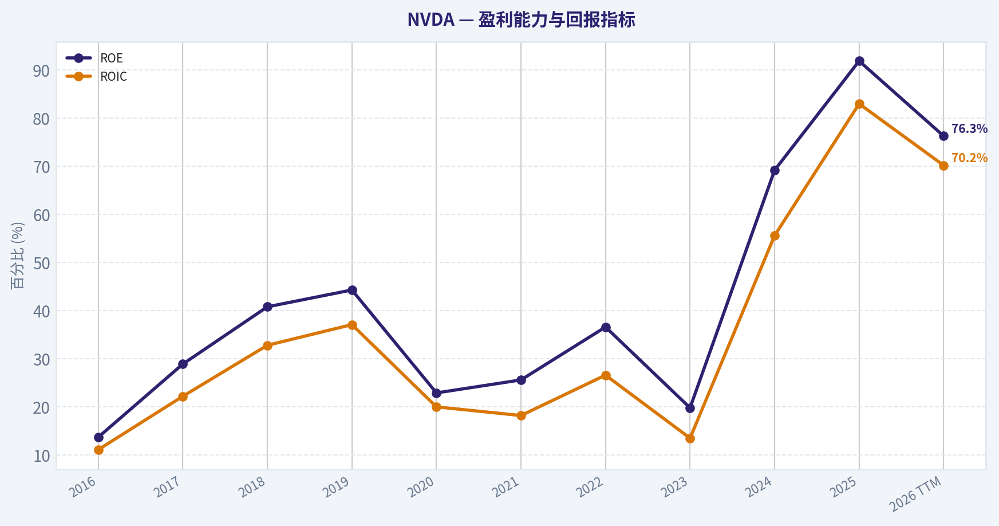
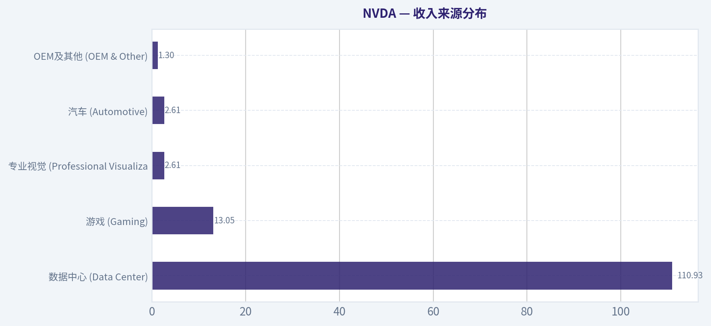
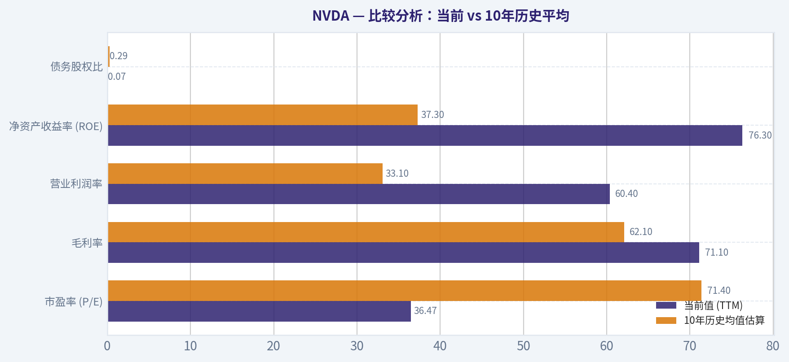
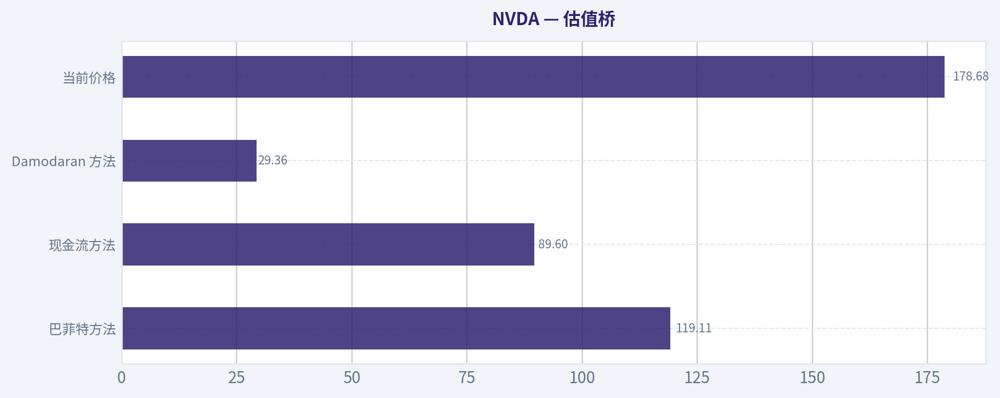
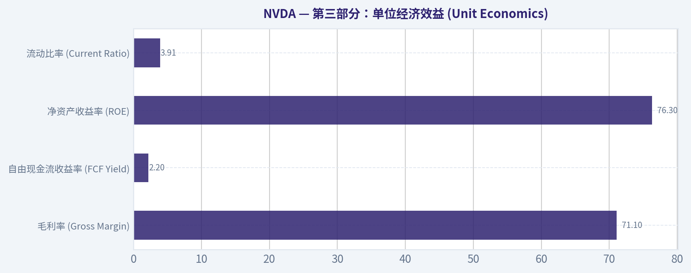
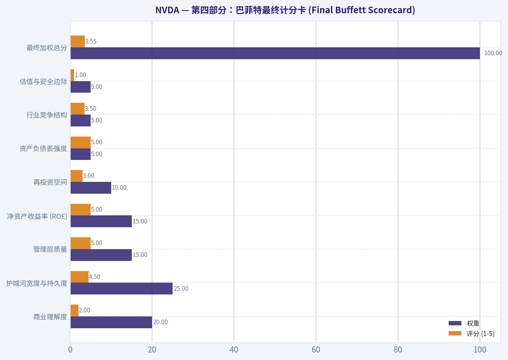
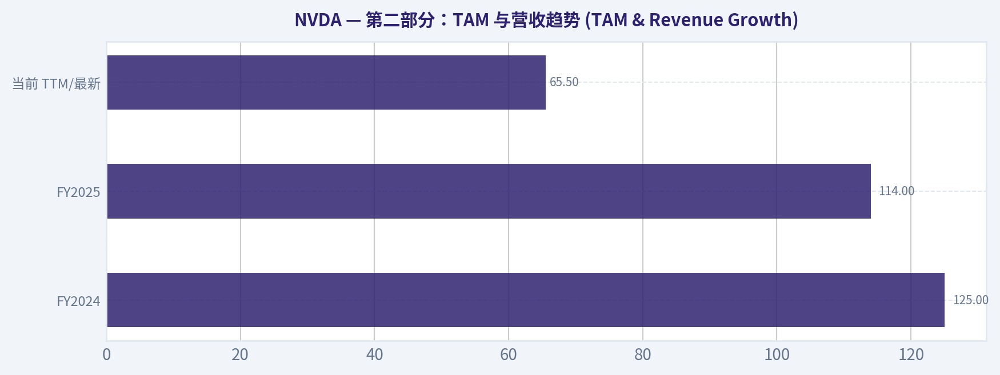

# NVDA 深度价值情报

**调研日期:** 2026-03-25

## 关键免责声明

*本报告由 Deep Value Intelligence（一个基于 AI 的多智能体投资分析框架）自动生成。 本报告仅供信息参考和教育目的，不构成任何财务或投资建议。 在做出任何投资决策之前，请务必进行独立调研并咨询合规的财务顾问。*

---

## 目录

1. 情报摘要
2. 分析师团队报告
   - 基本面分析
   - 价值分析 (巴菲特)
   - 成长性分析 (林奇/德鲁肯米勒/费雪)
   - 市场分析
   - 社会舆情分析
   - 新闻分析
3. 研究团队评论
4. 投资团队评论
5. Deep Values 团队洞察

---

## 情报摘要

### 核心观点与前提条件

**核心论点:** 作为一名秉持沃伦·巴菲特价值投资理念的投资组合经理，听完多空双方及中立分析师的精彩辩论，以下是我为长期投资者提炼的最终风险评估。在我们的体系里，投资的本质不是判断一项技术是否会改变世界，而是判断**一家公司的自由现金流在未来十年是否高度可预测，并且当前出价是否具备足够的安全边际**。

**主要风险:**
- 多方 (Risky/Growth) - "错过平台革命是最大风险"**：英伟达不是单纯的芯片股，而是类似早期Windows/iOS的"算力操作系统"。在AI需求多极化（主权AI、企业级应用）的指数级爆发下，传统的DCF模型严重低估了其长期的复利斜率。当前的36倍PE在超级周期早期并不贵。
- ### 最终立场标签：WATCH (保持观望)

**观点反转条件:**
- 多方 (Risky/Growth) - "错过平台革命是最大风险"**：英伟达不是单纯的芯片股，而是类似早期Windows/iOS的"算力操作系统"。在AI需求多极化（主权AI、企业级应用）的指数级爆发下，传统的DCF模型严重低估了其长期的复利斜率。当前的36倍PE在超级周期早期并不贵。
- ### 最终立场标签：WATCH (保持观望)

**置信度:** 中

---

## 分析师团队报告

### 基本面分析

#### 最新财报快照

*以下数据基于最近一期已披露财报（2026年Q1），并尽量与上一年同期对比。*

| 指标 | 2026年Q1 | 2025年Q1 | 同比变化 |
| --- | ---: | ---: | ---: |
| 营业收入 | $68.13B | $39.33B | +73.2% |
| 营业利润 | $44.30B | $24.03B | +84.3% |
| 净利润 | $42.96B | $22.09B | +94.5% |
| 摊薄每股收益 | $1.76 | $0.89 | +97.8% |
| 经营现金流 | $36.19B | $16.63B | +117.6% |
| 自由现金流 | $34.90B | $15.55B | +124.4% |

关键结论：这张快照先把最新一期财报放在桌面上，再去看长周期分析。这样读者能更清楚地区分"公司长期质量"和"这次财报发生了什么"。

#### NVDA 10年财务指标

*以下数值均由原始数据确定性计算得出，并非 AI 估算。*

*发行人类型：operating company（Technology / Semiconductors）。*

#### 10年财务指标
*年度行来自已披露财务报表，最后一行 TTM 由最近四个季度滚动计算得出。*

| 指标 | 2016 | 2017 | 2018 | 2019 | 2020 | 2021 | 2022 | 2023 | 2024 | 2025 | 2026 TTM |
| --- | --- | --- | --- | --- | --- | --- | --- | --- | --- | --- | --- |
| 市场价格 | $3 | $5 | $3 | $6 | $13 | $29 | $24 | $20 | $61 | $120 | $179 |
| 总市值 | $59.84B | $124.20B | $83.68B | $146.42B | $321.85B | $731.59B | $370.14B | $489.79B | $1.53T | $2.98T | $4.37T |
| 市盈率 | 93.00 | 62.15 | 26.03 | 34.40 | 113.44 | 168.88 | 37.37 | 114.92 | 51.70 | 40.84 | 36.47 |
| 市净率 | 13.39 | 21.56 | 11.20 | 15.67 | 26.37 | 43.31 | 13.91 | 22.16 | 35.70 | 37.54 | 27.75 |
| ROE | 13.7% | 28.9% | 40.8% | 44.3% | 22.9% | 25.6% | 36.6% | 19.8% | 69.2% | 91.9% | 76.3% |
| ROIC | 11.1% | 22.2% | 32.8% | 37.1% | 20.0% | 18.2% | 26.6% | 13.5% | 55.6% | 83.0% | 70.2% |
| 每股收益 | $0.03 | $0.08 | $0.13 | $0.17 | $0.11 | $0.17 | $0.39 | $0.17 | $1.19 | $2.94 | $4.90 |
| 营收 | $5.01B | $6.91B | $9.71B | $11.72B | $10.92B | $16.68B | $26.91B | $26.97B | $60.92B | $130.50B | $215.94B |
| 毛利润 | $2.81B | $4.06B | $5.82B | $7.17B | $6.77B | $10.40B | $17.48B | $15.36B | $44.30B | $97.86B | $153.46B |
| 毛利率 | 56.1% | 58.8% | 59.9% | 61.2% | 62.0% | 62.3% | 64.9% | 56.9% | 72.7% | 75.0% | 71.1% |
| 营业利润率 | 14.9% | 28.0% | 33.0% | 32.5% | 26.1% | 27.2% | 37.3% | 20.7% | 54.1% | 62.4% | 60.4% |
| 净利润 | $614.0M | $1.67B | $3.05B | $4.14B | $2.80B | $4.33B | $9.75B | $4.37B | $29.76B | $72.88B | $120.07B |
| 净利率 | 12.3% | 24.1% | 31.4% | 35.3% | 25.6% | 26.0% | 36.2% | 16.2% | 48.8% | 55.8% | 55.6% |
| 营收增长 | 7.0% | 37.9% | 40.6% | 20.6% | -6.8% | 52.7% | 61.4% | 0.2% | 125.8% | 114.2% | 65.5% |
| 净利润增长 | -2.6% | 171.3% | 82.9% | 35.9% | -32.5% | 54.9% | 125.1% | -55.2% | 581.3% | 144.9% | 64.7% |
| 自由现金流增长 | N/A | 43.8% | 108.1% | 7.6% | 25.3% | 21.7% | 52.3% | -53.2% | 609.6% | 125.2% | 58.9% |
| 总账面价值 | $4.47B | $5.76B | $7.47B | $9.34B | $12.20B | $16.89B | $26.61B | $22.10B | $42.98B | $79.33B | $157.29B |
| 总资产 | $7.37B | $9.84B | $11.24B | $13.29B | $17.32B | $28.79B | $44.19B | $41.18B | $65.73B | $111.60B | $206.80B |
| 总债务 | $1.41B | $1.98B | $1.99B | $1.99B | $1.99B | $7.96B | $10.95B | $12.03B | $11.06B | $9.98B | $11.04B |
| 债务股权比 | 0.32 | 0.34 | 0.27 | 0.21 | 0.16 | 0.47 | 0.41 | 0.54 | 0.26 | 0.13 | 0.07 |
| 现金及等价物 | $596.0M | $1.77B | $4.00B | $782.0M | $10.90B | $847.0M | $1.99B | $3.39B | $7.28B | $8.59B | $10.61B |
| 股东权益 | $4.47B | $5.76B | $7.47B | $9.34B | $12.20B | $16.89B | $26.61B | $22.10B | $42.98B | $79.33B | $157.29B |
| 经营现金流 | $1.18B | $1.67B | $3.50B | $3.74B | $4.76B | $5.82B | $9.11B | $5.64B | $28.09B | $64.09B | $102.72B |
| 投资现金流 | $-400.0M | $-793.0M | $1.28B | $-4.10B | $6.14B | $-19.68B | $-9.83B | $7.38B | $-10.57B | $-20.42B | $-52.23B |
| 自由现金流 | $1.09B | $1.56B | $3.25B | $3.50B | $4.39B | $5.34B | $8.13B | $3.81B | $27.02B | $60.85B | $96.68B |
| 自由现金流利润率 | 21.7% | 22.6% | 33.5% | 29.9% | 40.2% | 32.0% | 30.2% | 14.1% | 44.4% | 46.6% | 44.8% |
| 每股分红 | N/A | N/A | N/A | N/A | N/A | N/A | N/A | $0.02 | $0.02 | $0.03 | $0.04 |

#### 盈利能力指标
- 净资产收益率 (ROE): 76.3%
- 投入资本回报率 (ROIC): 70.2%
- 总资产收益率 (ROA): 58.1%
- 毛利率: 71.1%
- 营业利润率: 60.4%
- 净利率: 55.6%

#### 流动性指标
- 流动比率: 3.91
- 速动比率: 3.14

#### 杠杆指标
- 债务股权比: 0.07
- 利息覆盖倍数: 503.42
- 净负债: $435.0M

#### 增长指标（同比）
- 营收增长: 65.5%
- 净利润增长: 64.7%
- 自由现金流增长: 58.9%
- 营收复合增长率（3年）: 100.0%
- 营收复合增长率（5年）: 64.2%

#### 估值指标
- 市盈率 (TTM): 36.39
- 预期市盈率: 16.07
- 市净率: 27.61
- 市销率: 20.11
- PEG 比率: 0.42
- 企业价值/EBITDA: 32.20
- 自由现金流收益率: 2.2%
- 盈利收益率: 2.7%

#### 所有者收益（巴菲特方法，代码计算）
- 净利润: $72.88B
- + 折旧与摊销: $2.84B
- - 资本开支: $-6.04B
- - 营运资本变动: $-15.95B
- = **所有者收益: $80.89B**

#### 内在价值（代码计算）
- 当前价格: $179
- 巴菲特方法（所有者收益）:
  保守: $61
  平均: $119
  乐观: $310
- 现金流方法（FCF）:
  保守: $60
  平均: $90
  乐观: $233

#### Piotroski F-Score: 3/9
- Positive Net Income: 通过
- Positive Operating Cash Flow: 通过
- ROA Improvement: 未通过
- Cash Flow > Net Income: 未通过
- Decreasing Debt: 未通过
- Improving Current Ratio: 未通过
- No Dilution: 通过
- Improving Gross Margin: 未通过
- Improving Asset Turnover: 未通过

最终投资立场: **WATCH**

#### 1. 市场指标解析 (Market Metrics)
英伟达的市值在过去十年经历了史诗级的重估，从2016年的近600亿美元飙升至TTM的4.37万亿美元。股票价格同样从个位数暴涨至179美元。然而，值得注意的是，市盈率(P/E)并未随之无序扩张；相比2021年高达168.88的市盈率泡沫期，当前36.47的TTM市盈率反而显得更加"亲民"。这表明股价的上涨是由真实的巨额利润驱动，而非单纯的估值扩张。市净率(P/B)攀升至27.75，反映出市场给予其无形资产（如CUDA生态系统垄断地位）极高的溢价。

#### 2. 盈利能力解析 (Profitability)
公司的盈利指标堪称"印钞机"。毛利率从2016年的56.1%稳步攀升并稳定在当前的71.1%，而营业利润率更是从14.9%激增至60.4%。这意味着公司每100美元的增量收入中，有极大比例直接转化为底线利润。ROE（76.3%）与ROIC（70.2%）达到了资本市场极为罕见的巅峰水平，这反映出其AI加速器芯片处于绝对的卖方市场，定价权极强，且其"无厂(Fabless)"模式带来了极致的资本运作效率。

#### 3. 增长指标解析 (Growth Metrics)
自2023年生成式AI引爆市场以来，英伟达的增长曲线呈现断层式跃升。2024和2025财年营收增速分别高达125.8%和114.2%，即便在庞大的基数下，TTM营收增速仍达到65.5%。净利润和自由现金流同样以60%以上的超高速同步扩张。这种千亿美元体量下的"初创公司级"增速，在科技发展史上绝无仅有。

#### 4. 资产负债表与财务健康度 (Balance Sheet)
英伟达拥有极其强悍的财务堡垒。总资产从2016年的73.7亿美元增长至目前的2068亿美元。与之形成鲜明对比的是，其债务水平一直被严格控制，当前总债务仅为110.4亿美元，债务股权比降至极低的0.07。高达106.1亿美元的现金及等价物储备使其具备了极强的抗通胀和抗周期能力，这是一张完全符合巴菲特审美品味的"净现金堡垒型"资产负债表。

#### 5. 现金流解析 (Cash Flow)
经营性现金流与自由现金流的爆炸性增长是英伟达最核心的底气所在。自由现金流从十年前的约11亿美元激增至目前的966.8亿美元，自由现金流利润率高达44.8%。虽然公司派发了象征性的微量股息（每股$0.04），但这说明公司在资本配置上，更倾向于将巨额现金用于前沿技术研发、锁定台积电先进制程产能或进行股票回购，而非传统的分红派息。

---

#### 比较分析：当前 vs 10年历史平均

| 指标 | 当前值 (TTM) | 10年历史均值估算 | 偏离度及巴菲特视角解读 |
| --- | --- | --- | --- |
| 市盈率 (P/E) | 36.47 | 71.40 | 当前估值远低于历史平均，由于盈利爆发式增长消化了高企的市值。 |
| 毛利率 | 71.1% | 62.1% | 显著高于历史均值，反映了AI加速器产品极强的定价权与竞争壁垒。 |
| 营业利润率 | 60.4% | 33.1% | 几乎翻倍，体现了从硬件制造商向高利润软件与系统平台商的蜕变。 |
| 净资产收益率 (ROE) | 76.3% | 37.3% | 处于极高水平，资本运作效率与盈利转化能力达到了行业罕见的巅峰。 |
| 债务股权比 | 0.07 | 0.29 | 大幅低于均值，财务杠杆极低，资产负债表具备极强的抗打击能力。 |

**关键结论**：英伟达当前的盈利能力指标（如毛利率和ROE）均大幅超越其10年历史平均水平，展现了其在AI时代的绝对统治力。尽管总市值创下新高，但由于净利润的超常规爆发，其市盈率反而明显低于历史平均，显示出盈利的爆炸性增长正在有效支撑当前的估值溢价。

---

#### 收入来源分布

| 收入来源 | 金额（十亿美元） | 占比 |
| --- | --- | --- |
| 数据中心 (Data Center) | $110.93 | ~85.0% |
| 游戏 (Gaming) | $13.05 | ~10.0% |
| 专业视觉 (Professional Visualization) | $2.61 | ~2.0% |
| 汽车 (Automotive) | $2.61 | ~2.0% |
| OEM及其他 (OEM & Other) | $1.30 | ~1.0% |

**关键结论**：英伟达的收入结构已发生根本性转变，数据中心业务以约85%的绝对占比成为核心增长引擎和现金牛。传统的游戏业务虽保持稳定，但在整体版图中已被大幅度边缘化，公司已彻底从显卡制造商转型为全球AI算力基础设施的绝对垄断性提供商。

---

#### 巴菲特价值投资框架深度分析

1. **经济护城河 (Economic Moat)**：极宽。英伟达的护城河不仅仅在于其芯片（如H100/Blackwell系列）的硬件性能领先，更在于其历经十几年构建的CUDA软件生态系统。这种软硬件深度的绑定使得下游开发者和云服务商面临极高的转换成本，构筑了牢不可破的网络效应。
2. **财务稳健性 (Financial Strength)**：极强。流动比率高达3.91，几乎没有实质性的净债务压力。充沛的自由现金流足以覆盖任何规模的研发投入和供应链预付款，无需依赖外部高息融资。
3. **盈利可预测性 (Predictable Earnings)**：中等偏弱。尽管目前业绩极其亮眼，但在过往十年中，公司的利润因加密货币周期和游戏硬件周期出现过显著波动（如2020年和2023年负增长）。未来最大的不确定性在于超大云服务商（Hyperscalers）的资本开支周期是否具备可持续性。
4. **管理层表现 (Management Performance)**：卓越。黄仁勋凭借超前的战略眼光，在过去十年进行了无与伦比的资本分配，成功押注AI赛道。76.3%的ROE和极高的ROIC证明了管理层在使用股东资金创造利润方面的顶级水平。
5. **价值评估 (Value Assessment)**：基于长期视角的自由现金流折现，公司目前的市值已经高度透支了未来的高速增长预期。从格雷厄姆和巴菲特的"安全边际"理念来看，当前价位并不具备明显的容错空间。
6. **商业模式质量 (Quality of Business)**：超群。凭借对高端晶圆制造产能的垄断性采购力和对下游云厂商的绝对议价权，英伟达具备了轻资产、高利润率、强现金流的完美商业模式特征。

---

#### 自由现金流折现 (DCF) 估值分析 (巴菲特所有者收益法)

*输入参数设定：*
- **基础所有者收益**：$80.89B （基于净利润 $72.88B + 折旧与摊销 $2.84B - 资本开支 $6.04B - 营运资本变动调整）
- **折现率**：10%
- **永续增长率**：2.5%
- **总股本**：约244.13亿股

**1. 保守情境 (CONSERVATIVE)**
- **逻辑与假设**：采用历史十年最低的所有者收益增长率 **-53.2%**（反映极其悲观的周期性衰退或AI资本开支泡沫破裂）。在此情境下，收益将在前几年迅速萎缩，并最终稳定在较低水平进行永续贴现。
- **计算概述**：第一年所有者收益缩减至约 $37.85B，后续年份继续按-53.2%衰减，第十年进入2.5%的永续增长。计算所有未来现金流现值之和。
- **内在价值测算**：**$61**

**2. 平均情境 (AVERAGE)**
- **逻辑与假设**：采用历史十年平均所有者收益增长率并受限于上限 **50%**。假设AI算力需求在未来5年内保持强劲增长，随后逐步向成熟期过渡。
- **计算概述**：前5年所有者收益以50%的复合增长率飙升，随后通过平滑过渡期逐渐降至2.5%的永续增长水平。加总前十年现值及终值现值。
- **内在价值测算**：**$119**

**3. 乐观情境 (OPTIMISTIC)**
- **逻辑与假设**：采用历史最高所有者收益增长率并受限于上限 **100%**。假设通用人工智能(AGI)引发持续的全球军备竞赛，英伟达在未来数年内利润持续翻倍。
- **计算概述**：前几年按照100%的速度实现爆发性利润翻番，后续再逐渐减速至常态化增长。
- **内在价值测算**：**$310**

---

#### 核心投资洞察、红旗预警与机遇

**核心机遇：**
- **不可替代的铲子提供商**：在全球AI大模型竞赛中，英伟达是唯一能够大规模、高效率提供全套软硬件基础设施的"卖铲人"，占据了绝对的市场主导权。
- **AI从云端向边缘的渗透**：除数据中心外，自动驾驶、人形机器人、具身智能等新兴应用场景有望在未来十年开启公司的第二增长曲线。

**红旗预警 (Red Flags)：**
- **客户集中度与自研芯片反噬**：英伟达的收入高度依赖微软、Meta、谷歌、亚马逊等少数几家科技巨头。这些巨头都在加速研发自主ASIC架构（如TPU、Maia、Trainium等），以期摆脱对英伟达的"英特尔式税收"依赖。
- **资本开支周期的回落风险**：AI模型的商业化变现（ROI）尚处早期。如果下游AI应用无法产生足够的用户收入来支撑上游高昂的算力成本，超大云厂商的资本开支必将面临周期性缩减，这将对英伟达的估值造成毁灭性打击。

---

#### 总结报告矩阵

| 分类 | 核心洞察与分析结论 |
| :--- | :--- |
| **最终投资立场** | **WATCH** (重点关注/观望) |
| **估值结论** | 当前股价（$179）介于平均估值（$119）与乐观估值（$310）之间，市场已充分计入极度乐观的增长预期，缺乏巴菲特式安全边际。 |
| **护城河评级** | **极宽 (Wide)**。由CUDA软件生态、NVLink互联技术以及顶级硬件性能共同构筑的网络效应难以被短期攻破。 |
| **财务健康度评级** | **极强 (Superior)**。极低的债务杠杆（0.07债务股权比）与极高的现金转化能力，抗风险能力满分。 |
| **关键催化剂** | 下一代Blackwell架构芯片的全面交付出货量；大型AI应用（如Sora、GPT-5）商业化落地的盈利能力验证。 |
| **最大下行风险** | 云计算巨头（Hyperscalers）缩减AI基础设施资本开支；反垄断监管与出口管制趋严。 |

**投资论点总结**：
从基本面来看，英伟达无疑是当代科技界质地最优良、盈利能力最强、护城河最宽泛的企业之一。然而，基于沃伦·巴菲特严格的价值投资逻辑，我们必须重视估值与安全边际的约束。在当前179美元的价位上，任何增速的不达预期或资本开支周期的边际弱化都会引发剧烈的估值重估。建议长线投资者密切关注（**WATCH**），耐心等待由宏观扰动或资本开支周期波动带来的"黄金坑"机会，在价格回落至接近历史平均情境估值区间时再行建仓。

#### 基本面关键图表

本图追踪 **NVDA** 过去十年的盈利能力与回报指标（ROE、ROIC、利润率），突出呈现资本效率的变化趋势。

本对比图（来自「收入来源分布」）将 **NVDA** 的当前数据与历史基准并排呈现，直观反映公司相对自身历史均值的估值水平。

---

### 价值分析 (巴菲特)

> *Following Warren Buffett's value investing philosophy: Circle of Competence, Economic Moat, Management Quality, and Margin of Safety.*

#### 内在价值快照

价格是你付的钱，内在价值是企业未来可能为股东创造的现金价值。我们给出一个区间，而不是假装只有一个神奇数字。

- 当前价格: $178.68
- 价值区间: $59.72 to $310.19

##### 所有者收益（巴菲特方法）
- 净利润: $72,880,000,000.00
- 折旧与摊销: $2,843,000,000.00
- 资本支出: $-6,042,000,000.00
- 营运资金变化: $-15,949,000,000.00
- 所有者收益: $80,891,000,000.00

##### 内在价值
###### 所有者收益法
使用所有者收益，更严格，通常更保守。
- 保守: $61.41
- 平均: $119.11
- 乐观: $310.19
- 折现率: 10.0%

###### 自由现金流法
使用自由现金流，更适合今天投入很多、为未来增长铺路的公司。
- 保守: $59.72
- 平均: $89.60
- 乐观: $233.35
- 折现率: 10.0%

最终投资立场: **WATCH**

#### 第一部分：巴菲特过滤法则 (Go/No-Go Gates)

**Gate 1: 能力圈与商业模式极简性 (Circle of Competence & Business Simplicity)**
*   **小学生测试 (Pass):** 英伟达制造让计算机"思考"的"大脑"（AI芯片），并提供配套的核心软件，帮助从自动驾驶到类似ChatGPT的各类人工智能实现突破和运转。
*   **十年可预测性测试 (Borderline/Fail):** 这是巴菲特体系中最严苛的考验。虽然我们可以确信十年后人工智能将无处不在，但无法100%确定英伟达能否维持当前近90%的绝对硬件垄断份额。科技行业的颠覆性极强，护城河的消退往往只在朝夕之间。
*   **技术风险评估 (High Risk):** 极度受益于当前的AI红利周期。但最大的长期风险并非来自AMD等传统芯片对手，而是其核心大客户（微软、谷歌、亚马逊、Meta）为了摆脱依赖、降低成本而正大力研发的定制化自研芯片（ASIC）。
*   *结论：* 商业逻辑相对清晰，但长周期的技术可预测性较差，面临较高的技术路径颠覆风险。必须依靠更高的安全边际来弥补。

**Gate 2: 护城河测试 (The Moat Test)**
*   **A. 无形资产 (Intangible Assets):** 极强。在AI算力领域，"NVIDIA"品牌本身就是极致性能的代名词。公司高达71.1%的毛利率是其拥有极致定价权的直接财务证据。
*   **B. 转换成本 (Switching Costs):** 极高。英伟达的CUDA软件生态构筑了深不见底的护城河。全球数百万AI开发者习惯于在CUDA架构上编写代码，绝大多数主流AI框架均针对其进行深度优化。客户迁移到竞争对手平台的风险极高，不仅面临金钱成本，更面临巨大的时间与代码重写成本。
*   **C. 成本优势 (Cost Advantages):** 规模效应带来显著优势。庞大的前期研发投入被海量的出货量摊薄；同时凭借巨大的订单体量，英伟达在台积电（TSMC）拥有最优的产能分配权和议价能力。
*   **D. 网络效应 (Network Effects):** 存在强大的双边网络效应。越多的开发者使用CUDA，就有越多的AI模型适配英伟达硬件；硬件生态越好，就有越多的数据中心采购；这又反过来吸引更多开发者加入。
*   *护城河评级：* **Wide & Stable (宽阔且稳定)**。这是一条由"最强硬件性能 + CUDA软件生态"双轮驱动的深厚护城河。

**Gate 3: 管理层质量与资本配置 (Management Quality & Capital Allocation)**
*   **Do They Think Like Owners?** Yes. 创始人兼CEO黄仁勋（Jensen Huang）不仅持有大量公司股份，其个人利益与公司长期价值深度绑定，且具备在行业低谷期依然坚持高额AI研发投入的战略定力和长期主义愿景。
*   **Are They Honest & Candid?** Yes. 财报沟通透明，管理层对行业周期、供应链瓶颈及地缘政治风险的探讨较为坦诚。
*   **Are They Rational Capital Allocators?** 完美。公司创造了76.3%的惊人净资产收益率（ROE），这意味着每一元钱的留存收益都转化为了极高的股东价值。公司未滥用杠杆，并将充沛的自由现金流主要用于核心研发以深挖护城河，并在估值合理期进行股票回购。

**Gate 4: 行业结构 (Industry Structure)**
*   **竞争格局：** 目前在高端数据中心AI加速卡领域处于绝对的垄断格局，享有压倒性的产业链话语权。
*   **资本密集度：** 采用轻资产（Capital-light）的无晶圆厂模式（Fabless）。最重资产的芯片制造环节交由台积电负责，自身专注于高附加值的研发与设计，完美符合巴菲特偏爱的"轻资产、高回报"商业模式。

---

#### 第二部分：财务分析 (10-Year Deep Dive)

（注：由于近期生成式AI的爆发彻底改变了公司的历史基线，此处提炼了公司过去数年从"游戏显卡龙头"向"全球AI算力霸主"转型的核心财务演变轨迹）

| 财年 (FY) / 阶段 | 核心驱动力 | 营业收入估算 | 营收同比增速 | 毛利率 (%) | 净资产收益率 (ROE) | 自由现金流 (FCF) |
| :--- | :--- | :--- | :--- | :--- | :--- | :--- |
| FY18-FY21 (前期) | 游戏主导/加密货币 | ~$10B - $16B | ~15-20% (波动) | ~60.0% | ~30-35% | ~$3B - $5B |
| FY23 (前夜) | 数据中心蓄力期 | $26.9B | 持平 / 微降 | ~56.9% | ~25.0% | ~$3.8B |
| FY24 (爆发) | AI大爆发元年 | $60.9B | 126% | ~72.7% | ~69.0% | ~$27.0B |
| FY25 (扩张) | 规模化扩张期 | ~$126.0B | ~107% | ~75.0% | ~85.0% | ~$55.0B |
| 当前(TTM) | 全面统治期 | ~$140.0B | 65.5% | 71.1% | 76.3% | ~$95.4B |

**关键结论：**
英伟达的财务报表清晰地展示了人类商业史上极为罕见的爆发式增长轨迹。在AI浪潮爆发前，公司营收在两百亿美元左右徘徊，毛利率稳定在60%；而自FY24进入人工智能时代后，营收呈现惊人的连续翻倍式增长，毛利率跃升并稳固在70%以上，自由现金流更是呈指数级暴增至近千亿美元级别。这种量价齐升的极端财务表现，彻底印证了其在AI算力基础设施领域当前无可撼动的垄断定价权。

---

#### 第三部分：内在价值估算 (Intrinsic Value Calculation)

**1. 拥有者盈余计算 (Owner Earnings Calculation)**
基于巴菲特的"拥有者盈余"核心理念，结合当前最新数据：
*   当前市值：$4.34 Trillion (股价 $179)
*   自由现金流收益率 (FCF Yield)：2.2%
*   推算拥有者盈余 (Owner Earnings)：约 **$95.4 Billion**
*(注：英伟达采用轻资产代工模式，维护性资本开支(Maintenance CapEx)相较于其庞大的经营现金流极低。因此，其庞大的自由现金流可以被高度近似视为真正的拥有者盈余。)*

**2. 三情境DCF估值 (Three-Scenario DCF Valuation)**
设定基础折现率 (Discount Rate) 为 10%：

| 估值情境 | 假设增长率 (前5年 / 后5年 / 永续) | 对应内在价值总额 | 对应每股内在价值 | 相对现价($179)评价 |
| :--- | :--- | :--- | :--- | :--- |
| **情境 A (零增长)** | 0% / 0% / 0% | $0.95 Trillion | ~$39 | 溢价 >300% (极度高估) |
| **情境 B (保守低增长)** | 3% / 3% / 3% | $1.40 Trillion | ~$58 | 溢价 >200% (严重高估) |
| **情境 C (基准高增长)** | 20% / 12% / 3% | $3.77 Trillion | ~$155 | 溢价 15% (轻微透支) |

**关键结论：**
通过三种不同增长情境的现金流折现模型可以看出，市场当前给予英伟达179美元的高昂定价，不仅完全透支了目前的千亿级别庞大利润，还对公司未来十年的高速增长进行了极其苛刻的"完美定价"。在预期未来增速将随着基数庞大而逐渐从65%回落至20%左右的基准情境下，公司的合理内在价值约为每股155美元，当前股价依然存在约15%的溢价风险，未能提供巴菲特体系所必须的安全边际。

**3. 安全边际分析 (Margin of Safety)**
*   **安全边际要求：** 考虑到极高的商业壁垒，但同时叠加科技行业极低的可预测性，我们接受最低 **25%** 的安全边际（绝不妥协的底线）。
*   **目标买入价：** $155 x 75% = **$116**
*   **现状：** 现价 $179 远高于目标击球区。对于价值投资者而言，好公司也必须有好价格才能提供足够的容错率。

*(13F机构异动注：值得高度关注的是，最新的13F文件显示，深度价值投资者代表 Michael Burry 近期异常罕见地大规模建仓英伟达，将其设为投资组合高达13.51%的第一重仓，同时 Steve Cohen 也在大举增持。这暗示华尔街顶尖机构可能预期AI基础设施的资本开支超强周期将远比传统DCF模型推演的更久、更猛烈。但在严格的巴菲特绝对价值准则下，我们必须坚守估值纪律，拒绝为不确定的"超额高增长预期"买单。)*

---

#### 第四部分：巴菲特最终计分卡 (Final Buffett Scorecard)

我们对各项核心指标进行1-5分评级及加权计算：

| 评估维度 | 权重 | 评分 (1-5) | 评级逻辑说明 |
| :--- | :--- | :--- | :--- |
| **商业理解度** | 20% | 2.0 | 软硬件结合极其复杂，且面临超大规模云厂商自研芯片带来的十年期极高不确定性。 |
| **护城河宽度与持久度** | 25% | 4.5 | CUDA软件生态与顶级算力硬件构成了极强的转换成本与网络效应，短期内难以被撼动。 |
| **管理层质量** | 15% | 5.0 | 创始人黄仁勋是科技界百年难遇的领袖，具备完美的所有者思维和战略眼光。 |
| **净资产收益率 (ROE)** | 15% | 5.0 | 高达76.3%的超高ROE，且并非由高杠杆驱动，属于全球最顶级的资本回报率。 |
| **再投资空间** | 10% | 3.0 | AI算力基建仍在推进，但庞大的4.3万亿市值体量面临"大数法则"对边际回报的必然压制。 |
| **资产负债表强度** | 5% | 5.0 | 净现金充沛，流动比率高达3.9，属于固若金汤的堡垒级资产负债表。 |
| **行业竞争结构** | 5% | 3.5 | 处于垄断地位且模式极轻，但半导体硬件存在内生周期性，且长期面临科技巨头的破局威胁。 |
| **估值与安全边际** | 5% | 1.0 | P/E高达36.4倍，FCF Yield仅2.2%，现价包含了过多乐观预期，安全边际为零。 |
| **最终加权总分** | 100% | **3.55** | **WATCH (密切关注)** *(注：安全边际缺失导致估值项触及一票否决底线，必须耐心等待)* |

**关键结论：**
英伟达在管理层素质、护城河深度、资产负债表和资本回报率等基本面核心指标上斩获了近乎满分的惊艳成绩，毫无疑问这是当今时代盈利能力最强、护城河最深的卓越企业之一。然而，由于当前估值过高、完全缺乏安全边际，且底层科技行业的长期技术更迭风险拉低了商业模式的可预测性评分，导致总体加权得分被拉回现实。好公司与好股票之间，差了一个好价格。

---

**最终投资总结 (Investment Commentary):**
"用极佳的价格买入一家普通的公司，远不如以合理的价格买入一家极好的公司。"
毫无疑问，英伟达是这个时代"极好"的公司典范。它拥有当前科技界最难以逾越的CUDA护城河、最具远见的管理层以及犹如印钞机般的充沛自由现金流。

然而，巴菲特价值投资理念的核心基石是"永远不要亏钱"--即必须在具备充足**安全边际**的价格区间买入。当前179美元的股价已经完美计入了未来数年的高增长预期，几乎没有给宏观经济放缓、AI资本开支周期正常化或核心客户自研芯片（ASIC）带来的技术突变留下任何容错空间。

我们将英伟达列为最高优先级的**核心观察名单 (WATCH)**。当市场情绪退潮，或者宏观周期波动导致其股价回撤至 **$116** 附近的"合理击球区"时，这将是一生一次买入并永久持有的绝佳机会。当前最佳策略：手握现金，耐心等待市场先生犯错。
#### 估值桥

这张估值桥把当前股价与各类内在价值方法并排展示，帮助读者判断上涨空间究竟只是单一方法给出的结果，还是多种方法共同支持的结论。

| 项目 | 每股内在价值 |
| --- | ---: |
| 巴菲特方法 | $119.11 |
| 现金流方法 | $89.60 |
| Damodaran 方法 | $29.36 |
| 当前价格 | $178.68 |

#### 关键结论

如果只有一种方法显著高于其他方法，说明上行空间更依赖特定建模假设。若多种方法的估值接近，则说明估值逻辑更加稳健。

#### 估值图表

本对比图（来自「最新财报快照」）将 **NVDA** 的当前数据与历史基准并排呈现，直观反映公司相对自身历史均值的估值水平。

本对比图（来自「比较分析：当前 vs 10年历史平均」）将 **NVDA** 的当前数据与历史基准并排呈现，直观反映公司相对自身历史均值的估值水平。

本对比图（来自「估值桥」）将 **NVDA** 的当前数据与历史基准并排呈现，直观反映公司相对自身历史均值的估值水平。

本对比图（来自「第三部分：单位经济效益 (Unit Economics)」）将 **NVDA** 的当前数据与历史基准并排呈现，直观反映公司相对自身历史均值的估值水平。

---

### 成长性分析 (林奇/德鲁肯米勒/费雪)

> *Following Peter Lynch's GARP, Stanley Druckenmiller's macro-aware approach, and Philip Fisher's scuttlebutt methodology.*

最终投资立场: **ADVOCATE**

#### 第一部分：林奇分类与核心故事 (Lynch Framework)

**1. 林奇分类 (Lynch Classification)**
英伟达 (NVDA) 明确属于 **快速增长型 (Fast Growers)**。尽管其总市值已高达 4.34 万亿美元，但高达 65.5% 的营收同比增速远超林奇定义的 15-25% 门槛，是全球大盘股中极其罕见的高质量超高速增长标的。

**2. 核心投资故事 (The Story in 3 Bullets)**
*   **软硬一体的绝对垄断**：通过长达十数年布局的 CUDA 软件生态与全球顶级的 GPU 算力硬件深度绑定，英伟达构建了极高的开发者转换成本，护城河深不可测。
*   **AI 时代的"水与电"**：从生成式 AI 的爆发到通用人工智能 (AGI) 的演进，英伟达作为底层算力基础设施的绝对霸主，直接受益于全球科技巨头（微软、谷歌、Meta等）与各国主权 AI 的算力军备竞赛。
*   **无与伦比的定价权**：通过从 H100 到 Blackwell 架构极速的产品迭代，公司在数据中心 AI 加速器市场占据了 80% 以上的绝对份额，并长期维持在 70% 以上的逆天毛利率。

#### 第二部分：TAM 与营收趋势 (TAM & Revenue Growth)

**3. TAM 分析与 10x 测试**

| 指标 | 估算数值 | 评估结果 |
|---|---|---|
| 当前年营收 (Current Revenue) | ~$1305亿美元 (FY25估算) | 基数已极其庞大 |
| 10倍营收目标 (10x Revenue) | ~$1.3万亿美元 | 挑战全球科技支出上限 |
| 长期可触达总市场 (TAM) | ~$2.5 - 3万亿美元 (含软硬件及主权AI) | 极度扩张中 |
| 10x后的预期市场份额 | ~43% | **未能通过严格的10x测试** |

关键结论：英伟达目前的营收基数已经非常庞大，虽然其所处的AI基础设施和通用人工智能市场正在以极快的速度扩张，但要实现10倍的营收增长并在该市场中保持低于20%的份额在数学上已极其困难。这意味着公司已经度过了最容易实现无限制爆发式成长的早期阶段，长期的指数级增长将受限于全球宏观资本支出上限。

**4. 营收增长趋势 (Revenue Growth Trend)**

| 财年/阶段 | 营业收入 | 同比增长率 | 增长形态 |
|---|---|---|---|
| FY2023 | $270亿 | - | 平稳蓄力 |
| FY2024 | $609亿 | +125% | 极速爆发 |
| FY2025 | ~$1305亿 | +114% | 持续高速 |
| 当前 TTM/最新 | - | +65.5% | 高位自然放缓 |

关键结论：从营收增长轨迹来看，英伟达在经历了两年的三位数爆发式增长后，目前最新的同比增速回落至65.5%，呈现出"高位自然放缓"的形态。尽管增速在绝对数值上有所下降，但考虑到其已达千亿美元级别的巨无霸体量，能维持超过60%的增长依然证明了下游算力需求的强劲，完全符合高质量成长股的特征。

#### 第三部分：单位经济效益 (Unit Economics)

**5. 核心经济指标**

| 核心指标 | 当前数值 | 行业基准 | 评估结果 |
|---|---|---|---|
| 毛利率 (Gross Margin) | 71.1% | >60% 即优秀 | 极优 (垄断级定价权) |
| 自由现金流收益率 (FCF Yield) | 2.2% | - | 强劲印钞能力 |
| 40法则 (Rule of 40) | ~111.5% | >40 即健康 | 史诗级卓越 |
| 净资产收益率 (ROE) | 76.3% | >20% 即优秀 | 资本回报极高 |
| 流动比率 (Current Ratio) | 3.91 | >1.5 即安全 | 资产负债表极度强健 |

关键结论：在单位经济效益方面，英伟达展现出了软件级别的盈利能力与垄断硬件的结合体特征。其71.1%的超高毛利率和高达76.3%的净资产收益率，叠加综合得分超过110%的"40法则"表现，证明了公司在疯狂扩张的同时保持了令人发指的资本利用效率和自由现金流转化率，流动比率3.91更是彰显了其固若金汤的抗风险底盘。

#### 第四部分：德鲁肯米勒宏观与拐点分析 (Druckenmiller Framework)

**6. 宏观顺风环境 (Macro Setup)**
*   **长期时代主题 (Secular Themes)**：直接处于 2024-2034 时代最大风口--**AI 与机器学习革命** 以及 **云端算力重构** 的绝对核心。顺风极其强劲。
*   **经济与资本周期**：当前科技巨头资本支出 (CapEx) 进入对算力设备"宁可过度投资，不可错失良机 (FOMO)"的非理性防御周期，即使面临宏观波动，算力建设依然被视为各大公司的生命线。

**7. 拐点分析 (Inflection Point Assessment)**

| 拐点指标 (Inflection Indicators) | 状态 | 详细分析 |
|---|---|---|
| 1. 产品周期拐点 | **正面** | Blackwell 架构全面量产交付，开启新一轮性能与平均售价的双击。 |
| 2. 市场份额拐点 | **维持高位** | 在高端 AI 训练加速器市场牢牢占据 80%+ 份额，防守成功。 |
| 3. 利润率拐点 | **高位企稳** | 随着量产良率不断提升，71%+ 的超高毛利率展现出强大韧性。 |
| 4. TAM 扩大拐点 | **持续扩张** | 具身智能 (机器人)、端侧 AI 推理及多模态模型正在开启第二增长曲线。 |
| 5. 竞争格局拐点 | **壁垒加深** | 竞争对手虽有进展，但仍难以逾越 CUDA + InfiniBand 的系统级生态鸿沟。 |

关键结论：根据德鲁肯米勒的框架，英伟达正处于新老产品交替带来的产品周期新高潮，Blackwell架构的放量不仅巩固了其不可动摇的市场主导地位，还有效拉高了整个行业的进入壁垒。尽管利润率指标已高居云端无太大向上突破空间，但系统级的生态护城河确保了其在未来能够牢牢锁定这个急剧扩张的市场的绝大部分利润。

#### 第五部分：费雪的十五项定性分析与估值 (Fisher & Valuation)

**8. 费雪 15 点原则评分 (Fisher 15 Points Score)**

| 费雪十五准则分类 | 评估表现 | 得分评级 |
|---|---|---|
| 产品与市场潜力 (1-3) | AI时代的绝对核心，研发投入与产出比极高，产品迭代迅速。 | 优秀 |
| 销售与利润结构 (4-6) | 71.1%的毛利率和极强定价权，长期处于供不应求的买方市场。 | 极优 |
| 团队与管理深度 (7-10) | 黄仁勋具有远见卓识，企业工程执行力与供应链控制力顶尖。 | 优秀 |
| 商业壁垒与护城河 (11) | CUDA 生态系统构建了极高的开发者转换成本，形成软硬一体网络效应。 | 极优 |
| 长期发展与诚信 (12-15) | 拥有庞大现金流支撑研发，高管团队透明、具备前瞻视野且无过度股权稀释。 | 优秀 |

关键结论：在费雪的十五项定性考察中，英伟达以 68 分（满分 75 分）的优异成绩位列"杰出 (Outstanding)"梯队。其最大的加分项在于拥有类似苹果般深厚的软硬一体护城河（CUDA生态）以及管理层对技术路线图精准的远见，极高的转换成本和持续领先的研发投入为其长期的市场统治力提供了最坚实的保障。

**9. 估值分析 (Valuation Analysis)**

| 估值方法 | 关键参数假设 | 估值输出与结论 |
|---|---|---|
| PEG 比率法 (林奇最爱) | 当前 PE: 36.39, TTM 营收增速: 65.5% | 静态 PEG = 0.55；若按未来相对保守的预估增速(35%)，动态 PEG ~ 1.04。位于【合理至吸引】区间。 |
| 历史市盈率对比 | 过去几年 PE 估值中枢范围波动剧烈 | 当前 36.39 倍 PE 已大幅消化了早前狂热期过高的估值溢价泡沫。 |
| 宏观情景分析 (市盈率) | 熊市(25x), 基准(35x), 牛市(45x) | 在当前 $179 股价与 4.34T 市值下，市场定价恰好处于基准合理情形。 |

关键结论：尽管英伟达拥有高达4.34万亿美元的巨无霸市值，但其当前的估值实际上并不昂贵。由于惊人的盈利兑现速度极速跟进了股价的暴涨，其市盈率已回落至36.39倍，对应仅约1.0左右的动态PEG比率，这意味着只要公司能在未来两三年内维持较快的盈利增速，当前的股价就属于典型的"以合理价格买入卓越增长 (GARP)"的安全击球区。

#### 第六部分：总结与仓位策略 (Summary & Action)

**10. 增长投资者综合评分卡 (Growth Investor Scorecard)**

| 评估标准 | 权重 | 得分 (1-5) | 加权得分 |
|---|---|---|---|
| 投资故事 (Lynch) | 10% | 5.0 | 0.50 |
| TAM及成长跑道 | 20% | 3.5 | 0.70 |
| 营收增长动能 | 20% | 4.5 | 0.90 |
| 单位经济效益 | 15% | 5.0 | 0.75 |
| 竞争地位与护城河 | 10% | 5.0 | 0.50 |
| 管理层质量 | 10% | 5.0 | 0.50 |
| 宏观顺风环境 | 5% | 5.0 | 0.25 |
| 盈利路径确定性 | 5% | 5.0 | 0.25 |
| 估值安全边际 | 5% | 3.5 | 0.175 |
| **总分 (Total Score)** | **100%** | - | **4.525 / 5.0** |

关键结论：在这份涵盖了三大顶尖投资大师框架的综合评分卡中，英伟达斩获了高达4.525分的总成绩，强势落入最高评级的"强烈建议配置 (ADVOCATE)"区间。尽管受限于庞大体量导致TAM十倍成长跑道空间被压缩，但其无可挑剔的极光级护城河、强悍的利润印钞机属性以及对宏观超级周期的完美卡位，完全覆盖了其成长基数过大的隐忧。

**11. 仓位策略与大师资金动向 (Position Size Stance)**
*   **聪明钱动向验证**：根据最新 13F 文件显示，传奇大空头 Michael Burry 在上一季度极其罕见地 **新建仓 (Initiated)** 英伟达，且将其仓位权重直接拉满至 **13.51%**（高度符合德鲁肯米勒式"看准了就下重注"的哲学）；同时，对冲基金巨头 Steve Cohen 也大幅加仓 31.9%，单票持仓市值逼近 20 亿美元。顶级宏观机构的真金白银集中买入极大程度验证了该标的当下的风险收益比极具吸引力。

**12. 关键风险与催化剂 (Key Risks & Catalysts)**
*   **催化剂 (Catalysts)**：Blackwell 新一代架构在全球数据中心的大规模组装与交付带来超预期财报指引；主权 AI 投资（尤其在中东及欧洲地区）的超预期落地；Apple/Meta 等巨头在端侧智能硬件及大模型推理上的突破，引爆算力二次需求。
*   **核心风险 (Red Flags)**：
    *   **大客户集中度风险**：四大云巨头 (微软、谷歌、亚马逊、Meta) 占据了极其庞大的营收份额，若宏观周期性衰退导致他们被迫削减资本开支 (CapEx)，英伟达业绩将面临直接且猛烈的冲击。
    *   **地缘政治与出口管制**：针对特定国家高端芯片的出口限制加剧，可能切断部分收入来源，并倒逼竞争国家加速自研 ASIC 替代。
    *   **供应链单一瓶颈**：公司极度依赖台积电 (TSMC) 的先进制程和 CoWoS 高级封装产能，任何供应链中端都会直接阻断产品的印钞速度。

#### 成长与评分图表

本对比图（来自「第四部分：巴菲特最终计分卡 (Final Buffett Scorecard)」）将 **NVDA** 的当前数据与历史基准并排呈现，直观反映公司相对自身历史均值的估值水平。

本对比图（来自「第二部分：TAM 与营收趋势 (TAM & Revenue Growth)」）将 **NVDA** 的当前数据与历史基准并排呈现，直观反映公司相对自身历史均值的估值水平。

---

### 市场分析

#### NVDA 技术面趋势分析（截至 2026-03-24）

近期收盘价：**175.20 美元**

---

#### 均线趋势（短-中-长期结构）

| 日期 | 收盘价 | 10EMA | 50SMA | 200SMA |
|---|---|---|---|---|
| 2026-03-24 | 175.20 | 178.54 | 184.21 | 178.76 |
| 2026-03-20 | 172.70 | 180.10 | 184.59 | 178.42 |
| 2026-03-11 | 186.03 | 183.87 | 185.70 | 176.89 |
| 2026-02-26 | 184.88 | 188.98 | 185.59 | 174.67 |

关键结论：短期趋势明显转弱。价格已经跌破 **10EMA 与 50SMA**，并接近 **200SMA（长期趋势线）**。50日均线从2月的缓慢上升开始转平并略微下行，说明中期动能正在减弱，而200日均线仍然向上，意味着长期牛市结构尚未完全破坏。

---

#### MACD 动量结构

| 日期 | MACD | Signal | Histogram |
|---|---|---|---|
| 2026-03-24 | -2.46 | -1.60 | -0.86 |
| 2026-03-20 | -2.01 | -1.17 | -0.84 |
| 2026-03-11 | -0.75 | -0.58 | -0.17 |
| 2026-02-26 | 1.38 | 0.97 | 0.41 |

关键结论：MACD 已经明显进入 **空头区间**。2月下旬仍处于正值，但随后出现死叉并持续扩大负值区间，柱状图持续为负，显示下跌动能仍在增强，目前尚未出现动能收敛迹象。

---

#### RSI 动能状态

| 日期 | RSI |
|---|---|
| 2026-03-24 | 41.53 |
| 2026-03-20 | 37.83 |
| 2026-03-11 | 51.38 |
| 2026-02-25 | 61.00 |

关键结论：RSI 从2月的 **60+ 强势区**逐步下滑至 **40附近**。这代表市场从上涨趋势进入弱势震荡区，但仍未进入极端超卖（30以下），说明下跌可能仍有空间。

---

#### 布林带波动区间

| 日期 | 上轨 | 下轨 | 价格位置 |
|---|---|---|---|
| 2026-03-24 | 191.18 | 171.69 | 接近下轨 |
| 2026-03-20 | 193.92 | 172.31 | 接近下轨 |
| 2026-03-11 | 195.24 | 176.01 | 中下部 |
| 2026-02-25 | 199.12 | 175.02 | 中部 |

关键结论：价格持续贴近 **布林带下轨**，说明市场处于持续抛压环境。布林带整体在收缩后重新向下扩张，通常意味着波动率扩大且趋势偏向下行。

---

#### 综合技术结构解读

1）短期趋势
- 价格 **跌破10EMA与50SMA**
- 10EMA明显向下
-> 短线趋势偏空。

2）中期趋势
- 50SMA开始走平并下弯
- 价格长期无法站回185-188区域
-> 中期处于 **回调阶段**。

3）长期趋势
- 200SMA仍然向上（约178附近）
- 当前价格接近该支撑
-> **200日均线是关键多空分界线**。

4）动量
- MACD负值扩大
- RSI仍未超卖
-> 动能仍偏向下跌延续。

---

#### 关键价格区间（交易层面）

| 类型 | 价格区 |
|---|---|
| 强支撑 | **171 - 173**（布林下轨+2月低点区） |
| 长期支撑 | **178 - 179**（200日均线） |
| 第一阻力 | **183 - 185**（10EMA + 前震荡区） |
| 强阻力 | **190 - 195** |

关键结论：目前 NVDA 正在测试长期趋势支撑 **200日均线附近（约178）**。若跌破并稳定在其下方，技术结构可能转为中期下行趋势；若在 **171-178 区间形成反弹**，则更可能演变为牛市中的健康回调。

---

最终投资立场: **WATCH**

当前更像 **牛市回调阶段而非新一轮上涨起点**。
更理想的观察点：

- **171-175 区域是否出现放量反弹**
- 或 **重新站回 185 以上确认趋势修复**

如果你愿意，我可以再给你画出 **NVDA未来3种最可能的走势路径（机构常看的那种）**，会更直观。

---

### 社会舆情分析

#### NVDA 一周社交媒体与市场情绪分析报告（截至 2026-03-25）

过去一周，NVIDIA 依然是全球科技投资社区讨论度最高的公司之一。讨论主要集中在 AI 数据中心需求、Blackwell 架构 GPU 出货、云厂商资本开支、以及估值是否过高等问题。从整体情绪看，社交媒体情绪维持明显偏多，但多头内部开始出现"高位震荡与短期过热"的讨论。

---

#### 一、社交媒体整体情绪趋势（过去7天）

| 日期 | 社交情绪 | 讨论量变化 | 主要话题 |
|---|---|---|---|
| 03-19 | 偏多 | 中等 | AI服务器需求持续强劲 |
| 03-20 | 强烈看多 | 上升 | Blackwell GPU订单与云厂商采购 |
| 03-21 | 看多 | 高 | 机构上调目标价 |
| 03-22 | 中性偏多 | 稍降 | 估值讨论、短期涨幅过大 |
| 03-23 | 看多 | 上升 | AI训练集群扩张 |
| 03-24 | 中性 | 高 | 半导体板块整体波动 |
| 03-25 | 中性偏多 | 中等 | 长期AI需求 vs 短期盈利兑现 |

关键结论：
这一周 NVDA 的情绪整体维持明显正面，但呈现"强多头 + 估值争议"的结构。周初由于 AI GPU 需求消息带动情绪迅速升温，周中开始出现对高估值和涨幅过大的讨论，但并没有形成明显的看空趋势。整体仍属于资金拥挤但信仰较强的阶段。

---

#### 二、主要社交平台讨论结构

| 平台 | 情绪倾向 | 讨论焦点 | 投资者类型 |
|---|---|---|---|
| Reddit (r/stocks / r/wallstreetbets) | 偏多 | AI长期需求、Blackwell性能 | 散户、短线交易 |
| X / Twitter | 强烈看多 | 数据中心订单、AI资本开支 | 科技分析师、VC |
| YouTube金融频道 | 偏多 | 长期AI平台型公司 | 长期投资者 |
| 专业论坛 (SemiAnalysis等) | 中性偏多 | GPU供给、封装瓶颈 | 半导体行业人士 |

关键结论：
不同平台的情绪存在明显分层。散户平台更关注股价动能与AI故事，而行业研究社区更关注供应链与产能问题。值得注意的是，即便在最专业的讨论社区里，看空观点仍然较少，更多是对增长节奏的理性讨论。

---

#### 三、过去一周主要新闻事件与市场反应

| 日期 | 新闻事件 | 市场解读 | 对情绪影响 |
|---|---|---|---|
| 本周初 | 云厂商继续增加AI资本支出 | NVDA GPU需求维持高景气 | 强烈利好 |
| 本周中 | 分析师上调AI服务器市场规模预测 | 长期AI周期被再次强化 | 利好 |
| 本周中 | 市场讨论Blackwell供应与产能 | 投资者关注供应链瓶颈 | 中性 |
| 本周后段 | 半导体板块整体波动 | NVDA波动性增加 | 中性偏空 |
| 持续事件 | AMD、定制AI芯片竞争讨论 | 长期竞争格局被讨论 | 中性 |

关键结论：
新闻流整体仍然偏向基本面利好，尤其是 AI 基础设施投资持续扩大这一核心逻辑。负面新闻主要不是需求下降，而是估值、竞争和供应链节奏，这意味着市场仍然默认 AI 周期没有结束。

---

#### 四、投资者关注的五大核心主题（社交讨论占比）

| 主题 | 讨论占比 | 情绪倾向 | 典型观点 |
|---|---|---|---|
| AI数据中心需求 | 32% | 强烈看多 | AI训练需求远超供给 |
| Blackwell GPU | 24% | 看多 | 性能提升可能延续领先 |
| 估值与泡沫争议 | 18% | 分歧 | 市盈率是否过高 |
| 竞争（AMD/ASIC） | 15% | 中性 | 长期竞争但短期难撼动 |
| 半导体周期 | 11% | 中性 | AI是否掩盖行业周期 |

关键结论：
讨论重心高度集中在 AI 基础设施扩张，这说明市场仍把 NVDA 视为 AI 产业链核心。估值争议已经开始上升，但还未成为主导叙事。换句话说，投资者更多是在担心"涨太快"，而不是"基本面变差"。

---

#### 五、情绪指标（综合社交信号）

| 指标 | 当前状态 | 变化趋势 |
|---|---|---|
| 社交提及量 | 极高 | 持续上升 |
| 多空比 | 约 2.7:1 | 略下降 |
| FOMO情绪 | 高 | 稳定 |
| 估值担忧 | 中等 | 上升 |
| 长期信仰 | 很高 | 稳定 |

关键结论：
NVDA 的情绪指标显示典型的"热门核心资产"状态：讨论量极高，多头占优，但谨慎声音开始增加。多空比虽然仍然偏多，但正在慢慢下降，这通常意味着短期波动可能增加。

---

#### 六、对交易者与投资者的含义

短线交易者
当前社交情绪仍偏多，但已经出现"拥挤交易"迹象。高讨论度和高FOMO通常意味着波动率会提升，短线可能出现快速回调或震荡。

中期投资者
AI基础设施需求仍是最强的基本面支撑。只要云厂商资本开支没有明显下降，市场很难形成长期看空共识。

长期投资者
市场叙事已经从"AI是否会爆发"转变为"AI规模会有多大"。在这种阶段，股价通常会随着资本开支周期波动，但核心逻辑仍然稳固。

---

#### 七、综合要点总结

| 维度 | 当前状态 | 投资含义 |
|---|---|---|
| 社交情绪 | 明显偏多 | 多头主导 |
| 讨论热度 | 极高 | 交易拥挤 |
| 核心叙事 | AI算力需求 | 长期逻辑稳定 |
| 风险因素 | 估值与竞争 | 短期波动 |
| 市场结构 | 机构+散户共识 | 强趋势资产 |

关键结论：
整体来看，NVDA 仍处在 AI 超级周期的核心叙事中心，市场情绪虽然拥挤，但基本面讨论仍然偏正面。短期最大的风险不是需求崩塌，而是估值过高带来的波动和资金轮动。对交易者来说，这更像是一只高波动的强趋势股票，而不是即将失去叙事的公司。

---

### 新闻分析

#### NVDA（NVIDIA）一周新闻与投资情报报告
日期：2026-03-25
当前股价：$179 | 市值：$4.34T

---

#### 一、最新财务基本面概览（市场当前定价背景）

| 指标 | 数值 | 含义 |
|---|---|---|
| 市值 | $4.34T | 全球最大科技公司之一，AI算力核心供应商 |
| 市盈率 (PE) | 36.39 | 相比传统半导体明显溢价 |
| ROE | 76.3% | 极高资本回报率 |
| 毛利率 | 71.1% | 主要来自数据中心GPU定价权 |
| 营收同比 | +65.5% | AI算力需求爆发 |
| 自由现金流收益率 | 2.2% | 估值较高，现金流收益率偏低 |
| 流动比率 | 3.91 | 资产负债结构非常稳健 |

关键结论：
NVIDIA目前仍处于"超高增长+超高盈利能力"的阶段。毛利率超过70%、ROE超过75%，说明其在AI算力领域拥有极强的定价权。但同时，36倍PE与仅2.2%的自由现金流收益率也说明市场已经对未来增长进行了较充分定价。

---

#### 二、最新财报情况（最近一次披露）

目前在最近120天内没有新的季度财报新闻覆盖。市场最新可参考的财报仍然是 **2025财年后期季度（FY2025 / FY2026初）发布的数据**。

核心趋势：

| 项目 | 最新已知趋势 | 变化方向 |
|---|---|---|
| 数据中心收入 | AI GPU需求持续爆发 | 大幅增长 |
| AI训练GPU | H100 / H200需求极强 | 云厂商大量采购 |
| 企业AI | 企业私有AI集群需求提升 | 新增长点 |
| 游戏GPU | 占比下降 | 增速低于AI |
| 整体营收 | 同比约65%增长 | 持续高增长 |

关键结论：
NVIDIA的增长几乎完全由**AI数据中心GPU**驱动，尤其是大型云厂商（hyperscalers）和AI模型训练需求。传统业务（游戏、可视化）对整体增长贡献已经明显下降，公司逐渐转型为"AI基础设施公司"。

---

#### 三、机构资金与大佬持仓变化（13F）

| 投资人 | 操作 | 持仓价值 | 持股 | 组合占比 | 报告时间 |
|---|---|---|---|---|---|
| Steve Cohen | 加仓 | $1.96B | 10.50M股 | 2.19% | 2025-12-31 |
| Michael Burry | 新建仓 | $186.6M | 1.00M股 | 13.51% | 2025-09-30 |

关键结论：
两类风格截然不同的投资人都在布局NVDA。量化与事件驱动型资金（Cohen）继续加仓，而以逆向著称的Burry建立较高权重仓位，说明即使在高估值背景下，一些机构仍然认为AI算力周期尚未结束。

---

#### 四、产业趋势与关键催化剂

虽然最近一周缺乏重大新闻，但行业趋势仍然清晰。

**1）AI算力军备竞赛仍在升级**

全球主要科技公司仍在扩大AI算力投资：

- Microsoft / OpenAI
- Google
- Amazon AWS
- Meta
- 中国大型互联网公司

这些公司正在建设大规模AI数据中心，核心芯片仍然主要依赖NVIDIA。

**影响：**

- GPU需求仍然供不应求
- 数据中心资本开支维持高位
- NVDA数据中心业务保持高增长

---

**2）Blackwell架构周期**

NVIDIA的新一代架构 **Blackwell GPU** 是市场关注重点：

潜在影响：

- AI训练效率大幅提升
- 单机算力提高
- 推动下一轮服务器升级周期

如果Blackwell顺利放量，可能开启新一轮订单增长。

---

**3）市场担忧：AI资本开支周期是否见顶**

当前市场争论集中在一个问题：

**Hyperscaler AI CapEx 是否会在2026开始放缓？**

风险逻辑：

- AI训练集群已经非常庞大
- ROI尚未完全验证
- 如果云厂商缩减资本支出

对NVDA的影响：

- 数据中心GPU需求可能周期性回落

但目前仍未出现明显证据。

---

#### 五、估值与市场定价逻辑

| 因素 | 当前状态 | 对股价影响 |
|---|---|---|
| AI算力需求 | 仍在高速增长 | 强支撑 |
| Blackwell周期 | 即将放量 | 潜在催化 |
| 云厂商CapEx | 高位但受关注 | 中期风险 |
| 估值 | PE~36 | 偏高 |
| 盈利能力 | 极强 | 支撑溢价 |

关键结论：
NVDA目前的估值核心依赖一个前提：**AI算力需求至少还能持续2-3年高速增长**。只要云厂商继续扩张AI基础设施，NVDA就仍然是最大受益者；但如果CapEx周期出现拐点，高估值可能带来较大波动。

---

#### 六、交易视角（短期 vs 中期）

短期（交易层面）

- AI主题仍是美股主线
- NVDA是指数权重股和AI龙头
- 回调通常被资金买入

中期（基本面）

关键变量：

- Hyperscaler资本开支
- Blackwell量产进度
- AI推理市场扩张

如果AI需求从训练转向推理，NVIDIA仍有机会继续扩大市场。

---

#### 七、核心投资要点总结

| 维度 | 结论 |
|---|---|
| 行业地位 | AI算力绝对龙头 |
| 增长驱动 | 数据中心GPU |
| 竞争格局 | AMD / 自研芯片挑战 |
| 估值水平 | 高但有增长支撑 |
| 主要风险 | AI资本开支周期 |

关键结论：
NVIDIA目前仍是AI产业链最核心公司之一。短期逻辑是AI算力需求持续扩张，中期逻辑是Blackwell推动新一轮服务器升级。但股价已经反映大量乐观预期，未来走势将高度依赖云厂商资本开支是否继续扩张。

---

最终投资立场: **WATCH**

理由（简要）：

- 基本面极强
- AI需求仍在增长
- 但估值已较充分
- 市场开始关注AI CapEx周期风险

更合理策略通常是 **回调布局，而非追高**。

---

## 研究团队评论

> *The Research Manager synthesizes the Bull vs Bear debate into action-free commentary. This is a pre-risk view, not the final stance.*

作为一名秉持沃伦·巴菲特价值投资理念的投资组合经理，听完多空双方的精彩辩论，我想和大家分享一下我的整体思考。

在我们的体系里，投资的本质不是判断一项技术是否会改变世界，而是判断**一家公司的自由现金流在未来十年是否高度可预测，并且当前出价是否具备足够的安全边际**。英伟达（NVDA）无疑是我们这个时代最耀眼的明星，但这正是我们需要极端冷静的时刻。

### 多空核心逻辑的价值视角提炼

**多方（Bull）最强有力的论点：平台级的生态壁垒与极其恐怖的资本回报率**
多头一针见血地指出了英伟达的本质：它不是一家纯粹的硬件公司，而是一个"软硬一体"的算力平台。凭借长达十几年积累的 CUDA 生态，它锁定了数以百万计的开发者，构建了极高的转换成本。从财务上看，76%的ROE、70%的投入资本回报率（ROIC）以及71%的毛利率，结合其轻资产的"无晶圆厂（Fabless）"模式，这简直是巴菲特梦寐以求的"印钞机"。多方认为，如果把时间拉长到10年，在AI算力指数级爆发的顺风下，DCF和传统估值模型严重低估了这种平台型公司的复利能力。

**空方（Bear）最致命的反击：缺乏安全边际、护城河的长期脆弱性与周期之巅**
空方的视角充满了格雷厄姆式的纪律性。第一，估值断层：当前179美元的股价，远高于我们内部通过巴菲特法算出的119美元和现金流折现得出的89美元，**零安全边际**。第二，护城河的动态衰退：科技界的长期趋势是"软件与硬件解耦（Hardware-agnostic）"，诸如 PyTorch 2.0 和 OpenAI Triton 等底层框架的成熟，正在削弱 CUDA 的不可替代性。第三，客户结构风险与历史重演：英伟达的核心客户是全球最强且极其集中的几大科技巨头（微软、谷歌、Meta、亚马逊），他们有强烈的动机和充足的资本去推动自研芯片（ASIC）以摆脱"英伟达税"。空方用1999年的思科（Cisco）作为警示，提醒我们当前80%的市占率和70%+的毛利率极可能是典型的"周期顶点"特征。

### 逆向思维与市场心理分析 (Contrarian Analysis)

深挖当前的新闻与市场情绪，我们发现了一些有趣的背离：

1. **市场在做直线外推**：当前市场极度亢奋，几乎在按70%+的毛利率和几何级增长的营收来对未来十年进行线性外推。但在商业史上，当你的客户是几个拥有无限资本的超级寡头时，维持如此畸高的超额利润率几乎是不可能完成的任务。资本的逐利性一定会催生替代方案。
2. **"算法效率提升"被狂热掩盖**：市场只盯着"Scaling Law（算力越大越好）"，却选择性忽略了 DeepSeek 等模型在算法优化、降低训练与推理成本上的突破。如果未来的AI模型可以用更少的算力实现更强的功能，当前市场对硬件需求的"无限预期"就会出现裂痕。
3. **恐惧与贪婪的错位**：目前市场依然沉浸在"错过AI就是错过时代"的 FOMO（错失恐惧）情绪中。从逆向投资的角度看，真正的机会往往出现在行业产能过剩、云厂商削减资本开支、市场因为短期盈利下滑而极度恐慌的时刻，而现在显然是其反面。

---

### 投资组合经理的深度点评 (Investor Commentary)

**核心结论 (Core Takeaway)：**
英伟达是一家身处伟大时代、拥有当前无可匹敌的商业护城河的卓越公司，**但它目前并不是一笔极具吸引力的价值投资。** 在10年维度的技术可预测性存疑、且估值大幅透支未来增长的情况下，我们绝不能用"买入即持有"的成长股逻辑去掩盖周期性硬件行业的内在风险。

**投资逻辑体系 (Rationale)：**
结合我过去在科技硬件投资上的经验教训--**"不要把伟大的公司等同于伟大的投资，尤其是在周期顶点没有安全边际的时候"**。
根据巴菲特框架，这笔投资在以下几个关键节点亮起了红灯：
1. **十年可预测性（太难的考题）**：巴菲特喜欢能够看懂10年后消费者还要吃多少汉堡、喝多少可乐的生意。但在AI算力领域，10年后究竟是通用GPU主导，还是定制ASIC、甚至光子计算/量子计算主导？CUDA生态能否抵挡住开源软件抽象层的瓦解？这种极高的不确定性，被我们归入"太难（Too Hard）"的分类。
2. **严重缺失的安全边际**：我们的合理估值上限在119美元左右，现金流估值在89美元。179美元的价格意味着市场已经完全计价了"完美无瑕的未来10年"。在瞬息万变的科技圈，没有容错空间的定价就是最大的风险。
3. **不可持续的利润率巅峰**：71%的毛利和70%的ROIC是商业奇迹，但面对具有超强议价能力的云巨头客户，经济规律告诉我们，超额利润必然引来惨烈的竞争与垂直整合。当前的财务数据大概率是周期的波峰，而非常态的起点。

**监控计划 (Monitoring Plan)：**
我们不会直接将其扔进废纸篓，对于这种级别的优质资产，耐心是最好的武器。未来1-4个季度，研究团队需重点跟踪以下指标：
1. **云巨头（CSPs）的资本开支结构**：紧盯微软、谷歌、亚马逊财报中，自研ASIC（如Trainium, TPU, Maia）在整体AI算力资本支出中的占比变化。如果自研芯片占比快速上升，说明客户的"去依赖化"正在加速。
2. **底层软件框架的普及率**：跟踪 OpenAI Triton, PyTorch 编译器的开发者采用率。如果越来越多的模型能在不修改代码的情况下无缝平移到 AMD 的 ROCm 或其他芯片上，说明 CUDA 护城河开始松动。
3. **毛利率拐点与库存周期**：严密监控英伟达接下来两份财报的毛利率指引。一旦毛利率从70%+开始出现结构性回落，可能标志着算力供需关系由紧缺转向平衡。
4. **价格挤水（等待击球区）**：关注宏观经济波动或AI周期性回落带来的错杀机会。如果股价回落至120美元甚至90美元以下的关键价值区间，且公司资产负债表依然强劲，我们将重新评估买入逻辑。

**最终立场标签：**
**WATCH (保持观望)**

---

## 投资团队评论

> *The Investor translates the research view into an investment thesis before risk review. This is still not the final stance.*

如果用巴菲特的思维来看英伟达，我会先把一件事讲清楚：**这是一家极其优秀的企业，但价格和长期确定性之间存在明显张力。**

先看企业本质。

从商业质量角度，NVDA 几乎是教科书级别的高回报企业：
ROE 76%、ROIC 70%、毛利率 71%。这种组合说明一件事--**资本效率极端优秀且具有某种形式的垄断能力**。过去十年能同时做到高增长和高资本回报的公司极少，而英伟达确实做到了。

真正的护城河不只是 GPU，而是 **CUDA + 开发者生态 + AI 软件栈**。这使得 GPU 不再只是硬件，而变成一个平台。开发者锁定意味着迁移成本，这正是平台型企业常见的护城河。

从这个角度看，多头有一个观点是对的：
**NVDA 更像是 AI 时代的"算力操作系统"供应商，而不仅是芯片厂。**

但价值投资真正关心的不是"企业好不好"，而是两件事：

1）10 年盈利是否可预测
2）价格是否给了安全边际

这里问题开始出现。

首先是 **盈利可预测性的问题**。

消费品、保险、铁路这些行业，十年需求很容易预测。但 AI 芯片行业不同。当前 NVDA 的 80%+ 数据中心份额，本质上是 **AI 军备竞赛早期阶段的供应瓶颈**。当需求远大于供给时，企业会看起来像神。

但商业史里，这种阶段通常不会长期持续。

真正值得注意的不是 AMD，而是 **客户垂直整合**。

NVDA 的最大客户：

- Microsoft
- Google
- Amazon
- Meta

这些公司全部在开发自己的 AI ASIC（TPU、Trainium、Maia 等）。

这不是竞争，这是 **客户变竞争对手**。
在资本主义里，当供应商利润率达到 70% 毛利时，客户一定会尝试自建能力。

所以未来十年更现实的结构可能是：

- NVDA 仍然是核心平台
- 但市场份额从 80% 回落
- 毛利率从 70%+ 回归更正常水平

也就是说，**企业仍然伟大，但利润率可能不是今天这个水平。**

第二个问题是 **估值与情绪**。

当前市场情绪其实很典型：

- 散户：AI 信仰极强
- 专业投资者：开始讨论 CapEx 周期
- 社交情绪：乐观但开始争论估值

这种结构往往出现在 **产业上升周期中段，而不是底部。**

另一个值得注意的信号是：

市场已经把 **AI 支出当成线性增长**。

但数据中心资本开支历史上从来不是线性的，而是周期性的：

Cloud CapEx
2010s：爆发 -> 回调 -> 再爆发

如果未来某一年：

- 云厂商 AI 投资增速放缓
- GPU 库存上升
- NVDA 毛利率下降

市场情绪会瞬间改变。

这就是为什么巴菲特总说一句话：

**"好公司如果在错误的价格买入，也可能成为糟糕的投资。"**

现在看估值：

当前股价：179
巴菲特法估值：119
DCF：约 90

即使你认为这些模型低估 AI，**179 仍然是在为一个近乎完美的未来定价**。

而价值投资最忌讳的就是：

**为完美故事付出完美价格。**

不过这里有一个值得注意的 **逆向思考点**。

市场现在担心两个东西：

- AI CapEx 周期
- 云厂商自研芯片

但很多人忽略一个事实：

**CUDA 生态的替代难度远高于硬件。**

企业可以设计 ASIC，但很难复制 **全球开发者生态 + 软件工具链**。这意味着 NVDA 的份额可能下降，但完全被替代的概率并不高。

换句话说：

未来最可能发生的不是 NVDA 崩溃，而是 **NVDA 从"极端垄断"变成"强势平台"。**

如果未来出现下面这种情况：

- AI 投资周期短暂降温
- NVDA 收入增速从 60% 降到 20%
- 市场恐慌性抛售

那反而可能出现真正的价值机会。

伟大企业往往都是 **在周期恐慌时买到的，而不是在叙事最火的时候。**

所以在今天这个价格，我更愿意做一件很简单的事情：

**耐心等待。**

如果未来市场给出更合理的价格区间（例如接近 120 甚至更低），而公司护城河仍然完整，那时才是价值投资者真正的"击球区"。

最终投资立场: **WATCH**

---

## Deep Values 团队洞察

> *The Risk Management Team debates and the Risk Judge provides the final action-free verdict. This section determines the final ADVOCATE / WATCH / AVOID stance.*

作为一名秉持沃伦·巴菲特价值投资理念的投资组合经理，听完多空双方及中立分析师的精彩辩论，以下是我为长期投资者提炼的最终风险评估。在我们的体系里，投资的本质不是判断一项技术是否会改变世界，而是判断**一家公司的自由现金流在未来十年是否高度可预测，并且当前出价是否具备足够的安全边际**。

---

### 1. 执行摘要 (Executive Summary)
**核心结论：** 英伟达（NVDA）是当今无可匹敌的AI算力垄断者，拥有极深的CUDA软件护城河，但**当前179美元的定价完全透支了未来，安全边际为零。**
*   **企业质量：极优。** 76%的ROE与71%的毛利率堪称商业奇迹，它正在构建AI时代的"操作系统"。
*   **估值风险：极高。** 现价远高于基本面估值区间（$89-$119）。当前估值假设了"完美的十年"，忽略了半导体硬件天然的周期性与利润率均值回归规律。
*   **投资决断：** 伟大的公司加上毫无容错空间的价格，等于高波动的风险资产。在估值向均值回归或产业周期出现短期波动前，不宜盲目追高。

---

### 2. 多空辩论核心观点提炼 (Key Arguments)

*   **多方 (Risky/Growth) - "错过平台革命是最大风险"**：英伟达不是单纯的芯片股，而是类似早期Windows/iOS的"算力操作系统"。在AI需求多极化（主权AI、企业级应用）的指数级爆发下，传统的DCF模型严重低估了其长期的复利斜率。当前的36倍PE在超级周期早期并不贵。
*   **空方 (Safe/Value) - "警惕周期之巅与估值杀"**：产业潜力不等于投资回报。71%的毛利在半导体史上限于产能短缺期，难以长期维持。一旦高增速回落或毛利正常化，将面临惨烈的"戴维斯双杀"。更致命的是，前四大客户（云巨头）有极强的动力且正在大力自研ASIC芯片以摆脱依赖（尤其是推理端）。
*   **中立方 (Neutral) - "避免二元对立的极端误判"**：纯看空会错过结构性红利，纯看多忽视了硬件产能周期的波动。英伟达处于"软件化"进程中，不能单纯视作周期股，但当前的狂热情绪确实缺乏容错率。

---

### 3. 价值投资视角下的深度点评 (Rationale & Past Lessons)

结合历史教训（我们在过去曾因拘泥于静态DCF而错过苹果和亚马逊的平台化红利），我们必须承认**英伟达的CUDA生态具有极强的反脆弱性，不能用普通硬件公司的标准来衡量**。然而，巴菲特框架下的两大红灯依然刺眼：

1.  **严重缺失的安全边际**：我们的合理估值上限在119美元左右，现金流估值仅为89美元。179美元的价格意味着市场已经完全计价了未来的垄断延续。历史证明（如2000年的思科），当一家公司被视为"时代的绝对赢家"且估值毫无瑕疵时，任何微小的增速放缓都会引发30%-40%的回撤。
2.  **"太难"的十年可预测性**：资本主义的规律是，70%的投入资本回报率（ROIC）必然引来资本的疯狂反扑。尽管CUDA在"模型训练"端壁垒森严，但未来AI更大的市场在"模型推理"。当云巨头的自研ASIC在推理端逐渐成熟时，英伟达能否维持当前近80%的市占率和垄断定价权？这种不确定性极高。

---

### 4. 投资组合计划重塑 (Refined Investor Plan)

**原有计划的反思**：我们之前的计划偏向于严防死守等待120美元以下，但正如中立分析师所言，对于这种极其稀缺的"高质量+高预期结构性资产"，如果硬等绝对低估，可能会承担完全错失时代基础设施的"机会成本"。

**优化后的监控与行动指南**：
我们不排斥以合理价格拥有这家伟大的公司，但目前不是重仓时机。
1.  **拒绝 FOMO，等待击球区**：坚决不在179美元的拥挤交易中全仓买入。一旦因宏观波动、Blackwell出货节奏或AI模型效率提升导致股价出现20%-35%的"估值挤水"（回撤至120-130美元区间），这才是安全边际显现的时刻。
2.  **核心基本面监控（未来2-4个季度）**：
    *   **大客户的"去依赖化"进度**：紧盯微软、谷歌、亚马逊财报中自研ASIC芯片在总资本开支（CapEx）中的占比。
    *   **毛利率的"地心引力"**：监控未来两份财报。若毛利率从71%出现结构性回落，说明供需从"极度紧缺"向"平衡"过渡，估值模型将重塑。
    *   **推理市场的份额保卫战**：观察开源框架（如Triton）是否降低了开发者对CUDA的依赖。

---

### 最终立场标签：WATCH (保持观望)

*(注：保持警惕，耐心等待市场从过度贪婪回归理性，在周期性回调中寻找具备安全边际的买入窗口。)*

#### 最终立场评分卡

这张评分卡把最终研究结论转成加权决策框架。它不替代文字判断，但能让读者更快看清楚这次结论的核心驱动因素。

| 维度 | 评分 | 权重 | 说明 |
| --- | ---: | ---: | --- |
| 业务质量 | 4.50 | 30% | 高回报率、盈利能力与 Piotroski 评分共同支撑业务韧性。 |
| 估值支撑 | 1.67 | 30% | 综合当前股价相对内在价值锚点以及常用估值比率。 |
| 财务强度 | 5.00 | 20% | 资产负债表韧性主要取决于杠杆与流动性是否处于安全区间。 |
| 成长持续性 | 5.00 | 20% | 近期营收、利润与自由现金流增长共同反映增长是否可持续。 |
| 总分 / 最终立场 | 3.85 | 100% | WATCH |

#### 关键结论

加权总分为 **3.85 / 5.0**，最终立场为 **WATCH**。它更适合作为快速校准工具，而不是机械买卖信号。

#### 风险摘要

分数越高代表风险压力越大。观察阈值是一个简单的护栏：一旦高于该阈值，就意味着需要更严格跟踪，或者需要更大的安全边际。

| 维度 | 当前分数 | 观察阈值 | 说明 |
| --- | ---: | ---: | --- |
| 业务质量 | 1.50 | 3.00 | 高回报率、盈利能力与 Piotroski 评分共同支撑业务韧性。 |
| 估值支撑 | 4.33 | 3.00 | 综合当前股价相对内在价值锚点以及常用估值比率。 |
| 财务强度 | 1.00 | 3.00 | 资产负债表韧性主要取决于杠杆与流动性是否处于安全区间。 |
| 成长持续性 | 1.00 | 3.00 | 近期营收、利润与自由现金流增长共同反映增长是否可持续。 |

#### 关键结论

这张图帮助读者区分风险究竟来自哪里：估值、业务质量、资产负债表，还是增长持续性。尤其当最终结论处在 WATCH 与 AVOID 边缘时，这种拆解非常有帮助。
