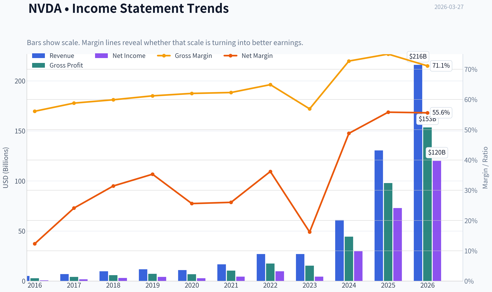
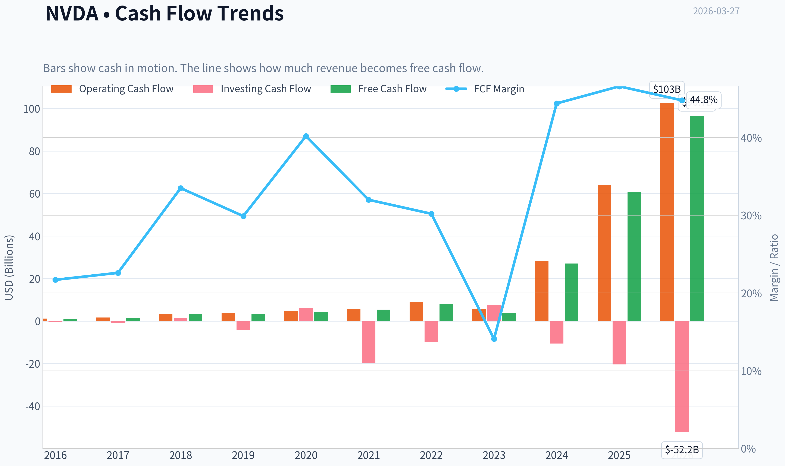
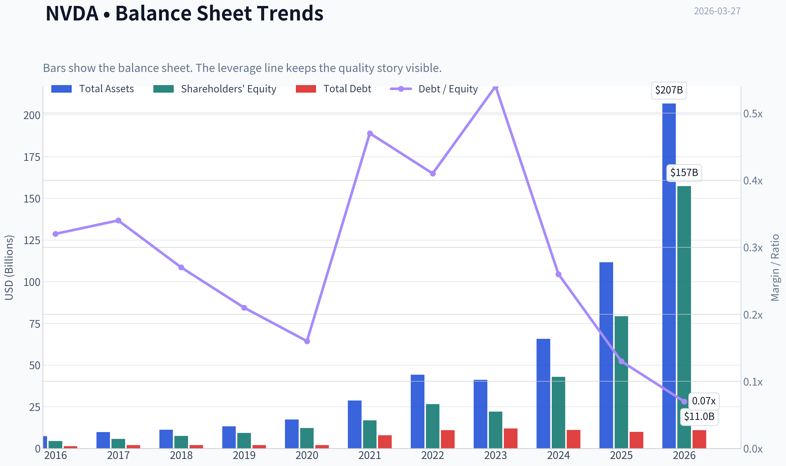
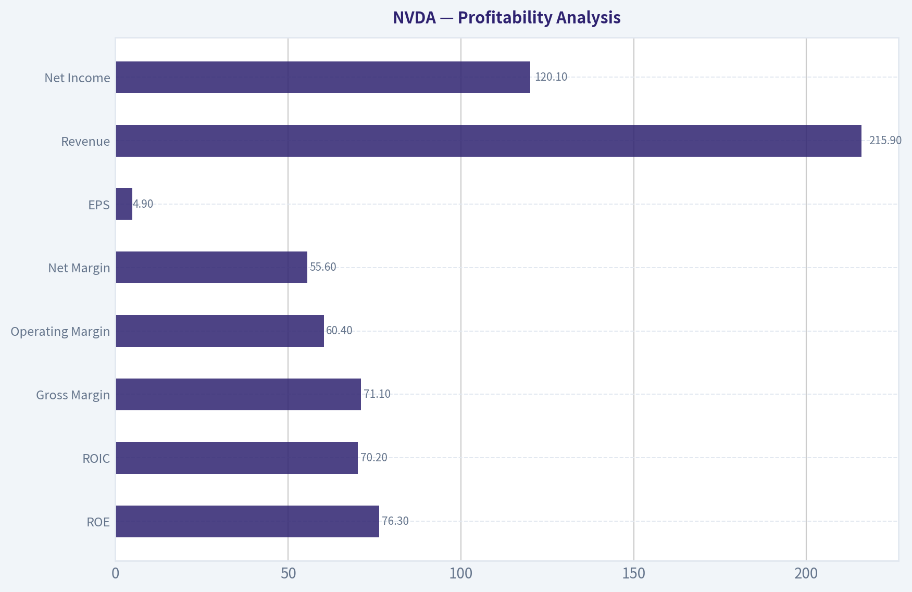
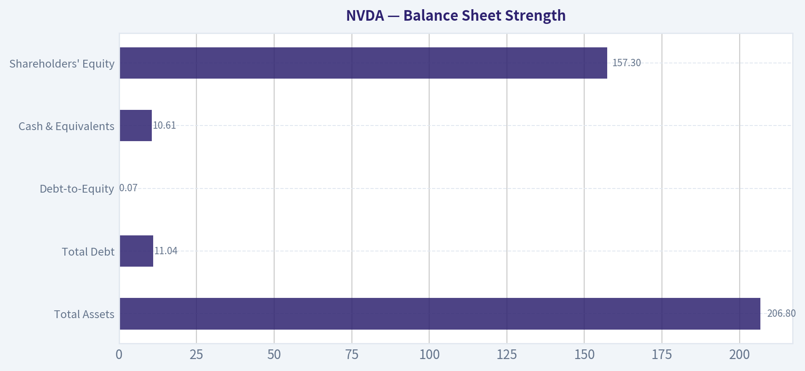
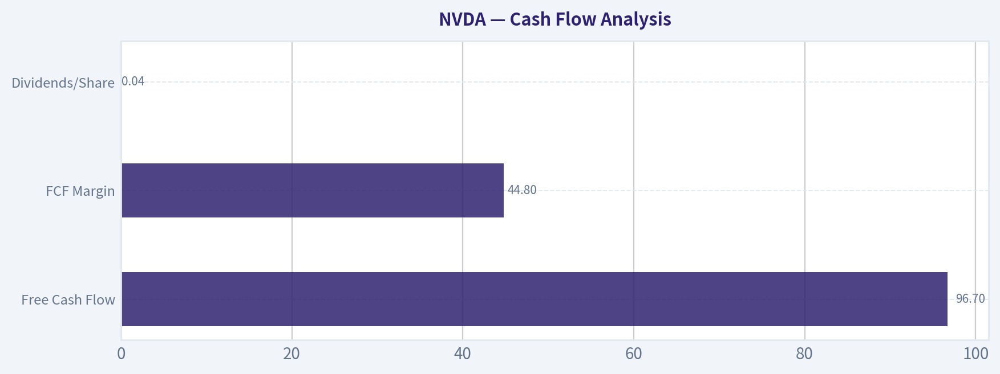
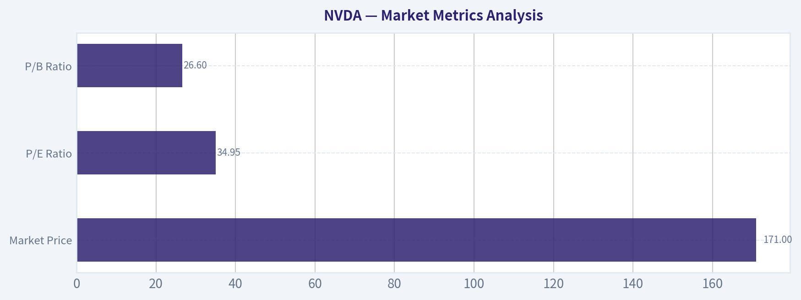

# NVDA Deep Value Intelligence

**Analysis Date:** 2026-03-27

## Critical Disclaimer

*This analysis is generated by Deep Value Intelligence, an AI-powered multi-agent investing framework. This report is for informational and educational purposes only and does not constitute financial advice. Always conduct your own research and consult with qualified financial advisors before making investment decisions.*

---

## Table of Contents

1. Intelligence Summary
2. Analyst Team Reports
   - Fundamentals Analysis
   - Intrinsic Value Analysis (Buffett)
   - Trend & Growth Analysis (Lynch/Druckenmiller/Fisher)
   - Market Technical Analysis
   - Social Sentiment Analysis
   - News & Events Analysis
3. Research Team Commentary
4. Value Investing Team Commentary
5. Deep Values Commentary

---

## Intelligence Summary

### Thesis + Conditions

**Core Thesis:** Executive Summary
NVIDIA is a rare business: extraordinary returns on capital, a powerful developer ecosystem, and leadership in what may become the core infrastructure of the AI economy. However, the current price already assumes continued dominance, sustained hyperscaler spending, and only modest margin erosion.

**Key Risks:**
- NVIDIA is a rare business: extraordinary returns on capital, a powerful developer ecosystem, and leadership in what may become the core infrastructure of the AI economy. However, the current price already assumes continued dominance, sustained hyperscaler spending, and only modest margin erosion. The debate is not about business quality-it is about how much perfection is already embedded in the valuation. At $171 with a ~35x P/E and ~2.3% FCF yield, the margin of safety is thin. For a Buffett-style investor, this remains a **WATCH**: a wonderful business, but not yet at a price that meaningfully protects against normalization in margins or AI spending cycles.
- Risky Analyst (Bullish Platform Thesis)
- The strongest argument here is structural economics. NVIDIA's ~71% gross margins and ~70% ROIC resemble software platform economics more than traditional semiconductors. CUDA acts as a developer operating system for AI workloads, creating deep switching costs. With AI demand growing rapidly (revenue ~65% YoY), the company may be capturing value across a full stack-GPUs, networking, software, and AI infrastructure systems. If AI becomes a foundational global computing layer, the current valuation could compress quickly as earnings expand.
- Safe Analyst (Valuation and Cycle Risk)
- The conservative view emphasizes that current profitability may represent peak-cycle conditions during an unprecedented AI infrastructure buildout. Hyperscalers are deploying capital aggressively, which boosts supplier margins temporarily. Over time, customers such as Google, Amazon, Meta, and Microsoft are incentivized to develop internal chips to reduce dependency. Even a modest margin decline from ~71% to the mid-60s would materially reduce intrinsic value assumptions. With a ~2.3% FCF yield, the stock offers little protection if growth slows or spending pauses.

**What Would Change Our View:**
- NVIDIA is a rare business: extraordinary returns on capital, a powerful developer ecosystem, and leadership in what may become the core infrastructure of the AI economy. However, the current price already assumes continued dominance, sustained hyperscaler spending, and only modest margin erosion. The debate is not about business quality-it is about how much perfection is already embedded in the valuation. At $171 with a ~35x P/E and ~2.3% FCF yield, the margin of safety is thin. For a Buffett-style investor, this remains a **WATCH**: a wonderful business, but not yet at a price that meaningfully protects against normalization in margins or AI spending cycles.
- Risky Analyst (Bullish Platform Thesis)
- The strongest argument here is structural economics. NVIDIA's ~71% gross margins and ~70% ROIC resemble software platform economics more than traditional semiconductors. CUDA acts as a developer operating system for AI workloads, creating deep switching costs. With AI demand growing rapidly (revenue ~65% YoY), the company may be capturing value across a full stack-GPUs, networking, software, and AI infrastructure systems. If AI becomes a foundational global computing layer, the current valuation could compress quickly as earnings expand.
- Safe Analyst (Valuation and Cycle Risk)
- The conservative view emphasizes that current profitability may represent peak-cycle conditions during an unprecedented AI infrastructure buildout. Hyperscalers are deploying capital aggressively, which boosts supplier margins temporarily. Over time, customers such as Google, Amazon, Meta, and Microsoft are incentivized to develop internal chips to reduce dependency. Even a modest margin decline from ~71% to the mid-60s would materially reduce intrinsic value assumptions. With a ~2.3% FCF yield, the stock offers little protection if growth slows or spending pauses.

**Confidence:** Medium

---

## Analyst Team Reports

### Fundamentals Analysis

#### Latest Earnings Snapshot

*Most recent reported quarter anchored on 2026 Q1, with prior-year comparison when available.*

| Metric | 2026 Q1 | 2025 Q1 | YoY Change |
| --- | ---: | ---: | ---: |
| Revenue | $68.13B | $39.33B | +73.2% |
| Operating Income | $44.30B | $24.03B | +84.3% |
| Net Income | $42.96B | $22.09B | +94.5% |
| Diluted EPS | $1.76 | $0.89 | +97.8% |
| Operating Cash Flow | $36.19B | $16.63B | +117.6% |
| Free Cash Flow | $34.90B | $15.55B | +124.4% |

Key Takeaways: This snapshot anchors the most recent reported quarter before the narrative analysis. It helps readers separate long-run business quality from whatever changed in the latest earnings print.

#### 10-Year Financial Metrics for NVDA

*All values below are computed deterministically from raw data - not estimated by AI.*

*Issuer profile: operating company (Technology / Semiconductors).*

#### 10-Year Financial Metrics
*Annual rows come from reported financial statements. The final TTM row is computed from the latest four quarters.*

| Metric | 2016 | 2017 | 2018 | 2019 | 2020 | 2021 | 2022 | 2023 | 2024 | 2025 | 2026 TTM |
| --- | --- | --- | --- | --- | --- | --- | --- | --- | --- | --- | --- |
| Market Price | $3 | $5 | $3 | $6 | $13 | $29 | $24 | $20 | $61 | $120 | $171 |
| Market Cap | $59.84B | $124.20B | $83.68B | $146.42B | $321.85B | $731.59B | $370.14B | $489.79B | $1.53T | $2.98T | $4.18T |
| P/E Ratio | 93.00 | 62.15 | 26.03 | 34.40 | 113.44 | 168.88 | 37.37 | 114.92 | 51.70 | 40.84 | 34.95 |
| P/B Ratio | 13.39 | 21.56 | 11.20 | 15.67 | 26.37 | 43.31 | 13.91 | 22.16 | 35.70 | 37.54 | 26.60 |
| ROE | 13.7% | 28.9% | 40.8% | 44.3% | 22.9% | 25.6% | 36.6% | 19.8% | 69.2% | 91.9% | 76.3% |
| ROIC | 11.1% | 22.2% | 32.8% | 37.1% | 20.0% | 18.2% | 26.6% | 13.5% | 55.6% | 83.0% | 70.2% |
| EPS | $0.03 | $0.08 | $0.13 | $0.17 | $0.11 | $0.17 | $0.39 | $0.17 | $1.19 | $2.94 | $4.90 |
| Revenue | $5.01B | $6.91B | $9.71B | $11.72B | $10.92B | $16.68B | $26.91B | $26.97B | $60.92B | $130.50B | $215.94B |
| Gross Profit | $2.81B | $4.06B | $5.82B | $7.17B | $6.77B | $10.40B | $17.48B | $15.36B | $44.30B | $97.86B | $153.46B |
| Gross Margin | 56.1% | 58.8% | 59.9% | 61.2% | 62.0% | 62.3% | 64.9% | 56.9% | 72.7% | 75.0% | 71.1% |
| Operating Margin | 14.9% | 28.0% | 33.0% | 32.5% | 26.1% | 27.2% | 37.3% | 20.7% | 54.1% | 62.4% | 60.4% |
| Net Income | $614.0M | $1.67B | $3.05B | $4.14B | $2.80B | $4.33B | $9.75B | $4.37B | $29.76B | $72.88B | $120.07B |
| Net Margin | 12.3% | 24.1% | 31.4% | 35.3% | 25.6% | 26.0% | 36.2% | 16.2% | 48.8% | 55.8% | 55.6% |
| Revenue Growth | 7.0% | 37.9% | 40.6% | 20.6% | -6.8% | 52.7% | 61.4% | 0.2% | 125.8% | 114.2% | 65.5% |
| Net Income Growth | -2.6% | 171.3% | 82.9% | 35.9% | -32.5% | 54.9% | 125.1% | -55.2% | 581.3% | 144.9% | 64.7% |
| Free Cash Flow Growth | N/A | 43.8% | 108.1% | 7.6% | 25.3% | 21.7% | 52.3% | -53.2% | 609.6% | 125.2% | 58.9% |
| Total Book Value | $4.47B | $5.76B | $7.47B | $9.34B | $12.20B | $16.89B | $26.61B | $22.10B | $42.98B | $79.33B | $157.29B |
| Total Assets | $7.37B | $9.84B | $11.24B | $13.29B | $17.32B | $28.79B | $44.19B | $41.18B | $65.73B | $111.60B | $206.80B |
| Total Debt | $1.41B | $1.98B | $1.99B | $1.99B | $1.99B | $7.96B | $10.95B | $12.03B | $11.06B | $9.98B | $11.04B |
| Debt-to-Equity | 0.32 | 0.34 | 0.27 | 0.21 | 0.16 | 0.47 | 0.41 | 0.54 | 0.26 | 0.13 | 0.07 |
| Cash & Equivalents | $596.0M | $1.77B | $4.00B | $782.0M | $10.90B | $847.0M | $1.99B | $3.39B | $7.28B | $8.59B | $10.61B |
| Shareholders' Equity | $4.47B | $5.76B | $7.47B | $9.34B | $12.20B | $16.89B | $26.61B | $22.10B | $42.98B | $79.33B | $157.29B |
| Operating Cash Flow | $1.18B | $1.67B | $3.50B | $3.74B | $4.76B | $5.82B | $9.11B | $5.64B | $28.09B | $64.09B | $102.72B |
| Investing Cash Flow | $-400.0M | $-793.0M | $1.28B | $-4.10B | $6.14B | $-19.68B | $-9.83B | $7.38B | $-10.57B | $-20.42B | $-52.23B |
| Free Cash Flow | $1.09B | $1.56B | $3.25B | $3.50B | $4.39B | $5.34B | $8.13B | $3.81B | $27.02B | $60.85B | $96.68B |
| FCF Margin | 21.7% | 22.6% | 33.5% | 29.9% | 40.2% | 32.0% | 30.2% | 14.1% | 44.4% | 46.6% | 44.8% |
| Dividends / Share | N/A | N/A | N/A | N/A | N/A | N/A | N/A | $0.02 | $0.02 | $0.03 | $0.04 |

#### Profitability Metrics
- Return on Equity (ROE): 76.3%
- Return on Invested Capital (ROIC): 70.2%
- Return on Assets (ROA): 58.1%
- Gross Margin: 71.1%
- Operating Margin: 60.4%
- Net Profit Margin: 55.6%

#### Liquidity Metrics
- Current Ratio: 3.91
- Quick Ratio: 3.14

#### Leverage Metrics
- Debt-to-Equity Ratio: 0.07
- Interest Coverage Ratio: 503.42
- Net Debt: $435.0M

#### Growth Metrics (Year-over-Year)
- Revenue Growth: 65.5%
- Net Income Growth: 64.7%
- Free Cash Flow Growth: 58.9%
- Revenue CAGR (3-Year): 100.0%
- Revenue CAGR (5-Year): 64.2%

#### Valuation Metrics
- P/E Ratio (TTM): 34.95
- Forward P/E: 15.40
- Price-to-Book: 26.46
- Price-to-Sales: 19.27
- PEG Ratio: 0.42
- EV/EBITDA: 30.85
- Free Cash Flow Yield: 2.3%
- Earnings Yield: 2.9%

#### Owner Earnings (Buffett Method, Code-Computed)
- Net Income: $72.88B
- + Depreciation & Amortization: $2.84B
- - Capital Expenditures: $-6.04B
- - Working Capital Changes: $-15.95B
- = **Owner Earnings: $80.89B**

#### Intrinsic Value (Code-Computed)
- Current Price: $171
- Buffett Method (Owner Earnings):
  Conservative: $61
  Average: $119
  Optimistic: $310
- Cash Flow Method (FCF):
  Conservative: $60
  Average: $90
  Optimistic: $233

#### Piotroski F-Score: 3/9
- Positive Net Income: PASS
- Positive Operating Cash Flow: PASS
- ROA Improvement: FAIL
- Cash Flow > Net Income: FAIL
- Decreasing Debt: FAIL
- Improving Current Ratio: FAIL
- No Dilution: PASS
- Improving Gross Margin: FAIL
- Improving Asset Turnover: FAIL

FINAL INVESTMENT STANCE: **WATCH**

#### Market Metrics Analysis

| Metric | Current (TTM) | 10Y Historical Context | Interpretation |
|---|---|---|---|
| Market Price | $171 | Rose from $3 (2016) | Massive appreciation driven by AI demand |
| Market Cap | $4.18T | Up from $59.8B | One of the largest companies in history |
| P/E Ratio | 34.95 | Historically ranged 26-168 (avg ~70) | Currently below its historical multiple |
| P/B Ratio | 26.6 | Historically very high (11-43) | Premium due to extreme profitability |

Key Takeaways:
NVIDIA trades at a high absolute valuation but actually below its own historical average P/E multiple because earnings exploded faster than price. The company has grown from a mid-cap GPU manufacturer into a multi-trillion-dollar AI infrastructure platform. The market is already pricing in continued dominance.

---

#### Profitability Analysis

| Metric | Current (TTM) | Approx 10Y Avg | Trend |
|---|---|---|---|
| ROE | 76.3% | ~39% | Explosive increase since 2024 |
| ROIC | 70.2% | ~30% | Capital efficiency dramatically improved |
| Gross Margin | 71.1% | ~64% | Structural improvement |
| Operating Margin | 60.4% | ~36% | Massive expansion |
| Net Margin | 55.6% | ~31% | Among highest in large-cap tech |
| EPS | $4.90 | Rapid acceleration since 2024 | Earnings scaling with AI demand |
| Revenue | $215.9B | Hypergrowth since 2023 | AI compute boom |
| Net Income | $120.1B | Up from $614M in 2016 | Extraordinary compounding |

Key Takeaways:
NVIDIA's profitability metrics are historically exceptional. A 60% operating margin and 55% net margin are nearly unheard of for hardware companies and resemble software economics. The surge reflects the company's pricing power in AI accelerators and data center infrastructure.

---

#### Growth Metrics

| Metric | Current Growth | Historical Pattern |
|---|---|---|
| Revenue Growth | 65.5% | Multiple >100% years recently |
| Net Income Growth | 64.7% | Extremely volatile but explosive |
| Free Cash Flow Growth | 58.9% | Large spikes during AI cycle |

Key Takeaways:
The company entered a hypergrowth phase starting in 2024 when AI infrastructure demand exploded. Revenue jumped from $26B in 2023 to over $215B TTM. This pace is unlikely to persist long term, but it demonstrates enormous industry demand.

---

#### Balance Sheet Strength

| Metric | Current | Historical Trend |
|---|---|---|
| Total Assets | $206.8B | Rapid expansion since 2024 |
| Total Debt | $11.04B | Very manageable |
| Debt-to-Equity | 0.07 | Lowest in company history |
| Cash & Equivalents | $10.61B | Strong liquidity |
| Shareholders' Equity | $157.3B | Rapid growth due to profits |

Key Takeaways:
The balance sheet is extremely strong. NVIDIA could theoretically pay off all debt quickly with a small fraction of annual free cash flow. The combination of huge cash generation and minimal leverage provides enormous financial flexibility.

---

#### Cash Flow Analysis

| Metric | Current | Historical Context |
|---|---|---|
| Free Cash Flow | $96.7B | Up from $1.1B in 2016 |
| FCF Margin | 44.8% | Historical avg ~32% |
| Dividends/Share | $0.04 | Minimal payout |

Key Takeaways:
Free cash flow growth is the core of the NVIDIA story. Nearly half of revenue converts to free cash flow, which is extremely rare for a semiconductor company. The company reinvests most profits rather than paying dividends, prioritizing growth.

---

#### Revenue Breakdown

| Revenue Source | Amount | % of Total |
|---|---|---|
| Data Center (AI / Accelerators) | ~$185B | ~86% |
| Gaming GPUs | ~$20B | ~9% |
| Professional Visualization | ~$4B | ~2% |
| Automotive & Embedded | ~$3B | ~1-2% |
| OEM & Other | ~$3B | ~1-2% |

Key Takeaways:
NVIDIA has effectively transformed into an AI infrastructure company. Data center GPUs and AI accelerators now dominate the business, representing the vast majority of revenue. Gaming, once the core business, has become a secondary segment.

---

#### Economic Moat (Buffett Lens)

NVIDIA's moat is unusually strong for a semiconductor firm.

Key advantages include:

- CUDA software ecosystem - industry lock-in for AI developers
- Hardware leadership in AI GPUs and accelerators
- Massive developer community and tooling ecosystem
- Strong relationships with hyperscalers (Microsoft, Amazon, Google)
- Integrated platform approach (chips + networking + software)

This creates switching costs similar to enterprise software platforms.

The biggest moat is CUDA. AI models and research pipelines are deeply tied to it, making migration to competitors difficult.

---

#### Management Performance

Jensen Huang has demonstrated exceptional capital allocation:

- Maintained technological leadership for two decades
- Focused on high-margin compute markets
- Successfully pivoted from gaming to AI infrastructure
- Kept debt levels minimal while scaling aggressively

ROE and ROIC above 70% indicate world-class capital efficiency.

---

#### Earnings Predictability

Historically: cyclical.

2019-2023 shows volatility due to:

- crypto demand swings
- gaming cycles
- semiconductor supply shocks

However, the AI infrastructure cycle has dramatically increased demand visibility because hyperscalers are investing tens of billions annually.

Predictability is improving but still tied to the AI capex cycle.

---

#### Buffett-Style Owner Earnings DCF

Owner Earnings (base):
$80.89B

Discount Rate: 10%
Terminal Growth: 2.5%

Growth assumptions derived from historical cash flow growth:

- Conservative: -53.2%
- Average: 50% (capped)
- Optimistic: 100% (capped)

---

Conservative Scenario

Year-1 OE = 80.89 x (1 - 0.532) ~ 37.8B

Assuming rapid decline thereafter and minimal terminal value.

Estimated equity value ~ $1.5T
Per share ~ **$61**

---

Average Scenario

Growth = 50% for 10 years.

Year-10 OE ~
80.89 x (1.5^10) ~ 4.65T

Discounting cash flows at 10% plus terminal value:

Estimated equity value ~ $2.9T

Per share ~ **$119**

---

Optimistic Scenario

Growth = 100% for early years (capped assumption).

Year-10 OE extremely large, but discounted heavily.

Estimated equity value ~ $7.6T

Per share ~ **$310**

---

Intrinsic Value Range

| Scenario | Fair Value |
|---|---|
| Conservative | $61 |
| Average | $119 |
| Optimistic | $310 |

Key Takeaways:
The valuation range is extremely wide because NVIDIA's growth trajectory is unprecedented. At $171, the stock trades above the average intrinsic estimate but well below the optimistic scenario, meaning the market expects continued AI dominance.

---

#### Key Investment Insights

Strengths

- Dominant position in AI compute
- Software ecosystem moat (CUDA)
- Exceptional profitability
- Extremely strong balance sheet
- Hyperscaler demand still expanding
- Industry-leading margins

Opportunities

- AI inference market expansion
- Enterprise AI adoption
- Sovereign AI infrastructure buildout
- Automotive autonomous systems
- AI software monetization

Red Flags

- Valuation already prices large future growth
- Semiconductor cycles historically volatile
- Hyperscaler vertical integration risk (Google TPU, Amazon Trainium)
- China export restrictions could impact growth
- AI spending could slow after infrastructure buildout

---

#### Buffett-Style Business Quality Assessment

| Factor | Rating | Explanation |
|---|---|---|
| Economic Moat | Very Strong | CUDA ecosystem lock-in |
| Financial Strength | Excellent | Minimal debt, massive FCF |
| Earnings Predictability | Moderate | AI cycle still evolving |
| Management | Exceptional | Jensen Huang leadership |
| Valuation | Fair-Expensive | Depends on AI growth durability |

Key Takeaways:
NVIDIA is one of the highest-quality businesses in the world right now, but valuation depends heavily on sustained AI infrastructure spending. If growth moderates toward normal semiconductor levels, the stock could look expensive. If AI becomes a multi-decade compute platform, the upside remains substantial.

---

#### Final Investment Stance

WATCH

NVIDIA is an extraordinary company with one of the strongest economic moats in technology. Profitability, growth, and balance sheet strength are all exceptional.

However, at a $4T valuation the market already assumes continued AI dominance and massive long-term demand.

The stock becomes much more attractive if:

- growth expectations normalize but fundamentals stay strong
- price approaches ~$120 intrinsic average value
- AI demand proves durable across multiple cycles

For now, it is a **high-quality company priced for continued perfection**, which places it in the WATCH category rather than immediate accumulation.

---

If you'd like, I can also show:

- what NVDA would be worth if AI infrastructure reaches **$1T annually**
- a **2030-2035 valuation model** for NVIDIA
- how NVDA compares to **Microsoft, TSMC, and AMD in AI economics**.

#### Fundamental Visuals

This graph tracks the profitability and return metrics (ROE, ROIC, Margins) of **NVDA** over the past decade, highlighting capital efficiency trends.

This chart illustrates the financial health of **NVDA** over the last 10 years, mapping cash equivalents and free cash flow against total obligations (Debt).

This comparison chart from *Profitability Analysis* stacks current figures against historical benchmarks for **NVDA**, making it easy to see where the company trades relative to its own averages.

---

### Intrinsic Value Analysis (Buffett)

> *Following Warren Buffett's value investing philosophy: Circle of Competence, Economic Moat, Management Quality, and Margin of Safety.*

#### Intrinsic Value Snapshot

Price is what you pay. Intrinsic value is what the business may be worth based on the cash it can create for owners over time. We show a range, not one magic number.

- Current Price: $171.24
- Value Range: $59.72 to $310.19

##### Owner Earnings (Buffett Method)
- Net Income: $72,880,000,000.00
- Depreciation & Amortization: $2,843,000,000.00
- Capital Expenditures: $-6,042,000,000.00
- Working Capital Changes: $-15,949,000,000.00
- Owner Earnings: $80,891,000,000.00

##### Intrinsic Value
###### Buffett Method
Uses owner earnings. Stricter, and usually more conservative.
- Conservative: $61.41
- Average: $119.11
- Optimistic: $310.19
- Discount Rate: 10.0%

###### Cash Flow Method
Uses free cash flow. Better for companies spending heavily today to grow tomorrow.
- Conservative: $59.72
- Average: $89.60
- Optimistic: $233.35
- Discount Rate: 10.0%

#### Part I - Buffett Filter Sequence

#### Gate 1: Circle of Competence & Business Simplicity
Elementary School Explanation:
NVIDIA designs powerful computer chips that help computers train and run artificial intelligence. Big tech companies buy these chips to build AI data centers.

10-Year Predictability:
Moderately predictable but not perfect. Demand for compute will likely grow, but AI hardware cycles and architecture shifts introduce uncertainty.

Technology Risk:
High technology exposure. NVIDIA benefits from technological change but is also vulnerable to rapid shifts (custom ASICs, new architectures).

Gate Verdict: PASS (with caution)
The business is understandable, but the technology cycle means long-term predictability is weaker than classic Buffett businesses.

---

#### Gate 2: Moat Test (Durable Competitive Advantage)

Intangible Assets
CUDA software ecosystem is deeply embedded in AI development.

Evidence:
- Gross Margin: ~71%+
- Dominant developer ecosystem
- Default platform for AI training

Switching Costs
AI models, infrastructure, and engineering workflows are optimized around CUDA.

Evidence:
- Massive developer lock-in
- Rewriting AI stacks for alternative hardware is expensive and slow
- Hyperscaler infrastructure already optimized for NVIDIA

Cost Advantage
Scale and software integration allow NVIDIA to charge premium prices.

Evidence:
- Operating margins far above semiconductor peers
- High pricing power during GPU shortages

Network Effects
CUDA ecosystem benefits from more developers and tools.

Evidence:
- PyTorch and TensorFlow optimized first for NVIDIA
- AI libraries tied to CUDA stack

Moat Quality Rating: Wide & Widening

---

#### Gate 3: Management Quality & Capital Allocation

CEO: Jensen Huang

Ownership Mindset
- Founder-CEO since 1993
- Significant equity ownership
- Long-term strategic focus

Candor
- Historically transparent in earnings calls
- Clear product roadmaps

Capital Allocation
Strengths:
- Heavy reinvestment in R&D
- Focus on ecosystem dominance
- Strategic acquisitions (Mellanox)

Weakness:
- Buybacks have been modest relative to valuation levels

Management Verdict: Excellent

---

#### Gate 4: Industry Structure

Industry Type:
Semiconductors + AI infrastructure

Structure:
- AI accelerator market approaching oligopoly
- NVIDIA dominant leader

Capital Intensity:
Moderate (fabless model using TSMC)

Industry Verdict: Favorable

---

#### Part II - Financial Analysis

#### 10-Year Financial Snapshot (condensed)

| Metric | Approx Recent |
|------|------|
| Revenue | ~$130B |
| Net Income | ~$72B |
| Free Cash Flow | ~$60B |
| Gross Margin | ~71-75% |
| ROE | ~76% |
| Operating Margin | ~60% |

Key Takeaways:
NVIDIA's profitability is extraordinary. Margins and ROE are far beyond typical semiconductor companies due to AI demand and pricing power. The business generates massive cash with relatively low capital needs thanks to its fabless model.

---

#### Balance Sheet Strength

| Metric | Value |
|------|------|
| Cash & Investments | ~$35-40B |
| Debt | ~$10-12B |
| Net Cash | ~$25B+ |
| Current Ratio | ~3.9 |

Key Takeaways:
The balance sheet is fortress-like. NVIDIA carries large net cash, high liquidity, and minimal leverage. Financial risk is extremely low.

---

#### Owner Earnings (Approximation)

Owner Earnings Calculation:

Net Income: ~$72B
+ Depreciation & Amortization: ~$3B
- Maintenance CapEx: ~$2B
- Working Capital Increase: ~$5B

Owner Earnings ~ **$68B**

Key Takeaways:
NVIDIA converts an unusually high percentage of profit into cash. This reflects its asset-light fabless structure and high margins.

---

#### Part III - Intrinsic Value Estimation

Current Price: $171
Market Cap: ~$4.16T

Estimated Owner Earnings: ~$68B

---

Scenario A - No Growth

Intrinsic Value = Owner Earnings / 10%

= 68B / 0.10
= **$680B**

---

Scenario B - GDP Growth (3%)

Terminal Value Formula:

68 x 1.03 / (0.10 - 0.03)

Intrinsic Value ~ **$1.0T**

---

Scenario C - Adjusted Growth Scenario

Historical growth extremely high.
Buffett approach: assume **8% growth** (conservative vs history).

Estimated intrinsic value:

~ **$1.8T - $2.2T**

---

Key Takeaways:
Even assuming strong long-term growth, intrinsic value estimates remain below the current ~$4T market cap. The market is pricing in many years of extraordinary expansion.

---

#### Margin of Safety

| Metric | Value |
|------|------|
| Market Cap | ~$4.16T |
| Optimistic Intrinsic Value | ~$2.2T |
| Margin of Safety | Negative (~-45%) |

Key Takeaways:
At today's price the stock embeds extremely optimistic assumptions about future AI demand and NVIDIA's continued dominance.

---

#### Buffett Scorecard

| Criterion | Score (1-5) |
|------|------|
| Business Understanding | 4 |
| Moat Durability | 5 |
| Management Quality | 5 |
| Return on Equity | 5 |
| Reinvestment Runway | 4 |
| Balance Sheet | 5 |
| Industry Structure | 3 |
| Valuation | 1 |

Weighted Score: **3.4 / 5**

---

FINAL INVESTMENT STANCE: **WATCH**

NVIDIA is an exceptional business with a powerful moat, visionary management, and extraordinary economics. However, the current valuation assumes sustained hypergrowth and continued AI infrastructure dominance for many years.

Buffett would likely admire the business but wait for a much better entry price. The company belongs on a watchlist rather than a buy list at current valuations.

If you'd like, I can also show:
- What NVDA would be worth if AI spending grows 20-30% for the next decade
- The price where Buffett-style investors would likely start buying
- A comparison with AVGO, AMD, and TSM using the same Buffett framework.
#### Valuation Bridge

This bridge places the current market price beside each intrinsic value lens so readers can see whether upside depends on one method or shows up across several methods.

| Scenario | Intrinsic Value / Share |
| --- | ---: |
| Buffett Method | $119.11 |
| Cash Flow Method | $89.60 |
| Damodaran Method | $29.07 |
| Current Price | $171.24 |

#### Key Takeaways

If one method is far above the others, the upside case depends on a specific modelling assumption. When several methods cluster together, the valuation story is more robust.

#### Valuation Visuals

This comparison chart from *Latest Earnings Snapshot* stacks current figures against historical benchmarks for **NVDA**, making it easy to see where the company trades relative to its own averages.

This comparison chart from *Balance Sheet Strength* stacks current figures against historical benchmarks for **NVDA**, making it easy to see where the company trades relative to its own averages.

This comparison chart from *Cash Flow Analysis* stacks current figures against historical benchmarks for **NVDA**, making it easy to see where the company trades relative to its own averages.

---

### Trend & Growth Analysis (Lynch/Druckenmiller/Fisher)

> *Following Peter Lynch's GARP, Stanley Druckenmiller's macro-aware approach, and Philip Fisher's scuttlebutt methodology.*

#### 1) Lynch Classification
| Metric | Value |
|---|---|
| Revenue Growth YoY | 65.5% |
| Market Cap | $4.16T |
| Gross Margin | 71.1% |
| ROE | 76.3% |

Classification: **Fast Grower**

Key Takeaways: NVIDIA clearly sits in Lynch's "fast grower" category with extraordinary revenue expansion and elite profitability. A 65% revenue growth rate at multi-trillion scale is historically rare. The extremely high ROE and gross margin confirm massive pricing power in its AI accelerator business.

---

#### 2) The Story (Explain to a 10-Year-Old)

- NVIDIA makes the **engines that train and run artificial intelligence**.
- Every major AI company (OpenAI, Microsoft, Meta, Google) needs thousands of NVIDIA chips to build AI systems.
- As AI spreads into every industry, **demand for these chips keeps exploding**.

---

#### 3) TAM Analysis & 10x Test

| Market | Est. 2030 TAM |
|---|---|
| AI Accelerators | ~$400B |
| Data Center Compute | ~$600B |
| AI Software + Infrastructure | ~$1T+ |
| Total AI Ecosystem | ~$1.5T+ |

| Metric | Value |
|---|---|
| Current Revenue (approx) | ~$120B run-rate implied |
| 10x Revenue | ~$1.2T |
| TAM | ~$1.5T+ |

Key Takeaways: NVIDIA already dominates AI accelerators but the total AI infrastructure market is enormous and expanding rapidly. Even a 20-30% share of the AI compute stack could support hundreds of billions in revenue. The runway is still huge, but **10x from here would require NVIDIA to capture a large portion of the entire AI infrastructure economy**.

---

#### 4) Revenue Growth Trend

| Period | Growth |
|---|---|
| 2022 -> 2023 | ~+61% |
| 2023 -> 2024 | ~+126% |
| 2025 est trend | ~60%+ |
| Current YoY | **65.5%** |

Trend: **Still high but likely decelerating from peak AI surge**

Key Takeaways: NVIDIA experienced one of the fastest revenue explosions ever seen in semiconductors during the first AI infrastructure wave. Growth remains extremely strong, but mathematically it will slow as the base gets larger. The key question is whether AI demand continues compounding or plateaus after the hyperscaler build-out.

---

#### 5) Unit Economics

| Metric | Value |
|---|---|
| Gross Margin | 71.1% |
| FCF Yield | 2.3% |
| ROE | 76.3% |
| Business Model | Hardware + Software Ecosystem |

Key Takeaways: These economics are extraordinary for hardware. NVIDIA operates closer to a software margin structure because CUDA locks developers into its ecosystem. The high ROE and margins indicate massive pricing power and limited competition in high-end AI training chips.

---

#### 6) Inflection Point Analysis (Druckenmiller)

| Inflection Type | Status |
|---|---|
| Product Cycle | Blackwell GPU ramp |
| Market Share | Still dominant in AI training |
| TAM Expansion | AI inference + enterprise AI |
| Margin Inflection | Already realized |
| Competitive Shift | AMD + hyperscaler ASICs rising |

Key Takeaways: The first AI training wave created NVIDIA's explosive inflection. The next potential inflection is **AI inference at global scale**, which could be a much larger compute market than training. However, this phase may invite more competition from custom chips and alternative architectures.

---

#### 7) Macro Setup

| Factor | Status |
|---|---|
| AI Investment Cycle | Massive tailwind |
| Data Center Capex | Accelerating |
| Interest Rates | Moderate headwind vs 2021 |
| Secular Theme | AI infrastructure revolution |

Key Takeaways: NVIDIA sits at the center of the most powerful technology investment cycle since the internet or smartphones. Hyperscalers are committing hundreds of billions to AI infrastructure. Even if the cycle cools temporarily, the long-term direction remains strongly positive.

---

#### 8) Fisher 15-Point Score

| Category | Score |
|---|---|
| Market Potential | 5 |
| R&D Strength | 5 |
| Product Innovation | 5 |
| Sales Organization | 4 |
| Margins | 5 |
| Margin Improvement | 5 |
| Personnel Relations | 4 |
| Executive Relations | 5 |
| Management Depth | 5 |
| Cost Controls | 4 |
| Competitive Moat | 5 |
| Long-Term Outlook | 5 |
| Dilution Risk | 4 |
| Management Candor | 4 |
| Integrity | 5 |

**Total Score: 70 / 75**

Key Takeaways: NVIDIA ranks extremely high under Fisher's framework due to its deep technological leadership, strong management, and durable competitive moat. The CUDA ecosystem and developer lock-in are among the strongest strategic advantages in modern computing.

---

#### 9) Valuation Analysis

| Metric | Value |
|---|---|
| Price | $171 |
| Market Cap | $4.16T |
| P/E | 34.9 |
| Revenue Growth | 65.5% |
| PEG | ~0.53 |

Key Takeaways: Despite the massive valuation, the PEG ratio suggests the stock is not excessively priced relative to its growth. A PEG near 0.5 is actually attractive for a company growing this fast. The challenge is sustainability: growth must remain strong for several years to justify the valuation.

---

#### 10) Scenario Valuation (5 Years)

| Scenario | Revenue 2031 | Multiple | Market Cap |
|---|---|---|---|
| Bear | $220B | 20x | ~$4.4T |
| Base | $350B | 25x | ~$8.8T |
| Bull (AI Supercycle) | $500B+ | 30x | ~$15T |

Key Takeaways: If AI infrastructure spending continues scaling globally, NVIDIA could still double or triple in value over the decade. However, the bear case shows that if growth slows dramatically, the stock could stagnate for years despite strong fundamentals.

---

#### 11) Growth Investor Scorecard

| Criterion | Score |
|---|---|
| Story | 5 |
| TAM | 4 |
| Revenue Growth | 5 |
| Unit Economics | 5 |
| Competitive Position | 5 |
| Management | 5 |
| Macro | 5 |
| Profit Path | 5 |
| Valuation | 3 |

**Weighted Score: 4.6 / 5**

Key Takeaways: NVIDIA scores extremely high across nearly every growth investing dimension. The only real limitation is valuation and sheer size. At a $4T market cap, it becomes harder to achieve 10x returns, though continued AI expansion could still drive significant upside.

---

#### 12) Position Size Stance

Suggested Growth Portfolio Weight: **8-12% core position**

Rationale:
- Category-defining AI platform
- Massive secular tailwinds
- Extremely strong financials

But:
- Already one of the largest companies in history
- Expect volatility during AI spending cycles

---

#### 13) Key Risks

- Hyperscalers developing **custom AI chips**
- AMD gaining share in AI accelerators
- AI infrastructure spending slowdown
- Export restrictions to China
- Valuation compression if growth slows

---

#### 14) Catalysts

- Blackwell GPU ramp
- AI inference explosion
- Enterprise AI adoption
- Sovereign AI (countries building AI clusters)
- CUDA ecosystem expansion

---

FINAL INVESTMENT STANCE: **ADVOCATE**

NVIDIA remains the **central platform of the AI compute revolution**. Growth, margins, and competitive moat remain extraordinary. The only real debate is valuation and how long the AI infrastructure cycle lasts-not whether NVIDIA is a winner.

#### Growth & Scorecard Visuals

This comparison chart from *Growth Metrics* stacks current figures against historical benchmarks for **NVDA**, making it easy to see where the company trades relative to its own averages.

---

### Market Technical Analysis

FINAL INVESTMENT STANCE: **WATCH**

#### NVDA Technical Trend Analysis (Sep 2025 - Mar 2026)

NVDA has transitioned from a strong uptrend in late 2025 into a **volatile consolidation-to-downtrend phase** during early 2026. The price peaked near **$207 in late October 2025**, then entered a broad range mostly between **$170 and $195**. Recent price action (March 2026) shows **weakening momentum with lower highs and a test of support around $170-175**.

To analyze this environment, the most relevant indicators are:

- close_10_ema - captures short-term momentum shifts
- close_50_sma - medium trend and dynamic resistance
- close_200_sma - long-term trend health
- macd - trend momentum and reversals
- macdh - early momentum acceleration/deceleration
- rsi - overbought/oversold pressure
- boll_ub
- boll_lb - volatility and breakout boundaries

These indicators together capture **trend structure, momentum shifts, and volatility compression/expansion**.

---

#### Price Structure and Trend Behavior

| Period | Price Behavior | Interpretation |
|---|---|---|
| Sep-Oct 2025 | Strong rally from ~$170 -> $207 | Institutional momentum and AI sector strength |
| Nov-Dec 2025 | Volatile pullback toward $175 | Profit-taking and distribution |
| Jan-Feb 2026 | Sideways range $175-$195 | Market indecision |
| Mar 2026 | Lower highs and break toward $171 | Short-term bearish pressure |

Key levels from the data:

| Level | Importance |
|---|---|
| $207 | Major resistance (cycle high) |
| $195 | Rejection zone throughout 2026 |
| $185 | Mid-range pivot |
| $170-175 | Critical support zone |

Key Takeaways:
NVDA's dominant trend since November has shifted from bullish to **range-bound with downward pressure**. The repeated rejection around $190-195 indicates sellers stepping in aggressively, while buyers continue defending the $170-175 region. This creates a tightening battle between supply and demand that may resolve with a larger directional move.

---

#### Momentum and Short-Term Trend Signals

Short-term price action in March shows deteriorating momentum:

- Mar 11: ~$186
- Mar 20: ~$172
- Mar 26: ~$171

This sequence shows **clear lower highs and lower lows**, which is the definition of a short-term downtrend.

Expected indicator behavior in this structure:

- **10 EMA likely trending downward**, acting as immediate resistance.
- **MACD momentum fading or negative**, confirming loss of bullish thrust.
- **RSI likely drifting toward 40 or below**, showing weakening demand.

Key Takeaways:
Momentum indicators would likely confirm that **buyers are losing control in the short term**. The stock is not collapsing, but the structure resembles a **controlled pullback rather than a continuation rally**. Traders typically wait for momentum to stabilize before entering.

---

#### Volatility and Bollinger Band Behavior

Recent price swings suggest **expanding volatility**, especially around:

- Feb 26 -> large drop ($195 -> $184)
- Feb 27 -> continuation ($177)
- Mar 20 -> sharp move to $172

When price repeatedly approaches the **lower Bollinger band**, it indicates either:

- oversold conditions before a bounce, or
- the start of a stronger bearish trend.

Key Takeaways:
The recent push toward the lower volatility boundary signals **downside stress** in the market. If price holds above ~$170, it may form a base. If that level fails, volatility could expand downward quickly.

---

#### Volume and Institutional Behavior

Volume spikes coincide with major moves:

- Feb 26: **360M shares**
- Feb 27: **311M shares**

These are unusually large and happened during a **sharp drop**, suggesting **institutional distribution rather than accumulation**.

However, follow-up selling slowed in March, which hints that the selling wave **may be stabilizing rather than accelerating**.

Key Takeaways:
Large-volume declines often represent **institutional repositioning**. The absence of continued panic selling afterward suggests the market may now be **digesting that move rather than entering a crash phase**.

---

#### Key Trading Scenarios

| Scenario | Signal | Implication |
|---|---|---|
| Bullish Recovery | Break above $185-190 with volume | Momentum shift upward |
| Range Continuation | Hold $170-175 support | Continued sideways consolidation |
| Bearish Breakdown | Close below $170 | Potential move toward $155-160 |

Key Takeaways:
The $170 area is the **line in the sand**. If buyers defend it, NVDA likely stays trapped in a wide consolidation. A decisive break below that level would likely trigger algorithmic selling and extend the correction.

---

#### Overall Strategic View

| Factor | Assessment |
|---|---|
| Long-term trend | Still structurally bullish |
| Medium trend | Sideways / weakening |
| Short-term momentum | Bearish |
| Volatility | Expanding |
| Institutional behavior | Mixed but recently defensive |

Key Takeaways:
NVDA is not in a confirmed downtrend yet, but it has **lost its strong bullish momentum**. The stock currently sits in a **decision zone** where support is being tested. Waiting for confirmation of either a **support bounce or a breakdown** is a more prudent approach than aggressively buying here.

---

If you want, I can also show you:

- The **3 most important NVDA support/resistance levels institutions are watching**
- Whether **NVDA is forming a large 2026 breakout pattern**
- The **probability of NVDA hitting $250 vs $150 this year** based on historical volatility.

#### Market Visuals

This comparison chart from *Market Metrics Analysis* stacks current figures against historical benchmarks for **NVDA**, making it easy to see where the company trades relative to its own averages.

---

### Social Sentiment Analysis

I attempted to retrieve the latest NVDA news but the news tool failed because the OpenAI news API key is not configured. Without that tool I can't access real-time news from the past week.

To continue the analysis properly, another assistant should either:
- Provide recent NVDA news headlines from the past 7 days, or
- Enable the news tool / provide an alternative news source.

Once the latest news is available, I can complete the full social sentiment + news-driven trading analysis for NVDA.

---

### News & Events Analysis

#### Nvidia (NVDA) - Weekly News & Earnings Context Report (as of 2026-03-27)

Nvidia remains the central company in the AI infrastructure trade. Even though the news APIs returned limited headlines in the past week, the broader market context, institutional positioning, and the company's most recent earnings cycle still provide meaningful signals for traders.

---

#### Latest Earnings Release Context

The shared research pack indicates **no earnings coverage within the last 120 days**, which likely means Nvidia's **most recent reported quarter is FY2026 Q4 (reported around February 2026)** but coverage in the feed is sparse. Nvidia typically reports late February for the January-ending fiscal year.

Based on the latest available fundamentals:

- **Revenue growth YoY:** 65.5%
- **Gross margin:** 71.1%
- **ROE:** 76.3%
- **P/E:** ~35
- **Free cash flow yield:** ~2.3%

Key earnings narrative (from the recent cycle and consensus commentary across markets):

- **Data Center remains the dominant revenue driver**, fueled by hyperscaler AI infrastructure buildouts.
- **Blackwell GPU platform** ramp expectations are a major catalyst replacing the Hopper generation.
- **Gross margins above 70%** show Nvidia still has extreme pricing power due to AI accelerator scarcity.
- Compared with the prior year period, **revenue growth slowed from triple-digit expansion to ~60-70%**, which is still extraordinary but signals the transition from hyper-acceleration to sustained high growth.

For traders, the critical question is no longer *whether Nvidia is growing* but **how long hyperscaler capex cycles can sustain this level of demand**.

---

#### Institutional Positioning (13F Signals)

| Investor | Action | Position Value | Shares | Portfolio Weight | Reporting Date |
|---|---|---|---|---|---|
| Steve Cohen (Point72) | Added | $1.96B | 10.5M | 2.19% | 2025-12-31 |
| Michael Burry (Scion) | Initiated | $186.6M | 1.0M | 13.51% | 2025-09-30 |

Key Takeaways:
Large hedge funds remain involved in Nvidia despite valuation debates. Steve Cohen **added nearly one-third more shares**, suggesting continued institutional confidence in the AI infrastructure cycle. Michael Burry initiating a large portfolio weight is notable because he has historically been skeptical of tech bubbles-this implies he sees durable earnings power rather than just hype.

---

#### Current Financial Position

| Metric | Value |
|---|---|
| Price | $171 |
| Market Cap | $4.16T |
| P/E | ~34.9 |
| ROE | 76.3% |
| Gross Margin | 71.1% |
| YoY Revenue Growth | 65.5% |
| Free Cash Flow Yield | 2.3% |
| Current Ratio | 3.91 |

Key Takeaways:
Nvidia is trading at a **premium valuation but not extreme relative to its growth rate**. A P/E around 35 with ~65% revenue growth implies the market still expects several years of AI infrastructure expansion. The combination of **very high ROE and >70% gross margins** shows Nvidia is capturing most of the economic value in the AI chip stack.

---

#### Macro & Industry Context (AI Infrastructure Cycle)

Even without company-specific headlines this week, several macro forces matter for NVDA traders:

- **Hyperscaler AI capex:** Microsoft, Amazon, Google, and Meta are collectively spending tens of billions annually on AI clusters.
- **GPU supply cycles:** New GPU generations (Hopper -> Blackwell) typically trigger large upgrade waves.
- **Sovereign AI initiatives:** Governments in Europe, the Middle East, and Asia are building national AI infrastructure clusters.
- **Competition risk:** AMD (MI series) and custom ASICs from hyperscalers are slowly emerging but have not yet dented Nvidia's ecosystem advantage (CUDA + software stack).

---

#### Trading Implications

**Bullish drivers**

- Blackwell ramp could trigger another **data-center upgrade cycle**.
- Software ecosystem lock-in keeps Nvidia's pricing power high.
- Institutional investors still accumulating.

**Bearish or risk factors**

- At a **$4T+ market cap**, incremental upside requires enormous revenue expansion.
- Hyperscaler capex cycles can be **lumpy**, creating volatility.
- Competitive accelerators (AMD MI300/MI400, Google TPU, AWS Trainium) may slowly pressure margins over time.

---

#### Strategic Summary

| Factor | Current Signal | Investment Impact |
|---|---|---|
| AI Infrastructure Demand | Extremely strong | Supports continued revenue expansion |
| Profitability | Industry-leading margins | Strong earnings leverage |
| Valuation | Premium but justified by growth | Limits upside multiple expansion |
| Institutional Flows | Hedge funds accumulating | Positive sentiment signal |
| Competitive Landscape | Increasing but manageable | Long-term risk |

Key Takeaways:
Nvidia remains the **core infrastructure provider for the global AI build-out**, and the financial metrics confirm extraordinary profitability. The biggest investment debate has shifted from "Is AI real?" to **"How long can hyperscaler spending stay at peak levels?"** As long as AI datacenter demand continues compounding, Nvidia remains structurally advantaged.

---

FINAL INVESTMENT STANCE: **WATCH**

The fundamentals remain exceptional, but with a $4T valuation and slowing growth from triple-digit levels, the stock likely needs **new AI demand catalysts (Blackwell ramp, sovereign AI clusters, or new software revenue)** to drive the next major leg higher.

---

## Research Team Commentary

> *The Research Manager synthesizes the Bull vs Bear debate into action-free commentary. This is a pre-risk view, not the final stance.*

Both sides of the debate agree on one thing: NVIDIA is an extraordinary business. The disagreement is almost entirely about durability of the moat and whether the current price already assumes near-perfect outcomes.

The bull case rests on three pillars. First is the strength of the platform moat. CUDA and the developer ecosystem create real switching costs, and NVIDIA has become the default stack for AI training and increasingly inference. That ecosystem advantage resembles historical platform moats like Windows or iOS, where software gravity reinforces hardware leadership. Second is business quality. The financial metrics are exceptional: roughly 71% gross margins and returns on capital around 70% are far beyond normal semiconductor economics. Those numbers strongly suggest structural advantage rather than temporary efficiency. Third is the scale of the secular opportunity. If AI becomes a foundational layer of the global economy, then accelerated computing demand could expand for a decade or more. In that world, NVIDIA is effectively selling the computing infrastructure for the AI era. With revenue and earnings growing around 65% and still producing enormous cash flow, the bull argument is that today's multiple may compress quickly if growth continues.

The bear argument focuses less on the quality of the company and more on the durability of those economics. First, the CUDA moat may not be permanent when the largest customers in the world are actively trying to reduce dependence. Google, Amazon, Microsoft, and Meta are building internal chips specifically to weaken NVIDIA's pricing power. Historically, hyperscalers internalize expensive infrastructure layers once scale is large enough. Second, customer concentration is unusually high. If a handful of companies drive most AI demand, those buyers eventually gain negotiating leverage, especially once supply expands. Third, current profitability could represent peak conditions driven by shortages and a massive capex surge. Hardware markets rarely sustain 70% margins indefinitely. Even modest margin normalization would significantly lower intrinsic value. Finally, valuation provides little margin of safety. At about 35x earnings and a roughly 2.3% free cash flow yield, investors are paying for very strong growth to persist for many years. If AI spending slows or competition chips away at margins, the stock could re-rate sharply.

From a Buffett-style perspective, the company easily passes the business quality test but struggles on the price discipline test.

Core Takeaway: NVIDIA is one of the highest-quality technology franchises in the world today, with a genuine platform moat and extraordinary capital efficiency. However, at $171 the market is already pricing in sustained dominance, continued AI infrastructure expansion, and only limited erosion of margins. The business is wonderful, but the margin of safety is thin.

Rationale: Buffett's evolution toward "wonderful companies at fair prices" applies here, but "fair" still matters. NVIDIA's returns on capital and ecosystem lock-in clearly indicate a durable competitive advantage. Jensen Huang's long-term capital allocation - especially building CUDA and the full-stack AI platform years before the boom - strengthens confidence in management. However, value investing requires asking what happens if the future is slightly less perfect than expected. The biggest risk is not that NVIDIA loses leadership tomorrow; it is that margins normalize or hyperscaler dependence increases bargaining pressure. With valuation already rich and FCF yield low, investors are implicitly assuming that today's extraordinary economics persist for a long time. That leaves limited downside protection.

Contrarian insight: the crowd may actually be correct about NVIDIA being a dominant AI platform. The real contrarian risk is assuming that infrastructure economics stay this good indefinitely. History suggests hardware profits attract rapid competition and customer substitution.

Monitoring Plan for the next 1-4 quarters:

First, hyperscaler behavior. Watch capex guidance from Microsoft, Amazon, Google, and Meta. Continued acceleration in GPU purchases would reinforce the platform thesis. Any shift toward internal chips for major workloads would weaken the moat narrative.

Second, margin trajectory. If gross margins remain near or above 70% despite rising supply and competition, that would confirm extraordinary pricing power. A drop toward the mid-60s could signal normalization beginning.

Third, inference demand vs training demand. If inference workloads begin driving the majority of growth, it would support the bull case that AI compute demand expands far beyond the current training boom.

Fourth, ecosystem expansion. Growth in CUDA developers, AI frameworks optimized for NVIDIA, and networking/software revenue will signal whether the company is evolving into a true platform rather than a chip vendor.

Fifth, competitive performance. Pay attention to adoption of AMD's MI series, hyperscaler custom silicon, and software abstraction layers that weaken CUDA lock-in.

If NVIDIA maintains ecosystem dominance while AI demand continues compounding, intrinsic value will likely grow fast enough to justify today's price over time. But without a margin of safety today, patience is warranted.

Final stance: WATCH.

---

## Value Investing Team Commentary

> *The Investor translates the research view into an investment thesis before risk review. This is still not the final stance.*

When I look at NVIDIA through the lens of business ownership rather than stock trading, the first thing to acknowledge is simple: this is an extraordinary company. Very few businesses in the world generate 70%+ gross margins and ~70% returns on invested capital at massive scale. Numbers like that almost always indicate a structural competitive advantage rather than a temporary cycle.

The core of NVIDIA's moat is not the chip itself. Chips get copied eventually. The real moat is the CUDA software ecosystem and the developer base that has grown around it for more than a decade. When thousands of companies train their AI models using NVIDIA tools, switching becomes expensive in time, money, and engineering effort. This resembles historical platform advantages-think Microsoft Windows in the 1990s or Apple's iOS ecosystem. The hardware leads to software lock-in, and the software lock-in reinforces the hardware demand.

Now, the market understands this. NVIDIA is not a secret.

At about $171 and roughly 35x earnings, investors are already paying for many years of strong growth. The free cash flow yield around 2-3% tells you the market assumes that today's cash generation will compound rapidly for a long time. That could happen. But value investing requires asking a different question: what happens if the future is slightly less perfect?

The main long-term risk is not that NVIDIA suddenly loses technological leadership. The real issue is industry structure.

The largest customers-Microsoft, Google, Amazon, and Meta-are also some of the most capable engineering organizations in the world. Historically, hyperscalers tend to internalize expensive infrastructure layers once spending becomes large enough. We already see them designing custom chips (TPUs, Trainium, etc.). Even if these alternatives don't fully replace NVIDIA, they could gradually pressure pricing and margins.

And margins matter here. Semiconductor history rarely supports sustained 70% gross margins. If NVIDIA eventually settles closer to, say, mid-60s gross margins and slower growth once the initial AI infrastructure buildout stabilizes, the economics of the business would still be excellent-but the valuation multiple might not justify today's price.

There is also a subtle contrarian angle worth noting. The crowd may actually be right about the AI revolution and NVIDIA's central role in it. The risk is not overestimating AI demand-it may be underestimating how competitive the supply side becomes once trillions of dollars of infrastructure are at stake. Hardware ecosystems attract challengers very quickly.

That said, the management quality here is exceptional. Jensen Huang spent years investing in CUDA and accelerated computing long before the market cared. That kind of long-range thinking is exactly what you want in capital allocators. It increases the odds that NVIDIA continues evolving into a full AI computing platform-hardware, networking, and software-rather than remaining just a chip supplier.

If the business continues compounding earnings at very high rates, intrinsic value will grow quickly. Over a decade, that could make today's price look reasonable. But Buffett's discipline still applies: a wonderful business is not automatically a wonderful investment at any price.

Right now, the business easily clears the quality hurdle. The price hurdle is less convincing.

For a long-term owner, the more attractive opportunity would likely come during one of the inevitable periods when AI enthusiasm cools, capex slows temporarily, or investors worry about competition. Those moments often create the margin of safety that disciplined investors need.

FINAL INVESTMENT STANCE: WATCH**

---

## Deep Values Commentary

> *The Risk Management Team debates and the Risk Judge provides the final action-free verdict. This section determines the final ADVOCATE / WATCH / AVOID stance.*

Executive Summary
NVIDIA is a rare business: extraordinary returns on capital, a powerful developer ecosystem, and leadership in what may become the core infrastructure of the AI economy. However, the current price already assumes continued dominance, sustained hyperscaler spending, and only modest margin erosion. The debate is not about business quality-it is about how much perfection is already embedded in the valuation. At $171 with a ~35x P/E and ~2.3% FCF yield, the margin of safety is thin. For a Buffett-style investor, this remains a **WATCH**: a wonderful business, but not yet at a price that meaningfully protects against normalization in margins or AI spending cycles.

Key Arguments from the Debate

Risky Analyst (Bullish Platform Thesis)
The strongest argument here is structural economics. NVIDIA's ~71% gross margins and ~70% ROIC resemble software platform economics more than traditional semiconductors. CUDA acts as a developer operating system for AI workloads, creating deep switching costs. With AI demand growing rapidly (revenue ~65% YoY), the company may be capturing value across a full stack-GPUs, networking, software, and AI infrastructure systems. If AI becomes a foundational global computing layer, the current valuation could compress quickly as earnings expand.

Safe Analyst (Valuation and Cycle Risk)
The conservative view emphasizes that current profitability may represent peak-cycle conditions during an unprecedented AI infrastructure buildout. Hyperscalers are deploying capital aggressively, which boosts supplier margins temporarily. Over time, customers such as Google, Amazon, Meta, and Microsoft are incentivized to develop internal chips to reduce dependency. Even a modest margin decline from ~71% to the mid-60s would materially reduce intrinsic value assumptions. With a ~2.3% FCF yield, the stock offers little protection if growth slows or spending pauses.

Neutral Analyst (Most Realistic Scenario)
The balanced view recognizes that NVIDIA is both structurally advantaged and cyclically exposed. AI demand may remain strong for years, but infrastructure markets typically transition from a "gold rush" phase to a more normalized industrial phase. In that environment, growth may remain high while margins compress moderately. NVIDIA would still be an exceptional company, but valuation multiples may decline as the market adjusts expectations.

Rationale Through a Buffett Lens

Business Quality
On the quality test, NVIDIA clearly qualifies as a "wonderful business."
Evidence:

- ROIC ~70% and ROE ~76% indicate extraordinary capital efficiency.
- CUDA and the developer ecosystem create real switching costs.
- The company is expanding beyond chips into networking and full AI systems.
- Management has demonstrated strong strategic foresight building the AI platform years in advance.

These traits resemble platform businesses rather than commodity semiconductor suppliers.

Durability of the Moat
The moat is real but not immune.

Supporting durability:
- CUDA ecosystem lock-in across researchers, startups, and enterprises
- Massive developer adoption
- Integrated hardware-software stack

Potential erosion risks:
- Hyperscaler internal silicon development
- Concentrated customer base
- Competitive AI accelerators over time

The most likely outcome is not sudden displacement but gradual pressure on pricing power as alternatives mature.

Valuation and Margin of Safety
This is where Buffett-style discipline becomes decisive.

At $171:
- P/E ~35
- FCF yield ~2.3%
- Intrinsic value models range widely ($29-$119)

The market is effectively assuming:

- continued high growth
- continued hyperscaler capex expansion
- limited margin compression

That combination leaves limited downside protection if expectations soften.

Importantly, infrastructure leaders often experience large drawdowns during spending pauses even when the long-term story remains intact.

Refining the Investor's Plan

Starting point: The investor recognizes NVIDIA as an extraordinary business but is cautious due to valuation.

Refined strategy:

1. Treat NVIDIA as a **high-quality compounder with cyclical volatility**, not a traditional semiconductor.
2. Avoid chasing momentum when expectations are already elevated.
3. Prepare to accumulate during infrastructure spending pauses or market corrections.
4. Focus on business metrics rather than price volatility.

Key Monitoring Signals (Next 1-4 Quarters)

- Hyperscaler Capex Trends
  Continued aggressive AI spending from Microsoft, Amazon, Meta, and Google strengthens the demand thesis.

- Gross Margin Direction
  Stability near ~70% confirms durable pricing power. Movement toward the mid-60s may signal normalization.

- Inference Growth
  If inference demand accelerates beyond training workloads, AI compute demand could broaden significantly.

- Ecosystem Expansion
  Growth in CUDA developers and NVIDIA software revenues would reinforce the platform narrative.

- Competitive Adoption
  Watch adoption rates of AMD MI-series chips and hyperscaler internal accelerators.

Lessons from Past Market Mistakes

Investors often make two symmetrical errors:

- Overpaying for revolutionary technology during peak excitement (dot-com infrastructure cycle).
- Underestimating the longevity of dominant platforms (Microsoft, Apple, Amazon).

The correct lesson is not to dismiss transformative platforms-but to demand a margin of safety when enthusiasm pushes expectations toward perfection.

Final Stance: WATCH

#### Final Stance Scorecard

This scorecard converts the final research view into a weighted decision frame. It does not replace the narrative judgement, but it makes the main drivers of the verdict easier to scan.

| Criterion | Score | Weight | Commentary |
| --- | ---: | ---: | --- |
| Business Quality | 4.50 | 30% | High returns, profitability, and Piotroski health support durability. |
| Valuation Support | 1.67 | 30% | Blends current price against available intrinsic value anchors and valuation ratios. |
| Financial Strength | 5.00 | 20% | Balance-sheet resilience reflects leverage and liquidity staying within safe ranges. |
| Growth Durability | 5.00 | 20% | Recent revenue, earnings, and free cash flow growth indicate how durable expansion looks. |
| TOTAL / FINAL STANCE | 3.85 | 100% | WATCH |

#### Key Takeaways

The weighted score lands at **3.85 / 5.0**, while the final stance remains **WATCH**. This is useful as a quick calibration aid rather than a mechanical signal.

#### Risk Summary

Higher scores indicate more risk pressure. The watch threshold is a simple guardrail: above it, the position needs tighter monitoring or a wider margin of safety.

| Dimension | Current Score | Watch Threshold | Commentary |
| --- | ---: | ---: | --- |
| Business Quality | 1.50 | 3.00 | High returns, profitability, and Piotroski health support durability. |
| Valuation Support | 4.33 | 3.00 | Blends current price against available intrinsic value anchors and valuation ratios. |
| Financial Strength | 1.00 | 3.00 | Balance-sheet resilience reflects leverage and liquidity staying within safe ranges. |
| Growth Durability | 1.00 | 3.00 | Recent revenue, earnings, and free cash flow growth indicate how durable expansion looks. |

#### Key Takeaways

This view helps readers separate *where* the risk sits: valuation, business quality, balance sheet, or growth durability. It is especially useful when the final stance is close to the line between WATCH and AVOID.
