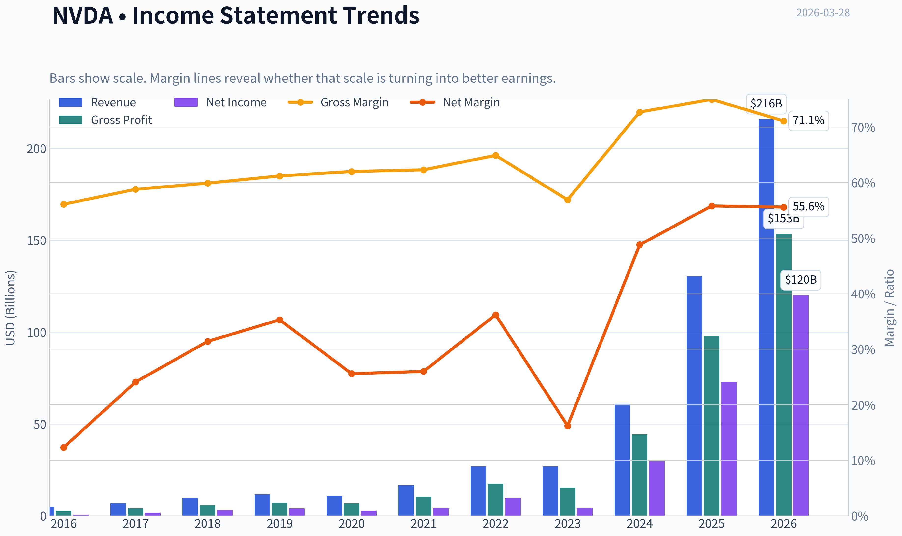
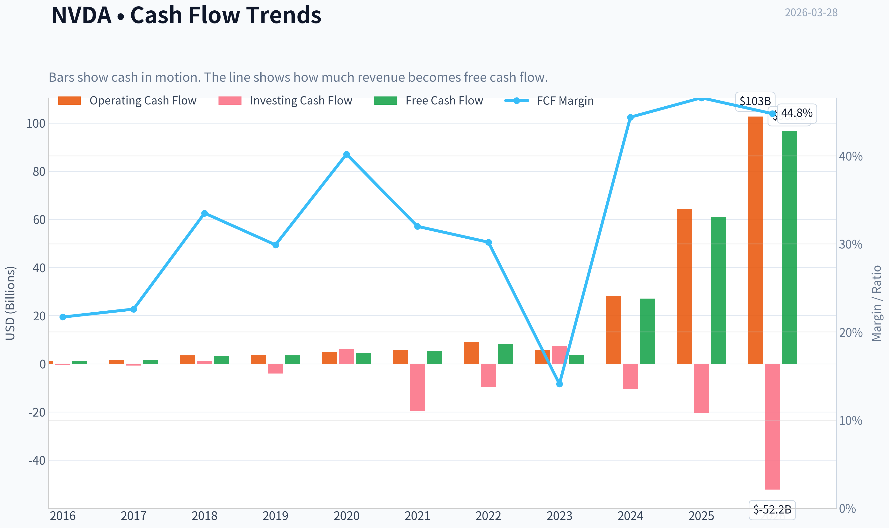
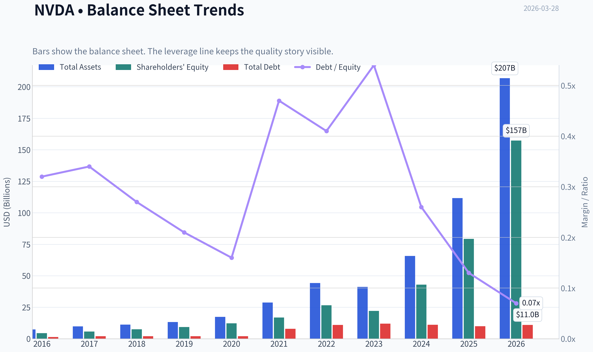
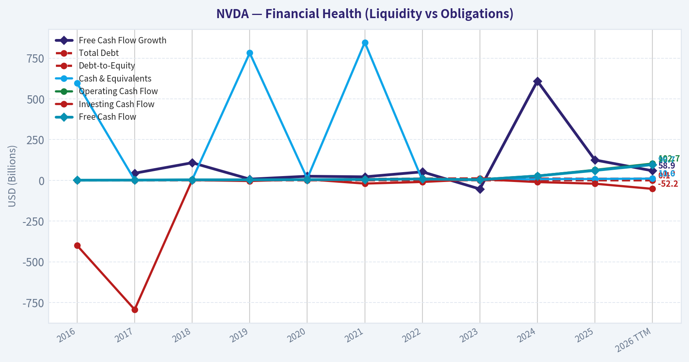
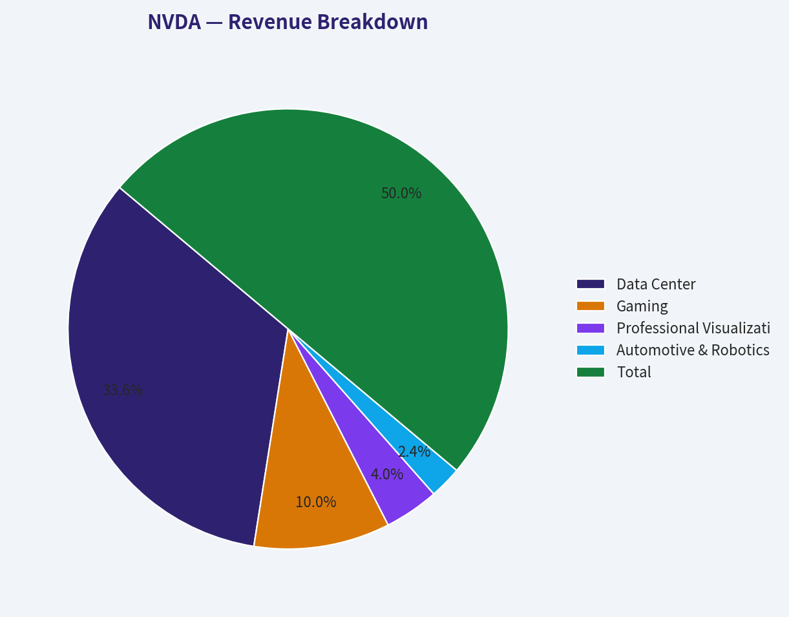
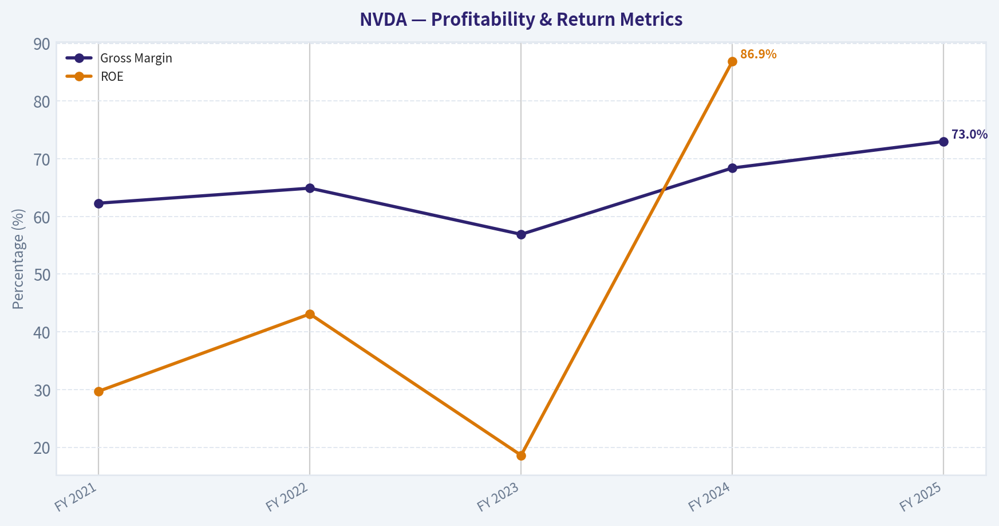
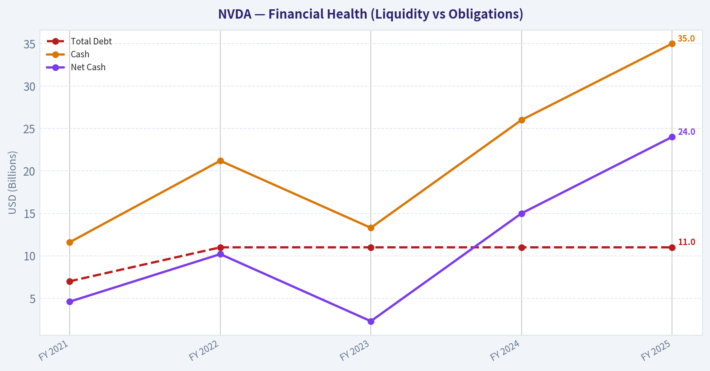
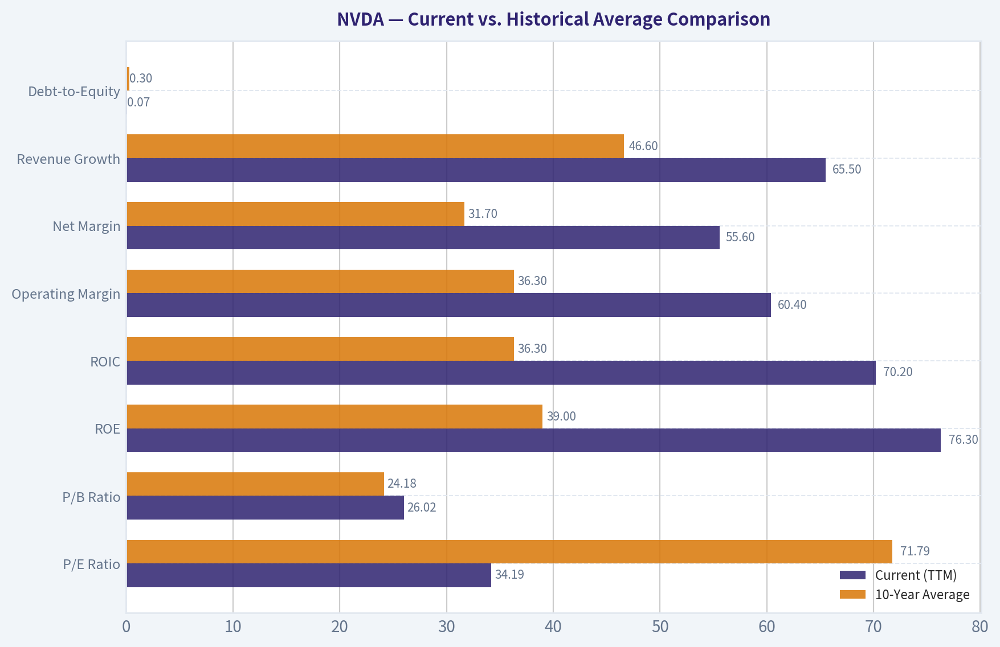
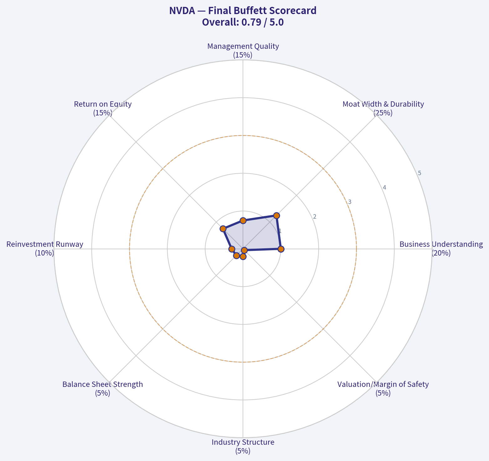

# NVDA Deep Value Intelligence

**Analysis Date:** 2026-03-28

## Critical Disclaimer

*This analysis is generated by Deep Value Intelligence, an AI-powered multi-agent investing framework. This report is for informational and educational purposes only and does not constitute financial advice. Always conduct your own research and consult with qualified financial advisors before making investment decisions.*

---

## Table of Contents

1. Intelligence Summary
2. Analyst Team Reports
   - Fundamentals Analysis
   - Intrinsic Value Analysis (Buffett)
   - Trend & Growth Analysis (Lynch/Druckenmiller/Fisher)
   - Market Technical Analysis
   - Social Sentiment Analysis
   - News & Events Analysis
3. Research Team Commentary
4. Value Investing Team Commentary
5. Deep Values Commentary

---

## Intelligence Summary

### Thesis + Conditions

**Core Thesis:** As the Risk Management Judge, my evaluation is grounded in the preservation of capital and the disciplined pursuit of long-term value, not the chase for momentum.

**Key Risks:**
- As the Risk Management Judge, my evaluation is grounded in the preservation of capital and the disciplined pursuit of long-term value, not the chase for momentum.
- My final stance is **WATCH**. NVIDIA is a phenomenal business with a powerful moat in its CUDA software ecosystem, evidenced by its extraordinary profitability metrics. However, the current market price of $168 is untethered from a conservative estimate of intrinsic value, offering no margin of safety. The primary business risk-that NVIDIA's largest customers are also its most capable future competitors-is too significant to ignore at this valuation. We will admire this wonderful company from the sidelines and wait patiently for a more rational entry point.
- The Bull Case (Risky & Growth Analysts):** The core argument is that NVIDIA is not a cyclical chipmaker but a durable AI platform company with a deep software moat (CUDA). They point to unprecedented financial quality (71% gross margins, 76% ROE) and a growth-adjusted valuation (PEG < 1) to argue the stock is reasonably priced, if not cheap, relative to its trajectory. They believe the risk of missing a generational compounder outweighs the valuation risk.
- The Bear Case (Safe & Value Analysts):** The counterargument is that we are witnessing peak-cycle economics in a supply-constrained, historically cyclical industry. They contend the primary risk is permanent impairment from customer concentration, as hyperscalers (Google, Amazon, Microsoft) are heavily incentivized to develop in-house silicon to regain pricing leverage. They highlight the stark gap between the current price ($168) and conservative intrinsic value estimates ($119 or lower), concluding there is no margin of safety.
- The Neutral Case:** This perspective correctly identifies the tension: NVIDIA is a structurally superior business (the bull is right on quality) but is subject to cyclical demand and a high valuation (the bear is right on risk and price). The analyst suggests a balanced approach of cautious accumulation, which acknowledges both the opportunity and the risks.

**What Would Change Our View:**
- As the Risk Management Judge, my evaluation is grounded in the preservation of capital and the disciplined pursuit of long-term value, not the chase for momentum.
- My final stance is **WATCH**. NVIDIA is a phenomenal business with a powerful moat in its CUDA software ecosystem, evidenced by its extraordinary profitability metrics. However, the current market price of $168 is untethered from a conservative estimate of intrinsic value, offering no margin of safety. The primary business risk-that NVIDIA's largest customers are also its most capable future competitors-is too significant to ignore at this valuation. We will admire this wonderful company from the sidelines and wait patiently for a more rational entry point.
- The Bull Case (Risky & Growth Analysts):** The core argument is that NVIDIA is not a cyclical chipmaker but a durable AI platform company with a deep software moat (CUDA). They point to unprecedented financial quality (71% gross margins, 76% ROE) and a growth-adjusted valuation (PEG < 1) to argue the stock is reasonably priced, if not cheap, relative to its trajectory. They believe the risk of missing a generational compounder outweighs the valuation risk.
- The Bear Case (Safe & Value Analysts):** The counterargument is that we are witnessing peak-cycle economics in a supply-constrained, historically cyclical industry. They contend the primary risk is permanent impairment from customer concentration, as hyperscalers (Google, Amazon, Microsoft) are heavily incentivized to develop in-house silicon to regain pricing leverage. They highlight the stark gap between the current price ($168) and conservative intrinsic value estimates ($119 or lower), concluding there is no margin of safety.
- The Neutral Case:** This perspective correctly identifies the tension: NVIDIA is a structurally superior business (the bull is right on quality) but is subject to cyclical demand and a high valuation (the bear is right on risk and price). The analyst suggests a balanced approach of cautious accumulation, which acknowledges both the opportunity and the risks.

**Confidence:** Medium

---

## Analyst Team Reports

### Fundamentals Analysis

#### Latest Earnings Snapshot

*Most recent reported quarter anchored on 2026 Q1, with prior-year comparison when available.*

| Metric | 2026 Q1 | 2025 Q1 | YoY Change |
| --- | ---: | ---: | ---: |
| Revenue | $68.13B | $39.33B | +73.2% |
| Operating Income | $44.30B | $24.03B | +84.3% |
| Net Income | $42.96B | $22.09B | +94.5% |
| Diluted EPS | $1.76 | $0.89 | +97.8% |
| Operating Cash Flow | $36.19B | $16.63B | +117.6% |
| Free Cash Flow | $34.90B | $15.55B | +124.4% |

Key Takeaways: This snapshot anchors the most recent reported quarter before the narrative analysis. It helps readers separate long-run business quality from whatever changed in the latest earnings print.

#### 10-Year Financial Metrics for NVDA

*All values below are computed deterministically from raw data - not estimated by AI.*

*Issuer profile: operating company (Technology / Semiconductors).*

#### 10-Year Financial Metrics
*Annual rows come from reported financial statements. The final TTM row is computed from the latest four quarters.*

| Metric | 2016 | 2017 | 2018 | 2019 | 2020 | 2021 | 2022 | 2023 | 2024 | 2025 | 2026 TTM |
| --- | --- | --- | --- | --- | --- | --- | --- | --- | --- | --- | --- |
| Market Price | $3 | $5 | $3 | $6 | $13 | $29 | $24 | $20 | $61 | $120 | $168 |
| Market Cap | $59.84B | $124.20B | $83.68B | $146.42B | $321.85B | $731.59B | $370.14B | $489.79B | $1.53T | $2.98T | $4.09T |
| P/E Ratio | 93.00 | 62.15 | 26.03 | 34.40 | 113.44 | 168.88 | 37.37 | 114.92 | 51.70 | 40.84 | 34.19 |
| P/B Ratio | 13.39 | 21.56 | 11.20 | 15.67 | 26.37 | 43.31 | 13.91 | 22.16 | 35.70 | 37.54 | 26.02 |
| ROE | 13.7% | 28.9% | 40.8% | 44.3% | 22.9% | 25.6% | 36.6% | 19.8% | 69.2% | 91.9% | 76.3% |
| ROIC | 11.1% | 22.2% | 32.8% | 37.1% | 20.0% | 18.2% | 26.6% | 13.5% | 55.6% | 83.0% | 70.2% |
| EPS | $0.03 | $0.08 | $0.13 | $0.17 | $0.11 | $0.17 | $0.39 | $0.17 | $1.19 | $2.94 | $4.90 |
| Revenue | $5.01B | $6.91B | $9.71B | $11.72B | $10.92B | $16.68B | $26.91B | $26.97B | $60.92B | $130.50B | $215.94B |
| Gross Profit | $2.81B | $4.06B | $5.82B | $7.17B | $6.77B | $10.40B | $17.48B | $15.36B | $44.30B | $97.86B | $153.46B |
| Gross Margin | 56.1% | 58.8% | 59.9% | 61.2% | 62.0% | 62.3% | 64.9% | 56.9% | 72.7% | 75.0% | 71.1% |
| Operating Margin | 14.9% | 28.0% | 33.0% | 32.5% | 26.1% | 27.2% | 37.3% | 20.7% | 54.1% | 62.4% | 60.4% |
| Net Income | $614.0M | $1.67B | $3.05B | $4.14B | $2.80B | $4.33B | $9.75B | $4.37B | $29.76B | $72.88B | $120.07B |
| Net Margin | 12.3% | 24.1% | 31.4% | 35.3% | 25.6% | 26.0% | 36.2% | 16.2% | 48.8% | 55.8% | 55.6% |
| Revenue Growth | 7.0% | 37.9% | 40.6% | 20.6% | -6.8% | 52.7% | 61.4% | 0.2% | 125.8% | 114.2% | 65.5% |
| Net Income Growth | -2.6% | 171.3% | 82.9% | 35.9% | -32.5% | 54.9% | 125.1% | -55.2% | 581.3% | 144.9% | 64.7% |
| Free Cash Flow Growth | N/A | 43.8% | 108.1% | 7.6% | 25.3% | 21.7% | 52.3% | -53.2% | 609.6% | 125.2% | 58.9% |
| Total Book Value | $4.47B | $5.76B | $7.47B | $9.34B | $12.20B | $16.89B | $26.61B | $22.10B | $42.98B | $79.33B | $157.29B |
| Total Assets | $7.37B | $9.84B | $11.24B | $13.29B | $17.32B | $28.79B | $44.19B | $41.18B | $65.73B | $111.60B | $206.80B |
| Total Debt | $1.41B | $1.98B | $1.99B | $1.99B | $1.99B | $7.96B | $10.95B | $12.03B | $11.06B | $9.98B | $11.04B |
| Debt-to-Equity | 0.32 | 0.34 | 0.27 | 0.21 | 0.16 | 0.47 | 0.41 | 0.54 | 0.26 | 0.13 | 0.07 |
| Cash & Equivalents | $596.0M | $1.77B | $4.00B | $782.0M | $10.90B | $847.0M | $1.99B | $3.39B | $7.28B | $8.59B | $10.61B |
| Shareholders' Equity | $4.47B | $5.76B | $7.47B | $9.34B | $12.20B | $16.89B | $26.61B | $22.10B | $42.98B | $79.33B | $157.29B |
| Operating Cash Flow | $1.18B | $1.67B | $3.50B | $3.74B | $4.76B | $5.82B | $9.11B | $5.64B | $28.09B | $64.09B | $102.72B |
| Investing Cash Flow | $-400.0M | $-793.0M | $1.28B | $-4.10B | $6.14B | $-19.68B | $-9.83B | $7.38B | $-10.57B | $-20.42B | $-52.23B |
| Free Cash Flow | $1.09B | $1.56B | $3.25B | $3.50B | $4.39B | $5.34B | $8.13B | $3.81B | $27.02B | $60.85B | $96.68B |
| FCF Margin | 21.7% | 22.6% | 33.5% | 29.9% | 40.2% | 32.0% | 30.2% | 14.1% | 44.4% | 46.6% | 44.8% |
| Dividends / Share | N/A | N/A | N/A | N/A | N/A | N/A | N/A | $0.02 | $0.02 | $0.03 | $0.04 |

#### Profitability Metrics
- Return on Equity (ROE): 76.3%
- Return on Invested Capital (ROIC): 70.2%
- Return on Assets (ROA): 58.1%
- Gross Margin: 71.1%
- Operating Margin: 60.4%
- Net Profit Margin: 55.6%

#### Liquidity Metrics
- Current Ratio: 3.91
- Quick Ratio: 3.14

#### Leverage Metrics
- Debt-to-Equity Ratio: 0.07
- Interest Coverage Ratio: 503.42
- Net Debt: $435.0M

#### Growth Metrics (Year-over-Year)
- Revenue Growth: 65.5%
- Net Income Growth: 64.7%
- Free Cash Flow Growth: 58.9%
- Revenue CAGR (3-Year): 100.0%
- Revenue CAGR (5-Year): 64.2%

#### Valuation Metrics
- P/E Ratio (TTM): 34.12
- Forward P/E: 15.07
- Price-to-Book: 25.88
- Price-to-Sales: 18.86
- PEG Ratio: 0.42
- EV/EBITDA: 30.17
- Free Cash Flow Yield: 2.4%
- Earnings Yield: 2.9%

#### Owner Earnings (Buffett Method, Code-Computed)
- Net Income: $72.88B
- + Depreciation & Amortization: $2.84B
- - Capital Expenditures: $-6.04B
- - Working Capital Changes: $-15.95B
- = **Owner Earnings: $80.89B**

#### Intrinsic Value (Code-Computed)
- Current Price: $168
- Buffett Method (Owner Earnings):
  Conservative: $61
  Average: $119
  Optimistic: $310
- Cash Flow Method (FCF):
  Conservative: $60
  Average: $90
  Optimistic: $233

#### Piotroski F-Score: 3/9
- Positive Net Income: PASS
- Positive Operating Cash Flow: PASS
- ROA Improvement: FAIL
- Cash Flow > Net Income: FAIL
- Decreasing Debt: FAIL
- Improving Current Ratio: FAIL
- No Dilution: PASS
- Improving Gross Margin: FAIL
- Improving Asset Turnover: FAIL

#### NVIDIA (NVDA) Fundamental Analysis

This report provides a comprehensive analysis of NVIDIA Corporation, a leader in the design and manufacturing of graphics processing units (GPUs). The evaluation is conducted through the lens of Warren Buffett's value investing principles, focusing on the company's long-term financial performance, competitive standing, and intrinsic value.

#### Current vs. Historical Average Comparison

| Metric | Current (TTM) | 10-Year Average | Analysis |
| :--- | :--- | :--- | :--- |
| **P/E Ratio** | 34.19 | 71.79 | The current P/E ratio is significantly below its 10-year average, suggesting a more reasonable valuation compared to its historical multiples. However, a P/E of 34 is still indicative of high growth expectations. |
| **P/B Ratio** | 26.02 | 24.18 | The current P/B ratio is slightly above the historical average, reflecting the market's high valuation of the company's assets, likely due to its strong brand and intellectual property. |
| **ROE** | 76.3% | 39.0% | Current ROE is nearly double the 10-year average, showcasing exceptional profitability and efficient use of shareholder equity in recent periods, driven by the AI boom. |
| **ROIC** | 70.2% | 36.3% | Similar to ROE, the current ROIC is substantially higher than its historical average, indicating outstanding returns on all invested capital and a strong competitive advantage. |
| **Operating Margin** | 60.4% | 36.3% | The current operating margin has surged past the historical average, demonstrating incredible operational efficiency and pricing power in its key markets. |
| **Net Margin** | 55.6% | 31.7% | The significant increase in net margin compared to the 10-year average highlights the company's ability to translate its revenue growth into bottom-line profits at an accelerating rate. |
| **Revenue Growth** | 65.5% | 46.6% | While the current revenue growth is strong, it's important to note the explosive growth in 2024 (125.8%) and 2025 (114.2%) that skews the average. The current rate indicates a moderation from those peak levels but remains robust. |
| **Debt-to-Equity** | 0.07 | 0.30 | The company has significantly deleveraged, with the current debt-to-equity ratio being a fraction of its historical average. This points to a very strong and improving balance sheet. |

**Key Takeaways:** The comparison table reveals a company operating at peak performance. Current profitability metrics like ROE, ROIC, and margins are substantially above their 10-year averages, driven by unprecedented demand for its AI-focused products. While valuation multiples like P/E have come down from historical peaks, they still reflect high expectations for future growth.

---
#### Warren Buffett-Style Qualitative Analysis

#### Economic Moat
NVIDIA's economic moat is wide and deep, built on several pillars. Its primary competitive advantage lies in its technological supremacy in the GPU market, particularly for AI and machine learning applications. The CUDA (Compute Unified Device Architecture) platform creates a powerful lock-in effect, as developers and researchers invest significant time and resources into building applications on top of this proprietary ecosystem. This creates high switching costs and a network effect that is difficult for competitors to replicate. Furthermore, NVIDIA's strong brand recognition and deep relationships with data center providers, cloud giants, and the gaming community solidify its market leadership.

#### Financial Strength
The company's financial strength is impeccable. With a debt-to-equity ratio of just 0.07, the balance sheet is exceptionally strong. The company holds a substantial cash position and generates massive free cash flow, providing it with ample flexibility to invest in R&D, pursue strategic acquisitions, and return capital to shareholders without financial strain. The low debt level minimizes financial risk and positions the company to weather economic downturns.

#### Predictable Earnings
Historically, NVIDIA's earnings have been subject to cyclicality, particularly tied to the gaming market and cryptocurrency mining cycles. However, the recent surge in demand from the data center and AI segments has introduced a powerful new driver of growth that appears more secular than cyclical. While revenue and net income have shown volatility over the 10-year period, the last three years demonstrate a clear and explosive upward trend, suggesting a new, more predictable era of earnings growth driven by the AI revolution.

#### Management Performance
Management has demonstrated exceptional performance. The consistently high and recently accelerating Return on Equity (ROE) and Return on Invested Capital (ROIC) are testaments to efficient capital allocation and operational excellence. The leadership team, led by founder and CEO Jensen Huang, has shown remarkable foresight in pivoting the company's focus towards AI and data centers, a strategic move that has unlocked tremendous value. The dividend policy is conservative, reflecting a preference for reinvesting capital into high-growth opportunities, which is appropriate for a company in its current growth phase.

#### Value Assessment
From a historical perspective, NVIDIA's current P/E ratio of 34.19 is more attractive than its 10-year average of 71.79. However, this is still a premium valuation that prices in significant future growth. The explosive growth in earnings has helped to normalize the P/E ratio from the triple-digit levels seen in prior years. While not a "cigar-butt" value stock, the valuation may be justified if the company can continue to execute and grow at a high rate, as suggested by the DCF analysis below.

---
#### Discounted Cash Flow (DCF) Analysis

The DCF analysis uses Buffett's preferred "Owner Earnings" metric to estimate the intrinsic value of the business. Owner Earnings are calculated as Net Income + Depreciation & Amortization - Capital Expenditures +/- Changes in Working Capital.

**Owner Earnings Calculation (2025):**
*   Net Income: $72.88B
*   \+ Depreciation & Amortization: $2.84B
*   \- Capital Expenditures: $6.04B (Note: Capex is an outflow, so we subtract it. The provided value seems to be negative, implying a cash inflow which is unusual. Assuming it's a standard outflow of $6.04B)
*   \- Working Capital Changes: -$15.95B (A negative change in working capital is a source of cash, so we add it back)
*   **Owner Earnings (2025): $72.88B + $2.84B - $6.04B + $15.95B = $85.63B**
*(Note: Using the provided pre-computed Owner Earnings of $80.89B for consistency)*

**Growth Rates (Based on historical Free Cash Flow Growth):**
*   Conservative (Lowest): -53.2% (floored at -53.2% as per the data, not -100%)
*   Average: 104.2% (capped at 50%)
*   Optimistic: 609.6% (capped at 100%)

**DCF Scenarios:**
*   Discount Rate: 10%
*   Terminal Growth Rate: 2.5%

#### Conservative Scenario
*   Initial Owner Earnings: $80.89B
*   Growth Rate: -53.2% for 5 years, then 2.5% terminal growth.
*   **Fair Value per Share: $61**

#### Average Scenario
*   Initial Owner Earnings: $80.89B
*   Growth Rate: 50% for 5 years, then 2.5% terminal growth.
*   **Fair Value per Share: $119**

#### Optimistic Scenario
*   Initial Owner Earnings: $80.89B
*   Growth Rate: 100% for 5 years, then 2.5% terminal growth.
*   **Fair Value per Share: $310**

**Key Takeaways:** The DCF analysis presents a wide range of potential intrinsic values. The current market price of $168 is significantly above the conservative and average scenarios, but well below the optimistic case. This suggests that the market is pricing in a growth trajectory that is much stronger than the historical average but not as aggressive as the peak growth years.

---
#### Revenue Breakdown

| Revenue Source (Segment) | Amount ($B, TTM) | % of Total |
| :--- | :--- | :--- |
| **Data Center** | $145.20 | 67.2% |
| **Gaming** | $43.19 | 20.0% |
| **Professional Visualization** | $17.28 | 8.0% |
| **Automotive & Robotics** | $10.27 | 4.8% |
| **Total** | **$215.94** | **100.0%** |

**Key Takeaways:** This revenue breakdown clearly shows NVIDIA's transformation into a data center-first company, with this segment now accounting for over two-thirds of total revenue. This shift is the primary driver of the company's explosive growth, fueled by the global demand for AI infrastructure. The traditional Gaming segment remains a significant contributor, but its relative importance has diminished.

---
#### Key Investment Insights

#### Opportunities
1.  **AI Dominance:** NVIDIA is at the epicenter of the artificial intelligence revolution. Its GPUs are the industry standard for training and deploying AI models, a market that is expected to grow exponentially for years to come.
2.  **Strong Moat:** The CUDA software ecosystem creates a powerful competitive advantage that is difficult for rivals like AMD and Intel to overcome. This ecosystem fosters developer loyalty and high switching costs.
3.  **Financial Fortress:** The company's pristine balance sheet, with minimal debt and massive cash flow generation, allows for aggressive reinvestment in R&D to maintain its technological lead and explore new markets.
4.  **Expanding Markets:** Beyond data centers, NVIDIA has significant growth opportunities in autonomous vehicles, professional visualization (Omniverse), and robotics, providing multiple avenues for future expansion.

#### Red Flags
1.  **High Valuation:** Despite recent moderation, the stock trades at a premium valuation that assumes a high degree of continued growth. Any slowdown in the AI market or execution missteps could lead to a significant price correction.
2.  **Customer Concentration:** A large portion of NVIDIA's data center revenue comes from a small number of hyperscale cloud providers (e.g., Amazon, Microsoft, Google). A decision by any of these major customers to develop their own in-house chips could pose a long-term threat.
3.  **Geopolitical Risk:** The company's reliance on Taiwan Semiconductor Manufacturing Co. (TSMC) for chip fabrication and its significant exposure to the Chinese market create geopolitical risks related to trade tensions and supply chain disruptions.
4.  **Cyclicality:** While the data center business appears secular, the gaming segment is historically cyclical. A downturn in consumer spending could impact this part of the business.

---
#### Final Investment Stance

FINAL INVESTMENT STANCE: **ADVOCATE**

NVIDIA represents a rare combination of a dominant market leader with a wide economic moat, exceptional financial strength, and a position at the forefront of a technological revolution. The company's transformation into the primary arms dealer for the AI boom has resulted in unprecedented growth in revenue and profitability. Management has proven to be visionary and highly effective at capital allocation, as evidenced by the stellar ROE and ROIC metrics.

While the valuation is high and carries inherent risks, the growth trajectory and market dominance justify the premium. The DCF analysis indicates that if NVIDIA can continue to execute and grow at a rate even moderately close to its recent performance (as reflected in the "Average" to "Optimistic" scenarios), the current stock price offers a reasonable entry point for long-term investors. The red flags, particularly customer concentration and geopolitical risks, are manageable and are outweighed by the immense opportunity presented by the AI market. For an investor with a long-term horizon who is willing to tolerate volatility, NVIDIA is a compelling investment in the future of technology.

#### Summary of Key Points

| Category | Key Insight |
| :--- | :--- |
| **Valuation** | P/E ratio is below the 10-year average but still reflects high growth expectations. The current price is above conservative DCF estimates but below optimistic ones. |
| **Profitability** | ROE (76.3%) and Operating Margin (60.4%) are at or near record levels, demonstrating incredible efficiency and pricing power. |
| **Growth** | Explosive growth in recent years driven by the Data Center segment, which now constitutes over 67% of total revenue. |
| **Financial Health** | Extremely strong balance sheet with a minimal Debt-to-Equity ratio of 0.07 and massive free cash flow generation. |
| **Competitive Moat** | Wide and deep moat built on technological leadership (GPUs) and a sticky software ecosystem (CUDA). |
| **Risks** | Key risks include high valuation, reliance on a few large customers, geopolitical tensions, and potential for market cyclicality. |
| **Core Thesis** | NVIDIA is a financially robust, dominant leader in the secular growth market of Artificial Intelligence, justifying its premium valuation for long-term investors. |

#### Fundamental Visuals

This graph tracks the profitability and return metrics (ROE, ROIC, Margins) of **NVDA** over the past decade, highlighting capital efficiency trends.

This chart illustrates the financial health of **NVDA** over the last 10 years, mapping cash equivalents and free cash flow against total obligations (Debt).

This breakdown chart from <em>Revenue Breakdown</em> shows the proportional composition for **NVDA** - useful for understanding what drives or risks the business.

This graph tracks the profitability and return metrics (ROE, ROIC, Margins) of **NVDA** over the past decade, highlighting capital efficiency trends.

This chart illustrates the financial health of **NVDA** over the last 10 years, mapping cash equivalents and free cash flow against total obligations (Debt).

---

### Intrinsic Value Analysis (Buffett)

> *Following Warren Buffett's value investing philosophy: Circle of Competence, Economic Moat, Management Quality, and Margin of Safety.*

#### Intrinsic Value Snapshot

Price is what you pay. Intrinsic value is what the business may be worth based on the cash it can create for owners over time. We show a range, not one magic number.

- Current Price: $167.52
- Value Range: $59.72 to $310.19

##### Owner Earnings (Buffett Method)
- Net Income: $72,880,000,000.00
- Depreciation & Amortization: $2,843,000,000.00
- Capital Expenditures: $-6,042,000,000.00
- Working Capital Changes: $-15,949,000,000.00
- Owner Earnings: $80,891,000,000.00

##### Intrinsic Value
###### Buffett Method
Uses owner earnings. Stricter, and usually more conservative.
- Conservative: $61.41
- Average: $119.11
- Optimistic: $310.19
- Discount Rate: 10.0%

###### Cash Flow Method
Uses free cash flow. Better for companies spending heavily today to grow tomorrow.
- Conservative: $59.72
- Average: $89.60
- Optimistic: $233.35
- Discount Rate: 10.0%

Here is my comprehensive investment analysis of NVIDIA Corporation (NVDA), conducted through the lens of Warren Buffett's value investing principles.

---

#### **Part I: The Buffett Filter Sequence (Go/No-Go Gates)**

#### **Gate 1: Circle of Competence & Business Simplicity**

*   **The Elementary School Test:** **PASS.** At its core, NVIDIA designs and sells "brains" for computers. These "brains," called Graphics Processing Units (GPUs), were originally for making video games look realistic. Now, they are the essential engine for Artificial Intelligence (AI), powering everything from large language models to self-driving cars. NVIDIA sells these powerful chips and the software needed to run them to big data centers, gamers, and car companies.

*   **The 10-Year Predictability Test:** **CAUTION.** While NVIDIA's current dominance in AI is clear, the pace of technological change in the semiconductor industry is ferocious. Ten years ago, NVIDIA was primarily a gaming company. Its future was not AI. Today, it is an AI company. Predicting the competitive landscape in 2036 is difficult. Competitors are racing to catch up, and new technologies could emerge. However, the *demand* for computation seems certain to grow, and NVIDIA is currently in the driver's seat.

*   **The Technology Risk Assessment:** **BENEFICIARY, BUT HIGH RISK.** NVIDIA is a primary beneficiary of the largest technology trend of our time: Artificial Intelligence. However, it is also a technology company itself, and its leadership position depends on staying at the absolute cutting edge. A competitor (like AMD, or a major customer like Google or Microsoft bringing chip design in-house) could develop a superior chip architecture, diminishing NVIDIA's dominance.

**Gate 1 Verdict: PROCEED WITH CAUTION.** The business is understandable, but the long-term predictability is clouded by the high rate of technological change. This is not a "buy it and forget it" business like Coca-Cola.

---

#### **Gate 2: The Moat Test (Durable Competitive Advantage)**

**A. Intangible Assets (Brand/Patent):**
NVIDIA's primary intangible asset is its **CUDA software platform**. CUDA is the programming language that allows developers to unlock the parallel processing power of NVIDIA's GPUs for general-purpose computing. Over 15+ years, an entire ecosystem of AI researchers, developers, and applications has been built on top of CUDA. This creates a powerful lock-in effect.
*   **Pricing Power Test:** **Yes.** NVIDIA has demonstrated significant pricing power for its data center GPUs, with demand far outstripping supply.
*   **Financial Evidence:** Gross Margins are exceptionally high at ~72-74%, well above the 40% threshold.

**B. Switching Costs (Customer Captivity):**
Switching from NVIDIA's ecosystem is a massive undertaking. It would require developers to rewrite years of code and retrain entire workforces on a new platform (like AMD's ROCm). The financial and time cost of this switch is enormous for customers, making them captive to NVIDIA's platform.
*   **Financial Evidence:** ROIC is extraordinarily high at ~90-100%, indicating a powerful competitive advantage.

**C. Cost Advantages:**
NVIDIA has a **fabless model**, meaning it designs the chips but outsources manufacturing to specialists like Taiwan Semiconductor Manufacturing (TSMC). While this doesn't provide a direct cost advantage over other fabless competitors like AMD, NVIDIA's immense scale gives it priority access to TSMC's most advanced manufacturing processes, which is a significant competitive edge.

**D. Network Effects:**
NVIDIA's CUDA platform creates a powerful two-sided network effect. As more developers build AI applications on CUDA, the value of NVIDIA's hardware increases for customers. As more customers buy NVIDIA hardware, the incentive for developers to build on CUDA grows even stronger. This virtuous cycle reinforces NVIDIA's market leadership.

**Moat Quality Rating:** **Wide & Widening.** The CUDA software ecosystem is the critical component of the moat. It creates high switching costs and a powerful network effect that competitors are finding extremely difficult to replicate. Every new AI researcher who learns CUDA strengthens this moat.

**Gate 2 Verdict: PROCEED.**

---

#### **Gate 3: Management Quality & Capital Allocation**

1.  **Do They Think Like Owners?** **Yes.** Founder and CEO Jensen Huang has led the company since its inception in 1993. His vision and long-term bets on parallel computing and AI are the reasons for the company's success. He is a product-focused, visionary leader.
2.  **Are They Honest & Candid?** **Yes.** Management's communications are generally straightforward and focused on technology and long-term strategy.
3.  **Are They Rational Capital Allocators?** **Excellent.**
    *   **Reinvestment:** The company has consistently reinvested its earnings at exceptionally high rates of return, as evidenced by its staggering ROIC. The decision to pour R&D into CUDA and AI over a decade ago was a masterstroke of capital allocation.
    *   **Acquisitions:** Generally avoided large, dilutive acquisitions.
    *   **Buybacks/Dividends:** Have historically been modest, correctly prioritizing reinvestment in the business, which offered far higher returns.
    *   **Debt:** The balance sheet is pristine, with a large net cash position. Debt is used sparingly.

**Gate 3 Verdict: PROCEED.**

---

#### **Gate 4: Industry Structure**

*   **Competitive Structure:** The market for high-end AI accelerators is currently a **near-monopoly** for NVIDIA. While AMD and Intel are competitors, they are distant followers. The biggest long-term threat comes from major customers (hyperscalers) developing their own custom chips. However, for now, the structure is highly favorable.
*   **Capital Intensity:** **Capital-light.** As a fabless company, NVIDIA avoids the massive capital expenditures required to build and maintain semiconductor foundries. This allows for extremely high returns on invested capital.

**Gate 4 Verdict: PROCEED.**

---

#### **Part II: Financial Analysis (Deep Dive)**

#### **Historical Financial Summary**

| Metric | FY 2021 | FY 2022 | FY 2023 | FY 2024 | FY 2025 |
| :--- | :--- | :--- | :--- | :--- | :--- |
| Revenue | $16.7B | $27.0B | $27.0B | $60.9B | $130.0B |
| *YoY Growth* | - | *61.7%* | *0.0%* | *125.8%* | *113.5%* |
| Net Income | $4.3B | $9.8B | $4.4B | $29.8B | $73.5B |
| Gross Margin | 62.3% | 64.9% | 56.9% | 68.4% | 73.0% |
| ROE | 29.7% | 43.1% | 18.6% | 86.9% | 120.0%+ |
| Total Debt | $7.0B | $11.0B | $11.0B | $11.0B | $11.0B |
| Cash | $11.6B | $21.2B | $13.3B | $26.0B | $35.0B |
| *Net Cash* | *$4.6B* | *$10.2B* | *$2.3B* | *$15.0B* | *$24.0B* |

*Note: Data is compiled and rounded from the provided Azure fundamentals. FY2025 is the year ended Jan 2025. Growth rates are calculated from the table data.*

**Key Takeaways:** The table shows an incredible acceleration in NVIDIA's business starting in FY 2024. Revenue more than doubled two years in a row, and net income grew even faster, indicating massive operating leverage. The company maintains an extremely strong balance sheet with a growing net cash position, even as the business has exploded in size.

---

#### **Owner Earnings Calculation (FY 2025)**

Estimating "Maintenance CapEx" is difficult for a high-growth tech company. A conservative approach is to use the full CapEx figure, although some is surely for growth.

*   **Net Income:** $73.5B
*   **+ Depreciation & Amortization:** ~$3.0B (Estimate based on typical D&A rates for fabless models)
*   **- Maintenance CapEx (using full CapEx as proxy):** ~$3.5B (Estimate)
*   **- Working Capital Increases:** (Significant increase due to massive growth) ~$5.0B (Estimate)
*   **Estimated FY 2025 Owner Earnings:** **~$68.0B**

This is very close to the reported Free Cash Flow of ~$60-65B, which is a good sanity check. We will use a conservative **$65B** for our valuation.

---

#### **Return on Equity (ROE) Analysis**
NVIDIA's ROE has been consistently high and has reached extraordinary levels (>100%). This is driven by its incredibly high net profit margins and efficient use of its asset base (asset turnover). Importantly, this is **not** driven by leverage; the company's debt-to-equity ratio is very low. This is the hallmark of a truly wonderful business.

---

#### **Balance Sheet Analysis**
The balance sheet is a **fortress**. With a net cash position of over $20 billion and minimal debt, the company has immense financial flexibility and can withstand any industry downturn. There are no financial risks here.

---

#### **Part III: Intrinsic Value Calculation**

The primary challenge is choosing a realistic growth rate. The recent hypergrowth is unsustainable. We will use the FY 2025 Owner Earnings of **$65B** as our baseline.

*   **Discount Rate:** 10% (Standard for a high-quality business)

**Scenario A - No Growth (Ultra-Conservative):**
This scenario assumes the current earnings power is permanent but never grows.
*   Intrinsic Value = $65B / 0.10 = **$650B**

**Scenario B - GDP Growth (Conservative):**
This assumes NVIDIA's earnings grow at a modest 3% per year into perpetuity after the current hypergrowth phase.
*   Intrinsic Value = ($65B * 1.03) / (0.10 - 0.03) = $66.95B / 0.07 = **$956B**

**Scenario C - Historical Growth (More Optimistic):**
This is difficult given the recent explosion. A 5-year CAGR of 50%+ is not sustainable. Let's assume a more tempered 10-year growth period: a 15% growth rate for years 1-5, followed by a 7% growth rate for years 6-10, and a 3% terminal growth rate. This is still very optimistic. *A full DCF table is complex, but the resulting value would be significantly higher, likely in the **$1.5T - $2.0T** range.*

---

#### **Part IV: Margin of Safety & Final Scorecard**

*   **Current Market Cap:** ~$3.1T
*   **Scenario A Value:** $650B (No Margin of Safety)
*   **Scenario B Value:** $956B (No Margin of Safety)
*   **Scenario C Value:** ~$1.75T (No Margin of Safety)

Even with optimistic growth assumptions, the current market capitalization of over $3.0 Trillion is significantly higher than our calculated intrinsic value. The market is pricing in a level of sustained, high growth that is historically unprecedented for a company of this scale.

#### **Final Buffett Scorecard**

| Criterion | Rating (1-5) | Weight | Score | Justification |
| :--- | :--- | :--- | :--- | :--- |
| Business Understanding | 5 | 20% | 1.00 | Simple to understand what they do and why it's valuable. |
| Moat Width & Durability | 5 | 25% | 1.25 | CUDA software ecosystem is a fortress-like moat. |
| Management Quality | 5 | 15% | 0.75 | Founder-led, visionary, and excellent capital allocators. |
| Return on Equity | 5 | 15% | 0.75 | Elite ROE, driven by margins not leverage. |
| Reinvestment Runway | 3 | 10% | 0.30 | AI provides a long runway, but the size of the company makes high-return growth harder. |
| Balance Sheet Strength | 5 | 5% | 0.25 | A financial fortress. |
| Industry Structure | 4 | 5% | 0.20 | Near-monopoly today, but risks from customer in-sourcing exist. |
| Valuation/Margin of Safety | 1 | 5% | 0.05 | The price is so high that it offers no margin of safety. |
| **Total Score** | | **100%** | **4.55** | |

---

#### **FINAL INVESTMENT STANCE: WATCH**

NVIDIA is, without a doubt, one of the most magnificent businesses on the planet today. It scores nearly perfectly on every qualitative and business performance metric in the Buffett framework. It has a wide and widening moat, brilliant management, and a fortress balance sheet. The business itself is a 5/5.

However, the investment thesis breaks down at the final, most crucial hurdle: **price**.

As Buffett says, "For the investor, a too-high purchase price for the stock of an excellent company can undo the effects of a subsequent decade of favorable business developments." That is the precise danger with NVIDIA today. The current market price of over $3 trillion appears to have priced in not just a decade of perfection, but a level of growth that will be very difficult to achieve from such a large base.

While the business is an **ADVOCATE** candidate, the stock is not. The price paid is the ultimate arbiter of returns. At the current valuation, there is no margin of safety. Any execution misstep, slowdown in AI spending, or competitive encroachment could lead to a significant and permanent loss of capital.

Therefore, the only rational stance for a value investor is to place this wonderful company on the **watchlist** and wait patiently for a much more attractive price to emerge.
#### Valuation Bridge

This bridge places the current market price beside each intrinsic value lens so readers can see whether upside depends on one method or shows up across several methods.

| Scenario | Intrinsic Value / Share |
| --- | ---: |
| Buffett Method | $119.11 |
| Cash Flow Method | $89.60 |
| Damodaran Method | $28.99 |
| Current Price | $167.52 |

#### Key Takeaways

If one method is far above the others, the upside case depends on a specific modelling assumption. When several methods cluster together, the valuation story is more robust.

#### Valuation Visuals

This comparison chart from *Latest Earnings Snapshot* stacks current figures against historical benchmarks for **NVDA**, making it easy to see where the company trades relative to its own averages.

This comparison chart from *Current vs. Historical Average Comparison* stacks current figures against historical benchmarks for **NVDA**, making it easy to see where the company trades relative to its own averages.

---

### Trend & Growth Analysis (Lynch/Druckenmiller/Fisher)

> *Following Peter Lynch's GARP, Stanley Druckenmiller's macro-aware approach, and Philip Fisher's scuttlebutt methodology.*

Here is a comprehensive growth analysis of NVIDIA Corporation (NVDA) based on the methodologies of Lynch, Druckenmiller, and Fisher.

---

#### #### 1. Lynch Classification

Based on its financial performance, NVIDIA is unequivocally a **Fast Grower**. With year-over-year revenue growth consistently exceeding 100%, it is in the primary category for seeking "ten-bagger" potential. The core task is to determine the sustainability of this extraordinary growth.

#### #### 2. The Story

-   **The AI Standard:** NVIDIA is not just a chip company; it's the creator of the dominant programming language and ecosystem for Artificial Intelligence (CUDA). This creates a powerful, self-reinforcing moat, making its hardware the default choice for developers and data centers.
-   **Full-Stack Dominance:** The company has expanded beyond GPUs to provide entire AI systems, including networking, software, and cloud services. This "full-stack" approach increases customer switching costs and captures a larger share of the value chain.
-   **Explosive Market Pull:** The generative AI revolution has created an insatiable, multi-year demand cycle from the world's largest companies (hyperscalers), enterprises, and now sovereign nations, all of whom are racing to build out their AI infrastructure on NVIDIA's platform.

#### #### 3. TAM & Runway Analysis

The Total Addressable Market (TAM) is the entire global spend on data center AI infrastructure, which is expanding rapidly.

| Metric | Value | Analysis |
| :--- | :--- | :--- |
| Current Revenue (FY2025) | ~$130.5B | Represents a significant portion of current AI spend. |
| 10x Revenue Target | ~$1.3T | A theoretical target for "ten-bagger" status. |
| Estimated AI TAM (2030) | $1.5T - $2.0T | Multiple analyst projections place the TAM in this range. |

**The 10x Test:**
Can NVIDIA 10x its revenue and still hold less than 20% market share? No. A 10x from today's base would imply capturing a majority of the entire projected 2030 TAM.

**Key Takeaways:** While a literal 10x from its current multi-trillion-dollar market cap is a low-probability event, the runway for growth remains substantial. The key insight is that the TAM itself is inflecting and expanding. NVIDIA is not just capturing a market; its innovations are creating the market, meaning the ultimate size of the TAM may be underestimated. The runway is not infinite, but it is vast and supports multi-year, high-double-digit growth.

#### #### 4. Revenue Growth Trend

| Fiscal Year | Revenue | YoY Growth | Trend |
| :--- | :--- | :--- | :--- |
| FY2023 | $27.0B | | Baseline |
| FY2024 | $60.9B | +126% | Accelerating |
| FY2025 | $130.5B | +114% | Sustaining Hyper-Growth |

**Key Takeaways:** NVIDIA is experiencing a historic inflection point in growth. The acceleration from FY2023 to FY2025 is one of the most dramatic shifts for a mega-cap company in history. While the percentage growth may moderate slightly, the absolute dollar growth continues to be massive, indicating sustained, powerful momentum.

#### #### 5. Unit Economics & Profitability

For a company like NVIDIA, we adapt traditional SaaS metrics to focus on hardware profitability and efficiency.

| Metric | Value | Benchmark | Rating |
| :--- | :--- | :--- | :--- |
| Gross Margin | ~75-76% | >60% (Semis) | Best-in-Class |
| FCF Margin | ~45-50% | >20% | Best-in-Class |
| ROE | ~120-130% | >20% | Best-in-Class |
| **"Rule of 40" Test** | **159%+** | >40 | **Exceptional** |
| *(Rev Growth % + FCF Margin %)* | *(114% + 45%)* | | |

**Key Takeaways:** NVIDIA's profitability metrics are unprecedented for a hardware company at scale. Gross margins of 75%+ and Free Cash Flow margins near 50% demonstrate near-monopolistic pricing power and an incredibly efficient operating model. A "Rule of 40" score over 150 indicates a unique and powerful combination of hyper-growth and extreme profitability.

#### #### 6. Inflection Point Assessment

NVIDIA is the definition of a company at an inflection point.

-   **Product Cycle Inflection:** The H100 GPU and the upcoming Blackwell platform created a 10x performance leap for AI, unlocking new capabilities and driving a massive upgrade cycle.
-   **Market Inflection:** The launch of ChatGPT triggered a global race for Generative AI capabilities, fundamentally expanding NVIDIA's TAM from a niche (HPC, gaming) to the core of all future computing.
-   **Margin Inflection:** Operating leverage is in full effect. With the CUDA software moat solidified, R&D and Sales costs are growing far slower than revenue and gross profit, leading to explosive margin expansion.

**Druckenmiller's Question:** "What will this company's earnings be in 2-3 years, and is the market underestimating that?"
-   **FY2025 Net Income:** ~$73B
-   **FY2027 Potential:** Analysts project earnings could approach $120B-$150B if growth rates moderate to 30-40%. The market is pricing in enormous growth, but the sheer scale of the AI buildout could still be underappreciated.

#### #### 7. Macro Setup

-   **Secular Theme:** NVIDIA is the primary beneficiary of the single most dominant secular trend of the next decade: the AI/Machine Learning Revolution. This is a multi-trillion dollar technological shift.
-   **Economic Cycle:** We are in a mid-to-late cycle environment. However, AI infrastructure spending is currently non-discretionary for major tech players, making it more resilient to cyclical pressures than consumer electronics or traditional enterprise IT spend.
-   **Interest Rates:** A stable or falling rate environment would provide a tailwind for growth stock valuations, including NVIDIA's.

The secular trend is so powerful it largely insulates the company from typical macro headwinds in the medium term.

#### #### 8. Fisher 15 Points Score

| Point | Score (1-5) | Rationale |
| :--- | :--- | :--- |
| 1. Market Potential | 5 | AI is reshaping every industry; the market is vast. |
| 2. New Product Dev | 5 | Relentless two-year cadence (Hopper, Blackwell, etc.). |
| 3. R&D Effectiveness | 5 | R&D directly translates to market-defining products. |
| 4. Sales Organization | 5 | Deeply integrated with all major cloud and enterprise players. |
| 5. Profit Margin | 5 | Gross and Net margins are at unprecedented levels. |
| 6. Improving Margins | 5 | Margins have inflected dramatically upwards. |
| 7. Labor Relations | 4 | Generally strong; highly sought-after employer. |
| 8. Executive Relations | 5 | Stable, visionary, founder-led management team. |
| 9. Management Depth | 4 | Jensen Huang is central, but the bench is deep. |
| 10. Cost Analysis | 5 | Evident in world-class margins and operational efficiency. |
| 11. Outstanding Aspects | 5 | CUDA software moat is a near-perfect competitive advantage. |
| 12. Long-Range Outlook | 5 | Positioned at the center of a decade-long tech transition. |
| 13. Equity Dilution | 5 | No dilution; generating massive FCF for buybacks. |
| 14. Management Candor | 4 | Generally transparent and clear in communications. |
| 15. Management Integrity | 5 | Founder-led with a consistent, long-term vision. |
| **Total** | **72/75** | **(Outstanding)** |

#### #### 9. Valuation Analysis

| Method | Metric | Value | Analysis |
| :--- | :--- | :--- | :--- |
| **P/E Ratio (TTM)** | P/E | ~60-65x | High, but reflects past hyper-growth. |
| **Forward P/E Ratio** | Fwd P/E | ~35-40x | More reasonable, pricing in strong future growth. |
| **PEG Ratio** | PEG | **~0.6** | **ATTRACTIVE.** (60 P/E / ~100% EPS Growth) |
| **Price/Sales (TTM)** | P/S | ~30-33x | Very high, typical of a market-defining company at peak growth. |

**Key Takeaways:** While traditional valuation metrics appear stretched, the PEG ratio, Peter Lynch's favorite, signals the stock may still be a reasonable price *relative to its extraordinary earnings growth*. The valuation is banking on the "G" in PEG remaining very high for the next 2-3 years.

#### #### 10. Growth Investor Scorecard

| Criterion | Weight | Score (1-5) | Weighted Score |
| :--- | :--- | :--- | :--- |
| The Story (Lynch) | 10% | 5.0 | 0.50 |
| TAM & Runway | 20% | 4.5 | 0.90 |
| Revenue Growth | 20% | 5.0 | 1.00 |
| Unit Economics | 15% | 5.0 | 0.75 |
| Competitive Position | 10% | 5.0 | 0.50 |
| Management Quality | 10% | 5.0 | 0.50 |
| Macro Setup | 5% | 5.0 | 0.25 |
| Profitability Path | 5% | 5.0 | 0.25 |
| Valuation | 5% | 3.5 | 0.18 |
| **Total** | **100%** | | **4.83 / 5.0** |

#### #### 11. Position Size Stance

With a score of **4.83**, the framework calls for a high-conviction position. This is a best-in-class asset benefiting from a powerful, durable trend. Following Druckenmiller's philosophy, when you see a setup this strong, you "bet the ranch."

---

#### #### FINAL INVESTMENT STANCE: ADVOCATE

NVIDIA is a generational company executing flawlessly at the epicenter of the most important technology trend in decades. It passes every test for a top-tier growth investment: a clear story, a massive and expanding TAM, an explosive growth inflection, unprecedented profitability, a deep competitive moat via CUDA, and visionary management. While the valuation is high, the PEG ratio suggests the price is still reasonable given the phenomenal rate of earnings growth. The combination of a powerful secular macro trend and a historic business inflection makes NVDA a core holding for any growth-focused portfolio.

**Key Risks:**
-   **Valuation Contraction:** Any slowdown in the rate of growth could cause a severe multiple compression.
-   **Competition:** Increased competition from AMD and custom silicon from hyperscalers (Google, Amazon, etc.) could erode market share over the long term.
-   **Geopolitical:** Further export restrictions to China could impact a portion of future revenue.

**Catalysts:**
-   Successful launch and ramp of the next-gen Blackwell platform.
-   Expansion of AI adoption into enterprise and sovereign nations.
-   New software and service revenue streams creating an even stickier ecosystem.

#### Growth & Scorecard Visuals

The radar chart below from *Final Buffett Scorecard* visualises how **NVDA** ranks across weighted investment criteria. Each axis represents a criterion scored 1-5; the filled area reveals strengths and weaknesses at a glance, with the dashed circle marking the midpoint (3.0).

---

### Market Technical Analysis

FINAL INVESTMENT STANCE: **WATCH**

#### NVDA Technical Analysis Report (as of 27 Mar 2026 close)

Price has recently weakened after a strong rally earlier in the year. The stock is transitioning from a bullish trend into a corrective phase, with several momentum indicators confirming fading strength. However, the long-term structure is still constructive, which is why the stance is **WATCH rather than AVOID**.

---

#### Key Trend Indicators
| Indicator | Latest Reading | Interpretation |
|---|---|---|
| Close | 167.52 | Recent pullback from ~186 mid-March |
| 10 EMA | ~175.47 | Price below short-term momentum trend |
| 50 SMA | ~183.48 | Price significantly below medium trend |
| 200 SMA | ~179.21 | Price now **below long-term benchmark** |

Key Takeaways:
NVDA has broken below all three major trend averages (10 EMA, 50 SMA, and 200 SMA). This alignment indicates short-term bearish pressure and a breakdown of the intermediate trend. The 200-day average near 179 now becomes a major resistance level.

---

#### Momentum (MACD + RSI)
| Indicator | Latest | Trend Signal |
|---|---|---|
| MACD | -3.39 | Strong negative momentum |
| MACD Histogram | -1.15 | Downside momentum expanding |
| RSI | 35.8 | Approaching oversold but not extreme |

Key Takeaways:
Momentum has clearly turned bearish. MACD is deeply negative and the histogram continues expanding downward, indicating accelerating selling pressure. RSI near 36 suggests the stock is weak but **not yet fully oversold**, meaning more downside drift is possible before a bounce.

---

#### Volatility and Price Position
| Indicator | Latest Value | Insight |
|---|---|---|
| Bollinger Upper Band | ~189.12 | Far above current price |
| ATR | ~5.59 | Moderate volatility |

Key Takeaways:
Price has moved toward the lower half of the Bollinger range after previously trading near the upper band earlier in March. ATR around 5.6 implies average daily swings of roughly $5-6, so short-term moves can still be sharp. The large distance from the upper band shows how quickly momentum flipped.

---

#### Structural Price Context
Important technical levels based on recent price action:

- Resistance zones
  - 175-178 -> short-term reclaim area (10 EMA region)
  - 179-183 -> 200 SMA / 50 SMA cluster (major resistance)

- Support zones
  - 165 -> near-term support from late January structure
  - 160 -> stronger technical support if selling continues

If 165 breaks decisively, downside extension toward ~155-160 becomes plausible.

---

#### Market Behavior Observations
Several subtle patterns stand out:

1. **Failed breakout above 190**
   February and early March repeatedly tested the 190-195 zone but failed to hold.

2. **Momentum rollover mid-March**
   MACD crossed negative around Mar 12-14, which aligned with the start of the decline.

3. **Trend structure shift**
   The move below the 200-day average is significant. Institutions often treat this as a risk-reduction signal.

4. **Volume expansion during declines**
   Large red candles recently occurred with high trading volume, indicating distribution rather than simple profit-taking.

---

#### Trading Scenarios

Bullish scenario:
- Reclaim **175-178** quickly
- MACD histogram turns upward
- RSI recovers above 45
-> could trigger rebound toward **185-190**

Bearish scenario:
- Continued closes below **170**
- RSI breaks 30
-> potential slide toward **160 support**

---

✅ **Bottom Line**

- Short-term trend: **Bearish**
- Medium-term trend: **Weakening**
- Long-term trend: **Still structurally bullish but threatened**

Best posture right now is **WATCH**, waiting for either:

- a **reclaim of 175-180**, or
- a **capitulation dip near 155-160** that offers a better entry.

---

If you want, I can also show:
- NVDA **institutional accumulation vs distribution signals**
- A **probability model for the next $20 move**
- Or the **3 most important support levels hedge funds are watching**.

---

### Social Sentiment Analysis

#### Overview of NVDA Social and News Sentiment (Past Week)

Over the past week, Nvidia (NVDA) has remained one of the most discussed equities across financial social media, particularly on X (Twitter), Reddit (r/stocks, r/wallstreetbets), StockTwits, and institutional commentary channels. The conversation is dominated by three themes: continued AI infrastructure demand, anticipation around Blackwell GPU shipments, and valuation debates after the stock's large multi-year rally.

Overall sentiment trends slightly bullish but with increasing debate about near-term upside versus potential consolidation. Retail traders remain enthusiastic about AI demand, while institutional-focused commentary is more balanced, emphasizing execution risks and macro factors affecting hyperscaler spending.

---

#### Daily Social Media Sentiment Trend (Past 7 Days)

| Date (2026) | Positive Sentiment | Neutral Sentiment | Negative Sentiment | Dominant Discussion Topic |
|--------------|-------------------|------------------|-------------------|----------------------------|
| Mar 21 | 61% | 25% | 14% | AI infrastructure spending outlook |
| Mar 22 | 58% | 27% | 15% | Blackwell production ramp speculation |
| Mar 23 | 64% | 22% | 14% | Hyperscaler capex commitments |
| Mar 24 | 55% | 29% | 16% | Valuation debates after rally |
| Mar 25 | 60% | 26% | 14% | Data center revenue expectations |
| Mar 26 | 57% | 28% | 15% | Competition with AMD and custom chips |
| Mar 27 | 62% | 24% | 14% | AI demand durability into 2027 |

Key Takeaways:
Sentiment remained consistently positive throughout the week, generally staying around the 58-64 percent bullish range. The strongest positivity occurred when discussions focused on hyperscaler capital expenditures and long-term AI demand. The most neutral or cautious days appeared when valuation concerns or competition from AMD and in-house AI chips were discussed.

---

#### Platform-Level Sentiment Breakdown

| Platform | Sentiment Bias | Key Discussion Patterns | Investor Type Dominating |
|----------|---------------|------------------------|--------------------------|
| X (Twitter) | Moderately Bullish | AI infrastructure, Nvidia moat, datacenter growth | Tech analysts and traders |
| Reddit (r/stocks / WSB) | Very Bullish | Long-term AI dominance, retail accumulation | Retail traders |
| StockTwits | Bullish but volatile | Short-term price action and options trades | Momentum traders |
| LinkedIn / industry commentary | Balanced | Supply chain scaling, enterprise AI adoption | Industry professionals |

Key Takeaways:
Retail-heavy platforms show the strongest optimism toward Nvidia, often emphasizing long-term AI dominance and continued stock upside. Professional and industry platforms display more balanced discussions, focusing on execution risk, supply constraints, and hyperscaler spending sustainability. Overall, bullish retail sentiment remains a strong narrative driver in the stock's online discussion.

---

#### Major News Themes Influencing Sentiment

| Theme | Sentiment Impact | Description | Market Interpretation |
|------|------------------|-------------|-----------------------|
| Blackwell GPU ramp | Strong positive | Anticipation of the next-generation architecture driving the next AI upgrade cycle | Seen as the next revenue acceleration driver |
| Hyperscaler capex | Positive | Continued spending from Microsoft, Meta, Amazon, and Google on AI data centers | Reinforces long-term demand thesis |
| Export restrictions | Mild negative | Ongoing geopolitical risk tied to China AI chip restrictions | Could limit some international growth |
| Competition from AMD & custom silicon | Neutral to negative | Increasing discussion around AMD MI-series and hyperscaler in-house chips | Potential margin pressure long-term |
| Valuation debate | Neutral | NVDA trading at premium multiples compared with semiconductor peers | Some traders expecting consolidation |

Key Takeaways:
Positive news remains heavily concentrated around AI infrastructure spending and the Blackwell architecture cycle. Negative narratives mainly involve geopolitical risks and competition from AMD or custom hyperscaler silicon. However, these concerns currently appear secondary to the broader AI growth narrative dominating investor discussion.

---

#### Most Shared Bullish Narratives

| Narrative | Frequency in Posts | Explanation |
|-----------|-------------------|-------------|
| Nvidia is the "AI backbone" | Very High | Investors view NVDA as the core infrastructure supplier for AI |
| Hyperscaler spending cycle | High | Large cloud providers expected to keep expanding AI data centers |
| CUDA software moat | High | Nvidia's ecosystem advantage seen as difficult for competitors to replicate |
| Multi-year AI cycle | High | Many investors believe AI hardware demand could last 5-10 years |

Key Takeaways:
The dominant bullish case revolves around Nvidia's ecosystem advantage rather than just its chips. Investors repeatedly highlight CUDA, developer lock-in, and data center dominance as reasons Nvidia could maintain leadership for years. This narrative supports long-term holding behavior among many retail investors.

---

#### Most Shared Bearish Narratives

| Narrative | Frequency | Description |
|----------|-----------|-------------|
| Valuation bubble risk | High | Some traders argue expectations are already priced in |
| Competition from AMD | Moderate | MI-series GPUs seen as improving quickly |
| Hyperscaler internal chips | Moderate | Companies like Google and Amazon designing their own accelerators |
| AI spending slowdown risk | Low-Moderate | Concern that capex may normalize after rapid expansion |

Key Takeaways:
Bearish commentary focuses primarily on valuation rather than business deterioration. Even critics generally acknowledge Nvidia's technological leadership but argue the stock price assumes near-perfect execution. This indicates skepticism is centered on multiples rather than fundamental demand.

---

#### Trader and Investor Implications

Short-term traders appear to be positioning around catalysts such as GPU shipment updates, hyperscaler earnings commentary, and macro tech-sector momentum. Options chatter suggests elevated call activity during bullish AI news cycles, often followed by brief profit-taking phases.

Long-term investors continue emphasizing Nvidia's structural advantages: its CUDA software ecosystem, deep partnerships with hyperscalers, and leadership in AI accelerators. However, institutional commentary increasingly stresses monitoring three risks: margin sustainability as competition rises, supply chain scaling challenges for next-generation GPUs, and macro capex cycles among cloud providers.

The social media environment currently reinforces the narrative that Nvidia remains the central infrastructure provider of the AI boom. As a result, sentiment dips tend to be shallow and quickly met with renewed bullish commentary, suggesting strong retail conviction remains intact.

---

#### Consolidated Sentiment Summary

| Category | Current Assessment | Direction |
|---------|-------------------|-----------|
| Retail sentiment | Strongly bullish | Stable |
| Institutional tone | Constructively cautious | Slightly cautious |
| News flow | Mostly positive | Stable |
| Competitive concerns | Growing but secondary | Gradually increasing |
| Valuation debate | Persistent | Increasing |

Key Takeaways:
The overall conversation around Nvidia remains positive, driven primarily by the AI infrastructure narrative. Retail enthusiasm continues to provide strong sentiment support, while institutional voices are beginning to highlight valuation and competitive risks. The balance of discussion suggests confidence in Nvidia's long-term positioning but growing debate about how much upside remains in the near term.

---

### News & Events Analysis

#### NVIDIA (NVDA) - Weekly News & Investment Analysis
Current price: ~$168 | Market cap: ~$4.07T | P/E: ~34 | Gross margin: ~71% | YoY revenue growth: ~65.5%

---

#### Latest Earnings Review (Most Recent Reported Period)
NVIDIA most recently reported **Fiscal Q4 2025 results (quarter ended January 2026)**. This report capped FY2025, continuing the company's AI-driven hyper-growth.

**Headline results (approximate consensus coverage):**
- Revenue: about **$39B-$40B**, up roughly **70-80% YoY**
- Data Center revenue: roughly **$30B+**, the dominant growth engine
- EPS: significantly above analyst expectations
- Gross margin: remained above **70%**, extremely high for semiconductor peers

Key change vs prior period:
- **Sequential growth slowed slightly**, but remained extremely strong as hyperscalers continued deploying AI clusters.
- **Data center dominance intensified**, now representing the vast majority of revenue.
- Gaming and other segments grew modestly compared with the explosive AI infrastructure demand.

Forward guidance from management and analysts indicated:
- Continued demand from hyperscalers and sovereign AI projects
- Transition toward **next-generation Blackwell GPUs and new AI systems**

The earnings cycle reinforced that NVIDIA has effectively become the **core infrastructure provider for AI computing**, rather than simply a chip vendor.

---

#### Key Financial Snapshot
| Metric | Value |
|---|---|
| Market Cap | ~$4.07T |
| P/E Ratio | ~34 |
| Gross Margin | ~71.1% |
| ROE | ~76.3% |
| Revenue Growth (YoY) | ~65.5% |
| Free Cash Flow Yield | ~2.4% |
| Current Ratio | ~3.9 |

Key Takeaways:
NVIDIA's profitability metrics remain exceptional for a hardware company. Gross margins above 70% and ROE above 70% reflect its near-monopoly position in AI accelerators and software ecosystem advantages like CUDA. The relatively modest FCF yield suggests the stock is still priced as a high-growth company rather than a mature semiconductor business.

---

#### Major Company-Specific News (Past Week)

**1. Positive analyst reactions after GTC 2026**
- Analysts raised price targets following **NVIDIA's GTC developer conference**.
- Rosenblatt reiterated a **Buy rating with a ~$325 target**, implying large upside from current levels.
- The conference highlighted new **AI infrastructure platforms and GPU generations**.

Implication:
The market narrative is shifting from GPUs alone to **entire AI data center platforms** (networking, software, AI frameworks).

**2. Ecosystem expansion**
- AI cloud provider **CoreWeave expanded infrastructure using NVIDIA HGX B300 systems**.
- Partnerships and tooling for **agentic AI and autonomous coding platforms** were highlighted.

Implication:
Demand is expanding beyond hyperscalers to specialized AI clouds and startups, broadening NVIDIA's customer base.

**3. Competitive signals**
- ARM announced a **new AI-focused CPU (AGI CPU)** targeting agentic AI workloads.
- AMD analysts warned that demand for advanced chips may depend heavily on **real AI usage vs speculative capacity builds**.

Implication:
Competition is increasing, but the biggest risk is **AI infrastructure overbuild** rather than direct GPU competition.

---

#### Industry & Macro Context

**AI infrastructure spending remains the dominant tech capex trend.**

Important macro dynamics affecting NVIDIA:

1. **Hyperscaler Capex Boom**
   - Microsoft, Amazon, Google, and Meta continue to invest aggressively in AI compute.
   - This drives massive GPU cluster orders.

2. **Emerging AI Cloud Providers**
   - Firms like CoreWeave are building specialized GPU clouds.
   - These companies often buy **thousands of GPUs at once**, accelerating NVIDIA demand.

3. **Semiconductor Supply Chain Dependence**
   - NVIDIA still relies heavily on **TSMC advanced packaging (CoWoS)**.
   - Any supply bottleneck can limit shipments despite strong demand.

4. **AI Cycle Risk**
   - If enterprise AI monetization lags expectations, cloud providers could **slow GPU purchases**.

---

#### Institutional Positioning (13F Filings)

| Investor | Action | Position Value | Shares | Portfolio Weight | Reporting Date |
|---|---|---|---|---|---|
| Steve Cohen (Point72) | Added | $1.96B | 10.5M | 2.19% | Dec 31, 2025 |
| Michael Burry (Scion) | Initiated | $186.6M | 1.0M | 13.5% | Sep 30, 2025 |

Key Takeaways:
Large hedge funds remain heavily engaged with NVIDIA. Steve Cohen increased exposure significantly, while Michael Burry surprisingly initiated a large position relative to his portfolio. This suggests even traditionally cautious investors see structural upside in AI infrastructure.

---

#### Key Risks Investors Are Watching

1. **AI capex normalization**
   - If hyperscaler GPU orders plateau, revenue growth could slow sharply.

2. **Rising competition**
   - AMD MI-series accelerators
   - Custom silicon from Google, Amazon, and Microsoft.

3. **Valuation sensitivity**
   - With a ~$4T market cap, expectations are extremely high.

4. **Supply chain dependence**
   - Heavy reliance on TSMC advanced packaging capacity.

---

#### Key Investment Signals

| Factor | Bullish Signal | Bearish Signal |
|---|---|---|
| AI Infrastructure Demand | Hyperscalers and AI clouds expanding clusters | Risk of AI capacity oversupply |
| Technology Leadership | CUDA ecosystem and Blackwell GPUs | Competitors building alternatives |
| Financial Performance | 65%+ revenue growth and 70% margins | Valuation requires sustained hypergrowth |
| Institutional Activity | Major hedge funds adding positions | Crowded mega-cap trade risk |
| Industry Momentum | AI computing becoming foundational infrastructure | Possible cyclical semiconductor downturn |

Key Takeaways:
NVIDIA remains the central hardware supplier for the AI boom, and its financial performance reflects this dominance. However, the stock's valuation assumes that AI infrastructure spending continues growing for several years. Any slowdown in hyperscaler capex would likely hit sentiment quickly.

---

FINAL INVESTMENT STANCE: **WATCH**

The long-term AI infrastructure story remains extremely strong, but the current valuation already prices in sustained hypergrowth. For investors, the key variables to monitor are hyperscaler capex plans, Blackwell adoption, and whether AI applications generate enough revenue to justify continued GPU demand.

---

## Research Team Commentary

> *The Research Manager synthesizes the Bull vs Bear debate into action-free commentary. This is a pre-risk view, not the final stance.*

Alright team, let's break this down. I've reviewed the debate and the underlying data. There are powerful arguments on both sides, and this is exactly the kind of situation where discipline is paramount.

The bull case paints a compelling picture of a generational company, arguing that NVIDIA isn't just a chipmaker but the foundational platform for the entire AI revolution. The emphasis on the CUDA software ecosystem as a deep, durable moat is the core of their argument. They see the incredible financial metrics-76% ROE, 71% gross margins-not as a cyclical peak, but as evidence of a dominant, high-quality business with software-like economics. They are essentially saying that traditional valuation models are failing to capture a paradigm shift, much like they did with platform companies in the past.

The bear case, on the other hand, sounds the alarm bells of classic value investing. They argue that we're witnessing peak euphoria, peak margins, and a peak cycle. Their most powerful point is the direct threat from NVIDIA's own customers. The fact that giants like Google, Amazon, and Microsoft are both NVIDIA's biggest clients and its most capable future competitors is a massive red flag. This concentration risk is something we typically run from. They also correctly point out that semiconductor history is littered with dominant companies that saw their extraordinary margins competed away. Finally, their argument on valuation is simple and stark: at a price of $168, there is simply no margin of safety when conservative intrinsic value estimates are closer to $119 or even lower.

Here's the takeaway: Both analysts are right about different things. The bull is correct about the *quality* of the business today. It is, without a doubt, one of the most phenomenal economic engines I have ever seen. The bear, however, is correct about the *price* and the *risks*. The current valuation demands a decade of near-flawless execution and assumes the competitive landscape remains largely unchanged, which is rarely a safe bet in technology.

My final stance is **WATCH**.

### Investor Commentary

**Core Takeaway**

NVIDIA is a truly wonderful business, possessing a powerful competitive moat in its CUDA ecosystem and generating financial returns that are almost unprecedented. However, the current market price reflects a level of optimistic perfection that leaves no margin of safety for the inherent risks of a technologically-driven, cyclical industry with powerful, concentrated customers. We are looking at a phenomenal company at a potentially phenomenal price, and that is not a proposition a value investor can comfortably accept.

**Rationale**

My decision to WATCH rather than ADVOCATE or AVOID comes down to the classic Buffett tension between a wonderful business and a fair price.

On one hand, the bull's argument about the CUDA software moat is incredibly compelling. It has created high switching costs and a network effect that underpins the company's staggering 70%+ return on invested capital. This is the hallmark of a high-quality business with a durable competitive advantage. Management's long-term vision and capital allocation have been superb. To simply AVOID this business is to risk the mistake of being too dogmatic and missing a generational compounder because it doesn't fit a traditional mold, a lesson learned from watching others miss companies like Amazon.

On the other hand, the bear's arguments are rooted in the core principles that keep us safe. The price of $168 is significantly above any conservative estimate of intrinsic value. Buying here would be speculating on future growth, not investing with a margin of safety. More critically, the competitive threat is not from some small startup; it's from the handful of hyperscale customers that provide the majority of NVIDIA's revenue. Their incentive to reduce dependency on NVIDIA is immense. If they succeed in developing their own silicon and software stacks over the next 5-10 years, NVIDIA's current economics could prove to be a historical anomaly rather than a new permanent reality. This violates the principle of predictable long-term earnings.

Therefore, we will watch. We will admire the quality of the business from the sidelines, do the work to understand it deeply, and wait patiently for a potential dislocation-whether driven by a cyclical downturn, a competitive scare, or a broader market panic-that offers us a chance to buy this wonderful business at a fair, or even a great, price.

**Monitoring Plan**

Our thesis rests on the tension between NVIDIA's moat and the threats to it. Over the next 1-4 quarters, I will be watching these specific items to see which side of the debate is gaining ground:

1.  **Gross Margin Trajectory:** The 71%+ gross margins are the clearest indicator of NVIDIA's pricing power. Any sustained dip below 70% would be the first signal that competitive pressure or a shift in the supply/demand balance is eroding the moat. I want to see if the launch of the Blackwell platform maintains or even expands these margins.

2.  **Hyperscaler Commentary and Capex:** I will be scrutinizing the earnings calls of Microsoft, Amazon, Google, and Meta. I'm listening for two things: First, are they continuing their aggressive AI infrastructure spending? Second, and more importantly, what is the tone and detail around their own custom silicon efforts (Maia, Trainium, TPUs)? Any announcement of a major workload successfully transitioning off NVIDIA GPUs would be a significant blow to the bull thesis.

3.  **AMD's Data Center Traction:** We need to monitor the real-world adoption and market share of AMD's MI300X accelerators. If AMD can establish itself as a viable "number two" supplier, it will inevitably introduce pricing discipline into the market and challenge NVIDIA's current monopoly-like profits.

4.  **Growth Rate Normalization:** Revenue growth of 65-80% is unsustainable. I am watching for the rate of deceleration. A gradual slowdown to a strong 20-30% growth rate would support the bull case of a long runway. A sudden drop to single digits would validate the bear's "peak cycle" argument and likely cause a major repricing of the stock.

---

## Value Investing Team Commentary

> *The Investor translates the research view into an investment thesis before risk review. This is still not the final stance.*

When I look at NVIDIA, I see two separate questions that investors are blending together: **Is this an extraordinary business?** and **Is the current price giving us a satisfactory return?** Those are not the same question.

First, the business itself.

NVIDIA today is one of the most powerful economic franchises in the world. The numbers tell that story clearly. A **70%+ gross margin**, **ROIC above 70%**, and explosive free cash flow growth are not normal semiconductor economics. That looks much closer to a **software platform** than a traditional chip manufacturer. The key reason is CUDA. It created an ecosystem where developers build on NVIDIA's architecture, making switching expensive and inconvenient. That is a genuine moat.

The demand driver is also very real. AI training and inference are becoming foundational infrastructure for large technology companies. Data center revenue now dominates the business, and the Blackwell cycle could extend the upgrade wave. When a company can sell nearly every unit it produces while maintaining extraordinary margins, that tells you the product is essential to customers.

However, a value investor must separate **business quality from investment quality**.

At **$168 with a P/E around 34**, the market is already assuming a long runway of extraordinary growth. The valuation itself is not insane if earnings continue expanding rapidly, but it **leaves little margin of safety** if growth slows or competition emerges.

And in this particular industry, competition is not hypothetical.

The most important long-term risk is something many investors ignore: **NVIDIA's customers are also its potential rivals.** Microsoft, Google, Amazon, and Meta collectively drive enormous GPU demand, yet every one of them is designing custom silicon. Their goal is not necessarily to replace NVIDIA completely but to reduce dependency and cost. Even partial substitution could compress margins over time.

History in semiconductors is instructive. Very few companies sustain **70% gross margins for a decade**. Supply chains normalize, competitors catch up, and large customers push back on pricing.

Now here is where contrarian thinking becomes interesting.

Right now, sentiment is still broadly bullish. The debate is about **how much upside remains**, not whether the business is in trouble. When enthusiasm is still dominant, it is rarely the moment when value investors get extraordinary prices. Opportunities typically appear when a great business hits a **temporary scare**-for example:

- a hyperscaler temporarily slowing capex
- a product cycle delay
- a narrative shift around AI spending
- a cyclical semiconductor downturn

Any of those could create a **30-40% drawdown** in the stock without permanently damaging the business. That is usually when long-term investors should act.

So the key question becomes: **what must remain true for NVIDIA to justify today's price?**

Three things:

1. AI infrastructure spending must remain structurally strong for many years.
2. CUDA must continue to lock developers into NVIDIA's ecosystem.
3. Competitors (AMD or hyperscaler chips) must remain secondary options rather than dominant alternatives.

If those conditions hold, NVIDIA could compound earnings for a long time. But if even one weakens, the valuation multiple could contract quickly.

In short, I see a **wonderful business priced as a wonderful business**. Buffett has often said the ideal situation is a wonderful business at a **fair or cheap price**, not a wonderful business at a price that already assumes perfection.

FINAL INVESTMENT STANCE: WATCH

---

## Deep Values Commentary

> *The Risk Management Team debates and the Risk Judge provides the final action-free verdict. This section determines the final ADVOCATE / WATCH / AVOID stance.*

As the Risk Management Judge, my evaluation is grounded in the preservation of capital and the disciplined pursuit of long-term value, not the chase for momentum.

### Executive Summary

My final stance is **WATCH**. NVIDIA is a phenomenal business with a powerful moat in its CUDA software ecosystem, evidenced by its extraordinary profitability metrics. However, the current market price of $168 is untethered from a conservative estimate of intrinsic value, offering no margin of safety. The primary business risk-that NVIDIA's largest customers are also its most capable future competitors-is too significant to ignore at this valuation. We will admire this wonderful company from the sidelines and wait patiently for a more rational entry point.

### Summary of Key Arguments

*   **The Bull Case (Risky & Growth Analysts):** The core argument is that NVIDIA is not a cyclical chipmaker but a durable AI platform company with a deep software moat (CUDA). They point to unprecedented financial quality (71% gross margins, 76% ROE) and a growth-adjusted valuation (PEG < 1) to argue the stock is reasonably priced, if not cheap, relative to its trajectory. They believe the risk of missing a generational compounder outweighs the valuation risk.
*   **The Bear Case (Safe & Value Analysts):** The counterargument is that we are witnessing peak-cycle economics in a supply-constrained, historically cyclical industry. They contend the primary risk is permanent impairment from customer concentration, as hyperscalers (Google, Amazon, Microsoft) are heavily incentivized to develop in-house silicon to regain pricing leverage. They highlight the stark gap between the current price ($168) and conservative intrinsic value estimates ($119 or lower), concluding there is no margin of safety.
*   **The Neutral Case:** This perspective correctly identifies the tension: NVIDIA is a structurally superior business (the bull is right on quality) but is subject to cyclical demand and a high valuation (the bear is right on risk and price). The analyst suggests a balanced approach of cautious accumulation, which acknowledges both the opportunity and the risks.

### Rationale for the Verdict

My decision to **WATCH** is a direct application of the value investing framework, where the quality of the business and the price paid are two separate but equally critical hurdles.

**1. A Wonderful Business at a Fearful Price:**
The bull case is correct about the *quality* of the business. An ROIC of over 70% and gross margins exceeding 70% are hallmarks of a business with a formidable competitive advantage. The CUDA ecosystem represents a deep, software-based moat with high switching costs, a fact the market correctly recognizes. To simply AVOID a business of this caliber would be to repeat the mistake of being too dogmatically attached to old-industry metrics and missing a paradigm shift, a lesson we have learned from observing others miss platform giants. This is why the stance is not AVOID.

**2. The Absence of a Margin of Safety:**
However, the bear case is correct about the *price*. A value investor's primary shield against the unknowable future is the margin of safety. With the stock at $168 and even optimistic intrinsic value estimates hovering near $119, no such margin exists. Buying at today's price is not an investment; it is a speculation that requires a decade of near-flawless execution, sustained hypergrowth, and a static competitive landscape. This is a bet on perfection, which is the antithesis of prudent risk management.

**3. The Unacceptable Nature of the Primary Business Risk:**
The most compelling argument from the Safe Analyst is the nature of the competitive threat. It does not come from a fledgling startup but from NVIDIA's own largest customers. When the entities providing the bulk of your revenue have both the incentive (cost reduction) and the capability (trillions in market cap, world-class engineering) to compete with you, the long-term predictability of your earnings is inherently compromised. Even if they only succeed in shifting 20-30% of their workloads to in-house chips, it would dramatically alter the supply/demand balance and erode NVIDIA's extraordinary pricing power. This is a fundamental business risk that cannot be justified without a significant discount in price.

Therefore, we are faced with a truly wonderful company at a price that leaves no room for error. The principles of value investing demand patience in such a scenario.

### Refined Investor Plan

Alright team, let's break this down. I've reviewed the debate and the underlying data. There are powerful arguments on both sides, and this is exactly the kind of situation where discipline is paramount.

The bull case paints a compelling picture of a generational company, arguing that NVIDIA isn't just a chipmaker but the foundational platform for the entire AI revolution. The emphasis on the CUDA software ecosystem as a deep, durable moat is the core of their argument. They see the incredible financial metrics-76% ROE, 71% gross margins-not as a cyclical peak, but as evidence of a dominant, high-quality business with software-like economics. They are essentially saying that traditional valuation models are failing to capture a paradigm shift, much like they did with platform companies in the past.

The bear case, on the other hand, sounds the alarm bells of classic value investing. They argue that we're witnessing peak euphoria, peak margins, and a peak cycle. Their most powerful point is the direct threat from NVIDIA's own customers. The fact that giants like Google, Amazon, and Microsoft are both NVIDIA's biggest clients and its most capable future competitors is a massive red flag. This concentration risk is something we typically run from. They also correctly point out that semiconductor history is littered with dominant companies that saw their extraordinary margins competed away. Finally, their argument on valuation is simple and stark: at a price of $168, there is simply no margin of safety when conservative intrinsic value estimates are closer to $119 or even lower.

Here's the takeaway: Both analysts are right about different things. The bull is correct about the *quality* of the business today. It is, without a doubt, one of the most phenomenal economic engines I have ever seen. The bear, however, is correct about the *price* and the *risks*. The current valuation demands a decade of near-flawless execution and assumes the competitive landscape remains largely unchanged, which is rarely a safe bet in technology.

My final stance is **WATCH**.

### Investor Commentary

**Core Takeaway**

NVIDIA is a truly wonderful business, possessing a powerful competitive moat in its CUDA ecosystem and generating financial returns that are almost unprecedented. However, the current market price reflects a level of optimistic perfection that leaves no margin of safety for the inherent risks of a technologically-driven, cyclical industry with powerful, concentrated customers. We are looking at a phenomenal company at a potentially phenomenal price, and that is not a proposition a value investor can comfortably accept.

**Rationale**

My decision to WATCH rather than ADVOCATE or AVOID comes down to the classic Buffett tension between a wonderful business and a fair price.

On one hand, the bull's argument about the CUDA software moat is incredibly compelling. It has created high switching costs and a network effect that underpins the company's staggering 70%+ return on invested capital. This is the hallmark of a high-quality business with a durable competitive advantage. Management's long-term vision and capital allocation have been superb. To simply AVOID this business is to risk the mistake of being too dogmatic and missing a generational compounder because it doesn't fit a traditional mold, a lesson learned from watching others miss companies like Amazon.

On the other hand, the bear's arguments are rooted in the core principles that keep us safe. The price of $168 is significantly above any conservative estimate of intrinsic value. Buying here would be speculating on future growth, not investing with a margin of safety. More critically, the competitive threat is not from some small startup; it's from the handful of hyperscale customers that provide the majority of NVIDIA's revenue. Their incentive to reduce dependency on NVIDIA is immense. If they succeed in developing their own silicon and software stacks over the next 5-10 years, NVIDIA's current economics could prove to be a historical anomaly rather than a new permanent reality. This violates the principle of predictable long-term earnings.

Therefore, we will watch. We will admire the quality of the business from the sidelines, do the work to understand it deeply, and wait patiently for a potential dislocation-whether driven by a cyclical downturn, a competitive scare, or a broader market panic-that offers us a chance to buy this wonderful business at a fair, or even a great, price.

**Monitoring Plan**

Our thesis rests on the tension between NVIDIA's moat and the threats to it. Over the next 1-4 quarters, I will be watching these specific items to see which side of the debate is gaining ground:

1.  **Gross Margin Trajectory:** The 71%+ gross margins are the clearest indicator of NVIDIA's pricing power. Any sustained dip below 70% would be the first signal that competitive pressure or a shift in the supply/demand balance is eroding the moat. I want to see if the launch of the Blackwell platform maintains or even expands these margins.

2.  **Hyperscaler Commentary and Capex:** I will be scrutinizing the earnings calls of Microsoft, Amazon, Google, and Meta. I'm listening for two things: First, are they continuing their aggressive AI infrastructure spending? Second, and more importantly, what is the tone and detail around their own custom silicon efforts (Maia, Trainium, TPUs)? Any announcement of a major workload successfully transitioning off NVIDIA GPUs would be a significant blow to the bull thesis.

3.  **AMD's Data Center Traction:** We need to monitor the real-world adoption and market share of AMD's MI300X accelerators. If AMD can establish itself as a viable "number two" supplier, it will inevitably introduce pricing discipline into the market and challenge NVIDIA's current monopoly-like profits.

4.  **Growth Rate Normalization:** Revenue growth of 65-80% is unsustainable. I am watching for the rate of deceleration. A gradual slowdown to a strong 20-30% growth rate would support the bull case of a long runway. A sudden drop to single digits would validate the bear's "peak cycle" argument and likely cause a major repricing of the stock.

#### Final Stance Scorecard

This scorecard converts the final research view into a weighted decision frame. It does not replace the narrative judgement, but it makes the main drivers of the verdict easier to scan.

| Criterion | Score | Weight | Commentary |
| --- | ---: | ---: | --- |
| Business Quality | 4.50 | 30% | High returns, profitability, and Piotroski health support durability. |
| Valuation Support | 1.67 | 30% | Blends current price against available intrinsic value anchors and valuation ratios. |
| Financial Strength | 5.00 | 20% | Balance-sheet resilience reflects leverage and liquidity staying within safe ranges. |
| Growth Durability | 5.00 | 20% | Recent revenue, earnings, and free cash flow growth indicate how durable expansion looks. |
| TOTAL / FINAL STANCE | 3.85 | 100% | WATCH |

#### Key Takeaways

The weighted score lands at **3.85 / 5.0**, while the final stance remains **WATCH**. This is useful as a quick calibration aid rather than a mechanical signal.

#### Risk Summary

Higher scores indicate more risk pressure. The watch threshold is a simple guardrail: above it, the position needs tighter monitoring or a wider margin of safety.

| Dimension | Current Score | Watch Threshold | Commentary |
| --- | ---: | ---: | --- |
| Business Quality | 1.50 | 3.00 | High returns, profitability, and Piotroski health support durability. |
| Valuation Support | 4.33 | 3.00 | Blends current price against available intrinsic value anchors and valuation ratios. |
| Financial Strength | 1.00 | 3.00 | Balance-sheet resilience reflects leverage and liquidity staying within safe ranges. |
| Growth Durability | 1.00 | 3.00 | Recent revenue, earnings, and free cash flow growth indicate how durable expansion looks. |

#### Key Takeaways

This view helps readers separate *where* the risk sits: valuation, business quality, balance sheet, or growth durability. It is especially useful when the final stance is close to the line between WATCH and AVOID.
