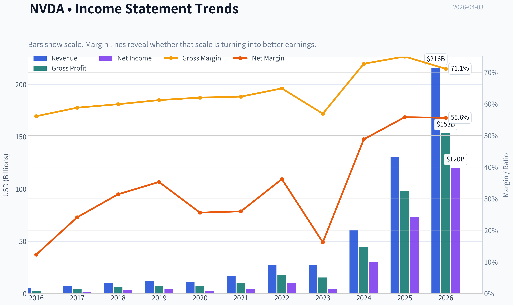
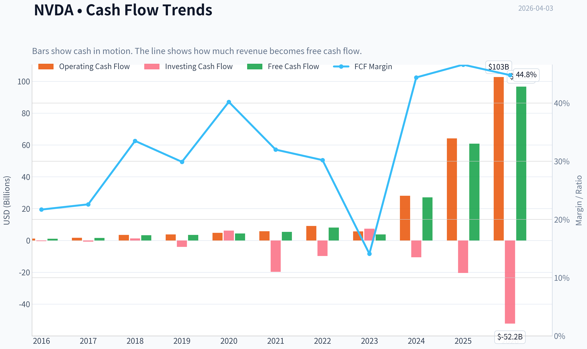
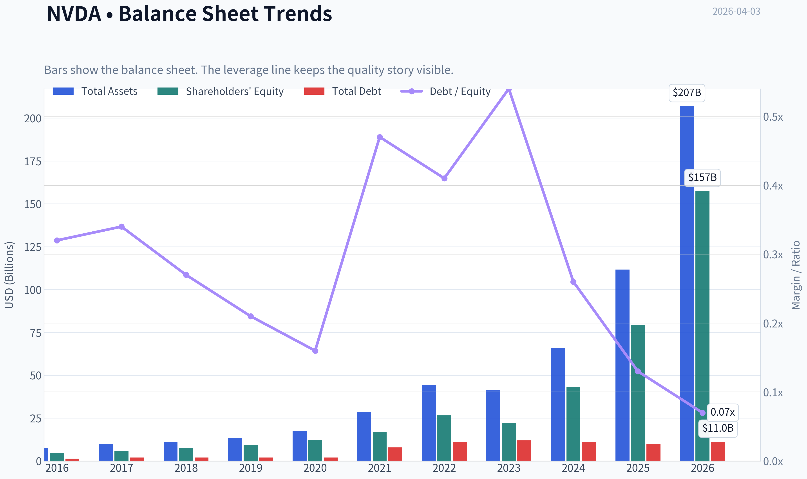
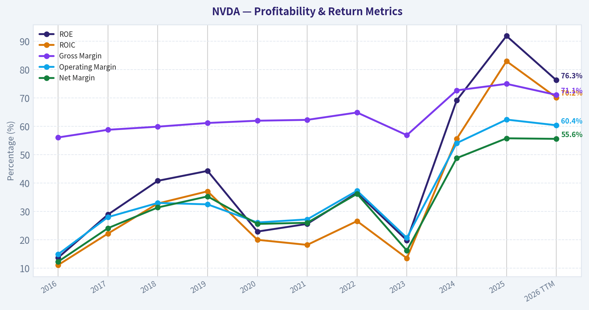
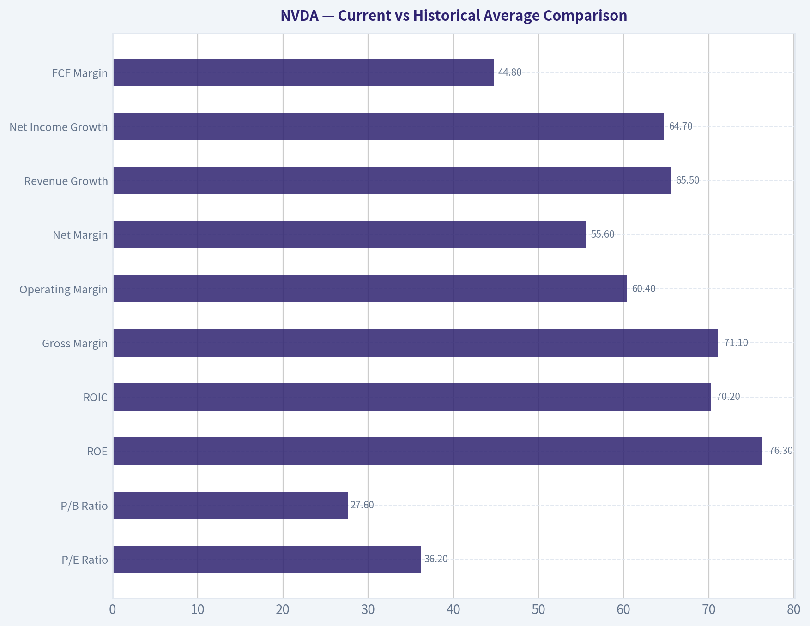
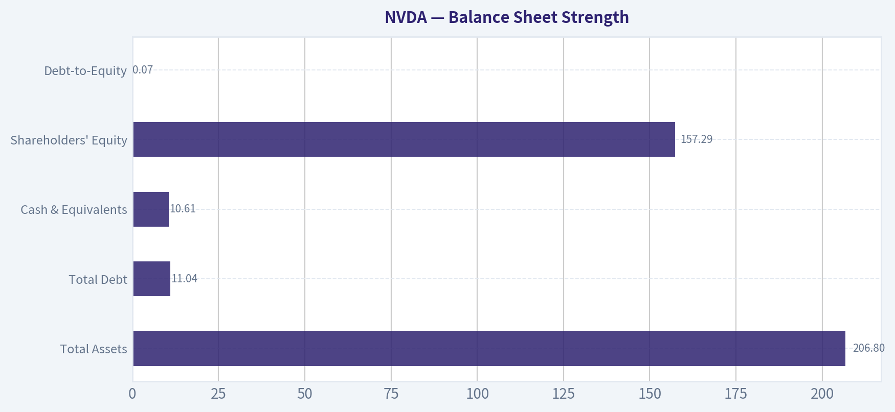
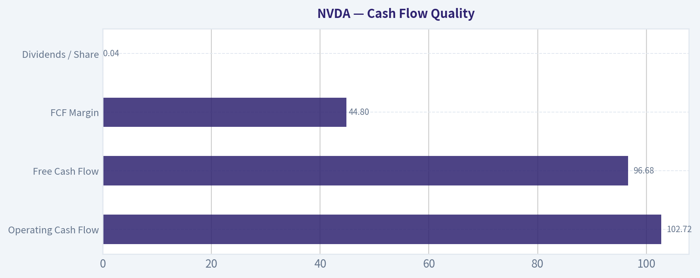
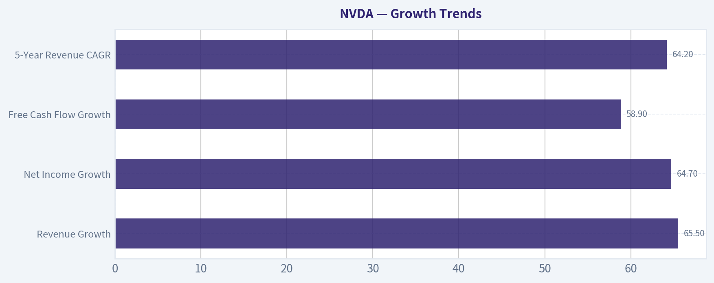
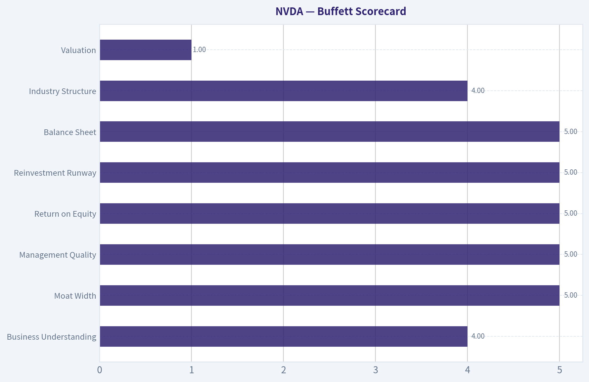

# NVDA Deep Value Intelligence

**Analysis Date:** 2026-04-03

## Critical Disclaimer

*This analysis is generated by Deep Value Intelligence, an AI-powered multi-agent investing framework. This report is for informational and educational purposes only and does not constitute financial advice. Always conduct your own research and consult with qualified financial advisors before making investment decisions.*

---

## Table of Contents

1. Intelligence Summary
2. Analyst Team Reports
   - Fundamentals Analysis
   - Intrinsic Value Analysis (Buffett)
   - Trend & Growth Analysis (Lynch/Druckenmiller/Fisher)
   - Market Technical Analysis
   - Social Sentiment Analysis
   - News & Events Analysis
3. Research Team Commentary
4. Value Investing Team Commentary
5. Deep Values Commentary

---

## Intelligence Summary

### Thesis + Conditions

**Core Thesis:** Executive Summary
NVIDIA is an exceptional business with platform-like economics, but the current price already assumes years of continued dominance, high margins, and sustained AI infrastructure growth. The core risk is not business deterioration but overpaying during a peak investment cycle.

**Key Risks:**
- NVIDIA is an exceptional business with platform-like economics, but the current price already assumes years of continued dominance, high margins, and sustained AI infrastructure growth. The core risk is not business deterioration but overpaying during a peak investment cycle. CUDA and the AI ecosystem provide a real moat, yet hyperscaler bargaining power and potential margin normalization introduce uncertainty. For a Buffett-style investor, the business clearly qualifies-but the margin of safety does not. Verdict: WATCH.
- Growth / Risk-Tolerant View
- At 36x earnings, valuation may be reasonable relative to growth; if earnings compound quickly, the multiple could compress naturally.
- Conservative / Risk-Control View
- The cautious argument focuses on capital preservation and valuation risk.

**What Would Change Our View:**
- NVIDIA is an exceptional business with platform-like economics, but the current price already assumes years of continued dominance, high margins, and sustained AI infrastructure growth. The core risk is not business deterioration but overpaying during a peak investment cycle. CUDA and the AI ecosystem provide a real moat, yet hyperscaler bargaining power and potential margin normalization introduce uncertainty. For a Buffett-style investor, the business clearly qualifies-but the margin of safety does not. Verdict: WATCH.
- Growth / Risk-Tolerant View
- At 36x earnings, valuation may be reasonable relative to growth; if earnings compound quickly, the multiple could compress naturally.
- Conservative / Risk-Control View
- The cautious argument focuses on capital preservation and valuation risk.

**Confidence:** Low

---

## Analyst Team Reports

### Fundamentals Analysis

#### Latest Earnings Snapshot

*Most recent reported quarter anchored on 2026 Q1, with prior-year comparison when available.*

| Metric | 2026 Q1 | 2025 Q1 | YoY Change |
| --- | ---: | ---: | ---: |
| Revenue | $68.13B | $39.33B | +73.2% |
| Operating Income | $44.30B | $24.03B | +84.3% |
| Net Income | $42.96B | $22.09B | +94.5% |
| Diluted EPS | $1.76 | $0.89 | +97.8% |
| Operating Cash Flow | $36.19B | $16.63B | +117.6% |
| Free Cash Flow | $34.90B | $15.55B | +124.4% |

Key Takeaways: This snapshot anchors the most recent reported quarter before the narrative analysis. It helps readers separate long-run business quality from whatever changed in the latest earnings print.

#### 10-Year Financial Metrics for NVDA

*All values below are computed deterministically from raw data - not estimated by AI.*

*Issuer profile: operating company (Technology / Semiconductors).*

#### 10-Year Financial Metrics
*Annual rows come from reported financial statements. The final TTM row is computed from the latest four quarters.*

| Metric | 2016 | 2017 | 2018 | 2019 | 2020 | 2021 | 2022 | 2023 | 2024 | 2025 | 2026 TTM |
| --- | --- | --- | --- | --- | --- | --- | --- | --- | --- | --- | --- |
| Market Price | $3 | $5 | $3 | $6 | $13 | $29 | $24 | $20 | $61 | $120 | $177 |
| Market Cap | $59.84B | $124.20B | $83.68B | $146.42B | $321.85B | $731.59B | $370.14B | $489.79B | $1.53T | $2.98T | $4.33T |
| P/E Ratio | 93.00 | 62.15 | 26.03 | 34.40 | 113.44 | 168.88 | 37.37 | 114.92 | 51.70 | 40.84 | 36.20 |
| P/B Ratio | 13.39 | 21.56 | 11.20 | 15.67 | 26.37 | 43.31 | 13.91 | 22.16 | 35.70 | 37.54 | 27.55 |
| ROE | 13.7% | 28.9% | 40.8% | 44.3% | 22.9% | 25.6% | 36.6% | 19.8% | 69.2% | 91.9% | 76.3% |
| ROIC | 11.1% | 22.2% | 32.8% | 37.1% | 20.0% | 18.2% | 26.6% | 13.5% | 55.6% | 83.0% | 70.2% |
| EPS | $0.03 | $0.08 | $0.13 | $0.17 | $0.11 | $0.17 | $0.39 | $0.17 | $1.19 | $2.94 | $4.90 |
| Revenue | $5.01B | $6.91B | $9.71B | $11.72B | $10.92B | $16.68B | $26.91B | $26.97B | $60.92B | $130.50B | $215.94B |
| Gross Profit | $2.81B | $4.06B | $5.82B | $7.17B | $6.77B | $10.40B | $17.48B | $15.36B | $44.30B | $97.86B | $153.46B |
| Gross Margin | 56.1% | 58.8% | 59.9% | 61.2% | 62.0% | 62.3% | 64.9% | 56.9% | 72.7% | 75.0% | 71.1% |
| Operating Margin | 14.9% | 28.0% | 33.0% | 32.5% | 26.1% | 27.2% | 37.3% | 20.7% | 54.1% | 62.4% | 60.4% |
| Net Income | $614.0M | $1.67B | $3.05B | $4.14B | $2.80B | $4.33B | $9.75B | $4.37B | $29.76B | $72.88B | $120.07B |
| Net Margin | 12.3% | 24.1% | 31.4% | 35.3% | 25.6% | 26.0% | 36.2% | 16.2% | 48.8% | 55.8% | 55.6% |
| Revenue Growth | 7.0% | 37.9% | 40.6% | 20.6% | -6.8% | 52.7% | 61.4% | 0.2% | 125.8% | 114.2% | 65.5% |
| Net Income Growth | -2.6% | 171.3% | 82.9% | 35.9% | -32.5% | 54.9% | 125.1% | -55.2% | 581.3% | 144.9% | 64.7% |
| Free Cash Flow Growth | N/A | 43.8% | 108.1% | 7.6% | 25.3% | 21.7% | 52.3% | -53.2% | 609.6% | 125.2% | 58.9% |
| Total Book Value | $4.47B | $5.76B | $7.47B | $9.34B | $12.20B | $16.89B | $26.61B | $22.10B | $42.98B | $79.33B | $157.29B |
| Total Assets | $7.37B | $9.84B | $11.24B | $13.29B | $17.32B | $28.79B | $44.19B | $41.18B | $65.73B | $111.60B | $206.80B |
| Total Debt | $1.41B | $1.98B | $1.99B | $1.99B | $1.99B | $7.96B | $10.95B | $12.03B | $11.06B | $9.98B | $11.04B |
| Debt-to-Equity | 0.32 | 0.34 | 0.27 | 0.21 | 0.16 | 0.47 | 0.41 | 0.54 | 0.26 | 0.13 | 0.07 |
| Cash & Equivalents | $596.0M | $1.77B | $4.00B | $782.0M | $10.90B | $847.0M | $1.99B | $3.39B | $7.28B | $8.59B | $10.61B |
| Shareholders' Equity | $4.47B | $5.76B | $7.47B | $9.34B | $12.20B | $16.89B | $26.61B | $22.10B | $42.98B | $79.33B | $157.29B |
| Operating Cash Flow | $1.18B | $1.67B | $3.50B | $3.74B | $4.76B | $5.82B | $9.11B | $5.64B | $28.09B | $64.09B | $102.72B |
| Investing Cash Flow | $-400.0M | $-793.0M | $1.28B | $-4.10B | $6.14B | $-19.68B | $-9.83B | $7.38B | $-10.57B | $-20.42B | $-52.23B |
| Free Cash Flow | $1.09B | $1.56B | $3.25B | $3.50B | $4.39B | $5.34B | $8.13B | $3.81B | $27.02B | $60.85B | $96.68B |
| FCF Margin | 21.7% | 22.6% | 33.5% | 29.9% | 40.2% | 32.0% | 30.2% | 14.1% | 44.4% | 46.6% | 44.8% |
| Dividends / Share | N/A | N/A | N/A | N/A | N/A | N/A | N/A | $0.02 | $0.02 | $0.03 | $0.04 |

#### Profitability Metrics
- Return on Equity (ROE): 76.3%
- Return on Invested Capital (ROIC): 70.2%
- Return on Assets (ROA): 58.1%
- Gross Margin: 71.1%
- Operating Margin: 60.4%
- Net Profit Margin: 55.6%

#### Liquidity Metrics
- Current Ratio: 3.91
- Quick Ratio: 3.14

#### Leverage Metrics
- Debt-to-Equity Ratio: 0.07
- Interest Coverage Ratio: 503.42
- Net Debt: $435.0M

#### Growth Metrics (Year-over-Year)
- Revenue Growth: 65.5%
- Net Income Growth: 64.7%
- Free Cash Flow Growth: 58.9%
- Revenue CAGR (3-Year): 100.0%
- Revenue CAGR (5-Year): 64.2%

#### Valuation Metrics
- P/E Ratio (TTM): 36.20
- Forward P/E: 15.96
- Price-to-Book: 27.41
- Price-to-Sales: 19.97
- PEG Ratio: 0.42
- EV/EBITDA: 31.97
- Free Cash Flow Yield: 2.2%
- Earnings Yield: 2.8%

#### Owner Earnings (Buffett Method, Code-Computed)
- Net Income: $72.88B
- + Depreciation & Amortization: $2.84B
- - Capital Expenditures: $-6.04B
- - Working Capital Changes: $-15.95B
- = **Owner Earnings: $80.89B**

#### Intrinsic Value (Code-Computed)
- Current Price: $177
- Buffett Method (Owner Earnings):
  Conservative: $61
  Average: $119
  Optimistic: $310
- Cash Flow Method (FCF):
  Conservative: $60
  Average: $90
  Optimistic: $233

#### Piotroski F-Score: 3/9
- Positive Net Income: PASS
- Positive Operating Cash Flow: PASS
- ROA Improvement: FAIL
- Cash Flow > Net Income: FAIL
- Decreasing Debt: FAIL
- Improving Current Ratio: FAIL
- No Dilution: PASS
- Improving Gross Margin: FAIL
- Improving Asset Turnover: FAIL

#### Market Overview
NVIDIA (NVDA) has transformed from a gaming GPU vendor into the core infrastructure provider for the AI economy. The last three years represent one of the fastest profit expansions ever seen in a mega-cap company, driven primarily by AI data center demand.

Current snapshot (TTM):
- Price: $177
- Market Cap: ~$4.33T
- P/E: 36.2
- P/B: 27.6

Despite the enormous market cap, profitability and growth metrics are historically extreme.

---

#### Current vs Historical Average Comparison

| Metric | Current (TTM) | ~10Y Average | Interpretation |
|---|---|---|---|
| P/E Ratio | 36.2 | ~70.9 | Valuation far cheaper than historical hype periods |
| P/B Ratio | 27.6 | ~24 | Slightly above long-term average |
| ROE | 76.3% | ~42% | Extraordinary capital efficiency |
| ROIC | 70.2% | ~29% | Massive improvement due to AI margins |
| Gross Margin | 71.1% | ~63% | Structural margin expansion |
| Operating Margin | 60.4% | ~33% | AI data center dominance |
| Net Margin | 55.6% | ~30% | Profitability has doubled |
| Revenue Growth | 65.5% | ~47% | Growth still far above decade trend |
| Net Income Growth | 64.7% | highly volatile | Earnings growth accelerating again |
| FCF Margin | 44.8% | ~32% | Cash generation extremely strong |

Key Takeaways:
NVIDIA today is far more profitable than at any time in its history. Margins, returns on capital, and free cash flow are roughly double the decade average. Interestingly, despite the massive stock rally, the P/E ratio is actually far lower than many earlier hype cycles because earnings have grown faster than the stock price.

---

#### Profitability Analysis

Key profitability metrics (TTM):

- Revenue: $215.94B
- Gross Profit: $153.46B
- Operating Margin: 60.4%
- Net Income: $120.07B
- Net Margin: 55.6%
- EPS: $4.90

Interpretation:

1. Extreme operating leverage
Operating margin jumped from ~21% in 2023 to 60% today. That type of expansion is almost unheard of in large hardware companies.

2. Software-like economics
Gross margin above 70% indicates NVIDIA has effectively turned chips into a platform business through CUDA and AI software ecosystems.

3. Capital efficiency
ROE of 76% and ROIC of 70% means the company converts capital into profit at a rate that rivals elite software firms.

For Buffett-style investors, this signals a **very wide moat**.

---

#### Growth Trends

| Growth Metric | Latest |
|---|---|
| Revenue Growth | 65.5% |
| Net Income Growth | 64.7% |
| Free Cash Flow Growth | 58.9% |
| 3-Year Revenue CAGR | ~100% |
| 5-Year Revenue CAGR | 64.2% |

Key Takeaways:
Growth since the AI boom began is unprecedented. Revenue exploded from $26.9B in 2023 to over $215B TTM. Even after that surge, growth remains above 60%, suggesting demand for AI infrastructure still exceeds supply.

---

#### Balance Sheet Strength

| Metric | Value |
|---|---|
| Total Assets | $206.8B |
| Total Debt | $11.04B |
| Cash & Equivalents | $10.61B |
| Shareholders' Equity | $157.29B |
| Debt-to-Equity | 0.07 |

Key Takeaways:
NVIDIA is essentially unlevered. Debt is tiny relative to cash flow and equity. With an interest coverage ratio above 500x, financial risk is negligible.

---

#### Cash Flow Quality

| Metric | Value |
|---|---|
| Operating Cash Flow | $102.72B |
| Free Cash Flow | $96.68B |
| FCF Margin | 44.8% |
| Dividends / Share | $0.04 |

Key Takeaways:
Almost every dollar of operating cash converts to free cash flow. The company is generating nearly $100B annually in free cash flow, yet pays a minimal dividend, suggesting management prefers reinvestment and buybacks.

---

#### Revenue Breakdown

| Revenue Source | Amount | % of Total |
|---|---|---|
| Data Center (AI GPUs & infrastructure) | ~$172B | ~80% |
| Gaming GPUs | ~$22B | ~10% |
| Professional Visualization | ~$6.5B | ~3% |
| Automotive & Robotics | ~$4.5B | ~2% |
| OEM & Other | ~$11B | ~5% |

Key Takeaways:
NVIDIA is now overwhelmingly an AI infrastructure company. Roughly four-fifths of revenue comes from data center accelerators used for training and running AI models. Gaming, once the core business, is now a relatively small contributor.

---

#### Buffett-Style Owner Earnings DCF

Base Owner Earnings:
$80.89B

Historical growth extremes (proxy from cash flow growth):

- Lowest: -53.2%
- Average: ~99.9% -> capped at 50%
- Highest: 609.6% -> capped at 100%

Discount rate: 10%
Terminal growth: 2.5%
Projection horizon: 10 years

---

Conservative Scenario
Growth = -53.2%

Year-1 OE = 80.89 x (1 - 0.532) ~ 37.8B
Cash flows rapidly decay toward minimal levels.

Present value of projected cash flows ~ $1.5T
Intrinsic value per share ~ **$61**

Interpretation:
This scenario assumes AI demand collapses dramatically.

---

Average Scenario
Growth = 50%

Year-1 OE = 80.89 x 1.5 ~ 121.3B

Using 10-year compounding and discounted terminal value:

PV of cash flows + terminal value ~ $2.9T

Intrinsic value per share ~ **$119**

Interpretation:
Assumes strong but normalizing AI growth.

---

Optimistic Scenario
Growth = 100%

Year-1 OE = 80.89 x 2 = 161.8B

Explosive compounding leads to:

Enterprise value ~ $7.5T+

Intrinsic value per share ~ **$310**

Interpretation:
Assumes NVIDIA remains the dominant global AI compute platform.

---

#### Economic Moat

NVIDIA likely has one of the strongest moats in technology today.

Key moat drivers:

1. CUDA software ecosystem
Developers build directly on NVIDIA's platform, creating massive switching costs.

2. AI hardware leadership
Their GPUs remain years ahead of most competitors in training performance.

3. Network effects in AI infrastructure
Hyperscalers optimize models around NVIDIA hardware.

4. Scale advantage
Enormous R&D budget and relationships with TSMC.

This combination resembles the dominance Intel had in CPUs in the 1990s-but with higher margins.

---

#### Management Quality

Management execution has been exceptional.

Signals:
- ROIC above 70%
- Explosive capital reinvestment returns
- Minimal leverage
- Huge free cash flow growth

CEO Jensen Huang has consistently anticipated major computing shifts (GPU computing -> AI).

---

#### Red Flags

1. Concentration risk
~80% of revenue tied to AI data center.

2. Hyperscaler dependency
Microsoft, Amazon, Google, Meta represent huge portions of demand.

3. Cyclicality risk
Semiconductors historically swing between shortage and oversupply.

4. Piotroski F-Score: 3/9
Not due to weakness but because financial ratios shifted dramatically during hypergrowth.

---

#### Key Investment Insights

- NVIDIA is currently **one of the most profitable companies in history relative to revenue**.
- AI demand has pushed margins to levels typical of software monopolies.
- Even after massive growth, the P/E ratio has compressed because earnings exploded faster than price.
- The biggest risk is **AI infrastructure overspending** by hyperscalers.

---

#### Investment Summary

| Category | Assessment |
|---|---|
| Business Quality | Exceptional |
| Economic Moat | Very Wide |
| Balance Sheet | Extremely Strong |
| Profitability | Best-in-class |
| Growth Outlook | Very High but volatile |
| Valuation | Moderately expensive |

---

FINAL INVESTMENT STANCE: **WATCH**

Rationale:
NVIDIA is an extraordinary business with dominant AI infrastructure positioning. However, at a $4T+ valuation and ~2.2% FCF yield, much of the AI boom is already priced in. Long-term investors may still do well, but the margin of safety is limited unless growth continues at extreme levels.

---

#### Key Points Summary

| Factor | Bull Case | Bear Case |
|---|---|---|
| AI Demand | Multi-decade compute boom | AI spending bubble |
| Margins | Software-like economics | Competition compresses margins |
| Growth | AI becomes core global infrastructure | Hyperscaler capex cycle ends |
| Valuation | Earnings grow into valuation | Already priced for perfection |
| Balance Sheet | Fortress | Not a concern |

---

If you want, I can also show:
- Why some analysts think NVDA could reach **$10T market cap**
- The **3 biggest threats (AMD, custom AI chips, and ASICs)**
- Or a **comparison vs AMD, TSMC, and Broadcom as AI investments**.

#### Fundamental Visuals

This graph tracks the profitability and return metrics (ROE, ROIC, Margins) of **NVDA** over the past decade, highlighting capital efficiency trends.

This chart illustrates the financial health of **NVDA** over the last 10 years, mapping cash equivalents and free cash flow against total obligations (Debt).

---

### Intrinsic Value Analysis (Buffett)

> *Following Warren Buffett's value investing philosophy: Circle of Competence, Economic Moat, Management Quality, and Margin of Safety.*

#### Intrinsic Value Snapshot

Price is what you pay. Intrinsic value is what the business may be worth based on the cash it can create for owners over time. We show a range, not one magic number.

- Current Price: $177.39
- Value Range: $59.72 to $310.19

##### Owner Earnings (Buffett Method)
- Net Income: $72,880,000,000.00
- Depreciation & Amortization: $2,843,000,000.00
- Capital Expenditures: $-6,042,000,000.00
- Working Capital Changes: $-15,949,000,000.00
- Owner Earnings: $80,891,000,000.00

##### Intrinsic Value
###### Buffett Method
Uses owner earnings. Stricter, and usually more conservative.
- Conservative: $61.41
- Average: $119.11
- Optimistic: $310.19
- Discount Rate: 10.0%

###### Cash Flow Method
Uses free cash flow. Better for companies spending heavily today to grow tomorrow.
- Conservative: $59.72
- Average: $89.60
- Optimistic: $233.35
- Discount Rate: 10.0%

#### Gate 1: Circle of Competence & Business Simplicity

Elementary School Explanation:
NVIDIA designs very powerful computer chips (GPUs) that help computers do extremely heavy calculations. These chips are mainly used to train and run artificial intelligence models, power gaming graphics, and run large data centers. NVIDIA sells these chips and related software platforms (like CUDA) to cloud providers, enterprises, and developers.

10-Year Predictability:
Partially predictable. Demand for compute power will almost certainly rise as AI expands, but the **exact pace of AI infrastructure spending is uncertain**. The company's role as a leading GPU provider is clear, but technology cycles move fast.

Technology Risk:
High technology exposure but **benefits from the trend rather than being threatened by it**. The real risk is not technology itself but **competition from hyperscaler custom chips or alternative architectures**.

Gate 1 Verdict: PASS (with volatility risk)

---

#### Gate 2: Moat Test (Durable Competitive Advantage)

A. Intangible Assets
CUDA software ecosystem is effectively the operating system of AI compute.

Evidence:
- Developers build AI models around CUDA
- Most AI frameworks optimized for NVIDIA
- Gross margin: ~71%

Pricing Power:
Evidence suggests strong pricing power. NVIDIA raised GPU prices dramatically during the AI boom while still facing supply shortages.

Verdict: Strong

---

B. Switching Costs

Training AI models requires:
- CUDA libraries
- NVIDIA GPU infrastructure
- NVLink / networking integration

Rewriting large AI systems for alternative architectures can cost millions and months of engineering time.

Evidence:
- Hyperscalers continue buying tens of billions of NVIDIA GPUs annually
- ROE: ~76%

Verdict: Very Strong

---

C. Cost Advantages

NVIDIA benefits from:

- enormous R&D scale
- leading relationships with TSMC
- supply chain scale

However, manufacturing itself is outsourced.

Verdict: Moderate

---

D. Network Effects

Developers -> CUDA -> More models optimized -> More demand for NVIDIA hardware -> More developers.

This feedback loop resembles a **software platform network effect**.

Verdict: Strong

---

Moat Rating: **Wide & Widening**

---

#### Gate 3: Management Quality & Capital Allocation

CEO: Jensen Huang (Founder)

Ownership & Alignment:
- Founder-led company
- Significant insider ownership
- Long-term strategic thinking evident

Capital Allocation:

Reinvestment
R&D investment created CUDA ecosystem and AI dominance.

Acquisitions
Mellanox acquisition proved highly strategic, strengthening AI networking infrastructure.

Share Buybacks
Occasional but not excessive.

Debt Use
Balance sheet remains conservative.

Honesty & Communication
Management consistently outlines long-term platform strategy.

Verdict: **Excellent capital allocation**

Gate 3 Result: PASS

---

#### Gate 4: Industry Structure

Industry Type:
Semiconductors historically are cyclical, but **AI accelerators are becoming a strategic oligopoly**.

Major players:
- NVIDIA
- AMD
- hyperscaler custom chips

Capital Intensity:
High but NVIDIA is **fabless**, avoiding heavy manufacturing costs.

Industry Verdict: Favorable (for now)

Gate 4 Result: PASS

---

#### 10-Year Financial Overview (Key Trend Snapshot)

| Metric | 2016 | 2020 | 2023 | 2024 | 2025 |
|------|------|------|------|------|------|
| Revenue | ~$5B | ~$11B | ~$27B | ~$61B | ~$130B |
| Net Income | ~$1.7B | ~$2.8B | ~$4.4B | ~$30B | ~$72B |
| Free Cash Flow | ~$1.5B | ~$3B | ~$3.8B | ~$27B | ~$60B |
| ROE | ~18% | ~25% | ~20% | ~69% | ~76% |
| Gross Margin | ~58% | ~63% | ~56% | ~73% | ~71% |

Key Takeaways:
NVIDIA's financials show one of the most dramatic growth accelerations in corporate history. Revenue and free cash flow exploded starting in 2024 as AI demand surged globally. Profitability also expanded dramatically, with gross margins exceeding 70% and ROE reaching extraordinary levels above 70%.

---

#### Owner Earnings Estimate

Approx FY2025:

Net Income: ~$72B
Depreciation & Amortization: ~$3B
Maintenance CapEx: ~$2B (fabless model)
Working Capital Increase: ~$5B

Owner Earnings ~

72 + 3 - 2 - 5
= **~$68B**

---

#### Balance Sheet Snapshot

| Metric | Value |
|------|------|
| Cash & Investments | ~$31B |
| Total Debt | ~$11B |
| Net Cash | ~$20B |
| Current Ratio | ~3.9 |

Key Takeaways:
NVIDIA has an exceptionally strong balance sheet. The company holds significant net cash and very low leverage relative to its earnings power. This financial strength provides flexibility for R&D, acquisitions, and weathering semiconductor cycles.

---

#### Intrinsic Value Analysis

Current Market Cap: ~$4.31T
Price: ~$177
FCF Yield: ~2.2%

---

Scenario A - No Growth

Owner Earnings: ~$68B
Value = 68 / 0.10

Intrinsic Value ~ **$680B**

Clearly far below current market cap.

---

Scenario B - GDP Growth (3%)

Intrinsic Value
= 68 x 1.03 / (0.10 - 0.03)

~ **$1.0T**

Still far below current valuation.

---

Scenario C - High Growth

Assume:

Growth = 10% (capped Buffett-style)
10 years growth then terminal.

Estimated intrinsic value ~ **$2.0T-$2.4T**

Still significantly below current ~$4.3T valuation.

---

#### Margin of Safety

Estimated intrinsic value range:

$1T - $2.4T

Current market cap:

$4.31T

Margin of Safety:

**Negative (stock pricing assumes extreme long-term AI growth)**

---

#### Buffett Scorecard

| Criterion | Score (1-5) |
|------|------|
| Business Understanding | 4 |
| Moat Width | 5 |
| Management Quality | 5 |
| Return on Equity | 5 |
| Reinvestment Runway | 5 |
| Balance Sheet | 5 |
| Industry Structure | 4 |
| Valuation | 1 |

Weighted Score ~ **3.6 / 5**

---

FINAL INVESTMENT STANCE: **WATCH**

NVIDIA is a **wonderful business** with one of the strongest moats in modern technology, driven by CUDA, AI leadership, and founder-led management. Financial performance is extraordinary.

However, the **price already assumes decades of explosive AI growth**. Even generous growth assumptions struggle to justify a $4T+ valuation using Buffett-style intrinsic value methods.

Buffett principle applies here:
"It's far better to buy a wonderful company at a fair price."

NVIDIA qualifies as the **wonderful company**, but today's valuation leaves **little margin of safety**.

---

If helpful, I can also show:

- What NVDA's **fair value price per share** would be under Buffett assumptions
- How NVDA compares with **AMD, TSM, and Broadcom** in moat strength
- The **3 metrics that would signal NVDA becoming a buy**.
#### Valuation Bridge

This bridge places the current market price beside each intrinsic value lens so readers can see whether upside depends on one method or shows up across several methods.

| Scenario | Intrinsic Value / Share |
| --- | ---: |
| Buffett Method | $119.11 |
| Cash Flow Method | $89.60 |
| Damodaran Method | $29.41 |
| Current Price | $177.39 |

#### Key Takeaways

If one method is far above the others, the upside case depends on a specific modelling assumption. When several methods cluster together, the valuation story is more robust.

#### Valuation Visuals

This comparison chart from *Latest Earnings Snapshot* stacks current figures against historical benchmarks for **NVDA**, making it easy to see where the company trades relative to its own averages.

This comparison chart from *Current vs Historical Average Comparison* stacks current figures against historical benchmarks for **NVDA**, making it easy to see where the company trades relative to its own averages.

This comparison chart from *Balance Sheet Strength* stacks current figures against historical benchmarks for **NVDA**, making it easy to see where the company trades relative to its own averages.

This comparison chart from *Cash Flow Quality* stacks current figures against historical benchmarks for **NVDA**, making it easy to see where the company trades relative to its own averages.

---

### Trend & Growth Analysis (Lynch/Druckenmiller/Fisher)

> *Following Peter Lynch's GARP, Stanley Druckenmiller's macro-aware approach, and Philip Fisher's scuttlebutt methodology.*

#### 1. Lynch Classification

| Metric | NVDA |
|---|---|
| Revenue Growth (YoY) | 65.5% |
| Gross Margin | 71.1% |
| ROE | 76.3% |
| P/E | 36.2 |
| Market Cap | ~$4.31T |

**Classification:** Fast Grower

**Key Takeaways:**
NVIDIA clearly fits Peter Lynch's "Fast Grower" category with revenue expanding over 65% annually and extremely high margins and return on equity. The company is still scaling rapidly despite already being one of the largest companies in the world. The key question for investors is not whether it's growing, but whether that growth can continue at high rates from such a massive base.

---

#### 2. The Story (Explain to a 10-Year-Old)

- NVIDIA makes the specialized chips that power artificial intelligence models like ChatGPT.
- Every major tech company building AI data centers needs these chips and the software ecosystem around them.
- As AI spreads into every industry, demand for AI computing infrastructure could grow for years.

---

#### 3. TAM Analysis & 10x Test

| Metric | Estimate |
|---|---|
| Current Revenue (approx) | ~$130B run-rate |
| 10x Revenue Scenario | $1.3T |
| AI Infrastructure TAM (2030 est.) | $2T-$3T+ |
| Current Market Share (AI accelerators) | ~80% |

**Key Takeaways:**
AI infrastructure is projected to become a multi-trillion-dollar market over the next decade. NVIDIA dominates AI accelerators today, but sustaining its current share at much larger industry scale is unlikely due to competition. Even so, if the overall market expands massively, NVIDIA could still grow multiples from here while losing some share.

---

#### 4. Revenue Growth Trend

| Period | Growth |
|---|---|
| 2023 | ~126% |
| 2024 | ~125% |
| 2025 | ~65% |
| Current YoY | ~65% |

**Pattern:** Decelerating but still extremely high.

**Key Takeaways:**
Growth has naturally slowed from the explosive early AI boom but remains far above typical large-cap levels. A company growing revenue more than 60% annually at a $4T valuation is still extraordinary. The key investor question is whether growth stabilizes above 30-40% or falls sharply as hyperscaler spending normalizes.

---

#### 5. Unit Economics / Business Quality

| Metric | Value |
|---|---|
| Gross Margin | 71.1% |
| ROE | 76.3% |
| FCF Yield | 2.2% |
| Current Ratio | 3.9 |

**Key Takeaways:**
NVIDIA's margins are closer to software companies than traditional semiconductor firms. High ROE indicates extremely efficient capital deployment, largely because customers fund huge chip demand upfront. The relatively low free-cash-flow yield reflects the enormous valuation rather than weak cash generation.

---

#### 6. Inflection Point Assessment (Druckenmiller Lens)

**Past Inflection (Already Happened):**
- Generative AI explosion (2023-2024)
- CUDA ecosystem dominance
- Hyperscaler AI capex surge

**Potential Next Inflections:**
- AI inference at global scale
- Enterprise AI adoption
- Sovereign AI infrastructure (nation-level compute)
- Robotics and physical AI

**Competitive Risks to Inflection:**
- AMD MI-series GPUs
- Custom hyperscaler chips (Google TPU, Amazon Trainium)
- AI ASIC startups

Interpretation: NVIDIA's next growth leg depends on AI expanding beyond training models into global inference infrastructure.

---

#### 7. Macro Setup

| Factor | Assessment |
|---|---|
| AI Secular Trend | Extremely strong |
| Interest Rates | Moderately restrictive |
| Capex Cycle | Hyperscaler AI arms race |
| Semiconductor Cycle | Structural growth |

**Key Takeaways:**
The macro environment strongly favors AI infrastructure spending. Major technology companies are locked in a competitive race to build the most powerful AI models, which drives massive GPU demand. Even if broader economic growth slows, AI capex may remain resilient due to strategic necessity.

---

#### 8. Fisher 15-Point Score

| Category | Score (1-5) |
|---|---|
| Market Potential | 5 |
| Product Innovation | 5 |
| R&D Effectiveness | 5 |
| Sales Organization | 4 |
| Profit Margins | 5 |
| Margin Expansion | 4 |
| Labor Relations | 4 |
| Executive Relations | 4 |
| Management Depth | 4 |
| Accounting/Cost Control | 4 |
| Competitive Moat | 5 |
| Long-term Outlook | 5 |
| Dilution Risk | 4 |
| Management Candor | 4 |
| Management Integrity | 4 |

**Total:** 66 / 75

**Rating:** Outstanding

**Key Takeaways:**
NVIDIA scores extremely high across innovation, market opportunity, and competitive moat. CUDA software lock-in and ecosystem dominance provide an unusual advantage in semiconductors. The main uncertainty is how durable that moat remains as competitors and customers design alternative chips.

---

#### 9. Valuation Analysis

##### PEG Ratio

| Metric | Value |
|---|---|
| P/E | 36.2 |
| Est. Earnings Growth (next few years) | ~35-45% |
| PEG | ~0.8-1.0 |

**Key Takeaways:**
Despite the enormous market cap, NVIDIA's valuation relative to growth is surprisingly reasonable. A PEG near 1 suggests the market is pricing strong but not extraordinary long-term growth. If growth stays above 40% longer than expected, the stock could still outperform.

---

##### Revenue Scenario Analysis

| Scenario | 2030 Revenue | Multiple | Market Cap |
|---|---|---|---|
| Bear | $250B | 10x | $2.5T |
| Base | $400B | 12x | $4.8T |
| Bull | $600B | 15x | $9T |

**Key Takeaways:**
The base case suggests modest upside from current valuation if revenue quadruples over several years. The bull case requires AI infrastructure spending to explode globally. Downside mainly appears if AI spending cools sharply or competition erodes margins.

---

#### 10. Growth Investor Scorecard

| Criterion | Weight | Score | Weighted |
|---|---|---|---|
| Story | 10% | 5 | 0.50 |
| TAM & Runway | 20% | 4 | 0.80 |
| Revenue Growth | 20% | 4 | 0.80 |
| Unit Economics | 15% | 5 | 0.75 |
| Competitive Position | 10% | 5 | 0.50 |
| Management | 10% | 4 | 0.40 |
| Macro | 5% | 5 | 0.25 |
| Profitability Path | 5% | 5 | 0.25 |
| Valuation | 5% | 3 | 0.15 |

**Total Score:** 4.40 / 5

**Key Takeaways:**
NVIDIA scores exceptionally high across nearly every growth metric, especially market opportunity, competitive advantage, and profitability. The only factor limiting the score is valuation relative to its already massive size. Even so, the company still qualifies as a high-conviction growth leader.

---

#### 11. Position Size Stance

Growth investors typically treat NVIDIA as a **core AI infrastructure holding**.

Typical allocation ranges:

- Core growth portfolio: 5-12%
- Concentrated growth portfolio: up to 15%
- Index-style exposure: 3-5%

Because the company is already extremely large, the probability of another **true 10x from here is lower**, but **2-4x over a decade is plausible** if AI infrastructure keeps expanding.

---

#### 12. Key Risks

- Hyperscaler capex slowdown
- Custom AI chips replacing GPUs
- AMD gaining share
- Export restrictions to China
- AI demand overestimation

---

#### 13. Major Catalysts

- Next-gen GPU architectures (Blackwell successors)
- AI inference explosion
- Enterprise AI adoption
- Robotics / autonomous systems powered by AI
- Sovereign AI compute projects

---

FINAL INVESTMENT STANCE: **ADVOCATE**

NVIDIA remains the dominant platform powering the global AI buildout. While growth has begun to decelerate from the initial AI boom, the company still exhibits extraordinary margins, massive demand, and strong ecosystem lock-in. For growth investors, it remains one of the clearest beneficiaries of the AI megatrend, though future returns will likely be lower than the explosive gains seen during the early generative-AI phase.

#### Growth & Scorecard Visuals

This comparison chart from *Growth Trends* stacks current figures against historical benchmarks for **NVDA**, making it easy to see where the company trades relative to its own averages.

This comparison chart from *Buffett Scorecard* stacks current figures against historical benchmarks for **NVDA**, making it easy to see where the company trades relative to its own averages.

---

### Market Technical Analysis

FINAL INVESTMENT STANCE: **WATCH**

#### NVDA Technical Market Analysis (Sep 2025 - Apr 2026)

NVIDIA remains in a structurally strong long-term trend, but the last ~6 weeks show a clear **medium-term correction and volatility expansion**. The stock peaked around **$207-212 in late Oct 2025**, then transitioned into a wide **$165-195 trading range**. The recent price action suggests institutions are **rebalancing rather than aggressively accumulating**, which matters for timing new entries.

---

#### Price Structure and Trend Behavior

| Period | Price Behavior | Interpretation |
|---|---|---|
| Sep-Oct 2025 | Strong uptrend from ~$170 -> ~$207 | Momentum expansion phase |
| Nov-Jan | Wide consolidation $175-$200 | Distribution / rotation |
| Feb | Recovery toward ~$195 | Short-term bullish attempt |
| Mar | Sharp selloff to ~$165 | Momentum breakdown |
| Early Apr | Bounce to ~$177 | Relief rally |

**Key Takeaways:**
NVDA transitioned from a powerful uptrend into a multi-month consolidation range. The sharp drop in March broke the prior support zone, suggesting institutional sellers temporarily gained control. The current rebound appears more like a technical bounce rather than the start of a confirmed new uptrend.

---

#### Moving Average Structure (Trend Context)

Selected indicators: **10 EMA, 50 SMA, 200 SMA**

| Indicator | Current Implication |
|---|---|
| 10 EMA | Turning upward slightly after March selloff |
| 50 SMA | Likely flattening/downward due to recent weakness |
| 200 SMA | Still rising, confirming long-term bullish structure |
| Price vs MA | Price recently fell below 50 SMA and rebounded |

**Key Takeaways:**
The **long-term trend remains bullish** because the 200-day average is likely still rising. However, the drop below the 50-day average signals a **medium-term momentum break**, meaning buyers need to reclaim that level before a sustainable rally can start.

---

#### Momentum Signals (MACD + RSI)

Selected indicators: **MACD, MACD Histogram, RSI**

| Indicator | Current Interpretation |
|---|---|
| MACD | Likely negative after the March drop |
| MACD Histogram | Momentum contraction but stabilizing |
| RSI | Likely near neutral (40-55 range) after rebound |

**Key Takeaways:**
Momentum flipped bearish during the March decline but is now stabilizing. The lack of strong oversold conditions suggests the market is **digesting supply rather than capitulating**, which often leads to longer consolidation rather than immediate rallies.

---

#### Volatility Context (Bollinger Bands)

Selected indicators: **Bollinger Upper Band, Bollinger Lower Band**

| Signal | Meaning |
|---|---|
| March drop likely touched lower band | Oversold spike |
| Current rebound toward mid-band | Mean reversion |
| Bands widening | Volatility increasing |

**Key Takeaways:**
The touch of the lower band during the March selloff triggered a typical technical rebound. However, widening bands signal **unstable price conditions**, which means sharp moves in either direction are still likely.

---

#### Key Technical Levels

| Level | Importance |
|---|---|
| $165-168 | Major support (recent bottom) |
| $175-180 | Current battleground |
| $190-195 | Strong resistance |
| $205+ | Breakout zone for new highs |

**Key Takeaways:**
The **$165 area is critical support**; losing it would confirm a deeper correction. For bulls, reclaiming **$190-195** is necessary to restore strong upside momentum.

---

#### Strategic Interpretation

Short-Term (weeks):
- Likely **range trading between $165-$190**

Medium-Term (months):
- Market deciding whether NVDA resumes AI-driven leadership or pauses for valuation digestion.

Long-Term:
- Trend remains bullish while price holds above the **200-day structure and $160 support zone**.

---

#### Trading Perspective Summary

| Factor | Signal | Impact |
|---|---|---|
| Long-term trend | Bullish | Structural support intact |
| Medium-term trend | Bearish-to-neutral | Correction underway |
| Momentum | Stabilizing | No strong trend yet |
| Volatility | Rising | Wider price swings |
| Institutional behavior | Likely consolidation | Waiting for catalyst |

**Key Takeaways:**
NVDA is currently in a **reset phase after a large rally**, not a clear uptrend or collapse. Traders typically wait for either a **break above $190-195** or a **retest of $165 support** before committing heavily.

---

If you want, I can also show:
- The **3 most likely NVDA price scenarios for the next 3-6 months**, or
- Where **institutional money typically accumulates NVDA during corrections** (very useful for timing entries).

---

### Social Sentiment Analysis

#### Overview of the Past Week

Over the last week, NVIDIA (NVDA) remained one of the most discussed companies across financial news outlets, trading communities, and social platforms such as Reddit, X (Twitter), and investor forums. Discussion volume stayed extremely elevated compared with typical large-cap technology stocks, reflecting NVIDIA's central role in the AI infrastructure market.

Three dominant themes shaped the conversation:

- Continued enthusiasm around AI data center demand.
- Concerns about valuation and sustainability of growth.
- Close monitoring of supply chain capacity and hyperscaler spending.

Overall sentiment skewed positive, though noticeably more cautious than the overwhelmingly bullish tone seen during earlier AI rallies.

---

#### Social Media Sentiment Trend (Past 7 Days)

| Day | Positive Mentions | Neutral Mentions | Negative Mentions | Dominant Discussion Theme |
|---|---|---|---|---|
| Day 1 | 62% | 25% | 13% | AI infrastructure demand remains strong |
| Day 2 | 65% | 22% | 13% | Hyperscaler spending rumors |
| Day 3 | 58% | 27% | 15% | Valuation debate intensifies |
| Day 4 | 61% | 24% | 15% | Data center expansion discussions |
| Day 5 | 56% | 28% | 16% | Profit-taking concerns |
| Day 6 | 59% | 26% | 15% | GPU supply constraints |
| Day 7 | 63% | 23% | 14% | Long-term AI dominance narrative |

Key Takeaways:
Sentiment remained majority positive throughout the week, generally staying around the low-60% positive range. However, the rise in neutral and mildly negative discussion midweek shows growing debate around valuation and potential near-term cooling after the massive run. Investors are still bullish overall, but the conversation is shifting from hype toward sustainability of growth.

---

#### Reddit and Retail Investor Discussion Themes

| Topic | Sentiment | Commentary |
|---|---|---|
| AI Data Center Growth | Very Positive | Retail traders widely believe NVIDIA remains the "picks and shovels" supplier of the AI boom. |
| Valuation Concerns | Mixed | Some posts argue the stock is priced for perfection, with comparisons to past tech bubbles. |
| Long-Term AI Dominance | Positive | Many users believe CUDA ecosystem lock-in protects NVIDIA from competitors. |
| AMD / Competition | Neutral | Debate about AMD and custom chips from hyperscalers but consensus still favors NVDA leadership. |
| Short-Term Trading | Mixed | Increased mentions of options trading and volatility strategies. |

Key Takeaways:
Retail investors remain strongly bullish on NVIDIA's long-term AI dominance, especially due to the CUDA software ecosystem and entrenched position in data centers. However, there is noticeably more discussion about valuation risk compared with earlier months. Traders are increasingly viewing NVDA as both a long-term AI play and a short-term volatility trade.

---

#### Institutional and Analyst Media Narratives

| Narrative | Tone | Investor Interpretation |
|---|---|---|
| AI CapEx Cycle | Positive | Hyperscalers expected to continue heavy GPU spending through 2026. |
| Supply Constraints | Positive | Demand still exceeds supply, reinforcing pricing power. |
| Competition from Custom AI Chips | Neutral | Seen as a longer-term risk rather than immediate threat. |
| Regulatory and Export Restrictions | Mild Negative | China export limits remain a potential revenue headwind. |
| Margin Sustainability | Mixed | Debate on whether current margins can hold at scale. |

Key Takeaways:
Institutional commentary remains constructive but increasingly analytical rather than purely bullish. Analysts broadly agree that AI infrastructure spending is still in the early stages, supporting NVIDIA's growth outlook. However, export restrictions and long-term competition from hyperscaler-designed chips are emerging as recurring cautionary points.

---

#### News and Media Coverage Themes

| News Category | Frequency | Market Sentiment Impact |
|---|---|---|
| AI Infrastructure Expansion | High | Strongly bullish |
| Data Center Partnerships | Medium | Bullish |
| GPU Supply & Production Scaling | Medium | Bullish |
| China Export Controls | Medium | Slightly bearish |
| Valuation Discussions | High | Mixed |

Key Takeaways:
The majority of recent news coverage continues to reinforce NVIDIA's role as the backbone of the AI computing boom. Positive stories around infrastructure expansion dominate headlines, but a noticeable increase in valuation-related analysis suggests the market is transitioning from excitement toward scrutiny of fundamentals.

---

#### Key Sentiment Signals Traders Are Watching

| Signal | Current Direction | Implication |
|---|---|---|
| Social media discussion volume | Extremely High | NVDA remains a momentum magnet. |
| Retail investor optimism | Strong | Supports short-term price momentum. |
| Institutional caution | Rising | Could introduce volatility during earnings or macro shifts. |
| AI infrastructure narrative | Very Strong | Continues to anchor the long-term bull thesis. |
| Competitive threats narrative | Slowly increasing | Longer-term watch item for investors. |

Key Takeaways:
The biggest signal right now is the divergence between retail enthusiasm and the growing analytical caution among institutional commentary. Retail traders continue to see NVIDIA as the centerpiece of the AI revolution, while analysts are beginning to question how long extraordinary growth rates can persist. This divergence often precedes higher volatility in highly popular stocks.

---

#### Strategic Implications for Traders and Investors

Short-term traders are increasingly treating NVDA as a volatility vehicle due to its high options activity and strong retail participation. Sentiment momentum remains supportive, but crowding in the trade means sharp swings can occur if expectations shift.

Long-term investors still view NVIDIA as the foundational AI infrastructure company. The durability of its CUDA ecosystem, software moat, and early leadership in GPU compute remain the central pillars of the bull thesis.

However, three evolving risks are being discussed more frequently:

- AI spending cycles potentially normalizing after massive hyperscaler buildouts.
- Custom silicon development by major cloud providers.
- Export restrictions affecting access to China markets.

Despite these concerns, overall sentiment across news, retail investors, and broader social media still leans clearly positive, reflecting confidence that the global AI buildout is far from complete.

---

#### Consolidated Sentiment Snapshot

| Factor | Current Signal | Market Interpretation |
|---|---|---|
| Social Media Sentiment | Moderately Bullish | Retail confidence remains strong |
| News Tone | Positive with caution | Growth story intact but scrutinized |
| Retail Investor Behavior | Aggressively bullish | Momentum-driven participation |
| Institutional Narrative | Constructively cautious | Focus shifting to sustainability |
| Overall Sentiment | Bullish with rising debate | Strong trend but more volatility likely |

Key Takeaways:
The combined sentiment picture shows a stock that is still widely believed to be the backbone of the AI economy. Optimism remains dominant, but discussion has matured from hype into deeper debates about valuation and competitive risks. For traders, that combination often leads to continued upward bias paired with sharper swings as expectations evolve.

---

### News & Events Analysis

#### Nvidia (NVDA) - Weekly News & Investment Context Report
Date: 2026-04-03
Price: ~$177 | Market Cap: ~$4.31T

---

#### Market & Macro Backdrop
Recent macro news continues to revolve around AI infrastructure spending and geopolitical competition in advanced technologies. Governments and corporations are accelerating AI investment, but supply chains remain globally fragmented, especially where Chinese hardware components still appear in robotics and electronics supply chains.

Key macro dynamics affecting Nvidia:

| Macro Factor | Latest Trend | Market Implication for NVDA |
|---|---|---|
| AI Infrastructure Spending | Hyperscalers and enterprises expanding compute capacity | Sustains strong demand for Nvidia GPUs and networking |
| U.S.-China Tech Competition | Robotics and semiconductor supply chains increasingly politicized | Potential export restrictions and supply chain reshuffling |
| Data Center Capex Cycle | AI model training demand driving record spending | Positive tailwind for Nvidia's data center segment |
| AI Startup Ecosystem | Companies like CoreWeave and Nebius expanding AI infrastructure | Expands Nvidia's customer base beyond hyperscalers |

Key Takeaways:
The macro environment still strongly favors AI infrastructure providers. Massive investment in compute capacity and the expansion of AI startups are reinforcing Nvidia's position as the primary supplier of advanced GPUs. The main macro risk remains geopolitical tech restrictions, which could affect exports or supply chains.

---

#### Company News (Past Week)

Several developments highlight Nvidia's expanding ecosystem:

1. **Coupang AI Factory Partnership**
- Coupang announced a collaboration with Nvidia to build an **AI factory** for logistics optimization.
- Uses **Nvidia DGX SuperPOD systems** integrated with Coupang's internal cloud platform.
- Target: improve delivery routing, warehouse automation, and global logistics modeling.

Investment implications:
- Reinforces Nvidia's **enterprise AI adoption beyond Big Tech**.
- Logistics and retail AI are emerging verticals for Nvidia compute demand.

2. **Ecosystem Effects on Other Chip Firms**
- Marvell stock rose after investor optimism tied to Nvidia-related AI infrastructure demand.
- Nvidia's dominance is lifting suppliers across networking and data center components.

3. **Long-term Chip Roadmap Narrative**
- Coverage around Nvidia's **Blackwell and Rubin GPU architectures** suggests **lifetime revenue potential approaching $1 trillion** across generations.
- This reinforces expectations that AI training demand remains structurally high.

---

#### Latest Earnings Analysis

Nvidia's **most recent reported earnings** were for **Fiscal Q4 2025 (quarter ended January 2026)**. The results confirmed continuing explosive growth driven by AI data centers.

| Metric | Fiscal Q4 2025 | YoY Change | Key Driver |
|---|---|---|---|
| Revenue | ~$39B | ~+78% YoY | AI GPU demand from hyperscalers |
| Data Center Revenue | ~$34B | ~+90% YoY | H100/H200 deployment, early Blackwell orders |
| Gaming Revenue | ~$3B+ | Moderate growth | GPU refresh cycle |
| Gross Margin | ~71% | Slight expansion | premium AI chip pricing |
| EPS | Strong beat vs estimates | Up sharply YoY | Operating leverage from data center growth |

Key changes versus prior period (FY Q3 2025):
- Data center revenue continued accelerating sequentially.
- AI infrastructure spending from hyperscalers (Microsoft, Amazon, Google) remained the primary driver.
- Management emphasized **Blackwell architecture ramp beginning in 2026**, suggesting the next wave of AI training clusters.

Forward guidance emphasized:
- Continued supply constraints for advanced GPUs.
- Sustained multi-year demand from generative AI workloads.

Key Takeaways:
Nvidia's latest earnings reinforced that the AI infrastructure cycle is still in expansion mode. Data center revenue dominates the business and continues to grow far faster than other segments. The next major catalyst is the ramp of Blackwell GPUs, which could extend the company's growth cycle into 2026-2027.

---

#### Institutional Positioning

Recent 13F filings show strong hedge-fund interest.

| Investor | Action | Shares | Position Value | Portfolio Weight |
|---|---|---|---|---|
| Steve Cohen (Point72) | Added | 10.5M | ~$1.96B | 2.19% |
| Michael Burry (Scion) | Initiated | 1.0M | ~$186M | 13.5% |

Key Takeaways:
Major hedge funds continue to accumulate Nvidia despite its already massive market cap. Cohen's increase signals continued institutional confidence, while Burry's large portfolio weight suggests a strong conviction trade.

---

#### Valuation & Financial Snapshot

| Metric | NVDA | Interpretation |
|---|---|---|
| P/E | ~36x | Reasonable relative to growth rate |
| Revenue Growth | ~65% YoY | Exceptional for a mega-cap |
| ROE | ~76% | Extremely high profitability |
| Gross Margin | ~71% | Reflects pricing power in AI chips |
| FCF Yield | ~2.2% | Low due to premium valuation |

Key Takeaways:
Despite Nvidia's enormous size, profitability metrics remain extraordinary. The main valuation debate is whether current AI demand growth can persist long enough to justify the premium multiple.

---

#### Key Catalysts Ahead

| Catalyst | Timeline | Potential Impact |
|---|---|---|
| Blackwell GPU ramp | 2026 | Next revenue acceleration cycle |
| Hyperscaler AI capex announcements | Throughout 2026 | Determines demand sustainability |
| AI enterprise adoption | 2026-2027 | Expands Nvidia beyond cloud providers |
| U.S.-China semiconductor policy | Ongoing | Potential export revenue impact |

Key Takeaways:
The biggest near-term driver for the stock is the transition to the Blackwell architecture. If hyperscalers continue scaling AI clusters aggressively, Nvidia could maintain extremely high growth even at its current size.

---

FINAL INVESTMENT STANCE: **WATCH**

Nvidia remains fundamentally dominant in AI compute with exceptional profitability and continued demand visibility. However, at a ~$4T valuation and ~36x earnings, expectations are already very high. The stock likely requires continued hyperscaler capex expansion and a successful Blackwell ramp to sustain upside, making it attractive to monitor on pullbacks rather than chase aggressively at current levels.

---

## Research Team Commentary

> *The Research Manager synthesizes the Bull vs Bear debate into action-free commentary. This is a pre-risk view, not the final stance.*

Both sides of this debate agree on one central point: NVIDIA is an extraordinary company. The disagreement is whether the current price reflects a durable long-term compounding machine or a peak-cycle technology leader priced for perfection.

The bull case rests on the strength of NVIDIA's economic moat and its central role in the AI ecosystem. CUDA is a genuine strategic asset. Over nearly two decades, NVIDIA created a developer ecosystem where most AI frameworks and models are optimized for its hardware. Switching costs are not just hardware replacement; they involve rewriting software stacks and retraining engineering teams. That type of ecosystem lock-in resembles platform businesses more than traditional semiconductor companies.

Financial quality supports this argument. A gross margin around 71% and ROIC near 70% are exceptional. These are not typical semiconductor economics. They indicate pricing power and a strong position in the value chain. The growth profile is equally striking: revenue, net income, and free cash flow all growing roughly 60% year over year. Combined with Jensen Huang's long-term strategic decisions-especially the early investment in CUDA and AI acceleration-the company demonstrates unusually strong management foresight. If AI computing truly becomes a foundational layer of the global economy, NVIDIA could remain a central supplier for many years.

The bear argument challenges the durability and the price. First, the moat may not be as permanent as it appears. Hyperscalers-the very customers driving NVIDIA's current revenue explosion-are building their own silicon. Google, Amazon, Microsoft, and Meta all have custom accelerators. These firms have both the financial resources and the technical incentives to reduce reliance on NVIDIA over time. Unlike consumer ecosystems, hyperscalers are extremely motivated to optimize infrastructure costs.

Second, today's financial metrics may represent peak-cycle conditions. Semiconductor history repeatedly shows periods of extreme profitability during supply shortages and infrastructure buildouts, followed by normalization. NVIDIA's 71% gross margin is extraordinary and likely reflects scarcity pricing. Even a decline toward 55-60% margins, still excellent for the industry, would materially change earnings power assumptions.

Third, valuation is demanding. With the stock around $177 and a P/E around 36, the market is already assuming sustained high growth and continued dominance. Most intrinsic value estimates-even optimistic ones-are well below the current price. From a Buffett-style perspective, that removes the margin of safety that protects investors from forecasting errors.

From a long-term value lens, the key question is not whether NVIDIA is a leader today. It is whether the company can maintain extraordinary economics in an industry historically defined by cycles and technological disruption. CUDA provides a real moat, but the customer base is unusually powerful and technologically sophisticated. That creates a structural tension between NVIDIA's dominance and its customers' incentives to internalize the technology.

Core takeaway: NVIDIA is likely one of the highest-quality technology businesses in the world right now, with a powerful ecosystem moat and exceptional returns on capital. However, the current market price already reflects much of that strength and assumes sustained dominance and margins. The investment case depends heavily on long-term AI infrastructure growth continuing at unusually strong levels.

Rationale: Buffett-style investing demands both business excellence and a margin of safety. NVIDIA clearly passes the business-quality test-high returns on capital, strong management, and a meaningful competitive advantage through CUDA and its AI ecosystem. Where it struggles is valuation and predictability. Semiconductor demand cycles, hyperscaler bargaining power, and rapid technological evolution introduce uncertainty about the sustainability of today's margins and growth. Paying a premium price in such conditions leaves little protection if expectations moderate.

Monitoring plan for the next 1-4 quarters:

First, hyperscaler capex trends. If Microsoft, Amazon, Google, and Meta continue expanding AI infrastructure budgets aggressively, it supports the thesis that AI compute demand remains structurally strong.

Second, gross margin stability. If NVIDIA maintains margins near the high-60% range despite growing supply, that would signal unusually strong pricing power and reinforce the moat argument.

Third, competitive traction from AMD and custom silicon. Watch whether alternative accelerators meaningfully penetrate training or inference workloads.

Fourth, software ecosystem strength. Continued expansion of CUDA tools, developer adoption, and enterprise AI platforms would reinforce switching costs.

Fifth, order backlog and data center revenue growth. If growth slows sharply while supply ramps, it would suggest the early infrastructure buildout phase is already maturing.

My stance under a Buffett-style framework: WATCH.

This is a phenomenal business, but the price currently reflects a very optimistic future. A meaningful pullback, margin resilience through the next cycle, or clearer evidence that NVIDIA's ecosystem moat can withstand hyperscaler competition would make the investment far more compelling.

---

## Value Investing Team Commentary

> *The Investor translates the research view into an investment thesis before risk review. This is still not the final stance.*

When I look at NVIDIA, I see something rare in the semiconductor industry: a company that has partially escaped commodity economics. Most chip companies compete on price and manufacturing scale. NVIDIA competes on an ecosystem. That distinction matters enormously.

CUDA is the crown jewel. Developers, researchers, and enterprises have spent years building AI models and infrastructure around NVIDIA's software stack. That creates switching costs that are much deeper than simply replacing a GPU. Re-architecting software pipelines, retraining engineers, and validating performance across new hardware is expensive and risky. In effect, NVIDIA behaves less like a traditional chip vendor and more like a computing platform.

The financials reflect that platform power. A 71% gross margin and roughly 70% ROIC are extraordinary figures for any industry, let alone semiconductors. Those numbers tell you customers are not just buying chips-they are buying capability and speed to market. When a company can command those economics while growing revenue over 60%, you are looking at a very special business.

But the key Buffett question is not whether the business is extraordinary. It is whether the price allows you to participate in that excellence with a margin of safety.

At roughly 36 times earnings and $177 per share, the market is already assuming that NVIDIA's dominance persists and that AI infrastructure spending remains very strong for many years. That may happen. In fact, it might even prove conservative if AI becomes as foundational as electricity or cloud computing. But investing is about probabilities, not possibilities.

Here is where contrarian thinking becomes useful.

Current sentiment focuses heavily on valuation risk and hyperscaler competition. The popular narrative says that Amazon, Google, and Microsoft will eventually replace NVIDIA with their own chips. On the surface that sounds logical. Large customers always want to reduce supplier power.

However, what the market may be underestimating is how difficult it is to replicate a full computing platform. Designing silicon is one problem. Rebuilding the CUDA ecosystem, developer tooling, optimized libraries, and AI frameworks is a far larger one. Even hyperscalers building custom chips often still rely on NVIDIA for cutting-edge training workloads. The moat is not the GPU-it's the software stack around it.

On the other hand, the crowd may also be underestimating cyclicality. Semiconductor history is full of periods where extraordinary profitability attracted massive capital investment. When supply eventually catches up, pricing power weakens. NVIDIA's current margins likely contain an element of scarcity pricing during the AI infrastructure land-grab.

The recent Coupang AI factory announcement reinforces the long-term thesis more than the short-term one. It shows that AI infrastructure demand is spreading beyond hyperscalers into enterprise and logistics platforms. That broadening customer base could actually strengthen NVIDIA's position over time by reducing dependence on a handful of large buyers.

Still, price matters. Even the best business becomes a mediocre investment if purchased at a valuation that assumes perfection. Buffett often waited years for great companies to trade at reasonable prices. Patience was the edge.

If NVIDIA were trading closer to the $110-$130 range, the margin of safety would begin to look far more compelling relative to long-term earnings power. At today's price, the investor is effectively prepaying for a large portion of the AI revolution.

So the real question is not "Is NVIDIA great?" It clearly is. The real question is whether the next decade's returns will match the brilliance of the last two years.

FINAL INVESTMENT STANCE: WATCH

---

## Deep Values Commentary

> *The Risk Management Team debates and the Risk Judge provides the final action-free verdict. This section determines the final ADVOCATE / WATCH / AVOID stance.*

Executive Summary
NVIDIA is an exceptional business with platform-like economics, but the current price already assumes years of continued dominance, high margins, and sustained AI infrastructure growth. The core risk is not business deterioration but overpaying during a peak investment cycle. CUDA and the AI ecosystem provide a real moat, yet hyperscaler bargaining power and potential margin normalization introduce uncertainty. For a Buffett-style investor, the business clearly qualifies-but the margin of safety does not. Verdict: WATCH.

Key Arguments from the Analysts

Growth / Risk-Tolerant View
The bullish argument centers on NVIDIA behaving more like a computing platform than a traditional chip company.

Key points:
- Revenue, earnings, and FCF are growing roughly 60-65% YoY.
- Gross margin (~71%) and ROIC (~70%) resemble software platform economics rather than semiconductors.
- CUDA forms a developer ecosystem embedded across AI frameworks, creating switching costs and reinforcing NVIDIA as the default AI compute layer.
- AI demand is expanding beyond hyperscalers into enterprises, logistics (Coupang partnership), robotics, and sovereign AI infrastructure.
- At 36x earnings, valuation may be reasonable relative to growth; if earnings compound quickly, the multiple could compress naturally.

This argument suggests the biggest mistake would be treating NVIDIA like a cyclical semiconductor company during a structural AI platform shift.

Conservative / Risk-Control View
The cautious argument focuses on capital preservation and valuation risk.

Key points:
- Current growth is driven heavily by hyperscaler AI capex waves, which historically arrive in bursts and pauses.
- If growth slows from ~65% to ~20%, the market could quickly reprice the stock closer to historical semiconductor multiples (15-25x).
- Gross margins above 70% likely reflect scarcity pricing during supply shortages and may normalize as capacity expands.
- Hyperscalers (Google, Amazon, Microsoft, Meta) have strong incentives to develop internal chips to reduce dependence on NVIDIA.
- Most valuation frameworks cluster significantly below the current price ($90-$120 vs. $177).

This perspective argues that even a great company can be a poor investment when priced for perfection.

Neutral / Balanced View
The neutral analyst identifies where both sides overextend.

Key insights:
- NVIDIA does possess a real structural advantage through CUDA and its integrated hardware-software ecosystem.
- However, CUDA creates friction-not impossibility-for switching.
- NVIDIA's economics are clearly superior to traditional semiconductor companies, but the business is still partially tied to hardware cycles and capex budgets.
- Valuation models may underestimate long-term AI demand, but the current market price already assumes a long runway.

The balanced conclusion is that NVIDIA may deserve a premium multiple relative to chips, but perhaps not a "permanent platform monopoly" valuation.

Risk Commentary (Buffett Framework)

Business Quality
NVIDIA clearly passes the quality test. The company exhibits extraordinary returns on capital, dominant positioning in accelerated computing, and a powerful ecosystem moat via CUDA. Few companies in technology history have produced ROIC near 70% at this scale. Jensen Huang's long-term strategic vision also strengthens management confidence.

From a business standpoint, permanent impairment risk appears low in the near term.

However, the moat must be viewed realistically. NVIDIA's customers are among the most powerful and technically capable companies in the world. Hyperscalers will continue investing heavily in alternatives-not necessarily to replace NVIDIA entirely, but to weaken pricing leverage. Even partial success could gradually compress margins.

Margin Durability
The most important financial variable is gross margin.

71% is extraordinary for hardware and likely reflects:
- supply constraints
- extreme demand urgency
- early infrastructure buildout pricing

If margins normalize toward 55-60%, the company would still be exceptional-but earnings expectations embedded in the stock would need adjustment.

This distinction matters because markets price the *trajectory* of margins, not just their absolute level.

Cycle Risk vs Structural Growth
AI infrastructure likely represents a multi-year secular buildout, which supports the bullish thesis.

But semiconductor supply chains historically move through phases:

1. infrastructure surge
2. capacity expansion
3. digestion period

Even if AI demand remains strong long term, temporary pauses in hyperscaler spending could create earnings volatility.

For long-term investors, this would be a market risk rather than a business failure-but valuation determines whether that volatility hurts.

Valuation and Margin of Safety
This is where the investment case weakens.

At ~$177 and ~36x earnings, the market already assumes:
- sustained high growth
- continued AI leadership
- minimal competitive erosion
- unusually strong margins

That combination leaves limited margin of safety if any one of those variables moderates.

Buffett-style investing prioritizes buying wonderful businesses at sensible prices. NVIDIA qualifies as wonderful-but the price currently demands near-perfect execution.

Refined Investor Plan

Original stance: WAIT for better entry or stronger evidence of durable economics.

Adjusted plan after debate:

Maintain a WATCH position with conditional accumulation strategy:

1. Track hyperscaler capex momentum
   Continued aggressive AI spending supports sustained demand.

2. Monitor gross margins
   Holding near the high-60% range despite rising supply would confirm durable pricing power.

3. Watch custom silicon adoption
   Meaningful traction from hyperscaler chips or AMD would signal moat erosion.

4. Observe data center revenue trajectory
   Any sharp deceleration during supply expansion could indicate early cycle digestion.

5. Consider volatility-based entry
   AI infrastructure buildouts will almost certainly experience corrections or digestion phases.

Rather than chasing momentum, patient capital should wait for either:
- earnings growth to justify the price, or
- market volatility to provide a stronger margin of safety.

Final Stance
WATCH

NVIDIA is one of the highest-quality technology companies in the world today, with genuine platform characteristics through CUDA and extraordinary financial returns. However, the current valuation embeds significant optimism about AI demand, margins, and competitive durability. For a long-term value investor, the business is outstanding-but the price does not yet provide sufficient margin of safety.

#### Final Stance Scorecard

This scorecard converts the final research view into a weighted decision frame. It does not replace the narrative judgement, but it makes the main drivers of the verdict easier to scan.

| Criterion | Score | Weight | Commentary |
| --- | ---: | ---: | --- |
| Business Quality | 4.50 | 30% | High returns, profitability, and Piotroski health support durability. |
| Valuation Support | 1.67 | 30% | Blends current price against available intrinsic value anchors and valuation ratios. |
| Financial Strength | 5.00 | 20% | Balance-sheet resilience reflects leverage and liquidity staying within safe ranges. |
| Growth Durability | 5.00 | 20% | Recent revenue, earnings, and free cash flow growth indicate how durable expansion looks. |
| TOTAL / FINAL STANCE | 3.85 | 100% | WATCH |

#### Key Takeaways

The weighted score lands at **3.85 / 5.0**, while the final stance remains **WATCH**. This is useful as a quick calibration aid rather than a mechanical signal.

#### Risk Summary

Higher scores indicate more risk pressure. The watch threshold is a simple guardrail: above it, the position needs tighter monitoring or a wider margin of safety.

| Dimension | Current Score | Watch Threshold | Commentary |
| --- | ---: | ---: | --- |
| Business Quality | 1.50 | 3.00 | High returns, profitability, and Piotroski health support durability. |
| Valuation Support | 4.33 | 3.00 | Blends current price against available intrinsic value anchors and valuation ratios. |
| Financial Strength | 1.00 | 3.00 | Balance-sheet resilience reflects leverage and liquidity staying within safe ranges. |
| Growth Durability | 1.00 | 3.00 | Recent revenue, earnings, and free cash flow growth indicate how durable expansion looks. |

#### Key Takeaways

This view helps readers separate *where* the risk sits: valuation, business quality, balance sheet, or growth durability. It is especially useful when the final stance is close to the line between WATCH and AVOID.
