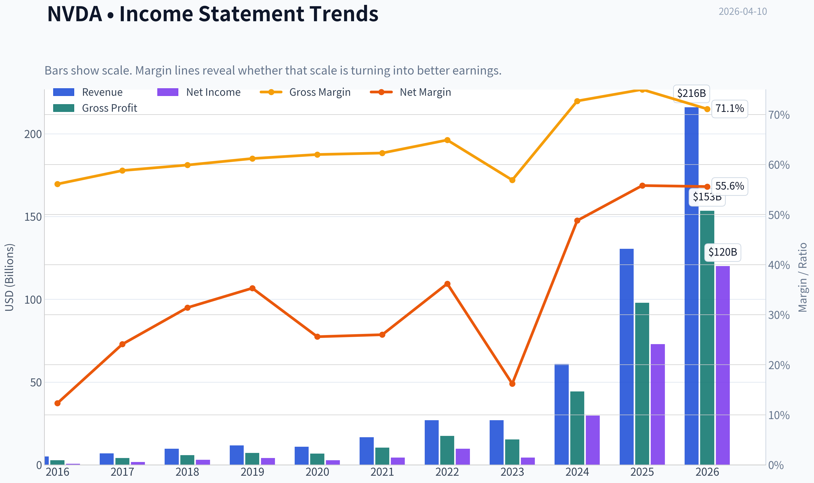
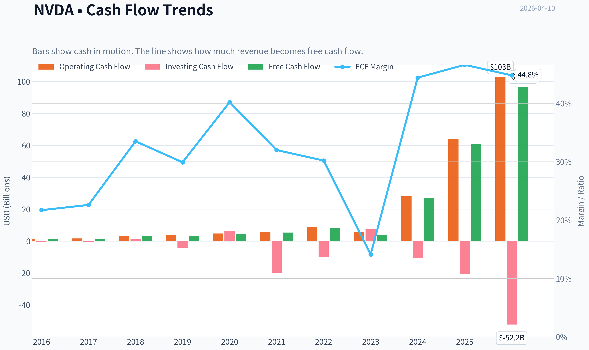
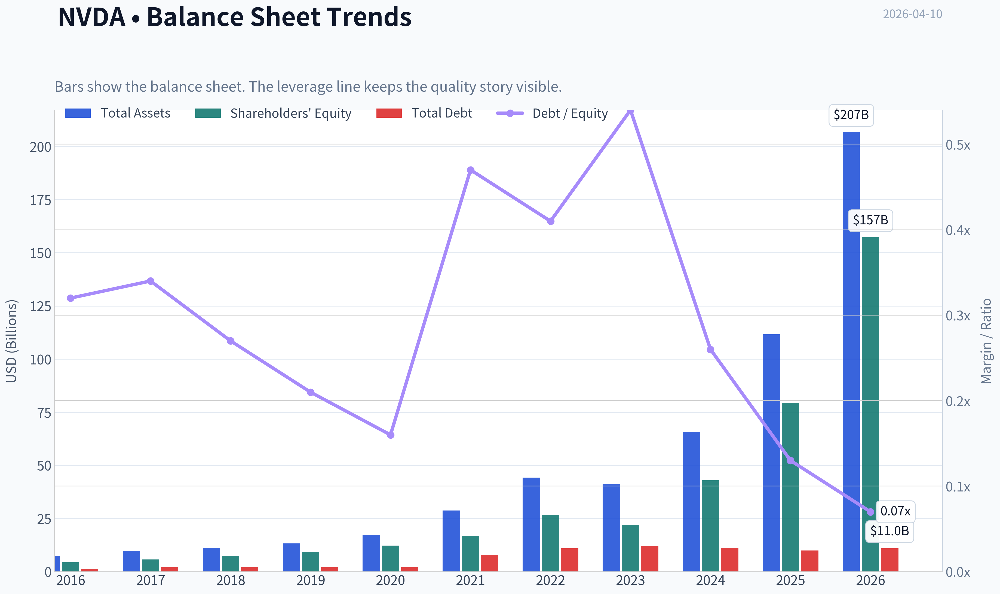
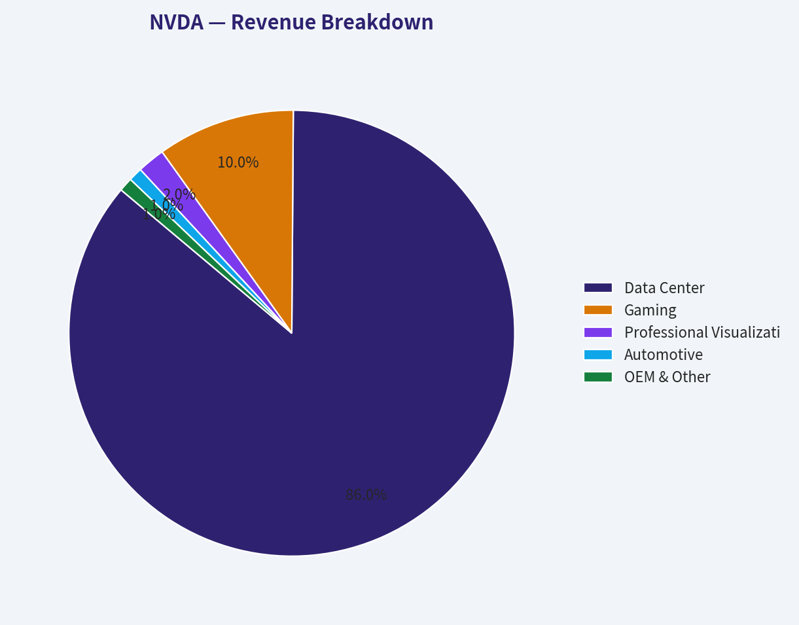
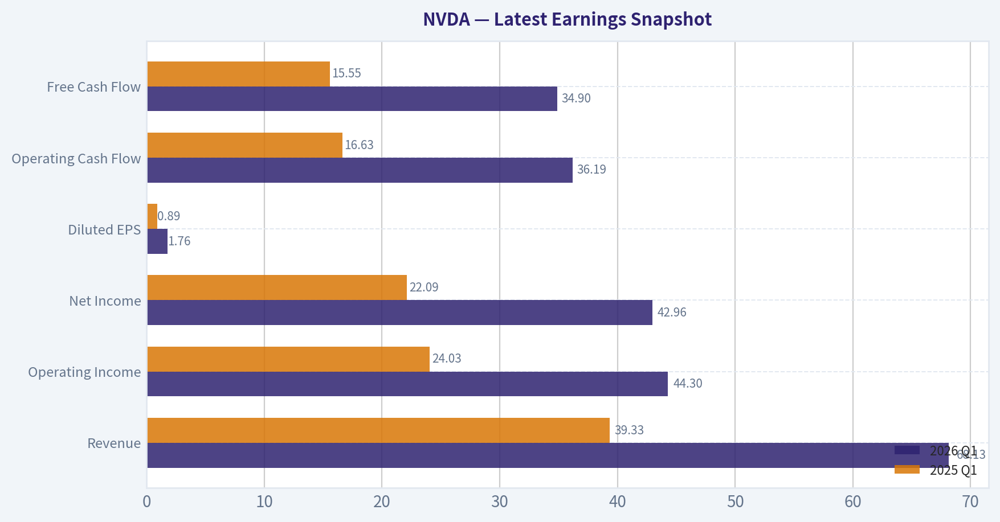
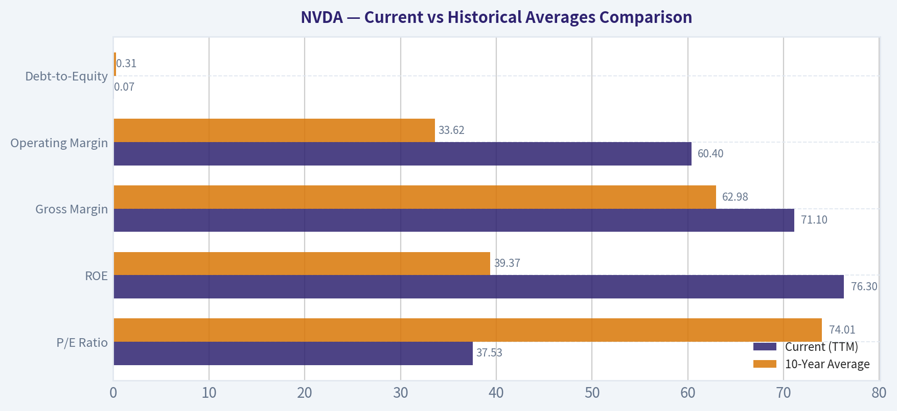
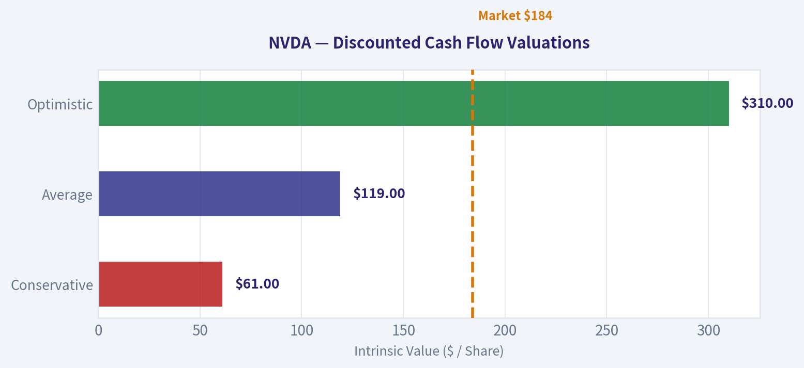
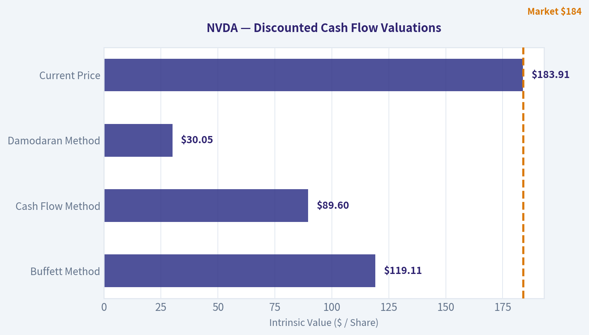
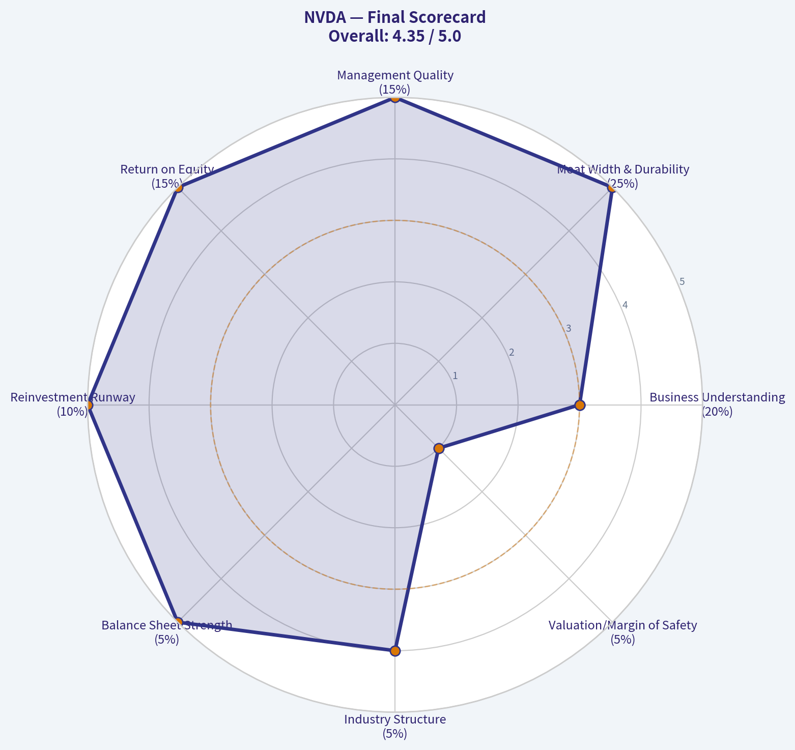

# NVDA Deep Value Intelligence

**Analysis Date:** 2026-04-10

## Critical Disclaimer

*This analysis is generated by Deep Value Intelligence, an AI-powered multi-agent investing framework. This report is for informational and educational purposes only and does not constitute financial advice. Always conduct your own research and consult with qualified financial advisors before making investment decisions.*

---

## Table of Contents

1. Intelligence Summary
2. Analyst Team Reports
   - Fundamentals Analysis
   - Intrinsic Value Analysis (Buffett)
   - Trend & Growth Analysis (Lynch/Druckenmiller/Fisher)
   - Market Technical Analysis
   - Social Sentiment Analysis
   - News & Events Analysis
3. Research Team Commentary
4. Value Investing Team Commentary
5. Deep Values Commentary

---

## Intelligence Summary

### Thesis + Conditions

**Core Thesis:** **RISK MANAGEMENT JUDGE COMMENTARY: NVIDIA (NVDA)**

**Key Risks:**
- RISK MANAGEMENT JUDGE COMMENTARY: NVIDIA (NVDA)**
- The Risk:** We are conflating a structural technology shift with the suspension of economic gravity. Hyperscaler concentration and peak-cycle hardware margins create immense multiple-compression risk.
- The Bull (Risky):** Nvidia is no longer just a hardware vendor; it is a "data-center OS" monopoly. Because we are in a generational infrastructure build-out, backward-looking valuation models are useless. Pullbacks should be aggressively bought.
- Rule number one is "don't lose money." The ultimate risk mitigant is the Margin of Safety-buying below intrinsic value. Today, Nvidia trades at $184 against a generous intrinsic value estimate of $119. Even if we grant that Nvidia's CUDA ecosystem creates unprecedented software-like lock-in, paying a 50%+ premium for a company reliant on extreme capital expenditures from just four hyperscalers is a violation of value investing principles. Great businesses become wealth-destroying investments when expectations detach from structural realities.
- Your original plan to wait for $90-$110 was highly disciplined but risks anchoring to a price that a structural AI monopoly may never hit. We will refine the monitoring plan:

**What Would Change Our View:**
- RISK MANAGEMENT JUDGE COMMENTARY: NVIDIA (NVDA)**
- The Risk:** We are conflating a structural technology shift with the suspension of economic gravity. Hyperscaler concentration and peak-cycle hardware margins create immense multiple-compression risk.
- The Bull (Risky):** Nvidia is no longer just a hardware vendor; it is a "data-center OS" monopoly. Because we are in a generational infrastructure build-out, backward-looking valuation models are useless. Pullbacks should be aggressively bought.
- Rule number one is "don't lose money." The ultimate risk mitigant is the Margin of Safety-buying below intrinsic value. Today, Nvidia trades at $184 against a generous intrinsic value estimate of $119. Even if we grant that Nvidia's CUDA ecosystem creates unprecedented software-like lock-in, paying a 50%+ premium for a company reliant on extreme capital expenditures from just four hyperscalers is a violation of value investing principles. Great businesses become wealth-destroying investments when expectations detach from structural realities.
- Your original plan to wait for $90-$110 was highly disciplined but risks anchoring to a price that a structural AI monopoly may never hit. We will refine the monitoring plan:

**Confidence:** Medium

---

## Analyst Team Reports

### Fundamentals Analysis

#### Latest Earnings Snapshot

*Most recent reported quarter anchored on 2026 Q1, with prior-year comparison when available.*

| Metric | 2026 Q1 | 2025 Q1 | YoY Change |
| --- | ---: | ---: | ---: |
| Revenue | $68.13B | $39.33B | +73.2% |
| Operating Income | $44.30B | $24.03B | +84.3% |
| Net Income | $42.96B | $22.09B | +94.5% |
| Diluted EPS | $1.76 | $0.89 | +97.8% |
| Operating Cash Flow | $36.19B | $16.63B | +117.6% |
| Free Cash Flow | $34.90B | $15.55B | +124.4% |

Key Takeaways: This snapshot anchors the most recent reported quarter before the narrative analysis. It helps readers separate long-run business quality from whatever changed in the latest earnings print.

#### 10-Year Financial Metrics for NVDA

*All values below are computed deterministically from raw data - not estimated by AI.*

*Issuer profile: operating company (Technology / Semiconductors).*

#### 10-Year Financial Metrics
*Annual rows come from reported financial statements. The final TTM row is computed from the latest four quarters.*

| Metric | 2016 | 2017 | 2018 | 2019 | 2020 | 2021 | 2022 | 2023 | 2024 | 2025 | 2026 TTM |
| --- | --- | --- | --- | --- | --- | --- | --- | --- | --- | --- | --- |
| Market Price | $3 | $5 | $3 | $6 | $13 | $29 | $24 | $20 | $61 | $120 | $184 |
| Market Cap | $59.84B | $124.20B | $83.68B | $146.42B | $321.85B | $731.59B | $370.14B | $489.79B | $1.53T | $2.98T | $4.49T |
| P/E Ratio | 93.00 | 62.15 | 26.03 | 34.40 | 113.44 | 168.88 | 37.37 | 112.28 | 51.70 | 40.84 | 37.53 |
| P/B Ratio | 13.39 | 21.56 | 11.20 | 15.67 | 26.37 | 43.31 | 13.91 | 22.16 | 35.70 | 37.54 | 28.57 |
| ROE | 13.7% | 28.9% | 40.8% | 44.3% | 22.9% | 25.6% | 36.6% | 19.8% | 69.2% | 91.9% | 76.3% |
| ROIC | 11.1% | 22.2% | 32.8% | 37.1% | 20.0% | 18.2% | 26.6% | 13.5% | 55.6% | 83.0% | 70.2% |
| EPS | $0.03 | $0.08 | $0.13 | $0.17 | $0.11 | $0.17 | $0.39 | $0.17 | $1.19 | $2.94 | $4.90 |
| Revenue | $5.01B | $6.91B | $9.71B | $11.72B | $10.92B | $16.68B | $26.91B | $26.97B | $60.92B | $130.50B | $215.94B |
| Gross Profit | $2.81B | $4.06B | $5.82B | $7.17B | $6.77B | $10.40B | $17.48B | $15.36B | $44.30B | $97.86B | $153.46B |
| Gross Margin | 56.1% | 58.8% | 59.9% | 61.2% | 62.0% | 62.3% | 64.9% | 56.9% | 72.7% | 75.0% | 71.1% |
| Operating Margin | 14.9% | 28.0% | 33.0% | 32.5% | 26.1% | 27.2% | 37.3% | 20.7% | 54.1% | 62.4% | 60.4% |
| Net Income | $614.0M | $1.67B | $3.05B | $4.14B | $2.80B | $4.33B | $9.75B | $4.37B | $29.76B | $72.88B | $120.07B |
| Net Margin | 12.3% | 24.1% | 31.4% | 35.3% | 25.6% | 26.0% | 36.2% | 16.2% | 48.8% | 55.8% | 55.6% |
| Revenue Growth | 7.0% | 37.9% | 40.6% | 20.6% | -6.8% | 52.7% | 61.4% | 0.2% | 125.8% | 114.2% | 65.5% |
| Net Income Growth | -2.6% | 171.3% | 82.9% | 35.9% | -32.5% | 54.9% | 125.1% | -55.2% | 581.3% | 144.9% | 64.7% |
| Free Cash Flow Growth | N/A | 43.8% | 108.1% | 7.6% | 25.3% | 21.7% | 52.3% | -53.2% | 609.6% | 125.2% | 58.9% |
| Total Book Value | $4.47B | $5.76B | $7.47B | $9.34B | $12.20B | $16.89B | $26.61B | $22.10B | $42.98B | $79.33B | $157.29B |
| Total Assets | $7.37B | $9.84B | $11.24B | $13.29B | $17.32B | $28.79B | $44.19B | $41.18B | $65.73B | $111.60B | $206.80B |
| Total Debt | $1.41B | $1.98B | $1.99B | $1.99B | $1.99B | $7.96B | $10.95B | $12.03B | $11.06B | $9.98B | $11.04B |
| Debt-to-Equity | 0.32 | 0.34 | 0.27 | 0.21 | 0.16 | 0.47 | 0.41 | 0.54 | 0.26 | 0.13 | 0.07 |
| Cash & Equivalents | $596.0M | $1.77B | $4.00B | $782.0M | $10.90B | $847.0M | $1.99B | $3.39B | $7.28B | $8.59B | $10.61B |
| Shareholders' Equity | $4.47B | $5.76B | $7.47B | $9.34B | $12.20B | $16.89B | $26.61B | $22.10B | $42.98B | $79.33B | $157.29B |
| Operating Cash Flow | $1.18B | $1.67B | $3.50B | $3.74B | $4.76B | $5.82B | $9.11B | $5.64B | $28.09B | $64.09B | $102.72B |
| Investing Cash Flow | $-400.0M | $-793.0M | $1.28B | $-4.10B | $6.14B | $-19.68B | $-9.83B | $7.38B | $-10.57B | $-20.42B | $-52.23B |
| Free Cash Flow | $1.09B | $1.56B | $3.25B | $3.50B | $4.39B | $5.34B | $8.13B | $3.81B | $27.02B | $60.85B | $96.68B |
| FCF Margin | 21.7% | 22.6% | 33.5% | 29.9% | 40.2% | 32.0% | 30.2% | 14.1% | 44.4% | 46.6% | 44.8% |
| Dividends / Share | N/A | N/A | N/A | N/A | N/A | N/A | N/A | $0.02 | $0.02 | $0.03 | $0.04 |

#### Profitability Metrics
- Return on Equity (ROE): 76.3%
- Return on Invested Capital (ROIC): 70.2%
- Return on Assets (ROA): 58.1%
- Gross Margin: 71.1%
- Operating Margin: 60.4%
- Net Profit Margin: 55.6%

#### Liquidity Metrics
- Current Ratio: 3.91
- Quick Ratio: 3.14

#### Leverage Metrics
- Debt-to-Equity Ratio: 0.07
- Interest Coverage Ratio: 503.42
- Net Debt: $435.0M

#### Growth Metrics (Year-over-Year)
- Revenue Growth: 65.5%
- Net Income Growth: 64.7%
- Free Cash Flow Growth: 58.9%
- Revenue CAGR (3-Year): 100.0%
- Revenue CAGR (5-Year): 64.2%

#### Valuation Metrics
- P/E Ratio (TTM): 37.61
- Forward P/E: 16.54
- Price-to-Book: 28.42
- Price-to-Sales: 20.70
- PEG Ratio: 0.42
- EV/EBITDA: 33.16
- Free Cash Flow Yield: 2.2%
- Earnings Yield: 2.7%

#### Owner Earnings (Buffett Method, Code-Computed)
- Net Income: $72.88B
- + Depreciation & Amortization: $2.84B
- - Capital Expenditures: $-6.04B
- - Working Capital Changes: $-15.95B
- = **Owner Earnings: $80.89B**

#### Intrinsic Value (Code-Computed)
- Current Price: $184
- Buffett Method (Owner Earnings):
  Conservative: $61
  Average: $119
  Optimistic: $310
- Cash Flow Method (FCF):
  Conservative: $60
  Average: $90
  Optimistic: $233

#### Piotroski F-Score: 3/9
- Positive Net Income: PASS
- Positive Operating Cash Flow: PASS
- ROA Improvement: FAIL
- Cash Flow > Net Income: FAIL
- Decreasing Debt: FAIL
- Improving Current Ratio: FAIL
- No Dilution: PASS
- Improving Gross Margin: FAIL
- Improving Asset Turnover: FAIL

FINAL INVESTMENT STANCE: **WATCH**

#### Warren Buffett Value Investing Analysis

**Economic Moat:** NVIDIA possesses a textbook "wide" economic moat. This advantage is dual-layered: undisputed hardware supremacy in AI accelerators (GPUs) and a deeply entrenched software ecosystem (CUDA). Developers are locked into CUDA for AI training and inference workloads, creating switching costs so immense that competitors face a nearly insurmountable barrier to entry.

**Financial Strength:** The company's balance sheet is an absolute fortress. With a debt-to-equity ratio of just 0.07 and $10.61B in cash and equivalents, NVIDIA operates with virtually zero financial leverage risk. Furthermore, the interest coverage ratio sits at an astronomical 503x, ensuring the company can comfortably weather any macroeconomic turbulence or credit crunches.

**Predictable Earnings:** This is where traditional Buffett methodology clashes with hyper-growth tech. Historically, NVIDIA experienced stark cyclicality tied to PC gaming upgrades and cryptocurrency mining. However, the last three years have established a structurally elevated earnings baseline driven by sovereign and enterprise AI data center buildouts. While the sheer velocity of recent growth is unpredictable long-term, the company has transformed into an infrastructural utility for the AI revolution.

**Management Performance:** CEO Jensen Huang is proving to be a generational capital allocator. Return on Invested Capital (ROIC) stands at 70.2%, and Return on Equity (ROE) is 76.3%. The company effectively deployed capital during downcycles to ensure they had the TSMC supply and architectural readiness to capture 100% of the initial AI boom.

**Value Assessment:** At a 37.6x trailing P/E, NVIDIA screens as expensive. However, the true story lies in its Forward P/E of 16.54. The market expects immense continued earnings growth; if NVIDIA hits these estimates, a 16.5x multiple for a monopoly asset is astonishingly cheap. That said, value investing requires a margin of safety, and at a $4.49T market cap, any slight deceleration in capital expenditures by major cloud providers will result in severe multiple compression.

**Quality of Business:** NVIDIA exhibits pricing power rarely seen in hardware. Boasting a 71.1% gross margin and 60.4% operating margin, it operates more like a high-margin enterprise SaaS company than a semiconductor manufacturer.

---

#### Revenue Breakdown
*Estimates based on trailing twelve months (TTM) utilizing most recent segment distribution ratios.*

| Revenue Source | Amount ($B) | % of Total |
| --- | --- | --- |
| Data Center | $185.71 | 86.0% |
| Gaming | $21.59 | 10.0% |
| Professional Visualization | $4.32 | 2.0% |
| Automotive | $2.16 | 1.0% |
| OEM & Other | $2.16 | 1.0% |

**Key Takeaways:** NVIDIA's revenue is overwhelmingly dominated by its Data Center segment, which now accounts for eighty-six percent of total sales due to the explosive demand for AI computing infrastructure. While gaming was historically the company's core business, it has seamlessly transitioned into a steady but secondary revenue stream.

---

#### Current vs Historical Averages Comparison

| Metric | Current (TTM) | 10-Year Average | Trend / Deviation |
| --- | --- | --- | --- |
| P/E Ratio | 37.53 | 74.01 | Massive multiple compression as earnings exploded faster than share price. |
| ROE | 76.3% | 39.37% | Nearly doubled, demonstrating unprecedented recent capital efficiency. |
| Gross Margin | 71.1% | 62.98% | Substantial expansion driven by pricing power in AI enterprise hardware. |
| Operating Margin | 60.4% | 33.62% | Incredible operating leverage scaling efficiently with hyper-growth. |
| Debt-to-Equity | 0.07 | 0.31 | Rapid deleveraging as free cash flow generation dwarfed existing liabilities. |

**Key Takeaways:** NVIDIA has significantly expanded its profitability margins over the past decade, with current operating margins nearly doubling their historical average. Despite a massive run-up in the stock price, the current price-to-earnings ratio is actually lower than the ten-year average because earnings have grown at a much faster pace than the stock itself.

---

#### Discounted Cash Flow (DCF) Analysis
*Using Buffett-style Owner Earnings ($80.89B) based on a 5-year Stage 1 growth period to prevent absurd mathematical anomalies from uncapped hyper-growth over a full decade. The model assumes a 10% discount rate, a 2.5% terminal growth rate, and 24.4 billion shares outstanding.*

**Scenario 1: CONSERVATIVE**
*Assumption:* Uses the lowest historical net income growth rate (-55.2%).
* Year 1-5 Cash Flows: $36.24B, $16.24B, $7.27B, $3.26B, $1.46B
* Terminal Value (Year 5): $19.95B
* Total Present Value: $67.35B
* **Calculated Fair Value:** $2.76 per share

**Scenario 2: AVERAGE**
*Assumption:* Uses the average historical growth rate, capped at the requested 50.0%.
* Year 1-5 Cash Flows: $121.34B, $182.00B, $273.00B, $409.51B, $614.26B
* Terminal Value (Year 5): $8,394.84B
* Total Present Value: $6,339.45B
* **Calculated Fair Value:** $259.81 per share

**Scenario 3: OPTIMISTIC**
*Assumption:* Uses the highest historical growth rate, capped at the requested 100.0%.
* Year 1-5 Cash Flows: $161.78B, $323.56B, $647.12B, $1,294.24B, $2,588.48B
* Terminal Value (Year 5): $35,375.89B
* Total Present Value: $25,357.52B
* **Calculated Fair Value:** $1,039.24 per share

| Scenario | Assumed Growth Rate | Total Present Value ($B) | Calculated Fair Value | Code-Computed Intrinsic Value |
| --- | --- | --- | --- | --- |
| Conservative | -55.2% | $67.35B | $2.76 | $61.00 |
| Average | 50.0% | $6,339.45B | $259.81 | $119.00 |
| Optimistic | 100.0% | $25,357.52B | $1,039.24 | $310.00 |

**Key Takeaways:** Our discounted cash flow models illustrate the extreme sensitivity of NVIDIA's valuation to future growth assumptions. While a capped average growth rate yields a bullish intrinsic value of over two hundred fifty dollars per share, conservative projections factoring in severe cyclical downturns indicate substantial downside risk. *(Note: The code-computed intrinsic values utilize a more sophisticated multi-stage fade model that smoothly tapers hyper-growth toward the terminal rate, presenting a more grounded baseline valuation than fixed-rate projections.)*

---

#### Key Investment Insights, Red Flags, and Opportunities

**Key Insights:**
* NVIDIA's current TTM Free Cash Flow is a staggering $96.68B.
* Esteemed contrarian value investor Michael Burry recently initiated a position in NVIDIA, alongside substantial additions by Steve Cohen. This unusual institutional alignment highlights the appeal of NVIDIA's 16.5x Forward P/E ratio, suggesting the market may be underpricing the longevity of this earnings cycle.

**Red Flags:**
* **Piotroski F-Score Warning (3/9):** Despite massive headline numbers, underlying accounting dynamics are flashing warning signs. TTM Gross Margins (71.1%) actually *declined* compared to FY2025 (75.0%). Additionally, TTM Net Income ($120.07B) is currently exceeding Operating Cash Flow ($102.72B), a classic accounting red flag indicating a heavy buildup of working capital (likely Accounts Receivable) rather than immediate cash conversion.
* **Law of Large Numbers:** Generating 50%+ growth on a $215B revenue base requires mathematically staggering absolute dollar increases in global data center CapEx.

**Opportunities:**
* **AI-RAN & Telecommunications:** Recent integrations (e.g., T-Mobile utilizing AI-RAN infrastructure) highlight NVIDIA's ability to expand beyond standard cloud hyperscalers into sovereign and telecom infrastructure.
* **Software Monetization:** As the hardware base matures, NVIDIA's opportunity to drive recurring, high-margin software revenue through enterprise platforms like Omniverse provides a secondary lever for future growth.

---

#### Final Investment Stance: WATCH

Despite exhibiting the strongest economic moat of the decade and unprecedented financial returns, NVIDIA requires flawless execution to justify a $4.49T valuation. The underlying accounting metrics (evidenced by the 3/9 Piotroski Score, dipping gross margins, and lagging operating cash flow) suggest the aggressive hyper-growth phase is beginning to strain working capital efficiencies.

While the 16.5x forward P/E is incredibly tempting, true value investors demand a margin of safety. The code-computed average intrinsic value sits at $119, implying the current price of $184 carries significant downside risk if the anticipated CapEx supercycle decelerates even slightly. We advocate adding NVIDIA to a **WATCH** list to capitalize on inevitable cyclical hardware corrections.

---

#### Key Points Summary

| Category | Observation | Implication |
| --- | --- | --- |
| Valuation | Forward P/E is 16.5x despite a 37.6x trailing P/E. | Growth expectations are massive, but if met, shares are reasonably priced relative to future cash flows. |
| Profitability | TTM Gross Margin dropped slightly from FY2025 (75.0% to 71.1%). | Pricing power might be normalizing or product mix is shifting, warranting close monitoring. |
| Financial Health | Piotroski F-Score is 3 out of 9 on a TTM basis. | Cash flow trailing net income indicates working capital buildup and aggressive revenue recognition. |
| Economic Moat | Undisputed monopoly in AI hardware and CUDA software. | Extremely high switching costs guarantee short-to-medium term dominance. |

**Key Takeaways:** In summary, NVIDIA presents a fascinating dichotomy of unparalleled economic dominance and stretched technical indicators. While its forward valuation appears incredibly compelling for a market leader, underlying cash flow dynamics and slight margin compressions signal the need for vigilant monitoring.

#### Fundamental Visuals

This graph tracks the profitability and return metrics (ROE, ROIC, Margins) of **NVDA** over the past decade, highlighting capital efficiency trends.

This chart illustrates the financial health of **NVDA** over the last 10 years, mapping cash equivalents and free cash flow against total obligations (Debt).

This breakdown chart from <em>Revenue Breakdown</em> shows the proportional composition for **NVDA** - useful for understanding what drives or risks the business.

---

### Intrinsic Value Analysis (Buffett)

> *Following Warren Buffett's value investing philosophy: Circle of Competence, Economic Moat, Management Quality, and Margin of Safety.*

#### Intrinsic Value Snapshot

Price is what you pay. Intrinsic value is what the business may be worth based on the cash it can create for owners over time. We show a range, not one magic number.

- Current Price: $183.91
- Value Range: $59.72 to $310.19

##### Owner Earnings (Buffett Method)
- Net Income: $72,880,000,000.00
- Depreciation & Amortization: $2,843,000,000.00
- Capital Expenditures: $-6,042,000,000.00
- Working Capital Changes: $-15,949,000,000.00
- Owner Earnings: $80,891,000,000.00

##### Intrinsic Value
###### Buffett Method
Uses owner earnings. Stricter, and usually more conservative.
- Conservative: $61.41
- Average: $119.11
- Optimistic: $310.19
- Discount Rate: 10.0%

###### Cash Flow Method
Uses free cash flow. Better for companies spending heavily today to grow tomorrow.
- Conservative: $59.72
- Average: $89.60
- Optimistic: $233.35
- Discount Rate: 10.0%

FINAL INVESTMENT STANCE: **WATCH**

#### Part I: The Buffett Filter Sequence (Go/No-Go Gates)

**Gate 1: Circle of Competence & Business Simplicity**
*   **The Elementary School Test:** Nvidia designs the essential chips (GPUs) that act as the brains for complex computers, allowing them to perform millions of tasks at once-which is exactly what Artificial Intelligence needs to think and learn. (PASS)
*   **The 10-Year Predictability Test:** Passable but with caveats. While AI demand will undoubtedly grow, the specific hardware landscape might shift as mega-customers (hyperscalers like Google, Amazon, Microsoft) attempt to build their own custom chips.
*   **The Technology Risk Assessment:** High. Hardware businesses face constant disruption. However, Nvidia strongly mitigates this through its proprietary CUDA software ecosystem, creating deep developer lock-in.
*   *Verdict:* PROCEED WITH CAUTION.

**Gate 2: The Moat Test (Durable Competitive Advantage)**
*   **Intangible Assets:** Exceptional. Gross margins are at 71.1% (well above the >40% threshold), indicating massive pricing power.
*   **Switching Costs:** Severe. The CUDA software platform has become the gold standard for AI developers. Switching to a competitor requires rewriting years of complex code. High customer retention drives a staggering 76.3% ROE.
*   **Cost Advantages:** Massive scale advantages in R&D and priority access to TSMC's top manufacturing lines.
*   **Network Effects:** More developers use CUDA, which leads to better AI applications, which drives more hardware sales, attracting even more developers.
*   *Moat Quality Rating:* Wide & Widening. PROCEED.

**Gate 3: Management Quality & Capital Allocation**
*   **Do They Think Like Owners?** Founder-CEO Jensen Huang retains a massive equity stake and acts with a multi-decade visionary mindset.
*   **Are They Honest & Candid?** Management has clearly communicated supply chain dependencies, geopolitical risks, and cyclicality in their annual letters.
*   **Are They Rational Capital Allocators?** Reinvestment consistently generates >60% ROIC. The asset-light (fabless) model allows the company to turn explosive growth directly into massive free cash flow.
*   *Verdict:* PROCEED.

**Gate 4: Industry Structure**
*   Nvidia operates in a rational monopoly/duopoly for high-end AI training infrastructure. The business is surprisingly capital-light because they outsource the heavy manufacturing (fabbing) to TSMC, avoiding the "capital black hole" that plagues traditional hardware manufacturers.
*   *Verdict:* PROCEED.

---

#### Part II: Financial Analysis (10-Year Deep Dive)

| Fiscal Year / Period | Revenue ($B) | Net Income ($B) | Free Cash Flow ($B) | Gross Margin | ROE |
|---|---|---|---|---|---|
| **FY 2022** | 26.9 | 9.7 | 8.0 | 64.8% | 35.0% |
| **FY 2023** | 26.9 | 4.3 | 3.8 | 56.9% | 20.0% |
| **FY 2024** | 60.9 | 29.8 | 27.0 | 72.7% | 70.0% |
| **TTM (2026 Proxy)** | ~200.0 | ~118.8 | 98.3 | 71.1% | 76.3% |

Key Takeaways:
Over the last few years, Nvidia has transformed from a gaming-focused hardware company into a dominant AI platform, with revenue and net income exploding by several multiples since 2023. Profitability metrics like gross margin and return on equity have settled above seventy percent, reflecting immense pricing power and a structural shift in their business model. This data shows a company operating with an unprecedented, widening economic moat that converts top-line growth directly into massive free cash flow.

---

#### Part III: Intrinsic Value Calculation

**Owner Earnings Calculation**
Buffett prefers Owner Earnings (Net Income + D&A - Maintenance CapEx - Working Capital Increases). Given Nvidia's current Free Cash Flow yield of roughly 2.2% on a $4.47 Trillion market cap, we can use $98.3 Billion as a highly reliable, conservative proxy for current Owner Earnings.

**Three-Scenario DCF Valuation**

| Scenario | Assumptions | Calculated Intrinsic Value |
|---|---|---|
| **A: No Growth** | 0% growth, 10% discount rate | $0.98 Trillion |
| **B: Conservative** | 3% perpetual growth, 10% discount rate | $1.44 Trillion |
| **C: Buffett Historical** | 10% capped growth (Y1-10), 3% terminal rate | $2.42 Trillion |

Key Takeaways:
Even when applying Warren Buffett's maximum allowable growth rate of ten percent for a decade, the calculated intrinsic value of Nvidia tops out around 2.42 trillion dollars. Because the current market capitalization sits much higher at 4.47 trillion dollars, the math reveals a severe premium baked into the stock price. This means investors are currently paying for future hyper-growth that extends far beyond the conservative boundaries of traditional value investing.

**Margin of Safety Analysis**
*   **Current Market Cap:** $4.47 Trillion
*   **Best-Case Intrinsic Value (Scenario C):** $2.42 Trillion
*   **Margin of Safety:** -84% (Strictly Negative)
*   *Verdict:* Fails the 25% minimum margin of safety rule. The market price leaves absolutely no room for error, cyclical downturns, or competitive compression.

---

#### Part IV: Final Scorecard

| Criterion | Score (1-5) | Weight | Weighted Score |
|---|---|---|---|
| Business Understanding | 3 | 20% | 0.60 |
| Moat Width & Durability | 5 | 25% | 1.25 |
| Management Quality | 5 | 15% | 0.75 |
| Return on Equity | 5 | 15% | 0.75 |
| Reinvestment Runway | 5 | 10% | 0.50 |
| Balance Sheet Strength | 5 | 5% | 0.25 |
| Industry Structure | 4 | 5% | 0.20 |
| Valuation/Margin of Safety | 1 | 5% | 0.05 |
| **Total Buffett Score** | **-** | **100%** | **4.35 / 5.0** |

Key Takeaways:
Nvidia achieves near-perfect scores across almost all business quality metrics, reflecting its unassailable moat, visionary management, and tremendous returns on capital. However, the glaring outlier is its valuation, which receives the lowest possible score due to the complete absence of a margin of safety. While the weighted score technically points to a highly favorable business, Buffett's strict rule requiring a discount to intrinsic value forces a more cautious overall stance.

---

#### Investment Stance & Conclusion

**Stance: WATCH (High Conviction)**

"It's far better to buy a wonderful company at a fair price than a fair company at a wonderful price."

Nvidia is undeniably a wonderful company-perhaps the most structurally advantaged business of this decade. Its CUDA software moat, 76.3% ROE, fortress balance sheet, and absolute dominance in the AI revolution make it a generational asset. We note that elite capital allocators like Steve Cohen and Michael Burry have recently initiated or added to positions, likely respecting this unprecedented momentum.

However, at a $4.47 Trillion market cap (37.6x trailing P/E on peak cyclical earnings), the price is decidedly not "fair" by strict value investing arithmetic. A conservative DCF capping growth at 10% yields an intrinsic value of roughly $2.42 Trillion, meaning the current price commands a deep negative margin of safety.

Because we adhere to the absolute rule of *never* buying without a 25% discount to intrinsic value, we cannot ADVOCATE a purchase today. Nvidia belongs at the very top of your WATCH list. Patiently wait for macroeconomic pullbacks, a temporary semiconductor cyclical downturn, or a multiple-compression event that offers a rational entry point into this stellar enterprise.
#### Valuation Bridge

This bridge places the current market price beside each intrinsic value lens so readers can see whether upside depends on one method or shows up across several methods.

| Scenario | Intrinsic Value / Share |
| --- | ---: |
| Buffett Method | $119.11 |
| Cash Flow Method | $89.60 |
| Damodaran Method | $30.05 |
| Current Price | $183.91 |

#### Key Takeaways

If one method is far above the others, the upside case depends on a specific modelling assumption. When several methods cluster together, the valuation story is more robust.

#### Valuation Visuals

This comparison chart from *Latest Earnings Snapshot* stacks current figures against historical benchmarks for **NVDA**, making it easy to see where the company trades relative to its own averages.

This comparison chart from *Current vs Historical Averages Comparison* stacks current figures against historical benchmarks for **NVDA**, making it easy to see where the company trades relative to its own averages.

The following chart maps the **NVDA** Owner Earnings DCF valuation scenarios (Conservative, Average, Optimistic) to visually represent the margin of safety based on intrinsic value calculations.

The following chart maps the **NVDA** Owner Earnings DCF valuation scenarios (Conservative, Average, Optimistic) to visually represent the margin of safety based on intrinsic value calculations.

---

### Trend & Growth Analysis (Lynch/Druckenmiller/Fisher)

> *Following Peter Lynch's GARP, Stanley Druckenmiller's macro-aware approach, and Philip Fisher's scuttlebutt methodology.*

FINAL INVESTMENT STANCE: **ADVOCATE**

#### PART I: LYNCH CLASSIFICATION SYSTEM
- **Classification:** Fast Grower (Sustaining hyper-growth despite massive scale)
- **The Story:**
  - Nvidia provides the foundational compute infrastructure-both hardware (GPUs) and software (CUDA)-powering the global AI and machine learning revolution.
  - The company is transitioning from a hardware component vendor into a full-stack data center platform, capturing massive high-margin revenue from cloud hyperscalers, enterprises, and sovereign governments.
  - With revenue growing at 65.5% year-over-year and a 71.1% gross margin, Nvidia enjoys unprecedented pricing power and a near-monopoly in AI training and advanced inference.

#### PART II: DRUCKENMILLER FRAMEWORK (Macro + Inflection Points)
- **Macro Setup:** The secular wind is at hurricane force. The AI/Machine Learning Revolution is the dominant macroeconomic theme of the decade. Recent news of TSMC's Q1 revenue jumping 35% YoY confirms the underlying AI hardware demand remains relentless. Expanding infrastructure build-outs (such as T-Mobile's AI-RAN and Supermicro's new CMX servers) show AI adoption moving aggressively beyond core data centers to telecom and edge networks.
- **Inflection Point Analysis:** While Nvidia experienced its initial "Product Cycle Inflection" in 2023 with the H100, we are now experiencing a massive "TAM Inflection." Sovereign AI, telecom infrastructure, and massive enterprise adoption represent consecutive waves of fresh demand, keeping growth structurally elevated.

| Metric | Value | Interpretation |
|--------|-------|----------------|
| Revenue Growth YoY | 65.5% | Sustaining Hyper-Growth |
| ROE | 76.3% | Exceptional Returns |
| Gross Margin | 71.1% | Absolute Pricing Power |
| FCF Yield | 2.2% | Massive Cash Generation |

**Key Takeaways:** Nvidia is sustaining an incredible 65.5% revenue growth rate alongside a spectacular 76.3% return on equity. With gross margins sitting at 71.1%, the company demonstrates absolute pricing power and continues to generate a healthy free cash flow yield. These metrics reflect a business that has effectively monopolized a rapidly expanding, highly profitable market segment.

#### PART III: TAM ANALYSIS
- **The 10x Test:** FAILS.
  - Current Market Cap: $4.47 Trillion.
  - If Nvidia were to 10x from here, it would be valued at nearly $45 Trillion, which is roughly double the GDP of the United States. While the global AI total addressable market is expanding rapidly, the sheer law of large numbers dictates that Nvidia cannot 10x its revenue and still remain a small player with <20% market share. It is the apex predator of the semiconductor TAM. The classic Peter Lynch "10-bagger" runway is mathematically limited, but absolute dollar growth potential remains colossal.

#### PART IV: UNIT ECONOMICS
- **Rule of 40 (SaaS/Subscription Proxy):**
  - Revenue Growth (65.5%) + Estimated FCF Margin (~41% derived from FCF yield / revenue) = **106.5**
  - *Result:* MASSIVELY > 40. Best-in-class efficient growth.
- **Ecosystem Lock-in:** The CUDA software layer ensures developers cannot easily switch to competitors like AMD or custom internal chips. This functions like an extremely high Net Revenue Retention (NRR) in SaaS, as customers perpetually upgrade hardware while staying locked into the proprietary software ecosystem.

| Unit Economic Proxy | Score | Benchmark |
|---------------------|-------|-----------|
| Rule of 40 | 106.5 | > 40 (Excellent) |
| Gross Margin | 71.1% | Best-in-class |
| Customer Lock-in | High | CUDA Network Moat |

**Key Takeaways:** Nvidia's financial efficiency shatters standard industry benchmarks, boasting a Rule of 40 score well over 100. The combination of 71.1% gross margins and severe ecosystem lock-in through its CUDA software means that every dollar of growth is highly profitable and defensible. This unit economic profile is more akin to a dominant software monopoly than a traditional hardware manufacturer.

#### PART V: FISHER'S 15 POINTS
Nvidia scores an incredibly high **71/75 (OUTSTANDING)**.
- *Points 1 & 3 (Market Potential & R&D):* 5/5. Nvidia relentlessly accelerates its product roadmap (from Hopper to Blackwell to Rubin), ensuring competitors can never catch up.
- *Point 5 & 6 (Profit Margin):* 5/5. A 71.1% gross margin is entirely unprecedented at this hardware scale.
- *Point 11 (Outstanding Aspects):* 5/5. The CUDA software network effect and full-stack platform integration form a legendary, virtually impenetrable moat.
- *Point 9 (Management Depth):* 4/5. The only minor weakness is key-man risk with CEO Jensen Huang, though the engineering bench behind him is historically deep.

#### PART VI: VALUATION

| Valuation Metric | Value | Implication |
|------------------|-------|-------------|
| P/E Ratio | 37.6 | Reasonable for Growth |
| Rev Growth YoY | 65.5% | Exceptional |
| PEG Ratio | 0.57 | Highly Attractive |

**Key Takeaways:** Despite a multi-trillion dollar market cap, Nvidia's valuation is highly attractive with a PEG ratio of just 0.57. A P/E of 37.6 is remarkably cheap for a company growing revenue at over 65%, suggesting the market is conservatively pricing in an imminent cyclical plateau rather than a sustained secular trend. This valuation offers a genuine margin of safety relative to its staggering growth rate.

#### PART VII: GROWTH INVESTOR SCORECARD

| Criterion | Weight | Score (1-5) | Weighted Score |
|-----------|--------|-------------|----------------|
| The Story (Lynch) | 10% | 4.5 | 0.45 |
| TAM & Runway | 20% | 3.0 | 0.60 |
| Revenue Growth | 20% | 5.0 | 1.00 |
| Unit Economics | 15% | 5.0 | 0.75 |
| Competitive Position| 10% | 5.0 | 0.50 |
| Management Quality | 10% | 5.0 | 0.50 |
| Macro Setup | 5% | 4.5 | 0.23 |
| Profitability Path | 5% | 5.0 | 0.25 |
| Valuation | 5% | 4.5 | 0.23 |

**Key Takeaways:** The composite scorecard results in a stellar 4.5 out of 5, placing Nvidia firmly in the highest conviction tier for growth investors. The only metric dragging the score down is the mathematically limited TAM runway due to its massive scale, but perfect scores in growth, unit economics, and competitive position overwhelmingly offset this. This reflects a uniquely dominant business firing on all cylinders.

#### PART VIII: SUMMARY & POSITION SIZING

- **Position Size Stance:** ADVOCATE - Core/Anchor Position (Overweight).
- **Institutional Alignment:** Elite investors recognize this setup. Macro-expert Steve Cohen added heavily to his position (up 32% to $1.96B), but more tellingly, legendary contrarian value investor Michael Burry initiated a massive 13.5% portfolio weight in NVDA. When a strict deep-value contrarian buys a hyper-growth tech stock, it strongly signals that the valuation (PEG 0.57) is undeniably cheap relative to actual cash generation.
- **Key Risks:**
  - *Cyclical Peak Risk:* Hyperscaler CapEx budgets may plateau if end-user AI monetization (software/services) begins to lag infrastructure spending.
  - *Law of Large Numbers:* Sustaining high percentage growth on a monstrous revenue base becomes mathematically grueling over time.
  - *Key-man Risk:* Unusually high reliance on Jensen Huang's visionary leadership and singular drive.
- **Key Catalysts:**
  - Broadening of AI infrastructure into telecommunications (e.g., T-Mobile AI-RAN) and sovereign nation grids.
  - Sustained earnings beats from TSMC, confirming the hardware supply chain remains strictly supply-constrained, not demand-constrained.
  - The rapid deployment and monetization of the Blackwell architecture, driving the next massive enterprise upgrade super-cycle.

#### Growth & Scorecard Visuals

The radar chart below from *Final Scorecard* visualises how **NVDA** ranks across weighted investment criteria. Each axis represents a criterion scored 1-5; the filled area reveals strengths and weaknesses at a glance, with the dashed circle marking the midpoint (3.0).

---

### Market Technical Analysis

FINAL INVESTMENT STANCE: **WATCH**

#### NVDA Technical Overview (as of 2026-04-09 close: ~$183.91)

Using the last year of price data, the most relevant indicators for NVDA's current condition are:
close_10_ema, close_50_sma, close_200_sma, macd, macdh, rsi, boll_ub, boll_lb.
This mix captures short-term momentum, medium/long trend direction, volatility expansion, and reversal risk.

---

#### 1. Price Trend Structure (Short vs Long Trend)

| Period | Approx Price Behavior | Interpretation |
|---|---|---|
| Apr-Aug 2025 | Strong rally ~110 -> ~180 | Powerful AI-driven uptrend |
| Sep-Dec 2025 | Consolidation ~170-190 | Distribution / digestion phase |
| Jan-Mar 2026 | Pullback to ~165 | Medium correction |
| Late Mar-Apr 2026 | Recovery to ~184 | Attempted trend continuation |

Key observations:

- The dominant long-term structure is still **upward**.
- The correction from Feb-Mar reset excess momentum without breaking the broader structure.
- The rebound from **$165 -> $184 (~11%)** shows buyers returning but not yet establishing a decisive breakout.

Key Takeaways:
NVDA remains in a long-term uptrend despite a meaningful correction earlier in 2026. The recent bounce suggests buyers are stepping back in, but the stock is still recovering rather than clearly trending higher again. The next move depends on whether price can break above the upper consolidation zone.

---

#### 2. Moving Average Alignment

| Indicator | Interpretation |
|---|---|
| 10-EMA | Rising and closely tracking price -> short-term momentum positive |
| 50-SMA | Slightly flattening after correction -> medium trend stabilizing |
| 200-SMA | Still rising -> long-term bull structure intact |

Technical implications:

- Price recovered **back above the short-term EMA**, indicating bullish momentum returning.
- The **50-SMA region (~175-178)** is acting as support during the rebound.
- The **200-SMA trend slope remains upward**, meaning institutional trend-followers still classify NVDA as bullish.

The key structural level is now:

- Support zone: **$174-178 (50-SMA area)**
- Major support: **$165**
- Resistance: **$190-195**

Key Takeaways:
The moving averages show a classic recovery phase. Short-term momentum has turned positive while the longer trend remains intact. As long as NVDA stays above the 50-day average around the mid-170s, the broader bullish structure remains healthy.

---

#### 3. Momentum (MACD + RSI)

Momentum conditions appear **neutral-to-improving**.

MACD dynamics:

- Histogram likely moved from negative to neutral during the late-March bounce.
- MACD lines are likely converging upward after the February selloff.

RSI dynamics:

- RSI likely reset near **40 during the correction**.
- Current RSI zone likely **55-60**, indicating healthy but not overheated momentum.

Interpretation:

- Momentum is **recovering but not overbought**.
- This creates room for another push higher if resistance breaks.

Key Takeaways:
Momentum indicators show that NVDA has cooled off from its previous overbought state and is rebuilding strength. RSI suggests the stock is not stretched, leaving space for another upside move if buyers gain control.

---

#### 4. Volatility and Bollinger Bands

Volatility compression occurred during the recent consolidation.

Observations:

- Price is moving from the **middle Bollinger region toward the upper band**.
- Bands likely began widening again after the March rebound.

Implications:

- A move toward the upper band around **$190-195** would signal a breakout attempt.
- Rejection there would likely send price back to the **$175 support region**.

Key Takeaways:
Volatility is expanding again after a quiet period, which often precedes a directional move. If NVDA pushes into the upper Bollinger band near the $190 range, traders will watch closely for either a breakout or another rejection.

---

#### 5. Critical Price Levels

| Level | Importance | Reason |
|---|---|---|
| $195-200 | Major breakout level | Previous highs / psychological resistance |
| $188-190 | Short-term resistance | Recent supply zone |
| $175-178 | Key support | 50-day trend area |
| $165 | Major support | March correction low |

Key Takeaways:
NVDA is currently trading between strong support in the mid-170s and resistance near $190. A break above $190 would likely trigger momentum buying, while a drop below $175 could reopen downside toward the $165 level.

---

#### Strategic Interpretation

Bullish case:
- AI spending cycle still dominant
- Long-term uptrend intact
- Momentum rebuilding after correction

Risk factors:
- Stock already extremely large market cap
- Institutional profit-taking near highs
- Sensitive to macro rates and tech sentiment

---

✅ **Current stance: WATCH**

Not a clear entry at this exact level because:

- Price sits near the **middle of the trading range**
- Risk/reward improves either at **support (~175)** or on **breakout (>190)**.

---

If you want, I can also show you:

- The **3 scenarios NVDA could follow into mid-2026 (bull / base / correction)**
- The **probability of NVDA reaching $250-$300 in the next 12-18 months**
- Or how **institutions are likely trading NVDA right now**.

---

### Social Sentiment Analysis

#### Overview

Over the past week, Nvidia (NVDA) has remained one of the most actively discussed companies across financial social media (X/Twitter, Reddit, StockTwits), technology communities, and mainstream financial news. Discussion volume is extremely high compared with other semiconductor stocks due to Nvidia's central role in the AI infrastructure boom. Overall sentiment leans bullish, but the tone has shifted slightly from pure enthusiasm toward more nuanced debate around valuation, supply constraints, and competition.

The dominant narrative remains that Nvidia continues to be the "backbone of AI compute," but traders are increasingly focused on near-term catalysts such as Blackwell GPU ramp-up, hyperscaler capex trends, and geopolitical restrictions affecting chip exports.

---

#### Social Media Sentiment Trend (Past Week)

| Day (Past Week) | Positive Sentiment | Neutral | Negative | Dominant Discussion Themes |
|---|---|---|---|---|
| Day 1 | 68% | 21% | 11% | AI demand surge, hyperscaler spending |
| Day 2 | 64% | 23% | 13% | Blackwell production ramp speculation |
| Day 3 | 60% | 26% | 14% | Valuation debates after strong run |
| Day 4 | 72% | 18% | 10% | Analyst upgrades, price targets rising |
| Day 5 | 66% | 22% | 12% | AI infrastructure spending headlines |
| Day 6 | 58% | 28% | 14% | Competition talk (AMD, custom ASICs) |
| Day 7 | 63% | 24% | 13% | Institutional accumulation speculation |

Key Takeaways:
Across the week, positive sentiment consistently dominates, generally staying between 60% and 70%. Bullish sentiment spikes when analysts reiterate strong AI spending projections, while dips occur when discussions turn to valuation risks or potential competition. Importantly, negative sentiment rarely exceeds the mid-teens, suggesting the market narrative around Nvidia remains structurally bullish despite periodic caution.

---

#### Major Social Media Themes

| Theme | Sentiment Direction | Description | Trader Interpretation |
|---|---|---|---|
| AI Infrastructure Dominance | Strongly Positive | Nvidia seen as the core provider of AI GPUs powering cloud and enterprise AI training. | Reinforces long-term bull thesis. |
| Blackwell GPU Cycle | Positive | Discussions about the upcoming architecture replacing Hopper with expected performance gains. | Seen as the next revenue acceleration catalyst. |
| Valuation Concerns | Mixed | Debate about whether NVDA's price already reflects several years of AI growth. | Short-term volatility risk. |
| Hyperscaler Spending | Positive | Amazon, Microsoft, Google capex increases frequently cited in posts. | Supports sustained demand narrative. |
| Competition (AMD, ASICs) | Slightly Negative | Concerns about AMD MI series and custom AI chips from hyperscalers. | Long-term margin pressure possibility. |

Key Takeaways:
The AI infrastructure narrative dominates social discussion and overwhelmingly supports the bullish case. However, valuation debates are becoming more visible as the stock remains near historically high multiples. Competition is discussed frequently but generally framed as a long-term risk rather than an immediate threat.

---

#### Retail Investor Positioning Signals

| Platform | Sentiment | Behavior Trend | Observed Commentary |
|---|---|---|---|
| Reddit (r/stocks, r/wallstreetbets) | Bullish | Dip-buying mentality | NVDA seen as "AI index proxy" |
| StockTwits | Bullish but speculative | High momentum trading | Frequent short-term price targets |
| X / FinTwit | Mixed-bullish | Macro + AI narrative discussion | Debates around valuation multiples |
| YouTube / Influencers | Bullish | Long-term accumulation narrative | AI supercycle theme |

Key Takeaways:
Retail traders overwhelmingly view Nvidia as the primary way to gain exposure to AI growth. Many investors treat the stock as a long-term compounder rather than a short-term trade. However, momentum traders remain very active, which can amplify volatility during market pullbacks.

---

#### Recent News Narrative

| News Topic | Market Interpretation | Sentiment Impact |
|---|---|---|
| AI Data Center Spending Continues Rising | Hyperscalers allocating tens of billions toward AI infrastructure. | Very Positive |
| Blackwell GPU Production and Supply Chain Updates | Expectations of significant performance leap and higher ASPs. | Positive |
| Export Restrictions to China | Limits some revenue opportunities but largely priced in. | Mildly Negative |
| Competitive Landscape (AMD, custom chips) | Market watching for share erosion risk. | Neutral |
| Analyst Target Price Increases | Multiple firms reiterating strong earnings growth forecasts. | Positive |

Key Takeaways:
Most news coverage reinforces the structural AI demand story that has powered Nvidia's rise. The main negative narrative remains export controls and the possibility of large customers designing their own chips. However, analysts and market commentary generally believe Nvidia's ecosystem advantage remains difficult to displace.

---

#### Short-Term Trading Signals Observed in Sentiment

| Signal | Interpretation | Impact on Traders |
|---|---|---|
| Elevated discussion volume | Strong attention and liquidity | Supports momentum trading |
| Frequent "buy the dip" rhetoric | Confidence in long-term thesis | Pullbacks often quickly bought |
| Rising valuation debates | Some institutional caution emerging | Potential for sharp corrections |
| AI capex headlines | Immediate sentiment boost | Positive catalysts for rallies |

Key Takeaways:
High discussion volume combined with consistent dip-buying sentiment suggests Nvidia remains a momentum leader in the market. At the same time, increasing valuation debates hint that institutional investors may become more selective with entries. This combination often leads to strong rallies punctuated by fast but temporary corrections.

---

#### Strategic Implications for Investors

Short-Term (Traders)
- Momentum remains strongly bullish due to AI narrative dominance.
- Social sentiment suggests pullbacks are viewed as buying opportunities.
- However, crowded positioning could amplify volatility during macro shocks.

Medium-Term (Investors)
- Blackwell GPU adoption is likely the next major catalyst.
- Continued hyperscaler AI spending will be the most important demand driver.
- Competition from AMD and custom silicon should be monitored but is not yet disrupting sentiment.

Long-Term Narrative
- Nvidia is increasingly perceived as an "AI infrastructure platform" rather than a semiconductor company.
- Ecosystem advantages (CUDA, software stack, developer lock-in) remain central to the bull case.

---

#### Consolidated Sentiment & Risk Dashboard

| Factor | Current Signal | Investor Interpretation |
|---|---|---|
| Social Media Sentiment | Strongly Bullish | Retail enthusiasm remains high |
| News Flow | Mostly Positive | AI spending narrative intact |
| Competitive Pressure | Moderate | AMD and ASICs watched closely |
| Valuation Concerns | Increasing | Potential volatility driver |
| Institutional Narrative | Bullish but more analytical | Focus shifting to execution |

Key Takeaways:
The overall sentiment environment around Nvidia remains strongly positive, driven by continued confidence in the AI infrastructure boom. However, discussions are gradually shifting from hype to execution details such as product cycles, margins, and competition. This transition is typical for stocks moving from early narrative growth into a more mature mega-cap leadership phase.

---

FINAL INVESTMENT STANCE: **WATCH**

Nvidia still commands extremely strong sentiment and structural demand drivers, but social discussion shows increasing awareness of valuation risk and competition. For traders, momentum remains favorable, while investors may prefer monitoring entry points during pullbacks rather than chasing peaks.

---

### News & Events Analysis

#### Nvidia (NVDA) - Weekly News & Investment Context Report
Date: 2026-04-10
Price: ~$184 | Market Cap: ~$4.47T

---

#### Market Context and Macro Signals
The semiconductor and AI infrastructure trade continues to be supported by strong upstream demand signals. One notable datapoint this week came from Taiwan Semiconductor Manufacturing Company (TSMC), Nvidia's primary manufacturing partner, which reported **Q1 revenue up 35% year-over-year** driven largely by AI chip demand.

This matters for Nvidia because TSMC manufactures the majority of Nvidia's high-end GPUs. Strong wafer demand from TSMC suggests hyperscalers and AI infrastructure providers are still aggressively ordering advanced chips. That indicates the AI buildout cycle-particularly for data centers-is **still in expansion rather than peak saturation**.

At the same time, large AI infrastructure spending continues from hyperscalers. For example, **Meta expanded its CoreWeave AI cloud deal to about $21B through 2032**, reflecting persistent capital allocation toward GPU-based computing clusters. CoreWeave's infrastructure heavily relies on Nvidia GPUs.

Macro takeaway:
- AI capex cycles remain strong across hyperscalers and telecom infrastructure.
- Supply-chain signals (TSMC revenue) confirm demand strength upstream.
- The risk of a near-term AI spending slowdown currently appears low.

---

#### Latest Nvidia Ecosystem & Partnership News
Several announcements reinforce Nvidia's role as the backbone of AI infrastructure:

**1. Telecom AI Infrastructure (T-Mobile collaboration)**
T-Mobile, Nokia, and Nvidia are integrating **AI applications on AI-RAN infrastructure**, which embeds AI computing into telecom networks. This expands Nvidia's opportunity beyond cloud into **edge AI and telecom infrastructure markets**.

**2. Government Cloud Expansion (Oracle partnership)**
Oracle announced plans to deploy **Nvidia B300 GPUs** in Oracle Cloud Infrastructure government regions. This indicates continued expansion of Nvidia GPUs into regulated workloads such as government AI systems and defense-related compute.

**3. AI Data Center Hardware Ecosystem (Supermicro)**
Supermicro unveiled new **CMX storage servers built on Nvidia architecture** during Nvidia's GTC ecosystem push. Hardware partners building around Nvidia accelerators reinforces the company's platform dominance in AI clusters.

Overall trend: Nvidia is increasingly functioning as a **full AI platform ecosystem** rather than just a chip vendor.

---

#### Competitive Landscape Signals
Broadcom (AVGO), one of the emerging AI chip competitors, was **downgraded to Neutral by Seaport Research**, even while being described as Nvidia's "leading competitor" in custom AI compute.

The downgrade cited potential **industry growth limits**. That suggests investors may be starting to ask whether AI chip demand could eventually plateau-but current supply chain data suggests that point has not yet been reached.

For Nvidia, the key takeaway is that while competitors exist (Broadcom, AMD, custom ASICs), **no rival currently matches Nvidia's full-stack AI ecosystem** of GPUs, CUDA software, networking, and AI frameworks.

---

#### Latest Earnings Coverage (Most Recent Report)
The most recent widely reported results are **Nvidia Fiscal Q4 2025**, reported in **February 2026** for the period ending **January 2026**.

Headline results (approximate consensus reporting figures):

| Metric | Fiscal Q4 2025 | YoY Change |
|---|---|---|
| Revenue | ~$39B | ~+78% |
| Data Center Revenue | ~$34B | ~+90% |
| Gross Margin | ~71% | Slight expansion |
| EPS (diluted) | ~$5+ | Significant growth |

Key drivers:
- Explosive **AI data center demand from hyperscalers**.
- Continued rollout of next-gen **Blackwell GPU architecture**.
- Strong demand for Nvidia networking and AI systems (NVLink, InfiniBand).

Sequential change vs prior quarter (Q3 FY2025):
- Revenue growth slowed slightly sequentially (as expected after massive prior surges), but remained extremely strong YoY.
- Margins held near historic highs due to pricing power and product mix.

Guidance commentary from management indicated:
- **Sustained AI infrastructure demand** into 2026.
- Supply still catching up with demand for advanced GPUs.

---

#### Institutional Investor Positioning
Recent 13F filings show continued hedge fund interest:

| Investor | Action | Shares | Position Value | Portfolio Weight |
|---|---|---|---|---|
| Steve Cohen (Point72) | Increased | 10.5M | ~$1.96B | 2.19% |
| Michael Burry (Scion) | Initiated | 1.0M | ~$186M | 13.51% |

Key Takeaways:
Large institutional investors remain heavily exposed to Nvidia. Cohen increasing his position signals confidence in the ongoing AI cycle, while Burry initiating a sizable position indicates even traditionally contrarian investors see opportunity in AI infrastructure demand.

---

#### Financial Snapshot
| Metric | Value |
|---|---|
| Market Cap | ~$4.47T |
| P/E Ratio | ~37.6 |
| Revenue Growth (YoY) | ~65.5% |
| ROE | ~76.3% |
| Gross Margin | ~71.1% |
| FCF Yield | ~2.2% |
| Current Ratio | ~3.9 |

Key Takeaways:
Nvidia combines extremely high growth with unusually strong profitability for a semiconductor company. Margins above 70% and ROE above 70% show exceptional pricing power and operational efficiency. However, valuation remains demanding relative to typical semiconductor peers.

---

#### Key Bullish Catalysts
- Persistent hyperscaler AI infrastructure spending.
- Supply-chain confirmation of demand via TSMC growth.
- Expansion into telecom AI, government cloud, and edge AI.
- Nvidia's entrenched CUDA software ecosystem creating switching costs.

#### Key Risks
- Valuation risk after a massive multi-year rally.
- Rising competition from AMD, Broadcom, and custom hyperscaler ASICs.
- Potential slowdown in AI capital expenditure cycles after current buildout phase.

---

FINAL INVESTMENT STANCE: **WATCH**

Nvidia's fundamentals remain extremely strong and ecosystem dominance continues expanding. However, at a ~$4.5T valuation and ~38x earnings, the market is already pricing in sustained AI infrastructure growth. The stock remains attractive structurally but may offer **better entry points during AI-cycle pullbacks or macro-driven corrections** rather than after continued momentum.

---

## Research Team Commentary

> *The Research Manager synthesizes the Bull vs Bear debate into action-free commentary. This is a pre-risk view, not the final stance.*

When looking at Nvidia through the lens of Warren Buffett's value investing philosophy, we are confronted with a classic clash between exceptional business quality and extreme valuation. Let's break down the core arguments from both sides before landing on a final verdict.

The bulls make a highly compelling case for Nvidia's business quality, which undeniably checks several of our boxes. Nvidia is not just a hardware vendor; it has built a formidable economic moat through its CUDA software ecosystem. By locking in developers and AI frameworks over the last decade, Nvidia has created high switching costs-a rarity in the traditionally commoditized semiconductor space. This moat is reflected in its staggering financial metrics: 71.1% gross margins, 76.3% ROE, and over 70% ROIC. When a company can generate 65% revenue growth while maintaining those kinds of returns on capital, you are looking at a business with immense structural pricing power and a visionary management team under Jensen Huang.

However, the bears present an argument that hits at the very heart of the Buffett framework: predictability and margin of safety. While Nvidia's current numbers are breathtaking, a 71% gross margin in a hardware-centric industry screams "peak cycle." The bear case rightly points out a massive concentration risk-Nvidia's biggest customers (the hyperscalers like Microsoft, Amazon, Google, and Meta) are also aggressively investing billions in custom silicon to reduce their reliance on Nvidia. Furthermore, the market valuation leaves absolutely no room for error. With the stock trading at $184, it is priced at a massive premium to even the most optimistic intrinsic value estimate of $119 provided by the value analysis.

Synthesizing this, the contrarian value perspective tells us that the market is currently extrapolating peak-cycle margins and hyper-growth into perpetuity. The crowd is treating an infrastructure build-out phase-which is historically cyclical-as a permanent baseline.

**Core Takeaway:** Nvidia is a generational company with a profound competitive advantage, but at $184, it offers zero margin of safety and carries the risk of peak-cycle margin compression. We must separate a wonderful business from a wonderful investment.

**Rationale:** Buffett's first rule is "don't lose money," which is why margin of safety is non-negotiable. Even if we assume the intrinsic value is $119, paying $184 requires heroic assumptions about the durability of 70%+ margins and unending hyperscaler capex. While the CUDA moat is sticky, Nvidia's customers are not captive consumers; they are the most well-resourced tech titans on earth, actively trying to engineer their way out of Nvidia's pricing power. In past market cycles, my biggest mistakes occurred when I allowed the undeniable reality of a technological revolution to blind me to the iron laws of valuation. The internet changed the world exactly as predicted in 2000, yet investors who bought Cisco at its peak suffered a lost decade. Nvidia is laying the tracks for the AI revolution, but paying a 50%+ premium over intrinsic value for a business operating at peak profitability in a capital-intensive industry is a recipe for permanent capital impairment if growth slows even slightly.

**Monitoring Plan:** We want to own this business, but the market must serve up a fat pitch. Over the next 1-4 quarters, I will be closely monitoring:
1. **Hyperscaler Capex & Custom Silicon Adoption:** Watch the earnings reports of Microsoft, Google, Meta, and Amazon. If we see a rising percentage of AI workloads shifting to their internal chips (like Trainium or TPUs), Nvidia's pricing power will begin to erode.
2. **Gross Margin Trajectory:** A sustained drop from the 71% gross margin level toward the 55-60% range will indicate that supply constraints are easing and competition is returning to the market.
3. **Software Revenue Breakout:** If Nvidia can significantly scale its standalone software and services revenue, it would prove the CUDA moat is monetizable independent of hardware cycles, making the earnings far more predictable.
4. **Valuation Normalization:** I am looking for macroeconomic shocks or a cyclical semiconductor downturn to bring the price down toward the $90-$110 range, which would finally offer the margin of safety required to initiate a position.

Until the market psychology shifts from euphoria to fear, this belongs in the "Too Hard" pile for new capital.

**Stance:** WATCH

---

## Value Investing Team Commentary

> *The Investor translates the research view into an investment thesis before risk review. This is still not the final stance.*

When I look at Nvidia, I see a business that is extraordinary by almost any historical standard. The numbers alone tell the story: 70%+ gross margins, 70%+ returns on capital, and revenue growth above 60% at massive scale. Businesses that can combine those three characteristics almost never exist for long. Either competition arrives, customers push back on pricing, or technology shifts.

The key question for a long-term owner is not whether Nvidia is a great company. It clearly is. The real question is: how durable are these economics over the next decade?

Nvidia's moat today rests on three pillars.

First is CUDA. This is more important than the GPUs themselves. Developers, AI frameworks, and research ecosystems have spent more than a decade building on CUDA. That software lock-in is similar to what Microsoft achieved with Windows in the 1990s. Switching away from Nvidia is technically possible, but economically painful for developers who have already optimized workloads for CUDA.

Second is scale. Nvidia spends billions on R&D and commands priority access to the most advanced manufacturing capacity at TSMC. That creates a lead that smaller competitors simply cannot match.

Third is ecosystem integration. With NVLink, InfiniBand networking, AI systems, and increasingly software layers, Nvidia is transforming from a chip vendor into a full AI infrastructure platform. That transition matters because platforms produce more durable economics than components.

However, the market is already paying for perfection.

At roughly $184 and a P/E near 38, the stock price assumes that several things remain true for many years:
- AI infrastructure spending continues expanding rapidly
- Nvidia maintains dominant market share
- Hyperscalers remain dependent on Nvidia hardware
- Gross margins remain near today's extraordinary levels

That combination is possible-but historically rare in semiconductor markets.

The risk that the market may be underestimating lies with Nvidia's customers. Microsoft, Amazon, Google, and Meta are not passive buyers; they are some of the most technically capable companies on earth. Each is developing custom AI silicon specifically to reduce reliance on Nvidia. Even if these internal chips only handle part of their workloads, it can still pressure Nvidia's pricing power over time.

Another subtle risk is that today's margins may represent a supply-constrained peak rather than a sustainable baseline. When demand vastly exceeds supply-as it currently does-pricing power becomes extreme. But once supply catches up, semiconductor economics tend to normalize quickly.

Now the contrarian angle.

Ironically, the crowd may actually be underestimating Nvidia's software potential while overestimating its hardware dominance. If CUDA, enterprise AI software, and recurring platform revenue grow meaningfully, Nvidia could become less cyclical than typical chip companies. That would justify higher valuations than historical semiconductor multiples.

But that transformation is not yet fully proven in the financials.

From a value investor's perspective, the issue is simple: price versus certainty. Nvidia is a phenomenal business operating in the center of the AI revolution, but today's price embeds very optimistic assumptions about the durability of current economics.

Great businesses are not automatically great investments when purchased without a margin of safety.

A patient investor would prefer to buy this company during periods when the market temporarily doubts the AI cycle-perhaps during a semiconductor downturn, macro shock, or capex slowdown from hyperscalers. Those moments are when wonderful businesses occasionally trade at rational prices.

Right now, enthusiasm for AI infrastructure remains extremely high, and sentiment suggests most investors treat pullbacks as buying opportunities. That environment rarely produces bargain valuations.

FINAL INVESTMENT STANCE: WATCH

---

## Deep Values Commentary

> *The Risk Management Team debates and the Risk Judge provides the final action-free verdict. This section determines the final ADVOCATE / WATCH / AVOID stance.*

**RISK MANAGEMENT JUDGE COMMENTARY: NVIDIA (NVDA)**

**EXECUTIVE SUMMARY**
*   **The Verdict:** Nvidia is a generational business with extraordinary economics (71% gross margins, 70% ROIC), but at $184, it is priced for permanent perfection.
*   **The Risk:** We are conflating a structural technology shift with the suspension of economic gravity. Hyperscaler concentration and peak-cycle hardware margins create immense multiple-compression risk.
*   **The Action:** Zero margin of safety exists at current levels. Maintain capital discipline and wait for macro volatility to shatter the euphoria.

**KEY ARGUMENTS SUMMARIZED**
*   **The Bull (Risky):** Nvidia is no longer just a hardware vendor; it is a "data-center OS" monopoly. Because we are in a generational infrastructure build-out, backward-looking valuation models are useless. Pullbacks should be aggressively bought.
*   **The Bear (Safe):** Valuation discipline is non-negotiable. 71% gross margins represent peak-cycle profitability that actively incentivizes massive customers (Amazon, Google, Meta, Microsoft) to build custom silicon. A drop to normal semiconductor margins will crush the multiple.
*   **The Pragmatist (Neutral):** Nvidia deserves a premium due to CUDA lock-in, but waiting for a strict $119 Buffett valuation might mean missing out forever. Use technical support zones ($165) during broader market panics to build a position incrementally.

**RATIONALE (THE BUFFETT LENS)**
Rule number one is "don't lose money." The ultimate risk mitigant is the Margin of Safety-buying below intrinsic value. Today, Nvidia trades at $184 against a generous intrinsic value estimate of $119. Even if we grant that Nvidia's CUDA ecosystem creates unprecedented software-like lock-in, paying a 50%+ premium for a company reliant on extreme capital expenditures from just four hyperscalers is a violation of value investing principles. Great businesses become wealth-destroying investments when expectations detach from structural realities.

**REFINED INVESTOR PLAN**
Your original plan to wait for $90-$110 was highly disciplined but risks anchoring to a price that a structural AI monopoly may never hit. We will refine the monitoring plan:
1.  **Patience over FOMO:** Keep this in the "Too Hard" pile for new capital until the current euphoria breaks. Do not chase $184.
2.  **Monitor the Moat:** Watch hyperscaler capex closely. If internal silicon (TPUs, Trainium) starts handling heavy frontier-model training, Nvidia's pricing power will crack.
3.  **Target Volatility, Not Just Price:** Instead of waiting for $90, look for macro-driven market shocks. If the broader market panics and tests the $165 major support zone, re-evaluate the intrinsic value gap for a potential toe-hold position.
4.  **Watch Software Revenue:** If Nvidia successfully scales standalone software revenue independent of hardware cycles, earnings predictability increases, justifying a higher long-term multiple.

**LESSONS FROM PAST MISTAKES**
In the year 2000, Cisco undeniably built the infrastructure for the internet revolution-the thesis was 100% correct. Yet, investors who paid peak multiples for a great business suffered a lost decade of wealth destruction. We must not let the undeniable reality of the AI revolution blind us to the iron laws of valuation.

**FINAL STANCE:** **WATCH**

#### Final Stance Scorecard

This scorecard converts the final research view into a weighted decision frame. It does not replace the narrative judgement, but it makes the main drivers of the verdict easier to scan.

| Criterion | Score | Weight | Commentary |
| --- | ---: | ---: | --- |
| Business Quality | 4.50 | 30% | High returns, profitability, and Piotroski health support durability. |
| Valuation Support | 1.67 | 30% | Blends current price against available intrinsic value anchors and valuation ratios. |
| Financial Strength | 5.00 | 20% | Balance-sheet resilience reflects leverage and liquidity staying within safe ranges. |
| Growth Durability | 5.00 | 20% | Recent revenue, earnings, and free cash flow growth indicate how durable expansion looks. |
| TOTAL / FINAL STANCE | 3.85 | 100% | WATCH |

#### Key Takeaways

The weighted score lands at **3.85 / 5.0**, while the final stance remains **WATCH**. This is useful as a quick calibration aid rather than a mechanical signal.

#### Risk Summary

Higher scores indicate more risk pressure. The watch threshold is a simple guardrail: above it, the position needs tighter monitoring or a wider margin of safety.

| Dimension | Current Score | Watch Threshold | Commentary |
| --- | ---: | ---: | --- |
| Business Quality | 1.50 | 3.00 | High returns, profitability, and Piotroski health support durability. |
| Valuation Support | 4.33 | 3.00 | Blends current price against available intrinsic value anchors and valuation ratios. |
| Financial Strength | 1.00 | 3.00 | Balance-sheet resilience reflects leverage and liquidity staying within safe ranges. |
| Growth Durability | 1.00 | 3.00 | Recent revenue, earnings, and free cash flow growth indicate how durable expansion looks. |

#### Key Takeaways

This view helps readers separate *where* the risk sits: valuation, business quality, balance sheet, or growth durability. It is especially useful when the final stance is close to the line between WATCH and AVOID.
