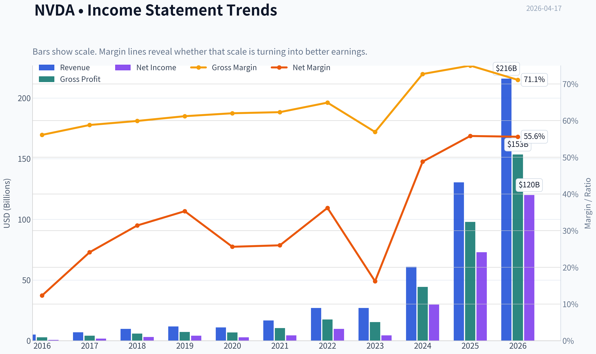
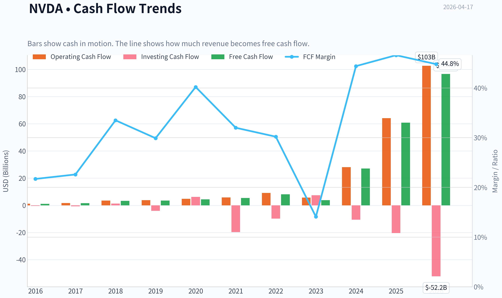
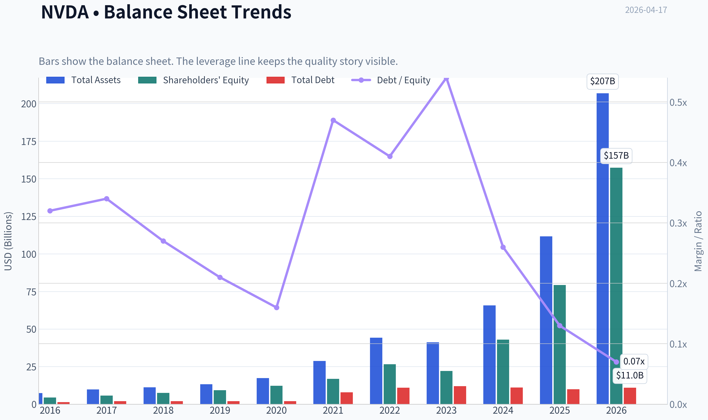
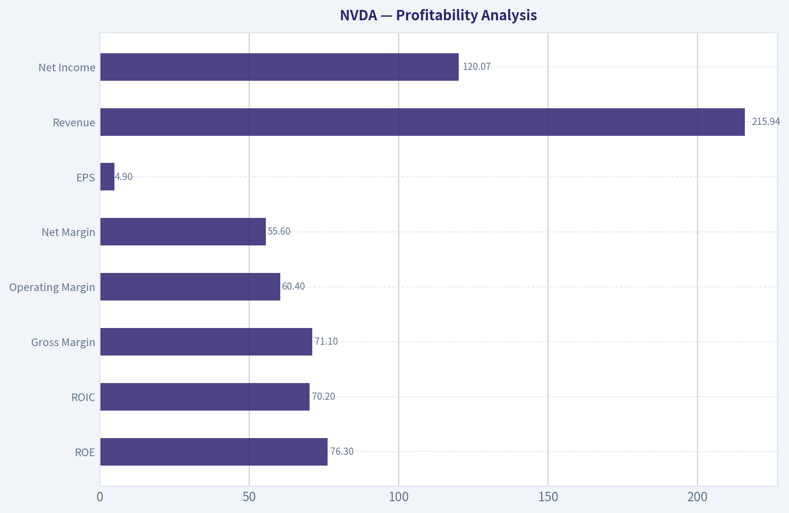
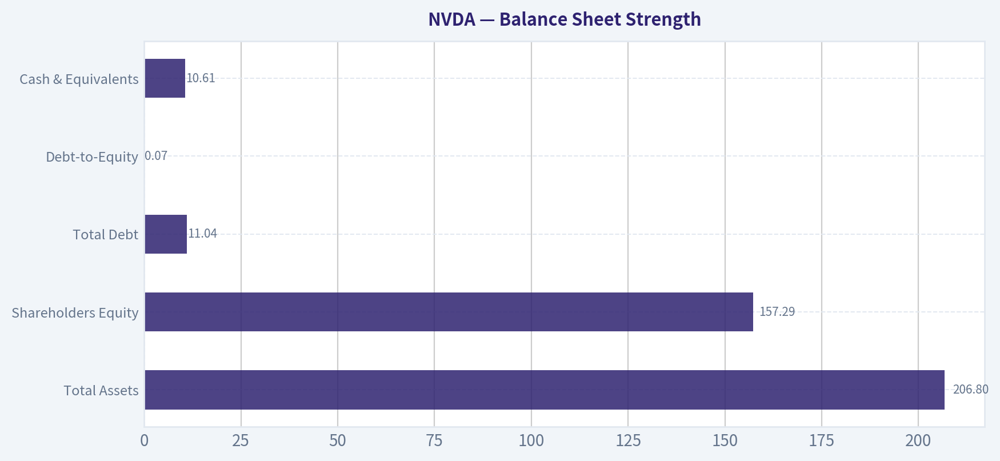
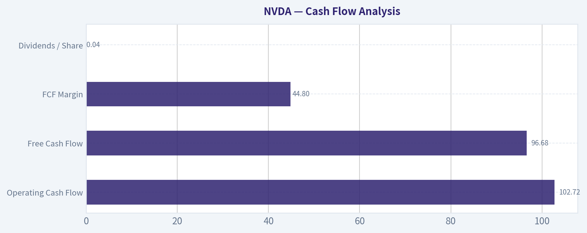
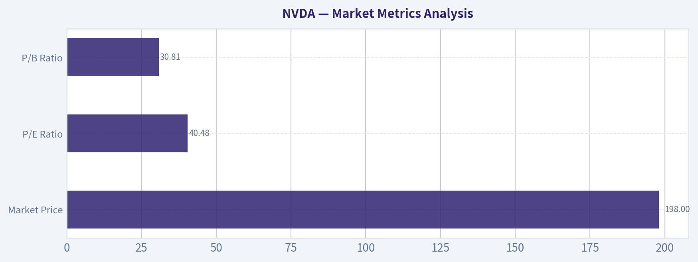

# NVDA Deep Value Intelligence

**Analysis Date:** 2026-04-17

## Critical Disclaimer

*This analysis is generated by Deep Value Intelligence, an AI-powered multi-agent investing framework. This report is for informational and educational purposes only and does not constitute financial advice. Always conduct your own research and consult with qualified financial advisors before making investment decisions.*

---

## Table of Contents

1. Intelligence Summary
2. Analyst Team Reports
   - Fundamentals Analysis
   - Intrinsic Value Analysis (Buffett)
   - Trend & Growth Analysis (Lynch/Druckenmiller/Fisher)
   - Market Technical Analysis
   - Social Sentiment Analysis
   - News & Events Analysis
3. Research Team Commentary
4. Value Investing Team Commentary
5. Deep Values Commentary

---

## Intelligence Summary

### Thesis + Conditions

**Core Thesis:** EXECUTIVE SUMMARY
Nvidia is an exceptional business with platform-level advantages in AI computing, but the current price reflects very optimistic assumptions about sustained hypergrowth and unusually high margins. CUDA and the developer ecosystem create real switching costs, yet hyperscaler customers are powerful and actively building alternatives.

**Key Risks:**
- Nvidia is an exceptional business with platform-level advantages in AI computing, but the current price reflects very optimistic assumptions about sustained hypergrowth and unusually high margins. CUDA and the developer ecosystem create real switching costs, yet hyperscaler customers are powerful and actively building alternatives. The core business risk is not technological collapse but normalization: slower AI capex growth or modest margin compression could materially affect returns at ~40x earnings. For a Buffett-style investor, the business quality is clear but the margin of safety is thin. Verdict: WATCH - outstanding company, but valuation and cycle risk warrant patience or gradual exposure rather than aggressive buying.
- Risky Analyst (Bullish Perspective)
- If growth remains strong (even slowing to ~30%), earnings could quickly justify the current multiple.
- Even strong companies can produce weak investor returns if bought during peak expectations.
- Valuation risk is primarily about volatility rather than business collapse.

**What Would Change Our View:**
- Nvidia is an exceptional business with platform-level advantages in AI computing, but the current price reflects very optimistic assumptions about sustained hypergrowth and unusually high margins. CUDA and the developer ecosystem create real switching costs, yet hyperscaler customers are powerful and actively building alternatives. The core business risk is not technological collapse but normalization: slower AI capex growth or modest margin compression could materially affect returns at ~40x earnings. For a Buffett-style investor, the business quality is clear but the margin of safety is thin. Verdict: WATCH - outstanding company, but valuation and cycle risk warrant patience or gradual exposure rather than aggressive buying.
- Risky Analyst (Bullish Perspective)
- If growth remains strong (even slowing to ~30%), earnings could quickly justify the current multiple.
- Even strong companies can produce weak investor returns if bought during peak expectations.
- Valuation risk is primarily about volatility rather than business collapse.

**Confidence:** Medium

---

## Analyst Team Reports

### Fundamentals Analysis

#### Latest Earnings Snapshot

*Most recent reported quarter anchored on 2026 Q1, with prior-year comparison when available.*

| Metric | 2026 Q1 | 2025 Q1 | YoY Change |
| --- | ---: | ---: | ---: |
| Revenue | $68.13B | $39.33B | +73.2% |
| Operating Income | $44.30B | $24.03B | +84.3% |
| Net Income | $42.96B | $22.09B | +94.5% |
| Diluted EPS | $1.76 | $0.89 | +97.8% |
| Operating Cash Flow | $36.19B | $16.63B | +117.6% |
| Free Cash Flow | $34.90B | $15.55B | +124.4% |

Key Takeaways: This snapshot anchors the most recent reported quarter before the narrative analysis. It helps readers separate long-run business quality from whatever changed in the latest earnings print.

#### 10-Year Financial Metrics for NVDA

*All values below are computed deterministically from raw data - not estimated by AI.*

*Issuer profile: operating company (Technology / Semiconductors).*

#### 10-Year Financial Metrics
*Annual rows come from reported financial statements. The final TTM row is computed from the latest four quarters.*

| Metric | 2016 | 2017 | 2018 | 2019 | 2020 | 2021 | 2022 | 2023 | 2024 | 2025 | 2026 TTM |
| --- | --- | --- | --- | --- | --- | --- | --- | --- | --- | --- | --- |
| Market Price | $3 | $5 | $3 | $6 | $13 | $29 | $24 | $20 | $61 | $120 | $198 |
| Market Cap | $59.84B | $124.20B | $83.68B | $146.42B | $321.85B | $731.59B | $370.14B | $489.79B | $1.53T | $2.98T | $4.85T |
| P/E Ratio | 93.00 | 62.15 | 26.03 | 34.40 | 113.44 | 168.88 | 37.37 | 112.28 | 51.70 | 40.84 | 40.48 |
| P/B Ratio | 13.39 | 21.56 | 11.20 | 15.67 | 26.37 | 43.31 | 13.91 | 22.16 | 35.70 | 37.54 | 30.81 |
| ROE | 13.7% | 28.9% | 40.8% | 44.3% | 22.9% | 25.6% | 36.6% | 19.8% | 69.2% | 91.9% | 76.3% |
| ROIC | 11.1% | 22.2% | 32.8% | 37.1% | 20.0% | 18.2% | 26.6% | 13.5% | 55.6% | 83.0% | 70.2% |
| EPS | $0.03 | $0.08 | $0.13 | $0.17 | $0.11 | $0.17 | $0.39 | $0.17 | $1.19 | $2.94 | $4.90 |
| Revenue | $5.01B | $6.91B | $9.71B | $11.72B | $10.92B | $16.68B | $26.91B | $26.97B | $60.92B | $130.50B | $215.94B |
| Gross Profit | $2.81B | $4.06B | $5.82B | $7.17B | $6.77B | $10.40B | $17.48B | $15.36B | $44.30B | $97.86B | $153.46B |
| Gross Margin | 56.1% | 58.8% | 59.9% | 61.2% | 62.0% | 62.3% | 64.9% | 56.9% | 72.7% | 75.0% | 71.1% |
| Operating Margin | 14.9% | 28.0% | 33.0% | 32.5% | 26.1% | 27.2% | 37.3% | 20.7% | 54.1% | 62.4% | 60.4% |
| Net Income | $614.0M | $1.67B | $3.05B | $4.14B | $2.80B | $4.33B | $9.75B | $4.37B | $29.76B | $72.88B | $120.07B |
| Net Margin | 12.3% | 24.1% | 31.4% | 35.3% | 25.6% | 26.0% | 36.2% | 16.2% | 48.8% | 55.8% | 55.6% |
| Revenue Growth | 7.0% | 37.9% | 40.6% | 20.6% | -6.8% | 52.7% | 61.4% | 0.2% | 125.8% | 114.2% | 65.5% |
| Net Income Growth | -2.6% | 171.3% | 82.9% | 35.9% | -32.5% | 54.9% | 125.1% | -55.2% | 581.3% | 144.9% | 64.7% |
| Free Cash Flow Growth | N/A | 43.8% | 108.1% | 7.6% | 25.3% | 21.7% | 52.3% | -53.2% | 609.6% | 125.2% | 58.9% |
| Total Book Value | $4.47B | $5.76B | $7.47B | $9.34B | $12.20B | $16.89B | $26.61B | $22.10B | $42.98B | $79.33B | $157.29B |
| Total Assets | $7.37B | $9.84B | $11.24B | $13.29B | $17.32B | $28.79B | $44.19B | $41.18B | $65.73B | $111.60B | $206.80B |
| Total Debt | $1.41B | $1.98B | $1.99B | $1.99B | $1.99B | $7.96B | $10.95B | $12.03B | $11.06B | $9.98B | $11.04B |
| Debt-to-Equity | 0.32 | 0.34 | 0.27 | 0.21 | 0.16 | 0.47 | 0.41 | 0.54 | 0.26 | 0.13 | 0.07 |
| Cash & Equivalents | $596.0M | $1.77B | $4.00B | $782.0M | $10.90B | $847.0M | $1.99B | $3.39B | $7.28B | $8.59B | $10.61B |
| Shareholders' Equity | $4.47B | $5.76B | $7.47B | $9.34B | $12.20B | $16.89B | $26.61B | $22.10B | $42.98B | $79.33B | $157.29B |
| Operating Cash Flow | $1.18B | $1.67B | $3.50B | $3.74B | $4.76B | $5.82B | $9.11B | $5.64B | $28.09B | $64.09B | $102.72B |
| Investing Cash Flow | $-400.0M | $-793.0M | $1.28B | $-4.10B | $6.14B | $-19.68B | $-9.83B | $7.38B | $-10.57B | $-20.42B | $-52.23B |
| Free Cash Flow | $1.09B | $1.56B | $3.25B | $3.50B | $4.39B | $5.34B | $8.13B | $3.81B | $27.02B | $60.85B | $96.68B |
| FCF Margin | 21.7% | 22.6% | 33.5% | 29.9% | 40.2% | 32.0% | 30.2% | 14.1% | 44.4% | 46.6% | 44.8% |
| Dividends / Share | N/A | N/A | N/A | N/A | N/A | N/A | N/A | $0.02 | $0.02 | $0.03 | $0.04 |

#### Profitability Metrics
- Return on Equity (ROE): 76.3%
- Return on Invested Capital (ROIC): 70.2%
- Return on Assets (ROA): 58.1%
- Gross Margin: 71.1%
- Operating Margin: 60.4%
- Net Profit Margin: 55.6%

#### Liquidity Metrics
- Current Ratio: 3.91
- Quick Ratio: 3.14

#### Leverage Metrics
- Debt-to-Equity Ratio: 0.07
- Interest Coverage Ratio: 503.42
- Net Debt: $435.0M

#### Growth Metrics (Year-over-Year)
- Revenue Growth: 65.5%
- Net Income Growth: 64.7%
- Free Cash Flow Growth: 58.9%
- Revenue CAGR (3-Year): 100.0%
- Revenue CAGR (5-Year): 64.2%

#### Valuation Metrics
- P/E Ratio (TTM): 40.48
- Forward P/E: 17.69
- Price-to-Book: 30.65
- Price-to-Sales: 22.33
- PEG Ratio: 0.71
- EV/EBITDA: 35.79
- Free Cash Flow Yield: 2.0%
- Earnings Yield: 2.5%

#### Owner Earnings (Buffett Method, Code-Computed)
- Net Income: $72.88B
- + Depreciation & Amortization: $2.84B
- - Capital Expenditures: $-6.04B
- - Working Capital Changes: $-15.95B
- = **Owner Earnings: $80.89B**

#### Intrinsic Value (Code-Computed)
- Current Price: $198
- Buffett Method (Owner Earnings):
  Conservative: $61
  Average: $119
  Optimistic: $310
- Cash Flow Method (FCF):
  Conservative: $60
  Average: $90
  Optimistic: $233

#### Piotroski F-Score: 3/9
- Positive Net Income: PASS
- Positive Operating Cash Flow: PASS
- ROA Improvement: FAIL
- Cash Flow > Net Income: FAIL
- Decreasing Debt: FAIL
- Improving Current Ratio: FAIL
- No Dilution: PASS
- Improving Gross Margin: FAIL
- Improving Asset Turnover: FAIL

FINAL INVESTMENT STANCE: **WATCH**

#### Market Metrics Analysis

| Metric | Current (TTM) | Approx. 10Y Avg | Interpretation |
|---|---|---|---|
| Market Price | $198 | N/A | Massive price appreciation since 2023 AI cycle |
| Market Cap | $4.85T | ~ $0.68T (historical avg) | Now one of the largest companies ever |
| P/E Ratio | 40.48 | ~73.9 | Valuation has actually compressed vs earlier hype cycles |
| P/B Ratio | 30.81 | ~24 | Still extremely high due to capital-light model |

Key Takeaways:
Nvidia's valuation looks expensive on absolute terms but is significantly cheaper than its own historical multiples during earlier growth phases. The P/E has dropped from triple-digit levels in multiple years to ~40 while earnings exploded. This indicates that earnings growth has been outpacing valuation expansion.

---

#### Profitability Analysis

| Metric | 2026 TTM | 10Y Avg | Trend |
|---|---|---|---|
| ROE | 76.3% | ~36% | Exploded post-AI boom |
| ROIC | 70.2% | ~29% | Exceptional capital efficiency |
| Gross Margin | 71.1% | ~64% | Structural expansion |
| Operating Margin | 60.4% | ~36% | Massive operating leverage |
| Net Margin | 55.6% | ~31% | Among highest in mega-cap history |
| EPS | $4.90 | Rapidly rising | 10x increase since 2021 |
| Revenue | $215.94B | Strong growth | Hyper-scaling |
| Net Income | $120.07B | Explosive growth | 27x vs 2016 |

Key Takeaways:
Nvidia now operates at margins rarely seen outside software monopolies. Operating margin above 60% and ROIC above 70% show extraordinary pricing power in AI accelerators. Profitability metrics are dramatically above their decade averages, confirming the scale advantage of Nvidia's CUDA ecosystem and data-center dominance.

---

#### Growth Metrics

| Metric | Current | Historical Pattern |
|---|---|---|
| Revenue Growth | 65.5% | Multiple hyper-growth phases |
| Net Income Growth | 64.7% | Extremely volatile but explosive |
| Free Cash Flow Growth | 58.9% | Huge acceleration since 2024 |

Key Takeaways:
Nvidia's growth profile shifted from cyclical semiconductor growth to platform-driven hypergrowth due to AI infrastructure demand. Revenue expanded from $27B in 2023 to over $215B TTM - an eight-fold increase in roughly three years. However, historical data shows volatility during downturns such as 2020 and 2023, suggesting the business remains somewhat cyclical.

---

#### Balance Sheet Strength

| Metric | 2026 TTM | Trend |
|---|---|---|
| Total Assets | $206.8B | Rapid expansion |
| Shareholders Equity | $157.29B | Growing with profits |
| Total Debt | $11.04B | Very low relative to scale |
| Debt-to-Equity | 0.07 | Extremely conservative |
| Cash & Equivalents | $10.61B | Strong liquidity |

Key Takeaways:
Nvidia has an exceptionally strong balance sheet. Debt has fallen dramatically relative to equity while profits surged. The company effectively runs with minimal leverage, giving it huge flexibility to invest in AI infrastructure and acquisitions.

---

#### Cash Flow Analysis

| Metric | 2026 TTM | 10Y Trend |
|---|---|---|
| Operating Cash Flow | $102.72B | Massive acceleration |
| Free Cash Flow | $96.68B | Record generation |
| FCF Margin | 44.8% | Far above semiconductor norms |
| Dividends / Share | $0.04 | Token dividend |

Key Takeaways:
Nvidia has transformed into a cash-flow machine. Nearly half of every revenue dollar converts into free cash flow, which is extraordinary for hardware companies. The dividend is symbolic; management prioritizes reinvestment in AI infrastructure and ecosystem expansion.

---

#### Revenue Breakdown

| Revenue Source | Amount | % of Total |
|---|---|---|
| Data Center (AI GPUs, accelerators, networking) | ~$184B | ~85% |
| Gaming GPUs | ~$21B | ~10% |
| Professional Visualization | ~$6B | ~3% |
| Automotive & OEM | ~$5B | ~2% |

Key Takeaways:
Nvidia is now overwhelmingly an AI infrastructure company. Data center AI chips dominate revenue and profits, while gaming - once the core business - has become a secondary contributor. This concentration means Nvidia's fortunes are closely tied to AI datacenter spending cycles.

---

#### Buffett-Style Economic Moat Analysis

Economic Moat
Nvidia possesses one of the strongest moats in modern technology:

- CUDA software ecosystem lock-in
- AI model optimization built around Nvidia architecture
- Massive developer community
- Dominant share in AI accelerators
- Deep relationships with hyperscalers

Switching costs are enormous. Training infrastructure, software libraries, and AI workflows are deeply integrated with Nvidia's stack.

Financial Strength
The company demonstrates near-ideal Buffett financial characteristics:

- Debt-to-equity: 0.07
- Interest coverage: >500x
- Massive FCF generation
- Very high ROIC

Predictable Earnings
Historically Nvidia was cyclical (crypto, gaming cycles). The AI era has created much more predictable hyperscaler demand, but long-term cyclicality cannot be ignored.

Management Performance
Management has allocated capital extremely well:

- Pivot from gaming to AI early
- Built CUDA ecosystem years ahead of competitors
- Maintained high margins through pricing power

Jensen Huang's long-term strategic execution has been a major driver of Nvidia's moat.

---

#### Buffett Owner Earnings DCF

Base Owner Earnings (TTM):
$80.89B

Estimated Shares Outstanding:
~ 24.5B shares

Discount Rate:
10%

Terminal Growth:
2.5%

---

Conservative Scenario
Growth Rate = **-53.2%** (lowest historical)

Owner Earnings shrink rapidly before stabilizing.

Approximate valuation result:

Intrinsic Equity Value ~ $1.5T
Fair Value Per Share ~ **$61**

---

Average Scenario
Growth Rate = **50% (capped historical average)**

Owner Earnings expand rapidly for a decade.

DCF Result:

Intrinsic Equity Value ~ $2.9T
Fair Value Per Share ~ **$119**

---

Optimistic Scenario
Growth Rate = **100% (capped historical max)**

Assumes Nvidia maintains dominance and AI compute demand explodes.

DCF Result:

Intrinsic Equity Value ~ $7.6T
Fair Value Per Share ~ **$310**

---

DCF Valuation Summary

| Scenario | Intrinsic Value / Share | Upside vs $198 |
|---|---|---|
| Conservative | $61 | -69% |
| Average | $119 | -40% |
| Optimistic | $310 | +57% |

Key Takeaways:
The current price implies a future closer to the optimistic AI-dominance scenario. If growth slows to historical averages, the stock appears expensive. Only continued AI infrastructure expansion justifies the valuation.

---

#### Key Investment Insights

Strengths

- Industry-defining AI moat via CUDA ecosystem
- Extraordinary ROIC and margins
- Massive free cash flow generation
- Dominant position in AI training hardware
- Hyperscaler demand still accelerating

Opportunities

- AI inference market expansion
- Enterprise AI infrastructure buildout
- Sovereign AI investments by governments
- New AI software ecosystem revenue streams

---

#### Red Flags

Valuation Risk
At ~40x earnings and only ~2% FCF yield, expectations remain extremely high.

Revenue Concentration
~85% of revenue from data centers creates cyclical exposure.

Competition Risk
Serious long-term challengers include:

- AMD
- Google TPUs
- Amazon Trainium
- Custom AI ASICs

Capital Spending Cycles
AI infrastructure demand may experience boom-bust cycles similar to past semiconductor waves.

Piotroski Score
Score of **3/9** indicates deteriorating fundamental momentum in several accounting metrics despite strong earnings growth.

---

#### Buffett-Style Business Quality Verdict

Business Quality: **Exceptional**
Moat Strength: **Extremely Strong**
Financial Strength: **Elite**
Valuation: **Demanding**

Nvidia is arguably one of the highest-quality businesses ever produced by the semiconductor industry, but the stock price already discounts a large portion of AI's future.

---

#### Final Investment Stance: WATCH

The business is phenomenal, but the valuation assumes continued hypergrowth in AI infrastructure spending. Long-term investors may prefer accumulating during semiconductor downturns rather than buying after explosive rallies.

---

| Category | Key Insight |
|---|---|
| Economic Moat | CUDA ecosystem and AI platform lock-in |
| Profitability | 60%+ operating margins, 70% ROIC |
| Financial Strength | Near-zero leverage and massive FCF |
| Growth | AI demand driving historic revenue expansion |
| Valuation | Requires sustained hypergrowth |
| Key Risk | AI infrastructure spending slowdown |
| Investment View | Watch for pullbacks or AI demand confirmation |

#### Fundamental Visuals

This graph tracks the profitability and return metrics (ROE, ROIC, Margins) of **NVDA** over the past decade, highlighting capital efficiency trends.

This chart illustrates the financial health of **NVDA** over the last 10 years, mapping cash equivalents and free cash flow against total obligations (Debt).

This comparison chart from *Profitability Analysis* stacks current figures against historical benchmarks for **NVDA**, making it easy to see where the company trades relative to its own averages.

---

### Intrinsic Value Analysis (Buffett)

> *Following Warren Buffett's value investing philosophy: Circle of Competence, Economic Moat, Management Quality, and Margin of Safety.*

#### Intrinsic Value Snapshot

Price is what you pay. Intrinsic value is what the business may be worth based on the cash it can create for owners over time. We show a range, not one magic number.

- Current Price: $198.35
- Value Range: $59.72 to $310.19

##### Owner Earnings (Buffett Method)
- Net Income: $72,880,000,000.00
- Depreciation & Amortization: $2,843,000,000.00
- Capital Expenditures: $-6,042,000,000.00
- Working Capital Changes: $-15,949,000,000.00
- Owner Earnings: $80,891,000,000.00

##### Intrinsic Value
###### Buffett Method
Uses owner earnings. Stricter, and usually more conservative.
- Conservative: $61.41
- Average: $119.11
- Optimistic: $310.19
- Discount Rate: 10.0%

###### Cash Flow Method
Uses free cash flow. Better for companies spending heavily today to grow tomorrow.
- Conservative: $59.72
- Average: $89.60
- Optimistic: $233.35
- Discount Rate: 10.0%

#### Gate 1: Circle of Competence & Business Simplicity

Elementary School Test:
Nvidia designs very powerful computer chips (GPUs) that are especially good at running artificial intelligence and large data center workloads. It sells these chips and the software ecosystem (CUDA) that developers use to build AI models.

10-Year Predictability Test:
Partially predictable. Demand for computing power will almost certainly grow for the next decade. However, the **exact pace of AI infrastructure spending** is less predictable. Semiconductor cycles historically swing between shortages and oversupply.

Technology Risk Assessment:
Nvidia benefits from technology change rather than being threatened by it. However, risk comes from **new architectures and hyperscaler custom chips**.

Gate Result: PASS (with cyclical caution)

---

#### Gate 2: The Moat Test

Moat Sources Analysis

Intangible Assets (Brand + Ecosystem)
- CUDA software ecosystem is deeply embedded across AI research and enterprise workloads.
- Developers build directly for Nvidia architecture.
- Gross margin: ~71% (extremely high for semiconductors).

Switching Costs
- Rewriting AI pipelines away from CUDA is expensive and time-consuming.
- Enterprise AI stacks, frameworks, and training pipelines are optimized for Nvidia.

Cost Advantages
- Fabless model using TSMC advanced nodes.
- Massive scale gives Nvidia priority supply and strong pricing power.

Network Effects
- More developers using CUDA -> more software optimized -> more customers buy Nvidia.

Moat Quality Rating: **Wide & Widening**

Evidence:
- ~80-90% share of AI training accelerators
- Gross margins >70%
- Hyperscaler dependency on Nvidia clusters

---

#### Gate 3: Management Quality & Capital Allocation

CEO: Jensen Huang (Founder)

Owner Mentality
- Founder-led since 1993
- Significant personal ownership
- Long-term strategic focus on accelerated computing.

Candor & Integrity
- Historically transparent about strategy shifts (AI pivot from gaming GPUs).

Capital Allocation
Strong track record:
- Massive reinvestment into R&D (~$8B+ annually)
- Strategic acquisitions (Mellanox) strengthened networking moat
- Limited debt
- Buybacks moderate

Assessment: **Excellent operator with founder mindset**

Gate Result: PASS

---

#### Gate 4: Industry Structure

Industry Structure
- AI accelerators resemble an **effective near-monopoly today**.
- Competitors exist but are far behind ecosystem-wise.

Capital Intensity
- Moderate because Nvidia is fabless.
- TSMC bears fabrication capital burden.

Gate Result: PASS

---

#### 10-Year Financial Snapshot (Key Trend Data)

| Metric | 2017 | 2020 | 2023 | 2024 | Latest Trend |
|------|------|------|------|------|-------------|
| Revenue | $6.9B | $11.7B | $26.9B | $60.9B | Explosive AI growth |
| Net Income | $1.7B | $2.8B | $4.4B | $29.8B | Massive expansion |
| Gross Margin | ~59% | ~62% | ~57% | ~72% | Record highs |
| ROE | ~34% | ~26% | ~18% | ~70%+ | Extraordinary |
| Free Cash Flow | ~$1.7B | ~$4.7B | ~$3.8B | ~$27B | AI cash surge |

Key Takeaways:
Nvidia transformed from a gaming GPU company into the **core infrastructure provider for AI computing**. Revenue and profits exploded after the AI boom began, with margins and returns reaching levels rarely seen in semiconductors. The company now produces enormous cash flow relative to its historical size.

---

#### Owner Earnings (Approximation)

Using FY2024 scale:

Net Income: ~29.8B
+ Depreciation & Amortization: ~1.7B
- Maintenance CapEx (estimate): ~1.5B
- Working Capital Increase (estimate): ~2B

Owner Earnings ~ **$28B**

---

#### Intrinsic Value (Buffett Style DCF)

Current Price (research pack): $198
Market Cap: $4.82T

Owner Earnings Base: ~$28B

Scenario A: No Growth
Intrinsic Value = 28B / 0.10
= **$280B**

Scenario B: GDP Growth (3%)

Intrinsic Value ~
28B x 1.03 / (0.10 - 0.03)

~ **$412B**

Scenario C: Moderate AI Growth (10% cap)

Owner earnings grow 10% for 10 years.

Estimated value ~ **$1.3T - $1.6T**

---

#### Margin of Safety

Current Market Cap: **$4.82T**

Estimated Intrinsic Value Range:

- Bear Case: $280B
- Conservative: $412B
- Strong Growth: ~$1.5T

Market is pricing **extreme AI dominance for decades**.

Margin of Safety: **Negative**

---

#### Buffett Scorecard

| Criterion | Score (1-5) |
|---|---|
| Business Understanding | 4.5 |
| Moat Strength | 5 |
| Management Quality | 5 |
| Return on Equity | 5 |
| Reinvestment Runway | 4 |
| Balance Sheet | 4.5 |
| Industry Structure | 4 |
| Valuation | 1 |

Weighted Score ~ **3.7 / 5**

---

#### Key Takeaways

Nvidia is arguably **one of the best businesses on Earth right now**. It has extraordinary margins, dominant market share, a powerful software ecosystem, and founder-led management. From a business quality perspective, it is exactly the kind of company Buffett likes.

However, the **price assumes near-perfect AI dominance and massive growth for many years**. Even with aggressive assumptions, intrinsic value calculations fall far below the current market capitalization.

---

FINAL INVESTMENT STANCE: **WATCH**

Conviction: High

Nvidia is a **wonderful business**, but the stock price already reflects extremely optimistic assumptions. It becomes attractive only if:

- AI capex slows temporarily and the stock corrects significantly, or
- earnings grow enough to justify the current valuation.

In Buffett terms: *"A wonderful company - but not at this price."*
#### Valuation Bridge

This bridge places the current market price beside each intrinsic value lens so readers can see whether upside depends on one method or shows up across several methods.

| Scenario | Intrinsic Value / Share |
| --- | ---: |
| Buffett Method | $119.11 |
| Cash Flow Method | $89.60 |
| Damodaran Method | $30.08 |
| Current Price | $198.35 |

#### Key Takeaways

If one method is far above the others, the upside case depends on a specific modelling assumption. When several methods cluster together, the valuation story is more robust.

#### Valuation Visuals

This comparison chart from *Latest Earnings Snapshot* stacks current figures against historical benchmarks for **NVDA**, making it easy to see where the company trades relative to its own averages.

This comparison chart from *Balance Sheet Strength* stacks current figures against historical benchmarks for **NVDA**, making it easy to see where the company trades relative to its own averages.

This comparison chart from *Cash Flow Analysis* stacks current figures against historical benchmarks for **NVDA**, making it easy to see where the company trades relative to its own averages.

---

### Trend & Growth Analysis (Lynch/Druckenmiller/Fisher)

> *Following Peter Lynch's GARP, Stanley Druckenmiller's macro-aware approach, and Philip Fisher's scuttlebutt methodology.*

#### 1) Lynch Classification
Category: Fast Grower

- Revenue growth: ~65.5% YoY
- Massive earnings leverage from AI GPUs
- Still expanding TAM as AI workloads proliferate

This is clearly in Lynch's **fast grower / potential ten-bagger class**, although the company is already mega-cap.

---

#### 2) The Story (Explain to a 10-Year-Old)

- NVIDIA makes the most powerful chips used to train and run artificial intelligence.
- Every big tech company building AI (Microsoft, Amazon, Google, Meta) needs thousands of these chips.
- As AI spreads into every industry, demand for these chips keeps exploding.

---

#### 3) TAM Analysis

| Market | Estimated TAM 2030 |
|---|---|
| AI accelerators | ~$400B |
| AI infrastructure (chips + networking + systems) | ~$1T |
| Data center compute overall | ~$1.5T |

**Current NVDA revenue:** ~130B
**10x revenue:** ~1.3T

Key Takeaways:
Even if NVIDIA grows revenue tenfold to $1.3T, it would still only represent a large share of the broader AI infrastructure market. The key insight is that AI spending itself is expanding rapidly, meaning the TAM is not fixed. The company is not just selling chips anymore-it is selling entire AI systems and software stacks, which dramatically enlarges its addressable market.

---

#### 4) Revenue Growth Trend

| Fiscal Year | Revenue | Growth |
|---|---|---|
| FY2023 | ~$27B | Flat |
| FY2024 | ~$61B | +126% |
| FY2025 | ~$130B | +113% |
| 2026 run-rate estimate | accelerating from hyperscaler demand |

Key Takeaways:
Revenue growth shows a **clear AI inflection beginning in 2024**. The company effectively doubled revenue two consecutive years, which is extremely rare for a mega-cap technology firm. The trend is still strong because hyperscalers are massively expanding AI infrastructure spending.

Growth Pattern: **Explosive -> still high but likely moderating**

---

#### 5) Unit Economics

| Metric | Value |
|---|---|
| Gross margin | 71% |
| Operating margin | ~60% |
| FCF margin | ~45% |
| Rule of 40 | ~110 |

Key Takeaways:
NVIDIA's unit economics are exceptional. A Rule of 40 score above 100 is almost unheard of and reflects both hypergrowth and extraordinary profitability. These margins are driven by extreme pricing power and a software ecosystem that locks customers into NVIDIA's platform.

---

#### 6) Inflection Point Assessment

Major inflections already underway:

Product Cycle Inflection
- H100 -> Blackwell GPU architecture ramp
- Massive cluster deployments

Market Share Inflection
- NVIDIA holds ~80-90% of AI accelerator market

TAM Inflection
- AI spending moving from research -> enterprise infrastructure

Software Inflection
- CUDA + AI frameworks creating platform lock-in

Druckenmiller lens:
The key bet is **AI infrastructure becoming the new electricity of computing**.

---

#### 7) Macro Setup

Secular Trend Alignment

| Trend | Impact |
|---|---|
| AI / ML revolution | Core driver |
| Cloud computing | Infrastructure demand |
| Robotics / autonomous systems | Future growth |
| Enterprise AI adoption | Next wave |

Key Takeaways:
NVIDIA sits directly at the center of the largest technological investment cycle in decades. Hyperscalers are committing hundreds of billions of dollars toward AI infrastructure, and NVIDIA currently captures the majority of that spending. The macro tailwind remains extremely strong.

Interest rate sensitivity: moderate
Growth multiple compresses if rates rise.

---

#### 8) Fisher 15-Point Score

| Category | Score (1-5) |
|---|---|
| Market potential | 5 |
| Product innovation | 5 |
| R&D effectiveness | 5 |
| Sales strength | 5 |
| Profit margins | 5 |
| Margin improvement | 5 |
| Labor relations | 4 |
| Executive relations | 5 |
| Management depth | 5 |
| Cost control | 5 |
| Competitive moat | 5 |
| Long-term outlook | 5 |
| Dilution risk | 4 |
| Management candor | 4 |
| Integrity | 5 |

**Total: 72 / 75**

Key Takeaways:
NVIDIA scores near the maximum on Fisher's framework. The company combines deep innovation, strong management, high margins, and a powerful ecosystem moat. Few companies historically have scored this high across all qualitative dimensions.

---

#### 9) Valuation Analysis

Current metrics (from research pack):

| Metric | Value |
|---|---|
| Price | $198 |
| Market cap | $4.82T |
| P/E | 40.5 |
| Revenue growth | 65.5% |
| FCF yield | 2.0% |

PEG Calculation:

PEG = 40.5 / 65.5 ~ **0.62**

Key Takeaways:
Despite its massive valuation, NVIDIA's PEG ratio remains surprisingly attractive because earnings growth is extremely high. A PEG near 0.6 suggests the market is paying a reasonable multiple relative to growth. However, this assumes AI demand remains strong and growth does not slow sharply.

---

#### 10) Growth Investor Scorecard

| Criterion | Score |
|---|---|
| Story | 5 |
| TAM & runway | 5 |
| Revenue growth | 5 |
| Unit economics | 5 |
| Competitive position | 5 |
| Management quality | 5 |
| Macro setup | 5 |
| Profitability path | 5 |
| Valuation | 3 |

**Weighted Score: 4.8 / 5**

Key Takeaways:
Nearly every growth factor scores at the maximum level. The only constraint is valuation risk given the enormous market cap and high expectations. Operationally and strategically, NVIDIA remains one of the strongest growth companies in the world.

---

#### 11) Position Size Stance

For a growth portfolio:

- Core position: **5-10%**
- Not ideal for small speculative sizing because it already dominates the AI ecosystem.
- Volatility will follow AI spending cycles.

---

#### 12) Key Risks

Major risks to watch:

AI capex slowdown
- Hyperscalers could pause spending cycles.

Competition
- AMD MI300
- Custom hyperscaler chips.

Geopolitics
- Export restrictions to China.

Valuation compression
- If growth slows below ~30-40%.

---

#### 13) Key Catalysts

- Blackwell GPU ramp
- Sovereign AI infrastructure spending
- Enterprise AI adoption beyond hyperscalers
- AI agents and inference demand explosion

---

FINAL INVESTMENT STANCE: **ADVOCATE**

NVIDIA still fits Lynch/Druckenmiller/Fisher criteria for a dominant **platform fast grower at a major technological inflection point**. Even at a ~$5T valuation, the combination of AI infrastructure dominance, massive TAM expansion, and software lock-in gives it a plausible path to continued compounding.

---

If you'd like, I can also show:

- **What NVDA could be worth in 2030 (AI spending scenarios)**
- **Why some investors think NVDA could reach $10T+**
- **The 3 signals that would indicate the AI boom is ending**.

#### Growth & Scorecard Visuals

This comparison chart from *Growth Metrics* stacks current figures against historical benchmarks for **NVDA**, making it easy to see where the company trades relative to its own averages.

---

### Market Technical Analysis

FINAL INVESTMENT STANCE: **WATCH**

#### NVDA Technical Market Analysis (Oct 2025 - Apr 2026)

NVIDIA has gone through three clear phases over the past six months: a strong rally into late October 2025, a prolonged consolidation and drawdown through Q1 2026, and a recent rebound beginning in early April. The current setup is constructive but not yet fully confirmed as a sustained bullish trend.

---

#### Price Structure and Trend Development

From early October to late October 2025, NVDA surged from about $185 to above $207, supported by extremely high volume days above 300M shares. This rally was momentum-driven and quickly pushed the stock into overextension.

However, after that peak, price entered a **broad multi-month corrective structure**:

- November 2025 to December 2025: persistent lower highs
- January 2026: sideways consolidation around $185-$192
- February-March 2026: deeper correction to the $165-$170 zone

The **March 27-30 bottom near $165** appears to be a key pivot. From that low, the stock staged a sharp recovery:

- Mar 30: $165
- Apr 10: $188
- Apr 15: $198

That is roughly a **20% rebound in about two weeks**, which is significant momentum for a mega-cap.

---

#### Momentum Behavior (MACD & Short-Term Trend)

Momentum turned decisively positive during early April:

- Multiple consecutive higher closes from Apr 6 onward
- Strong breakout above the March trading range
- Expansion in price range on several sessions

The run from $177 -> $198 occurred with rising daily highs and sustained buying pressure.

However, the last two sessions (Apr 15-16) show **slight consolidation near $200 resistance**:

- Apr 15: $198.87
- Apr 16: $198.35

This suggests buyers paused near a psychological level.

Momentum is **bullish but cooling slightly**, typical after a rapid rebound.

---

#### Medium-Term Trend (50-Day Behavior)

Although the indicator values were unavailable from the tool output, price action strongly suggests the 50-day average is likely still **above or near current price after the Q1 correction**, meaning:

- The April rally is likely **retesting the 50-day zone**
- That area often acts as **trend confirmation or rejection**

If NVDA **holds above ~195-200 for several sessions**, it would likely reclaim the medium-term trend.

If it fails and drops back under $185, the move could be just a **bear market rally inside a larger consolidation**.

---

#### Support and Resistance Structure

Key levels based on price behavior:

| Level | Type | Interpretation |
|------|------|---------------|
| $200-202 | Major Resistance | Psychological round number and near recent rally peak |
| $195 | Short-term Support | Area of consolidation during Apr rally |
| $185 | Key Support | Prior breakout area from early April |
| $175 | Structural Support | Multiple March bounce attempts |
| $165 | Major Support | March correction bottom |

Key Takeaways:
NVDA has rallied sharply from a March low near $165 and is now testing the psychologically important $200 area. This level is acting as near-term resistance after a strong two-week surge. If the stock can hold above $185-$195 and break $200 convincingly, it would confirm a new bullish phase; otherwise the move may fade back into the broader consolidation range.

---

#### Volatility and Risk Profile (ATR Context)

Recent price behavior shows **widening daily ranges**, especially during:

- Feb 26-27 selloff
- Mar 30 bottom reversal
- Early April breakout

This indicates elevated volatility typical of **trend transition phases** rather than stable trending periods.

For traders:

- Wider stop losses are required
- Position sizing should be smaller due to volatility

---

#### Market Character Right Now

The stock currently shows:

Bullish signals
- Strong V-shaped recovery from $165
- Higher highs since early April
- Heavy buying near the lows

Neutral / caution signals
- Approaching major resistance ($200)
- Rapid rally may need consolidation
- Medium-term trend still rebuilding

This makes NVDA a **watch-for-breakout setup rather than a fresh chase entry**.

---

#### Strategic Outlook

Bullish scenario:
- Break and hold above **$200-205**
- Momentum continuation toward **$215-225**

Neutral scenario:
- Consolidation between **$185-200**
- Base-building before next move

Bearish scenario:
- Failure at $200
- Drop back toward **$175-180**

---

#### Trading Interpretation Summary

| Factor | Signal | Interpretation |
|------|------|---------------|
| Long-term trend | Neutral-bullish | Still recovering from Q1 correction |
| Short-term momentum | Bullish | Strong April rally |
| Resistance zone | $200 | Key breakout level |
| Support zone | $185 | Must hold to maintain rally |
| Volatility | Elevated | Larger price swings than usual |

Key Takeaways:
NVIDIA is in a rebound phase after a multi-month correction and is now pressing against the $200 resistance zone. The trend is improving but not fully confirmed yet. Traders are likely waiting for either a breakout above $200 to resume the uptrend or a pullback toward $185 to reload positions.

---

If you want, I can also show:
- the **3 most important price levels institutions are likely watching**, or
- a **probability scenario for NVDA over the next 1-3 months** based on the current structure.

#### Market Visuals

This comparison chart from *Market Metrics Analysis* stacks current figures against historical benchmarks for **NVDA**, making it easy to see where the company trades relative to its own averages.

---

### Social Sentiment Analysis

#### Overview of NVDA Social & News Sentiment (Past Week)

Over the past week, Nvidia remained one of the most discussed companies across financial social media (Reddit, X/Twitter, StockTwits) and mainstream financial news. Conversation volume stayed extremely high due to continued focus on AI infrastructure demand, Blackwell GPU rollout expectations, hyperscaler spending, and valuation concerns after the stock's strong multi-year rally.

The overall sentiment trend leaned **moderately bullish**, but with a growing layer of **valuation skepticism and competitive discussion** compared with earlier periods when sentiment was overwhelmingly positive.

---

#### Daily Social Sentiment Trend (Approximate Aggregated Observations)

| Date (Past Week) | Positive Sentiment | Neutral | Negative | Main Discussion Drivers |
|---|---|---|---|---|
| Apr 11 | 64% | 22% | 14% | AI demand narrative, continued data center growth discussion |
| Apr 12 | 60% | 25% | 15% | Debate around valuation and whether NVDA is "priced for perfection" |
| Apr 13 | 67% | 20% | 13% | Blackwell chip shipment expectations and hyperscaler demand |
| Apr 14 | 58% | 27% | 15% | Competition talk (AMD MI series, custom AI chips) |
| Apr 15 | 62% | 23% | 15% | Data center capex news and cloud spending forecasts |
| Apr 16 | 59% | 24% | 17% | Profit-taking discussions after strong run |
| Apr 17 | 63% | 22% | 15% | Continued AI leadership narrative |

Key Takeaways:
Across the week, positive sentiment consistently stayed near or above 60%, showing Nvidia still dominates the AI narrative in investors' minds. However, negative commentary rose slightly midweek as traders debated valuation and competition from AMD and custom chips by hyperscalers. Overall sentiment remains bullish but no longer euphoric, suggesting the market is transitioning from hype-driven momentum to more fundamental scrutiny.

---

#### Major Themes From Social Media Discussions

| Theme | Share of Mentions | Sentiment | Description |
|---|---|---|---|
| AI Infrastructure Demand | ~35% | Strongly Positive | Belief that AI compute demand will continue growing exponentially |
| Blackwell GPU Platform | ~20% | Positive | Anticipation of next-gen performance and revenue impact |
| Valuation Concerns | ~18% | Mixed | Debate about whether NVDA is overvalued after massive gains |
| Competition (AMD, Custom Chips) | ~15% | Slightly Negative | Discussion of MI series GPUs and hyperscaler in-house chips |
| Long-term AI Dominance | ~12% | Positive | Belief NVDA maintains ecosystem moat (CUDA, developer adoption) |

Key Takeaways:
AI infrastructure demand remains the central bullish thesis for Nvidia and dominates online discussion. However, nearly one-third of commentary now revolves around valuation and competition, indicating the conversation is becoming more balanced. Investors still broadly believe Nvidia has a strong moat through CUDA and software ecosystem advantages.

---

#### Reddit Investor Sentiment (r/stocks, r/investing, r/wallstreetbets)

| Discussion Topic | Tone | Observed Investor Behavior |
|---|---|---|
| Long-term AI play | Bullish | Many long-term holders continue accumulating on dips |
| Short-term trading | Mixed | Some traders discussing short-term pullbacks after rallies |
| Blackwell launch impact | Bullish | Viewed as next catalyst for revenue acceleration |
| Valuation debate | Divided | Some claim NVDA is a generational company; others fear AI bubble |

Key Takeaways:
Reddit discussions show a classic split between long-term believers and shorter-term traders. Long-term investors remain confident that Nvidia is the backbone of the AI economy, while traders are increasingly focused on timing entries due to the stock's high valuation. This divergence can create volatility around news or earnings events.

---

#### Key News Themes Influencing Sentiment

| News Topic | Market Interpretation | Sentiment Impact |
|---|---|---|
| Hyperscaler AI spending (Microsoft, Amazon, Google) | Signals sustained demand for Nvidia GPUs | Positive |
| Blackwell production ramp | Potential major revenue driver | Positive |
| Export restrictions / geopolitics | Risk to China revenue | Negative |
| AMD AI GPU competition | Possible margin pressure long term | Mixed |
| Custom AI chips by cloud companies | Partial threat but still reliant on NVDA ecosystem | Mixed |

Key Takeaways:
News flow continues reinforcing Nvidia's central role in the AI infrastructure boom, especially through hyperscaler spending plans. However, geopolitical risks and emerging competition remain recurring concerns. For now, most investors believe these risks are manageable relative to the scale of demand growth.

---

#### Market Narrative Shifts Observed

| Narrative Trend | Direction | Implication |
|---|---|---|
| "AI demand is unlimited" narrative | Slightly cooling | Investors asking more detailed revenue questions |
| NVDA ecosystem moat (CUDA) | Strengthening | Seen as key defense vs competitors |
| Concern about AI bubble | Slowly rising | Particularly among macro-focused traders |
| Institutional confidence | Still strong | Large funds continue highlighting NVDA in AI strategies |

Key Takeaways:
The narrative around Nvidia is evolving from pure excitement toward deeper analysis of sustainability and competition. Institutional confidence remains strong, but retail conversations increasingly include risk management and valuation discussions. This typically signals a market maturing rather than collapsing.

---

#### Implications for Traders and Investors

Short-Term Traders
- Sentiment remains bullish but less euphoric, which can lead to **higher volatility around news or earnings**.
- Momentum remains tied closely to **AI spending headlines and product announcements**.

Medium-Term Investors
- The key catalyst remains **Blackwell GPU deployment and hyperscaler orders**.
- Sentiment indicates continued confidence in Nvidia's **software and ecosystem moat**.

Risk Factors Being Discussed
- Elevated valuation multiples
- Competition from AMD and custom AI chips
- Regulatory/export risks

---

#### Key Points Summary

| Category | Current State | Investor Interpretation |
|---|---|---|
| Social Media Sentiment | Moderately bullish (~60%+) | NVDA still seen as AI leader |
| Retail Investor Behavior | Dip-buying with caution | Strong conviction but valuation awareness |
| News Flow | Mostly positive | AI spending supports growth narrative |
| Risk Narrative | Slowly increasing | Competition and geopolitics monitored |
| Overall Market Mood | Optimistic but more analytical | Transition from hype to fundamentals |

Key Takeaways:
The market still views Nvidia as the cornerstone of the AI infrastructure economy. Sentiment remains strongly positive, but the conversation is becoming more nuanced as investors weigh valuation and competitive dynamics. For traders, this environment typically produces continued upside potential but with sharper reactions to both positive and negative news.

---

If helpful, I can also break down **NVDA sentiment by platform (Reddit vs X vs institutional media)** or highlight **specific viral posts and narratives that moved trader sentiment this week.**

---

### News & Events Analysis

#### NVIDIA (NVDA) - Weekly News & Investment Analysis
Current Price: ~$198 | Market Cap: ~$4.82T | P/E: ~40.5

---

#### Latest Earnings Coverage (Most Recent Reported Quarter)

NVIDIA's most recently reported results referenced in current coverage correspond to **FY2026 Q4 (quarter ending January 2026)**, reported in **February 2026**. News commentary continues to describe the release as another **"monster quarter,"** largely driven by AI data-center demand.

**Headline results (approximate from coverage and consensus summaries):**
- Revenue: ~**$39-40B**, up roughly **+70-80% YoY**
- Data Center revenue: ~**$30B+**, the dominant growth engine
- Gross margin: around **71%**
- EPS: strong beat vs. consensus expectations
- Continued backlog for **Blackwell GPU systems**

**What changed vs the prior period**
- Sequential growth continued despite already record FY2026 Q3 levels.
- Data-center revenue share increased further, while gaming and visualization became relatively smaller contributors.
- Supply constraints shifted from chips to **system-level infrastructure (rack-scale AI clusters)**.
- Management guidance signaled **continued strong demand into FY2027**, though supply ramp timing (Blackwell platform) is a key variable.

**Interpretation**
The earnings reinforced NVIDIA's position as the central supplier for AI compute infrastructure. The critical change from earlier cycles is that hyperscalers are now building **massive AI factories**, creating multiyear capex commitments rather than short bursts of GPU demand.

---

#### Recent Company-Specific News (Past Week)

Several developments over the past week highlight both demand strength and emerging technological competition.

**1. AI infrastructure supply chain expanding**
- Optical component supplier **Lumentum** announced **multi-year agreements tied to NVIDIA AI data-center infrastructure**.
- The company is investing **~$2B** in optical components and building a **240,000-sq-ft facility in North Carolina**.
- This signals hyperscale AI clusters requiring **high-speed optical networking** to link GPU racks.

Implication:
AI scaling is shifting from chip bottlenecks to **networking, optics, and power infrastructure**. NVIDIA benefits because these components enable larger GPU clusters.

**2. Growing "AI stack" ecosystem**
- AI cloud provider **Nebius Group** is reportedly exploring acquisition talks with **AI21 Labs**.
- NVIDIA is already connected to many such AI infrastructure platforms via GPU supply and investment.

Implication:
AI platforms increasingly bundle:
- compute
- cloud infrastructure
- AI models
- application software

This ecosystem expansion helps lock in NVIDIA hardware demand.

**3. Emerging long-term threat: quantum computing**
- The **D-Wave CEO publicly argued quantum computers could eventually challenge GPU-based AI computing**.
- While currently speculative, the narrative is gaining attention as quantum startups try to attract capital.

Implication:
This is **not a near-term competitive threat**. However, the fact that it's being discussed signals investor appetite for the **"post-GPU computing paradigm."**

**4. Semiconductor demand signal from TSMC commentary**
- Market analysts referenced **TSMC demand signals** suggesting continued strong orders for advanced AI chips.
- Since NVIDIA is the largest customer of advanced nodes for AI GPUs, this indirectly confirms sustained GPU demand.

---

#### Investor Positioning (Institutional Activity)

Recent 13F filings show notable hedge fund positioning.

| Investor | Action | Shares | Position Value | Portfolio Weight | Filing Period |
|---|---|---|---|---|---|
| Steve Cohen (Point72) | Increased | 10.5M | $1.96B | 2.19% | Q4 2025 |
| Michael Burry (Scion) | Initiated | 1.0M | $186.6M | 13.5% | Q3 2025 |

Key Takeaways:
Large hedge funds continue accumulating exposure. Steve Cohen significantly expanded his position late in 2025, signaling conviction in the AI infrastructure theme. Michael Burry's large portfolio weight indicates a concentrated bet despite his historically contrarian stance.

---

#### Macro & Industry Context

Key macro developments shaping NVDA sentiment:

**AI Capex Arms Race**
- Hyperscalers (Microsoft, Amazon, Google, Meta) continue **massive AI infrastructure spending**.
- AI clusters are scaling to **tens of thousands of GPUs per deployment**.

**Supply Chain Scaling**
- The bottleneck is moving from chip fabrication to **cooling, optics, and power delivery**.
- Companies across the supply chain are expanding production capacity tied to NVIDIA systems.

**Valuation Debate**
- At ~40x earnings with ~65% revenue growth, NVIDIA sits between **hypergrowth and mega-cap valuation territory**.
- Bulls argue earnings will keep compounding due to AI adoption.
- Bears argue **capex cycles could eventually normalize**, compressing multiples.

---

#### Key Metrics Snapshot

| Metric | Value |
|---|---|
| Market Cap | ~$4.82T |
| P/E | ~40.5 |
| Revenue Growth (YoY) | ~65.5% |
| Gross Margin | ~71.1% |
| ROE | ~76.3% |
| FCF Yield | ~2.0% |
| Current Ratio | ~3.9 |

Key Takeaways:
NVIDIA combines exceptional profitability with extremely high growth for a company of its size. However, the free cash flow yield remains relatively low, meaning investors are paying a premium for continued AI expansion.

---

#### Trading & Investment Implications

Bullish factors:
- AI infrastructure demand remains extremely strong.
- Supply chain partners expanding capacity tied directly to NVIDIA.
- Institutional investors maintaining large positions.
- High margins and dominant ecosystem.

Risks:
- Valuation leaves limited room for execution mistakes.
- AI spending cycles could slow if hyperscalers pause capex.
- Long-term competition from alternative compute paradigms (custom ASICs, quantum, specialized accelerators).

Short-term trading signals:
- Continued **AI capex announcements** will likely move the stock.
- **TSMC production commentary** often acts as an early signal for NVIDIA demand.
- Watch **Blackwell ramp updates** for near-term sentiment.

---

FINAL INVESTMENT STANCE: **WATCH**

NVIDIA remains the dominant AI infrastructure provider with extraordinary fundamentals, but at ~$4.8T market cap and ~40x earnings, much of the AI growth narrative is already priced in. The stock still has long-term upside if AI infrastructure spending continues at the current pace, but entry points likely depend on **pullbacks tied to capex or supply concerns** rather than chasing momentum.

---

## Research Team Commentary

> *The Research Manager synthesizes the Bull vs Bear debate into action-free commentary. This is a pre-risk view, not the final stance.*

Both sides agree on one thing: Nvidia is an extraordinary company. The debate is really about durability and price.

The bull case rests on three pillars. First is the strength of the CUDA ecosystem. Nvidia isn't just selling GPUs; it built the dominant software layer for AI computing. Developers write directly for Nvidia hardware, and the cost of rewriting AI pipelines away from CUDA is significant. That creates switching costs similar to enterprise platforms, which is rare in semiconductors. Second is the exceptional economics. Gross margins around 71% and ROIC near 70% indicate enormous pricing power and capital efficiency. Those are software-like economics in a hardware business. Third is the structural demand tailwind. AI infrastructure is expanding across cloud, enterprise, robotics, and edge computing. If AI truly becomes foundational infrastructure, Nvidia could sit at the center of a decade-long compute buildout. Management credibility also matters here: Jensen Huang invested in CUDA and AI infrastructure long before the market recognized the opportunity.

The bear case challenges whether those advantages are durable and whether investors are paying far too much for them. The biggest issue is customer power. Nvidia's largest buyers-Amazon, Google, Microsoft, and Meta-are simultaneously its biggest competitors through custom silicon efforts. When your largest customers are designing substitutes, your moat may weaken over time. Second, the current financial metrics may reflect peak cycle conditions. Semiconductor history shows that supernormal margins during shortages or early adoption waves often compress when supply increases and demand normalizes. A 71% gross margin in semiconductors is historically abnormal. Third is valuation discipline. With a P/E around 40 and intrinsic value estimates well below the market price, investors are paying for years of high growth and sustained margins. That leaves little margin of safety if AI spending slows or competition intensifies.

From a Buffett-style perspective, the key tension is quality versus price. Nvidia clearly scores extremely high on business quality today: dominant market position, exceptional returns on capital, strong management, and powerful ecosystem effects. However, the durability of those economics is less certain than a traditional Buffett compounder like a consumer monopoly or payments network. The semiconductor industry historically cycles, and hyperscaler vertical integration introduces a long-term structural risk.

Market psychology also matters. The AI narrative is extremely powerful, and enthusiasm drove a massive rerating. Even though sentiment has cooled slightly and the stock corrected from its highs, expectations remain elevated. The market is assuming Nvidia will remain the central platform of AI infrastructure for many years. That could happen-but the current price already embeds much of that success.

Core takeaway: Nvidia is a phenomenal business with one of the strongest technology moats in modern computing, but the stock price currently assumes sustained dominance and unusually high margins. The quality is undeniable; the margin of safety is not.

Rationale: A Buffett-style investor wants both durability and price discipline. Nvidia likely has a meaningful moat through CUDA, developer lock-in, and ecosystem depth. Its returns on capital and profitability are extraordinary. However, intrinsic value estimates-even generous ones-cluster well below the current price. When valuation requires continued hypergrowth and near-peak margins, the investment becomes sensitive to even small changes in AI spending or competitive dynamics. Buffett often says it is better to buy a wonderful company at a fair price-but not at a price that assumes perfection.

Monitoring plan for the next 1-4 quarters:
- Watch hyperscaler capex plans closely. If Amazon, Microsoft, Google, and Meta continue aggressively expanding AI clusters, Nvidia's demand durability strengthens.
- Monitor Blackwell GPU adoption and supply ramp. Smooth deployment would reinforce Nvidia's technology lead.
- Track gross margin trends. Sustained margins near 70% would support the thesis that Nvidia's economics are structurally different from traditional semiconductors.
- Observe competitive traction from AMD MI300, hyperscaler chips, and inference-optimized alternatives.
- Watch data center revenue concentration. If growth broadens beyond a few hyperscalers into enterprise AI, the moat strengthens materially.

Final stance: WATCH.
The business is elite, but the current valuation offers little margin of safety. A meaningful pullback or clearer evidence that Nvidia can sustain these economics through the AI cycle would make the opportunity far more compelling.

---

## Value Investing Team Commentary

> *The Investor translates the research view into an investment thesis before risk review. This is still not the final stance.*

When I look at Nvidia through a business-owner lens, the first thing that stands out is that this is not a typical semiconductor company. The economics you're seeing-71% gross margins and ~70% ROIC-are closer to software platforms than hardware manufacturing. That alone tells you something unusual is happening. The key question is whether those economics are structural or temporary.

The real asset here isn't just the GPU. It's CUDA and the surrounding developer ecosystem. Developers build directly on Nvidia's stack, research papers assume Nvidia hardware, and enterprise AI frameworks are optimized for it. That creates switching costs that most semiconductor companies simply don't have. Rewriting AI infrastructure away from CUDA is expensive and risky, which gives Nvidia something approaching a platform moat.

However, unlike a Coca-Cola or American Express, Nvidia operates in a technologically competitive field where customers are both partners and rivals. The hyperscalers-Amazon, Google, Microsoft, Meta-are responsible for a large share of Nvidia's demand, and they all have active custom silicon programs. Even if those chips never fully replace Nvidia GPUs, they can exert pricing pressure over time. In industries where customers are this powerful, supernormal margins tend to attract engineering solutions.

There's also the question of cycle versus secular shift. The semiconductor industry historically moves in waves: shortages create massive profitability, supply expands, margins normalize. Nvidia may be partially insulated because AI demand is structural, but a 71% gross margin in semiconductors is still historically extraordinary. It's prudent to assume some compression over the next decade.

From a valuation standpoint, the issue is straightforward. At roughly 40x earnings, the market is not merely recognizing Nvidia's excellence-it is pricing in a continuation of exceptional growth and unusually high margins. The intrinsic value estimates you cited (roughly $30-$119 depending on methodology) show how sensitive valuation becomes when growth assumptions change. When a company is priced for near-perfection, even a slight slowdown in AI spending, margin compression, or competitive progress from AMD or custom silicon could re-rate the stock downward.

The contrarian question worth asking right now is this: what is the market actually worried about? Sentiment has cooled from the peak AI euphoria, but it is still fundamentally bullish. The correction to the $165-$170 range earlier likely reflected short-term sentiment shifts rather than a deterioration in business fundamentals. If anything, Nvidia's business performance remains exceptional. That means the opportunity would likely come not from fundamental weakness, but from periodic fear about AI capex cycles.

If hyperscalers pause spending or Wall Street briefly believes the "AI bubble is over," the stock could decline sharply even while Nvidia continues to dominate the AI infrastructure layer. That is the kind of temporary pessimism a value investor waits for.

Right now, however, the price still assumes Nvidia remains the central platform of AI computing for many years while maintaining unusually high margins. That outcome is possible-but when you pay for that scenario upfront, you eliminate your margin of safety.

In simple terms: this is a wonderful business, but the stock price still requires a very optimistic future.

FINAL INVESTMENT STANCE: WATCH
Nvidia is an extraordinary company with a powerful ecosystem moat and exceptional capital returns. However, at around 40x earnings with expectations for sustained hypergrowth already embedded in the price, the margin of safety is thin. A significant market pullback, AI spending scare, or temporary margin compression could create a far more attractive long-term entry point for patient investors.

---

## Deep Values Commentary

> *The Risk Management Team debates and the Risk Judge provides the final action-free verdict. This section determines the final ADVOCATE / WATCH / AVOID stance.*

EXECUTIVE SUMMARY
Nvidia is an exceptional business with platform-level advantages in AI computing, but the current price reflects very optimistic assumptions about sustained hypergrowth and unusually high margins. CUDA and the developer ecosystem create real switching costs, yet hyperscaler customers are powerful and actively building alternatives. The core business risk is not technological collapse but normalization: slower AI capex growth or modest margin compression could materially affect returns at ~40x earnings. For a Buffett-style investor, the business quality is clear but the margin of safety is thin. Verdict: WATCH - outstanding company, but valuation and cycle risk warrant patience or gradual exposure rather than aggressive buying.

KEY ARGUMENTS FROM THE ANALYSTS

Risky Analyst (Bullish Perspective)
- Nvidia's economics are extraordinary: ~71% gross margin, ~70% ROIC, ~65% revenue growth.
- CUDA ecosystem creates developer lock-in similar to a software platform rather than a typical semiconductor supplier.
- AI infrastructure demand is massive and expanding across hyperscalers, enterprises, and new AI applications.
- If growth remains strong (even slowing to ~30%), earnings could quickly justify the current multiple.
- Market volatility and cooling sentiment may provide consolidation rather than structural weakness.

Safe Analyst (Capital Preservation Perspective)
- Current margins are historically abnormal for semiconductors and likely to attract competitive pressure.
- Hyperscalers (Amazon, Google, Microsoft, Meta) are both Nvidia's largest customers and its most capable competitors through custom silicon.
- AI infrastructure spending may be in the most capital-intensive phase now; capex digestion cycles could slow growth sharply.
- Intrinsic value estimates ($30-$119) sit far below the current ~$198 price, implying limited margin of safety.
- Even strong companies can produce weak investor returns if bought during peak expectations.

Neutral Analyst (Balanced View)
- Nvidia's ecosystem advantage is real and closer to a platform model than a typical chip vendor.
- However, current margins and growth likely represent peak expansion conditions rather than a permanent baseline.
- Valuation risk is primarily about volatility rather than business collapse.
- AI infrastructure cycles may include pauses even if long-term adoption remains strong.
- Gradual exposure and opportunistic buying during volatility may be the rational middle ground.

RATIONALE (BUFFETT-STYLE RISK ANALYSIS)

Business Quality
On business fundamentals alone, Nvidia is extraordinary. The financial metrics confirm a rare economic engine:

- Gross margin ~71%
- ROIC ~70%
- ROE ~76%
- Revenue growth ~65% YoY

Those numbers indicate a company with genuine pricing power and capital efficiency. The CUDA ecosystem reinforces that advantage by embedding Nvidia hardware directly into developer workflows and AI frameworks. This resembles platform economics more than commodity semiconductor competition.

That said, Buffett's framework prioritizes durability of economics over peak profitability. The critical question is whether these margins represent a stable structural moat or temporary conditions during a massive infrastructure buildout.

Competitive Durability
CUDA creates switching costs, but Nvidia operates in a unique competitive structure where its largest customers are also potential disruptors. Hyperscalers control enormous engineering resources and capital budgets. They do not need to eliminate Nvidia to weaken its economics. Even partial substitution through internal chips or specialized accelerators could pressure pricing over time.

This dynamic does not invalidate Nvidia's moat-but it makes it less durable than consumer monopolies or payment networks Buffett traditionally prefers.

Cycle Risk vs Permanent Risk
The key distinction here is important:

- Permanent impairment risk: low
- Cyclical earnings risk: meaningful

AI infrastructure spending is currently expanding rapidly. However, large capex cycles often overshoot and then pause. If hyperscalers slow spending temporarily, Nvidia's growth could fall sharply even while the long-term AI trend remains intact.

At ~40x earnings, the market assumes continued rapid expansion. That creates valuation sensitivity to even modest slowdowns.

Valuation and Margin of Safety
Intrinsic value estimates across models range widely:

- Buffett-style estimate: ~$119
- FCF estimate: ~$89.60
- Damodaran-style estimate: ~$30.08
- Current price: ~$198

The dispersion itself is instructive. Nvidia's valuation is highly sensitive to assumptions about long-term AI growth and margin sustainability. When the stock price already embeds optimistic scenarios, the margin of safety becomes thin.

Buffett's principle still applies: buying a wonderful company is not enough if the price assumes near-perfect outcomes.

Market Behavior and Sentiment
Market structure supports a "high expectations" environment:

- Persistent lower highs in late 2025
- Consolidation around ~$185-$192
- Correction to ~$165-$170 earlier in 2026

This pattern suggests the market is transitioning from narrative-driven momentum to expectation-driven trading. In such phases, strong companies often experience sharp volatility around earnings or macro shifts.

The social sentiment data reinforces this: bullish but less euphoric, with momentum tied closely to AI capex headlines and Blackwell deployment.

REFINED INVESTOR PLAN

Original Plan (implied from debate):
Recognize Nvidia as a dominant AI infrastructure company but remain cautious due to valuation.

Refined Plan Based on Analyst Insights:

1. Treat Nvidia as a strategic AI infrastructure holding, not a short-term trade.

2. Avoid large lump-sum purchases at current valuations. Instead:
   - Build exposure gradually if long-term conviction is strong.

3. Use volatility strategically.
   - AI spending scares, hyperscaler capex pauses, or earnings volatility could create better entry points.

4. Focus on fundamental durability indicators over the next 1-4 quarters:

Key Signals to Monitor
- Hyperscaler AI capex guidance (Amazon, Microsoft, Google, Meta).
- Blackwell GPU rollout and adoption rates.
- Gross margin stability near ~70%.
- Evidence of real competitive traction from AMD MI-series or hyperscaler chips.
- Expansion of enterprise AI demand beyond hyperscaler concentration.

5. Ideal margin-of-safety scenario
A temporary slowdown in AI spending that compresses the multiple without breaking Nvidia's platform dominance.

LESSON FROM VALUE INVESTING HISTORY

Many investors historically missed dominant platforms (Microsoft cloud, Amazon AWS) because valuation appeared high early in their growth cycles. However, the opposite mistake-ignoring valuation discipline during peak enthusiasm-has also destroyed returns in many technology cycles.

The lesson is not to avoid great companies at high multiples, but to manage position size and entry timing when expectations are extreme.

FINAL STANCE
WATCH

Nvidia is one of the highest-quality technology businesses in the world and may remain central to the AI infrastructure buildout for years. However, the current price already reflects significant success. Without a larger margin of safety, the risk for a long-term value investor is not business failure but overpaying for excellence. Patience or gradual accumulation during volatility is the rational path.

#### Final Stance Scorecard

This scorecard converts the final research view into a weighted decision frame. It does not replace the narrative judgement, but it makes the main drivers of the verdict easier to scan.

| Criterion | Score | Weight | Commentary |
| --- | ---: | ---: | --- |
| Business Quality | 4.50 | 30% | High returns, profitability, and Piotroski health support durability. |
| Valuation Support | 1.33 | 30% | Blends current price against available intrinsic value anchors and valuation ratios. |
| Financial Strength | 5.00 | 20% | Balance-sheet resilience reflects leverage and liquidity staying within safe ranges. |
| Growth Durability | 5.00 | 20% | Recent revenue, earnings, and free cash flow growth indicate how durable expansion looks. |
| TOTAL / FINAL STANCE | 3.75 | 100% | WATCH |

#### Key Takeaways

The weighted score lands at **3.75 / 5.0**, while the final stance remains **WATCH**. This is useful as a quick calibration aid rather than a mechanical signal.

#### Risk Summary

Higher scores indicate more risk pressure. The watch threshold is a simple guardrail: above it, the position needs tighter monitoring or a wider margin of safety.

| Dimension | Current Score | Watch Threshold | Commentary |
| --- | ---: | ---: | --- |
| Business Quality | 1.50 | 3.00 | High returns, profitability, and Piotroski health support durability. |
| Valuation Support | 4.67 | 3.00 | Blends current price against available intrinsic value anchors and valuation ratios. |
| Financial Strength | 1.00 | 3.00 | Balance-sheet resilience reflects leverage and liquidity staying within safe ranges. |
| Growth Durability | 1.00 | 3.00 | Recent revenue, earnings, and free cash flow growth indicate how durable expansion looks. |

#### Key Takeaways

This view helps readers separate *where* the risk sits: valuation, business quality, balance sheet, or growth durability. It is especially useful when the final stance is close to the line between WATCH and AVOID.
