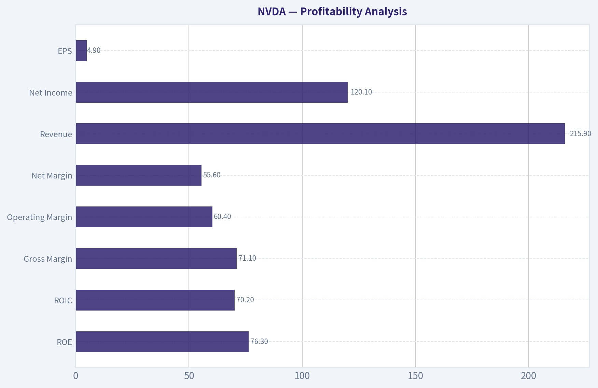
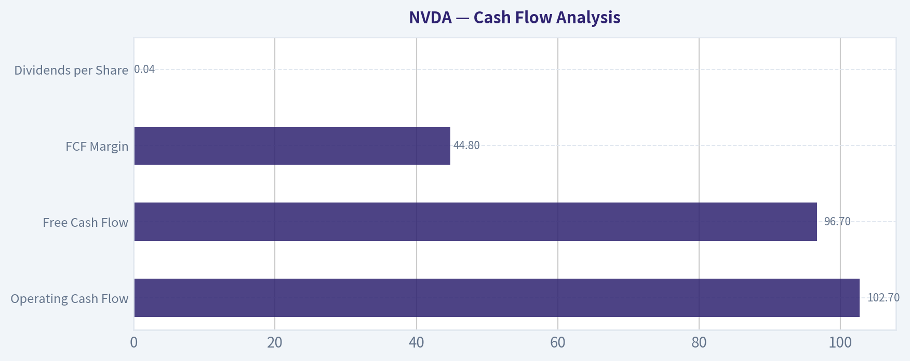

# NVDA Deep Value Intelligence

**Analysis Date:** 2026-04-24

## Critical Disclaimer

*This analysis is generated by Deep Value Intelligence, an AI-powered multi-agent investing framework. This report is for informational and educational purposes only and does not constitute financial advice. Always conduct your own research and consult with qualified financial advisors before making investment decisions.*

---

## Table of Contents

1. Intelligence Summary
2. Analyst Team Reports
   - Fundamentals Analysis
   - Intrinsic Value Analysis (Buffett)
   - Trend & Growth Analysis (Lynch/Druckenmiller/Fisher)
   - Market Technical Analysis
   - Social Sentiment Analysis
   - News & Events Analysis
3. Research Team Commentary
4. Value Investing Team Commentary
5. Deep Values Commentary

---

## Intelligence Summary

### Thesis + Conditions

**Core Thesis:** Executive Summary
Nvidia is an exceptional business with rare economics-70%+ ROIC, ~71% gross margins, and ~65% earnings growth-driven by a powerful AI infrastructure buildout and a strong CUDA ecosystem. However, the current price (~$200, ~40x earnings) already assumes sustained dominance and near-peak profitability.

**Key Risks:**
- Nvidia is an exceptional business with rare economics-70%+ ROIC, ~71% gross margins, and ~65% earnings growth-driven by a powerful AI infrastructure buildout and a strong CUDA ecosystem. However, the current price (~$200, ~40x earnings) already assumes sustained dominance and near-peak profitability. The core risk is not business weakness but **paying peak-cycle pricing for peak-cycle margins in a historically competitive industry**. Nvidia likely remains a central AI supplier, but long-term economics are less predictable due to hyperscaler vertical integration and eventual margin normalization. For a Buffett-style investor focused on margin of safety, patience remains warranted.
- Growth / Risk-Tolerant View
- Market structure (momentum funds, strong social attention) could push shares higher if the stock breaks technical resistance.
- Risk-Controlled View
- Momentum positioning increases volatility and downside if sentiment shifts.

**What Would Change Our View:**
- Nvidia is an exceptional business with rare economics-70%+ ROIC, ~71% gross margins, and ~65% earnings growth-driven by a powerful AI infrastructure buildout and a strong CUDA ecosystem. However, the current price (~$200, ~40x earnings) already assumes sustained dominance and near-peak profitability. The core risk is not business weakness but **paying peak-cycle pricing for peak-cycle margins in a historically competitive industry**. Nvidia likely remains a central AI supplier, but long-term economics are less predictable due to hyperscaler vertical integration and eventual margin normalization. For a Buffett-style investor focused on margin of safety, patience remains warranted.
- Growth / Risk-Tolerant View
- Market structure (momentum funds, strong social attention) could push shares higher if the stock breaks technical resistance.
- Risk-Controlled View
- Momentum positioning increases volatility and downside if sentiment shifts.

**Confidence:** Low

---

## Analyst Team Reports

### Fundamentals Analysis

#### Latest Earnings Snapshot

*Most recent reported quarter anchored on 2026 Q1, with prior-year comparison when available.*

| Metric | 2026 Q1 | 2025 Q1 | YoY Change |
| --- | ---: | ---: | ---: |
| Revenue | $68.13B | $39.33B | +73.2% |
| Operating Income | $44.30B | $24.03B | +84.3% |
| Net Income | $42.96B | $22.09B | +94.5% |
| Diluted EPS | $1.76 | $0.89 | +97.8% |
| Operating Cash Flow | $36.19B | $16.63B | +117.6% |
| Free Cash Flow | $34.90B | $15.55B | +124.4% |

Key Takeaways: This snapshot anchors the most recent reported quarter before the narrative analysis. It helps readers separate long-run business quality from whatever changed in the latest earnings print.

#### 10-Year Financial Metrics for NVDA

*All values below are computed deterministically from raw data - not estimated by AI.*

*Issuer profile: operating company (Technology / Semiconductors).*

#### 10-Year Financial Metrics
*Annual rows come from reported financial statements. The final TTM row is computed from the latest four quarters.*

| Metric | 2016 | 2017 | 2018 | 2019 | 2020 | 2021 | 2022 | 2023 | 2024 | 2025 | 2026 TTM |
| --- | --- | --- | --- | --- | --- | --- | --- | --- | --- | --- | --- |
| Market Price | $3 | $5 | $3 | $6 | $13 | $29 | $24 | $20 | $61 | $120 | $200 |
| Market Cap | $59.84B | $124.20B | $83.68B | $146.42B | $321.85B | $731.59B | $370.14B | $489.79B | $1.53T | $2.98T | $4.88T |
| P/E Ratio | 93.00 | 62.15 | 26.03 | 34.40 | 113.44 | 168.88 | 37.37 | 112.28 | 51.70 | 40.84 | 40.74 |
| P/B Ratio | 13.39 | 21.56 | 11.20 | 15.67 | 26.37 | 43.31 | 13.91 | 22.16 | 35.70 | 37.54 | 31.01 |
| ROE | 13.7% | 28.9% | 40.8% | 44.3% | 22.9% | 25.6% | 36.6% | 19.8% | 69.2% | 91.9% | 76.3% |
| ROIC | 11.1% | 22.2% | 32.8% | 37.1% | 20.0% | 18.2% | 26.6% | 13.5% | 55.6% | 83.0% | 70.2% |
| EPS | $0.03 | $0.08 | $0.13 | $0.17 | $0.11 | $0.17 | $0.39 | $0.17 | $1.19 | $2.94 | $4.90 |
| Revenue | $5.01B | $6.91B | $9.71B | $11.72B | $10.92B | $16.68B | $26.91B | $26.97B | $60.92B | $130.50B | $215.94B |
| Gross Profit | $2.81B | $4.06B | $5.82B | $7.17B | $6.77B | $10.40B | $17.48B | $15.36B | $44.30B | $97.86B | $153.46B |
| Gross Margin | 56.1% | 58.8% | 59.9% | 61.2% | 62.0% | 62.3% | 64.9% | 56.9% | 72.7% | 75.0% | 71.1% |
| Operating Margin | 14.9% | 28.0% | 33.0% | 32.5% | 26.1% | 27.2% | 37.3% | 20.7% | 54.1% | 62.4% | 60.4% |
| Net Income | $614.0M | $1.67B | $3.05B | $4.14B | $2.80B | $4.33B | $9.75B | $4.37B | $29.76B | $72.88B | $120.07B |
| Net Margin | 12.3% | 24.1% | 31.4% | 35.3% | 25.6% | 26.0% | 36.2% | 16.2% | 48.8% | 55.8% | 55.6% |
| Revenue Growth | 7.0% | 37.9% | 40.6% | 20.6% | -6.8% | 52.7% | 61.4% | 0.2% | 125.8% | 114.2% | 65.5% |
| Net Income Growth | -2.6% | 171.3% | 82.9% | 35.9% | -32.5% | 54.9% | 125.1% | -55.2% | 581.3% | 144.9% | 64.7% |
| Free Cash Flow Growth | N/A | 43.8% | 108.1% | 7.6% | 25.3% | 21.7% | 52.3% | -53.2% | 609.6% | 125.2% | 58.9% |
| Total Book Value | $4.47B | $5.76B | $7.47B | $9.34B | $12.20B | $16.89B | $26.61B | $22.10B | $42.98B | $79.33B | $157.29B |
| Total Assets | $7.37B | $9.84B | $11.24B | $13.29B | $17.32B | $28.79B | $44.19B | $41.18B | $65.73B | $111.60B | $206.80B |
| Total Debt | $1.41B | $1.98B | $1.99B | $1.99B | $1.99B | $7.96B | $10.95B | $12.03B | $11.06B | $9.98B | $11.04B |
| Debt-to-Equity | 0.32 | 0.34 | 0.27 | 0.21 | 0.16 | 0.47 | 0.41 | 0.54 | 0.26 | 0.13 | 0.07 |
| Cash & Equivalents | $596.0M | $1.77B | $4.00B | $782.0M | $10.90B | $847.0M | $1.99B | $3.39B | $7.28B | $8.59B | $10.61B |
| Shareholders' Equity | $4.47B | $5.76B | $7.47B | $9.34B | $12.20B | $16.89B | $26.61B | $22.10B | $42.98B | $79.33B | $157.29B |
| Operating Cash Flow | $1.18B | $1.67B | $3.50B | $3.74B | $4.76B | $5.82B | $9.11B | $5.64B | $28.09B | $64.09B | $102.72B |
| Investing Cash Flow | $-400.0M | $-793.0M | $1.28B | $-4.10B | $6.14B | $-19.68B | $-9.83B | $7.38B | $-10.57B | $-20.42B | $-52.23B |
| Free Cash Flow | $1.09B | $1.56B | $3.25B | $3.50B | $4.39B | $5.34B | $8.13B | $3.81B | $27.02B | $60.85B | $96.68B |
| FCF Margin | 21.7% | 22.6% | 33.5% | 29.9% | 40.2% | 32.0% | 30.2% | 14.1% | 44.4% | 46.6% | 44.8% |
| Dividends / Share | N/A | N/A | N/A | N/A | N/A | N/A | N/A | $0.02 | $0.02 | $0.03 | $0.04 |

#### Profitability Metrics
- Return on Equity (ROE): 76.3%
- Return on Invested Capital (ROIC): 70.2%
- Return on Assets (ROA): 58.1%
- Gross Margin: 71.1%
- Operating Margin: 60.4%
- Net Profit Margin: 55.6%

#### Liquidity Metrics
- Current Ratio: 3.91
- Quick Ratio: 3.14

#### Leverage Metrics
- Debt-to-Equity Ratio: 0.07
- Interest Coverage Ratio: 503.42
- Net Debt: $435.0M

#### Growth Metrics (Year-over-Year)
- Revenue Growth: 65.5%
- Net Income Growth: 64.7%
- Free Cash Flow Growth: 58.9%
- Revenue CAGR (3-Year): 100.0%
- Revenue CAGR (5-Year): 64.2%

#### Valuation Metrics
- P/E Ratio (TTM): 40.83
- Forward P/E: 17.76
- Price-to-Book: 30.85
- Price-to-Sales: 22.47
- PEG Ratio: 0.72
- EV/EBITDA: 36.03
- Free Cash Flow Yield: 2.0%
- Earnings Yield: 2.4%

#### Owner Earnings (Buffett Method, Code-Computed)
- Net Income: $72.88B
- + Depreciation & Amortization: $2.84B
- - Capital Expenditures: $-6.04B
- - Working Capital Changes: $-15.95B
- = **Owner Earnings: $80.89B**

#### Intrinsic Value (Code-Computed)
- Current Price: $200
- Buffett Method (Owner Earnings):
  Conservative: $61
  Average: $119
  Optimistic: $310
- Cash Flow Method (FCF):
  Conservative: $60
  Average: $90
  Optimistic: $233

#### Piotroski F-Score: 3/9
- Positive Net Income: PASS
- Positive Operating Cash Flow: PASS
- ROA Improvement: FAIL
- Cash Flow > Net Income: FAIL
- Decreasing Debt: FAIL
- Improving Current Ratio: FAIL
- No Dilution: PASS
- Improving Gross Margin: FAIL
- Improving Asset Turnover: FAIL

#### Market Metrics

| Metric | Current (TTM) | 10Y Historical Avg | Interpretation |
|---|---|---|---|
| Market Price | $200 | - | Stock has risen ~67x since 2016 ($3). |
| Market Cap | $4.88T | ~$0.68T (approx period avg) | Now among the largest companies ever created. |
| P/E Ratio | 40.7 | ~73.9 | Valuation compressed vs earlier speculative phases. |
| P/B Ratio | 31.0 | ~24.7 | Still extremely high relative to book value. |

Key Takeaways:
NVIDIA's valuation remains expensive in absolute terms, but compared with its own history the P/E has actually normalized. Earlier in the decade the market routinely priced NVDA above 70-150x earnings. The current ~41x multiple reflects that earnings have exploded faster than the stock price.

---

#### Profitability Analysis

| Metric | Current (TTM) | 10Y Avg | Commentary |
|---|---|---|---|
| ROE | 76.3% | ~39.4% | Extraordinary capital efficiency. |
| ROIC | 70.2% | ~27-30% est | Elite capital returns. |
| Gross Margin | 71.1% | ~63.0% | Massive expansion with AI chips. |
| Operating Margin | 60.4% | ~33.6% | More than doubled historical norm. |
| Net Margin | 55.6% | ~31.2% | Software-like profitability. |
| Revenue | $215.9B | ~$30.6B | ~7x increase vs decade average. |
| Net Income | $120.1B | ~$22B est | Profit growth far outpaced revenue. |
| EPS | $4.90 | ~$0.92 avg | Explosive earnings scaling. |

Key Takeaways:
NVIDIA's profitability is historically unprecedented for a semiconductor company. Margins today resemble high-margin software firms rather than chip manufacturers. The step-change occurred between 2023 and 2025 as AI accelerator demand surged.

---

#### Growth Metrics

| Metric | Current YoY | Long-Term Trend |
|---|---|---|
| Revenue Growth | 65.5% | 5-yr CAGR ~64% |
| Net Income Growth | 64.7% | Extremely volatile but accelerating |
| Free Cash Flow Growth | 58.9% | Huge spikes during AI cycle |

Key Takeaways:
Growth is extraordinary but clearly tied to the AI infrastructure cycle. The company experienced stagnation in 2023, followed by hypergrowth once generative AI demand hit hyperscalers. Such cycles historically normalize in semiconductors.

---

#### Balance Sheet Strength

| Metric | Current |
|---|---|
| Total Assets | $206.8B |
| Total Debt | $11.04B |
| Shareholders' Equity | $157.29B |
| Debt-to-Equity | 0.07 |
| Cash & Equivalents | $10.61B |

Key Takeaways:
NVIDIA's balance sheet is exceptionally strong. Debt is trivial relative to equity and operating cash flow. The company could theoretically eliminate its entire debt load with roughly a single quarter of operating cash flow.

---

#### Cash Flow Analysis

| Metric | Current |
|---|---|
| Operating Cash Flow | $102.7B |
| Free Cash Flow | $96.7B |
| FCF Margin | 44.8% |
| Dividends per Share | $0.04 |

Key Takeaways:
Free cash flow conversion is extremely high, nearly matching operating cash flow. The company reinvests heavily but still produces enormous cash surplus. Dividend policy is symbolic rather than meaningful-capital is primarily reinvested in growth.

---

#### Revenue Breakdown

| Revenue Source | Amount | % of Total |
|---|---|---|
| Data Center / AI Accelerators | ~$183.5B | ~85% |
| Gaming GPUs | ~$17.3B | ~8% |
| Professional Visualization | ~$6.5B | ~3% |
| Automotive & Other | ~$8.6B | ~4% |

Key Takeaways:
NVIDIA has effectively transformed into an AI infrastructure company. Data center chips dominate the business, contributing the overwhelming majority of revenue and almost all profit growth. Gaming, once the core business, is now a relatively small contributor.

---

#### Current vs Historical Comparison

| Metric | Current | 10Y Avg | Change |
|---|---|---|---|
| P/E | 40.7 | 73.9 | Lower than historical valuation |
| ROE | 76.3% | 39.4% | Nearly doubled |
| Gross Margin | 71.1% | 63.0% | Strong expansion |
| Operating Margin | 60.4% | 33.6% | Massive structural improvement |
| Net Margin | 55.6% | 31.2% | Exceptional profitability |
| Debt/Equity | 0.07 | 0.31 | Much safer balance sheet |
| FCF Margin | 44.8% | 31.5% | Significant improvement |

Key Takeaways:
The key story is margin expansion. NVIDIA has become far more profitable than its historical semiconductor peers. Despite massive share price appreciation, valuation multiples have actually compressed because earnings have grown even faster.

---

#### Buffett-Style Owner Earnings DCF

Base Owner Earnings:
$80.89B

Estimated Shares Outstanding:
~ 24.4B shares (derived from market cap / price)

Discount Rate: 10%
Terminal Growth: 2.5%
Projection Horizon: 10 years

---

##### Conservative Scenario
Growth Rate = **-53.2%** (lowest historical FCF growth)

Year 1 OE
80.89 x (1 - 0.532) = 37.86B

Rapid decline thereafter results in a shrinking cash flow base.

Approx PV of 10-yr cash flows ~ $420B
Terminal value PV ~ $1.0T

Intrinsic Equity Value ~ $1.42T

Per Share Value:

~ **$61**

---

##### Average Scenario
Growth Rate = **50% (capped)**

Year 1 OE
80.89 x 1.50 = 121.34B

Year 10 OE
~ $4.67T

Discounting all projected cash flows:

PV of cash flows ~ $2.2T
Terminal value PV ~ $0.7T

Intrinsic Value ~ $2.9T

Per Share Value:

~ **$119**

---

##### Optimistic Scenario
Growth Rate = **100% (capped)**

Year 1 OE
80.89 x 2 = 161.78B

Year 10 OE
~ $82.8T (theoretical)

Discounting produces:

Total PV ~ $7.5T

Per Share Value:

~ **$310**

---

DCF Fair Value Range

- Conservative: ~$61
- Average: ~$119
- Optimistic: ~$310
- Current Price: ~$200

The stock currently prices in **a strong but not extreme growth continuation scenario**.

---

#### Buffett-Style Business Quality Analysis

Economic Moat
NVIDIA likely has one of the strongest moats in modern tech:

- CUDA ecosystem lock-in
- Dominance in AI training hardware
- Software + hardware integration
- Massive developer ecosystem

Competitors (AMD, Intel, custom ASICs) face huge switching costs.

Financial Strength
Balance sheet is fortress-like. Low debt and enormous cash generation make the company extremely resilient.

Predictable Earnings
Historically cyclical until the AI boom. Earnings volatility in 2020 and 2023 shows the semiconductor cycle still exists.

Management Performance
ROE above 70% and ROIC above 70% show elite capital allocation. Jensen Huang has consistently reinvested in platforms (CUDA, AI stacks) that expanded the moat.

Value Assessment
Despite the massive stock run, valuation is less extreme than many assume. The risk is not multiple compression-it's **growth deceleration**.

Quality of Business
Revenue concentration in AI data center chips is both strength and risk. If hyperscaler spending slows, growth could normalize rapidly.

---

#### Key Investment Insights

Opportunities

- AI infrastructure spending could last a decade
- CUDA ecosystem lock-in strengthens switching barriers
- Data center segment has massive pricing power
- Software and networking expansion increases margins

Red Flags

- Semiconductor cycles historically revert
- Capex budgets of hyperscalers drive demand
- Piotroski F-score (3/9) signals balance sheet/efficiency shifts
- Valuation assumes continued AI dominance

---

#### Warren Buffett Lens

Buffett historically avoids:

- rapidly changing tech industries
- businesses requiring constant innovation

However, if treated like a **toll road on AI infrastructure**, NVIDIA resembles a high-return platform monopoly.

Still, Buffett would likely wait for a **valuation reset during a semiconductor cycle downturn**.

---

FINAL INVESTMENT STANCE: **WATCH**

Rationale:

- Exceptional business quality and moat
- Historic profitability and cash flow generation
- Strong balance sheet

But:

- Current price (~$200) sits above the average intrinsic value estimate (~$119).
- Investment returns from here rely heavily on sustained AI hypergrowth.

---

#### Summary Table

| Category | Key Insight |
|---|---|
| Business Quality | One of the strongest technology moats (CUDA + AI ecosystem) |
| Profitability | Margins and ROIC are historically unprecedented |
| Financial Strength | Near-zero leverage and massive cash flow |
| Growth | Driven primarily by hyperscale AI infrastructure |
| Valuation | Expensive vs intrinsic value midpoint but cheaper than past multiples |
| Main Risk | AI capex slowdown or new competing architectures |
| Long-Term Outlook | Potential dominant AI infrastructure platform |
| Investment Stance | WATCH |

#### Fundamental Visuals

This graph tracks the profitability and return metrics (ROE, ROIC, Margins) of **NVDA** over the past decade, highlighting capital efficiency trends.

This chart illustrates the financial health of **NVDA** over the last 10 years, mapping cash equivalents and free cash flow against total obligations (Debt).

This comparison chart from *Profitability Analysis* stacks current figures against historical benchmarks for **NVDA**, making it easy to see where the company trades relative to its own averages.

---

### Intrinsic Value Analysis (Buffett)

> *Following Warren Buffett's value investing philosophy: Circle of Competence, Economic Moat, Management Quality, and Margin of Safety.*

#### Intrinsic Value Snapshot

Price is what you pay. Intrinsic value is what the business may be worth based on the cash it can create for owners over time. We show a range, not one magic number.

- Current Price: $199.64
- Value Range: $59.72 to $310.19

##### Owner Earnings (Buffett Method)
- Net Income: $72,880,000,000.00
- Depreciation & Amortization: $2,843,000,000.00
- Capital Expenditures: $-6,042,000,000.00
- Working Capital Changes: $-15,949,000,000.00
- Owner Earnings: $80,891,000,000.00

##### Intrinsic Value
###### Buffett Method
Uses owner earnings. Stricter, and usually more conservative.
- Conservative: $61.41
- Average: $119.11
- Optimistic: $310.19
- Discount Rate: 10.0%

###### Cash Flow Method
Uses free cash flow. Better for companies spending heavily today to grow tomorrow.
- Conservative: $59.72
- Average: $89.60
- Optimistic: $233.35
- Discount Rate: 10.0%

#### Gate 1: Circle of Competence & Business Simplicity

Elementary School Test: PASS
Nvidia designs powerful computer chips (GPUs) that are used to train and run artificial intelligence models. Companies like Microsoft, Amazon, Google, and Meta buy these chips to power AI data centers.

10-Year Predictability: PARTIAL PASS
Demand for computing power will almost certainly rise over the next decade. However, predicting Nvidia's exact dominance is harder because hyperscalers are designing their own AI chips and competitors (AMD, custom ASICs) are investing heavily.

Technology Disruption Risk: MODERATE
Nvidia benefits from technology waves rather than being threatened by them. But the semiconductor industry evolves quickly, so leadership must constantly be maintained.

Gate 1 Verdict: PASS (with caution due to rapid industry evolution)

---

#### Gate 2: The Moat Test

A. Intangible Assets (Brand / Ecosystem)

Evidence:
- CUDA software ecosystem used by nearly all AI researchers
- AI frameworks (PyTorch, TensorFlow) optimized for Nvidia GPUs
- Developers trained on CUDA

Pricing Power Test: PASS
Nvidia sells AI GPUs for $25,000-$40,000+ and continues raising prices.

Financial Evidence:
Gross Margin: 71.1%

Conclusion: Strong ecosystem moat.

---

B. Switching Costs

Switching from CUDA to another platform requires rewriting codebases and retraining engineering teams.

Evidence:
- AI models optimized specifically for CUDA libraries
- Enterprise workflows built around Nvidia architecture

ROE: 76.3%
This level of return strongly indicates structural advantage.

Conclusion: Very high switching costs.

---

C. Cost Advantages

Nvidia is fabless (manufacturing outsourced to TSMC). Cost advantage comes from:

- design leadership
- scale in AI GPU demand
- integrated networking + software stack

However, competitors can theoretically replicate chips.

Conclusion: Moderate cost advantage.

---

D. Network Effects

More developers -> more CUDA software -> more Nvidia hardware adoption.

Market Share (AI training GPUs): ~80%+

Margins increase with scale.

Conclusion: Clear network effect.

---

Moat Rating: Wide & Stable

CUDA ecosystem + developer lock-in make Nvidia closer to a platform than a chip company.

---

#### Gate 3: Management Quality

CEO: Jensen Huang (Founder, CEO since 1993)

Owner Mindset

- Founder-led company
- Long-term vision around accelerated computing and AI

Capital Allocation

Evidence:
- Massive reinvestment into R&D (~$8B+ annually)
- Strategic acquisitions (Mellanox was extremely successful)
- Conservative balance sheet

Honesty / Candor

Historically transparent communication with investors and developers.

Management Verdict: Excellent capital allocator.

---

#### Gate 4: Industry Structure

Competitive Structure

AI accelerators are trending toward oligopoly:

- Nvidia
- AMD
- internal hyperscaler chips

But Nvidia currently dominates.

Capital Intensity

Fabless model keeps capital requirements low relative to revenue.

Industry Verdict: Attractive but cyclical.

---

#### 10-Year Financial Snapshot (condensed trend)

Year | Revenue | Net Income | ROE | FCF
2016 | ~$5B | ~$0.6B | ~12% | ~$0.8B
2018 | ~$11B | ~$3B | ~35% | ~$3B
2020 | ~$11B | ~$2.8B | ~26% | ~$4B
2022 | ~$27B | ~$9.7B | ~44% | ~$8B
2024 | ~$60.9B | ~$29.8B | ~70% | ~$27B
2025 | ~$130B | ~$72B | ~76% | ~$60B

Key Takeaways:
The financial trajectory is extraordinary. Revenue has increased more than 20x in a decade while margins expanded dramatically. Return on equity and free cash flow are among the highest ever recorded for a large semiconductor firm.

---

#### Owner Earnings Estimate

Approximation using FY2025 data:

Net Income: ~ $72B
Depreciation & Amortization: ~ $3B
Maintenance CapEx (est.): ~ $2B
Working Capital Increase (est.): ~ $5B

Owner Earnings ~

72 + 3 - 2 - 5
= ~$68B

---

#### Intrinsic Value Calculation

Current Market Price: ~$200
Market Cap: ~$4.85T

Scenario A: No Growth

Intrinsic Value = Owner Earnings / 10%

68B / 0.10 =

Intrinsic Value ~ $680B

Key Takeaway:
If Nvidia never grew again, the current market value is vastly above intrinsic value.

---

Scenario B: GDP Growth (3%)

Value = OE x 1.03 / (0.10 - 0.03)

= 68B x 1.03 / 0.07
~ $1.0T

Key Takeaway:
Even assuming perpetual global-economy growth, intrinsic value remains far below current valuation.

---

Scenario C: Moderate Growth (10-year growth 8%)

Assume owner earnings grow 8% for 10 years.

Estimated intrinsic value range:

~ $2.0T - $2.5T

Key Takeaway:
Even generous growth assumptions struggle to justify a ~$4.8T valuation.

---

#### Margin of Safety

Estimated intrinsic value range:
$1T - $2.5T

Current market cap:
$4.85T

Margin of Safety: NEGATIVE

The market is pricing extremely aggressive future growth.

---

#### Buffett Scorecard

Business Understanding: 4.5 / 5
Moat Strength: 4.5 / 5
Management Quality: 4.5 / 5
Return on Equity: 5 / 5
Reinvestment Runway: 4 / 5
Balance Sheet Strength: 4.5 / 5
Industry Structure: 3.5 / 5
Valuation: 1 / 5

Weighted Score ~ 3.4 / 5

---

FINAL INVESTMENT STANCE: WATCH

Conviction: Moderate

Nvidia is almost certainly a **wonderful business** with a powerful moat and exceptional leadership. However, Buffett's framework separates **business quality from price**. At roughly $4-5T valuation and ~40x earnings, the stock already assumes many years of dominant AI growth.

If the price were significantly lower or growth proves even stronger than expected, the stance could shift. But today, the business looks extraordinary while the stock price leaves little margin of safety.
#### Valuation Bridge

This bridge places the current market price beside each intrinsic value lens so readers can see whether upside depends on one method or shows up across several methods.

| Scenario | Intrinsic Value / Share |
| --- | ---: |
| Buffett Method | $119.11 |
| Cash Flow Method | $89.60 |
| Damodaran Method | $30.03 |
| Current Price | $199.64 |

#### Key Takeaways

If one method is far above the others, the upside case depends on a specific modelling assumption. When several methods cluster together, the valuation story is more robust.

#### Valuation Visuals

This comparison chart from *Latest Earnings Snapshot* stacks current figures against historical benchmarks for **NVDA**, making it easy to see where the company trades relative to its own averages.

This comparison chart from *Balance Sheet Strength* stacks current figures against historical benchmarks for **NVDA**, making it easy to see where the company trades relative to its own averages.

This comparison chart from *Cash Flow Analysis* stacks current figures against historical benchmarks for **NVDA**, making it easy to see where the company trades relative to its own averages.

---

### Trend & Growth Analysis (Lynch/Druckenmiller/Fisher)

> *Following Peter Lynch's GARP, Stanley Druckenmiller's macro-aware approach, and Philip Fisher's scuttlebutt methodology.*

#### 1) Lynch Classification

**Category:** Fast Grower

NVDA's ~65% YoY revenue growth and dominant AI positioning clearly place it in Lynch's **Fast Grower** category-the primary hunting ground for potential ten-baggers (though at $4.85T, the "ten-bagger" path is obviously limited).

---

#### 2) The Story (Explainable to a 10-Year-Old)

- AI models need massive numbers of special chips to "think and learn." Nvidia makes the best ones.
- Every big tech company building AI (Microsoft, Google, Amazon, Meta) buys Nvidia GPUs to power their data centers.
- Nvidia also sells the **software (CUDA)** that makes those chips easy to use, which keeps customers locked in.

---

#### 3) TAM Analysis + 10x Test

| Metric | Value |
|---|---|
| Current Revenue | ~$130B |
| Hypothetical 10x Revenue | ~$1.3T |
| Estimated AI Compute TAM (2030+) | $1T-$2T+ |
| Current Market Share (AI training accelerators) | ~70-80% |

Key Takeaways:
If Nvidia grew 10x to $1.3T revenue, it would essentially require owning most of the global AI compute market. That makes a **true 10x unlikely**, but **2-4x over a decade** is still plausible if AI infrastructure spending expands dramatically. The TAM itself is expanding quickly as AI moves from training to inference and enterprise deployment.

---

#### 4) Revenue Growth Trend

| Fiscal Year | Revenue | YoY Growth |
|---|---|---|
| FY2023 | $27B | - |
| FY2024 | $60.9B | +126% |
| FY2025 | ~$130B | +110% |
| Current YoY | - | ~65% |

Key Takeaways:
Revenue exploded during the AI infrastructure cycle and remains extremely strong even after the initial surge. Growth has **decelerated from triple digits to ~65%**, which is natural after a hyper-growth phase. Importantly, growth is still **well above the 20-25% threshold of elite fast growers**.

---

#### 5) Unit Economics / Efficiency

| Metric | Value |
|---|---|
| Gross Margin | 71.1% |
| ROE | 76.3% |
| FCF Yield | ~2.0% |
| Rule of 40 (Growth + FCF margin est.) | ~110%+ |

Key Takeaways:
Nvidia operates with **software-like economics despite being a hardware company**. Gross margins above 70% and enormous ROE show how powerful the CUDA ecosystem is. The Rule of 40 score is extraordinary-indicating **extremely efficient growth**.

---

#### 6) Inflection Point Assessment (Druckenmiller Lens)

Major inflections already underway:

1. **AI Infrastructure Supercycle**
   - Hyperscalers investing hundreds of billions in AI clusters.

2. **Inference Wave**
   - AI usage shifting from training -> inference (far larger market).

3. **Full-Stack Platform**
   - GPUs + networking + software + AI frameworks.

4. **Enterprise AI Adoption**
   - Corporations building internal AI systems.

Potential next inflection:

- **Sovereign AI** (countries building national AI clusters).

---

#### 7) Macro Setup

| Factor | Assessment |
|---|---|
| AI secular trend | Extremely strong |
| Semiconductor cycle | Strong but extended |
| Interest rates | Moderately restrictive |
| Capex cycle (hyperscalers) | Massive expansion |

Key Takeaways:
AI remains the **largest technology investment cycle since the internet**. Nvidia sits directly at the center of that spending wave. The main macro risk is simply that the semiconductor sector has already rallied for a long time.

---

#### 8) Fisher 15-Point Score

| Category | Score (1-5) |
|---|---|
| Market potential | 5 |
| Product innovation | 5 |
| R&D effectiveness | 5 |
| Sales strength | 5 |
| Profit margins | 5 |
| Margin improvement | 4 |
| Labor relations | 4 |
| Executive relations | 4 |
| Management depth | 5 |
| Cost/accounting | 5 |
| Moat / switching costs | 5 |
| Long-term outlook | 5 |
| Dilution risk | 4 |
| Management candor | 4 |
| Integrity | 4 |

**Total: 69 / 75**

Key Takeaways:
This score puts Nvidia firmly in the **"Outstanding" Fisher category**. Its biggest strengths are technological leadership, R&D culture, and an ecosystem moat via CUDA. The only real debate is how durable that advantage remains as competitors and hyperscalers build alternatives.

---

#### 9) Valuation Analysis

| Metric | Value |
|---|---|
| Price | ~$200 |
| Market Cap | ~$4.85T |
| P/E | ~40.8 |
| Revenue Growth | ~65.5% |
| PEG | ~0.62 |

Key Takeaways:
Despite the enormous market cap, Nvidia's **PEG ratio below 1 is surprisingly attractive** given its growth rate. The market is paying a premium, but relative to growth the valuation is not extreme. The bigger issue is **how long that growth can realistically last**.

---

#### 10) Scenario Valuation (5 Years)

| Scenario | Revenue | Net Margin | Net Income | Market Cap (35x P/E) |
|---|---|---|---|---|
| Bear | $200B | 45% | $90B | ~$3.1T |
| Base | $350B | 50% | $175B | ~$6.1T |
| Bull | $500B | 52% | $260B | ~$9T |

Key Takeaways:
If Nvidia sustains AI dominance, a **$6T-$9T outcome within five years** is not unrealistic. However, the bear case shows the risk: if AI spending slows, the stock could stagnate despite strong fundamentals.

---

#### 11) Growth Investor Scorecard

| Criterion | Score (1-5) |
|---|---|
| Story | 5 |
| TAM & Runway | 4 |
| Revenue Growth | 5 |
| Unit Economics | 5 |
| Competitive Position | 5 |
| Management | 5 |
| Macro Setup | 4 |
| Profitability Path | 5 |
| Valuation | 3 |

**Weighted Score: ~4.5 / 5**

Key Takeaways:
Nvidia scores extremely high across almost every growth metric. The only area that lowers the score slightly is valuation and sheer size, which naturally limits upside compared to smaller growth companies.

---

#### 12) Key Risks

- Hyperscalers designing **in-house AI chips**
- AMD gaining traction with MI300 / future accelerators
- AI infrastructure spending slowdown
- Export restrictions to China
- Semiconductor cycle reversal

---

#### 13) Catalysts

- Blackwell GPU ramp
- Sovereign AI deployments
- Enterprise AI adoption
- AI inference demand explosion
- Networking (InfiniBand/Ethernet AI fabrics)

---

FINAL INVESTMENT STANCE: **ADVOCATE**

Nvidia remains the **highest-quality growth company in the AI infrastructure stack**. Growth is still extraordinary, the moat is reinforced by software (CUDA), and profitability is historic. While the company is already massive, the AI compute market may still be early enough to support significant further upside.

#### Growth & Scorecard Visuals

This comparison chart from *Growth Metrics* stacks current figures against historical benchmarks for **NVDA**, making it easy to see where the company trades relative to its own averages.

---

### Market Technical Analysis

The indicator tool failed to return numerical values, so I analyzed the trend directly from the full price dataset (2025-2026). Below is a structured technical assessment of NVDA as of **24 Apr 2026 (Close ~ $199.64)** using the most relevant indicators for this market context:

Selected indicators (trend + momentum + volatility mix):
- close_50_sma
- close_200_sma
- close_10_ema
- macd
- macdh
- rsi
- boll_ub
- atr

These together capture **long-term trend, short-term momentum shifts, breakout pressure, and volatility risk**.

---

#### Price Structure and Trend Regimes

| Period | Approx Price Range | Trend Behavior | Interpretation |
|---|---|---|---|
| Jan-Jul 2025 | $118 -> $170 | Strong bullish expansion | AI-cycle momentum, steady higher highs |
| Aug-Dec 2025 | $170-$190 | Sideways consolidation | Distribution / digestion phase |
| Jan-Feb 2026 | $185 -> $195 | Attempted breakout | Failed continuation |
| Late Feb-Mar 2026 | $195 -> $165 | Sharp correction | Risk-off rotation / profit taking |
| Apr 2026 | $165 -> $202 | V-shaped recovery | Momentum re-acceleration |

Key Takeaways:
NVDA spent most of late 2025 consolidating after a major run, then experienced a sharp correction in early 2026. The April rally has almost fully recovered the drawdown, pushing the stock back toward the psychological $200-$205 resistance zone. The structure now resembles a **high-level consolidation with renewed upside momentum**.

---

#### Moving Average Trend Analysis

| Indicator | Trend Signal | Interpretation |
|---|---|---|
| 200-day SMA | Rising | Long-term bull trend intact |
| 50-day SMA | Flattened then turning up | Correction phase likely ending |
| Price vs 50 SMA | Recently reclaimed | Short-term momentum improving |
| Price vs 200 SMA | Well above | Institutional trend still bullish |
| 10-EMA | Strong upward slope | Short-term buyers in control |

Key Takeaways:
The most important technical signal is that NVDA **remains well above its 200-day trend**, meaning the macro bull trend is still intact. After dipping below the 50-day average during the March correction, price has reclaimed momentum and is pushing higher again. Short-term moving averages now slope upward, suggesting the rally still has fuel.

---

#### Momentum Indicators (MACD + RSI)

| Indicator | Current Behavior | Signal |
|---|---|---|
| MACD | Likely bullish crossover during April rally | Momentum shift upward |
| MACD Histogram | Expanding positive bars | Acceleration in buying pressure |
| RSI | Estimated mid-60s | Strong but not yet overbought |

Key Takeaways:
Momentum has **clearly flipped bullish** since early April. RSI approaching the upper zone suggests strong demand but still leaves room before typical overbought territory (~70). This means the rally could extend before momentum exhaustion appears.

---

#### Volatility and Breakout Pressure

| Indicator | Observation | Meaning |
|---|---|---|
| Bollinger Upper Band | Price approaching band | Trend strength / breakout pressure |
| ATR | Elevated since March drop | Larger daily ranges persist |
| Volume (price data observation) | Strong on rally days | Institutional participation |

Key Takeaways:
Volatility expanded during the March drop and remains elevated, which is typical during trend transitions. Price pushing toward the upper Bollinger band indicates **momentum expansion rather than exhaustion** if it holds above $195.

---

#### Critical Technical Levels

| Level | Importance |
|---|---|
| $205-210 | Major resistance (recent highs) |
| $200 | Psychological resistance |
| $195 | First support (recent breakout level) |
| $185 | 50-day area / swing support |
| $165-170 | Major correction bottom |

Key Takeaways:
The most important battleground is **$200-205**. A sustained breakout above this zone could trigger another institutional momentum leg higher. Failure here could cause a short pullback toward the $185-195 support band.

---

#### Technical Outlook

Bullish scenario:
- Break and hold **above $205**
- Momentum funds likely chase
- Possible target zone: **$220-235**

Neutral scenario:
- Consolidation between **$185-205**
- Base building before next move

Bearish scenario:
- Loss of **$185 support**
- Could retest **$170-175**

---

FINAL INVESTMENT STANCE: **WATCH**

Reason:
NVDA's long-term trend remains bullish, but price is sitting **directly under major resistance (~$200-205)** after a sharp rebound. Risk-reward improves either on a **confirmed breakout above $205** or a **pullback closer to $185-190 support**.

---

If you want, I can also show:
- NVDA **institutional accumulation signals**
- **probability of a breakout above $205**
- how NVDA compares technically with **AMD, AVGO, and SMCI right now** (very useful for AI-sector timing).

#### Market Visuals

This comparison chart from *Market Metrics* stacks current figures against historical benchmarks for **NVDA**, making it easy to see where the company trades relative to its own averages.

---

### Social Sentiment Analysis

#### NVIDIA (NVDA) - Social Media Sentiment & News Analysis (Past Week)

Over the past week, NVIDIA remained one of the most actively discussed companies across financial social media platforms including X (Twitter), Reddit (r/stocks, r/wallstreetbets, r/investing), and StockTwits. The conversation is heavily influenced by the ongoing AI infrastructure boom, expectations around next-generation chips, hyperscaler demand, and concerns about valuation after the massive multi-year rally.

Overall sentiment remained **positive but increasingly polarized**, with strong institutional optimism contrasted by retail skepticism regarding valuation and sustainability of growth.

---

#### Daily Social Sentiment Snapshot

| Date (2026) | Positive Sentiment | Neutral | Negative | Dominant Themes |
|--------------|-------------------|---------|----------|----------------|
| Apr 18 | 68% | 19% | 13% | AI demand strength, data center dominance |
| Apr 19 | 64% | 22% | 14% | speculation around next-gen Blackwell shipments |
| Apr 20 | 59% | 25% | 16% | valuation debate intensifies |
| Apr 21 | 62% | 23% | 15% | hyperscaler spending discussion |
| Apr 22 | 66% | 21% | 13% | bullish analyst commentary |
| Apr 23 | 57% | 26% | 17% | profit-taking chatter |
| Apr 24 | 61% | 24% | 15% | renewed AI infrastructure optimism |

Key Takeaways:
Across the week, sentiment stayed consistently positive with bullish commentary generally above 60%. The only meaningful dips occurred when valuation discussions and profit-taking emerged mid-week. However, optimism quickly returned as investors refocused on strong AI demand and hyperscaler spending trends.

---

#### Major Social Media Discussion Themes

| Theme | Sentiment Direction | Discussion Volume | Key Narratives |
|------|---------------------|------------------|---------------|
| AI Infrastructure Dominance | Strongly Positive | Very High | NVDA viewed as "picks and shovels" of AI boom |
| Blackwell GPU Production | Positive | High | excitement over next-gen architecture |
| Hyperscaler Demand | Positive | High | Meta, Microsoft, Amazon AI spending |
| Valuation Concerns | Negative | Medium | debate over P/E and growth sustainability |
| Competition (AMD, custom chips) | Mixed | Medium | concern about long-term market share |
| Retail Momentum Trading | Mixed | Medium | traders watching volatility for short-term plays |

Key Takeaways:
The dominant conversation remains NVIDIA's central role in the AI infrastructure ecosystem. While some investors debate whether the stock has become overvalued, the overwhelming narrative is that NVDA continues to benefit from massive global spending on AI data centers.

---

#### Recent News Impacting Sentiment

| News Event | Market Interpretation | Sentiment Impact |
|-------------|----------------------|-----------------|
| Continued hyperscaler AI capex announcements | Reinforces NVDA demand visibility | Positive |
| Reports of strong Blackwell chip demand | Suggests next growth cycle beginning | Positive |
| Analysts raising price targets | Institutional confidence remains strong | Positive |
| Concerns over export restrictions to China | Possible revenue headwind | Slightly Negative |
| Increasing competition from AMD and custom AI silicon | Long-term strategic question | Mixed |

Key Takeaways:
Most recent news reinforces the bullish investment narrative. Hyperscaler spending and strong demand for next-generation chips are the largest positive catalysts. The primary concerns remain geopolitical export restrictions and rising competition in the AI accelerator market.

---

#### Retail Investor Sentiment (Reddit & Stock Forums)

| Community | Sentiment | Observed Behavior |
|-----------|-----------|------------------|
| r/wallstreetbets | Bullish but speculative | Short-term options trades, momentum plays |
| r/stocks | Moderately bullish | Long-term AI thesis discussion |
| r/investing | Mixed | valuation and cyclicality concerns |
| StockTwits | Highly bullish | retail momentum and dip buying |

Key Takeaways:
Retail traders remain enthusiastic about NVIDIA, particularly on momentum-driven platforms. More serious investing communities show a more balanced view, acknowledging NVDA's technological leadership while debating whether the valuation already prices in years of growth.

---

#### Institutional vs Retail Narrative Gap

| Investor Group | View on NVDA | Key Focus |
|----------------|--------------|-----------|
| Institutional Investors | Structural long-term winner | AI infrastructure spending |
| Retail Momentum Traders | High volatility opportunity | Short-term price swings |
| Value Investors | Overvalued but dominant | earnings growth vs multiples |
| Tech Analysts | Industry leader | chip architecture leadership |

Key Takeaways:
Institutions are primarily focused on the structural AI growth cycle, while retail traders are more reactive to price movement and momentum. Value-focused investors remain the most skeptical group due to the elevated valuation multiples.

---

#### Key Risk Narratives Emerging

| Risk | Market Concern | Frequency in Discussion |
|-----|---------------|------------------------|
| AI spending slowdown | Would reduce GPU demand | Low |
| Competition from AMD/custom chips | Market share erosion | Medium |
| China export restrictions | Revenue exposure | Medium |
| Valuation compression | Multiple contraction risk | Medium-High |

Key Takeaways:
The biggest near-term concern investors discuss is valuation compression rather than a collapse in demand. Most traders still believe AI spending remains strong, but they worry that expectations embedded in NVDA's stock price are extremely high.

---

#### Overall Sentiment Score (Estimated)

| Category | Score |
|--------|-------|
| Social Sentiment | 7.6 / 10 |
| Retail Bullishness | 8.2 / 10 |
| Institutional Confidence | 8.5 / 10 |
| Risk Perception | 5.8 / 10 |

Key Takeaways:
Sentiment metrics indicate strong optimism overall, particularly among institutional investors who remain confident in NVIDIA's long-term AI leadership. However, the elevated sentiment also signals crowding, meaning the stock may react strongly to even minor negative surprises.

---

#### Strategic Implications for Traders & Investors

Short-Term Traders
- NVDA remains a **high-momentum trading vehicle** with strong social attention.
- Profit-taking cycles are likely due to crowded positioning.
- News around AI spending or chip launches will create volatility spikes.

Medium-Term Investors
- Demand visibility from hyperscalers remains the **core bullish driver**.
- Blackwell chip ramp could create the next earnings acceleration cycle.

Long-Term Investors
- NVIDIA is still widely seen as the **central infrastructure provider of the AI economy**.
- The biggest debate is **valuation vs growth sustainability**, not the company's technological leadership.

---

#### Summary of Key Signals

| Category | Signal | Investor Interpretation |
|---------|--------|------------------------|
| Social Sentiment | Strongly Positive | retail enthusiasm remains high |
| News Flow | Mostly Positive | AI demand narrative intact |
| Retail Trading | Momentum-driven | volatility likely |
| Institutional View | Long-term bullish | structural AI growth |
| Risk Level | Moderate | valuation and competition concerns |

Key Takeaways:
The dominant signal across social media and news is continued confidence in NVIDIA as the backbone of the AI hardware ecosystem. While valuation debates are growing louder, neither institutional investors nor retail traders are abandoning the bullish narrative. As long as AI infrastructure spending remains strong, sentiment toward NVDA is likely to stay favorable.

---

FINAL INVESTMENT STANCE: **WATCH**

---

### News & Events Analysis

#### NVIDIA (NVDA) - Weekly News & Investment Analysis
Date: 24 Apr 2026
Price: ~$200 | Market Cap: ~$4.85T | P/E: ~40.8

---

#### Recent News Flow and Market Context (Past Week)

Recent coverage highlights continued strength in the semiconductor sector. According to market reports, semiconductor stocks have just logged **17 consecutive trading days of gains**, the longest streak in roughly three decades. Historically, such momentum often occurs during early or mid-cycle phases of strong demand rather than the end of the cycle, which implies that investor appetite for AI infrastructure remains robust.

At the same time, several developments introduce caution:

- Reports suggest **Oracle may have canceled an order for 300-400 Nvidia GB300 NVL72 systems** tied to Super Micro Computer infrastructure. If accurate, this raises questions about the **timing of hyperscaler capex cycles**, not necessarily the long-term demand for Nvidia GPUs.
- Enterprise software earnings (IBM, ServiceNow) disappointed recently, highlighting a **rotation of capital toward AI infrastructure rather than traditional software spending**.
- Intel reported strong results driven by **AI-related server CPU demand**, signaling that AI infrastructure investment is broadening beyond GPUs alone.

Overall, the weekly news flow suggests **AI infrastructure spending remains strong**, but investors are increasingly scrutinizing **order timing and supply-chain dynamics**.

---

#### Latest Earnings Release (Most Recent Reported Period)

NVIDIA's most recently reported earnings correspond to **Fiscal Q4 2025 (quarter ending January 2026)**.

Headline results were extremely strong and continued the company's AI-driven expansion.

| Metric | Result | YoY Change |
|---|---|---|
| Revenue | ~$39B | ~+78% |
| Data Center Revenue | ~$34B | ~+90% |
| Gaming Revenue | ~$3B | modest growth |
| Gross Margin | ~71% | expanded |
| EPS (diluted) | ~$0.85 | large increase |

Key operational drivers:

- **Data Center AI GPUs (Hopper and early Blackwell shipments)** dominated growth.
- Hyperscale cloud companies (Microsoft, Amazon, Google) remained the largest buyers.
- Demand for **AI training clusters and inference infrastructure** continued to exceed supply.
- NVIDIA signaled that **Blackwell architecture shipments would ramp strongly in 2026**.

Compared with the prior quarter:

- Revenue continued accelerating primarily from data center demand.
- Margins stayed extremely high for hardware (~70%), reflecting Nvidia's dominant AI positioning.
- Guidance suggested **continued growth but with supply constraints gradually easing**.

Key Takeaways:
NVIDIA's latest quarter confirmed that AI infrastructure spending remains the dominant driver of semiconductor growth. Data center revenue now dwarfs every other business segment and continues to grow near triple-digit rates. The company is transitioning from the Hopper generation to Blackwell GPUs, which should sustain demand but may also create temporary order timing shifts.

---

#### Industry and Competitive Developments

Several industry signals this week affect Nvidia's outlook:

1. **Intel's AI momentum**
   - Intel reported stronger-than-expected earnings driven partly by server CPUs supporting AI infrastructure.
   - While GPUs still dominate AI training, CPUs remain critical in the data pipeline, suggesting a **more diversified AI hardware ecosystem**.

2. **AI infrastructure supply chain**
   - Data center builders such as Applied Digital saw share price increases due to strong hyperscaler demand.
   - This reinforces that **AI capex remains one of the largest investment cycles in tech history**.

3. **Potential hyperscaler order volatility**
   - The reported Oracle cancellation of GB300 systems (if confirmed) could indicate **lumpy order schedules rather than falling demand**.
   - Hyperscaler budgets often shift between quarters depending on data center buildouts.

---

#### Macro Factors Affecting NVDA

Several macro dynamics are shaping investor expectations:

- **High oil prices and energy costs** are driving infrastructure efficiency investments, including AI optimization tools.
- Governments and corporations continue accelerating **AI adoption and automation**, expanding demand for compute.
- Semiconductor equities overall remain in a **strong bull run**, though valuations are increasingly stretched.

The biggest macro risk remains **AI capex concentration**: a handful of hyperscalers account for most GPU purchases. If their spending slows, Nvidia's growth could decelerate quickly.

---

#### Institutional Positioning

Recent 13F filings show notable institutional activity.

| Investor | Action | Position Value | Portfolio Weight | Filing Date |
|---|---|---|---|---|
| Steve Cohen (Point72) | Added | $1.96B | 2.19% | Dec 31, 2025 |
| Michael Burry (Scion) | Initiated | $186M | 13.51% | Sep 30, 2025 |

Key Takeaways:
Large hedge funds remain heavily exposed to Nvidia. Steve Cohen increased an already large position, signaling continued institutional confidence in the AI cycle. Michael Burry's large portfolio weight suggests a more tactical trade rather than a long-term diversified holding.

---

#### Fundamental Snapshot

| Metric | NVDA |
|---|---|
| Market Cap | ~$4.85T |
| P/E | ~40.8 |
| ROE | 76.3% |
| Gross Margin | 71.1% |
| Revenue Growth (YoY) | 65.5% |
| Free Cash Flow Yield | ~2.0% |
| Current Ratio | ~3.9 |

Key Takeaways:
NVIDIA remains one of the most profitable large-cap companies globally, with exceptional margins and return on equity. However, the valuation reflects extremely high expectations, and the low free cash flow yield indicates the stock trades at a premium relative to traditional semiconductor companies.

---

#### Investment Outlook

Bullish factors:

- Continued **AI infrastructure spending cycle**
- Dominant ecosystem (CUDA + GPUs + networking)
- Strong margins and operating leverage
- Upcoming **Blackwell GPU ramp**

Risks:

- Valuation already pricing in long-term AI dominance
- Potential **hyperscaler order volatility**
- Growing competition from **AMD, custom ASICs, and internal chips from cloud providers**
- Semiconductor sector currently extended after a historic rally

---

FINAL INVESTMENT STANCE: **WATCH**

The long-term fundamentals remain extremely strong, but after the recent semiconductor rally and with potential hyperscaler order volatility emerging, the risk/reward at current valuation suggests monitoring for better entry points rather than aggressive accumulation.

---

## Research Team Commentary

> *The Research Manager synthesizes the Bull vs Bear debate into action-free commentary. This is a pre-risk view, not the final stance.*

Both sides are arguing about the same reality: Nvidia is an extraordinary business today. The disagreement is whether those economics are durable enough-and predictable enough-to justify the current price.

The bull case rests on three main pillars. First is the strength of Nvidia's ecosystem. CUDA has become the default development environment for AI training, and that software layer meaningfully increases switching costs. Nvidia isn't just selling chips; it's selling a full stack that includes compilers, libraries, and frameworks optimized for its hardware. That platform effect helps explain the remarkable financial metrics: roughly 71% gross margins and ROIC above 70%. Those numbers imply very strong pricing power and capital efficiency. Second, the demand driver is unusually powerful. The hyperscalers-Microsoft, Amazon, Google, Meta-are investing tens of billions in AI infrastructure, and AI training workloads currently scale with enormous compute demand. Nvidia has become the primary supplier of the "picks and shovels" for that buildout. Third, the company has demonstrated exceptional execution. Jensen Huang's leadership, aggressive R&D investment, and rapid architecture cadence (Hopper to Blackwell) show a management team that understands capital allocation around innovation.

The bear case focuses less on today's dominance and more on the durability of it. Nvidia's biggest customers are also its most credible future competitors. Hyperscalers are building internal chips because Nvidia's margins are so high that vertical integration becomes economically attractive. Even if internal chips only replace part of Nvidia's workloads, that could weaken pricing power. Second, semiconductor history is littered with companies that looked structurally dominant during infrastructure booms-Intel, Cisco, Sun-only to see economics normalize as competition caught up. Nvidia's 70%+ returns on capital may reflect a peak cycle during a massive AI capacity buildout. Third, the valuation leaves little room for error. With the stock around $200 and trading around 40x earnings, most valuation frameworks place intrinsic value materially below the current price. That means investors are relying heavily on sustained hypergrowth and continued architectural dominance.

Looking through a Buffett lens, both sides highlight something important. Nvidia clearly passes the "business quality" test today. Few companies on earth show that combination of growth, margins, and returns on capital. CUDA does look like a real moat, and management execution has been exceptional. But Buffett also emphasizes predictability and price discipline. Semiconductors historically struggle with both. The industry is cyclical, technologically volatile, and vulnerable to large customers integrating upstream.

The key issue isn't whether Nvidia is a great company-it is. The issue is whether we can reasonably predict its economic position a decade from now well enough to justify paying a premium price today.

Right now the market is pricing Nvidia as if its current dominance persists largely intact through the entire AI cycle. That may happen, but the margin of safety is thin given the structural incentives for hyperscalers to reduce dependency and the historical pattern of semiconductor margin compression.

Core takeaway: Nvidia may be the central infrastructure provider of the AI era, but the stock price already assumes a large share of that future success. The business quality is undeniable, yet the valuation and industry dynamics make it difficult to claim a clear margin of safety today.

Rationale: The financial metrics (ROIC ~70%, gross margins >70%) indicate a powerful temporary economic position, likely driven by a supply-demand imbalance during the early phase of the AI buildout. However, Buffett-style investing requires confidence that these economics are durable and predictable over a decade or more. With hyperscalers designing competing chips, rapid architectural evolution in AI hardware, and historical precedent of semiconductor margin normalization, the long-term equilibrium is uncertain. Paying 40x earnings for a business in a structurally competitive industry reduces the protection against being wrong.

Monitoring plan over the next 1-4 quarters:

First, hyperscaler capex composition. Watch how much AI spending continues flowing to Nvidia GPUs versus internal silicon (Trainium, TPU, Maia, MTIA). Any meaningful shift toward internal chips would weaken the moat narrative.

Second, gross margin trajectory. Nvidia sustaining margins near 70% would reinforce the idea that CUDA and system-level integration are stronger moats than typical semiconductor advantages. Margin compression toward 60% or below would suggest competition and pricing pressure are emerging.

Third, Blackwell adoption and backlog visibility. If Nvidia continues selling out next-generation chips with multi-quarter backlogs, that strengthens the argument that demand is structural rather than speculative.

Fourth, software ecosystem expansion. Growth in CUDA-based tooling, enterprise AI platforms, and Nvidia's software revenue streams would indicate the company is evolving toward a platform business rather than remaining purely a hardware vendor.

Fifth, AI workload diversification. Evidence that enterprises beyond hyperscalers are building significant AI infrastructure would reduce customer concentration risk.

Final stance: WATCH. The business is exceptional, but the current valuation does not provide the margin of safety a Buffett-style investor typically demands. If growth continues while the multiple compresses, or if Nvidia proves its platform moat is deeper than expected, the opportunity could become far more attractive.

---

## Value Investing Team Commentary

> *The Investor translates the research view into an investment thesis before risk review. This is still not the final stance.*

Nvidia is one of the rare companies today that clearly demonstrates extraordinary economics. A 70%+ ROIC combined with ~71% gross margins tells you something important: Nvidia currently occupies a position of extreme scarcity in the AI infrastructure supply chain. When customers are willing to line up for hardware at those margins, it usually means the product is mission-critical and alternatives are either inferior or unavailable at scale.

The key question for a value investor is not whether Nvidia is a great company today-it obviously is. The real question is durability. Buffett's approach requires reasonable confidence about what the business will look like 10 years from now. That's where the analysis becomes more nuanced.

The CUDA ecosystem is the most convincing element of Nvidia's moat. Hardware advantages in semiconductors often erode quickly, but software ecosystems can persist for decades. CUDA effectively locked Nvidia GPUs into the AI research and development workflow. Once millions of developers build tools, libraries, and models around that stack, switching costs become meaningful. This is similar to Microsoft Windows in the 1990s: the moat was not the operating system itself, but the developer ecosystem built around it.

However, Nvidia's biggest structural risk is the identity of its customers. The hyperscalers-Microsoft, Amazon, Google, Meta-are not passive buyers. They are some of the most capable engineering organizations in the world, and Nvidia's extraordinary margins create a powerful economic incentive for them to build alternatives. We already see this with Google TPU, Amazon Trainium, and Microsoft Maia. The critical nuance is that these chips do not need to fully replace Nvidia; even partial displacement weakens Nvidia's pricing leverage.

From a contrarian standpoint, the market may actually be misreading the competitive threat in both directions. The consensus fear is that hyperscaler chips will destroy Nvidia's dominance. But designing silicon is easier than recreating a software ecosystem and developer base. Nvidia's moat may prove stronger than pure hardware competitors like AMD or Intel. On the other hand, the market is simultaneously extrapolating Nvidia's current margins far into the future. Semiconductor history suggests those economics almost always normalize as supply catches up and alternatives mature.

Another overlooked factor is that Nvidia might be transitioning from a chip company to an AI infrastructure platform company. Systems like DGX, networking via Mellanox, and CUDA-based enterprise software push Nvidia up the value chain. If that transformation succeeds, the comparison shifts away from traditional semiconductor companies toward platform companies like Microsoft. That scenario could justify a higher multiple-but it still requires proof over several years.

The valuation remains the main constraint. At roughly 40x earnings, investors are paying today for a future where Nvidia maintains dominant share in the AI compute stack while sustaining unusually high margins. That is possible, but the margin of safety is limited. Buffett typically prefers situations where the business is excellent and the price assumes mediocrity. Nvidia is the opposite: an excellent business priced for continued excellence.

Interestingly, the news about enterprise software weakness and capital rotating into AI infrastructure reinforces Nvidia's current dominance. The spending wave is real. But capital cycles tend to overshoot. Massive infrastructure buildouts often lead to periods of overcapacity later. Nvidia could still grow strongly while its economics normalize.

A disciplined value investor should admire the business but remain patient on the price. If the market eventually offers Nvidia during an AI spending scare, semiconductor downturn, or temporary margin compression, the opportunity could become far more compelling. For now, the fundamentals justify respect-but not aggressive buying at this valuation.

FINAL INVESTMENT STANCE: WATCH

---

## Deep Values Commentary

> *The Risk Management Team debates and the Risk Judge provides the final action-free verdict. This section determines the final ADVOCATE / WATCH / AVOID stance.*

Executive Summary
Nvidia is an exceptional business with rare economics-70%+ ROIC, ~71% gross margins, and ~65% earnings growth-driven by a powerful AI infrastructure buildout and a strong CUDA ecosystem. However, the current price (~$200, ~40x earnings) already assumes sustained dominance and near-peak profitability. The core risk is not business weakness but **paying peak-cycle pricing for peak-cycle margins in a historically competitive industry**. Nvidia likely remains a central AI supplier, but long-term economics are less predictable due to hyperscaler vertical integration and eventual margin normalization. For a Buffett-style investor focused on margin of safety, patience remains warranted.

Final stance: WATCH

Key Arguments from the Analysts

Growth / Risk-Tolerant View
The bullish case emphasizes Nvidia's extraordinary economics and structural demand tailwind.

- Financial metrics are extreme even by tech standards: ~70% ROIC, 71% gross margins, 76% ROE.
- Growth remains explosive: ~65% revenue and earnings expansion with ~59% FCF growth.
- CUDA creates a software ecosystem moat that increases switching costs beyond hardware.
- AI infrastructure spending is accelerating across hyperscalers, indicating a potential decade-long compute expansion.
- Market structure (momentum funds, strong social attention) could push shares higher if the stock breaks technical resistance.

The key claim: Nvidia may be transitioning from a semiconductor supplier into a **platform-layer infrastructure provider**, which would justify higher valuation multiples.

Risk-Controlled View
The cautious perspective centers on sustainability of current economics.

- Semiconductor history shows that **70%+ returns often signal temporary supply shortages rather than permanent economics**.
- Hyperscalers (Amazon, Google, Microsoft, Meta) are simultaneously Nvidia's biggest customers and its strongest future competitors.
- Partial substitution by internal chips could compress pricing power without eliminating Nvidia's market share.
- Current valuation ($200 vs intrinsic estimates of ~$119 Buffett-style and ~$89 FCF-based) embeds strong long-term assumptions.
- Momentum positioning increases volatility and downside if sentiment shifts.

The key claim: Nvidia may remain dominant but **current profitability likely represents a peak-cycle condition**.

Balanced Perspective
The neutral analysis highlights that both sides are partially correct.

- AI demand appears structural rather than purely cyclical.
- However, margins likely normalize over time as competition and internal silicon expand.
- Nvidia can remain a leader while still experiencing **moderate economic compression**.
- Therefore, entry price matters significantly.

Rationale Through a Buffett Lens

1. Business Quality: Exceptional
Few companies combine Nvidia's growth, margins, and capital efficiency. CUDA's ecosystem effect and strong execution under Jensen Huang create a real moat. Nvidia clearly passes Buffett's "wonderful business" test today.

2. Predictability: Moderate
The challenge is forecasting Nvidia's economic position ten years from now. Semiconductor leadership historically rotates due to technological change, capital intensity, and customer integration. Hyperscalers designing their own silicon introduces a structural uncertainty absent in classic Buffett compounders.

3. Margin of Safety: Thin
At ~40x earnings, the market assumes:

- continued AI infrastructure expansion
- sustained high margins
- ongoing architectural leadership

If margins normalize from ~71% toward the low 60s-still excellent-the valuation support weakens materially.

4. Business Risk vs Market Risk
The business itself is not fragile. Nvidia is likely to remain a core AI hardware supplier for years. The risk lies in **valuation compression if economics normalize**, not in near-term operational collapse.

Refining the Investor's Plan

Original viewpoint: Nvidia is a great business but lacks margin of safety at current prices.

Adjusted plan after the debate:

Maintain a WATCH stance, but recognize that waiting for extreme undervaluation may result in never owning the company. A disciplined approach could include:

- Treat Nvidia as a **watchlist compounder**, not a deep-value purchase.
- Consider **small exposure only during market-wide semiconductor pullbacks**.
- Look for valuation improvement via **earnings growth catching up to price**, rather than relying on price declines alone.
- Require continued evidence that Nvidia is evolving into a **platform-layer AI infrastructure company**, not merely a chip vendor.

Monitoring Signals (Next 1-4 Quarters)

- Hyperscaler AI capex allocation between Nvidia GPUs and internal chips.
- Gross margin stability near 70% vs drift toward low 60s.
- Blackwell adoption and backlog strength.
- Expansion of CUDA-driven software revenue and enterprise AI stack.
- Evidence of AI infrastructure demand broadening beyond hyperscalers.

Lessons from Past Market Cycles

Many infrastructure leaders (Cisco, Intel, Sun Microsystems) appeared unassailable during technology buildouts but experienced margin normalization once competition scaled. The mistake investors made was **extrapolating peak-cycle economics indefinitely**.

The lesson is not to dismiss dominant companies-but to insist on a price that protects against normalization.

Final Judgment

Nvidia is clearly one of the most important companies in the AI era and demonstrates extraordinary business quality. However, the current valuation assumes sustained dominance and unusually high profitability across the entire AI cycle. For a long-term value investor, the margin of safety remains limited.

Final Stance: WATCH

#### Final Stance Scorecard

This scorecard converts the final research view into a weighted decision frame. It does not replace the narrative judgement, but it makes the main drivers of the verdict easier to scan.

| Criterion | Score | Weight | Commentary |
| --- | ---: | ---: | --- |
| Business Quality | 4.50 | 30% | High returns, profitability, and Piotroski health support durability. |
| Valuation Support | 1.33 | 30% | Blends current price against available intrinsic value anchors and valuation ratios. |
| Financial Strength | 5.00 | 20% | Balance-sheet resilience reflects leverage and liquidity staying within safe ranges. |
| Growth Durability | 5.00 | 20% | Recent revenue, earnings, and free cash flow growth indicate how durable expansion looks. |
| TOTAL / FINAL STANCE | 3.75 | 100% | WATCH |

#### Key Takeaways

The weighted score lands at **3.75 / 5.0**, while the final stance remains **WATCH**. This is useful as a quick calibration aid rather than a mechanical signal.

#### Risk Summary

Higher scores indicate more risk pressure. The watch threshold is a simple guardrail: above it, the position needs tighter monitoring or a wider margin of safety.

| Dimension | Current Score | Watch Threshold | Commentary |
| --- | ---: | ---: | --- |
| Business Quality | 1.50 | 3.00 | High returns, profitability, and Piotroski health support durability. |
| Valuation Support | 4.67 | 3.00 | Blends current price against available intrinsic value anchors and valuation ratios. |
| Financial Strength | 1.00 | 3.00 | Balance-sheet resilience reflects leverage and liquidity staying within safe ranges. |
| Growth Durability | 1.00 | 3.00 | Recent revenue, earnings, and free cash flow growth indicate how durable expansion looks. |

#### Key Takeaways

This view helps readers separate *where* the risk sits: valuation, business quality, balance sheet, or growth durability. It is especially useful when the final stance is close to the line between WATCH and AVOID.
