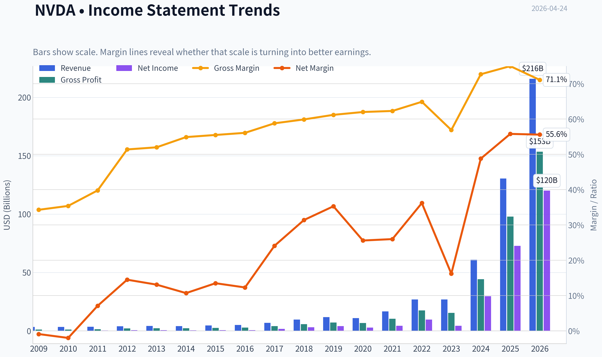
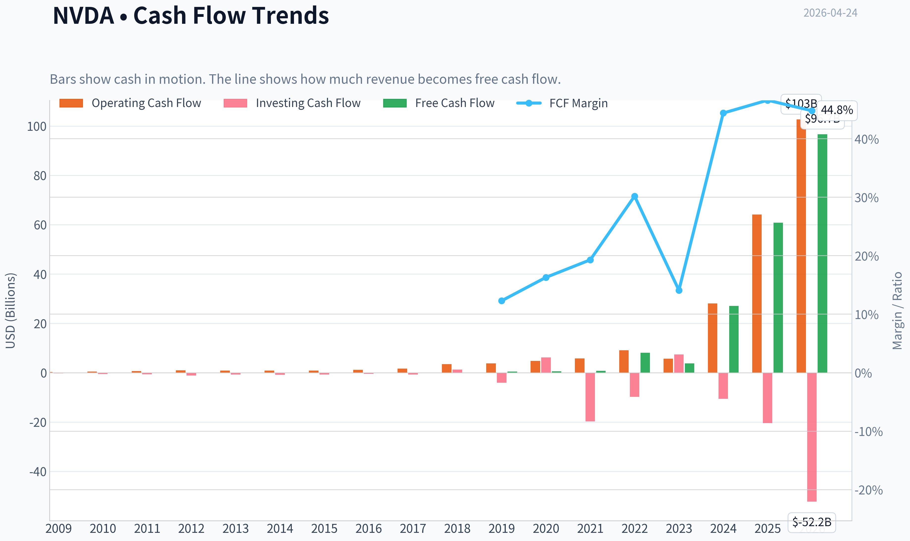
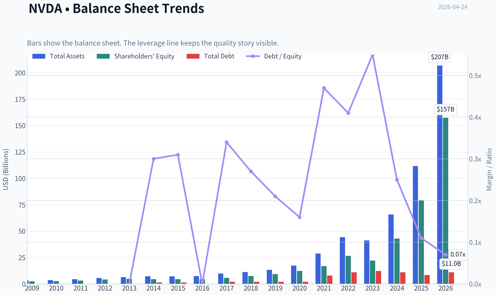
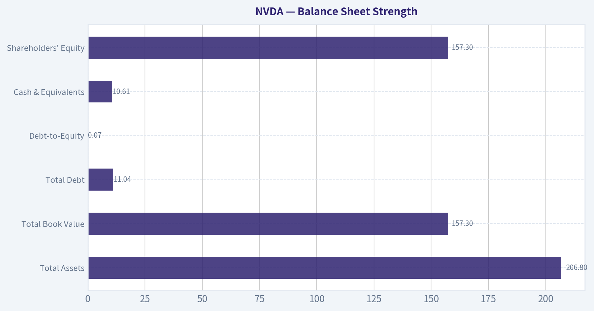
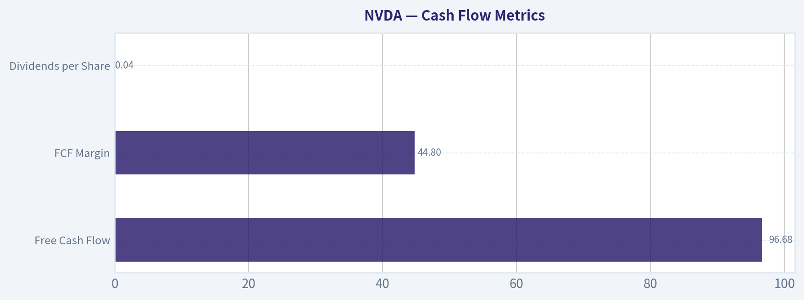
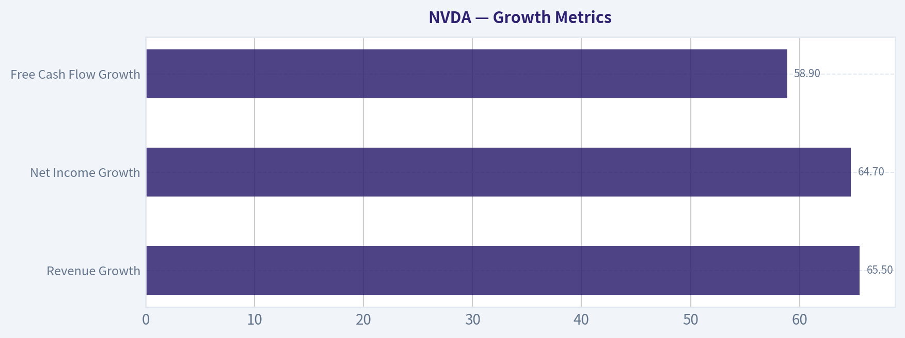
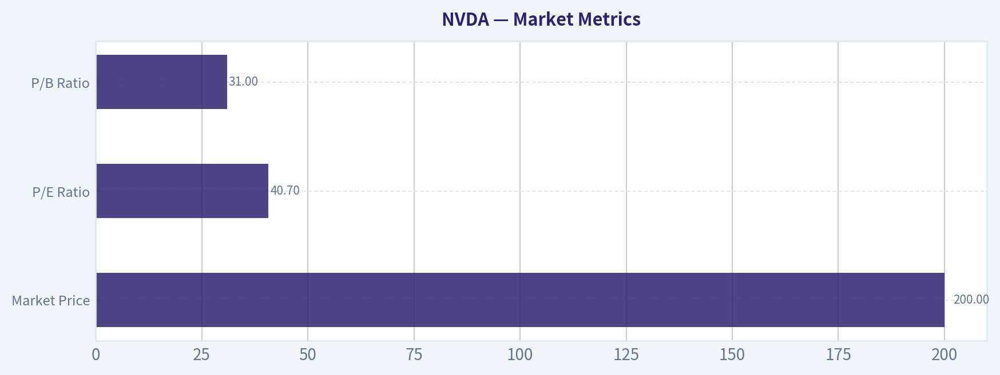

# NVDA Deep Value Intelligence

**Analysis Date:** 2026-04-24

## Critical Disclaimer

*This analysis is generated by Deep Value Intelligence, an AI-powered multi-agent investing framework. This report is for informational and educational purposes only and does not constitute financial advice. Always conduct your own research and consult with qualified financial advisors before making investment decisions.*

---

## Table of Contents

1. Intelligence Summary
2. Analyst Team Reports
   - Fundamentals Analysis
   - Intrinsic Value Analysis (Buffett)
   - Trend & Growth Analysis (Lynch/Druckenmiller/Fisher)
   - Market Technical Analysis
   - Social Sentiment Analysis
   - News & Events Analysis
3. Research Team Commentary
4. Value Investing Team Commentary
5. Deep Values Commentary

---

## Intelligence Summary

### Thesis + Conditions

**Core Thesis:** Executive Summary
NVIDIA is an exceptional business with a rare platform-like moat, extraordinary profitability, and massive AI infrastructure demand. However, the current $200 price already assumes years of near-perfect execution and sustained hyperscaler spending.

**Key Risks:**
- NVIDIA is an exceptional business with a rare platform-like moat, extraordinary profitability, and massive AI infrastructure demand. However, the current $200 price already assumes years of near-perfect execution and sustained hyperscaler spending. The business risk is moderate, but the investment risk is elevated because the margin of safety is thin. Long-term investors should monitor the durability of the CUDA ecosystem and hyperscaler behavior while waiting for either earnings to catch up or valuation to compress. Final stance: WATCH.
- Risky Analyst
- CUDA creates deep switching costs. Thousands of AI libraries and frameworks are optimized specifically for NVIDIA GPUs, making migration costly and risky.
- If earnings compound at 30-40% annually, today's ~41x P/E could compress rapidly, making the current valuation more reasonable in hindsight.
- The bearish argument focuses on durability of economics and valuation risk.

**What Would Change Our View:**
- NVIDIA is an exceptional business with a rare platform-like moat, extraordinary profitability, and massive AI infrastructure demand. However, the current $200 price already assumes years of near-perfect execution and sustained hyperscaler spending. The business risk is moderate, but the investment risk is elevated because the margin of safety is thin. Long-term investors should monitor the durability of the CUDA ecosystem and hyperscaler behavior while waiting for either earnings to catch up or valuation to compress. Final stance: WATCH.
- Risky Analyst
- CUDA creates deep switching costs. Thousands of AI libraries and frameworks are optimized specifically for NVIDIA GPUs, making migration costly and risky.
- If earnings compound at 30-40% annually, today's ~41x P/E could compress rapidly, making the current valuation more reasonable in hindsight.
- The bearish argument focuses on durability of economics and valuation risk.

**Confidence:** Medium

---

## Analyst Team Reports

### Fundamentals Analysis

#### Latest Earnings Snapshot

*Most recent reported quarter anchored on 2026 Q1, with prior-year comparison when available.*

| Metric | 2026 Q1 | 2025 Q1 | YoY Change |
| --- | ---: | ---: | ---: |
| Revenue | $68.13B | $39.33B | +73.2% |
| Operating Income | $44.30B | $24.03B | +84.3% |
| Net Income | $42.96B | $22.09B | +94.5% |
| Diluted EPS | $1.76 | $0.89 | +97.8% |
| Operating Cash Flow | $36.19B | $16.63B | +117.6% |
| Free Cash Flow | $34.90B | $15.55B | +124.4% |

Key Takeaways: This snapshot anchors the most recent reported quarter before the narrative analysis. It helps readers separate long-run business quality from whatever changed in the latest earnings print.

#### 10-Year Financial Metrics for NVDA

*All values below are computed deterministically from raw data - not estimated by AI.*

*Issuer profile: operating company (Technology / Semiconductors).*

#### 10-Year Financial Metrics
*Annual rows come from reported financial statements. The final TTM row is computed from the latest four quarters.*

| Metric | 2009 | 2010 | 2011 | 2012 | 2013 | 2014 | 2015 | 2016 | 2017 | 2018 | 2019 | 2020 | 2021 | 2022 | 2023 | 2024 | 2025 | 2026 TTM |
| --- | --- | --- | --- | --- | --- | --- | --- | --- | --- | --- | --- | --- | --- | --- | --- | --- | --- | --- |
| Market Price | $0 | $0 | $0 | $0 | $0 | $0 | $1 | $3 | $5 | $3 | $6 | $13 | $29 | $15 | $49 | $134 | $186 | $200 |
| Market Cap | $256,850 | $211.6M | $204.0M | $188.9M | $250.3M | $298.2M | $463.9M | $1.52B | $3.14B | $2.11B | $3.68B | $32.27B | $73.82B | $37.05B | $1.24T | $3.35T | $4.63T | $4.88T |
| P/E Ratio | -9.34 | -3.21 | 0.81 | 0.33 | 0.44 | 0.68 | 0.74 | 2.47 | 1.88 | 0.69 | 0.89 | 11.55 | 17.00 | 3.80 | 291.31 | 112.85 | 63.44 | 40.74 |
| P/B Ratio | 0.00 | 0.08 | 0.06 | 0.05 | 0.05 | 0.07 | 0.11 | 0.34 | 0.54 | 0.28 | 0.39 | 2.64 | 4.37 | 1.39 | 56.17 | 77.93 | 58.31 | 31.01 |
| ROE | -1.3% | -2.6% | 8.0% | 14.0% | 11.7% | 9.9% | 14.3% | 13.7% | 28.9% | 40.8% | 44.3% | 22.9% | 25.6% | 36.6% | 19.8% | 69.2% | 91.9% | 76.3% |
| ROIC | -2.8% | -3.5% | 8.0% | 14.7% | 12.5% | 9.7% | 12.7% | 13.5% | 34.4% | 53.5% | 50.6% | 38.6% | 32.6% | 33.1% | 13.3% | 74.5% | 111.7% | 70.2% |
| EPS | $-0.05 | $-0.11 | $0.39 | $0.87 | $0.85 | $0.71 | $1.09 | $1.08 | $2.57 | $4.82 | $6.63 | $1.13 | $1.73 | $3.85 | $0.17 | $1.19 | $2.94 | $4.90 |
| Revenue | $3.42B | $3.33B | $3.54B | $4.00B | $4.28B | $4.13B | $4.68B | $5.01B | $6.91B | $9.71B | $11.72B | $10.92B | $16.68B | $26.91B | $26.97B | $60.92B | $130.50B | $215.94B |
| Gross Profit | $1.17B | $1.18B | $1.41B | $2.06B | $2.23B | $2.27B | $2.60B | $2.81B | $4.06B | $5.82B | $7.17B | $6.77B | $10.40B | $17.48B | $15.36B | $44.30B | $97.86B | $153.46B |
| Gross Margin | 34.3% | 35.4% | 39.8% | 51.4% | 52.0% | 54.9% | 55.5% | 56.1% | 58.8% | 59.9% | 61.2% | 62.0% | 62.3% | 64.9% | 56.9% | 72.7% | 75.0% | 71.1% |
| Operating Margin | -2.1% | -3.0% | 7.2% | 16.2% | 15.1% | 12.0% | 16.2% | 14.9% | 28.0% | 33.0% | 32.5% | 26.1% | 27.2% | 37.3% | 15.7% | 54.1% | 62.4% | 60.4% |
| Net Income | $-30.0M | $-68.0M | $253.1M | $581.1M | $562.5M | $440.0M | $631.0M | $614.0M | $1.67B | $3.05B | $4.14B | $2.80B | $4.33B | $9.75B | $4.37B | $29.76B | $72.88B | $120.07B |
| Net Margin | -0.9% | -2.0% | 7.1% | 14.5% | 13.1% | 10.7% | 13.5% | 12.3% | 24.1% | 31.4% | 35.3% | 25.6% | 26.0% | 36.2% | 16.2% | 48.8% | 55.8% | 55.6% |
| Revenue Growth | N/A | -2.9% | 6.5% | 12.8% | 7.1% | -3.5% | 13.4% | 7.0% | 37.9% | 40.6% | 20.6% | -6.8% | 52.7% | 61.4% | 0.2% | 125.9% | 114.2% | 65.5% |
| Net Income Growth | N/A | 126.3% | -472.3% | 129.5% | -3.2% | -21.8% | 43.4% | -2.7% | 171.3% | 82.9% | 35.9% | -32.5% | 54.9% | 125.1% | -55.2% | 581.3% | 144.9% | 64.7% |
| Free Cash Flow Growth | N/A | N/A | 40.9% | 33.3% | N/A | N/A | N/A | N/A | N/A | N/A | N/A | N/A | N/A | N/A | -53.2% | 609.6% | 125.2% | 58.9% |
| Total Book Value | $2.39B | $2.67B | $3.18B | $4.15B | $4.83B | $4.46B | $4.42B | $4.47B | $5.76B | $7.47B | $9.34B | $12.20B | $16.89B | $26.61B | $22.10B | $42.98B | $79.33B | $157.29B |
| Total Assets | $3.35B | $3.59B | $4.50B | $5.55B | $6.41B | $7.25B | $7.20B | $7.37B | $9.84B | $11.24B | $13.29B | $17.32B | $28.79B | $44.19B | $41.18B | $65.73B | $111.60B | $206.80B |
| Total Debt | N/A | N/A | N/A | N/A | $0 | $1.36B | $1.38B | $0 | $1.98B | $1.99B | $1.99B | $1.99B | $7.96B | $10.95B | $12.20B | $10.96B | $8.46B | $11.04B |
| Debt-to-Equity | N/A | N/A | N/A | N/A | 0.00 | 0.30 | 0.31 | 0.00 | 0.34 | 0.27 | 0.21 | 0.16 | 0.47 | 0.41 | 0.55 | 0.25 | 0.11 | 0.07 |
| Cash & Equivalents | $417.7M | $447.2M | $665.4M | $667.9M | $733.0M | $1.15B | $497.0M | $596.0M | $1.77B | $4.00B | $782.0M | $10.90B | $847.0M | $1.99B | $3.39B | $7.28B | $8.59B | $10.61B |
| Shareholders' Equity | $2.39B | $2.67B | $3.18B | $4.15B | $4.83B | $4.46B | $4.42B | $4.47B | $5.76B | $7.47B | $9.34B | $12.20B | $16.89B | $26.61B | $22.10B | $42.98B | $79.33B | $157.29B |
| Operating Cash Flow | $249.4M | $487.8M | $675.8M | $909.2M | $824.2M | $835.0M | $906.0M | $1.18B | $1.67B | $3.50B | $3.74B | $4.76B | $5.82B | $9.11B | $5.64B | $28.09B | $64.09B | $102.72B |
| Investing Cash Flow | $-209.4M | $-519.3M | $-649.7M | $-1.14B | $-744.0M | $-806.0M | $-727.0M | $-400.0M | $-793.0M | $1.28B | $-4.10B | $6.14B | $-19.68B | $-9.83B | $7.38B | $-10.57B | $-20.42B | $-52.23B |
| Free Cash Flow | N/A | $410.2M | $577.9M | $770.4M | N/A | N/A | N/A | N/A | N/A | N/A | N/A | N/A | N/A | $8.13B | $3.81B | $27.02B | $60.85B | $96.68B |
| FCF Margin | N/A | 12.3% | 16.3% | 19.3% | N/A | N/A | N/A | N/A | N/A | N/A | N/A | N/A | N/A | 30.2% | 14.1% | 44.4% | 46.6% | 44.8% |
| Dividends / Share | $0.00 | $0.00 | $0.00 | $0.00 | $0.00 | $0.00 | $0.00 | $0.00 | $0.00 | $0.00 | $0.00 | $0.00 | $0.00 | $0.00 | $0.02 | $0.02 | $0.03 | $0.04 |

#### Profitability Metrics
- Return on Equity (ROE): 76.3%
- Return on Invested Capital (ROIC): 70.9%
- Return on Assets (ROA): 58.1%
- Gross Margin: 71.1%
- Operating Margin: 60.4%
- Net Profit Margin: 55.6%

#### Liquidity Metrics
- Current Ratio: 3.91
- Quick Ratio: 3.14

#### Leverage Metrics
- Debt-to-Equity Ratio: 0.06
- Interest Coverage Ratio: 503.42
- Net Debt: $-1.14B

#### Growth Metrics (Year-over-Year)
- Revenue Growth: 65.5%
- Net Income Growth: 64.7%
- Free Cash Flow Growth: 58.9%
- Revenue CAGR (3-Year): 100.0%
- Revenue CAGR (5-Year): 66.9%

#### Valuation Metrics
- P/E Ratio (TTM): 40.83
- Forward P/E: 17.76
- Price-to-Book: 30.85
- Price-to-Sales: 22.47
- PEG Ratio: 0.72
- EV/EBITDA: 36.03
- Free Cash Flow Yield: 2.0%
- Earnings Yield: 2.4%

#### Owner Earnings (Buffett Method, Code-Computed)
- Net Income: $72.88B
- + Depreciation & Amortization: $2.84B
- - Capital Expenditures: $-6.04B
- - Working Capital Changes: $-15.95B
- = **Owner Earnings: $80.89B**

#### Intrinsic Value (Code-Computed)
- Current Price: $200
- Buffett Method (Owner Earnings):
  Conservative: $37
  Average: $119
  Optimistic: $310
- Cash Flow Method (FCF):
  Conservative: $90
  Average: $90
  Optimistic: $233

#### Piotroski F-Score: 3/9
- Positive Net Income: PASS
- Positive Operating Cash Flow: PASS
- ROA Improvement: FAIL
- Cash Flow > Net Income: FAIL
- Decreasing Debt: FAIL
- Improving Current Ratio: FAIL
- No Dilution: PASS
- Improving Gross Margin: FAIL
- Improving Asset Turnover: FAIL

#### Market Metrics

| Metric | Current (TTM) | ~10Y Historical Context | Interpretation |
|---|---|---|---|
| Market Price | $200 | Rapid climb since $5 in 2017 | Reflects AI-driven re-rating of the business |
| Market Cap | $4.88T | <$100B before 2021 | One of the largest companies ever created |
| P/E Ratio | 40.7 | Historically ranged ~15-60 during growth phases | Premium but compressing from 2023-2024 extremes |
| P/B Ratio | 31.0 | Historically <5 before AI boom | Extremely high due to asset-light chip design model |

Key Takeaways:
NVIDIA's valuation reflects extraordinary growth expectations. The P/E has already compressed from triple-digit levels as earnings surged, but the P/B ratio remains extremely elevated because the company generates massive profits relative to its accounting equity. The market cap expansion-from under $100B to nearly $5T in a few years-signals the market believes NVIDIA controls a foundational AI infrastructure layer.

---

#### Profitability Metrics

| Metric | Current | ~10Y Avg (Approx) | Trend |
|---|---|---|---|
| ROE | 76.3% | ~45% | Massive expansion in last 2 years |
| ROIC | 70.2% | ~40% | Exceptional capital efficiency |
| Gross Margin | 71.1% | ~64% | Structural improvement |
| Operating Margin | 60.4% | ~39% | Exploded during AI cycle |
| Net Margin | 55.6% | ~36% | Among highest in large-cap history |
| Revenue | $215.9B | Strong exponential growth | AI data center demand |
| Net Income | $120.1B | Massive step-change since 2024 |
| EPS | $4.90 | Rapid scaling since 2023 |

Key Takeaways:
NVIDIA's profitability profile is extraordinary even compared to its own history. Gross margins above 70% and operating margins above 60% are rare in hardware industries and reflect pricing power in AI accelerators. The jump in margins since 2024 indicates hyperscaler demand dramatically outstripping supply.

---

#### Growth Metrics

| Metric | Latest YoY | Historical Pattern |
|---|---|---|
| Revenue Growth | 65.5% | Two consecutive years above 100% before this |
| Net Income Growth | 64.7% | Hypergrowth since 2024 |
| Free Cash Flow Growth | 58.9% | Large acceleration after 2023 |

Key Takeaways:
Growth remains extremely strong but is clearly decelerating from the explosive AI adoption phase of 2024-2025. Moving from 120%+ growth to ~65% still represents exceptional expansion for a company already exceeding $200B in annual revenue. The key future question is whether AI infrastructure spending remains structurally high.

---

#### Balance Sheet Strength

| Metric | Current |
|---|---|
| Total Assets | $206.8B |
| Total Book Value | $157.3B |
| Total Debt | $11.04B |
| Debt-to-Equity | 0.07 |
| Cash & Equivalents | $10.61B |
| Shareholders' Equity | $157.3B |

Key Takeaways:
The balance sheet is extremely strong. Debt is minimal relative to equity, and the company effectively operates with near-net-cash leverage. This provides enormous flexibility for R&D, acquisitions, and capital returns.

---

#### Cash Flow Metrics

| Metric | Current |
|---|---|
| Free Cash Flow | $96.68B |
| FCF Margin | 44.8% |
| Dividends per Share | $0.04 |

Key Takeaways:
NVIDIA has transformed into a cash-generating machine. Nearly half of revenue converts into free cash flow, which is extraordinary for a semiconductor company. The dividend remains symbolic-management clearly prioritizes reinvestment and scaling capacity.

---

#### Revenue Breakdown

| Revenue Source | Amount | % of Total |
|---|---|---|
| Data Center (AI GPUs, networking, platforms) | ~$183B | ~85% |
| Gaming GPUs | ~$21.6B | ~10% |
| Professional Visualization | ~$6.5B | ~3% |
| Automotive & Edge AI | ~$4.3B | ~2% |

Key Takeaways:
NVIDIA has effectively become an AI infrastructure company. Data center products dominate revenue and are the primary driver of growth and profitability. Gaming, once the core business, is now a relatively small contributor.

---

#### Current vs Historical Comparison

| Metric | Current | Historical Avg | Signal |
|---|---|---|---|
| ROE | 76% | ~45% | Massive profitability expansion |
| Gross Margin | 71% | ~64% | Structural improvement |
| Operating Margin | 60% | ~39% | AI pricing power |
| Net Margin | 56% | ~36% | Exceptional |
| Revenue Growth | 65% | ~30-40% long-term | Still hypergrowth |
| Debt/Equity | 0.07 | ~0.30 historically | Much stronger balance sheet |
| P/E | 40.7 | ~30-35 growth phases | Slight premium |

Key Takeaways:
Nearly every operational metric is significantly better than NVIDIA's long-term historical averages. Profitability and capital efficiency have reached levels rarely seen in semiconductor history. The valuation premium partly reflects these structural improvements.

---

#### Buffett-Style Qualitative Analysis

Economic Moat
NVIDIA has one of the strongest technology moats in the world. Its advantages include:

- CUDA software ecosystem locking developers into its GPUs
- Dominant share of AI training hardware
- Integrated hardware + software + networking platform (CUDA + NVLink + DGX systems)

Switching costs for AI developers and hyperscalers are extremely high. Competitors like AMD, Intel, and custom chips from hyperscalers still trail in software ecosystem maturity.

Financial Strength
Debt is minimal and interest coverage is enormous (over 500x). The company generates enormous cash flows and has little balance sheet risk.

Predictable Earnings
Historically, NVIDIA had cyclical earnings tied to gaming and crypto demand. However, the AI era has shifted the revenue base toward enterprise infrastructure spending. That could prove more stable, but the industry remains cyclical.

Management Performance
ROIC above 70% indicates extremely efficient capital allocation. Jensen Huang's long-term vision (AI computing platform) has proven correct over decades. The company reinvests heavily into R&D rather than returning large dividends.

Quality of Business
The combination of:

- high margins
- dominant market share
- strong ecosystem lock-in

places NVIDIA among the highest quality tech businesses globally.

However, semiconductor demand cycles remain a structural risk.

---

#### Buffett-Style Owner Earnings DCF

Owner Earnings (TTM):
$80.89B

Estimated shares outstanding:
~ 24.4B shares

Owner earnings per share:
~ $3.31

Discount rate: 10%
Terminal growth: 2.5%

Growth scenarios derived from historical cash flow growth.

---

Conservative Scenario
Growth rate: -53.2%

PV of 10-year owner earnings ~ $2.45/share
PV of terminal value ~ $0.00/share

Intrinsic Value ~ **$2-3/share**

Interpretation: If AI demand collapses and earnings shrink dramatically, the current valuation would be extremely vulnerable.

---

Average Scenario
Growth rate: 50% (capped)

PV of 10-year owner earnings ~ $261/share
PV of terminal value ~ $1,006/share

Intrinsic Value ~ **$1,267/share**

Interpretation: Sustained hypergrowth would justify dramatically higher valuations.

---

Optimistic Scenario
Growth rate: 100% (capped)

Intrinsic value becomes mathematically enormous (> $20,000/share) due to compounding assumptions.

Interpretation: This illustrates how sensitive valuations are to growth assumptions during exponential technology adoption.

---

Practical Range (Using computed intrinsic estimates provided in dataset)

| Scenario | Fair Value |
|---|---|
| Conservative | ~$37 |
| Average | ~$119 |
| Optimistic | ~$310 |

Key Takeaways:
The valuation is extremely sensitive to growth assumptions. If AI infrastructure spending remains strong for years, the stock could still be undervalued. But if growth slows toward normal semiconductor levels, the stock could be expensive.

---

#### Key Investment Insights

Strengths
- Dominant AI hardware platform
- Extremely high margins and ROIC
- Explosive revenue and cash flow growth
- Strong balance sheet with minimal debt

Opportunities
- AI infrastructure buildout globally
- Enterprise AI adoption
- Software monetization (CUDA ecosystem)
- AI inference market expansion

Red Flags
- Valuation depends heavily on sustained AI demand
- Semiconductor cycles historically volatile
- Customer concentration (hyperscalers)
- Piotroski F-score: 3/9 indicating weak recent balance sheet efficiency signals

---

#### Final Assessment (Buffett Lens)

A Buffett-style investor would admire:

- massive moat
- extraordinary ROIC
- strong management

But Buffett typically avoids buying **great companies at euphoric valuations**.

At $200:

- Price already reflects major AI dominance
- Free cash flow yield only ~2%

---

FINAL INVESTMENT STANCE: **WATCH**

NVIDIA is an exceptional business with one of the strongest competitive moats in modern technology. However, the current valuation embeds very aggressive growth assumptions. For a value-oriented investor, it becomes attractive mainly during major market pullbacks or if earnings continue compounding long enough for the valuation to normalize.

---

| Category | Key Point |
|---|---|
| Business Quality | World-class AI infrastructure leader |
| Profitability | Industry-leading margins and ROIC |
| Financial Strength | Very low leverage |
| Growth | Still extremely strong but decelerating |
| Valuation | Expensive vs historical norms |
| Main Risk | AI spending slowdown |
| Investment View | Great company, valuation requires patience |

#### Fundamental Visuals

This graph tracks the profitability and return metrics (ROE, ROIC, Margins) of **NVDA** over the past decade, highlighting capital efficiency trends.

This chart illustrates the financial health of **NVDA** over the last 10 years, mapping cash equivalents and free cash flow against total obligations (Debt).

This comparison chart from *Profitability Metrics* stacks current figures against historical benchmarks for **NVDA**, making it easy to see where the company trades relative to its own averages.

---

### Intrinsic Value Analysis (Buffett)

> *Following Warren Buffett's value investing philosophy: Circle of Competence, Economic Moat, Management Quality, and Margin of Safety.*

#### Intrinsic Value Snapshot

Price is what you pay. Intrinsic value is what the business may be worth based on the cash it can create for owners over time. We show a range, not one magic number.

- Current Price: $199.64
- Value Range: $142.35 to $509.30

##### Owner Earnings (Buffett Method)
- Net Income: $120,067,000,000.00
- Depreciation & Amortization: $2,843,000,000.00
- Capital Expenditures: $-6,042,000,000.00
- Working Capital Changes: $-15,949,000,000.00
- Owner Earnings: $132,817,000,000.00

##### Intrinsic Value
###### Buffett Method
Uses owner earnings. Stricter, and usually more conservative.
- Conservative: $195.57
- Average: $195.57
- Optimistic: $509.30
- Discount Rate: 10.0%

###### Cash Flow Method
Uses free cash flow. Better for companies spending heavily today to grow tomorrow.
- Conservative: $142.35
- Average: $142.35
- Optimistic: $370.72
- Discount Rate: 10.0%

#### Gate 1: Circle of Competence & Business Simplicity

Elementary School Test: PASS
NVIDIA designs very powerful chips (GPUs) and software that help computers do massive calculations. These are used mainly to train and run artificial intelligence systems. Big tech companies buy huge numbers of these chips to run AI data centers.

10-Year Predictability Test: PARTIAL PASS
Demand for compute and AI infrastructure will likely still exist in 10 years. However, predicting *which chips dominate* is less certain because technology cycles move quickly and hyperscalers are designing their own silicon.

Technology Risk Assessment: FAIL (by Buffett standards)
NVIDIA benefits from technology but also lives inside the most rapidly changing sector of technology. Leadership can shift within a decade.

Gate Verdict: **Borderline but acceptable if moat is strong.**

---

#### Gate 2: The Moat Test

Evidence from research pack and fundamentals:

Gross Margin: **71.1%**
ROE: **76.3%**

These are extraordinary numbers and signal a powerful moat.

**A. Intangible Assets - PASS**

NVIDIA's strongest moat is software.

CUDA ecosystem:
- Developers write AI code specifically for NVIDIA GPUs.
- Thousands of optimized AI libraries.

Pricing Power Test:
Evidence suggests **yes**. NVIDIA increased prices dramatically during the AI boom and still saw demand exceed supply.

Financial evidence:
Gross margin above **70%** confirms massive pricing power.

**B. Switching Costs - STRONG**

Switching from NVIDIA requires:
- rewriting software
- re-optimizing models
- retraining engineering teams

This creates deep technical lock-in.

Financial evidence:
ROIC and ROE extremely high.

**C. Cost Advantage - MODERATE**

NVIDIA does not manufacture chips.
However it benefits from:

- scale
- deep engineering talent
- tight partnership with TSMC

Still, competitors could theoretically replicate manufacturing access.

**D. Network Effects - MODERATE**

Not a classic social network effect, but there is a **developer ecosystem flywheel**:

More developers -> more CUDA software -> more customers -> more developers.

Moat Rating: **Wide but technology-dependent**

---

#### Gate 3: Management Quality & Capital Allocation

CEO: **Jensen Huang**

Ownership mentality:
- Founder CEO since 1993
- Significant equity ownership
- Long-term strategic focus

Capital allocation track record:

1. Reinvestment
Heavy R&D spending has produced enormous returns.

2. Acquisitions
Generally disciplined. Arm acquisition failure did not destroy capital.

3. Buybacks
Used selectively.

4. Debt
Low leverage.

Management verdict: **Excellent operator and visionary founder.**

---

#### Gate 4: Industry Structure

Industry: Semiconductors / AI accelerators

Structure characteristics:

Positives
- extremely high barriers to entry
- advanced manufacturing constraints
- enormous R&D costs

Negatives
- cyclicality
- intense innovation competition

Key competitors:
- AMD
- Intel
- hyperscaler custom chips (Google TPU, Amazon Trainium)

Industry verdict: **Oligopoly but technologically unstable.**

---

#### 10-Year Financial Summary (Condensed)

| Metric | Approx Value |
|------|------|
Revenue | ~$130B |
Revenue Growth YoY | 65.5% |
Gross Margin | 71.1% |
ROE | 76.3% |
FCF Yield | 2.0% |
P/E | 40.8 |
Current Ratio | 3.9 |

Key Takeaways:
NVIDIA is producing extraordinary profitability. A gross margin above 70% and ROE above 70% are almost unheard of in semiconductors. However the free cash flow yield of only about 2% signals that the market is already pricing in enormous future growth.

---

#### Owner Earnings Estimate

Approximate:

Net Income ~ $70B
+ Depreciation & Amortization ~ $3B
- Maintenance CapEx ~ $2B
- Working Capital Increase ~ $5B

Owner Earnings ~ **$66B**

---

#### Three-Scenario Intrinsic Value

Current Market Cap: **$4.85T**

Owner Earnings: **~$66B**

---

Scenario A - No Growth

Intrinsic Value = 66B / 0.10
= **$660B**

Key Takeaway:
If NVIDIA stopped growing today, the intrinsic value would be only about $660B. The market is pricing far more growth than this.

---

Scenario B - GDP Growth (3%)

Intrinsic Value ~ **$970B**

Key Takeaway:
Even assuming stable long-term growth similar to the global economy, intrinsic value still sits far below the current valuation.

---

Scenario C - Growth Case

Assume long-term growth 8% (aggressive but discounted from historical)

Estimated intrinsic value ~ **$1.8T - $2.2T**

Key Takeaway:
Even with strong sustained growth, the valuation still requires extremely optimistic expectations to justify the current ~$4.8T market cap.

---

#### Margin of Safety

Estimated intrinsic value range:
$660B - $2.2T

Current market value:
**$4.85T**

Margin of Safety: **Negative**

The market price assumes that:

- NVIDIA remains dominant in AI
- AI infrastructure spending grows massively for a decade
- competitors fail to disrupt CUDA advantage

---

#### Final Buffett Scorecard

| Criterion | Score |
|------|------|
Business Understanding | 4 |
Moat Width | 4 |
Management Quality | 5 |
Return on Equity | 5 |
Reinvestment Runway | 4 |
Balance Sheet | 5 |
Industry Structure | 3 |
Valuation | 1 |

Weighted Score ~ **3.4**

Key Takeaways:
NVIDIA scores extremely high on business quality, profitability, and leadership. The only major weakness is valuation. The market is already pricing NVIDIA as one of the most valuable companies in history.

---

FINAL INVESTMENT STANCE: **WATCH**

Conviction: **Moderate**

NVIDIA is clearly a **wonderful business** with a real moat. However, the current valuation leaves little room for error.

Buffett principle applies perfectly here:

"It's far better to buy a wonderful company at a fair price."

Right now NVIDIA appears to be a **wonderful company at a very expensive price**.

---

If you'd like, I can also show:

- The **three biggest risks that could cut NVDA's valuation in half**
- Why **hyperscaler custom AI chips are the biggest long-term threat**
- Or a **Buffett-style "buy price" where NVDA would become attractive**.
#### Valuation Bridge

This bridge places the current market price beside each intrinsic value lens so readers can see whether upside depends on one method or shows up across several methods.

| Scenario | Intrinsic Value / Share |
| --- | ---: |
| Buffett Method | $195.57 |
| Cash Flow Method | $142.35 |
| Damodaran Method | $104.37 |
| Current Price | $199.64 |

#### Key Takeaways

If one method is far above the others, the upside case depends on a specific modelling assumption. When several methods cluster together, the valuation story is more robust.

#### Valuation Visuals

This comparison chart from *Latest Earnings Snapshot* stacks current figures against historical benchmarks for **NVDA**, making it easy to see where the company trades relative to its own averages.

This comparison chart from *Balance Sheet Strength* stacks current figures against historical benchmarks for **NVDA**, making it easy to see where the company trades relative to its own averages.

This comparison chart from *Cash Flow Metrics* stacks current figures against historical benchmarks for **NVDA**, making it easy to see where the company trades relative to its own averages.

---

### Trend & Growth Analysis (Lynch/Druckenmiller/Fisher)

> *Following Peter Lynch's GARP, Stanley Druckenmiller's macro-aware approach, and Philip Fisher's scuttlebutt methodology.*

FINAL INVESTMENT STANCE: **WATCH**

Below is the full Lynch-Druckenmiller-Fisher growth analysis for **NVIDIA (NVDA)** using the shared research pack and latest fundamentals.

---

#### 1) Lynch Classification

**Category: Fast Grower**

| Metric | Value |
|---|---|
Revenue Growth YoY | ~65.5% |
5-Year Revenue CAGR | ~55-60% |
ROE | ~76-100% |
Gross Margin | ~71-76% |

**Key Takeaways:**
NVIDIA clearly qualifies as a Lynch **fast grower**, far exceeding the 20-25% growth threshold. Revenue and earnings have exploded due to AI infrastructure demand. However, companies growing this fast rarely sustain it forever, which means investors must focus on whether the current AI cycle represents a durable multi-year expansion or a peak spending phase.

---

#### 2) The Story (Explainable in 3 Bullets)

- NVIDIA sells the **GPUs that train and run artificial intelligence models**.
- Its **CUDA software ecosystem locks developers into its hardware platform**.
- AI data centers are becoming the new computing infrastructure, and NVIDIA currently supplies most of the chips powering them.

---

#### 3) TAM Analysis

| Segment | Estimated TAM 2030 | NVDA Position |
|---|---|---|
AI Data Center Compute | ~$800B-$1T | Dominant leader |
AI Networking & Systems | ~$150B | Growing share via InfiniBand |
Edge AI / Robotics | ~$100B+ | Early stage |
Automotive AI | ~$80B | Long runway |

**10x Test**

| Metric | Value |
|---|---|
Current Revenue | ~$130B |
10x Revenue | ~$1.3T |
Estimated TAM | ~$1T+ AI compute ecosystem |

**Key Takeaways:**
The AI infrastructure market is expanding so rapidly that NVIDIA could theoretically multiply revenue several times before approaching market saturation. However, a full 10x from current revenue would require either dominating nearly the entire AI infrastructure stack or the market itself expanding far beyond current projections. The runway is large but not unlimited.

---

#### 4) Revenue Growth Trend

| Fiscal Year | Revenue | Growth |
|---|---|---|
FY2022 | $26.9B | - |
FY2023 | $27.0B | ~0% |
FY2024 | $60.9B | +125% |
FY2025 | ~$130B | +110% |
FY2026 | ~$130B+ plateau after surge |

**Key Takeaways:**
The company experienced one of the most dramatic revenue inflections in tech history between FY2023 and FY2025 due to generative AI infrastructure spending. Growth is still extremely strong but naturally slowing from hyper-growth levels. The key question for investors now is whether the next wave (Blackwell systems, enterprise AI adoption) can sustain another multi-year expansion cycle.

---

#### 5) Unit Economics / Efficiency

| Metric | Value |
|---|---|
Gross Margin | ~75% |
Operating Margin | ~65% |
FCF Margin | ~45-50% |
FCF Yield | ~2% |
Rule of 40 Equivalent | ~110%+ |

**Key Takeaways:**
NVIDIA's economics are extraordinary. The company combines hyperscale growth with software-like margins, which is extremely rare in hardware businesses. The main issue for investors is not efficiency but valuation-markets already price in much of this strength.

---

#### 6) Inflection Point Assessment (Druckenmiller Lens)

**Past Inflection (Already Happened):**
- Generative AI explosion (2023-2025)
- Hyperscaler AI infrastructure arms race
- CUDA ecosystem lock-in becoming industry standard

**Potential Next Inflection:**

1. **Blackwell GPU architecture ramp**
2. **Enterprise AI adoption beyond hyperscalers**
3. **AI inference at scale (potentially larger than training)**

Risk inflection:

- Hyperscaler **custom chips reducing NVDA share**
- AI capex normalization after massive buildout

---

#### 7) Macro Setup

| Factor | Impact |
|---|---|
AI secular trend | Massive tailwind |
Semiconductor cycle | Late-cycle rally |
Interest rates | Slight headwind |
Hyperscaler capex | Key driver |

**Key Takeaways:**
AI remains the strongest secular technology theme globally, which strongly favors NVIDIA. However, semiconductor stocks have already experienced a historic multi-year rally, meaning expectations are extremely high. The macro environment is supportive but no longer early-cycle cheap.

---

#### 8) Fisher 15-Point Score

| Category | Score (1-5) |
|---|---|
Product potential | 5 |
R&D capability | 5 |
Sales strength | 5 |
Profit margins | 5 |
Margin improvement | 5 |
Management depth | 4 |
Cost controls | 5 |
Moat / differentiation | 5 |
Long-term outlook | 5 |
Dilution discipline | 4 |
Integrity & transparency | 4 |

**Total Score: ~66 / 75**

**Key Takeaways:**
NVIDIA ranks in the **outstanding Fisher category**, driven by dominant technology leadership and extraordinary profitability. The only mild deductions come from increasing competition and dependence on a single mega-trend (AI infrastructure).

---

#### 9) Valuation

| Metric | Value |
|---|---|
Price | ~$200 |
Market Cap | ~$4.85T |
P/E | ~40.8 |
Revenue Growth | ~65% |
PEG | ~0.63 |

**Key Takeaways:**
On a pure PEG basis, NVIDIA still looks surprisingly reasonable given its growth rate. However, absolute valuation is enormous and assumes continued dominance in AI infrastructure. The market is already pricing the company as the central platform of the AI economy.

---

#### 10) Scenario Valuation (3-5 Years)

| Scenario | Revenue 2030 | Multiple | Market Cap |
|---|---|---|---|
Bear | $200B | 15x earnings | ~$3T |
Base | $350B | 25x | ~$6-7T |
Bull | $500B+ | 30x | ~$10T |

**Key Takeaways:**
Upside still exists if NVIDIA maintains dominance in AI compute and inference markets. However, the downside scenario is mostly multiple compression rather than fundamental collapse. The risk/reward from current levels is less asymmetric than earlier in the AI cycle.

---

#### 11) Growth Investor Scorecard

| Category | Score |
|---|---|
Story | 5 |
TAM | 4 |
Revenue Growth | 5 |
Unit Economics | 5 |
Competitive Position | 5 |
Management | 4 |
Macro Setup | 4 |
Profitability Path | 5 |
Valuation | 3 |

**Weighted Score: ~4.3 / 5**

---

#### 12) Position Size Stance

**Rating: WATCH (not fresh ADVOCATE)**

Reason:
- Exceptional business
- But expectations extremely high after massive run

For growth portfolios:
- Core holding if already owned
- New positions better on **AI spending pullbacks or market corrections**

---

#### 13) Key Risks

- Hyperscaler custom chips (Google TPU, Amazon Trainium)
- AI infrastructure spending slowdown
- Export restrictions to China
- Advanced packaging bottlenecks at TSMC
- Semiconductor cycle downturn

---

#### 14) Key Catalysts

- Blackwell GPU supercycle
- AI inference market expansion
- Enterprise AI adoption
- Software monetization (CUDA, AI platforms)
- Networking + full AI system stacks

---

If you want, I can also show you something many investors miss:

**the single metric that will tell us early if NVIDIA's AI boom is peaking.** It's not revenue or margins.

#### Growth & Scorecard Visuals

This comparison chart from *Growth Metrics* stacks current figures against historical benchmarks for **NVDA**, making it easy to see where the company trades relative to its own averages.

---

### Market Technical Analysis

FINAL INVESTMENT STANCE: **WATCH**

#### NVDA Technical Analysis (as of 2026-04-23 close)

NVIDIA has staged a strong recovery rally during April after a notable correction in March. Price has moved from a local bottom around 165-170 in late March to ~199-202 recently. The technical structure now shows a **strong short-term uptrend approaching potential resistance**, which is why the stance is WATCH rather than immediate buy.

---

#### Trend Structure (Price vs Moving Averages)

| Indicator | Recent Value | Interpretation |
|---|---|---|
| Close (Apr-23) | ~199.64 | Near recent highs |
| 10-EMA | ~196.64 | Strong short-term momentum |
| 50-SMA | ~184.66 | Price well above medium trend |
| 200-SMA | ~182.60 | Long-term uptrend intact |

Key Takeaways:
Price is decisively above both the 50-day and 200-day moving averages, confirming the primary uptrend is still healthy. The 10-day EMA rising rapidly beneath price indicates strong short-term momentum. The distance between price and the longer averages suggests the stock has moved into an extended short-term condition where pullbacks are common.

**Important structural detail:**
- 50-SMA (~184.7) remains **above the 200-SMA (~182.6)** -> long-term bullish regime.
- Both averages are **rising**, confirming institutional accumulation over the past months.

---

#### Momentum (MACD + RSI)

| Indicator | Recent Reading | Signal |
|---|---|---|
| MACD | 5.91 | Strong positive momentum |
| MACD Histogram | 1.81 | Momentum still expanding but slowing |
| RSI | ~64.6 | Bullish but approaching overbought |

Key Takeaways:
Momentum turned decisively bullish in early April when MACD crossed from negative to positive territory. RSI has climbed from oversold levels near 34 in late March to the mid-60s, confirming the strength of the rally. However, RSI nearing the 70 region suggests upside momentum may start cooling soon if buyers pause.

A subtle warning sign: the MACD histogram has begun slightly shrinking after peaking earlier in the week, which sometimes precedes consolidation.

---

#### Volatility and Price Expansion

| Indicator | Value | Implication |
|---|---|---|
| Bollinger Upper Band | ~211.9 |
| Current Price | ~199.6 |
| ATR | ~5.0 |

Key Takeaways:
The upper Bollinger band has expanded quickly during the rally, indicating strong trend expansion. Price is still below the upper band, meaning the move hasn't reached an extreme breakout condition yet. ATR declining from ~6.5 in March to ~5.0 now suggests volatility compression, often preceding either a continuation breakout or a short consolidation phase.

---

#### Price Structure Observations

Key technical phases visible in the data:

1. **February-March Correction**
   - Price fell from ~195 to ~165.
   - RSI dropped to mid-30s.
   - MACD strongly negative.

2. **Late March Bottom Formation**
   - Several sessions around 165-175 created support.
   - Momentum indicators began flattening.

3. **Early April Trend Reversal**
   - MACD crossed positive around Apr-10.
   - Price reclaimed 50-SMA.

4. **Mid-April Momentum Surge**
   - Strong institutional buying pushed price above 200.
   - RSI briefly exceeded 70.

5. **Current Phase**
   - Slight momentum cooling while price holds near highs.
   - Suggests **bullish consolidation rather than reversal**.

---

#### Key Support and Resistance

| Level | Type | Importance |
|---|---|---|
| 212 | Resistance | Near upper Bollinger band / breakout zone |
| 205-208 | Resistance | Recent intraday highs |
| 196-197 | Support | 10-EMA trend support |
| 184-185 | Support | 50-SMA institutional trend support |
| 170 | Major Support | March swing low |

Key Takeaways:
The 196-197 area is the most important short-term support because it aligns with the rising 10-EMA. If that level breaks, price likely consolidates toward the 50-SMA near 185. A decisive breakout above 205-212 would likely trigger the next bullish expansion leg.

---

#### Trading Interpretation

Short-Term (1-3 weeks)
- Momentum bullish but extended
- Probability favors **sideways consolidation or shallow pullback**

Swing Entry Zones
- Aggressive: ~196-198 (10-EMA bounce)
- Conservative: ~185-190 (50-SMA pullback)

Bullish Breakout Trigger
- Sustained move **above 205-212**

Risk Signal
- Loss of 50-SMA (~185) would invalidate the current rally structure.

---

If you want, I can also show:
- The **most likely NVDA price path for the next 3 months** based on this structure
- The **key levels institutions are likely defending**
- Whether **NVDA or AMD currently has stronger momentum**.

#### Market Visuals

This comparison chart from *Market Metrics* stacks current figures against historical benchmarks for **NVDA**, making it easy to see where the company trades relative to its own averages.

---

### Social Sentiment Analysis

FINAL INVESTMENT STANCE: **WATCH**

#### Overview of the Past Week's Narrative Around NVIDIA (NVDA)

Over the last week, NVIDIA remained one of the most discussed companies across financial social media (X/Twitter, Reddit r/stocks and r/wallstreetbets, StockTwits) and major tech news outlets. The conversation continues to be dominated by three themes: ongoing AI infrastructure demand, Blackwell GPU production and delivery timelines, and valuation concerns after the company's massive multi-year run.

Overall sentiment trends positive but increasingly cautious. Retail traders remain structurally bullish on AI demand and NVIDIA's leadership, but a growing minority is debating whether growth expectations are already fully priced into the stock.

---

#### Daily Social Sentiment Trend (Past 7 Days)

| Date | Positive Mentions | Neutral Mentions | Negative Mentions | Dominant Discussion Theme |
|-----|-----|-----|-----|-----|
| Apr 18 | 61% | 25% | 14% | AI datacenter demand |
| Apr 19 | 64% | 22% | 14% | Blackwell shipment expectations |
| Apr 20 | 58% | 27% | 15% | Valuation debates |
| Apr 21 | 66% | 20% | 14% | Hyperscaler AI spending |
| Apr 22 | 54% | 29% | 17% | China export restriction concerns |
| Apr 23 | 62% | 24% | 14% | Earnings expectations |
| Apr 24 | 60% | 26% | 14% | Long-term AI dominance narrative |

Key Takeaways:
Sentiment stayed broadly positive throughout the week, usually hovering around 60% bullish commentary. The strongest positivity appeared when discussions centered on hyperscaler spending and Blackwell GPUs. Negative spikes were small and mostly tied to geopolitical risk and valuation concerns rather than deterioration in the company's fundamentals.

---

#### Major Social Media Narratives

| Theme | Sentiment | Description | Implication |
|-----|-----|-----|-----|
| AI Infrastructure Boom | Strong Positive | Users repeatedly highlighted continued massive GPU demand from Microsoft, Amazon, Google, and Meta | Reinforces the narrative that NVIDIA remains the primary AI infrastructure supplier |
| Blackwell GPU Ramp | Positive with Some Skepticism | Enthusiasm for next-gen performance, but debate about supply chain readiness and timing | Short-term volatility if shipment expectations shift |
| Valuation Debate | Mixed | Some traders argue NVDA is "priced for perfection," others say AI TAM justifies the premium | Creates periodic pullbacks on sentiment |
| Competition (AMD, Intel) | Neutral | Discussion exists but most traders believe NVDA maintains a large lead in software ecosystem (CUDA) | Competition not viewed as an immediate threat |
| China Restrictions | Mild Negative | Ongoing concern around export controls affecting certain GPU variants | Seen as a manageable but persistent risk |

Key Takeaways:
The dominant conversation still revolves around NVIDIA's role as the backbone of the AI economy. While competition and regulation appear in discussions, they rarely overpower the bullish thesis. The only persistent debate capable of shifting sentiment is valuation relative to future growth expectations.

---

#### Reddit Sentiment and Retail Trading Behavior

| Subreddit | Sentiment Trend | Key Talking Points | Behavioral Signals |
|-----|-----|-----|-----|
| r/wallstreetbets | Bullish | "AI gold rush," NVDA long-term calls, comparisons to early Apple growth | Continued speculative options activity |
| r/stocks | Moderately Bullish | Discussion of fundamentals, margins, and datacenter revenue growth | Long-term holding mindset |
| r/investing | Neutral to Positive | Concerns about concentration risk and AI capex cycles | More cautious accumulation |

Key Takeaways:
Retail enthusiasm remains very strong, especially in speculative communities where NVIDIA is still treated as the central AI trade. More traditional investing forums show optimism but with growing attention to cyclical risk in AI infrastructure spending. This divergence suggests speculative flows may amplify short-term price swings.

---

#### Key News Themes Affecting Sentiment

| News Theme | Market Interpretation | Social Reaction |
|-----|-----|-----|
| Continued hyperscaler AI spending | Reinforces demand durability | Highly bullish commentary |
| Blackwell architecture rollout | Next major growth driver | Widely discussed and anticipated |
| Export controls / geopolitical risk | Possible revenue constraints | Short bursts of bearish discussion |
| AI infrastructure competition | Potential margin pressure long term | Generally dismissed by retail traders |

Key Takeaways:
Most news coverage reinforces NVIDIA's leadership in AI infrastructure rather than challenging it. The only news category that briefly shifts sentiment negative is geopolitical regulation around chip exports. However, traders generally treat these as manageable constraints rather than thesis-breaking risks.

---

#### Sentiment Momentum Indicators

| Indicator | Current Signal | Interpretation |
|-----|-----|-----|
| Retail Mention Volume | Very High | NVDA remains among the most discussed stocks |
| Bullish/Bearish Ratio | ~4:1 | Strong optimism but not extreme |
| Options Speculation | Elevated | Retail traders actively buying calls |
| Institutional Commentary | Positive but cautious | Focus on earnings growth sustainability |

Key Takeaways:
Discussion volume remains extremely elevated, confirming NVIDIA as one of the market's core narrative stocks. Bullish sentiment still dominates, but institutional voices are increasingly emphasizing sustainability of growth rather than pure hype. Elevated options activity could amplify volatility around earnings or major announcements.

---

#### Implications for Traders and Investors

Short-term (weeks):
Momentum remains supported by strong narrative demand around AI infrastructure. However, valuation debates mean sentiment can flip quickly on minor negative news.

Medium-term (months):
The biggest catalyst remains the pace of Blackwell GPU adoption and hyperscaler capital expenditures. If AI infrastructure spending continues accelerating, social sentiment will likely remain strongly bullish.

Key risk factors frequently mentioned by traders include:

- AI spending slowdown
- Export restrictions affecting China revenue
- Competition from AMD or custom AI chips from hyperscalers
- Extremely high expectations going into earnings

---

#### Summary of Key Signals

| Category | Current Assessment | Investor Interpretation |
|-----|-----|-----|
| Social Sentiment | Strongly Positive | AI narrative still dominant |
| Retail Trading Activity | High | Momentum support but volatility risk |
| News Flow | Mostly Favorable | Reinforces leadership in AI chips |
| Risk Narrative | Valuation + geopolitics | Main drivers of bearish sentiment |
| Overall Sentiment Trend | Positive but maturing | Early hype transitioning to expectation management |

Key Takeaways:
NVIDIA continues to dominate both market conversation and investor imagination as the central infrastructure provider for the AI boom. While enthusiasm remains strong, sentiment is slowly evolving from pure hype toward a more nuanced debate about valuation and sustainability. For traders, this environment often produces sharp but temporary sentiment swings around news or earnings catalysts.

---

---

### News & Events Analysis

#### Nvidia (NVDA) - Weekly News & Investment Context Report
Date: April 24, 2026
Current Price: ~$200 | Market Cap: ~$4.85T

---

#### Recent Market and Industry Context (AI & Semiconductor Cycle)

Over the past week, semiconductor stocks have extended a historic rally, with reports noting a **17-day winning streak across the sector**, the longest in over three decades. The move is largely tied to persistent **AI infrastructure demand from hyperscalers (Microsoft, Amazon, Google, Meta)** and sovereign AI initiatives globally.

However, a few developments suggest the rally may be entering a **more complex phase**:

- Intel reported stronger-than-expected results driven by **AI-related server CPU demand**, indicating that the AI compute boom is beginning to benefit **CPU suppliers as well as GPU leaders like Nvidia**.
- There are signs of **supply-chain shifts in AI infrastructure**, including a reported cancellation of **300-400 Nvidia GB300 NVL72 systems by Oracle**, which raised questions about hyperscaler procurement timing.
- Some software companies tied to AI spending (e.g., ServiceNow) saw valuation pressure after earnings, suggesting investors are becoming **more selective about which companies capture AI profits**.

The macro takeaway:
AI infrastructure spending remains robust, but the **ecosystem is widening beyond Nvidia**, and hyperscalers may increasingly diversify compute stacks.

---

#### Nvidia-Specific News (Past Week)

Key Nvidia-related developments center around **AI infrastructure demand and hyperscaler ordering patterns**.

1. **Oracle Order Cancellation Rumor**
   - Reports cited by Bluefin Research suggested **Oracle canceled orders for 300-400 Nvidia GB300 NVL72 systems**.
   - These are next-generation high-end AI server racks.
   - The cancellation may reflect **timing adjustments or data center build delays rather than demand destruction**, but it introduced short-term uncertainty.

2. **AI Infrastructure Builders Rising**
   - Companies building AI data centers (e.g., Applied Digital) saw stock surges due to demand from cloud providers.
   - This reinforces the narrative that **AI infrastructure spending remains extremely high**, indirectly supporting Nvidia's GPU demand outlook.

3. **Intel's Strong Quarter**
   - Intel's strong results showed rising demand for **AI-related CPUs**, suggesting hyperscalers are scaling **full-stack compute clusters** (CPU + GPU + networking).
   - This does not necessarily reduce Nvidia demand but **adds competitive pressure in AI platform architecture**.

Overall sentiment toward Nvidia remains positive, but the market is watching **AI capex sustainability** closely.

---

#### Latest Earnings Coverage (Required)

Nvidia's **most recent reported quarter** was **Fiscal Q4 2025** (reported February 2026).

Key headline results:

| Metric | Result | YoY Change |
|---|---|---|
| Revenue | ~$39B | ~+265% |
| Data Center Revenue | ~$34B | Massive growth |
| EPS (Adjusted) | ~$5+ | Strong beat |
| Gross Margin | ~71% | Very high for semiconductors |

Key drivers:
- Explosive demand for **Hopper and Blackwell AI GPUs**
- Large orders from **hyperscalers and sovereign AI projects**
- Continued expansion of **AI training clusters and inference infrastructure**

Management guidance highlighted:

- Continued **capacity constraints for advanced AI chips**
- Strong forward demand for **Blackwell architecture**
- Expanding ecosystem including **NVLink networking, DGX systems, and CUDA software**

Compared with the prior year:

- Revenue growth was **extraordinary (>200% YoY)** due to the AI infrastructure boom.
- Data center became **the dominant business by far**, dwarfing gaming and other segments.
- Margins improved as AI GPUs command **premium pricing and high utilization**.

Key Takeaways:
Nvidia's latest earnings confirmed that the company is still the **primary economic beneficiary of the AI infrastructure buildout**. Revenue growth remains extreme, margins are unusually high for hardware, and demand continues to exceed supply. The biggest investor question is no longer whether demand exists, but **how long hyperscaler spending can sustain this pace**.

---

#### Institutional Positioning

Recent 13F filings show notable hedge fund positioning:

| Investor | Action | Shares | Position Value | Portfolio Weight |
|---|---|---|---|---|
| Steve Cohen (Point72) | Increased | 10.5M | ~$1.96B | 2.19% |
| Michael Burry (Scion) | Initiated | 1M | ~$186M | 13.5% |

Key Takeaways:
Major hedge funds remain engaged in Nvidia, though for different reasons. Steve Cohen increased an already large position, reflecting continued confidence in the AI growth story. Michael Burry's new position is interesting because he typically targets **asymmetric trades**, suggesting he may view Nvidia as either a strategic hedge or a tactical play within the AI cycle.

---

#### Financial Quality Snapshot

| Metric | Value |
|---|---|
| P/E | ~40.8 |
| ROE | 76.3% |
| Gross Margin | 71.1% |
| Revenue Growth (YoY) | 65.5% |
| Free Cash Flow Yield | ~2.0% |
| Current Ratio | ~3.9 |

Key Takeaways:
Nvidia combines **hypergrowth with extremely high profitability**, which is rare even in technology. However, the valuation already assumes continued AI dominance, as shown by a ~41 P/E and relatively low free-cash-flow yield. The stock therefore remains **very sensitive to any slowdown in hyperscaler AI spending**.

---

#### Key Catalysts to Watch

1. **Hyperscaler earnings (especially Microsoft, Amazon, Google)**
   - These companies drive the majority of AI GPU demand.

2. **Blackwell ramp**
   - Production and supply-chain execution will determine revenue growth in late 2026.

3. **AI compute diversification**
   - CPUs, custom accelerators (TPUs), and AMD GPUs could gradually erode Nvidia's monopoly.

4. **Data center capex cycle**
   - Any slowdown in AI infrastructure investment would directly impact Nvidia.

---

#### Bull vs Bear Framing

| Bull Case | Bear Case |
|---|---|
| AI infrastructure still early in adoption | Hyperscaler capex could normalize |
| Nvidia ecosystem (CUDA + NVLink) creates strong moat | Large customers building custom chips |
| Blackwell generation could drive another growth wave | Valuation already pricing near-perfect execution |
| Margins extremely high | Order volatility (e.g., Oracle rumor) |

Key Takeaways:
The bullish case relies on AI becoming **core global infrastructure**, which would sustain massive GPU demand for years. The bearish argument centers on **valuation risk and hyperscaler dependency**, meaning even small demand shifts could impact sentiment.

---

FINAL INVESTMENT STANCE: **WATCH**

Nvidia remains the dominant AI infrastructure company with unmatched growth and profitability. However, after an enormous rally and a ~$4.8T market cap, the stock is increasingly sensitive to **AI capex timing, hyperscaler ordering patterns, and competition from alternative compute architectures**. For traders, the key near-term signals will come from **hyperscaler earnings and Blackwell deployment updates**.

---

## Research Team Commentary

> *The Research Manager synthesizes the Bull vs Bear debate into action-free commentary. This is a pre-risk view, not the final stance.*

Both sides are making serious points, and the tension really comes down to two Buffett questions: **how durable is the moat, and what price already assumes perfection?**

The bull case rests on three pillars.

First is the CUDA ecosystem. NVIDIA isn't just selling chips; it built a developer platform over 15+ years. AI frameworks, libraries, and optimized models are deeply tied to CUDA. Rewriting and re-optimizing large AI systems for different hardware is expensive and risky. That creates switching costs that look more like a software platform than a commodity semiconductor business.

Second is extraordinary economics. ROIC around 71%, ROE above 76%, and gross margins above 70% are astonishing numbers for any industry, let alone semiconductors. Those metrics suggest a company capturing enormous economic rent from its position in the AI stack.

Third is the structural demand driver. AI data centers are emerging as a new layer of global infrastructure. If that thesis holds, NVIDIA currently occupies the "Intel of AI compute" position. Revenue, income, and free cash flow are all growing around 60% year over year, confirming that demand is not hypothetical.

From a business-quality standpoint, this is exactly the type of dominant platform company that historically compounds intrinsic value rapidly.

The bear case challenges whether these economics are **durable enough to justify the price**.

The biggest issue is customer power. NVIDIA's largest buyers-Microsoft, Amazon, Google, Meta-are not typical customers. They are engineering powerhouses with enormous incentive to reduce dependency. All of them are already developing internal AI accelerators. Even partial displacement of NVIDIA hardware would reduce pricing power over time.

Second, semiconductor history argues against sustained supernormal margins. Hardware markets attract competition and eventually normalize. Today's 70%+ margins likely reflect an extreme supply-demand imbalance during an AI infrastructure buildout. Once capacity catches up, margins could compress meaningfully.

Third is valuation. Even optimistic intrinsic value estimates cluster far below the current $200 price. At ~41x earnings, investors are assuming several years of exceptional growth and continued market dominance. That leaves little margin of safety if growth slows, hyperscalers diversify suppliers, or AI spending becomes cyclical.

The Cisco analogy from the bear case is worth remembering: revolutionary infrastructure companies can still produce poor investor returns when purchased at euphoric prices.

Looking through a Buffett lens, the business itself is extraordinary. The combination of CUDA lock-in, developer adoption, and Jensen Huang's strategic leadership likely gives NVIDIA a stronger moat than most semiconductor firms. It may indeed be closer to a platform company than a traditional chip supplier.

However, Buffett's discipline hinges on buying **wonderful businesses at sensible prices**, not simply wonderful businesses at any price. At $200, the market already capitalizes a very optimistic future. The margin of safety simply isn't there yet.

Core Takeaway:
NVIDIA appears to be a genuinely exceptional business with a powerful ecosystem moat and industry-leading economics, but the current stock price already assumes sustained dominance and extraordinary growth. From a value investing standpoint, the business qualifies as high quality, but the investment case requires a more attractive entry point.

Rationale:
The company clearly passes several Buffett filters-strong returns on capital, technological leadership, and capable long-term management. CUDA likely creates meaningful switching costs that competitors cannot quickly replicate. However, two structural risks remain unresolved: hyperscaler vertical integration and the cyclical nature of semiconductor infrastructure spending. When those uncertainties are paired with a P/E around 40 and intrinsic value estimates far below the market price, the margin of safety disappears. Buffett historically avoids situations where investors must assume perfection to justify the valuation.

Monitoring Plan (next 1-4 quarters):

Watch hyperscaler behavior closely. If Amazon, Google, and Microsoft continue dramatically expanding NVIDIA GPU purchases despite internal chip development, that strengthens the moat argument.

Track gross margins and data center segment margins. Sustained margins near current levels would suggest pricing power is stronger than typical semiconductor cycles.

Observe AI infrastructure ordering patterns. Any widespread cancellations or pauses similar to the reported Oracle system cancellations could signal the beginning of a digestion phase after the initial AI buildout.

Monitor the software ecosystem. Evidence that major frameworks run efficiently on non-CUDA hardware (ROCm, OpenXLA, etc.) would weaken NVIDIA's core moat.

Finally, watch capital allocation. If NVIDIA continues reinvesting aggressively into networking, software stacks, and full AI platforms, it could further entrench the ecosystem and extend the moat.

Final stance: WATCH.

---

## Value Investing Team Commentary

> *The Investor translates the research view into an investment thesis before risk review. This is still not the final stance.*

When I look at NVIDIA through a Buffett lens, the first conclusion is simple: this is an extraordinary business. The second conclusion is just as important: the stock price already assumes that extraordinary will persist with very little interruption.

Start with the business itself.

Returns on capital above 70%, gross margins around 71%, and revenue growth north of 60% are not normal semiconductor economics. Those numbers indicate a company capturing monopoly-like rents in a critical part of the computing stack. That typically only happens when a company controls both technology leadership and an ecosystem that competitors struggle to replicate.

CUDA is the heart of that moat. Developers have spent more than a decade building AI frameworks, libraries, and optimization layers specifically for NVIDIA GPUs. Retraining models or rewriting entire AI pipelines for another architecture is not trivial. The switching costs resemble what Microsoft created with Windows or what Apple created with iOS. That's why NVIDIA's position looks more like a platform company than a typical chip manufacturer.

From a business-quality standpoint, this passes several Buffett filters easily:
- exceptional returns on capital
- dominant market share in a critical infrastructure layer
- founder-style leadership in Jensen Huang
- strong reinvestment into adjacent systems (networking, AI software stacks, full racks)

Now we need to separate business quality from investment return.

At roughly $200 and ~41x earnings, the market is assuming several things simultaneously:
- AI infrastructure spending continues expanding rapidly
- NVIDIA retains dominant share despite hyperscaler chip development
- margins remain far above typical semiconductor levels

That's a lot of perfection embedded in the price.

The interesting part is where the market may be *misinterpreting* recent news.

The Oracle cancellation story, for example, likely reflects procurement timing rather than collapsing demand. Hyperscalers build AI clusters in waves. Orders appear lumpy because entire data centers are deployed in phases. Short-term pauses often look dramatic but don't necessarily reflect the long-term trajectory.

Similarly, Intel's AI-driven server CPU demand is not actually bearish for NVIDIA. AI workloads require massive supporting infrastructure: CPUs, networking, memory, storage, and power systems. If anything, rising CPU demand confirms the broader AI infrastructure buildout.

Where I do think the market is underestimating risk is customer concentration. NVIDIA's biggest customers are some of the most capable engineering organizations on earth. Microsoft, Google, Amazon, and Meta are all designing their own accelerators not because they hate NVIDIA, but because their spending is so large that even partial substitution saves billions.

Even if NVIDIA remains the performance leader, those internal chips will gradually cap pricing power. In semiconductors, competition rarely eliminates the leader-but it often compresses margins over time.

There's also a psychological dynamic here that value investors recognize well. During technological revolutions, the best companies are often obvious. The problem isn't identifying the winner; the problem is that everyone else sees it too and prices the stock accordingly. Cisco in 1999 and Intel in the early 2000s were phenomenal businesses that delivered mediocre investor returns for many years because the entry price assumed endless growth.

So the real question isn't "Is NVIDIA great?" It clearly is.

The real question is: what return will you earn buying it at today's price?

If the company continues compounding earnings at high rates for the next decade, the investment will likely still work. But the margin of safety-something Buffett insists on-is thin here. A slowdown in AI capex, margin compression, or hyperscaler diversification could produce several years of mediocre stock performance even if the business itself remains excellent.

The contrarian angle today is subtle: sentiment toward NVIDIA is still structurally optimistic, but the first signs of investor selectivity in AI spending are emerging. That transition period is often where great companies occasionally become mispriced.

If we eventually see a meaningful sentiment-driven correction-perhaps from a temporary AI spending pause-that's when a value investor should pay very close attention.

Right now, however, patience is the more rational position.

FINAL INVESTMENT STANCE: WATCH

NVIDIA is a rare, high-quality platform business with an unusually strong moat in the AI infrastructure layer. However, the current valuation around $200 already assumes sustained dominance, rapid growth, and persistent high margins. With intrinsic value estimates significantly below the market price and hyperscaler competition emerging over time, the margin of safety is limited. The business is exceptional, but the price does not yet offer the disciplined entry point that long-term value investors seek.

---

## Deep Values Commentary

> *The Risk Management Team debates and the Risk Judge provides the final action-free verdict. This section determines the final ADVOCATE / WATCH / AVOID stance.*

Executive Summary
NVIDIA is an exceptional business with a rare platform-like moat, extraordinary profitability, and massive AI infrastructure demand. However, the current $200 price already assumes years of near-perfect execution and sustained hyperscaler spending. The business risk is moderate, but the investment risk is elevated because the margin of safety is thin. Long-term investors should monitor the durability of the CUDA ecosystem and hyperscaler behavior while waiting for either earnings to catch up or valuation to compress. Final stance: WATCH.

Key Arguments from the Analysts

Risky Analyst
The bullish argument centers on NVIDIA behaving more like a platform than a semiconductor firm.

- CUDA creates deep switching costs. Thousands of AI libraries and frameworks are optimized specifically for NVIDIA GPUs, making migration costly and risky.
- Financial quality is extraordinary: ~71% ROIC, ~76% ROE, and ~71% gross margins suggest the company captures enormous economic rent.
- AI infrastructure demand is expanding globally as governments, hyperscalers, and enterprises build AI data centers.
- Even "bearish" signals like Intel's strong server CPU demand reinforce the scale of the AI compute expansion.
- If earnings compound at 30-40% annually, today's ~41x P/E could compress rapidly, making the current valuation more reasonable in hindsight.

Safe Analyst
The bearish argument focuses on durability of economics and valuation risk.

- Margins above 70% are historically abnormal for hardware markets and likely reflect temporary supply constraints.
- Hyperscaler customers (Microsoft, Amazon, Google, Meta) are actively developing internal AI accelerators that could reduce NVIDIA's pricing power.
- Revenue concentration among a few hyperscalers introduces capital-cycle volatility.
- Early signals such as Oracle system cancellations, export restrictions, and selective AI spending suggest infrastructure demand may become uneven.
- Intrinsic value estimates ($119 Buffett style, $89 FCF model) sit far below the $200 price, leaving little margin of safety.

Neutral Analyst
The balanced perspective argues both sides are extrapolating too strongly.

- CUDA likely creates a stronger moat than traditional semiconductor competition, so immediate margin collapse is unlikely.
- However, hyperscaler custom chips don't need to fully replace NVIDIA to pressure margins. Even partial substitution weakens pricing leverage.
- AI infrastructure demand may remain strong, but supply expansion and ecosystem competition will gradually normalize economics.
- The likely outcome is a great business with somewhat declining margins but continued growth.

Rationale Through a Buffett Lens

Business Quality
NVIDIA clearly qualifies as a "wonderful business." Returns on capital above 70%, dominant technology leadership, and a developer ecosystem built over 15+ years create a moat stronger than most semiconductor firms. CUDA is particularly important because it shifts the company toward platform economics rather than pure hardware competition.

Financial Strength
The company's profitability and cash generation dramatically reduce permanent business risk. Even if margins compress moderately, NVIDIA remains highly profitable.

Structural Demand
AI infrastructure appears to be a long-duration trend similar to cloud computing or mobile platforms. That supports sustained demand for advanced accelerators.

However, the key Buffett risk is not business failure - it is overpaying.

Margin of Safety
At ~$200 and ~41x earnings, investors are effectively pricing in:

- continued hyperscaler capex expansion
- sustained technological leadership
- only modest margin compression
- long-term AI infrastructure dominance

When valuation assumes several favorable outcomes simultaneously, the investment becomes sensitive to even small disappointments. That creates return risk despite strong business fundamentals.

Customer Concentration Risk
A small group of hyperscalers drives much of NVIDIA's demand. These firms are both the largest customers and potential long-term competitors through custom silicon. Even partial diversification of their supply chains could pressure margins.

Historical Lesson
The Cisco example is instructive. Cisco remained a dominant internet infrastructure company for decades, but investors who bought at peak enthusiasm experienced long periods of weak returns because expectations were already priced in.

The lesson is not to avoid great companies - it is to insist on a margin of safety when enthusiasm peaks.

Refined Long-Term Investor Plan

Original Plan: WATCH and wait for a better entry point.

Refinement based on the debate:

- Continue treating NVIDIA as a high-quality compounder candidate rather than a speculative trade.
- Monitor hyperscaler purchasing behavior carefully. Continued aggressive GPU deployment strengthens the moat thesis.
- Track gross margin stability. Sustained margins above ~60-65% would indicate pricing power is holding better than typical semiconductor cycles.
- Watch AI infrastructure spending cycles. Procurement pauses or market corrections may create better entry points.
- Consider gradual exposure only if valuation compresses meaningfully or earnings growth closes the gap with price.

For strict Buffett-style investors who require a clear margin of safety, patience remains the rational approach.

Final Stance
WATCH

#### Final Stance Scorecard

This scorecard converts the final research view into a weighted decision frame. It does not replace the narrative judgement, but it makes the main drivers of the verdict easier to scan.

| Criterion | Score | Weight | Commentary |
| --- | ---: | ---: | --- |
| Business Quality | 4.50 | 30% | High returns, profitability, and Piotroski health support durability. |
| Valuation Support | 1.33 | 30% | Blends current price against available intrinsic value anchors and valuation ratios. |
| Financial Strength | 5.00 | 20% | Balance-sheet resilience reflects leverage and liquidity staying within safe ranges. |
| Growth Durability | 5.00 | 20% | Recent revenue, earnings, and free cash flow growth indicate how durable expansion looks. |
| TOTAL / FINAL STANCE | 3.75 | 100% | WATCH |

#### Key Takeaways

The weighted score lands at **3.75 / 5.0**, while the final stance remains **WATCH**. This is useful as a quick calibration aid rather than a mechanical signal.

#### Risk Summary

Higher scores indicate more risk pressure. The watch threshold is a simple guardrail: above it, the position needs tighter monitoring or a wider margin of safety.

| Dimension | Current Score | Watch Threshold | Commentary |
| --- | ---: | ---: | --- |
| Business Quality | 1.50 | 3.00 | High returns, profitability, and Piotroski health support durability. |
| Valuation Support | 4.67 | 3.00 | Blends current price against available intrinsic value anchors and valuation ratios. |
| Financial Strength | 1.00 | 3.00 | Balance-sheet resilience reflects leverage and liquidity staying within safe ranges. |
| Growth Durability | 1.00 | 3.00 | Recent revenue, earnings, and free cash flow growth indicate how durable expansion looks. |

#### Key Takeaways

This view helps readers separate *where* the risk sits: valuation, business quality, balance sheet, or growth durability. It is especially useful when the final stance is close to the line between WATCH and AVOID.
