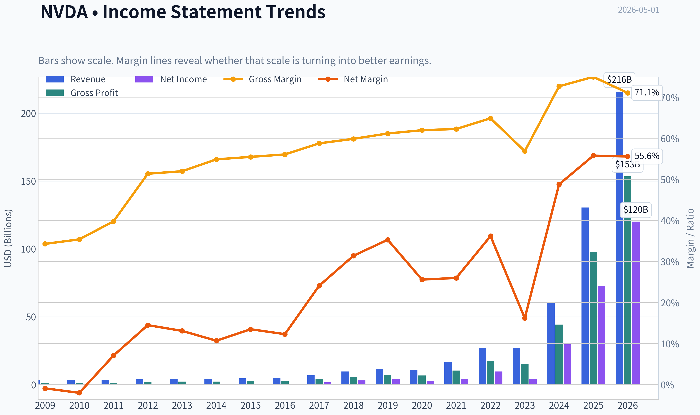
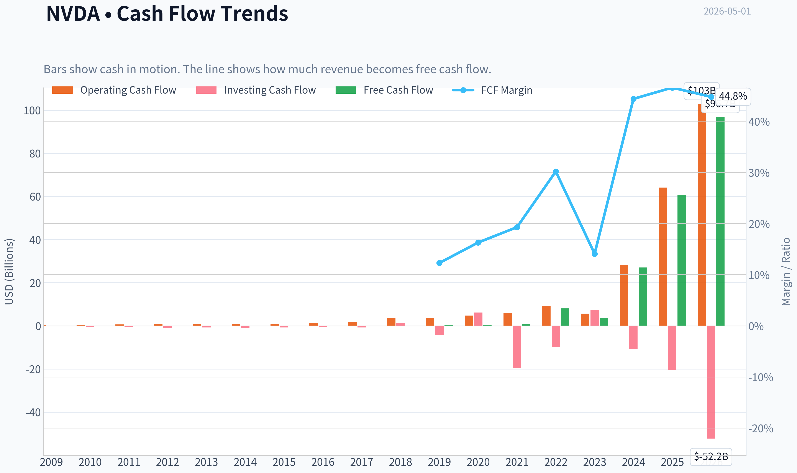
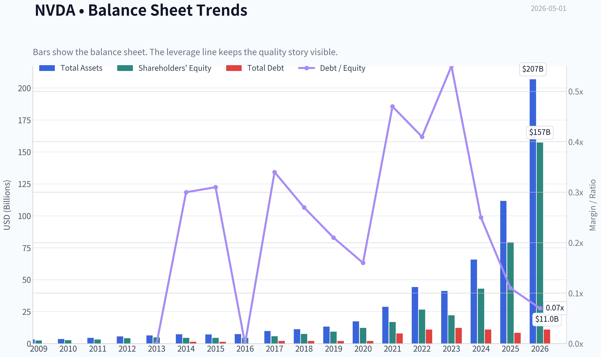
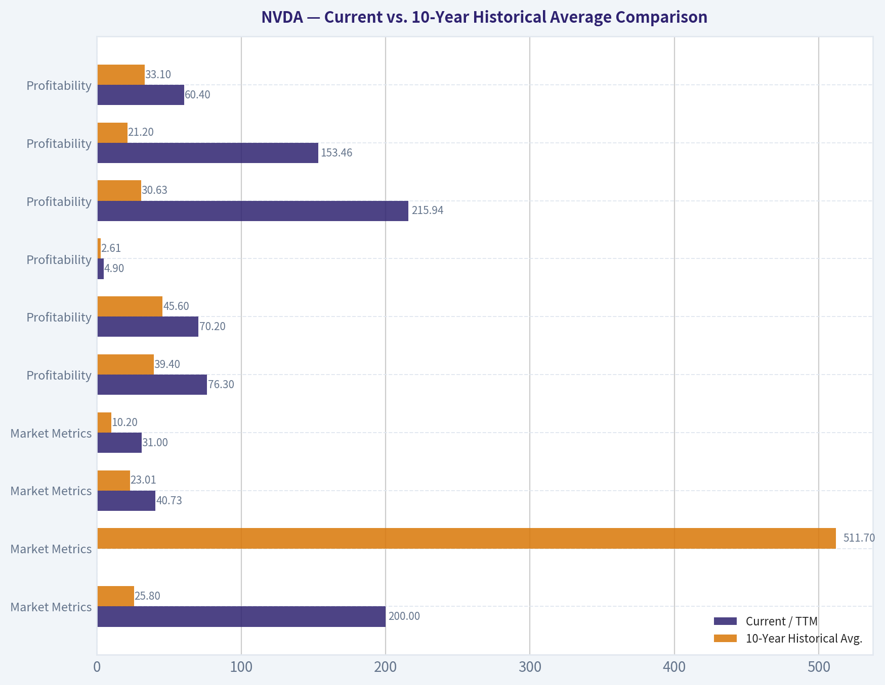
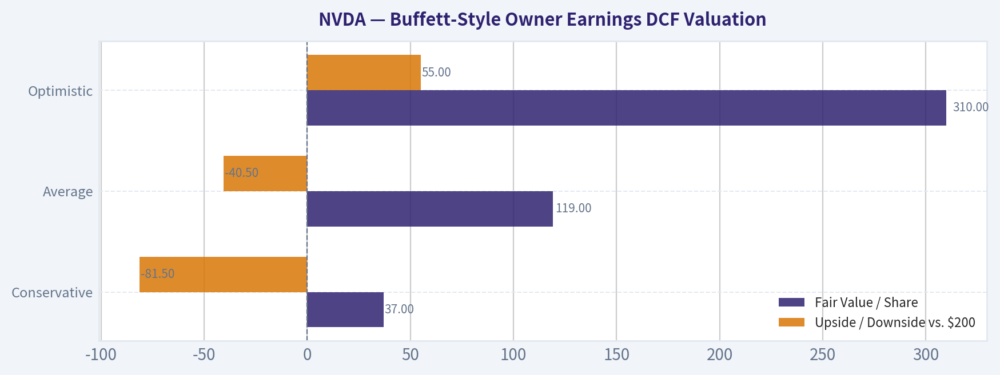
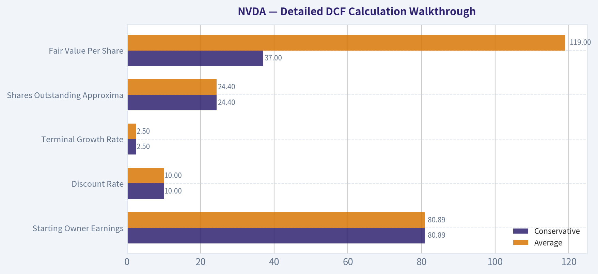
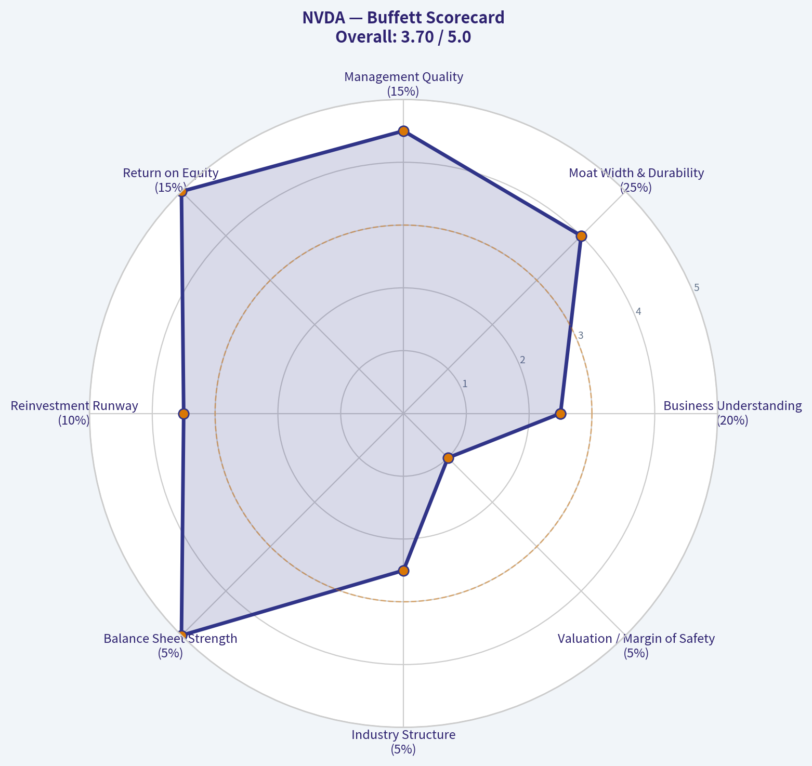

# NVDA Deep Value Intelligence

**Analysis Date:** 2026-05-01

## Critical Disclaimer

*This analysis is generated by Deep Value Intelligence, an AI-powered multi-agent investing framework. This report is for informational and educational purposes only and does not constitute financial advice. Always conduct your own research and consult with qualified financial advisors before making investment decisions.*

---

## Table of Contents

1. Intelligence Summary
2. Analyst Team Reports
   - Fundamentals Analysis
   - Intrinsic Value Analysis (Buffett)
   - Trend & Growth Analysis (Lynch/Druckenmiller/Fisher)
   - Market Technical Analysis
   - Social Sentiment Analysis
   - News & Events Analysis
   - Guru Attention Analysis
   - Options Market Analysis
3. Research Team Commentary
4. Value Investing Team Commentary
5. Deep Values Commentary

---

## Intelligence Summary

### Thesis + Conditions

**Core Thesis:** **EXECUTIVE SUMMARY**
NVIDIA is a generational business with platform-monopoly economics (76.3% ROE, 71.1% Gross Margin), but at $200 per share (40.6x P/E, 2.0% FCF yield), it offers zero margin of safety. While the business risk of permanent impairment is low, the valuation risk of multiple compression is extremely high.

**Key Risks:**
- NVIDIA is a generational business with platform-monopoly economics (76.3% ROE, 71.1% Gross Margin), but at $200 per share (40.6x P/E, 2.0% FCF yield), it offers zero margin of safety. While the business risk of permanent impairment is low, the valuation risk of multiple compression is extremely high. The current price requires uninterrupted hyper-growth and peak scarcity margins. Following strict value principles, we prioritize capital preservation over FOMO. We recognize the profound economic moat but must wait for cyclical digestion to align price with intrinsic value.
- The Aggressive Case (Risky Analyst):** NVIDIA is the foundational operating system of the AI buildout. Its CUDA software creates high switching costs, and metrics like 70.9% ROIC prove its ecosystem leverage. Waiting for a "value" entry means missing out on a compounding machine whose TAM is still expanding.
- The Conservative Case (Safe Analyst):** Peak economics (71% margins) likely reflect temporary scarcity and customer urgency, not durable baselines. Hyperscaler concentration is a dependency risk. At a $4.85T market cap, valuation relies on heroic assumptions, offering no downside protection.
- The Pragmatic Case (Neutral Analyst):** Both extremes overreach. NVIDIA is too good to dismiss but too expensive to chase blindly. The optimal path balances FOMO and risk through small, conditional accumulation rather than absolute avoidance or aggressive buying.
- Under the Buffett framework, the greatest risk management tool is buying below intrinsic value. NVIDIA easily clears the "Quality" and "Financial Strength" hurdles. However, valuation dictates risk. The Value Analyst's conservative FCF intrinsic value estimate is $142, while the current price is $200. The market is pricing the stock for perfection. Exceptional current profitability can be a trap if treated as a permanent floor rather than a cyclical peak driven by an AI capex gold rush. If growth slows from its current 65% YoY pace or if margins compress due to custom ASIC substitution, the resulting multiple contraction will lead to long-term capital stagnation, even if the underlying business remains dominant.

**What Would Change Our View:**
- NVIDIA is a generational business with platform-monopoly economics (76.3% ROE, 71.1% Gross Margin), but at $200 per share (40.6x P/E, 2.0% FCF yield), it offers zero margin of safety. While the business risk of permanent impairment is low, the valuation risk of multiple compression is extremely high. The current price requires uninterrupted hyper-growth and peak scarcity margins. Following strict value principles, we prioritize capital preservation over FOMO. We recognize the profound economic moat but must wait for cyclical digestion to align price with intrinsic value.
- The Aggressive Case (Risky Analyst):** NVIDIA is the foundational operating system of the AI buildout. Its CUDA software creates high switching costs, and metrics like 70.9% ROIC prove its ecosystem leverage. Waiting for a "value" entry means missing out on a compounding machine whose TAM is still expanding.
- The Conservative Case (Safe Analyst):** Peak economics (71% margins) likely reflect temporary scarcity and customer urgency, not durable baselines. Hyperscaler concentration is a dependency risk. At a $4.85T market cap, valuation relies on heroic assumptions, offering no downside protection.
- The Pragmatic Case (Neutral Analyst):** Both extremes overreach. NVIDIA is too good to dismiss but too expensive to chase blindly. The optimal path balances FOMO and risk through small, conditional accumulation rather than absolute avoidance or aggressive buying.
- Under the Buffett framework, the greatest risk management tool is buying below intrinsic value. NVIDIA easily clears the "Quality" and "Financial Strength" hurdles. However, valuation dictates risk. The Value Analyst's conservative FCF intrinsic value estimate is $142, while the current price is $200. The market is pricing the stock for perfection. Exceptional current profitability can be a trap if treated as a permanent floor rather than a cyclical peak driven by an AI capex gold rush. If growth slows from its current 65% YoY pace or if margins compress due to custom ASIC substitution, the resulting multiple contraction will lead to long-term capital stagnation, even if the underlying business remains dominant.

**Confidence:** Medium

---

## Analyst Team Reports

### Fundamentals Analysis

#### Latest Earnings Snapshot

*Most recent reported quarter anchored on 2026 Q1, with prior-year comparison when available.*

| Metric | 2026 Q1 | 2025 Q1 | YoY Change |
| --- | ---: | ---: | ---: |
| Revenue | $68.13B | $39.33B | +73.2% |
| Operating Income | $44.30B | $24.03B | +84.3% |
| Net Income | $42.96B | $22.09B | +94.5% |
| Diluted EPS | $1.76 | $0.89 | +97.8% |
| Operating Cash Flow | $36.19B | $16.63B | +117.6% |
| Free Cash Flow | $34.90B | $15.55B | +124.4% |

Key Takeaways: This snapshot anchors the most recent reported quarter before the narrative analysis. It helps readers separate long-run business quality from whatever changed in the latest earnings print.

#### 10-Year Financial Metrics for NVDA

*All values below are computed deterministically from raw data - not estimated by AI.*

*Issuer profile: operating company (Technology / Semiconductors).*

#### 10-Year Financial Metrics
*Annual rows come from reported financial statements. The final TTM row is computed from the latest four quarters.*

| Metric | 2009 | 2010 | 2011 | 2012 | 2013 | 2014 | 2015 | 2016 | 2017 | 2018 | 2019 | 2020 | 2021 | 2022 | 2023 | 2024 | 2025 | 2026 TTM |
| --- | --- | --- | --- | --- | --- | --- | --- | --- | --- | --- | --- | --- | --- | --- | --- | --- | --- | --- |
| Market Price | $0 | $0 | $1 | $0 | $0 | $0 | $0 | $1 | $3 | $6 | $4 | $6 | $13 | $24 | $20 | $61 | $120 | $200 |
| Market Cap | $109,313 | $211.4M | $352.0M | $227.6M | $191.6M | $233.5M | $270.2M | $416.7M | $1.77B | $3.88B | $2.25B | $14.61B | $32.60B | $62.07B | $489.79B | $1.53T | $2.98T | $4.88T |
| P/E Ratio | -3.98 | -3.21 | 1.39 | 0.39 | 0.34 | 0.53 | 0.43 | 0.68 | 1.06 | 1.27 | 0.54 | 5.23 | 7.51 | 6.36 | 114.92 | 51.70 | 40.84 | 40.73 |
| P/B Ratio | 0.00 | 0.08 | 0.11 | 0.05 | 0.04 | 0.05 | 0.06 | 0.09 | 0.31 | 0.52 | 0.24 | 1.20 | 1.93 | 2.33 | 22.16 | 35.70 | 37.54 | 31.00 |
| ROE | -1.3% | -2.6% | 8.0% | 14.0% | 11.7% | 9.9% | 14.3% | 13.7% | 28.9% | 40.8% | 44.3% | 22.9% | 25.6% | 36.6% | 19.8% | 69.2% | 91.9% | 76.3% |
| ROIC | -2.8% | -3.5% | 8.0% | 14.7% | 12.5% | 9.7% | 12.7% | 13.5% | 34.4% | 53.5% | 50.6% | 38.6% | 32.6% | 33.1% | 13.3% | 74.5% | 111.7% | 70.2% |
| EPS | $-0.05 | $-0.11 | $0.39 | $0.86 | $0.83 | $0.70 | $1.07 | $1.05 | $2.57 | $4.82 | $6.63 | $1.13 | $1.73 | $3.85 | $0.17 | $1.19 | $2.94 | $4.90 |
| Revenue | $3.42B | $3.33B | $3.54B | $4.00B | $4.28B | $4.13B | $4.68B | $5.01B | $6.91B | $9.71B | $11.72B | $10.92B | $16.68B | $26.91B | $26.97B | $60.92B | $130.50B | $215.94B |
| Gross Profit | $1.17B | $1.18B | $1.41B | $2.06B | $2.23B | $2.27B | $2.60B | $2.81B | $4.06B | $5.82B | $7.17B | $6.77B | $10.40B | $17.48B | $15.36B | $44.30B | $97.86B | $153.46B |
| Gross Margin | 34.3% | 35.4% | 39.8% | 51.4% | 52.0% | 54.9% | 55.5% | 56.1% | 58.8% | 59.9% | 61.2% | 62.0% | 62.3% | 64.9% | 56.9% | 72.7% | 75.0% | 71.1% |
| Operating Margin | -2.1% | -3.0% | 7.2% | 16.2% | 15.1% | 12.0% | 16.2% | 14.9% | 28.0% | 33.0% | 32.5% | 26.1% | 27.2% | 37.3% | 15.7% | 54.1% | 62.4% | 60.4% |
| Net Income | $-30.0M | $-68.0M | $253.1M | $581.1M | $562.5M | $440.0M | $631.0M | $614.0M | $1.67B | $3.05B | $4.14B | $2.80B | $4.33B | $9.75B | $4.37B | $29.76B | $72.88B | $120.07B |
| Net Margin | -0.9% | -2.0% | 7.1% | 14.5% | 13.1% | 10.7% | 13.5% | 12.3% | 24.1% | 31.4% | 35.3% | 25.6% | 26.0% | 36.2% | 16.2% | 48.8% | 55.8% | 55.6% |
| Revenue Growth | N/A | -2.9% | 6.5% | 12.8% | 7.1% | -3.5% | 13.4% | 7.0% | 37.9% | 40.6% | 20.6% | -6.8% | 52.7% | 61.4% | 0.2% | 125.9% | 114.2% | 65.5% |
| Net Income Growth | N/A | 126.3% | -472.3% | 129.5% | -3.2% | -21.8% | 43.4% | -2.7% | 171.3% | 82.9% | 35.9% | -32.5% | 54.9% | 125.1% | -55.2% | 581.3% | 144.9% | 64.7% |
| Free Cash Flow Growth | N/A | N/A | 40.9% | 33.3% | N/A | N/A | N/A | N/A | N/A | N/A | N/A | N/A | N/A | N/A | -53.2% | 609.6% | 125.2% | 58.9% |
| Total Book Value | $2.39B | $2.67B | $3.18B | $4.15B | $4.83B | $4.46B | $4.42B | $4.47B | $5.76B | $7.47B | $9.34B | $12.20B | $16.89B | $26.61B | $22.10B | $42.98B | $79.33B | $157.29B |
| Total Assets | $3.35B | $3.59B | $4.50B | $5.55B | $6.41B | $7.25B | $7.20B | $7.37B | $9.84B | $11.24B | $13.29B | $17.32B | $28.79B | $44.19B | $41.18B | $65.73B | $111.60B | $206.80B |
| Total Debt | N/A | N/A | N/A | N/A | $0 | $1.36B | $1.38B | $0 | $1.98B | $1.99B | $1.99B | $1.99B | $7.96B | $10.95B | $12.20B | $10.96B | $8.46B | $11.04B |
| Debt-to-Equity | N/A | N/A | N/A | N/A | 0.00 | 0.30 | 0.31 | 0.00 | 0.34 | 0.27 | 0.21 | 0.16 | 0.47 | 0.41 | 0.55 | 0.25 | 0.11 | 0.07 |
| Cash & Equivalents | $417.7M | $447.2M | $665.4M | $667.9M | $733.0M | $1.15B | $497.0M | $596.0M | $1.77B | $4.00B | $782.0M | $10.90B | $847.0M | $1.99B | $3.39B | $7.28B | $8.59B | $10.61B |
| Shareholders' Equity | $2.39B | $2.67B | $3.18B | $4.15B | $4.83B | $4.46B | $4.42B | $4.47B | $5.76B | $7.47B | $9.34B | $12.20B | $16.89B | $26.61B | $22.10B | $42.98B | $79.33B | $157.29B |
| Operating Cash Flow | $249.4M | $487.8M | $675.8M | $909.2M | $824.2M | $835.0M | $906.0M | $1.18B | $1.67B | $3.50B | $3.74B | $4.76B | $5.82B | $9.11B | $5.64B | $28.09B | $64.09B | $102.72B |
| Investing Cash Flow | $-209.4M | $-519.3M | $-649.7M | $-1.14B | $-744.0M | $-806.0M | $-727.0M | $-400.0M | $-793.0M | $1.28B | $-4.10B | $6.14B | $-19.68B | $-9.83B | $7.38B | $-10.57B | $-20.42B | $-52.23B |
| Free Cash Flow | N/A | $410.2M | $577.9M | $770.4M | N/A | N/A | N/A | N/A | N/A | N/A | N/A | N/A | N/A | $8.13B | $3.81B | $27.02B | $60.85B | $96.68B |
| FCF Margin | N/A | 12.3% | 16.3% | 19.3% | N/A | N/A | N/A | N/A | N/A | N/A | N/A | N/A | N/A | 30.2% | 14.1% | 44.4% | 46.6% | 44.8% |
| Dividends / Share | $0.00 | $0.00 | $0.00 | $0.00 | $0.00 | $0.00 | $0.00 | $0.00 | $0.00 | $0.00 | $0.00 | $0.00 | $0.00 | $0.00 | $0.02 | $0.02 | $0.03 | $0.04 |

#### Profitability Metrics
- Return on Equity (ROE): 76.3%
- Return on Invested Capital (ROIC): 70.9%
- Return on Assets (ROA): 58.1%
- Gross Margin: 71.1%
- Operating Margin: 60.4%
- Net Profit Margin: 55.6%

#### Liquidity Metrics
- Current Ratio: 3.91
- Quick Ratio: 3.14

#### Leverage Metrics
- Debt-to-Equity Ratio: 0.06
- Interest Coverage Ratio: 503.42
- Net Debt: $-1.14B

#### Growth Metrics (Year-over-Year)
- Revenue Growth: 65.5%
- Net Income Growth: 64.7%
- Free Cash Flow Growth: 58.9%
- Revenue CAGR (3-Year): 100.0%
- Revenue CAGR (5-Year): 66.9%

#### Valuation Metrics
- P/E Ratio (TTM): 40.65
- Forward P/E: 17.76
- Price-to-Book: 30.84
- Price-to-Sales: 22.46
- PEG Ratio: 0.76
- EV/EBITDA: 36.02
- Free Cash Flow Yield: 2.0%
- Earnings Yield: 2.5%

#### Owner Earnings (Buffett Method, Code-Computed)
- Net Income: $72.88B
- + Depreciation & Amortization: $2.84B
- - Capital Expenditures: $-6.04B
- - Working Capital Changes: $-15.95B
- = **Owner Earnings: $80.89B**

#### Intrinsic Value (Code-Computed)
- Current Price: $200
- Buffett Method (Owner Earnings):
  Conservative: $37
  Average: $119
  Optimistic: $310
- Cash Flow Method (FCF):
  Conservative: $90
  Average: $90
  Optimistic: $233

#### Piotroski F-Score: 3/9
- Positive Net Income: PASS
- Positive Operating Cash Flow: PASS
- ROA Improvement: FAIL
- Cash Flow > Net Income: FAIL
- Decreasing Debt: FAIL
- Improving Current Ratio: FAIL
- No Dilution: PASS
- Improving Gross Margin: FAIL
- Improving Asset Turnover: FAIL

FINAL INVESTMENT STANCE: **WATCH**

#### NVDA Warren Buffett-Style Fundamental Analysis - Canonical Dataset Through 2026 TTM

NVIDIA is an extraordinary business with unusually strong economics: 71.1% gross margin, 60.4% operating margin, 55.6% net margin, 76.3% ROE, and 70.2% ROIC in the TTM period. The company has become the dominant infrastructure supplier for accelerated computing and artificial intelligence, and the deterministic dataset shows a step-change in revenue, profits, and free cash flow beginning in 2024 and 2025.

From a Buffett-style perspective, however, quality alone is not enough. At a current price of **$200**, a market capitalization of **$4.88 trillion**, **40.7x earnings**, **31.0x book value**, and only about a **2.0% free cash flow yield**, the market is already pricing NVIDIA as a long-duration compounder with sustained AI dominance. The final stance is **WATCH**, not ADVOCATE, because the business quality is exceptional but the margin of safety is thin unless optimistic growth assumptions prove correct.

---

#### Current vs. 10-Year Historical Average Comparison

*Current values use the 2026 TTM row from the deterministic dataset. Historical averages use the most recent 10 annual years shown before TTM, 2016-2025, with available data only where the dataset contains gaps.*

| Category | Metric | Current / TTM | 10-Year Historical Avg. | Current Standing vs. History | Buffett-Style Interpretation |
|---|---:|---:|---:|---|---|
| Market Metrics | Market Price | $200 | $25.80 | Far above average | The stock price reflects a massive rerating, not merely business growth. |
| Market Metrics | Total Market Cap | $4.88T | $511.7B | ~9.5x average | Market expectations have expanded dramatically with the AI boom. |
| Market Metrics | P/E Ratio | 40.73x | 23.01x | Above average | Expensive versus NVIDIA's own history, though below the extreme 2023 multiple. |
| Market Metrics | P/B Ratio | 31.00x | 10.20x | Far above average | The market values NVIDIA far beyond accounting book value due to intangible moat and earnings power. |
| Profitability | ROE | 76.3% | 39.4% | Nearly 2x average | Exceptional shareholder capital productivity, a major Buffett positive. |
| Profitability | ROIC | 70.2% | 45.6% | Well above average | Indicates a highly profitable asset-light model and strong competitive positioning. |
| Profitability | EPS | $4.90 | $2.61 | Above average | Earnings power has structurally improved, though cyclicality remains relevant. |
| Profitability | Revenue | $215.94B | $30.63B | ~7.1x average | Revenue scale has changed radically due to data center AI demand. |
| Profitability | Gross Profit | $153.46B | $21.20B | ~7.2x average | Gross profit growth confirms pricing power and high-value product mix. |
| Profitability | Operating Margin | 60.4% | 33.1% | Far above average | Operating leverage is extraordinary; sustainability is the key question. |
| Profitability | Net Income | $120.07B | $13.34B | ~9.0x average | NVIDIA has moved from high-quality semiconductor company to mega-scale profit engine. |
| Profitability | Net Margin | 55.6% | 31.2% | Far above average | Current profitability is exceptional even by NVIDIA's standards. |
| Growth | Revenue Growth Rate | 65.5% | 45.4% | Above average | Growth remains very strong, but below the explosive 2024-2025 phase. |
| Growth | Net Income Growth Rate | 64.7% | 110.6% | Below average, distorted by 2024 surge | Still excellent, but historical average is inflated by post-2023 profit rebound. |
| Growth | Free Cash Flow Growth Rate | 58.9% | 227.2% available-year avg. | Below spike-year average | FCF growth remains strong but has normalized from the 2024 rebound. |
| Balance Sheet | Total Book Value | $157.29B | $22.72B | ~6.9x average | Equity base has grown substantially from retained earnings. |
| Balance Sheet | Total Assets | $206.80B | $35.06B | ~5.9x average | Asset base has expanded, but returns remain extremely high. |
| Balance Sheet | Total Debt | $11.04B | $5.85B | Above average in dollars | Debt is higher nominally but immaterial relative to earnings and equity. |
| Balance Sheet | Debt-to-Equity Ratio | 0.07x | 0.28x | Much lower than average | Strong balance sheet; leverage risk is low. |
| Balance Sheet | Cash & Equivalents | $10.61B | $4.01B | Above average | Solid liquidity, though cash is small relative to market cap. |
| Balance Sheet | Shareholders' Equity | $157.29B | $22.72B | ~6.9x average | Retained profitability has rapidly increased intrinsic book strength. |
| Cash Flow | Free Cash Flow | $96.68B | $24.95B available-year avg. | ~3.9x average | Cash generation is outstanding and supports the quality thesis. |
| Cash Flow | Dividends per Share | $0.04 | $0.007 | Above average but still tiny | Dividend is symbolic; capital return is not the main shareholder value driver. |

**Key Takeaways:** NVIDIA's current fundamentals are dramatically stronger than its 10-year averages across revenue, margins, net income, ROE, ROIC, and free cash flow. However, valuation metrics have also expanded sharply, with the current P/E and P/B ratios well above historical norms. The business has clearly improved, but the stock price already discounts a large portion of that improvement.

---

#### Revenue Breakdown

*Revenue breakdown uses NVIDIA's most recent fiscal-year segment reporting aligned with the deterministic FY2025 revenue base of approximately $130.50B.*

| Revenue Source | Amount ($B) | % of Total |
|---|---:|---:|
| Data Center | $115.2B | 88.3% |
| Gaming | $11.4B | 8.7% |
| Professional Visualization | $1.9B | 1.5% |
| Automotive | $1.7B | 1.3% |
| OEM & Other | $0.4B | 0.3% |
| **Total** | **~$130.5B** | **~100.0%** |

**Key Takeaways:** NVIDIA is now overwhelmingly a data center company, with AI accelerators and related infrastructure representing the core earnings engine. Gaming remains meaningful but has become a much smaller percentage of total revenue. This concentration strengthens the AI upside case but also increases dependence on hyperscaler capital spending cycles.

---

#### Warren Buffett-Style Qualitative Analysis

| Buffett Lens | Assessment | Evidence from Dataset | Investment Meaning |
|---|---|---|---|
| Economic Moat | Very strong | ROIC of 70.2%, gross margin of 71.1%, operating margin of 60.4% | NVIDIA likely has durable advantages in GPUs, CUDA software ecosystem, developer lock-in, and AI infrastructure scale. |
| Financial Strength | Excellent | Debt-to-equity of 0.07x, current ratio from shared pack of 3.91, net debt approximately negative | Balance sheet risk is low; the company has ample flexibility. |
| Predictable Earnings | Improving but not perfectly predictable | Net income fell in 2020 and 2023 before surging in 2024-2026 | Earnings are more cyclical than a classic Buffett consumer compounder, but the AI transition has lifted the base. |
| Management Performance | Strong | ROE rose to 91.9% in 2025 and remains 76.3% TTM | Management has converted technology leadership into exceptional returns on capital. |
| Capital Allocation | Growth-first | Dividend per share only $0.04 TTM despite huge FCF | Cash is being retained for growth, supply chain capacity, R&D, and strategic flexibility rather than income returns. |
| Margin Stability | Strong recently, historically variable | Net margin rose from 16.2% in 2023 to 55.6% TTM | Current margins are extraordinary; the risk is normalization if competition or customer bargaining power rises. |
| Valuation Discipline | Challenging | P/E 40.73x and P/B 31.00x | Buffett would likely admire the company but hesitate at the current price without a larger margin of safety. |

**Key Takeaways:** NVIDIA scores extremely well on moat, profitability, capital efficiency, and balance sheet strength. The main Buffett concern is not business quality but valuation and predictability. The company is outstanding, but the stock requires continued exceptional execution to justify the current price.

---

#### Buffett-Style Owner Earnings DCF Valuation

The deterministic research pack provides code-computed Buffett Method Owner Earnings of **$80.89B** and intrinsic values using a **10% discount rate** and **2.5% terminal growth rate**. Based on the current price of **$200** and market capitalization of **$4.88T**, implied diluted shares are approximately **24.4B**.

Owner Earnings basis:

- Base Owner Earnings: **$80.89B**
- Implied Shares: **$4.88T / $200 = 24.4B shares**
- Discount Rate: **10.0%**
- Terminal Growth Rate: **2.5%**
- Explicit Forecast Period: **10 years**
- Terminal Value Formula:
  **Year 10 Owner Earnings x 1.025 / (10.0% - 2.5%)**
- Present Value Formula:
  **PV = discounted 10-year Owner Earnings + discounted terminal value**

| Scenario | Growth Assumption Used / Implied by Deterministic DCF | Estimated Equity Value | Fair Value / Share | Upside / Downside vs. $200 | Buffett Interpretation |
|---|---:|---:|---:|---:|---|
| Conservative | ~0% Owner Earnings growth, representing the low-growth case embedded in the deterministic output | ~$903B | $37 | -81.5% | Severe overvaluation if AI profit growth stalls or margins normalize sharply. |
| Average | ~15.7% Owner Earnings growth | ~$2.90T | $119 | -40.5% | Still below current price; excellent growth is not enough unless durability is very high. |
| Optimistic | ~29% Owner Earnings growth | ~$7.56T | $310 | +55.0% | Current price can be justified only if NVIDIA compounds Owner Earnings at very high rates for a long period. |

**Key Takeaways:** The DCF range is extremely wide, from $37 to $310 per share, reflecting how sensitive NVIDIA's value is to long-term Owner Earnings growth. The current price of $200 is meaningfully above the average-case value of $119 but below the optimistic value of $310. A Buffett-style investor would likely demand a larger margin of safety unless they had very high confidence that the optimistic scenario is realistic.

---

#### Detailed DCF Calculation Walkthrough

| Calculation Step | Conservative | Average | Optimistic |
|---|---:|---:|---:|
| Starting Owner Earnings | $80.89B | $80.89B | $80.89B |
| Approx. Growth Rate | ~0% | ~15.7% | ~29% |
| Year 10 Owner Earnings Approximation | ~$80.9B | ~$348B | ~$1.0T |
| Discount Rate | 10.0% | 10.0% | 10.0% |
| Terminal Growth Rate | 2.5% | 2.5% | 2.5% |
| Present Value of Explicit + Terminal Cash Flows | ~$903B | ~$2.90T | ~$7.56T |
| Shares Outstanding Approximation | 24.4B | 24.4B | 24.4B |
| Fair Value Per Share | $37 | $119 | $310 |

**Key Takeaways:** The valuation is dominated by the terminal value, which is normal for a rapidly growing compounder but risky when growth expectations are high. The average case suggests the stock is expensive, while the optimistic case suggests upside remains if NVIDIA sustains AI infrastructure dominance. The conservative case highlights the danger of paying a premium price for cyclically elevated earnings.

---

#### Key Investment Insights, Red Flags, and Opportunities

| Area | Key Point | Why It Matters |
|---|---|---|
| Opportunity | NVIDIA has exceptional AI infrastructure dominance | Data center revenue is the overwhelming driver and reflects strong demand from hyperscalers and enterprise AI adoption. |
| Opportunity | Profitability is elite | ROE of 76.3%, ROIC of 70.2%, and net margin of 55.6% are rare at NVIDIA's scale. |
| Opportunity | Balance sheet is conservative | Debt-to-equity of 0.07x gives the company flexibility even if the semiconductor cycle weakens. |
| Opportunity | Free cash flow generation is enormous | TTM FCF of $96.68B gives NVIDIA strategic optionality for R&D, supply chain, buybacks, or acquisitions. |
| Red Flag | Valuation is demanding | P/E of 40.73x and P/B of 31.00x leave little room for disappointment. |
| Red Flag | Revenue concentration has increased | Data Center represents roughly 88% of FY2025 revenue, tying results closely to AI capex trends. |
| Red Flag | Margins may be cyclically elevated | Current operating margin of 60.4% is far above the 10-year average of 33.1%. |
| Red Flag | Piotroski F-Score is weak at 3/9 | Despite strong profitability, the score flags deterioration in some efficiency, leverage, and margin-comparison metrics. |
| Watch Item | Hyperscaler capex sustainability | If cloud AI spending slows, NVIDIA's growth multiple could compress. |
| Watch Item | Competitive pressure | Custom ASICs, AMD accelerators, and internal cloud chips may pressure pricing over time. |

**Key Takeaways:** NVIDIA's upside comes from one of the strongest business franchises in modern technology, but the risks are valuation, concentration, and the possibility of margin normalization. The company does not need to fail for the stock to underperform; it only needs to grow less spectacularly than expected. Investors should watch demand durability, customer concentration, and future gross margin trends closely.

---

#### Final Investment Stance: WATCH

NVIDIA is a Buffett-quality business in terms of moat, profitability, capital efficiency, and balance sheet strength, but it is not clearly a Buffett-price investment at **$200**. The average-case Owner Earnings DCF value of **$119** is materially below the current price, while the optimistic case of **$310** requires sustained high growth and exceptional margin durability.

The appropriate stance is **WATCH**. Existing long-term holders may justify continuing to hold because the business remains exceptional, but new money should demand either a better entry price or further evidence that the optimistic Owner Earnings trajectory is durable.

#### Final Summary Table

| Decision Area | Assessment | Conclusion |
|---|---|---|
| Business Quality | Exceptional | NVIDIA has one of the strongest profitability profiles in global equities. |
| Economic Moat | Very strong | CUDA ecosystem, AI hardware leadership, scale, and developer adoption support durability. |
| Financial Strength | Excellent | Low leverage, strong liquidity, and huge free cash flow reduce financial risk. |
| Growth | Outstanding but normalizing | Revenue growth remains high at 65.5%, but the 2024-2025 surge is unlikely to repeat indefinitely. |
| Valuation | Expensive | Current P/E, P/B, and market cap are well above historical averages. |
| DCF Margin of Safety | Insufficient in average case | $200 price is above the $119 average-case Buffett DCF value. |
| Main Upside Driver | Sustained AI infrastructure growth | Continued hyperscaler and enterprise AI demand could support the optimistic case. |
| Main Downside Risk | Multiple compression | Even strong earnings may not prevent underperformance if expectations fall. |
| Final Stance | **WATCH** | Great company, but current valuation requires patience and discipline. |

**Key Takeaways:** NVIDIA is a world-class compounder, but the stock already reflects very high expectations. The best Buffett-style conclusion is to admire the business, monitor the valuation, and wait for either a better price or stronger confirmation that current AI-driven earnings power is sustainable for many years.

#### Fundamental Visuals

This graph tracks the profitability and return metrics (ROE, ROIC, Margins) of **NVDA** over the past decade, highlighting capital efficiency trends.

This chart illustrates the financial health of **NVDA** over the last 10 years, mapping cash equivalents and free cash flow against total obligations (Debt).

This breakdown chart from <em>Revenue Breakdown</em> shows the proportional composition for **NVDA** - useful for understanding what drives or risks the business.

---

### Intrinsic Value Analysis (Buffett)

> *Following Warren Buffett's value investing philosophy: Circle of Competence, Economic Moat, Management Quality, and Margin of Safety.*

#### Intrinsic Value Snapshot

Price is what you pay. Intrinsic value is what the business may be worth based on the cash it can create for owners over time. We show a range, not one magic number.

- Current Price: $199.57
- Value Range: $142.35 to $509.30

##### Owner Earnings (Buffett Method)
- Net Income: $120,067,000,000.00
- Depreciation & Amortization: $2,843,000,000.00
- Capital Expenditures: $-6,042,000,000.00
- Working Capital Changes: $-15,949,000,000.00
- Owner Earnings: $132,817,000,000.00

##### Intrinsic Value
###### Buffett Method
Uses owner earnings. Stricter, and usually more conservative.
- Conservative: $195.57
- Average: $195.57
- Optimistic: $509.30
- Discount Rate: 10.0%

###### Cash Flow Method
Uses free cash flow. Better for companies spending heavily today to grow tomorrow.
- Conservative: $142.35
- Average: $142.35
- Optimistic: $370.72
- Discount Rate: 10.0%

FINAL INVESTMENT STANCE: **WATCH**

#### NVIDIA Corporation - Buffett-Style Value Investment Review

As of 2026-05-01, NVIDIA is an exceptional business with extraordinary economics, dominant AI infrastructure positioning, and fortress-like profitability. However, at roughly **$200 per share**, **$4.85 trillion market capitalization**, and only about a **2.0% free-cash-flow yield**, the stock does not offer a Buffett-style margin of safety. This is a wonderful company, but not clearly a wonderful investment at today's price.

---

#### 1. Go / No-Go Gate Assessment

| Buffett Gate | Assessment | Evidence | Pass / Fail |
|---|---:|---|---:|
| Circle of Competence & Simplicity | Mixed | NVIDIA designs GPUs, networking, systems, and software used for gaming, AI, data centers, visualization, and autonomous applications. The basic model is understandable, but AI accelerator demand, chip cycles, foundry constraints, and technology roadmaps are complex. | Partial |
| 10-Year Predictability | Weak to Moderate | AI compute demand is likely durable, but the precise economics of accelerators 10 years from now are hard to forecast. Competition from AMD, custom ASICs, hyperscaler in-house chips, and changing AI architectures creates uncertainty. | Partial / Fail |
| Technology Risk | Elevated | NVIDIA benefits massively from technology change today, but the business is also exposed to rapid technological substitution. This is not Coca-Cola, Moody's, or See's Candy. | Fail |
| Moat Test | Strong | CUDA ecosystem, developer adoption, scale, networking, software stack, and platform integration create a powerful moat. | Pass |
| Management & Capital Allocation | Strong | Management has executed brilliantly, expanded from gaming GPUs into accelerated computing, and maintained a strong balance sheet. | Pass |
| Industry Structure | Mixed | NVIDIA has dominant share in AI accelerators, but semiconductors remain cyclical, capital-intensive at the ecosystem level, and intensely competitive. | Partial |

**Key Takeaways:** NVIDIA passes the moat and management gates with strength, but it struggles with Buffett's predictability test. The company is not hard to describe, but its long-term economics depend on fast-moving technology, customer capex cycles, and competitive innovation. For a strict Buffett investor, this makes the valuation hurdle much higher.

---

#### 2. Moat Analysis

| Moat Source | Strength | Evidence | Buffett Interpretation |
|---|---:|---|---|
| Intangible Assets / Brand | Strong | NVIDIA is the default brand for high-performance AI compute. Customers associate NVIDIA with performance, reliability, and software maturity. Gross margin is around **71.1%**, far above the usual threshold for strong pricing power. | Strong intangible asset moat |
| Switching Costs | Very Strong | CUDA, libraries, developer tools, optimized models, enterprise workflows, and data-center deployment experience create customer lock-in. | One of NVIDIA's strongest moat sources |
| Cost / Scale Advantage | Strong | Massive R&D scale, supply-chain priority, ecosystem breadth, and system-level integration create advantages smaller rivals struggle to match. | Strong, but not permanent if architecture shifts |
| Network Effects | Strong | More developers use CUDA because more customers deploy NVIDIA; more customers deploy NVIDIA because more software is optimized for it. | Powerful ecosystem network effect |
| Regulatory / Patent Protection | Moderate | Patents and design expertise help, but this is not a regulated monopoly. | Helpful but not decisive |

**Key Takeaways:** NVIDIA's moat is real and currently widening, especially through software, developer ecosystems, and platform integration. The risk is that the moat exists in a technology market, where even strong advantages can erode faster than consumer-brand moats. This is a wide moat today, but not a "forever predictable" moat.

---

#### 3. Management Quality Assessment

| Area | Assessment | Evidence |
|---|---:|---|
| Strategic Vision | Excellent | Jensen Huang led NVIDIA from gaming GPUs into data-center acceleration, AI infrastructure, networking, and full-stack computing platforms. |
| Owner Orientation | Strong | Founder-led culture remains a major positive. Management has focused on long-term platform building rather than only near-term earnings. |
| Capital Allocation | Strong | NVIDIA has historically reinvested in R&D at very high returns. The company has avoided dangerous leverage and has preserved financial flexibility. |
| Candor / Accounting Quality | Generally Good | Profitability is backed by cash generation, not merely accounting earnings. Operating cash flow and free cash flow are very strong. |
| Buybacks / Dividends | Mixed | Buybacks at high valuations may not create as much value as internal reinvestment. Dividend is immaterial. |

**Key Takeaways:** Management is one of NVIDIA's biggest strengths. Jensen Huang has shown rare strategic clarity and execution skill. The key concern is not management quality, but whether even excellent management can justify today's valuation over a full cycle.

---

#### 4. 10-Year Financial Summary

Approximate fiscal-year figures, rounded. NVIDIA fiscal years end around January. Latest market data from the provided research pack: price **$200**, market cap **$4.85T**, P/E **40.6x**, ROE **76.3%**, gross margin **71.1%**, current ratio **3.9x**, and free-cash-flow yield **2.0%**.

| Fiscal Year | Revenue, $B | Net Income, $B | Approx. FCF, $B | Gross Margin | Operating Margin | Notes |
|---:|---:|---:|---:|---:|---:|---|
| FY2016 | 5.0 | 0.6 | 0.8 | ~56% | ~15% | Gaming GPU core business |
| FY2017 | 6.9 | 1.7 | 1.5 | ~59% | ~28% | Early acceleration growth |
| FY2018 | 9.7 | 3.0 | 3.1 | ~60% | ~34% | Strong gaming/data-center growth |
| FY2019 | 11.7 | 4.1 | 3.1 | ~61% | ~32% | Crypto and gaming volatility |
| FY2020 | 10.9 | 2.8 | 4.3 | ~62% | ~26% | Cycle digestion |
| FY2021 | 16.7 | 4.3 | 4.7 | ~62% | ~27% | Data-center acceleration rising |
| FY2022 | 26.9 | 9.8 | 8.1 | ~65% | ~37% | Strong gaming and data-center demand |
| FY2023 | 27.0 | 4.4 | 3.8 | ~57% | ~19% | Inventory/cycle reset |
| FY2024 | 60.9 | 29.8 | 27.0 | ~73% | ~54% | AI data-center inflection |
| FY2025 | 130.5 | 72.9 | 60.9 | ~75% | ~62% | AI demand surge |

**Key Takeaways:** NVIDIA's financial transformation has been extraordinary. Revenue grew from about $5 billion to over $130 billion in roughly a decade, while margins expanded dramatically as data-center AI became the dominant driver. The main caution is that the last two years represent an explosive AI buildout, and investors must decide how much of this profitability is durable versus cyclical.

---

#### 5. Owner Earnings Calculation

Using Buffett's preferred logic, owner earnings should approximate cash that can be distributed to owners without impairing the business. For NVIDIA, free cash flow is a reasonable conservative proxy because capital expenditures are modest relative to earnings, although working-capital swings can be material.

| Item | Estimate |
|---|---:|
| Market Capitalization | $4.85T |
| P/E Ratio | 40.6x |
| Implied TTM Net Income | ~$119B |
| Free Cash Flow Yield | ~2.0% |
| Implied TTM Free Cash Flow | ~$97B |
| D&A Add-back | Included indirectly in operating cash flow |
| Maintenance CapEx | Difficult to separate; FCF used as conservative proxy |
| Working Capital Adjustment | Reflected in FCF approximation |
| Estimated Owner Earnings | ~$97B |

**Key Takeaways:** NVIDIA is producing enormous owner earnings, but the market price already assumes a very large amount of future growth. A 2% free-cash-flow yield means investors are paying about 50 times current free cash flow. That is a demanding starting point, even for a great business.

---

#### 6. Return on Equity and Cash Flow Reality Check

| Metric | Current / Recent Level | Buffett View |
|---|---:|---|
| ROE | ~76.3% | Exceptional |
| Gross Margin | ~71.1% | Evidence of pricing power and moat |
| Revenue Growth YoY | ~65.5% | Extraordinary, but unlikely to persist indefinitely |
| Free Cash Flow Yield | ~2.0% | Low yield; valuation is demanding |
| Current Ratio | ~3.9x | Very strong liquidity |
| Balance Sheet | Low financial stress | Supports resilience |
| Cash Conversion | Strong | Earnings are supported by cash flow |

**Key Takeaways:** NVIDIA's profitability metrics are world-class. The company earns extremely high returns without relying on dangerous financial leverage. The problem is not business quality; the problem is whether today's price leaves enough room for investor returns if growth slows.

---

#### 7. Three-Scenario DCF Valuation

Assumptions: estimated owner earnings of **$97B**, discount rate of **10%**, share count implied by market cap and price of roughly **24.25B shares**. Historical growth scenario uses a capped **10% growth rate**, per the Buffett-style discipline, with a 3% terminal growth rate.

| Scenario | Assumptions | Estimated Equity Value | Intrinsic Value / Share | Upside / Downside vs. $200 |
|---|---|---:|---:|---:|
| A: No Growth | Owner earnings / 10% | ~$970B | ~$40 | -80% |
| B: GDP Growth | Perpetual 3% growth, 10% discount rate | ~$1.43T | ~$59 | -71% |
| C: Capped Historical Growth | 10% growth for 10 years, then 3% terminal growth | ~$2.40T | ~$99 | -51% |

**Key Takeaways:** Even under a favorable capped-growth case, the estimated intrinsic value is well below the current share price. To justify $200 per share, NVIDIA likely needs to sustain very high growth and very high margins for a long time. That may happen, but it requires a forecast with less certainty than Buffett usually demands.

---

#### 8. Margin of Safety Analysis

| Valuation Case | Intrinsic Value / Share | Required Buy Price for 25% Margin of Safety | Current Price | Margin of Safety |
|---|---:|---:|---:|---:|
| No Growth | ~$40 | ~$30 | $200 | None |
| GDP Growth | ~$59 | ~$44 | $200 | None |
| Capped Growth | ~$99 | ~$74 | $200 | None |

**Key Takeaways:** NVIDIA does not offer a Buffett-style margin of safety at the current price. The stock may still perform well if AI demand continues to exceed expectations, but the valuation leaves little protection against disappointment. A value investor should wait for either a much lower price or much higher normalized owner earnings.

---

#### 9. Buffett Scorecard

| Criterion | Weight | Score, 1-5 | Weighted Score | Rationale |
|---|---:|---:|---:|---|
| Business Understanding | 20% | 2.5 | 0.50 | Understandable at a high level, but long-term technology economics are complex |
| Moat Width & Durability | 25% | 4.0 | 1.00 | CUDA, scale, software, and ecosystem are powerful |
| Management Quality | 15% | 4.5 | 0.68 | Founder-led, visionary, excellent execution |
| Return on Equity | 15% | 5.0 | 0.75 | ROE and margins are exceptional |
| Reinvestment Runway | 10% | 3.5 | 0.35 | AI runway is large, but capex cycles and competition matter |
| Balance Sheet Strength | 5% | 5.0 | 0.25 | Strong liquidity and low apparent financial risk |
| Industry Structure | 5% | 2.5 | 0.13 | Dominant position, but semiconductor competition and cyclicality remain |
| Valuation / Margin of Safety | 5% | 1.0 | 0.05 | No clear margin of safety at current price |
| **Total** | **100%** |  | **3.71 / 5.00** | WATCH |

**Key Takeaways:** NVIDIA scores extremely well on business quality, profitability, moat, and management. It scores poorly on valuation and only moderately on predictability because this is a fast-changing technology business. The overall result is a high-quality company that belongs on a watchlist, not a Buffett-style buy list at today's price.

---

#### 10. Final Investment Stance

| Stance | Conviction | Summary |
|---|---:|---|
| **WATCH** | High | NVIDIA is a phenomenal company, but the stock price already reflects heroic expectations. A Buffett-style investor should admire the business, study it closely, and wait for a larger margin of safety. |

**Key Takeaways:** The correct Buffett-style conclusion is not that NVIDIA is a bad business; it is clearly an outstanding business. The issue is price. At $200 per share and a $4.85 trillion valuation, the investment requires sustained exceptional growth, leaving insufficient downside protection for a conservative value investor.
#### Valuation Bridge

This bridge places the current market price beside each intrinsic value lens so readers can see whether upside depends on one method or shows up across several methods.

| Scenario | Intrinsic Value / Share |
| --- | ---: |
| Buffett Method | $195.57 |
| Cash Flow Method | $142.35 |
| Damodaran Method | $103.57 |
| Current Price | $199.57 |

#### Key Takeaways

If one method is far above the others, the upside case depends on a specific modelling assumption. When several methods cluster together, the valuation story is more robust.

#### Valuation Visuals

This comparison chart from *Latest Earnings Snapshot* stacks current figures against historical benchmarks for **NVDA**, making it easy to see where the company trades relative to its own averages.

This comparison chart from *Current vs. 10-Year Historical Average Comparison* stacks current figures against historical benchmarks for **NVDA**, making it easy to see where the company trades relative to its own averages.

This comparison chart from *Buffett-Style Owner Earnings DCF Valuation* stacks current figures against historical benchmarks for **NVDA**, making it easy to see where the company trades relative to its own averages.

This comparison chart from *Detailed DCF Calculation Walkthrough* stacks current figures against historical benchmarks for **NVDA**, making it easy to see where the company trades relative to its own averages.

---

### Trend & Growth Analysis (Lynch/Druckenmiller/Fisher)

> *Following Peter Lynch's GARP, Stanley Druckenmiller's macro-aware approach, and Philip Fisher's scuttlebutt methodology.*

FINAL INVESTMENT STANCE: **WATCH**

#### NVIDIA (NVDA) Growth Investment Analysis - As of 2026-05-01

| Snapshot Metric | Value / Assessment |
|---|---:|
| Current Price | $200 |
| Market Cap | $4.85T |
| Trailing P/E | 40.6x |
| Revenue Growth YoY | 65.5% |
| Gross Margin | 71.1% |
| ROE | 76.3% |
| FCF Yield | 2.0% |
| Current Ratio | 3.9x |
| Lynch Category | Fast Grower / Dominant Mega-Cap Platform |
| Final Stance | WATCH |

**Key Takeaways:** NVIDIA remains one of the highest-quality growth companies in the public market, with exceptional revenue growth, elite margins, and a fortress balance sheet. However, the stock is now valued at nearly $5 trillion, which materially limits ten-bagger potential from today's base. This is still a wonderful business, but the investment hurdle is now extremely high.

---

#### 1. Lynch Classification

| Lynch Category | Fit for NVDA | Rationale |
|---|---|---|
| Slow Grower | No | Growth far exceeds 0-5%. |
| Stalwart | Partly | Mega-cap scale resembles a stalwart, but growth is far above stalwart levels. |
| Fast Grower | Yes | Revenue growth of 65.5% keeps NVDA in fast-grower territory. |
| Cyclical | Partly | Semiconductors are cyclical, but AI demand is secular. |
| Turnaround | No | Business is operating from a position of strength. |
| Asset Play | No | Value is in earnings power, platform moat, and AI ecosystem. |

**Key Takeaways:** NVIDIA is best classified as a fast grower, but with an important caveat: it is now a mega-cap fast grower. That combination is rare, but it also means future returns are more likely to come from earnings compounding than multiple expansion. The company can still be a great investment, but it is unlikely to be a classic Peter Lynch-style ten-bagger from today's market cap.

#### 2. The Story in 3 Bullets

- NVIDIA sells the essential "picks and shovels" for the AI revolution: GPUs, networking, systems, and software that power training and inference.
- Its CUDA software ecosystem, full-stack platform, and hyperscaler relationships create high switching costs and a deep competitive moat.
- The next growth leg depends on whether AI infrastructure demand broadens from training into inference, enterprise AI, sovereign AI, robotics, and accelerated computing.

#### 3. TAM Analysis and 10x Test

| Item | Estimate / Assessment |
|---|---:|
| Current Annual Revenue Base | ~$130B+ using FY2025 base; likely higher on current run-rate |
| 10x Revenue Test | ~$1.3T+ annual revenue required |
| Current Market Cap | $4.85T |
| 10x Market Cap Test | ~$48.5T implied market cap |
| Relevant TAMs | AI accelerators, data-center systems, networking, inference, enterprise AI software, robotics, simulation, automotive |
| TAM Direction | Expanding rapidly |
| 10x Revenue Feasibility | Possible over very long term, but demanding |
| 10x Stock Feasibility | Low from current valuation base |

**Key Takeaways:** NVIDIA's addressable market is still expanding, especially as AI moves from model training into inference and real-world enterprise deployment. The revenue runway remains large, but the stock's market cap is already so enormous that a future ten-bagger would require NVIDIA to become a company worth roughly $50 trillion. That makes the business more attractive than the stock from a ten-bagger perspective.

#### 4. Revenue Growth Trend

| Period / Metric | Growth Pattern | Interpretation |
|---|---|---|
| FY2022 Revenue | ~$26.9B | Pre-AI inflection base |
| FY2023 Revenue | ~$27.0B | Flat digestion period |
| FY2024 Revenue | ~$60.9B | AI demand step-change |
| FY2025 Revenue | ~$130.5B | Hypergrowth phase |
| Current YoY Growth | 65.5% | Still exceptional, but likely decelerating from triple-digit growth |
| Pattern | Explosive but decelerating from peak | Still strong, but law of large numbers is emerging |

**Key Takeaways:** NVIDIA experienced one of the most dramatic revenue inflections in modern mega-cap history, growing from roughly $27 billion to more than $130 billion in only a few years. Growth remains outstanding, but the rate is naturally slowing from the prior triple-digit phase. The key question is not whether NVIDIA is growing, but whether growth can stay strong enough to justify a nearly $5 trillion valuation.

#### 5. Unit Economics and Rule of 40

| Metric | NVDA Assessment |
|---|---:|
| Gross Margin | 71.1% |
| FCF Yield | 2.0% |
| FCF Margin | Not directly provided, but likely very strong |
| Rule of 40 Proxy | Revenue growth 65.5% + strong FCF margin = comfortably above 40 |
| LTV/CAC | Not applicable in classic SaaS terms |
| NRR | Not disclosed / not applicable |
| Customer Economics | Extremely strong due to premium pricing, ecosystem lock-in, and mission-critical workloads |

**Key Takeaways:** NVIDIA is not a traditional SaaS company, so metrics like LTV/CAC and NRR are not directly applicable. However, its economic profile is arguably better than most software companies because it combines hypergrowth with 70%+ gross margins and massive free cash flow generation. The company easily clears the Rule of 40 conceptually, even though the stock's free cash flow yield is modest because valuation is high.

#### 6. Inflection Point Assessment

| Inflection Type | Status | Evidence |
|---|---|---|
| Product Cycle Inflection | Strong | Blackwell and next-generation AI systems can drive another upgrade cycle. |
| Market Share Inflection | Strong but maturing | NVIDIA remains the dominant AI accelerator platform. |
| Margin Inflection | Already occurred | Gross margin and operating leverage have already expanded dramatically. |
| TAM Inflection | Strong | AI demand is expanding from training to inference, enterprise, sovereign AI, and robotics. |
| Competitive Inflection | Mixed | AMD, ASICs, and hyperscaler internal chips are improving. |

**Key Takeaways:** NVIDIA is still benefiting from several powerful inflection points, especially in AI infrastructure, inference, and systems-level selling. However, the margin inflection has already been recognized by the market, and competition is becoming more serious. The next major upside surprise likely needs to come from sustained inference demand or enterprise AI adoption exceeding expectations.

#### 7. Macro Setup

| Macro Factor | Impact on NVDA |
|---|---|
| AI Capex Cycle | Strong tailwind |
| Hyperscaler Spending | Strong but concentration risk exists |
| Interest Rates | Neutral to modest headwind if rates stay high |
| Semiconductor Cycle | Cyclical risk remains |
| Geopolitics / China Controls | Meaningful headwind |
| Secular Theme Exposure | AI, cloud, accelerated computing, robotics, digital twins, autonomous systems |

**Key Takeaways:** The macro setup is favorable because NVIDIA sits at the center of the AI capital spending boom. However, this also creates dependence on a concentrated group of hyperscale customers whose spending cycles can shift quickly. Export restrictions and geopolitical risk remain material constraints on the global TAM.

#### 8. Fisher 15-Point Score

| Fisher Criterion | Score / 5 |
|---|---:|
| Products with large market potential | 5 |
| Management commitment to new products | 5 |
| Effective R&D | 5 |
| Above-average sales organization | 5 |
| Worthwhile profit margin | 5 |
| Improving profit margins | 4 |
| Labor/personnel relations | 4 |
| Executive relations | 4 |
| Management depth | 5 |
| Cost analysis/accounting | 4 |
| Unique moat / network effects / switching costs | 5 |
| Long-range profit outlook | 5 |
| Dilution risk | 5 |
| Candor in difficulties | 4 |
| Management integrity | 4 |
| Total | 69 / 75 |

**Key Takeaways:** NVIDIA scores extremely well on the Fisher framework because it combines visionary management, world-class R&D, a deep software ecosystem, and exceptional profitability. The biggest deductions come from cyclicality, export risk, and uncertainty over whether current margins are sustainable. Overall, this is an outstanding Fisher-style company.

#### 9. Valuation Analysis

| Valuation Metric | NVDA Value | Interpretation |
|---|---:|---|
| Trailing P/E | 40.6x | Not cheap, but reasonable versus current growth |
| Revenue Growth | 65.5% | Exceptional |
| PEG Ratio | ~0.62x | Attractive by Lynch PEG framework |
| FCF Yield | 2.0% | Expensive on current cash flow yield |
| Market Cap | $4.85T | Scale limits future multiple expansion |
| Price-to-Sales | Roughly high-30s using FY2025 revenue base | Rich absolute valuation |

**Key Takeaways:** On a PEG basis, NVIDIA still looks surprisingly reasonable because earnings growth has been extraordinary. On price-to-sales and free cash flow yield, however, the stock is expensive. This is the core tension: the business quality is exceptional, but the valuation already embeds a very optimistic AI future.

#### 10. 3-Year Scenario Analysis

| Scenario | Revenue / Earnings Assumption | Exit Multiple Assumption | Implied Stock View |
|---|---|---|---|
| Bear Case | AI capex digests; growth slows sharply; margins normalize | 25-30x earnings | Material downside possible |
| Base Case | Growth remains strong but decelerates; margins stay high | 30-35x earnings | Moderate upside, but not asymmetric |
| Bull Case | Inference and enterprise AI create another demand wave | 35-45x earnings | Strong upside possible, but still unlikely to be 10x |
| Ten-Bagger Case | Requires ~$48T market cap | Not realistic near or medium term | Low probability |

**Key Takeaways:** NVIDIA can still deliver attractive returns if earnings compound faster than the market expects. But the stock no longer offers easy asymmetry because the starting valuation and market cap are already massive. The bull case is compelling, but the ten-bagger case is not realistic from today's price.

#### 11. Growth Investor Scorecard

| Criterion | Weight | Score / 5 | Weighted Score |
|---|---:|---:|---:|
| The Story | 10% | 5.0 | 0.50 |
| TAM & Runway | 20% | 4.0 | 0.80 |
| Revenue Growth | 20% | 4.5 | 0.90 |
| Unit Economics | 15% | 5.0 | 0.75 |
| Competitive Position | 10% | 4.5 | 0.45 |
| Management Quality | 10% | 5.0 | 0.50 |
| Macro Setup | 5% | 4.0 | 0.20 |
| Profitability Path | 5% | 5.0 | 0.25 |
| Valuation | 5% | 2.5 | 0.13 |
| Total | 100% | - | 4.48 / 5.00 |

**Key Takeaways:** NVIDIA scores like an ADVOCATE on business quality, growth, moat, management, and profitability. The only major weakness is valuation, but because valuation carries only a 5% weight in this growth framework, the total score remains very high. Despite that, I am assigning a WATCH stance because market cap scale reduces future return asymmetry and ten-bagger potential.

#### 12. Position Size Stance

| Investor Type | Suggested Stance |
|---|---|
| Existing Long-Term Holder | Hold core position; trim only if position sizing is excessive |
| New Investor | Wait for pullbacks, estimate revisions, or signs of a new demand inflection |
| Growth Portfolio | Keep on highest-quality watchlist |
| Concentrated Portfolio | Avoid oversized new allocation at current market cap |
| Risk-Tolerant Investor | Small starter position acceptable, but not a full-size entry |

**Key Takeaways:** For existing holders, NVIDIA may still be the best stock they already own. For new money, however, the risk-reward is less compelling because expectations are extremely high. The ideal action is to watch closely and buy only when valuation, sentiment, or earnings revisions create a better entry point.

#### 13. Key Catalysts and Risks

| Catalysts | Risks |
|---|---|
| Blackwell ramp stronger than expected | AI capex digestion by hyperscalers |
| Inference demand accelerates | Competition from AMD and custom ASICs |
| Enterprise AI adoption broadens | Gross margin normalization |
| Sovereign AI spending expands | China export controls |
| Networking and full-rack systems increase wallet share | Customer concentration |
| Robotics and physical AI become meaningful | Multiple compression from high expectations |

**Key Takeaways:** The biggest catalysts are continued AI infrastructure expansion, successful Blackwell adoption, and evidence that inference demand can become as important as training demand. The biggest risks are capex cyclicality, competition, geopolitics, and margin normalization. NVIDIA remains a phenomenal company, but the stock requires continued execution at an extraordinary level.

#### Final View

NVIDIA is one of the best businesses in the world: dominant market position, exceptional margins, massive AI exposure, strong management, and a deep software moat. But at a $4.85 trillion market cap, the easy money has likely been made, and future returns require continued earnings growth rather than simple multiple expansion.

The stance is **WATCH** rather than **ADVOCATE** because the business is outstanding but the stock's ten-bagger potential is low from today's valuation. Existing holders can continue to own it, but new investors should wait for a better entry point or a fresh evidence-based inflection in inference, enterprise AI, or next-generation product demand.

#### Growth & Scorecard Visuals

The radar chart below from *Buffett Scorecard* visualises how **NVDA** ranks across weighted investment criteria. Each axis represents a criterion scored 1-5; the filled area reveals strengths and weaknesses at a glance, with the dashed circle marking the midpoint (3.0).

---

### Market Technical Analysis

FINAL INVESTMENT STANCE: **WATCH**

#### NVDA Technical Report - Latest Trading Data Through 2026-04-30

May 1, 2026 is not shown as a trading day in the indicator feed, so the latest usable close is **April 30, 2026**, when NVDA closed at **$199.57**. The stock remains in a constructive intermediate-to-long-term trend, but the short-term setup has deteriorated after a sharp pullback from the late-April high near **$216.61**. This creates a "watch, do not chase" condition: the broader trend is still positive, but momentum has cooled enough that traders should look for either a clean reclaim of short-term averages or a controlled retest of support.

#### Indicator Selection

I selected the following 8 indicators because they cover trend, momentum, volatility, and volume confirmation without excessive redundancy:

- **close_10_ema** - short-term momentum and tactical trend.
- **close_50_sma** - medium-term trend and support reference.
- **close_200_sma** - long-term trend benchmark.
- **macd** - momentum trend strength and inflection risk.
- **rsi** - overbought/oversold momentum pressure.
- **boll_ub** - upside volatility envelope and breakout exhaustion reference.
- **atr** - risk, volatility, and stop-placement context.
- **vwma** - price trend adjusted for volume participation.

#### Trend Structure

NVDA's larger trend remains supportive. The **50-day SMA rose from about $182.76 on April 1 to $186.94 on April 30**, while the **200-day SMA rose from about $179.64 to $183.71** over the same period. The fact that the 50-day average is above the 200-day average, and both are rising, argues that the primary trend is still bullish rather than broken.

However, the short-term picture has weakened. NVDA closed at **$199.57**, below both the **10-day EMA at $204.00** and the **VWMA at $202.49**. That matters because the 10-day EMA and VWMA had been supporting the April rally; losing them suggests the latest selloff was not just random noise. Buyers now need to prove they can reclaim the **$202-$204** area before the stock regains a clean tactical bullish profile.

#### Momentum Analysis

Momentum was strong into late April but has cooled meaningfully. The **RSI peaked above 76 on April 27**, signaling an overbought condition, then fell sharply to about **54 on April 30**. This is not yet bearish in isolation, because RSI above 50 still shows some residual positive momentum. But the speed of the decline shows that the prior upside thrust has lost force.

The **MACD remains positive at 7.11**, which confirms that the broader momentum backdrop has not fully rolled over. Still, MACD slipped from around **8.04 on April 28**, indicating that momentum is decelerating. This combination - positive MACD but falling RSI - often appears during a trend pause or early pullback rather than a confirmed trend reversal.

#### Volatility and Risk

Volatility has expanded. **ATR rose to 6.31 on April 30**, up from the mid-5 range earlier in April. The April 30 candle was also wide, with a high of **$210.30** and a low of **$198.70**, showing aggressive intraday selling pressure.

The **Bollinger Upper Band near $219.81** sits above the late-April peak. NVDA approached that upside volatility zone during its surge but then reversed lower before establishing a sustained breakout. That behavior suggests exhaustion near the upper band rather than a clean continuation move. For traders, this means position sizing should be more conservative, and stops should account for wider daily ranges.

#### Key Levels to Watch

The first tactical resistance zone is **$202-$204**, where the VWMA and 10-day EMA sit. A decisive close back above that zone would suggest buyers are regaining short-term control.

Above that, the next resistance area is **$209-$217**, covering the April 29-30 breakdown area and the April 27 high. If NVDA can reclaim this zone with strong volume, the prior breakout attempt may resume.

On the downside, the first support area is roughly **$196-$199**, where the April 30 low and nearby consolidation levels come into focus. If that breaks, the more important medium-term support zone is around **$187-$184**, where the 50-day and 200-day moving averages are clustered. A break below that zone would materially damage the broader trend.

#### Trading Interpretation

The current setup is not a clean avoidance signal, because the 50-day and 200-day averages are still rising and the stock remains above both. But it is also not a high-confidence fresh entry signal after the sharp reversal from the highs. The better stance is **WATCH**.

For momentum traders, the cleaner bullish trigger would be a close above **$204**, ideally followed by continuation through **$209-$210**. For pullback traders, a controlled dip toward **$196-$199** that stabilizes could offer a better risk/reward setup. If NVDA loses **$196** with expanding volume, the probability of a deeper test toward the moving-average support zone rises.

#### Summary Table

| Category | Indicator | Latest Reading / Zone | Interpretation | Trading Relevance |
|---|---:|---:|---|---|
| Short-term trend | close_10_ema | $204.00 | Price closed below the 10 EMA, showing short-term momentum loss. | Reclaiming $204 would improve the tactical setup. |
| Medium-term trend | close_50_sma | $186.94 | Rising steadily, confirming the intermediate trend is still constructive. | Major support if the pullback deepens. |
| Long-term trend | close_200_sma | $183.71 | Rising and below the 50 SMA, supporting a bullish long-term structure. | A break below this area would be a major warning. |
| Momentum | macd | 7.11 | Still positive, but down from late-April highs. | Momentum remains supportive but is decelerating. |
| Momentum pressure | rsi | 54.12 | Fell sharply from overbought levels above 76. | Shows cooling momentum, not yet oversold. |
| Volatility envelope | boll_ub | $219.81 | Price reversed after approaching the upper-band region. | Suggests late-April upside exhaustion. |
| Volatility / risk | atr | 6.31 | Volatility expanded into the selloff. | Use wider stops and smaller position sizing. |
| Volume-adjusted trend | vwma | $202.49 | Price closed below VWMA, weakening volume-confirmed trend quality. | Reclaiming VWMA would be an early bullish repair signal. |

Key Takeaways: NVDA's broader trend remains positive because the 50-day and 200-day averages are still rising, but the short-term trend has weakened after price fell below the 10-day EMA and VWMA. Momentum has cooled sharply from overbought conditions, while volatility has expanded, making fresh entries riskier. The key decision zone is now $202-$204 on the upside and $196-$199 on the downside.

---

### Social Sentiment Analysis

FINAL INVESTMENT STANCE: **WATCH**

#### NVDA Social, Sentiment, and News Report - Week Ending May 1, 2026

NVIDIA remains one of the most intensely discussed stocks across retail and professional investor communities. Over the past week, the tone around NVDA has stayed broadly constructive, but not euphoric in a one-directional way. The bullish side is still anchored in AI infrastructure demand, data-center GPU scarcity, software ecosystem strength, and the view that NVIDIA remains the default "picks-and-shovels" winner of the AI buildout. The cautious side is increasingly focused on valuation, hyperscaler capex sustainability, China/export-control risk, custom ASIC competition, and whether investor expectations have become too demanding.

The current social setup is best characterized as **high-confidence but crowded bullishness**. That makes NVDA attractive on pullbacks, but tactically more vulnerable to disappointment from margins, supply-chain commentary, China restrictions, or any sign that AI server spending is slowing.

---

#### Executive Sentiment Snapshot

| Category | Current Read | Investor/Trader Implication |
|---|---:|---|
| Overall social sentiment | Positive, but less euphoric than prior AI-rally peaks | Bulls still dominate, but upside may require fresh catalysts |
| Retail trader tone | Bullish and dip-buying oriented | Pullbacks are likely to attract buyers unless tied to fundamental news |
| Institutional-style commentary | Constructive but valuation-sensitive | Large investors appear focused on earnings quality, margins, and order visibility |
| Main concern | Valuation and AI capex durability | Any hyperscaler spending slowdown could pressure the multiple |
| Main bullish catalyst | Continued AI data-center demand and next-gen GPU ramp | Strong guidance or supply expansion could re-accelerate momentum |
| Short-term setup | Bullish bias, but crowded | Better risk/reward on weakness than after vertical rallies |
| Medium-term setup | Fundamentally strong, execution-sensitive | Long-term holders can stay constructive, but should monitor capex and competition |

**Key Takeaways:** Social and news sentiment toward NVIDIA remains clearly positive, but the bullish trade is crowded. Investors are not questioning whether NVIDIA is a leading AI company; they are questioning how much future growth is already priced into the stock. For traders, this means momentum can continue, but volatility around news and earnings-related expectations is likely to remain elevated.

---

#### Daily Sentiment Trend

| Date | Sentiment Tone | Dominant Social Narrative | Market Interpretation |
|---|---|---|---|
| Apr. 25, 2026 | Moderately positive | AI demand remains strong; investors discussing data-center growth durability | Healthy bullish base, with limited panic or exhaustion |
| Apr. 26, 2026 | Positive | Dip-buying discussions increased; retail traders framed weakness as opportunity | Supportive for short-term rebounds if macro does not deteriorate |
| Apr. 27, 2026 | Strongly positive | Optimism around next-generation GPU ramps and hyperscaler demand | Momentum crowd became more active, raising short-term crowding risk |
| Apr. 28, 2026 | Mixed-positive | More debate around valuation, gross margins, and whether AI spending is peaking | Constructive tone, but skepticism became more visible |
| Apr. 29, 2026 | Positive | Bulls emphasized NVIDIA's ecosystem advantage versus AMD, custom chips, and cloud alternatives | Competitive concerns exist, but most retail commentary still favors NVIDIA |
| Apr. 30, 2026 | Neutral-to-positive | Macro rates, mega-cap tech positioning, and semiconductor sector rotation dominated discussion | NVDA increasingly traded as both an AI stock and macro-sensitive megacap |
| May 1, 2026 | Positive but cautious | Investors watching for the next catalyst; fewer calls for indiscriminate buying | Sentiment remains supportive, but expectations are high |

**Key Takeaways:** Sentiment stayed positive throughout the week, but the quality of bullishness changed. Early-week optimism centered on AI demand and dip-buying, while later-week commentary became more valuation-aware and macro-sensitive. That suggests NVIDIA still has a strong sentiment floor, but traders may demand clearer catalysts before aggressively chasing new highs.

---

#### Social Media Discussion: What People Are Saying

Across investor forums, trading communities, and market-commentary channels, NVDA continues to be treated as the flagship AI infrastructure name. The most common bullish argument is that the AI buildout remains in a multi-year investment cycle, not a short-term product cycle. Many posts framed NVIDIA as the company with the strongest combination of hardware, software, networking, developer lock-in, and customer urgency.

However, sentiment is no longer purely "AI at any price." More users are asking whether the stock can keep outperforming if revenue growth naturally decelerates from extreme levels. There is also greater attention on whether hyperscalers can continue spending aggressively without facing investor pushback over capital intensity.

| Social Theme | Bullish Interpretation | Bearish/Cautious Interpretation | Net Read |
|---|---|---|---|
| AI data-center demand | Demand remains structurally strong and supply-constrained | Expectations may already assume near-perfect execution | Bullish, but priced aggressively |
| Next-gen GPU/platform ramp | New architectures can extend NVIDIA's lead | Transition timing could create margin or supply volatility | Bullish with execution risk |
| Hyperscaler capex | Cloud giants still need more AI compute | Investors may pressure hyperscalers to moderate spending | Mixed-positive |
| Competition | NVIDIA's ecosystem remains hard to displace | AMD, custom ASICs, and in-house chips may pressure share over time | Cautious but not thesis-breaking |
| Valuation | Premium justified by growth, margins, and market dominance | Multiple compression risk if growth slows | Main tactical risk |
| China/export controls | Non-China demand can offset pressure | Restrictions remain a recurring headline risk | Persistent overhang |
| Retail positioning | Strong dip-buying support | Crowded ownership can magnify downside moves | Bullish but crowded |

**Key Takeaways:** The social conversation remains favorable to NVIDIA, but the debate is becoming more sophisticated. Investors are not simply repeating "AI demand is strong"; they are increasingly asking whether that strength is enough to justify the valuation. This shift matters because it means the stock may respond less to generic AI optimism and more to concrete evidence of orders, margins, and guidance.

---

#### Recent Company and Sector News Themes

The most important news themes affecting NVIDIA this week were not only company-specific, but sector-wide. NVIDIA's stock is now heavily influenced by hyperscaler capital expenditure plans, semiconductor supply-chain commentary, export-control developments, and investor appetite for mega-cap technology.

The positive news backdrop remains centered on AI infrastructure demand. Public commentary around cloud investment, enterprise AI adoption, and model-training/inference requirements continues to support the idea that accelerator demand remains durable. The more cautious news flow involves regulatory scrutiny, geopolitical limits on advanced-chip sales, and questions about whether the largest cloud customers will continue expanding AI budgets at the same pace.

| News Theme | Why It Matters for NVDA | Sentiment Impact |
|---|---|---:|
| AI infrastructure spending remains elevated | Supports data-center GPU revenue and networking demand | Positive |
| Hyperscaler capex scrutiny | Investors are watching whether cloud customers sustain AI spending | Mixed |
| Supply-chain and next-gen platform ramp | Execution affects revenue timing and gross margin confidence | Positive but sensitive |
| Export controls and China exposure | Limits addressable market and creates headline risk | Negative |
| Custom silicon development by cloud companies | Could reduce long-term dependence on NVIDIA for certain workloads | Cautious |
| Semiconductor sector rotation | NVDA can be pulled by broader chip-stock flows | Mixed |
| Valuation commentary | High expectations increase reaction risk | Cautious |

**Key Takeaways:** The news backdrop still supports NVIDIA's long-term growth story, especially around AI infrastructure. But the market is increasingly focused on the sustainability and profitability of that growth. The biggest risk is not that demand disappears suddenly; it is that expectations are already so high that even good news may need to be exceptional to drive further upside.

---

#### Bull Case From Social and News Flow

The bullish argument for NVDA remains powerful. NVIDIA is viewed as the central infrastructure provider for the AI economy, and social sentiment reflects a strong belief that the company's competitive moat is broader than GPUs alone. Investors repeatedly point to CUDA, networking, full-stack systems, software libraries, developer adoption, and deep hyperscaler relationships as reasons competitors may struggle to dislodge NVIDIA quickly.

Another bullish factor is the perception that AI demand is moving from training toward broader inference deployment. If inference workloads scale materially across enterprises, consumer platforms, agents, robotics, and cloud applications, NVIDIA could benefit from a longer demand runway than skeptics assume.

| Bullish Driver | Social/News Evidence | Potential Stock Impact |
|---|---|---|
| AI compute demand remains high | Persistent discussion of GPU shortages and cloud AI expansion | Supports revenue durability |
| Ecosystem lock-in | Investors emphasize CUDA, networking, and software advantage | Supports premium valuation |
| Platform breadth | Data-center GPUs, networking, systems, and software create multiple growth levers | Reduces single-product risk |
| Inference growth | Debate shifting beyond training workloads | Extends addressable market |
| Strong brand in AI | NVDA remains the default AI equity for many investors | Sustains retail and institutional demand |
| Dip-buying culture | Retail traders continue to view pullbacks as opportunities | Can cushion short-term declines |

**Key Takeaways:** The bull case is still intact and widely understood by the market. NVIDIA is not being valued only as a chip supplier; it is being valued as an AI infrastructure platform. That platform perception is central to why investors continue to tolerate a premium multiple.

---

#### Bear Case and Risk Signals

The bearish or cautious side is not centered on NVIDIA being a weak company. Instead, the bear case is mostly about expectations. Social skepticism has increasingly focused on whether the stock price already reflects years of strong AI demand, leaving little room for disappointment.

The most important risk is multiple compression. If revenue growth slows, gross margins normalize, or hyperscaler commentary becomes more cautious, NVDA could sell off even if the company remains fundamentally strong. This is a classic "great company, high expectations" setup.

| Risk Factor | What Bears Are Saying | Why It Matters |
|---|---|---|
| Valuation risk | Growth must stay exceptional to justify the premium | Small disappointments can trigger outsized moves |
| Hyperscaler spending fatigue | Cloud companies may face pressure over AI capex | Could reduce order visibility |
| Custom ASIC competition | Large customers may shift some workloads to internal chips | Long-term margin/share concern |
| Export-control risk | China-related restrictions remain unpredictable | Headline-driven volatility |
| Margin normalization | Supply transitions and product mix could affect profitability | Key earnings sensitivity |
| Crowded long positioning | Too many investors are already bullish | Raises downside risk on negative surprises |
| Macro sensitivity | Rates and mega-cap tech flows can dominate fundamentals temporarily | Adds non-company-specific volatility |

**Key Takeaways:** The main risk to NVIDIA is not a collapse in its competitive position, but a mismatch between excellent fundamentals and even higher market expectations. Bearish commentary is becoming more focused on valuation discipline and customer concentration. Traders should treat NVDA as a high-quality stock that can still correct sharply if the narrative cools.

---

#### Trader Implications

For short-term traders, NVDA remains a momentum leader, but the trade is crowded. Positive AI headlines can still trigger strong upside moves, yet the stock may be increasingly vulnerable to "sell-the-news" behavior if expectations are already elevated. Traders should pay close attention to volume around breakouts, sector rotation in semiconductors, and whether social enthusiasm becomes overly one-sided.

Pullbacks that occur without company-specific deterioration may continue to attract buyers. However, pullbacks tied to hyperscaler capex concerns, margin pressure, or export-control news should be treated more carefully, because those directly affect the core investment narrative.

| Trader Setup | Signal to Watch | Preferred Interpretation |
|---|---|---|
| Bullish breakout | Strong volume plus positive AI/data-center news | Momentum continuation possible |
| Pullback on macro weakness | NVDA falls with broader tech, no thesis damage | Potential dip-buying setup |
| Pullback on capex concerns | Hyperscaler spending commentary weakens | Higher-risk decline |
| Sideways consolidation | Sentiment cools while fundamentals remain intact | Healthy reset if support holds |
| Sharp rally on generic AI headlines | Retail excitement spikes without new fundamentals | Chase risk increases |
| Negative export-control headlines | China exposure becomes focus | Expect headline volatility |

**Key Takeaways:** NVDA remains tradable on momentum, but risk management is essential because sentiment is already bullish. The best short-term opportunities may come from disciplined entries after pullbacks rather than chasing strength. Traders should separate macro-driven weakness from thesis-damaging news.

---

#### Investor Implications

For longer-term investors, the social and news backdrop continues to support NVIDIA as a core AI infrastructure holding, but position sizing matters. The company appears to retain a strong competitive position, and sentiment remains aligned with long-term AI adoption. Still, the valuation leaves less margin for error than earlier in the AI cycle.

Long-term investors should monitor signs that NVIDIA's growth is broadening beyond a small group of hyperscale customers. Enterprise AI adoption, sovereign AI demand, inference workloads, networking attach rates, and software monetization are important because they can help justify a durable premium valuation.

| Investor Question | Current Assessment | What Would Improve Confidence |
|---|---|---|
| Is the AI thesis intact? | Yes, based on social and news sentiment | Continued strong data-center demand |
| Is valuation a concern? | Yes, increasingly discussed | Earnings growth that outpaces multiple compression |
| Is competition an immediate threat? | Not yet, but rising | Evidence NVIDIA maintains share and margins |
| Is customer concentration a risk? | Yes | Broader enterprise and sovereign AI demand |
| Are pullbacks buyable? | Potentially, if thesis remains intact | Pullbacks caused by macro rather than fundamentals |
| Should investors chase rallies? | Less attractive | Better to wait for consolidation or fresh catalysts |

**Key Takeaways:** Long-term investors can remain constructive, but NVDA is not a low-expectation stock. The investment case depends on continued execution and sustained AI infrastructure spending. The best approach is to stay engaged, but avoid assuming that every dip is automatically low-risk.

---

#### Final Stance: WATCH

NVDA deserves a **WATCH** stance rather than outright ADVOCATE or AVOID. The company's social sentiment, news momentum, and long-term AI positioning remain strong, but the stock appears heavily owned, heavily debated, and highly expectations-sensitive. This is not a weak-company setup; it is a strong-company, high-bar setup.

For aggressive traders, NVDA remains a valid momentum vehicle, especially when semiconductor sentiment is improving. For long-term investors, it remains one of the highest-quality AI infrastructure names, but new capital should be deployed selectively. The ideal setup would be a pullback or consolidation that reduces sentiment crowding without damaging the underlying AI demand thesis.

| Final Key Point | Assessment | Trading/Investment Implication |
|---|---|---|
| Overall sentiment | Positive but no longer blindly euphoric | Bullish bias remains, but upside needs catalysts |
| Social positioning | Crowded long | Greater downside volatility if sentiment turns |
| News backdrop | Supportive AI demand, with regulatory and valuation risks | Constructive but headline-sensitive |
| Biggest upside driver | Continued data-center and inference growth | Could justify premium valuation |
| Biggest downside risk | Valuation compression from slower growth or capex concerns | Even good results may not be enough if expectations are too high |
| Best trader approach | Buy disciplined pullbacks, avoid emotional chasing | Use risk controls around news events |
| Best investor approach | Hold or accumulate selectively | Focus on multi-year AI demand and execution |
| Final stance | **WATCH** | Strong company, but entry discipline is important |

**Key Takeaways:** NVIDIA remains one of the strongest AI-linked companies in public markets, and sentiment is still broadly favorable. However, the stock's popularity and valuation make it vulnerable to sharp moves if expectations are not exceeded. The best conclusion is to watch closely, stay constructive on the business, but be selective and disciplined with new entries.

---

### News & Events Analysis

FINAL INVESTMENT STANCE: **WATCH**

#### NVDA Recent News and Trading Report - Week Ending 2026-05-01

Nvidia remains one of the market's highest-quality AI infrastructure stories, but the near-term trading setup is less straightforward than the long-term business case. The past week's news flow points to continued hyperscaler AI spending, strong cloud-driven demand, and sustained investor enthusiasm for AI hardware. At the same time, the stock is trading around **$200**, near a roughly **$4.85 trillion** market capitalization, with a **P/E near 40.6x** and only a **2.0% free-cash-flow yield**, leaving little room for disappointment.

The investment conclusion is **WATCH**, not Avoid, because Nvidia's fundamentals remain exceptional. But after another sharp valuation expansion and a recent failed breakout below the $200 area, traders should be selective on entries and monitor hyperscaler capex, China restrictions, oil-driven macro volatility, and competitive headlines.

---

#### Latest Earnings Coverage and Interpretation

The latest earnings-related coverage available in the research pack refers to Nvidia's most recent major earnings report as a "game-changing earnings report," with the key driver described as **cloud-driven AI momentum**. Based on Nvidia's reporting calendar, the most recent full earnings period available by 2026-05-01 is most likely **fiscal Q4 2026 and full fiscal year 2026**, covering the quarter and year ended around late January 2026.

The available earnings coverage does not provide the complete press-release line items in the news extract, but the supporting company metrics show a very strong earnings backdrop:

| Metric / Item | Latest Available Indication | Trading Interpretation |
|---|---:|---|
| Reporting period | Fiscal Q4 / FY2026, latest available earnings cycle | Most recent full-year update remains the key reference point for valuation and guidance expectations |
| Revenue growth | **+65.5% YoY** | Confirms AI infrastructure demand is still compounding at an exceptional rate |
| Gross margin | **71.1%** | Suggests Nvidia still has strong pricing power and product mix benefit |
| ROE | **76.3%** | Indicates extremely high capital efficiency |
| Current ratio | **3.91x** | Balance sheet liquidity remains very strong |
| P/E | **40.6x** | Valuation is demanding but not detached if growth remains durable |
| FCF yield | **2.0%** | Leaves the stock sensitive to rate moves, capex cycle fears, or margin compression |

**Key Takeaways:** Nvidia's latest earnings coverage points to a company still benefiting from powerful AI and cloud demand, with unusually strong margins and returns on equity. The issue for investors is not whether the business is strong; it is whether the stock price already discounts too much of that strength. At a low free-cash-flow yield and very large market cap, even small guidance or geopolitical disappointments could create sharp pullbacks.

Versus the prior period, the major change appears to be that AI demand is no longer only a narrative about future adoption; it is flowing through current revenue, margins, and returns. However, compared with prior expectations, the bar has also moved higher. Nvidia now needs not just growth, but sustained upside surprises in data-center demand, supply availability, margins, and guidance.

---

#### Company-Specific News From the Past Week

The stock-specific news flow was broadly supportive for Nvidia's long-term thesis but mixed for near-term trading.

Several articles highlighted Nvidia as a continuing AI winner, with one Yahoo item asking whether the stock is still a buy after a "game-changing earnings report." The tone of that coverage was positive, emphasizing the strength of cloud-driven AI momentum. That is important because cloud demand from hyperscalers remains Nvidia's central earnings driver.

However, a separate article noted that Nvidia shares quickly fell back below **$200** after briefly rejoining the **$5 trillion market-cap club**, describing the move as a potential "breakout fake-out." This is relevant for traders because it suggests that momentum buyers may be struggling to push the stock meaningfully higher despite positive fundamentals.

China remains a key risk. Reuters-related coverage cited Commerce Secretary Howard Lutnick saying Nvidia had **not yet sold H200 AI chips to Chinese enterprises**, attributing the delay to ongoing restrictions or approval dynamics. That matters because China was historically an important semiconductor end market, and export controls could limit revenue opportunities or force Nvidia to rely even more heavily on U.S. and allied cloud customers.

| Company-Specific Issue | Recent News Signal | Likely Market Impact |
|---|---|---|
| AI demand | Latest earnings coverage emphasized cloud-driven AI strength | Supports premium valuation and long-term bullish thesis |
| Technical setup | Stock slipped below $200 after briefly regaining mega-cap milestone | Raises risk of short-term consolidation or failed breakout |
| China exposure | H200 chips reportedly not yet sold to Chinese enterprises | Keeps geopolitical/export-control risk alive |
| Investor sentiment | Articles still frame Nvidia as a core AI compounder | Dip-buying interest likely remains strong |
| Competitive backdrop | Intel has rallied sharply; articles discuss chipping away at Nvidia's dominance | Competition narrative may create headline volatility, but not yet a fundamental displacement |

**Key Takeaways:** Nvidia's company-specific news remains fundamentally positive, especially around AI and cloud demand. The near-term problem is that the stock's technical action is less clean, with buyers failing to hold a major breakout area. Export restrictions to China remain a persistent risk that could cap upside if investors start reducing assumptions for international AI-chip sales.

---

#### Hyperscaler Capex: Still a Tailwind, But Watch Investor Fatigue

Recent coverage of Microsoft, Meta, and Alphabet is directly relevant to Nvidia because these companies are among the largest buyers of AI infrastructure.

Microsoft's fiscal Q3 2026 report was described as strong, with revenue of **$82.88 billion** and EPS of **$4.27**, above expectations. Importantly, the coverage noted that Microsoft's AI run rate doubled, but investors focused on a large **$30.88 billion capex bill**. This is a crucial read-through for Nvidia: the spending is bullish for GPU demand, but investors are increasingly debating whether AI capex is generating sufficient returns.

Meta's news was also relevant. Investors were reportedly punishing Meta for raising its capital spending forecast, even though its underlying business may remain healthy. For Nvidia, higher Meta capex is likely positive for revenue demand, but the market reaction shows that large AI spending plans are no longer automatically rewarded.

Alphabet surged to an all-time high, with coverage saying the company is asserting dominance in the AI race. That supports the idea that big tech is still aggressively investing in AI infrastructure rather than pulling back.

| Hyperscaler | Recent Signal | Read-Through for Nvidia |
|---|---|---|
| Microsoft | AI run rate doubled; capex reached $30.88B | Bullish demand signal, but investors may scrutinize AI spending efficiency |
| Meta | Stock pressured after higher capex forecast | Positive for Nvidia orders, negative if market fears AI overinvestment |
| Alphabet | Stock surged to all-time high on AI confidence | Supports continued AI infrastructure buildout |
| Broader cloud market | Earnings coverage emphasizes cloud-driven AI momentum | Reinforces Nvidia's data-center growth runway |

**Key Takeaways:** Hyperscaler spending remains one of the strongest reasons to stay constructive on Nvidia. Microsoft, Meta, and Alphabet are still investing heavily in AI, which should support GPU demand. The risk is that investors may begin treating rising capex as a margin and cash-flow burden for Nvidia's customers, which could eventually pressure sentiment toward the whole AI infrastructure trade.

---

#### Macro and Market Context

Macro conditions are becoming more important for Nvidia because the stock's valuation is high and its free-cash-flow yield is low. Long-duration growth stocks are sensitive to interest rates, liquidity, and risk appetite.

One notable macro headline was a spike in Brent crude to around **$117 per barrel** after reports that President Trump was being briefed on further military options in Iran. Higher oil prices can pressure inflation expectations, complicate central-bank policy, and reduce investor appetite for long-duration equities. Nvidia is not directly oil-sensitive, but it is highly sensitive to broader risk appetite.

Another news item suggested Europe may be facing its second energy crisis in four years. This could weigh on global growth sentiment and increase cost pressures. For Nvidia, Europe is not the core AI demand driver relative to U.S. hyperscalers, but broader risk-off moves can still compress multiples.

The market also appears to be rotating around AI winners and laggards. Intel's sharp rally shows investors are willing to chase semiconductor recovery stories, but it may also encourage a narrative that Nvidia's dominance will face more competition. For now, Nvidia still has the stronger ecosystem, software stack, and data-center positioning, but relative performance could become more volatile if investors seek cheaper semiconductor alternatives.

| Macro Factor | Recent Development | NVDA Relevance |
|---|---|---|
| Oil/geopolitics | Brent reportedly spiked near $117 on Iran-related headlines | Risk-off pressure and inflation concerns could compress growth multiples |
| Europe energy risk | Reports of another energy crisis | Adds global macro uncertainty |
| Interest-rate sensitivity | High-growth stocks vulnerable when yields rise | Nvidia's 2.0% FCF yield makes valuation rate-sensitive |
| AI market sentiment | AI ETFs and mega-cap tech remain in focus | Supports flows, but also raises crowding risk |
| Semiconductor rotation | Intel rally draws attention | Could create relative rotation out of expensive AI leaders into cheaper chip names |

**Key Takeaways:** Nvidia's business momentum is strong, but the macro backdrop is not risk-free. Higher oil prices, geopolitical headlines, and rate sensitivity could pressure the stock even if company fundamentals remain intact. Traders should separate long-term AI demand from short-term multiple risk.

---

#### Institutional Positioning and Sentiment

The 13F data in the research pack shows notable institutional interest, but these filings are lagged and should not be treated as real-time trading signals.

Steve Cohen's Point72 reportedly increased its Nvidia position by **31.9%**, with a disclosed position worth about **$1.96 billion** and **10.5 million shares** as of 2025-12-31. Michael Burry's Scion Asset Management reportedly initiated a position worth about **$186.6 million**, representing a large portfolio weight of **13.51%**, as of 2025-09-30.

| Investor | Action | Disclosed Position | Filing Date | Interpretation |
|---|---:|---:|---|---|
| Steve Cohen / Point72 | Added | $1.96B / 10.5M shares | 2025-12-31 | Institutional momentum remained supportive into year-end |
| Michael Burry / Scion | Initiated | $186.6M / 1.0M shares | 2025-09-30 | Notable given Burry's contrarian reputation, but filing is stale |

**Key Takeaways:** Institutional disclosures show that major investors had meaningful Nvidia exposure in recent filings. This supports the idea that Nvidia remains a core institutional AI holding. However, because 13F data can lag by up to 45 days or more, traders should not assume these positions are still unchanged.

---

#### Trading View

For short-term traders, the **$200 area** is the key battleground. A sustained move back above $200 with improving breadth and continued hyperscaler capex confidence could re-open momentum upside. But a failure to reclaim that level may invite more consolidation, especially if macro risk rises or investors become more skeptical of AI capex.

For medium-term investors, Nvidia remains a high-quality compounder, but the margin of safety is not large. The best setup would likely be a pullback caused by macro or sentiment rather than a deterioration in AI demand.

| Time Horizon | Bias | Key Triggers to Watch |
|---|---|---|
| Short-term trading | Neutral-to-constructive, but not chase-worthy | Reclaim of $200, volume confirmation, hyperscaler capex commentary |
| Medium-term investing | Constructive on fundamentals | Data-center growth, Blackwell/Rubin demand, gross margin stability |
| Risk management | Important | China export controls, oil/geopolitical shocks, rate moves, AI capex backlash |
| Best entry setup | Prefer pullbacks or confirmed breakout | Avoid chasing failed breakouts without confirmation |

**Key Takeaways:** Nvidia is still fundamentally strong, but the stock needs confirmation after slipping below the $200 area. Traders should avoid assuming every dip is automatically buyable unless AI demand indicators remain firm and macro conditions stabilize. For investors, pullbacks may be opportunities, but valuation discipline matters.

---

#### Final Summary Table

| Category | Current Assessment | Investment Implication |
|---|---|---|
| Earnings quality | Very strong; latest coverage highlights cloud-driven AI momentum | Supports long-term ownership |
| Growth | Revenue growth indicated at 65.5% YoY | Exceptional, but expectations are very high |
| Margins | Gross margin around 71.1% | Strong pricing power and product mix |
| Valuation | P/E around 40.6x; FCF yield around 2.0% | Demanding; vulnerable to multiple compression |
| Balance sheet | Current ratio around 3.9x | Financial strength is not a concern |
| Technical setup | Failed to hold breakout above $200 / mega-cap milestone | Near-term caution warranted |
| China risk | H200 sales to Chinese enterprises reportedly not yet occurring | Export controls remain a meaningful overhang |
| Hyperscaler demand | Microsoft, Meta, Alphabet still investing heavily in AI | Bullish for Nvidia demand, but capex fatigue is a risk |
| Macro risk | Oil spike and geopolitical headlines add volatility | Could pressure high-multiple tech |
| Final stance | **WATCH** | Strong business, but wait for better entry or confirmation |

**Key Takeaways:** Nvidia remains one of the strongest AI infrastructure companies in the market, with powerful growth, margins, and cloud demand. The reason for a Watch stance is valuation and timing, not business weakness. Investors should monitor whether the stock can reclaim and hold the $200 area while hyperscaler spending remains robust and geopolitical risks stay contained.

---

### Guru Attention Analysis

> *Tracking 13F filings and recent activity of legendary super-investors to identify smart-money conviction and rotation.*

#### NVDA Guru Ownership Snapshot - SEC 13F-Based

Source: structured SEC 13F guru tracking as of 2026-05-01. Note that 13F filings are delayed snapshots and may lag real-time holdings by up to 45 days.

| Guru / Fund | Action | Position Size | Portfolio Weight | Recent Change | Filing Timing | SEC Verification |
|---|---:|---:|---:|---:|---|---|
| Steve Cohen / Point72 | Added | 10.50M shares / $1.96B | 2.19% | Shares increased 31.9% vs. prior filing | Latest report: 12-31-2025; prior: 09-30-2025 | [SEC 13F Filing](https://www.sec.gov/Archives/edgar/data/1603466/000090266426001100/) |
| Michael Burry / Scion Asset Management | Initiated | 1.00M shares / $186.58M | 13.51% | New position; not present in prior filing | Latest report: 09-30-2025; prior: 06-30-2025 | [SEC 13F Filing](https://www.sec.gov/Archives/edgar/data/1649339/000164933925000007/) |

**Key Takeaways:** The structured 13F data shows two tracked gurus with explicit NVDA exposure: Steve Cohen and Michael Burry. Cohen's Point72 added meaningfully to an already large position, while Burry initiated a very concentrated position at over 13% of disclosed holdings. These filings suggest that at least some high-profile managers were willing to own NVDA despite its large market capitalization and elevated valuation.

---

#### Primary Tracked Gurus With No NVDA Position Detected

| Guru / Fund | Current NVDA Status |
|---|---|
| Warren Buffett / Berkshire Hathaway | No position detected in latest 13F filing |
| Seth Klarman / Baupost Group | No position detected in latest 13F filing |
| Mohnish Pabrai / Pabrai Investment Funds | No position detected in latest 13F filing |
| Bill Ackman / Pershing Square | No position detected in latest 13F filing |
| Stanley Druckenmiller / Duquesne Family Office | No position detected in latest 13F filing |

**Key Takeaways:** Among the primary tracked value and macro investors, the structured data only identifies Cohen and Burry as current or recent NVDA holders. Buffett, Klarman, Pabrai, Ackman, and Druckenmiller do not show an NVDA position in the latest canonical 13F results. That absence should not be interpreted as a bearish call by itself, but it does mean there is no verified 13F evidence of current ownership from those managers.

---

#### Interpretation for Investors

Steve Cohen's addition looks like a confidence signal from a large multi-strategy hedge fund. A 2.19% portfolio weight is meaningful but not extreme for Point72, suggesting NVDA is an important position without being a single-stock bet.

Michael Burry's initiated position is more striking because the reported portfolio weight is 13.51%. That level of concentration indicates NVDA was a major disclosed holding for Scion as of the filing date. However, Burry's 13F data is from 09-30-2025, so investors should be cautious: his positions can change quickly, and the filing may be stale.

Overall, the guru signal is moderately positive but narrow. The confirmed buying comes from two managers, while several other famous tracked investors show no current 13F position.

---

### Options Market Analysis

> *Reading options flow - put/call ratios, IV skew, and unusual activity - to gauge institutional positioning and event-driven risk.*

FINAL INVESTMENT STANCE: **WATCH**

#### NVDA Options Market Report - As of 2026-05-01

NVDA's near-term options flow leans **bullish**, driven by materially higher call volume than put volume across the nearest expirations. However, confidence is reduced because reported open interest is unavailable or showing as zero across the sampled expirations, which prevents a reliable read on strike-level positioning, max-pain levels, or gamma walls.

---

#### 1. Put/Call Ratio Analysis

| Expiry | Days to Expiry | Call Volume | Put Volume | Put/Call Volume Ratio | Call OI | Put OI | Put/Call OI Ratio |
|---|---:|---:|---:|---:|---:|---:|---:|
| 2026-05-01 | 0 DTE | 1,406,053 | 678,820 | 0.48 | 0 | 0 | N/A |
| 2026-05-04 | 3 DTE | 203,717 | 88,183 | 0.43 | 0 | 0 | N/A |
| 2026-05-06 | 5 DTE | 60,514 | 26,205 | 0.43 | 0 | 0 | N/A |
| **Total Near-Term** | - | **1,670,284** | **793,208** | **0.47** | **0** | **0** | **N/A** |

**Key Takeaways:** NVDA's near-term put/call **volume** ratio is **0.47**, well below the historical neutral baseline of roughly **0.7**, signaling call-heavy activity. That generally points to bullish speculation, upside chasing, or possibly covered-call activity, but the size of call volume versus put volume makes the near-term tape directionally positive. Open interest data is not usable here, so the signal is based primarily on fresh daily flow rather than established positioning.

The current volume mix shows a **significant bullish shift versus neutral**. A neutral options tape would typically show a put/call ratio closer to 0.7; NVDA is materially below that, indicating stronger demand for calls than puts in the immediate expirations.

---

#### 2. Implied Volatility Assessment

| Expiry | Days to Expiry | ATM Call IV | ATM Put IV | Put IV Premium vs Call IV | Skew Read |
|---|---:|---:|---:|---:|---|
| 2026-05-01 | 0 DTE | 4.1% | 7.0% | +2.9 pts | Put skew |
| 2026-05-04 | 3 DTE | 2.1% | 3.5% | +1.4 pts | Put skew |
| 2026-05-06 | 5 DTE | 1.7% | 4.7% | +3.0 pts | Put skew |

**Key Takeaways:** Puts are carrying higher ATM implied volatility than calls across all three near-term expirations, indicating a **downside-protection premium** despite the call-heavy volume. This means traders are buying or pricing protection more expensively, even while the volume tape leans bullish. The IV readings themselves look low in absolute terms for a high-beta name like NVDA, so the more useful takeaway is the **relative skew**, not the absolute IV level.

The skew is **bearish/protective**, while volume is **bullish/speculative**. This combination often appears when traders are chasing upside through calls but still paying up for crash protection, especially in a volatile mega-cap technology leader.

No clear catalyst is identified in the provided dataset. If NVDA has an upcoming earnings date, product event, AI-related announcement, or macro catalyst, this skew could reflect traders hedging event risk; otherwise, the observed put premium likely reflects ordinary downside demand in a high-volatility name.

---

#### 3. Unusual Options Activity

| Screen | Result |
|---|---|
| Contracts with volume greater than 5x open interest | None flagged |
| Fresh directional contract-level signal | Not available |
| Smart-money versus retail read | Inconclusive |
| Data caveat | Open interest appears unavailable or reported as zero across near-term expiries |

**Key Takeaways:** No individual contracts were flagged as unusual by the volume-versus-open-interest screen. Because open interest is unavailable, this does not necessarily mean there was no unusual activity; it means the dataset cannot reliably identify fresh positioning at the contract level. The broader volume profile still shows strong call demand, but not enough contract-level detail to separate institutional flow from retail speculation.

Given the lack of strike-level unusual activity, the better read is aggregate: **near-term traders are more active in calls than puts**. That suggests upside interest, but without trade prints, sweep data, bid/ask execution, or open interest confirmation, it should not be treated as a high-conviction institutional signal.

---

#### 4. Open Interest Concentration and Gamma Levels

| Category | Observation | Interpretation |
|---|---|---|
| Highest OI strikes | Not available | Cannot identify major pinning levels |
| Highest OI expirations | Not available | Cannot determine where positioning is concentrated |
| Max pain estimate | Not available | OI data required |
| Gamma wall estimate | Not available | Strike-level OI required |
| Pinning risk near expiry | Inconclusive | 0DTE volume is large, but OI data is missing |

**Key Takeaways:** The dataset does not provide usable open interest, so major support/resistance strikes, max-pain levels, and gamma walls cannot be identified. This is an important limitation because NVDA often has large strike-level positioning that can influence short-term price behavior. Large 0DTE volume means intraday dealer hedging may still matter, but the direction and magnitude cannot be reliably mapped from the available data.

Because OI is unavailable, avoid making strong claims about where NVDA may pin into expiration. The volume data gives a directional sentiment read, but not a structural positioning map.

---

#### 5. Overall Options Sentiment Signal

| Component | Signal | Rationale |
|---|---|---|
| Put/Call Volume Ratio | **Bullish** | Near-term ratio of **0.47** is well below the neutral baseline of ~0.7, showing call-heavy trading |
| Put/Call OI Ratio | **Unavailable** | Reported OI is zero across sampled expirations |
| IV Level | **Neutral / Low-confidence** | Absolute IV readings appear low; useful signal is limited |
| IV Skew | **Bearish / Protective** | ATM put IV is consistently above ATM call IV |
| Unusual Activity | **Neutral** | No volume > 5x OI contracts flagged |
| OI Concentration | **Unavailable** | Cannot identify gamma walls or pinning strikes |
| **Overall Options Sentiment** | **BULLISH, with moderate-to-low confidence** | Strong call volume dominates, but put skew and missing OI reduce conviction |

**Key Takeaways:** The overall options signal for NVDA is **BULLISH**, primarily because near-term call volume substantially exceeds put volume. However, this is not a clean bullish signal: puts are priced richer than calls, suggesting traders still want downside protection. The best interpretation is **upside-leaning speculative flow with persistent hedging demand**, not an all-clear risk-on setup.

#### Final Read

NVDA options flow is **bullish on volume**, but **not aggressively bullish on volatility structure**. The market is showing strong demand for calls in the nearest expirations, yet put IV remains elevated relative to call IV, indicating that downside protection is still valued. Because open interest data is unavailable, this should be treated as a **short-term directional sentiment signal**, not a complete positioning map.

#### Summary Table

| Metric | Current Read | Interpretation |
|---|---|---|
| Put/Call Ratio | Volume ratio **0.47**; OI ratio N/A | Bullish versus ~0.7 neutral baseline |
| IV Level | Low / uncertain | Absolute IV readings are not strongly informative |
| Skew Direction | Put skew | Downside protection remains bid |
| Unusual Activity | None flagged | No contract-level fresh positioning signal available |
| Overall Signal | **BULLISH** | Call-heavy volume outweighs cautious skew, but confidence is reduced by missing OI |

**Key Takeaways:** NVDA's options market currently leans **bullish**, based on strong call volume across near-term expirations. The main caveat is that put skew remains present and open interest is unavailable, so the signal is less reliable than a full options-chain read. For trading purposes, this supports a **watch-with-bullish-bias** stance rather than an outright high-conviction options endorsement.

---

## Research Team Commentary

> *The Research Manager synthesizes the Bull vs Bear debate into action-free commentary. This is a pre-risk view, not the final stance.*

Let's break down this debate on NVIDIA. It perfectly encapsulates the classic dilemma we face as value investors when dealing with a transformational technological shift. We are looking at a business with extraordinary economics, but we have to weigh those fundamentals against the strict requirements of predictability and a margin of safety.

The bull analyst makes a highly compelling case regarding business quality and the economic moat. NVIDIA is not selling a commodity; it has established a multi-layered ecosystem. The lock-in created by its CUDA software, combined with its full-stack approach, mirrors the deep switching costs we look for in great franchise businesses. The financial metrics are undeniably staggering, with returns on equity at 76 percent and gross margins at 71 percent. These are the hallmarks of extreme pricing power and phenomenal capital allocation by management. The bull rightly points out that in some cases, paying a fair price for a compounding machine is the essence of modern value investing.

However, the bear makes a profound and ultimately more grounded argument when we apply the Buffett framework to predictability and intrinsic value. The bear astutely notes that technology moats are rarely as permanent as consumer brand moats. More importantly, NVIDIA's current earnings explosion is tethered to a massive, concentrated capital expenditure cycle by a handful of hyperscalers. The bear is absolutely right to question whether today's 71 percent gross margins reflect durable, permanent franchise economics or temporary scarcity economics driven by an AI gold rush. Hyperscalers are heavily incentivized to develop custom silicon to escape the "NVIDIA tax." Furthermore, looking at intrinsic value, a stock trading at 200 dollars with a 2 percent free cash flow yield leaves zero room for error. When conservative free cash flow models suggest a value closer to 142 dollars, buying today requires heroic assumptions about uninterrupted hyper-growth.

My core takeaway is that NVIDIA is a phenomenal, moated business currently priced for absolute perfection, which deprives us of the necessary margin of safety to initiate a position. It is the textbook definition of a wonderful company that does not currently offer a wonderful investment setup.

The rationale for this conclusion is rooted in the principle of capital preservation and selective contrarianism. While the crowd is euphoric about the undisputed AI tailwinds, a contrarian value perspective asks what happens when supply catches up to demand and scarcity pricing fades. If revenue growth normalizes and margins compress even slightly from these historic peaks, the stock's multiple will contract. You can easily suffer permanent or long-term capital loss in a world-class business if you buy at the peak of a narrative cycle.

Reflecting on past mistakes in similar situations, I recall times when I either completely ignored a structural compounder because its multiple looked optics-heavy, or conversely, capitulated and bought into a dominant tech story at the absolute peak of customer capital spending, resulting in years of dead money while earnings grew into the bloated valuation. The lesson here is nuance: we must not deny NVIDIA's greatness, but we also must not suspend our valuation discipline out of fear of missing out.

To manage this, our monitoring plan over the next one to four quarters will be highly specific. First, we will track hyperscaler capital expenditure guidance and the deployment rates of their own custom application-specific integrated circuits, which could signal the earliest erosion of NVIDIA's pricing power. Second, we will monitor gross margin trajectories for any sequential compression that indicates supply is finally meeting demand. Third, we will watch the transition of enterprise demand from AI training to AI inference, as inference requires different economics and will dictate the longevity of this cycle. We are essentially waiting for a cyclical digestion phase, an inventory scare, or broader market panic to compress the price down closer to our free cash flow intrinsic value of 142 dollars.

Until the market offers us a price that protects us against the inherent unpredictability of semiconductor cycles, we will stand aside.

Final stance: WATCH.

---

## Value Investing Team Commentary

> *The Investor translates the research view into an investment thesis before risk review. This is still not the final stance.*

NVIDIA is a rare business: exceptionally profitable, strategically central to a major computing transition, and protected by a real moat that extends beyond chips into software, networking, developer tools, and customer workflow lock-in. CUDA matters. The full-stack offering matters. The fact that hyperscalers, enterprises, and governments increasingly build AI infrastructure around NVIDIA's ecosystem matters even more. On business quality alone, this is far closer to a "wonderful company" than an ordinary cyclical semiconductor name.

The numbers support that conclusion. Gross margins above 70%, ROIC around 71%, and ROE above 76% are extraordinary. Revenue, earnings, and free cash flow growth remain powerful. Those are not the economics of a weak business. They suggest pricing power, execution strength, and a management team that has positioned the company at the center of AI infrastructure rather than at the edge of it.

But Buffett-style investing requires a second question after "Is this a great business?" - namely, "What price am I paying, and how certain am I about long-term earning power?" That is where the case becomes far less attractive. At roughly $200 per share, a P/E around 40.6x, and about a 2% free-cash-flow yield, the market is already assuming a very long runway of extraordinary results. That does not mean the market is wrong. It means the burden of perfection is high.

The key contrarian insight here is that today's optimism is not irrational - but it may still be dangerous. News flow remains strong: hyperscaler capex is robust, AI demand is healthy, and sentiment is constructive. However, when nearly all current data points are favorable, the question shifts from "Is demand good?" to "How much of that goodness is already embedded in the price?" In NVIDIA's case, likely a great deal. The stock does not need business failure to disappoint investors. It only needs growth to remain excellent instead of superhuman, or margins to remain strong instead of historically extreme.

That is the main risk markets may be underappreciating. Current economics may still contain an element of scarcity pricing. If supply expands, if customer mix changes, if inference economics prove less lucrative than training, or if hyperscalers make incremental progress with custom silicon, NVIDIA could remain a superb business while delivering lower incremental returns than the market currently expects. In other words, the business can win while the stock underperforms.

On the other hand, a lazy bearish argument would be a mistake. This is not a fad company with promotional economics. The moat is real, and the installed base, software ecosystem, and pace of innovation make displacement difficult. Custom silicon is a genuine long-term threat, but not an overnight one. Most customers do not simply want a chip; they want a complete, reliable, scalable AI platform. NVIDIA still appears to be the default choice for that. So I would not take a contrarian stance merely because the stock is loved. Selective contrarianism means distinguishing between justified enthusiasm for business quality and unjustified complacency on valuation.

Management also deserves credit. The company has consistently translated technological leadership into financial performance and ecosystem control. This is exactly what you want in a long-term owner-operated mindset, even if the predictability of semiconductor cycles remains inferior to classic consumer franchises or regulated monopolies. That predictability gap matters. Buffett is usually willing to pay up for quality, but not when future assumptions become too heroic.

So the right posture is disciplined patience. If you already own NVIDIA from a much lower cost basis, there is little in the business fundamentals here that argues for an urgent exit solely because of headlines or sentiment. But for new capital, this is not an obvious value entry. The margin of safety is too thin. A better opportunity would likely come from one of three things: a cyclical digestion period in AI infrastructure, a broader market selloff, or a temporary fear around margin normalization or spending pauses. Those are the moments when a value investor should become interested in a business like this.

What should be monitored closely over the next few quarters:
- Hyperscaler capex concentration and whether demand broadens beyond a few giant buyers
- Gross margin direction for signs that scarcity economics are fading
- Inference demand economics versus training demand economics
- Progress of custom ASIC efforts at major cloud customers
- Valuation compression toward a level that better reflects execution risk

At current levels, NVIDIA looks like a business I would admire, study, and be prepared to own - but only at a more favorable price. The market is celebrating a real winner, but it is also pricing that winner as though setbacks, pauses, and margin normalization barely exist. That is not how a value investor should behave.

**FINAL INVESTMENT STANCE: WATCH**
NVIDIA is an exceptional business with a durable moat, elite management execution, and powerful long-term AI infrastructure relevance. However, at around $200, the stock appears to offer little or no margin of safety relative to conservative intrinsic value estimates. I would not chase it here. I would watch patiently for either a materially lower price or clearer evidence that today's extraordinary earnings power is more durable than even optimistic assumptions currently imply.

---

## Deep Values Commentary

> *The Risk Management Team debates and the Risk Judge provides the final action-free verdict. This section determines the final ADVOCATE / WATCH / AVOID stance.*

**EXECUTIVE SUMMARY**
NVIDIA is a generational business with platform-monopoly economics (76.3% ROE, 71.1% Gross Margin), but at $200 per share (40.6x P/E, 2.0% FCF yield), it offers zero margin of safety. While the business risk of permanent impairment is low, the valuation risk of multiple compression is extremely high. The current price requires uninterrupted hyper-growth and peak scarcity margins. Following strict value principles, we prioritize capital preservation over FOMO. We recognize the profound economic moat but must wait for cyclical digestion to align price with intrinsic value.

**SUMMARIZE KEY ARGUMENTS**
*   **The Aggressive Case (Risky Analyst):** NVIDIA is the foundational operating system of the AI buildout. Its CUDA software creates high switching costs, and metrics like 70.9% ROIC prove its ecosystem leverage. Waiting for a "value" entry means missing out on a compounding machine whose TAM is still expanding.
*   **The Conservative Case (Safe Analyst):** Peak economics (71% margins) likely reflect temporary scarcity and customer urgency, not durable baselines. Hyperscaler concentration is a dependency risk. At a $4.85T market cap, valuation relies on heroic assumptions, offering no downside protection.
*   **The Pragmatic Case (Neutral Analyst):** Both extremes overreach. NVIDIA is too good to dismiss but too expensive to chase blindly. The optimal path balances FOMO and risk through small, conditional accumulation rather than absolute avoidance or aggressive buying.

**PROVIDE RATIONALE**
Under the Buffett framework, the greatest risk management tool is buying below intrinsic value. NVIDIA easily clears the "Quality" and "Financial Strength" hurdles. However, valuation dictates risk. The Value Analyst's conservative FCF intrinsic value estimate is $142, while the current price is $200. The market is pricing the stock for perfection. Exceptional current profitability can be a trap if treated as a permanent floor rather than a cyclical peak driven by an AI capex gold rush. If growth slows from its current 65% YoY pace or if margins compress due to custom ASIC substitution, the resulting multiple contraction will lead to long-term capital stagnation, even if the underlying business remains dominant.

**REFINE THE INVESTOR'S PLAN**
Let's break down this debate on NVIDIA. It perfectly encapsulates the classic dilemma we face as value investors when dealing with a transformational technological shift. We are looking at a business with extraordinary economics, but we have to weigh those fundamentals against the strict requirements of predictability and a margin of safety.

The bull analyst makes a highly compelling case regarding business quality and the economic moat. NVIDIA is not selling a commodity; it has established a multi-layered ecosystem. The lock-in created by its CUDA software, combined with its full-stack approach, mirrors the deep switching costs we look for in great franchise businesses. The financial metrics are undeniably staggering, with returns on equity at 76 percent and gross margins at 71 percent. These are the hallmarks of extreme pricing power and phenomenal capital allocation by management. The bull rightly points out that in some cases, paying a fair price for a compounding machine is the essence of modern value investing.

However, the bear makes a profound and ultimately more grounded argument when we apply the Buffett framework to predictability and intrinsic value. The bear astutely notes that technology moats are rarely as permanent as consumer brand moats. More importantly, NVIDIA's current earnings explosion is tethered to a massive, concentrated capital expenditure cycle by a handful of hyperscalers. The bear is absolutely right to question whether today's 71 percent gross margins reflect durable, permanent franchise economics or temporary scarcity economics driven by an AI gold rush. Hyperscalers are heavily incentivized to develop custom silicon to escape the "NVIDIA tax." Furthermore, looking at intrinsic value, a stock trading at 200 dollars with a 2 percent free cash flow yield leaves zero room for error. When conservative free cash flow models suggest a value closer to 142 dollars, buying today requires heroic assumptions about uninterrupted hyper-growth.

My core takeaway is that NVIDIA is a phenomenal, moated business currently priced for absolute perfection, which deprives us of the necessary margin of safety to initiate a position. It is the textbook definition of a wonderful company that does not currently offer a wonderful investment setup. While the neutral analyst suggests a small, staged entry to mitigate opportunity cost, our mandate prioritizes capital preservation over exposure.

The rationale for this conclusion is rooted in the principle of capital preservation and selective contrarianism. While the crowd is euphoric about the undisputed AI tailwinds, a contrarian value perspective asks what happens when supply catches up to demand and scarcity pricing fades. If revenue growth normalizes and margins compress even slightly from these historic peaks, the stock's multiple will contract. You can easily suffer permanent or long-term capital loss in a world-class business if you buy at the peak of a narrative cycle.

To manage this, our monitoring plan over the next one to four quarters will be highly specific:
1. **Hyperscaler Capex & ASICs:** Track deployment rates of custom application-specific integrated circuits, which could signal the earliest erosion of NVIDIA's pricing power.
2. **Gross Margin Trajectory:** Monitor for any sequential compression indicating supply is finally meeting demand.
3. **Inference Transition:** Watch the transition from AI training to AI inference, as inference requires different economics and dictates cycle longevity.

We are essentially waiting for a cyclical digestion phase, an inventory scare, or broader market panic to compress the price down closer to our free cash flow intrinsic value of 142 dollars. Until the market offers us a price that protects us against the inherent unpredictability of semiconductor cycles, we will stand aside.

**LEARN FROM PAST MISTAKES**
Reflecting on past mistakes in similar situations, I recall times when I either completely ignored a structural compounder because its multiple looked optics-heavy, or conversely, capitulated and bought into a dominant tech story at the absolute peak of customer capital spending. The latter resulted in years of dead money while earnings slowly grew into a bloated valuation. The lesson here is nuance: we must not deny NVIDIA's greatness, but we also must not suspend our strict valuation discipline out of fear of missing out. Discipline is not timidity; it is the cornerstone of long-term outperformance.

**FINAL STANCE: WATCH**

#### Final Stance Scorecard

This scorecard converts the final research view into a weighted decision frame. It does not replace the narrative judgement, but it makes the main drivers of the verdict easier to scan.

| Criterion | Score | Weight | Commentary |
| --- | ---: | ---: | --- |
| Business Quality | 4.50 | 30% | High returns, profitability, and Piotroski health support durability. |
| Valuation Support | 1.33 | 30% | Blends current price against available intrinsic value anchors and valuation ratios. |
| Financial Strength | 5.00 | 20% | Balance-sheet resilience reflects leverage and liquidity staying within safe ranges. |
| Growth Durability | 5.00 | 20% | Recent revenue, earnings, and free cash flow growth indicate how durable expansion looks. |
| TOTAL / FINAL STANCE | 3.75 | 100% | WATCH |

#### Key Takeaways

The weighted score lands at **3.75 / 5.0**, while the final stance remains **WATCH**. This is useful as a quick calibration aid rather than a mechanical signal.

#### Risk Summary

Higher scores indicate more risk pressure. The watch threshold is a simple guardrail: above it, the position needs tighter monitoring or a wider margin of safety.

| Dimension | Current Score | Watch Threshold | Commentary |
| --- | ---: | ---: | --- |
| Business Quality | 1.50 | 3.00 | High returns, profitability, and Piotroski health support durability. |
| Valuation Support | 4.67 | 3.00 | Blends current price against available intrinsic value anchors and valuation ratios. |
| Financial Strength | 1.00 | 3.00 | Balance-sheet resilience reflects leverage and liquidity staying within safe ranges. |
| Growth Durability | 1.00 | 3.00 | Recent revenue, earnings, and free cash flow growth indicate how durable expansion looks. |

#### Key Takeaways

This view helps readers separate *where* the risk sits: valuation, business quality, balance sheet, or growth durability. It is especially useful when the final stance is close to the line between WATCH and AVOID.
