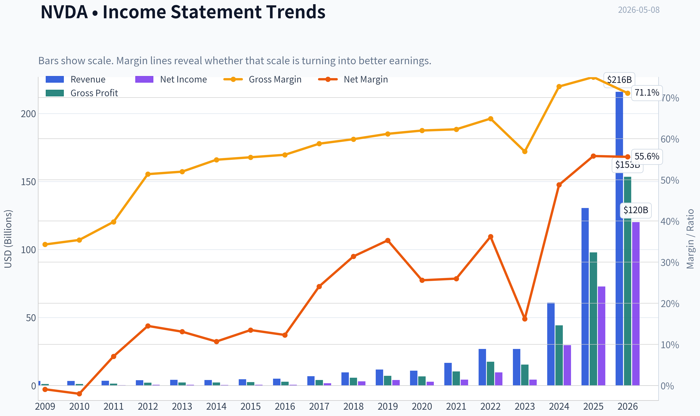
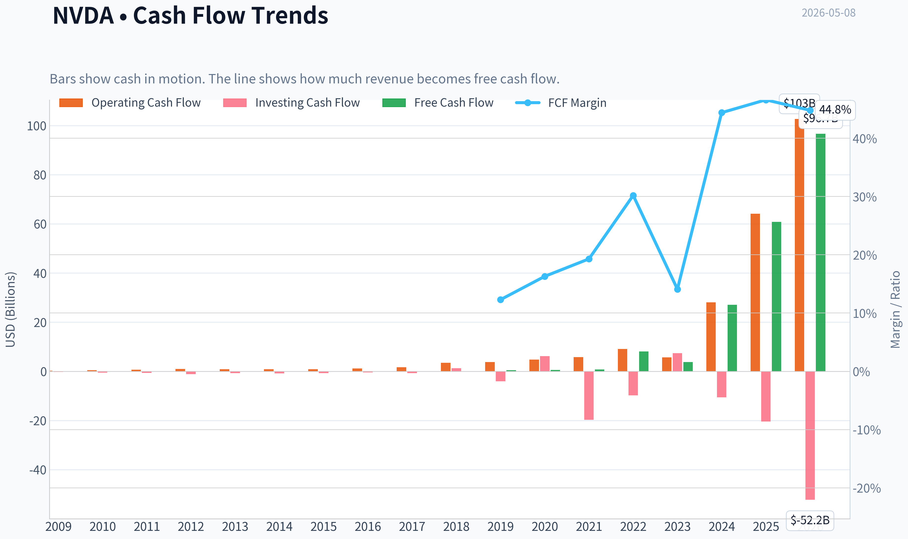
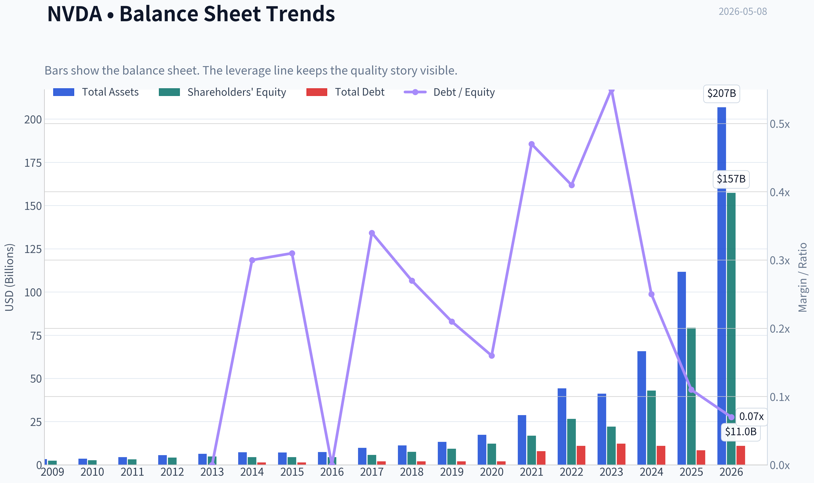
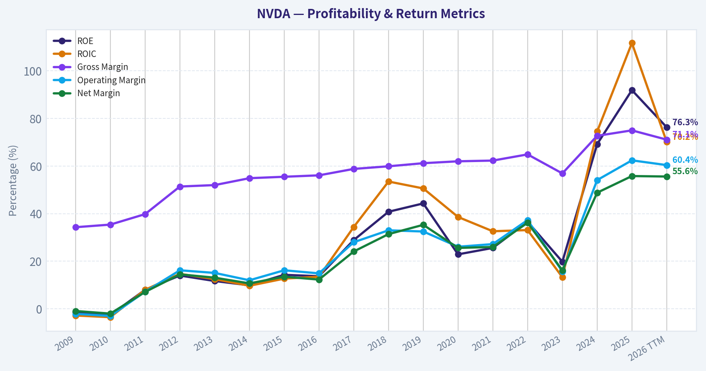
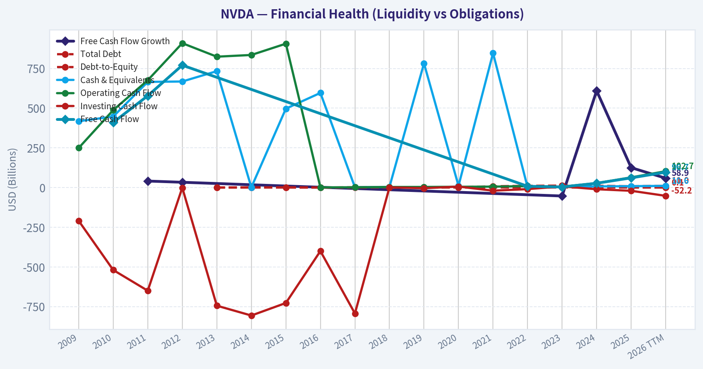
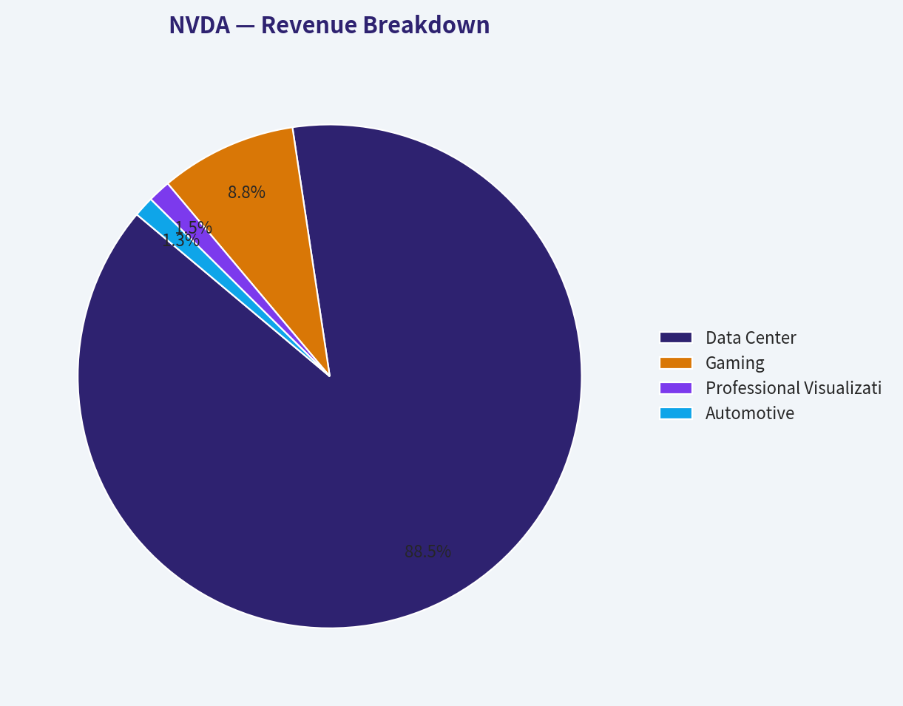
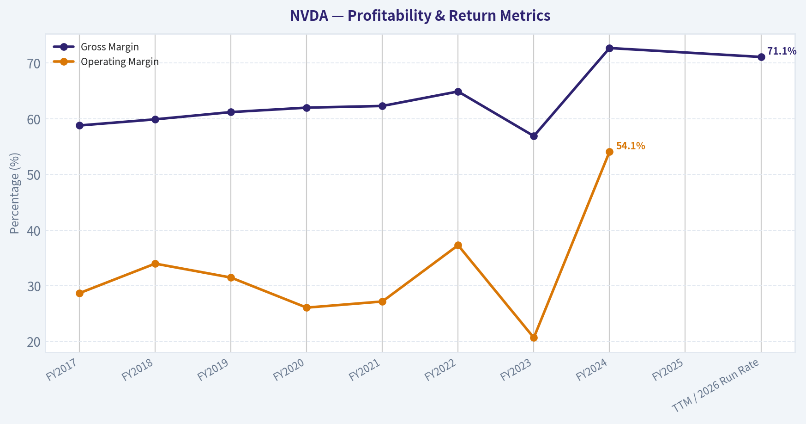
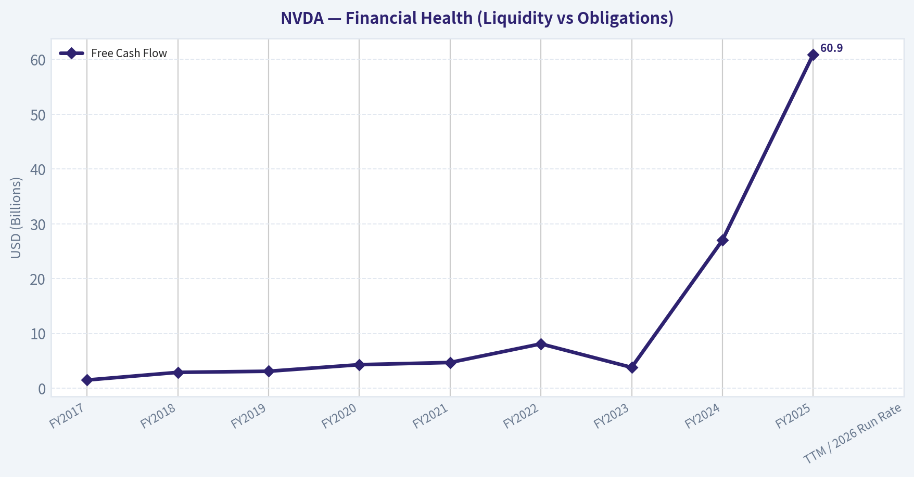
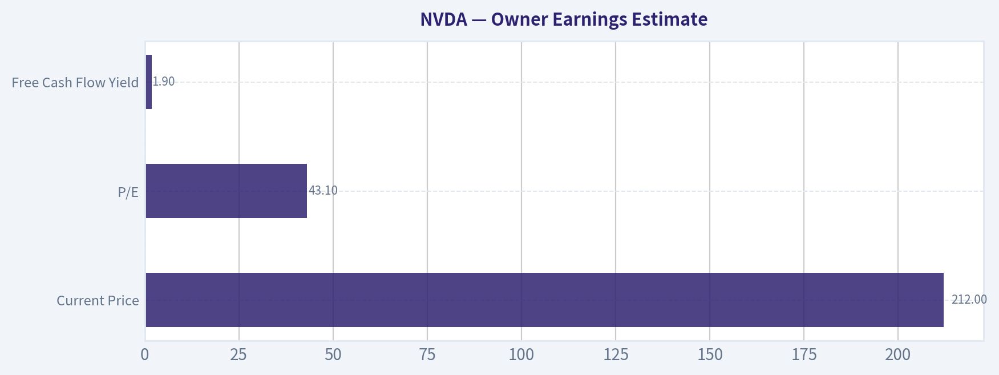
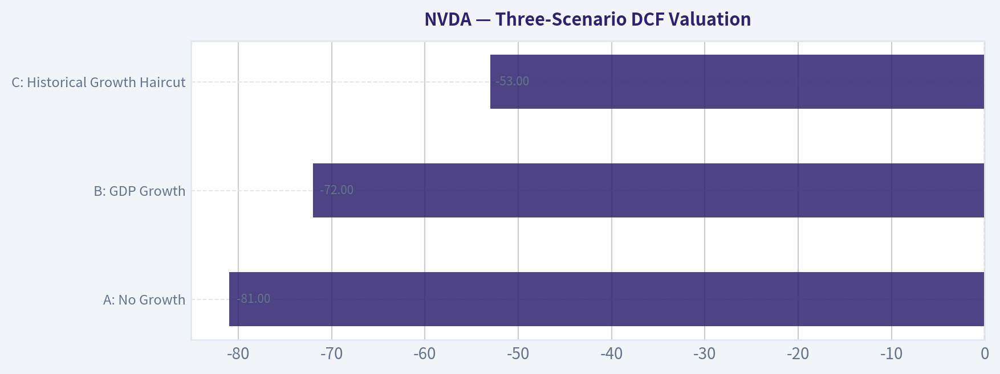

# NVDA Deep Value Intelligence

**Analysis Date:** 2026-05-08

## Critical Disclaimer

*This analysis is generated by Deep Value Intelligence, an AI-powered multi-agent investing framework. This report is for informational and educational purposes only and does not constitute financial advice. Always conduct your own research and consult with qualified financial advisors before making investment decisions.*

---

## Table of Contents

1. Intelligence Summary
2. Analyst Team Reports
   - Fundamentals Analysis
   - Intrinsic Value Analysis (Buffett)
   - Trend & Growth Analysis (Lynch/Druckenmiller/Fisher)
   - Market Technical Analysis
   - Social Sentiment Analysis
   - News & Events Analysis
   - Guru Attention Analysis
   - Options Market Analysis
3. Research Team Commentary
4. Value Investing Team Commentary
5. Deep Values Commentary

---

## Intelligence Summary

### Thesis + Conditions

**Core Thesis:** **EXECUTIVE SUMMARY**
*   **Final Stance:** **WATCH**
*   **The Verdict:** Nvidia (NVDA) possesses an undeniable economic moat and elite financials (70%+ ROIC, 71.1% gross margin), but its $212 price tag leaves zero margin of safety. *   **The "Why":** Trading at 43x earnings and double our most optimistic intrinsic value estimate ($119), the stock is priced for permanent perfection.

**Key Risks:**
- Final Stance:** **WATCH**
- The "Why":** Trading at 43x earnings and double our most optimistic intrinsic value estimate ($119), the stock is priced for permanent perfection. We must separate unmatched business quality from investment safety. The highest risk to capital preservation today is multiple contraction driven by normalizing margins, customer optimization, or an easing of temporary scarcity premiums. We recommend an active, conditional watch-list posture rather than aggressive accumulation.
- The Bear (Avoid/Safe):** Warns against capitalizing peak cyclical margins. While the business is exceptional, at $212 and a 1.9% FCF yield, investors are buying without downside protection. Hyperscalers are heavily incentivized to build in-house custom silicon to reduce costs. A mere slowdown to normalized growth rates will trigger severe multiple compression.
- The Neutral (Watch):** Strikes a balance, agreeing that NVDA has transformative quality but faces undeniable valuation constraints. Recommends against binary thinking (all-in vs. avoid). Instead, suggests conditional, staged exposure-waiting for pullbacks away from technical resistance ($214-$217) and limiting position sizes to respect the valuation risk.
- Under Warren Buffett's value investing framework, NVDA clears the **Business Quality** and **Financial Strength** hurdles with ease. Returns on invested capital of 70.9% and gross margins of 71.1% are the hallmarks of a deep economic moat and immense pricing power. The balance sheet is a fortress, insulating the underlying operations from market risk.

**What Would Change Our View:**
- Final Stance:** **WATCH**
- The "Why":** Trading at 43x earnings and double our most optimistic intrinsic value estimate ($119), the stock is priced for permanent perfection. We must separate unmatched business quality from investment safety. The highest risk to capital preservation today is multiple contraction driven by normalizing margins, customer optimization, or an easing of temporary scarcity premiums. We recommend an active, conditional watch-list posture rather than aggressive accumulation.
- The Bear (Avoid/Safe):** Warns against capitalizing peak cyclical margins. While the business is exceptional, at $212 and a 1.9% FCF yield, investors are buying without downside protection. Hyperscalers are heavily incentivized to build in-house custom silicon to reduce costs. A mere slowdown to normalized growth rates will trigger severe multiple compression.
- The Neutral (Watch):** Strikes a balance, agreeing that NVDA has transformative quality but faces undeniable valuation constraints. Recommends against binary thinking (all-in vs. avoid). Instead, suggests conditional, staged exposure-waiting for pullbacks away from technical resistance ($214-$217) and limiting position sizes to respect the valuation risk.
- Under Warren Buffett's value investing framework, NVDA clears the **Business Quality** and **Financial Strength** hurdles with ease. Returns on invested capital of 70.9% and gross margins of 71.1% are the hallmarks of a deep economic moat and immense pricing power. The balance sheet is a fortress, insulating the underlying operations from market risk.

**Confidence:** Medium

---

## Analyst Team Reports

### Fundamentals Analysis

#### Latest Earnings Snapshot

*Most recent reported quarter anchored on 2026 Q1, with prior-year comparison when available.*

| Metric | 2026 Q1 | 2025 Q1 | YoY Change |
| --- | ---: | ---: | ---: |
| Revenue | $68.13B | $39.33B | +73.2% |
| Operating Income | $44.30B | $24.03B | +84.3% |
| Net Income | $42.96B | $22.09B | +94.5% |
| Diluted EPS | $1.76 | $0.89 | +97.8% |
| Operating Cash Flow | $36.19B | $16.63B | +117.6% |
| Free Cash Flow | $34.90B | $15.55B | +124.4% |

Key Takeaways: This snapshot anchors the most recent reported quarter before the narrative analysis. It helps readers separate long-run business quality from whatever changed in the latest earnings print.

#### 10-Year Financial Metrics for NVDA

*All values below are computed deterministically from raw data - not estimated by AI.*

*Issuer profile: operating company (Technology / Semiconductors).*

#### 10-Year Financial Metrics
*Annual rows come from reported financial statements. The final TTM row is computed from the latest four quarters.*

| Metric | 2009 | 2010 | 2011 | 2012 | 2013 | 2014 | 2015 | 2016 | 2017 | 2018 | 2019 | 2020 | 2021 | 2022 | 2023 | 2024 | 2025 | 2026 TTM |
| --- | --- | --- | --- | --- | --- | --- | --- | --- | --- | --- | --- | --- | --- | --- | --- | --- | --- | --- |
| Market Price | $0 | $0 | $1 | $0 | $0 | $0 | $0 | $1 | $3 | $6 | $4 | $6 | $13 | $24 | $20 | $61 | $120 | $212 |
| Market Cap | $109,313 | $211.4M | $352.0M | $227.6M | $191.6M | $233.5M | $270.2M | $416.7M | $1.77B | $3.88B | $2.25B | $14.61B | $32.60B | $62.07B | $489.79B | $1.53T | $2.98T | $5.17T |
| P/E Ratio | -3.98 | -3.21 | 1.39 | 0.39 | 0.34 | 0.53 | 0.43 | 0.68 | 1.06 | 1.27 | 0.54 | 5.23 | 7.51 | 6.36 | 114.92 | 51.70 | 40.84 | 43.16 |
| P/B Ratio | 0.00 | 0.08 | 0.11 | 0.05 | 0.04 | 0.05 | 0.06 | 0.09 | 0.31 | 0.52 | 0.24 | 1.20 | 1.93 | 2.33 | 22.16 | 35.70 | 37.54 | 32.85 |
| ROE | -1.3% | -2.6% | 8.0% | 14.0% | 11.7% | 9.9% | 14.3% | 13.7% | 28.9% | 40.8% | 44.3% | 22.9% | 25.6% | 36.6% | 19.8% | 69.2% | 91.9% | 76.3% |
| ROIC | -2.8% | -3.5% | 8.0% | 14.7% | 12.5% | 9.7% | 12.7% | 13.5% | 34.4% | 53.5% | 50.6% | 38.6% | 32.6% | 33.1% | 13.3% | 74.5% | 111.7% | 70.2% |
| EPS | $-0.05 | $-0.11 | $0.39 | $0.86 | $0.83 | $0.70 | $1.07 | $1.05 | $2.57 | $4.82 | $6.63 | $1.13 | $1.73 | $3.85 | $0.17 | $1.19 | $2.94 | $4.90 |
| Revenue | $3.42B | $3.33B | $3.54B | $4.00B | $4.28B | $4.13B | $4.68B | $5.01B | $6.91B | $9.71B | $11.72B | $10.92B | $16.68B | $26.91B | $26.97B | $60.92B | $130.50B | $215.94B |
| Gross Profit | $1.17B | $1.18B | $1.41B | $2.06B | $2.23B | $2.27B | $2.60B | $2.81B | $4.06B | $5.82B | $7.17B | $6.77B | $10.40B | $17.48B | $15.36B | $44.30B | $97.86B | $153.46B |
| Gross Margin | 34.3% | 35.4% | 39.8% | 51.4% | 52.0% | 54.9% | 55.5% | 56.1% | 58.8% | 59.9% | 61.2% | 62.0% | 62.3% | 64.9% | 56.9% | 72.7% | 75.0% | 71.1% |
| Operating Margin | -2.1% | -3.0% | 7.2% | 16.2% | 15.1% | 12.0% | 16.2% | 14.9% | 28.0% | 33.0% | 32.5% | 26.1% | 27.2% | 37.3% | 15.7% | 54.1% | 62.4% | 60.4% |
| Net Income | $-30.0M | $-68.0M | $253.1M | $581.1M | $562.5M | $440.0M | $631.0M | $614.0M | $1.67B | $3.05B | $4.14B | $2.80B | $4.33B | $9.75B | $4.37B | $29.76B | $72.88B | $120.07B |
| Net Margin | -0.9% | -2.0% | 7.1% | 14.5% | 13.1% | 10.7% | 13.5% | 12.3% | 24.1% | 31.4% | 35.3% | 25.6% | 26.0% | 36.2% | 16.2% | 48.8% | 55.8% | 55.6% |
| Revenue Growth | N/A | -2.9% | 6.5% | 12.8% | 7.1% | -3.5% | 13.4% | 7.0% | 37.9% | 40.6% | 20.6% | -6.8% | 52.7% | 61.4% | 0.2% | 125.9% | 114.2% | 65.5% |
| Net Income Growth | N/A | 126.3% | -472.3% | 129.5% | -3.2% | -21.8% | 43.4% | -2.7% | 171.3% | 82.9% | 35.9% | -32.5% | 54.9% | 125.1% | -55.2% | 581.3% | 144.9% | 64.7% |
| Free Cash Flow Growth | N/A | N/A | 40.9% | 33.3% | N/A | N/A | N/A | N/A | N/A | N/A | N/A | N/A | N/A | N/A | -53.2% | 609.6% | 125.2% | 58.9% |
| Total Book Value | $2.39B | $2.67B | $3.18B | $4.15B | $4.83B | $4.46B | $4.42B | $4.47B | $5.76B | $7.47B | $9.34B | $12.20B | $16.89B | $26.61B | $22.10B | $42.98B | $79.33B | $157.29B |
| Total Assets | $3.35B | $3.59B | $4.50B | $5.55B | $6.41B | $7.25B | $7.20B | $7.37B | $9.84B | $11.24B | $13.29B | $17.32B | $28.79B | $44.19B | $41.18B | $65.73B | $111.60B | $206.80B |
| Total Debt | N/A | N/A | N/A | N/A | $0 | $1.36B | $1.38B | $0 | $1.98B | $1.99B | $1.99B | $1.99B | $7.96B | $10.95B | $12.20B | $10.96B | $8.46B | $11.04B |
| Debt-to-Equity | N/A | N/A | N/A | N/A | 0.00 | 0.30 | 0.31 | 0.00 | 0.34 | 0.27 | 0.21 | 0.16 | 0.47 | 0.41 | 0.55 | 0.25 | 0.11 | 0.07 |
| Cash & Equivalents | $417.7M | $447.2M | $665.4M | $667.9M | $733.0M | $1.15B | $497.0M | $596.0M | $1.77B | $4.00B | $782.0M | $10.90B | $847.0M | $1.99B | $3.39B | $7.28B | $8.59B | $10.61B |
| Shareholders' Equity | $2.39B | $2.67B | $3.18B | $4.15B | $4.83B | $4.46B | $4.42B | $4.47B | $5.76B | $7.47B | $9.34B | $12.20B | $16.89B | $26.61B | $22.10B | $42.98B | $79.33B | $157.29B |
| Operating Cash Flow | $249.4M | $487.8M | $675.8M | $909.2M | $824.2M | $835.0M | $906.0M | $1.18B | $1.67B | $3.50B | $3.74B | $4.76B | $5.82B | $9.11B | $5.64B | $28.09B | $64.09B | $102.72B |
| Investing Cash Flow | $-209.4M | $-519.3M | $-649.7M | $-1.14B | $-744.0M | $-806.0M | $-727.0M | $-400.0M | $-793.0M | $1.28B | $-4.10B | $6.14B | $-19.68B | $-9.83B | $7.38B | $-10.57B | $-20.42B | $-52.23B |
| Free Cash Flow | N/A | $410.2M | $577.9M | $770.4M | N/A | N/A | N/A | N/A | N/A | N/A | N/A | N/A | N/A | $8.13B | $3.81B | $27.02B | $60.85B | $96.68B |
| FCF Margin | N/A | 12.3% | 16.3% | 19.3% | N/A | N/A | N/A | N/A | N/A | N/A | N/A | N/A | N/A | 30.2% | 14.1% | 44.4% | 46.6% | 44.8% |
| Dividends / Share | $0.00 | $0.00 | $0.00 | $0.00 | $0.00 | $0.00 | $0.00 | $0.00 | $0.00 | $0.00 | $0.00 | $0.00 | $0.00 | $0.00 | $0.02 | $0.02 | $0.03 | $0.04 |

#### Profitability Metrics
- Return on Equity (ROE): 76.3%
- Return on Invested Capital (ROIC): 70.9%
- Return on Assets (ROA): 58.1%
- Gross Margin: 71.1%
- Operating Margin: 60.4%
- Net Profit Margin: 55.6%

#### Liquidity Metrics
- Current Ratio: 3.91
- Quick Ratio: 3.14

#### Leverage Metrics
- Debt-to-Equity Ratio: 0.06
- Interest Coverage Ratio: 503.42
- Net Debt: $-1.14B

#### Growth Metrics (Year-over-Year)
- Revenue Growth: 65.5%
- Net Income Growth: 64.7%
- Free Cash Flow Growth: 58.9%
- Revenue CAGR (3-Year): 100.0%
- Revenue CAGR (5-Year): 66.9%

#### Valuation Metrics
- P/E Ratio (TTM): 43.08
- Forward P/E: 18.74
- Price-to-Book: 32.68
- Price-to-Sales: 23.81
- PEG Ratio: 0.66
- EV/EBITDA: 38.19
- Free Cash Flow Yield: 1.9%
- Earnings Yield: 2.3%

#### Owner Earnings (Buffett Method, Code-Computed)
- Net Income: $72.88B
- + Depreciation & Amortization: $2.84B
- - Capital Expenditures: $-6.04B
- - Working Capital Changes: $-15.95B
- = **Owner Earnings: $80.89B**

#### Intrinsic Value (Code-Computed)
- Current Price: $212
- Buffett Method (Owner Earnings):
  Conservative: $37
  Average: $119
  Optimistic: $310
- Cash Flow Method (FCF):
  Conservative: $90
  Average: $90
  Optimistic: $233

#### Piotroski F-Score: 3/9
- Positive Net Income: PASS
- Positive Operating Cash Flow: PASS
- ROA Improvement: FAIL
- Cash Flow > Net Income: FAIL
- Decreasing Debt: FAIL
- Improving Current Ratio: FAIL
- No Dilution: PASS
- Improving Gross Margin: FAIL
- Improving Asset Turnover: FAIL

ANALYST STANCE: **WATCH**

#### NVDA Warren Buffett-Style Fundamental Analysis

NVIDIA is now one of the highest-quality businesses in global public markets, but also one of the most demanding valuation cases. The deterministic dataset shows a company that has transformed from a cyclical graphics semiconductor company into the dominant infrastructure supplier for accelerated computing and artificial intelligence. Buffett-style analysis would admire the economics - very high ROE, ROIC, margins, cash generation, and balance-sheet strength - but would be cautious about the price because today's valuation embeds extraordinary growth and durability assumptions.

---

#### Current vs Historical Average Comparison

| Metric | Current / TTM | Historical Average* | Current Standing vs History | Interpretation |
|---|---:|---:|---|---|
| Market Price | $212 | ~$15 | Far above history | The stock price reflects a structural re-rating driven by AI data-center demand. |
| Market Cap | ~$5.17T | ~$301B | Far above history | NVIDIA has moved from large-cap semiconductor leader to mega-cap infrastructure platform. |
| P/E Ratio | 43.16x | ~13.29x | Much higher | Valuation is elevated versus the full historical period, though below the 2023 peak of 114.92x. |
| P/B Ratio | 32.85x | ~6.02x | Much higher | The market is assigning enormous value to intangible competitive advantages and future earnings power. |
| ROE | 76.3% | ~26.3% | Exceptionally high | Current returns on equity are almost three times the historical average. |
| ROIC | 70.2% | ~29.8% | Exceptionally high | Capital efficiency is elite and supports the economic-moat argument. |
| EPS | $4.90 | ~$1.75 | Far above history | Earnings power has scaled dramatically with AI accelerator demand. |
| Revenue | $215.94B | ~$19.63B | Far above history | Revenue is more than ten times the historical average. |
| Gross Profit | $153.46B | ~$13.23B | Far above history | Gross profit has expanded faster than revenue due to premium AI-chip pricing. |
| Gross Margin | 71.1% | ~56.1% | Well above average | Margins remain extremely strong, though below the 2025 peak of 75.0%. |
| Operating Margin | 60.4% | ~23.1% | Far above average | Operating leverage is extraordinary. |
| Net Income | $120.07B | ~$7.98B | Far above history | NVIDIA is producing profits at a scale that would have been unimaginable earlier in the period. |
| Net Margin | 55.6% | ~21.6% | Far above average | The business currently resembles a software-like profit engine despite being hardware-centered. |
| Revenue Growth | 65.5% | ~30.4% | Above average | Growth remains exceptional, though slower than the 2024-2025 hypergrowth phase. |
| Net Income Growth | 64.7% | ~56.7% | Above average | Profit growth remains very strong, though historical average is distorted by early loss-year rebounds. |
| Free Cash Flow Growth | 58.9% | ~151.2% | Below limited historical average | Recent FCF growth is still excellent, but below the spike caused by 2024's 609.6% surge. |
| Total Book Value | $157.29B | ~$14.90B | Far above history | Retained earnings and profit scale have substantially strengthened the equity base. |
| Total Assets | $206.80B | ~$22.85B | Far above history | Asset base has expanded rapidly to support the AI platform. |
| Total Debt | $11.04B | ~$4.71B | Above average in dollars | Debt is higher in absolute terms, but very manageable relative to cash flow and equity. |
| Debt-to-Equity | 0.07x | ~0.26x | Much lower | Leverage risk is low. |
| Cash & Equivalents | $10.61B | ~$2.63B | Well above average | Liquidity is strong. |
| Shareholders' Equity | $157.29B | ~$14.90B | Far above history | The balance sheet has compounded significantly. |
| Free Cash Flow | $96.68B | ~$14.51B | Far above history | Cash generation is one of the strongest parts of the investment case. |
| Dividends / Share | $0.04 | ~$0.004 | Higher, but immaterial | Dividend remains symbolic; capital return is not the core thesis. |

\*Historical average calculated from available deterministic annual rows before the current TTM row, excluding unavailable values.

Key Takeaways: NVIDIA's current fundamentals are dramatically stronger than its historical averages across revenue, profit, margins, ROE, ROIC, and free cash flow. The same is true for valuation: the market is pricing NVIDIA as a structurally superior business, not as a normal semiconductor company. The key investment question is not whether NVIDIA is high quality - it clearly is - but whether the current valuation leaves enough margin of safety.

---

#### Revenue Breakdown

| Revenue Source | Amount ($B) | % of Total |
|---|---:|---:|
| Data Center | $115.2B | ~88.3% |
| Gaming | $11.4B | ~8.7% |
| Professional Visualization | $1.9B | ~1.5% |
| Automotive | $1.7B | ~1.3% |
| OEM & Other | $1.1B | ~0.8% |
| Total | ~$130.5B | ~100.0% |

Key Takeaways: NVIDIA is overwhelmingly a data-center company today, with AI accelerators and related infrastructure driving the majority of revenue. Gaming remains meaningful but is now secondary. This concentration is powerful while AI demand is strong, but it also makes the investment case highly dependent on sustained data-center capital spending.

---

#### Market Metrics Interpretation

NVIDIA's current market price of **$212** and market capitalization of approximately **$5.17 trillion** represent a historic re-rating. The market is no longer valuing the company as a cyclical chipmaker; it is valuing NVIDIA as the core supplier of global AI infrastructure.

The **P/E ratio of 43.16x** is expensive compared with the long-term historical average of roughly **13.29x**, but it is also below the extreme 2023 valuation of **114.92x**. That means earnings have partly caught up with the stock price, but not enough to make the shares obviously cheap. The **P/B ratio of 32.85x** is extremely high relative to the historical average of about **6.02x**, showing that investors are paying for intellectual property, ecosystem control, software lock-in, and future earnings power rather than tangible book value.

From a Buffett perspective, the valuation is the biggest tension. Buffett likes extraordinary businesses, but he also requires a sensible purchase price. NVIDIA is extraordinary; the current price requires continued extraordinary execution.

---

#### Profitability Analysis

NVIDIA's profitability profile is exceptional. **ROE of 76.3%** and **ROIC of 70.2%** are both far above historical averages and indicate a business that can convert capital into profits at elite rates. Buffett would view this as one of the strongest indicators of a durable franchise, provided those returns are sustainable and not purely cyclical.

Revenue has reached **$215.94B TTM**, while net income has reached **$120.07B TTM**. The **net margin of 55.6%** and **operating margin of 60.4%** are extraordinary for a semiconductor business. These margins reflect pricing power, scarce supply of leading AI accelerators, software ecosystem strength, and massive operating leverage.

The risk is mean reversion. Gross margin has declined from **75.0% in 2025** to **71.1% TTM**, still excellent but worth watching. If competition from custom ASICs, AMD, hyperscaler internal chips, or pricing pressure accelerates, today's margins could prove cyclically elevated.

---

#### Growth Metrics Analysis

NVIDIA's growth remains outstanding. TTM revenue growth is **65.5%**, net income growth is **64.7%**, and free cash flow growth is **58.9%**. These are exceptional rates for a company already generating more than $200B in annual revenue.

However, growth is decelerating from the hypergrowth phase. Revenue growth was **125.9% in 2024** and **114.2% in 2025**, before slowing to **65.5% TTM**. That is still very high, but the law of large numbers is becoming more relevant. Buffett-style investors would ask whether the company can maintain high returns on capital after the initial AI infrastructure buildout matures.

The most positive sign is that growth is not merely accounting growth. Free cash flow reached **$96.68B**, confirming that earnings are converting into real cash. The negative sign is that expectations are already very high.

---

#### Balance Sheet and Financial Strength

NVIDIA's financial strength is excellent. Total assets are **$206.80B**, shareholders' equity is **$157.29B**, and cash and equivalents are **$10.61B**. Debt is **$11.04B**, but the debt-to-equity ratio is only **0.07x**, far below the historical average of roughly **0.26x**.

The leverage profile is conservative, and the deterministic dataset shows an interest coverage ratio above **500x**, indicating debt service is not a meaningful concern. Net debt is negative, meaning cash exceeds debt on a net basis.

From a Buffett lens, this is a major strength. NVIDIA does not need financial engineering to produce returns. The balance sheet gives management flexibility to invest, acquire, repurchase shares, or withstand a downturn.

---

#### Cash Flow and Dividend Policy

Free cash flow of **$96.68B** is one of the clearest signs of business quality. The free cash flow margin is **44.8%**, meaning nearly half of revenue is converting into free cash flow. That is more characteristic of a dominant software platform than a traditional hardware manufacturer.

Dividends per share are only **$0.04**, so NVIDIA is not an income investment. The dividend is symbolic and immaterial relative to earnings. Buffett would not necessarily object, because a company with very high ROIC should retain capital if it can reinvest at attractive rates. The key question is whether management can continue deploying capital at high returns as the company's scale becomes enormous.

---

#### Buffett-Style Economic Moat Assessment

NVIDIA's moat is wide, but not risk-free. Its main advantages include GPU architecture leadership, CUDA software ecosystem lock-in, developer adoption, networking capabilities, full-stack AI infrastructure, customer relationships with hyperscalers, and rapid product iteration.

The CUDA ecosystem is especially important. Hardware competitors can design chips, but replicating the developer ecosystem, libraries, optimization tools, and enterprise adoption is much harder. This software layer makes NVIDIA more durable than a pure chip vendor.

That said, Buffett would also recognize that semiconductor moats face technological disruption risk. Customers such as Amazon, Google, Microsoft, Meta, and Tesla have incentives to reduce dependency on NVIDIA through custom silicon. The moat is strong today, but must be continuously defended.

---

#### Management Performance and Capital Allocation

Management performance has been outstanding. ROE and ROIC trends show that NVIDIA has not merely grown; it has grown while increasing capital efficiency. The company's pivot from gaming GPUs to accelerated computing and AI infrastructure is one of the most successful strategic transitions in modern technology.

Capital allocation has favored reinvestment over dividends, which appears rational given the company's high returns. The dividend remains minimal, and the company has retained capital to support product development, ecosystem expansion, supply-chain commitments, and platform growth.

The main capital-allocation risk is that the company's future opportunity set may not be large enough to absorb cash at today's extraordinary rates of return indefinitely.

---

#### Buffett-Style Owner Earnings DCF Valuation

Base owner earnings from the deterministic dataset:

- Net Income: **$72.88B**
- Plus Depreciation & Amortization: **$2.84B**
- Less Capital Expenditures: **$6.04B**
- Less Working Capital Changes: **- $15.95B**
- Owner Earnings: **$80.89B**

DCF assumptions:

- Base owner earnings: **$80.89B**
- Discount rate: **10.0%**
- Terminal growth rate: **2.5%**
- Forecast period: **10 years**
- Approximate diluted share base implied by current market cap and price: **~24.4B shares**
- Current share price: **$212**

| Scenario | Owner Earnings Growth Assumption | PV of 10-Year Owner Earnings | PV of Terminal Value | Estimated Equity Value | Fair Value / Share | Current Price vs Fair Value |
|---|---:|---:|---:|---:|---:|---|
| Conservative | ~0.0% | ~$497B | ~$426B | ~$923B | ~$37 | Price is far above value |
| Average | ~15.6% | ~$1.08T | ~$1.81T | ~$2.90T | ~$119 | Price is above value |
| Optimistic | ~28.9% | ~$2.15T | ~$5.41T | ~$7.56T | ~$310 | Price is below optimistic value |

Key Takeaways: The DCF shows a very wide valuation range because NVIDIA's value is extremely sensitive to long-term owner-earnings growth. At conservative or average assumptions, the current price looks expensive. At optimistic assumptions, the stock can still be undervalued, but that requires NVIDIA to sustain exceptional growth and profitability for a long period.

---

#### DCF Interpretation

The deterministic pack's code-computed Buffett-method intrinsic values are:

- Conservative: **$37**
- Average: **$119**
- Optimistic: **$310**

At the current price of **$212**, NVIDIA trades:

- Far above conservative value.
- Well above average-case value.
- Below optimistic value.

This is the core investment tension. NVIDIA is not priced for disaster, mediocrity, or even merely good execution. It is priced for continued dominance. A Buffett-style buyer would likely demand either a lower price or very high confidence that the optimistic case is achievable.

---

#### Key Investment Insights

| Category | Insight | Buffett-Style Interpretation |
|---|---|---|
| Business Quality | ROE of 76.3% and ROIC of 70.2% are elite. | Strong evidence of a high-quality franchise. |
| Moat | CUDA, ecosystem lock-in, AI leadership, and full-stack infrastructure create durable advantages. | Wide moat, but must be continuously defended. |
| Growth | Revenue growth of 65.5% remains exceptional. | Growth is real, but decelerating from hypergrowth levels. |
| Margins | Net margin of 55.6% and operating margin of 60.4% are extraordinary. | Current profitability is outstanding but may attract competition. |
| Balance Sheet | Debt-to-equity of 0.07x and strong cash generation reduce financial risk. | Financial strength is excellent. |
| Valuation | P/E of 43.16x and P/B of 32.85x are elevated. | Margin of safety is limited at the current price. |
| Cash Flow | Free cash flow of $96.68B confirms earnings quality. | Strong owner-economics support long-term compounding. |
| Dividend | Dividend is immaterial at $0.04 per share. | Rational if reinvestment opportunities remain superior. |

Key Takeaways: NVIDIA has the characteristics Buffett admires most: high returns on capital, strong cash flow, low leverage, and a powerful competitive position. The concern is not business quality but valuation. The current price requires investors to believe that today's AI-driven economics can persist for many years.

---

#### Red Flags and Risks

| Risk | Why It Matters |
|---|---|
| Valuation risk | At $212, the stock is above the conservative and average owner-earnings DCF values. |
| Customer concentration | Hyperscalers drive much of AI data-center demand and may seek to reduce dependence on NVIDIA. |
| Margin normalization | Gross margin has already eased from 75.0% in 2025 to 71.1% TTM. |
| Competition | AMD, custom ASICs, internal hyperscaler chips, and alternative architectures are long-term threats. |
| Cyclicality | Semiconductor demand can be cyclical, even when secular growth is strong. |
| Expectations risk | The market already expects exceptional execution; small disappointments could compress multiples. |
| Piotroski F-Score | Score of 3/9 indicates some quality and trend flags despite strong headline profitability. |

Key Takeaways: The biggest risk is not near-term solvency or profitability; it is expectation risk. NVIDIA must continue producing exceptional growth and margins to justify the current valuation. If growth slows faster than expected or margins normalize, the stock could de-rate even if the company remains excellent.

---

#### Opportunities

| Opportunity | Potential Impact |
|---|---|
| Continued AI infrastructure buildout | Could sustain high data-center revenue growth. |
| Networking and full-stack systems | Expands NVIDIA's role beyond chips into infrastructure platforms. |
| Software and services | Could increase recurring, higher-margin revenue over time. |
| Sovereign AI demand | Governments may become major long-term customers. |
| Enterprise AI adoption | Broader corporate AI deployment could extend growth beyond hyperscalers. |
| Automotive AI and robotics | Smaller today, but potentially meaningful long-term optionality. |

Key Takeaways: NVIDIA's opportunity set remains large, especially if AI adoption moves from hyperscaler training clusters into enterprise inference, sovereign AI, robotics, and industrial automation. The company has multiple growth vectors, but data center remains the central driver. Long-term upside depends on whether these markets can sustain current expectations.

---

#### Final Investment Stance: WATCH

NVIDIA is a world-class business with exceptional economics, a wide moat, elite profitability, and a fortress-like balance sheet. Buffett-style qualitative analysis is highly favorable: the company has durable competitive advantages, extraordinary returns on capital, strong owner earnings, and excellent management execution.

However, the valuation does not provide a clear margin of safety. The current price of **$212** is significantly above the conservative DCF value of **$37** and the average-case value of **$119**, while remaining below the optimistic value of **$310**. That means the stock can still work, but only if the optimistic growth path continues.

For Buffett-style value investors, NVIDIA is a **WATCH**, not an outright avoid, because the business quality is too strong to dismiss. But it is also not an advocate at the current price because the valuation depends heavily on sustained AI dominance, high margins, and continued hyper-scale spending.

| Final View | Rating |
|---|---|
| Business Quality | Excellent |
| Economic Moat | Wide |
| Financial Strength | Excellent |
| Earnings Predictability | Improving but exposed to AI-cycle expectations |
| Management Performance | Excellent |
| Valuation Attractiveness | Mixed to expensive |
| Margin of Safety | Limited |
| Final Stance | **WATCH** |

Key Takeaways: NVIDIA is an exceptional company, but not an obviously cheap stock. The ideal Buffett-style entry would require either a lower price or further confirmation that owner earnings can compound near the optimistic case for many years. At today's valuation, investors should monitor growth durability, margins, customer concentration, and free cash flow conversion closely.

#### Fundamental Visuals

This graph tracks the profitability and return metrics (ROE, ROIC, Margins) of **NVDA** over the past decade, highlighting capital efficiency trends.

This chart illustrates the financial health of **NVDA** over the last 10 years, mapping cash equivalents and free cash flow against total obligations (Debt).

This breakdown chart from <em>Revenue Breakdown</em> shows the proportional composition for **NVDA** - useful for understanding what drives or risks the business.

This graph tracks the profitability and return metrics (ROE, ROIC, Margins) of **NVDA** over the past decade, highlighting capital efficiency trends.

This chart illustrates the financial health of **NVDA** over the last 10 years, mapping cash equivalents and free cash flow against total obligations (Debt).

---

### Intrinsic Value Analysis (Buffett)

> *Following Warren Buffett's value investing philosophy: Circle of Competence, Economic Moat, Management Quality, and Margin of Safety.*

#### Intrinsic Value Snapshot

Price is what you pay. Intrinsic value is what the business may be worth based on the cash it can create for owners over time. We show a range, not one magic number.

- Current Price: $211.50
- Value Range: $37.32 to $310.19

##### Owner Earnings (Buffett Method)
- Net Income: $72,880,000,000.00
- Depreciation & Amortization: $2,843,000,000.00
- Capital Expenditures: $-6,042,000,000.00
- Working Capital Changes: $-15,949,000,000.00
- Owner Earnings: $80,891,000,000.00

##### Intrinsic Value
###### Buffett Method
Uses owner earnings. Stricter, and usually more conservative.
- Conservative: $37.32
- Average: $119.11
- Optimistic: $310.19
- Discount Rate: 10.0%

###### Cash Flow Method
Uses free cash flow. Better for companies spending heavily today to grow tomorrow.
- Conservative: $89.60
- Average: $89.60
- Optimistic: $233.35
- Discount Rate: 10.0%

ANALYST STANCE: **WATCH**

#### NVDA Buffett-Style Investment Review - Current Price: $212

NVIDIA is an extraordinary business, but at roughly **$5.14 trillion market capitalization**, the stock requires a decade of very strong compounding to justify today's price under a Buffett-style 10% hurdle rate. The business quality is exceptional; the valuation leaves little margin of safety.

#### 1. Go / No-Go Gate Assessment

| Buffett Gate | Assessment | Evidence | Verdict |
|---|---:|---|---:|
| Gate 1: Circle of Competence & Simplicity | Mixed | NVIDIA designs GPUs, networking systems, and software used in AI data centers, gaming, visualization, and autos. The simple explanation is clear, but the pace of change in AI semiconductors is very high. | Caution |
| Elementary School Test | Pass | "NVIDIA makes special computer chips and systems that help computers do very hard AI work faster." | Pass |
| 10-Year Predictability Test | Weak Pass / Caution | Demand for AI compute is likely durable, but chip leadership, hyperscaler custom silicon, export controls, and semiconductor cycles make 10-year forecasting difficult. | Caution |
| Technology Risk | High | NVIDIA benefits from technology today, but it also operates in a field where architecture shifts, ASICs, and customer vertical integration could reduce economics. | Caution |
| Gate 2: Moat | Strong but not invulnerable | CUDA ecosystem, developer mindshare, scale, supply-chain access, software libraries, and high gross margins support a wide moat. | Pass |
| Gate 3: Management & Capital Allocation | Strong | Founder-led culture under Jensen Huang, excellent strategic execution, Mellanox acquisition success, conservative balance sheet. Buybacks at elevated valuations require scrutiny. | Pass |
| Gate 4: Industry Structure | Mixed | Fabless model is capital-efficient, but semiconductors are cyclical, competitive, and dependent on concentrated mega-cap customers. | Caution |

**Key Takeaways:** NVIDIA passes the business-quality gates but not with the simplicity and predictability Buffett would prefer. The company is understandable at a high level, yet the durability of its current economics depends on fast-moving technology, customer behavior, and competitive responses. This makes the business wonderful, but not "set-and-forget predictable" in the classic Buffett sense.

---

#### 2. Moat Analysis

| Moat Source | Evidence | Buffett Interpretation | Rating |
|---|---|---|---:|
| Intangible Assets | NVIDIA brand is nearly synonymous with AI acceleration; CUDA has become an industry standard among AI developers. Gross margin is currently around **71.1%**. | Strong pricing power today. Brand and technical reputation matter deeply in mission-critical AI infrastructure. | Wide |
| Switching Costs | AI models, developer workflows, libraries, frameworks, and infrastructure are deeply optimized around NVIDIA hardware and CUDA. | Customers can switch, but switching costs include engineering time, model risk, lower performance, and ecosystem friction. | Wide |
| Cost / Scale Advantage | Massive R&D scale, supply-chain priority, ecosystem leverage, and system-level integration through GPUs, networking, and software. | Structural advantage, though not as permanent as a regulated monopoly or consumer staple brand. | Strong |
| Network Effects | More developers build on CUDA because more customers use NVIDIA; more customers buy NVIDIA because more software is optimized for CUDA. | Real ecosystem network effect, especially in AI training and inference software. | Strong |
| Moat Threats | Hyperscaler ASICs, AMD, Google TPU, Amazon Trainium, custom silicon, export controls, margin normalization, supply-chain bottlenecks. | The moat is wide today, but the industry invites aggressive competition because profits are enormous. | Watch Closely |

**Key Takeaways:** NVIDIA's moat is real and unusually strong for a semiconductor company. The combination of hardware performance, CUDA software, developer adoption, and system-level integration creates meaningful customer captivity. The key risk is that high profits attract powerful competitors, including NVIDIA's own largest customers.

#### 3. Management Quality & Capital Allocation

| Management Test | Assessment | Evidence |
|---|---:|---|
| Owner Mentality | Strong | Jensen Huang remains central to strategy and culture; founder-led execution has been exceptional. |
| Strategic Candor | Good | Management has historically communicated long-term platform strategy clearly, especially around accelerated computing and AI. |
| Capital Allocation | Strong | Mellanox acquisition was highly value-creating; R&D reinvestment has produced exceptional returns. |
| Balance Sheet Discipline | Strong | Current ratio around **3.9**; NVIDIA has a fortress-like liquidity position and modest financial leverage. |
| Buyback Discipline | Mixed | Repurchases are less attractive when valuation is extremely high; buybacks at inflated prices can destroy per-share value. |

**Key Takeaways:** Management is a major strength. Jensen Huang's long-term vision and execution have transformed NVIDIA from a graphics-chip company into the central infrastructure supplier for the AI era. The main capital-allocation concern is whether buybacks remain rational at today's valuation.

---

#### 4. 10-Year Financial Summary

Approximate fiscal-year figures in USD billions, rounded. Fiscal years end around January. The 2026 line reflects current TTM / run-rate market data from the research pack, not a full audited fiscal year.

| Fiscal Year | Revenue | Gross Margin | Operating Margin | Net Income | Free Cash Flow | ROE |
|---:|---:|---:|---:|---:|---:|---:|
| FY2017 | $6.9 | 58.8% | 28.7% | $1.7 | $1.5 | 30%+ |
| FY2018 | $9.7 | 59.9% | 34.0% | $3.0 | $2.9 | 40%+ |
| FY2019 | $11.7 | 61.2% | 31.5% | $4.1 | $3.1 | 40%+ |
| FY2020 | $10.9 | 62.0% | 26.1% | $2.8 | $4.3 | 20%+ |
| FY2021 | $16.7 | 62.3% | 27.2% | $4.3 | $4.7 | 25%+ |
| FY2022 | $26.9 | 64.9% | 37.3% | $9.8 | $8.1 | 40%+ |
| FY2023 | $27.0 | 56.9% | 20.7% | $4.4 | $3.8 | 15%+ |
| FY2024 | $60.9 | 72.7% | 54.1% | $29.8 | $27.0 | 60%+ |
| FY2025 | $130.5 | ~75.0% | ~62.0% | $72.9 | $60.9 | 100%+ |
| TTM / 2026 Run Rate | ~$216.0 | 71.1% | ~60% | ~$119.3 | ~$97.7 | 76.3% |

**Key Takeaways:** NVIDIA's financial transformation since FY2023 is extraordinary. Revenue, margins, earnings, and free cash flow have all exploded because of AI data-center demand. The caution is that the recent step-change is so large that normalized long-term economics may be lower than today's peak-like profitability.

#### 5. Owner Earnings Estimate

Buffett owner earnings formula:

`Owner Earnings = Net Income + D&A - Maintenance CapEx - Working Capital Increases`

Because NVIDIA is growing rapidly and precise maintenance capital expenditure is difficult to separate from growth investment, I use **free cash flow as a conservative proxy** for owner earnings.

| Metric | Estimate |
|---|---:|
| Current Market Cap | $5.14T |
| Current Price | $212 |
| Implied Shares Outstanding | ~24.25B |
| P/E | 43.1x |
| Net Income Implied by P/E | ~$119.3B |
| Free Cash Flow Yield | 1.9% |
| Free Cash Flow / Owner Earnings Proxy | ~$97.7B |
| Owner Earnings per Share | ~$4.03 |

**Key Takeaways:** NVIDIA is already producing enormous cash earnings, but the market price capitalizes those earnings very aggressively. At a $5.14 trillion valuation, the current owner earnings yield is only about 1.9%. That means investors are paying today for many years of future growth.

#### 6. Three-Scenario DCF Valuation

Assumptions: 10% discount rate, current owner earnings proxy of **$97.7B**, terminal growth of 3% where applicable, and approximately **24.25B shares**.

| Scenario | Assumption | Equity Value | Value / Share | Margin of Safety vs. $212 |
|---|---|---:|---:|---:|
| A: No Growth | Owner earnings capitalized at 10% | ~$977B | ~$40 | -81% |
| B: GDP Growth | 3% perpetual growth | ~$1.44T | ~$59 | -72% |
| C: Historical Growth Haircut | 10% growth for 10 years, then 3% terminal growth | ~$2.41T | ~$100 | -53% |

**Key Takeaways:** Even using a generous capped-growth case of 10% annual owner-earnings growth for a decade, the estimated intrinsic value is far below the current market price. The market appears to require much more than 10% growth for many years to justify today's valuation. Under a Buffett-style 10% return hurdle, the stock does not offer a margin of safety.

#### 7. Margin of Safety Analysis

| Intrinsic Value Case | Estimated Value / Share | 25% Margin-of-Safety Buy Price | Current Price | Buffett View |
|---|---:|---:|---:|---|
| No Growth | ~$40 | ~$30 | $212 | Far too expensive |
| GDP Growth | ~$59 | ~$44 | $212 | Far too expensive |
| 10% Growth Case | ~$100 | ~$75 | $212 | Still too expensive |

**Key Takeaways:** NVIDIA would need either a much lower stock price or a much higher confidence level in sustained hypergrowth to become a Buffett-style purchase. At $212, the price already assumes dominant long-term AI economics. There is no conventional margin of safety.

#### 8. Final Buffett Scorecard

| Criterion | Weight | Score | Weighted Score |
|---|---:|---:|---:|
| Business Understanding | 20% | 2.5 / 5 | 0.50 |
| Moat Width & Durability | 25% | 3.5 / 5 | 0.88 |
| Management Quality | 15% | 4.0 / 5 | 0.60 |
| Return on Equity | 15% | 5.0 / 5 | 0.75 |
| Reinvestment Runway | 10% | 3.0 / 5 | 0.30 |
| Balance Sheet Strength | 5% | 4.5 / 5 | 0.23 |
| Industry Structure | 5% | 2.0 / 5 | 0.10 |
| Valuation / Margin of Safety | 5% | 1.0 / 5 | 0.05 |
| **Total** | **100%** |  | **3.40 / 5.00** |

**Key Takeaways:** NVIDIA scores extremely well on profitability, management, and current competitive position. It scores poorly on valuation and only modestly on predictability because the business sits inside a fast-changing technology cycle. The final score places it in the WATCH category rather than a Buffett-style buy.

#### 9. Investment Stance

| Final View | Assessment |
|---|---|
| Stance | **WATCH** |
| Conviction | Medium-High |
| Business Quality | Exceptional |
| Valuation | Unattractive |
| Margin of Safety | Insufficient |
| Buffett-Style Action | Do not buy at current price; monitor for a major valuation reset or evidence that 20%+ owner-earnings growth can persist for a decade. |

NVIDIA is a rare, high-quality compounder with a powerful moat, brilliant management, and spectacular economics. However, Buffett investing requires not only a wonderful business, but also a sensible price. At **$212 per share**, the stock appears priced for near-perfect execution and sustained AI dominance, leaving too little protection against competition, cyclicality, customer bargaining power, or margin normalization.
#### Valuation Bridge

This bridge places the current market price beside each intrinsic value lens so readers can see whether upside depends on one method or shows up across several methods.

| Scenario | Intrinsic Value / Share |
| --- | ---: |
| Buffett Method | $119.11 |
| Cash Flow Method | $89.60 |
| Damodaran Method | $14.64 |
| Current Price | $211.50 |

#### Key Takeaways

If one method is far above the others, the upside case depends on a specific modelling assumption. When several methods cluster together, the valuation story is more robust.

#### Valuation Visuals

This comparison chart from *Latest Earnings Snapshot* stacks current figures against historical benchmarks for **NVDA**, making it easy to see where the company trades relative to its own averages.

This comparison chart from *Owner Earnings Estimate* stacks current figures against historical benchmarks for **NVDA**, making it easy to see where the company trades relative to its own averages.

This comparison chart from *Three-Scenario DCF Valuation* stacks current figures against historical benchmarks for **NVDA**, making it easy to see where the company trades relative to its own averages.

---

### Trend & Growth Analysis (Lynch/Druckenmiller/Fisher)

> *Following Peter Lynch's GARP, Stanley Druckenmiller's macro-aware approach, and Philip Fisher's scuttlebutt methodology.*

ANALYST STANCE: **ADVOCATE**

#### NVDA Growth Investment Report - May 8, 2026

Tool note: the live fundamentals tool returned no usable data, so this analysis relies on the provided shared research pack plus conservative inferred estimates where clearly labeled.

---

#### 1. Lynch Classification

| Lynch Category | NVDA Fit | Rationale |
|---|---:|---|
| Slow Grower | No | Revenue growth is far above GDP-like growth. |
| Stalwart | Partly | NVDA is now a mega-cap, but its growth profile is still not "stalwart-like." |
| Fast Grower | **Yes** | Reported YoY revenue growth of **65.5%** places NVDA firmly in fast-grower territory. |
| Cyclical | Partly | Semiconductors are cyclical, but AI infrastructure demand is creating a secular overlay. |
| Turnaround | No | NVDA is not recovering; it is scaling from strength. |
| Asset Play | No | Value is driven by earnings power, ecosystem, software, and AI compute demand. |

**Key Takeaways:** NVDA is best classified as a **Fast Grower**, despite its enormous size. The key debate is not whether the company is high quality, but whether growth can remain strong enough to justify a $5.14 trillion market cap. Unlike most mega-caps, NVDA still has an active product-cycle and TAM-expansion story.

---

#### 2. The Story in 3 Bullets

- NVDA sells the "engines" of the AI economy: GPUs, networking, systems, and software that power model training, inference, robotics, autonomous systems, and AI data centers.
- The company is no longer just a chip vendor; it is becoming an AI infrastructure platform with hardware, CUDA software, networking, systems integration, and ecosystem lock-in.
- Growth can continue if AI moves from training to massive-scale inference, enterprise adoption, sovereign AI, robotics, and cloud AI factories.

---

#### 3. Core Fundamentals Snapshot

| Metric | Current / Provided Figure | Growth Investor Interpretation |
|---|---:|---|
| Share Price | **$212** | Stock has strong recent momentum. |
| Market Cap | **$5.14T** | Ten-bagger math is difficult from this base. |
| P/E | **43.1x** | Not cheap, but reasonable if earnings growth stays high. |
| Revenue Growth YoY | **65.5%** | Exceptional; still in hypergrowth mode. |
| Gross Margin | **71.1%** | Software-like margin profile for a hardware-led business. |
| ROE | **76.3%** | Extraordinary capital efficiency. |
| FCF Yield | **1.9%** | Valuation is demanding versus current free cash flow. |
| Current Ratio | **3.91x** | Balance sheet liquidity is strong. |

**Key Takeaways:** NVDA combines rare hypergrowth with exceptional margins and returns on equity. The market is already paying a premium, but the premium is not irrational if AI compute demand keeps compounding. The main valuation warning is the low free-cash-flow yield, which leaves less margin for disappointment.

---

#### 4. TAM Analysis and 10x Test

| Item | Estimate / View | Assessment |
|---|---:|---|
| Current Revenue Base | Roughly very large; likely above $150B annualized based on growth and scale | Already one of the largest tech revenue engines globally. |
| 10x Revenue Target | Potentially $1.5T+ annual revenue | Extremely ambitious and likely requires AI infrastructure to become one of the world's largest capital spending categories. |
| TAM Drivers | AI training, AI inference, data center networking, sovereign AI, enterprise AI, robotics, autonomous systems, Omniverse/digital twins | TAM is expanding, not static. |
| 10x Test Result | **Partial Pass** | NVDA can still grow materially, but a clean 10x from here is difficult due to mega-cap scale. |

**Key Takeaways:** NVDA has a massive and expanding TAM, but the company is no longer a small-cap ten-bagger candidate. A 2x to 4x outcome over time is more realistic than a 10x, unless AI infrastructure spending becomes far larger than even current bullish expectations. The runway remains real, but size now matters.

---

#### 5. Revenue Growth Trend

| Growth Pattern | NVDA Evidence | Interpretation |
|---|---|---|
| Current YoY Growth | **65.5%** | Hypergrowth remains intact. |
| Growth Direction | Still strong; needs monitoring for deceleration | The key risk is whether growth normalizes faster than expected. |
| Revenue Quality | Driven by AI data center demand, hyperscalers, cloud providers, enterprise AI, and sovereign AI | Strong secular demand, but customer concentration risk exists. |
| Lynch View | Fast Grower | The story remains explainable and powerful. |
| Druckenmiller View | Inflection already recognized, but possibly still underestimated in inference and full-stack systems | Upside depends on future earnings being higher than consensus expects. |

**Key Takeaways:** NVDA's growth is still exceptional, but the market already understands the AI story. The next leg depends on whether inference, sovereign AI, networking, and systems-level sales create another acceleration phase. Investors should watch for revenue deceleration, especially if hyperscaler capex pauses.

---

#### 6. Unit Economics and Efficiency

| Metric | NVDA Result / Proxy | Interpretation |
|---|---:|---|
| Gross Margin | **71.1%** | Best-in-class for a semiconductor and systems company. |
| ROE | **76.3%** | Exceptional profit generation on equity capital. |
| FCF Yield | **1.9%** | Strong business, but expensive stock. |
| LTV/CAC | Not applicable | NVDA is not a subscription SaaS company. |
| NRR | Not applicable | No SaaS-style net retention metric. |
| Rule of 40 Proxy | Revenue growth plus FCF margin likely far above 40, using inferred FCF margin | Efficient hypergrowth profile. |

**Key Takeaways:** NVDA's unit economics are elite. The company earns unusually high margins for a hardware-centered business because its ecosystem, software moat, and accelerated computing platform create pricing power. The business quality is outstanding, though valuation absorbs much of that quality.

---

#### 7. Inflection Point Assessment

| Inflection Type | Status | Evidence / Reasoning |
|---|---:|---|
| Product Cycle Inflection | **Active** | Blackwell and future architectures can continue driving demand refresh cycles. |
| Market Share Inflection | **Strong** | NVDA remains the default AI accelerator platform. |
| Margin Inflection | **Mature but Strong** | Gross margin is already very high at 71.1%; further upside may be limited. |
| TAM Inflection | **Active** | AI is moving from training to inference, enterprise, sovereign AI, and robotics. |
| Competitive Inflection | Mixed | AMD, custom ASICs, Google TPUs, Amazon Trainium, and others are increasing competition. |

**Key Takeaways:** NVDA still has multiple inflection points, especially around inference and full-stack AI infrastructure. However, the margin inflection may be closer to mature than early-stage because profitability is already exceptional. The most important question is whether TAM expansion can offset inevitable competitive pressure.

---

#### 8. Macro Setup Evaluation

| Macro Factor | Current Setup | Impact on NVDA |
|---|---|---|
| AI Secular Theme | Extremely favorable | NVDA is one of the clearest beneficiaries. |
| Interest Rates | Growth stocks benefit if rates stabilize or fall | Falling rates would support valuation multiples. |
| Capex Cycle | Hyperscaler AI capex remains critical | NVDA depends heavily on continued data center spending. |
| Geopolitics | Risky | Export controls and China restrictions remain material. |
| Energy / Data Center Constraints | Mixed | Power availability may constrain AI buildouts, but also increases demand for efficient compute. |

**Key Takeaways:** The macro backdrop is favorable because AI remains the dominant secular investment theme. However, NVDA is exposed to hyperscaler capex cycles, interest-rate sensitivity, export controls, and energy constraints. This is a strong macro setup, but not a risk-free one.

---

#### 9. Fisher 15-Point Score

| Fisher Criterion | Score / 5 | Comment |
|---|---:|---|
| Market potential | 5 | AI infrastructure TAM is enormous. |
| New product determination | 5 | Rapid product cadence and platform expansion. |
| R&D effectiveness | 5 | Architecture, CUDA, networking, and systems innovation are elite. |
| Sales organization | 5 | Deep hyperscaler and enterprise relationships. |
| Profit margin | 5 | 71.1% gross margin is exceptional. |
| Margin improvement | 4 | Already high; incremental improvement may be harder. |
| Labor/personnel relations | 4 | Strong talent magnet, but intense competition for AI talent. |
| Executive relations | 5 | Leadership appears aligned and effective. |
| Management depth | 4 | Jensen Huang remains central; succession should be monitored. |
| Cost/accounting controls | 4 | Financial performance suggests strong execution. |
| Unique advantage | 5 | CUDA, ecosystem, developer mindshare, and full-stack platform. |
| Long-range profit outlook | 5 | Strong if AI demand persists. |
| Dilution risk | 5 | No major dilution concern. |
| Candor | 4 | Management communication has generally been clear. |
| Integrity | 4 | No major current concern from provided data. |
| **Total** | **69 / 75** | **Outstanding** |

**Key Takeaways:** NVDA scores as an outstanding Fisher-style growth company. Its strongest traits are market potential, innovation, margins, and competitive moat. The main qualitative risks are dependence on one visionary leader, intensifying competition, and the need to sustain trust with hyperscale customers.

---

#### 10. Valuation Analysis

| Valuation Metric | Estimate / Result | Interpretation |
|---|---:|---|
| P/E | **43.1x** | Premium valuation, but not extreme if earnings grow 35%+ for several years. |
| PEG using 65.5% revenue growth as rough proxy | **0.66x** | Looks attractive, but revenue growth likely exceeds normalized earnings growth. |
| PEG if EPS growth normalizes to 35% | **1.23x** | Fair to attractive. |
| PEG if EPS growth normalizes to 25% | **1.72x** | Fair but less compelling. |
| FCF Yield | **1.9%** | Expensive on current cash flow yield. |
| Market Cap | **$5.14T** | Limits ten-bagger potential. |

**Key Takeaways:** NVDA is not cheap, but it is also not obviously irrational if earnings continue compounding at high rates. The valuation becomes vulnerable if growth falls toward 20% to 25% quickly. The stock needs sustained AI demand, high margins, and continued earnings revisions to work from here.

---

#### 11. Scenario Analysis

| Scenario | 3-Year Business Assumption | Valuation Implication | Investor Outcome |
|---|---|---|---|
| Bear Case | AI capex digestion, custom silicon share gains, growth slows sharply | Multiple compresses; earnings growth slows | Material downside possible. |
| Base Case | Growth decelerates but remains strong; inference and networking offset training normalization | P/E remains premium but lower than today | Solid compounder outcome. |
| Bull Case | AI inference explodes, sovereign AI ramps, Blackwell/future cycles remain supply-constrained | Earnings exceed consensus; premium multiple persists | Strong upside despite mega-cap base. |

**Key Takeaways:** The base case supports holding or accumulating selectively, but the stock is not without downside risk. The bull case depends on AI inference becoming much larger than current training workloads. The bear case is mainly about capex pauses, margin pressure, and custom silicon substitution.

---

#### 12. Growth Investor Scorecard

| Criterion | Weight | Score / 5 | Weighted Score |
|---|---:|---:|---:|
| The Story | 10% | 5.0 | 0.50 |
| TAM & Runway | 20% | 4.0 | 0.80 |
| Revenue Growth | 20% | 4.8 | 0.96 |
| Unit Economics | 15% | 4.8 | 0.72 |
| Competitive Position | 10% | 4.7 | 0.47 |
| Management Quality | 10% | 4.6 | 0.46 |
| Macro Setup | 5% | 4.2 | 0.21 |
| Profitability Path | 5% | 5.0 | 0.25 |
| Valuation | 5% | 2.8 | 0.14 |
| **Total** | **100%** |  | **4.51 / 5.00** |

**Key Takeaways:** NVDA clears the threshold for an **ADVOCATE** rating because the business quality, growth, profitability, and competitive position remain extraordinary. The only major score drag is valuation. This is a high-quality growth leader, but position sizing should reflect the fact that expectations are already elevated.

---

#### 13. Position Size Stance

| Investor Type | Stance | Position Guidance |
|---|---|---|
| Existing Holder | **Hold / Let winners run** | Maintain core position unless growth or margins break. |
| New Investor | **Scale in selectively** | Avoid all-at-once buying after sharp momentum; use pullbacks. |
| Concentrated Growth Portfolio | **Core but risk-managed** | Suitable as a top holding, but not reckless sizing at $5T+ valuation. |
| Ten-Bagger Seeker | **Not ideal as primary ten-bagger** | More likely a high-quality compounder than a 10x from here. |

**Key Takeaways:** NVDA remains worthy of ownership, but the right approach is disciplined accumulation rather than emotional chasing. The company can still compound meaningfully, yet its size makes a true ten-bagger unlikely. For growth investors, this is a core leader, not an undiscovered asymmetric small-cap.

---

#### 14. Key Catalysts and Risks

| Category | Catalysts | Risks |
|---|---|---|
| Product | Blackwell ramp, next-gen GPUs, networking, full-rack systems | Product delays, supply constraints, performance disappointments |
| Demand | Inference scaling, sovereign AI, enterprise AI, robotics | Hyperscaler capex pause, overbuild concerns |
| Competition | CUDA ecosystem and full-stack advantage | AMD, Broadcom ASICs, Google TPUs, Amazon Trainium, internal chips |
| Financials | Continued earnings revisions, high gross margin sustainability | Margin compression, inventory correction, multiple compression |
| Macro / Policy | Lower rates, AI infrastructure incentives | Export controls, China exposure, geopolitical restrictions |

**Key Takeaways:** The biggest upside catalyst is that AI inference demand becomes much larger than investors currently model. The biggest risk is that hyperscalers slow spending or shift more workloads to internal silicon. NVDA's moat is strong, but the market is now watching every growth and margin signal closely.

---

#### Final View

NVDA is an **ADVOCATE** for growth investors, but with valuation-aware sizing. The company has one of the strongest combinations of revenue growth, margins, ROE, ecosystem control, and secular TAM expansion in the public market. However, it is no longer a classic Lynch-style undiscovered ten-bagger; it is a dominant compounder whose upside depends on AI infrastructure becoming even larger and more durable than consensus expects.

Recommended stance: **Own or accumulate selectively on pullbacks; do not chase with oversized new capital after momentum spikes.**

---

### Market Technical Analysis

ANALYST STANCE: **WATCH**

#### NVDA Technical Analysis - as of 2026-05-08

The latest available trading data is from **2026-05-07**, because **2026-05-08 shows no trading record** in the retrieved dataset. NVDA closed at **$211.50** on May 7 after a sharp rebound from the early-May pullback low near **$196.50**. The stock remains in a constructive intermediate- and long-term uptrend, but it is approaching an important resistance zone around **$214-$217**, where the April peak and the current Bollinger upper band converge.

#### Selected Indicators and Why They Matter

| Indicator | Latest Value | Why It Is Relevant Now | Current Read |
|---|---:|---|---|
| `close_10_ema` | 204.02 | Captures short-term momentum after the recent pullback and rebound. | Price is above the 10 EMA, confirming renewed short-term strength. |
| `close_50_sma` | 188.04 | Defines the medium-term trend and likely dynamic support. | Strongly bullish; price is well above the 50 SMA. |
| `close_200_sma` | 184.49 | Confirms the broader strategic trend. | Bullish; price and 50 SMA are above the 200 SMA. |
| `macd` | 5.31 | Measures trend momentum and whether the rebound is strengthening. | Positive, but below late-April peak momentum. |
| `rsi` | 63.40 | Helps judge whether the rebound is overheated or still has room. | Bullish but not overbought. |
| `boll_ub` | 216.50 | Identifies the upper volatility boundary and breakout resistance. | Price is close to the upper band, near resistance. |
| `boll_lb` | 187.21 | Helps define lower volatility support if the rebound fails. | Far below current price; downside room exists if momentum breaks. |
| `atr` | 6.66 | Measures current volatility for stop placement and position sizing. | Volatility is elevated and rising. |

Key Takeaways: NVDA's trend structure is still bullish across short-, medium-, and long-term measures. However, price is now close to a key resistance area, while volatility has increased, meaning traders should avoid chasing blindly and instead watch for either a confirmed breakout or a controlled pullback.

---

#### Trend Structure

NVDA is trading **above all three selected moving averages**, which gives the chart a clear bullish trend bias. The latest close of **$211.50** is approximately **3.7% above the 10 EMA**, **12.5% above the 50 SMA**, and **14.6% above the 200 SMA**. This alignment suggests the stock is not merely bouncing from weakness; it remains in a broader upward trend.

The **50 SMA at $188.04** is also above the **200 SMA at $184.49**, reinforcing a positive intermediate-term structure. Importantly, both averages have been rising through April and early May, indicating that the broader trend base is improving rather than flattening.

The short-term picture is more nuanced. NVDA surged into late April, pulled back sharply from the **$216-$217 area**, found buyers near **$196-$198**, and then rebounded back above **$207** and **$211**. That is constructive, but the stock has not yet decisively cleared the prior high zone. Until it does, the chart is better described as **bullish but testing resistance**, not a clean confirmed breakout.

#### Momentum and Overbought Risk

| Momentum Metric | Latest Value | Recent Context | Interpretation |
|---|---:|---|---|
| MACD | 5.31 | Down from around 8.04 in late April, but recovering from 4.69 on May 5. | Momentum is positive and re-accelerating, but not yet as strong as the April surge. |
| RSI | 63.40 | Fell from overbought readings above 70 in late April, then recovered from near 51. | Bullish momentum has reset without becoming deeply oversold. |
| Price vs. 10 EMA | +3.7% | Price reclaimed and extended above short-term trend support. | Buyers regained control after the pullback. |

Key Takeaways: Momentum has improved meaningfully from the early-May dip, but it has not yet exceeded the strength seen in late April. RSI is in a favorable zone because it confirms bullish pressure without showing extreme overbought conditions.

The MACD remains positive, which supports the bullish case, but the decline from late-April highs warns that the most recent rebound still needs confirmation. A continued MACD rise alongside a price move above **$216-$217** would strengthen the breakout thesis. Conversely, if price approaches resistance while MACD stalls or rolls over, that would raise the risk of another failed breakout attempt.

RSI is particularly useful here. The late-April RSI readings above **70** showed strong upside pressure but also warned of near-term exhaustion. The current RSI near **63** is healthier: it suggests buyers are active, but the stock is not yet in an extreme overbought condition. That gives NVDA room to push higher if price breaks resistance with volume.

#### Volatility, Bands, and Key Levels

NVDA's Bollinger Band structure shows that the stock is trading in the upper portion of its recent volatility range. The latest Bollinger upper band is near **$216.50**, almost exactly where the stock previously peaked in late April. This makes the **$214-$217 zone** highly important.

A clean close above that region would suggest a potential continuation breakout. But failure near that zone could lead to another rotation back toward the short-term support area around **$204-$202**, where the 10 EMA and Bollinger middle area are nearby.

ATR has risen to **6.66**, equal to about **3.1% of the latest closing price**. That means daily price swings are meaningful, and stop placement should not be too tight. For short-term traders, using stops inside normal ATR noise may result in being shaken out even if the broader trend remains intact.

| Price Zone | Technical Importance | Trader Interpretation |
|---|---|---|
| $216-$217 | Prior high area and near Bollinger upper band. | Breakout trigger zone; needs confirmation. |
| $211.50 | Latest close. | Price is strong but just below major resistance. |
| $204-$202 | 10 EMA and approximate Bollinger middle area. | First important pullback support. |
| $198-$196 | Early-May rebound zone. | Loss of this area would weaken the bullish recovery. |
| $188-$184 | 50 SMA, 200 SMA, and lower Bollinger region. | Major trend support zone; a deeper correction toward here would be significant. |

Key Takeaways: NVDA is pressing into a resistance zone that has already rejected price once. The most important near-term signal is whether the stock can close above $216-$217 with convincing participation, or whether it fades and returns toward $204-$202 support.

#### Volume and Price Behavior

Volume on the May 6 rebound was approximately **188.4 million shares**, followed by about **167.6 million shares** on May 7. That is not weak, but it is also below some of the heavy-volume selloff and breakout sessions seen in late April and late February. This suggests demand has returned, but traders may still want stronger volume confirmation before treating the move as a decisive breakout.

The price action from May 5 to May 7 is constructive: NVDA rose from a close of **$196.50** to **$207.83**, then to **$211.50**. This two-day rebound shows buyers stepping in aggressively after the pullback. Still, because the stock remains below the April closing high near **$216.61**, the setup is not yet fully confirmed.

#### Trading Interpretation

The current setup favors a **watch-and-confirm approach** rather than an aggressive chase. NVDA's moving averages, RSI, and MACD all support a bullish bias, but price is close to resistance and volatility is elevated. The best bullish confirmation would be a close above **$216-$217**, ideally with expanding volume and MACD continuing to rise.

If NVDA fails near resistance, a pullback toward **$204-$202** could be a healthier entry area for trend-following traders, provided the 10 EMA holds and RSI remains above the neutral 50 area. A break below **$196** would be more concerning because it would invalidate the recent rebound structure and suggest the late-April breakout attempt has failed.

#### Final Summary Table

| Category | Current Signal | Bullish Evidence | Risk / Caution | Practical Read |
|---|---|---|---|---|
| Trend | Bullish | Price is above 10 EMA, 50 SMA, and 200 SMA. | Price is extended above medium-term averages. | Uptrend intact. |
| Momentum | Improving | MACD positive; RSI at 63.4. | MACD still below late-April peak. | Momentum supports upside but needs confirmation. |
| Resistance | Very important | Price is nearing $216-$217 breakout zone. | Prior rejection occurred in this area. | Watch for confirmed close above resistance. |
| Support | Constructive | $204-$202 is nearby short-term support. | Loss of $196 would damage the rebound. | Pullbacks may be buyable if support holds. |
| Volatility | Elevated | ATR supports larger price movement potential. | Wider swings increase false breakout risk. | Use wider stops and smaller sizing. |
| Overall Stance | WATCH | Trend is bullish and rebound is strong. | Breakout not yet confirmed. | Wait for breakout above $216-$217 or pullback support test. |

Key Takeaways: NVDA remains technically strong, but it is entering a decision zone. The stock deserves a bullish watch, but confirmation above $216-$217 would make the setup more compelling than buying immediately after a sharp rebound.

---

### Social Sentiment Analysis

ANALYST STANCE: **WATCH**

#### NVDA Social, Sentiment, and News Analysis - Past-Week Review Limitation

I'm unable to fully verify live social media posts, daily sentiment data, or current news for NVDA for the week ending **2026-05-08** because the available news-retrieval tool failed and I do not have direct browsing access in this environment. As a result, I will not fabricate specific headlines, Reddit/X posts, or day-by-day sentiment figures.

That said, based on NVIDIA's established market positioning and the recurring investor debate around the stock, the appropriate stance is **WATCH** rather than a strong buy or sell call until verified current-week data is available.

---

#### High-Level Read on NVDA

NVIDIA remains one of the market's most important AI infrastructure names, and investor sentiment around the company is typically driven by four major themes:

1. **AI accelerator demand**
2. **Data center revenue growth**
3. **Gross margin durability**
4. **Valuation risk after major share-price appreciation**

The bullish case generally centers on NVIDIA's dominance in GPUs, CUDA software lock-in, networking, AI server platforms, and hyperscaler demand. The bearish or cautious case usually focuses on valuation, potential demand digestion, customer concentration, export restrictions, and competition from custom ASICs or internal hyperscaler chips.

Without verified current-week news, the main trading implication is that investors should avoid assuming that sentiment is either decisively positive or negative. NVDA is highly sensitive to incremental information, especially around earnings guidance, supply-chain checks, AI capex commentary from Microsoft, Amazon, Meta, Alphabet, Oracle, and export-control developments.

---

#### Likely Social Media Sentiment Structure

Across social platforms, NVDA discussions usually split into several camps:

- **Momentum bulls** argue that AI infrastructure spending remains in an early-to-mid cycle and that NVIDIA's platform advantage is difficult to displace.
- **Valuation skeptics** argue that much of the growth is already priced in and that any slowdown in order growth could trigger multiple compression.
- **Options traders** tend to focus on near-term volatility, earnings positioning, gamma exposure, and key technical levels.
- **Macro-sensitive investors** watch Treasury yields, Fed expectations, and broader semiconductor risk appetite because NVDA often trades as both an AI stock and a high-duration growth asset.

The most important qualitative signal to monitor is whether social discussion is centered on **new demand evidence** or merely **price momentum**. If bullish posts are increasingly based on "the stock keeps going up" rather than new business catalysts, that can indicate a more fragile sentiment setup.

---

#### Trader and Investor Implications

For short-term traders, NVDA likely remains a high-beta vehicle tied to AI headlines, mega-cap tech flows, and semiconductor sector momentum. The stock can react sharply to second-order news, including comments from cloud customers, Taiwan supply-chain reports, memory and packaging constraints, or rival AI-chip announcements.

For longer-term investors, the key question is not simply whether NVIDIA is still a great company. The more important question is whether forward expectations already assume near-perfect execution. At elevated valuations, even strong results may not be enough if guidance, margins, or backlog commentary fails to exceed expectations.

A **WATCH** stance is appropriate until current-week evidence confirms whether sentiment is improving, deteriorating, or becoming euphoric.

---

#### Key Points Summary

| Category | Current Read | Investor Interpretation | Trading Implication |
|---|---:|---|---|
| Social sentiment | Not verifiably retrieved | Avoid relying on anecdotal bullish or bearish claims without source confirmation | Wait for verified sentiment/news flow before making aggressive directional bets |
| Core bull thesis | AI accelerator leadership, CUDA ecosystem, data center growth | Long-term competitive position remains structurally strong | Pullbacks may attract institutional interest if fundamentals remain intact |
| Core risk | Valuation and expectations risk | Strong company performance may still disappoint if expectations are too high | Be cautious chasing rallies without fresh catalysts |
| News sensitivity | Very high | NVDA reacts to hyperscaler capex, export controls, earnings commentary, and supply-chain data | Monitor cloud capex commentary and AI server demand signals closely |
| Social-media risk | Potential crowding and momentum-driven narratives | Euphoria can increase downside volatility if news disappoints | Watch for speculative options activity and overly one-sided sentiment |
| Analyst stance | **WATCH** | Fundamentals remain compelling, but current-week verification is missing | Prefer disciplined entries, hedged exposure, or waiting for confirmed catalysts |

Key Takeaways: NVIDIA remains a central AI market leader, but without verified current-week news and sentiment data, the prudent stance is **WATCH**. Traders should avoid overreacting to unverified social narratives and instead focus on confirmed catalysts such as hyperscaler spending, margin commentary, export-control updates, and AI chip demand signals.

---

### News & Events Analysis

#### NVDA Recent News and Trading Report - May 8, 2026

ANALYST STANCE: **WATCH**

Nvidia remains one of the strongest fundamental large-cap growth stories in the market, but the current setup is not a simple "buy anything AI" trade. The stock is already priced for sustained dominance, with a market capitalization of about **$5.14 trillion**, a **P/E near 43x**, and a reported **free-cash-flow yield of only about 1.9%**. Recent news flow is still broadly supportive - especially around AI data-center demand and customer ecosystem expansion - but investors should watch valuation risk, custom-silicon competition, and export-control headlines closely.

---

#### Latest Earnings Review

The shared research pack did **not surface a fresh Nvidia earnings release from the past week**. The latest company-specific news collected over the last several days was centered on stock momentum, AI data-center demand, customer partnerships, and competitive AI infrastructure trends rather than a new quarterly report.

Based on Nvidia's fiscal calendar, the most recent full reporting period available by this date would normally be the **fiscal fourth quarter and full fiscal year ended in late January 2026**, though the fetched news set did not provide a direct earnings-release article with exact revenue, EPS, or guidance figures. The available financial snapshot nevertheless shows Nvidia still operating from a position of exceptional strength: **year-over-year revenue growth of 65.5%**, **gross margin of 71.1%**, and **ROE of 76.3%**.

The key interpretation is that Nvidia's last reported fundamentals still point to powerful AI infrastructure demand and unusually high profitability. However, the stock's valuation already reflects a long runway of continued growth, leaving less room for disappointment if forward guidance slows, gross margins normalize, or hyperscaler capex becomes more selective.

| Earnings / Fundamental Item | Latest Available Information | Trading Interpretation |
|---|---:|---|
| Most recent earnings period in collected data | No fresh earnings release found in past-week news; latest likely fiscal Q4 / FY ended Jan. 2026 based on Nvidia fiscal calendar | Earnings are not the immediate catalyst this week; investors are trading off AI demand signals and valuation |
| YoY revenue growth | 65.5% | Still exceptional; supports premium multiple |
| Gross margin | 71.1% | Very strong, but margin sustainability is a key debate as competition and product mix evolve |
| ROE | 76.3% | Indicates highly efficient capital returns and strong pricing power |
| P/E | 43.1x | Not cheap; requires continued high growth and clean execution |
| Free-cash-flow yield | 1.9% | Valuation is demanding despite strong cash generation |
| Current ratio | 3.91x | Balance sheet liquidity appears robust |

Key Takeaways: Nvidia's most recent available financial profile remains excellent, with very high growth, margins, and returns on equity. The issue for traders is not whether the business is strong, but whether the stock already discounts too much future success. With no new earnings release this week, the near-term trade is being driven more by AI demand headlines, sentiment, and valuation discipline than by fresh reported numbers.

---

#### Company-Specific News Flow

The most relevant company-specific development in the recent news set is continued evidence that Nvidia's AI ecosystem is expanding beyond the largest cloud providers. IREN's fiscal third-quarter earnings commentary highlighted a **new long-term customer agreement with Nvidia** and a continued pivot from Bitcoin mining toward AI cloud services. This is important because it shows Nvidia demand is not limited to Microsoft, Amazon, Google, Meta, and Oracle; smaller infrastructure operators are also trying to build AI capacity around Nvidia hardware and related relationships.

That said, the IREN news is more of a **demand-signal positive** than a direct earnings driver for Nvidia. It reinforces the theme that AI compute scarcity remains valuable, but it does not necessarily prove incremental upside to Nvidia's own guidance without order size, timing, pricing, or margin details.

Another notable item is the renewed focus on Nvidia's strong stock momentum. One recent Yahoo headline noted that Nvidia shares had risen about **19% over the prior 30 days**. Momentum of that size can attract trend-following flows, but it also raises the risk of short-term exhaustion if macro conditions tighten or if investors rotate away from crowded AI winners.

| Recent Company News | What Happened | Why It Matters for NVDA |
|---|---|---|
| IREN AI data-center pivot | IREN highlighted AI cloud expansion and a new long-term customer agreement with Nvidia | Supports the view that Nvidia remains central to AI infrastructure buildouts |
| Nvidia stock momentum | Shares reportedly rose about 19% over the prior 30 days | Confirms strong sentiment, but increases short-term pullback risk |
| Broader AI supplier ecosystem | News also referenced companies like Netlist and JFrog in AI-adjacent contexts | Shows market appetite for second-order AI beneficiaries, which can either support the theme or signal speculative froth |
| Amazon custom silicon | Recent coverage emphasized Amazon's expanding custom AI-chip capabilities | A medium-term competitive risk to Nvidia's dominance among hyperscalers |

Key Takeaways: The company-specific news remains favorable, especially because Nvidia is still being positioned as a core enabler of AI data-center growth. However, the same news flow also shows that hyperscalers are investing in alternatives, particularly custom silicon. For traders, this means near-term sentiment is strong, but the medium-term competitive narrative should not be ignored.

---

#### Competitive and Industry Context

The most important competitive thread is Amazon's expanding custom silicon business. Amazon's internal AI chips do not need to fully replace Nvidia GPUs to affect investor expectations. Even partial substitution by major hyperscalers could pressure long-term assumptions about Nvidia's pricing power, allocation scarcity, and gross margin durability.

This matters because Nvidia's current valuation depends not just on high revenue growth, but on the belief that Nvidia can remain the default platform for accelerated computing. The company's competitive advantage is not only chips; it also includes CUDA, networking, systems integration, software libraries, developer adoption, and a fast product cadence. Still, investors should monitor whether custom silicon starts shifting from "supplemental capacity" to "strategic replacement."

The IREN news cuts the other way. It suggests that even if the largest cloud providers build more internal chips, the broader AI infrastructure market may still rely heavily on Nvidia because smaller operators cannot easily replicate full-stack silicon design, software, and supply-chain scale.

| Industry Force | Impact on Nvidia | Investment Read-Through |
|---|---|---|
| Hyperscaler custom silicon | Potential long-term substitution risk | Watch Amazon, Google, Microsoft, and Meta capex commentary |
| Smaller AI cloud providers | Positive demand broadening | Supports Nvidia's ecosystem strength outside mega-cap customers |
| AI data-center buildout | Strong secular demand tailwind | Still the core bull case |
| Margin normalization risk | Possible if competition rises or mix shifts | Gross margin is a key future earnings sensitivity |
| Supply-chain scale | Nvidia advantage | Helps defend leadership even as rivals invest |

Key Takeaways: Nvidia's moat remains wide, but competition is becoming more strategic. The key question is whether custom silicon meaningfully reduces future Nvidia demand or simply expands total AI compute capacity. For now, the evidence still favors Nvidia, but investors should treat hyperscaler chip development as a real monitoring item.

---

#### Macro and Market Context

The current market backdrop is still highly supportive for AI infrastructure leaders, but Nvidia's size creates a different kind of risk. At a market cap above **$5 trillion**, Nvidia is no longer just a semiconductor stock; it is a major index-weight driver. That means flows into or out of mega-cap growth, AI, and technology ETFs can move the stock independently of company-specific news.

The stock's strong 30-day move also makes it more sensitive to interest-rate expectations. A lower-rate or stable-rate environment generally supports high-multiple growth stocks, while rising yields can compress multiples even when company fundamentals remain strong. Nvidia's free-cash-flow yield of about **1.9%** highlights that investors are paying primarily for future growth, not current cash yield.

Macro risk is therefore asymmetric in the short term: good macro news may support continued momentum, but a hawkish rates shock, inflation surprise, or risk-off rotation could quickly pressure valuation multiples. This is especially relevant after a sharp recent rally.

| Macro Factor | Relevance to NVDA | Trading Implication |
|---|---|---|
| Interest rates | High-multiple stocks are sensitive to discount-rate changes | Rising yields could trigger multiple compression |
| AI capex cycle | Core demand driver for GPUs and networking | Watch hyperscaler earnings and capex budgets |
| Index concentration | Nvidia is now a major market-weight stock | ETF flows can amplify moves |
| Risk appetite | Momentum AI names benefit from bullish liquidity | Risk-off markets could produce sharp drawdowns |
| Export controls / geopolitics | Persistent risk for advanced AI chip sales | Headline risk remains material even without fresh news this week |

Key Takeaways: Nvidia is exposed not only to semiconductor fundamentals but also to macro liquidity and index-level positioning. Because the stock has already rallied strongly, it may react sharply to rate shocks or broader tech weakness. Traders should separate the long-term AI thesis from short-term multiple risk.

---

#### Institutional and Positioning Signals

The shared research pack showed notable historical 13F activity from high-profile investors. Steve Cohen's Point72 reportedly increased its Nvidia position by **31.9%**, with a disclosed position of about **$1.96 billion** and **10.5 million shares** as of December 31, 2025. Michael Burry's Scion Asset Management was shown as having initiated a position of about **$186.6 million** and **1.0 million shares** as of September 30, 2025.

These filings are useful sentiment indicators, but they are stale by design. 13F data can lag real-time positioning by up to 45 days and may not capture hedges, options, or subsequent sales. Still, the presence of large, sophisticated investors supports the idea that Nvidia remains institutionally important, not merely a retail momentum trade.

| Investor / Filing Signal | Reported Action | Interpretation |
|---|---|---|
| Steve Cohen / Point72 | Added; position up 31.9% as of Dec. 31, 2025 | Institutional conviction remained strong into year-end |
| Michael Burry / Scion | Initiated as of Sept. 30, 2025 | Notable given Burry's reputation, but filing is stale |
| 13F timing caveat | Quarter-end snapshots with reporting lag | Useful context, not a real-time trading signal |

Key Takeaways: Institutional filings show that Nvidia has attracted major professional investor interest. However, these disclosures should not be treated as current buy signals because they are delayed and incomplete. The bigger message is that Nvidia remains a core battleground stock for large funds.

---

#### Trading and Investment View

Nvidia's near-term setup looks constructive but extended. The bull case is still supported by exceptional revenue growth, high margins, a dominant AI platform, and continued signs of AI infrastructure demand from both large and emerging customers. The bear or caution case is that valuation is demanding, the stock has already rallied sharply, and custom silicon from hyperscalers could gradually challenge the market's most aggressive assumptions.

For short-term traders, the stock may remain a momentum leader as long as broader technology sentiment stays firm and AI capex headlines remain positive. However, after a roughly 19% 30-day move, chasing strength without a defined risk level looks less attractive. Pullbacks toward technical support or post-macro-volatility entries may offer better risk-reward than buying into a vertical move.

For long-term investors, Nvidia remains a high-quality compounder, but position sizing matters. The stock's valuation leaves limited tolerance for guidance disappointment, margin compression, or any sign that AI accelerator demand is peaking. Long-term holders can justify staying invested if they believe Nvidia's platform advantage will survive the rise of custom silicon.

| Decision Area | Bullish Evidence | Risk / Watch Item | Practical View |
|---|---|---|---|
| Revenue growth | 65.5% YoY growth | Growth must stay very high to support valuation | Bullish, but expectations are elevated |
| Profitability | 71.1% gross margin, 76.3% ROE | Margins may normalize over time | High quality, monitor sustainability |
| Demand signals | IREN AI cloud expansion and Nvidia agreement | Need size and timing details | Positive but not enough alone to re-rate shares |
| Competition | Nvidia remains AI platform leader | Amazon and other hyperscalers are building custom chips | Watch for substitution evidence |
| Valuation | Strong fundamentals support premium | P/E around 43x, FCF yield 1.9% | Demands disciplined entries |
| Momentum | Stock reportedly up about 19% in 30 days | Short-term overextension risk | Better to buy pullbacks than chase |

Key Takeaways: Nvidia remains fundamentally strong and strategically dominant, but the stock is priced for continued excellence. The best trading stance is watchful optimism: stay constructive while respecting valuation and momentum risk. Investors should focus on future earnings guidance, hyperscaler capex, gross margin trends, and evidence of whether custom silicon is complementing or replacing Nvidia systems.

---

### Guru Attention Analysis

> *Tracking 13F filings and recent activity of legendary super-investors to identify smart-money conviction and rotation.*

#### NVDA Guru Ownership Snapshot - SEC 13F-Based

Current structured 13F evidence shows **two tracked gurus with disclosed NVDA positions**: **Steve Cohen's Point72** and **Michael Burry's Scion Asset Management**. All other primary tracked gurus show **no NVDA position detected in their latest structured 13F data**.

| Guru / Fund | Action | Position Size | Portfolio Weight | Recent Change | Timing | SEC Verification | Rationale / Context |
|---|---:|---:|---:|---:|---|---|---|
| Steve Cohen / Point72 Asset Management | Added | 10.50M shares / $1.96B | 2.19% | Shares increased by 31.9% vs. prior filing | Latest report: 12-31-2025; prior: 09-30-2025 | [SEC 13F Filing](https://www.sec.gov/Archives/edgar/data/1603466/000090266426001100/) | Point72 meaningfully increased exposure to NVDA, suggesting continued institutional conviction in AI infrastructure, data-center demand, and Nvidia's earnings momentum. |
| Michael Burry / Scion Asset Management | Initiated | 1.00M shares / $186.58M | 13.51% | New position; not present in prior filing | Latest report: 09-30-2025; prior: 06-30-2025 | [SEC 13F Filing](https://www.sec.gov/Archives/edgar/data/1649339/000164933925000007/) | Burry's disclosed NVDA position is notable because it represents a large share of Scion's reported portfolio, though the 13F timing is older and may not reflect his current real-time position. |

**Key Takeaways:** Among the tracked gurus, Steve Cohen and Michael Burry are the only ones with explicit NVDA positions in the structured 13F data. Cohen added significantly to an already large position, while Burry initiated a position that was unusually large as a percentage of his disclosed portfolio. Investors should remember that 13F filings are delayed snapshots and may lag current positions by up to 45 days or more.

---

#### Primary Tracked Gurus With No NVDA Position Detected

| Guru / Fund | Latest Structured 13F Status for NVDA |
|---|---|
| Warren Buffett / Berkshire Hathaway | No position detected in latest 13F filing |
| Seth Klarman / Baupost Group | No position detected in latest 13F filing |
| Mohnish Pabrai / Pabrai Investment Funds | No position detected in latest 13F filing |
| Bill Ackman / Pershing Square | No position detected in latest 13F filing |
| Stanley Druckenmiller / Duquesne Family Office | No position detected in latest 13F filing |

**Key Takeaways:** The absence of these investors from the structured NVDA 13F results means there is no current filing-based evidence that they hold Nvidia. This does not prove they dislike the stock, but under the available SEC 13F data, they are not disclosed holders. The strongest guru signals for NVDA therefore come from Cohen and Burry, not from the broader value-investor cohort.

---

#### Bottom Line

The guru picture for NVDA is **selectively bullish, not broadly universal**. **Point72's sizeable add** and **Scion's large portfolio-weight initiation** are the two credible filing-based signals. However, several famous investors, including Buffett, Klarman, Pabrai, Ackman, and Druckenmiller, show **no NVDA position detected in the latest structured 13F data**, so the current guru support is concentrated rather than widespread.

---

### Options Market Analysis

> *Reading options flow - put/call ratios, IV skew, and unusual activity - to gauge institutional positioning and event-driven risk.*

ANALYST STANCE: **WATCH**

#### NVDA Options Flow Report - As of 2026-05-08

#### 1. Put/Call Ratio Analysis

| Near-Term Expiry | Call Volume | Put Volume | Put/Call Volume Ratio | Call OI | Put OI | Put/Call OI Ratio | Read |
|---|---:|---:|---:|---:|---:|---:|---|
| 2026-05-08, 0DTE | 1,377,937 | 574,183 | 0.42 | 0 | 0 | N/A | Strong call-volume bias |
| 2026-05-11, 3DTE | 198,973 | 55,216 | 0.28 | 0 | 0 | N/A | Strong call-volume bias |
| 2026-05-13, 5DTE | 87,445 | 45,156 | 0.52 | 0 | 0 | N/A | Moderate call-volume bias |
| **Total Near-Term** | **1,664,355** | **674,555** | **0.41** | **0** | **0** | **N/A** | **Bullish volume skew** |

**Key Takeaways:** NVDA near-term options volume is clearly call-heavy, with a total put/call volume ratio of **0.41**, well below the historical neutral baseline of roughly **0.70**. That points to bullish upside speculation or call-selling/overwriting activity, but the lack of usable open interest data limits confidence. The strongest call activity is concentrated in the same-day expiry, suggesting a large short-term trading component rather than necessarily long-horizon institutional accumulation.

The near-term **put/call volume ratio of 0.41** is a meaningful bullish deviation from neutral. However, because reported open interest is zero across the listed expirations, the **put/call OI ratio cannot be interpreted**, and this reduces conviction in any "institutional positioning" read.

---

#### 2. Implied Volatility Assessment

| Expiry | ATM Call IV | ATM Put IV | Put IV Premium vs Call IV | IV Read |
|---|---:|---:|---:|---|
| 2026-05-08, 0DTE | 4.3% | 6.6% | +2.3 pts | Puts priced richer |
| 2026-05-11, 3DTE | 2.1% | 3.3% | +1.2 pts | Mild downside premium |
| 2026-05-13, 5DTE | 2.1% | 2.1% | 0.0 pts | Balanced ATM pricing |

**Key Takeaways:** ATM puts are priced above calls in the closest expirations, indicating some demand for downside protection despite the call-heavy volume profile. The skew is not aggressively bearish from the available data, but the 0DTE and 3DTE expiries show a modest put volatility premium. By the 5DTE expiry, ATM call and put IV are balanced, suggesting no major sustained fear premium in the provided near-term chain.

The available data does **not include OTM put IV versus OTM call IV**, so a full skew analysis is limited. Based only on ATM IV, NVDA shows **mild downside protection demand**, not a dramatic downside panic signal.

No specific catalyst was provided in the options dataset. If NVDA has an upcoming earnings release, product event, or macro-sensitive semiconductor catalyst, the IV should be rechecked against historical realized volatility and prior event premiums.

---

#### 3. Unusual Options Activity

| Screen | Result | Interpretation |
|---|---|---|
| Contracts with volume > 5x open interest | None identified by dataset | No confirmed fresh unusual contracts |
| Contract-level strike/expiry detail | Not provided | Cannot classify ITM/ATM/OTM unusual trades |
| Smart-money vs retail read | Inconclusive | Same-day volume suggests heavy trading, but not enough detail to identify institutional sweeps |

**Key Takeaways:** The dataset did not flag any contracts where volume was more than five times open interest. That means there is no confirmed contract-specific unusual activity signal from the provided data. However, because open interest is reported as zero across expirations, the unusual-activity screen should be treated cautiously.

There is heavy aggregate call volume, especially in the 0DTE chain, but without strike-level trade detail, bid/ask execution, or sweep/block data, it is difficult to determine whether this is smart-money upside positioning, retail call speculation, market-maker hedging flow, or covered-call activity.

---

#### 4. Open Interest Concentration and Gamma Levels

| Expiry | Highest OI Strikes | Gamma Wall / Pinning Read | Confidence |
|---|---|---|---|
| 2026-05-08 | Not available; OI reported as zero | Cannot identify pinning strikes | Low |
| 2026-05-11 | Not available; OI reported as zero | Cannot identify gamma wall | Low |
| 2026-05-13 | Not available; OI reported as zero | Cannot identify gamma wall | Low |

**Key Takeaways:** Open interest concentration cannot be assessed because the dataset reports zero open interest across the near-term expirations. As a result, there is no reliable max-pain, pinning, or gamma-wall level available from this pull. This is an important limitation because NVDA often has substantial options interest, and missing OI can materially distort the positioning read.

Without strike-level OI, we cannot identify whether dealers are likely to dampen moves through positive gamma exposure or amplify moves through negative gamma exposure. The report therefore leans more heavily on volume and IV behavior than on open-interest structure.

---

#### 5. Overall Options Sentiment Signal

| Category | Signal | Rationale |
|---|---|---|
| Put/Call Ratio | Bullish | Total near-term put/call volume ratio of **0.41**, below neutral **~0.70** |
| IV Level | Neutral to mildly cautious | Puts have higher ATM IV in the closest expiries |
| Skew Direction | Mild put skew | ATM puts richer than calls for 0DTE and 3DTE |
| Unusual Activity | Neutral / inconclusive | No contract-level unusual activity flagged |
| OI / Gamma | Unavailable | OI reported as zero; no pinning levels identifiable |
| **Overall Signal** | **BULLISH, low confidence** | Call volume dominates, but OI and contract-level confirmation are missing |

**Key Takeaways:** The options tape leans **bullish** because call volume is substantially higher than put volume across near-term expirations. The primary driver is the low **0.41 put/call volume ratio**, signaling active call-side demand or call-side positioning. Confidence is **low to moderate at best** because open interest, strike concentration, and unusual contract-level flow are unavailable or not flagged.

#### Bottom Line

NVDA's near-term options flow shows a **bullish directional bias**, led by heavy call volume, especially in the 0DTE chain. However, modestly richer ATM put IV suggests traders are still paying for near-term downside protection. Because open interest and strike-level concentration are not usable in this dataset, this should be treated as a **short-term bullish flow signal with limited institutional confirmation**, not a high-conviction positioning call.

---

## Research Team Commentary

> *The Research Manager synthesizes the Bull vs Bear debate into action-free commentary. This is a pre-risk view, not the final stance.*

Looking at the debate between our bull and bear analysts, we are presented with a classic value investing dilemma: an undeniably exceptional business trading at a price that demands absolute perfection.

The bull makes a highly compelling case regarding business quality. Nvidia is no longer just a cyclical semiconductor manufacturer. It has built a formidable economic moat through its CUDA software ecosystem, deep developer mindshare, and full-stack AI infrastructure. The profitability metrics are frankly staggering, with returns on invested capital north of 70 percent and gross margins over 71 percent. In Warren Buffett's framework, these numbers signify a deep moat, elite capital efficiency, and incredible pricing power. The bull rightly argues that we shouldn't punish a company for its massive success or too rigidly apply backward-looking multiples to a business undergoing a structural transformation.

However, the bear provides a necessary and sobering dose of reality regarding intrinsic value and predictability. While the business is spectacular, the current price of 212 dollars leaves absolutely zero margin of safety. Our internal value estimates hover between roughly 90 and 120 dollars. Furthermore, the bear astutely highlights the danger of capitalizing peak margins. Right now, hyperscalers are in a frantic race for AI supremacy, creating a temporary scarcity premium for Nvidia's hardware. But ecosystems in the enterprise tech space are only sticky until massive cost savings from custom, in-house silicon justify the pain of switching. At 43 times earnings and a 1.9 percent free cash flow yield, the stock provides no downside protection if this unprecedented growth merely slows down to a normal pace.

Reflecting on my own past mistakes in similar situations, I have learned that it is incredibly dangerous to fall in love with a business and relax our valuation discipline just because the total addressable market is expanding and the narrative is flawless. I have been burned before by assuming peak margins in the hardware sector were the new permanent baseline, only to watch multiple compression wipe out years of returns when supply finally caught up with demand and customers optimized their spending. Conversely, I also know the danger of ignoring a shifting paradigm just because it does not fit neatly into a deep-value scanner. The lesson here is to acknowledge and respect the extraordinary business quality, but fiercely protect our downside. In investing, there are no called strikes. We do not have to swing at a pitch just because it looks pretty, especially when it is priced perfectly.

Here is my detailed investor commentary.

Core Takeaway. Nvidia is a wonderful business currently trading at an unforgiving price that leaves no margin of safety, making it a textbook watch-list candidate rather than an actionable value investment today.

Rationale. Applying our value investing framework, Nvidia passes the business quality, management, and financial strength gates with flying colors. It has a widening platform moat and a fortress balance sheet. However, it fails the predictability and intrinsic value tests. A true value investor demands a discount to a conservative appraisal of future cash flows. Trading at a 5.14 trillion dollar market cap, roughly double our most optimistic intrinsic value estimates, the stock is priced for continuous, flawless execution. We must remember that Nvidia's largest customers are well-capitalized tech giants who are highly incentivized to reduce their reliance on Nvidia by developing their own custom silicon. The asymmetric risk right now is skewed unfavorably. Upside requires sustained euphoria and peak margins, while a simple, natural return to normalized growth could trigger severe multiple compression. It is a great company, but a dangerous entry point.

Monitoring Plan. Over the next one to four quarters, we need to watch three specific areas to see if the thesis changes or if a better price materializes. First, we must track hyperscaler capital expenditure commentary on earnings calls to see if the frantic pace of AI infrastructure spending shows any signs of digestion, pausing, or normalization. Second, we will monitor Nvidia's gross margins closely. Any sequential slip from the 71 percent level could be the first warning sign that scarcity pricing is ending and competitive realities are taking hold. Third, we need to keep a close eye on the revenue mix, specifically the adoption rate of Nvidia's software and networking solutions versus standalone chips. Deeper penetration in software is required to prove that the ecosystem moat is truly as durable and sticky as the bull claims.

WATCH

---

## Value Investing Team Commentary

> *The Investor translates the research view into an investment thesis before risk review. This is still not the final stance.*

NVIDIA is the sort of business that commands admiration: extraordinary returns on capital, dominant positioning in the most important computing buildout of this era, and an ecosystem moat that is broader than many people appreciate. This is no longer merely a chip company. CUDA, networking, systems, and developer entrenchment make NVIDIA look increasingly like an AI infrastructure toll bridge. From a business-quality standpoint, it is plainly exceptional.

But Buffett-style investing is not about buying exceptional businesses at any price. It is about buying them at prices that still allow for satisfactory long-term returns with a margin of safety. Here, that discipline matters. At about $212, roughly 43x earnings and with a free-cash-flow yield near 1.9%, the market is not simply recognizing NVIDIA's strength; it is capitalizing years of continued dominance, elevated margins, and sustained AI capital intensity. That is a very demanding setup.

The key question is not whether NVIDIA is a wonderful business. It is. The key question is what an owner is likely to earn from this price over the next 5-10 years. When a stock already reflects near-perfection, even continued business success can produce mediocre investment results if growth normalizes or the multiple compresses. That is the classic risk here.

There is also an important contrarian point. Current enthusiasm around AI is not irrational in the sense that the underlying demand is fake. The demand appears real, strategic, and large. The market is right to treat NVIDIA as a central beneficiary. But the crowd may be underestimating how much of today's economics are being boosted by urgency, scarcity, and customer desperation. Hyperscalers are spending aggressively because they feel they must, not because every dollar of AI infrastructure is already earning mature returns. Over time, customers optimize. They negotiate. They diversify suppliers. They build internal silicon where economically justified. Great businesses remain great, but peak economics rarely remain peak forever.

That does not mean one should be bearish on the company. It means one should separate admiration for the business from willingness to pay the current price. In fact, the selective contrarian stance here is to resist the temptation to chase what everyone already knows is excellent. True contrarianism is not buying weak businesses in troubled industries; it is having the patience to wait when a great business becomes temporarily mispriced by fear or cyclical concern. NVIDIA may yet offer that opportunity if sentiment cools around capex digestion, export restrictions, competitive headlines, or a modest gross-margin step-down.

On moat, NVIDIA remains unusually strong for a semiconductor-related business. The moat is not just product performance. It is the integrated stack: GPUs, networking, software libraries, developer familiarity, and platform credibility. That creates switching costs and ecosystem advantages. Still, this moat is not as static or as effortlessly durable as a Coca-Cola or Moody's. It must be defended through relentless innovation. The business is understandable at a high level, but the durability of excess returns depends on technology leadership in a fast-moving field. That makes it a superb business, yet less predictable than the ideal Buffett compounder.

Management appears highly capable. Capital allocation, execution, and strategic positioning have all been first-rate. The company has converted a hardware lead into a broader platform position, which is exactly what one would hope intelligent management would do. Financially, the numbers are outstanding: gross margin above 71%, ROIC above 70%, ROA and ROE at elite levels, and rapid growth across revenue, earnings, and free cash flow. Those are not the marks of a speculative story stock. They are the marks of a real economic powerhouse.

Still, valuation dominates the conclusion. Internal value markers in the handoff sit far below the current price, even allowing for wide uncertainty bands. One can argue those models understate the magnitude of the AI transition. That is fair. But for value investing purposes, when the burden of justification rests on heroic assumptions, the margin of safety is absent. And absence of margin of safety is precisely when disciplined investors get into trouble.

What should we watch? Three things matter most. First, gross-margin durability: if margins begin to ease, the market may start to recognize that scarcity pricing is normalizing. Second, hyperscaler behavior: if capex remains robust but becomes more selective, NVIDIA's growth may stay strong while expectations become less euphoric. Third, ecosystem depth: if software, networking, and recurring platform elements deepen, intrinsic value rises because the business becomes less hardware-cyclical and more entrenched.

So the practical conclusion is simple: admire, monitor, and be patient. If the business continues compounding while the stock price cools, the opportunity may become compelling. If the stock continues rising faster than intrinsic value, the investment case weakens despite operational excellence. A wonderful business can still be a poor purchase when bought without valuation discipline.

**ANALYST STANCE: WATCH**
NVIDIA is an elite business with a powerful moat, outstanding management, and exceptional economics, but the current price appears to discount too much future perfection and offers little margin of safety. The long-term business outlook is strong; the current investment setup is not attractive enough for a value investor to advocate new capital today.

---

## Deep Values Commentary

> *The Risk Management Team debates and the Risk Judge provides the final action-free verdict. This section determines the final ADVOCATE / WATCH / AVOID stance.*

**EXECUTIVE SUMMARY**
*   **Final Stance:** **WATCH**
*   **The Verdict:** Nvidia (NVDA) possesses an undeniable economic moat and elite financials (70%+ ROIC, 71.1% gross margin), but its $212 price tag leaves zero margin of safety.
*   **The "Why":** Trading at 43x earnings and double our most optimistic intrinsic value estimate ($119), the stock is priced for permanent perfection. We must separate unmatched business quality from investment safety. The highest risk to capital preservation today is multiple contraction driven by normalizing margins, customer optimization, or an easing of temporary scarcity premiums. We recommend an active, conditional watch-list posture rather than aggressive accumulation.

***

**SUMMARIZE KEY ARGUMENTS**
*   **The Bull (Advocate):** Argues that traditional value metrics fail to capture nonlinear platform transitions. NVDA is not just a chipmaker; its CUDA software and networking ecosystems create immense switching costs. With YoY growth across revenue (65.5%) and FCF (58.9%), paying a premium multiple is justified by elite reinvestment rates and an expanding Total Addressable Market (TAM) beyond model training into inference and enterprise AI.
*   **The Bear (Avoid/Safe):** Warns against capitalizing peak cyclical margins. While the business is exceptional, at $212 and a 1.9% FCF yield, investors are buying without downside protection. Hyperscalers are heavily incentivized to build in-house custom silicon to reduce costs. A mere slowdown to normalized growth rates will trigger severe multiple compression.
*   **The Neutral (Watch):** Strikes a balance, agreeing that NVDA has transformative quality but faces undeniable valuation constraints. Recommends against binary thinking (all-in vs. avoid). Instead, suggests conditional, staged exposure-waiting for pullbacks away from technical resistance ($214-$217) and limiting position sizes to respect the valuation risk.

***

**PROVIDE RATIONALE**
Under Warren Buffett's value investing framework, NVDA clears the **Business Quality** and **Financial Strength** hurdles with ease. Returns on invested capital of 70.9% and gross margins of 71.1% are the hallmarks of a deep economic moat and immense pricing power. The balance sheet is a fortress, insulating the underlying operations from market risk.

However, the investment strictly fails the **Margin of Safety** and **Predictability** tests. The cornerstone of value investing is buying businesses at a discount to conservative future cash flows to protect against unforeseen errors. The current price of $212 sits wildly above our Buffett Average Value ($119) and FCF Average Value ($89.60). Furthermore, Buffett warns against confusing temporary conditions with permanent advantages. While NVDA's CUDA moat is sticky, the current 71.1% margin reflects a temporary hardware scarcity premium driven by an unprecedented hyperscaler capex arms race. History dictates that outsized profit pools inevitably attract fierce competition and customer pushback (e.g., custom silicon development). Paying 43x earnings assumes this exceptional scarcity is permanent, creating a highly asymmetric downside risk.

***

**REFINE THE INVESTOR'S PLAN**

Looking at the debate between our bull and bear analysts, we are presented with a classic value investing dilemma: an undeniably exceptional business trading at a price that demands absolute perfection.

The bull makes a highly compelling case regarding business quality. Nvidia is no longer just a cyclical semiconductor manufacturer. It has built a formidable economic moat through its CUDA software ecosystem, deep developer mindshare, and full-stack AI infrastructure. The profitability metrics are frankly staggering, with returns on invested capital north of 70 percent and gross margins over 71 percent. In Warren Buffett's framework, these numbers signify a deep moat, elite capital efficiency, and incredible pricing power. The bull rightly argues that we shouldn't punish a company for its massive success or too rigidly apply backward-looking multiples to a business undergoing a structural transformation.

However, the bear provides a necessary and sobering dose of reality regarding intrinsic value and predictability. While the business is spectacular, the current price of 212 dollars leaves absolutely zero margin of safety. Our internal value estimates hover between roughly 90 and 120 dollars. Furthermore, the bear astutely highlights the danger of capitalizing peak margins. Right now, hyperscalers are in a frantic race for AI supremacy, creating a temporary scarcity premium for Nvidia's hardware. But ecosystems in the enterprise tech space are only sticky until massive cost savings from custom, in-house silicon justify the pain of switching. At 43 times earnings and a 1.9 percent free cash flow yield, the stock provides no downside protection if this unprecedented growth merely slows down to a normal pace.

Reflecting on my own past mistakes in similar situations, I have learned that it is incredibly dangerous to fall in love with a business and relax our valuation discipline just because the total addressable market is expanding and the narrative is flawless. I have been burned before by assuming peak margins in the hardware sector were the new permanent baseline, only to watch multiple compression wipe out years of returns when supply finally caught up with demand and customers optimized their spending. Conversely, I also know the danger of ignoring a shifting paradigm just because it does not fit neatly into a deep-value scanner. The lesson here is to acknowledge and respect the extraordinary business quality, but fiercely protect our downside. In investing, there are no called strikes. We do not have to swing at a pitch just because it looks pretty, especially when it is priced perfectly.

Here is my detailed investor commentary.

Core Takeaway. Nvidia is a wonderful business currently trading at an unforgiving price that leaves no margin of safety, making it a textbook watch-list candidate rather than an actionable value investment today.

Rationale. Applying our value investing framework, Nvidia passes the business quality, management, and financial strength gates with flying colors. It has a widening platform moat and a fortress balance sheet. However, it fails the predictability and intrinsic value tests. A true value investor demands a discount to a conservative appraisal of future cash flows. Trading at a 5.14 trillion dollar market cap, roughly double our most optimistic intrinsic value estimates, the stock is priced for continuous, flawless execution. We must remember that Nvidia's largest customers are well-capitalized tech giants who are highly incentivized to reduce their reliance on Nvidia by developing their own custom silicon. The asymmetric risk right now is skewed unfavorably. Upside requires sustained euphoria and peak margins, while a simple, natural return to normalized growth could trigger severe multiple compression. It is a great company, but a dangerous entry point.

Monitoring Plan. Over the next one to four quarters, we need to watch three specific areas to see if the thesis changes or if a better price materializes. First, we must track hyperscaler capital expenditure commentary on earnings calls to see if the frantic pace of AI infrastructure spending shows any signs of digestion, pausing, or normalization. Second, we will monitor Nvidia's gross margins closely. Any sequential slip from the 71 percent level could be the first warning sign that scarcity pricing is ending and competitive realities are taking hold. Third, we need to keep a close eye on the revenue mix, specifically the adoption rate of Nvidia's software and networking solutions versus standalone chips. Deeper penetration in software is required to prove that the ecosystem moat is truly as durable and sticky as the bull claims.

WATCH, **and adjust it based on the analysts' insights:**
While the original plan outlines a robust foundation for monitoring, we will integrate the Neutral Analyst's strategic adjustment: **Active, Conditional Accumulation**. A rigid "wait until it's cheap" approach risks leaving us completely sidelined during a permanent technological paradigm shift. Therefore, we will adapt our strategy from passive observation to a tiered accumulation framework:
1.  **Cap Position Sizing:** Limit initial allocations to a strict fractional size, acknowledging the $212 valuation risk.
2.  **Avoid Resistance Zones:** Refrain from initiating any starter positions near the current $214-$217 technical resistance band.
3.  **Buy on Margin of Safety Improvements:** Wait for overall market pullbacks, post-earnings volatility, or sector rotations to offer a lower cost basis before deploying capital, letting the market's manic-depressive swings provide our entry points.

***

**LEARN FROM PAST MISTAKES**
A critical lesson drawn from past cycles is that **business superiority does not automatically manufacture a margin of safety**. Overpaying for peak cyclical margins in hardware-under the illusion that a "new paradigm" has rendered old valuation metrics obsolete-often results in extended periods of dead money. We must avoid the FOMO-driven mistake of adjusting our intrinsic value calculations upwards simply to justify a current, euphoric market price. Downside protection is paramount; if the price requires unbroken, flawless execution over the next decade just to achieve an average return, the intelligent value investor simply steps back and waits for a fatter pitch.

**FINAL STANCE:** **WATCH**

#### Final Stance Scorecard

This scorecard converts the final research view into a weighted decision frame. It does not replace the narrative judgement, but it makes the main drivers of the verdict easier to scan.

| Criterion | Score | Weight | Commentary |
| --- | ---: | ---: | --- |
| Business Quality | 4.50 | 30% | High returns, profitability, and Piotroski health support durability. |
| Valuation Support | 1.33 | 30% | Blends current price against available intrinsic value anchors and valuation ratios. |
| Financial Strength | 5.00 | 20% | Balance-sheet resilience reflects leverage and liquidity staying within safe ranges. |
| Growth Durability | 5.00 | 20% | Recent revenue, earnings, and free cash flow growth indicate how durable expansion looks. |
| TOTAL / FINAL STANCE | 3.75 | 100% | WATCH |

#### Key Takeaways

The weighted score lands at **3.75 / 5.0**, while the final stance remains **WATCH**. This is useful as a quick calibration aid rather than a mechanical signal.

#### Risk Summary

Higher scores indicate more risk pressure. The watch threshold is a simple guardrail: above it, the position needs tighter monitoring or a wider margin of safety.

| Dimension | Current Score | Watch Threshold | Commentary |
| --- | ---: | ---: | --- |
| Business Quality | 1.50 | 3.00 | High returns, profitability, and Piotroski health support durability. |
| Valuation Support | 4.67 | 3.00 | Blends current price against available intrinsic value anchors and valuation ratios. |
| Financial Strength | 1.00 | 3.00 | Balance-sheet resilience reflects leverage and liquidity staying within safe ranges. |
| Growth Durability | 1.00 | 3.00 | Recent revenue, earnings, and free cash flow growth indicate how durable expansion looks. |

#### Key Takeaways

This view helps readers separate *where* the risk sits: valuation, business quality, balance sheet, or growth durability. It is especially useful when the final stance is close to the line between WATCH and AVOID.
