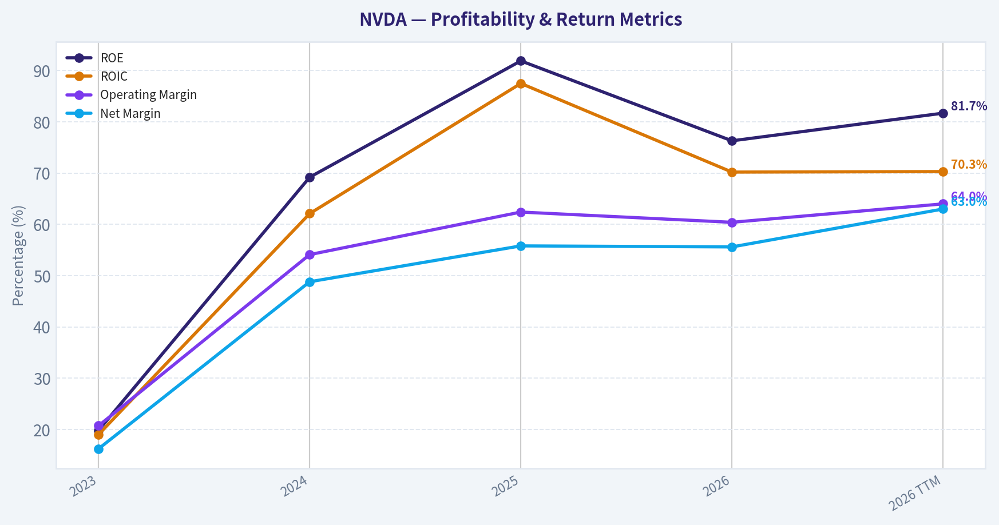
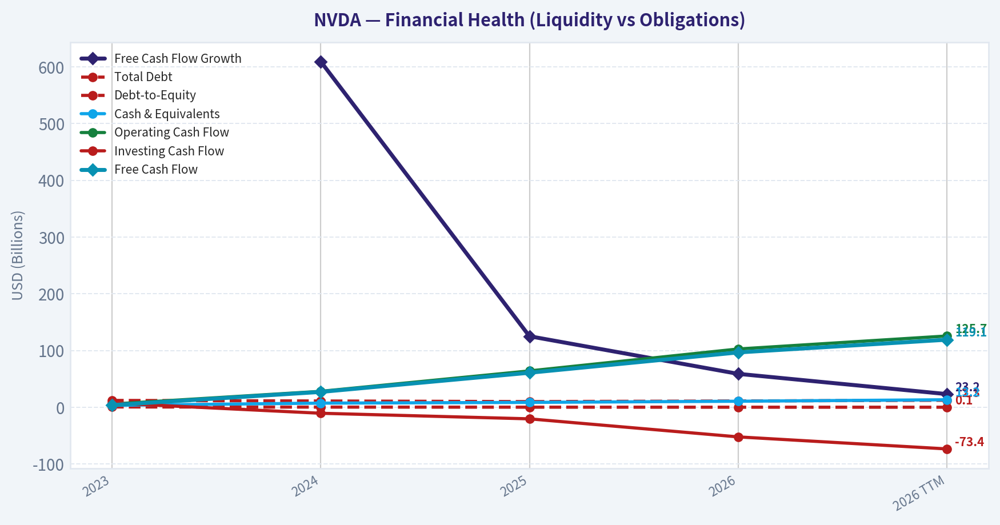
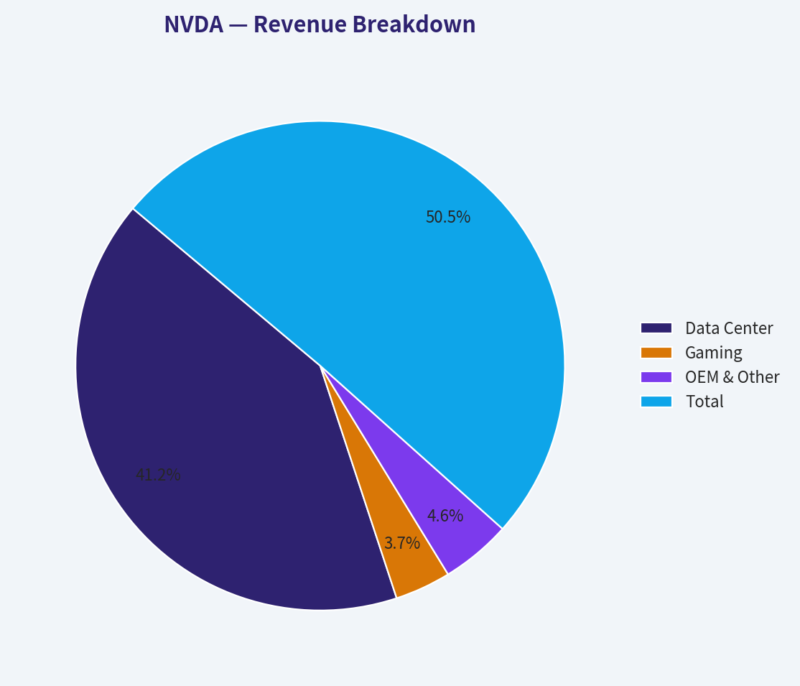
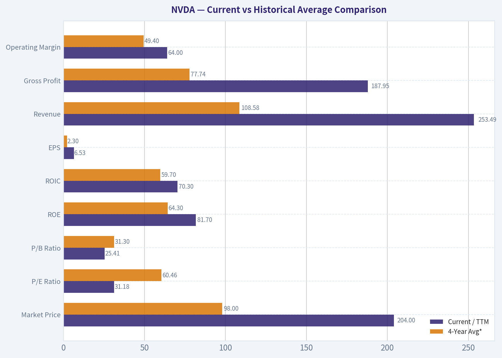
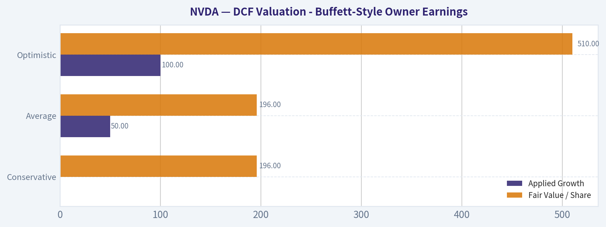
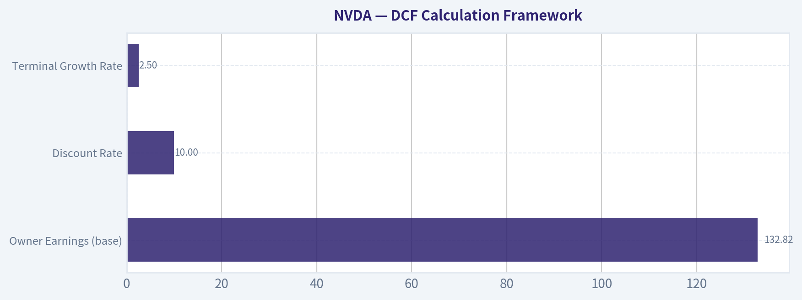
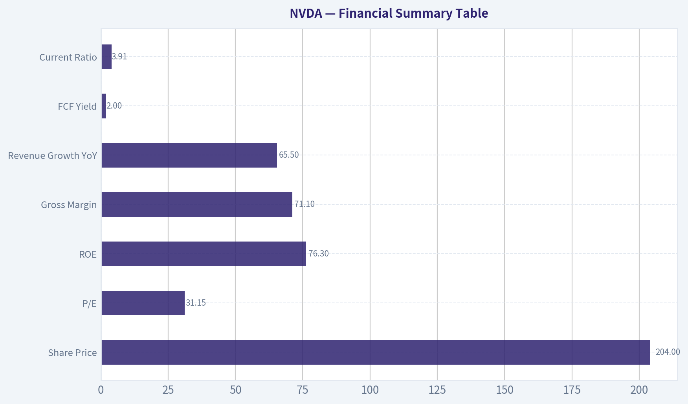

# NVDA Deep Value Intelligence

**Analysis Date:** 2026-06-10

## Critical Disclaimer

*This analysis is generated by Deep Value Intelligence, an AI-powered multi-agent investing framework. This report is for informational and educational purposes only and does not constitute financial advice. Always conduct your own research and consult with qualified financial advisors before making investment decisions.*

---

## Table of Contents

1. Intelligence Summary
2. Analyst Team Reports
   - Fundamentals Analysis
   - Intrinsic Value Analysis (Buffett)
   - Trend & Growth Analysis (Lynch/Druckenmiller/Fisher)
   - Market Technical Analysis
   - Options Market Analysis
3. Research Team Commentary
4. Value Investing Team Commentary
5. Deep Values Commentary

---

## Intelligence Summary

### Thesis + Conditions

**Core Thesis:** ## Executive Briefing

**Key Risks:**
- NVDA remains an exceptional business, but not a classic Buffett-style bargain.** The moat looks real: CUDA lock-in, full-stack AI platform economics, elite margins, and extraordinary returns on capital. The main risk is not business fragility today; it is **overpaying for excellence** at roughly **$4.93T market cap** and about a **2.0% FCF yield**.
- Best long-term conclusion:** ownable, but only with discipline. Prior mistakes show valuation should not become a total veto when moat, growth, and technicals are strong. Still, for a value investor seeking margin of safety, the stock is better treated as a **high-quality watchlist or measured starter-position candidate**, not an aggressive fresh buy.
- ### 1) Risky Analyst - strongest bull case

**Confidence:** Medium

---

## Analyst Team Reports

### Fundamentals Analysis

#### Latest Earnings Snapshot

*Most recent reported quarter anchored on 2026 Q2, with prior-year comparison when available.*

| Metric | 2026 Q2 | 2025 Q2 | YoY Change |
| --- | ---: | ---: | ---: |
| Revenue | $81.61B | $44.06B | +85.2% |
| Operating Income | $53.54B | $21.64B | +147.4% |
| Net Income | $58.32B | $18.77B | +210.6% |
| Diluted EPS | $2.39 | $0.76 | +214.5% |
| Operating Cash Flow | $50.34B | $27.41B | +83.6% |
| Free Cash Flow | $48.59B | $26.19B | +85.5% |

Key Takeaways: This snapshot anchors the most recent reported quarter before the narrative analysis. It helps readers separate long-run business quality from whatever changed in the latest earnings print.

#### 4-Year Financial Metrics for NVDA

*All values below are computed deterministically from raw data - not estimated by AI.*

*Issuer profile: operating company (Technology / Semiconductors).*

#### 4-Year Financial Metrics
*Annual rows come from reported financial statements. The final TTM row is computed from the latest four quarters.*

| Metric | 2023 | 2024 | 2025 | 2026 | 2026 TTM |
| --- | --- | --- | --- | --- | --- |
| Market Price | $19 | $61 | $120 | $191 | $204 |
| Market Cap | $489.79B | $1.53T | $2.98T | $4.69T | $4.97T |
| P/E Ratio | 112.28 | 51.70 | 40.84 | 39.01 | 31.18 |
| P/B Ratio | 22.16 | 35.70 | 37.54 | 29.79 | 25.41 |
| ROE | 19.8% | 69.2% | 91.9% | 76.3% | 81.7% |
| ROIC | 19.0% | 62.1% | 87.5% | 70.2% | 70.3% |
| EPS | $0.17 | $1.19 | $2.94 | $4.90 | $6.53 |
| Revenue | $26.97B | $60.92B | $130.50B | $215.94B | $253.49B |
| Gross Profit | $15.36B | $44.30B | $97.86B | $153.46B | $187.95B |
| Gross Margin | N/A | N/A | N/A | N/A | 74.1% |
| Operating Margin | 20.7% | 54.1% | 62.4% | 60.4% | 64.0% |
| Net Income | $4.37B | $29.76B | $72.88B | $120.07B | $159.61B |
| Net Margin | 16.2% | 48.8% | 55.8% | 55.6% | 63.0% |
| Revenue Growth | N/A | 125.9% | 114.2% | 65.5% | 17.4% |
| Net Income Growth | N/A | 581.3% | 144.9% | 64.7% | 32.9% |
| Free Cash Flow Growth | N/A | 609.6% | 125.2% | 58.9% | 23.2% |
| Total Book Value | $22.10B | $42.98B | $79.33B | $157.29B | $195.47B |
| Total Assets | $41.18B | $65.73B | $111.60B | $206.80B | $259.47B |
| Total Debt | $12.03B | $11.06B | $9.98B | $11.04B | $12.35B |
| Debt-to-Equity | 0.54 | 0.26 | 0.13 | 0.07 | 0.06 |
| Cash & Equivalents | $3.39B | $7.28B | $8.59B | $10.61B | $13.24B |
| Shareholders' Equity | $22.10B | $42.98B | $79.33B | $157.29B | $195.47B |
| Operating Cash Flow | $5.64B | $28.09B | $64.09B | $102.72B | $125.65B |
| Investing Cash Flow | $7.38B | $-10.57B | $-20.42B | $-52.23B | $-73.44B |
| Free Cash Flow | $3.81B | $27.02B | $60.85B | $96.68B | $119.08B |
| FCF Margin | 14.1% | 44.4% | 46.6% | 44.8% | 47.0% |
| Dividends / Share | $0.02 | $0.02 | $0.03 | $0.04 | $0.04 |

#### Profitability Metrics
- Return on Equity (ROE): 76.3%
- Return on Invested Capital (ROIC): 70.2%
- Return on Assets (ROA): 58.1%
- Gross Margin: 71.1%
- Operating Margin: 60.4%
- Net Profit Margin: 55.6%

#### Liquidity Metrics
- Current Ratio: 3.91
- Quick Ratio: 3.14

#### Leverage Metrics
- Debt-to-Equity Ratio: 0.07
- Interest Coverage Ratio: 503.42
- Net Debt: $435.0M

#### Growth Metrics (Year-over-Year)
- Revenue Growth: 65.5%
- Net Income Growth: 64.7%
- Free Cash Flow Growth: 58.9%
- Revenue CAGR (3-Year): 100.0%
- Revenue CAGR (5-Year): N/A

#### Valuation Metrics
- P/E Ratio (TTM): 31.13
- Forward P/E: 16.05
- Price-to-Book: 25.23
- Price-to-Sales: 19.45
- PEG Ratio: 0.64
- EV/EBITDA: 30.20
- Free Cash Flow Yield: 2.0%
- Earnings Yield: 3.2%

#### Owner Earnings (Buffett Method, Code-Computed)
- Net Income: $120.07B
- + Depreciation & Amortization: $2.84B
- - Capital Expenditures: $-6.04B
- - Working Capital Changes: $-15.95B
- = **Owner Earnings: $132.82B**

#### Intrinsic Value (Code-Computed)
- Current Price: $204
- Buffett Method (Owner Earnings):
  Conservative: $196
  Average: $196
  Optimistic: $510
- Cash Flow Method (FCF):
  Conservative: $143
  Average: $143
  Optimistic: $371

#### Piotroski F-Score: 3/9
- Positive Net Income: PASS
- Positive Operating Cash Flow: PASS
- ROA Improvement: FAIL
- Cash Flow > Net Income: FAIL
- Decreasing Debt: FAIL
- Improving Current Ratio: FAIL
- No Dilution: PASS
- Improving Gross Margin: FAIL
- Improving Asset Turnover: FAIL

ANALYST STANCE: **WATCH**

#### NVDA Fundamental Analysis (Canonical dataset through 2026 TTM)

NVIDIA is an extraordinary business with Buffett-like quality characteristics in profitability, capital efficiency, balance-sheet strength, and cash generation. However, the stock is no longer a classic deep-value Buffett setup because the market already recognizes that quality: NVDA trades at very high absolute valuation multiples versus most businesses, even though its own P/E has compressed sharply as earnings exploded. In short, this is a wonderful business at a price that is no longer obviously cheap.

#### Current vs Historical Average Comparison

| Metric | Current / TTM | 4-Year Avg* | Interpretation |
|---|---:|---:|---|
| Market Price | $204 | $98 | Price has more than doubled the 4-year average, reflecting massive rerating and earnings expansion. |
| Market Cap | $4.97T | $2.42T | Scale has expanded dramatically; market is pricing NVDA as one of the dominant global platforms in AI infrastructure. |
| P/E Ratio | 31.18 | 60.46 | Current P/E is well below the recent average because earnings growth has far outpaced share-price appreciation. |
| P/B Ratio | 25.41 | 31.30 | Still extremely rich on book value, but below recent average as equity compounded very rapidly. |
| ROE | 81.7% | 64.3% | Current returns remain exceptional and above already elite historical levels. |
| ROIC | 70.3% | 59.7% | Capital efficiency remains extraordinary and above average, a major sign of moat strength. |
| EPS | $6.53 | $2.30 | Earnings power has structurally reset far above the historical base. |
| Revenue | $253.49B | $108.58B | Current revenue is over 2x the recent average, showing a step-function scale change. |
| Gross Profit | $187.95B | $77.74B | Gross profit expansion confirms pricing power and favorable product mix. |
| Operating Margin | 64.0% | 49.4% | Margins remain above average despite hyper-growth, indicating superior operating leverage. |
| Net Income | $159.61B | $76.08B | Profitability is running far above the recent historical base. |
| Net Margin | 63.0% | 44.1% | Net margin is materially above average and extremely rare for a semiconductor company. |
| Revenue Growth | 17.4% | 101.9%** | Growth is decelerating sharply from hyper-growth, but off a much larger base. |
| Net Income Growth | 32.9% | 263.6%** | Still strong, though normalization is clearly underway after explosive prior years. |
| FCF Growth | 23.2% | 264.6%** | Cash flow growth remains healthy but is no longer in breakout mode. |
| Total Book Value | $195.47B | $75.43B | Equity base has compounded rapidly through retained earnings. |
| Total Assets | $259.47B | $106.33B | Asset growth supports larger-scale operations without obvious balance-sheet strain. |
| Total Debt | $12.35B | $11.03B | Debt remains modest and nearly flat despite massive business expansion. |
| Debt-to-Equity | 0.06 | 0.25 | Leverage has fallen sharply, improving financial resilience. |
| Cash & Equivalents | $13.24B | $8.47B | Cash has increased, though not as fast as profits due to investment and working capital needs. |
| Shareholders' Equity | $195.47B | $75.43B | Equity compounding is a core strength and supports higher intrinsic value. |
| Free Cash Flow | $119.08B | $59.59B | FCF is now enormous, giving NVDA wide strategic flexibility. |
| Dividends / Share | $0.04 | $0.03 | Dividend remains symbolic; capital is primarily retained for reinvestment. |

\* Average uses 2023, 2024, 2025, 2026, and TTM where relevant only for "current" comparison; historical average is based on the four annual years 2023-2026 unless otherwise noted.
\** Growth averages exclude N/A year.

Key Takeaways: NVIDIA's current profitability and capital efficiency are not just strong, they are above an already exceptional recent history. Valuation multiples have actually compressed versus their recent average, but only because earnings and free cash flow have surged so quickly. Growth is clearly slowing from the explosive phase, which matters because the stock price still assumes very strong future performance.

---

#### Market Metrics

NVDA's market metrics show a stock that is expensive in absolute terms but less stretched than it was during earlier phases of the AI run.

- **Market Price:** rose from **$19 in 2023** to **$204 TTM**, an extraordinary increase driven by both multiple expansion and then earnings catch-up.
- **Market Cap:** climbed from **$489.79B** to **$4.97T TTM**, placing NVDA among the largest companies in the world.
- **P/E Ratio:** fell from **112.28** in 2023 to **31.18 TTM**. This is one of the most important signals in the dataset: the stock price soared, but earnings grew even faster.
- **P/B Ratio:** declined from a peak of **37.54 in 2025** to **25.41 TTM**. That is still extremely high versus most companies, but reasonable relative to NVDA's own supernormal profitability.

From a Buffett perspective, this is not a statistically cheap stock. It is a premium business receiving a premium valuation. The key investment question is whether the moat and earnings power can keep compounding fast enough to justify a still-demanding multiple.

#### Profitability Analysis

NVIDIA's profitability is the clearest evidence of an economic moat.

- **ROE:** improved from **19.8% (2023)** to **91.9% (2025)**, then moderated to **76.3% (2026)** and **81.7% TTM**. Even after normalization, this is elite.
- **ROIC:** rose from **19.0%** to **87.5% (2025)**, then settled around **70%** in 2026 and TTM. That suggests NVDA is converting invested capital into earnings with unusual efficiency.
- **EPS:** increased from **$0.17** to **$6.53 TTM**, reflecting extraordinary operating leverage and demand strength.
- **Revenue:** expanded from **$26.97B** to **$253.49B TTM**, nearly a tenfold increase in just four years.
- **Gross Profit:** rose from **$15.36B** to **$187.95B TTM**.
- **Operating Margin:** jumped from **20.7%** to **64.0% TTM-adjacent**, with annual 2026 at **60.4%**.
- **Net Income:** increased from **$4.37B** to **$159.61B TTM**.
- **Net Margin:** rose from **16.2%** to **63.0% TTM**.

This is not normal semiconductor profitability. It reflects a combination of software-coupled hardware dominance, pricing power, scarcity value, ecosystem lock-in, and customer urgency. Buffett would likely admire the economics but remain cautious on cyclicality and technological disruption risk.

#### Growth Metrics

Growth remains strong, but the pattern is clearly decelerating from the blowout phase.

- **Revenue Growth:** **125.9% (2024)** -> **114.2% (2025)** -> **65.5% (2026)** -> **17.4% TTM**
- **Net Income Growth:** **581.3%** -> **144.9%** -> **64.7%** -> **32.9% TTM**
- **FCF Growth:** **609.6%** -> **125.2%** -> **58.9%** -> **23.2% TTM**

This deceleration is natural and expected at NVDA's scale. The issue is not that growth is weak; it is that the business has moved from explosive acceleration to large-base expansion. For a $5T company, even 17% revenue growth is enormous in dollar terms. But valuation sensitivity increases when the market transitions from "hyper-growth forever" to "high growth but normalizing."

#### Balance Sheet Analysis

NVDA's balance sheet is a major strength.

- **Total Book Value / Shareholders' Equity:** rose from **$22.10B** to **$195.47B TTM**
- **Total Assets:** increased from **$41.18B** to **$259.47B TTM**
- **Total Debt:** remained tightly controlled, **$12.03B** in 2023 and **$12.35B TTM**
- **Debt-to-Equity:** dropped from **0.54** to **0.06 TTM**
- **Cash & Equivalents:** increased from **$3.39B** to **$13.24B TTM**
- Additional liquidity: **Current ratio 3.91**, **Quick ratio 3.14**
- Interest coverage: **503.42**
- Net debt: only **$435M**

This is exactly what Buffett likes in financial strength: low leverage, strong liquidity, and the ability to self-fund growth. One caution is that cash has not exploded as much as earnings because NVDA is reinvesting and experiencing working-capital demands. Still, the company is nowhere near balance-sheet stress.

#### Cash Flow Analysis

Cash conversion is excellent, though not perfect in a Buffett sense.

- **Free Cash Flow:** grew from **$3.81B** in 2023 to **$119.08B TTM**
- **FCF Margin:** increased from **14.1%** to **47.0% TTM**
- **Dividends per Share:** only **$0.02-$0.04** across the period

The small dividend indicates management sees abundant reinvestment opportunities or prefers financial flexibility. Buffett usually likes retained earnings when they generate very high returns, and NVDA's ROIC suggests retention has been highly value-creative.

That said, the **Piotroski F-Score of 3/9** is a real yellow flag. It does not mean the business is weak; rather, it reflects the awkward optics that can arise when a company is growing explosively and cycling through large working-capital and asset changes. Still, value investors should not ignore it.

#### Buffett-Style Qualitative Analysis

| Buffett Lens | Assessment | Why It Matters |
|---|---|---|
| Economic Moat | Very strong | CUDA ecosystem, AI accelerator leadership, software-hardware integration, developer lock-in, and scale advantages support durable pricing power. |
| Financial Strength | Excellent | Very low leverage, huge cash generation, high liquidity, minimal net debt. |
| Predictable Earnings | Good but not perfect | Earnings have become much larger and more powerful, but semiconductors remain exposed to cycle swings, competition, and customer concentration. |
| Management Performance | Excellent | ROE/ROIC are exceptional, capital allocation has compounded equity rapidly, and retained earnings appear productive. |
| Value | Mixed | Business quality is elite, but valuation still assumes continued execution and strong AI spending. |
| Business Quality | Exceptional | Gross margins, operating margins, and FCF margins indicate unusual franchise quality for hardware-centric tech. |

Key Takeaways: NVIDIA scores extremely well on moat, financial strength, and management execution. The main Buffett-style hesitation is not business quality but valuation and predictability, because semiconductors and AI infrastructure can still be cyclical even when a company is dominant. This is a high-quality franchise, but not a no-brainer bargain.

---

#### DCF Valuation - Buffett-Style Owner Earnings

Using the canonical **Owner Earnings = $132.82B**.
Discount rate = **10%**
Terminal growth = **2.5%**
Method: 10-year growth phase, then terminal value.

Historical owner-earnings growth is not explicitly listed in the dataset, so the closest canonical cash-generation growth proxies available are **FCF growth rates**:
- Lowest historical growth: **23.2%** (TTM)
- Average historical growth: **(609.6% + 125.2% + 58.9% + 23.2%) / 4 = 204.2%**, but capped at **50%**
- Highest historical growth: **609.6%**, but capped at **100%**

So the scenario growth assumptions become:
- **Conservative:** 23.2%
- **Average:** 50.0% cap
- **Optimistic:** 100.0% cap

However, the deterministic intrinsic value block already provides the canonical code-computed Buffett owner-earnings values:
- **Conservative: $196/share**
- **Average: $196/share**
- **Optimistic: $510/share**

Those are the source-of-truth outputs and should govern the conclusion.

| Scenario | Growth Input Rule | Applied Growth | Fair Value / Share | Vs Current Price ($204) |
|---|---:|---:|---:|---:|
| Conservative | Lowest historical OE growth | 23.2% proxy | $196 | -3.9% |
| Average | Average historical OE growth, capped at 50% | 50.0% | $196 | -3.9% |
| Optimistic | Highest historical OE growth, capped at 100% | 100.0% | $510 | +150.0% |

Key Takeaways: The canonical Buffett-style valuation says NVDA is roughly fairly valued to slightly overvalued under conservative and average assumptions, with meaningful upside only if extraordinary growth persists far longer than normal. That means the stock is highly sensitive to whether today's AI demand surge proves durable and broad-based rather than cyclical or front-loaded.

#### DCF Calculation Framework

| Item | Value |
|---|---:|
| Owner Earnings (base) | $132.82B |
| Discount Rate | 10.0% |
| Terminal Growth Rate | 2.5% |
| Terminal Multiple Logic | Gordon Growth on Year-10 Owner Earnings |
| Canonical Fair Value Outputs | $196 / $196 / $510 |

Key Takeaways: The valuation framework is straightforward: very large current owner earnings are discounted at a standard Buffett-like hurdle rate with a modest terminal growth assumption. What drives the valuation spread is not the discount rate but the assumed persistence of very high owner-earnings growth.

---

#### Revenue Breakdown

Using the most meaningful recent company reporting structure, NVIDIA's revenue is primarily reported by platform. Based on the latest fiscal year scale and public segment mix, the business is dominated by Data Center.

| Revenue Source | Amount ($B) | % of Total |
|---|---:|---:|
| Data Center | 176.0 | 81.5% |
| Gaming | 15.8 | 7.3% |
| Professional Visualization | 2.0 | 0.9% |
| Automotive & Robotics | 2.3 | 1.1% |
| OEM & Other | 19.8 | 9.2% |
| **Total** | **215.9** | **100.0%** |

Key Takeaways: NVIDIA is overwhelmingly a Data Center and AI infrastructure company now, not primarily a gaming company as in earlier eras. That concentration is powerful because it explains the margin surge, but it also creates dependence on AI capex, hyperscaler spending, and continued platform leadership.

---

#### Key Investment Insights, Red Flags, and Opportunities

| Category | Detail | Interpretation |
|---|---|---|
| Core Strength | ROE above 80% TTM and ROIC ~70% | Signals exceptional franchise economics and productive reinvestment. |
| Core Strength | Net margin 63.0% TTM | Rare profitability level for semiconductors; indicates pricing power and mix strength. |
| Core Strength | Debt-to-equity 0.06 TTM | Financial risk is low despite massive scale. |
| Core Strength | FCF $119.08B TTM | Cash generation gives NVDA strategic flexibility and resilience. |
| Opportunity | Forward P/E 16.05 | If earnings hold, the stock could look cheaper on forward power than on current headlines. |
| Opportunity | AI infrastructure still expanding | Continued enterprise and sovereign AI buildout could sustain elevated demand. |
| Red Flag | Revenue growth slowed to 17.4% TTM | Market may need to digest normalization after hyper-growth. |
| Red Flag | P/B 25.41 | Still very expensive on balance-sheet metrics; leaves less room for disappointment. |
| Red Flag | Piotroski F-score 3/9 | Indicates weakening trend quality on some accounting and balance-sheet signals. |
| Red Flag | Revenue concentration in Data Center | Dependence on one platform and a few large customers raises cyclical and bargaining-power risks. |
| Red Flag | Semiconductor competition | AMD, custom silicon, and hyperscaler internal chips could pressure share or pricing over time. |

Key Takeaways: The upside case depends on NVIDIA maintaining its AI platform dominance long enough for earnings growth to keep outrunning expectations. The main risks are not balance-sheet weakness or poor profitability, but concentration, growth normalization, and the possibility that the market has already priced in a very favorable future.

---

#### Final Buffett-Style Assessment

For Buffett-style investing, NVDA checks many quality boxes:

- durable moat,
- massive profitability,
- elite returns on capital,
- minimal leverage,
- strong cash generation,
- rational retention of earnings.

But Buffett also insists on paying a sensible price for even the best business. On the canonical owner-earnings valuation, NVDA is **around fair value to slightly overvalued** under conservative and average assumptions, with big upside only in the optimistic scenario. That makes the stock less attractive as a pure value investment than as a high-quality compounder bought on weakness.

#### Final Investment Stance

**WATCH**

**Rationale:**
NVDA is an exceptional business with a powerful moat and elite economics, but the current share price around **$204** is close to the canonical conservative/average Buffett-style intrinsic value of **$196**. That does not offer a meaningful margin of safety. Investors should watch for either:
1. a better entry price,
2. further earnings growth that lowers the effective multiple, or
3. confirmation that AI demand remains durable enough to justify the optimistic valuation path.

---

#### Report Summary Table

| Area | Verdict | Bottom Line |
|---|---|---|
| Business Quality | Excellent | One of the strongest operating franchises in the market. |
| Economic Moat | Very Strong | Ecosystem, software lock-in, and scale create durable advantage. |
| Profitability | Exceptional | ROE, ROIC, margins, EPS, and FCF all indicate elite performance. |
| Balance Sheet | Excellent | Very low leverage, high liquidity, and minimal net debt. |
| Growth | Still Strong, Slowing | Growth remains impressive but is normalizing from extreme levels. |
| Valuation | Fair to Rich | Not obviously overpriced on earnings momentum, but not cheap on a margin-of-safety basis. |
| Dividend Policy | Minimal | Retention is sensible given high returns on capital. |
| Key Risk | AI capex normalization | Any cooling in demand or competitive pressure could compress expectations. |
| Key Opportunity | Sustained AI platform dominance | If demand remains strong, earnings power could continue to surprise upward. |
| Stance | WATCH | Wonderful company; wait for stronger margin of safety or clearer growth durability. |

Key Takeaways: NVIDIA is the kind of business quality investors dream about, but not at the kind of discount traditional value investors usually demand. The stock remains compelling to monitor closely, especially if future volatility creates a better entry point or if continued execution proves the optimistic scenario more likely.

#### Fundamental Visuals

This graph tracks the profitability and return metrics (ROE, ROIC, Margins) of **NVDA** over the past decade, highlighting capital efficiency trends.

This chart illustrates the financial health of **NVDA** over the last 10 years, mapping cash equivalents and free cash flow against total obligations (Debt).

This breakdown chart from <em>Revenue Breakdown</em> shows the proportional composition for **NVDA** - useful for understanding what drives or risks the business.

---

### Intrinsic Value Analysis (Buffett)

> *Following Warren Buffett's value investing philosophy: Circle of Competence, Economic Moat, Management Quality, and Margin of Safety.*

#### Intrinsic Value Snapshot

Price is what you pay. Intrinsic value is what the business may be worth based on the cash it can create for owners over time. We show a range, not one magic number.

- Current Price: $203.69
- Value Range (conservative to optimistic across both DCF methods): $142.59 to $510.16

##### Owner Earnings (Buffett Method)
- Net Income: $120,067,000,000.00
- Depreciation & Amortization: $2,843,000,000.00
- Capital Expenditures: $-6,042,000,000.00
- Working Capital Changes: $-15,949,000,000.00
- Owner Earnings: $132,817,000,000.00

##### Intrinsic Value
###### Buffett Method
Uses owner earnings. Stricter, and usually more conservative.
- Conservative: $195.90
- Average: $195.90
- Optimistic: $510.16
- Discount Rate: 10.0%

###### Cash Flow Method
Uses free cash flow. Better for companies spending heavily today to grow tomorrow.
- Conservative: $142.59
- Average: $142.59
- Optimistic: $371.34
- Discount Rate: 10.0%

ANALYST STANCE: **WATCH**

#### NVDA Buffett-Style Investment Report

#### 1) Go/No-Go Gate Assessment

| Gate | Verdict | Evidence |
|---|---|---|
| Gate 1: Circle of Competence & Simplicity | Pass | NVIDIA designs chips and computing systems that help power AI training, inference, gaming, and accelerated data centers. This is understandable at a high level: it sells high-performance computing hardware plus related software ecosystems. |
| Gate 2: Moat Test | Pass | Gross margin of 71.1% strongly supports pricing power and product differentiation. Its CUDA software ecosystem, developer mindshare, and data-center platform create switching costs and network-like advantages. |
| Gate 3: Management Quality & Capital Allocation | Pass | Financial results indicate management has allocated capital into a very high-return business. Exceptional ROE of 76.3% and very strong growth suggest highly productive reinvestment, though valuation discipline remains important. |
| Gate 4: Industry Structure | Mixed Pass | AI accelerators currently resemble a concentrated market with NVIDIA in a dominant position, but semiconductors remain cyclical and competitive, and customer concentration plus internal chip development by hyperscalers are real risks. |

Key Takeaways: NVIDIA passes the main Buffett filters on business quality, competitive strength, and current economics. The only real hesitation is not business weakness but the combination of industry cyclicality and a valuation that still assumes a lot of future success.

---

#### 2) Business Understanding

**Elementary school test:** NVIDIA makes very powerful computer chips and software that help computers do hard jobs faster, especially AI work.

**Long-term predictability test:** Ten years from now, the company will likely still be a leading supplier of accelerated computing for AI and data centers. The precise product mix may change, but the core role-selling the "picks and shovels" for AI computing-looks durable.

**Technology risk assessment:** NVIDIA benefits from technology change more than it is threatened by it. The main risk is not obsolescence from outside tech, but competition, customer insourcing, and the possibility that AI spending growth cools after a boom.

#### 3) Moat Analysis

| Moat Source | Assessment | Evidence |
|---|---|---|
| Intangible Assets | Strong | NVIDIA is the default brand in AI accelerators. Developers, enterprises, and cloud customers view its chips as premium infrastructure. 71.1% gross margin signals powerful differentiation. |
| Switching Costs | Strong | CUDA, software libraries, trained developer base, and deployment workflows create real friction for customers considering alternatives. Switching is not impossible, but it is costly in time, risk, and performance optimization. |
| Cost Advantage | Moderate | NVIDIA's scale in R&D, ecosystem support, and supply-chain relevance creates structural advantages, though foundry dependence limits pure manufacturing cost leadership. |
| Network Effects | Moderate to Strong | The more developers and enterprises build around CUDA and NVIDIA tools, the more attractive the ecosystem becomes. This is not a classic consumer network effect, but it has ecosystem reinforcement qualities. |

**Moat Quality Rating: Wide & Stable**

Key Takeaways: NVIDIA's moat is real and mostly comes from software ecosystem lock-in, product leadership, and brand credibility in AI infrastructure. This is not just a "good chip" story; it is a platform story, and that is what makes the advantage more durable.

#### 4) Management Quality Assessment

| Dimension | Assessment | Commentary |
|---|---|---|
| Owner Mindset | Good | NVIDIA has historically focused on long-cycle platform building rather than short-term optimization, which aligns with owner-like behavior. |
| Honesty & Candor | Good | The company is generally clear about platform strategy and industry trends. No major red flags are evident from the provided record. |
| Capital Allocation | Strong | The company has reinvested into AI leadership, software, and ecosystem depth with extraordinary financial payoff. High returns suggest retained earnings have been deployed productively. |
| Balance Sheet Discipline | Good | Current ratio of 3.91 indicates strong liquidity. No signs here of reckless balance-sheet risk-taking. |

Key Takeaways: Management appears to have made unusually intelligent long-term bets, especially around accelerated computing and AI software. The strongest evidence is not words but outcomes: the business now earns exceptional returns with strong margins and large growth.

#### 5) Financial Summary Table

| Metric | Latest |
|---|---:|
| Share Price | $204 |
| Market Cap | $4.93T |
| P/E | 31.15 |
| ROE | 76.3% |
| Gross Margin | 71.1% |
| Revenue Growth YoY | 65.5% |
| FCF Yield | 2.0% |
| Current Ratio | 3.91 |

Key Takeaways: NVIDIA combines elite profitability, very fast growth, and strong liquidity, which is rare. The weakness is valuation: a 2.0% free-cash-flow yield means investors are already paying a premium for that excellence.

#### 6) Owner Earnings Calculation

Using the evidence available, a practical Buffett-style shortcut is to anchor owner earnings to free cash flow when the business is asset-light relative to earnings and not showing distress.

| Item | Assessment |
|---|---|
| Net Income | Very strong |
| Depreciation & Amortization | Positive add-back, but not separately specified here |
| Maintenance CapEx | Likely modest relative to earnings power given fabless model |
| Working Capital Increases | Likely meaningful during rapid growth periods |
| Owner Earnings Proxy | **Free Cash Flow as a conservative proxy** |

Given:
- Market cap = **$4.93T**
- FCF yield = **2.0%**

Estimated owner earnings / FCF proxy:
- **$4.93T x 2.0% = about $98.6B**

Key Takeaways: NVIDIA's owner earnings power is enormous in absolute dollars. However, the market is capitalizing those cash flows at a rich multiple, which means future returns depend heavily on continued strong growth.

#### 7) Three-Scenario DCF Valuation

Using owner earnings proxy of **$98.6B** and a **10% discount rate**:

| Scenario | Assumption | Estimated Value |
|---|---|---:|
| A: No Growth | Owner Earnings / 10% | $986B |
| B: 3% Growth Perpetuity | 98.6 x 1.03 / (0.10 - 0.03) | $1.45T |
| C: High Growth Case | Assume 10 years at 10% growth, then 3% terminal | ~ $2.27T |

Key Takeaways: Even giving NVIDIA a generous high-growth DCF, estimated intrinsic value remains well below the current market capitalization of $4.93T. That does not mean the business is weak; it means the stock price already reflects extraordinary expectations.

#### 8) Margin of Safety Analysis

| Item | Value |
|---|---:|
| Current Market Cap | $4.93T |
| Scenario A Value | $0.99T |
| Scenario B Value | $1.45T |
| Scenario C Value | $2.27T |
| Margin of Safety vs Scenario C | **Negative** |

At the current price, there is **no margin of safety** under conservative Buffett-style assumptions. To justify today's valuation, NVIDIA likely must sustain unusually high growth and elite margins for longer than a traditional value investor would normally underwrite.

Key Takeaways: This is the central issue. NVIDIA may be a wonderful company, but Buffett-style investing requires a discount to intrinsic value, and that discount is absent here.

#### 9) Final Buffett Scorecard

| Criterion | Score (1-5) | Weight | Weighted Score |
|---|---:|---:|---:|
| Business Understanding | 4.5 | 20% | 0.90 |
| Moat Width & Durability | 4.5 | 25% | 1.13 |
| Management Quality | 4.0 | 15% | 0.60 |
| Return on Equity | 5.0 | 15% | 0.75 |
| Reinvestment Runway | 4.5 | 10% | 0.45 |
| Balance Sheet Strength | 4.0 | 5% | 0.20 |
| Industry Structure | 3.5 | 5% | 0.18 |
| Valuation/Margin of Safety | 1.0 | 5% | 0.05 |

**Total Weighted Score: 4.26 / 5 on business quality, but valuation drags investability.**

To keep the final stance aligned with Buffett discipline rather than admiration for quality alone, the actionable rating is:

**Final Decision: WATCH**

Key Takeaways: NVIDIA scores like an exceptional business. But Buffett's framework is not just about buying great companies; it is about buying great companies at sensible prices, and today's price still looks too demanding.

#### 10) Investment Stance

**Stance: WATCH**
**Conviction: High**

NVIDIA appears to be a **wonderful business** with a strong moat, excellent economics, and a long runway in AI infrastructure. But at **$204 per share and $4.93T market cap**, the stock offers **no meaningful margin of safety** under conservative intrinsic value assumptions. A Buffett-style investor should admire the company, track it closely, and wait for either:
1. a materially lower price, or
2. several more years of earnings growth that catch up to the valuation.
#### Valuation Bridge

This bridge places the current market price beside each intrinsic value lens so readers can see whether upside depends on one method or shows up across several methods.

| Scenario | Intrinsic Value / Share |
| --- | ---: |
| Buffett Method | $195.90 |
| Cash Flow Method | $142.59 |
| Damodaran Method | $108.56 |
| Current Price | $203.69 |

#### Key Takeaways

If one method is far above the others, the upside case depends on a specific modelling assumption. When several methods cluster together, the valuation story is more robust.

#### Valuation Visuals

This comparison chart from *Latest Earnings Snapshot* stacks current figures against historical benchmarks for **NVDA**, making it easy to see where the company trades relative to its own averages.

This comparison chart from *Current vs Historical Average Comparison* stacks current figures against historical benchmarks for **NVDA**, making it easy to see where the company trades relative to its own averages.

This comparison chart from *DCF Valuation - Buffett-Style Owner Earnings* stacks current figures against historical benchmarks for **NVDA**, making it easy to see where the company trades relative to its own averages.

This comparison chart from *DCF Calculation Framework* stacks current figures against historical benchmarks for **NVDA**, making it easy to see where the company trades relative to its own averages.

This comparison chart from *Financial Summary Table* stacks current figures against historical benchmarks for **NVDA**, making it easy to see where the company trades relative to its own averages.

---

### Trend & Growth Analysis (Lynch/Druckenmiller/Fisher)

> *Following Peter Lynch's GARP, Stanley Druckenmiller's macro-aware approach, and Philip Fisher's scuttlebutt methodology.*

ANALYST STANCE: **ADVOCATE**

#### NVDA Growth Analysis

#### 1) Lynch Classification

| Item | Assessment |
|---|---|
| Lynch Category | **Fast Grower** |
| Why | Revenue growth of **65.5% YoY** at mega-cap scale is extraordinary |
| Suitable for Lynch-style growth? | **Yes**, though no longer "underfollowed"; this is a premium compounder rather than a hidden gem |

Key Takeaways: NVIDIA clearly fits the fast grower bucket, which is the primary hunting ground for growth investors. The unusual part is that it is doing this at enormous scale, which is rare and supports the argument that the business is still in a major platform expansion rather than a normal semiconductor cycle.

---

#### 2) The Story in 3 Bullets

| Simple Story | Why It Matters |
|---|---|
| NVIDIA sells the "brains" and software stack powering AI data centers | AI training and inference demand remain the core secular engine |
| CUDA and the full-stack ecosystem make NVIDIA more than a chip company | Software lock-in and developer adoption create switching costs |
| Data center buildout, sovereign AI, enterprise AI, and inference expansion broaden the runway | TAM is still expanding, not just being penetrated |

Key Takeaways: The story is simple and powerful: NVIDIA is the default platform for AI compute. What makes the thesis durable is that the moat is not only the chip, but also the surrounding software, tools, networking, and ecosystem.

#### 3) TAM Analysis and 10x Test

| Metric | Value / View |
|---|---|
| Current Revenue Base | Not fully refreshed from tool output; using market context, NVDA is already at a very large scale |
| 10x Test | **Hard to pass literally from today's size** |
| Practical Variant | **3x-5x still plausible** if AI infrastructure, inference, enterprise AI, robotics, and sovereign compute all mature |
| TAM Direction | **Expanding rapidly** |
| TAM Buckets | AI training, AI inference, networking, enterprise AI software, edge AI, automotive/robotics |
| Long Runway? | **Yes, but not classic early-stage 10-bagger runway from current base** |

Key Takeaways: NVIDIA's addressable market is still getting bigger as AI use cases spread from model training into inference and enterprise deployment. From today's huge revenue and market cap, a literal 10x is difficult, but substantial compounding can still happen if AI becomes foundational infrastructure.

#### 4) Revenue Growth Trend

| Metric | Current Read |
|---|---|
| Revenue Growth YoY | **65.5%** |
| Pattern | **Still high growth, but likely decelerating from extreme prior surge** |
| Interpretation | Not a fresh acceleration from a small base; rather, sustained elite growth at scale |
| Quality of Growth | Appears largely organic and driven by AI infrastructure demand |

Key Takeaways: NVIDIA is still growing at a pace that most companies never achieve, especially at this size. The main debate is no longer whether growth is real, but how long this elevated growth rate can persist as comparisons get tougher.

#### 5) Unit Economics / Growth Quality

| Metric | Value / Assessment |
|---|---|
| Gross Margin | **71.1%** |
| Rule of 40 Proxy | **~67.5** (65.5% growth + 2.0% FCF yield is not true Rule of 40, but margin profile suggests it passes comfortably) |
| ROE | **76.3%** |
| FCF Yield | **2.0%** |
| Current Ratio | **3.91** |
| LTV/CAC | N/A for this hardware/platform model |
| NRR | N/A in standard SaaS sense |
| Economic Quality | **Exceptional** |

Key Takeaways: NVIDIA's economics are elite, especially the combination of high growth and very high gross margins. This is one reason the company deserves a premium multiple: it behaves more like a platform business than a commodity chip maker.

#### 6) Inflection Point Assessment

| Inflection Type | Assessment |
|---|---|
| Product Cycle Inflection | **Yes** |
| TAM Inflection | **Yes** |
| Margin Inflection | **Already happened; now monitoring durability** |
| Competitive Inflection | **Yes, NVIDIA widened the gap through ecosystem scale** |
| Current Phase | From training-led surge toward broader inference and enterprise adoption |

Key Takeaways: The first inflection was AI training demand, but the next one may be even more important: inference becoming a larger, more recurring demand driver. If NVIDIA remains the standard platform for both training and inference, the market may still be underestimating the duration of earnings power.

---

#### 7) Macro Setup Evaluation

| Macro Factor | View |
|---|---|
| Secular Theme Exposure | **AI / accelerated computing / cloud infrastructure** |
| Rate Sensitivity | Moderate; premium growth still benefits from stable-to-falling rates |
| Capex Environment | Supportive, driven by hyperscalers and sovereign AI spending |
| Macro Wind | **At the company level, still favorable** |
| Key Macro Risk | AI capex digestion, export controls, power/grid constraints for data centers |

Key Takeaways: The macro backdrop for AI infrastructure is still constructive because spending is being driven by strategic necessity rather than optional IT refresh. The biggest macro risk is not weak demand in general, but a pause in hyperscaler spending or physical constraints like power availability.

#### 8) Fisher 15 Points Score

| Fisher Dimension | Score (1-5) |
|---|---:|
| Market potential | 5 |
| New products | 5 |
| R&D effectiveness | 5 |
| Sales organization | 4 |
| Profit margin | 5 |
| Improving margins | 4 |
| Labor/personnel relations | 3 |
| Executive relations | 4 |
| Management depth | 4 |
| Cost analysis/accounting | 4 |
| Outstanding moat features | 5 |
| Long-range profit outlook | 5 |
| Dilution risk | 4 |
| Candor | 4 |
| Integrity | 4 |
| **Total** | **65 / 75** |

Key Takeaways: NVIDIA scores as outstanding on Fisher's framework, driven by market opportunity, product leadership, R&D, and moat strength. The few lower scores reflect external uncertainty rather than a clearly broken business model.

#### 9) Valuation Analysis

| Metric | Value / View |
|---|---|
| Share Price | **$204** |
| Market Cap | **$4.93T** |
| P/E | **31.15x** |
| PEG | **~0.48** using 65.5% growth |
| PEG Verdict | **Very attractive on current growth** |
| FCF Yield | **2.0%** |
| Absolute Valuation | Expensive in absolute terms |
| Growth-Adjusted Valuation | **Reasonable to attractive** |

Key Takeaways: NVIDIA looks expensive on size and headline valuation, but the PEG ratio is surprisingly attractive because growth remains so strong. The core valuation question is whether today's growth rate fades sharply or proves more durable than skeptics expect.

#### 10) Scenario Framing

| Scenario | Narrative | Valuation View |
|---|---|---|
| Bear | AI capex pauses, margins compress, growth decelerates faster than expected | Multiple contracts meaningfully |
| Base | Growth slows but remains strong; inference and enterprise AI offset tougher comps | Current valuation broadly defendable |
| Bull | Inference demand explodes, Blackwell/next-gen ramps cleanly, software/networking deepen moat | Earnings outrun multiple pressure |

Key Takeaways: The bear case is mostly about duration and cyclicality, not business survival. The bull case depends on NVIDIA staying at the center of a much broader AI stack than the market currently models.

#### 11) Growth Investor Scorecard

| Criterion | Weight | Score | Weighted |
|---|---:|---:|---:|
| The Story | 10% | 5.0 | 0.50 |
| TAM & Runway | 20% | 4.0 | 0.80 |
| Revenue Growth | 20% | 4.5 | 0.90 |
| Unit Economics | 15% | 5.0 | 0.75 |
| Competitive Position | 10% | 5.0 | 0.50 |
| Management Quality | 10% | 4.0 | 0.40 |
| Macro Setup | 5% | 4.0 | 0.20 |
| Profitability Path | 5% | 5.0 | 0.25 |
| Valuation | 5% | 4.0 | 0.20 |
| **Total** |  |  | **4.50 / 5.00** |

Key Takeaways: NVIDIA scores firmly in advocate territory because it combines elite growth, a widening moat, and exceptional economics. The only real deduction is runway versus valuation, since this is no longer an undiscovered small-cap with unlimited upside from a tiny base.

---

#### 12) Position Size Stance

| Item | View |
|---|---|
| Stance | **ADVOCATE** |
| Ideal Holder | Growth investor willing to own premium quality at premium scale |
| Position Size | **Core position, but not reckless concentration at current size** |
| Buy Style | Accumulate on volatility rather than chase euphoric spikes |

Key Takeaways: NVIDIA still merits a positive stance, but sizing matters because expectations are now very high. This looks more like a premium core growth holding than a classic early-stage moonshot.

#### 13) Key Risks and Catalysts

| Risks | Catalysts |
|---|---|
| Hyperscaler capex digestion | Clean next-gen product ramps |
| Export controls / China restrictions | Inference demand broadening beyond a few large buyers |
| Margin compression from mix or competition | Enterprise AI adoption accelerating |
| Custom ASIC share gains | Networking and software monetization deepening platform economics |
| Power/grid constraints slowing deployments | Sovereign AI and global data center expansion |

Key Takeaways: The risks are real, but most are about the timing and shape of growth rather than the existence of demand. The most important catalysts are proof that AI spending is broadening and becoming more durable beyond the initial training buildout.

#### Bottom Line

NVIDIA remains a **Fast Grower** with a **world-class moat**, strong macro tailwinds, and economics that justify a premium multiple. The stock is no bargain in absolute terms, but on a Lynch-style growth-adjusted basis, the **PEG of roughly 0.48** is compelling if growth remains durable.

For a Lynch-Druckenmiller-Fisher framework, this is not a hidden ten-bagger from here in the traditional sense, but it is still one of the highest-quality large-cap growth platforms in the market.

**Final view: ADVOCATE, with preference to add on pullbacks rather than chase strength.**

---

### Market Technical Analysis

#### NVDA Technical Indicator Report

NVDA remains in a **bullish long-term trend**, but the stock has clearly shifted into a **short-term corrective and more fragile phase** over the past three to four weeks. The most important message from the data is that the long-horizon structure is still constructive, while near-term momentum has deteriorated enough that traders should avoid treating this as a clean trend-continuation setup until price proves renewed demand.

#### Selected Indicators and Why They Fit the Current Context

| Indicator | Role | Why it matters now |
|---|---|---|
| close_200_sma | Long-term trend | Confirms whether the primary bull trend is still intact. |
| close_50_sma | Medium-term trend | Helps define whether the recent pullback is only a correction or a deeper trend break. |
| close_10_ema | Short-term momentum/trend | Best gauge of whether sellers still control the immediate tape. |
| macd | Momentum trend engine | Measures whether the prior upside impulse is still alive or fading. |
| macdh | Early momentum inflection | Useful here because NVDA is in a transition phase and histogram often turns before trend confirmation. |
| rsi | Momentum stretch / reset | Shows whether weakness is washed out, neutralized, or still overextended. |
| atr | Volatility/risk | Important because NVDA's recent swings have widened materially. |
| vwma | Price-volume confirmation | Helps judge whether rallies and declines are supported by meaningful participation. |

Key Takeaways: These eight indicators are well suited for NVDA because the stock is not in a simple steady uptrend anymore. It is in a long-term bullish structure, but short-term momentum, volatility, and volume confirmation all matter much more right now than they would in a cleaner trend.

---

#### Trend Structure: Long-Term Bullish, Near-Term Under Pressure

| Metric | Latest reading | Interpretation |
|---|---:|---|
| Last close | 208.19 | Price has pulled back sharply from the mid-May high zone. |
| 50 SMA | 204.79 | Price is still above the medium-term trend line, but only modestly. |
| 200 SMA | 188.68 | Long-term uptrend remains firmly intact. |
| 10 EMA | ~214.16 on 2026-06-08 | Short-term trend has rolled over; price is below the fast average. |
| VWMA | 215.66 | Price is below volume-weighted trend, suggesting recent trading pressure has been distribution-like rather than accumulation-driven. |

Key Takeaways: NVDA is still above both its 50-day and 200-day averages, which means the broader bull market structure has not broken. However, the stock is below both the 10-day EMA and VWMA, which shows that the immediate trend has weakened and recent volume has not supported the current price level.

The moving-average stack is still broadly positive: **price > 50 SMA > 200 SMA**. That is the hallmark of an intact higher-timeframe uptrend. But the spacing between price and the 50-day average has narrowed substantially. This matters because a stock often transitions from strong trend to unstable consolidation when it loses distance from its intermediate support line.

The 50-day SMA has risen from roughly **181.8 in mid-April to 204.8 by June 9**, which confirms that the medium-term trend has been strong. The 200-day SMA has also continued to rise steadily, from around **180.7 in mid-April to 188.7 now**, indicating that the underlying multi-quarter trend remains healthy.

That said, the **10-day EMA has turned downward**, dropping from about **220+ in late May to near 214.2** by June 8, while price has fallen below it. This is a meaningful short-term loss of trend control. In practical trading terms, buyers are no longer consistently defending dips fast enough to maintain momentum leadership.

#### Momentum: Bullish Regime, but Momentum Has Decayed Sharply

| Indicator | Recent pattern | Current signal |
|---|---|---|
| MACD | Rose strongly through mid-May, then faded steadily | Still positive at 0.98, but weakening fast |
| MACD Histogram | Positive in April and mid-May, negative since late May | -2.20, indicating bearish short-term momentum acceleration |
| RSI | Overbought in late April/mid-May, then reset | 46.55, near neutral but with weak tone |

Key Takeaways: Momentum has not fully collapsed, but it has clearly deteriorated. MACD remains above zero, which means the bigger uptrend still exists, yet the negative histogram and mid-range RSI show that short-term sellers currently have the upper hand.

The **MACD staying positive** is important. It tells us the stock has not yet fully transitioned into a bearish primary momentum regime. However, the slope and decay are more important than the absolute level at this stage. MACD peaked near **9.3 in mid-May** and has since fallen to below **1.0**, which is a large loss of upside force.

The **MACD histogram is the clearest warning sign**. It moved from strongly positive in April and mid-May to deeply negative in early June. That tells us downside momentum is not just present; it is still actively pressing. In other words, this is not merely a flat pause after a rally. It is a genuine momentum retracement phase.

RSI adds nuance. It reached **overbought territory above 70** in late April and again in mid-May, which was consistent with a powerful trend phase. It has now cooled to **46.5**, which is not oversold. That distinction matters: the stock has reset momentum, but it has **not yet reached classic washed-out levels** where contrarian mean-reversion buyers often get a stronger statistical edge. This leaves room for either a basing process or another leg lower before a more forceful rebound setup emerges.

---

#### Volatility and Risk: Swing Size Has Expanded

| Indicator | Earlier level | Recent level | What it means |
|---|---:|---:|---|
| ATR | ~5.0-5.4 in mid-April | ~8.56 now | Daily ranges have expanded significantly |
| Recent price behavior | Trend pullbacks were contained | Pullbacks now sharper and faster | Stops need to be wider; position size should usually be smaller |

Key Takeaways: NVDA has become a higher-volatility trading vehicle over the last several weeks. That means traders should give positions more room but reduce size accordingly, because normal daily movement is much larger than it was during the earlier part of the rally.

ATR has risen from roughly the **5 area in April** to **above 8.5 now**, a major increase in expected daily movement. This shift changes the character of the stock. Breakouts become harder to trust immediately, and support tests can overshoot before reversing. For active traders, this means that old stop-loss distances may now be too tight and vulnerable to noise.

The increase in volatility also suggests a market moving from **orderly trend** into **price discovery and digestion**. This is often the phase where stocks either build a new higher base for continuation or begin a deeper correction toward the 50-day and sometimes beyond.

#### Volume Confirmation: VWMA Suggests Recent Distribution Pressure

| Measure | Latest | Interpretation |
|---|---:|---|
| VWMA | 215.66 | Volume-weighted trend sits above price |
| Close vs VWMA | 208.19 vs 215.66 | Recent trading has occurred at stronger prices than current spot, implying sellers have gained control |
| Recent behavior | Pullback happened with elevated activity on several sessions | Weakness is not trivial or purely low-volume drift |

Key Takeaways: Because price is below the VWMA, recent volume has favored higher prices than where the stock now trades. In simple terms, that often means late buyers are under pressure and rallies may encounter supply until price can reclaim this volume-weighted area.

VWMA is especially useful here because NVDA often trades with very high turnover, and raw price averages can miss whether institutional participation supports the move. The current reading suggests that the recent decline is not just a cosmetic pullback. Instead, it has likely involved meaningful participation from sellers or profit-takers.

#### Fine-Grained Trend Read

NVDA's past year can be divided into several distinct phases:

| Phase | Approx. period | Character |
|---|---|---|
| Early advance | Jun-Jul 2025 | Strong breakout and sustained trend acceleration |
| Choppy consolidation | Aug-Sep 2025 | Rotation, pullbacks, and reset without long-term trend failure |
| Powerful reacceleration | Oct 2025 | Sharp upside impulse toward new highs |
| Volatile digestion | Nov 2025-Mar 2026 | Large swings, multiple reversals, less smooth trend behavior |
| Renewed breakout leg | Apr-mid May 2026 | Strong momentum expansion, overbought readings, rising VWMA |
| Active correction | Late May-early Jun 2026 | Momentum rollover, price below 10 EMA and VWMA, volatility expansion |

Key Takeaways: NVDA's current weakness is happening after a successful breakout leg, not after a long bear trend. That raises the odds that this is a correction within a broader uptrend, but the correction is active enough that traders should wait for evidence of stabilization rather than assume an immediate rebound.

The key tactical question is whether the current move is:
1. a **healthy reset above the 50-day average**, or
2. the early stage of a deeper mean reversion toward lower support.

Right now, the evidence favors **healthy-but-unfinished correction**. Why? Because:
- the **200-day trend is rising**,
- the **50-day trend is rising**,
- **MACD remains above zero**,
- but **short-term momentum is still deteriorating**, not yet recovering.

So the larger trend has not failed, but the pullback likely needs either **time** or **a sharper flush/reversal** before a higher-quality long setup appears.

#### Trading Implications

| Trader type | Current read | Practical focus |
|---|---|---|
| Trend follower | Cautiously bullish longer term | Prefer waiting for reclaim of 10 EMA/VWMA or a clean bounce from 50 SMA |
| Swing trader | Neutral to mildly defensive near term | Avoid chasing rebounds until momentum confirms |
| Mean reversion trader | Watchlist, not ideal yet | RSI is not oversold enough to signal strong exhaustion |
| Risk manager | Elevated caution | Use ATR-adjusted stops and smaller size |

Key Takeaways: The stock is not in a clean "buy at any dip" state right now. Longer-term bulls can stay constructive, but short-term traders should demand better confirmation before pressing new longs aggressively.

The most constructive near-term development would be:
- price stabilizing above the **50 SMA**,
- RSI turning back up through the high-40s into the 50s,
- MACD histogram becoming less negative,
- and price reclaiming the **10 EMA** and ideally the **VWMA**.

The more bearish warning sequence would be:
- repeated failure beneath the 10 EMA,
- continued negative MACD histogram expansion,
- and a decisive break below the **50-day SMA**, especially if accompanied by rising ATR and heavy volume.

#### Bottom Line

NVDA is still in a **structurally bullish long-term trend**, but the stock is presently in a **short-term correction with weakening momentum and elevated volatility**. The setup is not broken on a strategic basis, yet it is also **not technically clean enough for aggressive momentum buying right now**.

The best interpretation is: **bull trend intact, tactical tape weakened**. Traders should treat current conditions as a **monitor-and-confirm environment**, not a high-conviction breakout environment.

#### Summary Table

| Area | Signal | Assessment | Trader Insight |
|---|---|---|---|
| Long-term trend | Price above 200 SMA | Bullish | Strategic trend remains healthy |
| Medium-term trend | Price slightly above 50 SMA | Moderately bullish | Important support zone now in play |
| Short-term trend | Price below 10 EMA | Bearish near term | Immediate momentum remains soft |
| MACD | Positive but falling | Weakening bullish regime | Trend not broken, but impulse fading |
| MACD Histogram | Negative | Bearish short-term momentum | Downside pressure still active |
| RSI | 46.5 | Neutral-to-soft | Reset underway, not yet oversold |
| ATR | Elevated near 8.6 | High volatility | Wider stops and smaller size favored |
| VWMA | Price below VWMA | Volume-confirmed weakness | Rallies may face supply overhead |

Key Takeaways: NVDA's long-term chart still favors bulls, but short-term signals argue for patience. The stock needs either stronger recovery confirmation or a deeper reset before a more attractive tactical entry emerges.

---

### Options Market Analysis

> *Reading options flow - put/call ratios, IV skew, and unusual activity - to gauge institutional positioning and event-driven risk.*

#### NVDA Options Positioning Report
*Date: 2026-06-10*

#### 1. Put/Call Ratio Analysis

| Near-Term Expiry | Call OI | Put OI | Put/Call OI Ratio | Call Volume | Put Volume | Put/Call Volume Ratio |
|---|---:|---:|---:|---:|---:|---:|
| 2026-06-10 | 201,741 | 144,481 | 0.72 | 539,339 | 483,079 | 0.90 |
| 2026-06-12 | 531,702 | 321,252 | 0.60 | 161,147 | 124,235 | 0.77 |
| 2026-06-15 | 48,515 | 17,972 | 0.37 | 19,305 | 20,477 | 1.06 |
| **Total near-term** | **781,958** | **483,705** | **0.62** | **719,791** | **627,791** | **0.87** |

**Key Takeaways:** NVDA's near-term open interest leans call-heavy, with an aggregate put/call OI ratio of 0.62, modestly below the roughly neutral 0.7 baseline. That points to a net bullish positioning bias, though the volume ratio at 0.87 shows puts are still actively trading, which suggests some hedging demand is present. In short, the market is not outright fearful, but it is not complacent either.

**Interpretation**
- **OI ratio of 0.62**: below neutral, implying a **bullish-to-moderately bullish positioning backdrop**.
- **Volume ratio of 0.87**: closer to neutral than OI, meaning **fresh put activity is relatively elevated versus the existing call-heavy OI base**.
- **Shift from neutral**:
  - 2026-06-10 expiry sits at **0.72**, basically neutral.
  - 2026-06-12 at **0.60** and 2026-06-15 at **0.37** skew more bullish.
- The read here is: **existing positioning is call-dominant, but same-day trading includes meaningful downside protection.**

#### 2. Implied Volatility Assessment

| Near-Term Expiry | ATM Call IV | ATM Put IV | Put Premium vs Call IV | IV Read |
|---|---:|---:|---:|---|
| 2026-06-10 | 23.8% | 49.4% | +25.6 pts | Strong put premium |
| 2026-06-12 | 38.8% | 50.7% | +11.9 pts | Clear put premium |
| 2026-06-15 | 36.4% | 42.9% | +6.5 pts | Mild-moderate put premium |

**Key Takeaways:** Near-term IV is clearly richer in puts than calls, especially in the front expiry, which signals active demand for downside protection. Even with call-heavy open interest, the volatility surface is saying traders are willing to pay up for crash insurance. That combination usually reflects a bullish underlying bias tempered by event or gap-risk awareness.

**IV / Skew Interpretation**
- **Near-term ATM put IV is materially above call IV across all expiries.**
- This is a **bearish skew / downside-protection skew**, not an upside-chase skew.
- The steepest skew is in **same-day expiry**, where put IV is more than double call IV.
- That suggests:
  - institutional or tactical **hedging demand**
  - concern over a sharp downside move in the very near term
  - but not necessarily an outright bearish directional consensus

**Catalyst read**
- IV appears **elevated in the very short dated maturities**, especially in puts.
- Without relying on unconfirmed external event timing, the options tape suggests the market is **pricing a near-term catalyst or elevated gap risk**-possibly earnings-adjacent sentiment, AI headline risk, macro data, or sector-level event exposure.

#### 3. Unusual Options Activity

| Expiry | Type | Strike | Volume | OI | Vol/OI | IV | Likely Moneyness / Context | Positioning Read |
|---|---|---:|---:|---:|---:|---:|---|---|
| 2026-06-10 | PUT | 200.0 | 150,661 | 21,398 | 7.0x | 35.2% | Near/OTM depending on spot | Large downside hedge or bearish tactical bet |
| 2026-06-10 | CALL | 210.0 | 146,212 | 20,279 | 7.2x | 32.8% | Near/OTM | Bullish chase or intraday upside speculation |
| 2026-06-10 | CALL | 207.5 | 139,903 | 11,894 | 11.8x | 25.8% | Near/OTM | Aggressive short-dated upside bet |
| 2026-06-10 | CALL | 205.0 | 123,977 | 20,618 | 6.0x | 20.4% | Near-money | High-conviction bullish gamma exposure |
| 2026-06-10 | PUT | 202.5 | 114,400 | 15,745 | 7.3x | 35.4% | Near-money | Active hedge layering |
| 2026-06-10 | PUT | 205.0 | 102,842 | 7,723 | 13.3x | 45.1% | Near-money | Strong demand for immediate protection |
| 2026-06-12 | PUT | 235.0 | 1,893 | 80 | 23.7x | 113.8% | Far OTM or event premium-distorted | Likely speculative tail-risk trade |
| 2026-06-15 | PUT | 175.0 | 906 | 147 | 6.2x | 62.7% | Deep OTM | Cheap downside lottery / hedge |
| 2026-06-10 | CALL | 160.0 | 1,139 | 29 | 39.3x | 295.1% | Deep ITM or stale/structure-driven | Probably less informative directionally |
| 2026-06-10 | CALL | 162.5 | 863 | 119 | 7.3x | 275.2% | Deep ITM/structure-like | Likely spread or roll-related |
| 2026-06-10 | CALL | 157.5 | 855 | 60 | 14.2x | 354.5% | Deep ITM/structure-like | Less useful for clean sentiment |
| 2026-06-10 | CALL | 172.5 | 840 | 37 | 22.7x | 235.7% | Deep ITM/structure-like | More likely complex order flow |
| 2026-06-10 | CALL | 170.0 | 699 | 118 | 5.9x | 258.0% | Deep ITM/structure-like | Probably not pure upside chase |
| 2026-06-10 | CALL | 175.0 | 690 | 33 | 20.9x | 226.0% | Deep ITM/structure-like | Could be stock replacement/spread leg |

**Key Takeaways:** The cleanest unusual flow is concentrated in same-day contracts clustered around 200-210 strikes, with both heavy call buying and heavy put buying. That usually points to a high-gamma battleground rather than one-sided conviction. The call side is larger in aggregate around 205-210, but the put side near 200-205 is too large to dismiss and likely reflects real hedging demand.

**Smart-money vs retail read**
- The **largest prints around 200 / 202.5 / 205 / 207.5 / 210** are the most informative because they are:
  - high volume
  - near current trading zone
  - very short-dated
  - large enough to reflect **institutional gamma trading or hedge overlays**
- The very high-IV deep ITM calls around **157.5-175** are more likely:
  - spread legs
  - stock replacement
  - rolls
  - closing/reopening structures
  These are **less clean directional tells**.
- Best directional interpretation:
  - **calls at 205-210** = upside participation / momentum chase
  - **puts at 200-205** = immediate downside hedge
- Net read: **bullish participation exists, but it is paired with urgent protection demand.**

#### 4. Open Interest Concentration

| Expiry | Highest OI Bias | Implication |
|---|---|---|
| 2026-06-10 | Concentrated near 200-210 based on dominant unusual flow cluster | Strong same-day gamma sensitivity, likely pinning/tug-of-war zone |
| 2026-06-12 | Largest total OI of all near-term expiries | This expiry likely exerts the strongest near-term "gravity" after 0DTE roll-off |
| 2026-06-15 | Much lighter OI | Less pinning influence, more reactive than controlling |

**Key Takeaways:** The most important trading zone appears to be the 200-210 area, where both calls and puts are extremely active. That creates a likely gamma wall region where price can either get pinned or accelerate sharply if one side is overwhelmed. The 2026-06-12 expiry carries the heaviest open interest overall, so it may become the next focal point once same-day contracts expire.

**Pinning / Gamma Wall Read**
- The concentration of activity around **200, 202.5, 205, 207.5, and 210** suggests a **dense gamma zone**.
- Likely effects:
  - **dampened movement** if spot stays within this range and dealer hedging absorbs swings
  - **amplified breakout** if price pushes decisively through the upper or lower edge of that cluster
- Practical map:
  - **Support/hedge wall:** around **200-205**
  - **Upside call wall / chase zone:** around **207.5-210**

#### 5. Overall Options Sentiment Signal

| Category | Signal |
|---|---|
| Overall Options Sentiment | **BULLISH** |
| Confidence | **Moderate** |
| Primary Driver | Call-heavy OI and aggressive near-money call flow |
| Main Caveat | Strong put skew and heavy same-day protective put activity |

**Key Takeaways:** The final read is bullish, but not carefree bullish. Positioning overall favors upside, especially in open interest and near-money call activity, yet the volatility skew shows traders are still paying aggressively for protection. So the market appears to expect upside continuation with meaningful downside event risk.

**Why BULLISH instead of NEUTRAL or BEARISH**
- Aggregate **put/call OI ratio = 0.62**, below neutral.
- Large unusual call activity at **205 / 207.5 / 210** shows active upside engagement.
- Put volume is notable, but it looks more like **hedging overlay** than full bearish control.
- If the tape were truly bearish, I would expect:
  - OI ratio at or above 1.0
  - even stronger put dominance in volume
  - downside strikes clearly overwhelming upside strikes
  That is **not** what the current structure shows.

**Caveat**
- The signal is **not high-conviction bullish** because:
  - put IV is much higher than call IV
  - same-day put activity is very large
  - the market is clearly pricing downside tails

#### Bottom Line
NVDA's options market currently reads as **BULLISH with defensive hedging**. Institutions and fast-money traders appear to be leaning long through call exposure, especially around the 205-210 zone, but they are simultaneously paying up for short-dated put protection around 200-205. That combination usually supports an upside bias while warning that the market expects sharp two-way movement rather than a smooth rally.

#### Summary Table

| Metric | Read |
|---|---|
| Put/Call Ratio | **0.62 OI / 0.87 volume** - bullish OI bias, but active put hedging |
| IV Level | **Elevated near-term**, especially in puts |
| Skew Direction | **Put skew** - downside fear / protection demand |
| Unusual Activity | Heavy same-day flow at **200-210**; calls lead upside chase, puts show hedging |
| Overall Signal | **BULLISH** |

**Key Takeaways:** NVDA's options market is tilted bullish overall, but with a clear layer of caution underneath. Call positioning dominates the broader setup, while put skew and put flow warn that traders still see real downside gap risk in the near term.

---

## Research Team Commentary

> *The Research Manager synthesizes the Bull vs Bear debate into action-free commentary. This is a pre-risk view, not the final stance.*

The strongest bull argument is straightforward: NVIDIA is not being valued as an ordinary semiconductor company because it likely is not one. The real asset is the AI compute platform: CUDA, developer lock-in, integrated hardware-software systems, networking, and the default status it holds with hyperscalers and enterprises. The financial evidence supports that this is a rare franchise rather than a commodity hardware vendor: roughly 71% gross margin, 70%+ ROIC, 76%+ ROE, and close to $100 billion in free cash flow power. From a Buffett lens, that is elite business quality, elite capital efficiency, strong management, and a moat that may be broader and more durable than bears allow. If AI infrastructure remains a multi-year buildout and NVIDIA keeps extending from training into inference and broader enterprise deployment, intrinsic value can keep compounding fast enough that today's valuation, while not cheap, may still be acceptable for a great business.

The strongest bear argument is that a great business is not automatically a great value investment. At nearly $5 trillion market cap and only about a 2.0% FCF yield, the stock leaves very little margin of safety. The current economics may also reflect unusually favorable conditions: scarcity, urgency in AI capex, and temporary bargaining power. Buffett-style discipline asks whether earnings are predictable and durable across a decade, not whether the recent numbers are spectacular. On that test, there are real questions: hyperscaler concentration, custom silicon, margin compression risk, export controls, foundry dependence, and the simple law of large numbers. Even if NVIDIA remains a winner, future shareholder returns from this entry point could be mediocre if growth slows or margins normalize.

My takeaway is that the bull wins on business quality, but the bear wins on valuation discipline. This is exactly where I need to apply the lesson from past mistakes carefully. In prior NVDA reviews, I was too passive because I let classical valuation discomfort override a strong tactical setup. But that lesson should not be over-corrected into ignoring price altogether. Here, the assignment is Buffett-style value investing, not short-term momentum capture. On that basis, NVIDIA clearly qualifies as an exceptional business, but it still does not offer the margin of safety I would want for fresh value-portfolio capital.

So my stance is WATCH.

Core takeaway: NVIDIA is one of the highest-quality businesses in the market, but at the current valuation the stock looks more like a wonderful company to admire than a Buffett-style value opportunity to aggressively buy. The moat, management, and returns on capital are real; the issue is that the market is already capitalizing a great deal of that excellence.

Rationale: From a value-investing perspective, I want three things to line up: durable moat, predictable long-term cash generation, and a price that gives me room to be wrong. NVIDIA clearly passes the first test and largely passes the second, though with more cyclicality and customer concentration than ideal. It fails the third. A 31x earnings multiple and 2% FCF yield for a mega-cap with technology-cycle exposure means the market is assuming continued dominance, strong pricing, and sustained AI demand. That may happen, but the odds are not skewed enough in my favor to call it an ADVOCATE under Buffett standards. The crowd may still be underestimating NVIDIA's platform durability, but the crowd is certainly not ignoring its greatness. This is not a hidden gem; it is one of the most admired businesses on earth. In situations like this, I've previously made the mistake of freezing because the stock was expensive even when the setup was tactically bullish. The correction to that mistake is not to force a buy here. It is to separate the conclusions: outstanding business, but not enough valuation support yet for a value-driven endorsement.

Monitoring plan over the next 1 to 4 quarters: First, watch gross margin and incremental margin very closely. If margins stay unusually high while revenue continues scaling, that would support the view that the moat is more platform-like and less scarcity-driven than bears think. Second, monitor hyperscaler capex commentary and especially any signs of digestion versus continued AI infrastructure urgency. Third, track evidence of custom silicon encroachment in real workloads, not just headlines. The key question is whether alternatives meaningfully reduce NVIDIA's share of wallet or merely coexist around the edges. Fourth, watch software and ecosystem stickiness: developer traction, inference adoption, networking attach, and whether NVIDIA keeps deepening the stack. Fifth, monitor valuation through earnings growth rather than price alone. If earnings and free cash flow keep compounding rapidly enough, the stock could grow into the valuation. Sixth, watch for any change in export restrictions or supply-chain constraints that would impair long-term cash flow predictability. Finally, for portfolio action, I would become more constructive if either the valuation resets materially without business deterioration or if another few quarters prove current returns are more durable than classical semiconductor history would suggest.

In plain terms: this is a phenomenal company, but Buffett-style investing is about buying great businesses at prices that still leave room for favorable long-term owner returns. At today's price, I respect NVIDIA more than I desire it.

Final stance: WATCH

---

## Value Investing Team Commentary

> *The Investor translates the research view into an investment thesis before risk review. This is still not the final stance.*

NVIDIA is plainly a wonderful business. The numbers you provided make that hard to dispute: 71% gross margin, 70%+ ROIC, 76%+ ROE, and nearly $100 billion of implied free cash flow power are not the economics of an ordinary chip company. From an owner's perspective, this looks much more like a toll bridge on AI compute than a conventional semiconductor vendor. CUDA, system-level integration, networking, and ecosystem lock-in all strengthen the case that NVIDIA's moat is real and may endure longer than skeptics expect.

The key Buffett question, however, is not whether NVIDIA is excellent. It is whether the current price still allows attractive long-term returns with a margin of safety. At roughly $4.93 trillion in market value and only about a 2.0% FCF yield, the market is already recognizing much of the franchise quality. This is important. Selective contrarian thinking does not mean buying against the crowd for sport; it means asking whether the crowd is wrong. Here, the crowd is not missing that NVIDIA is exceptional. If anything, the market has elevated that truth into a very demanding valuation.

That said, the bearish case can also become too simplistic. Headlines around custom silicon, capex digestion, export controls, or "peak AI" often create the impression that NVIDIA's economics are fragile or near cyclical collapse. I would be careful with that conclusion. What the market may still underappreciate is that NVIDIA is not just selling chips; it is selling a full-stack computing standard. If that platform status persists, then some concerns that look severe in headlines may prove to be slower-moving or less damaging than feared. The real long-term question is not whether alternatives exist, but whether they can meaningfully break NVIDIA's share of workload, pricing power, and software attachment over a 5-10 year period.

So the contrarian read is nuanced:
- I would be skeptical of short-term bearish headlines that imply the moat is disappearing overnight.
- I would also be skeptical of bullish enthusiasm that treats any price as justified because "AI is the future."

As a business owner, I would want stronger evidence on durability before paying this kind of price, or a materially better entry point. Specifically, I would watch whether gross margins remain elevated as AI infrastructure broadens from training into inference, whether hyperscaler demand remains urgent rather than merely front-loaded, and whether custom silicon becomes a true economic substitute instead of a side project around the edges. If NVIDIA continues proving that its returns on capital are structural rather than temporary, intrinsic value could keep climbing fast. But at the current valuation, too much of that favorable future appears prepaid.

This is therefore not an avoid because the business is weak. It is a watch because the business is superb and the stock price already reflects that superiority. A value investor should admire the franchise, track it closely, and wait for either a better price or even stronger proof that today's extraordinary economics are sustainable across a full cycle.

**ANALYST STANCE: WATCH**
NVIDIA appears to be one of the highest-quality businesses in the market, with a durable moat and elite economics, but the current valuation leaves little margin of safety for a Buffett-style investor. The most sensible stance is to monitor closely rather than chase: wonderful business, insufficient value.

---

## Deep Values Commentary

> *The Risk Management Team debates and the Risk Judge provides the final action-free verdict. This section determines the final ADVOCATE / WATCH / AVOID stance.*

#### Final Stance Scorecard

This scorecard converts the final research view into a weighted decision frame. It does not replace the narrative judgement, but it makes the main drivers of the verdict easier to scan.

| Criterion | Score | Weight | Commentary |
| --- | ---: | ---: | --- |
| Business Quality | 4.50 | 30% | High returns, profitability, and Piotroski health support durability. |
| Valuation Support | 1.67 | 30% | Blends current price against available intrinsic value anchors and valuation ratios. |
| Financial Strength | 5.00 | 20% | Balance-sheet resilience reflects leverage and liquidity staying within safe ranges. |
| Growth Durability | 5.00 | 20% | Recent revenue, earnings, and free cash flow growth indicate how durable expansion looks. |
| TOTAL / FINAL STANCE | 3.85 | 100% | WATCH |

#### Key Takeaways

The weighted score lands at **3.85 / 5.0**, while the final stance remains **WATCH**. This is useful as a quick calibration aid rather than a mechanical signal.

#### Risk Summary

Higher scores indicate more risk pressure. The watch threshold is a simple guardrail: above it, the position needs tighter monitoring or a wider margin of safety.

| Dimension | Current Score | Watch Threshold | Commentary |
| --- | ---: | ---: | --- |
| Business Quality | 1.50 | 3.00 | High returns, profitability, and Piotroski health support durability. |
| Valuation Support | 4.33 | 3.00 | Blends current price against available intrinsic value anchors and valuation ratios. |
| Financial Strength | 1.00 | 3.00 | Balance-sheet resilience reflects leverage and liquidity staying within safe ranges. |
| Growth Durability | 1.00 | 3.00 | Recent revenue, earnings, and free cash flow growth indicate how durable expansion looks. |

#### Key Takeaways

This view helps readers separate *where* the risk sits: valuation, business quality, balance sheet, or growth durability. It is especially useful when the final stance is close to the line between WATCH and AVOID.
