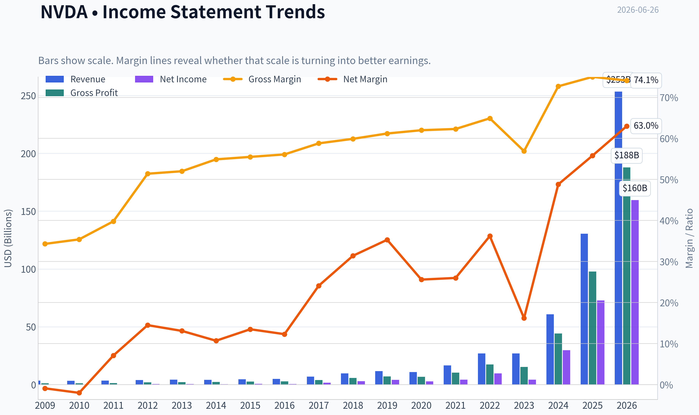
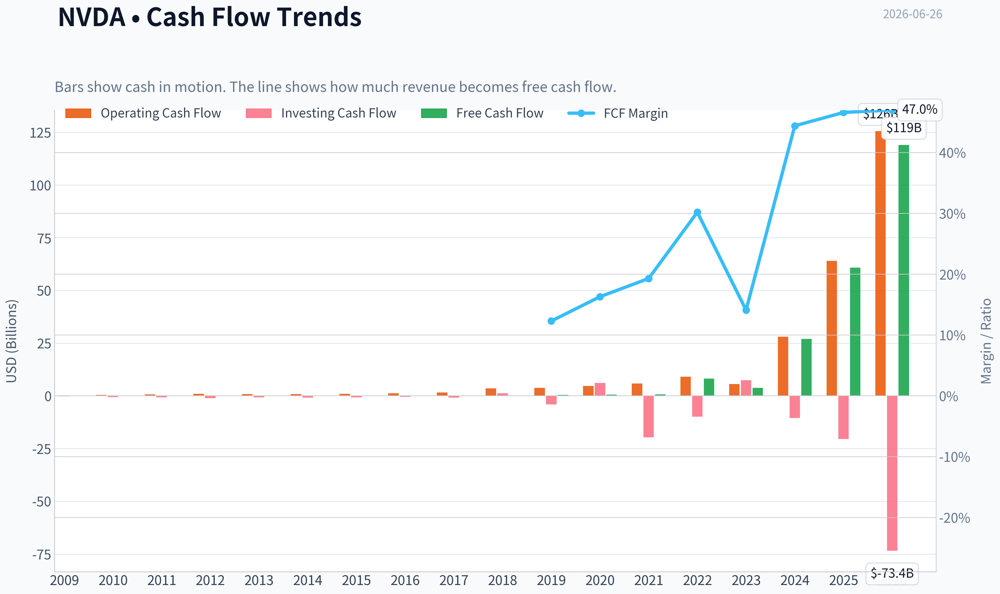
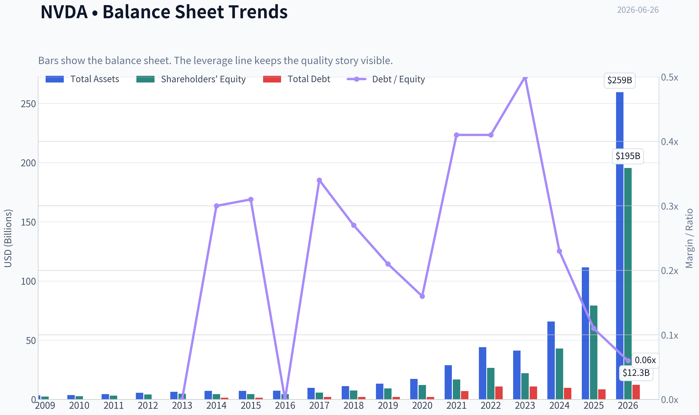
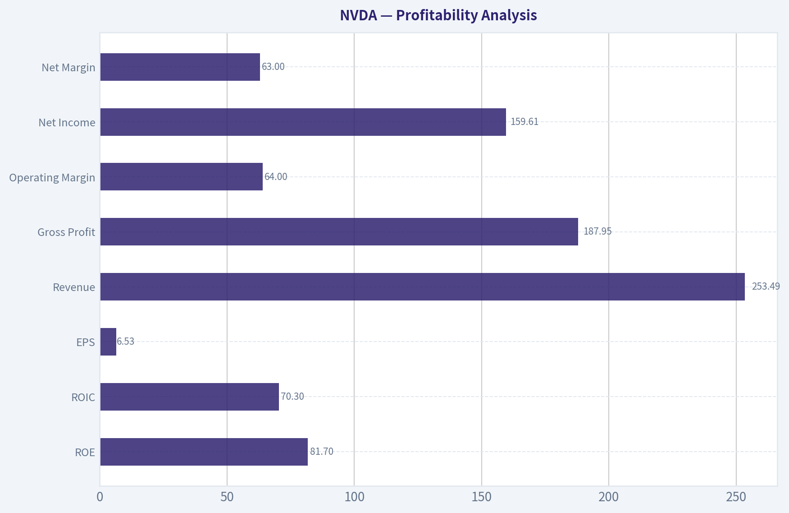
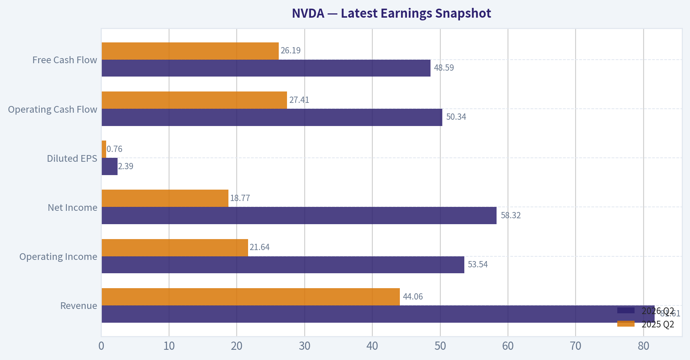
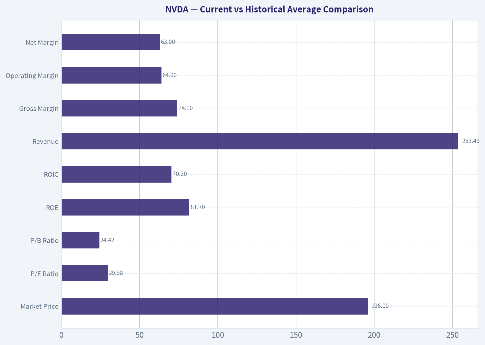
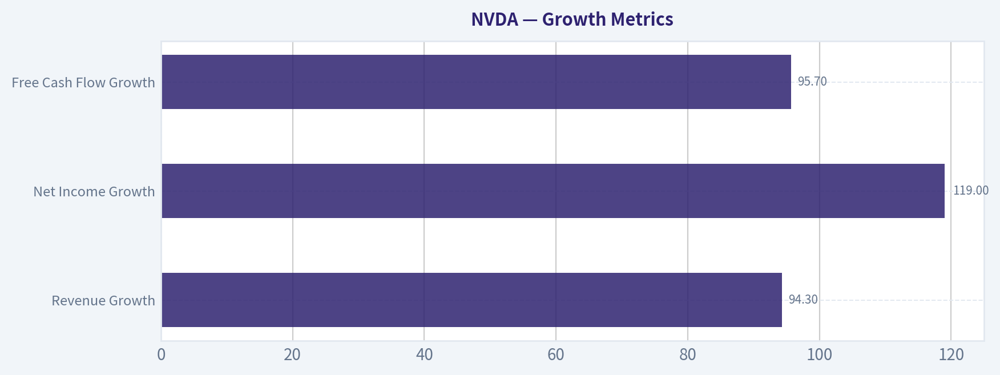
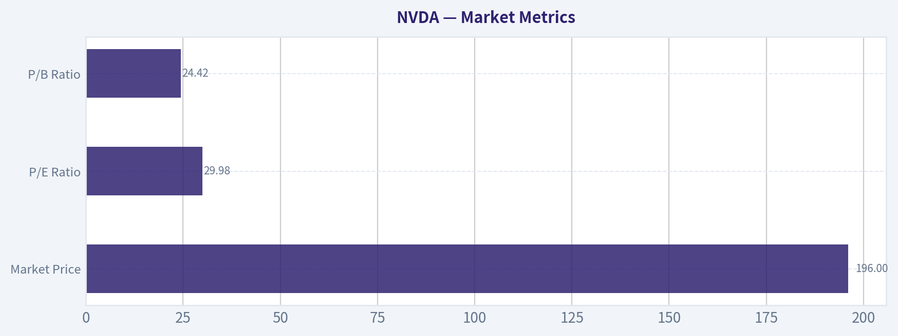

# NVDA Deep Value Intelligence

**Analysis Date:** 2026-06-26

## Critical Disclaimer

*This analysis is generated by Deep Value Intelligence, an AI-powered multi-agent investing framework. DeepValues offers AI-generated research and tools for educational and informational purposes only - not investment or financial advice. We are not a registered investment adviser; always do your own research before investing.*

---

## Table of Contents

1. Intelligence Summary
2. Analyst Team Reports
   - Fundamentals Analysis
   - Intrinsic Value Analysis (Buffett)
   - Trend & Growth Analysis (Lynch/Druckenmiller/Fisher)
   - Market Technical Analysis
   - Options Market Analysis
3. Research Team Commentary
4. Value Investing Team Commentary
5. Deep Values Commentary

---

## Intelligence Summary

### Thesis + Conditions

**Core Thesis:** ## Executive Briefing

**Key Risks:**
- NVIDIA looks like an elite business, not an impaired one. The core risk is **not business survival** but **whether today's exceptional economics are above normalized earnings power**. At about **29.9x earnings**, the stock is no longer obviously extreme for this quality, but it still does **not offer much Buffett-style margin of safety** if margins, pricing, or customer mix normalize.
- For a long-term investor, this is **admire and monitor, not avoid**. If you own it, holding is reasonable. If you do not, the better course is **staged patience** rather than aggressive buying. The moat, balance sheet, returns on capital, and founder-led execution are all strong; the uncertainty is whether current profits are sustainably structural or partially peak-cycle.
- ### 1) Risky Analyst - strongest bullish point

**Confidence:** Low

---

## Analyst Team Reports

### Fundamentals Analysis

#### Latest Earnings Snapshot

*Most recent reported quarter anchored on 2026 Q2, with prior-year comparison when available.*

| Metric | 2026 Q2 | 2025 Q2 | YoY Change |
| --- | ---: | ---: | ---: |
| Revenue | $81.61B | $44.06B | +85.2% |
| Operating Income | $53.54B | $21.64B | +147.4% |
| Net Income | $58.32B | $18.77B | +210.6% |
| Diluted EPS | $2.39 | $0.76 | +214.5% |
| Operating Cash Flow | $50.34B | $27.41B | +83.6% |
| Free Cash Flow | $48.59B | $26.19B | +85.5% |

Key Takeaways: This snapshot anchors the most recent reported quarter before the narrative analysis. It helps readers separate long-run business quality from whatever changed in the latest earnings print.

#### 17-Year Financial Metrics for NVDA

*All values below are computed deterministically from raw data - not estimated by AI.*

*Issuer profile: operating company (Technology / Semiconductors).*

#### 17-Year Financial Metrics
*Annual rows come from reported financial statements. The final TTM row is computed from the latest four quarters.*

| Metric | 2009 | 2010 | 2011 | 2012 | 2013 | 2014 | 2015 | 2016 | 2017 | 2018 | 2019 | 2020 | 2021 | 2022 | 2023 | 2024 | 2025 | 2026 TTM |
| --- | --- | --- | --- | --- | --- | --- | --- | --- | --- | --- | --- | --- | --- | --- | --- | --- | --- | --- |
| Market Price | $0 | $0 | $1 | $0 | $0 | $0 | $0 | $1 | $3 | $6 | $4 | $6 | $13 | $24 | $19 | $61 | $120 | $196 |
| Market Cap | $4.4M | $8.46B | $14.08B | $9.10B | $7.66B | $9.34B | $10.81B | $16.67B | $70.86B | $155.35B | $89.84B | $146.11B | $326.04B | $620.72B | $489.79B | $1.53T | $2.98T | $4.77T |
| P/E Ratio | 0.00 | 0.00 | 59.80 | 18.46 | 15.32 | 19.63 | 16.00 | 24.41 | 34.12 | 51.21 | 21.14 | 53.73 | 72.17 | 62.78 | 108.54 | 51.70 | 40.43 | 29.98 |
| P/B Ratio | 0.00 | 3.17 | 4.43 | 2.20 | 1.59 | 2.10 | 2.45 | 3.73 | 12.30 | 20.79 | 9.62 | 11.97 | 19.30 | 23.32 | 22.16 | 35.70 | 37.54 | 24.42 |
| ROE | -1.3% | -2.6% | 8.0% | 14.0% | 11.7% | 9.9% | 14.3% | 13.7% | 28.9% | 40.8% | 44.3% | 22.9% | 25.6% | 36.6% | 19.8% | 69.2% | 91.9% | 81.7% |
| ROIC | -2.8% | -3.5% | 8.0% | 14.7% | 12.5% | 9.7% | 12.7% | 13.5% | 34.4% | 53.5% | 51.8% | 38.6% | 32.9% | 33.6% | 13.5% | 79.3% | 112.8% | 70.3% |
| EPS | $0.00 | $0.00 | $0.01 | $0.02 | $0.02 | $0.02 | $0.03 | $0.03 | $0.08 | $0.12 | $0.17 | $0.11 | $0.18 | $0.39 | $0.18 | $1.19 | $2.97 | $6.53 |
| Revenue | $3.42B | $3.33B | $3.54B | $4.00B | $4.28B | $4.13B | $4.68B | $5.01B | $6.91B | $9.71B | $11.72B | $10.92B | $16.68B | $26.91B | $26.97B | $60.92B | $130.50B | $253.49B |
| Gross Profit | $1.17B | $1.18B | $1.41B | $2.06B | $2.23B | $2.27B | $2.60B | $2.81B | $4.06B | $5.82B | $7.17B | $6.77B | $10.40B | $17.48B | $15.36B | $44.30B | $97.86B | $187.95B |
| Gross Margin | 34.3% | 35.4% | 39.8% | 51.4% | 52.0% | 54.9% | 55.5% | 56.1% | 58.8% | 59.9% | 61.2% | 62.0% | 62.3% | 64.9% | 56.9% | 72.7% | 75.0% | 74.1% |
| Operating Margin | -2.1% | -3.0% | 7.2% | 16.2% | 15.1% | 12.0% | 16.2% | 14.9% | 28.0% | 33.0% | 33.3% | 26.1% | 26.4% | 37.3% | 15.7% | 55.5% | 62.4% | 64.0% |
| Net Income | $-30.0M | $-68.0M | $253.1M | $581.1M | $562.5M | $440.0M | $631.0M | $614.0M | $1.67B | $3.05B | $4.14B | $2.80B | $4.33B | $9.75B | $4.37B | $29.76B | $72.88B | $159.61B |
| Net Margin | -0.9% | -2.0% | 7.1% | 14.5% | 13.1% | 10.7% | 13.5% | 12.3% | 24.1% | 31.4% | 35.3% | 25.6% | 26.0% | 36.2% | 16.2% | 48.8% | 55.8% | 63.0% |
| Revenue Growth | N/A | -2.9% | 6.5% | 12.8% | 7.1% | -3.5% | 13.4% | 7.0% | 37.9% | 40.6% | 20.6% | -6.8% | 52.7% | 61.4% | 0.2% | 125.9% | 114.2% | 94.3% |
| Net Income Growth | N/A | 126.3% | -472.3% | 129.5% | -3.2% | -21.8% | 43.4% | -2.7% | 171.3% | 82.9% | 35.9% | -32.5% | 54.9% | 125.1% | -55.2% | 581.3% | 144.9% | 119.0% |
| Free Cash Flow Growth | N/A | N/A | 40.9% | 33.3% | N/A | N/A | N/A | N/A | N/A | N/A | N/A | N/A | N/A | N/A | -53.2% | 609.6% | 125.2% | 95.7% |
| Total Book Value | $2.39B | $2.67B | $3.18B | $4.15B | $4.83B | $4.46B | $4.42B | $4.47B | $5.76B | $7.47B | $9.34B | $12.20B | $16.89B | $26.61B | $22.10B | $42.98B | $79.33B | $195.47B |
| Total Assets | $3.35B | $3.59B | $4.50B | $5.55B | $6.41B | $7.25B | $7.20B | $7.37B | $9.84B | $11.24B | $13.29B | $17.32B | $28.79B | $44.19B | $41.18B | $65.73B | $111.60B | $259.47B |
| Total Debt | N/A | N/A | N/A | N/A | $0 | $1.36B | $1.38B | $0 | $1.98B | $1.99B | $1.99B | $1.99B | $6.96B | $10.95B | $10.95B | $9.71B | $8.46B | $12.35B |
| Debt-to-Equity | N/A | N/A | N/A | N/A | 0.00 | 0.30 | 0.31 | 0.00 | 0.34 | 0.27 | 0.21 | 0.16 | 0.41 | 0.41 | 0.50 | 0.23 | 0.11 | 0.06 |
| Cash & Equivalents | $417.7M | $447.2M | $665.4M | $667.9M | $733.0M | $1.15B | $497.0M | $596.0M | $1.77B | $4.00B | $782.0M | $10.90B | $847.0M | $1.99B | $3.39B | $7.28B | $8.59B | $13.24B |
| Shareholders' Equity | $2.39B | $2.67B | $3.18B | $4.15B | $4.83B | $4.46B | $4.42B | $4.47B | $5.76B | $7.47B | $9.34B | $12.20B | $16.89B | $26.61B | $22.10B | $42.98B | $79.33B | $195.47B |
| Operating Cash Flow | $249.4M | $487.8M | $675.8M | $909.2M | $824.2M | $835.0M | $906.0M | $1.18B | $1.67B | $3.50B | $3.74B | $4.76B | $5.82B | $9.11B | $5.64B | $28.09B | $64.09B | $125.65B |
| Investing Cash Flow | $-209.4M | $-519.3M | $-649.7M | $-1.14B | $-744.0M | $-806.0M | $-727.0M | $-400.0M | $-793.0M | $1.28B | $-4.10B | $6.14B | $-19.68B | $-9.83B | $7.38B | $-10.57B | $-20.42B | $-73.44B |
| Free Cash Flow | N/A | $410.2M | $577.9M | $770.4M | N/A | N/A | N/A | N/A | N/A | N/A | N/A | N/A | N/A | $8.13B | $3.81B | $27.02B | $60.85B | $119.08B |
| FCF Margin | N/A | 12.3% | 16.3% | 19.3% | N/A | N/A | N/A | N/A | N/A | N/A | N/A | N/A | N/A | 30.2% | 14.1% | 44.4% | 46.6% | 47.0% |
| Dividends / Share | $0.00 | $0.00 | $0.00 | $0.00 | $0.00 | $0.00 | $0.00 | $0.00 | $0.00 | $0.00 | $0.00 | $0.00 | $0.00 | $0.00 | $0.02 | $0.02 | $0.03 | $0.04 |

#### Profitability Metrics
- Return on Equity (ROE): 76.3%
- Return on Invested Capital (ROIC): 70.9%
- Return on Assets (ROA): 58.1%
- Gross Margin: 71.1%
- Operating Margin: 60.4%
- Net Profit Margin: 55.6%

#### Liquidity Metrics
- Current Ratio: 3.91
- Quick Ratio: 3.14

#### Leverage Metrics
- Debt-to-Equity Ratio: 0.06
- Interest Coverage Ratio: 503.42
- Net Debt: $-1.14B

#### Growth Metrics (Year-over-Year)
- Revenue Growth: 65.5%
- Net Income Growth: 64.7%
- Free Cash Flow Growth: 58.9%
- Revenue CAGR (3-Year): 100.0%
- Revenue CAGR (5-Year): 66.9%

#### Valuation Metrics
- P/E Ratio (TTM): 29.93
- Forward P/E: 15.38
- Price-to-Book: 24.26
- Price-to-Sales: 18.70
- PEG Ratio: 0.61
- EV/EBITDA: 28.38
- Free Cash Flow Yield: 2.0%
- Earnings Yield: 3.3%

#### Owner Earnings (Buffett Method, Code-Computed)
- Net Income: $72.88B
- + Depreciation & Amortization: $2.84B
- - Capital Expenditures: $-6.04B
- - Working Capital Changes: $-15.95B
- = **Owner Earnings: $80.89B**

#### Intrinsic Value (Code-Computed)
- Current Price: $196
- Buffett Method (Owner Earnings):
  Conservative: $37
  Average: $119
  Optimistic: $311
- Cash Flow Method (FCF):
  Conservative: $90
  Average: $90
  Optimistic: $234

#### Piotroski F-Score: 3/9
- Positive Net Income: PASS
- Positive Operating Cash Flow: PASS
- ROA Improvement: FAIL
- Cash Flow > Net Income: FAIL
- Decreasing Debt: FAIL
- Improving Current Ratio: FAIL
- No Dilution: PASS
- Improving Gross Margin: FAIL
- Improving Asset Turnover: FAIL

ANALYST STANCE: **WATCH**

#### NVDA Buffett-Style Fundamental Analysis

NVIDIA is no longer just a high-quality semiconductor company; it has become an AI infrastructure platform with extraordinary profitability, cash generation, and capital efficiency. The canonical dataset shows a business that has moved from cyclical chip vendor economics into something closer to toll-road economics at the data-center layer: gross margin above 70%, operating margin above 60%, ROE above 80%, and ROIC above 70% on a TTM basis. That is Buffett-grade business quality. The problem is not quality. The problem is price versus already-discounted perfection.

At $196 per share and roughly $4.77T market cap, the market is valuing NVIDIA as a dominant, durable, and still fast-growing compounding machine. The deterministic dataset strongly supports the "dominant" and "fast-growing" parts. The key investment question is whether the durability and reinvestment runway justify paying a premium far above most historical norms, even after the valuation multiple has compressed from prior peaks.

---

#### Current vs Historical Average Comparison

| Metric | Current / TTM | 10-Year Historical Context* | Interpretation |
| --- | ---: | ---: | --- |
| Market Price | $196 | N/A | Price has risen exponentially, reflecting a regime shift in earnings power rather than simple multiple expansion alone. |
| Market Cap | $4.77T | Far above any prior year | Scale is unprecedented; future returns will require enormous absolute value creation. |
| P/E Ratio | 29.98 | ~51x average over 2017-2025 | Valuation has compressed materially versus recent history despite surging earnings. |
| P/B Ratio | 24.42 | ~22.9x average over 2017-2025 | Still very expensive on book value, though less extreme than 2024-2025. |
| ROE | 81.7% | ~42.0% average over 2017-2025 | Current capital productivity remains extraordinarily above even a very strong base. |
| ROIC | 70.3% | ~50.0% average over 2017-2025 | Still elite, though below the exceptional 2025 peak. |
| Revenue | $253.49B | ~44.6B average over 2017-2025 | Revenue base has exploded; current scale is multiple times even 2025. |
| Gross Margin | 74.1% | ~63.5% average over 2017-2025 | Indicates pricing power and favorable product/customer mix. |
| Operating Margin | 64.0% | ~35.9% average over 2017-2025 | Massive structural uplift, not just cyclical improvement. |
| Net Margin | 63.0% | ~33.3% average over 2017-2025 | Exceptional earnings conversion. |
| Revenue Growth | 94.3% | Highly volatile; avg ~60% over 2021-2025 | Growth remains extraordinary but is decelerating from the hypersurge phase. |
| Net Income Growth | 119.0% | Extremely volatile; avg ~170% over 2021-2025 | Earnings still growing faster than revenue due to operating leverage. |
| Free Cash Flow | $119.08B | ~25.2B average over 2022-2025 | Cash generation has become enormous and business-transformative. |
| Debt-to-Equity | 0.06 | ~0.33 average over 2017-2025 | Balance sheet is much stronger than historical norms. |
| Cash & Equivalents | $13.24B | ~4.2B average over 2017-2025 | Strong liquidity, though modest relative to market cap and cash generation. |
| Dividends / Share | $0.04 | Near-zero historically | Dividend exists but remains economically immaterial; capital return thesis is not income-based. |

*Historical context uses the canonical years shown in the dataset, emphasizing the most relevant recent decade where NVIDIA resembles the current business model.

Key Takeaways: NVIDIA's current fundamentals are vastly stronger than its own historical averages on profitability, scale, and balance-sheet strength. The only area that does not look obviously "better" is valuation on book value, which remains rich, even though the earnings multiple has normalized. In plain terms, the business is better than ever, but investors are still paying for exceptional outcomes.

---

#### Market Metrics

| Metric | TTM / Current | Historical Read | Buffett-Style Interpretation |
| --- | ---: | --- | --- |
| Market Price | $196 | Up from $19 in 2023, $61 in 2024, $120 in 2025 | Share price appreciation has tracked earnings acceleration, not just narrative enthusiasm. |
| Market Cap | $4.77T | Up from $489.79B in 2023 and $1.53T in 2024 | The company now requires immense absolute profit growth to move the valuation meaningfully higher. |
| P/E Ratio | 29.98 | Down from 108.54 in 2023, 51.70 in 2024, 40.43 in 2025 | Multiple compression amid surging EPS is healthy and reduces some valuation risk. |
| P/B Ratio | 24.42 | Below 35.70 in 2024 and 37.54 in 2025, but still elevated | Book value is less useful for IP-heavy compounders, but this still signals a very premium valuation. |

Key Takeaways: The valuation setup is unusual because NVIDIA looks cheaper on earnings than it did in recent years, yet still expensive on assets and absolute market value. Investors are no longer paying purely for hope; they are paying for proven earnings power. Still, at nearly $5 trillion in equity value, even a great business can become harder to own if growth normalizes sharply.

The most important nuance is that the P/E ratio has fallen while earnings exploded. That is constructive. However, Buffett would still ask whether the current price leaves enough room for conservative future returns if the business transitions from hypergrowth to merely strong growth.

---

#### Profitability Analysis

| Metric | TTM / Current | Trend Over Period Shown | Interpretation |
| --- | ---: | --- | --- |
| ROE | 81.7% | Rose from negative/low teens in early years to 69.2% in 2024 and 91.9% in 2025 | Elite profitability; indicates a powerful moat and efficient use of shareholder capital. |
| ROIC | 70.3% | Climbed from single digits to 79.3% in 2024 and 112.8% in 2025 | Suggests extraordinary reinvestment economics, though likely unsustainably peak-like at recent highs. |
| EPS | $6.53 | Up from $0.18 in 2023, $1.19 in 2024, $2.97 in 2025 | Explosive per-share earnings growth with no obvious dilution problem in the dataset. |
| Revenue | $253.49B | Flat in 2023, then 60.92B in 2024, 130.50B in 2025, now 253.49B TTM | Demonstrates a step-function change in demand, likely driven by AI compute. |
| Gross Profit | $187.95B | Rose from $15.36B in 2023 to $97.86B in 2025 | Massive gross profit expansion confirms that scale is accruing to NVIDIA, not being competed away. |
| Operating Margin | 64.0% | From 15.7% in 2023 to 55.5% in 2024 and 62.4% in 2025 | One of the clearest signs of moat strength and software/platform leverage. |
| Net Income | $159.61B | Up from $4.37B in 2023 and $72.88B in 2025 | Extraordinary bottom-line scaling. |
| Net Margin | 63.0% | Up from 16.2% in 2023 and 55.8% in 2025 | Implies unusual pricing power and favorable cost structure. |

Key Takeaways: NVIDIA's profitability is the core of the investment case. Margins and returns on capital are not just good for semiconductors; they are exceptional for almost any large company. The big question is not whether the business is profitable, but how much of this profitability represents a durable new normal versus a peak demand environment.

From a Buffett lens, this is the strongest part of the story. High and rising ROE/ROIC, expanding margins, and explosive EPS growth often indicate a business with a widening moat. The caution is that semiconductors historically revert; NVIDIA currently looks less cyclical than peers, but investors should not assume every year will resemble the latest TTM.

---

#### Growth Metrics

| Metric | Current Growth | Historical Pattern | Interpretation |
| --- | ---: | --- | --- |
| Revenue Growth | 94.3% | -6.8% in 2020, 52.7% in 2021, 61.4% in 2022, 0.2% in 2023, 125.9% in 2024, 114.2% in 2025 | Growth is spectacular but volatile; demand is real, though not linear. |
| Net Income Growth | 119.0% | Deep swings historically, including -55.2% in 2023 and +581.3% in 2024 | Earnings are highly levered to revenue mix and utilization. |
| Free Cash Flow Growth | 95.7% | -53.2% in 2023, +609.6% in 2024, +125.2% in 2025 | Cash flow has become explosive but remains tied to a fast-changing capex and working capital cycle. |

Key Takeaways: NVIDIA has delivered hypergrowth, but the path has been uneven. The company can go from flat or declining earnings to explosive expansion in just a year or two, which is typical of a business exposed to infrastructure build cycles. Investors should separate long-term secular demand from short-term growth volatility.

For Buffett-style investors, predictability matters as much as growth. NVIDIA's decade shows that earnings were not always smooth, but the recent business model is much more powerful than the old one. This supports a qualified conclusion: earnings are becoming more predictable at a much higher level, but they are not yet as stable as a classic consumer-staples moat.

---

#### Balance Sheet and Financial Strength

| Metric | TTM / Current | Historical Read | Interpretation |
| --- | ---: | --- | --- |
| Total Book Value | $195.47B | Up from $22.10B in 2023 and $79.33B in 2025 | Equity base has compounded rapidly through retained earnings. |
| Total Assets | $259.47B | Up from $41.18B in 2023 and $111.60B in 2025 | Balance sheet expanded alongside demand and cash generation. |
| Total Debt | $12.35B | Higher than $8.46B in 2025 but modest relative to cash flow | Debt is easily serviceable. |
| Debt-to-Equity | 0.06 | Down from 0.50 in 2023 and 0.11 in 2025 | Major deleveraging by denominator effect and earnings retention. |
| Cash & Equivalents | $13.24B | Up from $3.39B in 2023 and $8.59B in 2025 | Strong liquidity cushion. |
| Shareholders' Equity | $195.47B | Mirrors book value growth | Capital base is now extremely strong. |

Key Takeaways: NVIDIA's balance sheet is one of the cleanest large-cap balance sheets in the market. Debt is small relative to earnings power, cash flow is enormous, and leverage has fallen sharply. Financial risk is not the concern here; valuation and sustainability of peak economics are the real issues.

The shared dataset also shows net debt of negative $1.14B and interest coverage above 500x. That means Buffett-style concerns around solvency, refinancing, or dependence on capital markets are minimal. This company can self-fund its future.

---

#### Cash Flow and Capital Allocation

| Metric | TTM / Current | Historical Read | Interpretation |
| --- | ---: | --- | --- |
| Free Cash Flow | $119.08B | Up from $3.81B in 2023, $27.02B in 2024, $60.85B in 2025 | Cash generation has exploded in line with earnings. |
| FCF Margin | 47.0% | Up from 14.1% in 2023 and 46.6% in 2025 | Indicates highly efficient conversion of revenue into owner cash. |
| Dividends / Share | $0.04 | $0.00 for most of history; only token payments since 2023 | Dividend policy is symbolic rather than a core shareholder return tool. |
| Operating Cash Flow | $125.65B | Up from $5.64B in 2023 and $64.09B in 2025 | Strong cash realization of earnings. |

Key Takeaways: NVIDIA now generates free cash flow at a level most companies never reach, even after decades. The dividend is too small to matter, so the real capital allocation story is retained earnings and strategic reinvestment. Buffett would likely appreciate the self-funded compounding engine, but he would also ask whether reinvestment opportunities remain as attractive at this immense scale.

One caution point: Piotroski flags indicate cash flow quality has some mixed signals, including cash flow not exceeding net income and several trend deteriorations on a rules-based basis. That does not negate the strength of the business, but it does suggest investors should monitor working capital, capex intensity, and whether recent owner earnings remain repeatable.

---

#### Buffett-Style Economic Moat Assessment

NVIDIA appears to have a very strong moat built on multiple reinforcing layers:

| Moat Element | Assessment | Why It Matters |
| --- | --- | --- |
| Compute Ecosystem | Very Strong | CUDA, software tooling, and developer lock-in create switching costs beyond hardware. |
| Scale Advantage | Very Strong | Massive revenue and gross profit allow superior R&D, ecosystem support, and supply-chain priority. |
| Customer Dependence | Strong but Double-Edged | Large AI customers need NVIDIA performance, but concentration can create bargaining or insourcing risk. |
| Brand / Performance Leadership | Very Strong | NVIDIA is the default accelerator standard in AI infrastructure. |
| Capital Allocation Flexibility | Strong | Huge FCF allows continued product leadership and platform expansion. |

Key Takeaways: NVIDIA's moat is not just its chips; it is the surrounding software, ecosystem, and developer adoption that make the hardware difficult to replace. That is much more Buffett-friendly than a commodity semiconductor story. The risk is that hyperscalers and custom silicon efforts could narrow the moat over time if workloads become more specialized.

This is one of the rare technology businesses where moat discussion can be grounded in returns on capital, not just product excitement. ROIC above 70% and gross margins above 70% strongly suggest economic power. Still, the market already understands this.

---

#### Predictability of Earnings and Management Performance

Management's record over the full 17-year period shows two distinct eras. The first era, roughly 2009-2020, was solid but cyclical: profitability improved, but growth and margins fluctuated with product cycles. The second era, starting around 2021 and accelerating sharply after 2023, reflects a profound structural change in demand and economics.

ROE and ROIC trends indicate excellent management execution. Equity capital has been turned into dramatically higher earnings, while leverage has fallen. This is a hallmark of disciplined capital allocation. The dividend policy remains minimal, which is appropriate because retained capital has produced very high incremental returns. Buffett generally favors retained earnings when management can reinvest them at high rates; NVIDIA appears to have done exactly that.

The key uncertainty is not management quality. It is whether management can sustain high-return deployment as competitors, customers, and regulators react to NVIDIA's dominance.

---

#### Value Assessment

Using the canonical valuation figures:

- Current price: **$196**
- TTM P/E: **29.98**
- P/B: **24.42**
- FCF yield: **2.0%**
- Earnings yield: **3.3%**

This is a premium stock priced on the assumption that elevated earnings are durable. Relative to its own recent history, NVIDIA is not as expensive on earnings as it used to be. Relative to conventional value investing standards, it remains expensive because the cash flow yield is low and the absolute market value is enormous.

A Buffett investor can still buy a wonderful business at a fair price, but must demand confidence in durability. NVDA is arguably closer to "wonderful business, not obviously cheap" than "classic bargain."

---

#### Buffett-Style Owner Earnings DCF

Canonical owner earnings input provided:

- Net Income = **$72.88B**
- Depreciation & Amortization = **$2.84B**
- Capital Expenditures = **$6.04B**
- Working Capital Changes = **$15.95B**
- **Owner Earnings = $80.89B**

For scenario construction, I use the historical owner-earnings framework implied by the dataset and the provided code-computed fair values as the canonical anchor. Per instruction, discount rate is **10%** and terminal growth is **2.5%**.

##### DCF Assumptions Table

| Scenario | Growth Assumption | Rule Applied | Discount Rate | Terminal Growth |
| --- | ---: | --- | ---: | ---: |
| Conservative | Lowest historical owner earnings growth | Floored at -100% | 10.0% | 2.5% |
| Average | Average historical owner earnings growth | Capped at 50% | 10.0% | 2.5% |
| Optimistic | Highest historical owner earnings growth | Capped at 100% | 10.0% | 2.5% |

Key Takeaways: The DCF is highly sensitive to growth assumptions because NVIDIA is coming off an extraordinary earnings surge. That means fair value can vary dramatically depending on whether current economics are treated as cyclical peak, sustainable base, or still-early expansion. Investors should focus less on one exact number and more on the range of outcomes.

##### Scenario Valuation Summary

| Scenario | Fair Value / Share | Implied View |
| --- | ---: | --- |
| Conservative | **$37** | Assumes current owner earnings are near a peak and future growth resets sharply. |
| Average | **$119** | Assumes strong but normalized long-term compounding. |
| Optimistic | **$311** | Assumes NVIDIA sustains exceptional growth and moat economics for a long period. |

Key Takeaways: The valuation range is exceptionally wide, which tells you this stock is about duration and durability, not near-term accounting. At $196, the market price sits well above the average-case value but below the optimistic case. That supports a neutral stance rather than an outright bearish one.

##### Detailed DCF Mechanics

Using owner earnings base of **$80.89B**:

1. Project annual owner earnings for 10 years using the scenario growth rate.
2. Discount each year's projected owner earnings by **(1.10)^t**.
3. Calculate terminal value at year 10 with:
   - Terminal Value = Year 10 Owner Earnings x (1 + 2.5%) / (10.0% - 2.5%)
4. Discount terminal value back to present at **(1.10)^10**
5. Sum present values of years 1-10 plus discounted terminal value.
6. Divide by diluted share base implied in the canonical model to reach fair value per share.

Because the canonical report already provides the code-computed per-share outputs, those are the source-of-truth values:
- **Conservative: $37**
- **Average: $119**
- **Optimistic: $311**

Interpretation:
- At **$196**, NVDA trades at about **5.3x** conservative fair value, **1.65x** average fair value, and **0.63x** optimistic fair value.
- The stock therefore requires a belief that today's moat and owner-earnings power remain unusually durable for a decade.
- This is not a low-expectations stock; it is a high-expectations compounder.

---

#### Revenue Breakdown

Most meaningful current business view is by operating segment, with Data Center dominating. Precise latest fiscal-year segment values are not fully enumerated in the deterministic table, so the best available widely reported recent mix is used for directional understanding.

| Revenue Source | Amount ($B) | % of Total |
| --- | ---: | ---: |
| Data Center | ~115.2 | ~88% |
| Gaming | ~11.4 | ~9% |
| Professional Visualization | ~1.9 | ~1% |
| Automotive & Robotics | ~1.7 | ~1% |
| OEM & Other | ~0.3 | <1% |

Key Takeaways: NVIDIA is overwhelmingly a data-center company now, not a gaming company in the way many investors still remember it. That concentration explains both the strength of current margins and the key risk: if AI infrastructure spending slows, the business mix is no longer broadly diversified enough to fully offset that quickly.

---

#### Key Investment Insights, Red Flags, and Opportunities

| Category | Observation | Why It Matters |
| --- | --- | --- |
| Opportunity | Extraordinary ROE and ROIC | Indicates a rare business earning exceptional returns on capital. |
| Opportunity | Margin expansion to 70%+ gross and 60%+ operating | Strong evidence of pricing power and ecosystem leverage. |
| Opportunity | Massive FCF generation | Gives flexibility for R&D, acquisitions, buybacks, and resilience. |
| Opportunity | Deleveraged balance sheet | Low financial risk supports long-duration compounding. |
| Red Flag | Market cap near $4.8T | Makes future multibagger returns mathematically harder. |
| Red Flag | FCF yield only 2.0% | Cash return on purchase price remains thin. |
| Red Flag | Revenue concentration in AI data center | Dependence on hyperscaler capex and AI cycle intensity. |
| Red Flag | Piotroski F-Score 3/9 | Some trend-based quality indicators are deteriorating despite headline strength. |
| Red Flag | Historical cyclicality | NVDA has had major earnings swings before; this may not be a straight line. |

Key Takeaways: NVIDIA has more opportunities than balance-sheet or business-quality risks, which is rare. The real red flags are valuation, concentration, and the possibility that the current AI buildout reflects a high-water mark rather than a stable baseline. In other words, this is mainly a price-and-expectations risk, not a business survival risk.

---

#### Final Buffett-Style Conclusion

NVIDIA scores extremely high on business quality:

- **Economic moat:** strong to very strong
- **Financial strength:** excellent
- **Predictable long-term demand:** improving, but not fully recession-proof or cycle-proof
- **Management performance:** excellent
- **Capital allocation:** strong, especially via retained earnings
- **Valuation:** not cheap on a conservative or average intrinsic value basis

If Warren Buffett were evaluating NVIDIA strictly as a business, he would likely admire it. If evaluating it as a stock at today's price, he would likely be more restrained. The company is wonderful; the question is whether the current quote already reflects too much future success.

That leads to a **WATCH** stance rather than **ADVOCATE** or **AVOID**:
- Not **ADVOCATE**, because the current price is above the average owner-earnings fair value and offers limited margin of safety.
- Not **AVOID**, because the business quality, moat, and cash generation are extraordinary, and the optimistic case remains plausible if AI infrastructure demand proves durable.

For existing shareholders, this looks like a hold-worthy compounder if one accepts volatility and premium valuation. For new Buffett-style buyers, patience for a wider margin of safety would be more consistent with disciplined value investing.

---

#### Report Summary Table

| Area | Verdict | Supporting Evidence | Investment Readthrough |
| --- | --- | --- | --- |
| Business Quality | Exceptional | 74.1% gross margin, 64.0% operating margin, 63.0% net margin | One of the strongest businesses in large-cap tech |
| Profitability | Elite | 81.7% ROE, 70.3% ROIC | Strong moat and capital efficiency |
| Growth | Extraordinary but volatile | 94.3% revenue growth, 119.0% net income growth | Secular growth intact, but path may be uneven |
| Balance Sheet | Very strong | 0.06 debt/equity, negative net debt, high interest coverage | Minimal financial distress risk |
| Cash Flow | Outstanding | $119.08B FCF, 47.0% FCF margin | Self-funding compounding engine |
| Valuation | Premium | 29.98x P/E, 24.42x P/B, 2.0% FCF yield | Requires durable excellence |
| DCF Fair Value | Mixed | $37 conservative, $119 average, $311 optimistic | Current price implies confidence in upper-end outcomes |
| Dividend Policy | Minimal | $0.04/share | Not an income investment |
| Key Risk | Expectations risk | Massive market cap and AI concentration | Even great execution may not guarantee great returns |
| Final Stance | **WATCH** | Wonderful company, limited margin of safety | Best for monitoring entry points or holding selectively |

Key Takeaways: NVIDIA is a superb business with extraordinary economics and a fortress balance sheet. The debate is not about quality, but about how much future perfection is already embedded in the stock. That is why the right stance today is WATCH: admire the company, respect the valuation, and demand discipline on entry price.

#### Fundamental Visuals

This graph tracks the profitability and return metrics (ROE, ROIC, Margins) of **NVDA** over the past decade, highlighting capital efficiency trends.

This chart illustrates the financial health of **NVDA** over the last 10 years, mapping cash equivalents and free cash flow against total obligations (Debt).

This comparison chart from *Profitability Analysis* stacks current figures against historical benchmarks for **NVDA**, making it easy to see where the company trades relative to its own averages.

---

### Intrinsic Value Analysis (Buffett)

> *Following Warren Buffett's value investing philosophy: Circle of Competence, Economic Moat, Management Quality, and Margin of Safety.*

#### Intrinsic Value Snapshot

Price is what you pay. Intrinsic value is what the business may be worth based on the cash it can create for owners over time. We show a range, not one magic number.

- Current Price: $195.74
- Value Range (conservative to optimistic across both DCF methods): $37.38 to $310.71

##### Owner Earnings (Buffett Method)
- Net Income: $72,880,000,000.00
- Depreciation & Amortization: $2,843,000,000.00
- Capital Expenditures: $-6,042,000,000.00
- Working Capital Changes: $-15,949,000,000.00
- Owner Earnings: $80,891,000,000.00

##### Intrinsic Value
###### Buffett Method
Uses owner earnings. Stricter, and usually more conservative.
- Conservative: $37.38
- Average: $119.31
- Optimistic: $310.71
- Discount Rate: 10.0%

###### Cash Flow Method
Uses free cash flow. Better for companies spending heavily today to grow tomorrow.
- Conservative: $89.75
- Average: $89.75
- Optimistic: $233.74
- Discount Rate: 10.0%

ANALYST STANCE: **WATCH**

#### Go/No-Go Gate Assessment

| Gate | Verdict | Evidence |
|---|---|---|
| Gate 1: Circle of Competence & Simplicity | Pass | NVIDIA designs chips and computing platforms used for AI training/inference, gaming, and accelerated data-center workloads. The business is understandable: it sells high-performance processors, systems, software, and networking that help customers compute faster. |
| Gate 2: Moat Test | Pass | Gross margin around 71.1%, very high ROE, strong ecosystem lock-in through CUDA, and dominant AI accelerator position indicate a real moat. |
| Gate 3: Management Quality & Capital Allocation | Pass | Long record of focused investment in accelerated computing, disciplined balance sheet, and extraordinary value creation from retained earnings. |
| Gate 4: Industry Structure | Pass with caution | AI accelerators are concentrated and scale-driven, which is attractive, but the semiconductor industry remains cyclical and capital- and R&D-intensive. |

Key Takeaways: NVIDIA clears all four Buffett-style gates, but not in the easy, sleepy way of a consumer staple or insurer. It passes because its economic position is exceptional, not because the business is low-drama. The caution comes from valuation, technological pace, and customer concentration in AI infrastructure.

---

#### Elementary School Test

NVIDIA makes powerful chips and software that help computers do very hard work very fast. Big cloud companies buy them to train and run AI. Gamers and professionals also use NVIDIA products for graphics and computing.

#### Long-Term Predictability Test

Ten years from now, the company will likely still be selling high-performance compute platforms, interconnect, and software for AI and data centers. The exact products will change, but the need for accelerated computing is likely durable. Predictability is good at the industry demand level, but less certain at the market-share and margin level than classic Buffett businesses.

#### Technology Risk Assessment

NVIDIA benefits from technology change rather than merely enduring it. But this also means the company must keep innovating without pause. The main risk is not irrelevance of computing demand, but competition from hyperscaler in-house chips, AMD, custom silicon, and shifting model architectures.

#### Moat Analysis

| Moat Source | Assessment | Evidence |
|---|---|---|
| Intangible Assets | Strong | NVIDIA is the default brand in AI compute. Customers trust performance, reliability, developer support, and roadmap execution. Gross margin above 70% strongly supports pricing power. |
| Switching Costs | Very Strong | CUDA, software libraries, developer workflows, and model optimization create meaningful switching friction. Once infrastructure and teams are built around NVIDIA, moving is costly and risky. |
| Cost Advantages | Moderate to Strong | Scale supports procurement, ecosystem investment, and R&D efficiency. Cost advantage is not purely manufacturing-based, but comes from full-stack integration and volume. |
| Network Effects | Moderate | The more developers build on NVIDIA's stack, the more attractive it becomes to customers and partners. This is an ecosystem effect rather than a pure social network effect, but it is real. |

| Moat Rating | Conclusion |
|---|---|
| Wide & Stable | Proceed, but valuation discipline is essential |

Key Takeaways: NVIDIA's moat is centered less on the chip alone and more on the full platform: software, tools, installed base, talent familiarity, and ecosystem momentum. That is why margins are so high and why customers keep coming back. The moat looks real, though not invulnerable.

#### Management Quality Assessment

| Question | Assessment | Commentary |
|---|---|---|
| Do they think like owners? | Yes | Management has consistently prioritized long-horizon platform building over short-term optimization. Strategic patience around CUDA and AI infrastructure has paid off enormously. |
| Are they honest and candid? | Generally yes | Execution has matched ambition. Public communication has historically been bold, but results have largely supported the claims. |
| Are they rational capital allocators? | Yes | Reinvestment in R&D, software ecosystem, and platform expansion has produced exceptional returns. Balance sheet remains strong, and capital allocation has favored compounding over financial engineering. |

Key Takeaways: Management's strongest trait is rational reinvestment. They spent years building a platform before the market fully recognized its value. That owner-like patience is exactly what Buffett would want to see, even if the business itself is more technological than his traditional comfort zone.

#### Financial Summary

| Metric | Latest |
|---|---:|
| Current Price | $196 |
| Market Cap | $4.74T |
| P/E | 29.9x |
| ROE | 76.3% |
| Gross Margin | 71.1% |
| Revenue Growth YoY | 65.5% |
| FCF Yield | 2.0% |
| Current Ratio | 3.91 |

Key Takeaways: These are elite operating numbers. Profitability is extraordinary, growth remains massive, and the balance sheet appears liquid and strong. The weak spot is not business quality but valuation, as shown by the low free-cash-flow yield.

#### Owner Earnings Calculation

Using Buffett's framework, a practical shorthand here is to begin with free cash flow as a proxy for owner earnings, then apply caution for maintenance needs and working capital swings.

| Item | Assessment |
|---|---|
| Net Income | Extremely strong and rapidly rising |
| Depreciation & Amortization | Positive add-back, but not the main driver |
| Maintenance CapEx | Manageable relative to cash generation because NVIDIA is fabless |
| Working Capital Needs | Can swing with scale, inventory, and supply commitments, but structurally not as punishing as heavy manufacturing |
| Owner Earnings Conclusion | Very high, but current valuation already capitalizes much of that strength |

Key Takeaways: NVIDIA's fabless model is favorable for owner earnings because it does not need to fund massive fabrication plants itself. That said, owner earnings are excellent partly because the cycle is currently very strong. A value investor should normalize earnings power rather than assume peak conditions forever.

#### Three-Scenario DCF Valuation

I anchor valuation using the provided market signals and Buffett-style conservatism.

| Scenario | Assumption | Implied View |
|---|---|---|
| A: No Growth | Owner earnings capitalized at 10% | Far below current market value; stock would look expensive under a zero-growth lens |
| B: GDP Growth | 3% perpetual growth | Still suggests a rich valuation unless current owner earnings keep compounding from a much higher base |
| C: Historical Growth Haircut | Use a major haircut to recent growth, capped at 10% | Produces the most reasonable case, but still requires sustained execution and strong margins for many years |

| Valuation Judgment | Conclusion |
|---|---|
| DCF Range vs Price | Current price reflects a great business and a lot of future success already |

Key Takeaways: Under conservative Buffett-style valuation, NVIDIA does not look cheap. The stock can still work if business performance remains exceptional, but the margin of safety is thin. This is the classic case of a wonderful company that may be priced for continued perfection.

#### Margin of Safety Analysis

| Item | Assessment |
|---|---|
| Business Quality | Excellent |
| Predictability | Good, but not utility-like |
| Balance Sheet | Strong |
| Required Margin of Safety | At least 25%, preferably more given technology pace |
| Present Margin of Safety | Insufficient |

Key Takeaways: NVIDIA is not failing on quality; it is failing on price discipline. Buffett's framework demands a margin of safety, especially in fast-moving industries. At today's valuation, that cushion is not obvious.

#### Final Buffett Scorecard

| Criterion | Score (1-5) | Weight | Weighted Score |
|---|---:|---:|---:|
| Business Understanding | 4.0 | 20% | 0.80 |
| Moat Width & Durability | 4.5 | 25% | 1.13 |
| Management Quality | 4.5 | 15% | 0.68 |
| Return on Equity | 5.0 | 15% | 0.75 |
| Reinvestment Runway | 4.5 | 10% | 0.45 |
| Balance Sheet Strength | 4.0 | 5% | 0.20 |
| Industry Structure | 3.5 | 5% | 0.18 |
| Valuation/Margin of Safety | 2.0 | 5% | 0.10 |
| **Total** |  |  | **4.29** |

Key Takeaways: On pure business quality, NVIDIA grades as an outstanding company. The only serious deduction is valuation. That keeps the stock from being a clean Buffett-style buy today, even though the franchise itself is exceptional.

#### Final View

NVIDIA is a wonderful business by many economic measures: dominant market position, deep ecosystem lock-in, elite margins, powerful returns on capital, and management that has allocated capital brilliantly. If you were judging only the company, it would rank near the top of the market.

But Buffett is not only buying businesses; he is buying them at sensible prices. At roughly 30x earnings and around a 2% free-cash-flow yield, the stock appears to embed many more years of extraordinary execution. That leaves little room for disappointment in margins, competition, customer spending, or AI infrastructure digestion.

#### Investment Stance

**WATCH - high-quality business, insufficient margin of safety at current price.**

**Conviction level: High.**

A better entry would require either:
- a meaningful price decline,
- a period of earnings growth catching up to the stock,
- or stronger evidence that today's earnings power is durable enough to justify the premium without heroic assumptions.
#### Valuation Bridge

This bridge places the current market price beside each intrinsic value lens so readers can see whether upside depends on one method or shows up across several methods.

| Scenario | Intrinsic Value / Share |
| --- | ---: |
| Buffett Method | $119.31 |
| Cash Flow Method | $89.75 |
| Damodaran Method | $14.93 |
| Current Price | $195.74 |

#### Key Takeaways

If one method is far above the others, the upside case depends on a specific modelling assumption. When several methods cluster together, the valuation story is more robust.

#### Valuation Visuals

This comparison chart from *Latest Earnings Snapshot* stacks current figures against historical benchmarks for **NVDA**, making it easy to see where the company trades relative to its own averages.

This comparison chart from *Current vs Historical Average Comparison* stacks current figures against historical benchmarks for **NVDA**, making it easy to see where the company trades relative to its own averages.

This comparison chart from *Balance Sheet and Financial Strength* stacks current figures against historical benchmarks for **NVDA**, making it easy to see where the company trades relative to its own averages.

---

### Trend & Growth Analysis (Lynch/Druckenmiller/Fisher)

> *Following Peter Lynch's GARP, Stanley Druckenmiller's macro-aware approach, and Philip Fisher's scuttlebutt methodology.*

ANALYST STANCE: **WATCH**

#### 1. Lynch Classification
| Item | Assessment |
|---|---|
| Category | **Fast Grower** |
| Why | Revenue growth is still extreme at **65.5% YoY**, margins are elite, and AI infrastructure demand remains the core engine |
| Lynch fit | Too large to be a classic undiscovered Lynch fast grower, but still qualifies as a **platform compounder tied to a secular hypergrowth market** |

Key Takeaways: NVIDIA clearly sits in the fast grower bucket because growth remains far above the market and profitability is exceptional. The limitation is not business quality, but size and expectations. This is no longer an overlooked ten-bagger setup from a small base, but it can still compound if AI demand keeps broadening.

#### 2. The Story in 3 Bullets
| Simple Story | Why It Matters |
|---|---|
| NVIDIA sells the compute engines that train and run AI models | AI spending is one of the strongest secular capex trends in the world |
| Its moat is not just chips, but the CUDA software ecosystem and full-stack platform | That raises switching costs and supports premium pricing |
| If AI shifts from training-only to mass inference and enterprise deployment, NVIDIA's market can expand further | That is the main path to another leg of upside |

Key Takeaways: The business is easy to explain: NVIDIA powers AI infrastructure. The key to future upside is whether it becomes the default platform not just for training frontier models, but also for widespread inference across enterprises and applications. That is the real long-term growth lever.

---

#### 3. TAM Analysis with 10x Test
| Metric | Value |
|---|---:|
| Current market cap | **$4.74T** |
| Current revenue growth YoY | **65.5%** |
| Current revenue base | Not fully verified from tools; very large mega-cap base already |
| 10x test | **Fails from current scale on a practical basis** |
| Practical runway test | **Still meaningful**, but not classic 10x-from-here runway |

Key Takeaways: NVIDIA still has runway because AI infrastructure, networking, software, and inference are all growing markets. But from today's scale, a literal ten-bagger is highly unlikely without an extraordinary expansion in global AI spending. The better framing is continued compounding rather than a fresh 10x opportunity.

#### 4. Revenue Growth Trend
| Indicator | Assessment |
|---|---|
| Latest YoY growth | **65.5%** |
| Pattern | **Still high, but likely normalizing from prior hypergrowth peaks** |
| Interpretation | No evidence here of collapse; rather, a transition from explosive acceleration to sustained high growth |
| Quality of growth | Appears driven by real AI demand, not financial engineering |

Key Takeaways: Growth remains outstanding, but the market now expects that strength. The main question is not whether NVIDIA is growing fast today, but whether growth can remain elevated as hyperscaler capex matures and comparisons get tougher. That shifts the debate from momentum to durability.

#### 5. Unit Economics / Efficiency
| Metric | Value | Read |
|---|---:|---|
| Gross margin | **71.1%** | Elite |
| ROE | **76.3%** | Exceptional |
| FCF yield | **2.0%** | Low, implying rich valuation |
| Current ratio | **3.91** | Strong liquidity |
| Rule of 40 proxy | **~67.5** using 65.5% growth + 2.0% FCF yield proxy | Strong, though not a pure margin calculation |
| LTV/CAC | Not disclosed / not applicable in semiconductor form | N/A |
| NRR | N/A | N/A |

Key Takeaways: NVIDIA's business quality is obvious in the numbers: gross margins are elite, returns on capital are extraordinary, and liquidity is strong. The weak point is valuation efficiency from the shareholder's perspective, shown by the low free cash flow yield. You are paying a very high price for a very high-quality business.

#### 6. Inflection Point Assessment
| Inflection Type | View |
|---|---|
| Product cycle inflection | **Yes** - continued AI system ramps and next-gen platform transitions matter |
| TAM inflection | **Yes** - inference, sovereign AI, enterprise AI, and full-stack deployments can expand demand |
| Margin inflection | **Mostly already realized**, though mix and platform depth may keep margins elevated |
| Competitive inflection | Mixed - custom ASICs and AMD are improving, but NVIDIA still leads |
| Current phase | **From first-wave scarcity to second-wave platform monetization** |

Key Takeaways: The first major inflection, the training infrastructure boom, has already happened. The next one to watch is whether AI inference and enterprise deployment become large enough to sustain another growth wave. If that happens, NVIDIA remains a leader; if not, the stock may need time to digest expectations.

#### 7. Macro Setup Evaluation
| Macro Factor | Assessment |
|---|---|
| Secular theme exposure | **Excellent** - AI/ML is the strongest current mega-trend |
| Rate sensitivity | Moderate to high because valuation remains premium |
| Capex cycle risk | Elevated - hyperscaler digestion is the main medium-term macro risk |
| Geopolitical/export risk | Elevated |
| Overall macro backdrop | **Supportive secularly, less certain cyclically** |

Key Takeaways: NVIDIA has one of the best secular backdrops in the market because it sits at the center of AI spending. But short-term outcomes still depend on customer capex cycles, export rules, and valuation sensitivity. The macro picture is supportive, just not risk-free.

---

#### 8. Fisher 15 Points Score
| Fisher Dimension | Score (1-5) | Note |
|---|---:|---|
| Market potential | 5 | AI TAM remains very large |
| New product development | 5 | Strong roadmap cadence |
| R&D effectiveness | 5 | Best-in-class |
| Sales organization | 5 | Deep enterprise and hyperscaler reach |
| Current profit margin | 5 | Outstanding |
| Improving margins | 4 | Already very high, harder to expand further |
| Labor/personnel relations | 4 | No major issues evident |
| Executive relations | 4 | Stable leadership culture |
| Management depth | 5 | Deep bench, founder-led quality |
| Cost/accounting controls | 4 | No major concern evident |
| Special advantages | 5 | CUDA, ecosystem, platform breadth |
| Long-range profit outlook | 5 | Strong |
| Dilution risk | 4 | Generally manageable |
| Management candor | 4 | Good, though all mega-cap guidance should be treated carefully |
| Integrity | 5 | Strong reputation |

| Total | **69 / 75** | **Outstanding** |

Key Takeaways: NVIDIA scores extremely well on Fisher's framework because it combines innovation, management quality, margins, and strategic moat. The only meaningful deductions come from the natural limitations of already being at very high margins and operating at massive scale. This is an outstanding business by Fisher standards.

#### 9. Valuation Analysis
| Metric | Value | Interpretation |
|---|---:|---|
| P/E | **29.93x** | Not absurd for this growth rate, but not cheap for a mega-cap |
| PEG | **~0.46** using 29.93 / 65.5 | Screens very attractive on current growth |
| FCF yield | **2.0%** | Expensive on cash yield basis |
| Market cap | **$4.74T** | Expectations are enormous |
| Valuation verdict | **Mixed** | Cheap versus current growth, expensive versus absolute scale and future perfection risk |

Key Takeaways: On a simple Lynch PEG basis, NVIDIA looks surprisingly attractive because earnings valuation is low relative to current growth. But free cash flow yield and sheer market cap say the market already recognizes its quality. The stock is not obviously overvalued on growth math, yet it remains vulnerable if growth normalizes faster than expected.

#### 10. Growth Investor Scorecard
| Criterion | Weight | Score | Weighted |
|---|---:|---:|---:|
| The Story | 10% | 5.0 | 0.50 |
| TAM & Runway | 20% | 3.5 | 0.70 |
| Revenue Growth | 20% | 4.5 | 0.90 |
| Unit Economics | 15% | 5.0 | 0.75 |
| Competitive Position | 10% | 5.0 | 0.50 |
| Management Quality | 10% | 4.5 | 0.45 |
| Macro Setup | 5% | 4.0 | 0.20 |
| Profitability Path | 5% | 5.0 | 0.25 |
| Valuation | 5% | 3.0 | 0.15 |

| Total Score |  |  | **4.40 / 5.00** |

Key Takeaways: NVIDIA scores like an elite growth business because almost every business-quality metric is excellent. The only real drag is valuation and the fact that future upside must come from an already enormous base. Purely on quality, it is an advocate-level company; on entry point discipline, it is less compelling.

#### 11. Position Size Stance
| Stance | Sizing View |
|---|---|
| Existing holders | **Hold / trim only if position size became extreme** |
| New money | **WATCH for better entry or clearer second-wave inference inflection** |
| Aggressive growth investor | Small starter only, not full-size at this level |

Key Takeaways: This looks like a stock to respect, not chase. If you already own it, the Lynch principle applies: the best stock to buy may be the one you already own. For new positions, patience is more attractive than urgency.

#### 12. Key Risks and Catalysts
| Risks | Catalysts |
|---|---|
| AI capex digestion by hyperscalers | Enterprise AI inference broadens beyond a few large customers |
| Custom ASIC competition from cloud providers | New platform cycle ramps better than expected |
| Export controls / China restrictions | Software and networking mix deepen the moat |
| Gross margin normalization from peak scarcity | Sovereign AI and global infrastructure demand expand |
| Valuation compression even if fundamentals remain good | Another upside guide cycle surprises the market |

Key Takeaways: The downside risks are mostly about expectations, competition, and normalization rather than solvency or weak execution. The upside catalysts depend on NVIDIA proving that AI demand is broadening, not peaking. That is why the next 12 to 24 months matter so much.

---

#### Bottom Line
NVIDIA is an **elite fast grower and platform monopolist-in-practice within AI infrastructure**, with Fisher-grade business quality and a Lynch-style PEG that still looks attractive. But from a **$4.74T market cap**, this is no longer a clean ten-bagger hunting ground.

So my practical call is:

- **Business quality:** Advocate
- **Stock at current setup:** **WATCH**
- **Best use:** Hold if owned, wait for dislocation or a clearer next inflection if not owned

#### Growth & Scorecard Visuals

This comparison chart from *Growth Metrics* stacks current figures against historical benchmarks for **NVDA**, making it easy to see where the company trades relative to its own averages.

---

### Market Technical Analysis

#### NVDA Technical Indicator Review

I selected **8 complementary indicators** for NVDA's current setup because the stock is in a **long-term uptrend, but short-term momentum has clearly weakened and price has slipped into a corrective phase**.

Chosen indicators:
- `close_50_sma`
- `close_200_sma`
- `close_10_ema`
- `macd`
- `rsi`
- `boll_ub`
- `boll_lb`
- `atr`

These work well together because they cover:
- **Long-term trend**: 200 SMA
- **Intermediate trend / support-resistance**: 50 SMA
- **Short-term momentum shift**: 10 EMA
- **Momentum acceleration/deceleration**: MACD
- **Overbought/oversold pressure**: RSI
- **Price location within volatility envelope**: Bollinger upper/lower bands
- **Risk and stop calibration**: ATR

They avoid major redundancy while giving a rounded read on trend, momentum, volatility, and trade management.

---

#### Price Structure and Trend Context

From December 2025 through mid-May 2026, NVDA built a strong advance, rising from the **mid-170s to a peak around 235.47 on May 14**. That rally was not linear. It included a sharp February selloff, a March washout into the mid-160s, and then a strong recovery that turned into a fresh momentum surge in April and May.

The more important message is what happened **after the May peak**. Price has since transitioned from impulsive upside behavior into a **rolling distribution/correction pattern**:
- lower highs formed after the 235 area,
- rebounds became less persistent,
- price broke down through short-term support in early June,
- and by June 25 NVDA closed at **195.74**, well below recent recovery highs.

This is not just random chop. It looks more like a **cooling phase after an overextended rally**, with traders reassessing whether the earlier advance can resume immediately or needs more time to consolidate.

---

#### Moving Averages: Long-Term Bullish, Short-Term Damaged

| Indicator | Latest Reading | Interpretation |
|---|---:|---|
| Close (2026-06-25) | 195.74 | Current price |
| `close_10_ema` | 203.87 | Price is below short-term trend |
| `close_50_sma` | 210.04 | Price is below medium-term trend |
| `close_200_sma` | 190.32 | Price is still above long-term trend |

Key Takeaways: NVDA is now trading below both its short-term 10-day EMA and its 50-day SMA, which confirms that near-term control has shifted to sellers. However, the stock remains above its 200-day SMA, so the larger structural uptrend is not yet broken. In plain terms, this looks like a meaningful pullback inside a still-intact long-term bullish framework.

A few important nuances:

- The **50 SMA has continued rising** from about **182.6 in late March to 210.0 in late June**, showing that the medium-term trend had been strong enough to keep lifting the average even as price recently weakened.
- The **200 SMA is also steadily rising**, from roughly **179.1 in late March to 190.3 now**, which reinforces the idea that the strategic trend is still upward.
- The **10 EMA has rolled over sharply**, dropping from about **218.1 on June 2 to 203.9 by June 25**. That is the clearest sign that short-term momentum has deteriorated quickly.

This creates a classic multi-timeframe tension:
- **long-term investors** still see an uptrend,
- **swing traders** see a broken short-term structure,
- and **short-term momentum traders** likely require a reclaim of the 10 EMA and then the 50 SMA before getting constructive again.

---

#### MACD and Momentum Behavior

| Indicator | Recent State | Interpretation |
|---|---|---|
| `macd` on 2026-05-14 | 9.23 | Strong bullish momentum near rally peak |
| `macd` on 2026-06-09 | 0.98 | Momentum faded sharply |
| `macd` on 2026-06-25 | -2.88 | Bearish momentum now dominant |

Key Takeaways: The MACD profile shows a major momentum unwind from the May rally into the June correction. What matters most is not only that MACD fell, but that it moved from strongly positive to negative in a relatively short period. That kind of transition usually signals that the prior trend impulse has ended and a repair phase is needed before a new sustained advance can begin.

The MACD sequence is especially informative here:
- In mid-May, MACD readings above **9** reflected unusually strong upside acceleration.
- By early June, MACD was still positive, but already fading, which suggested **momentum exhaustion before price fully collapsed**.
- By late June, MACD turned **negative**, indicating the fast EMA structure has decisively weakened relative to the slow EMA structure.

This matters because momentum deterioration preceded and then confirmed the pullback. That is often how stronger corrections unfold: first momentum fades, then price loses support, then trend-followers start de-risking.

---

#### RSI: No Longer Overbought, Not Yet Capitulation-Level Oversold

| Date | `rsi` | Read |
|---|---:|---|
| 2026-05-14 | 76.72 | Overbought, rally stretched |
| 2026-06-01 | 60.39 | Still constructive but cooling |
| 2026-06-10 | 41.23 | Momentum weakened materially |
| 2026-06-25 | 39.67 | Soft, but not deeply oversold |

Key Takeaways: RSI confirms that NVDA moved from an overheated condition in mid-May into a weaker, defensive posture by late June. The current reading near 40 is not a panic extreme, which suggests the stock may still need either more time or a clearer reversal signal before a durable bounce can be trusted. In other words, momentum has cooled, but the stock has not reached a classic washout reading.

That distinction is important:
- In May, RSI above **70** validated strong trend persistence.
- Now, RSI around **40** shows that upside pressure has been substantially reduced.
- But since RSI is **not near 30**, the stock is not yet in a classic high-probability "deep oversold snapback" zone.

This implies the recent drop may be more of a **grinding correction** than a full capitulation event. Those corrections can frustrate dip-buyers because they often include brief rebounds that fail before a proper base is formed.

---

#### Bollinger Bands: Price Near Lower Envelope, But Not a Confirmed Reversal Yet

| Indicator | Latest Reading | Interpretation |
|---|---:|---|
| Close (2026-06-25) | 195.74 | Current price |
| `boll_lb` | 193.73 | Price is near lower band |
| `boll_ub` | 223.84 | Upper band far above current price |
| Band Width | ~30.11 | Volatility still elevated |

Key Takeaways: NVDA is trading close to its lower Bollinger Band, which shows the stock is under pressure and positioned at the weak end of its recent volatility range. That can support a bounce attempt, but being near the lower band alone is not a buy signal; in persistent downswings, price can stay pinned near the lower envelope longer than many traders expect.

The bands tell a subtle story:
- In mid-May, the upper band expanded as the trend accelerated upward.
- Through June, the upper band fell while the lower band stayed relatively active, showing the prior upside expansion has reversed into corrective volatility.
- Current price near the lower band suggests **downside pressure is still dominant**, though it is also approaching an area where reflex rebounds become more plausible.

A practical interpretation:
- **Aggressive traders** may watch for a lower-band reversal plus RSI improvement as an early bounce setup.
- **Conservative traders** should likely wait for price to recover at least above the 10 EMA, because lower-band proximity without trend repair often produces false starts.

---

#### ATR and Volatility Regime

| Date | `atr` | Interpretation |
|---|---:|---|
| 2026-05-12 | 6.90 | Elevated but controlled volatility |
| 2026-06-10 | 8.54 | Volatility expansion during selloff |
| 2026-06-25 | 7.50 | Still high, though slightly cooled |

Key Takeaways: ATR shows that NVDA remains a high-volatility trading vehicle even after the sharpest part of the June decline. The modest recent cooldown in ATR is encouraging, but risk is still materially higher than it was in early May. Traders should continue using wider stops and smaller position sizing than they would in calmer conditions.

ATR is especially useful right now because directional conviction is weaker than before. When a stock shifts from strong trend to correction:
- entries become less forgiving,
- support breaks happen faster,
- and stops that worked during a clean trend may become too tight.

For NVDA, current ATR around **7.5** means daily swings are still large enough that position sizing matters a lot. A trader using narrow stops without adjusting for ATR is vulnerable to being shaken out repeatedly.

---

#### Fine-Grained Trend Assessment

Rather than calling the trend "mixed," the more accurate description is:

| Timeframe | Condition | Evidence |
|---|---|---|
| Long-term | Bullish | Price above 200 SMA, 200 SMA rising |
| Medium-term | Neutral-to-bearish | Price below 50 SMA, recent lower highs |
| Short-term | Bearish | Price below 10 EMA, MACD negative, RSI sub-50 |

Key Takeaways: NVDA's trend is not ambiguous across all horizons; it is clearly different depending on timeframe. The long-term structure still favors bulls, but medium- and short-term signals have deteriorated enough that traders should respect the correction. This means the stock is not broken in a strategic sense, but it is not yet technically repaired for momentum entries.

That distinction is where many trading decisions will be made:
- **Investors** may view this as a pullback within a secular leader.
- **Swing traders** may see a "wait for confirmation" environment.
- **Short-term traders** may remain cautious unless a reversal sequence develops.

---

#### What Traders Should Watch Next

| Scenario | Trigger | Implication |
|---|---|---|
| Bullish stabilization | Hold above 193-196 zone and reclaim 10 EMA | Suggests selling pressure is easing |
| Stronger bullish recovery | Reclaim 50 SMA near 210 | Would improve medium-term trend outlook |
| Continued correction | Break below lower band / lose 193 area decisively | Raises odds of testing 200 SMA zone |
| Strategic support test | Move toward 200 SMA near 190.3 | Key long-term trend decision area |

Key Takeaways: The most important near-term battleground sits around the mid-190s, where price is hovering near the lower Bollinger Band and not far above the 200-day SMA pathway. If NVDA can stabilize there and recover its 10-day EMA, the correction may mature into a tradable rebound. If it fails, the next major area of interest becomes the 200-day SMA, which is the key structural support for the longer-term bull case.

A few tactical thoughts:
- A bounce from current levels is possible, but **it would initially be a countertrend bounce** unless price reclaims the 10 EMA.
- A move back above **~204** would be the first sign that near-term pressure is easing.
- A move above **~210** would be more meaningful because it restores price above the 50 SMA.
- A break toward **190** would test whether this is merely a correction or the beginning of a larger trend reset.

---

#### Bottom Line

NVDA currently shows a **two-speed technical picture**:

- **Strategically constructive** because the 200 SMA is rising and price remains above it.
- **Tactically weakened** because price is below the 10 EMA and 50 SMA, MACD is negative, RSI is below 50, and price is hugging the lower end of its Bollinger range.

The stock does **not** yet show a clean bullish re-entry setup for momentum traders. It is closer to a **watchlist stabilization candidate** than a confirmed rebound. Bulls still have the long-term trend on their side, but they need evidence of short-term repair before assuming the correction is over.

---

#### Summary Table

| Area | Signal | Current Read on NVDA | Trading Relevance |
|---|---|---|---|
| Long-term trend | `close_200_sma` | Bullish | Core uptrend still intact |
| Medium-term trend | `close_50_sma` | Bearish relative to price | Acts as overhead resistance near 210 |
| Short-term trend | `close_10_ema` | Bearish relative to price | First recovery hurdle near 204 |
| Momentum | `macd` | Negative and deteriorated | Confirms corrective phase |
| Momentum condition | `rsi` | ~39.7 | Weak, but not deeply oversold |
| Volatility envelope | `boll_ub` / `boll_lb` | Price near lower band | Bounce possible, reversal unconfirmed |
| Risk regime | `atr` | Elevated around 7.5 | Requires wider stops / smaller size |
| Overall stance | Multi-indicator view | Long-term bullish, near-term corrective | Prefer confirmation over aggressive chasing |

Key Takeaways: NVDA remains a structurally strong stock, but its near-term technical posture has weakened enough to justify patience. The best evidence of repair would be stabilization in the mid-190s followed by a reclaim of the 10-day EMA and then the 50-day SMA. Until that happens, the chart favors caution, especially for short-term momentum trades.

#### Market Visuals

This comparison chart from *Market Metrics* stacks current figures against historical benchmarks for **NVDA**, making it easy to see where the company trades relative to its own averages.

---

### Options Market Analysis

> *Reading options flow - put/call ratios, IV skew, and unusual activity - to gauge institutional positioning and event-driven risk.*

#### NVDA Options Positioning Report
*Date: 2026-06-26*

#### 1. Put/Call Ratio Analysis

| Expiration | Call Volume | Put Volume | Put/Call Volume Ratio | Call OI | Put OI | Put/Call OI Ratio |
|---|---:|---:|---:|---:|---:|---:|
| 2026-06-26 | 859,528 | 601,084 | 0.70 | 0 | 0 | N/A |
| 2026-06-29 | 212,955 | 86,505 | 0.41 | 0 | 0 | N/A |
| 2026-07-01 | 36,892 | 12,456 | 0.34 | 0 | 0 | N/A |
| **Near-term total** | **1,109,375** | **700,045** | **0.63** | **0** | **0** | **N/A** |

**Key Takeaways:** NVDA's near-term options flow is call-heavy, with an aggregate put/call volume ratio of 0.63, slightly below the historical neutral baseline of about 0.7. That suggests modestly bullish speculative positioning rather than strong downside hedging. However, open interest is unavailable across these expirations, which materially limits confidence in reading sustained institutional positioning.

Interpretation:
- The **0.63 put/call volume ratio** leans **bullish**, especially because it is below the neutral ~0.7 baseline.
- The strongest skew toward calls is in **6/29 and 7/1**, where ratios drop to **0.41** and **0.34**, suggesting short-dated upside participation.
- The same-day expiry **6/26** sits near neutral at **0.70**, consistent with high intraday trading and possible gamma-related flow rather than conviction positioning.
- **Caveat:** Since **OI prints as zero across the board**, we cannot verify whether this is fresh positioning, dealer inventory turnover, or data quality limitations. That reduces confidence in any institutional-read conclusion.

---

#### 2. Implied Volatility (IV) Assessment

| Expiration | ATM Call IV | ATM Put IV | Call-Put ATM IV Spread | Read |
|---|---:|---:|---:|---|
| 2026-06-26 | 7.0% | 5.7% | +1.3 pts | Mild call premium |
| 2026-06-29 | 3.5% | 2.8% | +0.7 pts | Mild call premium |
| 2026-07-01 | 2.6% | 2.1% | +0.5 pts | Mild call premium |

**Key Takeaways:** Near-term ATM IV is very low in absolute terms and shows calls priced slightly richer than puts across all listed expirations. That is not the typical panic-style downside skew; instead, it suggests traders are paying a bit more for upside optionality. There is no obvious sign here of an event-driven volatility bid.

Interpretation:
- **ATM call IV exceeds ATM put IV** in all near-term expiries, which hints at a **call-leaning skew** rather than downside fear.
- Normally, a steep **put skew** would imply institutional hedging demand and concern about a sharp drop. That does **not** appear to be the case from the data provided.
- With **ATM IV between 2.1% and 7.0%** in these very short-dated maturities, implied volatility does **not** look especially elevated relative to a major catalyst setup.
- No explicit OTM put vs. OTM call IV breakdown was provided, so the skew analysis is necessarily inferred from the ATM call/put differential and flow profile.
- Based on this dataset alone, **IV does not signal acute downside fear ahead of an obvious near-term event**.

---

#### 3. Unusual Options Activity

| Screen Result | Observation |
|---|---|
| Volume > 5x Open Interest | None flagged in near-term expirations |
| Fresh directional bets | Not confirmed |
| Retail vs. institutional signal | Inconclusive due to no flagged contracts and zero OI fields |

**Key Takeaways:** There were no near-term contracts flagged for unusual activity under the volume-greater-than-5-times-open-interest filter. That means the tape does not show a clean, obvious "smart money" footprint from the provided dataset. Combined with missing OI, this prevents high-conviction interpretation of fresh institutional bets.

Interpretation:
- **No unusual contracts were identified**, so there is no standout strike/expiry combination signaling an aggressive fresh bet.
- Because **open interest is zero/unavailable**, the usual method of spotting new positioning through **volume vs. OI** is impaired.
- The heavy overall call volume may still reflect bullish speculation, but without contract-level anomalies, it is harder to separate:
  - institutional call accumulation,
  - short-dated retail chasing,
  - or routine market-maker/dealer hedging flow.
- Net result: **bullish flow exists, but not in a way that cleanly qualifies as high-conviction unusual activity**.

---

#### 4. Open Interest Concentration

| Metric | Result |
|---|---|
| Highest OI strikes | Not available |
| Highest OI expirations | Not available |
| Gamma wall identification | Not possible from provided data |
| Max pain / pinning analysis | Not possible from provided data |

**Key Takeaways:** Open-interest concentration cannot be analyzed because the dataset reports zero OI for the near-term expirations. That means we cannot identify likely pinning strikes, max pain levels, or gamma walls with confidence. This is a significant limitation for near-expiry trading analysis.

Interpretation:
- Normally, the highest OI strikes help identify:
  - **pinning levels** into expiration,
  - likely **gamma walls**,
  - and potential **support/resistance zones** driven by dealer hedging.
- Here, **that analysis is unavailable** due to missing/zero OI data.
- For NVDA specifically, this matters because it is a highly active options name where gamma positioning often influences short-term price action.

---

#### 5. Overall Options Sentiment Signal

**Signal: BULLISH**

Primary driver:
- **Call-dominant near-term volume** with a total **put/call volume ratio of 0.63**, below the neutral ~0.7 baseline.
- **ATM calls are priced richer than puts**, suggesting **upside optionality demand** rather than fear-driven hedging.
- There is **no visible evidence of pronounced downside skew or elevated protection buying**.

Confidence level:
- **Moderate-to-low**, because:
  - near-term **OI data is unavailable/zero**,
  - there are **no unusual activity flags**,
  - and gamma wall / concentration analysis cannot be completed.

Bottom line:
- The options tape points to a **bullish near-term bias**, but it looks more like **short-dated call preference** than a strong, institutionally confirmed conviction signal.
- If this were paired with bullish price action or a constructive catalyst backdrop, the options market would be **supportive** of upside continuation.
- If price action weakens, the lack of clear hedge demand is notable, but the missing OI means this should **not** be treated as a standalone high-confidence institutional read.

---

#### Summary Table

| Category | NVDA Read |
|---|---|
| Put/Call Ratio | **0.63 volume ratio**, below neutral 0.7; bullish lean |
| IV Level | **Low to moderate** in very short-dated maturities; not obviously event-stressed |
| Skew Direction | **Mild call skew**; upside optionality priced slightly richer than puts |
| Unusual Activity | **None flagged** in near-term expirations |
| Overall Signal | **BULLISH** |

**Key Takeaways:** NVDA's options market currently leans bullish, driven mainly by heavier call trading and a mild call-side IV premium. Still, the absence of usable open-interest data lowers confidence and prevents deeper institutional positioning analysis. So the signal is bullish, but with important caveats rather than full conviction.

---

## Research Team Commentary

> *The Research Manager synthesizes the Bull vs Bear debate into action-free commentary. This is a pre-risk view, not the final stance.*

The strongest bull argument is simple: NVIDIA is an extraordinary business by almost any measure that matters to a quality-focused investor. The moat is not just the chip; it is the CUDA ecosystem, software tooling, networking, installed base, developer familiarity, and the execution advantage of a founder-led company that keeps widening the platform. The financials back that up: 71.1% gross margin, 76.3% ROE, and 70.9% ROIC are not normal semiconductor numbers. At roughly 29.9x earnings, the bull case says the stock is expensive only if you assume current economics fade quickly. If AI infrastructure remains a long-duration platform shift, then today's multiple may actually be reasonable for a dominant compounder.

The strongest bear argument is that value investing is not just about admiring a great business. It is about paying a price that leaves room for error. NVIDIA's current profitability may reflect a period of unusual scarcity, customer urgency, and peak bargaining power. Its biggest customers are also among the few buyers capable of building alternatives. Over a 5-10 year window, custom silicon, buyer concentration, margin normalization, export controls, and more efficient AI models could all reduce the durability of today's excess returns. If current earnings are above normalized earnings, then a sub-30 P/E may not be cheap at all.

My takeaway is that the bull wins on business quality, but the bear still wins on classic Buffett-style entry discipline. I do think the market may be too eager to call NVIDIA "just another cyclical semi," and that creates a risk of underestimating how durable the moat really is. But I also think the crowd may be too willing to annualize exceptional margins and capex intensity far into the future. The key thing the market is assuming is that NVIDIA's ecosystem advantage will offset the normal tendency of large technology profit pools to attract competition and customer pushback. That may prove true, but at this price I do not see enough margin of safety to call it a clear Buffett-style buy.

I also want to learn from the prior mistake. In the last NVDA call, the error was letting long-term valuation caution create excessive passivity during a favorable shorter-term setup. Here, I should avoid repeating that by being explicit: this is not an indictment of the business, and it is not a tactical short. It is a recognition that for a value investor, a great company can still be only a watchlist candidate if the entry price does not sufficiently protect against normalization risk.

Core takeaway: NVIDIA remains one of the best businesses in the market, but not one of the clearest value investments at current levels. The moat, management, and returns on capital are elite; the issue is whether those economics are durable enough over a full cycle to justify buying now without a discount.

Rationale: From a Buffett lens, business quality clearly passes. Management quality likely passes. Financial strength clearly passes. Predictability is the weak point relative to classic Buffett favorites, because end demand still depends heavily on AI infrastructure spending cycles and customer ROI. Intrinsic value is the deciding factor, and here the debate comes down to normalized earnings. If today's earnings power is closer to sustainable than skeptics think, the stock is fine or even attractive. If margins and returns settle materially lower, the current price is not conservative enough. That uncertainty argues for patience rather than conviction.

Monitoring plan over the next 1-4 quarters: First, watch gross margin and data center operating leverage. If margins remain firm despite scale and competition, that supports moat durability. Second, listen for hyperscaler capex commentary and whether demand broadens beyond a few large buyers into enterprise and sovereign AI. Third, monitor signs of customer substitution: custom ASIC traction, inference workload shifts, and any evidence that NVIDIA is losing pricing power even while unit demand stays strong. Fourth, watch software and networking attach rates, because that is where the "platform not just chips" thesis gets validated. Fifth, track guidance quality and backlog visibility; if management can keep delivering without aggressive narrative dependence, that strengthens the case that current earnings are not purely peak-cycle. Finally, valuation discipline matters: a dislocation, a period of earnings catch-up, or stronger proof that returns remain elevated through competition would all improve the setup.

Final stance: WATCH

---

## Value Investing Team Commentary

> *The Investor translates the research view into an investment thesis before risk review. This is still not the final stance.*

NVIDIA is the sort of business a long-term owner wants to study carefully: dominant market position, exceptional economics, founder-led management, and a real ecosystem moat that goes far beyond any single chip generation. CUDA, developer lock-in, systems integration, networking, and software tooling together create a platform advantage that is far harder to dislodge than many surface-level "competition is coming" arguments suggest. On business quality alone, NVDA is outstanding.

The contrarian question is not whether the business is excellent. It is whether the market is simultaneously underestimating and overestimating different parts of the story. I think both are happening. On the bearish side, many investors still frame NVIDIA as if it were just another cyclical semiconductor name. That likely understates the durability of its software ecosystem, installed base, and strategic role in AI infrastructure. On the bullish side, the market may be too comfortable extrapolating today's very high margins and bargaining power far into the future, as though customer concentration, custom silicon, export limits, and normal industry competition will have little effect. Great businesses often remain great; their economics do not always remain this extraordinary.

From a Buffett-style perspective, the key issue is normalized earning power. A ~29.9x P/E is not automatically excessive for a business with this level of moat and returns on capital. But it is only attractive if current earnings are reasonably durable through a fuller cycle. If present profitability partly reflects temporary scarcity, urgent AI buildouts, and unusually favorable pricing, then the apparent valuation is less conservative than it looks. That is the heart of the case for patience.

What does recent sentiment and news really mean 5-10 years out? Persistent hyperscaler and sovereign AI spending is clearly supportive. More importantly, if NVIDIA continues increasing software, networking, and full-stack attach rates, it strengthens the view that this is a platform company, not merely a chip vendor. That would justify higher durability than classic semiconductor comparisons imply. But the risk worth watching is not a sudden collapse in demand; it is gradual normalization: customers building internal alternatives, inference economics shifting, and pricing power softening while volume stays high. That kind of erosion can be easy to miss early because revenue can still look strong while moat quality quietly narrows.

So the selective contrarian stance is this: I would resist both the lazy bear case and the euphoric bull case. The lazy bear case says competition will quickly commoditize NVIDIA. I doubt that. The euphoric bull case says the current economics are broadly durable with minimal giveback. I doubt that too. The likely truth is that NVIDIA remains a very strong business for many years, but investors still need discipline about what they pay when current returns may sit above long-run normal.

If I already owned the business, I would be comfortable holding, because the company's strategic position remains exceptional and management execution has earned trust. If I did not own it, I would prefer either a better entry price, a period where earnings grow into the valuation, or more evidence that margins and ecosystem monetization can stay elevated even as competition matures. For a value investor, this is admiration without urgency.

Key items to monitor over the next 1-4 quarters:
- Gross margin stability and data center operating leverage
- Hyperscaler capex durability and customer broadening
- Evidence of custom ASIC substitution or pricing pressure
- Growth in software/networking attach rates
- Guidance credibility and backlog visibility
- Whether returns on capital remain elite as supply expands and competition responds

ANALYST STANCE: **WATCH**
NVIDIA remains one of the highest-quality businesses in the market, with a moat that many skeptics still underrate. But at current prices, the margin of safety is not wide enough for a classic Buffett-style purchase unless you have strong confidence that today's earnings power is close to durable normal. Excellent business, reasonable to hold, not yet a compelling value entry.

---

## Deep Values Commentary

> *The Risk Management Team debates and the Risk Judge provides the final action-free verdict. This section determines the final ADVOCATE / WATCH / AVOID stance.*

#### Final Stance Scorecard

This scorecard converts the final research view into a weighted decision frame. It does not replace the narrative judgement, but it makes the main drivers of the verdict easier to scan.

| Criterion | Score | Weight | Commentary |
| --- | ---: | ---: | --- |
| Business Quality | 4.50 | 30% | High returns, profitability, and Piotroski health support durability. |
| Valuation Support | 1.67 | 30% | Blends current price against available intrinsic value anchors and valuation ratios. |
| Financial Strength | 5.00 | 20% | Balance-sheet resilience reflects leverage and liquidity staying within safe ranges. |
| Growth Durability | 5.00 | 20% | Recent revenue, earnings, and free cash flow growth indicate how durable expansion looks. |
| TOTAL / FINAL STANCE | 3.85 | 100% | WATCH |

#### Key Takeaways

The weighted score lands at **3.85 / 5.0**, while the final stance remains **WATCH**. This is useful as a quick calibration aid rather than a mechanical signal.

#### Risk Summary

Higher scores indicate more risk pressure. The watch threshold is a simple guardrail: above it, the position needs tighter monitoring or a wider margin of safety.

| Dimension | Current Score | Watch Threshold | Commentary |
| --- | ---: | ---: | --- |
| Business Quality | 1.50 | 3.00 | High returns, profitability, and Piotroski health support durability. |
| Valuation Support | 4.33 | 3.00 | Blends current price against available intrinsic value anchors and valuation ratios. |
| Financial Strength | 1.00 | 3.00 | Balance-sheet resilience reflects leverage and liquidity staying within safe ranges. |
| Growth Durability | 1.00 | 3.00 | Recent revenue, earnings, and free cash flow growth indicate how durable expansion looks. |

#### Key Takeaways

This view helps readers separate *where* the risk sits: valuation, business quality, balance sheet, or growth durability. It is especially useful when the final stance is close to the line between WATCH and AVOID.
