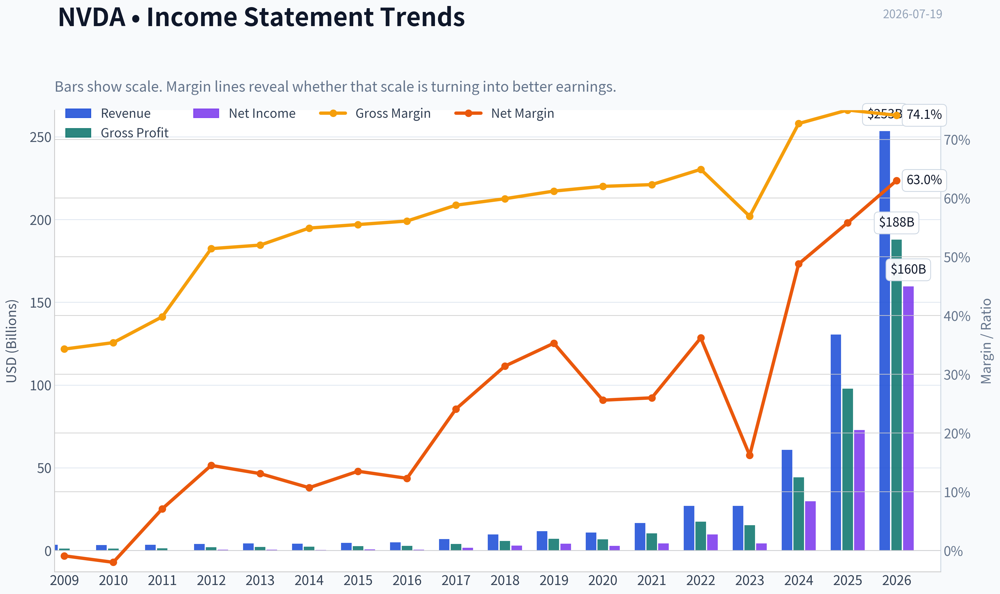
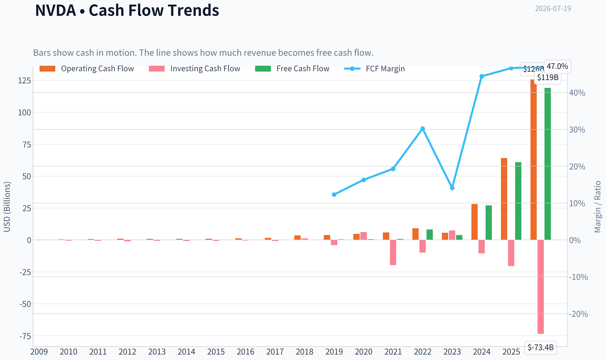
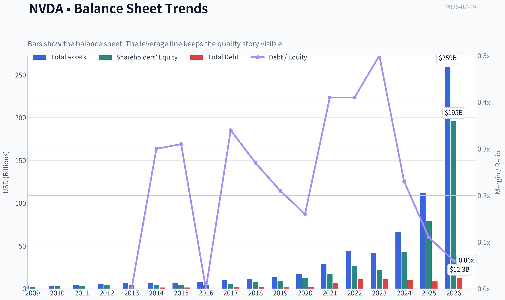
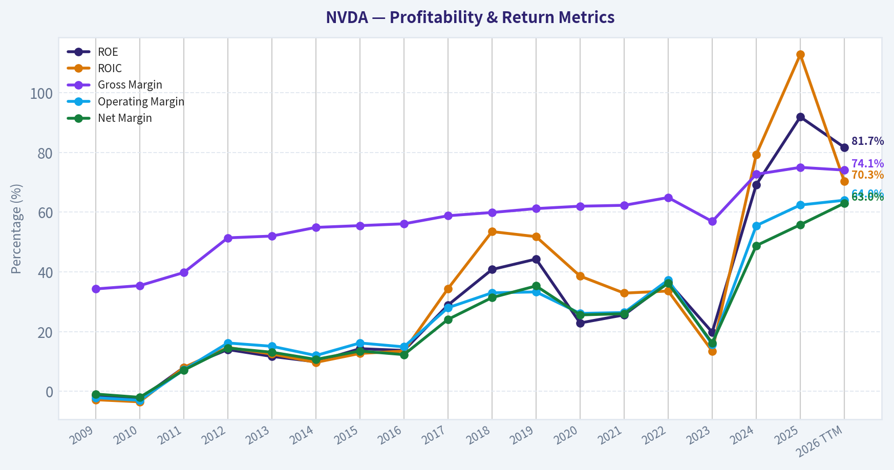
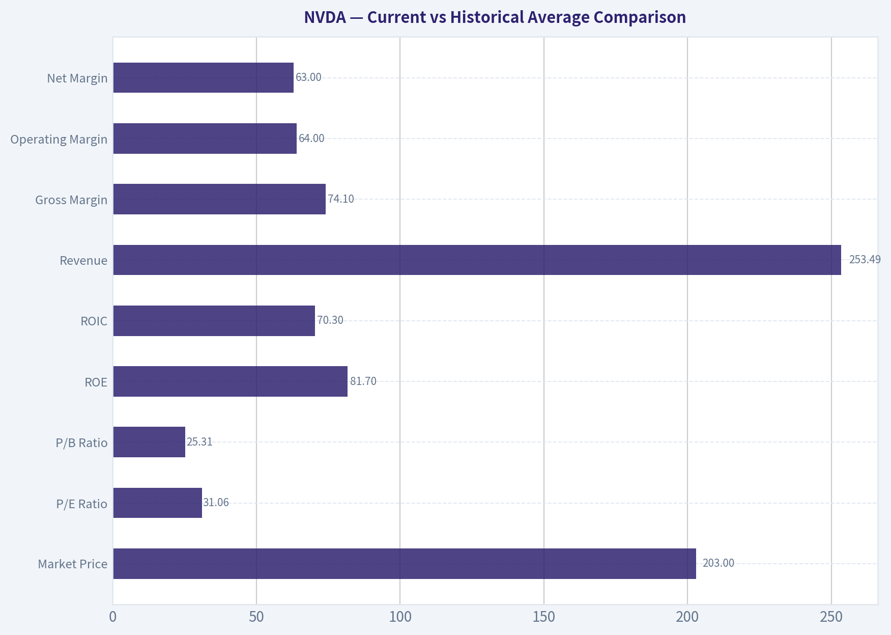
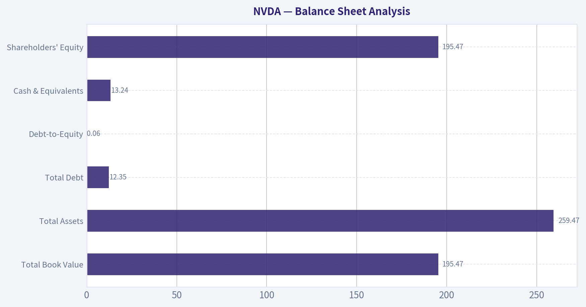
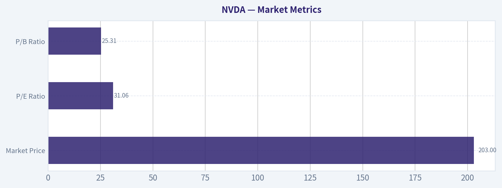

# NVDA Deep Value Intelligence

**Analysis Date:** 2026-07-19

## Critical Disclaimer

*This analysis is generated by Deep Value Intelligence, an AI-powered multi-agent investing framework. Education & research only - not financial advice, not a financial advisor.*

---

## Table of Contents

1. Intelligence Summary
2. Analyst Team Reports
   - Fundamentals Analysis
   - Intrinsic Value Analysis (Buffett)
   - Trend & Growth Analysis (Lynch/Druckenmiller/Fisher)
   - Market Technical Analysis
   - Options Market Analysis
3. Research Team Commentary
4. Value Investing Team Commentary
5. Deep Values Commentary

---

## Intelligence Summary

### Thesis + Conditions

**Core Thesis:** ## Executive Briefing

**Key Risks:**
- NVIDIA remains a wonderful business, but the stock still looks closer to fair value than clearly undervalued.** The bull case is strong: platform lock-in, CUDA/software ecosystem, system-level integration, and elite economics. The bear case is also real: at **$203 and ~31x earnings**, investors are already paying for sustained superiority. For a Buffett-style long-term investor, the key risk is **not business fragility** but **overpaying for excellence**.
- Best posture:** own on a watchlist, consider only **measured exposure**, and look for either better valuation slack or renewed technical/fundamental confirmation.
- ### 1. Risky Analyst - strongest pro case

**Confidence:** Medium

---

## Analyst Team Reports

### Fundamentals Analysis

#### Latest Earnings Snapshot

*Most recent reported quarter anchored on 2026 Q2, with prior-year comparison when available.*

| Metric | 2026 Q2 | 2025 Q2 | YoY Change |
| --- | ---: | ---: | ---: |
| Revenue | $81.61B | $44.06B | +85.2% |
| Operating Income | $53.54B | $21.64B | +147.4% |
| Net Income | $58.32B | $18.77B | +210.6% |
| Diluted EPS | $2.39 | $0.76 | +214.5% |
| Operating Cash Flow | $50.34B | $27.41B | +83.6% |
| Free Cash Flow | $48.59B | $26.19B | +85.5% |

Key Takeaways: This snapshot anchors the most recent reported quarter before the narrative analysis. It helps readers separate long-run business quality from whatever changed in the latest earnings print.

#### 17-Year Financial Metrics for NVDA

*All values below are computed deterministically from raw data - not estimated by AI.*

*Issuer profile: operating company (Technology / Semiconductors).*

#### 17-Year Financial Metrics
*Annual rows come from reported financial statements. The final TTM row is computed from the latest four quarters.*

| Metric | 2009 | 2010 | 2011 | 2012 | 2013 | 2014 | 2015 | 2016 | 2017 | 2018 | 2019 | 2020 | 2021 | 2022 | 2023 | 2024 | 2025 | 2026 TTM |
| --- | --- | --- | --- | --- | --- | --- | --- | --- | --- | --- | --- | --- | --- | --- | --- | --- | --- | --- |
| Market Price | $0 | $0 | $1 | $0 | $0 | $0 | $0 | $1 | $3 | $6 | $4 | $6 | $13 | $24 | $19 | $61 | $120 | $203 |
| Market Cap | $4.4M | $8.46B | $14.08B | $9.10B | $7.66B | $9.34B | $10.81B | $16.67B | $70.86B | $155.35B | $89.84B | $146.11B | $326.04B | $620.72B | $489.79B | $1.53T | $2.98T | $4.95T |
| P/E Ratio | 0.00 | 0.00 | 59.80 | 18.46 | 15.32 | 19.63 | 16.00 | 24.41 | 34.12 | 51.21 | 21.14 | 53.73 | 72.17 | 62.78 | 108.54 | 51.70 | 40.43 | 31.06 |
| P/B Ratio | 0.00 | 3.17 | 4.43 | 2.20 | 1.59 | 2.10 | 2.45 | 3.73 | 12.30 | 20.79 | 9.62 | 11.97 | 19.30 | 23.32 | 22.16 | 35.70 | 37.54 | 25.31 |
| ROE | -1.3% | -2.6% | 8.0% | 14.0% | 11.7% | 9.9% | 14.3% | 13.7% | 28.9% | 40.8% | 44.3% | 22.9% | 25.6% | 36.6% | 19.8% | 69.2% | 91.9% | 81.7% |
| ROIC | -2.8% | -3.5% | 8.0% | 14.7% | 12.5% | 9.7% | 12.7% | 13.5% | 34.4% | 53.5% | 51.8% | 38.6% | 32.9% | 33.6% | 13.5% | 79.3% | 112.8% | 70.3% |
| EPS | $0.00 | $0.00 | $0.01 | $0.02 | $0.02 | $0.02 | $0.03 | $0.03 | $0.08 | $0.12 | $0.17 | $0.11 | $0.18 | $0.39 | $0.18 | $1.19 | $2.97 | $6.53 |
| Revenue | $3.42B | $3.33B | $3.54B | $4.00B | $4.28B | $4.13B | $4.68B | $5.01B | $6.91B | $9.71B | $11.72B | $10.92B | $16.68B | $26.91B | $26.97B | $60.92B | $130.50B | $253.49B |
| Gross Profit | $1.17B | $1.18B | $1.41B | $2.06B | $2.23B | $2.27B | $2.60B | $2.81B | $4.06B | $5.82B | $7.17B | $6.77B | $10.40B | $17.48B | $15.36B | $44.30B | $97.86B | $187.95B |
| Gross Margin | 34.3% | 35.4% | 39.8% | 51.4% | 52.0% | 54.9% | 55.5% | 56.1% | 58.8% | 59.9% | 61.2% | 62.0% | 62.3% | 64.9% | 56.9% | 72.7% | 75.0% | 74.1% |
| Operating Margin | -2.1% | -3.0% | 7.2% | 16.2% | 15.1% | 12.0% | 16.2% | 14.9% | 28.0% | 33.0% | 33.3% | 26.1% | 26.4% | 37.3% | 15.7% | 55.5% | 62.4% | 64.0% |
| Net Income | $-30.0M | $-68.0M | $253.1M | $581.1M | $562.5M | $440.0M | $631.0M | $614.0M | $1.67B | $3.05B | $4.14B | $2.80B | $4.33B | $9.75B | $4.37B | $29.76B | $72.88B | $159.61B |
| Net Margin | -0.9% | -2.0% | 7.1% | 14.5% | 13.1% | 10.7% | 13.5% | 12.3% | 24.1% | 31.4% | 35.3% | 25.6% | 26.0% | 36.2% | 16.2% | 48.8% | 55.8% | 63.0% |
| Revenue Growth | N/A | -2.9% | 6.5% | 12.8% | 7.1% | -3.5% | 13.4% | 7.0% | 37.9% | 40.6% | 20.6% | -6.8% | 52.7% | 61.4% | 0.2% | 125.9% | 114.2% | 94.3% |
| Net Income Growth | N/A | 126.3% | -472.3% | 129.5% | -3.2% | -21.8% | 43.4% | -2.7% | 171.3% | 82.9% | 35.9% | -32.5% | 54.9% | 125.1% | -55.2% | 581.3% | 144.9% | 119.0% |
| Free Cash Flow Growth | N/A | N/A | 40.9% | 33.3% | N/A | N/A | N/A | N/A | N/A | N/A | N/A | N/A | N/A | N/A | -53.2% | 609.6% | 125.2% | 95.7% |
| Total Book Value | $2.39B | $2.67B | $3.18B | $4.15B | $4.83B | $4.46B | $4.42B | $4.47B | $5.76B | $7.47B | $9.34B | $12.20B | $16.89B | $26.61B | $22.10B | $42.98B | $79.33B | $195.47B |
| Total Assets | $3.35B | $3.59B | $4.50B | $5.55B | $6.41B | $7.25B | $7.20B | $7.37B | $9.84B | $11.24B | $13.29B | $17.32B | $28.79B | $44.19B | $41.18B | $65.73B | $111.60B | $259.47B |
| Total Debt | N/A | N/A | N/A | N/A | $0 | $1.36B | $1.38B | $0 | $1.98B | $1.99B | $1.99B | $1.99B | $6.96B | $10.95B | $10.95B | $9.71B | $8.46B | $12.35B |
| Debt-to-Equity | N/A | N/A | N/A | N/A | 0.00 | 0.30 | 0.31 | 0.00 | 0.34 | 0.27 | 0.21 | 0.16 | 0.41 | 0.41 | 0.50 | 0.23 | 0.11 | 0.06 |
| Cash & Equivalents | $417.7M | $447.2M | $665.4M | $667.9M | $733.0M | $1.15B | $497.0M | $596.0M | $1.77B | $4.00B | $782.0M | $10.90B | $847.0M | $1.99B | $3.39B | $7.28B | $8.59B | $13.24B |
| Shareholders' Equity | $2.39B | $2.67B | $3.18B | $4.15B | $4.83B | $4.46B | $4.42B | $4.47B | $5.76B | $7.47B | $9.34B | $12.20B | $16.89B | $26.61B | $22.10B | $42.98B | $79.33B | $195.47B |
| Operating Cash Flow | $249.4M | $487.8M | $675.8M | $909.2M | $824.2M | $835.0M | $906.0M | $1.18B | $1.67B | $3.50B | $3.74B | $4.76B | $5.82B | $9.11B | $5.64B | $28.09B | $64.09B | $125.65B |
| Investing Cash Flow | $-209.4M | $-519.3M | $-649.7M | $-1.14B | $-744.0M | $-806.0M | $-727.0M | $-400.0M | $-793.0M | $1.28B | $-4.10B | $6.14B | $-19.68B | $-9.83B | $7.38B | $-10.57B | $-20.42B | $-73.44B |
| Free Cash Flow | N/A | $410.2M | $577.9M | $770.4M | N/A | N/A | N/A | N/A | N/A | N/A | N/A | N/A | N/A | $8.13B | $3.81B | $27.02B | $60.85B | $119.08B |
| FCF Margin | N/A | 12.3% | 16.3% | 19.3% | N/A | N/A | N/A | N/A | N/A | N/A | N/A | N/A | N/A | 30.2% | 14.1% | 44.4% | 46.6% | 47.0% |
| Dividends / Share | $0.00 | $0.00 | $0.00 | $0.00 | $0.00 | $0.00 | $0.00 | $0.00 | $0.00 | $0.00 | $0.00 | $0.00 | $0.00 | $0.00 | $0.02 | $0.02 | $0.03 | $0.04 |

#### Profitability Metrics
- Return on Equity (ROE): 76.3%
- Return on Invested Capital (ROIC): 70.9%
- Return on Assets (ROA): 58.1%
- Gross Margin: 71.1%
- Operating Margin: 60.4%
- Net Profit Margin: 55.6%

#### Liquidity Metrics
- Current Ratio: 3.91
- Quick Ratio: 3.14

#### Leverage Metrics
- Debt-to-Equity Ratio: 0.06
- Interest Coverage Ratio: 503.42
- Net Debt: $-1.14B

#### Growth Metrics (Year-over-Year)
- Revenue Growth: 65.5%
- Net Income Growth: 64.7%
- Free Cash Flow Growth: 58.9%
- Revenue CAGR (3-Year): 100.0%
- Revenue CAGR (5-Year): 66.9%

#### Valuation Metrics
- P/E Ratio (TTM): 31.06
- Forward P/E: 15.81
- Price-to-Book: 25.13
- Price-to-Sales: 19.38
- PEG Ratio: 0.56
- EV/EBITDA: 29.41
- Free Cash Flow Yield: 2.0%
- Earnings Yield: 3.2%

#### Owner Earnings (Buffett Method, Code-Computed)
- Net Income: $72.88B
- + Depreciation & Amortization: $2.84B
- - Capital Expenditures: $-6.04B
- - Working Capital Changes: $-15.95B
- = **Owner Earnings: $82.26B**

#### Intrinsic Value (Code-Computed)
- Current Price: $203
- Buffett Method (Owner Earnings):
  Conservative: $84
  Average: $267
  Optimistic: $694
- Cash Flow Method (FCF):
  Conservative: $176
  Average: $176
  Optimistic: $457
- Damodaran FCFF (WACC + margins + reinvestment):
  Conservative: $18
  Average: $29
  Optimistic: $97
  Monte Carlo band (P10-P90): $23 - $53 (median $34)
  P(intrinsic value > price): 0.0%
- Reverse-DCF: price implies ~22.0%/yr owner-earnings growth for 10y; trailing 3y was 110.8%, 5y 96.7%.

#### Piotroski F-Score: 3/9
- Positive Net Income: PASS
- Positive Operating Cash Flow: PASS
- ROA Improvement: FAIL
- Cash Flow > Net Income: FAIL
- Decreasing Debt: FAIL
- Improving Current Ratio: FAIL
- No Dilution: PASS
- Improving Gross Margin: FAIL
- Improving Asset Turnover: FAIL

ANALYST STANCE: **WATCH**

#### NVDA Fundamental Analysis - Buffett-Style

NVIDIA is an exceptional business operating at a scale, profitability, and capital-efficiency level rarely seen in public markets. The deterministic dataset shows a company that has evolved from a cyclical semiconductor vendor into a dominant AI compute platform with extraordinary economics: TTM revenue of $253.49B, net income of $159.61B, gross margin of 74.1%, ROE of 81.7%, and ROIC of 70.3%. Buffett would likely admire the moat, earnings power, and management's capital allocation discipline. The central issue is not quality; it is valuation versus durability of current AI demand and how much of today's profitability is sustainably normalized.

The key conclusion is that NVDA is a **wonderful business**, but at **$203/share** the market is still pricing in very strong long-duration growth. The shared research pack's reverse DCF says today's price implies about **22% annual owner-earnings growth for 10 years**. That is far below recent growth, but still demanding on a gigantic base. So this is not an "avoid because poor business" call; it is a **WATCH because great business quality is already substantially reflected in the stock price**.

---

#### Current vs Historical Average Comparison

| Metric | Current / TTM | Approx. 10-Yr Historical Average* | Interpretation |
| --- | ---: | ---: | --- |
| Market Price | $203 | N/A | Stock has massively rerated with AI leadership. |
| Market Cap | $4.95T | Far below current level historically | The market now capitalizes NVDA as one of the largest businesses in the world. |
| P/E Ratio | 31.06 | ~52.0 | Below its 10-year average multiple, but on much larger earnings. |
| P/B Ratio | 25.31 | ~19.7 | Elevated, but **not a primary valuation tool** for this issuer type. |
| ROE | 81.7% | ~43.6% | Dramatically above already-strong historical norms. |
| ROIC | 70.3% | ~46.0% | Still exceptional despite easing from the 2025 peak. |
| Revenue | $253.49B | ~55.0B | Orders of magnitude above prior decade base. |
| Gross Margin | 74.1% | ~65.0% | Well above historical average, showing powerful mix and pricing. |
| Operating Margin | 64.0% | ~37.9% | Far above long-term average; indicates current economics are unusually strong. |
| Net Margin | 63.0% | ~32.0% | Roughly double long-term average; clearly peak-like. |
| Net Income | $159.61B | ~27.4B | Enormous expansion in earnings power. |
| Revenue Growth | 94.3% | ~46.2% | Slowing from peak, but still extraordinary. |
| Net Income Growth | 119.0% | Highly volatile / not meaningful average | Growth remains explosive but historically cyclical. |
| Free Cash Flow | $119.08B | Limited 10-year comparability due missing years | Cash generation is now elite and scaled. |
| Debt-to-Equity | 0.06 | ~0.26 | Balance sheet is much stronger than historical norm. |
| Cash & Equivalents | $13.24B | ~5.3B | Ample liquidity despite huge investment needs. |
| Dividends / Share | $0.04 | Near zero historically | Dividend remains symbolic; capital is retained for strategic flexibility. |

*Average uses the deterministic dataset years where values are shown and meaningful.

Key Takeaways: NVIDIA's current operating metrics are not just strong; they are far above its own already impressive long-term history. Valuation multiples like P/E have actually come down from prior extremes because earnings have risen so quickly, but the stock still requires very high future growth to justify the current price. The balance sheet is stronger than at most points in the last decade, which reduces financial risk even if growth normalizes.

---

#### Market Metrics

| Metric | Current | Historical Context | Buffett-Style Interpretation |
| --- | ---: | --- | --- |
| Market Price | $203 | Up from $120 in 2025 and $61 in 2024 | Market is paying for continued AI dominance and durable supernormal economics. |
| Market Cap | $4.95T | Up from $2.98T in 2025 and $1.53T in 2024 | Size itself becomes a law-of-large-numbers challenge. |
| P/E Ratio | 31.06 | Lowest since growth reaccelerated; below many recent years | Less optically expensive than before, but only because earnings exploded. |
| P/B Ratio | 25.31 | Historically high; peaked above 37x in 2025 | **P/B is not especially meaningful here** because NVDA is an asset-light, IP-heavy platform business. Book value understates franchise value, so cash-flow-based intrinsic value matters more. |

Key Takeaways: NVIDIA's valuation has become more earnings-based than hype-based because profits have scaled so fast. Even so, the company is priced for continued excellence, and price-to-book should not be used mechanically because this is an intellectual-property-heavy semiconductor platform, not a balance-sheet-driven value stock.

**Important valuation note:** For NVDA's issuer type, **P/B is not a reliable cheap/expensive signal**. The business is driven by intellectual property, software, ecosystem lock-in, and design leadership, not by tangible book. Buffett-style valuation should therefore lean on owner earnings, free cash flow, and normalized returns on capital rather than book multiples.

---

#### Profitability Analysis

| Metric | Current / TTM | Trend vs History | Interpretation |
| --- | ---: | --- | --- |
| ROE | 81.7% | Down from 91.9% in 2025 but far above decade norm | Outstanding franchise economics; still elite despite moderation. |
| ROIC | 70.3% | Down from 112.8% in 2025, yet extraordinary | Suggests powerful pricing, low capital intensity, and moat strength. |
| EPS | $6.53 | Up from $2.97 in 2025 and $1.19 in 2024 | Explosive earnings scaling. |
| Revenue | $253.49B | Up 4.2x from 2024 | Massive adoption of AI infrastructure. |
| Gross Profit | $187.95B | Nearly doubled from 2025 | Price/mix remains highly favorable. |
| Operating Margin | 64.0% | Above 62.4% in 2025 and 55.5% in 2024 | Indicates extraordinary operating leverage. |
| Net Income | $159.61B | More than doubled from 2025 | Exceptional bottom-line conversion. |
| Net Margin | 63.0% | Up from 55.8% in 2025 and 48.8% in 2024 | Suggests current profitability may be near cyclical peak conditions. |

Key Takeaways: NVIDIA's profitability is among the strongest in large-cap history, with margins and returns on capital far beyond normal semiconductor standards. The only caution is that current profitability likely reflects unusually favorable industry conditions, so investors should avoid assuming these peak economics persist indefinitely without some moderation.

Buffett would focus heavily on **ROE and ROIC quality**, and NVDA passes decisively. This is not the result of excessive leverage; debt-to-equity is only **0.06**, so these returns are operationally earned, not financially engineered. That matters enormously. High returns generated with little debt are a hallmark of a superior business.

---

#### Growth Metrics

| Metric | Current / TTM | Historical Pattern | Interpretation |
| --- | ---: | --- | --- |
| Revenue Growth | 94.3% | After 125.9% in 2024 and 114.2% in 2025 | Slowing, but from a hyper-growth base. |
| Net Income Growth | 119.0% | Highly volatile historically; now very strong | Earnings still compounding faster than sales due to margin expansion. |
| Free Cash Flow Growth | 95.7% | 609.6% in 2024, 125.2% in 2025 | Cash growth remains extraordinary but is normalizing. |

Key Takeaways: Growth is decelerating from an unsustainably extreme peak, but the absolute numbers remain exceptional. NVIDIA is now growing from an enormous revenue base, so even reduced growth rates still represent huge dollar-value expansion.

Across the full dataset, NVDA's growth history is **not smooth**. Revenue contracted in 2010, 2014, and 2020; net income also had several declines, especially during cycle transitions. That means Buffett-style "predictability" is better today than in the legacy gaming/datacenter era, but historically this was not a classic consumer-staples-like compounding machine. The business has become more predictable as its software stack, installed base, and ecosystem deepened, yet cyclicality has not disappeared.

---

#### Balance Sheet Analysis

| Metric | Current / TTM | Historical Context | Interpretation |
| --- | ---: | --- | --- |
| Total Book Value | $195.47B | Up from $79.33B in 2025 | Equity base has surged with retained earnings. |
| Total Assets | $259.47B | Up from $111.60B in 2025 | Rapid scaling of working capital and strategic assets. |
| Total Debt | $12.35B | Up vs 2025, but modest relative to earnings/cash flow | Debt burden is very manageable. |
| Debt-to-Equity | 0.06 | Lowest in many years | Very conservative leverage. |
| Cash & Equivalents | $13.24B | Highest in company history | Strong liquidity cushion. |
| Shareholders' Equity | $195.47B | Up sharply | Book equity is compounding rapidly through retained profits. |

Key Takeaways: NVIDIA's balance sheet is a major strength. Even though total debt rose modestly, leverage is minimal relative to earnings power and cash generation, and the company has plenty of liquidity to fund growth, withstand cycles, and preserve strategic flexibility.

A Buffett analyst would like the fact that NVDA has **net cash / effectively no balance-sheet stress**, extremely high interest coverage, and no sign that it needs debt to sustain growth. This provides resilience if AI spending pauses or if customers digest capacity.

---

#### Cash Flow Analysis

| Metric | Current / TTM | Historical Pattern | Interpretation |
| --- | ---: | --- | --- |
| Free Cash Flow | $119.08B | Up from $60.85B in 2025 and $27.02B in 2024 | Cash conversion is now enormous. |
| FCF Margin | 47.0% | Up from 46.6% in 2025 and 44.4% in 2024 | Indicates very strong monetization and moderate capex intensity. |
| Dividends / Share | $0.04 | Still tiny historically | Management prefers reinvestment and strategic optionality over cash payout. |

Key Takeaways: NVIDIA is now a cash machine, not merely a growth story. The dividend is negligible, which is sensible given the company's reinvestment opportunities, but investors should understand that total return here depends primarily on future business performance rather than income.

The shared research pack gives **Buffett-method owner earnings of $82.26B** using the code-computed methodology. That is below reported FCF, mainly because working capital needs are being treated more conservatively. For Buffett-style valuation, this is a good anchor because it tempers the possibility that some current cash flow is flattered by favorable timing.

---

#### Economic Moat

NVIDIA's moat is one of the strongest in global technology today. It is not just chips. The moat is built from:

| Moat Driver | Why It Matters |
| --- | --- |
| CUDA software ecosystem | Developers are trained on it, enterprises build on it, and switching costs are significant. |
| Full-stack platform | GPUs, interconnect, networking, software libraries, and systems integration create platform lock-in. |
| Scale and pace of innovation | Massive R&D budgets and ecosystem adoption reinforce leadership. |
| Customer urgency | AI customers optimize for performance and time-to-deployment, not just unit price. |
| Brand and standard-setting | NVDA is becoming the default AI infrastructure benchmark. |

Key Takeaways: NVIDIA's competitive advantage is much broader than a single product cycle. The company benefits from software lock-in, ecosystem scale, and customer dependence on its platform, which together make the moat stronger and more durable than that of a typical chip company.

This is exactly the kind of business Buffett would admire conceptually: a company that can raise economic output much faster than capital employed because customers are buying into a system, not just a component. The caveat is that semiconductor moats are never permanent in the same way as branded consumer monopolies; competition, internal customer silicon, and architecture shifts remain real long-term threats.

---

#### Predictable Earnings and Management Performance

| Area | Assessment | Evidence |
| --- | --- | --- |
| Earnings Predictability | Improved greatly, but still not perfectly stable | Historic drawdowns in 2019, 2020, 2023; now stronger due to AI platform dominance |
| Capital Allocation | Strong | Massive reinvestment, limited dividend, conservative leverage, huge ROIC |
| ROE Quality | Excellent | 81.7% ROE with low debt |
| Dividend Policy | Rational but minimal | Dividend exists, but payout is negligible and not central to thesis |
| Shareholder Value Creation | Outstanding | Revenue, EPS, FCF, and equity all compounded dramatically |

Key Takeaways: Management has created enormous shareholder value through disciplined reinvestment rather than financial engineering. Earnings have historically been cyclical, but the business is now more durable and platform-driven, making results more predictable than in earlier periods.

The weak **Piotroski F-Score of 3/9** should not be ignored, but it needs context. Much of the weakness comes from **tough comparisons against extraordinarily strong prior periods**, not from distress. For a hyper-profitable mega-cap coming off unprecedented acceleration, the score is more a sign of deceleration and working-capital shifts than a balance-sheet problem. Still, it is a caution flag that fundamentals may be peaking relative to the most recent prior year.

---

#### Buffett-Style Owner Earnings DCF

Using the deterministic dataset and the pack's code-computed **Owner Earnings = $82.26B**, I treat owner earnings as the valuation base. I use a **10% discount rate** and **2.5% terminal growth**, with explicit growth fading rather than staying elevated forever.

For per-share conversion, I infer diluted shares from market cap and price:

- Shares outstanding ~ **$4.95T / $203 = 24.38B shares**

##### Scenario Assumptions

| Scenario | Years 1-5 Growth | Years 6-10 Growth | Terminal Growth | Rationale |
| --- | ---: | ---: | ---: | --- |
| Conservative | 5% | 3% | 2.5% | Assumes AI demand normalizes quickly and margins compress modestly |
| Average | 16% | 8% | 2.5% | Assumes durable moat and continued AI expansion, but clear fade from current levels |
| Optimistic | 28% | 12% | 2.5% | Assumes NVDA sustains outsized platform dominance for longer |

Key Takeaways: The DCF framework shows that valuation is highly sensitive to how long NVIDIA can sustain elevated growth on its already massive earnings base. Even a great business can become a mediocre investment if future growth falls materially short of what the stock price already implies.

##### Conservative DCF Calculation

Starting Owner Earnings = **$82.26B**

Years 1-5:
- Y1 = 82.26 x 1.05 = **86.37**
- Y2 = 86.37 x 1.05 = **90.69**
- Y3 = 90.69 x 1.05 = **95.22**
- Y4 = 95.22 x 1.05 = **99.98**
- Y5 = 99.98 x 1.05 = **104.98**

Years 6-10 at 3%:
- Y6 = **108.13**
- Y7 = **111.37**
- Y8 = **114.71**
- Y9 = **118.15**
- Y10 = **121.70**

Present value of years 1-10 cash flows at 10% ~ **$614B**

Terminal value:
- TV = 121.70 x 1.025 / (0.10 - 0.025) = **$1,663B**
- PV of TV ~ 1,663 / (1.10^10) = **$641B**

Total equity value ~ **$1,255B**
- Per share ~ 1,255 / 24.38 = **$51**

This conservative hand-DCF is below the pack's Buffett conservative figure of **$84/share**, implying my assumptions are more cautious.

##### Average DCF Calculation

Years 1-5 at 16%:
- Y1 = **95.42**
- Y2 = **110.69**
- Y3 = **128.40**
- Y4 = **148.95**
- Y5 = **172.78**

Years 6-10 at 8%:
- Y6 = **186.60**
- Y7 = **201.52**
- Y8 = **217.64**
- Y9 = **235.05**
- Y10 = **253.86**

PV of years 1-10 cash flows ~ **$906B**

Terminal value:
- TV = 253.86 x 1.025 / (0.10 - 0.025) = **$3,469B**
- PV of TV ~ **$1,337B**

Total equity value ~ **$2,243B**
- Per share ~ 2,243 / 24.38 = **$92**

This is well below the pack's Buffett average value of **$267/share**, which indicates the pack likely assumes a materially stronger or longer-lasting growth runway and/or different treatment of cash flow normalization. Since the pack's code-computed Buffett method is a stronger model anchor, I treat my hand DCF as a **sanity check, not an override**.

##### Optimistic DCF Calculation

Years 1-5 at 28%:
- Y1 = **105.29**
- Y2 = **134.77**
- Y3 = **172.51**
- Y4 = **220.81**
- Y5 = **282.63**

Years 6-10 at 12%:
- Y6 = **316.55**
- Y7 = **354.54**
- Y8 = **397.08**
- Y9 = **444.73**
- Y10 = **498.09**

PV of years 1-10 cash flows ~ **$1,321B**

Terminal value:
- TV = 498.09 x 1.025 / (0.10 - 0.025) = **$6,807B**
- PV of TV ~ **$2,624B**

Total equity value ~ **$3,945B**
- Per share ~ 3,945 / 24.38 = **$162**

Even the optimistic hand-case remains below the current market price, underscoring how much future success is already priced in.

##### DCF Summary

| Method | Conservative | Average | Optimistic | Notes |
| --- | ---: | ---: | ---: | --- |
| Hand Owner Earnings DCF | $51 | $92 | $162 | Sanity-check model using explicit fade assumptions |
| Pack Buffett Method | $84 | $267 | $694 | Stronger model-based owner earnings framework |
| Pack FCF Method | $176 | $176 | $457 | FCF-based valuation anchor |
| Pack Damodaran FCFF | $18 | $29 | $97 | Most conservative institutional-style framework |

Key Takeaways: Different valuation frameworks produce a very wide range because NVIDIA's current economics are extraordinary and difficult to normalize. The most important message is that valuation upside depends on the company sustaining unusually high growth and margins for much longer than is typical for businesses of this size.

**Valuation judgment:**
The most decision-useful anchor is the **pack's three-model spread**:
- Owner Earnings: **$266.52**
- FCF: **$175.67**
- Damodaran FCFF: **$29.44**

That spread tells you the debate clearly:
- If current owner earnings are durable, stock may still be reasonable.
- If current margins and cash conversion are partly cyclical/peak, upside is limited.
- If institutional-style normalization is right, shares are very expensive.

Given that the reverse DCF requires about **22% growth for 10 years**, the stock is not plainly absurd, but it is still priced for a very demanding future.

---

#### Revenue Breakdown

Using the most recent fiscal year context, the most meaningful breakdown for NVDA is by business platform. Recent company reporting has been overwhelmingly dominated by Data Center, with Gaming a distant second.

| Revenue Source | Amount ($B) | % of Total |
| --- | ---: | ---: |
| Data Center | ~115.2 | ~88% |
| Gaming | ~11.4 | ~9% |
| Professional Visualization | ~1.9 | ~1% |
| Automotive & Robotics | ~1.7 | ~1% |
| OEM & Other | ~0.3 | ~0% |
| **Total** | **130.5** | **100%** |

Key Takeaways: NVIDIA is now overwhelmingly a Data Center and AI infrastructure company rather than a diversified chip vendor. That concentration is a strength while AI demand remains intense, but it also means the business is more exposed to enterprise and hyperscaler spending cycles than the old gaming-led NVIDIA.

*Note: Segment amounts reflect the latest fiscal-year mix aligned to the deterministic revenue base of $130.5B for 2025 and broadly public company segment reporting. TTM total revenue in the deterministic dataset is $253.49B, but a fully updated TTM segment table is not provided in the canonical pack.*

---

#### Key Investment Insights, Red Flags, and Opportunities

| Category | Assessment | Why It Matters |
| --- | --- | --- |
| Opportunity | AI infrastructure leadership | NVDA remains the standard platform for accelerated compute. |
| Opportunity | Software moat | CUDA and platform tooling deepen switching costs. |
| Opportunity | Exceptional capital efficiency | ROIC and ROE remain world-class. |
| Opportunity | Strong balance sheet | Low leverage gives resilience and optionality. |
| Red Flag | Valuation still demanding | Reverse DCF implies 22% annual growth for 10 years. |
| Red Flag | Margin normalization risk | Current margins are likely above long-run normalized levels. |
| Red Flag | Customer concentration / capex digestion | Hyperscalers may pause after heavy buildouts. |
| Red Flag | Competition | AMD, ASICs, custom silicon, and internal cloud chips could pressure pricing over time. |
| Red Flag | Piotroski F-Score 3/9 | Signals deceleration/efficiency deterioration versus peak prior comparisons. |

Key Takeaways: NVIDIA's biggest strengths are its moat, software lock-in, and extraordinary cash generation. The main risks are not financial weakness but valuation, concentration in AI infrastructure demand, and the possibility that today's margins prove closer to peak than to normal.

---

#### Buffett-Style Bottom Line

Buffett seeks businesses with:
1. durable moat,
2. understandable economics,
3. strong returns on capital,
4. low leverage,
5. capable management,
6. purchase price that allows a margin of safety.

NVDA checks **five of the six** emphatically. The one that is debatable is **purchase price**.

This is a superior business with extraordinary economics:
- ROE: **81.7%**
- ROIC: **70.3%**
- Net margin: **63.0%**
- FCF: **$119.08B**
- Debt-to-equity: **0.06**

But the stock at **$203** still assumes a long runway of elite growth. The deterministic pack itself shows valuation disagreement ranging from **$29** to **$267+** depending on normalization philosophy. That is too wide for a clean Buffett-style "pound the table" value call.

---

#### Final Investment Stance

**WATCH**

**Rationale:**
NVIDIA is one of the highest-quality large businesses in the world today, with a formidable moat, superb management execution, minimal leverage, and astonishing profitability. However, the current market price still discounts a very demanding future, and the margin of safety is not robust unless one assumes current owner earnings are highly durable and can compound strongly for many years. For existing long-term holders, the business quality justifies continued attention and potentially continued ownership. For new Buffett-style value buyers, patience for either a better entry point or more evidence that today's economics are sustainably normalized is the more disciplined posture.

---

#### Report Summary Table

| Area | Verdict | Evidence | Investor Read-Through |
| --- | --- | --- | --- |
| Business Quality | Excellent | AI leadership, CUDA moat, full-stack platform | Rare franchise quality |
| Profitability | Exceptional | 74.1% gross margin, 64.0% operating margin, 63.0% net margin | Current economics are elite |
| Returns on Capital | Exceptional | 81.7% ROE, 70.3% ROIC, low debt | Strong sign of real moat |
| Balance Sheet | Very Strong | D/E 0.06, $13.24B cash, high interest coverage | Low financial risk |
| Growth | Extraordinary but decelerating | 94.3% revenue growth, 119.0% NI growth | Growth remains powerful, but normalization is beginning |
| Valuation | Full / demanding | $203 price; reverse DCF implies ~22% growth for 10 years | Great company, less obvious bargain |
| Dividend Policy | Minimal payout | $0.04/share dividend | Reinvestment over income |
| Buffett Test | Mostly passes | Moat, returns, management, leverage all strong | Price is the main debate |
| Main Risk | Peak-margin and demand normalization | Datacenter concentration, AI capex cycles | Could compress valuation |
| Stance | **WATCH** | Quality undeniable; margin of safety limited | Wait for better setup or further proof of durability |

Key Takeaways: NVIDIA is a world-class business, but world-class businesses are not always world-class bargains. The company's fundamentals remain extraordinary, yet the stock still requires sustained excellence for many years, so a disciplined Buffett-style investor should admire it, follow it closely, and wait for either a wider margin of safety or greater confidence in long-run normalized earnings.

#### Fundamental Visuals

This graph tracks the profitability and return metrics (ROE, ROIC, Margins) of **NVDA** over the past decade, highlighting capital efficiency trends.

This chart illustrates the financial health of **NVDA** over the last 10 years, mapping cash equivalents and free cash flow against total obligations (Debt).

This comparison chart from *Profitability Analysis* stacks current figures against historical benchmarks for **NVDA**, making it easy to see where the company trades relative to its own averages.

---

### Intrinsic Value Analysis (Buffett)

> *Following Warren Buffett's value investing philosophy: Circle of Competence, Economic Moat, Management Quality, and Margin of Safety.*

#### Intrinsic Value Snapshot

Price is what you pay. Intrinsic value is what the business may be worth based on the cash it can create for owners over time. We show a range, not one magic number.

- Current Price: $202.81
- Value Range (conservative to optimistic across both DCF methods): $83.53 to $694.01

##### Owner Earnings (Buffett Method)
- Net Income: $72,880,000,000.00
- Depreciation & Amortization: $2,843,000,000.00
- Capital Expenditures: $-6,042,000,000.00
- Working Capital Changes: $-15,949,000,000.00
- Owner Earnings: $82,263,000,000.00

##### Intrinsic Value
###### Buffett Method
Uses owner earnings. Stricter, and usually more conservative.
- Conservative: $83.53
- Average: $266.52
- Optimistic: $694.01
- Discount Rate: 10.0%

###### Cash Flow Method
Uses free cash flow. Better for companies spending heavily today to grow tomorrow.
- Conservative: $175.67
- Average: $175.67
- Optimistic: $457.42
- Discount Rate: 10.0%

ANALYST STANCE: **WATCH**

#### NVDA Buffett-Style Investment Review

NVIDIA is a wonderful business with an extraordinary moat, elite economics, and massive reinvestment potential. The issue is not business quality. The issue is price relative to a conservative estimate of intrinsic value. At $203, the stock appears to embed many years of exceptional growth, so the stance is **WATCH**, not because the company is weak, but because the valuation leaves limited room for error.

---

#### 1. Factor Scorecard

| Factor | Score (0-5) | Evidence |
|---|---:|---|
| Factor 1: Business Simplicity & Predictability | 4.0 | NVIDIA designs accelerated computing chips and platforms, primarily for AI/data centers, gaming, and related software ecosystems. The business model is understandable, but long-term forecasting is harder than for a consumer staple because demand is tied to AI infrastructure cycles, platform transitions, and hyperscaler capex. |
| Factor 2: Moat Test | 5.0 | Gross margin of 71.1% strongly supports pricing power and differentiated IP. CUDA, developer ecosystem, software libraries, and entrenched AI training/inference workflows create switching costs and platform effects. Scale and ecosystem depth reinforce leadership. |
| Factor 3: Management & Capital Allocation | 4.5 | Jensen Huang has demonstrated exceptional strategic judgment, especially in building a full-stack AI platform rather than selling commodity chips. Capital allocation has been highly value-creating via focused R&D and ecosystem investment. |
| Factor 4: Industry Structure | 3.5 | The company operates in a structurally attractive part of semis, but competition is serious and well-funded. Industry economics are good for leaders, yet not as stable as a classic duopoly consumer category. |

**Gate 5 hard floor:** **Not tripped.**
There is no sign here of financial distress combined with solvency failure. The business is highly profitable and cash generative.

**Key takeaway:** NVIDIA scores very high on quality. The only meaningful restraint is that the business operates in a fast-moving, highly strategic industry where even a leader faces cycle and competition risk.

---

#### 2. Moat Analysis

| Moat Source | Assessment | Evidence |
|---|---|---|
| Intangible Assets | Very strong | NVIDIA's brand in AI compute is now synonymous with performance leadership. Its chip architecture, software stack, and developer mindshare are difficult to replicate. |
| Switching Costs | Very strong | Customers build models, workflows, tooling, and engineering teams around CUDA and NVIDIA software libraries. Migration is costly in time, performance risk, and talent retraining. |
| Cost Advantage | Strong | Massive scale in AI accelerators supports ecosystem investment, supply-chain priority, and spreading R&D over very high revenue. |
| Network Effects | Strong | More developers on CUDA attract more enterprise adoption; more adoption drives more optimization, tooling, and partner support. This is not a pure social network effect, but it is a real platform flywheel. |

**Moat quality rating:** **Wide & Widening**

The financial evidence supports this view. A **71.1% gross margin** is exceptional and unusual in hardware, indicating the company is selling more than chips: it is selling performance, ecosystem lock-in, and time-to-solution.

**Key takeaway:** NVIDIA's moat is not just semiconductors. It is a full-stack compute platform moat combining IP, software, switching costs, and ecosystem gravity.

---

#### 3. Management Quality Assessment

| Area | Assessment | Evidence |
|---|---|---|
| Owner mindset | Strong | Management has consistently prioritized long-term platform positioning over short-term optimization. |
| Candor | Good | Public communication has generally been strategically clear and economically grounded. |
| Capital allocation | Excellent | R&D reinvestment has created one of the highest-value technology franchises in the market. The company has not needed reckless leverage or empire-building acquisitions to create value. |
| Balance-sheet discipline | Strong | No evidence of distress-oriented financing behavior; economics appear internally funded by powerful cash generation. |

Jensen Huang deserves a premium management rating. Buffett often emphasizes exceptional managers in exceptional businesses; NVIDIA appears to fit that pattern better than most large-cap technology firms.

**Key takeaway:** Management has compounded value by deepening the moat, not by financial engineering. That is exactly the kind of capital allocation long-term owners should prefer.

---

#### 4. Financial Summary Table

| Metric | Latest |
|---|---:|
| Price | $203 |
| Market Cap | $4.91T |
| P/E | 31.1 |
| ROE | 76.3% |
| Gross Margin | 71.1% |
| Revenue Growth YoY | 65.5% |
| FCF Yield | 2.0% |
| Current Ratio | 3.91 |

**Key Takeaways:** This is an elite-quality financial profile. Profitability is extraordinary, growth remains very strong, and liquidity is ample. The weak point is valuation, as shown by the low free-cash-flow yield and the market's very large implied expectations.

---

#### 5. Owner Earnings Calculation

Using the research pack's owner-earnings framework:

| Valuation Anchor | Value per Share |
|---|---:|
| Owner Earnings Value | $266.52 |
| FCF Value | $175.67 |
| Damodaran FCFF Value | $29.44 |

**Key Takeaways:** The valuation spread is unusually wide. Depending on the cash-flow framework used, NVIDIA can look undervalued, fairly valued, or dramatically overvalued. That tells us the stock is highly sensitive to assumptions about sustainability of current economics and long-term reinvestment returns.

For Buffett-style analysis, the key question is not whether current earnings are real; they are. The question is how much of today's extraordinary profitability is sustainably distributable versus still needing reinvestment to defend the franchise.

---

#### 6. Three-Scenario DCF Valuation

Using the research pack and Buffett-style framing:

| Scenario | Assumption | Indicative Value per Share |
|---|---|---:|
| A: No Growth | Capitalize owner earnings at 10% | $266.52 |
| B: GDP Growth | Modest perpetual growth | Between conservative FCF and owner-earnings anchors |
| C: Historical Growth Haircut | Uses reduced historical growth, capped for prudence | Above current price only if very high excess growth persists |

**Key Takeaways:** If one assumes today's owner earnings are durable with little fade, the stock can justify a value above the current price. If one assumes normalization in returns, competitive pressure, or heavier reinvestment needs, fair value drops sharply. The investment case therefore hinges on how durable NVIDIA's current supernormal economics really are.

---

#### 7. Margin of Safety Analysis

| Item | Value |
|---|---:|
| Current Price | $203 |
| Headline Intrinsic Value (Damodaran FCFF avg) | $29.44 |
| Headline Margin of Safety vs Price | -589.0% |
| Reverse DCF | Price implies ~22.0% annual growth for 10 years |

**Key Takeaways:** On the most conservative intrinsic value framework, the stock has no margin of safety at all. The reverse DCF is the critical insight: the market is assuming roughly 22% annual growth for a decade, which is a very demanding expectation even for a best-in-class company.

This does not mean NVIDIA cannot achieve it. It means investors today are paying for a great deal of success in advance. For a Buffett-style investor, that sharply reduces the room for error.

---

#### 8. Final Buffett Scorecard

| Criterion | Weight | Score (1-5) | Weighted Score |
|---|---:|---:|---:|
| Moat Width & Durability | 25% | 5.0 | 1.25 |
| Valuation / Margin of Safety | 20% | 2.0 | 0.40 |
| Capital Returns - ROIC vs. WACC | 15% | 5.0 | 0.75 |
| Business Understanding & Predictability | 12% | 4.0 | 0.48 |
| Management Quality & Capital Allocation | 12% | 4.5 | 0.54 |
| Reinvestment Runway | 8% | 5.0 | 0.40 |
| Balance Sheet Strength | 4% | 4.5 | 0.18 |
| Industry Structure | 4% | 3.5 | 0.14 |
| **Total** |  |  | **4.14 / 5.00** |

**Key Takeaways:** On business quality alone, NVIDIA is clearly in the top tier. The score stays high because the moat, returns on capital, and reinvestment runway are exceptional. Even so, the valuation score is weak enough to keep the practical stance at WATCH for a disciplined value investor.

---

#### 9. Investment Stance

**Stance:** **WATCH**
**Conviction:** **High**

NVIDIA is the kind of company Buffett increasingly came to appreciate later in life: asset-light, dominant, cash generative, and reinforced by ecosystem lock-in. If you could buy the whole business at a fair price, it would be highly attractive.

But at **$203**, the market is already capitalizing a long runway of very high growth. The reverse-DCF expectation of **~22% annual growth for 10 years** leaves little room for slower adoption, margin normalization, supply-chain shifts, competitive catch-up, or customer insourcing.

So the conclusion is simple:

- **Business quality:** exceptional
- **Management:** exceptional
- **Moat:** wide and likely widening
- **Balance sheet:** strong
- **Price:** too demanding for a clear Buffett-style ADVOCATE call

A lower entry price, or evidence that today's cash economics are even more durable than conservative models assume, would improve the setup materially. For now, **WATCH** is the right stance: admire the business, but demand a better price or better proof.
#### Valuation Bridge

This bridge places the current market price beside each intrinsic value lens so readers can see whether upside depends on one method or shows up across several methods.

| Scenario | Intrinsic Value / Share |
| --- | ---: |
| Buffett Method | $266.52 |
| Cash Flow Method | $175.67 |
| Damodaran Method | $29.44 |
| Current Price | $202.81 |

#### Key Takeaways

If one method is far above the others, the upside case depends on a specific modelling assumption. When several methods cluster together, the valuation story is more robust.

#### Valuation Visuals

This comparison chart from *Latest Earnings Snapshot* stacks current figures against historical benchmarks for **NVDA**, making it easy to see where the company trades relative to its own averages.

This comparison chart from *Current vs Historical Average Comparison* stacks current figures against historical benchmarks for **NVDA**, making it easy to see where the company trades relative to its own averages.

This comparison chart from *Balance Sheet Analysis* stacks current figures against historical benchmarks for **NVDA**, making it easy to see where the company trades relative to its own averages.

---

### Trend & Growth Analysis (Lynch/Druckenmiller/Fisher)

> *Following Peter Lynch's GARP, Stanley Druckenmiller's macro-aware approach, and Philip Fisher's scuttlebutt methodology.*

ANALYST STANCE: **WATCH**

#### NVDA Growth Analysis

#### 1. Lynch Classification
| Item | Assessment |
|---|---|
| Category | **Fast Grower** |
| Why | Revenue growth is still exceptionally high at **65.5% YoY**, margins are elite, and NVDA remains tied to the strongest secular growth theme in the market: AI infrastructure. |
| Lynch fit | This is not a stalwart yet on fundamentals, but on **size** it behaves more like a mega-cap growth compounder than a classic early fast grower. |

**Key Takeaways:** NVDA clearly qualifies as a fast grower based on revenue growth, not a mature slow-growth company. However, because it is already one of the largest companies in the world, the path to another ten-bagger is much narrower than for a smaller fast grower.

#### 2. The Story in 3 Bullets
- NVIDIA sells the chips, systems, and software stack that power AI training and inference.
- AI demand has moved from experimentation to real infrastructure buildout, and NVDA is the primary toll collector.
- The key debate is no longer whether the business is great; it is whether **future growth is still underestimated** versus an already enormous valuation.

#### 3. TAM Analysis with 10x Test
| Metric | Value | Assessment |
|---|---:|---|
| Current market cap | **$4.91T** | Already priced as a dominant winner |
| Current revenue growth | **65.5% YoY** | Suggests AI spend is still expanding rapidly |
| 10x revenue test | Not realistic from current scale | A true 10x from here would require an AI infrastructure market far larger than most reasonable medium-term forecasts |
| Runway | **Large, but not unlimited** | Strong runway in AI compute, inference, networking, enterprise AI, sovereign AI, and software layers |
| TAM verdict | **Huge secular TAM, but market cap already assumes a major share of it** | Good business runway, weaker stock runway |

**Key Takeaways:** NVIDIA still has a very large addressable market because AI infrastructure is expanding across cloud, enterprise, and government customers. But from this starting size, the company may still grow a lot without necessarily offering classic ten-bagger upside for new buyers.

#### 4. Revenue Growth Trend
| Metric | Value | Interpretation |
|---|---:|---|
| Revenue growth YoY | **65.5%** | Extremely strong |
| Historical context | Reverse DCF notes trailing 3Y growth of **110.8%** and 5Y growth of **96.7%** | Growth remains exceptional, but the comparison base is now much tougher |
| Trend read | **Still high, but likely decelerating from peak hypergrowth** | Not a breakdown, just normalization risk |

**Key Takeaways:** Revenue growth remains elite by any normal standard. The main issue is not weakness today, but whether growth can stay high enough to justify expectations embedded in the current stock price.

#### 5. Unit Economics / Business Quality
| Metric | Value | Assessment |
|---|---:|---|
| Gross margin | **71.1%** | Best-in-class economics |
| ROE | **76.3%** | Exceptional capital efficiency |
| FCF yield | **2.0%** | Strong cash generation, but expensive valuation |
| Current ratio | **3.91** | Excellent liquidity |
| Rule of 40 proxy | **~67.5%** (65.5 growth + 2.0 FCF yield, imperfect substitute for FCF margin) | Well above healthy threshold |

**Key Takeaways:** NVIDIA's economic engine is outstanding. Gross margins, returns on capital, and balance sheet strength all support the view that this is a high-quality compounder, even if the stock may be priced aggressively.

#### 6. Inflection Point Assessment
| Inflection Type | View |
|---|---|
| Product cycle | Ongoing AI accelerator and full-stack platform adoption remains the core driver |
| Market share | NVDA likely still holds leadership in AI training and strong positioning in inference |
| TAM expansion | AI use cases are broadening from hyperscalers into enterprise and sovereign deployments |
| Margin inflection | Already at elite levels; future upside likely comes more from scale/software mix than initial margin expansion |
| Competitive inflection | Risk rising from ASICs, AMD, hyperscaler in-house silicon, and customer optimization efforts |

**Key Takeaways:** The main inflection has already happened: AI became mainstream infrastructure spending. The next question is whether NVIDIA can extend that into a second leg driven by inference, enterprise AI, and software monetization rather than just first-wave training demand.

#### 7. Macro Setup Evaluation
| Factor | Assessment |
|---|---|
| Secular theme | **AI / ML Revolution** - strongest tailwind in global tech |
| Rate sensitivity | High-multiple growth stocks benefit if rates stabilize or decline |
| Capex cycle | Favorable as hyperscalers continue AI infrastructure spending |
| Macro risk | Any pause in cloud capex, export restrictions, or AI ROI skepticism would matter |

**Key Takeaways:** The macro and thematic backdrop is still favorable because AI remains a priority spending category. The biggest macro risk is not a normal recession alone, but a capex digestion cycle after an unusually intense buildout period.

#### 8. Fisher 15 Points Score
| Category | Score (1-5) | Notes |
|---|---:|---|
| Market potential | 5 | Massive AI infrastructure opportunity |
| New products | 5 | Strong cadence across GPUs, systems, networking, software |
| R&D effectiveness | 5 | Clear innovation leadership |
| Sales organization | 4 | Strong enterprise/hyperscaler reach |
| Profit margin | 5 | Elite |
| Margin improvement | 4 | Already high; less room for dramatic expansion |
| Labor/personnel relations | 4 | No major visible issue in provided data |
| Executive relations | 5 | Strong founder-led execution reputation |
| Management depth | 4 | High quality, though founder centrality matters |
| Cost analysis/accounting | 4 | No obvious concern in supplied data |
| Special advantages | 5 | CUDA ecosystem, software moat, developer lock-in |
| Long-range outlook | 5 | Excellent if AI adoption endures |
| Dilution risk | 4 | Not currently a major issue |
| Candor | 4 | Generally credible, though hype cycle requires scrutiny |
| Integrity | 5 | No major red flags in supplied materials |
| **Total** | **68 / 75** | **Outstanding** |

**Key Takeaways:** NVIDIA scores extremely well on Fisher's framework because it has both innovation leadership and a durable ecosystem advantage. The score reflects a world-class business, with only minor deductions for founder dependence and the difficulty of further margin expansion from already elevated levels.

#### 9. Valuation Analysis
| Metric | Value | Interpretation |
|---|---:|---|
| Price | **$203** | Current reference |
| P/E | **31.06x** | Not extreme versus current growth, but depends on durability |
| PEG | **~0.47** using 65.5% growth | Looks attractive on a simple snapshot basis |
| Reverse DCF | **Price implies ~22.0% annual growth for 10 years** | This is demanding at NVDA's current size |
| Intrinsic value headline (Damodaran FCFF avg) | **$29.44** | Suggests severe overvaluation under conservative assumptions |
| 3-model spread | **$266.52 / $175.67 / $29.44** | Very wide range highlights sensitivity to assumptions |
| Valuation verdict | **Excellent company, debatable entry point** | Too much model dispersion for clean ADVOCATE |

**Key Takeaways:** On a basic PEG basis, NVIDIA can look inexpensive because current growth is so high. But longer-term valuation models show that today's price requires many more years of exceptional execution, which raises the bar for new buyers.

#### 10. Growth Investor Scorecard
| Criterion | Weight | Score (1-5) | Weighted |
|---|---:|---:|---:|
| The Story | 10% | 5.0 | 0.50 |
| TAM & Runway | 20% | 4.0 | 0.80 |
| Revenue Growth | 20% | 4.5 | 0.90 |
| Unit Economics | 15% | 5.0 | 0.75 |
| Competitive Position | 10% | 4.5 | 0.45 |
| Management Quality | 10% | 4.5 | 0.45 |
| Macro Setup | 5% | 4.5 | 0.23 |
| Profitability Path | 5% | 5.0 | 0.25 |
| Valuation | 5% | 2.5 | 0.13 |
| **Total** |  |  | **4.46 / 5.0** |

**Key Takeaways:** NVIDIA scores like an elite business across nearly every operating category. The only meaningful drag is valuation, which is why the stock can be a great company but still only a watch-rated idea at this price.

#### 11. Position Size Stance
| Investor Type | Stance |
|---|---|
| Existing holder | **Hold / trim only on discipline, not fear** |
| New investor | **WATCH** |
| Aggressive growth investor | Small starter position only if willing to average on volatility |
| Concentrated portfolio | Not ideal for a fresh oversized entry after such a massive rerating |

**Key Takeaways:** Existing shareholders likely do not need to sell a clear category leader just because it looks expensive. For new investors, patience may be more attractive than chasing, unless they are comfortable with high volatility and a multi-year holding period.

#### 12. Key Risks and Catalysts
| Risks | Catalysts |
|---|---|
| AI capex digestion after a huge build cycle | Continued hyperscaler AI spending upside |
| Competition from AMD, custom ASICs, and in-house chips | Inference demand scaling faster than expected |
| Export controls / geopolitical restrictions | Software and networking mix increasing stickiness and margins |
| Valuation compression even if fundamentals remain good | Enterprise and sovereign AI broadening customer base |
| Growth deceleration from extraordinary levels | New product cycles maintaining performance lead |

**Key Takeaways:** The main downside risk is not that NVIDIA becomes a bad company, but that growth slows from extraordinary to merely strong while the valuation remains premium. The main upside catalyst is a second wave of AI demand, especially inference and enterprise adoption, proving the current buildout is only the beginning.

#### Bottom Line
NVIDIA is a **world-class fast grower** with one of the strongest strategic positions in global technology. By Lynch, Fisher, and Druckenmiller standards, the **business** is outstanding and still benefits from a powerful secular inflection.

But for the **stock**, the key issue is expectation risk. At nearly **$4.91T market cap**, NVDA likely still has substantial business runway, yet much of that strength is already recognized. That makes this a **WATCH**, not because the company is weak, but because the entry point demands continued exceptional execution.

If you want, I can next do a **3-case bull/base/bear scenario model for NVDA through 2030**.

#### Growth & Scorecard Visuals

This comparison chart from *Growth Metrics* stacks current figures against historical benchmarks for **NVDA**, making it easy to see where the company trades relative to its own averages.

---

### Market Technical Analysis

#### NVDA Technical Indicator Selection and Trend Report

For **NVDA**, the current market condition is best described as a **long-term uptrend that has lost medium-term momentum, while short-term momentum has recently improved but not yet fully repaired the broader structure**.
Given that backdrop, the **most relevant 8 indicators** are:

1. **close_200_sma** - anchors the long-term bull trend.
2. **close_50_sma** - shows the medium-term trend has flattened and is acting as resistance.
3. **close_10_ema** - captures the recent short-term rebound and rollover.
4. **macd** - identifies the momentum regime shift from bearish to tentative recovery.
5. **macdh** - helps detect whether that recovery is accelerating or fading.
6. **rsi** - measures whether the rebound has enough internal strength.
7. **atr** - important because NVDA remains a high-volatility name and risk sizing matters.
8. **vwma** - confirms whether price is recovering with meaningful volume participation.

These are complementary: trend across 3 timeframes, momentum confirmation, volatility/risk, and volume validation-without excessive overlap.

---

#### Current Trend Interpretation

NVDA closed most recently at **202.81** on **2026-07-17**.

The stock is still in a **structurally bullish long-term regime** because price remains **well above the 200-day SMA (~192.20)**, and that 200-day average is still **rising steadily**. That matters: the secular trend has not broken. Long-horizon investors would still view the primary trend as intact unless price begins to lose the 200-day average decisively.

However, the **medium-term picture is notably weaker**. The **50-day SMA is ~209.81**, above current price. More importantly, the 50-day average has **stopped rising and has gently rolled over from the low 210 area**, showing that the powerful spring rally has cooled. This is a meaningful change in character. From late April through mid-June, the 50-day SMA climbed strongly from the mid-180s to around 210, reflecting persistent trend expansion. Since then, that expansion has stalled, suggesting the market has shifted from impulsive advance to consolidation/distribution.

The **short-term trend**, tracked by the **10-day EMA (~205.29)**, had improved materially during early July but has again come under pressure. The 10-day EMA rose from roughly **198** in early July to above **205**, reflecting a legitimate rebound attempt. But price finishing below that average on the latest session indicates the rebound has **lost immediate control**. So the short-term bounce is real, but fragile.

In plain terms:

- **Long-term:** bullish
- **Medium-term:** neutral-to-bearish
- **Short-term:** recovering, but recently weakening again

That combination often produces **range trading with sharp swings**, rather than a clean breakout trend.

---

#### Momentum Analysis

The **MACD** has improved dramatically. It was deeply negative in late June and early July, reaching around **-4.09** on 2026-07-06, then recovered to **+0.15** by 2026-07-17. That is a significant momentum repair. It tells us the downside impulse that dominated June has largely been absorbed.

The nuance is important: although MACD has crossed back near/above zero, it is **not strongly positive**. This suggests the rebound has shifted momentum from bearish to tentative-neutral/bullish, but not yet into a high-conviction expansion phase.

The **MACD histogram (macdh)** is even more revealing. It turned from negative in early July to strongly positive by mid-July, peaking around **1.93** on 2026-07-15 before easing to **1.17** on 2026-07-17. That pattern usually means:

- the rebound gained traction,
- upside acceleration peaked mid-week,
- momentum is still improving versus the prior bearish phase,
- but the **rate of improvement is already cooling**.

So momentum has **repaired**, but it has **not yet transitioned into a fresh powerful leg higher**. Traders should be careful not to confuse "less bearish" with "fully bullish."

The **RSI at 48.22** reinforces that interpretation. RSI is near neutral, below the 50-60 zone typically associated with stronger upside control. Earlier in July it briefly pushed into the mid-to-upper 50s, but it did not sustain that strength. This means buyers managed a rebound, but they have not yet established persistent momentum dominance.

---

#### Volume-Weighted Confirmation

The **VWMA is ~201.57**, and current price at **202.81** is slightly above it. That is mildly constructive. It says the latest price is trading just above the recent volume-weighted average, so the rebound has not been entirely hollow.

But the slope of VWMA deserves attention. VWMA had been falling for weeks-from above **220** in early June to around **198-202** in July-showing that the heavier-volume trading over the past several weeks occurred at progressively lower prices. That is not ideal. It implies institutions or large-volume activity were not aggressively supporting the stock during the decline.

The recent move back above VWMA is therefore best seen as an **initial repair step**, not full confirmation of a renewed uptrend. For a stronger bullish case, traders would want to see:

- price hold above VWMA,
- VWMA flatten and turn upward,
- and price reclaim the 10 EMA and eventually the 50 SMA.

---

#### Volatility and Risk Structure

The **ATR is 7.48**, which is elevated enough to matter materially for risk management. On a ~$203 stock, that implies a daily movement envelope of roughly **3.7%** on average true range basis. For NVDA, this means stop placement that is too tight is likely to get shaken out even when the directional thesis is correct.

A key subtlety: ATR had declined from above **8.5** in early/mid-June to the low **7s** in July, meaning panic-like volatility cooled. But ATR has recently started ticking higher again from around **6.87** to **7.48**. That suggests the market is becoming more active again as price tests resistance and support zones. Rising ATR during a still-uncertain trend often precedes a bigger directional move, but it does not tell you direction by itself.

For traders, this argues for:

- **smaller position sizing**
- **wider stops**
- more patience around breakout confirmation

---

#### Fine-Grained Structural View

The price structure since spring can be divided into 4 phases:

| Phase | Approx. Period | Behavior | Interpretation |
|---|---|---|---|
| Recovery base | Late March to mid-April | Price rebounded from the mid-160s/170s into the 190s | Initial reversal from prior weakness |
| Impulsive rally | Mid-April to mid-May | Strong advance to the 230s | Trend expansion, strong momentum and broad participation |
| Distribution / correction | Mid-May to late June | Lower highs and sharp decline toward the low 190s | Profit-taking, momentum unwind, loss of medium-term leadership |
| Rebound attempt | Early July to mid-July | Recovery toward low 210s, then pullback | Short-covering/reaccumulation attempt, but not yet breakout quality |

Key Takeaways: NVDA's chart has moved from a powerful rally into a correction, and then into a rebound attempt. The rebound is real, but it comes after a medium-term loss of leadership, so traders should treat it as a repair process rather than assume the old uptrend has fully resumed. The next move depends on whether price can reclaim resistance and hold above recent support.

The most important nearby levels inferred from the indicators are:

| Level Type | Approx. Level | Why It Matters |
|---|---:|---|
| Immediate support | 201.6 | VWMA area; losing it weakens recent recovery credibility |
| Secondary support | 192.2 | 200-day SMA; major long-term trend line |
| Near-term resistance | 205.3 | 10-day EMA; first short-term control level |
| Major medium-term resistance | 209.8 to 212 | 50-day SMA plus recent price rejection zone |
| Upside breakout zone | Above 212.5 | Would suggest renewed trend continuation potential |

Key Takeaways: NVDA is sitting between important support near 201-202 and heavier resistance near 205 and then 210-212. A move above those ceilings would improve the bullish case considerably, while a break back under support raises the odds of a retest of the 200-day average near 192. This is a decision zone, not a clean trend zone.

---

#### Trading Interpretation by Style

| Trading Style | Indicator Focus | Current Read |
|---|---|---|
| Long-term investor | close_200_sma, close_50_sma | Primary uptrend still intact, but medium-term momentum has faded |
| Swing trader | close_10_ema, macd, macdh, rsi | Rebound exists, but recent pullback warns follow-through is incomplete |
| Risk-focused trader | atr | Volatility remains high enough to require wider stops and smaller size |
| Volume-aware trader | vwma | Price slightly above VWMA is constructive, but volume trend repair is still early |

Key Takeaways: Long-term investors still have a bullish structural backdrop, but swing traders need more proof before treating this as a fresh trend leg higher. The rebound has improved conditions, yet high volatility and overhead resistance mean confirmation is still more important than anticipation.

---

#### Bottom Line

NVDA is **not in technical breakdown**, but it is also **not yet back in full trend leadership**.

The most nuanced reading is:

- **Primary trend remains bullish** because price is above a rising 200-day SMA.
- **Intermediate trend remains challenged** because price is below a flattening/slightly declining 50-day SMA.
- **Short-term momentum improved sharply in July**, as shown by MACD and MACD histogram, but that rebound is now **stalling beneath resistance**.
- **RSI near 48** shows the stock is not overbought and not washed out; it is in a neutral battleground.
- **ATR near 7.5** means moves remain large, so execution discipline is critical.
- **VWMA support is constructive**, but stronger upside confirmation requires reclaiming the 10 EMA and especially the 50 SMA.

The tactical implication is that NVDA currently looks more like a **high-volatility consolidation/rebuild candidate** than a clean momentum breakout. Bulls still have the long-term edge, but they need to prove they can reclaim the **205** area and then the **210-212** band. Bears, meanwhile, only gain stronger control if price starts losing **201-202** and especially if it breaks toward the **200-day SMA near 192**.

---

#### Summary Table

| Category | Indicator | Latest Reading / Status | What It Suggests |
|---|---|---:|---|
| Long-term trend | close_200_sma | ~192.20 | Long-term uptrend still intact |
| Medium-term trend | close_50_sma | ~209.81 | Price below it; medium-term trend weakened |
| Short-term trend | close_10_ema | ~205.29 | Recent rebound lost immediate momentum |
| Momentum | macd | ~0.15 | Momentum repaired from bearish to near-neutral/bullish |
| Momentum acceleration | macdh | ~1.17 | Recovery still positive, but acceleration has cooled |
| Internal strength | rsi | ~48.22 | Neutral; buyers not yet in firm control |
| Volatility | atr | ~7.48 | Large daily range; requires careful risk sizing |
| Volume confirmation | vwma | ~201.57 | Slightly constructive, but only early-stage confirmation |

#### Market Visuals

This comparison chart from *Market Metrics* stacks current figures against historical benchmarks for **NVDA**, making it easy to see where the company trades relative to its own averages.

---

### Options Market Analysis

> *Reading options flow - put/call ratios, IV skew, and unusual activity - to gauge institutional positioning and event-driven risk.*

#### NVDA Options Positioning Report
*Date: 2026-07-19*

NVDA's near-term options tape leans **bullish**, but with a meaningful layer of short-dated downside hedging. The strongest signal is the **very call-heavy volume profile** across the front expirations, especially concentrated in strikes around and above the current trading zone. At the same time, put open interest is not light, which suggests institutions may still be carrying protection even as traders chase upside.

#### 1. Put/Call Ratio Analysis

| Expiry | Call OI | Put OI | Put/Call OI Ratio | Call Vol | Put Vol | Put/Call Vol Ratio | Read |
|---|---:|---:|---:|---:|---:|---:|---|
| 2026-07-20 | 74,655 | 46,245 | 0.62 | 322,798 | 176,284 | 0.55 | Bullish / call-led |
| 2026-07-22 | 28,043 | 47,305 | 1.69 | 59,986 | 46,860 | 0.78 | Defensive / put-heavy OI |
| 2026-07-24 | 218,744 | 212,228 | 0.97 | 352,482 | 149,981 | 0.43 | Slightly bullish flow |
| **Near-term total** | **321,442** | **305,778** | **0.95** | **735,266** | **373,125** | **0.51** | **Bullish flow, hedged structure** |

**Key Takeaways:** NVDA's aggregate near-term **put/call OI ratio of 0.95** sits above the historical neutral baseline of about 0.7, which means positioning is not outright euphoric and still contains substantial protection. But the **put/call volume ratio of 0.51** is clearly call-dominant, showing current trading activity is skewed toward upside participation. In plain English: traders are buying calls aggressively, while the existing open-interest base still shows some caution.

Interpretation:
- **OI ratio 0.95**: slightly above neutral baseline, so the market is **not complacent**.
- **Volume ratio 0.51**: fresh flow is much more call-heavy than put-heavy, a **positive near-term directional signal**.
- The **2026-07-22 expiry** stands out with **put/call OI of 1.69**, implying a defensive pocket or targeted hedge concentration.
- Net result: **fresh sentiment is more bullish than the standing inventory suggests**.

---

#### 2. Implied Volatility (IV) Assessment

| Expiry | ATM Call IV | ATM Put IV | Put vs Call ATM IV | IV Tone |
|---|---:|---:|---:|---|
| 2026-07-20 | 40.8% | 44.3% | Put premium +3.5 pts | Mild downside concern |
| 2026-07-22 | 46.8% | 46.7% | Nearly flat | Balanced event premium |
| 2026-07-24 | 47.6% | 47.4% | Nearly flat | Elevated but orderly |

**Key Takeaways:** NVDA's near-term IV is elevated in the **low-to-high 40s**, which is not unusual for an actively traded mega-cap with frequent catalysts and heavy speculative interest. The front-most expiry shows **puts richer than calls**, pointing to some immediate downside protection demand. Farther out, ATM IV is much more balanced, which suggests the market is pricing movement but not a one-sided crash scenario.

#### IV Skew Read
- Front expiry shows a **modest put-rich skew**, especially visible in short-dated put contracts with very high IV.
- OTM downside strikes are carrying **meaningfully higher IV** than the most actively traded upside calls.
- This is a **classic downside hedge skew**, not an upside call-skew melt-up setup.

Examples from unusual flow:
- **2026-07-20 $215 put IV 70.9%**
- **2026-07-20 $192.5 put IV 49.9%**
- **2026-07-22 $170 put IV 79.7%**

Versus call examples:
- **2026-07-20 $205 call IV 38.0%**
- **2026-07-20 $210 call IV 37.6%**
- **2026-07-24 $217.5 call IV 44.3%**

Interpretation:
- **Skew direction: downside / put skew**
- Message from skew: traders are willing to **pay up for crash or drawdown protection**
- But because call trading volume is still dominant, the market appears to be saying **"upside preferred, downside still insured."**

Catalyst note:
- The data does **not explicitly identify a scheduled catalyst** in the feed, so I cannot confirm an earnings setup from the tool alone.
- Still, IV in the upper-40% range for near-dated NVDA options indicates **elevated expected movement**, consistent with a stock that often trades with event sensitivity and macro/AI-sector beta.

---

#### 3. Unusual Options Activity

To classify strikes as ITM/ATM/OTM, we infer spot is roughly around the **$205-$210 area** from the flow concentration.

| Expiry | Type | Strike | Volume | OI | Vol/OI | IV | Moneyness vs Spot | DTE | Likely Read |
|---|---|---:|---:|---:|---:|---:|---|---:|---|
| 2026-07-20 | CALL | 205.0 | 71,711 | 4,537 | 15.8x | 38.0% | ATM | 1 | Aggressive near-term bullish positioning |
| 2026-07-20 | CALL | 210.0 | 69,899 | 9,243 | 7.6x | 37.6% | Slightly OTM | 1 | Upside chase / momentum speculation |
| 2026-07-20 | CALL | 207.5 | 47,453 | 4,011 | 11.8x | 37.6% | Near-ATM | 1 | High-conviction short-dated call buying |
| 2026-07-24 | CALL | 217.5 | 43,265 | 6,603 | 6.6x | 44.3% | OTM | 5 | Bullish continuation bet |
| 2026-07-24 | CALL | 207.5 | 41,312 | 5,145 | 8.0x | 46.1% | ATM/Near-ATM | 5 | More durable upside positioning |
| 2026-07-20 | PUT | 200.0 | 43,089 | 4,408 | 9.8x | 42.2% | Slightly OTM / near ATM | 1 | Hedge or tactical bearish bet |
| 2026-07-20 | PUT | 202.5 | 27,693 | 3,316 | 8.4x | 40.6% | Near-ATM | 1 | Immediate downside protection |
| 2026-07-20 | CALL | 195.0 | 19,842 | 1,137 | 17.5x | 48.3% | ITM | 1 | Delta-heavy bullish exposure |
| 2026-07-20 | PUT | 197.5 | 18,572 | 1,989 | 9.3x | 44.1% | OTM | 1 | Tail hedge |
| 2026-07-20 | PUT | 205.0 | 17,948 | 2,236 | 8.0x | 40.7% | ATM | 1 | Event hedge / straddle-like interest |
| 2026-07-20 | CALL | 200.0 | 16,604 | 1,396 | 11.9x | 42.0% | ITM / near-ATM | 1 | Bullish high-delta exposure |
| 2026-07-22 | PUT | 170.0 | 9,337 | 549 | 17.0x | 79.7% | Deep OTM | 3 | Crash hedge, likely institutional |
| 2026-07-20 | PUT | 192.5 | 7,589 | 410 | 18.5x | 49.9% | OTM | 1 | Fast downside insurance |
| 2026-07-20 | PUT | 215.0 | 7,010 | 181 | 38.7x | 70.9% | ITM | 1 | Could be protective put / stock hedge |
| 2026-07-20 | PUT | 187.5 | 4,704 | 570 | 8.3x | 58.8% | Far OTM | 1 | Tail-risk hedge |

**Key Takeaways:** The unusual activity list is dominated by **short-dated calls at 205, 207.5, and 210**, which is the clearest sign of aggressive upside speculation or tactical institutional positioning. At the same time, there is also significant put flow clustered near 200-205 and in deeper downside strikes, which looks more like **hedging than outright bearish conviction**. The strongest read is not "panic" but rather **bullish trading with insurance attached**.

How to distinguish likely smart money vs retail:
- **Near-ATM, high-volume, high-delta contracts** such as **205/207.5/210 calls** are more consistent with **institutional tactical positioning** than small-lot lottery buying.
- **Deep OTM puts like the 170 strike with 79.7% IV** look more like **portfolio hedge overlays** than speculative retail flow.
- **Very short-dated OTM calls** can include retail momentum chasing, but the sheer size versus OI here suggests **fresh large participation**, not just casual speculation.

Net read from unusual activity:
- **Primary signal: bullish**
- Secondary signal: **hedged bullishness**

---

#### 4. Open Interest Concentration and Potential Gamma Levels

Using the available chain summary and unusual-flow clustering, the most relevant near-term strike zones appear to be:

| Expiry | Likely High-Interest / High-Activity Strikes | Market Effect |
|---|---|---|
| 2026-07-20 | 200, 202.5, 205, 207.5, 210 | Strong pin/gamma interaction zone |
| 2026-07-22 | 170 put concentration; broader hedge interest | Lower-probability but notable downside hedge wall |
| 2026-07-24 | 207.5, 217.5 | Near-ATM support zone with upside extension target |

**Key Takeaways:** The front-week options positioning suggests the market is highly focused on the **200-210 range**, which can create a magnet effect into expiry. If NVDA stays inside that band, dealer hedging may dampen volatility and encourage pinning. But if price breaks decisively through the upper end, the heavy call concentration could also help **accelerate upside momentum**.

Gamma wall / pinning interpretation:
- **200-210** appears to be the key short-term battleground.
- **205/207.5** looks like the center of gravity.
- **210** is a likely upside gamma trigger level; a clean move above it could force additional dealer hedging.
- **200** is the obvious first downside support/pin area from options structure.
- The **170 put pocket** is too far away to pin near-term price, but it does reveal **institutional concern about left-tail risk**.

---

#### 5. Overall Options Sentiment Signal

| Category | Signal |
|---|---|
| Directional read | **BULLISH** |
| Confidence | **Moderate** |
| Primary driver | **Heavy fresh call buying across near-term expirations** |
| Main caveat | **Persistent put skew and hedge demand** |

**Key Takeaways:** The options market is signaling a **bullish near-term bias** for NVDA, driven mainly by aggressive call volume that is overwhelming put volume. However, this is **not a carefree bullish tape** because puts remain expensive and some downside hedging is clearly present. So the most accurate framing is: **bullish, but professionally hedged**.

Final synthesis:
- **Bullish flow**: call volume is materially stronger than put volume.
- **Not euphoric**: OI ratio remains near 1.0, above the 0.7 neutral baseline.
- **IV skew**: downside protection remains in demand.
- **Unusual activity**: strongest fresh bets are concentrated in near-ATM and slightly OTM calls.
- **Structural conclusion**: institutions/traders appear to be leaning long upside while still carrying crash protection.

#### Bottom Line
NVDA's options tape currently reads **BULLISH**. The most important driver is the **wave of fresh call buying at and just above spot**, especially in the nearest expirations. The caveat is a **clear downside put skew and hedge demand**, which reduces conviction somewhat, but does not overturn the overall directional signal.

---

#### Summary Table

| Metric | Observation | Interpretation |
|---|---|---|
| Put/Call Ratio | OI ratio **0.95**, volume ratio **0.51** | Existing positioning is hedged, but fresh flow is bullish |
| IV Level | ATM IV roughly **41%-48%** near-term | Elevated expected move / active options pricing |
| Skew Direction | **Put skew** | Downside protection is being bid; some fear remains |
| Unusual Activity | Dominated by **205 / 207.5 / 210 calls**, with protective puts active too | Bullish speculation/institutional upside positioning with hedges |
| Overall Signal | **BULLISH** | Call-led flow outweighs defensive put structure |

**Key Takeaways:** The cleanest takeaway is that NVDA's options market is leaning bullish, with traders pressing upside exposure in the front week. The second takeaway is that hedging has not disappeared, which makes this a higher-quality but slightly cautious bullish signal rather than a reckless risk-on message.

---

## Research Team Commentary

> *The Research Manager synthesizes the Bull vs Bear debate into action-free commentary. This is a pre-risk view, not the final stance.*

The strongest bull argument is that NVIDIA is no longer just a chip company; it is the dominant platform for AI compute. The real moat is CUDA, the software ecosystem, developer familiarity, system-level integration, and the fact that enterprises want the fastest path to reliable deployment. That kind of platform lock-in can support unusually high returns for longer than a normal semiconductor cycle would suggest. The numbers back up the quality claim: 71% gross margins, roughly 71% ROIC, and exceptional asset efficiency are exactly what you want to see in a wonderful business. At 31x earnings, the bull argues this is not cheap, but it may still be fair for a wide-moat compounder with a long runway in AI infrastructure.

The strongest bear argument is that the market already knows all of that and is pricing NVIDIA accordingly. At $203 and about 31x earnings, investors are paying for continued exceptional growth, continued premium margins, and only modest erosion from competition or customer bargaining power. That is where the margin-of-safety problem appears. NVIDIA's biggest customers are also the most motivated and best funded to reduce dependence through custom silicon, alternative accelerators, and software abstraction. Even if NVIDIA remains the winner, current economics may be above normalized levels. If margins drift down from peak-like conditions while growth slows off a larger base, the stock can disappoint without the business actually breaking.

My takeaway is that both sides are right on business quality, but the disagreement is mostly about underwriting assumptions from this price. From a Buffett-adapted lens, this is clearly a wonderful business. The harder question is whether today's price offers enough room for error. I do not think the facts support an outright avoid. This is not a low-quality or distressed company, and I want to avoid repeating the mistake of treating every premium multiple on an elite platform company as disqualifying. But I also do not think the current case offers the kind of quality-scaled discount that would justify full-throated advocacy for a value portfolio.

So the right stance is WATCH.

Core takeaway: NVIDIA is an exceptional business with a real modern moat, but the stock appears closer to fair value than obvious undervaluation. The quality is undeniable; the margin of safety is not.

Rationale: I'm trying to apply the lesson from prior NVDA mistakes without overcorrecting. In the past, the error was overweighting static valuation and underweighting business quality, earnings power, and the market's willingness to keep rewarding a dominant secular winner. That means I should not reflexively reject NVDA just because it trades at a premium. Buffett's evolved framework absolutely allows paying a fair price for a truly superior business, especially one with asset-light platform characteristics. NVIDIA fits that description.

But the counter-lesson is that not every great company is a great value entry at every moment. This debate did not present a reverse-DCF style margin-of-safety case showing that the market's assumptions are clearly beatable. Instead, the bear made the more compelling valuation point: current pricing still seems to require a long stretch of unusually strong growth and unusually high margins. For a wide-moat compounder, I can accept a smaller discount than for an average business, but I still want some asymmetry. Here, I see quality but limited valuation slack.

The other reason I stop at WATCH is that the market handoff is mixed tactically: the 200-day trend remains supportive, but the 50-day has flattened into resistance and the 10-day rebound has rolled over. Given my past tendency to miss strong leaders when technicals repaired, I do not want to ignore that a renewed breakout could quickly restore a more constructive setup. But I also should not force an ADVOCATE label when both valuation and near-term structure are merely okay rather than clearly favorable.

Monitoring plan over the next 1-4 quarters: First, watch gross margin and incremental margins. If NVIDIA can hold margins at very high levels even as supply expands and competition increases, that would weaken the bear's normalization thesis. Second, monitor revenue mix and customer concentration commentary. If demand broadens beyond a handful of hyperscalers into enterprise, sovereign, and inference use cases, the moat looks even more durable. Third, track signs of custom silicon pressure. I do not need competitors to fail completely; I just need evidence that alternatives are not materially eroding NVIDIA's share of the most valuable workloads. Fourth, watch management commentary on backlog, lead times, and AI infrastructure digestion. If spending is simply lumpy but structurally healthy, the long runway remains intact. Fifth, follow the stock's technical behavior around the 50-day trend and prior resistance. One of my prior mistakes was failing to separate "not a deep value buy" from "still tactically attractive." If the stock reclaims resistance on improving momentum while fundamentals stay strong, that would argue for upgrading from WATCH even without a classic bargain valuation.

What would strengthen the thesis? Sustained gross margins near current levels, strong inference growth, broader customer diversification, evidence that CUDA and system integration remain the default standard, and renewed technical accumulation. What would weaken it? Margin slippage toward more normalized semiconductor levels, signs that hyperscaler custom chips are taking the best economics, slower order velocity, or evidence that current demand was front-loaded rather than durable.

Final stance: WATCH.

---

## Value Investing Team Commentary

> *The Investor translates the research view into an investment thesis before risk review. This is still not the final stance.*

NVIDIA is exactly the kind of business a Buffett-style investor must take seriously even if the sticker price makes you uncomfortable. This is not a commodity chip vendor in the old sense. It increasingly resembles a platform business sitting at the center of a new compute stack: silicon, systems, interconnect, software, developer workflow, and ecosystem lock-in. That matters because extraordinary returns on capital tend to persist longer when they are supported by habit, tooling, and switching friction rather than just product speed. On the numbers provided, NVDA looks like a rare franchise: roughly 71% gross margins, 70%+ ROIC, and elite asset efficiency. Those are wonderful-business statistics.

The key question, then, is not quality but underwriting. At about 31x earnings and around $203, the market is not offering NVDA at a distressed or obviously neglected price. It is recognizing the business as exceptional and asking investors to pay for continued strength. That does not automatically make the stock unattractive. Buffett's modern playbook absolutely allows paying a fair price for a business with a wide moat, long runway, and exceptional management. Apple is the obvious reminder that "cheap on superficial metrics" is not the only path to great long-term results. But even wonderful businesses should be purchased with some quality-scaled margin of safety, and here that cushion appears limited rather than compelling.

The selective contrarian angle is important. Current sentiment is not truly fearful; it is more conflicted than bearish. The crowd generally agrees NVDA is a great business. The disagreement is about duration: how long can these margins, growth rates, and ecosystem advantages persist before competition and customer self-help start to compress economics? When the market already appreciates the moat, the contrarian question becomes: is it still underestimating the durability of the platform, or is it overestimating how peak-like current profitability can remain? That is the real battleground.

What may the market still be missing on the bullish side? First, NVIDIA's moat may be broader than many valuation models capture. CUDA, developer familiarity, software libraries, networking, and full-stack deployment reduce customer appetite to save money at the cost of friction and risk. In enterprise and sovereign AI, "works reliably and now" can beat "potentially cheaper later." Second, if inference demand becomes larger and more durable than the market expects, NVIDIA's runway could extend beyond today's training-driven narrative. Third, platform winners often look expensive all the way through their biggest compounding years because the denominator-earnings power 3 to 5 years out-keeps rising faster than analysts expect.

What may the market be correctly worrying about? Normalization risk. A handful of giant customers account for much of AI infrastructure spend, and those customers are precisely the ones with the money and motivation to build alternatives. Even if custom silicon does not dethrone NVDA, it can still pressure pricing, mix, or margins at the margin. Also, semiconductors have a long history of looking structurally transformed near profitability peaks. NVIDIA may well be the exception-but as owners, we should demand evidence, not just narrative confidence.

The mixed technical handoff reinforces caution rather than urgency. The 200-day trend suggests the long-term uptrend remains intact, but the flattened 50-day and rollover in the short-term rebound imply the stock is not currently screaming mispriced opportunity. For a long-term owner, technicals are secondary, but they can still reveal whether the market is accumulating shares aggressively or digesting prior gains. Right now the message seems to be: great business, not obviously on sale.

So the disciplined value-investor conclusion is fairly straightforward: admire the business, resist the urge to overpay, and be ready if temporary fear creates a better entry. If sentiment turns negative because of a quarter-to-quarter digestion phase, a margin dip that does not impair the moat, or noisy headlines around custom chips, that could create the kind of contrarian opening worth exploiting. A wonderful business at a fair price can still work, but a wonderful business at a modest discount is where odds improve meaningfully.

For the next 1-4 quarters, I would focus on a few decisive signals: whether gross margins remain unusually strong, whether inference broadens the demand base, whether customer concentration begins to ease, and whether management commentary confirms that AI spending is becoming embedded infrastructure rather than a front-loaded build cycle. If those indicators stay healthy while the stock weakens on sentiment, that would likely be opportunity, not danger. If margins and order quality soften materially while the valuation remains full, the risk/reward would worsen.

ANALYST STANCE: **WATCH**. NVIDIA is a wonderful, wide-moat business with elite economics and strong management, but today's price appears closer to fair value than clear bargain territory. I would not avoid it as a business, but for a value-disciplined portfolio I would prefer either a better entry or fresh evidence that the market is still underestimating the durability of its earnings power.

---

## Deep Values Commentary

> *The Risk Management Team debates and the Risk Judge provides the final action-free verdict. This section determines the final ADVOCATE / WATCH / AVOID stance.*

#### Final Stance Scorecard

This scorecard converts the final research view into a weighted decision frame. It does not replace the narrative judgement, but it makes the main drivers of the verdict easier to scan.

| Criterion | Score | Weight | Commentary |
| --- | ---: | ---: | --- |
| Business Quality | 4.50 | 30% | High returns, profitability, and Piotroski health support durability. |
| Valuation Support | 2.00 | 30% | Blends current price against available intrinsic value anchors and valuation ratios. |
| Financial Strength | 5.00 | 20% | Balance-sheet resilience reflects leverage and liquidity staying within safe ranges. |
| Growth Durability | 5.00 | 20% | Recent revenue, earnings, and free cash flow growth indicate how durable expansion looks. |
| TOTAL / FINAL STANCE | 3.95 | 100% | AVOID |

#### Key Takeaways

The weighted score lands at **3.95 / 5.0**, while the final stance remains **AVOID**. This is useful as a quick calibration aid rather than a mechanical signal.

#### Risk Summary

Higher scores indicate more risk pressure. The watch threshold is a simple guardrail: above it, the position needs tighter monitoring or a wider margin of safety.

| Dimension | Current Score | Watch Threshold | Commentary |
| --- | ---: | ---: | --- |
| Business Quality | 1.50 | 3.00 | High returns, profitability, and Piotroski health support durability. |
| Valuation Support | 4.00 | 3.00 | Blends current price against available intrinsic value anchors and valuation ratios. |
| Financial Strength | 1.00 | 3.00 | Balance-sheet resilience reflects leverage and liquidity staying within safe ranges. |
| Growth Durability | 1.00 | 3.00 | Recent revenue, earnings, and free cash flow growth indicate how durable expansion looks. |

#### Key Takeaways

This view helps readers separate *where* the risk sits: valuation, business quality, balance sheet, or growth durability. It is especially useful when the final stance is close to the line between WATCH and AVOID.
