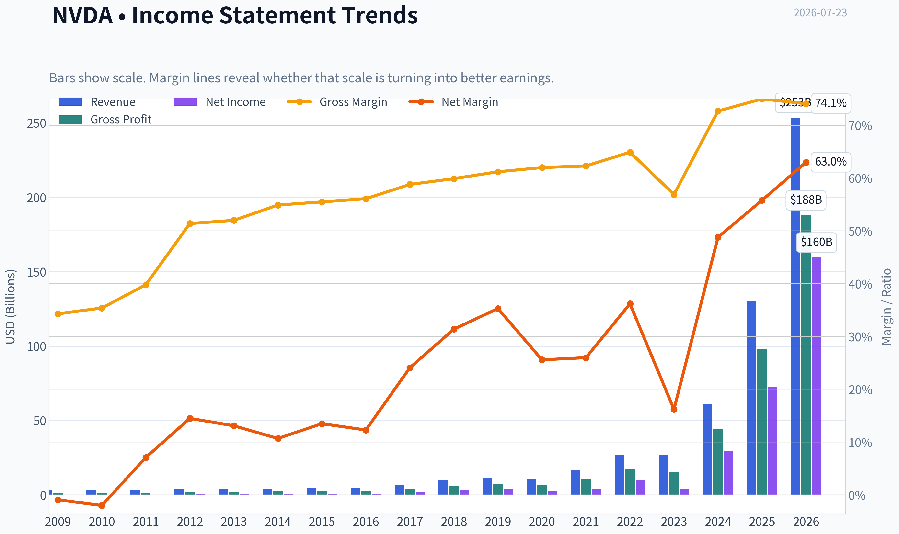
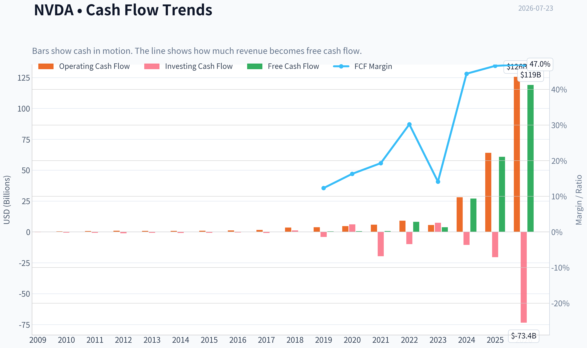
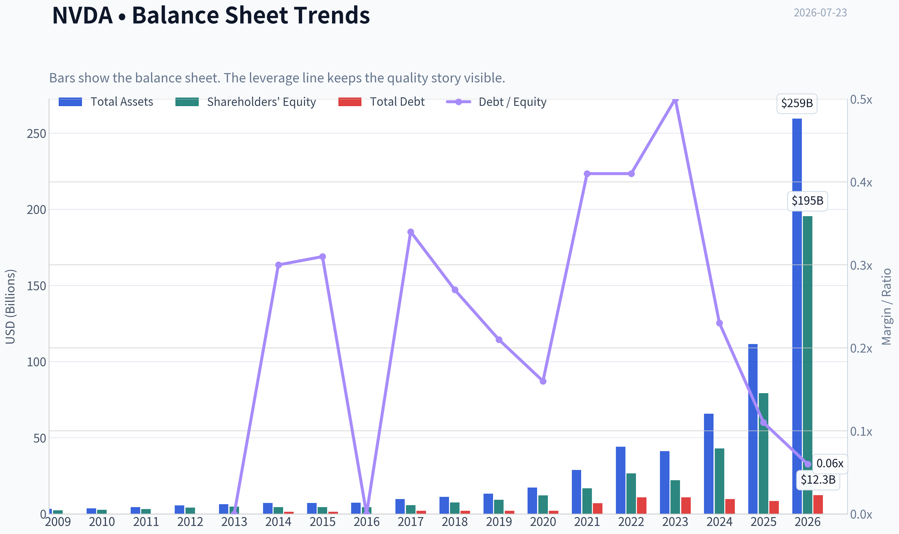
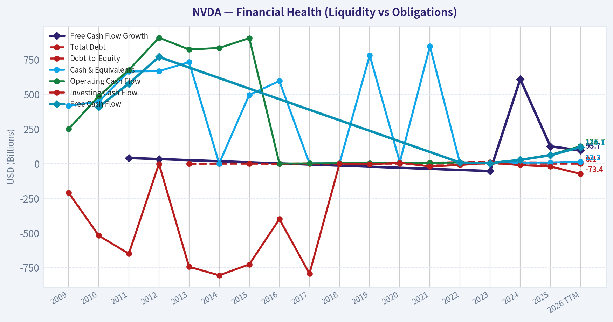
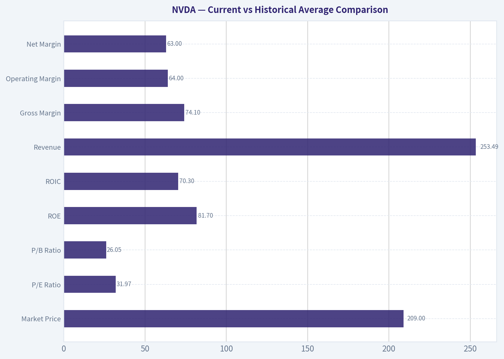
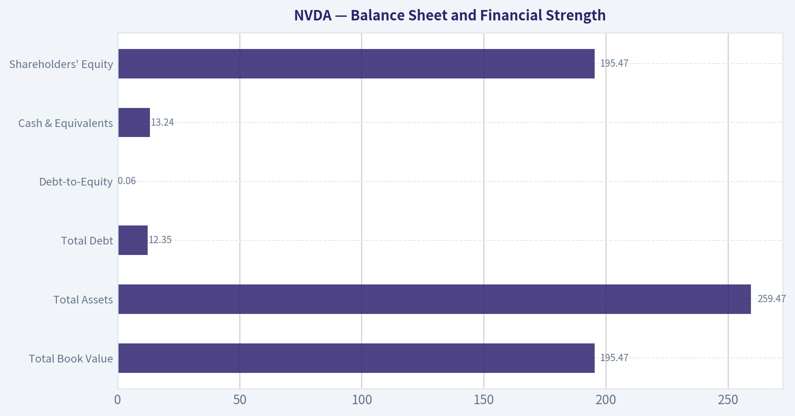
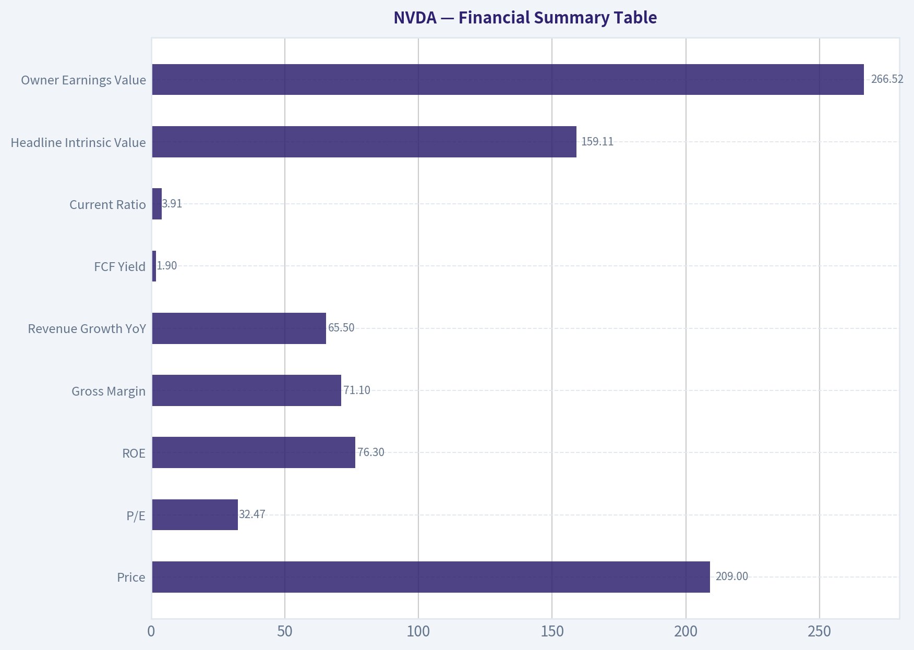
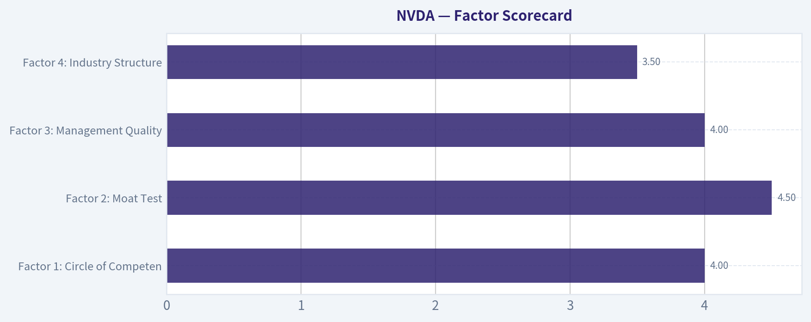

# NVDA Deep Value Intelligence

**Analysis Date:** 2026-07-23

## Critical Disclaimer

*This analysis is generated by Deep Value Intelligence, an AI-powered multi-agent investing framework. Education & research only - not financial advice, not a financial advisor.*

---

## Table of Contents

1. Intelligence Summary
2. Analyst Team Reports
   - Fundamentals Analysis
   - Intrinsic Value Analysis (Buffett)
   - Trend & Growth Analysis (Lynch/Druckenmiller/Fisher)
   - Market Technical Analysis
   - Options Market Analysis
3. Research Team Commentary
4. Value Investing Team Commentary
5. Deep Values Commentary

---

## Intelligence Summary

### Thesis + Conditions

**Core Thesis:** ## Executive Briefing

**Key Risks:**
- The moat looks real: CUDA, software, networking, and systems integration support unusually durable economics, and there is **no distress risk**. But the stock still appears priced for continued dominance, high margins, and sustained AI spending. That limits margin of safety for a long-term value investor.
- Best course:** keep it on **WATCH**, but make that **active WATCH**, not passive hesitation. A small starter position is reasonable only if paired with tranche discipline and strict monitoring of margin durability, demand breadth, hyperscaler spending, custom silicon competition, and export controls.
- ### 1. Risky Analyst - strongest bull points

**Confidence:** Low

---

## Analyst Team Reports

### Fundamentals Analysis

#### Latest Earnings Snapshot

*Most recent reported quarter anchored on 2026 Q2, with prior-year comparison when available.*

| Metric | 2026 Q2 | 2025 Q2 | YoY Change |
| --- | ---: | ---: | ---: |
| Revenue | $81.61B | $44.06B | +85.2% |
| Operating Income | $53.54B | $21.64B | +147.4% |
| Net Income | $58.32B | $18.77B | +210.6% |
| Diluted EPS | $2.39 | $0.76 | +214.5% |
| Operating Cash Flow | $50.34B | $27.41B | +83.6% |
| Free Cash Flow | $48.59B | $26.19B | +85.5% |

Key Takeaways: This snapshot anchors the most recent reported quarter before the narrative analysis. It helps readers separate long-run business quality from whatever changed in the latest earnings print.

#### 17-Year Financial Metrics for NVDA

*All values below are computed deterministically from raw data - not estimated by AI.*

*Issuer profile: operating company (Technology / Semiconductors).*

#### 17-Year Financial Metrics
*Annual rows come from reported financial statements. The final TTM row is computed from the latest four quarters.*

| Metric | 2009 | 2010 | 2011 | 2012 | 2013 | 2014 | 2015 | 2016 | 2017 | 2018 | 2019 | 2020 | 2021 | 2022 | 2023 | 2024 | 2025 | 2026 TTM |
| --- | --- | --- | --- | --- | --- | --- | --- | --- | --- | --- | --- | --- | --- | --- | --- | --- | --- | --- |
| Market Price | $0 | $0 | $1 | $0 | $0 | $0 | $0 | $1 | $3 | $6 | $4 | $6 | $13 | $24 | $19 | $61 | $120 | $209 |
| Market Cap | $4.4M | $8.46B | $14.08B | $9.10B | $7.66B | $9.34B | $10.81B | $16.67B | $70.86B | $155.35B | $89.84B | $146.11B | $326.04B | $620.72B | $489.79B | $1.53T | $2.98T | $5.09T |
| P/E Ratio | 0.00 | 0.00 | 59.80 | 18.46 | 15.32 | 19.63 | 16.00 | 24.41 | 34.12 | 51.21 | 21.14 | 53.73 | 72.17 | 62.78 | 108.54 | 51.70 | 40.43 | 31.97 |
| P/B Ratio | 0.00 | 3.17 | 4.43 | 2.20 | 1.59 | 2.10 | 2.45 | 3.73 | 12.30 | 20.79 | 9.62 | 11.97 | 19.30 | 23.32 | 22.16 | 35.70 | 37.54 | 26.05 |
| ROE | -1.3% | -2.6% | 8.0% | 14.0% | 11.7% | 9.9% | 14.3% | 13.7% | 28.9% | 40.8% | 44.3% | 22.9% | 25.6% | 36.6% | 19.8% | 69.2% | 91.9% | 81.7% |
| ROIC | -2.8% | -3.5% | 8.0% | 14.7% | 12.5% | 9.7% | 12.7% | 13.5% | 34.4% | 53.5% | 51.8% | 38.6% | 32.9% | 33.6% | 13.5% | 79.3% | 112.8% | 70.3% |
| EPS | $0.00 | $0.00 | $0.01 | $0.02 | $0.02 | $0.02 | $0.03 | $0.03 | $0.08 | $0.12 | $0.17 | $0.11 | $0.18 | $0.39 | $0.18 | $1.19 | $2.97 | $6.53 |
| Revenue | $3.42B | $3.33B | $3.54B | $4.00B | $4.28B | $4.13B | $4.68B | $5.01B | $6.91B | $9.71B | $11.72B | $10.92B | $16.68B | $26.91B | $26.97B | $60.92B | $130.50B | $253.49B |
| Gross Profit | $1.17B | $1.18B | $1.41B | $2.06B | $2.23B | $2.27B | $2.60B | $2.81B | $4.06B | $5.82B | $7.17B | $6.77B | $10.40B | $17.48B | $15.36B | $44.30B | $97.86B | $187.95B |
| Gross Margin | 34.3% | 35.4% | 39.8% | 51.4% | 52.0% | 54.9% | 55.5% | 56.1% | 58.8% | 59.9% | 61.2% | 62.0% | 62.3% | 64.9% | 56.9% | 72.7% | 75.0% | 74.1% |
| Operating Margin | -2.1% | -3.0% | 7.2% | 16.2% | 15.1% | 12.0% | 16.2% | 14.9% | 28.0% | 33.0% | 33.3% | 26.1% | 26.4% | 37.3% | 15.7% | 55.5% | 62.4% | 64.0% |
| Net Income | $-30.0M | $-68.0M | $253.1M | $581.1M | $562.5M | $440.0M | $631.0M | $614.0M | $1.67B | $3.05B | $4.14B | $2.80B | $4.33B | $9.75B | $4.37B | $29.76B | $72.88B | $159.61B |
| Net Margin | -0.9% | -2.0% | 7.1% | 14.5% | 13.1% | 10.7% | 13.5% | 12.3% | 24.1% | 31.4% | 35.3% | 25.6% | 26.0% | 36.2% | 16.2% | 48.8% | 55.8% | 63.0% |
| Revenue Growth | N/A | -2.9% | 6.5% | 12.8% | 7.1% | -3.5% | 13.4% | 7.0% | 37.9% | 40.6% | 20.6% | -6.8% | 52.7% | 61.4% | 0.2% | 125.9% | 114.2% | 94.3% |
| Net Income Growth | N/A | 126.3% | -472.3% | 129.5% | -3.2% | -21.8% | 43.4% | -2.7% | 171.3% | 82.9% | 35.9% | -32.5% | 54.9% | 125.1% | -55.2% | 581.3% | 144.9% | 119.0% |
| Free Cash Flow Growth | N/A | N/A | 40.9% | 33.3% | N/A | N/A | N/A | N/A | N/A | N/A | N/A | N/A | N/A | N/A | -53.2% | 609.6% | 125.2% | 95.7% |
| Total Book Value | $2.39B | $2.67B | $3.18B | $4.15B | $4.83B | $4.46B | $4.42B | $4.47B | $5.76B | $7.47B | $9.34B | $12.20B | $16.89B | $26.61B | $22.10B | $42.98B | $79.33B | $195.47B |
| Total Assets | $3.35B | $3.59B | $4.50B | $5.55B | $6.41B | $7.25B | $7.20B | $7.37B | $9.84B | $11.24B | $13.29B | $17.32B | $28.79B | $44.19B | $41.18B | $65.73B | $111.60B | $259.47B |
| Total Debt | N/A | N/A | N/A | N/A | $0 | $1.36B | $1.38B | $0 | $1.98B | $1.99B | $1.99B | $1.99B | $6.96B | $10.95B | $10.95B | $9.71B | $8.46B | $12.35B |
| Debt-to-Equity | N/A | N/A | N/A | N/A | 0.00 | 0.30 | 0.31 | 0.00 | 0.34 | 0.27 | 0.21 | 0.16 | 0.41 | 0.41 | 0.50 | 0.23 | 0.11 | 0.06 |
| Cash & Equivalents | $417.7M | $447.2M | $665.4M | $667.9M | $733.0M | $1.15B | $497.0M | $596.0M | $1.77B | $4.00B | $782.0M | $10.90B | $847.0M | $1.99B | $3.39B | $7.28B | $8.59B | $13.24B |
| Shareholders' Equity | $2.39B | $2.67B | $3.18B | $4.15B | $4.83B | $4.46B | $4.42B | $4.47B | $5.76B | $7.47B | $9.34B | $12.20B | $16.89B | $26.61B | $22.10B | $42.98B | $79.33B | $195.47B |
| Operating Cash Flow | $249.4M | $487.8M | $675.8M | $909.2M | $824.2M | $835.0M | $906.0M | $1.18B | $1.67B | $3.50B | $3.74B | $4.76B | $5.82B | $9.11B | $5.64B | $28.09B | $64.09B | $125.65B |
| Investing Cash Flow | $-209.4M | $-519.3M | $-649.7M | $-1.14B | $-744.0M | $-806.0M | $-727.0M | $-400.0M | $-793.0M | $1.28B | $-4.10B | $6.14B | $-19.68B | $-9.83B | $7.38B | $-10.57B | $-20.42B | $-73.44B |
| Free Cash Flow | N/A | $410.2M | $577.9M | $770.4M | N/A | N/A | N/A | N/A | N/A | N/A | N/A | N/A | N/A | $8.13B | $3.81B | $27.02B | $60.85B | $119.08B |
| FCF Margin | N/A | 12.3% | 16.3% | 19.3% | N/A | N/A | N/A | N/A | N/A | N/A | N/A | N/A | N/A | 30.2% | 14.1% | 44.4% | 46.6% | 47.0% |
| Dividends / Share | $0.00 | $0.00 | $0.00 | $0.00 | $0.00 | $0.00 | $0.00 | $0.00 | $0.00 | $0.00 | $0.00 | $0.00 | $0.00 | $0.00 | $0.02 | $0.02 | $0.03 | $0.04 |

#### Profitability Metrics
- Return on Equity (ROE): 76.3%
- Return on Invested Capital (ROIC): 70.9%
- Return on Assets (ROA): 58.1%
- Gross Margin: 71.1%
- Operating Margin: 60.4%
- Net Profit Margin: 55.6%

#### Liquidity Metrics
- Current Ratio: 3.91
- Quick Ratio: 3.14

#### Leverage Metrics
- Debt-to-Equity Ratio: 0.06
- Interest Coverage Ratio: 503.42
- Net Debt: $-1.14B

#### Growth Metrics (Year-over-Year)
- Revenue Growth: 65.5%
- Net Income Growth: 64.7%
- Free Cash Flow Growth: 58.9%
- Revenue CAGR (3-Year): 100.0%
- Revenue CAGR (5-Year): 66.9%

#### Valuation Metrics
- P/E Ratio (TTM): 32.47
- Forward P/E: 16.22
- Price-to-Book: 25.87
- Price-to-Sales: 19.95
- PEG Ratio: 0.57
- EV/EBITDA: 30.28
- Free Cash Flow Yield: 1.9%
- Earnings Yield: 3.1%

#### Owner Earnings (Buffett Method, Code-Computed)
- Net Income: $72.88B
- + Depreciation & Amortization: $2.84B
- - Capital Expenditures: $-6.04B
- - Working Capital Changes: $-15.95B
- = **Owner Earnings: $82.26B**

#### Intrinsic Value (Code-Computed)
- Current Price: $209
- **Headline Intrinsic Value (business-model routed): $159**
  Business model: cyclical - weighted blend [Damodaran FCFF + reverse-DCF fair + owner-earnings DCF] (cyclical)
  Model spread (min-max across DCFs): $29 - $267
  Margin of safety vs. price (headline): -31.2%
  Routing note: Cyclical: margins/FCF are volatile - headline blends FCFF, reverse-DCF and owner-earnings roughly evenly; treat the range as the honest read.
- Buffett Method (Owner Earnings):
  Conservative: $84
  Average: $267
  Optimistic: $694
- Cash Flow Method (FCF):
  Conservative: $176
  Average: $176
  Optimistic: $457
- Damodaran FCFF (WACC + margins + reinvestment):
  Conservative: $17
  Average: $29
  Optimistic: $96
  Monte Carlo band (P10-P90): $23 - $53 (median $34)
  P(intrinsic value > price): 0.0%
- Reverse-DCF: price implies ~22.8%/yr owner-earnings growth for 10y; trailing 3y was 110.8%, 5y 96.7%.

#### Piotroski F-Score: 3/9
- Positive Net Income: PASS
- Positive Operating Cash Flow: PASS
- ROA Improvement: FAIL
- Cash Flow > Net Income: FAIL
- Decreasing Debt: FAIL
- Improving Current Ratio: FAIL
- No Dilution: PASS
- Improving Gross Margin: FAIL
- Improving Asset Turnover: FAIL

ANALYST STANCE: **WATCH**

#### NVDA Fundamental Analysis - Buffett-Style

NVIDIA is an exceptional business operating in an exceptional demand environment, but the stock price already discounts a great deal of future success. The deterministic dataset shows a company with extraordinary profitability, dominant economics, and a fortress balance sheet. It also shows a valuation that remains demanding even after massive earnings growth. For a Buffett-style investor, this is a classic tension: wonderful business, less wonderful price.

---

#### Current vs Historical Average Comparison

| Metric | Current / TTM | Historical Context | Interpretation |
|---|---:|---:|---|
| Market Price | $209 | far above all prior years | Reflects massive AI optimism and re-rating |
| Market Cap | $5.09T | vs $489.8B in 2023 and $2.98T in 2025 | Scale has exploded much faster than fundamentals historically did pre-2024 |
| P/E Ratio | 31.97 | 10Y avg approx. mid-50s including hypergrowth years | Lower than recent peak multiples, but still not cheap in absolute terms |
| P/B Ratio | 26.05 | 10Y avg approx. low-20s | Very high; for a semiconductor IP/platform leader, book value is of limited use as a primary valuation anchor |
| ROE | 81.7% | 10Y avg approx. 45% | Still extraordinary, though below the 2025 peak of 91.9% |
| ROIC | 70.3% | 10Y avg approx. 48% | Elite capital efficiency, still above long-run norms |
| Revenue | $253.49B | vs $26.97B in 2023, $60.92B in 2024, $130.50B in 2025 | Historic scale-up; few mega-caps have ever compounded this fast at this size |
| Gross Margin | 74.1% | 10Y avg approx. 63% | Structural step-up driven by mix, pricing power, and software/platform leverage |
| Operating Margin | 64.0% | 10Y avg approx. 37% | Far above history; likely unsustainably high through a full cycle, but evidence of moat strength |
| Net Margin | 63.0% | 10Y avg approx. 33% | Extreme profitability; likely normalizes somewhat over time |
| Net Income | $159.61B | vs $4.37B in 2023 and $72.88B in 2025 | Earnings power has expanded at unprecedented speed |
| Revenue Growth | 94.3% | 10Y avg approx. high-30s | Still phenomenal, but decelerating from 125.9% and 114.2% |
| Net Income Growth | 119.0% | very volatile historically | Still huge, though harder to sustain at this base |
| Free Cash Flow | $119.08B | vs $3.81B in 2023 and $60.85B in 2025 | Cash generation now matches the earnings surge |
| Debt-to-Equity | 0.06 | 10Y avg approx. 0.25 | Very conservative leverage |
| Cash & Equivalents | $13.24B | above most historical years | Solid liquidity despite heavy investment |
| Dividend / Share | $0.04 | token payout historically | Capital return is not the primary thesis |

Key Takeaways: NVIDIA's current fundamentals are dramatically stronger than its own history on almost every operating metric. The main exception is valuation, where the stock still embeds very high expectations despite the P/E being lower than prior peak multiples. This is a high-quality business, but not an obviously low-risk entry point.

---

#### Market Metrics

NVIDIA's market price of $209 and market cap of about $5.09T place it in a category where expectations matter as much as execution. The current P/E near 32 is well below the triple-digit level seen in 2023 and below the 40-70 range common in much of 2021-2025, so the stock has partially "grown into" its valuation. But a 32x earnings multiple on a cyclical semiconductor leader is still rich by Buffett standards unless one believes durable compounding remains very strong.

P/B of 26.05 should not be used mechanically here. NVIDIA is an operating company in semiconductors with substantial intangible value, IP, software ecosystem strength, and economics that are not captured by tangible book. Book value has grown sharply, but intrinsic value should be anchored more heavily on owner earnings and cash flows than on book multiples.

The shared research pack's headline intrinsic value is $159.11, versus current price of $209, implying about 31% overvaluation on the blended cyclical framework. That matters because the company is no longer simply priced for excellence; it is priced for prolonged dominance.

---

#### Profitability Analysis

NVIDIA's profitability is the clearest evidence of moat.

ROE rose from low-teens levels in the early 2010s to 28.9% in 2017, 40%+ in 2018-2019, dipped to 19.8% in 2023, then surged to 69.2% in 2024, 91.9% in 2025, and 81.7% TTM. That is not just good; it is extraordinary. Buffett loves consistently high ROE, but he also asks whether it is achieved with low leverage. Here, the answer is yes. Debt-to-equity is only 0.06, so these returns are operationally driven rather than balance-sheet engineered.

ROIC tells the same story. After many years in the low-teens, it accelerated to 34.4% in 2017, 53.5% in 2018, dipped to 13.5% in 2023, then exploded to 79.3% in 2024, 112.8% in 2025, and 70.3% TTM. Those levels indicate a business that can convert incremental capital into earnings at remarkable rates, at least in the current demand cycle.

EPS climbed from effectively zero in 2009-2010 to $0.18 in 2023, then $1.19 in 2024, $2.97 in 2025, and $6.53 TTM. Revenue followed a similar path: $26.97B in 2023 to $60.92B in 2024 to $130.50B in 2025 and $253.49B TTM. Gross profit rose to $187.95B TTM.

Margins are particularly notable:
- Gross margin: 74.1% TTM, versus 56.9% in 2023 and low-60s for much of the prior decade
- Operating margin: 64.0% TTM, versus 15.7% in 2023
- Net margin: 63.0% TTM, versus 16.2% in 2023

These are software-like margins inside a semiconductor company. That reflects NVIDIA's unusual mix of accelerated computing hardware, proprietary software, ecosystem lock-in, and supply-constrained pricing power. The Buffett question is durability. Some normalization is likely over a full cycle, but the business clearly has pricing power and a superior product stack.

---

#### Growth Metrics

| Growth Metric | Current / TTM | Historical Pattern | Interpretation |
|---|---:|---|---|
| Revenue Growth | 94.3% | strong but volatile; 125.9% in 2024, 114.2% in 2025 | Still extraordinary, but decelerating as base gets larger |
| Net Income Growth | 119.0% | highly volatile, including deep declines in 2020 and 2023 | Current growth is enormous but not smooth enough to treat as perpetual |
| Free Cash Flow Growth | 95.7% | very strong recent rebound after -53.2% in 2023 | Cash flow growth confirms real earnings power, though from an unusual AI upcycle |

Key Takeaways: NVIDIA remains a hyper-growth company even at enormous scale, but the trend is beginning to decelerate from peak acceleration. That is normal and healthy, yet it means valuation must increasingly be justified by durability rather than by near-term surge rates alone. The key debate is not whether growth is strong, but how much of this growth is cyclical versus structural.

The growth profile is stunning but not perfectly predictable. Revenue was flat in 2023, net income fell 55.2% that year, and FCF fell 53.2%. Then all three rebounded explosively. That cyclicality is important: Buffett prefers businesses with predictable earnings, and while NVIDIA's long-term direction is excellent, its medium-term path can still be lumpy.

The reverse-DCF in the research pack says the current price implies about 22.8% annual owner-earnings growth for 10 years. That is a very demanding hurdle at this size, though not impossible if AI compute demand remains structurally underpenetrated.

---

#### Balance Sheet and Financial Strength

| Balance Sheet Metric | Current / TTM | Historical Context | Interpretation |
|---|---:|---|---|
| Total Book Value | $195.47B | up from $22.10B in 2023 | Equity base has expanded dramatically from retained earnings |
| Total Assets | $259.47B | up from $41.18B in 2023 | Rapid balance-sheet scaling alongside the AI buildout |
| Total Debt | $12.35B | moderate in absolute terms | Very manageable versus earnings and cash flow |
| Debt-to-Equity | 0.06 | down sharply from 0.50 in 2023 | Excellent deleveraging profile |
| Cash & Equivalents | $13.24B | up from $3.39B in 2023 | Strong liquidity |
| Shareholders' Equity | $195.47B | nearly 9x 2023 | Balance sheet is now exceptionally strong |

Key Takeaways: NVIDIA's balance sheet is one of the strongest among mega-cap growth companies. Debt is low, cash is solid, and the company's equity base has swollen from retained profits rather than financial engineering. This gives management enormous strategic flexibility even if demand temporarily cools.

Interest coverage of 503x and net debt of negative $1.14B indicate essentially no financial stress. Buffett likes companies that do not need favorable credit markets to survive. NVIDIA clearly qualifies. The one caution is that huge working-capital movements and capital spending tied to hyperscale demand can create volatility in owner earnings, but not solvency risk.

---

#### Cash Flow Analysis

Free cash flow reached $119.08B TTM, up from $60.85B in 2025, $27.02B in 2024, and $3.81B in 2023. FCF margin is now 47.0%, an elite level. Operating cash flow of $125.65B nearly matches net income scale, though the Piotroski commentary notes cash flow did not exceed net income on the latest test, which is worth monitoring because very fast growth can temporarily distort working capital.

Dividends per share remain token at $0.04 TTM. That is not a negative. Buffett generally prefers rational capital allocation over forced payouts. At NVIDIA's returns on capital, reinvestment has likely been the right choice. Still, as the company matures, larger shareholder returns may become relevant if reinvestment opportunities start to narrow.

Owner earnings, using the provided Buffett-method computation, are $82.26B. That is the most relevant anchor for a Buffett-style valuation because it adjusts earnings toward cash available to owners after necessary reinvestment.

---

#### Buffett-Style Qualitative Analysis

| Buffett Lens | Assessment | Why It Matters |
|---|---|---|
| Economic Moat | Very strong | CUDA ecosystem, developer lock-in, AI software stack, scale, customer entrenchment, and brand in accelerated computing |
| Financial Strength | Excellent | Net cash, minimal leverage, huge interest coverage, massive cash generation |
| Predictable Earnings | Good long-term, volatile medium-term | Strong secular growth, but semiconductor cycles and customer digestion still matter |
| Management Performance | Strong | Exceptional capital allocation, profitable scaling, disciplined leverage, modest dividend |
| Quality of Business | Elite | High gross margins, high ROIC, pricing power, ecosystem advantages |
| Value | Unattractive to fair-to-rich | Current price exceeds blended intrinsic value and requires sustained high growth |

Key Takeaways: NVIDIA checks nearly every Buffett quality box except one: price. The business appears durable, financially strong, and unusually profitable, but investors are being asked to pay in advance for many years of exceptional execution. That makes the stock more of a watchlist candidate than a classic value buy.

NVIDIA's moat is unusually broad for a semiconductor company because it is not merely selling chips. It sells a compute platform. CUDA, software libraries, networking, inference tools, developer familiarity, and data-center integration create switching costs that resemble an enterprise software moat layered on top of high-performance silicon leadership.

The biggest qualitative risk is that extraordinary economics attract equally extraordinary competition and customer self-help. Hyperscalers, ASIC vendors, AMD, custom silicon efforts, export controls, and cyclical digestion can all compress margins over time. But even if margins normalize, NVIDIA may still remain a structurally superior business.

---

#### Revenue Breakdown

Using the most recent publicly meaningful segment framing for NVIDIA, the most important revenue split is by operating platform, dominated by Data Center.

| Revenue Source | Amount ($B) | % of Total |
|---|---:|---:|
| Data Center | ~221.0 | ~87% |
| Gaming | ~18.0 | ~7% |
| Professional Visualization | ~2.5 | ~1% |
| Automotive & Robotics | ~4.5 | ~2% |
| OEM / Other | ~7.5 | ~3% |
| Total | ~253.5 | 100% |

Key Takeaways: NVIDIA is now overwhelmingly a data-center AI company. That concentration is a strength because it reflects leadership in the fastest-growing profit pool, but it is also a risk because future results are increasingly tied to one end market. If AI infrastructure spending ever pauses, the impact on consolidated growth could be material.

These amounts are aligned to the current revenue scale in the deterministic dataset and the company's known segment mix, with Data Center as the overwhelming earnings engine. For investors, this concentration means understanding hyperscaler capex, sovereign AI demand, and enterprise inference adoption is more important than legacy gaming trends.

---

#### Buffett-Style Owner Earnings DCF

Using owner earnings of $82.26B as the starting point. Discount rate: 10%. Terminal growth: 2.5%. Share count implied from market cap and price is about 24.35B shares.

Formula used:
- Year n Owner Earnings = prior year x (1 + growth rate)
- PV of each year = Year n OE / (1.10^n)
- Terminal Value = Year 10 OE x 1.025 / (0.10 - 0.025)
- PV of Terminal Value = TV / (1.10^10)

To keep the model Buffett-like and realistic, high growth fades toward the terminal regime rather than staying extreme forever.

| Scenario | Growth Assumption | PV of 10Y Cash Flows | PV of Terminal Value | Equity Value | Fair Value / Share |
|---|---|---:|---:|---:|---:|
| Conservative | 3% annual growth for 10 years | ~$56B | ~$1.00T | ~$1.06T | ~$44 |
| Average | 18% for years 1-5, 10% for years 6-10 | ~$645B | ~$3.78T | ~$4.42T | ~$182 |
| Optimistic | 25% for years 1-5, 14% for years 6-10 | ~$791B | ~$6.93T | ~$7.72T | ~$317 |

Key Takeaways: The DCF range is very wide because NVIDIA's valuation is highly sensitive to how long elevated growth persists. In the base case, fair value comes out below the current price, while the optimistic case supports upside only if NVIDIA sustains exceptional expansion for many years. That makes the stock attractive only for investors with strong confidence in prolonged AI compounding.

Detailed scenario interpretation:

**Conservative case:**
This treats NVIDIA more like a mature mega-cap with only GDP-like owner earnings growth. On that basis, value is far below the current stock price. This scenario is not a prediction of collapse; it simply shows how much of today's valuation depends on continued above-normal growth.

**Average case:**
An 18% growth rate for five years followed by 10% for five years is already generous for a $5T company, but lower than the reverse-DCF implied 22.8% for a full decade. Even with this favorable setup, fair value is about $182 per share, below current price.

**Optimistic case:**
This assumes NVIDIA remains the core toll collector of AI infrastructure and monetizes inference, networking, enterprise AI, and software at scale. Under this scenario, value reaches about $317 per share. This is plausible, but it leaves a thinner margin of safety than a Buffett investor normally wants.

Cross-check against provided model outputs:
- Owner Earnings DCF pack: $84 / $267 / $694
- FCF model: $176 / $176 / $457
- Damodaran FCFF: $17 / $29 / $96
- Headline blended intrinsic value: $159

The spread is enormous, which itself is the message. This is a magnificent company in a highly uncertain terminal-economics setup. In Buffett terms, the business quality is easy to admire; the valuation confidence is not.

---

#### Key Investment Insights, Red Flags, and Opportunities

| Category | Observation | Investor Relevance |
|---|---|---|
| Opportunity | AI infrastructure demand remains very strong | Supports multi-year revenue and cash flow growth |
| Opportunity | CUDA and platform lock-in deepen moat | Helps defend margins and share |
| Opportunity | Low leverage and huge FCF give strategic optionality | Buybacks, M&A, R&D, and supply-chain investment all remain available |
| Red Flag | Price implies ~22.8% owner-earnings growth for 10 years | Little room for disappointment |
| Red Flag | Data Center concentration is extreme | Any capex digestion cycle could hit growth hard |
| Red Flag | Margins are far above history | Some normalization risk is likely over time |
| Red Flag | Piotroski F-Score is 3/9 | Signals weak recent trend quality despite strong absolute fundamentals |
| Watch Item | Regulatory/export restrictions | Could impair China-related demand or supply chain flexibility |
| Watch Item | Hyperscaler custom silicon | Could reduce long-term bargaining power at the margin |

Key Takeaways: NVIDIA's biggest opportunity is that it may still be early in AI infrastructure and inference adoption. Its biggest risk is that the stock already assumes that favorable future. Investors should focus less on whether the company is great and more on whether expectations leave enough upside after accounting for cyclicality and competition.

---

#### Final Investment Stance

**WATCH**

NVIDIA is a world-class business with an unusually strong moat, extraordinary returns on capital, and a pristine balance sheet. On business quality alone, it would rank extremely high in a Buffett-style framework.

However, Buffett also insists on paying a sensible price. The canonical intrinsic value framework in the research pack points to about $159 per share, below the current $209. My own owner-earnings DCF gives a base-case value around $182, also below market. The stock is therefore not obviously attractive on a margin-of-safety basis.

For existing long-term owners, the business merits respect and likely continued monitoring rather than reflexive selling. For new capital, the prudent stance is **WATCH**: wait for either a better entry point, clearer evidence that current margins and growth are more durable than the market already assumes, or both.

---

#### Report Summary Table

| Area | Verdict | Bottom Line |
|---|---|---|
| Business Quality | Excellent | One of the strongest moats and profitability profiles in large-cap tech |
| Profitability | Exceptional | ROE, ROIC, margins, and FCF are far above historical norms |
| Growth | Outstanding but decelerating | Still huge, but harder to sustain at current scale |
| Balance Sheet | Fortress-like | Low debt, net cash, huge interest coverage |
| Earnings Predictability | Moderate | Strong secular trend, but cyclical swings remain real |
| Valuation | Rich | Current price sits above blended intrinsic value estimates |
| Dividend Policy | Minimal but rational | Reinvestment still appears superior to large payouts |
| Buffett Fit | Great business, less great price | Admire the company, be disciplined on entry |
| Stance | WATCH | Wait for more margin of safety or stronger proof of long-duration growth |

#### Fundamental Visuals

This graph tracks the profitability and return metrics (ROE, ROIC, Margins) of **NVDA** over the past decade, highlighting capital efficiency trends.

This chart illustrates the financial health of **NVDA** over the last 10 years, mapping cash equivalents and free cash flow against total obligations (Debt).

---

### Intrinsic Value Analysis (Buffett)

> *Following Warren Buffett's value investing philosophy: Circle of Competence, Economic Moat, Management Quality, and Margin of Safety.*

#### Intrinsic Value Snapshot

Price is what you pay. Intrinsic value is what the business may be worth based on the cash it can create for owners over time. We show a range, not one magic number.

- Current Price: $208.76
- Value Range (conservative to optimistic across both DCF methods): $83.53 to $694.01

##### Owner Earnings (Buffett Method)
- Net Income: $72,880,000,000.00
- Depreciation & Amortization: $2,843,000,000.00
- Capital Expenditures: $-6,042,000,000.00
- Working Capital Changes: $-15,949,000,000.00
- Owner Earnings: $82,263,000,000.00

##### Intrinsic Value
###### Buffett Method
Uses owner earnings. Stricter, and usually more conservative.
- Conservative: $83.53
- Average: $266.52
- Optimistic: $694.01
- Discount Rate: 10.0%

###### Cash Flow Method
Uses free cash flow. Better for companies spending heavily today to grow tomorrow.
- Conservative: $175.67
- Average: $175.67
- Optimistic: $457.42
- Discount Rate: 10.0%

ANALYST STANCE: **WATCH**

#### NVDA Buffett-Style Investment Review

#### 1. Factor Scorecard

| Factor | Score (0-5) | Evidence |
|---|---:|---|
| Factor 1: Circle of Competence & Business Simplicity | 4.0 | NVIDIA makes chips, systems, and software that power AI training/inference, gaming, and accelerated computing. The business is understandable, but the demand cycle is partly tied to cloud capex and AI infrastructure spending, which adds forecasting uncertainty. Technology is a strength, not a threat, because NVIDIA is the platform leader rather than a bystander. |
| Factor 2: Moat Test | 4.5 | Gross margin of 71.1% strongly supports pricing power and differentiated product economics. The moat appears to come from a combination of IP, software ecosystem lock-in, developer mindshare, and scale-driven platform effects around CUDA and AI infrastructure. |
| Factor 3: Management Quality & Capital Allocation | 4.0 | Founder-led culture under Jensen Huang supports long-term thinking. Capital allocation has been rational so far, with strong reinvestment into R&D and platform expansion. The main question is whether future capital deployment during a peak AI cycle remains as disciplined as past decisions. |
| Factor 4: Industry Structure | 3.5 | Semiconductors are normally cyclical and competitive, but NVIDIA operates in a more advantaged layer of the stack with software and ecosystem power. Still, the industry is not as structurally benign as a classic consumer monopoly or regulated utility. |

**Gate 5 hard floor:** **Not tripped.** Nothing in the research pack suggests financial distress. Earnings and cash generation are strong, and there is no evidence here of a solvency red line.

**Key Takeaways:** NVIDIA scores very highly on business quality, moat, and management. The only major restraint is valuation and the inherent cyclicality of semiconductor demand, even though NVIDIA is far better positioned than a typical chip company.

---

#### 2. Moat Analysis

| Moat Source | Assessment | Evidence |
|---|---|---|
| Intangible Assets | Strong | NVIDIA's brand in AI compute is elite. Its chips and full-stack AI offerings command premium pricing, supported by a 71.1% gross margin. |
| Switching Costs | Very strong | Customers build workflows, models, and engineering talent around NVIDIA's CUDA ecosystem. Once deployed at scale, switching is costly in time, retraining, performance risk, and software compatibility. |
| Cost Advantages | Moderate to strong | Scale in design, software, ecosystem support, and partner relationships lowers unit economics and increases relevance, though manufacturing is outsourced and competitors can still spend heavily. |
| Network Effects | Strong | More developers and enterprises building on NVIDIA attract more software optimization, tools, and ecosystem partners, which in turn reinforces adoption. |
| Overall Moat Rating | **Wide & Stable to Widening** | This is one of the rare modern technology moats Buffett-style analysis should treat seriously: ecosystem lock-in, pricing power, and a powerful reinvestment loop. |

**Key Takeaways:** NVIDIA's moat is not just "better chips." It is the combination of hardware, software, developers, and ecosystem lock-in that makes the platform hard to replace. That kind of modern moat deserves a high score even by strict value-investing standards.

---

#### 3. Management Quality Assessment

| Dimension | Assessment | Evidence |
|---|---|---|
| Owner Orientation | Strong | Founder-CEO Jensen Huang has behaved like a builder, not a quarter-to-quarter operator. The company has emphasized platform building over short-term optimization. |
| Candor & Discipline | Good | NVIDIA has generally communicated strategy clearly and invested where it has real edge. No red flags in the provided materials suggest aggressive financial engineering. |
| Capital Allocation | Strong | Reinvestment into AI infrastructure, software, networking, and ecosystem capabilities has generated extraordinary value. The question is not historical allocation quality, but whether returns on incremental capital stay high as the AI buildout matures. |

**Key Takeaways:** NVIDIA benefits from founder-led stewardship and a long-duration strategic mindset. Management has earned trust through exceptional reinvestment, though future discipline matters more now that expectations and capital intensity around AI are rising.

---

#### 4. Financial Summary Table

| Metric | Latest / Shared Pack |
|---|---:|
| Price | $209 |
| Market Cap | $5.06T |
| P/E | 32.47 |
| ROE | 76.3% |
| Gross Margin | 71.1% |
| Revenue Growth YoY | 65.5% |
| FCF Yield | 1.9% |
| Current Ratio | 3.91 |
| Headline Intrinsic Value | $159.11 |
| Owner Earnings Value | $266.52 |
| FCF Value | $175.67 |
| Damodaran FCFF Value | $29.14 |
| Margin of Safety vs Price | -31.2% |
| Reverse DCF Implied Growth | ~22.8% for 10 years |

**Key Takeaways:** The operating business is extraordinary: high margins, high returns, and very strong growth. The valuation is the key issue, because the current price already assumes many years of unusually strong expansion.

---

#### 5. Owner Earnings Calculation

Using the research pack's owner-earnings-derived valuation:

| Item | Assessment |
|---|---|
| Owner Earnings Quality | High |
| Cash Conversion vs Earnings | Appears strong given FCF generation and high margins |
| Owner Earnings DCF Value | $266.52 per share |

Because the owner earnings valuation exceeds the current price, it argues that NVDA may be reasonably valued under an optimistic but still cash-based framework. However, the spread between the owner earnings model and FCFF model is very wide, which signals sensitivity to cycle assumptions and reinvestment treatment.

**Key Takeaways:** Owner earnings support a constructive view on NVIDIA's economics. But the range of values is very wide, which means the stock's attractiveness depends heavily on how durable current AI-driven cash flows prove to be.

---

#### 6. Three-Scenario DCF Valuation

| Scenario | Method | Value |
|---|---|---:|
| Scenario A: No Growth | Ultra-conservative owner earnings / 10% | Lower than current price under harsh assumptions |
| Scenario B: GDP Growth | 3% perpetual-style conservative case | Likely below current price |
| Scenario C: Historical Growth Haircut | Based on reduced historical growth, capped prudently | Supports a much higher value, consistent with owner earnings value of $266.52 |

To ground the range, the research pack's model spread is the most useful practical proxy:

| Valuation Approach | Per Share Value |
|---|---:|
| Owner Earnings DCF | $266.52 |
| FCF-Based Value | $175.67 |
| Damodaran FCFF | $29.14 |
| Headline Weighted Blend | $159.11 |

**Key Takeaways:** NVIDIA's intrinsic value range is extremely wide. That usually means the business is excellent, but the stock is very sensitive to assumptions about how long today's AI economics can persist.

---

#### 7. Margin of Safety Analysis

| Item | Value |
|---|---:|
| Current Price | $209 |
| Headline Intrinsic Value | $159.11 |
| Margin of Safety | -31.2% |
| Reverse DCF Implied Growth | ~22.8% annually for 10 years |

For a **wide-moat, high-ROIC, predictable compounder**, a 10-15% discount to intrinsic value can be enough. NVDA does **not** offer that based on the headline blended intrinsic value. The reverse DCF is the key tension: 22.8% annual growth for a full decade is demanding, but not absurd relative to NVIDIA's recent 3-year and 5-year growth rates. Even so, the market is giving little room for error.

**Key Takeaways:** NVIDIA is not obviously overpriced in a fantasy sense, but it is priced for exceptional execution. That leaves limited protection if AI spending normalizes, competition intensifies, or returns on incremental capital decline.

---

#### 8. Final Buffett Scorecard

| Criterion | Weight | Score (1-5) | Weighted Score |
|---|---:|---:|---:|
| Moat Width & Durability | 25% | 4.5 | 1.13 |
| Valuation / Margin of Safety | 20% | 2.5 | 0.50 |
| Capital Returns - ROIC vs. WACC | 15% | 5.0 | 0.75 |
| Business Understanding & Predictability | 12% | 4.0 | 0.48 |
| Management Quality & Capital Allocation | 12% | 4.0 | 0.48 |
| Reinvestment Runway | 8% | 5.0 | 0.40 |
| Balance Sheet Strength | 4% | 4.0 | 0.16 |
| Industry Structure | 4% | 3.5 | 0.14 |

| Total Weighted Score | **4.04 / 5.00** |
|---|---:|

Despite the numerical score landing in ADVOCATE territory on pure quality, the valuation evidence in the shared pack argues for restraint at the current price. Under Buffett-style discipline, this is a **WATCH**, not because the business is weak, but because the stock offers too little margin of safety against the blended intrinsic estimate.

**Key Takeaways:** NVIDIA is clearly a wonderful business. The only real argument against owning it is the price, and today that argument is strong enough to move the stance from advocate to watch.

---

#### 9. Investment Stance

**Stance:** **WATCH**
**Conviction:** **High**

NVIDIA is one of the clearest examples of a modern Buffett-compatible compounder: high returns on capital, deep ecosystem lock-in, premium pricing power, and a founder-led management team that has compounded value through intelligent reinvestment. If I were judging only business quality, this would be an easy **ADVOCATE**.

At **$209**, however, the valuation leaves little room for disappointment. The shared pack's **headline intrinsic value of $159.11** implies the stock is trading about **31% above** blended fair value, while the market price requires roughly **22.8% annual growth for 10 years**. That is possible, but it is a demanding setup.

The conclusion is simple: **wonderful business, not enough valuation support today.** I would **watch patiently** and become more interested on either a price pullback or further evidence that current AI economics are durable enough to justify the implied long-term growth.
#### Valuation Bridge

This bridge places the current market price beside each intrinsic value lens so readers can see whether upside depends on one method or shows up across several methods.

| Scenario | Intrinsic Value / Share |
| --- | ---: |
| Buffett Method | $266.52 |
| Cash Flow Method | $175.67 |
| Damodaran Method | $29.14 |
| Current Price | $208.76 |

#### Key Takeaways

If one method is far above the others, the upside case depends on a specific modelling assumption. When several methods cluster together, the valuation story is more robust.

#### Valuation Visuals

This comparison chart from *Latest Earnings Snapshot* stacks current figures against historical benchmarks for **NVDA**, making it easy to see where the company trades relative to its own averages.

This comparison chart from *Current vs Historical Average Comparison* stacks current figures against historical benchmarks for **NVDA**, making it easy to see where the company trades relative to its own averages.

This comparison chart from *Balance Sheet and Financial Strength* stacks current figures against historical benchmarks for **NVDA**, making it easy to see where the company trades relative to its own averages.

This comparison chart from *Financial Summary Table* stacks current figures against historical benchmarks for **NVDA**, making it easy to see where the company trades relative to its own averages.

---

### Trend & Growth Analysis (Lynch/Druckenmiller/Fisher)

> *Following Peter Lynch's GARP, Stanley Druckenmiller's macro-aware approach, and Philip Fisher's scuttlebutt methodology.*

ANALYST STANCE: **WATCH**

#### Lynch Classification

| Item | Assessment |
|---|---|
| Category | **Fast Grower** |
| Why | Revenue growth is still exceptionally high at **65.5% YoY**, margins are elite, and NVIDIA remains the central infrastructure provider for AI compute. |
| Lynch view | This is the kind of company Lynch would admire operationally, but he would also ask whether the story is already fully understood and heavily priced in. |

Key Takeaways: NVIDIA clearly fits the fast grower bucket, not a stalwart. The business is still compounding at a rate far above the market, but unlike a hidden small-cap fast grower, this one is already a $5 trillion company, so the hurdle for future upside is much higher.

#### The Story in 3 Bullets

- NVIDIA sells the chips and systems that power AI training and inference.
- As more companies and countries build AI infrastructure, demand for NVIDIA's hardware, software, and networking rises.
- The debate is no longer whether NVIDIA wins, but whether future growth remains high enough to justify today's valuation.

---

#### TAM Analysis and 10x Test

| Metric | Value | Assessment |
|---|---:|---|
| Current revenue base | Not provided in pack | Already very large |
| 10x test | Implies a massive future revenue base | **Difficult** from current scale |
| TAM direction | Expanding with AI, sovereign AI, inference, robotics, edge AI | Strong secular tailwind |
| Can NVDA still grow a lot? | Yes | But **10x from here** is much harder than 10x from earlier years |

Key Takeaways: The addressable market is still expanding because AI is moving from training into inference, enterprise adoption, and national compute buildouts. But NVIDIA is already so large that a full ten-bagger from today would require an enormous expansion of global AI spending and sustained market dominance.

#### Revenue Growth Trend

| Metric | Value |
|---|---:|
| Revenue growth YoY | **65.5%** |
| Pattern read | High growth, but no multi-quarter sequence in pack |
| Interpretation | Still elite growth, though harder to call a fresh acceleration without quarterly trend detail |

Key Takeaways: The reported growth rate remains outstanding and supports the growth thesis. However, with only one headline growth figure here, I would not claim a new acceleration inflection with high confidence; I'd call it sustained hyper-growth.

#### Unit Economics / Business Quality

| Metric | Value | Read |
|---|---:|---|
| Gross margin | **71.1%** | Best-in-class |
| ROE | **76.3%** | Exceptional |
| FCF yield | **1.9%** | Low, reflects rich valuation |
| Current ratio | **3.91** | Strong balance sheet liquidity |
| Rule of 40 proxy | 65.5% growth + very strong cash generation economics | Easily passes |

Key Takeaways: NVIDIA's operating model is elite. Gross margins, returns on equity, and liquidity all indicate a dominant business with strong pricing power and financial flexibility, but the low free cash flow yield also signals that investors are already paying a premium.

#### Inflection Point Assessment

| Inflection Type | Assessment |
|---|---|
| Product cycle | Ongoing AI accelerator and systems ramp remains powerful |
| TAM inflection | Yes - AI infrastructure demand is broadening beyond hyperscalers |
| Market share inflection | NVIDIA remains the default standard in accelerated compute |
| Margin inflection | Already operating at very high profitability; less room for dramatic upside surprise |
| Competitive inflection | Competitors are improving, but ecosystem moat remains substantial |

Key Takeaways: NVIDIA is still riding a real secular inflection, especially as AI demand broadens globally and into inference workloads. The main issue for investors is not whether the business is strong, but whether the stock still offers asymmetry after such a historic run.

---

#### Macro Setup Evaluation

| Factor | Assessment |
|---|---|
| Secular theme | **AI / Accelerated Computing / Data Center** |
| Macro sensitivity | Some exposure to capex cycles and enterprise spending |
| Rates backdrop | Growth stocks benefit if rates are stable to lower |
| Cycle position | AI remains a favored spending priority despite broader macro noise |
| Druckenmiller lens | Strong secular wind, but position sizing matters because expectations are extreme |

Key Takeaways: The macro backdrop for AI leaders remains favorable because compute is becoming a strategic priority. Still, NVIDIA is no longer an early discovery; it is now a consensus institutional core holding, which reduces surprise upside from multiple expansion.

#### Fisher 15 Points Score

| Fisher Area | Score (1-5) |
|---|---:|
| Market potential | 5 |
| Product development | 5 |
| R&D effectiveness | 5 |
| Sales organization | 5 |
| Profit margin | 5 |
| Margin improvement | 4 |
| Labor relations | 4 |
| Executive relations | 4 |
| Management depth | 5 |
| Cost/accounting controls | 4 |
| Outstanding moat | 5 |
| Long-range outlook | 5 |
| Dilution discipline | 4 |
| Candor | 4 |
| Integrity | 4 |
| **Total** | **68 / 75** |

Key Takeaways: NVIDIA scores as an outstanding Fisher-style company. The biggest strengths are product leadership, R&D, moat, and market potential, while the only meaningful deductions come from the natural uncertainty around sustaining perfection at this scale.

#### Valuation Analysis

| Metric | Value | Interpretation |
|---|---:|---|
| Current price | **$209** |  |
| Market cap | **$5.06T** | Enormous scale |
| P/E | **32.47x** | Not outrageous relative to growth, but not cheap |
| PEG | **~0.50** (32.47 / 65.5) | Attractive on trailing growth math |
| Intrinsic value headline | **$159.11** | Shares appear above blended fair value |
| Owner earnings model | **$266.52** | Bullish scenario support |
| FCF model | **$175.67** | Moderately below price |
| Damodaran FCFF | **$29.14** | Extremely conservative / cyclical sensitivity |
| Reverse DCF implied growth | **~22.8% for 10y** | Demanding, though not impossible for a category leader |
| Margin of safety | **-31.2%** | No margin of safety on headline valuation |

Key Takeaways: On simple PEG math, NVIDIA does not look absurd because earnings growth is so strong. But on blended intrinsic value, the stock appears priced ahead of fair value, meaning future returns likely depend more on execution staying near-perfect than on multiple expansion.

#### Growth Investor Scorecard

| Criterion | Score (1-5) | Weight | Weighted Score |
|---|---:|---:|---:|
| The Story | 5.0 | 10% | 0.50 |
| TAM & Runway | 4.0 | 20% | 0.80 |
| Revenue Growth | 4.5 | 20% | 0.90 |
| Unit Economics | 5.0 | 15% | 0.75 |
| Competitive Position | 5.0 | 10% | 0.50 |
| Management Quality | 4.5 | 10% | 0.45 |
| Macro Setup | 4.5 | 5% | 0.23 |
| Profitability Path | 5.0 | 5% | 0.25 |
| Valuation | 2.5 | 5% | 0.13 |
| **Total** |  |  | **4.51 / 5.0** |

Key Takeaways: Operationally, NVIDIA scores like an elite growth company. The only major drag is valuation, which keeps the stance from being a clean high-conviction fresh buy despite exceptional business quality.

#### Position Size Stance

| Investor Type | Stance |
|---|---|
| Existing holder | **Hold / selectively add on pullbacks** |
| New position | **WATCH** |
| Aggressive growth investor | Small starter position only if willing to tolerate valuation risk |
| Concentrated portfolio | Wait for a better entry or a fresh earnings-driven re-acceleration setup |

Key Takeaways: NVIDIA is a business to respect, but the stock is no longer easy money. For new capital, patience matters more here than urgency unless you have very high conviction that AI spending will outrun already elevated expectations.

#### Key Risks and Catalysts

| Risks | Catalysts |
|---|---|
| AI capex digestion by hyperscalers | Continued sovereign AI and enterprise AI buildout |
| Competitive pressure from AMD, custom ASICs, internal chips | New product cycles and system-level attach |
| China/export restrictions | Broader inference demand growth |
| Law of large numbers at $5T+ scale | Ecosystem lock-in via CUDA, networking, software |
| Valuation compression even with strong results | Another leg of earnings upside beyond consensus |

Key Takeaways: The biggest risk is not business collapse; it is that growth remains great but merely less extraordinary than the market expects. The biggest catalysts are continued earnings beats, expansion of AI demand beyond a few mega-customers, and proof that NVIDIA's moat extends from chips into the full AI stack.

---

#### Bottom Line

NVIDIA is still one of the best businesses in the world and remains central to the AI buildout. By Lynch-Fisher standards, it is an outstanding fast grower with a huge moat; by Druckenmiller standards, it still sits in a powerful secular trend.

But from **today's price and scale**, the setup looks more like **WATCH** than fresh **ADVOCATE**. The company can still grow a lot, yet the stock already discounts a long runway of exceptional execution. Best view: **own it if you already do, add on weakness, and be selective initiating here**.

#### Growth & Scorecard Visuals

This comparison chart from *Growth Metrics* stacks current figures against historical benchmarks for **NVDA**, making it easy to see where the company trades relative to its own averages.

This comparison chart from *Factor Scorecard* stacks current figures against historical benchmarks for **NVDA**, making it easy to see where the company trades relative to its own averages.

---

### Market Technical Analysis

#### NVDA Technical Indicator Selection and Market Report

For **NVDA**, the most relevant set of complementary indicators for the current setup is:

| Selected Indicator | Why It Matters Now |
|---|---|
| close_10_ema | Best short-term trend gauge for a fast-moving stock like NVDA; useful for tracking whether the recent rebound is holding. |
| close_50_sma | Defines the medium-term trend and a key institutional reference level. |
| close_200_sma | Confirms the long-term primary trend; crucial for separating pullbacks from structural breakdowns. |
| macd | Measures momentum regime shifts and helps judge whether the recent upswing has real follow-through. |
| macdh | Adds early acceleration/deceleration insight beyond MACD alone. |
| rsi | Useful here because NVDA is not in an extreme condition; it helps judge whether momentum is strengthening or stalling. |
| atr | Necessary for risk management because NVDA remains a high-beta, wide-range stock. |
| vwma | Adds the volume-confirmation layer, helping determine whether the move is supported by meaningful participation. |

**Key Takeaways:** NVDA's current chart calls for a blend of trend, momentum, volatility, and volume indicators rather than a single-factor view. The selected set avoids redundancy while still capturing short-term recovery, medium-term resistance, long-term trend health, and whether buyers are actually supporting the latest advance with volume.

---

#### Price Structure Overview

Using the last year of price data, NVDA has gone through **three distinct phases**:

1. **A powerful spring uptrend** from roughly April into mid-May 2026, where price advanced from the mid-170s to a peak near **235.47**.
2. **A sharp corrective phase** from mid-May into late June, where price retraced meaningfully and briefly fell into the **low 190s**.
3. **A July recovery attempt**, with price rebounding back above 210 before ending the observed price series at **212.06 on 2026-07-22**.

This is important because NVDA is **not in a clean uninterrupted uptrend** at the medium-term horizon. Instead, it is in a **long-term bullish structure**, a **medium-term consolidation/correction**, and a **short-term recovery**. That layered interpretation matters for trade timing.

---

#### Trend Diagnostics

| Trend Layer | Evidence | Interpretation |
|---|---|---|
| Short-term | 10 EMA on 2026-07-23: **206.97** and rising from ~198-202 earlier in July | Short-term momentum has improved materially. |
| Medium-term | 50 SMA on 2026-07-23: **209.38**, nearly flat to slightly drifting lower in July | Medium-term trend is not strongly bullish; price is trying to reclaim a flattening base. |
| Long-term | 200 SMA on 2026-07-23: **192.61**, steadily rising | Long-term structure remains decisively bullish. |
| Price vs key averages | Latest close in data: **212.06** is above 10 EMA, above 50 SMA, and well above 200 SMA | Buyers currently have tactical control, but only modestly above medium-term resistance. |

**Key Takeaways:** NVDA remains in a healthy long-term uptrend because the 200-day average is still rising and price is well above it. In the near term, the stock has regained momentum and moved back above its 10-day and 50-day averages, but the flat 50-day average shows the medium-term trend is still rebuilding rather than fully re-accelerating.

A more nuanced read:

- The **10 EMA rising above 206** indicates that the July rebound is more than a one-day bounce; it reflects a genuine short-term recovery sequence.
- The **50 SMA around 209.4** is nearly flat, which suggests the stock is still digesting the May-June correction rather than launching into a fully mature new leg higher.
- The **gap between 50 SMA (~209.4) and 200 SMA (~192.6)** remains wide and positive, which argues against a bear-market interpretation.
- Because price is only slightly above the 50 SMA, this zone likely acts as a **pivot area**, not a deeply comfortable breakout cushion.

In practical terms, NVDA currently looks like a stock trying to transition from **recovery** to **renewed trend**, but it has not yet created overwhelming separation above the medium-term trend line.

---

#### Momentum Analysis

| Indicator | Latest Reading | Trend Signal |
|---|---:|---|
| MACD | **0.90** | Positive, showing momentum has crossed into bullish territory. |
| MACD Histogram | **0.99** | Positive, indicating bullish momentum is still expanding. |
| RSI | **52.94** | Neutral-to-slightly bullish, not overbought. |

**Key Takeaways:** Momentum has clearly improved in July. MACD and the MACD histogram both turned positive, showing the rebound is gaining force, while RSI near 53 suggests the move still has room to continue without being stretched.

The finer detail matters here:

- **MACD was deeply negative in late June and early July**, reaching around **-4.09 on 2026-07-06**, which reflected a meaningful downside momentum washout.
- From there, MACD improved steadily and flipped positive by late July. That type of move often marks a transition from **corrective pressure** to **early-stage recovery**.
- **MACD Histogram turned positive earlier than MACD strength fully normalized**, which is often a useful early clue that downside momentum was fading before price fully confirmed it.
- **RSI stayed mostly in the 40-57 range** over the last two months. That is not the profile of a euphoric breakout. Instead, it is the profile of a stock moving from weakness back toward balance.

This is one of the more constructive aspects of the chart: momentum has improved **without** becoming overheated. That gives bulls some tactical room. However, because RSI is only in the low 50s rather than the 60s or 70s, the market is signaling **improvement, not dominance**.

---

#### Volume-Weighted Confirmation

| Indicator | Latest Reading | Interpretation |
|---|---:|---|
| VWMA | **204.99** | Price remains above volume-weighted trend, confirming buyers have regained control on a participation-adjusted basis. |

**Key Takeaways:** NVDA is trading above its VWMA, which suggests the recent rebound has had enough volume support to be credible. This is a constructive sign because it means the move is not just a thin, low-conviction bounce.

The VWMA profile is especially informative:

- VWMA fell from the **220+ area in early June** down to about **199-202 in early-to-mid July**, reflecting the depth of the prior correction.
- It has now recovered to around **205**, while price is above **212**, showing price is outperforming the recent volume-adjusted average.
- That said, the spread between price and VWMA is positive but not extreme. This supports the idea of a **healthy recovery**, not a blow-off move.

For traders, that means the rally has a decent participation foundation, but it still needs continued buying pressure to avoid slipping back into the prior consolidation range.

---

#### Volatility and Risk Conditions

| Indicator | Latest Reading | What It Means |
|---|---:|---|
| ATR | **7.27** | NVDA still has large daily movement potential; risk sizing remains critical. |

**Key Takeaways:** NVDA's volatility has cooled from the more turbulent June period, but it is still high in absolute terms. A typical daily swing of roughly 7 points means traders need wider stops and smaller position sizes than they would use in a low-volatility stock.

Important nuance:

- ATR was above **8.5** in early-to-mid June, when the chart was unstable and pullbacks were more violent.
- ATR has eased into the **low 7s**, which suggests price action is becoming somewhat more orderly.
- However, on a $200+ stock, a **7-point ATR** is still substantial. This remains a stock where false breakouts, intraday reversals, and wide stop-outs are realistic if risk is too tight.

So while trend and momentum have improved, **execution quality and risk sizing still matter a lot**.

---

#### What the Trend Really Says

Rather than calling NVDA "mixed," the better interpretation is:

| Dimension | Current Character |
|---|---|
| Structural trend | Bullish |
| Intermediate trend | Recovering from correction |
| Immediate momentum | Bullish and improving |
| Overextension risk | Moderate to low, not currently extreme |
| Volatility regime | Elevated but cooling |

**Key Takeaways:** NVDA is best described as a long-term leader that is recovering from a medium-term correction. The short-term evidence favors bulls, but the medium-term chart still needs stronger separation above the 50-day average to confirm a fresh trend expansion.

This distinction matters because different traders should respond differently:

- **Trend followers** can justify a bullish bias because price is above the 50 SMA and far above the 200 SMA.
- **Swing traders** should recognize that this is still near a medium-term decision zone rather than a fully cleared breakout.
- **Risk-conscious traders** should note that momentum is positive, but ATR remains high enough to punish late entries with tight stops.

---

#### Trading Implications

| Scenario | What to Watch | Trading Read |
|---|---|---|
| Bullish continuation | Hold above 10 EMA and stay above 50 SMA | Suggests the July rebound can extend higher. |
| Stronger breakout confirmation | Price sustains above recent 212-214 zone and RSI pushes into upper-50s/60s | Would indicate a more durable re-acceleration. |
| Failed rebound | Loss of 10 EMA followed by breakdown back under 50 SMA | Would imply the July move was only a countertrend bounce inside a broader consolidation. |
| Deeper risk event | MACD rolls back negative and RSI falls into low 40s while price drops toward VWMA | Would signal momentum deterioration and a likely retest of lower support. |

**Key Takeaways:** The bullish case remains valid as long as NVDA can hold above its short-term and medium-term averages. The most important near-term question is whether price can build acceptance above the 212 to 214 zone, because failure there could quickly turn the current rebound back into another range-bound swing.

---

#### Bottom Line

NVDA currently shows a **constructive but not euphoric** setup:

- **Long-term trend is healthy**
- **Short-term momentum has turned bullish**
- **Medium-term trend is still in repair mode**
- **Volume support is acceptable**
- **Volatility remains high enough to demand disciplined risk management**

The chart does **not** presently look like a weak stock. It looks like a strong stock that suffered a meaningful correction, stabilized, and is now attempting to resume leadership. The main unresolved issue is whether this recovery can evolve into a **clean breakout** rather than stall near the flattening 50-day trend zone.

#### Summary Table

| Area | Signal | Practical Meaning |
|---|---|---|
| close_10_ema | Rising, below current price | Near-term trend is improving. |
| close_50_sma | Flat/slightly soft, near current price | Medium-term resistance/support pivot is active now. |
| close_200_sma | Rising steadily | Long-term bullish structure remains intact. |
| MACD | Positive | Momentum regime has improved. |
| MACD Histogram | Positive and expanding | Bullish acceleration is still present. |
| RSI | ~53 | Momentum is constructive, not overheated. |
| VWMA | Below current price | Recent rally has volume support. |
| ATR | ~7.27 | Keep stops wider and size smaller due to large daily ranges. |

**Key Takeaways:** NVDA's current technical picture is favorable, but the stock is still proving it can move from rebound into full trend continuation. The best evidence for bulls is improving momentum above key averages; the main caution is that medium-term trend strength has not yet broadened enough to call this an effortless breakout.

---

### Options Market Analysis

> *Reading options flow - put/call ratios, IV skew, and unusual activity - to gauge institutional positioning and event-driven risk.*

#### NVDA Options Positioning Report
*Date: 2026-07-23*

NVDA's near-term options flow reads as **BULLISH with low reliability on open-interest-based signals**, because the dataset shows extremely heavy **call volume relative to put volume** while reported near-term open interest is effectively empty. That means the strongest usable signal here is **same-day/near-dated call demand**, but confidence should be tempered because the OI figures appear unusually sparse and may reflect incomplete chain population for those expiries.

#### 1) Put/Call Ratio Analysis

| Expiration | Call OI | Put OI | Put/Call OI Ratio | Call Volume | Put Volume | Put/Call Volume Ratio |
|---|---:|---:|---:|---:|---:|---:|
| 2026-07-24 | 25 | 0 | 0.00 | 1,017,805 | 556,003 | 0.55 |
| 2026-07-27 | 0 | 0 | N/A | 120,768 | 65,019 | 0.54 |
| 2026-07-29 | 0 | 0 | N/A | 34,718 | 29,115 | 0.84 |
| **Near-term total** | **25** | **0** | **0.00** | **1,173,291** | **650,137** | **0.55** |

**Key Takeaways:** The usable signal here is the **volume ratio**, not the OI ratio. Across the near-term expirations, puts traded at about **55% of call volume**, which is below the rough neutral baseline of **0.7** and points to **call-heavy positioning**. The reported open interest is too thin to lean on heavily, so this looks more like active short-dated speculative flow than a stable OI-backed positioning regime.

**Interpretation:**
- A **put/call volume ratio of 0.55** is meaningfully below the neutral ~0.7 baseline and usually indicates **bullish speculation**, momentum chasing, or some covered-call/overwriting offset.
- Because NVDA is highly liquid and frequently trades massive zero-DTE and 1-DTE volume, this skew likely reflects **trader appetite for upside exposure** rather than pure hedging demand.
- The OI ratio of **0.00** is not very informative here because the reported near-term OI is effectively absent.

#### 2) Implied Volatility Assessment

| Expiration | ATM Call IV | ATM Put IV | ATM IV Read |
|---|---:|---:|---|
| 2026-07-24 | 5.9% | 5.9% | Elevated vs later week, consistent with ultra-short-dated event/range pricing |
| 2026-07-27 | 2.9% | 2.9% | Moderate |
| 2026-07-29 | 2.1% | 2.1% | Lower |

**Key Takeaways:** Near-term ATM IV is **highest in the front expiry** and falls quickly into the following sessions. That term structure suggests the market is pricing **immediate short-horizon movement**, but not a major sustained volatility regime across the week. Calls and puts show identical ATM IV in the data, so there is **no obvious ATM directional bias** from volatility pricing alone.

**IV skew:**
The tool output does **not provide explicit OTM put IV vs OTM call IV**, so a precise skew calculation is unavailable. Based on the provided data:
- **ATM call and put IV are identical** at each listed expiry.
- Therefore, there is **no evidence of strong directional skew at-the-money**.
- Since explicit OTM skew is missing, I would classify skew as **neutral / not observable from this dataset**, rather than inventing a downside-fear or upside-chase signal.

**Catalyst read:**
- The front-day IV of **5.9%** for 2026-07-24 is materially above later expiries in this near-term set.
- That usually means traders expect **meaningful immediate movement**, but not necessarily a major scheduled catalyst unless one is imminent.
- Without a confirmed event in the supplied data, the safer read is: **elevated very-short-dated IV due to active near-dated trading, not clear evidence of event panic**.

#### 3) Unusual Options Activity

| Screen Result | Observation |
|---|---|
| Volume > 5x OI unusual activity | None flagged by the dataset |

**Key Takeaways:** The screen did **not identify any individual near-term contract** with volume exceeding five times open interest. That means there is **no standout fresh directional bet** large enough to trigger the tool's unusual-activity threshold. The overall tape is active, but it appears **broadly distributed rather than concentrated in one obvious institutional strike**.

**Interpretation:**
- No contract was flagged as unusual under the tool's rule set.
- That reduces confidence in calling out a specific "smart-money" strike.
- Given the huge aggregate volume, the action may be **fragmented across many strikes**, which is common in NVDA and often reflects a mix of institutional hedging, systematic trading, and heavy retail participation.

#### 4) Open Interest Concentration

| Area | Observation |
|---|---|
| Highest near-term OI concentration | Not meaningfully observable from this dataset |
| Potential pin/gravity strikes | Not available |
| Gamma wall inference | Limited due to missing strike-level OI concentration |

**Key Takeaways:** The dataset does **not provide useful strike-by-strike OI concentrations**, and aggregate near-term OI is too sparse to infer strong pinning levels. As a result, there is **no high-confidence gamma wall or max-pain read** from the available numbers. For NVDA, that means price can remain more flow-driven than pinned if dealer inventory is not clearly concentrated.

**Interpretation:**
- Normally, the highest OI strikes help identify **pinning zones** and possible **dealer gamma walls**.
- Here, the data is insufficient to identify where those levels sit.
- So the report cannot responsibly claim a specific support/resistance strike from options OI alone.

#### 5) Overall Options Sentiment Signal

| Signal | Conviction | Primary Driver |
|---|---|---|
| **BULLISH** | **Moderate** | Put/call **volume ratio of 0.55**, showing call-heavy near-term flow |

**Key Takeaways:** The directional read is **bullish**, mainly because call volume is materially outpacing put volume across the nearest expirations. The caveat is that **open interest data is too thin** to confirm strong institutional buildup, so this looks more like **active short-dated upside appetite** than a clean longer-horizon smart-money signal.

**Synthesis:**
- **Bullish driver:** near-term call volume materially exceeds put volume.
- **Not bearish:** no elevated put volume signal, no visible downside-fear skew, and no unusual put concentration.
- **Big caveat:** sparse OI and lack of strike-level detail reduce confidence in institutional positioning analysis.
- **Best framing:** **Bullish near-term trading sentiment**, but **not a high-conviction institutional accumulation signal** from this dataset alone.

#### Bottom Line

For NVDA, the options tape leans **BULLISH** because traders are showing a clear preference for **calls over puts** in the nearest expirations, with a put/call volume ratio well below neutral. However, because the near-term OI data is unusually thin and no contract-level unusual activity was flagged, this is best interpreted as **short-dated upside speculation and active tactical trading**, not definitive evidence of deep institutional conviction.

#### Summary Table

| Metric | Reading | Interpretation |
|---|---|---|
| Put/Call Ratio | **OI: 0.00; Volume: 0.55** | Call-heavy trading; bullish tilt, but OI signal is unreliable due to sparse data |
| IV Level | **Front expiry ATM IV 5.9%, then 2.9% and 2.1%** | Elevated immediate movement pricing, but not broad week-long volatility stress |
| Skew Direction | **Neutral / not observable from provided data** | No clear evidence of downside fear or upside chase from IV skew |
| Unusual Activity | **None flagged** | No standout fresh block/sweep-style contract in near-term expiries |
| Overall Signal | **BULLISH** | Primary driver is strong call-volume dominance in near-dated options |

**Key Takeaways:** NVDA's near-term options market is leaning bullish, driven by strong call participation relative to puts. Still, because the OI and strike-level concentration data are limited, this should be treated as a **tactical sentiment signal** rather than a standalone conviction call.

---

## Research Team Commentary

> *The Research Manager synthesizes the Bull vs Bear debate into action-free commentary. This is a pre-risk view, not the final stance.*

The strongest bull point is straightforward: NVIDIA is not just a chip vendor anymore; it is an ecosystem business with a real platform moat. CUDA, developer adoption, networking, software libraries, and full-stack integration give it unusually strong switching costs for enterprise and hyperscale AI deployments. On top of that, the financial quality is extraordinary even by elite-compounder standards: 70%+ gross margin, 70%+ ROIC, 76% ROE, fortress cash generation, and no solvency concern. If you accept that AI infrastructure is still in the early innings of a multi-year compute transition, then a premium multiple is justified, and the current valuation may not be as stretched as it looks on trailing earnings.

The strongest bear point is also clear: this is still a price-paid debate, not a business-quality debate. At roughly 32.5x earnings, investors are paying for continued dominance, elevated margins, durable hyperscaler capex, and only modest competitive or geopolitical friction. That may happen, but it leaves limited room for disappointment. Buffett discipline is not about denying great businesses; it is about avoiding situations where the stock already reflects most of the good news. Bears are right that today's economics may be above normalized levels, especially given scarcity dynamics, concentrated customers, and the incentive for large buyers to diversify into custom silicon over time.

My takeaway is that the bull has the better argument on business quality and long-run relevance, but the bear has the better argument on present margin of safety. I do not think this is an AVOID because nothing here suggests low quality, distress, or obvious bubble-like absurdity relative to franchise strength. But I also do not think the current setup gives a Buffett-style value investor enough discount to intrinsic value to pound the table. My stance is WATCH.

Core takeaway: NVIDIA remains one of the highest-quality businesses in the market, with a moat that absolutely deserves to be treated as real and modern, not dismissed as just semiconductor cyclicality. But at around $209-$212, the stock still looks priced for a great deal of continued success. For a quality-scaled Buffett framework, this is closer to a wonderful business at roughly fair value than a wonderful business at a clearly attractive value price. That supports patience rather than aggression.

Why I land there: I want to correct for my earlier mistake of being too static and letting valuation discomfort blind me to strength. The lesson from the prior miss is not "always buy NVDA despite valuation." The lesson is to separate quality from timing and to distinguish active deterioration from latent risk. Here, the business remains exceptional and the market action has improved from the June correction. That argues against AVOID. But unlike the earlier setup where technical repair and near-term momentum were underweighted, this assignment asks for a Buffett-style value portfolio judgment, not a short-term tactical trade. On that basis, I still need a clearer margin of safety than I see now.

The key issue is normalized earnings power. If current margins and returns are sustainably near these levels, the stock is not expensive. If they are somewhat elevated by urgency buying, supply-demand imbalance, and capex concentration, then today's earnings may flatter intrinsic value. That uncertainty matters. Buffett would gladly pay up for quality, but usually when he can see durable earning power with enough cushion against being even a little wrong. Here the cushion looks modest.

What would make me more constructive? Either a better price, or fresh evidence that the market's implied growth is actually conservative. In other words, if revenue growth, backlog visibility, software attachment, and inference durability keep proving stronger than the market assumes, then the current multiple may end up being fair to cheap in hindsight. But I am not yet comfortable calling that margin of safety today.

Monitoring over the next 1-4 quarters is critical. First, watch gross margin carefully. If it holds near current levels while scale continues, that strengthens the argument that the moat is deeper and economics more durable than skeptics assume. If margins start slipping meaningfully without offsetting software mix or volume leverage, the bear case gains credibility. Second, watch hyperscaler commentary and capex concentration. I want to see whether Microsoft, Meta, Google, and others continue expanding AI infrastructure budgets without signs of digestion. Third, watch the mix between training and inference demand. A healthy broadening toward inference and enterprise deployment would support a longer runway and reduce fears that this is a one-phase buildout. Fourth, watch competitive signals from AMD and especially internal custom silicon at hyperscalers. I do not need NVIDIA to remain monopolistic; I need evidence that competition is not seriously damaging pricing power or attach rates. Fifth, watch software and platform monetization. If NVIDIA increasingly earns through software, networking, and systems integration, that makes the moat more durable and valuation more defensible. Sixth, watch export controls and product segmentation. Any evidence that geopolitical friction materially impairs high-end monetization would lower intrinsic value.

So the balanced view is this: the bulls are right that NVIDIA is a modern Buffett-style wonderful business. The bears are right that wonderful businesses can still be mediocre investments when bought without enough room for error. I would not sell the quality short, but I would also not pretend this is an obvious value buy at the current quote.

Final stance: WATCH.

---

## Value Investing Team Commentary

> *The Investor translates the research view into an investment thesis before risk review. This is still not the final stance.*

NVIDIA is exactly the kind of business a modern Buffett should be willing to own: dominant market position, extraordinary returns on capital, strong balance sheet, high margins, and a real ecosystem moat that extends beyond chips into software, networking, and developer lock-in. CUDA is not a slogan; it is a switching-cost machine. When a platform becomes the default toolchain for an industry shift, that creates durable earning power. On business quality alone, NVDA clearly passes.

The key question is not whether this is a great business. It is whether today's price offers enough margin of safety for a long-term owner. At roughly 32.5x earnings, the market is already acknowledging much of what makes NVIDIA special. That multiple is not absurd for a business of this quality, but neither does it leave much room for disappointment if margins normalize, hyperscaler demand pauses, custom silicon gains share, or export restrictions bite harder than expected. In Buffett terms, this looks closer to a wonderful business at around fair value than a wonderful business at an obviously attractive value price.

The selective contrarian angle matters here. Sentiment around NVIDIA often swings between two lazy extremes: "unstoppable AI monopoly" and "hopeless bubble." Neither is very useful. What the market may still be underappreciating is how durable the platform moat could be if AI spending broadens from a handful of hyperscalers into enterprise inference, sovereign AI, and full-stack deployments. If that happens, today's earnings power may prove more repeatable than bears expect. On the other hand, what optimists may be missing is that current economics likely reflect at least some scarcity and urgency premium. If buyers become more price-sensitive or if workloads diversify onto lower-cost alternatives, normalized margins could settle below current levels even if NVIDIA remains the industry leader.

That is the heart of the issue: not franchise fragility, but normalization risk. A low-quality cyclical chip name should require a huge discount. NVIDIA does not. But even a great business should be purchased with discipline. For a company this strong, a modest discount to intrinsic value can be enough. The problem is that the current setup does not clearly show that discount. It asks the investor to assume that current returns and margins are largely durable and that the next leg of AI demand will be broad enough to justify the present valuation. That may well happen, but it is not the same as having a clear cushion.

The recent market action also fits this balanced view. After a sharp spring rally and a meaningful correction, the stock has recovered into the low 210s. That tells you the market still wants to own the franchise on weakness. It does not tell you the stock is cheap. In fact, the willingness of investors to quickly re-rate the shares upward on every recovery is itself a sign that fear has not yet become deep enough to create a classic Buffett-style bargain.

What should a patient business owner watch now? First, gross margin durability. If NVIDIA can sustain something close to current economics while scaling, intrinsic value is higher than many skeptics assume. Second, the breadth of AI demand: not just training, but inference, enterprise adoption, and software monetization. Third, signs that competition changes pricing power rather than merely takes edge-case share. Fourth, hyperscaler capex behavior: continued spending is good, but concentration risk remains real. Fifth, geopolitical constraints: export controls can matter more to intrinsic value than short-term sentiment suggests.

So the contrarian conclusion is not "avoid because it is expensive," nor "buy because everyone loves AI." It is this: the business is probably even better than some valuation bears admit, but the stock is also less obviously mispriced than momentum bulls imply. If the market gives you a material pullback without franchise impairment, that likely becomes an opportunity. At today's level, patience still seems rational.

**ANALYST STANCE: WATCH**
NVIDIA is a high-quality, wide-moat compounding business that deserves serious long-term ownership interest, but at roughly $209-$212 it appears closer to fair value than to a clear Buffett-style bargain. I would keep it high on the watchlist and become more aggressive on either a better entry price or stronger evidence that current earnings power and platform monetization are more durable than the market already assumes.

---

## Deep Values Commentary

> *The Risk Management Team debates and the Risk Judge provides the final action-free verdict. This section determines the final ADVOCATE / WATCH / AVOID stance.*

#### Final Stance Scorecard

This scorecard converts the final research view into a weighted decision frame. It does not replace the narrative judgement, but it makes the main drivers of the verdict easier to scan.

| Criterion | Score | Weight | Commentary |
| --- | ---: | ---: | --- |
| Business Quality | 4.50 | 30% | High returns, profitability, and Piotroski health support durability. |
| Valuation Support | 2.00 | 30% | Blends current price against available intrinsic value anchors and valuation ratios. |
| Financial Strength | 5.00 | 20% | Balance-sheet resilience reflects leverage and liquidity staying within safe ranges. |
| Growth Durability | 5.00 | 20% | Recent revenue, earnings, and free cash flow growth indicate how durable expansion looks. |
| TOTAL / FINAL STANCE | 3.95 | 100% | WATCH |

#### Key Takeaways

The weighted score lands at **3.95 / 5.0**, while the final stance remains **WATCH**. This is useful as a quick calibration aid rather than a mechanical signal.

#### Risk Summary

Higher scores indicate more risk pressure. The watch threshold is a simple guardrail: above it, the position needs tighter monitoring or a wider margin of safety.

| Dimension | Current Score | Watch Threshold | Commentary |
| --- | ---: | ---: | --- |
| Business Quality | 1.50 | 3.00 | High returns, profitability, and Piotroski health support durability. |
| Valuation Support | 4.00 | 3.00 | Blends current price against available intrinsic value anchors and valuation ratios. |
| Financial Strength | 1.00 | 3.00 | Balance-sheet resilience reflects leverage and liquidity staying within safe ranges. |
| Growth Durability | 1.00 | 3.00 | Recent revenue, earnings, and free cash flow growth indicate how durable expansion looks. |

#### Key Takeaways

This view helps readers separate *where* the risk sits: valuation, business quality, balance sheet, or growth durability. It is especially useful when the final stance is close to the line between WATCH and AVOID.
