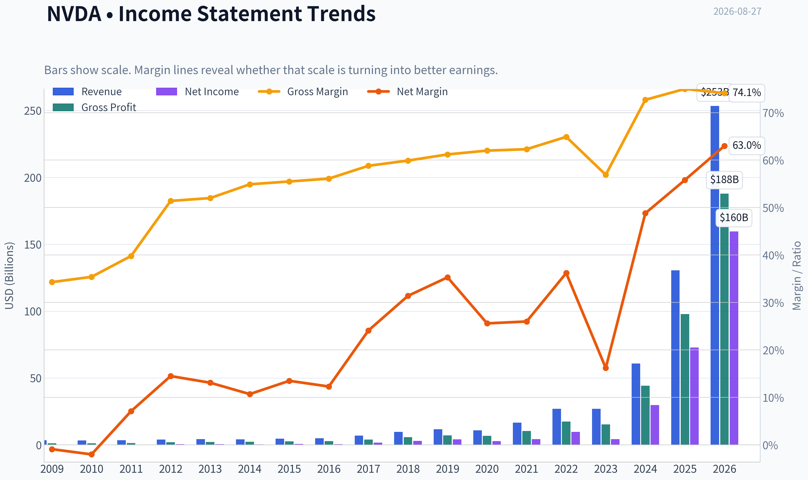
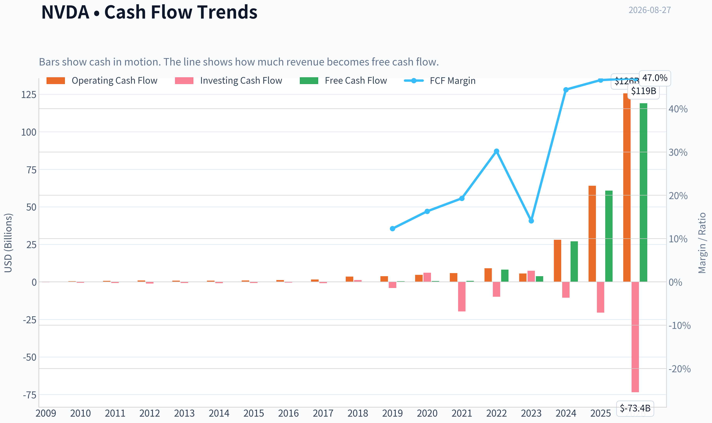
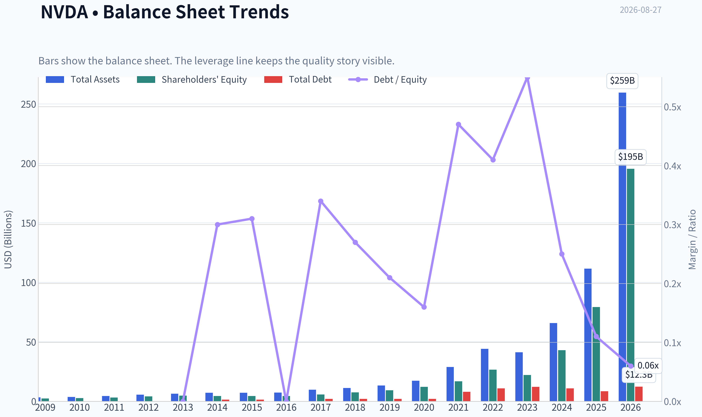
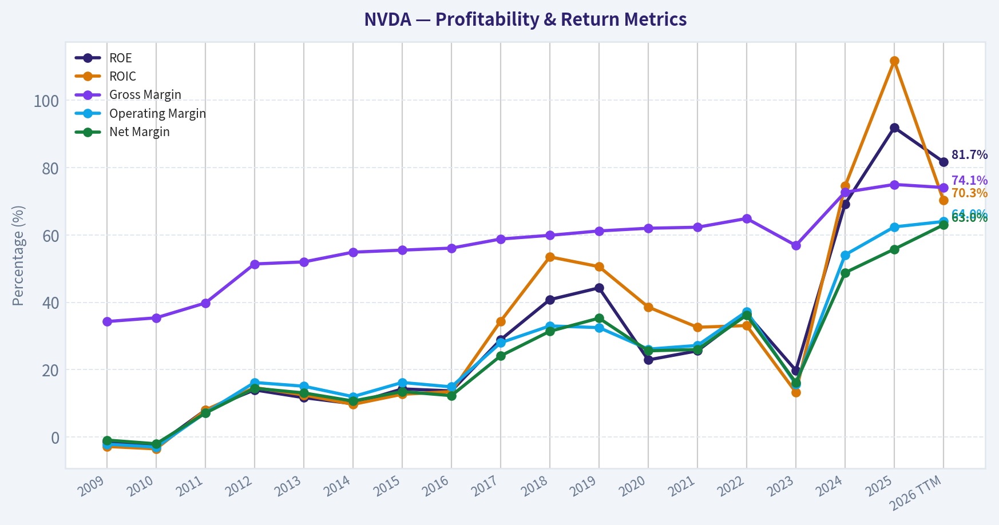
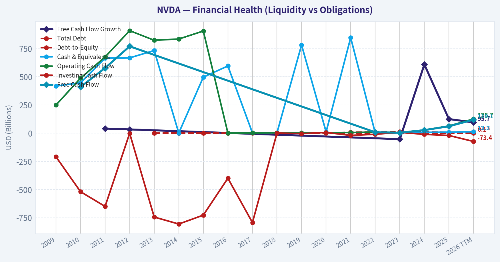
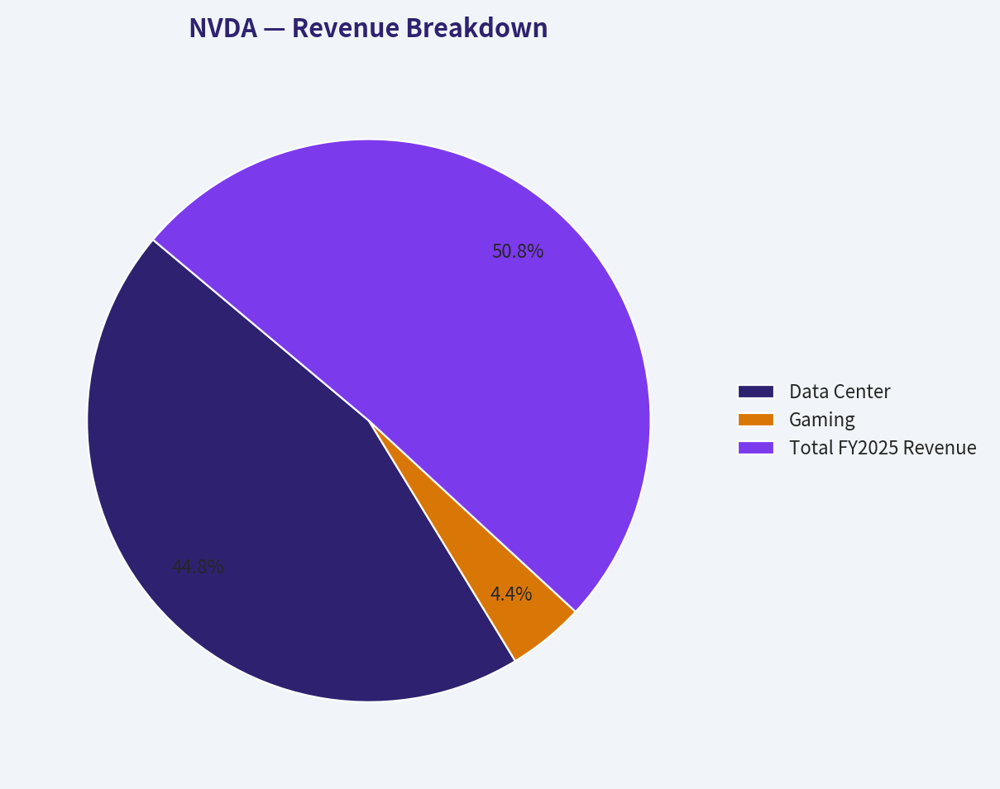
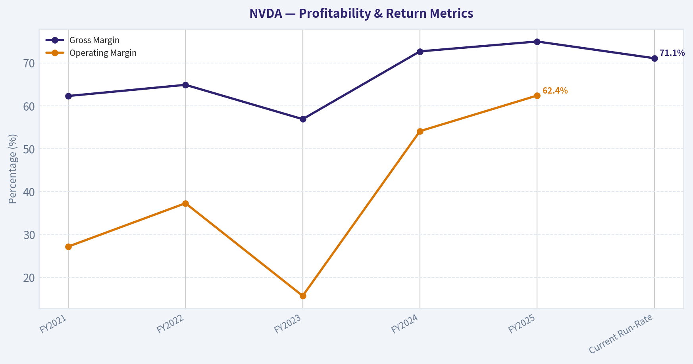
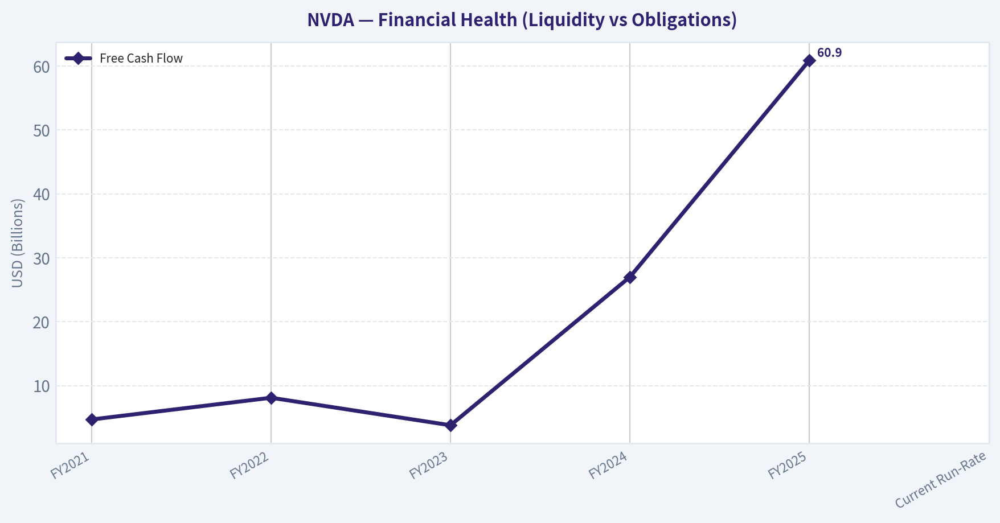
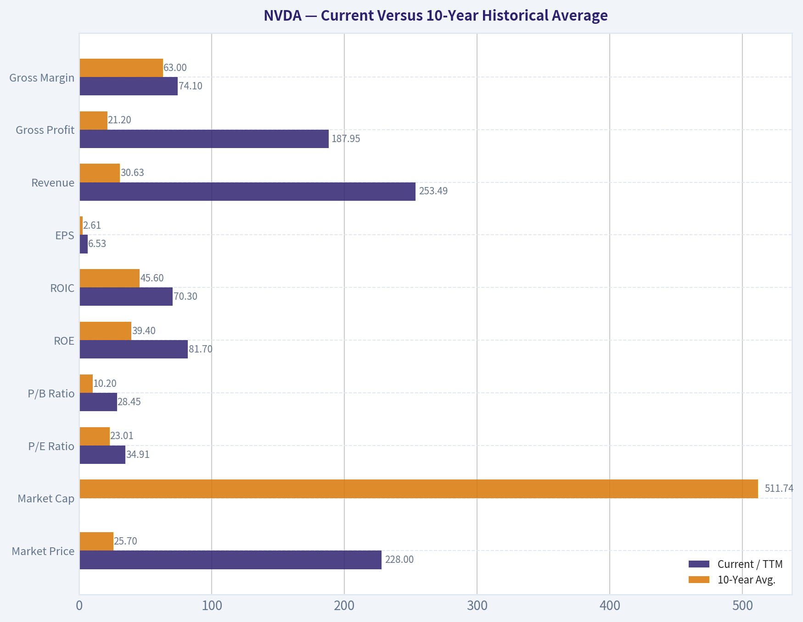
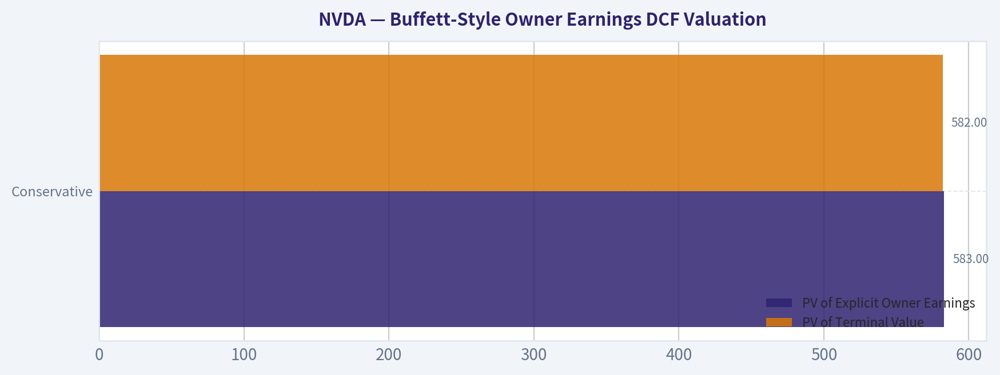

# NVDA Deep Value Intelligence

**Analysis Date:** 2026-08-27

## Critical Disclaimer

*This analysis is generated by Deep Value Intelligence, an AI-powered multi-agent investing framework. Education & research only - not financial advice, not a financial advisor.*

---

## Table of Contents

1. Intelligence Summary
2. Analyst Team Reports
   - Fundamentals Analysis
   - Intrinsic Value Analysis (Buffett)
   - Trend & Growth Analysis (Lynch/Druckenmiller/Fisher)
   - Market Technical Analysis
   - Options Market Analysis
3. Research Team Commentary
4. Value Investing Team Commentary
5. Deep Values Commentary

---

## Intelligence Summary

### Thesis + Conditions

**Core Thesis:** **EXECUTIVE SUMMARY**
We are placing an **ADVOCATE** stance on NVIDIA (NVDA) at $228. The business remains a historically elite compounder, generating a 76.3% ROE and 70.9% ROIC.

**Key Risks:**
- The Bull (Risky):** NVIDIA is a generational monopoly benefiting from a global compute re-architecture and sovereign AI demand. The CUDA software ecosystem creates an impenetrable "toll bridge," and static value metrics will consistently misprice this structural shift.
- The Pragmatist (Neutral):** A binary "all-in" or "stay away" mindset is flawed. The business quality is undeniable, but short-term momentum is flagging. The optimal path is a tiered accumulation strategy to balance the risk of overpaying with the opportunity cost of missing out.
- The Bear's argument relies heavily on "latent" risks (custom silicon, eventual CAPEX digestion) rather than "active" deterioration. While capitalism dictates that 71% margins invite competition, we must separate distant structural threats from current reality. The Cisco 2000 analogy is analytically weak: Cisco sold hardware; NVIDIA sells an entire computing platform locked in by developer reliance on CUDA. Until we see active margin compression or sequential revenue deceleration, the fundamentals dictate alignment with the business quality.

**Confidence:** Medium

---

## Analyst Team Reports

### Fundamentals Analysis

#### Latest Earnings Snapshot

*Most recent reported quarter anchored on 2026 Q2, with prior-year comparison when available.*

| Metric | 2026 Q2 | 2025 Q2 | YoY Change |
| --- | ---: | ---: | ---: |
| Revenue | $81.61B | $44.06B | +85.2% |
| Operating Income | $53.54B | $21.64B | +147.4% |
| Net Income | $58.32B | $18.77B | +210.6% |
| Diluted EPS | $2.39 | $0.76 | +214.5% |
| Operating Cash Flow | $50.34B | $27.41B | +83.6% |
| Free Cash Flow | $48.59B | $26.19B | +85.5% |

Key Takeaways: This snapshot anchors the most recent reported quarter before the narrative analysis. It helps readers separate long-run business quality from whatever changed in the latest earnings print.

#### 17-Year Financial Metrics for NVDA

*All values below are computed deterministically from raw data - not estimated by AI.*

*Issuer profile: operating company (Technology / Semiconductors).*

#### 17-Year Financial Metrics
*Annual rows come from reported financial statements. The final TTM row is computed from the latest four quarters.*

| Metric | 2009 | 2010 | 2011 | 2012 | 2013 | 2014 | 2015 | 2016 | 2017 | 2018 | 2019 | 2020 | 2021 | 2022 | 2023 | 2024 | 2025 | 2026 TTM |
| --- | --- | --- | --- | --- | --- | --- | --- | --- | --- | --- | --- | --- | --- | --- | --- | --- | --- | --- |
| Market Price | $0 | $0 | $1 | $0 | $0 | $0 | $0 | $1 | $3 | $6 | $4 | $6 | $13 | $24 | $19 | $61 | $120 | $228 |
| Market Cap | $108.9M | $211.4M | $352.0M | $227.6M | $191.6M | $233.5M | $270.2M | $416.7M | $1.77B | $3.88B | $2.25B | $14.61B | $32.60B | $62.07B | $489.79B | $1.53T | $2.98T | $5.56T |
| P/E Ratio | -3.98 | -3.21 | 1.39 | 0.39 | 0.34 | 0.53 | 0.43 | 0.68 | 1.06 | 1.27 | 0.54 | 5.23 | 7.51 | 6.36 | 114.92 | 51.70 | 40.84 | 34.91 |
| P/B Ratio | 0.05 | 0.08 | 0.11 | 0.05 | 0.04 | 0.05 | 0.06 | 0.09 | 0.31 | 0.52 | 0.24 | 1.20 | 1.93 | 2.33 | 22.16 | 35.70 | 37.54 | 28.45 |
| ROE | -1.3% | -2.6% | 8.0% | 14.0% | 11.7% | 9.9% | 14.3% | 13.7% | 28.9% | 40.8% | 44.3% | 22.9% | 25.6% | 36.6% | 19.8% | 69.2% | 91.9% | 81.7% |
| ROIC | -2.8% | -3.5% | 8.0% | 14.7% | 12.5% | 9.7% | 12.7% | 13.5% | 34.4% | 53.5% | 50.6% | 38.6% | 32.6% | 33.1% | 13.3% | 74.5% | 111.7% | 70.3% |
| EPS | $-0.05 | $-0.11 | $0.39 | $0.86 | $0.83 | $0.70 | $1.07 | $1.05 | $2.57 | $4.82 | $6.63 | $1.13 | $1.73 | $3.85 | $0.17 | $1.19 | $2.94 | $6.53 |
| Revenue | $3.42B | $3.33B | $3.54B | $4.00B | $4.28B | $4.13B | $4.68B | $5.01B | $6.91B | $9.71B | $11.72B | $10.92B | $16.68B | $26.91B | $26.97B | $60.92B | $130.50B | $253.49B |
| Gross Profit | $1.17B | $1.18B | $1.41B | $2.06B | $2.23B | $2.27B | $2.60B | $2.81B | $4.06B | $5.82B | $7.17B | $6.77B | $10.40B | $17.48B | $15.36B | $44.30B | $97.86B | $187.95B |
| Gross Margin | 34.3% | 35.4% | 39.8% | 51.4% | 52.0% | 54.9% | 55.5% | 56.1% | 58.8% | 59.9% | 61.2% | 62.0% | 62.3% | 64.9% | 56.9% | 72.7% | 75.0% | 74.1% |
| Operating Margin | -2.1% | -3.0% | 7.2% | 16.2% | 15.1% | 12.0% | 16.2% | 14.9% | 28.0% | 33.0% | 32.5% | 26.1% | 27.2% | 37.3% | 15.7% | 54.1% | 62.4% | 64.0% |
| Net Income | $-30.0M | $-68.0M | $253.1M | $581.1M | $562.5M | $440.0M | $631.0M | $614.0M | $1.67B | $3.05B | $4.14B | $2.80B | $4.33B | $9.75B | $4.37B | $29.76B | $72.88B | $159.61B |
| Net Margin | -0.9% | -2.0% | 7.1% | 14.5% | 13.1% | 10.7% | 13.5% | 12.3% | 24.1% | 31.4% | 35.3% | 25.6% | 26.0% | 36.2% | 16.2% | 48.8% | 55.8% | 63.0% |
| Revenue Growth | N/A | -2.9% | 6.5% | 12.8% | 7.1% | -3.5% | 13.4% | 7.0% | 37.9% | 40.6% | 20.6% | -6.8% | 52.7% | 61.4% | 0.2% | 125.9% | 114.2% | 94.3% |
| Net Income Growth | N/A | 126.3% | -472.3% | 129.5% | -3.2% | -21.8% | 43.4% | -2.7% | 171.3% | 82.9% | 35.9% | -32.5% | 54.9% | 125.1% | -55.2% | 581.3% | 144.9% | 119.0% |
| Free Cash Flow Growth | N/A | N/A | 40.9% | 33.3% | N/A | N/A | N/A | N/A | N/A | N/A | N/A | N/A | N/A | N/A | -53.2% | 609.6% | 125.2% | 95.7% |
| Total Book Value | $2.39B | $2.67B | $3.18B | $4.15B | $4.83B | $4.46B | $4.42B | $4.47B | $5.76B | $7.47B | $9.34B | $12.20B | $16.89B | $26.61B | $22.10B | $42.98B | $79.33B | $195.47B |
| Total Assets | $3.35B | $3.59B | $4.50B | $5.55B | $6.41B | $7.25B | $7.20B | $7.37B | $9.84B | $11.24B | $13.29B | $17.32B | $28.79B | $44.19B | $41.18B | $65.73B | $111.60B | $259.47B |
| Total Debt | N/A | N/A | N/A | N/A | $0 | $1.36B | $1.38B | $0 | $1.98B | $1.99B | $1.99B | $1.99B | $7.96B | $10.95B | $12.20B | $10.96B | $8.46B | $12.35B |
| Debt-to-Equity | N/A | N/A | N/A | N/A | 0.00 | 0.30 | 0.31 | 0.00 | 0.34 | 0.27 | 0.21 | 0.16 | 0.47 | 0.41 | 0.55 | 0.25 | 0.11 | 0.06 |
| Cash & Equivalents | $417.7M | $447.2M | $665.4M | $667.9M | $733.0M | $1.15B | $497.0M | $596.0M | $1.77B | $4.00B | $782.0M | $10.90B | $847.0M | $1.99B | $3.39B | $7.28B | $8.59B | $13.24B |
| Shareholders' Equity | $2.39B | $2.67B | $3.18B | $4.15B | $4.83B | $4.46B | $4.42B | $4.47B | $5.76B | $7.47B | $9.34B | $12.20B | $16.89B | $26.61B | $22.10B | $42.98B | $79.33B | $195.47B |
| Operating Cash Flow | $249.4M | $487.8M | $675.8M | $909.2M | $824.2M | $835.0M | $906.0M | $1.18B | $1.67B | $3.50B | $3.74B | $4.76B | $5.82B | $9.11B | $5.64B | $28.09B | $64.09B | $125.65B |
| Investing Cash Flow | $-209.4M | $-519.3M | $-649.7M | $-1.14B | $-744.0M | $-806.0M | $-727.0M | $-400.0M | $-793.0M | $1.28B | $-4.10B | $6.14B | $-19.68B | $-9.83B | $7.38B | $-10.57B | $-20.42B | $-73.44B |
| Free Cash Flow | N/A | $410.2M | $577.9M | $770.4M | N/A | N/A | N/A | N/A | N/A | N/A | N/A | N/A | N/A | $8.13B | $3.81B | $27.02B | $60.85B | $119.08B |
| FCF Margin | N/A | 12.3% | 16.3% | 19.3% | N/A | N/A | N/A | N/A | N/A | N/A | N/A | N/A | N/A | 30.2% | 14.1% | 44.4% | 46.6% | 47.0% |
| Dividends / Share | $0.00 | $0.00 | $0.00 | $0.00 | $0.00 | $0.00 | $0.00 | $0.00 | $0.00 | $0.00 | $0.00 | $0.00 | $0.00 | $0.00 | $0.02 | $0.02 | $0.03 | $0.04 |

#### Profitability Metrics
- Return on Equity (ROE): 76.3%
- Return on Invested Capital (ROIC): 70.9%
- Return on Assets (ROA): 58.1%
- Gross Margin: 71.1%
- Operating Margin: 60.4%
- Net Profit Margin: 55.6%

#### Liquidity Metrics
- Current Ratio: 3.91
- Quick Ratio: 3.14

#### Leverage Metrics
- Debt-to-Equity Ratio: 0.06
- Interest Coverage Ratio: 503.42
- Net Debt: $-1.14B

#### Growth Metrics (Year-over-Year)
- Revenue Growth: 65.5%
- Net Income Growth: 64.7%
- Free Cash Flow Growth: 58.9%
- Revenue CAGR (3-Year): 100.0%
- Revenue CAGR (5-Year): 66.9%

#### Valuation Metrics
- P/E Ratio (TTM): 34.97
- Forward P/E: 15.69
- Price-to-Book: 28.25
- Price-to-Sales: 21.78
- PEG Ratio: 0.59
- EV/EBITDA: 30.41
- Free Cash Flow Yield: 1.8%
- Earnings Yield: 2.9%

#### Owner Earnings (Buffett Method, Code-Computed)
- Net Income: $72.88B
- + Depreciation & Amortization: $2.84B
- - Capital Expenditures: $-6.04B
- - Working Capital Changes: $-15.95B
- = **Owner Earnings: $82.26B**

#### Intrinsic Value (Code-Computed)
- Current Price: $228
- **Headline Intrinsic Value (business-model routed): $159**
  Business model: cyclical - weighted blend [Damodaran FCFF + reverse-DCF fair + owner-earnings DCF] (cyclical)
  Model spread (min-max across DCFs): $29 - $267
  Margin of safety vs. price (headline): -43.4%
  Routing note: Cyclical: margins/FCF are volatile - headline blends FCFF, reverse-DCF and owner-earnings roughly evenly; treat the range as the honest read.
- Buffett Method (Owner Earnings):
  Conservative: $84
  Average: $267
  Optimistic: $694
- Cash Flow Method (FCF):
  Conservative: $176
  Average: $176
  Optimistic: $457
- Damodaran FCFF (WACC + margins + reinvestment):
  Conservative: $17
  Average: $29
  Optimistic: $93
  Monte Carlo band (P10-P90): $23 - $52 (median $33)
  P(intrinsic value > price): 0.0%
- Reverse-DCF: price implies ~25.4%/yr owner-earnings growth for 10y; trailing 3y was 110.8%, 5y 96.7%.

#### Piotroski F-Score: 3/9
- Positive Net Income: PASS
- Positive Operating Cash Flow: PASS
- ROA Improvement: FAIL
- Cash Flow > Net Income: FAIL
- Decreasing Debt: FAIL
- Improving Current Ratio: FAIL
- No Dilution: PASS
- Improving Gross Margin: FAIL
- Improving Asset Turnover: FAIL

ANALYST STANCE: **WATCH**

#### NVDA Fundamental Analysis - Buffett-Style Value Review

NVIDIA is one of the highest-quality businesses in public markets: dominant in accelerated computing, AI GPUs, CUDA software ecosystem, networking, and full-stack data-center platforms. The business now shows extraordinary economics - TTM revenue of **$253.49B**, net income of **$159.61B**, operating margin of **64.0%**, ROIC of **70.3%**, and ROE of **81.7%** in the deterministic dataset.

However, Buffett-style investing separates **business quality** from **investment price**. At **$228/share** and roughly **$5.56T** market capitalization, the stock already discounts a long period of exceptional growth. The shared intrinsic-value pack estimates headline intrinsic value at **$159/share**, with a negative margin of safety of about **-43.4%** versus price. That does not make NVIDIA a poor business; it means the market is paying upfront for a very large portion of the future.

---

#### Revenue Breakdown

| Revenue Source | Amount ($B) | % of Total |
|---|---:|---:|
| Data Center | $115.19B | 88.3% |
| Gaming | $11.35B | 8.7% |
| Professional Visualization | $1.91B | 1.5% |
| Automotive | $1.69B | 1.3% |
| OEM & Other | $0.36B | 0.3% |
| **Total FY2025 Revenue** | **$130.50B** | **100.0%** |

Key Takeaways: NVIDIA has become overwhelmingly a data-center and AI infrastructure company, with Data Center representing about **88%** of FY2025 revenue. Gaming remains meaningful but is now secondary. This concentration is a strength while AI capex is booming, but it also creates exposure to hyperscaler spending cycles, export controls, and competitive accelerator alternatives.

---

#### Current Versus 10-Year Historical Average

| Metric | Current / TTM | 10-Year Avg. | Interpretation |
|---|---:|---:|---|
| Market Price | $228 | $25.70 | Price has risen far faster than the historical norm, reflecting the AI infrastructure boom and market expectations for continued dominance. |
| Market Cap | $5.56T | $511.74B | Market value is more than 10x the 10-year average, showing a major re-rating rather than only operating growth. |
| P/E Ratio | 34.91x | 23.01x | Current P/E is above the 10-year average, though lower than the 2023 spike; valuation is still demanding but less extreme than at the initial AI re-rating peak. |
| P/B Ratio | 28.45x | 10.20x | For NVIDIA, P/B has limited analytical value because the company is fabless, IP-heavy, software-enabled, and asset-light. Valuation should be anchored on cash-flow-based intrinsic value, not book value. |
| ROE | 81.7% | 39.4% | ROE is more than double the historical average, driven by explosive profitability and asset-light scaling. |
| ROIC | 70.3% | 45.6% | ROIC remains exceptional, confirming very high capital efficiency despite the larger scale of the business. |
| EPS | $6.53 | $2.61 | EPS is roughly 2.5x the 10-year average, reflecting major margin expansion and AI demand. |
| Revenue | $253.49B | $30.63B | Revenue is over 8x the 10-year average, showing a structural transformation in company scale. |
| Gross Profit | $187.95B | $21.20B | Gross profit expansion has been extraordinary, with gross dollars rising faster than revenue due to stronger margins. |
| Gross Margin | 74.1% | 63.0% | Margins are well above historical levels, supported by high-end accelerator pricing, software ecosystem lock-in, and constrained supply. |
| Operating Margin | 64.0% | 33.1% | Operating leverage is extreme; NVIDIA is converting revenue growth into operating profit at a rate rarely seen in hardware-linked businesses. |
| Net Income | $159.61B | $13.34B | Net income has scaled massively, but the size of the profit pool raises questions about durability and competitive response. |
| Net Margin | 63.0% | 31.2% | Current net margin is about double the 10-year average, a clear sign of pricing power but also a potential mean-reversion risk. |
| Revenue Growth | 94.3% | 45.4% | Growth remains above the already elevated historical average, though sustaining this pace becomes mathematically harder as the revenue base expands. |
| Net Income Growth | 119.0% | 110.6% | Net income growth is broadly consistent with the high average, but the average is distorted by sharp cyclic rebounds. |
| FCF Growth | 95.7% | 227.2%* | Free cash flow growth is still very strong, but the available average is distorted by a small number of recent years and rebound effects. |
| Total Book Value | $195.47B | $22.72B | Book value has grown sharply, but it does not capture NVIDIA's true economic moat, which sits in IP, ecosystem, software, and customer relationships. |
| Total Assets | $259.47B | $35.06B | Asset growth has followed business scale, though profitability has grown much faster than the asset base. |
| Total Debt | $12.35B | $5.85B | Debt is above the historical average in absolute terms but very small relative to earnings and cash generation. |
| Debt-to-Equity | 0.06x | 0.28x | Leverage is far below the 10-year average, indicating a very strong balance sheet. |
| Cash & Equivalents | $13.24B | $4.01B | Cash is above historical norms, though modest relative to market cap and annual free cash flow. |
| Shareholders' Equity | $195.47B | $22.72B | Equity has increased substantially, helped by retained earnings from the AI boom. |
| Free Cash Flow | $119.08B | $24.95B* | Free cash flow is nearly 5x the recent available average, demonstrating extraordinary cash conversion. |
| FCF Margin | 47.0% | 30.9%* | FCF margin is well above the available historical average, confirming strong cash economics. |
| Dividends / Share | $0.04 | $0.007 | Dividend remains immaterial; NVIDIA is primarily a reinvestment and capital appreciation story. |

\*Average calculated using available deterministic FCF observations, because several years were marked N/A.

Key Takeaways: NVIDIA's current fundamentals are far above its 10-year averages across revenue, margins, earnings, ROE, ROIC, and free cash flow. The business quality has clearly improved, but the valuation has also expanded dramatically. The main analytical question is not whether NVIDIA is excellent; it is whether today's price leaves enough margin of safety if AI demand, margins, or competitive intensity normalize.

---

#### Market Metrics Interpretation

NVIDIA's **market price of $228** and **market cap of approximately $5.56T** indicate that the market is valuing the company as one of the most strategically important infrastructure platforms in the world. The **P/E ratio of 34.91x** is not absurd relative to current growth, but it is high relative to a Buffett-style requirement for conservative future assumptions.

The **P/B ratio of 28.45x** should not be read mechanically as "expensive versus book." NVIDIA is a fabless, IP-rich, software-enabled semiconductor platform business. Its economic value is not primarily in book assets; it is in CUDA, GPU architecture, networking, developer ecosystem, supply-chain priority, and customer integration. Therefore, book value is not the right valuation anchor. Cash-flow-based intrinsic value is the correct framework.

---

#### Profitability Analysis

NVIDIA's profitability is exceptional. **Gross margin of 74.1%**, **operating margin of 64.0%**, and **net margin of 63.0%** are extraordinary for a company historically associated with semiconductors and hardware. This reflects several moat characteristics: scarce high-performance GPU supply, CUDA lock-in, premium pricing, platform bundling, and customers' urgent need to deploy AI infrastructure.

The key Buffett question is durability. If margins remain structurally higher because NVIDIA controls the most important layer of AI compute, the company can compound at high rates. If margins normalize due to custom ASICs, hyperscaler bargaining power, competition from AMD or internal chips, or supply-demand balancing, today's valuation becomes much harder to justify.

---

#### Growth Analysis

Revenue growth remains spectacular at **94.3% TTM** in the deterministic dataset, while net income growth is **119.0%** and free cash flow growth is **95.7%**. This shows that growth is not merely top-line expansion; it is converting into earnings and cash.

However, the larger the base becomes, the harder it is to sustain hypergrowth. A company already producing more than **$253B** of TTM revenue must add enormous absolute dollars each year to keep growth rates elevated. The reverse-DCF from the shared pack indicates the current stock price implies roughly **25.4% annual owner-earnings growth for 10 years**, which is achievable only if AI infrastructure demand remains very large and NVIDIA maintains unusually high margins.

---

#### Balance Sheet And Financial Strength

NVIDIA's financial position is extremely strong. TTM debt-to-equity is only **0.06x**, total debt is **$12.35B**, and cash and equivalents are **$13.24B**, resulting in effectively net-cash positioning in the shared pack. Interest coverage of more than **500x** further confirms that debt is not a meaningful constraint.

From a Buffett perspective, this is a major positive. NVIDIA does not need capital markets to survive downturns, and it has the capacity to reinvest, prepay supply, fund R&D, repurchase shares, or pursue strategic acquisitions. The balance sheet supports durability, although it does not solve valuation risk.

---

#### Cash Flow And Capital Allocation

Free cash flow is **$119.08B TTM**, with an FCF margin of **47.0%**. That is a rare level of cash conversion for a company of NVIDIA's size. Dividends are negligible at **$0.04/share**, meaning management is retaining capital for reinvestment, ecosystem expansion, and likely buybacks.

Buffett would likely admire the capital-light compounding characteristics, but he would also scrutinize whether management can reinvest such a large profit base at attractive incremental returns. The **Piotroski F-score of 3/9** is a cautionary signal from the shared pack, mainly reflecting deterioration or non-improvement in several year-over-year quality metrics after an extraordinary growth surge. It does not mean the business is weak, but it does warn that peak-period comparisons can look fragile.

---

#### Buffett-Style Owner Earnings DCF Valuation

Base owner earnings from the deterministic/shared pack:

Owner Earnings = Net Income + Depreciation & Amortization - Capital Expenditures - Working Capital Changes
Owner Earnings = **$72.88B + $2.84B - (-$6.04B) - (-$15.95B) = $82.26B**

Assumptions used for the hand DCF sanity check:
- Base owner earnings: **$82.26B**
- Discount rate: **10.0%**
- Terminal growth rate: **2.5%**
- Estimated diluted shares: approximately **24.4B**
- Net cash adjustment: minimal relative to valuation
- High growth fades toward terminal growth; no high growth is capitalized permanently

| Scenario | Growth Assumption | PV of Explicit Owner Earnings | PV of Terminal Value | Equity Value | Fair Value / Share | Upside / Downside vs. $228 |
|---|---|---:|---:|---:|---:|---:|
| Conservative | 3% annual growth for 10 years, then 2.5% terminal | $583B | $582B | $1.17T | ~$48 | -79% |
| Average / Base Case | 25% growth for 5 years, then fading to 5% by year 10, then 2.5% terminal | $1.48T | $2.26T | $3.73T | ~$153 | -33% |
| Optimistic | 35% growth for 5 years, then fading to 10% by year 10, then 2.5% terminal | $2.41T | $4.79T | $7.20T | ~$295 | +29% |

Key Takeaways: The hand DCF shows that NVIDIA's valuation is highly sensitive to growth and terminal margin assumptions. A conservative Buffett-style case produces a value far below the current price, while an optimistic AI-supercycle case can justify upside. The base case, which is close to the shared pack's headline intrinsic value of **$159**, suggests the current price does not provide a traditional margin of safety.

The shared model-based valuation pack provides a wide but useful cross-check:
- Headline intrinsic value: **$159/share**
- Owner Earnings DCF range: **$84 / $267 / $694**
- FCF method range: **$176 / $176 / $457**
- Damodaran FCFF range: **$17 / $29 / $93**
- Model spread: **$29 to $267** for core DCF methods, with wider bull-case sensitivity
- Reverse-DCF: current price implies about **25.4% annual owner-earnings growth for 10 years**

This spread is important. The Owner Earnings method is more favorable because current owner earnings are enormous. The Damodaran FCFF model is far more conservative because it penalizes cyclicality, reinvestment needs, and margin normalization. Buffett-style investors should not ignore that gap.

---

#### Economic Moat Assessment

NVIDIA's moat is unusually strong and multi-layered:

| Moat Source | Assessment | Buffett-Style Significance |
|---|---|---|
| CUDA ecosystem | Very strong | Developers, frameworks, libraries, and enterprise workflows create switching costs. |
| GPU architecture leadership | Very strong | Performance leadership supports premium pricing and customer urgency. |
| Networking and systems integration | Strong | NVLink, InfiniBand, Spectrum-X, and full-stack systems deepen customer dependency. |
| Scale and supply priority | Strong | NVIDIA has purchasing power and strategic importance with foundry and packaging partners. |
| Brand and customer trust | Strong | Hyperscalers and enterprises view NVIDIA as the default AI compute standard. |
| Software and platform expansion | Improving | Higher software mix could increase durability and margin quality over time. |
| Cyclicality exposure | Meaningful risk | Semiconductor demand, customer capex, and inventory cycles can still create volatility. |

Key Takeaways: NVIDIA's moat is not just chips; it is the combined ecosystem of hardware, software, networking, developer adoption, and customer dependence. This is exactly the kind of intangible moat Buffett values. The risk is that the moat is being priced as nearly permanent and nearly flawless.

---

#### Key Investment Insights, Red Flags, And Opportunities

| Category | Key Point | Investment Implication |
|---|---|---|
| Business Quality | ROIC of **70.3%** and ROE of **81.7%** are world-class. | NVIDIA is a genuinely exceptional compounding business. |
| Growth | TTM revenue growth of **94.3%** remains extraordinary. | The company is still in a powerful AI infrastructure expansion cycle. |
| Margins | Net margin of **63.0%** is far above the 10-year average of **31.2%**. | Current economics are exceptional, but margin normalization would materially affect valuation. |
| Valuation | Current price of **$228** exceeds headline intrinsic value of **$159**. | No clear Buffett-style margin of safety at current levels. |
| Reverse DCF | Price implies about **25.4% annual owner-earnings growth for 10 years**. | Expectations are high but not impossible; execution risk is elevated. |
| Balance Sheet | Debt-to-equity of **0.06x** and very high interest coverage. | Financial risk is low. |
| Revenue Mix | Data Center is about **88%** of FY2025 revenue. | AI demand is the main driver; concentration risk has increased. |
| Competition | AMD, custom ASICs, cloud internal chips, and inference optimization are long-term threats. | NVIDIA must keep widening the performance and ecosystem gap. |
| Geopolitics | China export restrictions and supply-chain dependence remain important. | Regulatory and supply-chain shocks could affect growth. |
| Capital Allocation | Dividend is negligible; reinvestment remains primary. | Appropriate for a high-return business, but buybacks at high valuations could reduce value creation. |

Key Takeaways: NVIDIA offers a rare combination of extreme profitability, dominant competitive position, and massive end-market growth. The major weakness is not operational quality; it is valuation risk. Investors are paying for sustained AI leadership, high margins, and continued growth at a scale that leaves little room for disappointment.

---

#### Warren Buffett-Style Qualitative Verdict

NVIDIA resembles a "wonderful business," but not clearly a "wonderful price." Buffett would likely admire the moat, pricing power, high returns on capital, low leverage, and ecosystem lock-in. He would also recognize that the company's future cash flows are less predictable than those of a consumer staple or regulated utility because semiconductor cycles, technological shifts, and hyperscaler capex patterns can change quickly.

The most favorable interpretation is that NVIDIA is becoming the operating system of AI infrastructure. If that proves true, today's valuation may be justified or even low. The less favorable interpretation is that current margins and demand reflect an extraordinary investment surge that will eventually normalize. Under that outcome, the current price offers insufficient downside protection.

---

#### Final Investment Stance: WATCH

NVIDIA is a **WATCH**, not an outright Buffett-style buy at the current price. The business is exceptional, the moat is deep, and the financials are among the strongest in the market. But at **$228/share**, the stock trades materially above the shared pack's **$159** headline intrinsic value and requires sustained high owner-earnings growth for a decade.

For long-term holders, the quality of the business may justify continued ownership. For new capital using a Buffett value discipline, the stock would become more attractive on either a meaningful pullback toward intrinsic value or further evidence that current AI demand and margins are durable for much longer than conservative models assume.

| Final Summary Point | Assessment |
|---|---|
| Business Quality | Exceptional |
| Economic Moat | Very strong |
| Financial Strength | Excellent |
| Earnings Predictability | Improving, but still exposed to semiconductor and AI capex cycles |
| Current Valuation | Demanding |
| Margin of Safety | Insufficient at current price |
| Best Case | NVIDIA remains the dominant AI compute platform and compounds into the valuation |
| Main Risk | Growth and margins normalize before the valuation is fully earned |
| Buffett-Style Action | Watchlist / hold-quality, but not a fresh value buy |
| Final Stance | **WATCH** |

Key Takeaways: NVIDIA is one of the best businesses in the world, but Buffett-style investing requires both quality and price discipline. The current valuation already assumes years of excellent execution. The prudent stance is to watch closely, respect the moat, but demand a better margin of safety before aggressively adding new capital.

#### Fundamental Visuals

This graph tracks the profitability and return metrics (ROE, ROIC, Margins) of **NVDA** over the past decade, highlighting capital efficiency trends.

This chart illustrates the financial health of **NVDA** over the last 10 years, mapping cash equivalents and free cash flow against total obligations (Debt).

This breakdown chart from <em>Revenue Breakdown</em> shows the proportional composition for **NVDA** - useful for understanding what drives or risks the business.

This graph tracks the profitability and return metrics (ROE, ROIC, Margins) of **NVDA** over the past decade, highlighting capital efficiency trends.

This chart illustrates the financial health of **NVDA** over the last 10 years, mapping cash equivalents and free cash flow against total obligations (Debt).

---

### Intrinsic Value Analysis (Buffett)

> *Following Warren Buffett's value investing philosophy: Circle of Competence, Economic Moat, Management Quality, and Margin of Safety.*

#### Intrinsic Value Snapshot

Price is what you pay. Intrinsic value is what the business may be worth based on the cash it can create for owners over time. We show a range, not one magic number.

- Current Price: $227.98
- Value Range (conservative to optimistic across both DCF methods): $83.53 to $694.01

##### Owner Earnings (Buffett Method)
- Net Income: $72,880,000,000.00
- Depreciation & Amortization: $2,843,000,000.00
- Capital Expenditures: $-6,042,000,000.00
- Working Capital Changes: $-15,949,000,000.00
- Owner Earnings: $82,263,000,000.00

##### Intrinsic Value
###### Buffett Method
Uses owner earnings. Stricter, and usually more conservative.
- Conservative: $83.53
- Average: $266.52
- Optimistic: $694.01
- Discount Rate: 10.0%

###### Cash Flow Method
Uses free cash flow. Better for companies spending heavily today to grow tomorrow.
- Conservative: $175.67
- Average: $175.67
- Optimistic: $457.42
- Discount Rate: 10.0%

ANALYST STANCE: **WATCH**

#### NVDA Buffett-Style Investment Report

NVIDIA is a phenomenal franchise with extraordinary economics, a powerful AI accelerator moat, and founder-led execution. The issue is not business quality; it is price. At **$228 per share**, the market is already underwriting very high long-term growth, with the reverse DCF implying roughly **25.4% annual growth for 10 years**. That is possible, but it leaves little room for disappointment in a cyclical, fast-moving semiconductor market.

---

#### 1. Factor Scorecard

| Factor | Score | Evidence |
|---|---:|---|
| Circle of Competence & Business Simplicity | 3.5 / 5 | NVIDIA designs GPUs, networking systems, and software platforms used for AI training, inference, gaming, visualization, and data-center acceleration. The business model is understandable, but 10-year predictability is reduced by rapid AI hardware cycles, export restrictions, hyperscaler bargaining power, and custom silicon competition. |
| Moat Test | 4.0 / 5 | CUDA, developer ecosystem, hardware/software co-design, scale, brand credibility, and supply-chain access create a wide moat. Gross margin around **71%** supports pricing power. The moat is real, but not untouchable given ASIC competition and semiconductor cyclicality. |
| Management Quality & Capital Allocation | 4.0 / 5 | Founder-led under Jensen Huang, with a long record of strategic foresight in GPUs, CUDA, data centers, and AI. Balance sheet is strong, R&D reinvestment has produced massive value creation, though valuation-sensitive buybacks are less compelling at today's price. |
| Industry Structure | 3.0 / 5 | AI accelerators currently have oligopoly-like economics, but semiconductors remain cyclical, capital-chain dependent, and technologically contested. Hyperscalers are both major customers and potential competitors through internal chips. |
| Gate 5: Quality/Solvency Hard Floor | Not Tripped | Earnings and free cash flow are strong, ROE is high, liquidity is strong, and no solvency red line is evident. |

Key Takeaways: NVIDIA scores like a wonderful business, not a distressed or mediocre one. The moat and management are strong, but the technology cycle and customer concentration reduce long-term predictability. The hard solvency floor is not tripped.

---

#### 2. Moat Analysis

| Moat Source | Evidence | Assessment |
|---|---|---|
| Intangible Assets | NVIDIA has become the default AI infrastructure brand for developers, enterprises, cloud providers, and model builders. Gross margin is about **71.1%**, far above the 40% threshold that usually signals pricing power. | Strong |
| Switching Costs | CUDA, libraries, developer workflows, model optimization, and deployment tooling create meaningful customer lock-in. Switching is not merely buying a cheaper chip; it often means changing software stacks and performance tuning. | Strong |
| Cost / Scale Advantage | NVIDIA benefits from massive R&D scale, ecosystem scale, advanced packaging access, networking integration, and full-stack platform breadth. | Strong |
| Network Effects | More developers build on CUDA because more customers use NVIDIA; more customers choose NVIDIA because more software is optimized for it. | Strong |
| Moat Risks | Custom ASICs from Google, Amazon, Microsoft, Meta, and others; export controls; supply constraints; margin normalization; faster-than-expected inference commoditization. | Material but manageable |

Key Takeaways: NVIDIA's moat is wide because it combines hardware leadership with a software ecosystem and developer standard. The best evidence is not just revenue growth, but sustained premium gross margins and ecosystem lock-in. The key risk is that large customers have both the incentive and capital to reduce dependence over time.

---

#### 3. Financial Summary

| Period | Revenue | YoY Growth | Gross Margin | Operating Margin | Net Income | Free Cash Flow | ROE |
|---|---:|---:|---:|---:|---:|---:|---:|
| FY2021 | $16.7B | 53% | 62.3% | 27.2% | $4.3B | $4.7B | ~25.6% |
| FY2022 | $26.9B | 61% | 64.9% | 37.3% | $9.8B | $8.1B | ~44.8% |
| FY2023 | $27.0B | 0% | 56.9% | 15.7% | $4.4B | $3.8B | ~19.8% |
| FY2024 | $60.9B | 126% | 72.7% | 54.1% | $29.8B | $27.0B | ~69.2% |
| FY2025 | $130.5B | 114% | 75.0% | 62.4% | $72.9B | $60.9B | ~115.7% |
| Current Run-Rate | - | 65.5% | 71.1% | - | ~$157.9B implied by P/E | ~$99.4B implied by FCF yield | 76.3% |

Key Takeaways: NVIDIA's financial transformation has been extraordinary. Revenue and profits inflected sharply as AI data-center demand exploded, while gross and operating margins expanded to levels rarely seen in semiconductors. The one warning is that FY2023 shows the business is not immune to cycles; earnings can compress when end markets reset.

---

#### 4. Owner Earnings Calculation

| Owner Earnings Component | Current Estimate |
|---|---:|
| Net Income | ~$157.9B |
| Plus: Depreciation & Amortization | ~$5.0B |
| Less: Maintenance CapEx | ~($4.0B) |
| Less: Working Capital / Cash Conversion Investment | ~($59.5B) |
| Estimated Owner Earnings / Free Cash Flow | ~$99.4B |
| Shares Outstanding Implied by Market Cap / Price | ~24.2B |
| Owner Earnings per Share | ~$4.10 |

Key Takeaways: NVIDIA is highly profitable, but the current free-cash-flow yield is only about **1.8%** at today's market value. That means buyers are paying a very full price for future growth rather than today's distributable cash flow. Owner earnings are excellent in absolute terms, but modest relative to the $5.52 trillion market capitalization.

---

#### 5. Three-Scenario DCF Valuation

| Scenario | Key Assumption | Estimated Value per Share |
|---|---|---:|
| A: No Growth | Owner earnings capitalized at 10% | ~$41 |
| B: GDP Growth | 3% perpetual growth, 10% discount rate | ~$60 |
| C: Historical Growth, Capped | 10% annual growth for 10 years, then 3% terminal growth | ~$101 |
| Research Pack Headline Intrinsic Value | Business-model routed blend | **$159.04** |
| Research Pack Owner-Earnings DCF | Higher-growth owner-earnings case | $266.52 |
| Research Pack FCF DCF | Cash-flow model | $175.67 |
| Research Pack Damodaran FCFF | More conservative FCFF case | $28.96 |

Key Takeaways: Conservative Buffett-style assumptions produce values below the current stock price. The more growth-sensitive models can justify a higher value, but the spread between $28.96 and $266.52 shows that valuation is extremely sensitive to long-term growth and margin assumptions. At $228, the stock requires NVIDIA to keep compounding at exceptional rates.

---

#### 6. Margin of Safety Analysis

| Metric | Figure |
|---|---:|
| Current Price | $228 |
| Headline Intrinsic Value | $159.04 |
| Margin of Safety vs. Headline Value | **-43.4%** |
| FCF Yield | 1.8% |
| P/E | 35.0x |
| Reverse DCF Growth Implied by Price | ~25.4% annually for 10 years |
| Trailing 3-Year Growth | 110.8% |
| Trailing 5-Year Growth | 96.7% |

Key Takeaways: NVIDIA's historical growth has been spectacular, but the market is asking investors to believe a large portion of that growth can continue from a much larger base. A wonderful business can deserve a premium, but the current price does not provide a clear Buffett-style margin of safety. The stock is not obviously absurd if AI infrastructure keeps compounding, but it is not cheap.

---

#### 7. Management Quality Assessment

| Management Area | Assessment |
|---|---|
| Owner Mentality | Jensen Huang's founder-led culture is a major strength. NVIDIA has consistently invested ahead of demand rather than optimizing for short-term earnings. |
| Strategic Judgment | Exceptional. The company built CUDA long before the AI boom, then expanded into data-center systems, networking, and full-stack accelerated computing. |
| Capital Allocation | Strong. Reinvestment in R&D has generated extraordinary returns. The company has avoided dangerous leverage and has scaled high-return opportunities. |
| Shareholder Friendliness | Positive overall, though buybacks are less attractive when the stock trades at a demanding valuation. Stock-based compensation should be monitored. |
| Candor / Governance | No major red flags in the core operating record. Execution quality has been outstanding. |

Key Takeaways: Management is one of NVIDIA's biggest assets. The company has repeatedly identified where computing was going before the market fully understood it. From a Buffett perspective, this is the kind of management team one wants to partner with, provided the purchase price is sensible.

---

#### 8. Final Buffett Scorecard

| Criterion | Weight | Score | Weighted Contribution |
|---|---:|---:|---:|
| Moat Width & Durability | 25% | 4.0 | 1.00 |
| Valuation / Margin of Safety | 20% | 0.5 | 0.10 |
| Capital Returns - ROIC vs. WACC | 15% | 5.0 | 0.75 |
| Business Understanding & Predictability | 12% | 3.0 | 0.36 |
| Management Quality & Capital Allocation | 12% | 4.0 | 0.48 |
| Reinvestment Runway | 8% | 4.5 | 0.36 |
| Balance Sheet Strength | 4% | 5.0 | 0.20 |
| Industry Structure | 4% | 2.5 | 0.10 |
| **Total Score** | **100%** |  | **3.35 / 5.00** |

Key Takeaways: NVIDIA earns elite scores on moat, returns, reinvestment, management, and balance sheet strength. The score is pulled down almost entirely by valuation and by the uncertainty inherent in a fast-changing semiconductor market. This is a classic case of a wonderful business where the stock price has already capitalized much of the wonderfulness.

---

#### 9. Investment Stance

**Stance: WATCH**
**Conviction Level: Medium-High**

NVIDIA is a world-class compounder with a wide moat, exceptional returns on capital, and a founder-led culture that has created enormous shareholder value. However, at **$228**, the stock trades above the headline intrinsic value estimate of **$159.04** and embeds approximately **25.4% annual growth for a decade**. That is a demanding hurdle for a company already valued at roughly **$5.52 trillion**.

For a Buffett-style investor, the right conclusion is: **admire the business, wait on the price**. A more attractive entry point would require either a meaningful pullback toward intrinsic value or continued earnings growth that lowers the implied expectations without the stock rising proportionately.
#### Valuation Bridge

This bridge places the current market price beside each intrinsic value lens so readers can see whether upside depends on one method or shows up across several methods.

| Scenario | Intrinsic Value / Share |
| --- | ---: |
| Buffett Method | $266.52 |
| Cash Flow Method | $175.67 |
| Damodaran Method | $28.96 |
| Current Price | $227.98 |

#### Key Takeaways

If one method is far above the others, the upside case depends on a specific modelling assumption. When several methods cluster together, the valuation story is more robust.

#### Valuation Visuals

This comparison chart from *Latest Earnings Snapshot* stacks current figures against historical benchmarks for **NVDA**, making it easy to see where the company trades relative to its own averages.

This comparison chart from *Current Versus 10-Year Historical Average* stacks current figures against historical benchmarks for **NVDA**, making it easy to see where the company trades relative to its own averages.

This comparison chart from *Buffett-Style Owner Earnings DCF Valuation* stacks current figures against historical benchmarks for **NVDA**, making it easy to see where the company trades relative to its own averages.

---

### Trend & Growth Analysis (Lynch/Druckenmiller/Fisher)

> *Following Peter Lynch's GARP, Stanley Druckenmiller's macro-aware approach, and Philip Fisher's scuttlebutt methodology.*

ANALYST STANCE: **WATCH**

#### NVDA Growth Investment Report - NVIDIA Corporation

NVIDIA is still one of the best businesses in the public market: dominant AI accelerator share, extraordinary margins, massive return on equity, and direct exposure to the largest secular technology cycle of the decade. However, at a **$5.52 trillion market cap**, the stock has moved from "hidden fast grower" to "mega-cap consensus winner." The business remains exceptional, but the **ten-bagger math is now difficult**, and valuation leaves less room for execution mistakes.

---

#### 1. Lynch Classification

| Lynch Category | NVDA Assessment |
|---|---|
| Classification | **Fast Grower / Cyclical Growth Hybrid** |
| Growth Profile | Revenue growth YoY: **65.5%** |
| Quality Profile | ROE: **76.3%**, gross margin: **71.1%** |
| Main Caveat | Semiconductor demand is cyclical, even if AI is secular |
| Growth-Investor Fit | Excellent company; valuation and size make it a **WATCH**, not aggressive ADVOCATE |

**Key Takeaways:** NVIDIA clearly qualifies as a fast grower based on current revenue growth, but it is no longer an undiscovered Lynch-style opportunity. The company is now a mega-cap AI infrastructure leader, which means the business quality is outstanding but the future return hurdle is much higher.

---

#### 2. The Story in 3 Bullets

- **NVIDIA sells the "picks and shovels" of AI:** GPUs, networking, systems, software, and full-stack platforms that power AI training and inference.
- **The growth engine is data-center AI:** hyperscalers, cloud providers, enterprises, sovereign AI programs, and model builders need massive compute capacity.
- **The moat is widening:** CUDA software, developer ecosystem, supply-chain scale, high-performance networking, and fast product cycles make NVIDIA very hard to displace.

---

#### 3. TAM Analysis and 10x Test

| Item | Assessment |
|---|---:|
| Current Market Cap | **$5.52T** |
| Current Revenue Growth YoY | **65.5%** |
| Major TAM Buckets | AI accelerators, data-center systems, networking, inference, enterprise AI, autonomous systems, Omniverse/digital twins |
| TAM Direction | Expanding rapidly |
| 10x Market Cap Requirement | Roughly **$55T** equity value |
| 10x Revenue Test | Possible at business level only if AI compute becomes a multi-trillion-dollar annual infrastructure layer |
| Ten-Bagger Probability From Here | **Low-to-moderate**, due to already enormous scale |

**Key Takeaways:** NVIDIA's market opportunity is still expanding, especially as AI moves from training into inference and enterprise deployment. But from today's size, a 10x stock return would require NVIDIA to become one of the largest economic platforms in history, so the runway is real but the ten-bagger bar is extremely high.

---

#### 4. Revenue Growth Trend

| Metric | Data / Interpretation |
|---|---:|
| Revenue Growth YoY | **65.5%** |
| Growth Pattern | Still very strong |
| Inflection Status | AI demand remains elevated, but future comps get harder |
| Main Question | Can growth remain above 25% for several more years? |
| Lynch View | Fast grower, but no longer early-stage |
| Druckenmiller View | Market is already pricing in a long AI supercycle |

**Key Takeaways:** NVIDIA's revenue growth remains exceptional, and the company is still riding a major secular inflection. The concern is not current growth quality; the concern is whether growth can remain high enough for long enough to justify a $5.52 trillion valuation.

---

#### 5. Unit Economics and Business Quality

| Metric | NVDA Data / Assessment |
|---|---:|
| Gross Margin | **71.1%** |
| ROE | **76.3%** |
| Current Ratio | **3.91** |
| FCF Yield | **1.8%** |
| LTV/CAC | Not applicable; not a subscription CAC model |
| NRR | Not applicable; not a SaaS business |
| Rule of 40 | Not directly applicable; NVDA is hardware/platform semiconductor, not SaaS |

**Key Takeaways:** NVIDIA's unit economics are elite even though traditional SaaS metrics do not apply. A 71% gross margin and 76% return on equity show extraordinary pricing power, operating leverage, and capital efficiency.

---

#### 6. Inflection Point Assessment

| Inflection Type | Evidence | Assessment |
|---|---|---|
| Product Cycle Inflection | AI GPU platforms, accelerated systems, networking, inference roadmap | **Strong positive** |
| TAM Inflection | AI compute moving from hyperscaler training to enterprise and sovereign AI | **Strong positive** |
| Margin Inflection | Gross margin already extremely high at 71.1% | **Positive, but less upside from here** |
| Market Share Inflection | NVIDIA remains the AI accelerator leader | **Positive** |
| Competitive Inflection | ASICs, AMD, cloud in-house chips are rising alternatives | **Watch item** |
| Earnings Inflection | P/E of 35 implies market already expects strong growth | **Partly priced in** |

**Key Takeaways:** NVIDIA remains at the center of the AI infrastructure inflection, with product, TAM, and ecosystem momentum all still favorable. The issue is that the market already recognizes much of this story, so upside depends on NVIDIA continuing to exceed already-high expectations.

---

#### 7. Macro Setup

| Macro Factor | Impact on NVDA |
|---|---|
| AI Secular Theme | Major tailwind |
| Cloud Capex Cycle | Major tailwind, but cyclical risk if spending pauses |
| Interest Rates | Higher rates pressure long-duration growth multiples; falling rates would help |
| Geopolitics | Export controls and China restrictions remain material risks |
| Economic Cycle | AI capex may be more durable than typical IT spending, but not immune |
| Druckenmiller Macro View | Excellent secular setup, but crowded positioning and valuation create risk |

**Key Takeaways:** The secular macro backdrop for NVIDIA is excellent because AI infrastructure remains a top spending priority. However, the stock is sensitive to rates, capex cycles, export controls, and any sign that hyperscaler AI spending is slowing.

---

#### 8. Fisher 15 Points Score

| Fisher Point | Score / 5 | Assessment |
|---|---:|---|
| Products with large market potential | 5 | AI compute TAM is enormous |
| Management determination to develop new products | 5 | Rapid product roadmap execution |
| Effective R&D | 5 | Industry-leading innovation engine |
| Above-average sales organization | 5 | Deep hyperscaler and enterprise relationships |
| Worthwhile profit margin | 5 | Gross margin 71.1% |
| Improving profit margins | 4 | Already very high; expansion harder from here |
| Labor/personnel relations | 4 | Strong talent magnet, though retention is competitive |
| Executive relations | 5 | Strong leadership continuity |
| Management depth | 4 | Jensen Huang is exceptional; key-person perception exists |
| Cost analysis/accounting | 4 | Strong financial execution |
| Outstanding moat | 5 | CUDA, ecosystem, networking, systems integration |
| Long-range profit outlook | 5 | AI infrastructure demand supports long runway |
| Dilution risk | 4 | Not dependent on equity financing |
| Candor in difficulties | 4 | Generally strong communication |
| Management integrity | 4 | No major concern from available data |
| **Total** | **68 / 75** | **Outstanding** |

**Key Takeaways:** NVIDIA scores extremely well on Fisher's qualitative framework. The company has world-class products, management, margins, and innovation depth, with the main deductions coming from valuation scale, competition, and the natural difficulty of improving from already exceptional levels.

---

#### 9. Valuation Analysis

| Valuation Metric | NVDA Data / Assessment |
|---|---:|
| Current Price | **$228** |
| Market Cap | **$5.52T** |
| P/E | **34.97x** |
| Revenue Growth YoY | **65.5%** |
| PEG Ratio | **~0.53x** |
| FCF Yield | **1.8%** |
| Headline Intrinsic Value Estimate | **$159.04** |
| Margin of Safety vs. Price | **-43.4%** |
| Reverse DCF Implied Growth | **~25.4% per year for 10 years** |

**Key Takeaways:** On a PEG basis, NVIDIA still looks surprisingly reasonable because current growth is so high. But on intrinsic value and reverse-DCF math, the stock is demanding: the current price implies very strong growth for a full decade.

---

#### 10. Three-Year Scenario Analysis

Using current price of **$228** and P/E of **34.97x**, implied current EPS is roughly **$6.52**.

| Scenario | EPS CAGR Assumption | Year-3 EPS Estimate | Exit P/E | Implied Year-3 Price | Interpretation |
|---|---:|---:|---:|---:|---|
| Bear | 10% | ~$8.68 | 25x | ~$217 | Flat to slight downside |
| Base | 20% | ~$11.27 | 30x | ~$338 | Attractive, but not asymmetric |
| Bull | 30% | ~$14.32 | 35x | ~$501 | Strong upside if AI boom persists |

**Key Takeaways:** NVIDIA can still produce attractive returns if earnings compound 20% to 30% and the market maintains a premium multiple. The downside risk is that even solid earnings growth may not create much return if the P/E multiple compresses.

---

#### 11. Growth Investor Scorecard

| Criterion | Weight | Score / 5 | Weighted Score |
|---|---:|---:|---:|
| The Story | 10% | 5.0 | 0.50 |
| TAM & Runway | 20% | 4.5 | 0.90 |
| Revenue Growth | 20% | 5.0 | 1.00 |
| Unit Economics | 15% | 5.0 | 0.75 |
| Competitive Position | 10% | 4.5 | 0.45 |
| Management Quality | 10% | 5.0 | 0.50 |
| Macro Setup | 5% | 4.0 | 0.20 |
| Profitability Path | 5% | 5.0 | 0.25 |
| Valuation | 5% | 2.0 | 0.10 |
| **Total** | **100%** |  | **4.65 / 5.00** |

**Key Takeaways:** On business quality alone, NVIDIA is an ADVOCATE-level company. The only reason the stance is not ADVOCATE is valuation and scale: at a $5.52 trillion market cap, the company must keep executing at an extraordinary level to generate outsized future returns.

---

#### 12. Guru / Institutional Signal

| Investor | Action | Position Value | Portfolio Weight | Comment |
|---|---:|---:|---:|---|
| Steve Cohen / Point72 | Trimmed | $288.19M | 0.32% | Reduced shares materially in latest 13F |
| Michael Burry / Scion | Initiated | $186.58M | 13.51% | Large disclosed position, but older filing snapshot |

**Key Takeaways:** The guru signal is mixed and should not be over-weighted because 13F data is delayed. Point72 trimming suggests some sophisticated investors may be managing valuation risk, while Burry's disclosed position suggests selective investors still see opportunity.

---

#### 13. Position Size Stance

| Investor Type | Suggested Stance |
|---|---|
| Existing Long-Term Holder | **Hold core position** |
| New Buyer | **Wait for pullback or earnings reset** |
| Aggressive Growth Portfolio | Starter position only if underweight AI infrastructure |
| Concentrated Portfolio | Avoid making it an oversized new position at current valuation |
| Risk-Controlled Position Size | **3%-6% core holding** depending on mandate and cost basis |

**Key Takeaways:** NVIDIA remains a high-quality core growth holding, especially for investors who already own it from lower levels. For new money, the risk-reward is less compelling because the valuation already discounts a long period of exceptional execution.

---

#### 14. Key Catalysts and Risks

| Catalysts | Risks |
|---|---|
| Continued data-center AI capex growth | Hyperscaler capex digestion or slowdown |
| Inference demand scaling faster than expected | Custom ASIC competition from cloud providers |
| Next-generation GPU/platform launches | Export restrictions, especially China-related |
| Sovereign AI and enterprise AI adoption | Gross margin normalization from 71% levels |
| Networking and systems revenue growth | Supply-chain bottlenecks or customer concentration |
| Software and platform monetization | Valuation compression if growth decelerates |

**Key Takeaways:** NVIDIA's catalyst path is still powerful, especially if inference and enterprise AI become the next growth wave. The biggest risks are not business weakness today, but future deceleration, competition, geopolitical limits, and multiple compression.

---

#### Final View

NVIDIA is one of the strongest growth businesses in the world, with elite margins, dominant competitive positioning, and direct exposure to the AI infrastructure supercycle. Under Lynch, it remains a fast grower; under Fisher, it is outstanding; under Druckenmiller, it is still at the center of a major secular inflection.

But the stock is no longer early. At **$5.52T**, a lot of future success is already embedded in the price. The PEG ratio looks attractive at **~0.53x**, but the reverse DCF implies the company must grow at roughly **25% annually for 10 years**, which is a demanding hurdle for a company already operating at unprecedented scale.

**Stance: WATCH.**
Own it if you already have it. Add only on material pullbacks, major earnings revisions upward, or evidence that inference and enterprise AI are creating a second growth curve bigger than the market currently expects.

---

### Market Technical Analysis

ANALYST STANCE: **WATCH**

#### NVDA Technical Indicator Report - Last Available Trading Day: 2026-08-26

NVDA's most recent available close is **$209.66** on **2026-08-26**. The requested current date, **2026-08-27**, is marked as **not a trading day**, so this analysis uses the latest valid market data from **2026-08-26**.

The stock remains in a constructive long-term structure because price is still above both the **50-day SMA** and **200-day SMA**, but short-term momentum has weakened materially. The recent decline from the mid-$220s has pushed NVDA below its **10-day EMA** and below the approximate Bollinger midpoint, while RSI has slipped under 50. This favors a **WATCH** stance rather than an aggressive bullish entry.

| Selected Indicator | Latest Value | Signal Type | Why It Matters Now |
|---|---:|---|---|
| close_10_ema | 214.66 | Short-term trend | Price is below this level, showing near-term momentum has turned defensive. |
| close_50_sma | 207.75 | Medium-term trend/support | Price is only slightly above it, making this a key support test. |
| close_200_sma | 195.37 | Long-term trend | Price remains comfortably above it, preserving the broader uptrend. |
| macd | 1.55 | Momentum | Still positive, but falling sharply from recent highs, showing momentum decay. |
| rsi | 46.30 | Momentum/condition | Below neutral 50, suggesting sellers currently have the short-term edge. |
| boll_ub | 232.11 | Upside volatility band | Marks the upper breakout/extension zone if momentum recovers. |
| boll_lb | 199.01 | Downside volatility band | Defines a major downside volatility support area. |
| atr | 6.26 | Volatility/risk | Daily volatility remains meaningful, implying wider stops and careful sizing. |

**Key Takeaways:** NVDA's indicator set shows a split between a still-positive long-term trend and deteriorating short-term momentum. The stock is above the 50-day and 200-day averages, but below the 10-day EMA and below neutral RSI. This makes the setup better suited for monitoring confirmation than chasing immediately.

---

#### Trend Structure

NVDA is currently trading at **$209.66**, slightly above the **50-day SMA at $207.75** and well above the **200-day SMA at $195.37**. That means the broader trend has not broken down, but the cushion above medium-term support is now thin. A decisive close below the 50-day SMA would be an important warning that the recent pullback is shifting from normal consolidation into a deeper correction.

The **10-day EMA at $214.66** is now above price by roughly **2.3%**, which shows short-term sellers have taken control after the August rally faded. This is especially important because the 10-day EMA had been rising strongly earlier in August, but price has now failed to hold above it.

| Trend Level | Value | Distance from Close | Interpretation |
|---|---:|---:|---|
| Last Close | 209.66 | - | Latest confirmed price as of 2026-08-26. |
| 10-day EMA | 214.66 | -2.3% below EMA | Short-term momentum is weak. |
| 50-day SMA | 207.75 | +0.9% above SMA | Medium-term support is being tested. |
| 200-day SMA | 195.37 | +7.3% above SMA | Long-term trend remains intact. |

**Key Takeaways:** NVDA is still above its important medium- and long-term moving averages, but the short-term trend has weakened. The 50-day SMA near $207.75 is the immediate line traders should watch. Holding that level would support a stabilization thesis, while losing it would increase downside risk toward the $199-$200 zone.

#### Momentum Read

Momentum has clearly cooled. The **MACD remains positive at 1.55**, but it has fallen from above **5.5** around mid-August, indicating that upside momentum has compressed substantially. This is not yet a full bearish long-term reversal signal, but it is a clear warning that the prior rally has lost force.

The **RSI at 46.30** is also notable. It is not oversold, which means the stock has not yet reached a classic exhaustion zone. Instead, RSI is in a mild bearish-to-neutral area, implying that the pullback may still need either more time or a stronger reversal candle before buyers regain control.

| Momentum Indicator | Recent Behavior | Current Reading | Trading Implication |
|---|---|---:|---|
| MACD | Positive but declining | 1.55 | Momentum is weakening despite remaining above zero. |
| RSI | Fell from low-60s to mid-40s | 46.30 | Short-term bias has shifted from bullish to neutral/bearish. |

**Key Takeaways:** Momentum is no longer confirming the prior uptrend with strength. MACD is still positive, but its rapid decline shows that bullish pressure has faded. RSI below 50 suggests buyers need to prove themselves before a fresh long entry has favorable confirmation.

#### Volatility and Bollinger Band Position

NVDA closed at **$209.66**, while the Bollinger upper band is **$232.11** and the lower band is **$199.01**. The approximate Bollinger midpoint is near **$215.56**, meaning price is currently below the middle of the band range. That is a short-term bearish positioning signal because price has moved from the upper half of its volatility envelope into the lower half.

However, price is not yet pressing the lower Bollinger Band. This matters because it suggests NVDA is weak, but not deeply washed out. The lower band near **$199** aligns closely with the psychologically important **$200** area and sits above the 200-day SMA, making the **$199-$200** zone a major downside level if the 50-day SMA fails.

ATR is **6.26**, or about **3.0% of price**, which is still meaningful. Traders should avoid overly tight stops because normal daily movement can be large.

| Volatility Level | Value | Interpretation |
|---|---:|---|
| Bollinger Upper Band | 232.11 | Upside breakout/extension area. |
| Approx. Bollinger Midpoint | 215.56 | Price is below this, confirming short-term weakness. |
| Bollinger Lower Band | 199.01 | Key downside support zone. |
| ATR | 6.26 | Normal daily range remains wide, requiring disciplined risk control. |

**Key Takeaways:** NVDA is trading in the lower half of its Bollinger range, which confirms near-term pressure. The $199-$200 area is the most important downside volatility support if selling continues. Because ATR remains elevated, position sizing should account for potentially wide daily swings.

#### Tactical Trading View

The setup is **not broken**, but it is no longer cleanly bullish in the short term. The best bullish case would be a quick reclaim of the **$214.50-$216.00** area, which includes the 10-day EMA and approximate Bollinger midpoint. If NVDA can close back above that zone, the recent selloff may look more like a healthy reset.

The cautionary case is a close below the **50-day SMA near $207.75**. That would likely invite a test of **$199-$200**, where the Bollinger lower band sits. If that area also fails, the next major structural reference becomes the **200-day SMA near $195.37**.

For traders already long, the chart argues for patience but tighter risk management. For new entries, waiting for either a reclaim of short-term resistance or a cleaner support test may offer a better risk/reward profile.

| Scenario | Trigger | Likely Interpretation | Trader Response |
|---|---|---|---|
| Bullish recovery | Close above $214.50-$216.00 | Short-term momentum repair | Consider bullish exposure if volume confirms. |
| Neutral consolidation | Holds $207.75 but stays below $216 | Range-bound digestion | Watch for base-building and RSI recovery. |
| Bearish continuation | Close below $207.75 | 50-day support failure | Risk rises toward $199-$200. |
| Deeper correction | Break below $199-$200 | Volatility support failure | Watch 200-day SMA near $195.37. |

**Key Takeaways:** The most important near-term upside level is $214.50-$216.00, while the key downside level is the 50-day SMA near $207.75. A close back above $216 would improve the chart, but a close below $207.75 would warn of further downside. Current conditions favor watching for confirmation rather than acting aggressively.

#### Final Summary Table

| Category | Current Read | Key Level or Signal | Bias |
|---|---|---|---|
| Short-term trend | Weakening | Price below 10-day EMA at $214.66 | Bearish/neutral |
| Medium-term trend | Under pressure but intact | Price slightly above 50-day SMA at $207.75 | Neutral |
| Long-term trend | Still constructive | Price above 200-day SMA at $195.37 | Bullish |
| Momentum | Fading | MACD positive but falling; RSI at 46.30 | Cautious |
| Volatility | Elevated but easing | ATR at 6.26 | Requires wider risk controls |
| Support | Immediate support nearby | $207.75, then $199-$200 | Critical |
| Resistance | Reclaim needed | $214.50-$216.00, then $225 | Confirmation zone |
| Overall stance | Watch for confirmation | Trend intact, momentum weak | WATCH |

**Key Takeaways:** NVDA's long-term chart remains constructive, but the short-term setup has weakened enough to avoid an aggressive bullish call. The stock needs to reclaim the $214.50-$216.00 zone to improve momentum. Until then, the key risk is a break below the 50-day SMA, which could open the door to a test of $199-$200.

---

### Options Market Analysis

> *Reading options flow - put/call ratios, IV skew, and unusual activity - to gauge institutional positioning and event-driven risk.*

ANALYST STANCE: **WATCH**

#### NVDA Options Market Sentiment Report - As of 2026-08-27

Assumed spot/ATM reference is roughly the **$227.50 area**, based on the listed near-term ATM strikes and IV readings. Options data is positioning-focused and should be used alongside price action, fundamentals, and catalyst context.

---

#### 1. Put/Call Ratio Analysis

| Expiration | Call OI | Put OI | Put/Call OI Ratio | Call Volume | Put Volume | Put/Call Volume Ratio | Read |
|---|---:|---:|---:|---:|---:|---:|---|
| 2026-08-28 | 1,169,254 | 581,843 | 0.50 | 2,454,490 | 1,311,112 | 0.53 | Call-dominant, but active put hedging |
| 2026-08-31 | 116,196 | 62,796 | 0.54 | 310,955 | 152,136 | 0.49 | Bullish/speculative call bias |
| 2026-09-02 | 50,885 | 20,405 | 0.40 | 84,869 | 54,405 | 0.64 | OI bullish; volume more balanced |
| **Near-Term Total** | **1,336,335** | **665,044** | **0.50** | - | - | **0.53** | **Below neutral; call-heavy positioning** |

**Key Takeaways:** NVDA's near-term put/call OI ratio of **0.50** is meaningfully below the historical neutral baseline of roughly **0.70**, indicating a call-heavy market. The volume ratio of **0.53** also leans bullish, though the unusually large short-dated put activity shows traders are still actively hedging downside. Overall, the broad positioning is more bullish than bearish, but not without near-term event-risk protection.

---

#### 2. Implied Volatility Assessment

| Expiration | ATM Call IV | ATM Put IV | Put IV Premium / Discount | Skew Read |
|---|---:|---:|---:|---|
| 2026-08-28 | 41.5% | 47.4% | Puts +5.9 pts | Clear short-term downside fear |
| 2026-08-31 | 34.6% | 35.9% | Puts +1.3 pts | Mild put skew |
| 2026-09-02 | 38.0% | 35.2% | Calls +2.8 pts | Mild upside chase / call demand |

**Key Takeaways:** The nearest expiration shows a notable **put IV premium**, suggesting traders are paying up for very short-term downside protection. That skew fades quickly into the following expirations, where IV is more balanced and even tilts slightly toward calls by 2026-09-02. Given NVDA's typical late-August earnings/event window, the elevated front-expiry IV and heavy activity likely reflect catalyst-related positioning, though the provided dataset does not confirm the exact event timestamp.

---

#### 3. Unusual Options Activity

| Expiry | Type | Strike | Approx. Moneyness vs. ~$227.50 | Volume | Open Interest | Vol/OI | IV | Positioning Implication |
|---|---|---:|---|---:|---:|---:|---:|---|
| 2026-08-28 | Put | $225.00 | Slightly OTM | 265,915 | 5,619 | 47.3x | 32.5% | Massive fresh downside hedge or bearish short-term bet |
| 2026-08-28 | Call | $227.50 | ATM | 265,702 | 46,062 | 5.8x | 33.5% | Heavy ATM upside participation / gamma positioning |
| 2026-08-28 | Put | $220.00 | OTM | 206,987 | 12,781 | 16.2x | 35.9% | Fresh downside protection below current price |
| 2026-08-28 | Put | $222.50 | OTM | 139,050 | 4,536 | 30.7x | 33.7% | Short-term bearish hedge zone |
| 2026-08-28 | Put | $227.50 | ATM | 136,246 | 3,765 | 36.2x | 32.4% | ATM protection; likely institutional gamma/hedge flow |
| 2026-08-31 | Call | $230.00 | Slightly OTM | 75,679 | 14,848 | 5.1x | 30.0% | Bullish continuation bet into next week |
| 2026-08-28 | Put | $230.00 | Slightly ITM | 64,897 | 2,212 | 29.3x | 33.2% | Protective or bearish positioning near spot |
| 2026-08-28 | Put | $215.00 | OTM | 64,850 | 12,725 | 5.1x | 43.8% | Tail-risk hedge; higher IV reflects crash protection |
| 2026-08-28 | Call | $237.50 | OTM | 60,727 | 11,411 | 5.3x | 36.1% | Upside chase / speculative breakout trade |
| 2026-08-28 | Put | $217.50 | OTM | 50,792 | 8,101 | 6.3x | 39.1% | Downside hedge below key $220 area |
| 2026-08-31 | Call | $225.00 | Slightly ITM | 47,864 | 8,060 | 5.9x | 33.7% | Bullish delta exposure / continuation positioning |
| 2026-08-31 | Call | $235.00 | OTM | 36,394 | 5,799 | 6.3x | 29.4% | Upside target positioning |
| 2026-08-31 | Call | $227.50 | ATM | 33,348 | 1,836 | 18.2x | 31.5% | Fresh ATM bullish exposure |
| 2026-08-31 | Put | $225.00 | Slightly OTM | 26,465 | 2,395 | 11.1x | 30.0% | Short-term protection under spot |
| 2026-08-31 | Put | $220.00 | OTM | 22,808 | 1,104 | 20.7x | 31.8% | Fresh downside hedge |

**Key Takeaways:** The largest unusual trades are concentrated in **2026-08-28 puts**, especially the $225, $222.50, $220, and $227.50 strikes, which strongly suggests near-term downside hedging or event-risk protection. However, there is also major call activity at the $227.50, $230, $235, and $237.50 strikes, showing traders are not abandoning upside exposure. The size and concentration of the front-expiry put flow look more institutional than purely retail, while the farther OTM calls, especially $237.50, may include more speculative upside chasing.

---

#### 4. Open Interest Concentration and Gamma Levels

| Area | Evidence | Market Impact |
|---|---|---|
| 2026-08-28 expiration | 1.17M call OI and 581.8K put OI | Very large near-term gamma concentration; price may become sensitive to dealer hedging |
| $227.50 strike | Heavy unusual call volume and put volume; large call OI of 46,062 | Likely near-term magnet/pivot level |
| $225.00 strike | Massive put volume of 265,915 and notable next-week call/put activity | Key downside support/hedge level |
| $220.00 strike | Large put volume of 206,987 and 12,781 OI | Downside gamma/hedge zone if NVDA sells off |
| $230.00 strike | Large 2026-08-31 call volume and unusual 2026-08-28 put activity | Important upside/downside battleground near spot |
| $237.50 strike | 60,727 call volume and 11,411 OI | Upside call wall / speculative breakout target |

**Key Takeaways:** The **$225 to $230 zone** appears to be the most important near-term battleground, with both call and put activity clustering around current price. The $227.50 strike is especially important as an ATM pivot and potential pinning level into the very short-dated expiration. If NVDA moves decisively away from this zone, dealer hedging could amplify the move, especially below $225 or above $230.

---

#### 5. Overall Options Sentiment Signal

| Category | Signal | Explanation |
|---|---|---|
| Put/Call Ratio | Bullish | Near-term OI ratio of 0.50 and volume ratio of 0.53 are both below neutral, showing call dominance |
| IV Level | Elevated front-expiry | 1-day IV is elevated, especially puts, consistent with event-risk pricing |
| Skew Direction | Short-term put skew | 2026-08-28 puts carry a meaningful IV premium over calls |
| Unusual Activity | Hedged bullish / two-way | Massive put flow signals protection, but call activity remains very strong |
| Liquidity | High | NVDA options are extremely liquid; signal confidence is higher than for thinly traded names |
| **Overall Signal** | **BULLISH, with near-term downside-hedge overlay** | Call dominance across OI and volume outweighs the put protection, but the market is clearly bracing for volatility |

**Key Takeaways:** The options market is not outright bearish on NVDA; broad positioning remains **call-heavy and bullish versus neutral baselines**. The caveat is that traders are aggressively buying or trading very short-dated puts, likely to protect against a sharp post-catalyst or near-term downside move. The best directional read is **bullish but fragile**, with the $225-$230 zone acting as the key short-term control area.

---

#### Summary Table

| Metric | Current Read | Interpretation |
|---|---|---|
| Put/Call Ratio | OI: 0.50; Volume: 0.53 | Bullish versus ~0.70 neutral baseline |
| IV Level | Elevated in front expiry | Short-term catalyst/event risk priced in |
| Skew Direction | Put skew in 2026-08-28; balanced thereafter | Near-term downside fear, not persistent longer-dated panic |
| Unusual Activity | Heavy 2026-08-28 puts; strong ATM/OTM calls | Institutional-style hedging plus bullish upside positioning |
| Overall Signal | **BULLISH** | Call dominance remains the primary driver, with protection against near-term volatility |

**Key Takeaways:** NVDA's options flow leans **bullish overall**, driven by dominant call open interest and call volume across near-term expirations. The major warning sign is the very heavy front-expiry put activity, which suggests traders want protection against an immediate downside shock. This is a bullish setup, but not a complacent one.

---

## Research Team Commentary

> *The Research Manager synthesizes the Bull vs Bear debate into action-free commentary. This is a pre-risk view, not the final stance.*

Here is the synthesis and investor commentary for this round of debate.

The debate over NVIDIA at $228 centers on a classic tension between business quality and absolute valuation. The Bull correctly identifies NVIDIA as a generational compounder, pointing to its astonishing 70.9% ROIC, 71.1% gross margins, and the deep structural moat provided by its CUDA software ecosystem. They argue that a 35x P/E is a fair price for an asset-light, highly profitable monopoly driving a secular technological shift.

Conversely, the Bear anchors on the law of large numbers and mean reversion. By highlighting the reverse DCF's implied 25.4% 10-year CAGR, the Bear argues we are demanding heroic growth on an already massive revenue base. They warn of latent risks: customer concentration, the threat of hyperscalers insourcing silicon, and the eventual saturation of the AI infrastructure build-out, drawing a direct parallel to Cisco in the year 2000.

After reviewing both arguments through our adaptive value investing framework-and heavily weighing the post-mortem of our previous mistakes on this exact stock-my conclusion is clear.

Core Takeaway
We are placing an ADVOCATE stance on NVIDIA. The business remains historically elite, and while the valuation is premium, it is completely supported by current earnings power and near-term visibility. We will use absolute valuation to inform our position sizing, but we will not allow theoretical, long-term cycle-peak fears to block us from participating in a dominant secular leader whose fundamentals are showing zero signs of active deterioration.

Rationale
Our previous WATCH stance on NVIDIA at $184 was a failure of process. In that instance, we allowed a static, long-duration value framework-specifically the Cisco analogy and theoretical mean-reversion-to override phenomenal real-time fundamentals and strong technical momentum. We cannot make the same mistake at $228.

The Bear's argument today is intellectually sound in a vacuum, but it relies entirely on "latent" risks rather than "active" deterioration. Yes, hyperscalers want to build their own chips, and yes, capitalism dictates that 71% margins invite competition. But as value investors adjusting to modern asset-light tech compounders, we must look at the reality in front of us: a 35x P/E for a company generating a 76.3% Return on Equity is not a speculative bubble. It is a "wonderful business at a fair price."

The reverse DCF implying 25.4% growth seems daunting over 10 years, but growth and value are joined at the hip. Given the broadening of sovereign and enterprise AI demand, NVIDIA is highly likely to front-load that growth over the next 3 to 5 years. The Bear's Cisco analogy fails to account for NVIDIA's deeply entrenched software lock-in (CUDA) and the sheer pace of their product innovation. Cisco sold hardware; NVIDIA sells an entire computing platform.

Our lesson learned is that for hyper-growth monopolies, we do not preempt a cyclical peak without hard evidence. If the stock is expensive but the story is fully intact, we manage risk through tiered accumulation and position sizing, not by walking away and hoping for a catastrophic market correction that may never come.

Monitoring Plan
To ensure we aren't caught off guard if the Bear's latent risks become active, we will closely watch the following over the next 1 to 4 quarters:
First, we need to track hyperscaler capital expenditure guidance. As long as Microsoft, Meta, Amazon, and Google continue to project stable or rising AI infrastructure spend, the thesis holds.
Second, we will monitor NVIDIA's gross margins. The current 71.1% is elite. If we see a sequential trend of margin compression, it will be our first real signal that custom silicon or AMD is gaining pricing leverage and the competitive moat is cracking.
Third, we will watch for any major enterprise shifts toward open-source alternatives like OpenAI's Triton that successfully bypass the CUDA software wall.

Until those data points begin to turn against the company, the fundamentals dictate that we stay aligned with the business quality.

Stance: ADVOCATE

---

## Value Investing Team Commentary

> *The Investor translates the research view into an investment thesis before risk review. This is still not the final stance.*

In the spirit of partnership and disciplined capital allocation, let us examine the case for NVIDIA (NVDA) at the current valuation of $228. Our previous hesitation at $184 taught us a vital lesson: in the era of modern, platform-based monopolies, a static look at historical multiples can cause an investor to miss the compounding power of a "wonderful business at a fair price."

### 1. Business Quality and Durable Earnings Power
NVIDIA is not merely a semiconductor company; it has evolved into a vertically integrated computing platform. A 76.3% Return on Equity (ROE) and a 70.9% Return on Invested Capital (ROIC) are staggering figures that suggest a level of capital efficiency rarely seen in industrial history. These are not "commodity chip" metrics; they are the hallmarks of a toll-bridge business. The 71.1% gross margin indicates immense pricing power, confirming that customers are not just buying silicon, but the unique performance and software integration that only NVIDIA provides.

### 2. The Modern Moat: Beyond the Chip
The "Cisco 2000" analogy often cited by bears is a seductive but ultimately flawed comparison. Cisco sold standardized hardware (routers) in a market that eventually commoditized. NVIDIA's moat is built on **CUDA**, a software ecosystem with millions of developers who are "locked in" by years of code and library dependencies. Switching to a competitor's chip isn't just about the hardware cost; it's about the massive human capital cost of rewriting an entire software stack. This creates a high-switching-cost moat that is significantly more durable than Cisco's ever was.

### 3. Quality-Scaled Margin of Safety
Under our adaptive framework, a "wonderful business" requires a smaller discount to intrinsic value (10-15%) than an average one. At a P/E of ~35x, NVIDIA is trading at a level that is essentially "fair" given its near-monopoly status in the most important infrastructure build-out of our time. While a reverse-DCF implying 25.4% growth for 10 years sounds aggressive, we must recognize that growth and value are joined at the hip. If NVIDIA continues to front-load its earnings over the next 3-5 years as sovereign nations and enterprises join the AI arms race, the "expensive" price today will look like a bargain in 2030.

### 4. Selective Contrarian Thinking: The "Bubble" Narrative
The consensus "contrarian" view is currently to call for a bubble. However, a truly independent thinker asks: "Is the current price supported by actual cash flows?" Unlike the dot-com era, where companies traded on "eyes" and "clicks," NVIDIA is generating billions in actual Free Cash Flow. The real contrarian move here is to remain invested in the face of macro-economic noise, recognizing that the "utility-like" demand for compute is a secular shift, not a seasonal fad. We ignore the short-term price volatility and focus on what the business will earn over the next decade.

### 5. Management and Capital Allocation
Jensen Huang's track record of "betting the company" on future shifts (GPGPU, Deep Learning, Omniverse) suggests a management team that treats shareholder capital as their own. They have consistently stayed two generations ahead of the competition, not just in hardware, but in networking (Mellanox) and software. We invest with managers who can navigate the "creative destruction" of technology; Huang is perhaps the premier capital allocator in this sector.

### 6. When to Re-evaluate
We stay vigilant not on price swings, but on fundamental cracks. We would only move to AVOID if we see:
- A multi-quarter trend of gross margin contraction (signaling competition is finally biting).
- A breakdown in the CUDA ecosystem's dominance.
- Capital allocation shifts toward low-ROIC vanity projects.

### ANALYST STANCE: **ADVOCATE**
We are choosing to own a piece of this extraordinary business. While the 25% 10-year growth hurdle is high, the quality of the franchise-evidenced by 70%+ ROIC and an impenetrable software moat-justifies a full valuation. We will not sideline a generational compounder because of theoretical "peak cycle" fears when the active data remains overwhelmingly positive. We buy and hold with a 10-year owner's mindset.

---

## Deep Values Commentary

> *The Risk Management Team debates and the Risk Judge provides the final action-free verdict. This section determines the final ADVOCATE / WATCH / AVOID stance.*

#### Final Stance Scorecard

This scorecard converts the final research view into a weighted decision frame. It does not replace the narrative judgement, but it makes the main drivers of the verdict easier to scan.

| Criterion | Score | Weight | Commentary |
| --- | ---: | ---: | --- |
| Business Quality | 4.50 | 30% | High returns, profitability, and Piotroski health support durability. |
| Valuation Support | 1.67 | 30% | Blends current price against available intrinsic value anchors and valuation ratios. |
| Financial Strength | 5.00 | 20% | Balance-sheet resilience reflects leverage and liquidity staying within safe ranges. |
| Growth Durability | 5.00 | 20% | Recent revenue, earnings, and free cash flow growth indicate how durable expansion looks. |
| TOTAL / FINAL STANCE | 3.85 | 100% | ADVOCATE |

#### Key Takeaways

The weighted score lands at **3.85 / 5.0**, while the final stance remains **ADVOCATE**. This is useful as a quick calibration aid rather than a mechanical signal.

#### Risk Summary

Higher scores indicate more risk pressure. The watch threshold is a simple guardrail: above it, the position needs tighter monitoring or a wider margin of safety.

| Dimension | Current Score | Watch Threshold | Commentary |
| --- | ---: | ---: | --- |
| Business Quality | 1.50 | 3.00 | High returns, profitability, and Piotroski health support durability. |
| Valuation Support | 4.33 | 3.00 | Blends current price against available intrinsic value anchors and valuation ratios. |
| Financial Strength | 1.00 | 3.00 | Balance-sheet resilience reflects leverage and liquidity staying within safe ranges. |
| Growth Durability | 1.00 | 3.00 | Recent revenue, earnings, and free cash flow growth indicate how durable expansion looks. |

#### Key Takeaways

This view helps readers separate *where* the risk sits: valuation, business quality, balance sheet, or growth durability. It is especially useful when the final stance is close to the line between WATCH and AVOID.
