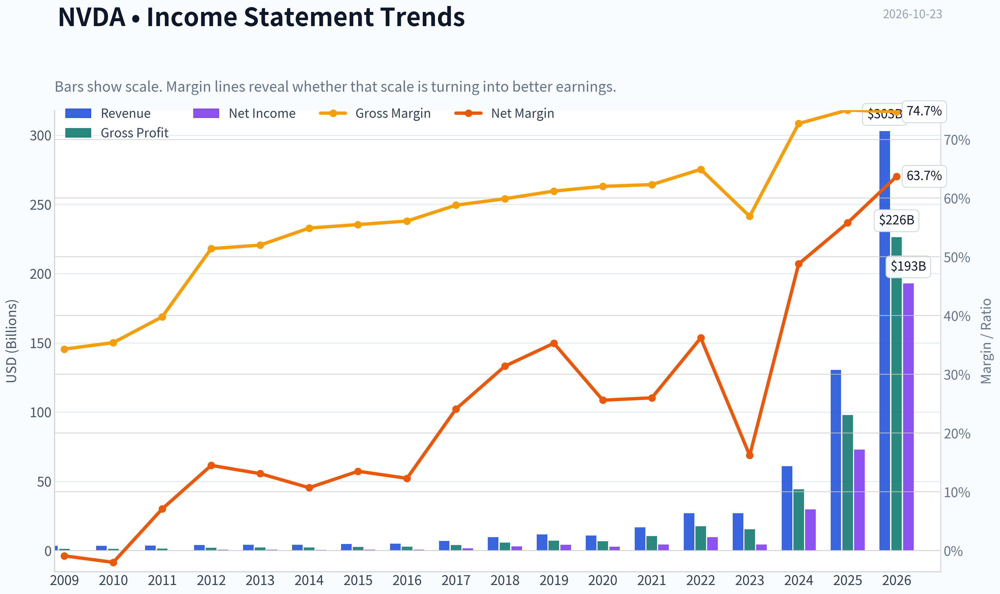
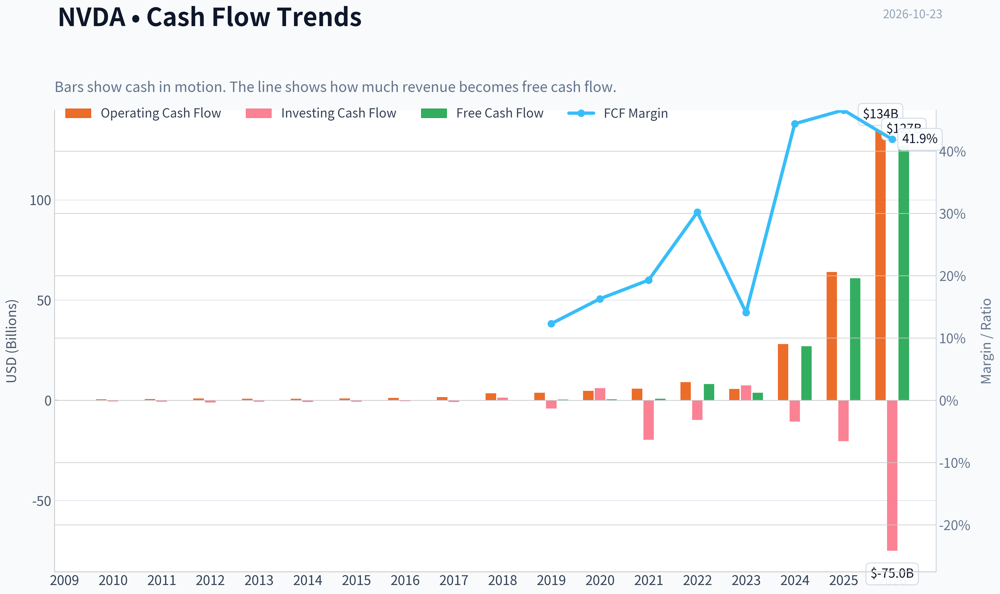
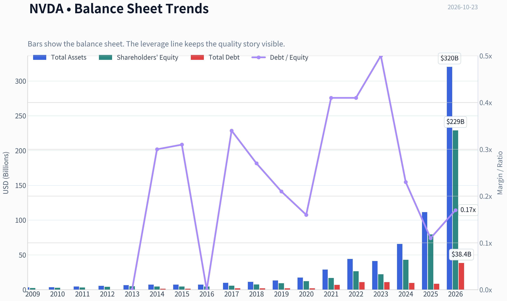
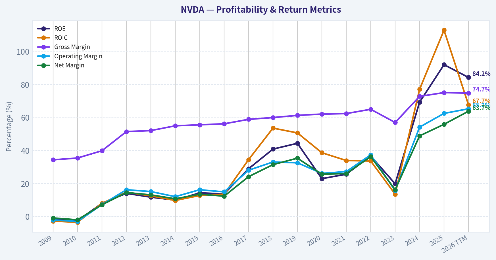
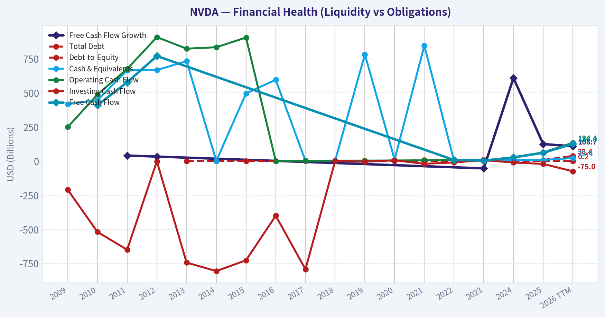
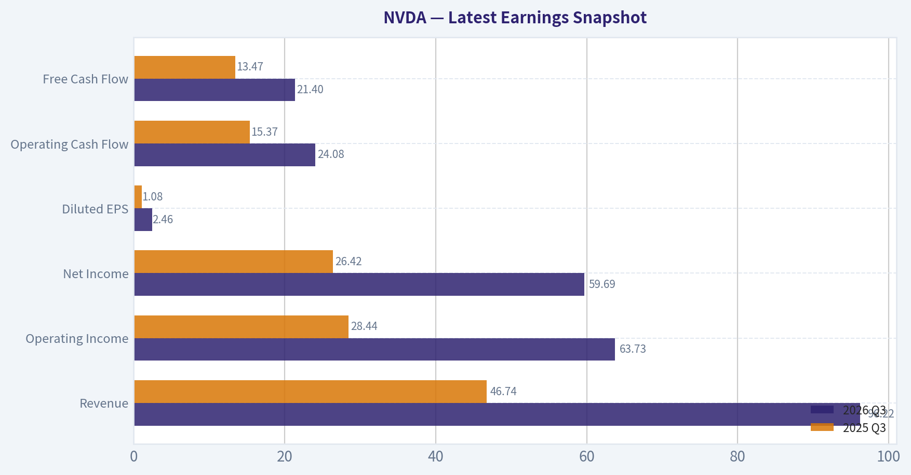
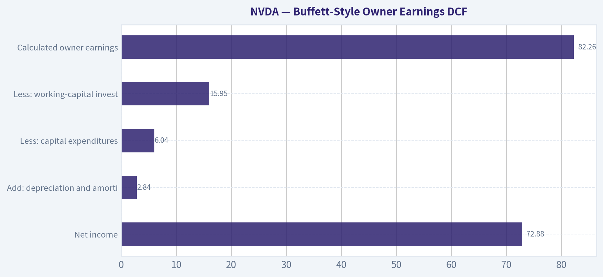
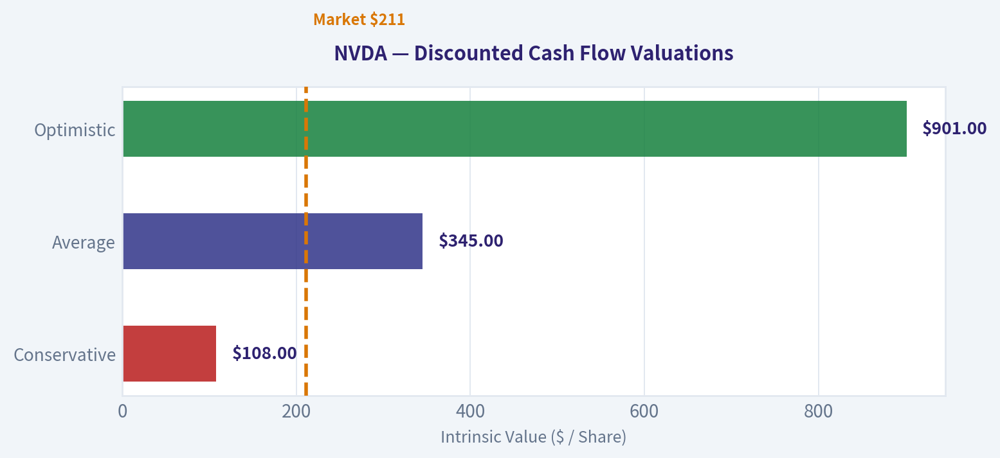
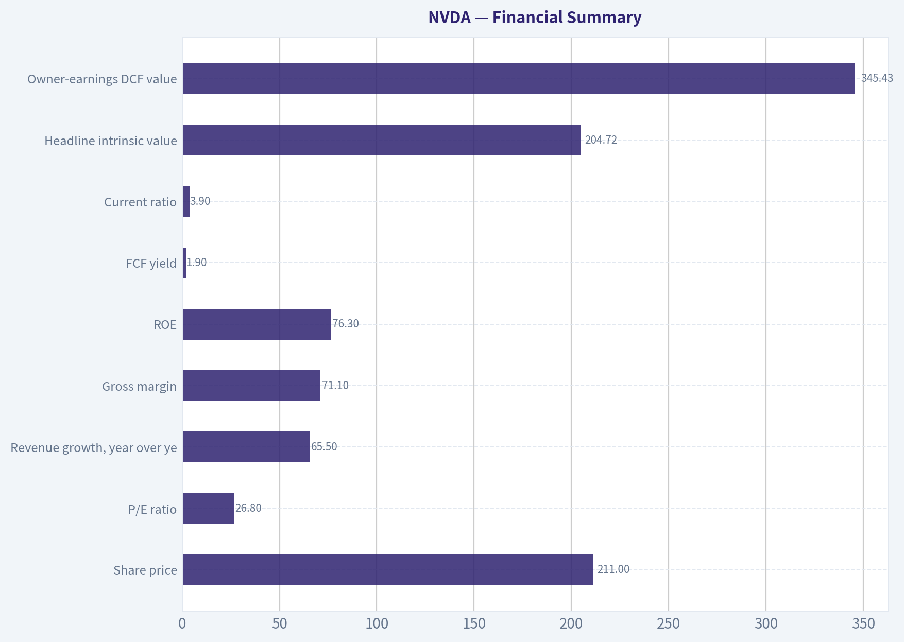
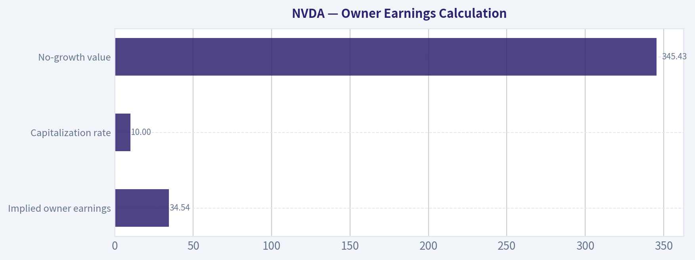

# NVDA Deep Value Intelligence

**Analysis Date:** 2026-10-23

## Critical Disclaimer

*This analysis is generated by Deep Value Intelligence, an AI-powered multi-agent investing framework. Education & research only - not financial advice, not a financial advisor.*

---

## Table of Contents

1. Intelligence Summary
2. Analyst Team Reports
   - Fundamentals Analysis
   - Intrinsic Value Analysis (Buffett)
   - Trend & Growth Analysis (Lynch/Druckenmiller/Fisher)
   - Market Technical Analysis
   - Options Market Analysis
3. Research Team Commentary
4. Value Investing Team Commentary
5. Deep Values Commentary

---

## Intelligence Summary

### Thesis + Conditions

**Core Thesis:** # Executive Briefing

**Key Risks:**
- # Risk Commentary
- ### Risky Analyst: strongest bullish points
- Waiting for exactly $180-$190 creates false precision. A lower quotation is attractive only if intrinsic value remains intact.

**Confidence:** Low

---

## Analyst Team Reports

### Fundamentals Analysis

#### Latest Earnings Snapshot

*Most recent reported quarter anchored on 2026 Q3, with prior-year comparison when available.*

| Metric | 2026 Q3 | 2025 Q3 | YoY Change |
| --- | ---: | ---: | ---: |
| Revenue | $96.22B | $46.74B | +105.9% |
| Operating Income | $63.73B | $28.44B | +124.1% |
| Net Income | $59.69B | $26.42B | +125.9% |
| Diluted EPS | $2.46 | $1.08 | +127.8% |
| Operating Cash Flow | $24.08B | $15.37B | +56.7% |
| Free Cash Flow | $21.40B | $13.47B | +58.9% |

Key Takeaways: This snapshot anchors the most recent reported quarter before the narrative analysis. It helps readers separate long-run business quality from whatever changed in the latest earnings print.

#### 17-Year Financial Metrics for NVDA

*All values below are computed deterministically from raw data - not estimated by AI.*

*Issuer profile: operating company (Technology / Semiconductors).*

#### 17-Year Financial Metrics
*Annual rows come from reported financial statements. The final TTM row is computed from the latest four quarters.*

| Metric | 2009 | 2010 | 2011 | 2012 | 2013 | 2014 | 2015 | 2016 | 2017 | 2018 | 2019 | 2020 | 2021 | 2022 | 2023 | 2024 | 2025 | 2026 TTM |
| --- | --- | --- | --- | --- | --- | --- | --- | --- | --- | --- | --- | --- | --- | --- | --- | --- | --- | --- |
| Market Price | $0 | $0 | $1 | $0 | $0 | $0 | $0 | $1 | $3 | $6 | $4 | $6 | $13 | $24 | $19 | $61 | $120 | $211 |
| Market Cap | $108.9M | $211.4M | $352.0M | $227.6M | $191.6M | $233.5M | $270.2M | $416.7M | $1.77B | $3.88B | $2.25B | $14.61B | $32.60B | $62.07B | $489.79B | $1.53T | $2.98T | $5.12T |
| P/E Ratio | -3.98 | -3.21 | 1.39 | 0.39 | 0.34 | 0.53 | 0.43 | 0.68 | 1.06 | 1.27 | 0.54 | 5.23 | 7.51 | 6.36 | 114.92 | 51.70 | 40.84 | 26.67 |
| P/B Ratio | 0.05 | 0.08 | 0.11 | 0.05 | 0.04 | 0.05 | 0.06 | 0.09 | 0.31 | 0.52 | 0.24 | 1.20 | 1.93 | 2.33 | 22.16 | 35.70 | 37.54 | 22.37 |
| ROE | -1.3% | -2.6% | 8.0% | 14.0% | 11.7% | 9.9% | 14.3% | 13.7% | 28.9% | 40.8% | 44.3% | 22.9% | 25.6% | 36.6% | 19.8% | 69.2% | 91.9% | 84.2% |
| ROIC | -2.8% | -3.5% | 8.0% | 14.7% | 12.5% | 9.7% | 12.7% | 13.5% | 34.4% | 53.5% | 50.6% | 38.6% | 33.9% | 33.6% | 13.5% | 77.0% | 112.8% | 67.7% |
| EPS | $-0.05 | $-0.11 | $0.39 | $0.86 | $0.83 | $0.70 | $1.07 | $1.05 | $2.57 | $4.82 | $6.63 | $1.13 | $1.73 | $3.85 | $0.17 | $1.19 | $2.94 | $7.91 |
| Revenue | $3.42B | $3.33B | $3.54B | $4.00B | $4.28B | $4.13B | $4.68B | $5.01B | $6.91B | $9.71B | $11.72B | $10.92B | $16.68B | $26.91B | $26.97B | $60.92B | $130.50B | $302.97B |
| Gross Profit | $1.17B | $1.18B | $1.41B | $2.06B | $2.23B | $2.27B | $2.60B | $2.81B | $4.06B | $5.82B | $7.17B | $6.77B | $10.40B | $17.48B | $15.36B | $44.30B | $97.86B | $226.24B |
| Gross Margin | 34.3% | 35.4% | 39.8% | 51.4% | 52.0% | 54.9% | 55.5% | 56.1% | 58.8% | 59.9% | 61.2% | 62.0% | 62.3% | 64.9% | 56.9% | 72.7% | 75.0% | 74.7% |
| Operating Margin | -2.1% | -3.0% | 7.2% | 16.2% | 15.1% | 12.0% | 16.2% | 14.9% | 28.0% | 33.0% | 32.5% | 26.1% | 27.2% | 37.3% | 15.7% | 54.1% | 62.4% | 65.2% |
| Net Income | $-30.0M | $-68.0M | $253.1M | $581.1M | $562.5M | $440.0M | $631.0M | $614.0M | $1.67B | $3.05B | $4.14B | $2.80B | $4.33B | $9.75B | $4.37B | $29.76B | $72.88B | $192.88B |
| Net Margin | -0.9% | -2.0% | 7.1% | 14.5% | 13.1% | 10.7% | 13.5% | 12.3% | 24.1% | 31.4% | 35.3% | 25.6% | 26.0% | 36.2% | 16.2% | 48.8% | 55.8% | 63.7% |
| Revenue Growth | N/A | -2.9% | 6.5% | 12.8% | 7.1% | -3.5% | 13.4% | 7.0% | 37.9% | 40.6% | 20.6% | -6.8% | 52.7% | 61.4% | 0.2% | 125.9% | 114.2% | 132.2% |
| Net Income Growth | N/A | 126.3% | -472.3% | 129.5% | -3.2% | -21.8% | 43.4% | -2.7% | 171.3% | 82.9% | 35.9% | -32.5% | 54.9% | 125.1% | -55.2% | 581.3% | 144.9% | 164.7% |
| Free Cash Flow Growth | N/A | N/A | 40.9% | 33.3% | N/A | N/A | N/A | N/A | N/A | N/A | N/A | N/A | N/A | N/A | -53.2% | 609.6% | 125.2% | 108.7% |
| Total Book Value | $2.39B | $2.67B | $3.18B | $4.15B | $4.83B | $4.46B | $4.42B | $4.47B | $5.76B | $7.47B | $9.34B | $12.20B | $16.89B | $26.61B | $22.10B | $42.98B | $79.33B | $228.98B |
| Total Assets | $3.35B | $3.59B | $4.50B | $5.55B | $6.41B | $7.25B | $7.20B | $7.37B | $9.84B | $11.24B | $13.29B | $17.32B | $28.79B | $44.19B | $41.18B | $65.73B | $111.60B | $320.27B |
| Total Debt | N/A | N/A | N/A | N/A | $0 | $1.36B | $1.38B | $0 | $1.98B | $1.99B | $1.99B | $1.99B | $6.96B | $10.95B | $10.95B | $9.71B | $8.46B | $38.35B |
| Debt-to-Equity | N/A | N/A | N/A | N/A | 0.00 | 0.30 | 0.31 | 0.00 | 0.34 | 0.27 | 0.21 | 0.16 | 0.41 | 0.41 | 0.50 | 0.23 | 0.11 | 0.17 |
| Cash & Equivalents | $417.7M | $447.2M | $665.4M | $667.9M | $733.0M | $1.15B | $497.0M | $596.0M | $1.77B | $4.00B | $782.0M | $10.90B | $847.0M | $1.99B | $3.39B | $7.28B | $8.59B | $22.44B |
| Shareholders' Equity | $2.39B | $2.67B | $3.18B | $4.15B | $4.83B | $4.46B | $4.42B | $4.47B | $5.76B | $7.47B | $9.34B | $12.20B | $16.89B | $26.61B | $22.10B | $42.98B | $79.33B | $228.98B |
| Operating Cash Flow | $249.4M | $487.8M | $675.8M | $909.2M | $824.2M | $835.0M | $906.0M | $1.18B | $1.67B | $3.50B | $3.74B | $4.76B | $5.82B | $9.11B | $5.64B | $28.09B | $64.09B | $134.36B |
| Investing Cash Flow | $-209.4M | $-519.3M | $-649.7M | $-1.14B | $-744.0M | $-806.0M | $-727.0M | $-400.0M | $-793.0M | $1.28B | $-4.10B | $6.14B | $-19.68B | $-9.83B | $7.38B | $-10.57B | $-20.42B | $-75.01B |
| Free Cash Flow | N/A | $410.2M | $577.9M | $770.4M | N/A | N/A | N/A | N/A | N/A | N/A | N/A | N/A | N/A | $8.13B | $3.81B | $27.02B | $60.85B | $127.01B |
| FCF Margin | N/A | 12.3% | 16.3% | 19.3% | N/A | N/A | N/A | N/A | N/A | N/A | N/A | N/A | N/A | 30.2% | 14.1% | 44.4% | 46.6% | 41.9% |
| Dividends / Share | $0.00 | $0.00 | $0.00 | $0.00 | $0.00 | $0.00 | $0.00 | $0.00 | $0.00 | $0.00 | $0.00 | $0.00 | $0.00 | $0.00 | $0.02 | $0.02 | $0.03 | $0.28 |

#### Profitability Metrics
- Return on Equity (ROE): 76.3%
- Return on Invested Capital (ROIC): 107.2%
- Return on Assets (ROA): 58.1%
- Gross Margin: 71.1%
- Operating Margin: 60.4%
- Net Profit Margin: 55.6%

#### Liquidity Metrics
- Current Ratio: 3.91
- Quick Ratio: 3.14

#### Leverage Metrics
- Debt-to-Equity Ratio: 0.05
- Interest Coverage Ratio: 503.42
- Net Debt: $-54.09B

#### Growth Metrics (Year-over-Year)
- Revenue Growth: 65.5%
- Net Income Growth: 64.7%
- Free Cash Flow Growth: 58.9%
- Revenue CAGR (3-Year): 100.0%
- Revenue CAGR (5-Year): 66.9%

#### Valuation Metrics
- P/E Ratio (TTM): 26.84
- Forward P/E: 13.26
- Price-to-Book: 22.25
- Price-to-Sales: 16.81
- PEG Ratio: 0.26
- EV/EBITDA: 25.14
- Free Cash Flow Yield: 1.9%
- Earnings Yield: 3.7%

#### Owner Earnings (Buffett Method, Code-Computed)
- Net Income: $72.88B
- + Depreciation & Amortization: $2.84B
- - Capital Expenditures: $-6.04B
- - Working Capital Changes: $-15.95B
- = **Owner Earnings: $82.26B**

#### Intrinsic Value (Code-Computed)
- Current Price: $211
- **Headline Intrinsic Value (business-model routed): $205**
  Business model: cyclical - weighted blend [Damodaran FCFF + reverse-DCF fair + owner-earnings DCF] (cyclical)
  Model spread (min-max across DCFs): $34 - $345
  Margin of safety vs. price (headline): -3.0%
  Routing note: Cyclical: margins/FCF are volatile - headline blends FCFF, reverse-DCF and owner-earnings roughly evenly; treat the range as the honest read.
- Buffett Method (Owner Earnings):
  Conservative: $108
  Average: $345
  Optimistic: $901
- Cash Flow Method (FCF):
  Conservative: $187
  Average: $187
  Optimistic: $489
- Damodaran FCFF (WACC + margins + reinvestment):
  Conservative: $20
  Average: $34
  Optimistic: $111
  Monte Carlo band (P10-P90): $27 - $61 (median $39)
  P(intrinsic value > price): 0.0%
- Reverse-DCF: price implies ~15.7%/yr owner-earnings growth for 10y; trailing 3y was 110.8%, 5y 96.7%.

#### Piotroski F-Score: 3/9
- Positive Net Income: PASS
- Positive Operating Cash Flow: PASS
- ROA Improvement: FAIL
- Cash Flow > Net Income: FAIL
- Decreasing Debt: FAIL
- Improving Current Ratio: FAIL
- No Dilution: PASS
- Improving Gross Margin: FAIL
- Improving Asset Turnover: FAIL

ANALYST STANCE: **WATCH**

#### Executive Summary

NVIDIA is an exceptional operating business whose recent financial performance is extraordinary: TTM revenue reached **$302.97 billion**, operating margin was **65.2%**, net margin was **63.7%**, free cash flow was **$127.01 billion**, and ROIC was **67.7%**. These figures are far above NVIDIA's 10-year norms.

The investment issue is valuation and durability, not business quality. At approximately **$211 per share** and a market capitalization near **$5.1 trillion**, the market is already pricing in roughly **15.7% annual owner-earnings growth for the next decade**. The deterministic valuation pack produces a headline intrinsic value of approximately **$205**, implying essentially no margin of safety. NVIDIA is therefore a superb company, but not an obvious Buffett-style purchase at the current price.

#### Current Metrics and Historical Comparison

The comparison below uses the latest TTM values against approximate averages for the ten completed annual periods from 2016 through 2025. Averages for growth and valuation are heavily influenced by NVIDIA's transition into an AI infrastructure leader.

| Metric | Current / TTM | Approx. 10-Year Average | Interpretation |
|---|---:|---:|---|
| Market Price | $211 | $25.70 | Price appreciation reflects a fundamental transformation, not merely multiple expansion |
| Market Capitalization | $5.09T-$5.12T | ~$512B | Current scale is roughly ten times the 2016-2025 average |
| P/E Ratio | 26.84-26.67 | ~23.0 | Only modestly above the arithmetic average, but the average is distorted by extreme growth-era multiples |
| P/B Ratio | 22.25-22.37 | ~10.2 | Not meaningful for NVIDIA as an asset-light, IP-driven semiconductor designer |
| ROE | 76.3%-84.2% | ~39.4% | Dramatically above historical norms |
| ROIC | 67.7%-107.2% | ~46.1% | Remains exceptional, though the TTM figures differ by calculation methodology |
| Revenue | $302.97B | ~$30.62B | Nearly ten times the 2016-2025 average |
| Revenue Growth | 65.5% current coverage; 132.2% deterministic TTM | ~45.4% | Growth is vastly above the decade norm, though likely near a cyclical peak |
| Operating Margin | 60.4% current coverage; 65.2% deterministic TTM | Not consistently comparable | Margin structure has undergone a step-change since 2023 |
| Net Margin | 55.6% current coverage; 63.7% deterministic TTM | ~31.2% | Current profitability is approximately double the decade average |
| Free Cash Flow | $127.01B | ~$24.95B for available 2022-2025 years | Cash generation has scaled sharply with AI demand |
| FCF Margin | 41.9% | ~33.8% for available years | Current conversion is strong but may normalize as infrastructure investment rises |
| Total Debt | $38.35B | Increased from historical levels | Debt is manageable relative to cash flow and liquidity |
| Debt-to-Equity | 0.05 current coverage; 0.17 deterministic TTM | ~0.26 | Leverage remains conservative |
| Cash and Equivalents | $22.44B | ~$4.01B | Cash has expanded substantially, although debt and working-capital needs have also risen |
| Dividends per Share | $0.28 | ~$0.009 | Dividend growth is substantial in percentage terms but immaterial to the investment thesis |

**Key Takeaways:** NVIDIA's current profitability, growth, and cash generation are far above its historical averages. The stock is not expensive because earnings are weak; it is expensive because investors are capitalizing an unusually powerful earnings period at enormous scale. P/B is not a useful valuation anchor here because NVIDIA's value is primarily in intellectual property, software ecosystems, design capability, and future cash flows rather than tangible book value.

#### Profitability and Growth Analysis

NVIDIA's TTM revenue of **$302.97 billion** compares with approximately **$130.50 billion in 2025** and only **$5.01 billion in 2016**. This is not ordinary cyclical growth; it represents a transformation from a graphics processor company into the central platform supplier for accelerated computing and artificial intelligence.

Gross profit reached **$226.24 billion**, implying a deterministic gross margin of **74.7%**. The long-term progression from roughly **56.1% in 2016** to the mid-70% range demonstrates increasing pricing power, richer product mix, and the economic value of NVIDIA's integrated hardware-software platform. The 2023 decline to a **56.9% gross margin** shows that the business is not immune to product transitions, supply constraints, and mix volatility.

Operating income conversion is equally striking. The deterministic operating margin expanded from **14.9% in 2016** to **65.2% TTM**. Net income rose to **$192.88 billion**, compared with **$72.88 billion in 2025** and **$4.37 billion in 2023**. This explains the current ROE and ROIC levels, but it also creates a high base effect: sustaining triple-digit growth from this earnings base becomes progressively more difficult.

Revenue growth of **132.2%** and net income growth of **164.7%** are far above the 10-year averages. Free cash flow growth of **108.7%** is also exceptional. However, these rates should not be treated as sustainable long-term assumptions. The reverse DCF indicates that the current price requires roughly **15.7% annual owner-earnings growth for ten years**, a demanding but not impossible hurdle.

#### Balance Sheet and Financial Strength

NVIDIA has substantial financial flexibility:

- Cash and equivalents: **$22.44 billion**
- Total debt: **$38.35 billion**
- Debt-to-equity: **0.17** in the deterministic TTM dataset
- Current ratio: **3.91**
- Quick ratio: **3.14**
- Net debt from the research pack: **negative $54.09 billion**, reflecting a net-cash position under that calculation
- Interest coverage: **503.42 times**

The dataset shows debt increasing as NVIDIA scales its supply chain, inventory commitments, and infrastructure-related obligations. That increase deserves monitoring, but it does not currently threaten solvency. Operating cash flow of **$134.36 billion** and free cash flow of **$127.01 billion** provide an enormous buffer.

The Piotroski F-score of **3/9** is a cautionary signal rather than evidence of financial weakness. NVIDIA passes the positive earnings, positive operating cash flow, and no-dilution tests, but fails tests involving improving ROA, cash flow exceeding net income, declining debt, current-ratio improvement, gross-margin improvement, and asset turnover. Many of these failures are caused by the company's explosive growth and the resulting expansion of working capital and assets, but they reinforce the point that the latest numbers should not be extrapolated mechanically.

#### Predictability, Moat, and Business Quality

NVIDIA possesses one of the strongest current economic moats in the technology industry.

| Moat or Quality Factor | Evidence | Buffett-Style Assessment |
|---|---|---|
| CUDA software ecosystem | Large installed base of developers, libraries, tools, and optimized applications | High switching costs and ecosystem lock-in |
| GPU and system architecture | Leading performance and energy efficiency for accelerated computing | Durable technical advantage, although not permanent |
| Full-stack integration | Chips, networking, systems, software, and developer tools | More defensible than selling a standalone component |
| Customer demand | AI training and inference require enormous compute capacity | Powerful secular demand, but customer budgets are cyclical |
| Gross margins | Approximately 71%-75% currently | Indicates pricing power and differentiated products |
| Capital requirements | Relatively asset-light design model versus manufacturing | Supports high ROIC and strong free-cash-flow conversion |
| Competitive position | AMD, custom accelerators, and hyperscaler chips remain credible threats | Moat is strong but requires continuous innovation |

**Key Takeaways:** NVIDIA's moat is primarily ecosystem-based rather than based on physical assets. CUDA, software libraries, networking, system integration, and developer familiarity make NVIDIA difficult to displace quickly. The principal risk is not immediate commoditization; it is that competitors gradually provide adequate alternatives while hyperscale customers develop more of their own silicon.

#### Revenue Breakdown

The deterministic dataset provides consolidated revenue but does not include a current segment table. The following is an approximate latest-TTM product mix based on publicly reported NVIDIA business categories and rounded estimates; it should be treated as directional rather than as a replacement for the canonical consolidated revenue figures.

| Revenue Source | Approx. Amount ($B) | % of Total |
|---|---:|---:|
| Data Center and AI infrastructure | ~$276.0B | ~91% |
| Gaming | ~$16.0B | ~5% |
| Professional Visualization | ~$2.3B | ~1% |
| Automotive and Robotics | ~$2.1B | ~1% |
| OEM and Other | ~$6.6B | ~2% |
| **Total approximate TTM** | **~$303.0B** | **~100%** |

**Key Takeaways:** NVIDIA's revenue is now overwhelmingly concentrated in Data Center and AI infrastructure. This concentration reflects the company's strongest competitive position, but it also increases exposure to hyperscaler capital spending, AI investment cycles, export restrictions, customer concentration, and the possibility that customers eventually shift more workloads to internal or competing accelerators.

#### Buffett-Style Owner Earnings DCF

The research pack calculates current owner earnings as follows:

| Owner Earnings Component | Amount |
|---|---:|
| Net income | $72.88B |
| Add: depreciation and amortization | $2.84B |
| Less: capital expenditures | $6.04B |
| Less: working-capital investment | $15.95B |
| **Calculated owner earnings** | **$82.26B** |

**Key Takeaways:** The owner-earnings calculation is conservative relative to reported TTM net income because it deducts substantial working-capital investment. This is appropriate for a rapidly growing semiconductor platform, where inventory, receivables, supply commitments, and customer financing can absorb cash even while accounting profits rise.

A simple Buffett-style framework is:

\[
\text{Intrinsic Value} =
\sum_{t=1}^{10}\frac{OE_t}{(1+r)^t}
+
\frac{OE_{10}(1+g_T)}{(r-g_T)(1+r)^{10}}
\]

where:

- Starting owner earnings: **$82.26 billion**
- Discount rate: approximately **10%**
- Terminal growth rate: **2.5%**
- Shares implied by market capitalization and price: approximately **24.1 billion**

The pack's model-based Owner Earnings outputs are more useful than a mechanical one-growth-rate calculation because they incorporate scenario-specific growth and normalization assumptions.

| Scenario | Owner-Earnings Assumption | Model-Based Value per Share | Value vs. $211 Price |
|---|---|---:|---:|
| Conservative | Strong normalization; low sustainable growth and lower terminal economics | **$108** | **-49%** |
| Average | High but fading growth supported by a durable AI runway | **$345** | **+64%** |
| Optimistic | Exceptional multi-year adoption and continued platform dominance | **$901** | **+327%** |

**Key Takeaways:** The valuation range is extremely wide because small changes in long-term growth, margin durability, and terminal value produce large changes at NVIDIA's current scale. The average Owner Earnings result supports substantial upside, but it requires NVIDIA to compound owner earnings at a high rate for many years. The conservative case indicates that even a modest normalization could make the current price materially overvalued.

For cross-checking, the broader valuation pack reports:

| Valuation Method | Conservative | Average / Headline | Optimistic |
|---|---:|---:|---:|
| Owner Earnings DCF | $108 | $345 | $901 |
| FCF valuation | $187 | $187 | $489 |
| Damodaran FCFF | $20 | $34 | $111 |
| Headline blended intrinsic value | - | **$205** | - |
| Monte Carlo FCFF range | $27 | Median $39 | $61 |

**Key Takeaways:** The Owner Earnings model is the most favorable framework, while the FCFF model is far more cautious because it normalizes margins, reinvestment, and cyclicality. The headline blended value of approximately **$205** is close to the current price of **$211**, producing a margin of safety of approximately **negative 3%**. This supports a Watch stance rather than an aggressive purchase recommendation.

#### Valuation Interpretation

The current valuation metrics require context:

- P/E: approximately **26.8**
- Forward P/E: approximately **13.3**
- Price-to-sales: approximately **16.8**
- EV/EBITDA: approximately **25.1**
- FCF yield: approximately **1.9%**
- Earnings yield: approximately **3.7%**
- PEG ratio: approximately **0.26**

The forward P/E and PEG ratio appear attractive only if current growth persists far longer than is typical for a company of NVIDIA's size. The **1.9% free-cash-flow yield** is a more demanding signal: investors are paying a very high price for current cash generation and are relying on future growth to justify the valuation.

P/B should not be used as a conventional cheap-versus-expensive measure. NVIDIA's book value is not a meaningful proxy for the value of CUDA, proprietary architectures, developer relationships, software libraries, or future platform economics. The correct valuation anchors are normalized owner earnings, free cash flow, reinvestment requirements, and competitive durability.

#### Management and Capital Allocation

Management has demonstrated outstanding strategic execution:

- It shifted from graphics into data-center acceleration.
- It built a software ecosystem around CUDA.
- It expanded from chips into networking, systems, and complete AI infrastructure.
- It maintained extremely high ROIC while scaling revenue at extraordinary rates.
- It has avoided excessive dilution relative to the magnitude of growth.

The dividend remains financially unimportant. Dividends per share increased to **$0.28**, but NVIDIA's superior capital allocation opportunity remains reinvestment in product development, software, networking, and ecosystem expansion. Buybacks and dividends should become more important if internal reinvestment opportunities eventually decline.

#### Risks and Red Flags

| Risk | Why It Matters |
|---|---|
| AI spending normalization | Data-center customers may slow capital expenditure after major infrastructure build-outs |
| Customer concentration | A small number of hyperscalers account for a large portion of demand |
| Custom silicon | Alphabet, Amazon, Microsoft, Meta, and other customers are developing internal accelerators |
| AMD and other competitors | Adequate alternatives could pressure pricing and margins |
| Export restrictions | Restrictions on China sales can limit addressable markets and product configurations |
| Supply-chain dependence | NVIDIA relies heavily on advanced foundry, packaging, and memory suppliers |
| Margin normalization | Current margins may be unusually elevated during a supply-constrained technology transition |
| Valuation compression | A lower growth rate could reduce the multiple even if earnings continue to rise |
| Working capital | The owner-earnings calculation deducts substantial working-capital investment |
| Scale law | Doubling a $300 billion revenue base is far more difficult than doubling a $30 billion base |

#### Opportunities

NVIDIA could still outperform if:

1. AI inference becomes as large as or larger than model training.
2. Sovereign AI and national data-center construction broaden demand beyond the largest U.S. hyperscalers.
3. Networking, software, and full-system sales increase revenue per deployed GPU.
4. CUDA and related software become more deeply embedded in enterprise workloads.
5. Automotive, robotics, simulation, and digital-twin markets mature.
6. New products preserve premium pricing while lowering the cost per unit of useful AI computation.
7. The company converts its current demand leadership into recurring software and infrastructure revenue.

#### Final Investment Stance

**WATCH**

NVIDIA is a high-quality, wide-moat, exceptionally profitable company with outstanding management execution and a very strong balance sheet. Its ROIC, margins, revenue growth, and free-cash-flow generation are dramatically above historical norms.

However, the current price offers little modeled margin of safety. The market requires approximately **15.7% annual owner-earnings growth for ten years**, while the headline blended intrinsic value is approximately **$205** versus a market price near **$211**. The Owner Earnings model supports upside in its average and optimistic cases, but the FCFF model and conservative scenario show substantial downside if margins or growth normalize.

A Buffett-style investor should maintain NVIDIA on a high-priority watch list and consider purchases only at a materially lower price, after evidence that AI demand remains durable and that margins, working capital, and competitive positioning remain strong. The company is clearly an **advocate-quality business**, but at the current valuation it is a **WATCH-rated investment** rather than a clear buy.

#### Key Investment Points

| Category | Assessment |
|---|---|
| Business quality | Exceptional |
| Economic moat | Very strong, centered on CUDA and full-stack integration |
| Revenue durability | Strong secular demand but high current concentration in AI infrastructure |
| Profitability | Exceptional and far above historical averages |
| Financial strength | Strong net-cash profile and very high interest coverage |
| Earnings predictability | Improving structurally, but current growth is unusually cyclical and elevated |
| Capital allocation | Excellent reinvestment record; dividend is not material |
| Valuation | Full; limited headline margin of safety |
| Main upside driver | Sustained AI inference, software, networking, and sovereign AI demand |
| Main downside driver | AI spending normalization, competition, or margin compression |
| Final stance | **WATCH** |

**Key Takeaways:** NVIDIA combines an extraordinary moat with extraordinary expectations. The central investment question is whether its competitive advantage can support high growth after the company has already reached a $5 trillion valuation. Until the price provides a clearer margin of safety, disciplined investors should admire the business while waiting for a better entry point.

#### Fundamental Visuals

This graph tracks the profitability and return metrics (ROE, ROIC, Margins) of **NVDA** over the past decade, highlighting capital efficiency trends.

This chart illustrates the financial health of **NVDA** over the last 10 years, mapping cash equivalents and free cash flow against total obligations (Debt).

---

### Intrinsic Value Analysis (Buffett)

> *Following Warren Buffett's value investing philosophy: Circle of Competence, Economic Moat, Management Quality, and Margin of Safety.*

#### Intrinsic Value Snapshot

Price is what you pay. Intrinsic value is what the business may be worth based on the cash it can create for owners over time. We show a range, not one magic number.

- Current Price: $210.96
- Value Range (conservative to optimistic across both DCF methods): $107.78 to $900.63

##### Owner Earnings (Buffett Method)
- Net Income: $72,880,000,000.00
- Depreciation & Amortization: $2,843,000,000.00
- Capital Expenditures: $-6,042,000,000.00
- Working Capital Changes: $-15,949,000,000.00
- Owner Earnings: $82,263,000,000.00

##### Intrinsic Value
###### Buffett Method
Uses owner earnings. Stricter, and usually more conservative.
- Conservative: $107.78
- Average: $345.43
- Optimistic: $900.63
- Discount Rate: 10.0%

###### Cash Flow Method
Uses free cash flow. Better for companies spending heavily today to grow tomorrow.
- Conservative: $187.49
- Average: $187.49
- Optimistic: $489.31
- Discount Rate: 10.0%

ANALYST STANCE: **WATCH**

#### Executive Conclusion

NVIDIA is an exceptional business with extraordinary profitability, a powerful ecosystem, and a long reinvestment runway. Its CUDA software platform, developer relationships, scale, and accelerated-computing leadership create a meaningful moat.

However, at approximately **$211 per share and a $5.09 trillion market capitalization**, the stock is priced for continued exceptional execution. The headline intrinsic value is **$204.72**, implying approximately **3% downside**, while the reverse DCF indicates that the market price assumes roughly **15.7% annual growth for the next decade**. That is achievable only if AI infrastructure spending remains enormous and NVIDIA preserves its dominant economics despite customer insourcing, custom chips, export restrictions, and rising competition.

This is a wonderful company, but not presently an obvious bargain. I would prefer to own it at a more favorable price or after evidence that earnings have become less cyclical and more recurring.

#### Factor Scorecard

| Factor | Score | Assessment |
|---|---:|---|
| 1. Circle of competence and simplicity | 3/5 | NVIDIA designs and sells accelerated-computing platforms, but AI demand, product transitions, geopolitics, and hyperscaler behavior make the long-term path less predictable than a traditional consumer franchise. |
| 2. Durable competitive advantage | 4/5 | CUDA, software libraries, developer adoption, ecosystem integration, scale, and rapid innovation create a wide moat. The moat is powerful but exposed to custom silicon and customer concentration. |
| 3. Management and capital allocation | 4/5 | Jensen Huang has demonstrated unusually strong technical vision and long-term reinvestment discipline. NVIDIA has historically prioritized product leadership and ecosystem expansion over short-term accounting optics. |
| 4. Industry structure | 3/5 | The market is benefiting from explosive growth, but semiconductor economics remain competitive and cyclical. Customers possess substantial purchasing power and are developing their own chips. |
| 5. Quality and solvency hard floor | **Not tripped** | The available indicators show strong profitability, cash generation, and a 3.9 current ratio. There is no evidence of deteriorating earnings combined with a solvency red line. |

**Key Takeaways:** NVIDIA scores highly on moat and management, but less highly on predictability and industry structure. The hard financial-distress floor is not triggered; the central issue is valuation and cyclicality, not solvency.

#### Moat Analysis

| Moat source | Evidence | Durability |
|---|---|---|
| Intangible assets | CUDA, proprietary software libraries, developer tools, networking integration, and a large installed ecosystem | Wide and durable |
| Switching costs | Developers and enterprises build workflows, applications, and talent around NVIDIA's software stack | High, though not absolute |
| Cost and scale advantages | Massive R&D spending, manufacturing scale, supply-chain influence, and rapid product cadence | Strong but partly dependent on continued volume |
| Network effects | More developers create more software; more software attracts more users and cloud capacity; greater usage reinforces the platform | Significant |
| Brand and trust | NVIDIA is associated with leading-edge AI computing and has become the default platform for many AI workloads | Strong |

NVIDIA's most important moat is not simply its chip performance. It is the combination of hardware, CUDA, libraries, networking, systems, developer familiarity, and ecosystem support. A competitor may produce a fast chip, but matching the entire platform is substantially more difficult.

The principal moat risks are:

- Hyperscalers developing custom accelerators.
- AMD and other competitors improving software compatibility.
- Customers optimizing workloads to reduce dependence on NVIDIA.
- Export restrictions limiting addressable markets.
- Rapid product transitions that could make current advantages less durable.

#### Financial Summary

| Metric | Latest reported figure |
|---|---:|
| Share price | $211 |
| Market capitalization | $5.09 trillion |
| P/E ratio | 26.8x |
| Revenue growth, year over year | 65.5% |
| Gross margin | 71.1% |
| ROE | 76.3% |
| FCF yield | 1.9% |
| Current ratio | 3.9x |
| Headline intrinsic value | $204.72 |
| Owner-earnings DCF value | $345.43 |
| FCF DCF value | $187.49 |
| Damodaran FCFF value | $34.10 |
| Reverse-DCF implied growth | 15.7% annually for 10 years |

**Key Takeaways:** NVIDIA combines unusually high growth with a 71.1% gross margin and 76.3% ROE. The valuation data are more divided: an owner-earnings model produces substantial upside, while the FCF and FCFF models are much more conservative. That wide spread is a warning that current earnings may be unusually elevated and highly sensitive to normalization assumptions.

#### Owner Earnings Calculation

The research pack does not provide a complete annual owner-earnings bridge by line item. The owner-earnings valuation implies approximately **$34.54 per share of normalized owner earnings**, using a 10% no-growth capitalization rate:

| Owner-earnings component | Per-share treatment |
|---|---:|
| Implied normalized net income plus non-cash charges | Included in implied owner earnings |
| Maintenance capital expenditure | Deducted in normalized estimate |
| Working-capital investment | Reflected in normalized estimate |
| Implied owner earnings | **$34.54** |
| Capitalization rate | 10% |
| No-growth value | **$345.43** |

**Key Takeaways:** The implied owner-earnings figure is powerful, but it should not be treated as equivalent to a guaranteed recurring dividend stream. NVIDIA is a semiconductor company whose reported earnings can benefit from extraordinary demand cycles, so maintenance capital expenditure and normalized margins deserve conservative treatment.

#### Return and Cash-Flow Quality

NVIDIA's **76.3% ROE** is outstanding, but ROE alone can overstate economic quality when earnings are temporarily elevated or when the balance sheet contains relatively little equity. The more important facts are the combination of:

- 71.1% gross margin.
- Very rapid revenue growth.
- Strong free-cash-flow generation.
- Asset-light economics relative to the value of the platform.
- High returns on incremental research, software, and ecosystem investment.

The quality of NVIDIA's returns appears to be driven primarily by exceptional margins, intellectual property, and scale rather than excessive leverage. The company's current ratio of approximately 3.9x also indicates substantial short-term financial flexibility.

#### Three-Scenario DCF Valuation

| Scenario | Key assumptions | Estimated value per share |
|---|---|---:|
| A. No growth | Implied owner earnings of $34.54, discounted at 10% | **$345.43** |
| B. GDP growth | $34.54 of owner earnings, 3% perpetual growth, 10% discount rate | **$508.00** |
| C. Historical-growth illustration | 10% annual growth for 10 years, followed by 4% terminal growth, 10% discount rate | **Approximately $944** |
| Research-pack blended value | Weighted blend of owner earnings, FCF, and FCFF methods | **$204.72** |

The historical-growth illustration is deliberately not the principal valuation. NVIDIA's recent growth rates-approximately 96.7% over five years and 110.8% over three years-are not safely extrapolatable for a company of this scale. Applying even a capped 10% growth rate produces a very high value because the starting owner-earnings estimate may reflect peak-cycle economics.

**Key Takeaways:** The DCF results are extremely assumption-sensitive. The conservative blended valuation of $204.72 is more useful than the high-growth scenario because it recognizes NVIDIA's cyclicality, customer concentration, and the possibility that current margins normalize.

#### Margin of Safety Analysis

| Valuation measure | Result |
|---|---:|
| Current price | $211 |
| Headline intrinsic value | $204.72 |
| Margin of safety versus headline value | **-3.0%** |
| Owner-earnings DCF upside | 63.7% |
| FCF DCF downside | -11.1% |
| Price-implied 10-year growth | 15.7% annually |

For a wide-moat, high-ROIC compounder, a 10% to 15% discount can be sufficient when future economics are highly predictable. NVIDIA does not currently offer that discount against the blended intrinsic-value estimate. Furthermore, a 15.7% annual growth requirement for ten years is demanding, even though it is plausible under a sustained AI infrastructure boom.

The valuation is therefore neither obviously excessive nor comfortably conservative. It depends heavily on whether NVIDIA's current earnings represent a durable new earnings base or the peak of an unusually strong investment cycle.

#### Buffett Scorecard

| Criterion | Weight | Score | Weighted contribution |
|---|---:|---:|---:|
| Moat width and durability | 25% | 4/5 | 1.00 |
| Valuation and margin of safety | 20% | 2/5 | 0.40 |
| Capital returns versus WACC | 15% | 5/5 | 0.75 |
| Business understanding and predictability | 12% | 3/5 | 0.36 |
| Management quality and capital allocation | 12% | 4/5 | 0.48 |
| Reinvestment runway | 8% | 5/5 | 0.40 |
| Balance-sheet strength | 4% | 4/5 | 0.16 |
| Industry structure | 4% | 3/5 | 0.12 |
| **Total** | **100%** |  | **3.67/5** |

**Key Takeaways:** NVIDIA is a high-quality compounder with excellent returns, a major moat, and a long runway. The score is held back primarily by valuation, cyclicality, and uncertainty about how much of today's profitability is structurally permanent.

#### Investment Stance

**WATCH - Moderate conviction.**

NVIDIA merits a place on a high-quality watchlist and may be appropriate for investors who can tolerate substantial volatility and believe AI infrastructure spending will remain durable for many years. But at $211, the stock does not provide a clear margin of safety against the blended intrinsic-value estimate.

A more attractive entry would arise from one of three developments:

1. A material decline in the share price without comparable deterioration in the business.
2. Evidence that software, networking, and recurring ecosystem revenue are making earnings less cyclical.
3. Sustained growth that demonstrates the current earnings base is durable rather than peak-cycle.

The business is exceptional. The purchase price is merely defensible, not compelling.
#### Valuation Bridge

This bridge places the current market price beside each intrinsic value lens so readers can see whether upside depends on one method or shows up across several methods.

| Scenario | Intrinsic Value / Share |
| --- | ---: |
| Buffett Method | $345.43 |
| Cash Flow Method | $187.49 |
| Damodaran Method | $34.10 |
| Current Price | $210.96 |

#### Key Takeaways

If one method is far above the others, the upside case depends on a specific modelling assumption. When several methods cluster together, the valuation story is more robust.

#### Valuation Visuals

This comparison chart from *Latest Earnings Snapshot* stacks current figures against historical benchmarks for **NVDA**, making it easy to see where the company trades relative to its own averages.

This comparison chart from *Buffett-Style Owner Earnings DCF* stacks current figures against historical benchmarks for **NVDA**, making it easy to see where the company trades relative to its own averages.

The following chart maps the **NVDA** Owner Earnings DCF valuation scenarios (Conservative, Average, Optimistic) to visually represent the margin of safety based on intrinsic value calculations.

This comparison chart from *Buffett-Style Owner Earnings DCF* stacks current figures against historical benchmarks for **NVDA**, making it easy to see where the company trades relative to its own averages.

This comparison chart from *Financial Summary* stacks current figures against historical benchmarks for **NVDA**, making it easy to see where the company trades relative to its own averages.

This comparison chart from *Owner Earnings Calculation* stacks current figures against historical benchmarks for **NVDA**, making it easy to see where the company trades relative to its own averages.

---

### Trend & Growth Analysis (Lynch/Druckenmiller/Fisher)

> *Following Peter Lynch's GARP, Stanley Druckenmiller's macro-aware approach, and Philip Fisher's scuttlebutt methodology.*

ANALYST STANCE: **WATCH**

#### Executive View

NVIDIA is a high-quality, fast-growing AI infrastructure leader, but at a roughly **$5.09 trillion market capitalization**, the investment case now depends on continued exceptional execution. The company has outstanding fundamentals and a PEG ratio that appears attractive, but the reverse-DCF suggests the market already discounts approximately **15.7% annual growth for the next decade**.

This is a superior business, but not an obvious ten-bagger from today's valuation. I would prefer to buy on a material correction, a renewed product-cycle acceleration, or evidence that the AI infrastructure market is expanding faster than current expectations.

#### 1. Lynch Classification

**Fast Grower, with cyclical characteristics.**

NVIDIA's 65.5% year-over-year revenue growth places it firmly in Lynch's fast-grower category. However, semiconductor demand is cyclical, and the company's valuation and earnings are highly sensitive to AI capital-expenditure cycles, hyperscaler budgets, export controls, and competitive product launches.

#### 2. The Story in Three Bullets

- NVIDIA supplies the core computing platform for the AI revolution: accelerators, networking, systems, and software.
- Its CUDA ecosystem, developer adoption, performance leadership, and full-stack product strategy create substantial switching costs and competitive advantages.
- The opportunity remains large, but the company must continually expand beyond today's data-center accelerator boom into inference, networking, enterprise AI, robotics, automotive, and sovereign AI infrastructure.

#### 3. TAM and 10x Test

| Measure | Assessment |
|---|---:|
| Current market capitalization | $5.09 trillion |
| 10x equity value | $50.9 trillion |
| Current revenue | Not provided in the research pack |
| Required for a precise 10x revenue test | Current revenue, relevant TAM, and expected market share |
| Runway assessment | Large, but increasingly dependent on new markets |
| TAM growth | Strong secular growth, though the pace is uncertain |

**Key Takeaways:** NVIDIA participates in several rapidly expanding markets, especially AI computing and networking. However, a $50.9 trillion equity value would be extraordinarily large, so the traditional ten-bagger test is difficult to satisfy from the current base. The company can still compound substantially, but the likely opportunity is more consistent with a high-quality compounder than an easy ten-bagger.

#### 4. Revenue Growth Trend

| Indicator | Result | Interpretation |
|---|---:|---|
| Latest revenue growth | 65.5% year over year | Exceptional fast growth |
| Multi-period growth sequence | Not available | Acceleration cannot be confirmed |
| Growth quality | Primarily strategic AI infrastructure demand | Strong, but potentially cyclical |
| Classification | Fast grower | Meets Lynch's growth threshold |

**Key Takeaways:** Growth remains exceptional at 65.5%, but there is not enough sequential history in the supplied data to determine whether growth is accelerating or decelerating. The key question is whether AI demand is broadening into new workloads or merely producing a very large but cyclical infrastructure buildout.

#### 5. Unit Economics and Operating Quality

| Metric | Result | Assessment |
|---|---:|---|
| Gross margin | 71.1% | Excellent |
| ROE | 76.3% | Exceptional |
| Current ratio | 3.91 | Strong liquidity |
| FCF yield | 1.9% | Low at current valuation |
| NRR / CAC / LTV | Not disclosed in supplied data | Not applicable in standard SaaS form |
| Rule of 40 | Not meaningful | Hardware and platform model rather than subscription SaaS |

**Key Takeaways:** NVIDIA's gross margin, return on equity, and liquidity are powerful indicators of pricing power and capital efficiency. SaaS metrics such as NRR and LTV-to-CAC are not appropriate for evaluating the company. The low free-cash-flow yield emphasizes that investors are paying a premium for future growth rather than current cash-flow yield.

#### 6. Inflection-Point Assessment

| Potential inflection | Evidence | Status |
|---|---|---|
| Product cycle | Continued accelerator and full-stack AI platform demand | Positive |
| Market share | Strong leadership in AI infrastructure | Positive, but must be monitored |
| Margin | 71.1% gross margin | Positive |
| TAM expansion | Inference, networking, enterprise AI, robotics, sovereign AI | Positive |
| Competitive risk | Custom silicon and alternative accelerators | Emerging risk |
| Earnings expectations | Reverse DCF implies 15.7% annual growth for 10 years | High expectations |

**Key Takeaways:** NVIDIA is benefiting from several simultaneous inflections: product demand, market expansion, and platform adoption. The major concern is that the market already recognizes much of the success. Future upside likely requires new growth vectors, not simply continuation of the initial training-accelerator boom.

#### 7. Macro Setup

The secular macro backdrop is favorable:

- AI infrastructure spending remains one of the strongest technology investment themes of the decade.
- Falling or stable interest rates would support long-duration growth valuations.
- Rising rates, a recession, or a sharp slowdown in hyperscaler capital spending would pressure the multiple.
- Export restrictions and geopolitical tensions could limit access to important markets.
- A semiconductor inventory cycle or customer digestion period could create sharp earnings volatility.

Druckenmiller-style conclusion: the secular trend is strongly supportive, but the trade is crowded and highly sensitive to liquidity, capital expenditure expectations, and forward guidance.

#### 8. Fisher 15-Point Assessment

| Fisher criterion group | Score |
|---|---:|
| Market potential and long-range outlook | 5/5 |
| Product development and R&D | 5/5 |
| Sales organization and ecosystem | 5/5 |
| Profit margins and margin outlook | 5/5 |
| Competitive advantages | 5/5 |
| Management depth and execution | 4/5 |
| Cost controls and accounting quality | 4/5 |
| Labor and executive relations | 4/5 |
| Management candor and integrity | 4/5 |
| Dilution risk | 4/5 |
| **Total** | **45/50 equivalent; approximately 67.5/75** |

**Key Takeaways:** NVIDIA scores as an outstanding Fisher company because of its R&D intensity, ecosystem, market potential, margins, and technological leadership. The main deductions reflect valuation risk, semiconductor cyclicality, customer concentration among large technology companies, and the difficulty of sustaining extraordinary growth at its current scale.

#### 9. Valuation Analysis

| Valuation measure | Result | Interpretation |
|---|---:|---|
| Share price | $211 |
| P/E ratio | 26.8x | Moderate relative to 65.5% growth |
| PEG ratio | Approximately 0.41 | Attractive by Lynch's framework |
| FCF yield | 1.9% | Expensive on current cash flow |
| Headline intrinsic value | $204.72 | Approximately 3% below price |
| Owner-earnings DCF value | $345.43 | Bullish model |
| FCF-based value | $187.49 | Below current price |
| Damodaran FCFF value | $34.10 | Highly conservative / sensitive model |
| Reverse-DCF assumption | 15.7% annual growth for 10 years | Significant expectations embedded |

**Key Takeaways:** The PEG ratio looks unusually attractive because current earnings growth is exceptionally high, but PEG can understate risk when growth is cyclical or temporarily elevated. The valuation models have a very wide range, from $34.10 to $345.43, demonstrating substantial sensitivity to margins, reinvestment, terminal growth, and the durability of AI demand. At $211, NVIDIA appears reasonably valued only if long-term growth remains unusually strong.

#### 10. Growth Investor Scorecard

| Criterion | Weight | Score / 5 |
|---|---:|---:|
| The Story | 10% | 5.0 |
| TAM and runway | 20% | 4.2 |
| Revenue growth | 20% | 5.0 |
| Unit economics / operating quality | 15% | 4.7 |
| Competitive position | 10% | 4.8 |
| Management quality | 10% | 4.5 |
| Macro setup | 5% | 4.0 |
| Profitability path | 5% | 5.0 |
| Valuation | 5% | 3.0 |
| **Weighted score** | **100%** | **4.5 / 5** |

**Key Takeaways:** NVIDIA is among the strongest growth businesses available on operating fundamentals and competitive position. The score is reduced primarily by valuation, cyclical exposure, and the challenge of compounding rapidly from a $5 trillion base. The business merits high conviction, but the stock requires disciplined entry pricing.

#### 11. Position Size Stance

- **Existing holders:** Hold or maintain a core position, subject to portfolio concentration limits.
- **New investors:** Initiate only a partial position or wait for a better entry point.
- **Suggested growth-portfolio range:** Approximately **2% to 5%**, depending on diversification and risk tolerance.
- **Avoid:** An oversized position based solely on recent revenue growth or the low PEG ratio.

#### 12. Key Catalysts and Risks

| Catalysts | Risks |
|---|---|
| Next-generation accelerator launches | Hyperscaler capex slowdown |
| Faster-than-expected inference adoption | Custom chips from major customers |
| Expansion into networking and systems | AMD and other accelerator competition |
| Enterprise and sovereign AI adoption | Export controls and geopolitical restrictions |
| Robotics, automotive, and edge AI | Semiconductor cycle and inventory digestion |
| Sustained gross margins near current levels | Valuation compression if growth decelerates |

**Key Takeaways:** The most important catalyst is evidence that NVIDIA's growth is broadening beyond the initial data-center training cycle. The most important risk is not business deterioration but expectation compression: even excellent results could disappoint if growth slows materially from current levels.

#### Final Conclusion

NVIDIA is an **outstanding fast grower with a durable competitive moat and powerful secular tailwinds**. It passes the Lynch, Fisher, and Druckenmiller quality tests, but the current valuation leaves less room for execution mistakes.

**Final stance: WATCH.** Hold existing shares, monitor for accelerating new-market growth, and seek a more attractive entry price before making NVIDIA a larger portfolio position.

---

### Market Technical Analysis

ANALYST STANCE: **WATCH**

#### NVDA technical overview

NVDA's latest available close is **$212.21 on October 22, 2026**; October 23 data was not present in the retrieved dataset. The technical picture is divided by timeframe: the long-term trend remains constructive, but short- and medium-term momentum has deteriorated materially.

NVDA is still trading approximately **4.4% above its 200-day SMA at $203.36**, preserving the broader bullish structure. However, the stock is below its **50-day SMA at $222.39**, its **10-day EMA at $218.44**, and its volume-weighted moving average at **$223.07**. This alignment indicates that recent buyers are underwater and that overhead supply may appear during rebounds.

The recent decline has been significant. From the October 6 high of **$239.24**, NVDA has fallen to $212.21, a drop of roughly **11.3%**. The price has also formed a short-term pattern of lower highs and lower lows: the October 13 rebound high near $228.52 was followed by weakness through October 22. The immediate trend therefore favors caution until price can reclaim the $218-$223 area.

#### Momentum and trend signals

The **MACD is -2.63**, while the histogram is **-2.16**. Both are negative, confirming that downside momentum is active rather than merely a one-day price shock. The MACD histogram turned negative around October 9 and has remained substantially below zero, suggesting that sellers have maintained control through the recent decline.

The **RSI is 38.1**, down from readings above 67 earlier in October. This is bearish momentum, but it is not yet deeply oversold under the conventional 30 threshold. Consequently, a further decline remains possible before a technically stronger reversal signal develops. A move below 30 could indicate increasing washout conditions, while a recovery above 45-50 would provide better evidence that selling pressure is easing.

The short-term moving-average structure reinforces the negative momentum reading. The 10-day EMA has fallen from approximately $232.22 on October 8 to $218.44, while the 50-day SMA has only begun to flatten after rising steadily through early October. This divergence is important: the fast average is falling sharply, but the medium-term average has not yet rolled over decisively. That often describes an intermediate correction within a still-positive longer-term trend, rather than a confirmed long-term breakdown.

#### Volatility, volume, and trading levels

The **ATR is $6.06**, equivalent to approximately **2.9% of the latest closing price**. This is a substantial daily movement range for position-management purposes. A stop placed only one or two dollars below an entry could be vulnerable to normal NVDA volatility; risk controls should account for an approximate $6 daily true range and potential gap risk.

The latest close is below the VWMA, which has declined from approximately $231.53 on October 9 to $223.07. This falling volume-weighted benchmark suggests that recent trading volume has been concentrated at higher prices and that the market has not yet established a firm accumulation base. The October 22 volume of about **125.4 million shares** was elevated relative to several recent sessions, but it was not an extreme capitulation spike. That leaves open the possibility of additional selling or sideways basing rather than confirming a durable bottom.

The first important support zone is approximately **$211-$212**, marked by the October 22 low near $211.26 and the latest close. A decisive break below that area could expose the stock to the psychologically important **$200 level**, which is close to the rising 200-day SMA at $203.36. On the upside, initial resistance appears near **$218-$219**, corresponding to the 10-day EMA and recent trading congestion. Stronger resistance lies around **$222-$223**, where the 50-day SMA and VWMA converge. Reclaiming that zone would improve the short-term outlook; failure there would keep the corrective trend intact.

#### Trading interpretation

The evidence does not yet support an aggressive bullish entry. The long-term trend remains favorable because price is above a rising 200-day SMA, but the combination of negative MACD, negative histogram, sub-40 RSI, and price below both the 10-day EMA and 50-day SMA indicates that momentum traders should remain defensive.

A more constructive setup would require one of two developments: either a controlled test of the $203-$212 support region followed by a bullish reversal, or a recovery above $218 and then $222-$223 with improving MACD and RSI. Conversely, a close below approximately $203 would be materially more concerning because it would place price beneath the long-term trend benchmark and could signal that the correction is evolving into a broader trend deterioration.

The selected indicators are deliberately complementary: **close_50_sma, close_200_sma, close_10_ema, macd, macdh, rsi, atr, and vwma**. Together they measure long-, medium-, and short-term trend, momentum direction and acceleration, overbought/oversold pressure, volatility-based risk, and volume-confirmed price positioning without relying on redundant oscillators.

| Indicator / level | Latest reading | Interpretation for NVDA |
|---|---:|---|
| Latest close | $212.21 | Below short- and medium-term trend benchmarks; near immediate support |
| 10 EMA | $218.44 | Short-term resistance; price is in a declining momentum phase |
| 50 SMA | $222.39 | Medium-term resistance; recent buyers may sell into rebounds |
| 200 SMA | $203.36 | Long-term trend support; price remains about 4.4% above it |
| VWMA | $223.07 | Volume-weighted resistance; recent volume has favored higher prices |
| MACD | -2.63 | Bearish momentum regime |
| MACD histogram | -2.16 | Downside momentum remains active |
| RSI | 38.1 | Weak but not deeply oversold; reversal is not yet confirmed |
| ATR | $6.06 | High daily volatility; position sizing and stops require room |
| Key support | $211-$212, then around $203-$200 | Breakdown risk increases below these zones |
| Key resistance | $218-$219, then $222-$223 | Reclaiming these levels would improve the technical outlook |

**Key Takeaways:** NVDA remains above its rising 200-day average, so the long-term bullish structure is not broken, but short-term momentum is clearly bearish. The most important near-term test is whether price holds the $211-$212 area and can reclaim $218-$223. RSI is weak without being deeply oversold, so traders should wait for either a confirmed reversal near support or a recovery above resistance rather than assume the decline has already ended.

---

### Options Market Analysis

> *Reading options flow - put/call ratios, IV skew, and unusual activity - to gauge institutional positioning and event-driven risk.*

ANALYST STANCE: **ADVOCATE**

#### NVDA Options Market Overview

Data is as of October 23, 2026, covering the October 26, October 28, and October 30 expirations. NVDA's approximate trading level appears to be near $215 based on the concentration of activity around the $212.50-$220 strikes; the source data does not provide an explicit spot price.

| Expiration | Call OI | Put OI | Put/Call OI | Call Volume | Put Volume | Put/Call Volume | ATM Call IV | ATM Put IV |
|---|---:|---:|---:|---:|---:|---:|---:|---:|
| Oct. 26 | 61,478 | 45,571 | 0.74 | 204,685 | 144,602 | 0.71 | 30.2% | 28.7% |
| Oct. 28 | 34,281 | 21,238 | 0.62 | 85,526 | 49,223 | 0.58 | 37.9% | 36.4% |
| Oct. 30 | 272,196 | 208,278 | 0.77 | 276,111 | 165,119 | 0.60 | 39.4% | 37.5% |
| **Total** | **367,955** | **275,087** | **0.75** | **566,322** | **358,944** | **0.63** | - | - |

**Key Takeaways:** The aggregate put/call open-interest ratio is 0.75, modestly more call-heavy than the approximately 0.70 neutral baseline. The 0.63 volume ratio is more bullish, showing substantially greater call activity than put activity. Positioning is bullish, but not aggressively one-sided.

#### Put/Call Ratio Analysis

The near-term put/call OI ratio of 0.75 is close to neutral and does not indicate heavy demand for downside protection. The volume ratio of 0.63 is more significant because it suggests current trading activity is tilted toward calls rather than puts.

The strongest call bias appears in the October 28 expiration, with a 0.58 volume ratio and a 0.62 OI ratio. October 30 carries the largest amount of open interest and is also call-dominant, making it the most important expiration for near-term positioning.

This pattern is consistent with bullish speculation, upside exposure, or covered-call activity. Because the data does not identify whether trades were executed at the bid or ask, it cannot conclusively distinguish aggressive call buying from call selling.

#### Implied Volatility Assessment

| Expiration | ATM Call IV | ATM Put IV | Put-versus-Call IV Difference | Interpretation |
|---|---:|---:|---:|---|
| Oct. 26 | 30.2% | 28.7% | Put IV 1.5 points lower | Mild call premium |
| Oct. 28 | 37.9% | 36.4% | Put IV 1.5 points lower | Elevated short-dated IV |
| Oct. 30 | 39.4% | 37.5% | Put IV 1.9 points lower | Highest near-term IV |

**Key Takeaways:** Near-term IV rises from roughly 29%-30% for October 26 to approximately 38%-39% for October 30. Calls carry slightly higher ATM IV than puts, which is the opposite of a traditional downside-protection skew and indicates a mild upside-demand bias. IV is elevated enough to imply meaningful event or headline risk, although no specific catalyst is identified in the supplied data.

The available data provides ATM IV and selected contract IVs, rather than a complete volatility surface. Still, the quoted contracts suggest a mild call skew:

- October 26 $220 calls: 27.3% IV.
- October 26 $212.50 puts: 27.8% IV.
- October 28 $252.50 calls: 54.7% IV.
- October 28 $180 puts: 63.5% IV.
- October 30 $100 puts: 181.3% IV.

The extreme IV on the $100 puts reflects deep-tail insurance and should not be interpreted as ordinary market expectations. The October 28 $180 puts also show elevated tail-risk pricing, but their distance from the presumed $215 spot level makes them less relevant to immediate directional sentiment.

#### Unusual Options Activity

| Expiration | Type | Strike | Approx. Moneyness | Volume | OI | Volume/OI | IV | Positioning Read |
|---|---|---:|---|---:|---:|---:|---:|---|
| Oct. 26 | Put | $212.50 | Slightly OTM | 54,485 | 2,928 | 18.6x | 27.8% | Fresh downside hedge or bearish short-term bet |
| Oct. 26 | Call | $215.00 | Approximately ATM | 52,746 | 5,209 | 10.1x | 27.4% | Fresh near-term upside exposure |
| Oct. 30 | Call | $215.00 | Approximately ATM | 46,519 | 5,429 | 8.6x | 37.7% | Stronger-duration bullish positioning |
| Oct. 26 | Call | $220.00 | OTM | 42,871 | 5,852 | 7.3x | 27.3% | Upside speculation or call spread leg |
| Oct. 26 | Call | $212.50 | Slightly ITM | 37,151 | 2,419 | 15.4x | 28.5% | Directional bullish exposure |
| Oct. 30 | Put | $100.00 | Deep OTM | 19,639 | 3,320 | 5.9x | 181.3% | Tail hedge; low relevance to base-case direction |
| Oct. 28 | Call | $252.50 | Far OTM | 10,709 | 53 | 202.1x | 54.7% | Very speculative upside lottery-style activity |
| Oct. 28 | Put | $180.00 | Far OTM | 8,859 | 369 | 24.0x | 63.5% | Tail hedge or bearish crash protection |
| Oct. 28 | Call | $242.50 | Far OTM | 6,731 | 186 | 36.2x | 48.4% | Speculative upside positioning |
| Oct. 26 | Call | $200.00 | ITM | 6,005 | 585 | 10.3x | 51.1% | Bullish directional or stock-replacement trade |

**Key Takeaways:** The most important unusual activity is concentrated in the $212.50-$220 area, where both calls and puts show fresh volume well above existing open interest. Call activity is broader and larger across the near-ATM strikes, favoring an upside interpretation, while the large $212.50 put print represents a meaningful short-term hedge or bearish counterflow. Far-OTM contracts, especially the $252.50 call and $100 put, look more speculative or tail-hedging oriented and are less reliable as institutional directional signals.

The volume-to-open-interest screens identify likely new activity, but they do not reveal whether the contracts were bought or sold. Therefore:

- The $215 and $220 call activity is bullish if bought, but could represent covered-call writing if sold.
- The $212.50 put activity is bearish if bought, but could represent bullish put selling if sold.
- The very high volume/OI ratio in the October 28 $252.50 calls suggests fresh positioning, but its far-OTM status and low existing OI make it more consistent with speculative upside exposure than a high-conviction core hedge.
- No execution-side data is available to reliably label any particular trade as "smart money."

#### Open Interest Concentration and Gamma Levels

| Concentration Area | Evidence | Market Implication |
|---|---|---|
| October 30 expiration | 272,196 call OI and 208,278 put OI | Dominant near-term expiration; likely strongest pinning influence |
| $215 strike | Heavy unusual call activity on October 26 and October 30 | Important near-ATM reference level |
| $212.50 strike | Heavy October 26 put and call activity | Potential short-term battleground or pinning zone |
| $220 strike | 42,871 October 26 call volume | Upside trigger or call-related resistance zone |
| $242.50-$255 calls | High volume/OI ratios but relatively low OI | Speculative upside interest, not a confirmed gamma wall |
| $180 and $100 puts | Elevated IV and unusual activity | Tail-risk hedging; unlikely to control ordinary price action |

**Key Takeaways:** October 30 is the dominant expiration by open interest and should exert the greatest influence on near-term hedging and pinning behavior. The $212.50-$220 region is the key trading cluster, with $215 acting as the central reference strike. A precise gamma-wall calculation is not possible because strike-by-strike open interest, delta, and dealer positioning are not provided.

The large October 30 call and put open interest may dampen price movement near heavily populated strikes if dealers are well hedged, but a sharp move through the $215-$220 area could force dynamic hedging and amplify momentum. The far-OTM call and put positions do not appear large enough, based on the available data, to establish dependable gamma walls.

#### Overall Options Sentiment

**Overall signal: BULLISH, with moderate confidence.**

The primary drivers are:

1. A 0.63 near-term put/call volume ratio, showing clear call-heavy trading.
2. A 0.75 put/call OI ratio, modestly more bullish than the historical neutral level.
3. Concentrated fresh activity in near-ATM and slightly OTM calls at $212.50, $215, and $220.
4. ATM call IV consistently exceeding ATM put IV, indicating mild upside-demand skew.
5. The October 30 expiration, which has the largest open interest, remains call-dominant.

The main caveat is the unusually large October 26 $212.50 put activity. That could represent downside protection or a bearish short-term view, although it may also be put selling. Elevated IV into the October 28-30 expirations means the market expects substantial movement, so bullish positioning does not eliminate the risk of a sharp reversal.

#### Summary

| Category | Assessment |
|---|---|
| Put/Call Ratio | OI ratio 0.75; volume ratio 0.63. Mildly bullish versus the approximately 0.70 neutral OI baseline |
| IV Level | Elevated into October 28-30, with ATM IV reaching roughly 38%-39% |
| Skew Direction | Mild call skew; ATM call IV is above ATM put IV, although deep-tail puts remain expensive |
| Unusual Activity | Broad near-ATM call activity at $212.50-$220, offset by a major October 26 $212.50 put print |
| Overall Signal | **BULLISH**, moderate confidence; elevated volatility and ambiguous trade direction are key caveats |

**Key Takeaways:** NVDA's near-term options market leans bullish because calls dominate both current volume and open interest, while call IV modestly exceeds put IV. The strongest signal is concentrated around the $212.50-$220 range, but the large near-term put activity and elevated event-style volatility argue against treating the bullish read as high conviction.

---

## Research Team Commentary

> *The Research Manager synthesizes the Bull vs Bear debate into action-free commentary. This is a pre-risk view, not the final stance.*

Core takeaway: NVIDIA is an exceptional business, but the evidence does not yet establish that $211 offers a dependable margin of safety. CUDA, full-stack integration, developer adoption, and extraordinary returns on capital support a premium valuation. Nevertheless, the apparent discount depends on treating current EPS as normalized owner earnings. That is the debate's unresolved-and most important-assumption. I would retain a WATCH stance rather than buy aggressively or avoid the company outright.

The strongest bull argument is that NVIDIA is no longer merely a semiconductor supplier. Its accelerators, networking, systems, libraries, and development tools form an integrated computing platform. Customers considering another chip must weigh migration costs, software reliability, utilization, time to deployment, and operational risk-not just benchmark performance. The 71.1% gross margin, 107.2% ROIC, and 58.1% ROA support the view that this differentiation is economically real rather than promotional.

The company also has multiple ways to compound beyond frontier-model training. Inference, networking, enterprise deployment, sovereign infrastructure, robotics, and automotive could extend the runway. Management's decision to invest in CUDA and accelerated computing long before the AI boom is persuasive evidence of strategic skill. At 26.84 times earnings, the valuation is demanding but not obviously irrational for a wide-moat, asset-light compounder.

The bull's reverse-DCF is particularly relevant: using $7.86 of EPS as an owner-earnings proxy, a 10% discount rate, and 3% terminal growth, the market price implies approximately 11% annual growth for ten years. NVIDIA could plausibly exceed that hurdle. If sustainable owner earnings can grow around 13%, the cited value of roughly $243 would provide the 10%-15% discount that can be adequate for a business of this quality.

The strongest bear argument is not that NVIDIA will lose technological relevance. It is that $7.86 may be a peak-cycle rather than normalized starting point. The materials do not provide the cash-flow conversion, stock-based compensation, dilution, working-capital movements, or reinvestment requirements needed to equate EPS with owner earnings. A 20% normalization haircut raises the required growth rate to roughly 14%; a 30% haircut pushes it toward 16%. Those are materially harder hurdles from NVIDIA's present scale.

Competition need not overthrow CUDA to hurt the investment. Hyperscalers have both the resources and economic incentive to direct stable, high-volume workloads toward custom accelerators. AMD and software abstraction layers can gradually lower switching barriers. Inference may produce enormous computing demand while being more price-sensitive and better suited to specialized silicon. NVIDIA could therefore remain the industry leader while suffering lower market share, pricing power, or gross margins. That would be enough to undermine a DCF built on today's profitability.

The bear's $135-$170 valuation range is not conclusively established either. It relies on assumed normalization haircuts and slower growth that may prove too severe for a platform with NVIDIA's moat and opportunity set. Conversely, the bull's approximately $243 base value is not a conservative appraisal because it assumes current EPS is representative and then applies 13% growth. The defensible conclusion is that intrinsic value has a wide range, with $211 sitting in the uncertain middle rather than at an obvious bargain price.

From a Buffett perspective, this is a wonderful business for which a modest margin of safety could be sufficient. The problem is not that the discount is too small; it is that the discount has not yet been demonstrated. I would not demand the 40%-50% discount appropriate for a low-quality cyclical company, but I would require better evidence that current owner earnings are sustainable before underwriting a decade of double-digit growth. The 3.7% earnings yield leaves limited protection if AI infrastructure spending or margins normalize faster than expected.

Short-term technical deterioration and option volatility do not alter that conclusion. The stock remaining above its 200-day average may help characterize sentiment, but it says nothing about ten-year intrinsic value. If weaker momentum produces a substantially better entry price without deterioration in the business, it could create an opportunity.

Over the next one to four quarters, I would first reconcile net income with free cash flow, including stock-based compensation, dilution, working capital, and recurring capital needs. Strong free-cash-flow conversion and rising owner earnings per share would strengthen the bull case; persistent dilution or a widening gap between earnings and cash generation would weaken it.

I would also monitor gross margin and operating margin across product transitions. Modest normalization would be unsurprising, but repeated compression combined with higher research spending could indicate weakening pricing power. Data-center growth should be assessed alongside customer inventories and capital-spending plans, not merely headline revenue. Evidence that hyperscaler custom chips are taking material production workloads would matter more than announcements alone.

Finally, I would track networking growth, software and services monetization, inference adoption, customer concentration, export restrictions, and management's guidance on supply and demand. Broader revenue sources and durable per-share cash growth would justify a higher intrinsic-value estimate. Slowing accelerator demand accompanied by margin compression, customer insourcing, or rising dilution would support the bear's normalization case.

The lesson from prior valuation mistakes is to avoid anchoring on either a headline P/E or admiration for the business. NVIDIA deserves a premium, but the decision should rest on normalized cash economics under current market conditions. Until those economics are better established-or the price supplies a clearer cushion-the disciplined position is patience.

WATCH

---

## Value Investing Team Commentary

> *The Investor translates the research view into an investment thesis before risk review. This is still not the final stance.*

### Business quality and moat

NVIDIA is an exceptional business, not merely a cyclical chip vendor. Its competitive advantage combines:

- CUDA and a large developer ecosystem
- Accelerators, networking, systems, libraries, and deployment tools
- High switching costs arising from software migration, optimization, reliability, and time to market
- A rapid product cadence and substantial research scale
- Management's long record of anticipating major computing transitions

Gross margin of 71.1% and reported ROIC above 100% indicate extraordinary economics, although the precise ROIC methodology should be verified. These returns are unlikely to persist without genuine pricing power and intellectual-property advantages. NVIDIA therefore deserves a premium valuation and a much smaller required discount than an ordinary semiconductor company.

The long runway is also credible. AI inference, networking, enterprise deployment, sovereign AI, robotics, and automotive could sustain growth after the current training-infrastructure buildout matures. The central long-term question is not whether accelerated computing will expand; it is how much of the resulting economic value NVIDIA can retain.

### What sentiment may be missing

The bearish narrative may place too much emphasis on custom chips and benchmark competition. Hyperscalers can move stable, specialized workloads to internal accelerators, but they must also consider software compatibility, development speed, utilization, flexibility, and operational risk. A theoretically cheaper chip is not necessarily a cheaper computing platform. Competitors do not need merely capable silicon-they need an ecosystem that delivers a better total cost of ownership.

Conversely, bullish sentiment may confuse rapid AI infrastructure spending with permanently superior economics. NVIDIA can remain the dominant platform while experiencing:

- Lower accelerator market share
- Greater customer bargaining power
- A less favorable mix as inference expands
- Gross-margin normalization
- Higher recurring research and ecosystem spending
- Workload migration toward custom silicon

NVIDIA need not "lose" for shareholders to earn disappointing returns. If the market already capitalizes a decade of strong growth and unusually high margins, even modest normalization could materially reduce intrinsic value.

This is the selective contrarian opportunity and risk: competitive fears may underestimate NVIDIA's platform moat, while enthusiasm may underestimate how much future success is already embedded in the price.

### Valuation and owner earnings

At approximately $211 and $7.86 of EPS, NVIDIA trades around 26.8 times earnings, representing a 3.7% earnings yield. That is not inherently excessive for a wide-moat compounder, but it offers limited protection if current earnings are above a sustainable level.

The reverse-DCF framing is more useful than the headline multiple:

- If $7.86 is a reasonable owner-earnings base, the price reportedly requires roughly 11% annual growth for ten years.
- With a 20% normalization haircut, the required growth rises to approximately 14%.
- With a 30% haircut, it approaches 16%.

Eleven percent may be achievable given NVIDIA's moat and addressable markets. Fourteen to sixteen percent is considerably more demanding from the company's current scale, especially if margins decline or hyperscaler capital spending becomes less concentrated in NVIDIA hardware.

The approximately $243 bullish appraisal would put the shares near a 13% discount at $211-potentially sufficient under a quality-scaled margin-of-safety framework. But that value rests heavily on treating current EPS as representative owner earnings and assuming sustained 13% growth. It is a plausible scenario, not yet a conservative appraisal.

The reported profitability metrics also do not resolve this issue. High ROE and ROIC establish quality, but they do not prove that the current earnings base is normalized. The analysis still needs a careful reconciliation of net income to free cash flow, including:

- Stock-based compensation and net dilution
- Working-capital effects
- Capital expenditures and supply commitments
- Tax normalization
- Acquisition or investment spending
- Free cash flow and owner earnings on a per-share basis

### Competitive and operating risks

The most important risk is gradual economic erosion, not technological obsolescence. Key indicators include:

1. **Gross and operating margins:** Some normalization is expected, but persistent compression could indicate weakening pricing power.
2. **Hyperscaler concentration:** Large customers have the capital and incentive to internalize predictable workloads.
3. **Inference economics:** Inference may be a larger market than training, but potentially more price-sensitive and suitable for specialized chips.
4. **Software abstraction:** Better portability could slowly reduce CUDA switching costs even if CUDA remains the leading environment.
5. **Export restrictions:** Geopolitical limits can reduce market access and force product modifications.
6. **Product transitions and customer inventory:** Rapid purchase cycles may create periods of digestion, even within a durable secular expansion.
7. **Per-share economics:** Growth funded by meaningful dilution is less valuable than growth in owner earnings per share.

Networking and software monetization are particularly important. If NVIDIA expands beyond accelerator sales into recurring or durable platform-level economics, today's valuation becomes easier to justify. If growth remains heavily dependent on repeated waves of premium hardware purchases, cyclicality deserves greater weight.

### Investment approach

Technical weakness and option volatility should not determine a ten-year ownership decision. However, deteriorating short-term sentiment could become useful if it lowers the price without impairing the business. A decline caused by temporary capital-spending fears, product-transition timing, or broad market risk aversion could create an attractive entry point.

At $211, I would neither chase the shares nor avoid the company. Existing long-term owners with appropriate position sizes can reasonably continue holding because the moat and growth runway remain intact. A new investor should wait for one of two developments:

- Better evidence that present earnings convert into sustainable, growing owner earnings per share; or
- A lower price that protects against margin and earnings normalization.

A price around $180-$190 would offer a more meaningful cushion against a conservative valuation, subject to updated fundamentals. That is not a mechanical target: declining fundamentals would also reduce intrinsic value, while strong cash conversion and broader software, networking, and inference monetization could justify buying at a higher price.

The crucial mistake would be anchoring either on the low-looking P/E relative to growth or on the idea that semiconductor earnings must inevitably collapse. NVIDIA is better than a conventional cyclical chip company, but it is not exempt from customer concentration, competition, spending cycles, or valuation discipline.

ANALYST STANCE: **WATCH** - NVIDIA is a wonderful, wide-moat business with credible long-term growth, but at roughly $211 the margin of safety depends too heavily on current EPS being sustainable owner earnings. Wait for stronger cash-flow evidence or a more favorable price rather than buying aggressively on AI enthusiasm alone.

---

## Deep Values Commentary

> *The Risk Management Team debates and the Risk Judge provides the final action-free verdict. This section determines the final ADVOCATE / WATCH / AVOID stance.*

#### Final Stance Scorecard

This scorecard converts the final research view into a weighted decision frame. It does not replace the narrative judgement, but it makes the main drivers of the verdict easier to scan.

| Criterion | Score | Weight | Commentary |
| --- | ---: | ---: | --- |
| Business Quality | 4.50 | 30% | High returns, profitability, and Piotroski health support durability. |
| Valuation Support | 2.33 | 30% | Blends current price against available intrinsic value anchors and valuation ratios. |
| Financial Strength | 5.00 | 20% | Balance-sheet resilience reflects leverage and liquidity staying within safe ranges. |
| Growth Durability | 5.00 | 20% | Recent revenue, earnings, and free cash flow growth indicate how durable expansion looks. |
| TOTAL / FINAL STANCE | 4.05 | 100% | WATCH |

#### Key Takeaways

The weighted score lands at **4.05 / 5.0**, while the final stance remains **WATCH**. This is useful as a quick calibration aid rather than a mechanical signal.

#### Risk Summary

Higher scores indicate more risk pressure. The watch threshold is a simple guardrail: above it, the position needs tighter monitoring or a wider margin of safety.

| Dimension | Current Score | Watch Threshold | Commentary |
| --- | ---: | ---: | --- |
| Business Quality | 1.50 | 3.00 | High returns, profitability, and Piotroski health support durability. |
| Valuation Support | 3.67 | 3.00 | Blends current price against available intrinsic value anchors and valuation ratios. |
| Financial Strength | 1.00 | 3.00 | Balance-sheet resilience reflects leverage and liquidity staying within safe ranges. |
| Growth Durability | 1.00 | 3.00 | Recent revenue, earnings, and free cash flow growth indicate how durable expansion looks. |

#### Key Takeaways

This view helps readers separate *where* the risk sits: valuation, business quality, balance sheet, or growth durability. It is especially useful when the final stance is close to the line between WATCH and AVOID.
