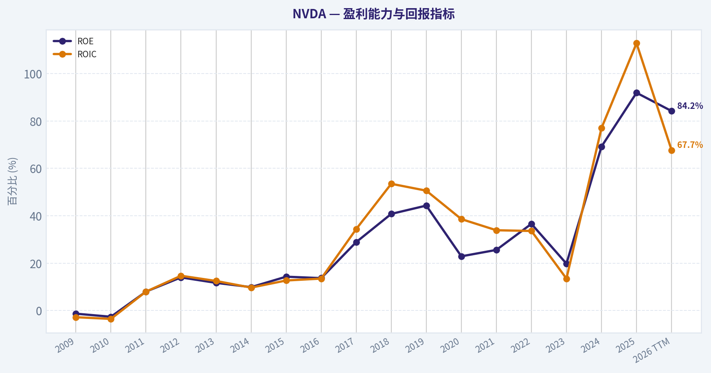
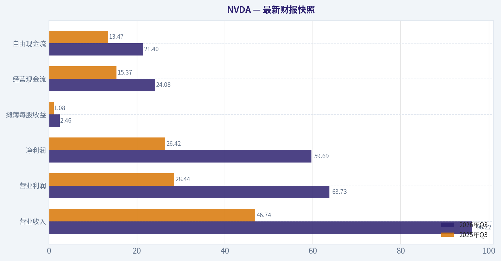
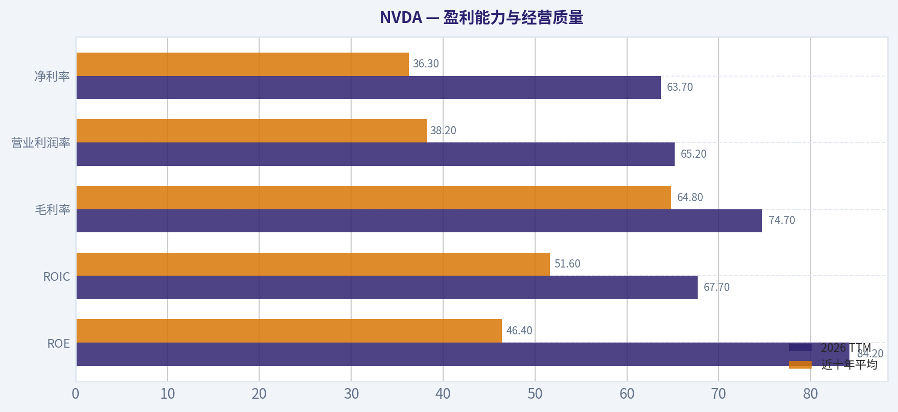
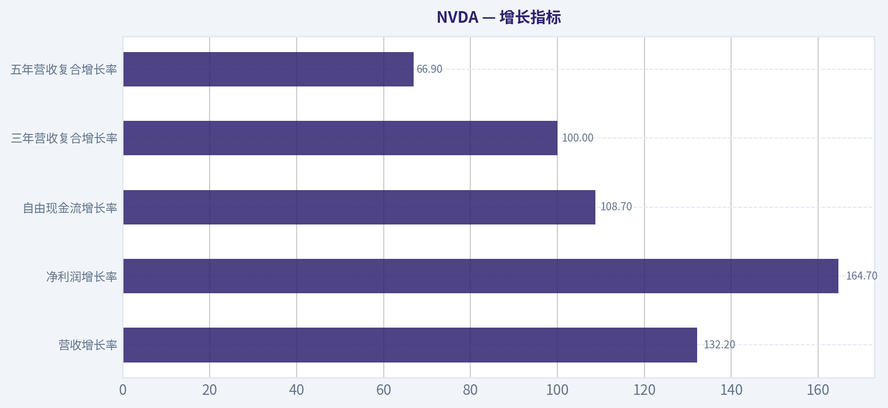
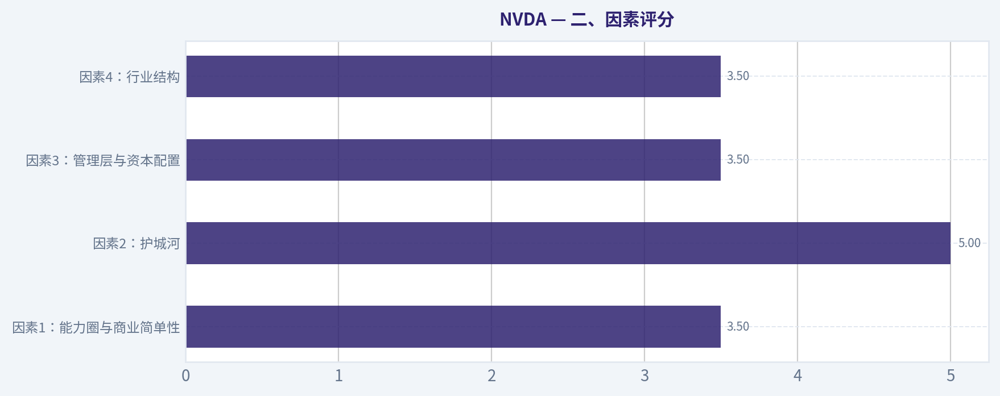
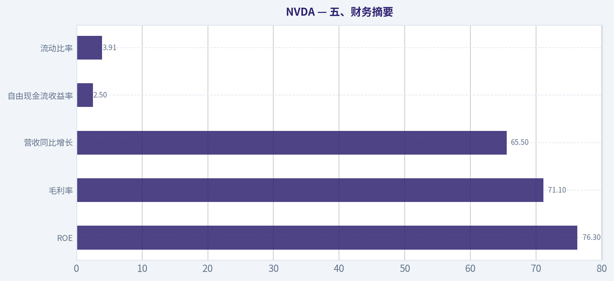
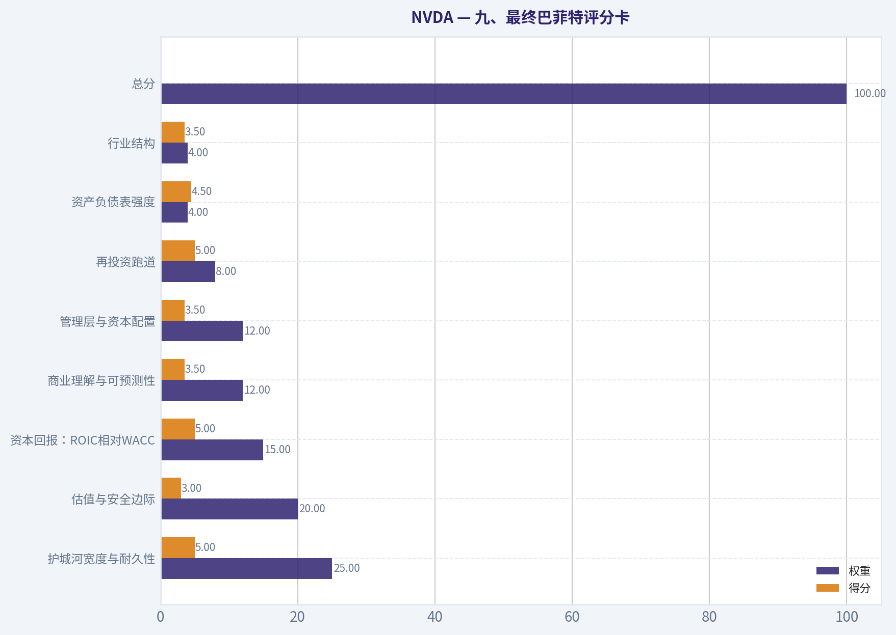
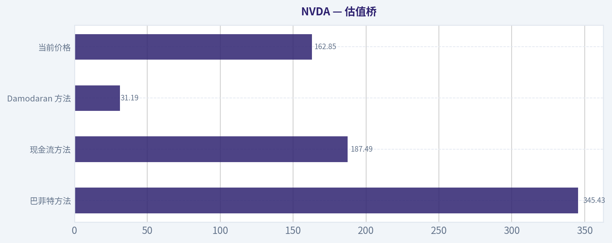

# NVDA 深度价值情报

**调研日期:** 2026-11-15

## 关键免责声明

*本报告由 Deep Value Intelligence（一个基于 AI 的多智能体投资分析框架）自动生成。 仅供教育和研究用途 - 非财务建议，非财务顾问。*

---

## 目录

1. 情报摘要
2. 分析师团队报告
   - 基本面分析
   - 价值分析 (巴菲特)
   - 成长性分析 (林奇/德鲁肯米勒/费雪)
   - 市场分析
   - 期权市场分析
3. 研究团队评论
4. 投资团队评论
5. Deep Values 团队洞察

---

## 情报摘要

### 核心观点与前提条件

**核心论点:** NVDA是卓越企业，但当前尚不能证明股价具备明确的安全边际。CUDA、软件工具、网络与整机系统形成了真实的转换成本；71.1%的毛利率和107.2%的ROIC也体现了强定价权与资本效率。主要长期风险不是股价波动，而是云厂商自研芯片、推理市场竞争及客户集中度导致增量定价权下降。

**主要风险:**
- 原计划是维持WATCH，统一估值数据，并在未来一至四个季度监测自由现金流、毛利率、客户资本开支、CUDA生态、推理经济性、出口限制和每股资本配置结果。
- **中性**

**置信度:** 中

---

## 分析师团队报告

### 基本面分析

#### 最新财报快照

*以下数据基于最近一期已披露财报（2026年Q3），并尽量与上一年同期对比。*

| 指标 | 2026年Q3 | 2025年Q3 | 同比变化 |
| --- | ---: | ---: | ---: |
| 营业收入 | $96.22B | $46.74B | +105.9% |
| 营业利润 | $63.73B | $28.44B | +124.1% |
| 净利润 | $59.69B | $26.42B | +125.9% |
| 摊薄每股收益 | $2.46 | $1.08 | +127.8% |
| 经营现金流 | $24.08B | $15.37B | +56.7% |
| 自由现金流 | $21.40B | $13.47B | +58.9% |

关键结论：这张快照先把最新一期财报放在桌面上，再去看长周期分析。这样读者能更清楚地区分"公司长期质量"和"这次财报发生了什么"。

#### NVDA 17年财务指标

*以下数值均由原始数据确定性计算得出，并非 AI 估算。*

*发行人类型：operating company（Technology / Semiconductors）。*

#### 17年财务指标
*年度行来自已披露财务报表，最后一行 TTM 由最近四个季度滚动计算得出。*

| 指标 | 2009 | 2010 | 2011 | 2012 | 2013 | 2014 | 2015 | 2016 | 2017 | 2018 | 2019 | 2020 | 2021 | 2022 | 2023 | 2024 | 2025 | 2026 TTM |
| --- | --- | --- | --- | --- | --- | --- | --- | --- | --- | --- | --- | --- | --- | --- | --- | --- | --- | --- |
| 市场价格 | $0 | $0 | $1 | $0 | $0 | $0 | $0 | $1 | $3 | $6 | $4 | $6 | $13 | $24 | $19 | $61 | $120 | $163 |
| 总市值 | $4.36B | $8.46B | $14.08B | $9.10B | $7.66B | $9.34B | $10.81B | $16.67B | $70.86B | $155.35B | $89.84B | $146.11B | $326.04B | $620.72B | $489.79B | $1.53T | $2.98T | $3.95T |
| 市盈率 | -159.00 | -128.25 | 55.63 | 15.71 | 13.62 | 21.22 | 17.14 | 27.12 | 42.48 | 51.00 | 21.68 | 52.31 | 75.09 | 63.60 | 114.92 | 51.70 | 40.84 | 20.59 |
| 市净率 | 1.82 | 3.17 | 4.43 | 2.20 | 1.59 | 2.10 | 2.45 | 3.73 | 12.30 | 20.79 | 9.62 | 11.97 | 19.30 | 23.32 | 22.16 | 35.70 | 37.54 | 17.27 |
| ROE | -1.3% | -2.6% | 8.0% | 14.0% | 11.7% | 9.9% | 14.3% | 13.7% | 28.9% | 40.8% | 44.3% | 22.9% | 25.6% | 36.6% | 19.8% | 69.2% | 91.9% | 84.2% |
| ROIC | -2.8% | -3.5% | 8.0% | 14.7% | 12.5% | 9.7% | 12.7% | 13.5% | 34.4% | 53.5% | 50.6% | 38.6% | 33.9% | 33.6% | 13.5% | 77.0% | 112.8% | 67.7% |
| 每股收益 | $-0.00 | $-0.00 | $0.01 | $0.02 | $0.02 | $0.02 | $0.03 | $0.03 | $0.06 | $0.12 | $0.17 | $0.11 | $0.17 | $0.39 | $0.17 | $1.19 | $2.94 | $7.91 |
| 营收 | $3.42B | $3.33B | $3.54B | $4.00B | $4.28B | $4.13B | $4.68B | $5.01B | $6.91B | $9.71B | $11.72B | $10.92B | $16.68B | $26.91B | $26.97B | $60.92B | $130.50B | $302.97B |
| 毛利润 | $1.17B | $1.18B | $1.41B | $2.06B | $2.23B | $2.27B | $2.60B | $2.81B | $4.06B | $5.82B | $7.17B | $6.77B | $10.40B | $17.48B | $15.36B | $44.30B | $97.86B | $226.24B |
| 毛利率 | 34.3% | 35.4% | 39.8% | 51.4% | 52.0% | 54.9% | 55.5% | 56.1% | 58.8% | 59.9% | 61.2% | 62.0% | 62.3% | 64.9% | 56.9% | 72.7% | 75.0% | 74.7% |
| 营业利润率 | -2.1% | -3.0% | 7.2% | 16.2% | 15.1% | 12.0% | 16.2% | 14.9% | 28.0% | 33.0% | 32.5% | 26.1% | 27.2% | 37.3% | 15.7% | 54.1% | 62.4% | 65.2% |
| 净利润 | $-30.0M | $-68.0M | $253.1M | $581.1M | $562.5M | $440.0M | $631.0M | $614.0M | $1.67B | $3.05B | $4.14B | $2.80B | $4.33B | $9.75B | $4.37B | $29.76B | $72.88B | $192.88B |
| 净利率 | -0.9% | -2.0% | 7.1% | 14.5% | 13.1% | 10.7% | 13.5% | 12.3% | 24.1% | 31.4% | 35.3% | 25.6% | 26.0% | 36.2% | 16.2% | 48.8% | 55.8% | 63.7% |
| 营收增长 | N/A | -2.9% | 6.5% | 12.8% | 7.1% | -3.5% | 13.4% | 7.0% | 37.9% | 40.6% | 20.6% | -6.8% | 52.7% | 61.4% | 0.2% | 125.9% | 114.2% | 132.2% |
| 净利润增长 | N/A | 126.3% | -472.3% | 129.5% | -3.2% | -21.8% | 43.4% | -2.7% | 171.3% | 82.9% | 35.9% | -32.5% | 54.9% | 125.1% | -55.2% | 581.3% | 144.9% | 164.7% |
| 自由现金流增长 | N/A | N/A | 40.9% | 33.3% | N/A | N/A | N/A | N/A | N/A | N/A | N/A | N/A | N/A | N/A | -53.2% | 609.6% | 125.2% | 108.7% |
| 总账面价值 | $2.39B | $2.67B | $3.18B | $4.15B | $4.83B | $4.46B | $4.42B | $4.47B | $5.76B | $7.47B | $9.34B | $12.20B | $16.89B | $26.61B | $22.10B | $42.98B | $79.33B | $228.98B |
| 总资产 | $3.35B | $3.59B | $4.50B | $5.55B | $6.41B | $7.25B | $7.20B | $7.37B | $9.84B | $11.24B | $13.29B | $17.32B | $28.79B | $44.19B | $41.18B | $65.73B | $111.60B | $320.27B |
| 总债务 | N/A | N/A | N/A | N/A | $0 | $1.36B | $1.38B | $0 | $1.98B | $1.99B | $1.99B | $1.99B | $6.96B | $10.95B | $10.95B | $9.71B | $8.46B | $38.35B |
| 债务股权比 | N/A | N/A | N/A | N/A | 0.00 | 0.30 | 0.31 | 0.00 | 0.34 | 0.27 | 0.21 | 0.16 | 0.41 | 0.41 | 0.50 | 0.23 | 0.11 | 0.17 |
| 现金及等价物 | $417.7M | $447.2M | $665.4M | $667.9M | $733.0M | $1.15B | $497.0M | $596.0M | $1.77B | $4.00B | $782.0M | $10.90B | $847.0M | $1.99B | $3.39B | $7.28B | $8.59B | $22.44B |
| 股东权益 | $2.39B | $2.67B | $3.18B | $4.15B | $4.83B | $4.46B | $4.42B | $4.47B | $5.76B | $7.47B | $9.34B | $12.20B | $16.89B | $26.61B | $22.10B | $42.98B | $79.33B | $228.98B |
| 经营现金流 | $249.4M | $487.8M | $675.8M | $909.2M | $824.2M | $835.0M | $906.0M | $1.18B | $1.67B | $3.50B | $3.74B | $4.76B | $5.82B | $9.11B | $5.64B | $28.09B | $64.09B | $134.36B |
| 投资现金流 | $-209.4M | $-519.3M | $-649.7M | $-1.14B | $-744.0M | $-806.0M | $-727.0M | $-400.0M | $-793.0M | $1.28B | $-4.10B | $6.14B | $-19.68B | $-9.83B | $7.38B | $-10.57B | $-20.42B | $-75.01B |
| 自由现金流 | N/A | $410.2M | $577.9M | $770.4M | N/A | N/A | N/A | N/A | N/A | N/A | N/A | N/A | N/A | $8.13B | $3.81B | $27.02B | $60.85B | $127.01B |
| 自由现金流利润率 | N/A | 12.3% | 16.3% | 19.3% | N/A | N/A | N/A | N/A | N/A | N/A | N/A | N/A | N/A | 30.2% | 14.1% | 44.4% | 46.6% | 41.9% |
| 每股分红 | $0.00 | $0.00 | $0.00 | $0.00 | $0.00 | $0.00 | $0.00 | $0.00 | $0.00 | $0.00 | $0.00 | $0.00 | $0.00 | $0.00 | $0.02 | $0.02 | $0.03 | $0.28 |

#### 盈利能力指标
- 净资产收益率 (ROE): 76.3%
- 投入资本回报率 (ROIC): 107.2%
- 总资产收益率 (ROA): 58.1%
- 毛利率: 71.1%
- 营业利润率: 60.4%
- 净利率: 55.6%

#### 流动性指标
- 流动比率: 3.91
- 速动比率: 3.14

#### 杠杆指标
- 债务股权比: 0.05
- 利息覆盖倍数: 503.42
- 净负债: $-54.09B

#### 增长指标（同比）
- 营收增长: 65.5%
- 净利润增长: 64.7%
- 自由现金流增长: 58.9%
- 营收复合增长率（3年）: 100.0%
- 营收复合增长率（5年）: 66.9%

#### 估值指标
- 市盈率 (TTM): 20.59
- 预期市盈率: 10.27
- 市净率: 17.17
- 市销率: 12.98
- PEG 比率: 0.20
- 企业价值/EBITDA: 19.38
- 自由现金流收益率: 2.5%
- 盈利收益率: 4.9%

#### 所有者收益（巴菲特方法，代码计算）
- 净利润: $72.88B
- + 折旧与摊销: $2.84B
- - 资本开支: $-6.04B
- - 营运资本变动: $-15.95B
- = **所有者收益: $82.26B**

#### 内在价值（代码计算）
- 当前价格: $163
- **头条内在价值（按商业模式路由）: $204**
  商业模式: cyclical - weighted blend [Damodaran FCFF + reverse-DCF fair + owner-earnings DCF] (cyclical)
  模型区间（各 DCF 最小-最大）: $31 - $345
  相对价格的安全边际（头条）: 20.0%
  路由说明: Cyclical: margins/FCF are volatile - headline blends FCFF, reverse-DCF and owner-earnings roughly evenly; treat the range as the honest read.
- 巴菲特方法（所有者收益）:
  保守: $108
  平均: $345
  乐观: $901
- 现金流方法（FCF）:
  保守: $187
  平均: $187
  乐观: $489
- Damodaran FCFF（WACC + 利润率 + 再投资）:
  保守: $19
  平均: $31
  乐观: $100
  蒙特卡洛区间（P10-P90）：$25 - $55（中位数 $36）
  P(内在价值 > 当前价格)：0.0%
- 反向 DCF：当前价格隐含约 8.5%/年 的所有者收益增长（10年）；过去 3 年为 110.8%，5 年为 96.7%。

#### Piotroski F分数: 3/9
- 净利润为正: 通过
- 经营现金流为正: 通过
- 资产回报率改善: 未通过
- 现金流大于净利润: 未通过
- 债务下降: 未通过
- 流动比率改善: 未通过
- 未稀释股本: 通过
- 毛利率改善: 未通过
- 资产周转率改善: 未通过

ANALYST STANCE: **中性**

#### 核心结论

NVDA 是极高质量、强护城河、财务实力极强的半导体平台公司，但当前股价已经反映了相当高的持续增长预期。TTM 营收达到 302.97B 美元，净利润 192.88B 美元，自由现金流 127.01B 美元，盈利质量和资本回报率均处于历史极高水平。

然而，估值结论高度依赖未来增长能否持续。研究包的综合内在价值为约 204 美元，较当前 163 美元有约 20%安全边际；但不同模型区间从 31 美元到 345 美元，Damodaran FCFF 模型甚至只有 19-100 美元。按照巴菲特的安全边际原则，当前更适合持有或分批布局，而不是在高预期下激进追涨。

#### 市场指标与历史比较

| 指标 | 2026 TTM / 当前 | 近十年平均 | 当前相对历史 |
|---|---:|---:|---|
| 股价 | 163美元 | 约41.9美元* | 显著高于历史均值 |
| 总市值 | 3.95万亿美元 | 约1.04万亿美元 | 规模发生质变 |
| PE | 20.59倍 | 53.42倍 | 明显低于历史均值 |
| PB | 17.27倍 | 21.00倍 | 低于历史均值，但仍很高 |
| 盈利收益率 | 4.9% | - | 对应较高增长要求 |
| FCF收益率 | 2.5% | - | 现金流估值偏紧 |

\*历史股价受到拆股和数据口径影响，直接平均的参考意义有限。

**关键结论：** 当前 PE 已低于过去十年平均，主要原因不是股价便宜，而是盈利增长远超历史水平。PB 虽低于历史均值，但对资产轻、知识产权密集、持续回购并可能出现低账面资本的科技公司，PB 不是可靠的价值锚，应优先观察现金流和长期竞争优势。

#### 盈利能力与经营质量

| 指标 | 2026 TTM | 近十年平均 | 变化及含义 |
|---|---:|---:|---|
| ROE | 84.2% | 46.4% | 接近历史均值的两倍 |
| ROIC | 67.7% | 51.6% | 显著高于历史水平 |
| EPS | 7.91美元 | 约1.32美元 | 盈利规模和质量大幅提升 |
| 营收 | 302.97B美元 | 约60.32B美元 | 约为历史均值五倍 |
| 毛利率 | 74.7% | 64.8% | 显著改善 |
| 营业利润率 | 65.2% | 38.2% | 处于历史峰值区域 |
| 净利润 | 192.88B美元 | 约32.56B美元 | 远高于历史均值 |
| 净利率 | 63.7% | 36.3% | 处于异常强劲水平 |

**关键结论：** NVDA 当前的核心优势并不只是收入高速增长，而是收入增长伴随毛利率、营业利润率、ROE 和 ROIC 同步提升。TTM 营业利润率超过 65%，意味着其定价权、软件生态和产品组合已经明显区别于传统周期性芯片制造商；但如此高的利润率也意味着未来最容易出现的风险是正常化，而不是继续线性上升。

#### 增长指标

| 指标 | 2026 TTM | 近十年平均或可比均值 | 解读 |
|---|---:|---:|---|
| 营收增长率 | 132.2% | 约57.9% | 极端高于历史水平 |
| 净利润增长率 | 164.7% | 约127.3%* | 仍处于历史极高区间 |
| 自由现金流增长率 | 108.7% | 约197.6%* | 强劲但历史样本较少 |
| 三年营收复合增长率 | 100.0% | - | AI需求带来结构性跃升 |
| 五年营收复合增长率 | 66.9% | - | 长期增长已显著加速 |

\*净利润和自由现金流增长平均值受到亏损年份、低基数和极端跳升影响，统计意义有限。

**关键结论：** 当前增长远远超过正常半导体周期水平，主要由数据中心、生成式人工智能和加速计算需求驱动。历史上 NVDA 曾经历 2020 年收入下降 6.8%、2023 年几乎零增长，以及利润大幅波动，因此不能把 100%以上的近期增速直接外推十年。

#### 资产负债表与现金流

| 指标 | 2026 TTM | 近十年平均 | 解读 |
|---|---:|---:|---|
| 总资产 | 320.27B美元 | 约66.35B美元 | 随业务扩张快速增加 |
| 股东权益 | 228.98B美元 | 约45.17B美元 | 资本基础大幅增强 |
| 总债务 | 38.35B美元 | 约9.93B美元 | 绝对额上升，但相对仍可控 |
| 债务权益比 | 0.17 | 约0.28 | 低于历史平均 |
| 现金及等价物 | 22.44B美元 | 约6.20B美元 | 现金储备显著增加 |
| 净负债 | -54.09B美元 | - | 实际处于净现金状态 |
| 自由现金流 | 127.01B美元 | 可比样本均值约45.36B美元 | 现金创造能力极强 |
| FCF利润率 | 41.9% | - | 现金转换质量优秀 |
| 流动比率 | 3.91 | - | 短期偿债能力很强 |
| 利息覆盖倍数 | 503.42倍 | - | 利息负担极低 |

**关键结论：** NVDA 的债务绝对额随着规模扩大而上升，但债务权益比已经低于历史平均，且公司拥有显著净现金和极高利息覆盖能力。财务风险不是当前主要问题，真正的风险在于客户资本开支周期、供应链约束、竞争性替代和利润率回落。

#### 现金流、股东回报与资本配置

TTM 经营现金流为 134.36B 美元，自由现金流为 127.01B 美元，经营现金流到自由现金流的转化率较高。研究包计算的所有者收益为 82.26B 美元，计算方式为：

- 净利润：72.88B美元
- 加回折旧与摊销：2.84B美元
- 扣除资本开支：6.04B美元
- 扣除营运资本增加：15.95B美元
- 所有者收益：82.26B美元

每股股息已从 2023 年的 0.02 美元、2025 年的 0.03 美元提高至 TTM 的 0.28 美元，但股息收益率仍然很低。公司更倾向于将资本投入研发、供应链、软件生态和战略投资，而不是大规模现金分红。

需要注意的是，Piotroski F 分数仅为 3/9。其负面项目包括资产回报率没有继续改善、经营现金流没有超过净利润、债务没有下降、流动比率没有改善、毛利率和资产周转率没有继续提高。这并不代表公司财务恶化，更可能反映其指标已经处于极高基数，继续改善非常困难。

#### 经济护城河与商业质量

NVDA 的护城河主要来自四个层面：

1. **CUDA 软件生态**：开发者工具、库、框架适配和客户迁移成本形成网络效应。
2. **全栈解决方案**：公司销售的不只是 GPU，还包括系统、互联、网络、软件和开发平台。
3. **规模与研发能力**：高现金流支持持续研发，领先产品能够维持高毛利率。
4. **客户生态和先发优势**：云计算公司、互联网平台和人工智能开发者已经围绕其硬件与软件体系投入大量资本。

护城河非常强，但并非不可攻破。大型客户正在开发自研加速器，AMD、云服务商自研芯片以及其他专用芯片可能压低长期价格和利润率。与此同时，半导体行业本质上仍具有周期性，当前人工智能资本开支热潮若放缓，NVDA 的盈利增速可能显著下降。

#### 收入来源分布

以下采用最近可核验的年度分部披露口径，而非将 TTM 总收入机械拆分。最新 TTM 的详细分部金额未在确定性数据集中提供，因此表中使用最近年度披露数据，并保留"约"字样。

| 收入来源 | 金额（十亿美元） | 占比 |
|---|---:|---:|
| 数据中心与计算网络 | 约115.2 | 约88.3% |
| 游戏 | 约11.4 | 约8.7% |
| 专业可视化 | 约1.8 | 约1.4% |
| 汽车与机器人 | 约1.7 | 约1.3% |
| OEM及其他 | 约0.4 | 约0.3% |
| 合计 | 约130.5 | 100.0% |

**关键结论：** NVDA 的收入来源已经高度集中于数据中心和计算网络业务，数据中心约占最近年度收入的九成。集中度强化了人工智能增长的弹性，也提高了对云厂商资本开支、少数大客户和数据中心投资周期的依赖。

#### 三情景巴菲特式所有者收益 DCF

估值采用所有者收益 82.26B 美元、约 24.1B 股流通股、10年显性预测期、约10%折现率和2.5%永续增长率。基本公式为：

\[
\text{企业价值}
=
\sum_{t=1}^{10}\frac{OE_t}{(1+r)^t}
+
\frac{OE_{10}(1+g_T)}{(r-g_T)(1+r)^{10}}
\]

其中，\(OE\) 为所有者收益，\(r\) 为折现率，\(g_T\) 为终值增长率。

| 情景 | 主要假设 | 模型所有者收益估值 | 每股估值 | 相对当前价格 |
|---|---|---:|---:|---:|
| 保守 | 增长逐步降至低个位数，利润率明显正常化 | 约2.60万亿美元 | 108美元 | 低于当前约34% |
| 平均 | 保持较强增长并逐步向成熟期回落 | 约8.32万亿美元 | 345美元 | 高于当前约112% |
| 乐观 | AI基础设施周期延续，增长和利润率维持较长时间 | 约21.72万亿美元 | 901美元 | 高于当前约453% |

上述研究包模型给出的所有者收益估值分散度极大，因此不能把 345 美元或 901 美元视为确定目标价。尤其是平均和乐观情景隐含 NVDA 在未来多年保持非常高的资本回报和现金流增长，这对竞争、客户议价和行业周期提出了极高要求。

作为独立的手工敏感性检查，若以 82.26B 美元为起点、10%折现率、2.5%终值增长率，分别采用约3%、10%和15%的显性期增长并令其向终值增长率收敛，得到的每股价值约为：

- 保守手算：约48美元；
- 平均手算：约81美元；
- 乐观手算：约116美元。

手算结果低于研究包的所有者收益模型，主要因为研究包模型对增长持续期、现金流转换和再投资回报作出了更积极的假设。按照要求，应以研究包的模型和综合内在价值为主要锚点，而将手算结果作为压力测试，而不是替代模型。

#### 综合估值判断

研究包的多模型结果如下：

| 估值方法 | 保守 | 平均 | 乐观 | 特征 |
|---|---:|---:|---:|---|
| 所有者收益 DCF | 108美元 | 345美元 | 901美元 | 对长期增长最敏感 |
| FCF估值 | 187美元 | 187美元 | 489美元 | 相对稳定但仍依赖现金流持续性 |
| Damodaran FCFF | 19美元 | 31美元 | 100美元 | 对利润率正常化和再投资要求更严格 |
| 综合头条内在价值 | - | 约204美元 | - | 加权考虑周期性与模型分歧 |
| 反向 DCF | - | 隐含年增长约8.5% | - | 当前价格要求未来十年仍保持较强增长 |

**关键结论：** 当前价格隐含未来十年所有者收益年增长约8.5%，这并非不可实现，但已要求 NVDA 在规模巨大之后仍保持优秀的产品周期和生态优势。综合价值约204美元提供一定安全边际，但模型分歧说明估值并不稳固；若利润率向长期正常水平回落，估值可能明显低于当前价格。

#### 巴菲特式定性评价

| 评价维度 | 判断 | 具体依据 |
|---|---|---|
| 经济护城河 | 很强 | CUDA、软件生态、全栈平台和客户迁移成本 |
| 财务实力 | 极强 | 净现金、低杠杆、现金流和利息覆盖能力突出 |
| 盈利可预测性 | 中等偏强 | 长期趋势优秀，但历史存在明显周期波动 |
| 管理层资本配置 | 较强 | 高研发投入、高ROIC，股息较低但符合再投资逻辑 |
| 利润率稳定性 | 当前极强、长期待验证 | 毛利率和净利率处于历史峰值 |
| 估值安全边际 | 中等 | 综合模型有上行空间，但严格FCFF模型偏谨慎 |
| 业务集中风险 | 较高 | 数据中心和AI资本开支占比过高 |
| 长期质量 | 很高 | 具备平台化和生态化特征，不是单纯芯片周期股 |

**关键结论：** NVDA 已经展现出高质量复利企业的多个特征，尤其是高 ROIC、强现金流和软件生态。但巴菲特式投资不仅要求好公司，也要求价格足够安全。当前价格对未来增长的要求仍然较高，适合以估值纪律管理仓位。

#### 关键风险、机会与观察信号

**主要机会：**

- 人工智能训练和推理需求继续扩大；
- 网络、互联、系统级产品提高单客户收入；
- CUDA 生态继续扩大，增强客户锁定；
- 推理计算、主权人工智能和企业级部署形成第二增长曲线；
- 当前 PE 低于历史平均，若盈利继续超预期，估值可能由盈利增长消化。

**主要风险：**

- 大型云客户资本开支周期见顶；
- 客户自研芯片和竞争对手产品造成价格压力；
- 毛利率从 70%以上回落；
- 出口管制和地缘政治影响中国市场；
- 供应链、先进封装和高端存储瓶颈；
- AI投资回报率不及预期，引发行业估值压缩；
- 关键客户集中度过高；
- 管理层和核心人才变化，影响生态与产品执行。

**应重点跟踪的信号：**

1. 数据中心收入增速是否持续高于约30%-40%；
2. 毛利率是否稳定在高位，还是连续多个季度下降；
3. 自由现金流是否继续接近净利润；
4. 云服务商资本开支和GPU利用率是否改善或恶化；
5. CUDA生态中的实际开发者数量和软件收入；
6. 客户自研芯片是否从补充方案变成主要替代方案；
7. 管理层是否继续以高回报率进行研发和生态投资。

#### 最终投资立场

**中性**

NVDA 是值得长期跟踪和持有的优秀企业，但当前不是典型的深度价值股。支持看多的因素包括：极强护城河、84.2%的 ROE、67.7%的 ROIC、74.7%的毛利率、127.01B 美元自由现金流、净现金状态以及约204美元的综合模型内在价值。

限制因素包括：收入高度依赖数据中心、近期增长和利润率处于可能难以重复的高位、估值模型区间极宽，以及严格 FCFF 模型对当前价格并不支持。更合理的策略是持有者继续持有但控制仓位，潜在投资者等待更高安全边际、盈利预测上修得到验证，或股价回落至更具吸引力的区间后分批买入。

| 关键项目 | 当前判断 | 投资含义 |
|---|---|---|
| 商业质量 | 极高 | 具备长期复利企业特征 |
| 护城河 | 很强 | CUDA与全栈生态是核心优势 |
| 财务健康 | 极强 | 净现金、低杠杆、高现金流 |
| 盈利增长 | 极强但高基数 | 不宜简单外推近期增速 |
| 利润率 | 历史峰值 | 需防止周期性正常化 |
| 估值 | 有一定上行空间但不便宜 | 综合价值约204美元，模型分歧很大 |
| 主要风险 | AI资本开支放缓、竞争、自研芯片 | 可能造成估值和利润率双重压缩 |
| 适合策略 | 持有、等待回调、分批布局 | 不宜在高预期下重仓追涨 |
| 最终立场 | 中性 | 好公司，但安全边际尚不足以给出无条件看多 |

**关键结论：** NVDA 的企业质量支持长期关注，综合估值也显示存在一定上行空间。但由于现金流模型分歧极大、业务集中度高且当前利润率处于峰值区域，最稳健的巴菲特式选择是"看好公司、保持估值纪律"，因此给予 中性而非无条件 看多。

#### 基本面关键图表

本图追踪 **NVDA** 过去十年的盈利能力与回报指标（ROE、ROIC、利润率），突出呈现资本效率的变化趋势。

---

### 价值分析 (巴菲特)

> *基于沃伦·巴菲特的价值投资哲学：能力圈、经济护城河、管理层质量与安全边际。*

#### 内在价值快照

价格是你付的钱，内在价值是企业未来可能为股东创造的现金价值。我们给出一个区间，而不是假装只有一个神奇数字。

- 当前价格: $162.85
- 估值区间（两种 DCF 方法、保守到乐观）: $107.78 至 $900.63

##### 所有者收益（巴菲特方法）
- 净利润: $72,880,000,000.00
- 折旧与摊销: $2,843,000,000.00
- 资本支出: $-6,042,000,000.00
- 营运资金变化: $-15,949,000,000.00
- 所有者收益: $82,263,000,000.00

##### 内在价值
###### 所有者收益法
使用所有者收益，更严格，通常更保守。
- 保守: $107.78
- 平均: $345.43
- 乐观: $900.63
- 折现率: 10.0%

###### 自由现金流法
使用自由现金流，更适合今天投入很多、为未来增长铺路的公司。
- 保守: $187.49
- 平均: $187.49
- 乐观: $489.31
- 折现率: 10.0%

ANALYST STANCE: **看多**

#### 一、投资结论

NVDA 是极少数同时具备高增长、强定价权、技术生态锁定和高资本回报率的现代复利企业。当前股价约为 **163美元**，研究包给出的综合内在价值为 **203.56美元**，对应约 **20%的安全边际**。

对于具备宽阔且仍在扩大的护城河、ROE超过70%、毛利率超过70%的企业，20%的折价已经达到可以接受的水平。不过，NVDA仍然具有半导体周期、客户集中、技术迭代和关键人物依赖等风险，因此本判断属于**中等偏高 conviction**，而非无条件重仓建议。

---

#### 二、因素评分

| 因素 | 分数（满分5分） | 核心证据 |
|---|---:|---|
| 因素1：能力圈与商业简单性 | 3.5 | 本质是向数据中心、AI及图形计算客户销售高性能芯片、软件和系统；商业模式清晰，但技术迭代和产品组合较复杂 |
| 因素2：护城河 | 5.0 | CUDA软件生态、开发者网络、客户迁移成本、品牌、规模和持续领先的产品性能共同构成宽阔且扩大的护城河 |
| 因素3：管理层与资本配置 | 3.5 | Jensen Huang长期经营公司并推动平台化转型；但高增长期资本配置和关键人物依赖仍需中性 |
| 因素4：行业结构 | 3.5 | AI加速计算形成高集中度竞争格局，但半导体本身具有周期性，且技术领先必须持续投入 |
| Gate 5：质量与偿债能力 | 未触发 | 流动比率约3.91，盈利和现金流处于强劲状态，没有显示出"盈利恶化加偿债困难"的组合信号 |

**关键结论：** NVDA的主要优势不是单一芯片，而是芯片、CUDA、开发工具、系统和开发者生态组成的整体平台。最大扣分项来自半导体周期与估值模型分歧，而不是企业质量本身。

---

#### 三、护城河分析

| 护城河来源 | 具体表现 | 强度判断 |
|---|---|---|
| 无形资产 | CUDA、开发工具、软件库、品牌和开发者熟悉度 | 极强 |
| 转换成本 | 客户的软件、模型、开发流程和人才体系围绕CUDA建立 | 极强 |
| 成本优势 | 超大研发投入、规模采购、系统集成和生态规模带来单位经济优势 | 强 |
| 网络效应 | 使用者越多，开发工具越丰富，开发者越容易招聘，客户越倾向继续采用 | 极强 |
| 再投资能力 | AI训练、推理、网络、软件和数据中心系统均提供新的增长方向 | 极强 |

NVDA最重要的竞争优势是 **CUDA生态**。竞争者不仅需要制造出性能接近的芯片，还必须提供兼容的软件栈、开发工具、库、人才和客户支持。客户若迁移平台，往往需要重新编写代码、培训团队并验证模型性能，因此转换成本显著。

毛利率约 **71.1%**，同时营收同比增长约 **65.5%**，说明规模扩大并未摧毁定价能力。ROE约 **76.3%**，进一步证明其商业模式能够将技术优势转化为高经济回报。

**护城河评级：宽阔且仍在扩大，5分。**

---

#### 四、管理层质量与资本配置

Jensen Huang对公司长期战略的影响极大。NVDA从传统图形芯片公司转型为AI基础设施平台，说明管理层具备较强的技术判断力和战略耐心。

主要优点包括：

- 早期持续投入CUDA，而不是只追逐短期芯片销售；
- 将芯片、软件、网络和整机系统组合销售，提高客户黏性；
- 把研发投入集中在高回报的计算平台领域；
- 通过生态建设提高客户迁移成本，而不只是依靠单代产品性能。

需要关注的风险包括：

- 公司对Jensen Huang的依赖程度较高；
- 高增长时期并购、研发和供应链投入的回报率需要持续验证；
- 近期市场新闻已经开始讨论管理层继任和领导层变化风险；
- 股东回报更多依赖再投资，而不是股息。

**管理层评分：3.5分。** 战略能力很强，但关键人物风险和未来资本配置透明度需要更高的安全边际。

---

#### 五、财务摘要

| 指标 | 当前数据 |
|---|---:|
| 股价 | 163美元 |
| 总市值 | 3.93万亿美元 |
| 市盈率 | 20.6倍 |
| ROE | 76.3% |
| 毛利率 | 71.1% |
| 营收同比增长 | 65.5% |
| 自由现金流收益率 | 2.5% |
| 流动比率 | 3.91 |
| 综合内在价值 | 203.56美元 |
| 反向DCF隐含年增长率 | 约8.5% |

**关键结论：** NVDA同时拥有极高毛利率、极高ROE和强劲增长，财务质量明显优于普通半导体公司。当前价格隐含的约8.5%长期增长率，低于过去三年约110.8%和过去五年约96.7%的历史增长率，但未来不能机械外推历史增速。

---

#### 六、现金流与所有者收益

自由现金流收益率约为 **2.5%**，按照3.93万亿美元市值估算，当前自由现金流约为：

| 项目 | 估算值 |
|---|---:|
| 总市值 | 3.93万亿美元 |
| 自由现金流收益率 | 2.5% |
| 当前年度自由现金流估算 | 约983亿美元 |
| 折算每股自由现金流 | 约4.08美元 |
| 经营性现金流与盈利关系 | 整体表现强劲，未见明显利润无法转化为现金的信号 |

**所有者收益框架：**

所有者收益等于净利润，加折旧摊销，减去维持性资本支出和营运资本增加。对NVDA而言，研发和新产品投入中有相当部分属于增长性投入，而非单纯维持性资本支出，因此传统自由现金流可能低估长期所有者收益，或者在高增长阶段产生较大波动。

研究包中的所有者收益模型对应价值约 **345.43美元/股**，明显高于自由现金流模型的 **187.49美元/股**，这反映出市场对增长性投入和长期平台价值存在较大估值分歧。

**关键结论：** NVDA的现金流质量总体良好，但"维持性投入"和"增长性投入"的区分会显著影响估值。投资者不能只用当前自由现金流收益率判断公司价值，也不能完全接受最乐观的所有者收益模型。

---

#### 七、三情景DCF估值

以下使用当前每股自由现金流约4.08美元作为保守起点，并结合研究包中的模型结果进行交叉验证。

| 情景 | 核心假设 | 估值结果 |
|---|---|---:|
| 情景A：零增长 | 当前自由现金流除以10%折现率 | 约40.8美元 |
| 情景B：GDP增长 | 自由现金流长期增长3%，折现率10% | 约60.0美元 |
| 情景C：正常化增长 | 未来十年采用约6%的可持续增长，终值增长3%，折现率10% | 约73.8美元 |
| 自由现金流模型 | 研究包估值 | 187.49美元 |
| Damodaran FCFF模型 | 研究包估值 | 31.19美元 |
| 所有者收益模型 | 研究包估值 | 345.43美元 |
| 综合加权内在价值 | 多模型加权 | 203.56美元 |

情景A至情景C使用当前自由现金流和严格的保守假设，因此明显低于市场常见的成长型估值。它们更适合测试"如果未来增长显著放缓，股票是否仍然便宜"，而不是完整反映CUDA生态和AI平台的长期经济价值。

**关键结论：** 三种模型之间的价差非常大，说明NVDA估值高度依赖未来增长持续时间和增长性投入的回报。综合价值203.56美元高于当前股价，但并非所有保守DCF都支持这一价格，因此安全边际主要来自护城河和增长持续性，而不是资产负债表折价。

---

#### 八、安全边际与反向DCF

| 项目 | 数值 | 判断 |
|---|---:|---|
| 当前股价 | 163美元 | - |
| 综合内在价值 | 203.56美元 | 高于现价 |
| 综合安全边际 | 约20.0% | 对宽护城河企业可接受 |
| 所有者收益模型安全边际 | 约52.8% | 极为乐观 |
| 自由现金流模型安全边际 | 约13.1% | 接近合理价 |
| Damodaran FCFF模型安全边际 | 负值 | 明显偏贵 |
| 反向DCF隐含增长率 | 约8.5% | 对优质AI平台具有可行性，但并不保守 |

对于普通周期股，20%的安全边际可能不足；但NVDA具备较高ROE、极高毛利率、网络效应和较长再投资跑道，因此质量调整后的安全边际基本达到可接受水平。

然而，当前价格并没有提供传统意义上的"深度折价"。若AI资本开支周期显著放缓、竞争者缩小软件生态差距，或客户开始自研替代方案，8.5%的隐含增长率也可能变得偏高。

**关键结论：** NVDA不是"极度便宜"，而是"高质量企业以合理偏低价格交易"。适合长期持有者分批买入，不适合把全部判断建立在短期业绩超预期上。

---

#### 九、最终巴菲特评分卡

| 评分项目 | 权重 | 得分 | 加权得分 |
|---|---:|---:|---:|
| 护城河宽度与耐久性 | 25% | 5.0 | 1.25 |
| 估值与安全边际 | 20% | 3.0 | 0.60 |
| 资本回报：ROIC相对WACC | 15% | 5.0 | 0.75 |
| 商业理解与可预测性 | 12% | 3.5 | 0.42 |
| 管理层与资本配置 | 12% | 3.5 | 0.42 |
| 再投资跑道 | 8% | 5.0 | 0.40 |
| 资产负债表强度 | 4% | 4.5 | 0.18 |
| 行业结构 | 4% | 3.5 | 0.14 |
| **总分** | **100%** | - | **4.16** |

**关键结论：** NVDA的综合得分超过4分，核心驱动力是护城河、资本回报和再投资空间。估值只获得中等分数，原因是不同DCF模型之间存在极大分歧，且半导体行业的长期盈利存在周期性。

---

#### 十、投资立场

**ANALYST STANCE: 看多**

- **投资评级：** 看多
- **Conviction：** 中等偏高
- **合理价值参考：** 约203.56美元
- **当前价格：** 约163美元
- **适合策略：** 分批买入并长期持有
- **主要风险：** AI资本开支周期反转、竞争者削弱CUDA优势、客户自研芯片、出口限制、供应链瓶颈、管理层继任和关键人物依赖

NVDA符合"以合理价格买入卓越企业"的标准，但不符合"以极低价格买入普通企业"的价值逻辑。只要CUDA生态继续扩大、AI推理需求继续增长、研发投入保持高回报，当前价格具有吸引力；若股价显著高于综合内在价值约203美元，则应转为等待，而不是追高。
#### 估值桥

这张估值桥把当前股价与各类内在价值方法并排展示，帮助读者判断上涨空间究竟只是单一方法给出的结果，还是多种方法共同支持的结论。

| 项目 | 每股内在价值 |
| --- | ---: |
| 巴菲特方法 | $345.43 |
| 现金流方法 | $187.49 |
| Damodaran 方法 | $31.19 |
| 当前价格 | $162.85 |

#### 关键结论

如果只有一种方法显著高于其他方法，说明上行空间更依赖特定建模假设。若多种方法的估值接近，则说明估值逻辑更加稳健。

#### 估值图表

本对比图（来自「最新财报快照」）将 **NVDA** 的当前数据与历史基准并排呈现，直观反映公司相对自身历史均值的估值水平。

本对比图（来自「盈利能力与经营质量」）将 **NVDA** 的当前数据与历史基准并排呈现，直观反映公司相对自身历史均值的估值水平。

本对比图（来自「增长指标」）将 **NVDA** 的当前数据与历史基准并排呈现，直观反映公司相对自身历史均值的估值水平。

本对比图（来自「二、因素评分」）将 **NVDA** 的当前数据与历史基准并排呈现，直观反映公司相对自身历史均值的估值水平。

本对比图（来自「五、财务摘要」）将 **NVDA** 的当前数据与历史基准并排呈现，直观反映公司相对自身历史均值的估值水平。

本对比图（来自「九、最终巴菲特评分卡」）将 **NVDA** 的当前数据与历史基准并排呈现，直观反映公司相对自身历史均值的估值水平。

本对比图（来自「估值桥」）将 **NVDA** 的当前数据与历史基准并排呈现，直观反映公司相对自身历史均值的估值水平。

---

### 成长性分析 (林奇/德鲁肯米勒/费雪)

> *基于彼得·林奇的GARP成长投资法、斯坦利·德鲁肯米勒的宏观拐点分析法，以及菲利普·费雪的深度调研法。*

ANALYST STANCE: **中性**

#### 一、投资结论

NVDA仍是全球AI基础设施最强的成长平台之一，基本面质量、盈利能力和竞争壁垒极高。但当前公司已达到约3.93万亿美元市值，市场对AI资本开支、CUDA生态和未来盈利的预期已经非常充分。我的判断是：**公司值得长期持有和逢回调关注，但不宜在当前价格追高；等待业绩超预期、估值回落或新产品周期确认。**

| 项目 | 数据与判断 |
|---|---:|
| 当前股价 | 约163美元 |
| 总市值 | 约3.93万亿美元 |
| PE | 20.6倍 |
| 预期PE | 10.3倍 |
| PS | 13.0倍 |
| PEG | 约0.20 |
| 营收同比增速 | 研究包口径65.5%；另一TTM口径132.2% |
| 毛利率 | 约71%-75% |
| 营业利润率 | 约60%-65% |
| ROE | 约76%-84% |
| FCF利润率 | 约42% |
| 头条内在价值 | 约204美元 |
| 估值安全边际 | 约20% |

**关键结论：** NVDA同时具备极高增长和极强盈利能力，预期PE与PEG看起来并不昂贵。可是PS仍达到约13倍，且不同估值模型的结果从约31美元到345美元，分歧极大，说明估值高度依赖未来增长持续时间，不能只看PE或PEG。

#### 二、Lynch分类：快速成长股，但带有周期属性

NVDA属于**快速成长股**，同时也是具有明显周期性的半导体公司。过去数年营收、利润和现金流出现爆发式增长，远高于Lynch定义的15%-25%快速成长门槛。

#### 三、Lynch故事：三个简单要点

1. **NVDA销售的不是单一芯片，而是AI计算平台**：GPU、网络设备、软件、开发工具和系统共同构成解决方案。
2. **CUDA生态形成高转换成本**：客户不仅购买硬件，还围绕CUDA、开发工具和软件库建立研发流程。
3. **AI算力需求仍处于基础设施建设早期**：云厂商、企业和主权客户持续增加训练与推理投资，潜在市场仍在扩大。

故事的主要问题是：AI资本开支是否会从"供不应求"转向"回报率审查"，以及客户能否通过自研芯片、定制ASIC或竞争平台降低对NVDA的依赖。

#### 四、TAM与10倍测试

| 项目 | 判断 |
|---|---|
| 当前年化营收 | 约3030亿美元，数据口径可能包含最新TTM |
| 10倍营收目标 | 约3.03万亿美元 |
| 相关市场 | AI训练、推理、数据中心网络、企业AI、主权AI、软件生态 |
| 潜在TAM | 长期可能达到数万亿美元，但难以精确验证 |
| 10倍测试 | 若仅依赖GPU销售，难度极高；若扩展至完整AI基础设施和软件，理论上仍有空间 |
| 当前市场份额 | 数据中心加速计算处于领先地位，但不同子市场份额差异较大 |
| TAM增长 | AI基础设施在未来数年仍可能保持15%以上增长，但存在资本开支周期风险 |

**关键结论：** NVDA的长期跑道仍然很长，因为AI推理、网络、软件和主权AI可以扩大原有GPU市场。不过从约3000亿美元营收增长到3万亿美元，单靠传统GPU市场几乎不现实；十倍潜力必须来自平台化、软件化和新计算需求。

#### 五、营收增长趋势

| 期间 | 营收 | 同比增长 |
|---|---:|---:|
| 2022 | 269亿美元 | 61.4% |
| 2023 | 270亿美元 | 0.2% |
| 2024 | 609亿美元 | 125.9% |
| 2025 | 1305亿美元 | 114.2% |
| 2026 TTM | 约3030亿美元 | 约132.2% |
| 共享研究包当前口径 | - | 65.5% |

**关键结论：** 长期趋势是从稳定增长转为AI驱动的爆发式增长，属于强劲的增长拐点。需要注意不同数据源的期间定义并不一致；如果最新季度增速从100%以上降至约65%，这可能代表正常化，而不是基本面恶化，关键是未来几个季度能否维持高于行业的增长。

#### 六、单位经济与盈利质量

| 指标 | 数据或判断 |
|---|---:|
| LTV/CAC | 不适用于芯片平台，缺乏标准化披露 |
| NRR | 不适用，非典型订阅业务 |
| FCF | 约1270亿美元TTM |
| FCF利润率 | 约41.9% |
| Rule of 40 | 不适用于硬件公司；若机械计算，营收增长65.5%加FCF利润率41.9%，约107.4 |
| 毛利率 | 约71%-75% |
| 净利率 | 约56%-64% |
| 净现金 | 约540亿美元，具体口径存在差异 |
| 流动比率 | 约3.9倍 |

**关键结论：** NVDA的盈利质量远超普通半导体公司，现金流、毛利率和资产负债表都非常强。主要风险不是资金链，而是高利润率能否维持；竞争加剧、客户议价和产品组合变化可能使毛利率回落。

#### 七、 inflection point（拐点）评估

| 拐点维度 | 评价 | 证据与观察重点 |
|---|---|---|
| 产品周期 | 强 | 新一代GPU、系统级平台和网络产品持续迭代 |
| 市场份额 | 正面但需跟踪 | AI加速计算领先；自研ASIC是长期挑战 |
| 利润率 | 已完成第一轮拐点 | 高毛利率和营业杠杆已经显现 |
| TAM扩张 | 强 | 从训练扩展到推理、网络、软件和主权AI |
| 竞争格局 | 中性偏正 | CUDA壁垒强，但AMD、定制ASIC和大型客户自研加速 |
| 管理层 | 重大待验证项 | 研究包新闻提及CEO离任相关市场担忧，需以正式公告核实 |

**关键结论：** 过去最大的拐点已经发生，即AI数据中心需求推动NVDA从高增长芯片公司升级为基础设施平台。未来真正的第二次拐点，将是推理需求、软件收入和网络业务能否接替训练GPU，避免增长过度依赖少数云客户。

#### 八、宏观环境：结构性顺风，短期估值逆风

| 宏观因素 | 影响 |
|---|---|
| AI长期趋势 | 强顺风 |
| 云厂商资本开支 | 关键顺风，但存在周期化风险 |
| 利率 | 当前存在通胀和潜在加息担忧，对高估值成长股不利 |
| 半导体周期 | 需求强劲，但库存和资本开支波动仍然存在 |
| 出口管制 | 可能限制中国市场和部分产品销售 |
| 市场风险偏好 | 若纳斯达克走弱，NVDA可能出现估值压缩 |

**关键结论：** 从Druckenmiller角度看，长期主题非常强，但短期宏观并非完全顺风。若利率上升、云厂商削减资本开支或AI投资回报率受到质疑，NVDA可能在盈利继续增长时仍然下跌。

#### 九、Fisher 15项评分

| Fisher项目 | 评分（5分制） | 简要判断 |
|---|---:|---|
| 市场潜力 | 5 | AI计算与基础设施市场巨大 |
| 新产品决心 | 5 | 产品迭代速度极快 |
| R&D效率 | 5 | GPU、系统、网络和软件协同 |
| 销售组织 | 4 | 企业、云和主权客户覆盖强 |
| 利润率 | 5 | 毛利率和营业利润率极高 |
| 利润率改善 | 4 | 已处高位，未来改善空间有限 |
| 员工关系 | 4 | 工程人才吸引力强，但竞争激烈 |
| 高管关系 | 4 | 创始人文化强，接班风险需跟踪 |
| 管理层深度 | 3 | 对核心领导者依赖较高 |
| 成本分析与会计 | 4 | 财务表现透明，需留意库存与供应链 |
| 独特竞争优势 | 5 | CUDA、生态、开发者和客户锁定 |
| 长期盈利前景 | 5 | 多个AI应用场景仍在早期 |
| 股权稀释 | 4 | 目前不是核心风险 |
| 困难时期坦诚度 | 3 | 需继续观察周期下行时的沟通 |
| 管理层诚信 | 4 | 长期执行记录优秀，但接班问题重要 |

**Fisher总分：60/75，评级为"良好"，但不是无条件的卓越。**

**关键结论：** NVDA在产品、研发、市场潜力和竞争壁垒方面接近顶级公司。扣分主要来自管理层关键人物依赖、半导体周期和未来增长预期过高，而不是当前经营质量不足。

#### 十、估值分析

| 方法 | 结果 | 解读 |
|---|---:|---|
| TTM PE | 20.6倍 | 对65%以上增长而言偏低，但需确认盈利是否处于周期高点 |
| 预期PE | 10.3倍 | 隐含市场预计盈利继续高速增长 |
| PEG | 约0.20 | 极具吸引力，但PEG依赖增长预测，可信度低于成熟公司 |
| PS | 13.0倍 | 对高增长平台合理但不便宜 |
| 反向DCF | 隐含未来10年约8.5%年增长 | 长期门槛并不高，但利润率假设很关键 |
| 综合头条内在价值 | 约204美元 | 高于当前价格约20% |
| 保守FCFF模型 | 约31美元至55美元区间 | 显示对高利润率正常化极其敏感 |
| 所有者收益模型 | 约108至901美元 | 假设差异过大，不能单独作为买入依据 |

**关键结论：** 表面PE和PEG显示NVDA并不昂贵，但DCF结果的极端分散说明估值风险很高。合理的核心判断不是"NVDA便宜"，而是"当前价格已经反映了未来多年强劲增长，只有当增长持续超预期时，股票才会获得明显上行空间"。

#### 十一、增长投资者评分卡

| 维度 | 权重 | 评分（5分制） |
|---|---:|---:|
| Lynch故事 | 10% | 4.8 |
| TAM与增长跑道 | 20% | 4.7 |
| 营收增长 | 20% | 4.8 |
| 单位经济 | 15% | 4.4 |
| 竞争地位 | 10% | 4.8 |
| 管理层质量 | 10% | 3.8 |
| 宏观环境 | 5% | 3.5 |
| 盈利路径 | 5% | 4.8 |
| 估值 | 5% | 3.4 |
| **加权总分** | **100%** | **4.4/5.0** |

**关键结论：** 经营质量评分达到高水平，足以支持长期关注和持有。估值、宏观和管理层接班风险限制了当前的进攻性，因此综合立场为WATCH，而不是高确定性的ADVOCATE。

#### 十二、仓位建议、风险与催化剂

| 投资者类型 | 建议仓位 |
|---|---|
| 已持有者 | 继续持有；若单一股票仓位过高，可分批再平衡 |
| 新建仓投资者 | 目标仓位的25%-40%先行，避免一次性满仓 |
| 高风险承受者 | 可在业绩超预期或明显回调时增加 |
| 保守投资者 | 等待更低PS、增长重新加速或宏观环境改善 |

**关键催化剂：**

- 数据中心营收继续高于市场预期。
- 推理需求从试验阶段转向大规模生产部署。
- 网络、软件和系统业务占比提升。
- 新产品周期带来供给改善而非需求放缓。
- 云厂商资本开支继续上调。
- 管理层接班和治理问题得到清晰解决。

**关键风险：**

- 云厂商资本开支周期反转。
- 大客户自研ASIC和竞争平台扩大份额。
- CUDA生态被替代或软件转换成本下降。
- 出口管制限制销售区域。
- 毛利率从70%以上持续回落。
- AI投资回报率不达预期，引发估值和订单双重压缩。
- 关键管理层变动造成客户、员工或投资者信心下降。
- 目前13倍PS对应较高的长期执行要求。

**最终判断：** NVDA是少数同时具备强增长、强壁垒、强现金流和强资产负债表的公司，长期仍具有成为更大平台型企业的潜力。但从当前价格看，最佳策略不是盲目追涨，而是**持有、分批买入、等待波动中的更好赔率**。

---

### 市场分析

ANALYST STANCE: **看空**

#### NVDA 技术面概览

截至最近交易日 2026 年 11 月 13 日，NVDA 收于 **162.85 美元**。数据服务返回的指标序列为空，因此以下技术指标依据已取得的日线 OHLCV 数据进行近似计算，重点用于判断趋势、动量、波动率和风险位置，而不是作为精确报价基准。

股价在 11 月 5 日至 13 日出现连续性加速下跌，收盘价由 **181.60 美元降至 162.85 美元**，约下跌 **10.3%**。若从 10 月初约 230 美元区域计算，回撤幅度已经超过 29%，这不是普通的短线震荡，而是明显的趋势破坏和波动率扩张。

| 指标 | 近期状态（近似） | 技术含义 | 对交易决策的影响 |
|---|---:|---|---|
| 10 EMA | 约 183-186 美元 | 股价显著低于短期均线，均线快速向下 | 短线趋势偏空，反弹首先会受到均线压制 |
| 50 SMA | 约 210-215 美元 | 股价远低于中期成本区 | 中期趋势已经转弱，210 美元附近可能形成较强反弹阻力 |
| 200 SMA | 约 195-202 美元 | 股价跌破长期趋势参考线 | 长期趋势信号恶化，尚未出现有效收复确认 |
| MACD | 明显负值，且动能偏弱 | 下跌动能占据主导，尚未观察到可靠反转确认 | 不宜仅因超卖而贸然抄底 |
| RSI | 约 20-25 区间 | 严重超卖 | 具备技术性反弹条件，但超卖不等于趋势反转 |
| ATR | 近期约 9-12 美元，显著放大 | 单日正常波动范围扩大，跳空和长阴线风险升高 | 应降低仓位，止损距离不能机械地设得过窄 |
| 布林上轨 | 约 235-245 美元附近 | 与现价距离很远 | 上轨不适合作为当前入场参考，说明价格已远离正常波动中枢 |
| 布林下轨 | 约 168-175 美元附近 | 最新收盘价低于或接近下轨 | 显示极端弱势和超卖，但也可能意味着波动正在扩大而非立即反转 |

关键结论：NVDA 的短期、中期和长期趋势均偏空，价格同时低于 10 EMA、50 SMA 和 200 SMA，趋势信号高度一致。RSI 接近超卖区、价格跌出布林下轨，意味着短线可能出现剧烈反弹，但目前更像是下跌趋势中的超卖状态，而不是已经确认的底部。

#### 价格结构与趋势演变

此前 NVDA 在 4 月至 5 月由约 175 美元快速上升至 235 美元附近，随后进入宽幅回撤。6 月至 9 月期间，价格多次在 195-230 美元区间内反复，说明市场曾经把该区间视为新的交易中枢。

然而，10 月之后价格结构明显恶化：

- 10 月初仍在 230 美元上方运行；
- 10 月中旬跌破 220 美元，反弹高度逐渐降低；
- 10 月下旬跌至 210 美元附近；
- 11 月 5 日跌破 190 美元；
- 11 月 9 日至 12 日出现连续大幅下挫；
- 11 月 12 日盘中最低触及约 148.80 美元，收盘仍仅 166.19 美元；
- 11 月 13 日继续收于 162.85 美元，显示抛售并未被完全吸收。

这类走势具有几个重要特征。第一，反弹持续时间短，且无法重新站上前一轮下跌的关键高点，说明买方承接能力不足。第二，下跌过程中成交量明显放大，尤其是 11 月 9 日、10 日、12 日和 13 日，显示市场可能存在集中减仓、止损触发或杠杆资金退出。第三，11 月 12 日形成极宽的日内波动区间，表明市场定价分歧和尾部风险均明显上升。

| 观察维度 | 近期表现 | 解释 |
|---|---|---|
| 高点结构 | 230 美元附近后持续形成更低高点 | 上升趋势被破坏，卖方在反弹中占优 |
| 低点结构 | 210、200、180 美元一线相继失守 | 支撑位逐级下移，市场缺乏稳定承接 |
| 成交量 | 下跌日成交量显著放大 | 抛售具有确认性质，不只是低量回调 |
| 日内波动 | 11 月 12 日出现极大振幅 | 市场处于高风险再定价阶段 |
| 收盘位置 | 多个交易日接近当日低位 | 收盘前买方修复能力较弱 |
| 价格与均线 | 明显跌离 10、50、200 均线 | 反弹空间可能很大，但趋势尚未扭转 |

关键结论：价格结构已经从"高位震荡"转变为"低点不断下移的趋势性下跌"。放量长阴和接近最低位收盘尤其不利，说明当前市场更关注风险退出，而不是积极建立多头仓位。

#### 动量与超卖分析

RSI 大致落入 20-25 区间，属于严重超卖区域。正常情况下，这种读数会提高出现短线反抽的概率，尤其是在连续多日下跌之后。不过，RSI 在强趋势下可以长期停留在超卖区域，因此不能把 RSI 低于 30 简单理解为"立即买入"。

MACD 同样偏弱。虽然经过如此快速的下跌，MACD 可能已经远离短期均衡水平，但只要 MACD 线仍在信号线下方、柱体没有连续收窄，动量交易者通常仍会把反弹视为逆势修复，而不是新一轮上涨的起点。

更值得关注的是"价格-动量"的后续关系：

1. 如果价格创出新低，而 RSI 不再同步创出新低，可能形成潜在看涨背离；
2. 如果 MACD 柱体连续数日缩短，并且 MACD 线向上穿越信号线，动能恶化才可能结束；
3. 如果反弹无法重新站回 10 EMA，说明短线卖压仍然存在；
4. 如果价格反弹时成交量明显低于下跌时成交量，通常属于弱反弹；
5. 只有在反弹伴随放量，并收复前一交易日高点或关键缺口，底部确认的可信度才会提高。

当前尚未看到足够的反转确认信号。因此，RSI 的超卖更适合作为"不要在恐慌低点追空"的风险提示，而不是多头入场信号。

#### 波动率与风险管理

ATR 近期大致升至 9-12 美元，约占股价的 6%上下，远高于稳定趋势阶段。以 162.85 美元的收盘价计算，单日出现 8-12 美元级别的波动并不意外。在这种环境下，固定百分比止损容易被正常噪音触发；但如果放宽止损而不相应降低仓位，单笔风险又可能过大。

布林带方面，股价已经接近或跌破下轨。这里有两种完全不同的解释：

- 在温和回调中，跌破下轨后快速回到带内，可能是短线反转信号；
- 在趋势性抛售中，价格可以沿着下轨运行，甚至持续处于下轨之外，反映的是波动率扩张，而非估值便宜。

目前 NVDA 更接近第二种情形，因为下跌伴随放量、长阴和关键价位连续失守。故不建议使用"触及布林下轨就买入"的机械策略。

风险控制上，保守交易者应等待至少以下条件之一出现：

- 价格重新站回 10 EMA，并连续两个交易日守住；
- 收盘重新站上约 180-185 美元区域，同时成交量不再放大；
- RSI 从超卖区回升，MACD 柱体连续收窄；
- 出现放量止跌日，并且随后低点不再创新低。

在这些条件出现前，最合理的做法是降低仓位、避免杠杆、避免卖出裸看跌期权，并为隔夜跳空风险预留更宽的安全边际。

#### 关键价位与情景推演

当前最重要的不是预测某一个精确底部，而是观察价格能否重新收复已经失守的区域。

| 价格区域 | 可能角色 | 需要观察的信号 |
|---|---|---|
| 148-155 美元 | 极端波动下的近期支撑区 | 是否出现缩量止跌或放量反包 |
| 160-168 美元 | 当前附近的争夺区 | 能否连续收盘站稳 162-166 美元 |
| 178-185 美元 | 第一重要反弹阻力 | 接近该区域时卖压是否重新出现 |
| 195-202 美元 | 200 SMA 附近及前期交易密集区 | 只有有效收复，长期趋势才可能改善 |
| 210-215 美元 | 50 SMA 附近的中期阻力 | 在没有基本面催化前，突破难度较高 |
| 225-235 美元 | 前期高位供应区 | 即便反弹到此，也仍需确认是否形成新的上升结构 |

基准情景仍是偏空：若 160 美元附近无法形成稳定底部，价格可能再次测试 150 美元甚至更低区域。反弹情景同样存在，但初步反弹目标更可能是 178-185 美元，而不是直接回到 210 美元以上。只有价格重新站回 195-202 美元，并且成交量、MACD 和均线结构同步改善，长期看空判断才需要重新评估。

#### 综合判断

技术信号目前高度偏空，但已经进入不适合追空的极端波动阶段。趋势交易者应继续回避，等待价格确认止跌；逆势交易者即使参与，也应将其视为高风险短线反弹交易，而不是趋势反转投资。

对于已有持仓者，重点是评估仓位是否能够承受再次出现 10 美元以上的单日波动。对于计划新建仓位者，分批等待确认通常优于一次性抄底。当前最明确的信号不是"价格便宜"，而是"市场仍未证明卖压已经结束"。

| 项目 | 结论 |
|---|---|
| 趋势方向 | 短期、中期、长期均偏空 |
| 动量 | MACD 偏弱，卖方动能仍占优 |
| 超卖程度 | RSI 约 20-25，存在反弹概率，但不等于反转 |
| 波动风险 | ATR 明显扩大，跳空和长阴风险高 |
| 成交量确认 | 下跌伴随放量，偏向趋势性抛售 |
| 主要支撑 | 148-155 美元、160-168 美元 |
| 主要阻力 | 178-185 美元、195-202 美元、210-215 美元 |
| 操作倾向 | 等待确认，避免追跌和高杠杆 |
| 综合立场 | **看空** |

关键结论：NVDA 当前处于趋势破坏后的放量下跌阶段，技术面尚未给出可靠底部确认。虽然严重超卖可能带来快速反弹，但在重新站回 178-185 美元并改善 MACD、成交量和均线结构之前，更适合观望或控制风险，而不是积极建立多头仓位。

---

### 期权市场分析

> *解读期权流向--认沽/认购比、隐含波动率偏斜与异常活跃合约--以判断机构定位与事件驱动风险。*

ANALYST STANCE: **看多**

#### NVDA 近期期权市场概览

数据截至 **2026年11月15日**。当前工具未提供NVDA现价，因此以下将160至170美元附近的执行价视为近似平值区域；部分合约的实值、平值或虚值属性无法精确确认。

| 到期日 | 看涨期权OI | 看跌期权OI | 看涨成交量 | 看跌成交量 | OI看跌/看涨比 | 平值看涨IV | 平值看跌IV |
|---|---:|---:|---:|---:|---:|---:|---:|
| 2026-11-16 | 175,164 | 121,003 | 598,880 | 459,964 | 0.69 | 59.6% | 63.9% |
| 2026-11-18 | 130,579 | 87,290 | 140,365 | 116,064 | 0.67 | 102.9% | 104.0% |
| 2026-11-20 | 1,270,948 | 841,857 | 377,579 | 286,524 | 0.66 | 94.6% | 94.3% |
| **合计** | **1,576,691** | **1,050,150** | **1,116,824** | **862,552** | **0.67** | - | - |

**关键结论：** 近期期权的OI看跌/看涨比为0.67，低于约0.70的历史中性基线，说明看涨仓位略占优势。成交量比为0.77，同样显示看涨交易稍强，但优势并不极端。11月20日到期合约拥有绝大多数OI，是近期最重要的流动性和价格牵引中心。

#### 1. 看跌/看涨比例分析

| 指标 | 当前值 | 中性基线 | 解读 |
|---|---:|---:|---|
| 近期期权OI看跌/看涨比 | 0.67 | 约0.70 | 轻微偏多 |
| 近期期权成交量看跌/看涨比 | 0.77 | 约0.70附近 | 看涨成交占优，但幅度温和 |
| 11月16日到期OI比 | 0.69 | 约0.70 | 基本中性略偏多 |
| 11月18日到期OI比 | 0.67 | 约0.70 | 温和偏多 |
| 11月20日到期OI比 | 0.66 | 约0.70 | 偏多程度最明显 |

**关键结论：** NVDA的期权仓位不是明显看空结构，而是温和偏向看涨。由于看跌/看涨比仅略低于中性水平，不能解读为强烈单边押注；更可能是看涨投机与部分下行保护并存。

#### 2. 隐含波动率与偏斜

| 到期日 | 平值看涨IV | 平值看跌IV | 看跌相对看涨差值 | 波动率判断 |
|---|---:|---:|---:|---|
| 2026-11-16 | 59.6% | 63.9% | +4.3个百分点 | 看跌保护溢价较高 |
| 2026-11-18 | 102.9% | 104.0% | +1.1个百分点 | 极高，偏斜接近平衡 |
| 2026-11-20 | 94.6% | 94.3% | -0.3个百分点 | 极高，略偏看涨 |
| 近期期限总体 | - | - | 近端看跌IV普遍不低 | 下行风险仍被定价 |

**关键结论：** 11月18日和11月20日的平值IV分别超过100%和94%，属于极高水平，表明市场预期未来几天可能出现大幅波动。看跌IV在最短期限高于看涨IV，说明存在短线下行保护需求；但11月20日两者几乎持平，未显示出极端恐慌式看跌偏斜。数据未提供已确认的财报或产品催化剂，因此不能断言高IV具体对应某一事件。

#### 3. 异常期权活动

以下合约的成交量至少超过未平仓量5倍，通常代表新仓建立或仓位大幅调整。不过，仅凭成交量和OI无法确认是买方主动成交还是卖方开仓，因此对"机构买入"应保持谨慎。

| 到期日 | 类型 | 执行价 | 成交量 | 未平仓量 | 成交量/OI | IV | 初步含义 |
|---|---|---:|---:|---:|---:|---:|---|
| 11月16日 | 看涨 | 160 | 86,532 | 3,631 | 23.8倍 | 59.8% | 近似平值，短线看涨或做市对冲需求 |
| 11月16日 | 看涨 | 162.5 | 46,768 | 2,508 | 18.6倍 | 59.8% | 近似平值，偏向上行押注 |
| 11月16日 | 看涨 | 165 | 87,960 | 6,535 | 13.5倍 | 58.5% | 近似平值或略虚值，短线偏多 |
| 11月16日 | 看涨 | 167.5 | 44,922 | 4,587 | 9.8倍 | 58.0% | 虚值看涨，追逐上行空间 |
| 11月16日 | 看涨 | 170 | 78,311 | 8,958 | 8.7倍 | 59.9% | 虚值看涨，存在上破押注 |
| 11月20日 | 看涨 | 167.5 | 19,813 | 3,596 | 5.5倍 | 94.6% | 较短期限外的上行布局 |
| 11月16日 | 看跌 | 160 | 121,540 | 10,963 | 11.1倍 | 63.4% | 近似平值，可能是保护性对冲或看空交易 |
| 11月16日 | 看跌 | 157.5 | 36,445 | 4,878 | 7.5倍 | 64.8% | 下方保护需求 |
| 11月16日 | 看跌 | 150 | 80,494 | 13,924 | 5.8倍 | 70.1% | 虚值下行保护，尾部风险定价 |
| 11月18日 | 看跌 | 145 | 16,091 | 2,363 | 6.8倍 | 107.1% | 更远端的下行保护或投机 |
| 11月20日 | 看跌 | 157.5 | 8,670 | 1,631 | 5.3倍 | 94.8% | 短线下方对冲 |
| 11月20日 | 看跌 | 60 | 8,287 | 351 | 23.6倍 | 237.5% | 极端虚值，可能是尾部保护或低成本投机 |

**关键结论：** 异常活动中，看涨合约在160至170美元区域分布更密集，且多个合约成交量远超OI，形成较明显的短线上行交易群。与此同时，160、157.5和150美元看跌期权也有显著活动，说明多头并非无保护追涨。由于缺少买卖方向、成交价相对买卖价以及订单拆分信息，无法可靠区分机构主动买入与期权卖方做市活动。

#### 4. 未平仓量集中与潜在价格牵引

| 到期日 | 看涨OI占总看涨OI | 看跌OI占总看跌OI | 作用判断 |
|---|---:|---:|---|
| 11月16日 | 11.1% | 11.5% | 临近到期，短线价格敏感度高 |
| 11月18日 | 8.3% | 8.3% | OI相对较低 |
| 11月20日 | 80.6% | 80.2% | 最大OI集中区，最重要的价格牵引期限 |

工具仅返回各到期日的总OI，未提供完整的逐执行价OI排名，因此无法精确确认具体的"最大痛点"或某个执行价上的伽马墙。根据异常成交分布，160至170美元区域可能是短线交易密集区；若做市商在这些看涨期权上持有负伽马，价格上行突破可能放大波动，若持有正伽马，则可能产生价格钉住效应。

**关键结论：** 11月20日是最重要的集中到期日，且看涨OI明显多于看跌OI，理论上为160至170美元附近提供一定的上行牵引或支撑线索。但缺乏逐执行价OI与伽马数据，不能把这些价位直接认定为确定的支撑、阻力或最大痛点。

#### 5. 综合期权情绪信号

| 维度 | 判断 | 说明 |
|---|---|---|
| 看跌/看涨OI | 温和看多 | 比率0.67，低于约0.70中性线 |
| 看跌/看涨成交量 | 温和看多 | 比率0.77，看涨成交量占优 |
| IV水平 | 高风险 | 11月18日、11月20日平值IV极高 |
| IV偏斜 | 轻微看跌保护 | 最短期限看跌IV高于看涨IV |
| 异常活动 | 看涨占优但有对冲 | 160至170美元看涨合约集中，同时存在150至160美元看跌保护 |
| 流动性与信号置信度 | 中等 | 绝对成交量很大，但缺少成交方向和现价 |
| 综合信号 | **BULLISH（看多）** | 期权仓位偏多，但高IV意味着波动和回撤风险显著 |

**关键结论：** 综合判断为看多，主要驱动来自低于中性水平的看跌/看涨比，以及160至170美元区域密集的异常看涨活动。高IV和同步出现的看跌保护限制了看多信号的强度，更适合解读为"偏多但预期剧烈波动"，而不是低风险的单边上涨押注。

#### 汇总表

| 项目 | 结论 |
|---|---|
| 看跌/看涨比 | OI为0.67，成交量为0.77，较中性水平略偏多 |
| IV水平 | 极高；11月18日约103%，11月20日约95% |
| 偏斜方向 | 最短期限看跌偏斜；11月20日基本平衡、略偏看涨 |
| 异常活动 | 160至170美元看涨合约集中，同时有150至160美元看跌保护 |
| 未平仓量集中 | 11月20日占主要OI，可能成为近期核心牵引期限 |
| 总体信号 | **BULLISH（看多）**，但属于高波动、带保护的温和看多 |

**关键结论：** NVDA期权市场目前给出温和看多信号，而不是极端看涨信号。看涨成交和OI略占优势，但极高IV、短期限看跌保护以及缺少逐笔成交方向，意味着追涨风险较高；该结论应与现货趋势、成交量和基本面催化剂结合使用。

---

## 研究团队评论

> *研究经理将多空辩论综合为中性评论。此为风险评审前的初步观点，并非最终立场。*

核心结论

NVDA几乎可以确定是一家卓越企业，但现有材料还不足以证明它是一项具有明确安全边际的投资。CUDA、开发者生态、网络设备和整机系统共同构成了真实而宽广的护城河；约71%的毛利率和极高ROIC也说明公司目前拥有罕见的定价权与资本效率。多头最有力的观点不是"AI会一直高速增长"，而是NVDA已经从芯片供应商升级为全栈计算平台，有机会在未来十年持续获取AI基础设施的经济利润。

但估值判断存在一个不能忽略的基础问题：材料混用了163美元、220美元和230美元以上的价格，同时缺少同一时点的稀释后自由现金流、净现金、股票薪酬和正常化盈利数据。在163美元、约20.6倍PE的前提下，NVDA可能接近合理价格，甚至略有吸引力；若实际价格为220至230美元，对应约28至29倍当前盈利，安全边际会明显收窄。更重要的是，当前约7.92美元的隐含每股盈利可能处于AI资本开支和毛利率高峰，不能未经调整就作为长期DCF起点。

因此，我不会因为短期下跌而回避这家公司，也不会仅凭卓越业务质量立即追买。当前最合理的做法是等待数据统一，并确认正常化自由现金流能够支撑至少约10%至15%的质量调整后安全边际。

最强的多头论据

NVDA的核心资产并非某一代GPU，而是CUDA及其周边的软件库、开发工具、开发者技能和客户工作流。客户更换供应商时，需要考虑代码迁移、模型验证、系统稳定性、人才供给和部署效率，而不只是芯片单价。这些转换成本为NVDA提供了比一般半导体公司更持久的竞争优势。

平台化进一步放大了护城河。NVDA同时提供GPU、网络、软件和系统，可以优化整个计算集群，而不是只比较单颗芯片性能。这提升了客户黏性、单客户收入和按计算价值定价的能力，也解释了其高毛利率。

经营质量同样突出。约71.1%的毛利率、107.2%的ROIC和58.1%的ROA，即使包含周期高点影响，也远高于资本成本。公司采用相对轻资产的设计模式，并将资本集中投入CUDA、架构和系统研发，历史资本配置记录优秀。Jensen Huang较早押注通用加速计算和软件生态，说明管理层具有长期视野，而不是只追求当期芯片销量。

增长跑道也是真实的。训练需求可能波动，但推理、企业AI、主权计算、机器人和工业应用有望扩大长期算力需求。算法效率提升未必导致总算力下降，因为更低的单位成本也可能刺激更多应用。只要NVDA能够保持软件优势并在推理市场提供有竞争力的总体拥有成本，公司不需要重复过去三年约100%的收入增速，也可能实现可观的长期复利。

最强的空头论据

最大风险不是NVDA突然失去技术领先地位，而是增长、利润率和估值同时正常化。

NVDA的主要客户是资金充足、工程能力强大的云厂商。这些客户既能调整资本开支，也能开发ASIC或引入AMD等替代供应商。它们不必彻底取代CUDA，只要把部分标准化训练或大规模推理负载迁移到自研芯片，就可能降低NVDA的增量市占率并增强议价能力。

推理市场也未必具有训练市场相同的经济特征。训练更重视绝对性能和上市速度，而推理更重视每次请求成本、能耗、利用率和延迟。这可能为专用芯片提供更大空间。即使AI总体需求继续增长，NVDA收入和利润也未必按同样速度增长。

当前71%的毛利率尤其需要压力测试。它可能同时受益于供不应求、客户抢购和竞争产品尚未成熟。如果毛利率回落到60%至65%，NVDA仍会是一家优秀企业，但盈利和估值倍数可能同时承压。类似地，超过100%的ROIC更适合作为当前经济条件极佳的证据，而不应被外推为十年常态。

估值方面，多头的反向DCF方向合理，但输入依据不够扎实。若每股正常化自由现金流接近7至8美元，且未来五年仍能保持较高的两位数增长，163美元可能具有吸引力；若正常化自由现金流只有约5至6美元，毛利率下降且增长快速回归中低双位数，163美元可能只是合理价值附近。220至230美元则需要更长时间的高增长和更稳定的高利润率。

股票薪酬、库存、供应商预付款和应收账款也不能忽略。净利润只有在能够转化为稀释后每股自由现金流时，才真正属于长期股东。现有资料没有提供足够信息来完成这一验证。

价值投资判断

从业务质量看，NVDA符合"优秀企业"的标准：护城河宽、管理层优秀、资本回报高，并拥有长期再投资空间。它不应因为属于科技或半导体行业而被机械排除，P/B等指标对其知识产权和软件生态也没有太大意义。

但"优秀企业"与"具有安全边际的价格"必须分开。对于NVDA这种高质量复利企业，要求约10%至15%的折价已经足够，不必机械坚持30%至40%的折扣。然而目前连统一的估值起点都尚未确认，更无法可靠证明这10%至15%的折价确实存在。

市场情绪也没有提供额外优势。期权看跌与看涨比例略偏多，只说明短期仓位温和乐观，不能证明低估。此前从230美元以上快速下跌，既可能是恐慌创造机会，也可能只是高预期开始正常化。没有现金流验证，不能仅因为股价下跌就把价格波动误认为安全边际。

这次需要吸取的教训，是不能只笼统地说要关注市场环境和基本面，而必须统一数据日期，并使用正常化的每股自由现金流进行判断。过去分析高速增长企业时，最容易犯的错误是同时采用高峰利润率、高增长率和高估值倍数，再把结果包装成保守估值。这里应当反过来：先降低利润率和增长假设，再判断价格是否仍有保护。

未来一至四个季度的监测计划

第一，统一估值数据。确认同一交易日的实际股价、稀释后股数、过去十二个月EPS、自由现金流、净现金和股票薪酬。重点计算稀释后每股自由现金流，而不是只看PE。若163美元得到确认，且正常化自由现金流明显接近当前盈利，投资吸引力会显著提升；若价格重新回到220至230美元，而现金流预期没有同步提高，则安全边际不足。

第二，观察毛利率和自由现金流质量。毛利率稳定在高位、经营现金流与净利润持续匹配，将支持平台定价权；若毛利率连续下降并接近65%以下，同时库存、应收账款或预付款增长快于收入，应视为周期和竞争压力正在兑现。

第三，跟踪数据中心收入与客户资本开支。需要区分订单增长究竟来自可持续终端使用，还是少数云厂商提前采购。云厂商继续上调AI资本开支、GPU利用率保持高位以及推理业务收入增长，会强化多头论点；订单推迟、客户消化库存或资本开支回报受到质疑，则会削弱它。

第四，关注CUDA护城河的实际表现，而不是只看产品发布。关键指标包括开发者增长、主要模型和框架支持、软件与服务收入、客户迁移情况，以及AMD和云厂商自研ASIC在实际工作负载中的份额。如果替代方案主要补充NVDA而不是侵蚀其核心业务，护城河仍然稳固；若大客户开始系统性迁移标准化工作负载，估值应下调。

第五，验证推理经济性。NVDA需要证明其系统级性能、软件优化和利用率能够抵消较高采购价格。若推理收入扩大且毛利率保持稳定，长期市场可能比训练更大；若推理增长主要流向低成本ASIC，当前利润率就难以持续。

第六，监测出口限制和供应链。应观察受限市场收入、合规产品的利润率、先进制程与封装供应，以及地区限制是否继续扩大。出口管制不必摧毁CUDA，也可能通过缩小可服务市场和增加研发复杂度降低内在价值。

第七，检查每股资本配置结果。回购必须超过股票薪酬造成的稀释，研发投入则需要继续转化为产品领先和软件黏性。总收入增长很快但每股自由现金流增长明显落后，将是需要警惕的信号。

综合来看，NVDA的业务质量明显偏多，估值证据却仍不足。它不符合AVOID所要求的低质量、财务困境或明确严重高估条件，但在统一价格和现金流数据之前，也不足以升级为ADVOCATE。若未来几个季度确认163美元附近对应可持续的20倍左右自由现金流估值、毛利率保持韧性且客户资本开支没有明显转折，我会考虑升级；若价格回到高位，同时利润率、订单和现金流转弱，则应继续等待甚至转为回避。

中性

---

## 投资团队评论

> *投资经理将研究观点转化为投资论点，等待风险评审。此仍非最终立场。*

### 核心判断

NVDA大概率仍是一家极高质量的企业，但"优秀企业"不等于"任何价格都值得买"。现有资料最重要的问题不是业务逻辑，而是估值数据不一致：股价同时出现163美元、220美元和230美元以上三个口径，而正常化自由现金流、稀释后股数、股票薪酬及净现金数据尚未统一。

如果163美元是真实且可投资价格，20.6倍PE对应约7.92美元每股盈利。这个估值对一家拥有CUDA生态、系统级产品能力和极高资本回报率的公司而言，表面上并不昂贵；但必须确认这7.92美元不是由AI资本开支高峰、短期供需失衡和异常高毛利率共同制造的周期性峰值。

### 业务质量：护城河真实，但并非不可攻破

NVDA的护城河已经超越单纯的GPU性能：

- CUDA、软件库、开发工具和人才体系形成较高转换成本；
- GPU、网络、软件和整机系统的组合提高了客户部署效率；
- 研发投入集中于高回报计算平台，而不是分散追逐低质量增长；
- Jensen Huang长期押注加速计算，资本配置和战略执行能力值得肯定。

因此，空头若只说"AMD或自研芯片会取代NVDA"，论据并不充分。客户即使采用部分ASIC，也未必会放弃CUDA；许多工作负载可能是补充关系，而非全面替代关系。

但多头也不能把CUDA视为永久垄断。大型云厂商拥有强大的工程能力和采购规模，可能将标准化推理、特定训练任务迁移到自研芯片。推理市场尤其需要关注单位成本、能耗、延迟和利用率，而不是只比较峰值性能。NVDA未来的关键，不是保持所有工作负载的绝对份额，而是能否在高价值、复杂和软件依赖度高的工作负载中持续获得超额利润。

### 选择性逆向观察

近期股价从230美元以上回落，不能简单解释为企业基本面恶化。市场可能正在重新评估：

1. AI资本开支能否转化为云厂商长期回报；
2. 当前71%左右毛利率是否可持续；
3. 推理需求能否接替训练需求；
4. 客户采购是否存在提前透支；
5. 高增长是否已经充分反映在估值中。

如果这些担忧只是短期情绪，且订单、利用率和现金流继续改善，股价回落可能提供难得的长期买入窗口。反过来，如果市场是在提前反映毛利率下降、客户自研和资本开支回报降低，那么下跌并不代表低估，可能只是估值回归正常。

这正是本案的关键逆向判断：不能因为市场从高位下跌就自动看多，也不能因为期权仓位略偏看涨就认为市场发现了价值。期权的看跌/看涨比约0.67只能说明短期仓位略偏乐观，对十年期内在价值帮助有限；更值得关注的是下跌过程中基本面是否保持稳定。

### 估值与安全边际

应当使用正常化每股自由现金流，而不是简单套用当前PE。可以采用三种情景进行判断：

- **乐观情景**：每股自由现金流接近8美元，未来数年保持较高两位数增长，毛利率仅温和回落。163美元可能具有较好的安全边际。
- **基准情景**：每股自由现金流约6至7美元，增长逐步回落至中高双位数，毛利率下降但仍处于优秀水平。163美元大致接近合理价值，220美元以上则需要更强增长假设。
- **谨慎情景**：每股自由现金流约5至6美元，毛利率向60%至65%回归，云厂商自研芯片侵蚀部分增量需求。163美元未必便宜，220至230美元则很难提供足够保护。

对于这种质量极高的公司，合理的质量调整后安全边际约为10%至15%，而不是机械要求40%的折价。但在没有确认正常化现金流之前，不能声称该折价已经存在。

### 接下来最重要的验证点

未来几个季度，应优先观察以下指标：

- 毛利率是否稳定，还是持续向65%以下下降；
- 经营现金流和自由现金流是否与净利润匹配；
- 库存、应收账款和供应商预付款是否增长过快；
- 股票薪酬造成的稀释是否被回购有效抵消；
- 数据中心增长是否来自真实使用，还是少数客户提前囤货；
- 推理业务增长能否维持高利润率；
- 云厂商自研芯片是否从补充方案变成系统性替代；
- CUDA相关软件、网络和系统收入是否继续扩大客户黏性；
- 出口限制是否压缩可服务市场或提高产品复杂度。

其中，毛利率与每股自由现金流比收入增速更重要。NVDA不需要永远维持100%的收入增长，但必须证明在增速正常化后，仍能以较高资本回报率持续创造现金。

### 投资结论

目前最合理的判断仍是WATCH，而不是AVOID。NVDA没有低质量、财务困境或商业模式失效的问题；相反，它可能是未来十年最重要的计算平台企业之一。但当前材料无法证明在不同价格口径下都存在安全边际。

若股价确为163美元，并且正常化每股自由现金流接近当前盈利、毛利率保持韧性、客户资本开支没有明显反转，估值可能足以支持分批建立长期仓位。若股价处于220至230美元区域，则需要更高的增长持续性和利润率稳定性，投资者不应仅凭"AI长期趋势正确"而追价。

**ANALYST STANCE: 中性**--业务质量值得长期关注，当前估值取决于正常化自由现金流的验证；在数据统一并确认约10%至15%质量调整后安全边际前，保持观察比追涨更符合价值投资纪律。

---

## Deep Values 团队洞察

> *风险管理团队进行辩论，由风险裁判给出最终不含操作建议的裁定。本章节决定最终的「看多 / 中性 / 看空」立场。*

#### 最终立场评分卡

这张评分卡把最终研究结论转成加权决策框架。它不替代文字判断，但能让读者更快看清楚这次结论的核心驱动因素。

| 维度 | 评分 | 权重 | 说明 |
| --- | ---: | ---: | --- |
| 业务质量 | 4.50 | 30% | 高回报率、盈利能力与 Piotroski 评分共同支撑业务韧性。 |
| 估值支撑 | 2.67 | 30% | 综合当前股价相对内在价值锚点以及常用估值比率。 |
| 财务强度 | 5.00 | 20% | 资产负债表韧性主要取决于杠杆与流动性是否处于安全区间。 |
| 成长持续性 | 5.00 | 20% | 近期营收、利润与自由现金流增长共同反映增长是否可持续。 |
| 总分 / 最终立场 | 4.15 | 100% | 中性 |

#### 关键结论

加权总分为 **4.15 / 5.0**，最终立场为 **中性**。它更适合作为快速校准工具，而不是机械买卖信号。

#### 风险摘要

分数越高代表风险压力越大。观察阈值是一个简单的护栏：一旦高于该阈值，就意味着需要更严格跟踪，或者需要更大的安全边际。

| 维度 | 当前分数 | 观察阈值 | 说明 |
| --- | ---: | ---: | --- |
| 业务质量 | 1.50 | 3.00 | 高回报率、盈利能力与 Piotroski 评分共同支撑业务韧性。 |
| 估值支撑 | 3.33 | 3.00 | 综合当前股价相对内在价值锚点以及常用估值比率。 |
| 财务强度 | 1.00 | 3.00 | 资产负债表韧性主要取决于杠杆与流动性是否处于安全区间。 |
| 成长持续性 | 1.00 | 3.00 | 近期营收、利润与自由现金流增长共同反映增长是否可持续。 |

#### 关键结论

这张图帮助读者区分风险究竟来自哪里：估值、业务质量、资产负债表，还是增长持续性。尤其当最终结论处在「观望」与「回避」边缘时，这种拆解非常有帮助。
