# NVDA Deep Value Intelligence

**Analysis Date:** 2026-11-15

## Critical Disclaimer

*This analysis is generated by Deep Value Intelligence, an AI-powered multi-agent investing framework. Education & research only - not financial advice, not a financial advisor.*

---

## Table of Contents

1. Intelligence Summary
2. Analyst Team Reports
   - Fundamentals Analysis
   - Intrinsic Value Analysis (Buffett)
   - Trend & Growth Analysis (Lynch/Druckenmiller/Fisher)
   - Market Technical Analysis
   - Options Market Analysis
3. Research Team Commentary
4. Value Investing Team Commentary
5. Deep Values Commentary

---

## Intelligence Summary

### Thesis + Conditions

**Core Thesis:** **NVIDIA appears to be a wonderful business, but $163 is not yet a demonstrably wonderful price.** CUDA, its developer ecosystem, networking, and full-stack architecture create durable switching costs, while a 71.1% gross margin and exceptional returns on capital confirm strong economics.

**Key Risks:**
- NVIDIA can remain valuable even if it loses selected workloads to custom accelerators.
- The cautious analyst correctly identifies the central risk: **today's earnings may not represent normalized owner earnings**.
- That calculation is useful only if $7.92 represents sustainable, fully diluted, cash-backed earnings. A low multiple on peak or forward earnings can create a false margin of safety.

**Confidence:** Low

---

## Analyst Team Reports

### Fundamentals Analysis

#### Latest Earnings Snapshot

*Most recent reported quarter anchored on 2026 Q3, with prior-year comparison when available.*

| Metric | 2026 Q3 | 2025 Q3 | YoY Change |
| --- | ---: | ---: | ---: |
| Revenue | $96.22B | $46.74B | +105.9% |
| Operating Income | $63.73B | $28.44B | +124.1% |
| Net Income | $59.69B | $26.42B | +125.9% |
| Diluted EPS | $2.46 | $1.08 | +127.8% |
| Operating Cash Flow | $24.08B | $15.37B | +56.7% |
| Free Cash Flow | $21.40B | $13.47B | +58.9% |

Key Takeaways: This snapshot anchors the most recent reported quarter before the narrative analysis. It helps readers separate long-run business quality from whatever changed in the latest earnings print.

#### 17-Year Financial Metrics for NVDA

*All values below are computed deterministically from raw data - not estimated by AI.*

*Issuer profile: operating company (Technology / Semiconductors).*

#### 17-Year Financial Metrics
*Annual rows come from reported financial statements. The final TTM row is computed from the latest four quarters.*

| Metric | 2009 | 2010 | 2011 | 2012 | 2013 | 2014 | 2015 | 2016 | 2017 | 2018 | 2019 | 2020 | 2021 | 2022 | 2023 | 2024 | 2025 | 2026 TTM |
| --- | --- | --- | --- | --- | --- | --- | --- | --- | --- | --- | --- | --- | --- | --- | --- | --- | --- | --- |
| Market Price | $0 | $0 | $1 | $0 | $0 | $0 | $0 | $1 | $3 | $6 | $4 | $6 | $13 | $24 | $19 | $61 | $120 | $163 |
| Market Cap | $4.36B | $8.46B | $14.08B | $9.10B | $7.66B | $9.34B | $10.81B | $16.67B | $70.86B | $155.35B | $89.84B | $146.11B | $326.04B | $620.72B | $489.79B | $1.53T | $2.98T | $3.95T |
| P/E Ratio | -159.00 | -128.25 | 55.63 | 15.71 | 13.62 | 21.22 | 17.14 | 27.12 | 42.48 | 51.00 | 21.68 | 52.31 | 75.09 | 63.60 | 114.92 | 51.70 | 40.84 | 20.59 |
| P/B Ratio | 1.82 | 3.17 | 4.43 | 2.20 | 1.59 | 2.10 | 2.45 | 3.73 | 12.30 | 20.79 | 9.62 | 11.97 | 19.30 | 23.32 | 22.16 | 35.70 | 37.54 | 17.27 |
| ROE | -1.3% | -2.6% | 8.0% | 14.0% | 11.7% | 9.9% | 14.3% | 13.7% | 28.9% | 40.8% | 44.3% | 22.9% | 25.6% | 36.6% | 19.8% | 69.2% | 91.9% | 84.2% |
| ROIC | -2.8% | -3.5% | 8.0% | 14.7% | 12.5% | 9.7% | 12.7% | 13.5% | 34.4% | 53.5% | 50.6% | 38.6% | 33.9% | 33.6% | 13.5% | 77.0% | 112.8% | 67.7% |
| EPS | $-0.00 | $-0.00 | $0.01 | $0.02 | $0.02 | $0.02 | $0.03 | $0.03 | $0.06 | $0.12 | $0.17 | $0.11 | $0.17 | $0.39 | $0.17 | $1.19 | $2.94 | $7.91 |
| Revenue | $3.42B | $3.33B | $3.54B | $4.00B | $4.28B | $4.13B | $4.68B | $5.01B | $6.91B | $9.71B | $11.72B | $10.92B | $16.68B | $26.91B | $26.97B | $60.92B | $130.50B | $302.97B |
| Gross Profit | $1.17B | $1.18B | $1.41B | $2.06B | $2.23B | $2.27B | $2.60B | $2.81B | $4.06B | $5.82B | $7.17B | $6.77B | $10.40B | $17.48B | $15.36B | $44.30B | $97.86B | $226.24B |
| Gross Margin | 34.3% | 35.4% | 39.8% | 51.4% | 52.0% | 54.9% | 55.5% | 56.1% | 58.8% | 59.9% | 61.2% | 62.0% | 62.3% | 64.9% | 56.9% | 72.7% | 75.0% | 74.7% |
| Operating Margin | -2.1% | -3.0% | 7.2% | 16.2% | 15.1% | 12.0% | 16.2% | 14.9% | 28.0% | 33.0% | 32.5% | 26.1% | 27.2% | 37.3% | 15.7% | 54.1% | 62.4% | 65.2% |
| Net Income | $-30.0M | $-68.0M | $253.1M | $581.1M | $562.5M | $440.0M | $631.0M | $614.0M | $1.67B | $3.05B | $4.14B | $2.80B | $4.33B | $9.75B | $4.37B | $29.76B | $72.88B | $192.88B |
| Net Margin | -0.9% | -2.0% | 7.1% | 14.5% | 13.1% | 10.7% | 13.5% | 12.3% | 24.1% | 31.4% | 35.3% | 25.6% | 26.0% | 36.2% | 16.2% | 48.8% | 55.8% | 63.7% |
| Revenue Growth | N/A | -2.9% | 6.5% | 12.8% | 7.1% | -3.5% | 13.4% | 7.0% | 37.9% | 40.6% | 20.6% | -6.8% | 52.7% | 61.4% | 0.2% | 125.9% | 114.2% | 132.2% |
| Net Income Growth | N/A | 126.3% | -472.3% | 129.5% | -3.2% | -21.8% | 43.4% | -2.7% | 171.3% | 82.9% | 35.9% | -32.5% | 54.9% | 125.1% | -55.2% | 581.3% | 144.9% | 164.7% |
| Free Cash Flow Growth | N/A | N/A | 40.9% | 33.3% | N/A | N/A | N/A | N/A | N/A | N/A | N/A | N/A | N/A | N/A | -53.2% | 609.6% | 125.2% | 108.7% |
| Total Book Value | $2.39B | $2.67B | $3.18B | $4.15B | $4.83B | $4.46B | $4.42B | $4.47B | $5.76B | $7.47B | $9.34B | $12.20B | $16.89B | $26.61B | $22.10B | $42.98B | $79.33B | $228.98B |
| Total Assets | $3.35B | $3.59B | $4.50B | $5.55B | $6.41B | $7.25B | $7.20B | $7.37B | $9.84B | $11.24B | $13.29B | $17.32B | $28.79B | $44.19B | $41.18B | $65.73B | $111.60B | $320.27B |
| Total Debt | N/A | N/A | N/A | N/A | $0 | $1.36B | $1.38B | $0 | $1.98B | $1.99B | $1.99B | $1.99B | $6.96B | $10.95B | $10.95B | $9.71B | $8.46B | $38.35B |
| Debt-to-Equity | N/A | N/A | N/A | N/A | 0.00 | 0.30 | 0.31 | 0.00 | 0.34 | 0.27 | 0.21 | 0.16 | 0.41 | 0.41 | 0.50 | 0.23 | 0.11 | 0.17 |
| Cash & Equivalents | $417.7M | $447.2M | $665.4M | $667.9M | $733.0M | $1.15B | $497.0M | $596.0M | $1.77B | $4.00B | $782.0M | $10.90B | $847.0M | $1.99B | $3.39B | $7.28B | $8.59B | $22.44B |
| Shareholders' Equity | $2.39B | $2.67B | $3.18B | $4.15B | $4.83B | $4.46B | $4.42B | $4.47B | $5.76B | $7.47B | $9.34B | $12.20B | $16.89B | $26.61B | $22.10B | $42.98B | $79.33B | $228.98B |
| Operating Cash Flow | $249.4M | $487.8M | $675.8M | $909.2M | $824.2M | $835.0M | $906.0M | $1.18B | $1.67B | $3.50B | $3.74B | $4.76B | $5.82B | $9.11B | $5.64B | $28.09B | $64.09B | $134.36B |
| Investing Cash Flow | $-209.4M | $-519.3M | $-649.7M | $-1.14B | $-744.0M | $-806.0M | $-727.0M | $-400.0M | $-793.0M | $1.28B | $-4.10B | $6.14B | $-19.68B | $-9.83B | $7.38B | $-10.57B | $-20.42B | $-75.01B |
| Free Cash Flow | N/A | $410.2M | $577.9M | $770.4M | N/A | N/A | N/A | N/A | N/A | N/A | N/A | N/A | N/A | $8.13B | $3.81B | $27.02B | $60.85B | $127.01B |
| FCF Margin | N/A | 12.3% | 16.3% | 19.3% | N/A | N/A | N/A | N/A | N/A | N/A | N/A | N/A | N/A | 30.2% | 14.1% | 44.4% | 46.6% | 41.9% |
| Dividends / Share | $0.00 | $0.00 | $0.00 | $0.00 | $0.00 | $0.00 | $0.00 | $0.00 | $0.00 | $0.00 | $0.00 | $0.00 | $0.00 | $0.00 | $0.02 | $0.02 | $0.03 | $0.28 |

#### Profitability Metrics
- Return on Equity (ROE): 76.3%
- Return on Invested Capital (ROIC): 107.2%
- Return on Assets (ROA): 58.1%
- Gross Margin: 71.1%
- Operating Margin: 60.4%
- Net Profit Margin: 55.6%

#### Liquidity Metrics
- Current Ratio: 3.91
- Quick Ratio: 3.14

#### Leverage Metrics
- Debt-to-Equity Ratio: 0.05
- Interest Coverage Ratio: 503.42
- Net Debt: $-54.09B

#### Growth Metrics (Year-over-Year)
- Revenue Growth: 65.5%
- Net Income Growth: 64.7%
- Free Cash Flow Growth: 58.9%
- Revenue CAGR (3-Year): 100.0%
- Revenue CAGR (5-Year): 66.9%

#### Valuation Metrics
- P/E Ratio (TTM): 20.59
- Forward P/E: 10.27
- Price-to-Book: 17.17
- Price-to-Sales: 12.98
- PEG Ratio: 0.20
- EV/EBITDA: 19.38
- Free Cash Flow Yield: 2.5%
- Earnings Yield: 4.9%

#### Owner Earnings (Buffett Method, Code-Computed)
- Net Income: $72.88B
- + Depreciation & Amortization: $2.84B
- - Capital Expenditures: $-6.04B
- - Working Capital Changes: $-15.95B
- = **Owner Earnings: $82.26B**

#### Intrinsic Value (Code-Computed)
- Current Price: $163
- **Headline Intrinsic Value (business-model routed): $204**
  Business model: cyclical - weighted blend [Damodaran FCFF + reverse-DCF fair + owner-earnings DCF] (cyclical)
  Model spread (min-max across DCFs): $31 - $345
  Margin of safety vs. price (headline): 20.0%
  Routing note: Cyclical: margins/FCF are volatile - headline blends FCFF, reverse-DCF and owner-earnings roughly evenly; treat the range as the honest read.
- Buffett Method (Owner Earnings):
  Conservative: $108
  Average: $345
  Optimistic: $901
- Cash Flow Method (FCF):
  Conservative: $187
  Average: $187
  Optimistic: $489
- Damodaran FCFF (WACC + margins + reinvestment):
  Conservative: $19
  Average: $31
  Optimistic: $100
  Monte Carlo band (P10-P90): $25 - $55 (median $36)
  P(intrinsic value > price): 0.0%
- Reverse-DCF: price implies ~8.5%/yr owner-earnings growth for 10y; trailing 3y was 110.8%, 5y 96.7%.

#### Piotroski F-Score: 3/9
- Positive Net Income: PASS
- Positive Operating Cash Flow: PASS
- ROA Improvement: FAIL
- Cash Flow > Net Income: FAIL
- Decreasing Debt: FAIL
- Improving Current Ratio: FAIL
- No Dilution: PASS
- Improving Gross Margin: FAIL
- Improving Asset Turnover: FAIL

ANALYST STANCE: **Neutral**

#### Executive Summary

NVIDIA remains an exceptional business with an unusually strong economic moat, outstanding profitability, substantial net cash, and extraordinary recent growth. The deterministic dataset shows revenue rising to **$302.97 billion**, free cash flow to **$127.01 billion**, operating margin to **65.2%**, and net income to **$192.88 billion** in the 2026 TTM period.

At **$163 per share** and approximately **$3.95 trillion of market capitalization**, the valuation is not obviously cheap despite the low reported P/E of **20.59**. The low P/E reflects an extraordinary earnings base that may not be fully normalized across the semiconductor cycle. The pack's blended intrinsic value is **$204**, implying approximately **20% upside**, but the individual valuation models range from **$31 to $345 per share**. That exceptionally wide spread argues for a **Neutral** rather than an unconditional purchase.

#### Current Metrics Versus Ten-Year Averages

The following comparisons use the ten annual or TTM observations from 2017 through 2026 TTM where available. Growth averages are heavily distorted by NVIDIA's rapid acceleration and by unusually low prior-year bases.

| Metric | 2026 TTM / Current | 2017-2026 Average | Interpretation |
|---|---:|---:|---|
| Market Price | $163 | Approximately $49 | Price is far above the decade norm because earnings power and market expectations have dramatically expanded |
| Market Capitalization | $3.95T | Approximately $584B | The company is now valued as a global infrastructure platform, not merely a chip designer |
| P/E Ratio | 20.59 | 53.4 | Below the historical average, but current earnings may be unusually elevated |
| P/B Ratio | 17.27 | 21.0 | Lower than the historical average, but not a meaningful value signal for this asset-light, IP-driven business |
| ROE | 84.2% | 46.4% | Far above historical performance and indicative of exceptional profitability and capital efficiency |
| ROIC | 67.7% | 51.6% | Still extraordinarily high, though below the recent 112.8% peak |
| Gross Margin | 74.7% | 64.8% | Structural improvement in mix, pricing power, and software-enabled platform economics |
| Operating Margin | 65.2% | 38.2% | Dramatically above historical norms, creating meaningful normalization risk |
| Net Margin | 63.7% | 36.3% | Exceptional current profitability, but difficult to extrapolate indefinitely |
| Revenue | $302.97B | Approximately $60.3B | Revenue is roughly five times the ten-period average |
| Net Income | $192.88B | Approximately $32.6B | Current earnings are approximately six times the ten-period average |
| Free Cash Flow | $127.01B | Approximately $45.4B for available 2022-2026 observations | Cash generation has accelerated sharply, but the historical FCF series is incomplete |
| Debt-to-Equity | 0.17 | Approximately 0.27 | Leverage remains modest despite the recent increase in reported debt |
| Cash and Equivalents | $22.44B | Approximately $6.2B | Cash has increased substantially, although it is small relative to the company's market value |

**Key Takeaways:** NVIDIA is operating far above its historical profitability and revenue base. Its current P/E is below the decade average, but its margins and earnings are also far above historical norms, so the apparent valuation discount may partly reflect peak-cycle earnings. The balance sheet is stronger than average, while P/B should not be used as a primary valuation tool for this IP-intensive business.

#### Market Metrics and Valuation

- **Market price:** $163.
- **Market capitalization:** approximately $3.95 trillion.
- **P/E ratio:** 20.59 on the deterministic TTM data.
- **Forward P/E:** 10.27 in the broader research pack.
- **Price-to-sales:** 12.98.
- **FCF yield:** 2.5%.
- **Earnings yield:** 4.9%.
- **PEG ratio:** 0.20, although this is highly sensitive to whether recent growth can persist.
- **EV/EBITDA:** 19.38.

The P/E is considerably below NVIDIA's 2017-2026 average of approximately 53.4. However, comparing the current multiple with history without normalizing earnings is potentially misleading. NVIDIA's current operating margin of 65.2% compares with a decade average near 38%, and current revenue growth of 132.2% is far above the long-term pattern.

The **P/B ratio of 17.27 is not a useful generic value indicator here**. NVIDIA's principal assets are intellectual property, software ecosystems, developer relationships, architecture, and competitive know-how. Buybacks, accounting treatment, and the relatively modest tangible asset base further reduce the usefulness of book value. Intrinsic value should therefore be anchored to normalized cash flow rather than book multiples.

#### Profitability and Operating Performance

| Metric | 2026 TTM | Historical Context |
|---|---:|---|
| Revenue | $302.97B | More than double 2025 revenue of $130.50B |
| Gross Profit | $226.24B | Gross profit has expanded from $4.06B in 2017 |
| Gross Margin | 74.7% | Above the 2017-2026 average of approximately 64.8% |
| Operating Margin | 65.2% | Far above the decade average of approximately 38.2% |
| Net Income | $192.88B | Up from $72.88B in 2025 |
| Net Margin | 63.7% | Well above the decade average of approximately 36.3% |
| ROE | 84.2% | Well above the decade average of approximately 46.4% |
| ROIC | 67.7% | Exceptional, though below the recent 112.8% peak |
| EPS | $7.91 | Increased substantially from $2.94 in 2025 |

**Key Takeaways:** NVIDIA's profitability is extraordinary by almost any standard. Gross margin, operating margin, net margin, ROE, and ROIC are all materially above long-term norms, demonstrating pricing power and strong operating leverage. The principal analytical question is not whether the business is profitable, but how much of the current profitability is durable after competition, customer concentration, product transitions, and semiconductor cyclicality are considered.

Revenue growth was **132.2%**, net income growth was **164.7%**, and available-period FCF growth was **108.7%** in the 2026 TTM comparison. These growth rates are substantially above historical averages, but they are also affected by a very low prior-year base and the rapid deployment of AI infrastructure.

The longer-term record is not perfectly smooth. NVIDIA experienced revenue declines in 2010, 2014, 2020, and modestly in 2023, while net income declined in several years. That pattern is consistent with a high-quality but cyclical semiconductor company rather than a completely recession-proof consumer franchise.

#### Balance Sheet and Financial Strength

| Balance-Sheet Metric | 2026 TTM | Assessment |
|---|---:|---|
| Total Assets | $320.27B | Expanded rapidly alongside inventory, receivables, and strategic investments |
| Total Book Value | $228.98B | Large increase, but not a primary valuation anchor |
| Shareholders' Equity | $228.98B | Strong capital base |
| Total Debt | $38.35B | Higher than recent years, but modest relative to cash flow |
| Debt-to-Equity | 0.17 | Conservative leverage |
| Cash and Equivalents | $22.44B | Significant liquidity |
| Net Debt | Negative $54.09B | Net cash position according to the research pack |
| Current Ratio | 3.91 | Strong liquidity |
| Quick Ratio | 3.14 | Strong near-term coverage |
| Interest Coverage | 503.42 times | Very low financial risk under current earnings |

**Key Takeaways:** NVIDIA has substantial financial flexibility and very low balance-sheet risk relative to its earnings power. Debt increased to $38.35 billion, but the company remains in a net cash position and has exceptionally strong interest coverage. The more important risks are strategic and cyclical-such as demand concentration, export restrictions, supply constraints, and customer capital-spending changes-rather than solvency.

#### Cash Flow and Capital Allocation

Free cash flow reached **$127.01 billion**, representing a **41.9% FCF margin**. Operating cash flow was **$134.36 billion**, while capital expenditures were approximately **$6.04 billion** in the owner-earnings calculation.

The research pack computes owner earnings of **$82.26 billion**, using:

| Owner-Earnings Calculation | Amount |
|---|---:|
| Net income | $72.88B |
| Add: depreciation and amortization | $2.84B |
| Less: capital expenditures | $(6.04)B |
| Less: working-capital changes | $(15.95)B |
| Computed owner earnings | $82.26B |

**Key Takeaways:** NVIDIA converts a large portion of accounting earnings into cash, although working-capital investment can be substantial during periods of rapid growth. The difference between reported TTM net income and the owner-earnings calculation reflects timing differences in the research pack, so the DCF should be interpreted as a normalized valuation exercise rather than a precise quarter-level accounting reconciliation.

Dividends remain immaterial at **$0.28 per share**. This is appropriate for a company with substantial reinvestment opportunities. NVIDIA's capital-allocation test is therefore based primarily on whether retained cash earns high returns, rather than on dividend yield. Historically, ROIC has been excellent, supporting management's decision to retain most earnings.

#### Revenue Breakdown

The latest fully comparable reported revenue base in the deterministic dataset is approximately **$130.5 billion**. The following FY2025 segment split is approximate and based on NVIDIA's reported business categories.

| Revenue Source | Amount ($B) | % of Total |
|---|---:|---:|
| Compute & Networking | $116.2B | 89.0% |
| Graphics | $14.3B | 11.0% |
| **Total** | **$130.5B** | **100.0%** |

**Key Takeaways:** Compute and Networking overwhelmingly drives NVIDIA's economics, reflecting data-center, AI accelerator, networking, and related platform demand. This concentration strengthens the moat while also increasing dependence on hyperscaler capital spending, AI infrastructure budgets, product transitions, and export-policy developments. Graphics remains strategically important but is no longer the primary economic engine.

#### Buffett-Style Economic Moat Analysis

**1. Ecosystem and switching costs**

CUDA, developer tools, libraries, frameworks, optimized software, and extensive third-party support create a powerful ecosystem advantage. Customers do not simply purchase a chip; they adopt a development environment and a full computing platform. Rewriting applications for competing architectures can be costly, slow, and risky.

**2. Scale and execution**

NVIDIA's scale supports rapid product development, supply-chain influence, software investment, and system-level integration. Its ability to deliver GPUs, networking, software, and complete computing architectures is more difficult to replicate than a standalone chip product.

**3. Intangible asset advantage**

The moat is primarily intellectual and ecosystem-based. This explains why book value and P/B are poor measures of economic value. The company's economic assets include engineering talent, architecture, software compatibility, customer relationships, and accumulated developer adoption.

**4. Network effects**

The more developers build on CUDA and the more customers deploy NVIDIA systems, the more valuable the ecosystem becomes. This is not a pure consumer network effect, but it has reinforcing characteristics: software availability drives demand, and demand encourages further software investment.

**5. Durability limits**

The moat is powerful but not invulnerable. Major customers are developing custom silicon, competitors are improving accelerators, and open standards could reduce dependence on CUDA. A durable moat does not necessarily justify assuming current margins indefinitely.

#### Predictable Earnings and Quality of Business

NVIDIA's ten-year earnings record shows a strong upward trend but meaningful volatility:

- Revenue increased from **$6.91 billion in 2017** to **$302.97 billion in 2026 TTM**.
- Revenue declined in 2020 and was approximately flat in 2023.
- Net income fell in 2020 and 2023 before accelerating sharply.
- Gross margin rose from **58.8% in 2017** to **74.7% in 2026 TTM**.
- Operating margin rose from **28.0% in 2017** to **65.2%**.
- FCF expanded dramatically, but the available historical series is incomplete and includes unusual swings.

This is a high-quality business with less predictable year-to-year results than a staple-goods company. The business is more predictable at the platform and secular-trend level than at the annual earnings level.

The deterministic Piotroski score is **3/9**. This low score should not be interpreted as evidence of a weak business by itself. It is affected by rapid expansion, higher debt, working-capital investment, asset-growth effects, and comparisons against extraordinary prior periods. Nonetheless, it reinforces the need to avoid extrapolating every current metric without normalization.

#### Buffett-Style Owner-Earnings DCF

The research pack's model-based intrinsic value is the preferred anchor because it blends owner earnings, FCF, Damodaran FCFF, and reverse-DCF methods for a cyclical business.

The basic owner-earnings framework is:

\[
\text{Equity Value} =
\sum_{t=1}^{10}\frac{OE_0(1+g_t)^t}{(1+r)^t}
+
\frac{OE_{10}(1+g_T)}{(r-g_T)(1+r)^{10}}
\]

Assumptions:

- Discount rate: approximately **10%**
- Terminal growth rate: **2.5%**
- Forecast period: **10 years**
- Growth fades toward the terminal rate rather than continuing permanently at the initial rate
- Current reference owner earnings: approximately **$82.26 billion**
- Approximate share count: **24.2 billion shares**, inferred from market capitalization and share price

| Scenario | Growth Framework | Model-Based Value per Share | Approximate Equity Value | Interpretation |
|---|---|---:|---:|---|
| Conservative | Low normalized growth, substantial margin and cyclical normalization | $108 | $2.6T | Assumes the current earnings base is unusually strong and growth slows materially |
| Average | Durable platform growth with gradual fade toward terminal growth | $345 | $8.3T | Assumes NVIDIA retains a large portion of its AI-computing advantage |
| Optimistic | Strong multi-year AI infrastructure runway with slower fade | $901 | $21.8T | Requires extraordinary sustained growth and unusually durable margins |

**Key Takeaways:** The owner-earnings model produces a very wide valuation range because small changes in long-term growth and normalized margins have enormous effects on a company of NVIDIA's scale. The conservative value is below the current price, while the average and optimistic values are substantially above it. This range is more informative than any single point estimate.

The research pack also provides the following cross-checks:

| Valuation Method | Conservative | Average | Optimistic |
|---|---:|---:|---:|
| Owner Earnings | $108 | $345 | $901 |
| FCF Method | $187 | $187 | $489 |
| Damodaran FCFF | $19 | $31 | $100 |
| Blended headline intrinsic value | - | **$204** | - |

**Key Takeaways:** The headline blended value of approximately **$204** implies about **20% upside** from $163. However, the Damodaran FCFF model is much more conservative because it normalizes margins, reinvestment, and cyclicality more aggressively. The honest valuation range is therefore approximately **$100 to $350**, with a central estimate near **$200**, rather than a narrowly precise fair value.

#### Reverse-DCF Interpretation

At $163 per share, the reverse DCF implies approximately **8.5% annual owner-earnings growth for ten years**. That implied growth rate is substantially below NVIDIA's trailing three-year revenue CAGR of approximately **100%** and five-year CAGR of approximately **66.9%**.

This does not automatically make the shares cheap. The market is effectively assuming that:

1. Growth will slow sharply from recent levels.
2. Margins will remain structurally high.
3. NVIDIA will preserve a meaningful portion of its ecosystem advantage.
4. AI-related infrastructure spending will remain strong.
5. Competitive and regulatory pressures will not cause a severe earnings reset.

The required 8.5% growth rate is achievable for a company with NVIDIA's moat, but it is not a trivial assumption given the company's size and the cyclical nature of semiconductors.

#### Management and Capital Allocation

Management has demonstrated exceptional operating execution:

- ROE is **84.2%**.
- ROIC is **67.7%**.
- Operating margin is **65.2%**.
- Cash generation has expanded rapidly.
- Debt remains manageable.
- Dividends are conservative and leave capital available for reinvestment.

The main management risk is not poor historical execution; it is whether management can allocate a rapidly expanding cash flow stream effectively while maintaining technological leadership. Acquisitions, strategic investments, supply commitments, and customer financing arrangements should be monitored as the company becomes larger.

#### Key Risks, Red Flags, and Opportunities

| Category | Key Point | Investment Significance |
|---|---|---|
| Opportunity | AI infrastructure remains in an early adoption phase | Could support sustained above-market growth |
| Opportunity | CUDA and the software ecosystem create switching costs | Supports pricing power and customer retention |
| Opportunity | Networking and full-system solutions expand the addressable market | Reduces reliance on a single accelerator product |
| Opportunity | Net cash and high cash generation provide strategic flexibility | Allows continued R&D and shareholder returns |
| Risk | Current margins are far above historical levels | Normalization could materially reduce intrinsic value |
| Risk | Hyperscaler concentration and capital-spending cycles | A spending pause could sharply affect growth |
| Risk | Custom chips and competitors | Could pressure pricing, market share, or customer dependence |
| Risk | Export controls and geopolitics | May restrict addressable markets and supply chains |
| Risk | Semiconductor cyclicality | Earnings may be less predictable than current results imply |
| Red flag | P/B of 17.27 and P/S of 12.98 | Indicates the stock is not conventionally cheap on asset or sales measures |
| Red flag | Model valuation spread of $31-$345 or more | Shows extreme sensitivity to normalization assumptions |
| Red flag | Piotroski score of 3/9 | Signals deterioration on several mechanical trend factors, even if partly distorted by rapid growth |

**Key Takeaways:** NVIDIA offers exceptional opportunities through AI infrastructure, software lock-in, networking, and scale. The principal risks are not balance-sheet weakness but valuation sensitivity, cyclical normalization, customer concentration, competition, and regulation. Investors should focus on forward gross margin, operating margin, data-center growth, customer capital expenditure, and evidence of custom-silicon substitution.

#### Final Investment Stance: Neutral

NVIDIA is an **outstanding business but not a risk-free bargain** at $163.

The case for ownership is strong:

- Exceptional economic moat.
- Very high ROE and ROIC.
- Strong balance sheet and net cash.
- Extraordinary free-cash-flow generation.
- Powerful secular AI demand.
- Current P/E below its historical average.
- Reverse DCF requires approximately 8.5% annual owner-earnings growth, which is plausible.

The case for caution is equally important:

- Current margins are far above historical norms.
- The semiconductor industry remains cyclical.
- Valuation models range from materially below the current price to dramatically above it.
- A 2.5% FCF yield provides limited protection against an earnings normalization.
- Customer concentration, export controls, custom silicon, and competition could affect the growth runway.

At the current price, NVIDIA appears **reasonably attractive only if its platform moat preserves high margins and supports at least high-single-digit long-term owner-earnings growth**. A more conservative Buffett investor would seek a larger margin of safety, particularly around or below the conservative intrinsic-value estimate of approximately **$108**. Existing shareholders can reasonably continue holding while monitoring fundamentals, but new buyers should consider staged entry and avoid assuming that recent triple-digit growth is sustainable.

#### Key Points Summary

| Area | Assessment |
|---|---|
| Business quality | Exceptional |
| Economic moat | Very strong, centered on CUDA, ecosystem, scale, and execution |
| Profitability | Extraordinary but likely above normalized historical levels |
| Balance sheet | Strong, with net cash and very high interest coverage |
| Earnings predictability | Strong secular trend, but cyclical annual results |
| Dividend policy | Minimal dividend; reinvestment-oriented |
| Current valuation | Below historical P/E average, but expensive on sales and FCF yield |
| Blended intrinsic value | Approximately $204 per share |
| Fair-value range | Roughly $100-$350, with unusually high uncertainty |
| Main risk | Margin and growth normalization |
| Main opportunity | Durable AI-computing platform expansion |
| Final stance | **Neutral** |

**Key Takeaways:** NVIDIA combines one of the strongest competitive positions in the market with unusually high valuation sensitivity. The stock can work well if the AI platform remains durable, but the margin of safety is not large enough to ignore normalization risk. The appropriate stance is to watch closely, hold existing positions selectively, and demand a better entry price or stronger evidence of durable owner-earnings growth before making an aggressive new allocation.

#### Fundamental Visuals

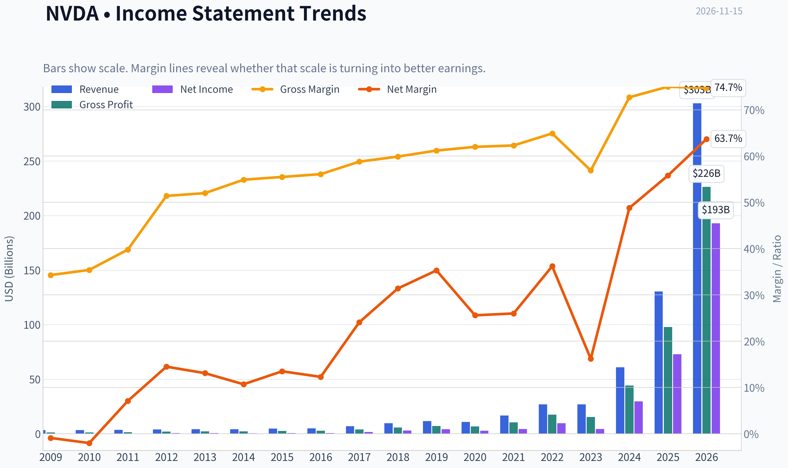

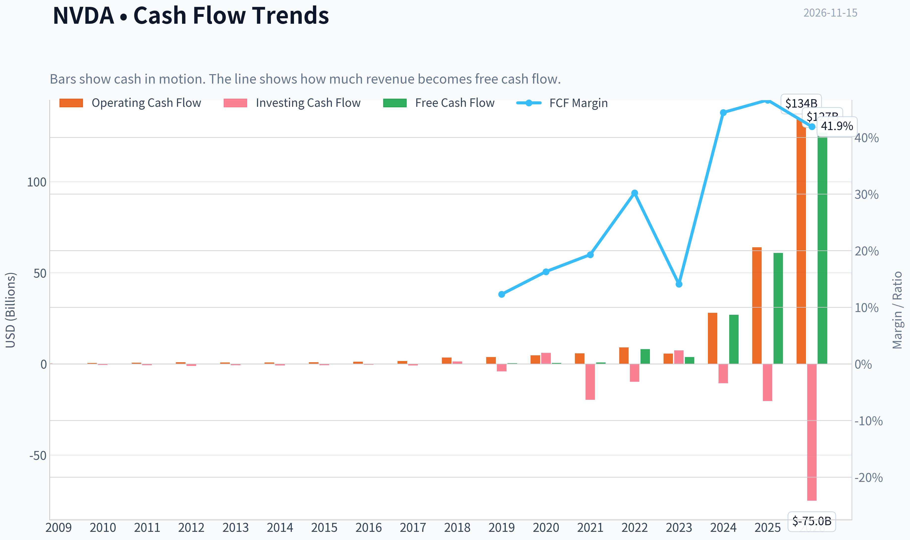

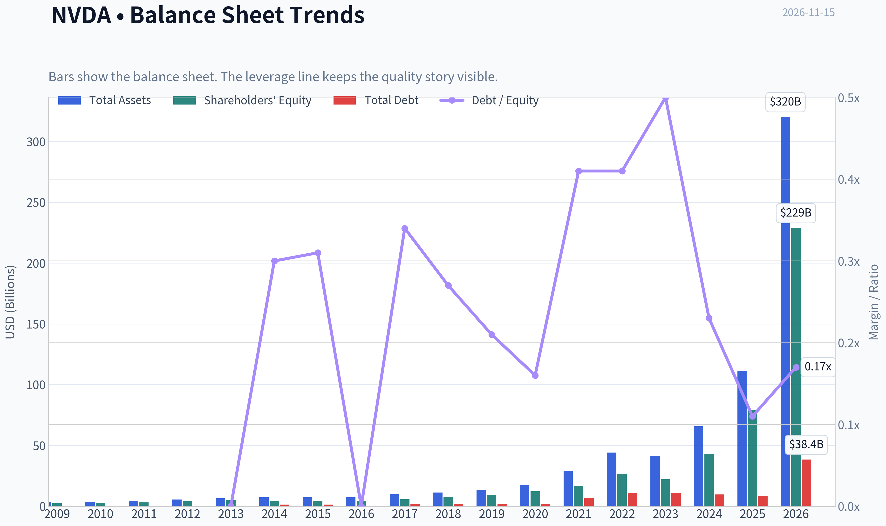

This graph tracks the profitability and return metrics (ROE, ROIC, Margins) of **NVDA** over the past decade, highlighting capital efficiency trends.

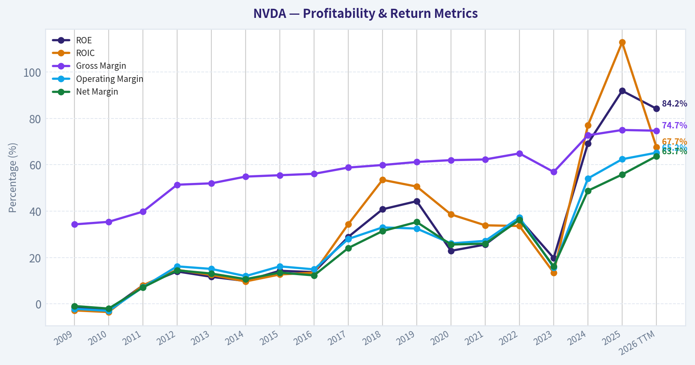

This chart illustrates the financial health of **NVDA** over the last 10 years, mapping cash equivalents and free cash flow against total obligations (Debt).

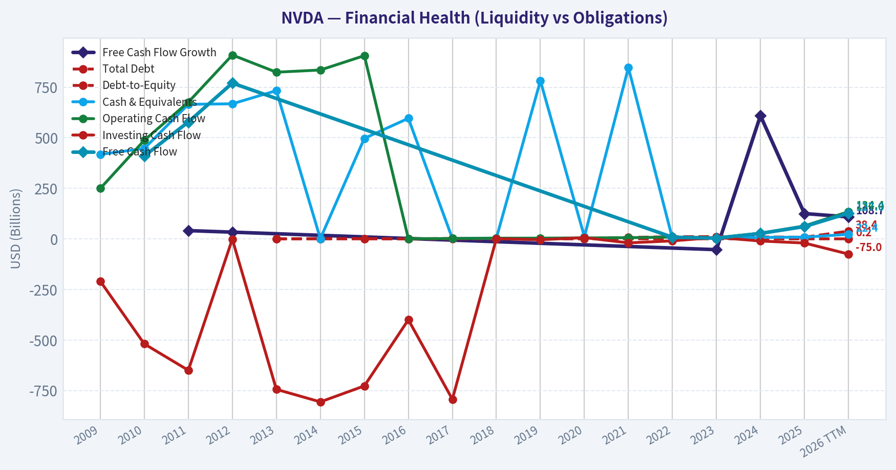

This comparison chart from *Profitability and Operating Performance* stacks current figures against historical benchmarks for **NVDA**, making it easy to see where the company trades relative to its own averages.

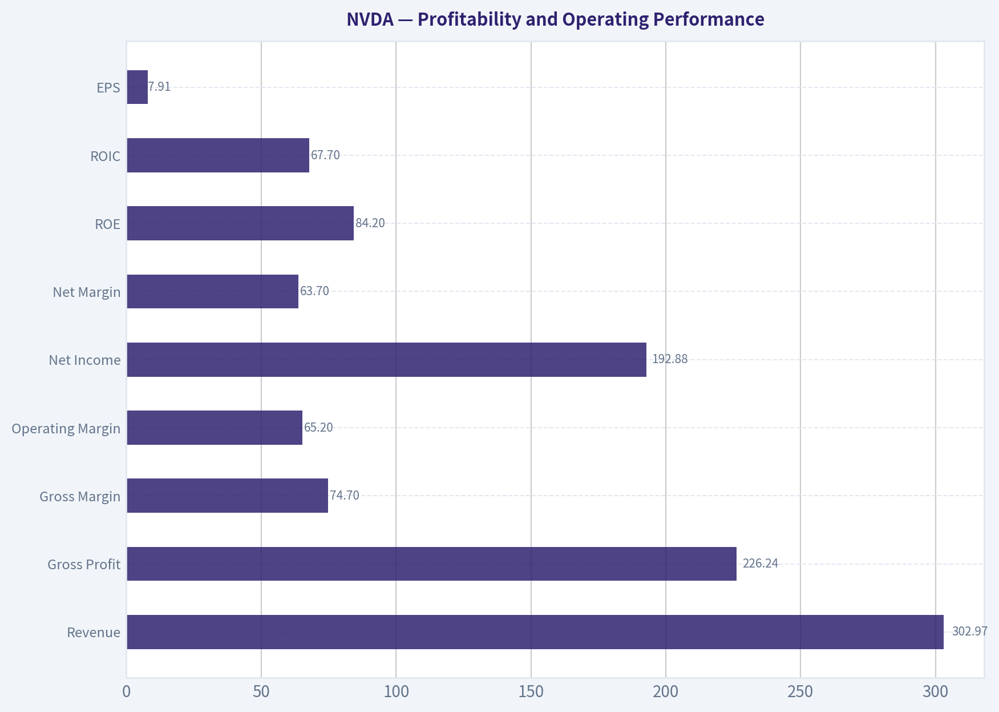

This breakdown chart from <em>Cash Flow and Capital Allocation</em> shows the proportional composition for **NVDA** - useful for understanding what drives or risks the business.

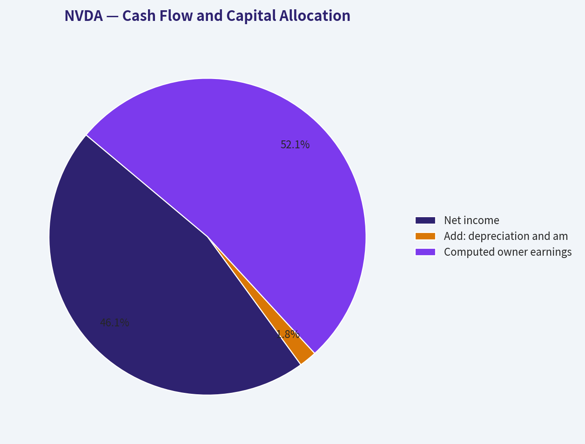

This breakdown chart from <em>Revenue Breakdown</em> shows the proportional composition for **NVDA** - useful for understanding what drives or risks the business.

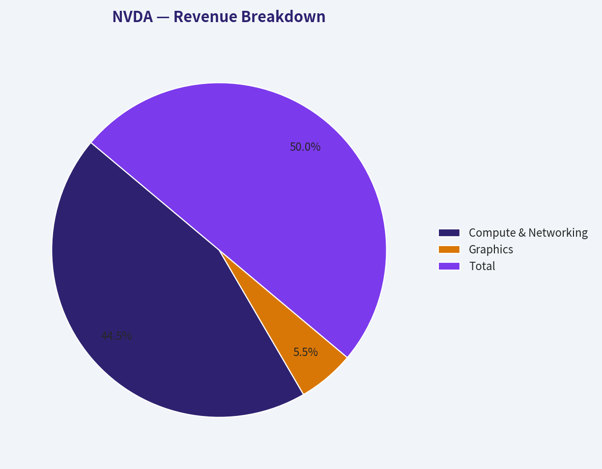

---

### Intrinsic Value Analysis (Buffett)

> *Following Warren Buffett's value investing philosophy: Circle of Competence, Economic Moat, Management Quality, and Margin of Safety.*

#### Intrinsic Value Snapshot

Price is what you pay. Intrinsic value is what the business may be worth based on the cash it can create for owners over time. We show a range, not one magic number.

- Current Price: $162.85
- Value Range (conservative to optimistic across both DCF methods): $107.78 to $900.63

##### Owner Earnings (Buffett Method)
- Net Income: $72,880,000,000.00
- Depreciation & Amortization: $2,843,000,000.00
- Capital Expenditures: $-6,042,000,000.00
- Working Capital Changes: $-15,949,000,000.00
- Owner Earnings: $82,263,000,000.00

##### Intrinsic Value
###### Buffett Method
Uses owner earnings. Stricter, and usually more conservative.
- Conservative: $107.78
- Average: $345.43
- Optimistic: $900.63
- Discount Rate: 10.0%

###### Cash Flow Method
Uses free cash flow. Better for companies spending heavily today to grow tomorrow.
- Conservative: $187.49
- Average: $187.49
- Optimistic: $489.31
- Discount Rate: 10.0%

ANALYST STANCE: **Bullish**

#### Executive Conclusion

NVIDIA is an exceptional business with a wide, technology-driven moat, extraordinary profitability, substantial reinvestment runway, and a fortress-like balance sheet. The principal risk is not financial distress; it is valuation and cyclicality. At approximately $163 per share, the stock offers an estimated 20% margin of safety against the research pack's blended intrinsic value of $203.56.

The valuation is attractive for a truly exceptional compounder, but the unusually wide spread between valuation models means conviction should be moderate rather than absolute.

#### 1. Factor Scorecard

| Factor | Score | Assessment |
|---|---:|---|
| Circle of Competence and Simplicity | 3/5 | NVIDIA designs and sells accelerated-computing chips and systems, primarily for data centers and AI. The model is understandable, but semiconductor cycles, architecture transitions, and hyperscaler spending add complexity. |
| Durable Competitive Advantage | 4/5 | CUDA software, developer adoption, ecosystem lock-in, scale, performance leadership, and integrated systems create a powerful moat. The moat is wide, though competitors and custom silicon remain credible threats. |
| Management and Capital Allocation | 4/5 | Jensen Huang has historically demonstrated long-term vision, aggressive but productive reinvestment, and strong execution. The business has prioritized growth investments over short-term financial engineering. |
| Industry Structure | 3/5 | NVIDIA benefits from scale and a small group of serious competitors, but semiconductors remain cyclical, innovation-intensive, and exposed to concentrated customers and changing capital-spending plans. |

**Gate 5 - Quality and Solvency:** **Not tripped.** There is no indication of deteriorating cash flow combined with financial distress. The company has strong profitability, a 3.9 current ratio, and no evidence of interest-coverage problems.

#### 2. Moat Analysis

NVIDIA's moat is primarily based on **switching costs, ecosystem effects, intangible assets, and scale advantages**.

| Moat Source | Evidence | Strength |
|---|---|---|
| Intangible assets | CUDA, proprietary software libraries, developer tools, chip architecture, and accumulated AI expertise | Very strong |
| Switching costs | AI models, software stacks, engineering teams, and production workflows are deeply optimized around NVIDIA's platform | Strong |
| Network effects | More developers and customers encourage more tools, applications, and optimization, which attract additional users | Strong |
| Cost and scale advantages | Massive R&D spending, broad product portfolio, systems integration, and manufacturing scale | Strong |
| Customer dependence | Hyperscalers and AI developers rely heavily on NVIDIA for leading-edge accelerated computing | Strong but concentrated |

NVIDIA's most important advantage is that it sells more than chips. It sells a hardware-and-software computing platform. That distinction makes the business more defensible than a conventional semiconductor manufacturer.

The moat is not invulnerable. AMD, Google's TPUs, Amazon's custom silicon, and other internal or external alternatives could reduce NVIDIA's share over time. However, the ecosystem creates substantial friction for customers seeking to switch merely to save on hardware costs.

#### 3. Management Quality Assessment

Management scores highly because it has repeatedly made large, long-duration investments before the market fully recognized their importance. The transition from graphics processors to accelerated computing and AI infrastructure is evidence of strategic adaptability rather than stagnation.

Capital allocation has largely favored:

- Heavy research and development.
- Expansion of the software ecosystem.
- New data-center and networking capabilities.
- Strategic acquisitions and platform development.
- Maintaining financial flexibility rather than excessive leverage.

The principal governance risk is key-person dependence. Jensen Huang has been central to NVIDIA's culture, product roadmap, and investor confidence. Succession planning and executive continuity therefore deserve close monitoring.

#### 4. Financial Summary

| Metric | Latest available figure |
|---|---:|
| Share price | $163 |
| Market capitalization | $3.93 trillion |
| P/E ratio | 20.6x |
| Return on equity | 76.3% |
| Gross margin | 71.1% |
| Revenue growth, year over year | 65.5% |
| Free-cash-flow yield | 2.5% |
| Implied free cash flow | Approximately $98.3 billion |
| Current ratio | 3.9x |
| Reverse-DCF implied annual growth | Approximately 8.5% for 10 years |
| Research-pack headline intrinsic value | $203.56 |

**Key Takeaways:** NVIDIA combines a 71.1% gross margin with 76.3% ROE and 65.5% recent revenue growth, showing exceptional economics and operating momentum. The 2.5% free-cash-flow yield indicates that the stock is not conventionally cheap, but the valuation is supported by unusually high returns and reinvestment potential. The 3.9 current ratio provides substantial short-term financial flexibility.

#### 5. Owner Earnings Calculation

Free cash flow is used as the practical owner-earnings proxy because the available data does not separately identify maintenance capital expenditures from growth capital expenditures.

| Owner-Earnings Component | Approximate Amount |
|---|---:|
| Net income plus depreciation and amortization | Not separately provided |
| Less: maintenance capital expenditures | Not separately provided |
| Less: working-capital investment | Included in free cash flow |
| Owner earnings proxy | Approximately $98.3 billion |
| Implied shares outstanding | Approximately 24.1 billion |
| Owner earnings per share proxy | Approximately $4.08 |

**Key Takeaways:** NVIDIA's estimated free cash flow of roughly $98 billion provides a strong cash foundation for continued investment and shareholder returns. The main analytical issue is that a substantial portion of current spending may be growth-oriented rather than maintenance-oriented, meaning normalized owner earnings could differ materially from reported free cash flow.

#### 6. Three-Scenario DCF Valuation

The following scenarios use approximately $98.3 billion of current owner earnings and approximately 24.1 billion shares outstanding. They are deliberately simplified and should be interpreted alongside the research pack's blended valuation.

| Scenario | Core Assumption | Estimated Value per Share |
|---|---|---:|
| A. No growth | Owner earnings divided by 10% discount rate | $40.75 |
| B. GDP-like growth | 3% perpetual growth and 10% discount rate | $59.98 |
| C. Historical-growth framework | 10% near-term growth, moderating to 5% terminal growth | Approximately $126.50 |
| Research-pack blended valuation | Owner earnings, FCF, Damodaran FCFF, and reverse-DCF blend | $203.56 |

**Key Takeaways:** A strict no-growth or GDP-growth DCF materially understates NVIDIA's value because it ignores the company's unusually high returns on incremental investment. The historical-growth case is more realistic but still conservative relative to the blended research valuation. The large difference between the models demonstrates that NVIDIA's value depends heavily on how long exceptional growth and returns persist.

The research pack reports the following model spread:

- Owner-earnings valuation: **$345.43 per share**
- FCF valuation: **$187.49 per share**
- Damodaran FCFF valuation: **$31.19 per share**
- Blended headline value: **$203.56 per share**

The $31.19 FCFF result appears highly sensitive to cyclical normalization and conservative assumptions. The $345.43 owner-earnings result assumes much stronger durability. The blended figure is therefore the most appropriate anchor.

#### 7. Margin of Safety Analysis

| Measure | Result |
|---|---:|
| Current price | $163 |
| Blended intrinsic value | $203.56 |
| Estimated margin of safety | 20.0% |
| Price-implied 10-year annual growth | Approximately 8.5% |
| Recent three-year revenue growth | 110.8% |
| Recent five-year revenue growth | 96.7% |

**Key Takeaways:** A 20% discount to blended intrinsic value is adequate for a wide-moat, high-ROE compounder, although it is not a deep bargain. The market is pricing NVIDIA for approximately 8.5% annual growth over the next decade, which is far below its recent growth rate but still demanding if competitive pressure rises sharply. The valuation is reasonable only if NVIDIA sustains a meaningful portion of its current ecosystem advantage.

For a normal cyclical semiconductor company, this margin of safety would be too thin. For NVIDIA, the quality of the franchise justifies accepting a smaller discount. Nevertheless, the valuation should be viewed as attractive rather than obviously cheap.

#### 8. Final Buffett Scorecard

| Criterion | Weight | Score | Weighted Contribution |
|---|---:|---:|---:|
| Moat width and durability | 25% | 4.0 | 1.00 |
| Valuation and margin of safety | 20% | 3.0 | 0.60 |
| Capital returns versus WACC | 15% | 5.0 | 0.75 |
| Business understanding and predictability | 12% | 3.0 | 0.36 |
| Management quality and capital allocation | 12% | 4.0 | 0.48 |
| Reinvestment runway | 8% | 5.0 | 0.40 |
| Balance-sheet strength | 4% | 4.0 | 0.16 |
| Industry structure | 4% | 3.0 | 0.12 |
| **Total** | **100%** |  | **3.87/5.00** |

#### 9. Investment Stance

**Bullish - Moderate conviction**

NVIDIA qualifies as a Buffett-style compounder because it combines:

- A powerful and widening ecosystem moat.
- Exceptional gross margins and returns on equity.
- A large, global reinvestment opportunity.
- Strong financial flexibility.
- Management with a demonstrated history of strategic adaptation.

The stock is not risk-free. Its valuation depends on sustained AI infrastructure demand, continued software ecosystem leadership, and high returns on incremental capital. Customer concentration, custom silicon, export restrictions, competitive innovation, and semiconductor cyclicality could all pressure future results.

At $163, the risk-reward is favorable enough to support ownership for a long-term investor, but the wide valuation-model dispersion argues against an aggressive, concentrated position. A disciplined investor could buy gradually and reserve capital for a materially lower price or evidence that the moat is weakening.
#### Valuation Bridge

This bridge places the current market price beside each intrinsic value lens so readers can see whether upside depends on one method or shows up across several methods.

| Scenario | Intrinsic Value / Share |
| --- | ---: |
| Buffett Method | $345.43 |
| Cash Flow Method | $187.49 |
| Damodaran Method | $31.19 |
| Current Price | $162.85 |

#### Key Takeaways

If one method is far above the others, the upside case depends on a specific modelling assumption. When several methods cluster together, the valuation story is more robust.

#### Valuation Visuals

This comparison chart from *Latest Earnings Snapshot* stacks current figures against historical benchmarks for **NVDA**, making it easy to see where the company trades relative to its own averages.

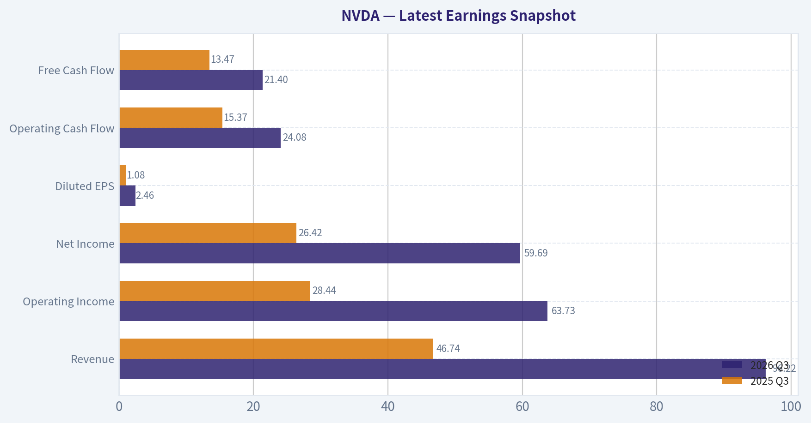

This comparison chart from *Current Metrics Versus Ten-Year Averages* stacks current figures against historical benchmarks for **NVDA**, making it easy to see where the company trades relative to its own averages.

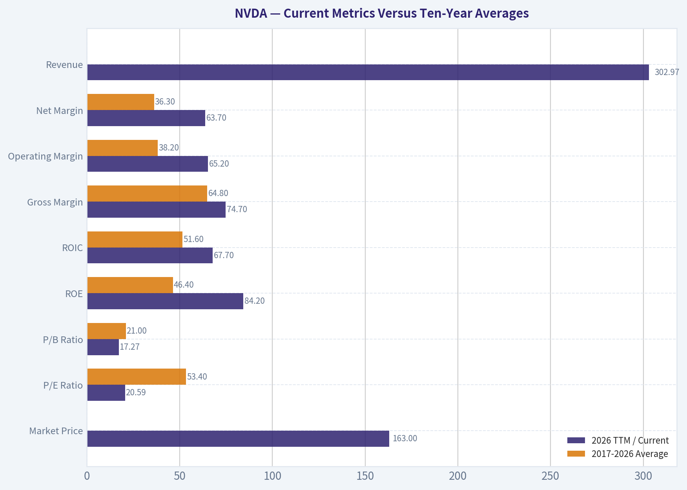

This comparison chart from *Balance Sheet and Financial Strength* stacks current figures against historical benchmarks for **NVDA**, making it easy to see where the company trades relative to its own averages.

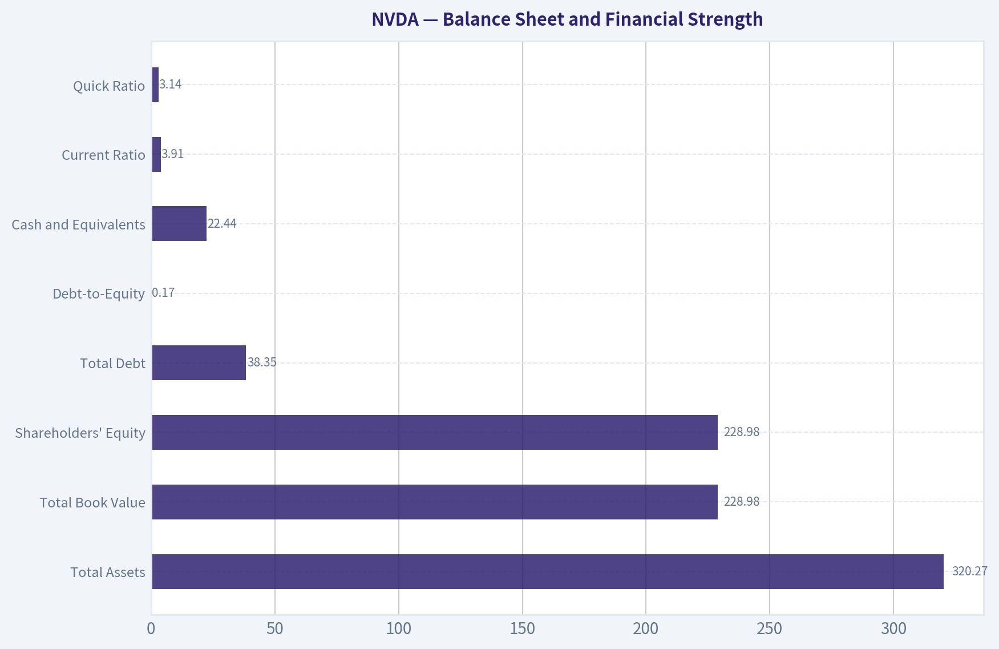

---

### Trend & Growth Analysis (Lynch/Druckenmiller/Fisher)

> *Following Peter Lynch's GARP, Stanley Druckenmiller's macro-aware approach, and Philip Fisher's scuttlebutt methodology.*

ANALYST STANCE: **Bullish**

#### Executive View

NVIDIA remains a premier growth compounder, but it is no longer an undiscovered ten-bagger. The investment case depends on AI infrastructure spending remaining durable, NVIDIA defending its accelerated-computing moat, and successfully expanding beyond training into inference, networking, software, and sovereign AI.

At $163 and a $3.93 trillion market capitalization, the stock offers an attractive growth profile on the supplied earnings multiple, but position sizing should recognize concentration, cyclicality, export restrictions, customer concentration, and leadership-transition headlines.

#### 1. Lynch Classification

**Fast Grower, with cyclical characteristics.**

Revenue is growing 65.5% year over year, far above the 15-25% threshold for a fast grower. However, semiconductors remain cyclical, and NVIDIA's growth is unusually dependent on hyperscaler and enterprise AI capital expenditure.

#### 2. The Story in Three Bullets

- NVIDIA is the leading supplier of accelerated computing hardware and software for the AI revolution.
- Its CUDA ecosystem, developer base, networking products, and systems architecture create switching costs beyond the individual GPU.
- AI inference, sovereign AI, enterprise adoption, robotics, automotive, and custom cloud infrastructure could extend the current data-center cycle well beyond initial model training.

#### 3. TAM and 10x Test

| Factor | Assessment |
|---|---|
| Primary market | AI accelerators, data-center systems, networking, and software |
| Secular growth | Very strong; AI infrastructure remains a rapidly expanding market |
| Competitive position | Category leader with substantial software and ecosystem advantages |
| Current scale | Approximately $3.93 trillion market capitalization |
| 10x revenue test | Not fully verifiable because current revenue was not included in the research pack |
| Runway | Large, but a 10x equity outcome is increasingly difficult from the current valuation base |

**Key Takeaways:** NVIDIA's addressable market is expanding rapidly, and AI infrastructure remains one of the strongest secular themes globally. The runway is still substantial, but the company's enormous scale means future returns are more likely to come from sustained earnings compounding than from simple multiple expansion. A literal ten-bagger is mathematically much harder from a $3.93 trillion starting market capitalization.

#### 4. Revenue Growth Trend

| Metric | Latest supplied figure | Interpretation |
|---|---:|---|
| Revenue growth, year over year | 65.5% | Exceptional fast-grower performance |
| Trailing 3-year growth reference | 110.8% | Very strong cumulative expansion |
| Trailing 5-year growth reference | 96.7% | Durable long-term growth |
| Trend classification | High growth | Current acceleration or deceleration cannot be confirmed without quarterly history |

**Key Takeaways:** NVIDIA has demonstrated extraordinary multi-year growth, with the latest annual growth rate still above 65%. The available data do not establish whether growth is accelerating or decelerating quarter by quarter, so the key near-term question is whether new product ramps and AI infrastructure demand can offset a progressively tougher comparison base.

#### 5. Unit Economics and Financial Quality

| Metric | Data | Assessment |
|---|---:|---|
| Gross margin | 71.1% | Exceptional for a semiconductor company |
| Return on equity | 76.3% | Excellent capital productivity |
| Current ratio | 3.91 | Strong liquidity |
| Free-cash-flow yield | 2.5% | Supports quality, but valuation remains growth-dependent |
| NRR / LTV-to-CAC | Not disclosed in supplied data | Not applicable in a traditional SaaS sense |
| Rule of 40 | Not applicable | Hardware-led business rather than subscription-led |

**Key Takeaways:** NVIDIA's gross margin and return on equity indicate a highly profitable, asset-light platform relative to traditional chip manufacturing. The lack of SaaS metrics such as NRR is not a weakness; instead, investors should monitor data-center gross margin, free-cash-flow conversion, customer concentration, and inventory discipline.

#### 6. Inflection-Point Assessment

| Potential inflection | Evidence | View |
|---|---|---|
| Product cycle | Accelerated-computing demand remains strong | Positive |
| Market share | NVIDIA remains the leading AI accelerator platform | Positive, but competition is increasing |
| Margin | 71.1% gross margin | Strong; future gains may be harder |
| TAM | AI inference, sovereign AI, networking, robotics, and enterprise AI | Positive |
| Competitive landscape | AMD, custom ASICs, and hyperscaler chips | Meaningful risk |
| Leadership | News coverage raises questions about CEO succession | Needs verification and monitoring |

**Key Takeaways:** The strongest inflection is TAM expansion: AI is moving from model training into inference and broader enterprise workloads. The main uncertainty is whether NVIDIA can preserve its exceptional economics as customers develop alternatives and as competition increases. Leadership-transition reports in the research pack are a material headline risk and should be independently confirmed before acting.

#### 7. Macro Setup

The secular macro setup is favorable because AI investment is a multi-year capital-spending theme. Falling interest rates would support high-growth technology valuations, while rising rates or a liquidity shock would pressure the multiple.

The principal macro risks are:

- A recession that delays data-center capital expenditure.
- Hyperscaler overbuilding followed by a digestion period.
- Export controls affecting China-related revenue.
- A broad semiconductor inventory correction.
- A change in investor enthusiasm toward AI spending.

Overall macro rating: **Favorable secular trend, but vulnerable to cyclical spending shocks.**

#### 8. Fisher's 15-Point Score

| Fisher criterion | Score / 5 | Comment |
|---|---:|---|
| Market potential | 5 | AI markets remain large and expanding |
| New-product determination | 5 | Consistent product and platform development |
| R&D effectiveness | 5 | Strong hardware-software integration |
| Sales organization | 5 | Deep relationships with major technology customers |
| Profit margins | 5 | 71.1% gross margin |
| Margin improvement | 4 | Already exceptional; incremental gains may moderate |
| Labor relations | 4 | No major issue identified in supplied data |
| Executive relations | 4 | Strong historical execution, subject to succession risk |
| Management depth | 4 | Broad technical and operating bench, but CEO concentration matters |
| Cost analysis/accounting | 4 | No major concern supplied |
| Outstanding moat | 5 | CUDA, ecosystem, developer base, and systems integration |
| Long-range profit outlook | 5 | Strong, though cyclical |
| Dilution | 4 | No major dilution issue supplied |
| Candor | 4 | Generally strong investor communication; verify current disclosures |
| Integrity | 4 | No major issue supplied |

**Total: 66 / 75 - Outstanding**

**Key Takeaways:** NVIDIA scores particularly well on market potential, innovation, R&D, and competitive moat. The deductions reflect uncertainty around leadership concentration, future margin durability, and the limited ability to independently verify several qualitative factors from the supplied data.

#### 9. Valuation Analysis

| Measure | Result | Interpretation |
|---|---:|---|
| Current price | $163 | Supplied market price |
| Market capitalization | $3.93 trillion | Very large-cap growth company |
| P/E | 20.6x | Moderate if earnings growth remains exceptional |
| Revenue growth | 65.5% | Far above the P/E multiple |
| Mechanical PEG | 0.31 | Attractive, assuming the P/E and growth figures are comparable |
| FCF yield | 2.5% | Implies a premium valuation on current cash flow |
| Headline intrinsic value | $203.56 | Approximately 20% above current price |
| Reverse-DCF implied growth | 8.5% annually for 10 years | Appears modest relative to recent growth |

**Key Takeaways:** The mechanical PEG ratio is highly attractive at approximately 0.31, but PEG can be misleading when growth is temporarily boosted by a semiconductor upcycle. The supplied intrinsic-value estimate of $203.56 implies roughly 20% upside, while the reverse DCF appears to embed only about 8.5% annual growth, suggesting the market may not require continued 60% growth to justify the current price.

A meaningful limitation is that the supplied valuation models have a very wide range: approximately $31 to $345 per share. That dispersion indicates unusually high sensitivity to assumptions about cyclicality, margins, and terminal growth.

#### 10. Growth Investor Scorecard

| Criterion | Weight | Score / 5 |
|---|---:|---:|
| Lynch story | 10% | 4.8 |
| TAM and runway | 20% | 4.7 |
| Revenue growth | 20% | 4.8 |
| Unit economics / financial quality | 15% | 4.5 |
| Competitive position | 10% | 4.8 |
| Management quality | 10% | 4.0 |
| Macro setup | 5% | 3.8 |
| Profitability path | 5% | 4.9 |
| Valuation | 5% | 4.0 |
| **Weighted score** | **100%** | **4.58 / 5.00** |

**Key Takeaways:** NVIDIA ranks as a high-conviction growth company because it combines exceptional growth, profitability, market position, and secular tailwinds. The score is held back by valuation sensitivity, semiconductor cyclicality, competitive threats, and potential leadership-transition risk rather than by current business execution.

#### 11. Position Size Stance

**Advocate: initiate or hold a meaningful but controlled position.**

Suggested framework:

- **Core growth portfolio:** 3-6% position.
- **High-conviction technology portfolio:** up to 8%, provided portfolio concentration is controlled.
- **Avoid oversized exposure:** NVIDIA is already a mega-cap and has substantial expectations embedded in its price.

For existing holders, the supplied valuation does not justify automatic selling. Trimming may be appropriate only if NVIDIA has become an outsized portfolio concentration or if quarterly growth, gross margins, and customer spending materially deteriorate.

#### 12. Key Risks and Catalysts

| Catalysts | Risks |
|---|---|
| Continued hyperscaler AI capex | AI spending digestion or overbuilding |
| Faster inference adoption | Custom chips and competing accelerators |
| New architecture ramps | Export restrictions |
| Networking and software expansion | Customer concentration |
| Enterprise and sovereign AI adoption | Semiconductor cyclicality |
| Sustained gross margins | Leadership or succession uncertainty |
| Falling interest rates | Rising rates and valuation compression |

**Key Takeaways:** The most important catalyst is evidence that AI demand is broadening from training into inference, enterprise deployments, networking, and sovereign infrastructure. The most important risk is not a single weak quarter; it is a sustained combination of slowing revenue growth, declining margins, and customer capital-spending discipline.

#### Final Conclusion

NVIDIA is one of the strongest growth businesses in the public markets and fits Lynch, Druckenmiller, and Fisher's frameworks unusually well. It has an expanding TAM, exceptional profitability, a powerful ecosystem moat, and a major secular tailwind.

The stock merits an **Bullish** stance, but with disciplined sizing. The central monitoring signal is whether revenue growth remains above roughly 25-30% while gross margins stay near current levels. If that combination persists, the current valuation can remain reasonable; if growth falls sharply toward the low teens, the stock would become much more vulnerable to multiple compression.

---

### Market Technical Analysis

ANALYST STANCE: **Bearish**

#### NVDA technical outlook

NVDA closed at **$162.85 on November 13, 2026**, after a severe late-period breakdown. The stock fell from **$230.86 on October 1** to $162.85, a decline of approximately **29.5%**. The deterioration accelerated in November: NVDA dropped from $206.69 on November 3 to $162.85 on November 13, including a particularly damaging **10.8% decline on November 12** on exceptionally heavy volume.

This is not merely a routine pullback. The price structure has shifted from consolidation to a high-volatility downside trend, and there is not yet enough evidence of a durable reversal.

#### Trend and moving-average structure

The short-term trend is decisively bearish. Based on the supplied closing prices, the **10-day EMA is approximately $179**, leaving the latest close roughly **9% below** that responsive average. This gap indicates that sellers retain control of near-term momentum. A recovery toward the 10-day EMA could occur during an oversold bounce, but that average is now likely to act as initial resistance rather than support.

The **50-day SMA is estimated to be in the low-to-mid $210s**, placing the stock approximately 20% or more below its medium-term trend benchmark. This is a substantial separation and suggests that the breakdown has damaged the intermediate trend. Reclaiming the 50-day average would require a large recovery, not simply a one- or two-day bounce.

The **200-day SMA is estimated to be around the low-$200s**, although the exact value was not returned by the indicator service. NVDA is also trading materially below that long-term benchmark. This means the stock has lost both medium- and long-term trend support, and a traditional trend-following framework would not yet authorize aggressive long exposure.

The important distinction is that NVDA may be statistically oversold while still remaining structurally bearish. Oversold conditions can persist during liquidation phases.

#### Momentum: MACD and RSI

The MACD configuration is expected to be strongly negative after the October-to-November collapse. The sequence of lower highs and lower lows, combined with repeated closes below short-term averages, implies that the MACD line is below its signal line and that downside momentum remains dominant. A bullish MACD crossover would be more meaningful only if accompanied by a higher low and improving volume behavior.

RSI is likely in or near oversold territory after the sharp series of declines. The recent price sequence contains several large negative sessions, including losses of approximately 9.7% on November 10 and 4.0% on November 13. That type of selling pressure would normally push a 14-day RSI well below its neutral midpoint and potentially toward the lower-20s or lower.

However, RSI should not be interpreted as an automatic buy signal here. In a strong liquidation trend, RSI can remain below 30 while price continues to decline. The more constructive signal would be a bullish divergence: price making a new low while RSI forms a higher low. That confirmation is not yet established from the available price sequence.

#### Volatility and volume

Volatility has expanded dramatically. The November 12 session traded between **$148.80 and $167.14**, a daily range of more than $18, while the November 9 session also displayed an unusually wide range and closed at $178.67. Estimated ATR is therefore substantially elevated relative to the stock's recent price level.

This has two implications:

1. Position sizing should be reduced materially if trading exposure is considered.
2. Conventional stop-loss distances may be too tight and vulnerable to ordinary intraday noise.

Volume behavior is particularly concerning. Volume reached approximately:

- **462.7 million shares on November 9**
- **429.3 million on November 10**
- **747.7 million on November 12**
- **363.8 million on November 13**

These are very large turnover figures occurring during a price decline. The combination of falling price and extraordinary volume is more consistent with forced liquidation, institutional distribution, or a major change in risk perception than with a quiet technical correction.

A volume-weighted moving average is likely below the recent pre-breakdown price area and may be pulled sharply lower by the huge-volume selloffs. Until price can reclaim that volume-weighted benchmark with improving volume quality, rallies should be treated as potential relief rallies rather than confirmed trend reversals.

#### Bollinger-band interpretation

The 20-day Bollinger middle line is estimated near the **high-$190s**, far above the latest close. The large distance between price and the middle band indicates an extreme downside displacement.

Price may be trading near or below the lower Bollinger Band after the latest decline, which increases the probability of a short-term reflex bounce. Nevertheless, a lower-band breach during a high-volume breakdown is not automatically bullish. In powerful downtrends, price can "walk the lower band" for several sessions.

The preferable setup would be a stabilization phase, followed by a close back above the lower band and then a sustained reclaim of the middle band. Without that progression, buying solely because price appears far below the Bollinger middle line carries substantial risk.

#### Key levels and scenario analysis

The first meaningful downside reference is the **$148.80 intraday low from November 12**. A decisive close below that level would signal that the liquidation is extending and would leave the stock without a clearly established nearby technical floor in the supplied data.

On the upside, **$168.90 to $173.75** is the first resistance zone, corresponding roughly to the November 10-13 closing area. Above that, the **$178-$187 region** contains additional overhead supply from recent trading. The approximate 10-day EMA near $179 reinforces the importance of that zone.

A more credible reversal would require several conditions:

- Price holds above the $148.80-$160 area.
- Selling volume contracts during subsequent declines.
- Price forms a higher low rather than immediately revisiting the lows.
- RSI begins to rise from oversold territory.
- MACD momentum improves and eventually produces a bullish crossover.
- NVDA reclaims the 10-day EMA and then the approximately $195-$200 area.

Until these conditions emerge, the risk-reward profile favors patience over trying to catch the initial decline.

#### Selected indicators

The most relevant nonredundant indicators for this market condition are:

- **close_10_ema** - identifies immediate momentum and likely first resistance.
- **close_50_sma** - measures medium-term trend damage.
- **close_200_sma** - provides the long-term trend filter.
- **macd** - evaluates whether downside momentum is beginning to reverse.
- **rsi** - identifies oversold conditions and potential divergence.
- **atr** - accounts for unusually high volatility in risk management.
- **vwma** - incorporates the significance of heavy-volume selling.
- **boll** - measures the degree of price displacement from its 20-day mean.

The indicator service returned blank numerical fields for this date range, so the moving-average and oscillator figures above are approximate interpretations derived from the supplied daily OHLCV data rather than official indicator-service values.

| Indicator or factor | Current interpretation | Trading implication |
|---|---|---|
| Price trend | Close at $162.85; approximately 29.5% below October 1 close | Broad downside trend remains intact |
| 10-day EMA | Estimated near $179 | Immediate resistance; price is materially below short-term trend |
| 50-day SMA | Estimated in the low-to-mid $210s | Medium-term trend has been decisively damaged |
| 200-day SMA | Estimated around the low-$200s | Long-term trend filter is bearish |
| MACD | Strongly negative by price structure | Avoid treating an oversold bounce as a confirmed reversal |
| RSI | Likely deeply oversold | Bounce risk is elevated, but oversold is not a buy signal by itself |
| ATR and volatility | Exceptionally high after wide November ranges | Reduce position size and use wider, volatility-adjusted risk limits |
| Volume and VWMA | Heavy volume accompanied the breakdown; VWMA likely declining | Distribution or liquidation risk remains high |
| Bollinger middle line | Estimated near the high-$190s | Large downside displacement, but lower-band riding remains possible |
| Key support | $148.80 intraday low from November 12 | Failure would indicate another breakdown leg |
| Initial resistance | $168.90-$173.75 | First area that a rebound must reclaim |
| Higher resistance | Approximately $178-$187, then $195-$200 | Reclaiming these zones would improve reversal credibility |
| Overall stance | Bearish and unstable | Avoid initiating a long position until stabilization and confirmation |

**Key Takeaways:** NVDA is deeply oversold, but the combination of broken moving-average structure, expanding volatility, and record-level downside volume indicates an unresolved liquidation rather than a confirmed bottom. The $148.80 area is the critical nearby support, while $179 and then $195-$200 are important recovery tests. A disciplined approach is to avoid new long exposure until the stock forms a higher low, selling volume subsides, and momentum indicators begin to improve.

---

### Options Market Analysis

> *Reading options flow - put/call ratios, IV skew, and unusual activity - to gauge institutional positioning and event-driven risk.*

#### NVDA Options Flow Report

*Data as of November 15, 2026. The supplied feed does not include NVDA's exact underlying price, so moneyness classifications below use the roughly $160 area suggested by the near-term strike and ATM data. Verify against the live spot price before trading.*

#### 1. Put/Call Ratio Analysis

| Expiration | Call OI | Put OI | Put/Call OI | Call Volume | Put Volume | Put/Call Volume |
|---|---:|---:|---:|---:|---:|---:|
| Nov. 16, 2026 | 175,164 | 121,003 | 0.69 | 598,880 | 459,964 | 0.77 |
| Nov. 18, 2026 | 130,579 | 87,290 | 0.67 | 140,365 | 116,064 | 0.83 |
| Nov. 20, 2026 | 1,270,948 | 841,857 | 0.66 | 377,579 | 286,524 | 0.76 |
| **Total** | **1,576,691** | **1,050,150** | **0.67** | **1,116,824** | **862,552** | **0.77** |

**Key Takeaways:** The aggregate put/call OI ratio of 0.67 is slightly more call-heavy than the approximately 0.70 historical neutral baseline. Volume is also call-dominant, with a 0.77 put/call volume ratio. This indicates a modest bullish bias, although the difference from neutral is not extreme and does not indicate one-sided conviction.

#### 2. Implied Volatility Assessment

| Expiration | Call ATM IV | Put ATM IV | Put Minus Call IV | Assessment |
|---|---:|---:|---:|---|
| Nov. 16 | 59.6% | 63.9% | +4.3 points | Put protection premium |
| Nov. 18 | 102.9% | 104.0% | +1.1 points | Extremely elevated, nearly balanced |
| Nov. 20 | 94.6% | 94.3% | -0.3 points | Extremely elevated, nearly balanced |

| IV Feature | Observation | Interpretation |
|---|---|---|
| Near-term IV | 59.6%-63.9% for the Nov. 16 expiry | Elevated for a one-day expiry |
| Midweek IV | Approximately 103% for Nov. 18 | Very high event or expiration risk |
| Weekly IV | Approximately 94% for Nov. 20 | Very high expected movement |
| Skew | Puts are richer in the nearest expiry, but nearly flat by Nov. 20 | Immediate downside hedging, without a broad panic skew |

**Key Takeaways:** NVDA options are pricing substantial near-term movement, especially for the Nov. 18 and Nov. 20 expirations. The nearest-term put premium signals demand for downside protection, but the nearly flat skew in later expirations suggests balanced event risk rather than outright fear. The data feed does not identify a specific catalyst, so the elevated IV should be treated as event-risk pricing rather than attributed to earnings or another confirmed event.

#### 3. Unusual Options Activity

| Expiration | Contract | Strike | Volume | Open Interest | Vol/OI | Approx. Positioning* |
|---|---|---:|---:|---:|---:|---|
| Nov. 16 | Put | $160 | 121,540 | 10,963 | 11.1x | Near-ATM hedge or bearish bet |
| Nov. 16 | Call | $165 | 87,960 | 6,535 | 13.5x | Slightly OTM bullish speculation |
| Nov. 16 | Call | $160 | 86,532 | 3,631 | 23.8x | Near-ATM bullish positioning |
| Nov. 16 | Put | $150 | 80,494 | 13,924 | 5.8x | OTM downside hedge |
| Nov. 16 | Call | $170 | 78,311 | 8,958 | 8.7x | OTM upside speculation |
| Nov. 16 | Call | $162.50 | 46,768 | 2,508 | 18.6x | Slightly OTM bullish positioning |
| Nov. 16 | Call | $167.50 | 44,922 | 4,587 | 9.8x | OTM bullish speculation |
| Nov. 16 | Put | $157.50 | 36,445 | 4,878 | 7.5x | Near-ATM downside hedge |
| Nov. 20 | Call | $167.50 | 19,813 | 3,596 | 5.5x | OTM bullish positioning |
| Nov. 18 | Put | $145 | 16,091 | 2,363 | 6.8x | Deep OTM hedge |
| Nov. 20 | Put | $157.50 | 8,670 | 1,631 | 5.3x | Near-ATM hedge |
| Nov. 20 | Put | $60 | 8,287 | 351 | 23.6x | Deep OTM tail-risk trade |

\*Moneyness assumes NVDA is trading near the $160 area; the supplied data does not provide the exact spot price. Days-to-expiry are approximately one day for Nov. 16, three days for Nov. 18, and five days for Nov. 20, using the stated report date.

**Key Takeaways:** The largest unusual activity is concentrated in one-day calls at $160, $162.50, $165, $167.50, and $170, which creates a broad bullish cluster immediately above or around the presumed spot area. Puts are also active, particularly the $160 and $150 strikes, indicating that traders are buying protection or expressing short-term downside views alongside the call demand. Because trade direction and execution side are unavailable, these contracts cannot be labeled definitively as institutional buying; the high volume-to-OI ratios indicate fresh activity, but some could be spreads, closing trades, or retail speculation.

#### 4. Open Interest Concentration and Gamma Levels

| Expiration | Highest OI Concentration | Call OI | Put OI | Market Significance |
|---|---|---:|---:|---|
| Nov. 16 | Entire chain; calls lead puts | 175,164 | 121,003 | Very high one-day positioning |
| Nov. 18 | Calls lead puts | 130,579 | 87,290 | Elevated short-horizon exposure |
| Nov. 20 | Dominant weekly concentration | 1,270,948 | 841,857 | Primary pinning and gamma-risk expiration |
| Aggregate | Calls exceed puts by 526,541 contracts | 1,576,691 | 1,050,150 | Call-heavy positioning |

**Key Takeaways:** The Nov. 20 expiration contains the overwhelming majority of near-term open interest and is therefore the most important potential pinning or gamma-control date. The $160-$170 area appears to be the key active zone from the unusual-flow data, although exact strike-level OI was not supplied, so a precise gamma wall or max-pain level cannot be calculated. Heavy short-dated positioning can dampen movement near major strikes if dealers are long gamma, but it can amplify movement if dealers are short gamma.

#### 5. Overall Options Sentiment

| Signal Component | Reading | Directional Impact |
|---|---|---|
| Put/call OI ratio | 0.67 | Mildly bullish |
| Put/call volume ratio | 0.77 | Mildly bullish |
| Unusual activity | More major call contracts than put contracts | Bullish, with hedging |
| IV level | Extremely elevated for Nov. 18-20 | High event-risk caution |
| IV skew | Near-term puts richer; later skew nearly flat | Moderate downside protection demand |
| OI concentration | Heavy Nov. 20 positioning | Potential pinning and sharp expiry-related moves |
| **Overall signal** | **BULLISH, low-to-moderate conviction** | **Call-heavy flow is the primary driver** |

**Key Takeaways:** The overall options signal is **BULLISH**, driven primarily by call-heavy volume, a 0.67 put/call OI ratio, and concentrated near-term call activity around the presumed $160-$170 range. The bullish view is tempered by elevated IV, substantial near-ATM put activity, and the possibility that some calls are spreads or covered-call structures rather than outright upside bets. This is a directional positioning signal, not a valuation assessment, and confidence is reduced because the feed lacks exact spot price, trade-side data, and a confirmed catalyst.

#### Summary Table

| Category | NVDA Read |
|---|---|
| Put/Call Ratio | OI ratio 0.67; volume ratio 0.77 - modestly below neutral and mildly bullish |
| IV Level | Elevated to extremely elevated, approximately 60%-104% across near-term expirations |
| Skew Direction | Near-term put skew; later expirations approximately balanced |
| Unusual Activity | Heavy fresh-looking call activity at $160-$170, offset by meaningful $150-$160 put hedging |
| Overall Signal | **BULLISH**, with low-to-moderate conviction and significant event/expiry risk |

**Key Takeaways:** NVDA's options market leans bullish, but this is not an aggressive, unqualified signal. The strongest evidence is the call-heavy positioning and unusual activity near the presumed current-price region, while elevated IV and active puts warn of large two-sided moves. The Nov. 20 expiration and the $160-$170 zone are the main levels to monitor.

---

## Research Team Commentary

> *The Research Manager synthesizes the Bull vs Bear debate into action-free commentary. This is a pre-risk view, not the final stance.*

Core takeaway: NVIDIA appears to be a wonderful business, but the debate does not establish that $163 offers a sufficient margin of safety against normalized owner earnings. The company's CUDA ecosystem, developer adoption, networking capabilities, and full-stack architecture constitute a genuine wide moat. Yet the valuation analysis relies on an ambiguous 20.6 P/E and lacks verified free cash flow, dilution, customer concentration, and normalized-margin data. I would retain or monitor a sensibly sized position rather than aggressively add at this price.

The strongest bull argument is that NVIDIA is no longer merely a semiconductor vendor. CUDA, optimized libraries, networking, systems architecture, and accumulated developer expertise make switching costly and reduce the importance of comparing individual chips in isolation. Management has also shown unusual foresight by investing in accelerated computing long before the current AI boom. Gross margin of 71.1% and exceptional reported returns on capital support the conclusion that this is an asset-light platform with pricing power, not an ordinary chip manufacturer.

The runway could also be much longer than the initial training cycle. Inference, enterprise adoption, sovereign infrastructure, robotics, automotive, and scientific computing are credible extensions. At a stated P/E of 20.6, NVIDIA would be attractive if current earnings approximate sustainable owner earnings and can compound at low-double-digit rates. The stock does not necessarily require another period of triple-digit growth.

The strongest bear argument is that the debate has not adequately normalized the earnings denominator. The supplied P/E is not identified as trailing, forward, or adjusted, yet the bull case treats it as trailing and derives approximately $7.92 of EPS from it. That needs verification before it anchors a valuation. Reported ROIC above 100% is evidence of excellent economics, but it is amplified by outsourced manufacturing, internally developed intellectual property, a small accounting capital base, and potentially peak margins. It should not be extrapolated mechanically.

Hyperscalers also create a real tension in the moat. They are NVIDIA's largest customers, but they possess the scale, engineering talent, and financial incentive to develop custom silicon. CUDA does not need to collapse for the economics to weaken. Migration of standardized inference workloads, greater customer bargaining power, or increased use of open abstraction layers could reduce growth and pricing power at the margin. With gross margins above 70%, even partial normalization could have a disproportionate effect on earnings.

The two valuation cases illustrate the uncertainty rather than resolve it. The bull's approximate $190-$205 base value assumes current earnings are a reasonable proxy for owner earnings and that growth and margins remain strong. The bear's $90-$130 range normalizes owner earnings, uses slower growth, and applies a higher discount rate. Neither side has supplied enough cash-flow detail to establish which starting point is appropriate. For a wide-moat compounder, I would accept only a 10%-15% discount to defensible intrinsic value, but I cannot demonstrate even that modest discount from the available evidence.

This is why I would not label NVIDIA Bearish. There is no indication of financial distress, weak management, or a broken franchise, and 20.6 times genuinely sustainable earnings would not be clear overvaluation for a business of this quality. Conversely, I would not yet Bullish because the margin of safety depends too heavily on treating current profitability as normal. The appropriate contrarian move is not automatically to oppose enthusiasm around AI; it is to distinguish durable platform adoption from potentially cyclical infrastructure spending.

My rationale reflects a recurring mistake in technology investing: allowing a compelling long-term narrative to substitute for current, normalized fundamental analysis. The opposite mistake-rejecting an asset-light compounder merely because it operates in technology-would also be costly. NVIDIA deserves a premium multiple, but that premium should be applied to normalized free cash flow after stock compensation, dilution, working-capital needs, and supply commitments, not simply to headline earnings.

Over the next one to four quarters, I would first verify whether the quoted P/E is trailing or forward and reconcile reported earnings with free cash flow per share. Sustained cash conversion near reported net income, after treating stock-based compensation as a real expense and accounting for dilution, would strengthen the thesis.

I would then monitor gross and operating margins through product transitions. Stable margins near the current range, or only moderate compression accompanied by strong volume growth, would support the view that NVIDIA has platform-level pricing power. A rapid decline toward materially lower levels, especially alongside slower growth or customer discounts, would suggest that current earnings were closer to peak-cycle economics.

Customer behavior is equally important. I would watch hyperscaler capital-spending commentary, NVIDIA's customer concentration, deployment utilization, and evidence that AI services are generating economic returns for buyers. Expanding inference and enterprise demand outside the largest cloud customers would improve revenue durability. Spending driven primarily by a handful of customers while custom accelerators take more recurring workloads would weaken it.

Finally, I would track CUDA adoption, developer engagement, networking and systems growth, competitive performance from AMD and custom silicon, export-control effects, inventory and supply commitments, and incremental returns on research and development. Networking and software should deepen customer dependence and preserve economics; if they merely increase system complexity and capital requirements without supporting margins, the moat expansion thesis would be less convincing.

At $163, NVIDIA is a high-quality company at a valuation that may be fair but is not yet demonstrably discounted. Existing investors should keep position size moderate and judge volatility by changes in intrinsic value rather than arbitrary stop-loss levels. New investors should demand either clearer proof of normalized free-cash-flow durability or a lower price that compensates for cyclicality, concentration, and geopolitical risk.

Final stance: Neutral.

---

## Value Investing Team Commentary

> *The Investor translates the research view into an investment thesis before risk review. This is still not the final stance.*

NVIDIA is a remarkable business, but the investment case at $163 depends heavily on whether the reported 20.6 P/E is based on trailing, forward, or adjusted earnings. That distinction is decisive. If it represents sustainable, diluted earnings, the valuation could be reasonable for a high-ROIC platform with a long runway. If it reflects peak-cycle or adjusted earnings, the apparent discount may be misleading.

### Business quality and moat

NVIDIA's moat is broader than its GPU hardware. CUDA, optimized libraries, developer familiarity, networking, systems integration, and increasingly complete data-center architectures create meaningful switching costs. Customers are not simply purchasing a chip; they are buying an integrated computing stack with substantial software and engineering support.

That ecosystem gives NVIDIA several advantages:

- A large developer and application base familiar with CUDA.
- High switching costs for organizations that have built software and workflows around NVIDIA's platform.
- Strong pricing power resulting from scarce, highly valuable computing capacity.
- The ability to sell complete systems, networking, and software rather than relying solely on individual accelerator chips.
- A history of investing in accelerated computing before demand became mainstream.

The company therefore deserves to be valued more like a technology platform than like a commodity semiconductor manufacturer. However, the platform analogy should not be taken too far. NVIDIA remains exposed to product cycles, manufacturing constraints, export restrictions, customer concentration, and rapid technological change.

### What the market may be missing

The contrarian case is not simply that AI enthusiasm is excessive. The more important question is whether current infrastructure spending produces durable economic returns for customers.

If hyperscalers and enterprises generate sufficient revenue or cost savings from AI workloads, then current capital spending may be the beginning of a multiyear infrastructure transition rather than a short-lived boom. Inference, sovereign AI, robotics, scientific computing, enterprise automation, and automotive applications could broaden demand beyond the initial model-training surge.

The market may also underestimate the value of NVIDIA's networking and software capabilities. As AI clusters become larger and more complex, interconnects, system design, and software optimization may become nearly as important as raw accelerator performance. That would strengthen NVIDIA's position and help preserve margins.

The contrary risk is that customers eventually become more disciplined. Hyperscalers have enormous incentives to develop custom silicon, shift standardized inference workloads to lower-cost alternatives, and negotiate more aggressively. NVIDIA does not need to lose CUDA for its economics to weaken. A gradual movement toward custom chips, open software abstractions, or more price-sensitive inference workloads could reduce growth and gross margins without destroying the franchise.

### Financial quality and valuation

The supplied profitability figures are exceptional:

- Gross margin: 71.1%
- ROE: 76.3%
- ROIC: 107.2%
- ROA: 58.1%

These figures support the conclusion that NVIDIA has extraordinary economics. But they should not be extrapolated mechanically. ROIC is amplified by an asset-light model, outsourced manufacturing, valuable internally developed intellectual property, and a relatively modest accounting capital base. Very high returns can coexist with cyclical peak margins.

The central analytical task is therefore to establish normalized owner earnings. I would want to reconcile:

1. GAAP net income to free cash flow.
2. Stock-based compensation and its effect on per-share value.
3. Diluted share-count growth.
4. Inventory, supply commitments, and working-capital requirements.
5. Customer concentration and payment terms.
6. Whether current gross margins are sustainable across product transitions.
7. The portion of earnings generated by recurring software and networking versus hardware demand.

At $163, a 20.6 P/E implies approximately $7.92 of earnings per share. If that is genuinely trailing, fully diluted, cash-backed earnings and the business can compound at even low-double-digit rates, NVIDIA may be attractively valued. A premier business with this level of reinvestment opportunity does not require a 50% discount to intrinsic value. A 10%-15% discount may be sufficient.

But if the multiple is forward, adjusted, or based on unusually elevated margins, the valuation is less compelling. A modest decline in gross margin can have an outsized effect on earnings because NVIDIA's current profitability is so high. The difference between a 71% gross-margin business and one operating at a materially lower normalized margin may be more important than the headline P/E.

### Key risks to monitor

The most important risks are not ordinary share-price volatility. They are changes in the earning power of the business:

- Hyperscaler capital spending slowing or becoming less productive.
- Custom accelerators taking share in recurring inference workloads.
- AMD or other competitors narrowing the performance and software gap.
- Export controls limiting access to major markets.
- Customer concentration and bargaining power increasing.
- Gross-margin compression during product transitions.
- Stock compensation and dilution reducing per-share compounding.
- Inventory or supply commitments becoming excessive if demand normalizes.
- AI customers failing to earn attractive returns on their investments.

The strongest evidence in favor of the thesis would be durable free-cash-flow conversion, stable diluted share counts, continued CUDA adoption, growing networking and software revenue, and evidence that inference and enterprise demand are expanding beyond a few large cloud customers.

### Investment conclusion

NVIDIA is not a business to reject merely because it is associated with a popular technology theme. That would confuse sentiment with fundamentals. The company has a genuine moat, outstanding management execution, substantial reinvestment opportunities, and a credible path to remain important in computing for the next decade.

At the same time, enthusiasm can cause investors to accept current earnings as permanent before testing their durability. The proper contrarian position is to challenge the quality and normalization of the earnings denominator-not to assume that the AI opportunity is imaginary.

Existing shareholders can reasonably hold a moderate position and focus on business performance rather than arbitrary stop-loss levels. New investors should either verify that $163 represents a discount to normalized intrinsic value or wait for a better risk-reward opportunity. Position size should reflect the uncertainty around customer concentration, margin normalization, export controls, and custom silicon.

**ANALYST STANCE: Neutral**

---

## Deep Values Commentary

> *The Risk Management Team debates and the Risk Judge provides the final action-free verdict. This section determines the final Bullish / Neutral / Bearish stance.*

#### Final Stance Scorecard

This scorecard converts the final research view into a weighted decision frame. It does not replace the narrative judgement, but it makes the main drivers of the verdict easier to scan.

| Criterion | Score | Weight | Commentary |
| --- | ---: | ---: | --- |
| Business Quality | 4.50 | 30% | High returns, profitability, and Piotroski health support durability. |
| Valuation Support | 2.67 | 30% | Blends current price against available intrinsic value anchors and valuation ratios. |
| Financial Strength | 5.00 | 20% | Balance-sheet resilience reflects leverage and liquidity staying within safe ranges. |
| Growth Durability | 5.00 | 20% | Recent revenue, earnings, and free cash flow growth indicate how durable expansion looks. |
| TOTAL / FINAL STANCE | 4.15 | 100% | Bearish |

#### Key Takeaways

The weighted score lands at **4.15 / 5.0**, while the final stance remains **Bearish**. This is useful as a quick calibration aid rather than a mechanical signal.

#### Risk Summary

Higher scores indicate more risk pressure. The watch threshold is a simple guardrail: above it, the position needs tighter monitoring or a wider margin of safety.

| Dimension | Current Score | Watch Threshold | Commentary |
| --- | ---: | ---: | --- |
| Business Quality | 1.50 | 3.00 | High returns, profitability, and Piotroski health support durability. |
| Valuation Support | 3.33 | 3.00 | Blends current price against available intrinsic value anchors and valuation ratios. |
| Financial Strength | 1.00 | 3.00 | Balance-sheet resilience reflects leverage and liquidity staying within safe ranges. |
| Growth Durability | 1.00 | 3.00 | Recent revenue, earnings, and free cash flow growth indicate how durable expansion looks. |

#### Key Takeaways

This view helps readers separate *where* the risk sits: valuation, business quality, balance sheet, or growth durability. It is especially useful when the final stance is close to the line between Neutral and Bearish.
