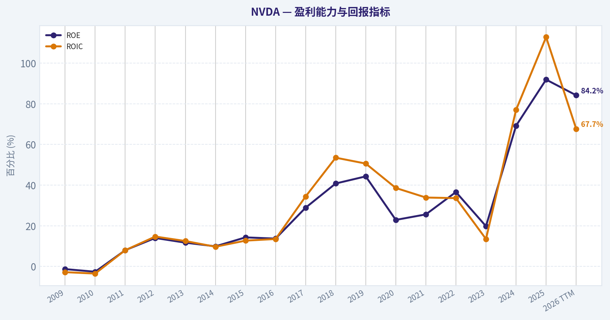
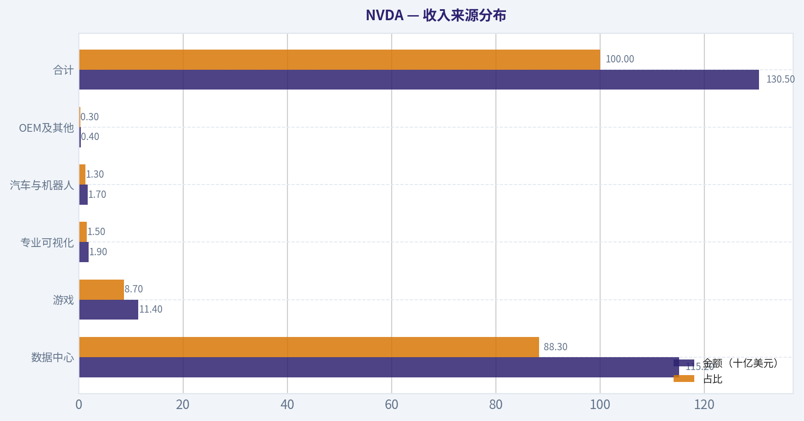
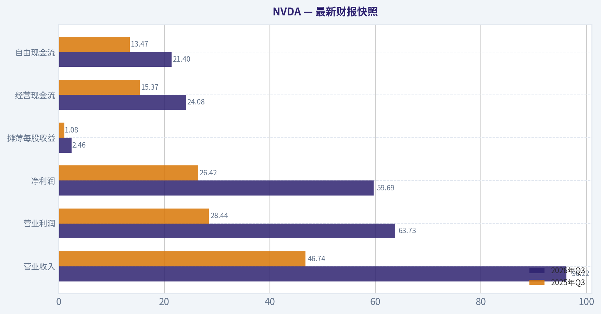
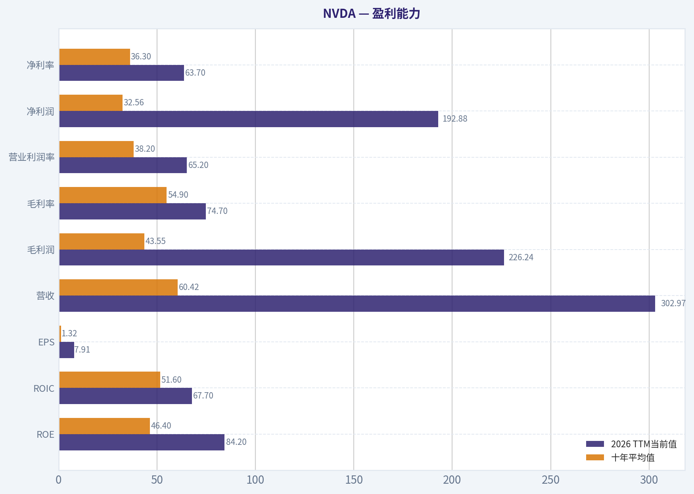
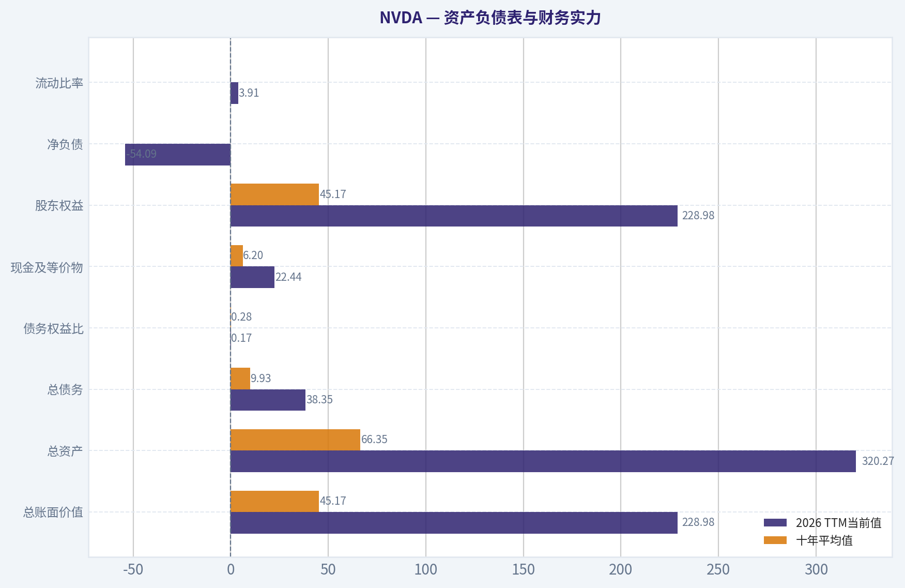
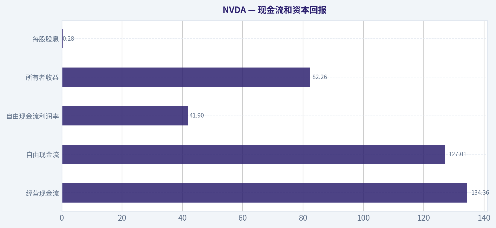
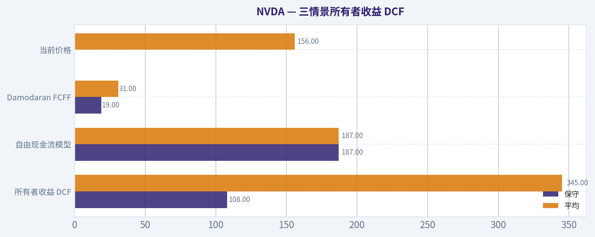
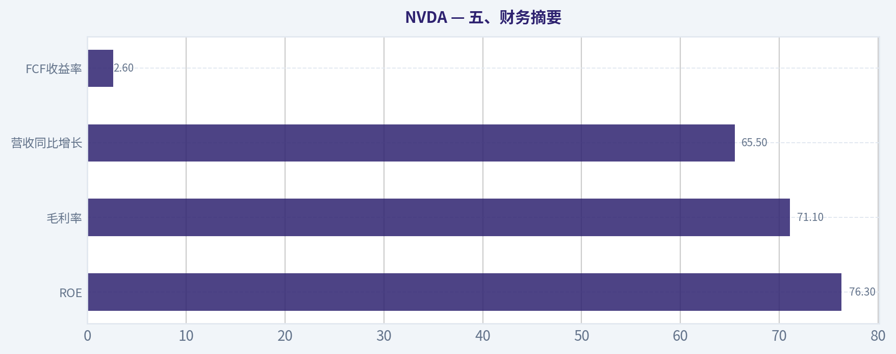

# NVDA 深度价值情报

**调研日期:** 2026-11-17

## 关键免责声明

*本报告由 Deep Value Intelligence（一个基于 AI 的多智能体投资分析框架）自动生成。 仅供教育和研究用途 - 非财务建议，非财务顾问。*

---

## 目录

1. 情报摘要
2. 分析师团队报告
   - 基本面分析
   - 价值分析 (巴菲特)
   - 成长性分析 (林奇/德鲁肯米勒/费雪)
   - 市场分析
   - 期权市场分析
3. 研究团队评论
4. 投资团队评论
5. Deep Values 团队洞察

---

## 情报摘要

### 核心观点与前提条件

**核心论点:** 英伟达具备现代 Buffett 框架下的优质复利特征：CUDA、开发者生态、网络与系统级产品形成宽阔护城河；71.1%毛利率、107.2% ROIC及轻资产模式显示出极强的经济价值。云厂商自研芯片会分流部分标准化负载，但目前更可能削弱边际议价权，而非迅速取代整个平台。

**主要风险:**
- Risky Analyst与Growth Analyst正确指出，客户购买的不只是GPU，还包括CUDA、软件库、开发工具、网络互联、系统优化和部署能力。这些要素共同降低客户的开发与上线风险，形成较高转换成本。
- Risky Analyst的关键提醒是正确的：要求所有增长来源完全验证后才买入，可能意味着平台重估已经反映在价格中。因此，完全空仓等待也存在机会成本。
- Risky Analyst正确识别了错过优质平台复利的机会成本，但把"护城河真实"推导为"当前价格足够有吸引力"，中间仍缺少现金流和正常化盈利验证。

**置信度:** 中

---

## 分析师团队报告

### 基本面分析

#### 最新财报快照

*以下数据基于最近一期已披露财报（2026年Q3），并尽量与上一年同期对比。*

| 指标 | 2026年Q3 | 2025年Q3 | 同比变化 |
| --- | ---: | ---: | ---: |
| 营业收入 | $96.22B | $46.74B | +105.9% |
| 营业利润 | $63.73B | $28.44B | +124.1% |
| 净利润 | $59.69B | $26.42B | +125.9% |
| 摊薄每股收益 | $2.46 | $1.08 | +127.8% |
| 经营现金流 | $24.08B | $15.37B | +56.7% |
| 自由现金流 | $21.40B | $13.47B | +58.9% |

关键结论：这张快照先把最新一期财报放在桌面上，再去看长周期分析。这样读者能更清楚地区分"公司长期质量"和"这次财报发生了什么"。

#### NVDA 17年财务指标

*以下数值均由原始数据确定性计算得出，并非 AI 估算。*

*发行人类型：operating company（Technology / Semiconductors）。*

#### 17年财务指标
*年度行来自已披露财务报表，最后一行 TTM 由最近四个季度滚动计算得出。*

| 指标 | 2009 | 2010 | 2011 | 2012 | 2013 | 2014 | 2015 | 2016 | 2017 | 2018 | 2019 | 2020 | 2021 | 2022 | 2023 | 2024 | 2025 | 2026 TTM |
| --- | --- | --- | --- | --- | --- | --- | --- | --- | --- | --- | --- | --- | --- | --- | --- | --- | --- | --- |
| 市场价格 | $0 | $0 | $1 | $0 | $0 | $0 | $0 | $1 | $3 | $6 | $4 | $6 | $13 | $24 | $19 | $61 | $120 | $156 |
| 总市值 | $4.36B | $8.46B | $14.08B | $9.10B | $7.66B | $9.34B | $10.81B | $16.67B | $70.86B | $155.35B | $89.84B | $146.11B | $326.04B | $620.72B | $489.79B | $1.53T | $2.98T | $3.79T |
| 市盈率 | -159.00 | -128.25 | 55.63 | 15.71 | 13.62 | 21.22 | 17.14 | 27.12 | 42.48 | 51.00 | 21.68 | 52.31 | 75.09 | 63.60 | 114.92 | 51.70 | 40.84 | 19.74 |
| 市净率 | 1.82 | 3.17 | 4.43 | 2.20 | 1.59 | 2.10 | 2.45 | 3.73 | 12.30 | 20.79 | 9.62 | 11.97 | 19.30 | 23.32 | 22.16 | 35.70 | 37.54 | 16.56 |
| ROE | -1.3% | -2.6% | 8.0% | 14.0% | 11.7% | 9.9% | 14.3% | 13.7% | 28.9% | 40.8% | 44.3% | 22.9% | 25.6% | 36.6% | 19.8% | 69.2% | 91.9% | 84.2% |
| ROIC | -2.8% | -3.5% | 8.0% | 14.7% | 12.5% | 9.7% | 12.7% | 13.5% | 34.4% | 53.5% | 50.6% | 38.6% | 33.9% | 33.6% | 13.5% | 77.0% | 112.8% | 67.7% |
| 每股收益 | $-0.00 | $-0.00 | $0.01 | $0.02 | $0.02 | $0.02 | $0.03 | $0.03 | $0.06 | $0.12 | $0.17 | $0.11 | $0.17 | $0.39 | $0.17 | $1.19 | $2.94 | $7.91 |
| 营收 | $3.42B | $3.33B | $3.54B | $4.00B | $4.28B | $4.13B | $4.68B | $5.01B | $6.91B | $9.71B | $11.72B | $10.92B | $16.68B | $26.91B | $26.97B | $60.92B | $130.50B | $302.97B |
| 毛利润 | $1.17B | $1.18B | $1.41B | $2.06B | $2.23B | $2.27B | $2.60B | $2.81B | $4.06B | $5.82B | $7.17B | $6.77B | $10.40B | $17.48B | $15.36B | $44.30B | $97.86B | $226.24B |
| 毛利率 | 34.3% | 35.4% | 39.8% | 51.4% | 52.0% | 54.9% | 55.5% | 56.1% | 58.8% | 59.9% | 61.2% | 62.0% | 62.3% | 64.9% | 56.9% | 72.7% | 75.0% | 74.7% |
| 营业利润率 | -2.1% | -3.0% | 7.2% | 16.2% | 15.1% | 12.0% | 16.2% | 14.9% | 28.0% | 33.0% | 32.5% | 26.1% | 27.2% | 37.3% | 15.7% | 54.1% | 62.4% | 65.2% |
| 净利润 | $-30.0M | $-68.0M | $253.1M | $581.1M | $562.5M | $440.0M | $631.0M | $614.0M | $1.67B | $3.05B | $4.14B | $2.80B | $4.33B | $9.75B | $4.37B | $29.76B | $72.88B | $192.88B |
| 净利率 | -0.9% | -2.0% | 7.1% | 14.5% | 13.1% | 10.7% | 13.5% | 12.3% | 24.1% | 31.4% | 35.3% | 25.6% | 26.0% | 36.2% | 16.2% | 48.8% | 55.8% | 63.7% |
| 营收增长 | N/A | -2.9% | 6.5% | 12.8% | 7.1% | -3.5% | 13.4% | 7.0% | 37.9% | 40.6% | 20.6% | -6.8% | 52.7% | 61.4% | 0.2% | 125.9% | 114.2% | 132.2% |
| 净利润增长 | N/A | 126.3% | -472.3% | 129.5% | -3.2% | -21.8% | 43.4% | -2.7% | 171.3% | 82.9% | 35.9% | -32.5% | 54.9% | 125.1% | -55.2% | 581.3% | 144.9% | 164.7% |
| 自由现金流增长 | N/A | N/A | 40.9% | 33.3% | N/A | N/A | N/A | N/A | N/A | N/A | N/A | N/A | N/A | N/A | -53.2% | 609.6% | 125.2% | 108.7% |
| 总账面价值 | $2.39B | $2.67B | $3.18B | $4.15B | $4.83B | $4.46B | $4.42B | $4.47B | $5.76B | $7.47B | $9.34B | $12.20B | $16.89B | $26.61B | $22.10B | $42.98B | $79.33B | $228.98B |
| 总资产 | $3.35B | $3.59B | $4.50B | $5.55B | $6.41B | $7.25B | $7.20B | $7.37B | $9.84B | $11.24B | $13.29B | $17.32B | $28.79B | $44.19B | $41.18B | $65.73B | $111.60B | $320.27B |
| 总债务 | N/A | N/A | N/A | N/A | $0 | $1.36B | $1.38B | $0 | $1.98B | $1.99B | $1.99B | $1.99B | $6.96B | $10.95B | $10.95B | $9.71B | $8.46B | $38.35B |
| 债务股权比 | N/A | N/A | N/A | N/A | 0.00 | 0.30 | 0.31 | 0.00 | 0.34 | 0.27 | 0.21 | 0.16 | 0.41 | 0.41 | 0.50 | 0.23 | 0.11 | 0.17 |
| 现金及等价物 | $417.7M | $447.2M | $665.4M | $667.9M | $733.0M | $1.15B | $497.0M | $596.0M | $1.77B | $4.00B | $782.0M | $10.90B | $847.0M | $1.99B | $3.39B | $7.28B | $8.59B | $22.44B |
| 股东权益 | $2.39B | $2.67B | $3.18B | $4.15B | $4.83B | $4.46B | $4.42B | $4.47B | $5.76B | $7.47B | $9.34B | $12.20B | $16.89B | $26.61B | $22.10B | $42.98B | $79.33B | $228.98B |
| 经营现金流 | $249.4M | $487.8M | $675.8M | $909.2M | $824.2M | $835.0M | $906.0M | $1.18B | $1.67B | $3.50B | $3.74B | $4.76B | $5.82B | $9.11B | $5.64B | $28.09B | $64.09B | $134.36B |
| 投资现金流 | $-209.4M | $-519.3M | $-649.7M | $-1.14B | $-744.0M | $-806.0M | $-727.0M | $-400.0M | $-793.0M | $1.28B | $-4.10B | $6.14B | $-19.68B | $-9.83B | $7.38B | $-10.57B | $-20.42B | $-75.01B |
| 自由现金流 | N/A | $410.2M | $577.9M | $770.4M | N/A | N/A | N/A | N/A | N/A | N/A | N/A | N/A | N/A | $8.13B | $3.81B | $27.02B | $60.85B | $127.01B |
| 自由现金流利润率 | N/A | 12.3% | 16.3% | 19.3% | N/A | N/A | N/A | N/A | N/A | N/A | N/A | N/A | N/A | 30.2% | 14.1% | 44.4% | 46.6% | 41.9% |
| 每股分红 | $0.00 | $0.00 | $0.00 | $0.00 | $0.00 | $0.00 | $0.00 | $0.00 | $0.00 | $0.00 | $0.00 | $0.00 | $0.00 | $0.00 | $0.02 | $0.02 | $0.03 | $0.28 |

#### 盈利能力指标
- 净资产收益率 (ROE): 76.3%
- 投入资本回报率 (ROIC): 107.2%
- 总资产收益率 (ROA): 58.1%
- 毛利率: 71.1%
- 营业利润率: 60.4%
- 净利率: 55.6%

#### 流动性指标
- 流动比率: 3.91
- 速动比率: 3.14

#### 杠杆指标
- 债务股权比: 0.05
- 利息覆盖倍数: 503.42
- 净负债: $-54.09B

#### 增长指标（同比）
- 营收增长: 65.5%
- 净利润增长: 64.7%
- 自由现金流增长: 58.9%
- 营收复合增长率（3年）: 100.0%
- 营收复合增长率（5年）: 66.9%

#### 估值指标
- 市盈率 (TTM): 19.74
- 预期市盈率: 9.86
- 市净率: 16.47
- 市销率: 12.44
- PEG 比率: 0.20
- 企业价值/EBITDA: 18.58
- 自由现金流收益率: 2.6%
- 盈利收益率: 5.1%

#### 所有者收益（巴菲特方法，代码计算）
- 净利润: $72.88B
- + 折旧与摊销: $2.84B
- - 资本开支: $-6.04B
- - 营运资本变动: $-15.95B
- = **所有者收益: $82.26B**

#### 内在价值（代码计算）
- 当前价格: $156
- **头条内在价值（按商业模式路由）: $204**
  商业模式: cyclical - weighted blend [Damodaran FCFF + reverse-DCF fair + owner-earnings DCF] (cyclical)
  模型区间（各 DCF 最小-最大）: $31 - $345
  相对价格的安全边际（头条）: 23.3%
  路由说明: Cyclical: margins/FCF are volatile - headline blends FCFF, reverse-DCF and owner-earnings roughly evenly; treat the range as the honest read.
- 巴菲特方法（所有者收益）:
  保守: $108
  平均: $345
  乐观: $901
- 现金流方法（FCF）:
  保守: $187
  平均: $187
  乐观: $489
- Damodaran FCFF（WACC + 利润率 + 再投资）:
  保守: $19
  平均: $31
  乐观: $100
  蒙特卡洛区间（P10-P90）：$25 - $55（中位数 $36）
  P(内在价值 > 当前价格)：0.0%
- 反向 DCF：当前价格隐含约 7.3%/年 的所有者收益增长（10年）；过去 3 年为 110.8%，5 年为 96.7%。

#### Piotroski F分数: 3/9
- 净利润为正: 通过
- 经营现金流为正: 通过
- 资产回报率改善: 未通过
- 现金流大于净利润: 未通过
- 债务下降: 未通过
- 流动比率改善: 未通过
- 未稀释股本: 通过
- 毛利率改善: 未通过
- 资产周转率改善: 未通过

ANALYST STANCE: **中性**

#### 投资结论摘要

NVDA 是极高质量、强护城河、高资本回报率的半导体平台公司，但当前估值已经充分反映了相当一部分人工智能基础设施繁荣。确定性数据表明，公司 TTM 营收达到 **3029.7亿美元**，净利润 **1928.8亿美元**，自由现金流 **1270.1亿美元**，ROE **84.2%**，ROIC **67.7%**，经营质量远超十年平均水平。

不过，估值模型分歧极大：所有者收益模型给出约 **345美元**的平均值，现金流模型约 **187美元**，而更保守的 Damodaran FCFF 模型仅约 **31美元**。综合商业模式、周期性和反向 DCF 后，研究包的锚定内在价值约为 **204美元**，对应当前价格约 **23.3%**的安全边际，但模型区间从 **31美元至345美元以上**，显示安全边际高度依赖未来增长持续时间和利润率稳定性。

#### 市场指标与估值

| 指标 | 2026 TTM当前值 | 十年平均值（2017-2026 TTM） | 解读 |
|---|---:|---:|---|
| 市场价格 | $156 | $41.20 | 当前约为十年均价的3.8倍，反映股价和盈利规模均发生结构性跃升 |
| 总市值 | $3.79T | $1.02T | 当前市值约为十年平均的3.7倍，NVDA已从芯片公司升级为人工智能基础设施核心平台 |
| PE | 19.74倍 | 53.34倍 | 当前低于历史均值，主要因为盈利增长远快于股价；但绝对估值仍不低 |
| PB | 16.56倍 | 20.93倍 | 低于历史均值，但对轻资产、知识产权和高回购科技公司，PB不是可靠的廉价判断工具 |
| 盈利收益率 | 5.1% | - | 与约10%的折现率相比，静态收益率并不提供明显安全边际 |
| 自由现金流收益率 | 2.6% | - | 市场仍在为未来现金流增长支付较高价格 |

**关键结论：** 当前 PE 低于历史平均，并不代表股票绝对便宜，而是因为最近两年的盈利增速极其异常。PB 对 NVDA 的参考价值有限，应主要依据所有者收益、自由现金流和竞争优势判断价值，而不是机械地将16.56倍PB视为高估或低估。

#### 盈利能力

| 指标 | 2026 TTM当前值 | 十年平均值 | 当前相对历史表现 |
|---|---:|---:|---|
| ROE | 84.2% | 46.4% | 接近历史平均的1.8倍 |
| ROIC | 67.7% | 51.6% | 显著高于历史平均，显示资本配置和商业模式效率极强 |
| EPS | $7.91 | $1.32 | 约为历史平均的6倍 |
| 营收 | $302.97B | $60.42B | 约为历史平均的5倍 |
| 毛利润 | $226.24B | $43.55B | 约为历史平均的5.2倍 |
| 毛利率 | 74.7% | 54.9% | 高出约19.8个百分点 |
| 营业利润率 | 65.2% | 38.2% | 高出约27.0个百分点 |
| 净利润 | $192.88B | $32.56B | 约为历史平均的5.9倍 |
| 净利率 | 63.7% | 36.3% | 高出约27.4个百分点 |

**关键结论：** NVDA当前已经不是传统低毛利周期芯片公司，而是拥有软件生态、系统平台和定价权的高毛利平台型企业。ROE和ROIC远超十年平均，说明过去的规模扩张没有摊薄经济回报，反而显著增强了盈利杠杆；主要风险是当前利润率可能包含供需紧张、产品领先和客户资本开支高峰带来的周期性高点。

#### 增长指标

| 指标 | 2026 TTM当前值 | 十年平均值或可比历史水平 | 趋势与意义 |
|---|---:|---:|---|
| 营收增长率 | 132.2% | 约57.9% | 超过历史平均一倍以上，属于极端高增长 |
| 净利润增长率 | 164.7% | 约127.3% | 高于历史均值，但历史均值受低基数和亏损年份严重扭曲 |
| 自由现金流增长率 | 108.7% | 可比历史平均约144%，波动极大 | 现金流扩张强劲，但受营运资本、库存和资本开支周期影响明显 |
| 三年营收复合增长率 | 约100.0% | - | 显示人工智能需求带来的结构性加速 |
| 五年营收复合增长率 | 约66.9% | - | 长期增长显著高于成熟半导体企业 |

**关键结论：** 增长是NVDA估值的核心支柱，但历史增长率不能直接外推。未来只要营收增长从100%以上降至30%-50%，PE可能在盈利增长放缓时重新扩张，因此投资者必须关注增长质量、客户集中度和资本开支周期，而不仅是单季度收入同比。

#### 资产负债表与财务实力

| 指标 | 2026 TTM当前值 | 十年平均值 | 评价 |
|---|---:|---:|---|
| 总账面价值 | $228.98B | $45.17B | 资产和留存收益快速增长 |
| 总资产 | $320.27B | $66.35B | 资产规模约为历史均值4.8倍 |
| 总债务 | $38.35B | $9.93B | 绝对债务上升，但相对盈利能力仍很低 |
| 债务权益比 | 0.17 | 0.28 | 低于历史平均，杠杆风险可控 |
| 现金及等价物 | $22.44B | $6.20B | 现金规模显著高于历史水平 |
| 股东权益 | $228.98B | $45.17B | 权益基础大幅增强 |
| 净负债 | **-$54.09B** | - | 处于净现金状态 |
| 流动比率 | 3.91 | - | 短期偿债能力很强，但对科技平台公司不是主要估值变量 |
| 利息覆盖倍数 | 503.42倍 | - | 利息负担几乎不构成经营风险 |

**关键结论：** NVDA的财务实力是其重要安全垫。公司拥有净现金、极高利息覆盖倍数和较低债务权益比，即使人工智能资本开支周期降温，也有能力继续研发、回购股票和维持供应链投入。需要注意的是，TTM总债务和资产均快速增加，部分增长可能与供应链、库存和客户融资安排有关，资产质量仍需中性。

#### 现金流和资本回报

| 指标 | 2026 TTM当前值 | 十年平均或可比平均 | 解读 |
|---|---:|---:|---|
| 经营现金流 | $134.36B | - | 现金盈利能力强，但低于净利润，需关注营运资本 |
| 自由现金流 | $127.01B | 约$45.36B（可比历史年份） | 当前约为历史可比平均的2.8倍 |
| 自由现金流利润率 | 41.9% | 可比年份约14%-47% | 处于历史高位区间 |
| 所有者收益 | $82.26B | - | 按净利润加回折旧摊销、扣除资本开支和营运资本变动计算 |
| 每股股息 | $0.28 | 约$0.035 | 股息快速提高，但绝对派息率仍很低 |
| 股息支付倾向 | 很低 | 很低 | 公司更倾向于研发、并购、回购和扩张性投资 |

**关键结论：** NVDA已经具备极强的现金生成能力，但经营现金流低于净利润，且所有者收益明显低于自由现金流，说明营运资本变动对现金转换有较大影响。股息不是当前投资逻辑，未来回报主要依赖盈利增长、自由现金流增长和估值维持。

#### 收入来源分布

确定性数据未提供2026 TTM的分部收入明细。以下采用最近一个具有公开分部披露的完整财年作为收入结构参考，金额为约数。

| 收入来源 | 金额（十亿美元） | 占比 |
|---|---:|---:|
| 数据中心 | $115.2B | 88.3% |
| 游戏 | $11.4B | 8.7% |
| 专业可视化 | $1.9B | 1.5% |
| 汽车与机器人 | $1.7B | 1.3% |
| OEM及其他 | $0.4B | 0.3% |
| 合计 | $130.5B | 100.0% |

**关键结论：** NVDA的收入已经高度集中于数据中心，人工智能训练、推理和网络平台是最主要的经济驱动力。集中度带来规模和生态优势，也意味着云服务商资本开支、出口限制、客户自研芯片和单一产品周期会对整体业绩产生放大影响。

#### 巴菲特式商业质量分析

| 维度 | 判断 | 具体分析 |
|---|---|---|
| 经济护城河 | 极强 | CUDA生态、开发者工具、软件兼容性、芯片与网络系统协同形成高转换成本 |
| 品牌与定价权 | 强 | 高端加速计算供给稀缺时，公司能够维持极高毛利率 |
| 资本回报 | 极强 | TTM ROE 84.2%、ROIC 67.7%，显著高于资本成本 |
| 收入可预测性 | 中等偏强 | 长期需求强，但短期收入受客户资本开支、产品换代和出口政策影响 |
| 盈利稳定性 | 中等 | 十年内存在明显周期波动，2020年和2023年净利润增速明显下滑 |
| 财务安全 | 极强 | 净现金、低杠杆和极高利息覆盖倍数 |
| 管理层执行力 | 强 | 在图形处理器转向通用加速计算和人工智能平台方面执行卓越 |
| 股东回报政策 | 中等 | 现金主要投入研发、生态建设和扩张，股息率较低 |
| 估值安全边际 | 中等偏低 | 综合模型有上行空间，但模型差异极大，不能视为确定性低估 |

NVDA最重要的护城河并非单颗芯片，而是完整的平台体系，包括硬件、软件、开发工具、通信网络、系统设计和开发者生态。客户一旦在CUDA和相关软件栈上建立大规模应用，转换到竞争平台的成本显著增加。

但护城河并不等于估值没有风险。大型云计算客户具有较强议价能力，且正在发展自研加速器；AMD、定制ASIC和其他专用芯片可能在部分推理场景中形成竞争。NVDA还面临出口限制、供应链依赖、产品迭代速度和数据中心投资回报率下降等风险。

#### 三情景所有者收益 DCF

当前所有者收益为 **822.6亿美元**，折合约 **3.39美元/股**。以下为手工敏感性分析，采用约10%折现率和2.5%永续增长率，并假设高增长逐步衰减，而不是永久维持峰值增速。

| 情景 | 前期增长假设 | 增长衰减 | 折现率 | 永续增长率 | 手工估值区间 |
|---|---|---|---:|---:|---:|
| 保守 | 未来十年约3% | 稳定在3%左右 | 10% | 2.5% | $45-$70 |
| 平均 | 前五年约15%，随后逐步降至3% | 第6-10年逐步衰减 | 10% | 2.5% | $110-$180 |
| 乐观 | 前五年约25%，随后逐步降至3% | 第6-10年显著衰减 | 10% | 2.5% | $180-$300 |

**关键结论：** 手工DCF显示，当前156美元只有在中高增长持续多年时才具有合理安全边际。保守情景明显低于当前价，平均情景接近当前价至适度高估，乐观情景才提供较明显上行空间，因此NVDA并非传统意义上的低估烟蒂，而是对未来增长持续性高度敏感的优质成长股。

计算逻辑如下：

- 保守情景：
  现有所有者收益约为每股3.39美元；以3%增长预测十年，终值采用
  `第10年所有者收益 x（1+2.5%）÷（10%－2.5%）`，再折现回当前，得到约45-70美元的敏感性区间。
- 平均情景：
  假设前五年保持约15%的增长，后五年逐步降至3%，显式预测期现金流与终值合计约110-180美元。
- 乐观情景：
  假设人工智能基础设施仍处于扩张阶段，前五年增长约25%，之后逐步降至3%，估值约180-300美元。

研究包中的模型结果更为乐观，但也更分散：

| 估值方法 | 保守 | 平均 | 乐观 | 备注 |
|---|---:|---:|---:|---|
| 所有者收益 DCF | $108 | $345 | $901 | 对长期高增长最敏感 |
| 自由现金流模型 | $187 | $187 | $489 | 受当前现金流基数影响 |
| Damodaran FCFF | $19 | $31 | $100 | 对利润率回归和再投资需求更谨慎 |
| 反向 DCF | - | - | - | 当前价格隐含未来十年约7.3%年增长 |
| 综合商业模式内在价值 | - | **约$204** | - | 加权结合多种模型 |
| 当前价格 | - | **$156** | - | 综合安全边际约23.3% |

**关键结论：** 综合模型锚定价值约204美元，高于当前156美元，但Damodaran FCFF模型认为当前价格仍明显偏高，且其蒙特卡洛模型给出的P10-P90区间仅约25-55美元。最合理的解读不是简单选择某一个数字，而是承认NVDA的价值区间很宽：市场只需相信未来十年所有者收益增长约7.3%，当前价格就可以被解释；但若利润率回归、增长快速下降，估值可能显著下修。

#### 主要风险、机会与监控指标

| 类型 | 关键因素 | 对投资的影响 |
|---|---|---|
| 机会 | CUDA生态继续扩大 | 延长客户转换周期，支持高毛利率 |
| 机会 | 推理计算需求增长 | 可能把人工智能需求从训练扩展到更大规模的日常应用 |
| 机会 | 网络、软件和整机系统销售增加 | 提升单客户收入和平台粘性 |
| 机会 | 当前PE低于历史平均 | 若盈利继续高速增长，估值可能通过业绩消化 |
| 风险 | 云厂商资本开支放缓 | 数据中心收入集中，业绩弹性可能向下放大 |
| 风险 | 自研ASIC和竞争产品 | 可能压低价格、毛利率和市场份额 |
| 风险 | 出口管制 | 限制中国市场收入和产品配置 |
| 风险 | 毛利率回归 | 当前74.7%毛利率远高于历史平均54.9% |
| 风险 | 客户集中度高 | 少数大型客户的采购调整会显著影响季度业绩 |
| 风险 | 供应链和库存 | 产品换代快，库存减值和预付款风险不能忽视 |
| 风险 | 估值模型分歧大 | 当前价格对未来增长的容错率有限 |
| 风险 | Piotroski F分数仅3/9 | 反映债务、流动比率、现金流转换和资产周转等指标并不全面改善 |

Piotroski F分数为 **3/9**，不能直接否定公司的质量，但提醒投资者：最近的增长更多来自规模爆发和盈利扩张，而不是所有基础财务指标同步改善。尤其是现金流低于净利润、债务绝对额上升、资产周转和流动性改善不足，都是需要持续跟踪的信号。

#### 最终投资立场

**中性**

对已经持有NVDA的长期投资者，可以继续持有并利用其强护城河、净现金和极高资本回报率，但不宜仅因短期高增长而无限提高仓位。对尚未持有的投资者，更适合等待以下条件之一：

1. 股价回落至更高安全边际区域；
2. 盈利继续增长而股价横盘，使PE进一步下降；
3. 数据中心以外的收入来源扩大，降低客户和业务集中度；
4. 毛利率、自由现金流转换率和客户资本开支显示出更强的周期韧性。

NVDA是卓越企业，但当前更接近"高质量、合理至偏贵的成长资产"，而不是具有宽阔确定性安全边际的传统价值股。

| 关键项目 | 当前判断 | 投资含义 |
|---|---|---|
| 商业质量 | 极高 | CUDA和人工智能平台形成强护城河 |
| 盈利能力 | 极高 | ROE、ROIC、利润率均显著高于历史平均 |
| 财务实力 | 极强 | 净现金、低杠杆、利息负担极低 |
| 增长质量 | 强但高波动 | 人工智能需求真实，但存在周期和客户集中风险 |
| 估值 | 中性偏高 | PE低于历史平均，但现金流收益率仅2.6% |
| DCF结果 | 高度分散 | 综合价值约204美元，模型区间约31-345美元以上 |
| 主要催化剂 | 推理需求、软件生态、系统级销售 | 可能延长高增长周期 |
| 主要风险 | 资本开支放缓、竞争、自研芯片、出口限制 | 可能造成利润率和估值双重压缩 |
| 结论 | **中性** | 持有者可继续观察，新增仓位等待更好价格或更强确定性 |

#### 基本面关键图表

本图追踪 **NVDA** 过去十年的盈利能力与回报指标（ROE、ROIC、利润率），突出呈现资本效率的变化趋势。

本对比图（来自「收入来源分布」）将 **NVDA** 的当前数据与历史基准并排呈现，直观反映公司相对自身历史均值的估值水平。

---

### 价值分析 (巴菲特)

> *基于沃伦·巴菲特的价值投资哲学：能力圈、经济护城河、管理层质量与安全边际。*

#### 内在价值快照

价格是你付的钱，内在价值是企业未来可能为股东创造的现金价值。我们给出一个区间，而不是假装只有一个神奇数字。

- 当前价格: $156.14
- 估值区间（两种 DCF 方法、保守到乐观）: $107.78 至 $900.63

##### 所有者收益（巴菲特方法）
- 净利润: $72,880,000,000.00
- 折旧与摊销: $2,843,000,000.00
- 资本支出: $-6,042,000,000.00
- 营运资金变化: $-15,949,000,000.00
- 所有者收益: $82,263,000,000.00

##### 内在价值
###### 所有者收益法
使用所有者收益，更严格，通常更保守。
- 保守: $107.78
- 平均: $345.43
- 乐观: $900.63
- 折现率: 10.0%

###### 自由现金流法
使用自由现金流，更适合今天投入很多、为未来增长铺路的公司。
- 保守: $187.49
- 平均: $187.49
- 乐观: $489.31
- 折现率: 10.0%

ANALYST STANCE: **看多**

#### 一、投资结论

NVIDIA 是一家拥有强大技术生态、极高资本回报率和巨大再投资空间的现代复合增长企业。其核心护城河来自 CUDA 软件生态、开发者网络、客户迁移成本、先进芯片设计能力及规模优势，而不仅仅是单一硬件产品。

当前股价约为 **156美元**，头条内在价值约为 **203.56美元**，对应约 **23.3%的安全边际**。不过，FCF收益率仅约2.6%，且业务高度依赖数据中心资本开支、客户集中度和AI基础设施周期，因此结论为：**优质企业、价格尚可，适合长期持有或分批建立仓位，但不宜忽视周期性风险。**

---

#### 二、因素评分

| 因素 | 评分 | 主要依据 |
|---|---:|---|
| 圆圈能力与业务简单性 | 4/5 | 核心模式可以概括为向客户出售加速计算芯片、系统及软件生态；但技术迭代和行业周期较复杂 |
| 护城河 | 5/5 | CUDA生态、开发者锁定、软件兼容性、品牌、研发规模和网络效应共同构成宽阔且仍在扩大的护城河 |
| 管理层与资本配置 | 4/5 | Jensen Huang 长期主导公司转型，研发投入积极，战略远见突出；但未来增长预期较高，资本配置仍需持续验证 |
| 行业结构 | 4/5 | 高端AI计算市场集中度高、技术壁垒高；但芯片行业具有周期性，客户议价能力和竞争压力不可忽略 |
| Gate 5：质量与偿债能力硬门槛 | 未触发 | 盈利增长强劲，流动比率约3.9倍，未显示出经营恶化与偿债危机同时发生 |

**关键结论：** NVIDIA 的主要弱点不是企业质量，而是行业周期、客户集中度和市场预期较高。公司具备宽阔且扩大的护城河，Gate 5 财务困境硬门槛没有触发。

---

#### 三、护城河分析

| 护城河来源 | 具体证据 | 判断 |
|---|---|---|
| 无形资产 | CUDA、GPU软件栈、开发工具和开发者生态 | 极强 |
| 转换成本 | 客户的模型、代码、人才培训和基础设施均围绕CUDA构建 | 高 |
| 成本与规模优势 | 研发规模、供应链议价能力、软件摊薄效应及系统化交付能力 | 高 |
| 网络效应 | 使用者越多，开发工具、人才、第三方软件和客户案例越丰富 | 强 |
| 定价能力 | 毛利率约71.1%，显示出强大的产品差异化和定价能力 | 极强 |
| 竞争威胁 | AMD、定制ASIC、云厂商自研芯片及出口限制 | 真实但暂未破坏护城河 |

NVIDIA 的关键护城河不是"GPU速度更快"这么简单，而是一个完整的计算平台：芯片、系统、编译器、开发工具、模型库、开发者人才和客户工作流彼此强化。竞争对手即使能够制造性能接近的芯片，也必须同时重建软件生态和开发者基础。

最值得关注的长期风险是：客户可能通过自研ASIC减少对通用GPU的依赖，或者CUDA替代方案逐步成熟。但目前高毛利率、65.5%的收入同比增长以及强劲的市场地位，仍支持"宽阔且扩大的护城河"评级。

---

#### 四、管理层质量与资本配置

Jensen Huang 的长期表现是管理层质量的重要加分项。他带领公司从传统图形芯片企业转型为AI基础设施平台，体现出较强的长期战略能力和技术判断力。

| 管理层维度 | 评价 |
|---|---|
| 所有者思维 | 创始人长期掌舵，个人财富与公司长期价值高度相关 |
| 长期战略 | 提前押注通用加速计算、CUDA和AI基础设施 |
| 研发投入 | 持续高研发投入，优先巩固技术和生态壁垒 |
| 资本配置 | 目前更重要的是内部再投资，而不是大规模分红 |
| 诚实与稳健性 | 暂未见重大财务重述或明显资本配置失误；仍需中性周期高峰期的披露质量 |
| 主要风险 | 高增长环境下，未来并购、库存、供应链和产能决策的纪律性将变得更重要 |

管理层评分为 **4/5**，而非满分，主要原因是当前估值已经包含了较高的未来预期，未来几年能否继续以高回报率配置新增资本仍需验证。

---

#### 五、财务摘要

| 指标 | 当前数据 |
|---|---:|
| 股价 | 156美元 |
| 总市值 | 3.77万亿美元 |
| PE | 19.7倍 |
| ROE | 76.3% |
| 毛利率 | 71.1% |
| 营收同比增长 | 65.5% |
| FCF收益率 | 2.6% |
| 推算自由现金流 | 约980亿美元 |
| 流动比率 | 3.91倍 |
| 头条内在价值 | 203.56美元 |
| 头条安全边际 | 23.3% |
| 当前价格隐含十年增长率 | 约7.3% |

**关键结论：** NVIDIA 展现出极高的盈利质量：ROE达76.3%、毛利率超过71%，且收入仍以65.5%的速度增长。另一方面，2.6%的FCF收益率说明市场仍愿意为未来增长支付较高价格，估值安全性主要依赖护城河和持续再投资，而不是当前现金流收益率。

---

#### 六、盈利质量与所有者收益

根据当前市值和FCF收益率估算：

| 项目 | 估算值 |
|---|---:|
| 推算自由现金流 | 约980亿美元 |
| 维护性资本开支 | 未单独披露，NVIDIA属于高研发、相对轻资产模式 |
| 营运资本影响 | 随业务增长而波动，需关注库存和应收账款 |
| 所有者收益代理值 | 约980亿美元 |
| 每股所有者收益代理值 | 约4.05美元 |

在NVIDIA这类高增长科技公司中，将自由现金流作为所有者收益的近似值是合理的，但必须保持保守：研发支出虽然计入当期费用，却承担了部分"成长性资本开支"的功能。因此，当前自由现金流不应机械地全部视为可分配现金。

现金流收益率较低，意味着市场对未来现金流增长存在较高预期。只要AI基础设施需求维持，留存收益有望继续创造高于资本成本的价值；若行业进入库存调整周期，现金流可能出现明显波动。

---

#### 七、三情景DCF估值

以约980亿美元的所有者收益代理值、约241.7亿股稀释后股份和10%的折现率进行估算。

| 情景 | 核心假设 | 每股估值 |
|---|---|---:|
| 情景A：零增长 | 所有者收益永久维持不变，折现率10% | 约40.55美元 |
| 情景B：GDP增长 | 长期增长3%，折现率10% | 约59.60美元 |
| 情景C：历史增长折扣 | 未来十年增长按10%封顶，随后长期增长3% | 约104美元 |
| 综合研究模型 | FCFF、反向DCF和所有者收益模型加权 | 203.56美元 |

**关键结论：** 仅以当前现金流静态资本化，无法解释156美元的股价；市场显然在购买未来增长。即使采用10%的十年增长假设，保守DCF仍低于现价，说明投资成立的关键不在当前收益，而在于NVIDIA能否将AI需求转化为持续数年的高回报再投资。

三模型估值差异很大，所有者收益模型约345美元、FCF模型约187美元，而更保守的FCFF模型约31美元。这种巨大分歧说明估值对增长持续时间、资本开支定义和周期正常化假设极其敏感。因此，203.56美元应视为综合参考值，而非精确目标价。

---

#### 八、增长与反向DCF分析

| 项目 | 数据 |
|---|---:|
| 过去3年营收增长 | 约110.8% |
| 过去5年营收增长 | 约96.7% |
| 当前价格隐含十年年增长率 | 约7.3% |
| 综合内在价值 | 203.56美元 |
| 当前价格相对综合价值 | 折价约23.3% |

**关键结论：** 当前价格隐含的约7.3%十年增长率，明显低于NVIDIA过去数年的增长速度，因此从反向DCF角度看，市场并未要求公司永远维持过去100%左右的增速。问题在于，7.3%是对未来十年的平均要求，若前几年增长大幅放缓，后续估值仍可能承压。

---

#### 九、毛利率、ROE与资本回报

| 指标 | 结果 | 投资含义 |
|---|---:|---|
| 毛利率 | 71.1% | 具备显著定价权和产品差异化 |
| ROE | 76.3% | 资本回报极高，但需排除回购、会计和周期高点影响 |
| 营收增速 | 65.5% | 仍处于强劲扩张阶段 |
| FCF收益率 | 2.6% | 当前价格已包含较高增长预期 |
| 资产负债流动性 | 流动比率3.91倍 | 短期财务安全性较强 |

**关键结论：** NVIDIA 的高ROE主要来自极高的利润率和资产轻型商业模式，而不是过度依赖杠杆，这一点符合优质复合增长企业特征。不过，当前利润率可能包含AI需求高峰带来的周期性优势，未来应观察利润率能否在竞争加剧后保持。

---

#### 十、最终巴菲特评分卡

| 评分标准 | 权重 | 评分 | 加权得分 |
|---|---:|---:|---:|
| 护城河宽度与持久性 | 25% | 5.0 | 1.25 |
| 估值与安全边际 | 20% | 3.0 | 0.60 |
| 资本回报：ROIC相对WACC | 15% | 5.0 | 0.75 |
| 业务理解与可预测性 | 12% | 3.5 | 0.42 |
| 管理层与资本配置 | 12% | 4.0 | 0.48 |
| 再投资空间 | 8% | 5.0 | 0.40 |
| 资产负债表强度 | 4% | 5.0 | 0.20 |
| 行业结构 | 4% | 4.0 | 0.16 |
| **总分** | **100%** |  | **4.26/5.00** |

**关键结论：** NVIDIA 得分超过4分，核心原因是护城河、资本回报和再投资空间都达到顶级水平。估值并非极度便宜，但相对于企业质量和隐含增长率，仍处于可以接受的范围，符合"以合理价格买入优秀企业"的原则。

---

#### 十一、主要风险

| 风险 | 影响 |
|---|---|
| AI资本开支周期反转 | 云服务商削减GPU采购可能使收入增速和估值同时下降 |
| 客户自研芯片 | 大型云厂商可能逐步降低对通用GPU的依赖 |
| 竞争加剧 | AMD及其他加速器可能压低价格或毛利率 |
| 出口限制与地缘政治 | 可能限制部分市场的销售和产品配置 |
| 供应链集中 | 先进制程、封装和高带宽存储器供应可能造成约束 |
| 估值波动 | FCF收益率低，市场对未来预期变化会放大股价波动 |
| 管理层更替 | Jensen Huang 的战略领导力对公司仍具有重要影响 |

---

#### 十二、投资立场

**ANALYST STANCE: 看多**

- **评级：** 长期看多
- ** conviction：** 中高
- **合理策略：** 分批买入、长期持有，避免一次性重仓
- **核心理由：** 宽阔且扩大的护城河、极高ROE、强劲自由现金流增长潜力以及巨大的AI基础设施再投资空间
- **主要保留意见：** 估值并不便宜，且业务存在明显周期性；若股价显著高于综合内在价值，新增仓位应等待更好的安全边际

对于能够承受科技行业波动、投资期限在五年以上的投资者，NVIDIA 当前价格具备长期配置价值。最理想的做法不是预测下一季度AI需求，而是确认CUDA生态、客户迁移成本和资本回报率仍在持续增强。
#### 估值桥

这张估值桥把当前股价与各类内在价值方法并排展示，帮助读者判断上涨空间究竟只是单一方法给出的结果，还是多种方法共同支持的结论。

| 项目 | 每股内在价值 |
| --- | ---: |
| 巴菲特方法 | $345.43 |
| 现金流方法 | $187.49 |
| Damodaran 方法 | $31.20 |
| 当前价格 | $156.14 |

#### 关键结论

如果只有一种方法显著高于其他方法，说明上行空间更依赖特定建模假设。若多种方法的估值接近，则说明估值逻辑更加稳健。

#### 估值图表

本对比图（来自「最新财报快照」）将 **NVDA** 的当前数据与历史基准并排呈现，直观反映公司相对自身历史均值的估值水平。

本对比图（来自「盈利能力」）将 **NVDA** 的当前数据与历史基准并排呈现，直观反映公司相对自身历史均值的估值水平。

本对比图（来自「资产负债表与财务实力」）将 **NVDA** 的当前数据与历史基准并排呈现，直观反映公司相对自身历史均值的估值水平。

本对比图（来自「现金流和资本回报」）将 **NVDA** 的当前数据与历史基准并排呈现，直观反映公司相对自身历史均值的估值水平。

本对比图（来自「三情景所有者收益 DCF」）将 **NVDA** 的当前数据与历史基准并排呈现，直观反映公司相对自身历史均值的估值水平。

本对比图（来自「五、财务摘要」）将 **NVDA** 的当前数据与历史基准并排呈现，直观反映公司相对自身历史均值的估值水平。

---

### 成长性分析 (林奇/德鲁肯米勒/费雪)

> *基于彼得·林奇的GARP成长投资法、斯坦利·德鲁肯米勒的宏观拐点分析法，以及菲利普·费雪的深度调研法。*

ANALYST STANCE: **看多**

#### 一、投资结论

英伟达属于"快速成长股"，同时具有明显的周期属性。公司仍处于 AI 计算基础设施的核心受益位置，营收同比增长 65.5%，毛利率 71.1%，ROE 76.3%，而当前 PE 约 19.7 倍，表面估值并不昂贵。

但需要强调：英伟达已经是全球最大市值公司之一，未来收益率将更多取决于 AI 资本开支能否持续超预期，而不是单纯依靠行业渗透率提升。我的结论是：**适合已有仓位继续持有，适合分批建立中等仓位，不适合在单一财报前重仓押注。**

#### 二、Lynch 分类与核心故事

| 项目 | 判断 |
|---|---|
| Lynch 分类 | 快速成长股，同时带有周期股特征 |
| 当前股价 | 156 美元 |
| 总市值 | 3.77 万亿美元 |
| 营收同比增长 | 65.5% |
| PE | 19.74 倍 |
| 毛利率 | 71.1% |
| ROE | 76.3% |
| 流动比率 | 3.91 |

**关键结论：** 英伟达的增长、盈利质量和资产负债表明显符合快速成长股标准，但超大市值和 AI 资本开支周期使它不能被视为低风险成长股。其核心优势是高增长与高盈利能力同时存在。

**三句话讲清楚投资故事：**

1. 全球企业和云服务商正在建设 AI 算力基础设施，英伟达提供其中最关键的 GPU、网络和软件平台。
2. CUDA 软件生态、开发者习惯和系统级产品组合，使客户不只是购买芯片，而是在英伟达平台上持续投入。
3. 如果 AI 推理、主权 AI、企业 AI 和机器人等新应用继续扩大，英伟达有机会把一次性的训练需求转化为长期计算需求。

#### 三、TAM 与十倍测试

| TAM 维度 | 分析 |
|---|---|
| 当前主要市场 | AI 训练、AI 推理、数据中心加速计算 |
| 潜在新增市场 | 企业 AI、主权 AI、机器人、自动驾驶、边缘计算、网络互联 |
| TAM 趋势 | 快速扩张，但具体规模存在较大估计差异 |
| 当前市场地位 | AI 加速计算的核心平台供应商 |
| 收入十倍测试 | 无法用共享数据准确完成，因为当前收入数据未提供 |
| 十倍后的潜在约束 | 客户资本开支周期、竞争性 ASIC、云厂商自研芯片、出口限制 |

**关键结论：** 英伟达所处的市场仍在扩张，TAM 尚未明显饱和；但是十倍收入并不意味着十倍股票回报，因为公司已经拥有极大的收入和市值基数。真正需要观察的是 AI 推理、软件、网络和新应用能否把 TAM 从"GPU 训练市场"扩展为"全栈计算平台市场"。

#### 四、营收增长趋势

| 指标 | 当前信息 | 判断 |
|---|---:|---|
| 营收同比增长 | 65.5% | 极强 |
| 连续季度增速 | 未提供 | 无法确认是否加速 |
| 有机增长与并购增长 | 预计主要为有机增长，但缺少拆分数据 | 需验证 |
| 增长质量 | 受 AI 数据中心资本开支推动 | 较高，但存在周期性 |
| 增长风险 | 高基数、客户集中、供应链和出口限制 | 中高 |

**关键结论：** 65.5%的同比增长说明公司仍处在强劲扩张阶段，但单个同比数据不足以证明增长正在加速。若未来季度能够维持高增长，同时推理业务和网络业务占比提升，将构成新的上行拐点；若增速快速降至 20%至30%，市场可能重新按周期股估值。

#### 五、单位经济与盈利效率

| 指标 | 数值或判断 | 评价 |
|---|---:|---|
| 毛利率 | 71.1% | 极强 |
| ROE | 76.3% | 极强，但受资本结构和高盈利共同影响 |
| 自由现金流收益率 | 2.6% | 现金流强，但股票价格已包含较高预期 |
| 净收入留存率 | 不适用或未披露 | 非典型 SaaS 模式 |
| LTV/CAC | 不适用 | 芯片与平台生态模式，不宜直接套用 |
| Rule of 40 | 不适用 | 非订阅型公司 |

**关键结论：** 英伟达最重要的单位经济指标不是 LTV/CAC，而是每个数据中心客户的持续采购、平台迁移成本和软件生态黏性。71.1%的毛利率显示其拥有强定价权，但随着竞争加剧、系统产品占比上升或客户议价增强，毛利率是必须持续监控的领先指标。

#### 六、拐点判断

| 拐点类型 | 当前判断 | 重要性 |
|---|---|---|
| 产品周期 | 新一代 GPU、网络和整机系统持续迭代 | 高 |
| 市场份额 | AI 加速计算仍占据领先地位 | 高 |
| 利润率 | 当前处于高位，继续扩张空间有限 | 中 |
| TAM 扩张 | 从训练扩展至推理、企业 AI、机器人 | 极高 |
| 竞争格局 | ASIC、AMD、云厂商自研芯片形成压力 | 中高 |
| 商业模式 | 从芯片销售向平台和软件生态深化 | 高 |

**关键结论：** 最大的潜在拐点不是单一 GPU 发布，而是 AI 推理和软件生态的商业化。如果推理需求增长超过训练需求放缓，英伟达可以避免从"高速成长"直接滑向"高位周期下行"。目前这是最值得跟踪的核心变量。

#### 七、宏观环境与 Druckenmiller 框架

| 宏观因素 | 对英伟达影响 | 判断 |
|---|---|---|
| 利率 | 较低利率有利于成长股估值 | 方向有利，但当前利率路径未提供 |
| 企业资本开支 | AI 基础设施投入仍是主要驱动 | 有利 |
| 云厂商投资 | 决定短期订单和收入波动 | 关键变量 |
| 出口管制 | 可能压缩部分地区可服务市场 | 不利 |
| 经济周期 | AI 投资具有结构性，但仍受预算周期影响 | 中性偏有利 |
| 市场拥挤度 | 英伟达已成为市场共识核心资产 | 风险较高 |

**关键结论：** 英伟达拥有强大的结构性顺风，但股票本身已经高度受市场关注，未来超额收益需要来自实际业绩继续超预期。利率下降、云厂商提高 AI 资本开支和推理需求加速，将形成最有利组合。

#### 八、Fisher 15 项评分

| Fisher 维度 | 分数（满分5分） | 评价 |
|---|---:|---|
| 产品市场潜力 | 5 | AI 计算市场仍具巨大空间 |
| 新产品开发决心 | 5 | 产品迭代速度和路线图较强 |
| 研发效率 | 5 | 芯片、软件和系统协同明显 |
| 销售组织 | 4 | 大型云客户和企业客户覆盖强 |
| 利润率水平 | 5 | 毛利率显著高于多数硬件公司 |
| 利润率改善空间 | 4 | 已在高位，继续提升难度增加 |
| 员工与人才关系 | 4 | 技术人才吸引力强，但竞争激烈 |
| 高管协作 | 4 | 创始人及核心管理层执行记录较好 |
| 管理层深度 | 4 | 规模化能力强，但核心人物影响较大 |
| 成本分析与会计 | 4 | 暂无重大负面信号 |
| 竞争壁垒 | 5 | CUDA、生态、软件和客户迁移成本 |
| 长期利润前景 | 5 | AI 基础设施具长期增长潜力 |
| 股权稀释 | 4 | 需持续监控股权激励和股票数量 |
| 坦诚面对困难 | 3 | 公开信息不足，需继续观察 |
| 管理层诚信 | 4 | 暂无重大治理负面证据 |
| **总分** | **65/75** | **优秀** |

**关键结论：** 65分达到"优秀"区间，最强项是市场潜力、研发、利润率和竞争壁垒。主要扣分来自高管依赖、估值预期、潜在稀释，以及公开资料不足导致的管理层坦诚度无法充分验证。

#### 九、估值分析

| 估值方法 | 结果 | 解读 |
|---|---:|---|
| 当前 PE | 19.74 倍 | 对 65.5%增长而言偏低，但可能是周期调整后口径 |
| 简化 PEG | 约 0.30 | 以历史同比增速直接计算，结果非常便宜 |
| 当前股价 | 156 美元 | 基准价格 |
| 头条内在价值 | 203.56 美元 | 隐含约23.3%安全边际 |
| 所有者收益模型 | 345.43 美元 | 偏乐观，可能对长期高增长更敏感 |
| FCF 模型 | 187.49 美元 | 相对稳健 |
| Damodaran FCFF 模型 | 31.20 美元 | 对周期性和假设极其敏感 |
| 反向 DCF 隐含增长 | 约7.3%年化，十年期 | 市场隐含预期低于过去增长速度 |

**关键结论：** PEG 约0.30看起来极具吸引力，但它把单年 65.5%增长直接外推，不能作为唯一依据。不同 DCF 模型的结果差异极大，说明英伟达的估值高度依赖长期增长率、资本开支周期和利润率假设；203.56美元的综合内在价值更适合用作参考区间，而不是精确目标价。

#### 十、估值情景

| 情景 | 主要假设 | 估值观点 |
|---|---|---|
| 悲观情景 | AI 资本开支明显放缓，收入增速降至低双位数，估值压缩 | 股价可能长期低于当前价 |
| 基准情景 | AI 推理接力训练，收入保持较快增长，毛利率小幅波动 | 内在价值约接近203.56美元 |
| 乐观情景 | 推理、软件、网络和机器人打开新增市场，增长重新加速 | 估值可显著高于当前综合估值 |
| 破坏性情景 | 云厂商自研芯片和开放软件生态削弱平台优势 | 估值中枢可能永久下降 |

**关键结论：** 上行情景依赖增长重新加速，而不是单纯依赖估值扩张；下行情景则主要来自增长减速与估值压缩同时发生。当前价格并未要求英伟达继续保持过去三年的超高速增长，但市场仍要求其维持明显的长期竞争优势。

#### 十一、增长投资评分卡

| 维度 | 权重 | 得分（5分制） |
|---|---:|---:|
| Lynch 投资故事 | 10% | 4.8 |
| TAM 与增长跑道 | 20% | 4.7 |
| 营收增长 | 20% | 4.8 |
| 单位经济 | 15% | 4.4 |
| 竞争地位 | 10% | 4.8 |
| 管理层质量 | 10% | 4.1 |
| 宏观环境 | 5% | 3.8 |
| 盈利路径 | 5% | 4.8 |
| 估值 | 5% | 4.0 |
| **加权总分** | **100%** | **4.55/5.00** |

**关键结论：** 4.55分属于高 conviction 的看多配置，主要由增长、TAM、竞争壁垒和盈利能力驱动。估值并非无风险，宏观和周期因素也会造成较大波动，因此更适合分批买入，而不是一次性满仓。

#### 十二、仓位建议、风险与催化剂

| 项目 | 判断 |
|---|---|
| 新建仓位 | 中等仓位，建议分批布局 |
| 已有仓位 | 以持有为主，避免因单季波动过度交易 |
| 单一股票上限 | 高风险组合不宜超过10%至12%，集中组合可适度提高 |
| 财报前策略 | 不建议仅因预期高增长而重仓追价 |
| 主要催化剂 | AI 推理加速、云厂商提高资本开支、软件收入提升、新产品顺利放量 |
| 主要风险 | 增长高基数、客户集中、竞争性 ASIC、出口限制、毛利率下滑、估值压缩 |
| 需要验证的新闻 | 关于 Jensen Huang 离职或董事会冲突的报道目前应视为未经证实信息 |

**关键结论：** 最佳策略是"持有核心仓位，利用波动分批增加"，而不是追逐单一财报结果。关于管理层变动的新闻若被证实，将成为重大治理和估值风险；在没有公司正式公告前，不应将其作为基本面结论。

#### 十三、最终判断

英伟达仍是全球 AI 基础设施最强的成长平台之一，具备高增长、高毛利、高 ROE 和强生态壁垒。它最有价值的长期转变，是从 GPU 供应商升级为 AI 计算平台和软件生态公司。

不过，英伟达已经不再是早期的小型十倍股。未来十倍回报需要 AI 市场规模、推理需求和软件化程度同时远超当前预期。综合基本面、估值和风险收益比，结论为：

**ANALYST STANCE: 看多--高质量成长股，适合中等仓位和长期持有，但必须持续监控 AI 资本开支、推理业务、毛利率及竞争格局。**

---

### 市场分析

ANALYST STANCE: **看空**

#### 核心判断

截至最新可用交易日 **2026年11月16日**，NVDA 收于 **156.14美元**。股价在11月5日之后出现加速下跌，11月12日单日从约166.19美元进一步下探至148.80美元，随后虽有反弹，但未能修复趋势结构。当前最重要的信号不是单纯的超卖，而是**短期、中期和长期趋势同时转弱，且下跌伴随异常放量与波动率扩张**。

因此，策略上不宜因为 RSI 进入超卖区就贸然抄底。更合理的做法是等待价格重新站回关键均线、MACD 动能收敛，并观察放量下跌是否结束后，再评估趋势反转的可靠性。

#### 选用的指标

本次选取八项互补指标：

- **10 EMA**：判断短线价格趋势和快速反弹是否有效。
- **50 SMA**：识别中期趋势及动态阻力。
- **200 SMA**：评估长期趋势是否遭到破坏。
- **MACD**：确认趋势动能方向。
- **MACD Histogram**：观察空头动能是否加速或开始收敛。
- **RSI**：衡量超卖程度，但不单独作为买入依据。
- **ATR**：评估近期风险和止损距离。
- **VWMA**：结合成交量判断下跌是否得到资金流量确认。

#### 趋势结构：由上升趋势转为多周期破位

NVDA 在10月初仍处于200美元以上，随后逐步回落。10月16日至10月30日期间，股价从214.13美元跌至204.64美元，已经显示出高位震荡后的弱化；11月5日收于181.60美元后，跌势明显加速。

最新收盘价156.14美元，显著低于：

- 10 EMA：176.12美元，低约 **11.4%**
- 50 SMA：213.15美元，低约 **26.8%**
- 200 SMA：203.75美元，低约 **23.4%**
- VWMA：176.58美元，低约 **11.6%**

这种距离并非普通的短期回调。价格不仅跌破短期均线，也远离中长期均线，说明市场正在重新定价风险，短线买盘尚不足以恢复趋势。

尤其值得注意的是，50 SMA 仍高于200 SMA，表面上长期均线结构尚未形成传统的死亡交叉。但这属于滞后信号，不能抵消价格已经跌破200 SMA的事实。若股价持续位于200 SMA下方，后续即使出现反弹，也更可能先被视为对失守均线的回测，而不是新的上升趋势确认。

#### 短线动能：空头趋势仍占主导

10 EMA 从10月19日的223.01美元一路下降至11月16日的176.12美元，下降速度明显加快。最新收盘价与10 EMA之间仍有近20美元的差距，说明价格尚未形成稳定的短期修复。

MACD 从10月19日的约负0.77持续恶化至11月16日的负15.37。MACD Histogram 同期从负2.39扩大至负4.22，表明：

1. 空头动能并非仅仅维持弱势，而是在下跌过程中明显增强；
2. 11月11日至11月16日期间，MACD仍在恶化；
3. 目前尚未出现可信的底部动能收敛。

因此，11月11日和11月13日的反弹不能被解读为趋势反转。若后续 MACD Histogram 先从负值明显收窄，再配合价格站回10 EMA，才会出现较早的短线企稳迹象。

#### RSI：严重超卖，但超卖不等于见底

RSI 在11月16日降至 **22.72**，低于传统30的超卖阈值。11月9日至11月16日期间，RSI大多处于24至31附近，显示卖压持续而不是一次性释放。

当前 RSI 确实支持"技术性反弹可能出现"的判断，但不支持"已经确认底部"。在强势下跌趋势中，RSI可以长时间低于30，尤其是NVDA近期出现连续跳空、放量和大幅日内波动时，超卖读数可能继续钝化。

更积极的反转信号应包括：

- RSI 从20至25区域回升并突破30；
- 股价不再创出新低；
- MACD Histogram 不再扩大负值；
- 反弹过程中成交量结构改善，而不是单纯空头回补。

在上述条件出现前，RSI更适合用于判断风险收益比和等待反弹，而不是直接触发买入。

#### 成交量与价格：下跌获得强烈成交量确认

VWMA 从10月19日的228.36美元下降至11月16日的176.58美元，明显低于50 SMA，也远高于最新股价。这说明近期高成交量交易主要发生在更高价位，当前价格尚未重新夺回成交量加权成本区。

成交量方面，11月5日、11月9日、11月10日、11月11日、11月12日和11月16日均出现非常高的成交量，其中：

- 11月9日成交量约4.63亿股；
- 11月10日约4.29亿股；
- 11月12日约7.48亿股，为样本期间极端高位；
- 11月16日仍有约3.31亿股。

连续大成交量伴随价格下跌，通常意味着资金出逃、杠杆清算或市场对预期进行快速修正。若后续反弹成交量显著低于下跌量，反弹的可信度会较低；只有在下跌量逐步萎缩、上涨量重新放大时，才更接近有效筑底。

#### 波动率与交易风险

ATR 从10月19日的约5.93美元升至11月16日的约9.85美元，增幅超过 **66%**。以最新收盘价156.14美元计算，ATR约相当于股价的 **6.3%**，说明单日正常波动区间已经非常大。

这会带来三个实际问题：

- 固定百分比止损容易被日内噪音触发；
- 追跌交易的盈亏比可能迅速恶化；
- 仓位规模必须显著低于平稳趋势阶段。

若进行短线交易，止损距离应参考ATR，而不是机械使用3%或5%的固定止损。对于尚未确认底部的走势，更稳健的选择是等待价格形成更高低点后再介入，而不是在剧烈下跌中猜测最低价。

#### 关键价位与情景分析

下方首先关注 **148.80美元**，这是11月12日盘中低点。若放量跌破该位置，说明市场仍在寻找新的价格平衡区，不能排除进一步下探风险。

上方第一道阻力位位于 **166至168美元**，对应近期收盘密集区和11月10日至11月13日的交易区域。即使价格回到这里，也只能视为初步修复。

更重要的阻力位是：

- **176美元附近**：10 EMA和VWMA区域；
- **181至182美元**：11月5日和11月6日附近的破位区域；
- **200至204美元**：200 SMA及前期中期成本区域；
- **213美元附近**：50 SMA。

若反弹只能到达166至176美元后再次放量回落，空头趋势仍然完整。只有价格重新站上176美元，并进一步突破200至204美元，同时MACD和RSI同步改善，趋势判断才可从"看空"转向"观察"。

#### 交易策略建议

对于已有持仓者，当前重点应是控制风险，而不是等待指标自动修复。若价格继续低于10 EMA、VWMA和200 SMA，反弹应谨慎对待；可根据个人风险承受能力分批降低仓位，避免将短线交易被动转化为长期持仓。

对于空仓投资者，不建议在156美元附近仅凭RSI超卖而立即追买。可等待以下任一组合出现：

1. 价格守住148.80美元，并形成连续更高低点；
2. 价格站回176美元附近，且成交量与MACD同步改善；
3. 价格重新站上200 SMA，并完成对该均线的有效回测。

在确认前，NVDA仍属于**高波动下跌趋势中的超卖资产**，而不是已经确认的反转资产。

| 指标 | 最新值或状态 | 主要含义 | 对交易的启示 |
|---|---:|---|---|
| 最新收盘价 | 156.14美元 | 大幅低于主要均线 | 多周期趋势明显转弱 |
| 10 EMA | 176.12美元 | 股价低于短期均线约11.4% | 短线反弹尚未确认 |
| 50 SMA | 213.15美元 | 股价低于中期均线约26.8% | 中期趋势遭到严重破坏 |
| 200 SMA | 203.75美元 | 股价低于长期均线约23.4% | 长期趋势进入防守状态 |
| MACD | -15.37 | 负值持续扩大 | 空头动能仍强 |
| MACD Histogram | -4.22 | 处于深度负值区域 | 尚未出现明确动能收敛 |
| RSI | 22.72 | 严重超卖 | 可能反弹，但不能单独视为底部 |
| ATR | 9.85美元 | 波动率显著升高 | 应降低仓位并放宽、动态设置止损 |
| VWMA | 176.58美元 | 股价显著低于成交量加权成本 | 上方存在较强套牢与供应压力 |
| 关键支撑 | 148.80美元 | 11月12日盘中低点 | 跌破后下行风险重新扩大 |
| 初步阻力 | 166至176美元 | 近期交易密集区及短期均线 | 反弹首先需要收复的区域 |
| 综合评级 | **看空** | 趋势、动能、成交量和波动率均偏空 | 等待筑底及重新站回关键均线 |

关键结论：NVDA目前虽然RSI已经严重超卖，短线技术反弹概率正在上升，但价格远低于10 EMA、50 SMA、200 SMA和VWMA，MACD仍在恶化，且下跌伴随极高成交量和不断扩大的ATR。当前更适合等待148.80美元附近是否形成有效支撑，以及价格能否重新站回176美元和200至204美元区域；在这些信号出现前，风险收益比仍偏向防守。

---

### 期权市场分析

> *解读期权流向--认沽/认购比、隐含波动率偏斜与异常活跃合约--以判断机构定位与事件驱动风险。*

ANALYST STANCE: **中性**

#### NVDA 期权市场概览

数据截至 **2026年11月17日**，覆盖 ближай期到期日：11月18日、11月20日和11月23日。需要特别注意：返回数据中的总持仓量几乎为零，且缺少当前股价、执行价分布和完整的OTM期权波动率，因此结论可信度偏低。

| 指标 | 结果 | 解读 |
|---|---:|---|
| 近期期权成交量 | 看涨 679,404；看跌 478,829 | 看涨成交占优 |
| 成交量看跌/看涨比 | 0.70 | 接近历史中性基线0.70 |
| 总看涨持仓量 | 0 | 数据异常或持仓数据不完整 |
| 总看跌持仓量 | 11 | 样本极少，无法有效判断 |
| 持仓量看跌/看涨比 | 不可用 | 看涨持仓量为0 |
| 近期期权流动性 | 较高 | 成交量较大，但与持仓量严重不匹配 |

**关键结论：** 成交量看跌/看涨比正好为0.70，说明短线交易流量总体接近中性，并没有明显的恐慌性看跌或极端看涨信号。可是持仓量数据几乎为空，无法通过持仓量确认机构是否建立了新的方向性仓位，因此应降低信号置信度。

#### 隐含波动率评估

| 到期日 | 看涨ATM IV | 看跌ATM IV | 看跌相对看涨 |
|---|---:|---:|---:|
| 2026-11-18 | 3.1% | 4.9% | 高1.8个百分点 |
| 2026-11-20 | 3.1% | 4.7% | 高1.6个百分点 |
| 2026-11-23 | 2.3% | 1.8% | 低0.5个百分点 |

**关键结论：** 11月18日和11月20日的看跌ATM IV高于看涨ATM IV，显示短线存在一定下行保护需求，但幅度尚不足以确认强烈看空。报告中的IV绝对值仅约1.8%至4.9%，对NVDA而言明显异常偏低，可能存在数据源、合约筛选或年化计算问题，因此不宜据此判断市场已完全消除事件风险。

#### IV偏斜与催化剂风险

当前数据只提供ATM IV，没有OTM看跌和OTM看涨IV，因此无法计算标准的尾部IV偏斜，也不能确认是否存在陡峭的看跌偏斜或看涨追涨。

| 项目 | 当前判断 | 备注 |
|---|---|---|
| OTM看跌IV | 不可用 | 缺少OTM合约数据 |
| OTM看涨IV | 不可用 | 缺少OTM合约数据 |
| 标准IV偏斜 | 无法确认 | 不能用ATM差异替代完整偏斜 |
| 近期催化剂 | 未确认 | 数据未提供财报、产品发布或宏观事件信息 |
| 事件风险定价 | 低可信度 | IV数值异常偏低，需谨慎解读 |

**关键结论：** 目前不能据此声称NVDA存在明确的看跌偏斜或看涨偏斜。虽然近端看跌ATM IV略高，但这更像是有限的保护性需求，而非强烈的机构看空押注；异常低的IV数据也削弱了对事件风险的判断能力。

#### 异常期权活动

工具定义的异常活动筛选标准为"成交量超过未平仓量5倍"。本次没有发现符合条件的合约。

| 结果 | 判断 |
|---|---|
| 异常合约数量 | 0 |
| 新建方向性仓位证据 | 不明显 |
| 机构大额扫单 | 未发现 |
| 零售投机特征 | 未发现足够证据 |
| 合约ITM、ATM或OTM分类 | 无法判断，缺少执行价和现价 |

**关键结论：** 没有合约同时表现出成交量远高于未平仓量，因此没有明确的"新建仓位"证据。由于缺少执行价、当前股价和逐合约成交细节，也无法区分机构保护性交易、方向性押注或零售短期期权投机。

#### 未平仓量集中度与伽马墙

| 项目 | 结果 | 解读 |
|---|---|---|
| 最高看涨持仓执行价 | 不可用 | 总看涨持仓量显示为0 |
| 最高看跌持仓执行价 | 不可用 | 仅显示总看跌持仓量11 |
| 主要到期日持仓集中 | 不可用 | 缺少完整执行价明细 |
| 最大痛点 | 无法计算 | 数据不足 |
| 伽马墙 | 无法确认 | 没有执行价级别的OI和伽马数据 |
| 价格钉住效应 | 暂无证据 | 不能从当前数据推断 |

**关键结论：** 当前数据无法识别关键支撑位、阻力位、最大痛点或伽马墙。虽然近期期权成交量不低，但持仓量记录不完整，不能据此判断NVDA会在某个执行价附近被动钉住，或出现伽马放大行情。

#### 综合期权情绪信号

综合判断为 **中性，略偏多但不足以形成看多信号**。

主要依据如下：

- 看跌/看涨成交量比为0.70，刚好贴近历史中性水平；
- 看涨成交量高于看跌成交量，提供轻微的短线偏多线索；
- 近端看跌ATM IV高于看涨ATM IV，说明市场仍有一定下行保护需求；
- 没有发现成交量显著超过持仓量的异常合约；
- 持仓量、执行价、OTM偏斜及伽马数据严重缺失，无法确认机构方向；
- IV绝对值异常偏低，可能存在数据质量或计算口径问题。

因此，当前更适合定义为 **中性**，而不是直接追随看涨成交量建立多头判断。若后续出现看涨期权持仓量持续增加、看涨成交量进一步扩大且看跌IV回落，信号才可能升级为看多；反之，若看跌成交量和看跌IV同步上升，则需警惕短线下行保护或看空仓位增加。

#### 汇总表

| 项目 | 当前结果 | 信号判断 |
|---|---|---|
| 看跌/看涨比 | 成交量比0.70；持仓量比不可用 | 中性 |
| IV水平 | 约1.8%至4.9%，异常偏低 | 数据质量风险 |
| IV偏斜方向 | ATM层面近端看跌IV较高；OTM偏斜不可用 | 轻微下行保护 |
| 异常活动 | 未发现成交量超过持仓量5倍的合约 | 无明确新建方向性仓位 |
| 未平仓量集中度 | 不可用 | 无法确认伽马墙或最大痛点 |
| 整体信号 | **中性** | 成交量略偏多，但证据不足 |

**关键结论：** NVDA当前期权流显示成交量接近中性、略偏向看涨，但没有可靠的持仓量和异常合约证据支持强方向判断。综合考虑数据缺失与IV异常，最稳妥的结论是保持中性观察，而不是将其解读为明确的机构看多或看空。

---

## 研究团队评论

> *研究经理将多空辩论综合为中性评论。此为风险评审前的初步观点，并非最终立场。*

核心结论

英伟达是一家符合现代 Buffett 框架的高质量企业：CUDA、开发者生态、系统级产品和研发规模共同构成宽阔护城河；约71.1%的毛利率以及极高的 ROIC，说明其增长具有非常强的经济价值。多头最有力的论点，不是未来几年还能复制过去100%的营收复合增速，而是当前价格可能只要求约10%的中期盈利增长，而英伟达有机会依靠训练、推理、网络、企业 AI 和主权 AI 超过这一门槛。

但我不会据此直接看多。约19.74倍 PE 看起来合理，前提是每股盈利7.90美元具有可持续性，而不是供不应求阶段的高峰盈利。现有材料没有充分核实这一 PE 是历史、预期还是调整后口径，也没有提供自由现金流、股权激励、净现金、客户集中度和正常化利润率等关键数据。多头约155至190美元的 DCF 区间对起始盈利、毛利率和终值假设高度敏感，其中大部分价值来自终值。因此，在156美元附近，英伟达更像是"伟大企业的大致合理价格"，而不是已经确认具有10%至15%安全边际的价格。

我的决定是继续观察，不因高质量而回避，也不因表面低 PE 就贸然增加重要仓位。已有仓位可以持有并审查基本面；新资金更适合等待财报验证或更有吸引力的价格。

多头最强论据

第一，英伟达的护城河远不止单颗 GPU。CUDA、开发工具、模型优化、网络互联以及整机系统形成高转换成本。竞争者可以在个别芯片或工作负载上胜出，但要同时复制软件、开发者、供应能力和大规模部署经验，难度很高。

第二，资本回报质量极佳。约71.1%的毛利率、76.3%的 ROE 和107.2%的 ROIC，即使受到周期高点和较低账面资本的放大，也仍表明这是资产轻、研发驱动、现金创造能力很强的商业模式。若公司能以高回报继续再投资，合理价格也可以产生优秀的长期回报。

第三，增长来源正在多元化。训练需求可能波动，但推理、企业 AI、主权 AI、网络产品和机器人提供了长期选择权。尤其是推理，如果调用量持续扩张，AI 计算需求可能从一次性建设转为持续性基础设施支出。

第四，管理层历史执行力突出。Jensen Huang 对 CUDA、加速计算和数据中心的长期投入体现了少见的战略耐心。资本主要投入高回报研发和平台建设，而不是依靠高杠杆或激进并购维持增长。

看空方最强论据

最重要的问题不是护城河是否存在，而是当前盈利是否处于高峰。AI 芯片供不应求、客户争抢产能和竞争暂时不足，可能共同推高了毛利率及回报率。即使收入继续增长，只要毛利率从71%左右向更正常水平回落，盈利增长也可能明显落后于收入增长。

其次，主要客户既是买方也是潜在竞争者。大型云服务商有资金、有工作负载，也有强烈动机开发 TPU 或 ASIC。它们无须全面取代英伟达，只需接管标准化、规模化的推理任务，就可能削弱英伟达的增量市场份额和议价能力。

第三，推理需求增长不等于利润同比例增长。推理更重视单位成本、能耗和利用率，可能比训练更适合定制芯片。未来可能出现总计算量快速增长，但每单位计算收入和利润下降的局面。

第四，当前估值证据还不够扎实。把7.90美元 EPS 直接近似为可分配现金流，并假设未来五年增长10%至15%、永续增长3%，会低估股权激励、周期正常化和资本需求。若正常化 EPS 只有6美元，156美元对应约26倍 PE，估值结论就会显著改变。由于 DCF 约四分之三的价值可能来自终值，折现率、长期增长率和利润率的小幅变化都会造成较大估值差异。

综合判断

多头对业务质量的判断更有说服力，空头对安全边际的质疑更有说服力。CUDA 不太可能在短期内被攻破，英伟达也没有明显偿债风险，因此不应仅因半导体周期或竞争存在就选择 看空。另一方面，三年100%的营收复合增速不能外推，当前高利润也不能未经调整就作为 DCF 起点。

按质量调整后的安全边际原则，英伟达这样的宽护城河企业只需要约10%至15%的折价，但现有材料尚未证明这项折价确实存在。若7.90美元是可持续的正常化每股自由现金流，且未来五年保持10%以上增长，156美元具有吸引力；若该数字反映高峰盈利，现价只对乐观情景合理。

过去在类似高增长科技股上的常见错误，是把庞大的行业空间直接当作股东价值，把高峰盈利当作正常盈利，并用市场情绪确认基本面。此次应当改进：先核实盈利口径和现金流，再判断反向 DCF；技术均线、期权看跌看涨比0.70及短线波动只能用于执行，不能决定内在价值。

未来1至4个季度的监测计划

一是核实盈利质量。重点比较自由现金流、净利润与股权激励，观察过去四个季度自由现金流能否稳定跟上净利润，以及稀释后股份数是否得到控制。若现金转化持续强劲，当前 EPS 作为估值起点会更可信；若应收账款、库存或股权激励明显快于收入增长，安全边际应下调。

二是观察毛利率正常化路径。轻微下降并不破坏长期逻辑，但若连续几个季度明显下滑，同时管理层将原因归因于定价压力、客户组合或竞争，而不是新品爬坡等暂时因素，就说明高峰盈利风险正在兑现。毛利率保持在高位且新品迭代后恢复，则支持平台定价权仍然强大。

三是检查需求是否由训练扩展到可验证的推理和企业应用。需要关注管理层披露的推理工作负载、网络业务、企业客户、主权 AI 项目及软件收入，而不是只看云厂商资本开支承诺。真实生产环境的利用率和客户收入增长，比采购公告更重要。

四是监控大客户资本回报和自研芯片渗透。若云服务商的 AI 收入及现金流开始追上资本开支，英伟达需求的持续性会增强；若资本开支持续远超可见商业化收入，或者 TPU、ASIC 开始接管核心工作负载，就应提高周期折现。

五是观察客户集中度及议价权。收入继续增长但前几大客户占比显著上升，会增加采购延迟和价格谈判风险。客户基础向企业、政府及其他行业扩散，则能提高盈利可预测性。

六是关注库存、应收账款和产品换代。若库存及应收账款持续快于收入增长，或者客户因等待下一代产品而延迟部署，可能意味着周期拐点。新品按计划交付、旧产品库存受控，则支持管理层仍具备优秀的供应链执行力。

七是重新计算正常化 DCF。每个季度分别使用高景气、中周期和低谷三组盈利，而不是只滚动上调当前 EPS。若保守情景下的内在价值仍比股价高出约10%至15%，可以转向 看多；若正常化盈利下调、护城河出现实质侵蚀，且价格仍未提供补偿，则应转向 看空。

最终立场：中性

---

## 投资团队评论

> *投资经理将研究观点转化为投资论点，等待风险评审。此仍非最终立场。*

### 核心判断

这份分析对英伟达的结论基本合理：**企业质量很高，但当前材料尚不足以证明股价已经提供了明确的安全边际**。因此，我认同继续观察、已有仓位持有审查、新资金分批部署，而不是因为企业优秀就一次性重仓。

英伟达真正值得长期研究的地方，不是过去三年约100%的收入增长，而是它是否已经从一家优秀的芯片供应商，演变为人工智能基础设施的系统级平台。CUDA、开发工具、通信网络、软件库、整机方案、开发者生态和客户部署经验共同构成护城河。竞争对手即使在某一代芯片或某些推理任务上取得突破，也仍需跨越软件迁移成本、开发者习惯、系统优化和大规模交付能力等多重障碍。

这比单纯比较 GPU 参数更重要，也意味着市场如果只把英伟达看作一家周期性半导体公司，可能低估其长期价值。

### 最重要的估值问题：19.74倍 PE 是否真实反映正常盈利

股价156美元、PE 19.74倍，隐含每股收益约7.90美元。表面上看，这一估值对一家收入仍具增长潜力、资本回报率极高的公司并不昂贵。但这个判断有三个前提：

1. 7.90美元是可持续的正常化盈利，而不是供需极度紧张时期的高峰盈利；
2. 净利润能够稳定转化为自由现金流；
3. 未来的毛利率、股权稀释和竞争格局不会明显恶化。

目前提供的数据还没有充分验证这三点。因此，19.74倍 PE 不能直接被视为便宜。

如果正常化每股收益只有6美元，那么156美元对应约26倍 PE；如果未来毛利率明显下降、收入增速降至中个位数，估值就未必具有吸引力。反过来，如果7.90美元接近可持续的自由现金流基础，且未来五年仍能维持约10%至15%的增长，那么当前价格可能属于合理甚至略有吸引力的区间。

这说明英伟达当前更像是：**高质量企业的合理价格，尚未明确成为具有足够安全边际的廉价价格**。

### 业务质量：护城河真实，但不是不可侵蚀

英伟达的护城河具有三个层次。

第一层是硬件性能和产品迭代速度。英伟达通过持续研发保持领先，这种优势虽然可能随技术周期变化，但目前仍具备较强执行力。

第二层是系统级整合。GPU、网络、软件、服务器系统和开发工具结合在一起后，客户购买的不再只是单颗芯片，而是一套经过验证的计算平台。系统级优势通常比单一芯片优势更耐久。

第三层是生态锁定。开发者、云服务商、模型公司和企业客户已经围绕CUDA投入了大量时间和资本。迁移到其他平台并非不可能，但需要重新开发、测试、优化和维护，转换成本相当可观。

不过，护城河并不意味着竞争者必须全面击败英伟达才会造成损害。大型云服务商只要在部分标准化推理任务上使用自研芯片，就可能降低对英伟达产品的边际依赖。英伟达需要持续证明自己在总拥有成本、性能、软件效率和部署速度上的优势，而不能只依赖历史领先地位。

### 增长前景：推理是关键，但收入增长不等于利润增长

多头最有力的长期逻辑，是人工智能需求可能从训练阶段扩展至持续推理。

训练属于大规模、集中式、阶段性的基础设施建设；推理则可能随着搜索、助手、企业软件、推荐系统、自动驾驶和机器人应用而持续发生。如果人工智能真正进入日常商业流程，计算需求可能从一次性建设转变为长期消耗，这会显著扩大英伟达的潜在市场。

但这里存在一个需要谨慎区分的地方：

**推理量增长，不必然等于英伟达收入和利润按相同比例增长。**

推理更关注每次计算成本、能源效率、延迟和利用率，因而更容易出现专用芯片、定制加速器和软件优化。未来可能出现总计算量高速增长，但每单位计算收入下降的情况。英伟达能否维持高利润率，取决于它是否继续把硬件优势升级为系统效率和软件价值，而不是仅仅销售更多芯片。

主权人工智能、企业人工智能、网络产品和机器人是重要的增长选择权，但在估值中不应把所有潜在市场都当作已经实现的现金流。投资者需要等待订单转化为真实收入、客户利用率和可持续资本回报。

### 财务指标的解读：极高回报率值得重视，也需要正常化

71.1%的毛利率、76.3%的 ROE、107.2%的 ROIC 和58.1%的 ROA 都显示出极强的经济质量。尤其是 ROIC 超过资本成本很多时，公司每投入一美元资本，理论上可以创造大量新增价值。

但这些指标也可能受到以下因素放大：

- 当前处于高景气周期；
- 账面资本相对较小，使 ROE 和 ROIC 分母偏低；
- 轻资产商业模式天然提高资产回报率；
- 股权激励可能导致净利润与普通股股东实际收益不完全一致；
- 供应紧张和产品领先可能暂时推高毛利率。

因此，不能只问"回报率有多高"，还要问"在中周期和竞争加剧后，回报率能保持多少"。如果正常化 ROIC 仍然远高于资本成本，英伟达就仍是卓越企业；如果主要优势来自短期供需失衡，则估值应采用更保守的利润率。

### 选择性逆向思考：市场可能低估什么，也可能高估什么

市场可能低估的因素是，英伟达的竞争优势并非完全来自芯片性能，而是来自整个开发和部署生态。即使未来单颗芯片的性能差距缩小，软件迁移成本、系统优化和客户部署风险仍可能让英伟达保持较强份额。若推理需求和企业人工智能真正进入规模化应用，当前市场对"训练周期结束"的担忧可能过于短视。

市场可能高估的因素则是，把云服务商的资本支出直接等同于英伟达未来利润。客户投入大量资本并不代表这些资本已经产生足够回报。若人工智能应用商业化速度慢于基础设施建设速度，云服务商最终会更重视成本控制和自研芯片，从而压低供应商议价能力。

另一个常见错误，是把英伟达过去的增长速度作为未来基准。过去的增长来自较低基数、产品换代、供给释放和人工智能投资浪潮叠加，未来即使仍然非常优秀，也很难持续复制100%的收入复合增速。长期回报应更多依赖未来十年的现金流和资本回报，而不是过去三年的增长曲线。

### 投资执行建议

### 对已有仓位

如果已经持有英伟达，不应仅因短期波动、期权市场略偏中性或均线变化而出售。只要以下条件没有被破坏，长期持有仍然合理：

- CUDA 和软件生态继续扩大；
- 研发投入保持高回报；
- 自由现金流稳定增长；
- 毛利率下降属于新品爬坡或产品组合变化，而非持续性价格竞争；
- 客户没有大规模转向替代平台；
- 稀释后股份数量得到控制。

### 对新资金

不建议在缺少盈利口径和现金流核实的情况下重仓。更合理的方式是：

- 先建立较小的观察仓位；
- 在财报验证自由现金流、毛利率和推理需求后再增加；
- 将高景气、中周期和低谷盈利分别带入 DCF；
- 不使用过去100%的增长率作为基准假设；
- 若估值仅在乐观情景下成立，则继续等待；
- 若股价因短期恐慌下跌，但业务数据没有恶化，可以逆向增加。

技术指标、期权看跌看涨比和短线趋势可以帮助选择买入节奏，但不能替代内在价值判断。真正重要的是，股价是否低于以正常化现金流计算的保守内在价值。

### 未来重点观察项目

未来几个季度应重点关注：

1. 自由现金流是否持续接近或超过净利润；
2. 股权激励和稀释后股份数量是否失控；
3. 应收账款、库存是否快于收入增长；
4. 毛利率下降是否为暂时性新品因素；
5. 推理、网络、软件和企业业务是否成为真实收入来源；
6. 云服务商自研芯片是否从补充方案变成核心工作负载；
7. 客户集中度是否继续上升；
8. 客户资本支出能否转化为可验证的人工智能收入和现金流。

如果保守情景下的正常化自由现金流仍支持股价高出约10%至15%的内在价值折价，英伟达可以从观察转为分批买入。若盈利正常化明显下修，而市场仍按高增长、高毛利率估值，则应提高谨慎程度。

**ANALYST STANCE: 中性**。英伟达是具有宽阔护城河、卓越管理层和长期增长选择权的伟大企业，但当前最关键的问题不是企业是否优秀，而是7.90美元每股收益是否代表可持续的正常化盈利。在现金流、毛利率和竞争变化得到进一步验证前，适合持有审查和分批布局，不适合基于表面 PE 或人工智能长期愿景一次性重仓。

---

## Deep Values 团队洞察

> *风险管理团队进行辩论，由风险裁判给出最终不含操作建议的裁定。本章节决定最终的「看多 / 中性 / 看空」立场。*

#### 最终立场评分卡

这张评分卡把最终研究结论转成加权决策框架。它不替代文字判断，但能让读者更快看清楚这次结论的核心驱动因素。

| 维度 | 评分 | 权重 | 说明 |
| --- | ---: | ---: | --- |
| 业务质量 | 4.50 | 30% | 高回报率、盈利能力与 Piotroski 评分共同支撑业务韧性。 |
| 估值支撑 | 3.00 | 30% | 综合当前股价相对内在价值锚点以及常用估值比率。 |
| 财务强度 | 5.00 | 20% | 资产负债表韧性主要取决于杠杆与流动性是否处于安全区间。 |
| 成长持续性 | 5.00 | 20% | 近期营收、利润与自由现金流增长共同反映增长是否可持续。 |
| 总分 / 最终立场 | 4.25 | 100% | 中性 |

#### 关键结论

加权总分为 **4.25 / 5.0**，最终立场为 **中性**。它更适合作为快速校准工具，而不是机械买卖信号。

#### 风险摘要

分数越高代表风险压力越大。观察阈值是一个简单的护栏：一旦高于该阈值，就意味着需要更严格跟踪，或者需要更大的安全边际。

| 维度 | 当前分数 | 观察阈值 | 说明 |
| --- | ---: | ---: | --- |
| 业务质量 | 1.50 | 3.00 | 高回报率、盈利能力与 Piotroski 评分共同支撑业务韧性。 |
| 估值支撑 | 3.00 | 3.00 | 综合当前股价相对内在价值锚点以及常用估值比率。 |
| 财务强度 | 1.00 | 3.00 | 资产负债表韧性主要取决于杠杆与流动性是否处于安全区间。 |
| 成长持续性 | 1.00 | 3.00 | 近期营收、利润与自由现金流增长共同反映增长是否可持续。 |

#### 关键结论

这张图帮助读者区分风险究竟来自哪里：估值、业务质量、资产负债表，还是增长持续性。尤其当最终结论处在「观望」与「回避」边缘时，这种拆解非常有帮助。
