# NVDA Deep Value Intelligence

**Analysis Date:** 2026-11-17

## Critical Disclaimer

*This analysis is generated by Deep Value Intelligence, an AI-powered multi-agent investing framework. Education & research only - not financial advice, not a financial advisor.*

---

## Table of Contents

1. Intelligence Summary
2. Analyst Team Reports
   - Fundamentals Analysis
   - Intrinsic Value Analysis (Buffett)
   - Trend & Growth Analysis (Lynch/Druckenmiller/Fisher)
   - Market Technical Analysis
   - Options Market Analysis
3. Research Team Commentary
4. Value Investing Team Commentary
5. Deep Values Commentary

---

## Intelligence Summary

### Thesis + Conditions

**Core Thesis:** The risk is the purchase price, not the company's viability. At **$156**, the approximately **2.6% free-cash-flow yield** appears to require low-to-mid-teens cash-flow growth for many years while margins remain unusually strong.

**Key Risks:**
- The risk is the purchase price, not the company's viability. At **$156**, the approximately **2.6% free-cash-flow yield** appears to require low-to-mid-teens cash-flow growth for many years while margins remain unusually strong. The reported **19.74 P/E** conflicts with that cash-flow valuation and must be reconciled before treating the shares as inexpensive.
- The current price provides a modest discount only under the optimistic valuation case. It offers insufficient protection if margins normalize, cash conversion remains weak, or customers shift portions of inference demand to custom chips and competing accelerators.
- The safe case becomes too cautious only if it treats uncertainty as evidence of permanent impairment. There is currently no demonstrated moat collapse or solvency problem.

**Confidence:** Low

---

## Analyst Team Reports

### Fundamentals Analysis

#### Latest Earnings Snapshot

*Most recent reported quarter anchored on 2026 Q3, with prior-year comparison when available.*

| Metric | 2026 Q3 | 2025 Q3 | YoY Change |
| --- | ---: | ---: | ---: |
| Revenue | $96.22B | $46.74B | +105.9% |
| Operating Income | $63.73B | $28.44B | +124.1% |
| Net Income | $59.69B | $26.42B | +125.9% |
| Diluted EPS | $2.46 | $1.08 | +127.8% |
| Operating Cash Flow | $24.08B | $15.37B | +56.7% |
| Free Cash Flow | $21.40B | $13.47B | +58.9% |

Key Takeaways: This snapshot anchors the most recent reported quarter before the narrative analysis. It helps readers separate long-run business quality from whatever changed in the latest earnings print.

#### 17-Year Financial Metrics for NVDA

*All values below are computed deterministically from raw data - not estimated by AI.*

*Issuer profile: operating company (Technology / Semiconductors).*

#### 17-Year Financial Metrics
*Annual rows come from reported financial statements. The final TTM row is computed from the latest four quarters.*

| Metric | 2009 | 2010 | 2011 | 2012 | 2013 | 2014 | 2015 | 2016 | 2017 | 2018 | 2019 | 2020 | 2021 | 2022 | 2023 | 2024 | 2025 | 2026 TTM |
| --- | --- | --- | --- | --- | --- | --- | --- | --- | --- | --- | --- | --- | --- | --- | --- | --- | --- | --- |
| Market Price | $0 | $0 | $1 | $0 | $0 | $0 | $0 | $1 | $3 | $6 | $4 | $6 | $13 | $24 | $19 | $61 | $120 | $156 |
| Market Cap | $4.36B | $8.46B | $14.08B | $9.10B | $7.66B | $9.34B | $10.81B | $16.67B | $70.86B | $155.35B | $89.84B | $146.11B | $326.04B | $620.72B | $489.79B | $1.53T | $2.98T | $3.79T |
| P/E Ratio | -159.00 | -128.25 | 55.63 | 15.71 | 13.62 | 21.22 | 17.14 | 27.12 | 42.48 | 51.00 | 21.68 | 52.31 | 75.09 | 63.60 | 114.92 | 51.70 | 40.84 | 19.74 |
| P/B Ratio | 1.82 | 3.17 | 4.43 | 2.20 | 1.59 | 2.10 | 2.45 | 3.73 | 12.30 | 20.79 | 9.62 | 11.97 | 19.30 | 23.32 | 22.16 | 35.70 | 37.54 | 16.56 |
| ROE | -1.3% | -2.6% | 8.0% | 14.0% | 11.7% | 9.9% | 14.3% | 13.7% | 28.9% | 40.8% | 44.3% | 22.9% | 25.6% | 36.6% | 19.8% | 69.2% | 91.9% | 84.2% |
| ROIC | -2.8% | -3.5% | 8.0% | 14.7% | 12.5% | 9.7% | 12.7% | 13.5% | 34.4% | 53.5% | 50.6% | 38.6% | 33.9% | 33.6% | 13.5% | 77.0% | 112.8% | 67.7% |
| EPS | $-0.00 | $-0.00 | $0.01 | $0.02 | $0.02 | $0.02 | $0.03 | $0.03 | $0.06 | $0.12 | $0.17 | $0.11 | $0.17 | $0.39 | $0.17 | $1.19 | $2.94 | $7.91 |
| Revenue | $3.42B | $3.33B | $3.54B | $4.00B | $4.28B | $4.13B | $4.68B | $5.01B | $6.91B | $9.71B | $11.72B | $10.92B | $16.68B | $26.91B | $26.97B | $60.92B | $130.50B | $302.97B |
| Gross Profit | $1.17B | $1.18B | $1.41B | $2.06B | $2.23B | $2.27B | $2.60B | $2.81B | $4.06B | $5.82B | $7.17B | $6.77B | $10.40B | $17.48B | $15.36B | $44.30B | $97.86B | $226.24B |
| Gross Margin | 34.3% | 35.4% | 39.8% | 51.4% | 52.0% | 54.9% | 55.5% | 56.1% | 58.8% | 59.9% | 61.2% | 62.0% | 62.3% | 64.9% | 56.9% | 72.7% | 75.0% | 74.7% |
| Operating Margin | -2.1% | -3.0% | 7.2% | 16.2% | 15.1% | 12.0% | 16.2% | 14.9% | 28.0% | 33.0% | 32.5% | 26.1% | 27.2% | 37.3% | 15.7% | 54.1% | 62.4% | 65.2% |
| Net Income | $-30.0M | $-68.0M | $253.1M | $581.1M | $562.5M | $440.0M | $631.0M | $614.0M | $1.67B | $3.05B | $4.14B | $2.80B | $4.33B | $9.75B | $4.37B | $29.76B | $72.88B | $192.88B |
| Net Margin | -0.9% | -2.0% | 7.1% | 14.5% | 13.1% | 10.7% | 13.5% | 12.3% | 24.1% | 31.4% | 35.3% | 25.6% | 26.0% | 36.2% | 16.2% | 48.8% | 55.8% | 63.7% |
| Revenue Growth | N/A | -2.9% | 6.5% | 12.8% | 7.1% | -3.5% | 13.4% | 7.0% | 37.9% | 40.6% | 20.6% | -6.8% | 52.7% | 61.4% | 0.2% | 125.9% | 114.2% | 132.2% |
| Net Income Growth | N/A | 126.3% | -472.3% | 129.5% | -3.2% | -21.8% | 43.4% | -2.7% | 171.3% | 82.9% | 35.9% | -32.5% | 54.9% | 125.1% | -55.2% | 581.3% | 144.9% | 164.7% |
| Free Cash Flow Growth | N/A | N/A | 40.9% | 33.3% | N/A | N/A | N/A | N/A | N/A | N/A | N/A | N/A | N/A | N/A | -53.2% | 609.6% | 125.2% | 108.7% |
| Total Book Value | $2.39B | $2.67B | $3.18B | $4.15B | $4.83B | $4.46B | $4.42B | $4.47B | $5.76B | $7.47B | $9.34B | $12.20B | $16.89B | $26.61B | $22.10B | $42.98B | $79.33B | $228.98B |
| Total Assets | $3.35B | $3.59B | $4.50B | $5.55B | $6.41B | $7.25B | $7.20B | $7.37B | $9.84B | $11.24B | $13.29B | $17.32B | $28.79B | $44.19B | $41.18B | $65.73B | $111.60B | $320.27B |
| Total Debt | N/A | N/A | N/A | N/A | $0 | $1.36B | $1.38B | $0 | $1.98B | $1.99B | $1.99B | $1.99B | $6.96B | $10.95B | $10.95B | $9.71B | $8.46B | $38.35B |
| Debt-to-Equity | N/A | N/A | N/A | N/A | 0.00 | 0.30 | 0.31 | 0.00 | 0.34 | 0.27 | 0.21 | 0.16 | 0.41 | 0.41 | 0.50 | 0.23 | 0.11 | 0.17 |
| Cash & Equivalents | $417.7M | $447.2M | $665.4M | $667.9M | $733.0M | $1.15B | $497.0M | $596.0M | $1.77B | $4.00B | $782.0M | $10.90B | $847.0M | $1.99B | $3.39B | $7.28B | $8.59B | $22.44B |
| Shareholders' Equity | $2.39B | $2.67B | $3.18B | $4.15B | $4.83B | $4.46B | $4.42B | $4.47B | $5.76B | $7.47B | $9.34B | $12.20B | $16.89B | $26.61B | $22.10B | $42.98B | $79.33B | $228.98B |
| Operating Cash Flow | $249.4M | $487.8M | $675.8M | $909.2M | $824.2M | $835.0M | $906.0M | $1.18B | $1.67B | $3.50B | $3.74B | $4.76B | $5.82B | $9.11B | $5.64B | $28.09B | $64.09B | $134.36B |
| Investing Cash Flow | $-209.4M | $-519.3M | $-649.7M | $-1.14B | $-744.0M | $-806.0M | $-727.0M | $-400.0M | $-793.0M | $1.28B | $-4.10B | $6.14B | $-19.68B | $-9.83B | $7.38B | $-10.57B | $-20.42B | $-75.01B |
| Free Cash Flow | N/A | $410.2M | $577.9M | $770.4M | N/A | N/A | N/A | N/A | N/A | N/A | N/A | N/A | N/A | $8.13B | $3.81B | $27.02B | $60.85B | $127.01B |
| FCF Margin | N/A | 12.3% | 16.3% | 19.3% | N/A | N/A | N/A | N/A | N/A | N/A | N/A | N/A | N/A | 30.2% | 14.1% | 44.4% | 46.6% | 41.9% |
| Dividends / Share | $0.00 | $0.00 | $0.00 | $0.00 | $0.00 | $0.00 | $0.00 | $0.00 | $0.00 | $0.00 | $0.00 | $0.00 | $0.00 | $0.00 | $0.02 | $0.02 | $0.03 | $0.28 |

#### Profitability Metrics
- Return on Equity (ROE): 76.3%
- Return on Invested Capital (ROIC): 107.2%
- Return on Assets (ROA): 58.1%
- Gross Margin: 71.1%
- Operating Margin: 60.4%
- Net Profit Margin: 55.6%

#### Liquidity Metrics
- Current Ratio: 3.91
- Quick Ratio: 3.14

#### Leverage Metrics
- Debt-to-Equity Ratio: 0.05
- Interest Coverage Ratio: 503.42
- Net Debt: $-54.09B

#### Growth Metrics (Year-over-Year)
- Revenue Growth: 65.5%
- Net Income Growth: 64.7%
- Free Cash Flow Growth: 58.9%
- Revenue CAGR (3-Year): 100.0%
- Revenue CAGR (5-Year): 66.9%

#### Valuation Metrics
- P/E Ratio (TTM): 19.74
- Forward P/E: 9.84
- Price-to-Book: 16.47
- Price-to-Sales: 12.44
- PEG Ratio: 0.20
- EV/EBITDA: 18.58
- Free Cash Flow Yield: 2.6%
- Earnings Yield: 5.1%

#### Owner Earnings (Buffett Method, Code-Computed)
- Net Income: $72.88B
- + Depreciation & Amortization: $2.84B
- - Capital Expenditures: $-6.04B
- - Working Capital Changes: $-15.95B
- = **Owner Earnings: $82.26B**

#### Intrinsic Value (Code-Computed)
- Current Price: $156
- **Headline Intrinsic Value (business-model routed): $204**
  Business model: cyclical - weighted blend [Damodaran FCFF + reverse-DCF fair + owner-earnings DCF] (cyclical)
  Model spread (min-max across DCFs): $31 - $345
  Margin of safety vs. price (headline): 23.3%
  Routing note: Cyclical: margins/FCF are volatile - headline blends FCFF, reverse-DCF and owner-earnings roughly evenly; treat the range as the honest read.
- Buffett Method (Owner Earnings):
  Conservative: $108
  Average: $345
  Optimistic: $901
- Cash Flow Method (FCF):
  Conservative: $187
  Average: $187
  Optimistic: $489
- Damodaran FCFF (WACC + margins + reinvestment):
  Conservative: $19
  Average: $31
  Optimistic: $100
  Monte Carlo band (P10-P90): $25 - $55 (median $36)
  P(intrinsic value > price): 0.0%
- Reverse-DCF: price implies ~7.3%/yr owner-earnings growth for 10y; trailing 3y was 110.8%, 5y 96.7%.

#### Piotroski F-Score: 3/9
- Positive Net Income: PASS
- Positive Operating Cash Flow: PASS
- ROA Improvement: FAIL
- Cash Flow > Net Income: FAIL
- Decreasing Debt: FAIL
- Improving Current Ratio: FAIL
- No Dilution: PASS
- Improving Gross Margin: FAIL
- Improving Asset Turnover: FAIL

ANALYST STANCE: **Neutral**

#### Executive Summary

NVIDIA is an exceptional business with an unusually powerful economic moat, extraordinary profitability, and a fortress-like balance sheet. The deterministic dataset shows revenue increasing from $3.42 billion in 2009 to $302.97 billion TTM, while TTM operating margin reached 65.2%, net margin reached 63.7%, and free cash flow reached $127.01 billion.

The investment issue is not business quality; it is the durability of the current earnings level and valuation. At $156 per share and approximately $3.79 trillion of market capitalization, NVIDIA trades below its decade-average P/E because earnings have grown so rapidly, but its valuation remains highly dependent on continued AI infrastructure spending. The model outputs span $31 to $345 per share, demonstrating unusually high sensitivity to normalization assumptions.

#### Current Market and Profitability Snapshot

| Metric | Current / TTM | 10-Year Average* | Interpretation |
|---|---:|---:|---|
| Market price | $156 | $41.20 | Far above historical prices, reflecting the AI earnings step-change |
| Market capitalization | $3.79T | $1.02T | Nearly four times the 2017-2026 average |
| P/E ratio | 19.74 | 52.34 | Below average because earnings have expanded faster than the stock price |
| P/B ratio | 16.56 | 20.93 | Not a reliable value signal for an IP-heavy semiconductor platform |
| ROE | 84.2% | 46.4% | Exceptionally above historical norms |
| ROIC | 67.7% | 51.6% | Indicates highly productive use of capital |
| Revenue | $302.97B | $61.42B | Nearly five times the decade average |
| Gross margin | 74.7% | 64.8% | Structural improvement in mix and pricing power |
| Operating margin | 65.2% | 38.2% | Well above history, creating normalization risk |
| Net income | $192.88B | $32.56B | Extraordinary recent earnings acceleration |
| Net margin | 63.7% | 36.3% | More than 27 percentage points above the decade average |
| Free cash flow | $127.01B | $45.36B** | TTM cash generation is dramatically above the available historical average |
| Dividends per share | $0.28 | $0.04 | Still immaterial relative to earnings and cash flow |

\*Average calculated over the 2017-2026 TTM rows shown in the deterministic dataset.
\**FCF average uses the five available reported rows from 2022-2026 TTM because earlier years are marked unavailable.

**Key Takeaways:** NVIDIA's current profitability is substantially stronger than its historical norm, which explains why the P/E is lower than its decade average despite a much higher share price. The central question is whether margins near 60% to 65% and extraordinary growth can persist, not whether the current business is profitable. P/B is not used as a primary valuation anchor because NVIDIA is an IP-heavy, asset-light business whose book value is not a good proxy for economic value.

#### Growth, Balance Sheet, and Cash Flow

| Metric | Current / TTM | Historical Context | Assessment |
|---|---:|---|---|
| Revenue growth | 132.2% | Highly volatile; prior peak years exceeded 100% | Exceptional but unlikely to be a normalized long-term rate |
| Net income growth | 164.7% | Large swings, including several negative-growth years | Strong operating leverage, but cyclical |
| FCF growth | 108.7% | Available history includes both -53.2% and growth above 600% | Powerful conversion, but working-capital and investment cycles matter |
| Total assets | $320.27B | $3.35B in 2009; $111.60B in 2025 | Rapid scaling of the operating platform |
| Total book value | $228.98B | $79.33B in 2025 | Increased sharply alongside retained earnings |
| Total debt | $38.35B | $8.46B in 2025 | Debt rose, but remains modest relative to cash generation |
| Debt-to-equity | 0.17 | 0.25 average over 2017-2026 | Conservative leverage |
| Cash and equivalents | $22.44B | $6.20B average over 2017-2026 | Strong liquidity, although net cash is larger when broader investments are included |
| Shareholders' equity | $228.98B | $61.42B average over 2017-2026 | Rapid accumulation of equity capital |
| Operating cash flow | $134.36B | Strongly positive in every displayed year | Excellent earnings-to-cash conversion |
| FCF margin | 41.9% | 30.2% to 46.6% in available years | Very high, though below the 2024-2025 peak |
| Current ratio | 3.91 | Current liquidity is strong | Provides substantial operating flexibility |
| Interest coverage | 503.42x | Extremely high | Debt-service risk is currently immaterial |

**Key Takeaways:** NVIDIA has substantial financial strength: low leverage, very high interest coverage, strong liquidity, and large positive cash flow. The main balance-sheet risk is not solvency but the possibility that inventory, receivables, supplier commitments, or infrastructure investment increase faster than demand. The Piotroski score of 3/9 should be interpreted cautiously: it is depressed by rapid investment, debt changes, current-ratio comparisons, and margin/asset-turnover tests that are less informative during a hyper-growth phase.

#### Revenue Breakdown

Precise TTM segment revenue was not included in the deterministic dataset. The table below uses the latest clearly available fiscal-year segment mix associated with the $130.50 billion fiscal-year revenue figure.

| Revenue Source | Amount ($B) | % of Total |
|---|---:|---:|
| Compute & Networking | $116.2B | 89.0% |
| Graphics | $14.3B | 11.0% |
| Total | $130.5B | 100.0% |

**Key Takeaways:** NVIDIA is overwhelmingly a Compute & Networking company, making demand for data-center accelerators, networking, and AI infrastructure the primary driver of value. This concentration creates a powerful moat but also makes the investment sensitive to hyperscaler capital-expenditure budgets, customer concentration, product transitions, export restrictions, and the pace of AI monetization.

#### Current Valuation Versus Historical Norms

| Valuation Measure | Current | 10-Year Average | Difference | Meaning |
|---|---:|---:|---:|---|
| P/E | 19.74 | 52.34 | -62% | Appears inexpensive relative to history, largely because earnings surged |
| P/B | 16.56 | 20.93 | -21% | Not a reliable economic-value measure for NVIDIA |
| Market capitalization | $3.79T | $1.02T | +272% | Market value has expanded much faster than the historical average |
| FCF yield | 2.6% | Not consistently available | - | Low current cash yield leaves little room for an earnings disappointment |
| Price-to-sales | 12.44 | Not consistently available | - | High absolute sales multiple, justified only by exceptional margins and growth |
| Forward P/E | 9.84 | Not available | - | Attractive if forward earnings estimates are achieved |
| PEG ratio | 0.20 | Not available | - | Statistically attractive, but highly dependent on extrapolated growth |

**Key Takeaways:** The low P/E and forward P/E are superficially attractive, but they reflect an extraordinary earnings denominator that may not be permanently stable. NVIDIA is not obviously cheap on sales or cash-flow yield. The market price implies approximately 7.3% annual owner-earnings growth for the next ten years, which is far below recent growth but still demanding for a company already valued near $4 trillion.

#### Buffett-Style Owner Earnings DCF

A simplified Buffett-style valuation uses:

\[
\text{Value} =
\sum_{t=1}^{10}\frac{OE_t}{(1+r)^t}
+
\frac{OE_{10}(1+g_T)}{(r-g_T)(1+r)^{10}}
\]

where:

- Discount rate, \(r\): approximately 10%
- Terminal growth, \(g_T\): 2.5%
- Terminal growth is below the discount rate
- High near-term growth is faded toward the terminal rate
- Approximate diluted shares: 24.3 billion, inferred from the market capitalization and share price

The deterministic TTM figures imply a conservative owner-earnings proxy of approximately:

\[
\text{Net income }192.88
+ \text{D\&A }2.84
- \text{capital expenditures }6.04
\approx \$189.68B
\]

The separately supplied code-computed owner-earnings figure of $82.26 billion uses a different period and working-capital treatment, so it does not reconcile directly with the deterministic TTM income statement. That mismatch is an important valuation caveat.

| Scenario | Initial Growth Assumption | Fade Pattern | Approximate Hand-DCF Value | Pack Model Reference | Fair Value Range |
|---|---:|---|---:|---:|---:|
| Conservative | 3% | Fades toward 2.5% | ~$110-$115 | $108 | $100-$125 |
| Average | 8% | Fades toward 2.5% | ~$150-$165 | $345 owner-earnings model; $187 FCF model | $150-$220 |
| Optimistic | 12% | Fades toward 2.5% | ~$205-$225 | $901 owner-earnings model; $489 FCF model | $200-$300 |
| Blended model view | - | FCFF, reverse DCF, and owner earnings | - | $203.56 headline intrinsic value | $150-$250 |

**Key Takeaways:** A hand-built DCF using the latest deterministic TTM earnings produces a wide range because modest changes in sustained growth have an enormous effect on terminal value. The supplied model's headline intrinsic value is $203.56, implying approximately 23.3% upside, but the full model spread of $31 to $345 is the more honest representation of uncertainty. The Damodaran FCFF model is particularly cautious, with a $31 average value and a $25-$55 Monte Carlo band, because it assumes greater normalization of margins and reinvestment economics.

#### DCF Calculation Detail

Using an approximate owner-earnings base of $189.68 billion, or about $7.81 per share:

- **Conservative case:**
  Year-one owner earnings grow at 3%, then gradually fade to 2.5%.
  Present value of forecast cash flows is approximately $58 billion per share-equivalent in aggregate, and the discounted terminal value is approximately $53 billion per share-equivalent in aggregate.
  Estimated value: approximately **$110-$115 per share**.

- **Average case:**
  Owner earnings grow at approximately 8% initially, reflecting a durable AI infrastructure runway, then fade toward 2.5%.
  The forecast-period value rises materially, while the terminal value becomes the dominant component.
  Estimated value: approximately **$150-$165 per share**.

- **Optimistic case:**
  Owner earnings grow at approximately 12% initially, supported by continued accelerator demand, networking expansion, software monetization, and sustained pricing power. Growth fades toward 2.5% rather than continuing indefinitely.
  Estimated value: approximately **$205-$225 per share**.

The model-based owner-earnings output of $345 average and $901 optimistic is materially more aggressive than this hand calculation. Those outputs should not be accepted without reconciling the owner-earnings period, share count, working-capital assumptions, and terminal-value methodology. The FCF model's $187 average and the blended headline value of $203.56 are more balanced anchors.

#### Buffett-Style Qualitative Analysis

**Economic moat:** NVIDIA's moat is unusually broad:

- CUDA and its software ecosystem create high switching costs for developers and enterprises.
- Hardware, networking, systems, libraries, and software are increasingly integrated.
- Scale provides advantages in research, engineering, supply-chain access, and customer support.
- Customers face substantial costs and operational risk when moving away from NVIDIA's ecosystem.
- The company has become a standard infrastructure supplier for AI training and inference.

The moat is real, but not invulnerable. Custom application-specific chips, competing accelerators, open software alternatives, export controls, and customer efforts to reduce dependence on a single vendor could weaken pricing power over time.

**Financial strength:** NVIDIA's balance sheet is strong. Debt-to-equity of 0.17, current ratio of 3.91, net cash of approximately $54.09 billion according to the supplied metrics, and interest coverage above 500 times provide significant resilience. The company can fund research, acquisitions, inventory, and capacity commitments without depending heavily on external financing.

**Predictable earnings:** Earnings were not consistently predictable across the entire 17-year dataset. NVIDIA experienced losses in the early years, negative revenue growth in several periods, sharp earnings declines in 2020 and 2023, and very large recent increases. The long-term direction is impressive, but the business remains cyclical and dependent on product transitions and semiconductor demand.

**Management and capital allocation:** Management has demonstrated outstanding strategic execution by repositioning NVIDIA from a graphics-chip company into a central AI computing platform. ROIC of 67.7% and ROE of 84.2% indicate exceptional capital efficiency. Dividends remain minimal at $0.28 per share, which is rational if retained cash can earn high returns through research and ecosystem expansion. Investors should monitor dilution, acquisitions, inventory commitments, and capital expenditures rather than focus on the dividend yield.

**Quality of business:** Margin expansion is a major sign of business quality. Gross margin rose from 34.3% in 2009 to 74.7% TTM, while operating margin expanded from negative levels to 65.2%. However, such margins are far above NVIDIA's long-term average and may partly represent an unusually favorable supply-demand environment. Even if margins normalize, the business could remain excellent; the risk is that the market price assumes only mild normalization.

#### Key Investment Insights, Red Flags, and Opportunities

| Category | Specific Insight | Investor Implication |
|---|---|---|
| Opportunity | CUDA and the broader software ecosystem create switching costs | Supports long-duration pricing power |
| Opportunity | AI inference may expand the market beyond initial training demand | Could extend the growth runway |
| Opportunity | Networking, systems, and recurring software can diversify accelerator revenue | Improves platform economics |
| Opportunity | Current P/E is below the decade average | Valuation is more reasonable than the price chart suggests |
| Red flag | Revenue growth above 100% is unlikely to persist | Terminal assumptions must be conservative |
| Red flag | Operating and net margins are far above historical averages | Margin normalization could materially reduce intrinsic value |
| Red flag | Hyperscaler capital expenditure is concentrated among a small number of customers | Customer spending pauses could cause sharp volatility |
| Red flag | Custom silicon and competing accelerators may improve | Could reduce NVIDIA's pricing power |
| Red flag | Export controls and geopolitical restrictions can limit addressable demand | Creates regulatory and revenue uncertainty |
| Red flag | Model values range from $31 to $345 or higher | Valuation is unusually assumption-sensitive |
| Watch item | Inventory, receivables, supplier commitments, and working capital | Important tests of whether reported growth converts to cash |
| Watch item | Successor products and transition execution | Product delays could create abrupt earnings revisions |

**Key Takeaways:** The best opportunity is the possibility that NVIDIA becomes a durable, software-enabled infrastructure platform rather than a conventional semiconductor cycle. The principal red flag is that the stock price requires continued high growth and strong margins even after a spectacular earnings expansion. Investors should emphasize normalized cash flow, customer concentration, competitive responses, and evidence of recurring software revenue.

#### Final Investment Stance

**Neutral**

NVIDIA is a high-quality business with a wide moat, exceptional returns on capital, excellent liquidity, and a powerful long-term growth opportunity. At $156, the stock is not plainly irrational: the headline blended intrinsic value of approximately $203.56 indicates potential upside, and the P/E is below its historical average because earnings have grown rapidly.

However, the valuation is not sufficiently conservative for a Buffett-style purchase at a wide margin of safety. The FCF yield is only 2.6%, the business is cyclical, margins are well above historical norms, and DCF outcomes vary from deeply below the current price to substantially above it. A more attractive entry would likely require either a lower price, a clearer demonstration that AI demand is becoming recurring and diversified, or evidence that elevated margins can persist through a full semiconductor cycle.

The stock merits close monitoring and may be appropriate for investors comfortable with AI infrastructure concentration and valuation volatility. It does not yet provide the margin of safety normally required for an aggressive value-investing purchase.

| Key Point | Assessment |
|---|---|
| Business quality | Exceptional |
| Economic moat | Very strong, centered on CUDA, scale, ecosystem, and systems integration |
| Financial strength | Excellent |
| Earnings predictability | Good long term, but cyclical and volatile |
| Current growth | Extraordinary but unlikely to persist at the same rate |
| Margin profile | Exceptional, with meaningful normalization risk |
| Valuation | Reasonable relative to recent earnings, not clearly cheap on cash yield |
| DCF confidence | Low to moderate because model outputs are highly dispersed |
| Main risk | AI spending slowdown, competition, customer concentration, or margin normalization |
| Main opportunity | NVIDIA evolves into the dominant full-stack AI infrastructure platform |
| Final stance | **Neutral** |

**Key Takeaways:** NVIDIA combines one of the strongest competitive positions in the market with one of the most demanding expectations. The appropriate conclusion is Watch rather than Avoid because the business quality is outstanding, but also Watch rather than Advocate because the margin of safety depends heavily on aggressive assumptions about growth and normalized profitability.

#### Fundamental Visuals

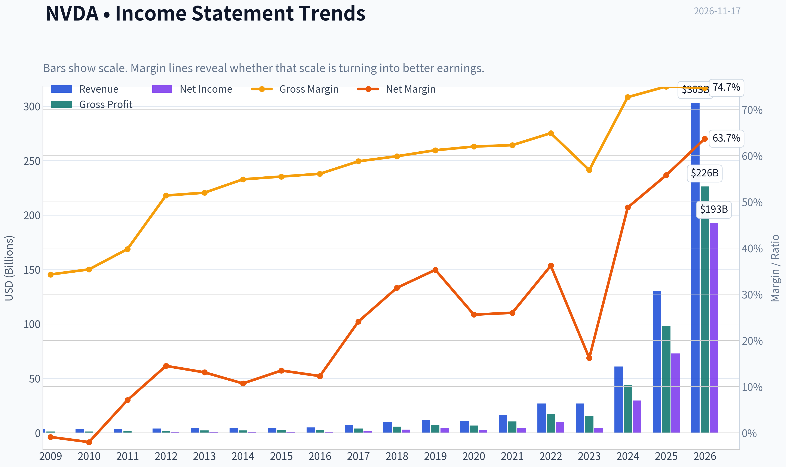

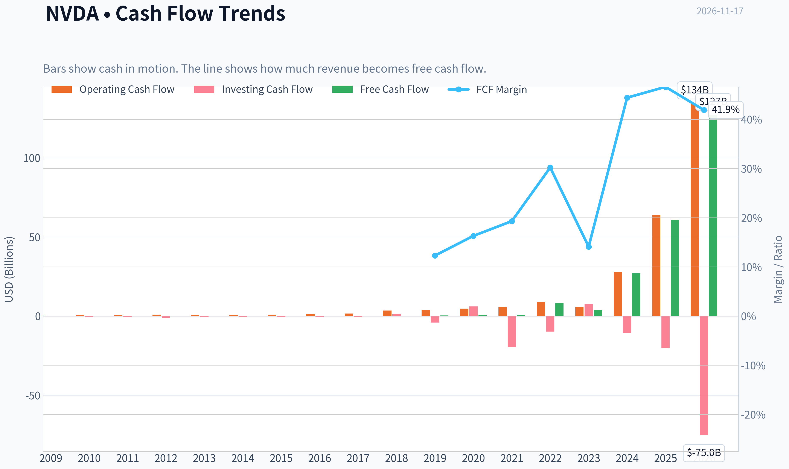

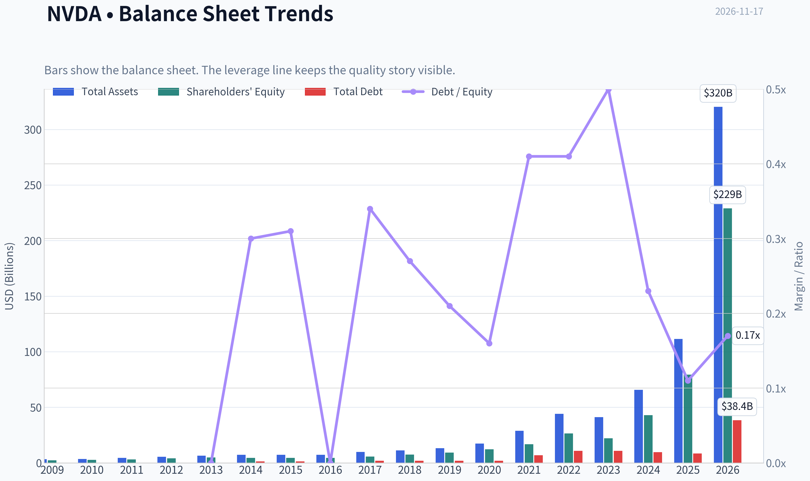

This graph tracks the profitability and return metrics (ROE, ROIC, Margins) of **NVDA** over the past decade, highlighting capital efficiency trends.

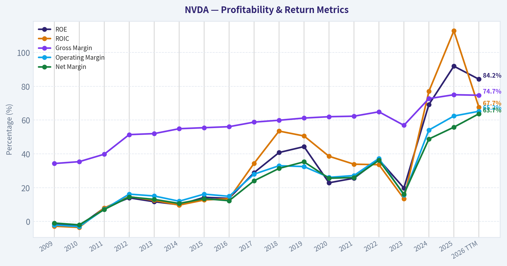

This chart illustrates the financial health of **NVDA** over the last 10 years, mapping cash equivalents and free cash flow against total obligations (Debt).

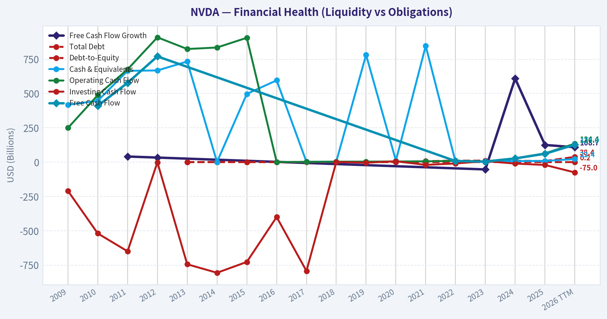

This comparison chart from *Current Market and Profitability Snapshot* stacks current figures against historical benchmarks for **NVDA**, making it easy to see where the company trades relative to its own averages.

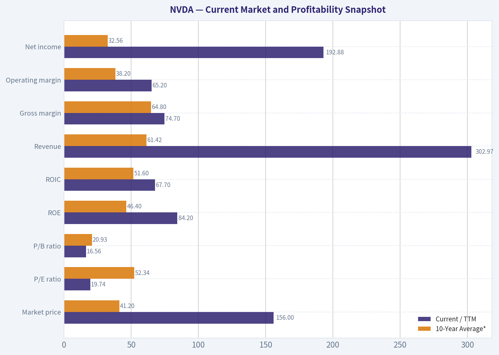

This breakdown chart from <em>Revenue Breakdown</em> shows the proportional composition for **NVDA** - useful for understanding what drives or risks the business.

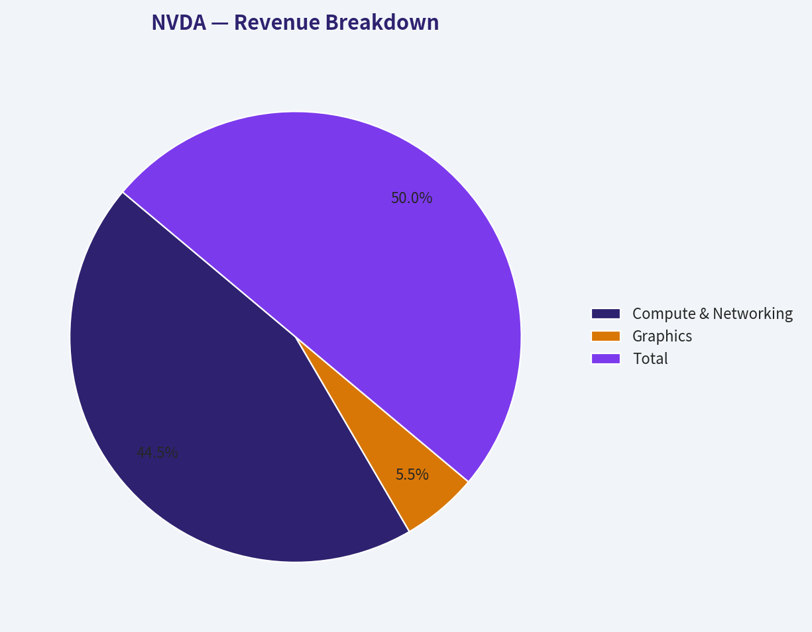

---

### Intrinsic Value Analysis (Buffett)

> *Following Warren Buffett's value investing philosophy: Circle of Competence, Economic Moat, Management Quality, and Margin of Safety.*

#### Intrinsic Value Snapshot

Price is what you pay. Intrinsic value is what the business may be worth based on the cash it can create for owners over time. We show a range, not one magic number.

- Current Price: $156.14
- Value Range (conservative to optimistic across both DCF methods): $107.78 to $900.63

##### Owner Earnings (Buffett Method)
- Net Income: $72,880,000,000.00
- Depreciation & Amortization: $2,843,000,000.00
- Capital Expenditures: $-6,042,000,000.00
- Working Capital Changes: $-15,949,000,000.00
- Owner Earnings: $82,263,000,000.00

##### Intrinsic Value
###### Buffett Method
Uses owner earnings. Stricter, and usually more conservative.
- Conservative: $107.78
- Average: $345.43
- Optimistic: $900.63
- Discount Rate: 10.0%

###### Cash Flow Method
Uses free cash flow. Better for companies spending heavily today to grow tomorrow.
- Conservative: $187.49
- Average: $187.49
- Optimistic: $489.31
- Discount Rate: 10.0%

ANALYST STANCE: **Bullish**

#### Executive Conclusion

NVIDIA is an exceptional modern compounder with a wide and still-widening moat in accelerated computing, AI software, developer ecosystems, and high-performance networking. Its financial profile is extraordinary: 71.1% gross margin, 76.3% ROE, 65.5% recent revenue growth, and strong cash generation.

At $156 per share, the stock is not cheap on conventional free-cash-flow yield-approximately 2.6%-but the valuation is supported by a durable competitive position and substantial reinvestment runway. The research valuation pack indicates headline intrinsic value of $203.56, or approximately 23.3% upside. That is an adequate margin of safety for a business of this quality, although the cyclical nature of semiconductor demand and extremely high AI expectations warrant moderate rather than maximum conviction.

#### Factor Scorecard

| Factor | Score | Assessment |
|---|---:|---|
| Business simplicity and predictability | 3/5 | NVIDIA designs computing platforms and sells chips, systems, networking, and software. The model is understandable, but semiconductor cycles, product transitions, and AI demand make long-term forecasting less certain. |
| Durable competitive advantage | 5/5 | CUDA, developer lock-in, integrated systems, ecosystem scale, software libraries, networking, and customer adoption create a powerful platform moat. |
| Management and capital allocation | 4/5 | Jensen Huang has demonstrated exceptional long-term vision, aggressive reinvestment, and strong execution. Capital allocation has prioritized growth opportunities rather than financial engineering. |
| Industry structure | 3/5 | The AI accelerator market has attractive economics but intense technological competition, major customer concentration, export restrictions, and significant cyclicality. |
| Gate 5: financial distress | **Not tripped** | Earnings and cash generation are strong, valuation is supported by substantial profitability, and there is no evidence of a solvency crisis. |

**Key Takeaways:** NVIDIA scores strongest on competitive advantage and management execution. Its principal weaknesses are not financial distress but rather cyclical exposure, competitive intensity, and the difficulty of forecasting AI infrastructure demand over a full decade.

#### Financial Snapshot

| Metric | Latest available figure |
|---|---:|
| Share price | $156 |
| Market capitalization | $3.77 trillion |
| P/E ratio | 19.7x |
| Revenue growth, year over year | 65.5% |
| Gross margin | 71.1% |
| ROE | 76.3% |
| Free-cash-flow yield | 2.6% |
| Implied annual free cash flow | Approximately $98 billion |
| Current ratio | 3.9x |
| Reverse-DCF price-implied growth | Approximately 7.3% annually for 10 years |
| Three-year revenue growth | 110.8% annualized |
| Five-year revenue growth | 96.7% annualized |

**Key Takeaways:** NVIDIA combines unusually high growth with unusually high profitability. The market price implies approximately 7.3% annual growth for ten years, materially below NVIDIA's recent trajectory, but that assumption is still demanding because the company is already valued at nearly $4 trillion.

#### Moat Analysis

**1. Intangible assets and ecosystem lock-in**

CUDA is the central strategic asset. NVIDIA does not merely sell processors; it provides the software libraries, development tools, programming environment, and optimized applications that allow customers to use those processors efficiently.

A competing chip can be theoretically attractive while still being commercially inferior if developers must rewrite software, retrain teams, or accept weaker performance. This creates meaningful switching costs.

**2. Scale and cost advantages**

NVIDIA's scale supports enormous research-and-development spending, rapid product launches, and deep relationships with leading cloud providers and system manufacturers. Its 71.1% gross margin demonstrates significant pricing power and reflects more than ordinary semiconductor manufacturing economics.

**3. Network effects**

The more developers who use CUDA, the more applications are optimized for NVIDIA. The more applications support NVIDIA, the more attractive the platform becomes to enterprises and cloud providers. This is a reinforcing ecosystem rather than a simple chip-vendor relationship.

**4. Full-stack systems advantage**

NVIDIA increasingly sells complete accelerated-computing systems, including GPUs, CPUs, networking, interconnects, and software. This raises the competitive hurdle because customers evaluate total system performance rather than merely comparing an individual chip.

**5. Moat risks**

The moat is wide, but it is not invulnerable. AMD, custom chips designed by hyperscalers, emerging AI accelerators, export controls, customer concentration, and potential reductions in AI infrastructure spending are meaningful risks. The moat rating is therefore **wide and widening**, but with greater cyclical and technological risk than a traditional consumer-staples franchise.

#### Management Quality and Capital Allocation

Jensen Huang has operated with a long-term owner mentality. NVIDIA repeatedly invested ahead of visible demand in graphics processing, CUDA, deep learning, networking, and full-stack AI systems. Those investments appeared excessive at various points but ultimately created the company's current strategic position.

Management has also shown willingness to shift the business materially when technology changes. NVIDIA moved from a graphics-centric company toward a broader accelerated-computing platform without abandoning its core strengths.

The primary management risk is not poor stewardship but the possibility that current spending and product expectations become too aggressive. The company must continue converting extraordinary demand into durable per-share cash flow rather than merely pursuing market share.

#### Owner Earnings Calculation

A practical owner-earnings estimate begins with free cash flow because NVIDIA's business is relatively asset-light compared with traditional manufacturers.

| Owner-earnings component | Approximate amount |
|---|---:|
| Implied free cash flow from 2.6% yield on $3.77 trillion market value | $98 billion |
| Less: normalized maintenance-capital reserve | Not separately disclosed in the supplied data |
| Working-capital adjustment | Not separately disclosed in the supplied data |
| Practical normalized owner-earnings proxy | Approximately $90-98 billion |

**Key Takeaways:** NVIDIA's cash generation is substantial, but reported free cash flow is influenced by a rapidly expanding business and therefore may include investment spending that is partly growth-related. A conservative owner-earnings approach uses roughly $90-98 billion as the current cash-generation base rather than assuming all reported cash flow is permanently distributable.

#### Three-Scenario DCF Valuation

The valuation pack provides three model outputs: owner-earnings DCF of $345.43 per share, FCF-based valuation of $187.49, and Damodaran FCFF valuation of $31.20. The large spread reflects the difficulty of valuing a hyper-growth, cyclical semiconductor company.

| Scenario | Valuation approach | Value per share |
|---|---|---:|
| A: No-growth / highly conservative | FCF-style perpetuity using approximately $98 billion of current cash flow at a 10% discount rate | Approximately $40-41 |
| B: GDP-growth case | Cash flow grows at 3% perpetually at a 10% discount rate | Approximately $59-60 |
| C: Normalized growth case | Approximately 7.5% annual growth for 10 years, followed by 3% terminal growth | Approximately $82 |
| Research-pack owner-earnings DCF | Higher normalized owner-earnings assumptions | $345.43 |
| Research-pack FCF valuation | FCF-based model | $187.49 |
| Research-pack Damodaran FCFF valuation | More conservative FCFF model | $31.20 |
| Headline blended intrinsic value | Weighted blend of the valuation methods | **$203.56** |

**Key Takeaways:** The conservative mechanical scenarios understate NVIDIA's value if its ecosystem continues to produce high returns on reinvestment, while the owner-earnings model may be optimistic if AI infrastructure spending normalizes sharply. The blended value of $203.56 is a reasonable central estimate, but the unusually wide model spread demands position sizing discipline.

#### Margin of Safety Analysis

At a current price of $156:

| Valuation reference | Implied upside or downside |
|---|---:|
| Headline blended intrinsic value: $203.56 | +30.5% |
| Stated research-pack margin of safety | 23.3% |
| FCF valuation: $187.49 | +20.2% |
| Owner-earnings DCF: $345.43 | +121.4% |
| Damodaran FCFF valuation: $31.20 | -80.0% |

**Key Takeaways:** The central valuation indicates a moderate margin of safety, appropriate for a wide-moat compounder. However, the Damodaran FCFF result shows how vulnerable the valuation is to lower growth, higher discount rates, or a sharper normalization of AI-related cash flows. The price is acceptable for a long-term investor, but not so cheap that execution risks can be ignored.

#### Buffett Scorecard

| Criterion | Weight | Score | Weighted contribution |
|---|---:|---:|---:|
| Moat width and durability | 25% | 5/5 | 1.25 |
| Valuation and margin of safety | 20% | 3/5 | 0.60 |
| Capital returns versus WACC | 15% | 5/5 | 0.75 |
| Business understanding and predictability | 12% | 3/5 | 0.36 |
| Management quality and capital allocation | 12% | 4/5 | 0.48 |
| Reinvestment runway | 8% | 5/5 | 0.40 |
| Balance-sheet strength | 4% | 5/5 | 0.20 |
| Industry structure | 4% | 3/5 | 0.12 |
| **Total** | **100%** |  | **4.16/5** |

**Key Takeaways:** NVIDIA's weighted score exceeds the threshold for an advocate stance because its moat, returns on capital, management, and reinvestment opportunity are exceptional. The valuation score is not perfect because the business is cyclical and the valuation depends heavily on sustained AI investment.

#### Principal Risks

| Risk | Investment implication |
|---|---|
| AI capital-spending normalization | Cloud providers may slow infrastructure purchases after the current buildout. |
| Competition | AMD, custom hyperscaler chips, and new accelerator architectures could pressure pricing or market share. |
| Customer concentration | A small number of major cloud and technology customers account for a large portion of demand. |
| Export restrictions | Geopolitical controls can limit access to important markets and customers. |
| Product-cycle risk | A delayed or weaker architecture transition could create a sharp earnings reset. |
| Valuation sensitivity | Even a great business can produce poor returns if growth falls materially below expectations. |

#### Investment Stance

**Bullish - Moderate conviction**

NVIDIA is one of the strongest businesses in the market, not merely one of the strongest semiconductor companies. Its combination of ecosystem lock-in, software advantages, scale, pricing power, high returns on capital, and reinvestment runway is consistent with Buffett-style ownership of a modern platform business.

At $156, the stock appears reasonably attractive for a long-term investor using the blended intrinsic value of approximately $203.56. The appropriate approach is to build or maintain a position gradually rather than make an outsized purchase, because the company's extraordinary recent growth creates equally extraordinary expectations. The investment thesis remains intact unless NVIDIA's ecosystem moat weakens, returns on capital deteriorate materially, or AI infrastructure demand proves substantially more cyclical than expected.
#### Valuation Bridge

This bridge places the current market price beside each intrinsic value lens so readers can see whether upside depends on one method or shows up across several methods.

| Scenario | Intrinsic Value / Share |
| --- | ---: |
| Buffett Method | $345.43 |
| Cash Flow Method | $187.49 |
| Damodaran Method | $31.20 |
| Current Price | $156.14 |

#### Key Takeaways

If one method is far above the others, the upside case depends on a specific modelling assumption. When several methods cluster together, the valuation story is more robust.

#### Valuation Visuals

This comparison chart from *Latest Earnings Snapshot* stacks current figures against historical benchmarks for **NVDA**, making it easy to see where the company trades relative to its own averages.

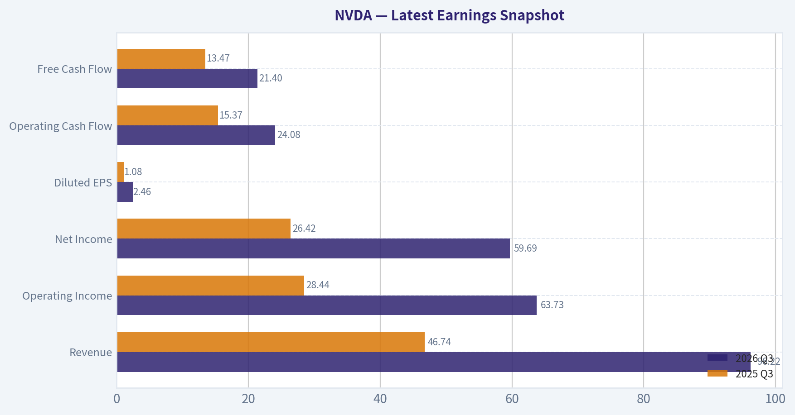

This comparison chart from *Current Valuation Versus Historical Norms* stacks current figures against historical benchmarks for **NVDA**, making it easy to see where the company trades relative to its own averages.

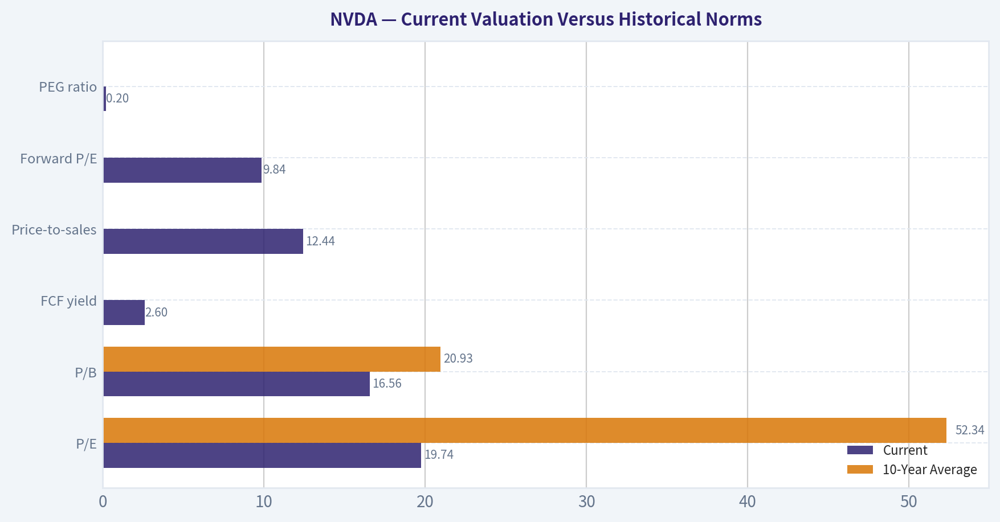

This comparison chart from *Financial Snapshot* stacks current figures against historical benchmarks for **NVDA**, making it easy to see where the company trades relative to its own averages.

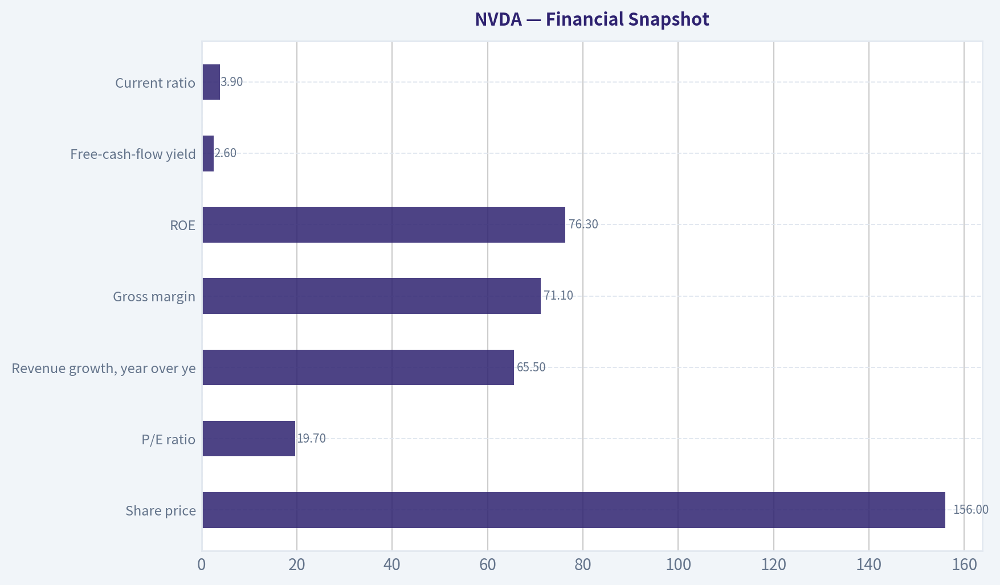

---

### Trend & Growth Analysis (Lynch/Druckenmiller/Fisher)

> *Following Peter Lynch's GARP, Stanley Druckenmiller's macro-aware approach, and Philip Fisher's scuttlebutt methodology.*

ANALYST STANCE: **Bullish**

#### Executive view

NVIDIA remains a rare combination of exceptional growth, dominant competitive positioning, and strong financial quality. The central debate is no longer whether AI demand exists; it is whether hyperscaler and enterprise AI spending can remain strong enough to justify NVIDIA's very large market capitalization.

At the supplied price of **$156**, the setup is attractive on reported earnings growth, but not low-risk. The stock is best treated as a high-quality fast grower with cyclical and expectation risk. I would favor a measured position rather than an oversized one.

#### 1. Lynch classification

**Fast Grower, with emerging Stalwart characteristics.**

NVIDIA's reported year-over-year revenue growth is **65.5%**, far above the 15-25% threshold for a fast grower. However, its $3.77 trillion market capitalization means future returns will increasingly depend on sustaining very high growth, expanding into new markets, and avoiding a major AI-capex slowdown.

#### 2. The story in three bullets

- NVIDIA supplies the computing platform for the AI infrastructure buildout, including accelerators, networking, software, and systems.
- Its CUDA ecosystem, developer adoption, software stack, and full-platform architecture create switching costs beyond the raw semiconductor itself.
- Growth can continue if AI moves from training into inference, enterprise applications, sovereign AI, robotics, simulation, and accelerated computing.

#### 3. TAM and 10x test

| TAM consideration | Assessment |
|---|---|
| Primary markets | AI accelerators, data-center systems, networking, software, inference, robotics, and accelerated computing |
| TAM direction | Rapidly expanding, driven by AI adoption and increasing compute intensity |
| Current market position | Category leader with unusually strong ecosystem advantages |
| 10x revenue test | Not fully verifiable from the supplied data because current revenue and a current TAM estimate were not provided |
| Practical conclusion | A 10x outcome is possible only if NVIDIA expands beyond today's accelerator market into broader AI infrastructure and software |

**Key Takeaways:** NVIDIA's runway is much larger than a single chip category because its opportunity includes complete AI infrastructure and software. The 10x test cannot be calculated precisely without current revenue and TAM figures, but the company could still grow substantially if inference, enterprise AI, networking, and robotics become large profit pools.

#### 4. Revenue growth trend

| Metric | Current evidence | Interpretation |
|---|---:|---|
| Revenue growth, year over year | 65.5% | Exceptional fast-grower profile |
| Three-year trailing growth | 110.8% annualized figure supplied | Demonstrates a major multi-year acceleration cycle |
| Five-year trailing growth | 96.7% annualized figure supplied | Confirms the scale of the AI-driven transformation |
| Growth pattern | Very high, but subject to difficult comparisons | Future deceleration is likely even if dollar growth remains strong |

**Key Takeaways:** NVIDIA has experienced an extraordinary growth inflection rather than ordinary semiconductor cyclicality. The key question is not whether growth slows from 65.5%, but whether it settles at a durable level above 20-25% after the current AI investment surge matures.

#### 5. Unit economics and operating quality

| Measure | Available data | Assessment |
|---|---:|---|
| Gross margin | 71.1% | Exceptional for a hardware company; supports pricing power and software/platform economics |
| ROE | 76.3% | Very strong capital productivity |
| Current ratio | 3.91 | Strong liquidity |
| FCF yield | 2.6% | High-quality cash generation, but valuation still embeds substantial growth |
| NRR | Not disclosed in supplied data | Not directly applicable as a conventional SaaS metric |
| LTV/CAC | Not disclosed | Not meaningful in the standard subscription sense |
| Rule of 40 | Not applicable without recurring-revenue FCF margin | NVIDIA is better assessed through growth, gross margin, FCF, and return on capital |

**Key Takeaways:** NVIDIA's gross margin, ROE, and liquidity are major strengths. SaaS-style NRR and LTV/CAC metrics are not appropriate for this business, so the more important indicators are data-center demand, customer concentration, product pricing, inventory, free-cash-flow conversion, and sustained return on capital.

#### 6. Inflection-point assessment

| Potential inflection | Evidence | View |
|---|---|---|
| Product cycle | Accelerated-computing and AI system demand | Positive |
| Market share | Dominant ecosystem and platform position | Positive, but competitors are investing aggressively |
| Margin | 71.1% gross margin | Strong; monitor mix and pricing |
| TAM | AI expanding from training into inference and enterprise use | Positive |
| Competitive landscape | AMD, custom chips, and hyperscaler silicon remain threats | Manageable but material |
| Earnings expectations | Market increasingly focused on execution and risk | Near-term bar is very high |

**Key Takeaways:** The largest positive inflection is the expansion of AI from model training into inference and broader enterprise workloads. The largest risk is that NVIDIA's success has raised expectations so high that merely excellent results may not be enough to support the share price.

#### 7. Macro setup

The secular macro backdrop remains favorable: AI infrastructure spending, cloud computing, automation, cybersecurity, and accelerated computing all support NVIDIA.

The main macro risks are:

- Higher interest rates or a risk-off market reducing tolerance for mega-cap growth.
- Hyperscaler capital-expenditure reductions.
- Export controls and geopolitical restrictions.
- A semiconductor inventory or digestion cycle after an unusually strong investment period.

Druckenmiller's framework would classify NVIDIA as a powerful secular leader, but one vulnerable to a macro liquidity shock or an abrupt change in AI spending expectations. The stock is more attractive when rates are stable or falling and when hyperscaler capex remains firm.

#### 8. Fisher's 15-point score

Scores are analytical estimates based on the supplied fundamentals and NVIDIA's widely evident business characteristics. A full scuttlebutt process would require direct customer, supplier, employee, and competitor checks.

| Fisher criterion | Score / 5 |
|---|---:|
| Market potential | 5 |
| New-product determination | 5 |
| R&D effectiveness | 5 |
| Sales organization | 5 |
| Profit margins | 5 |
| Margin improvement potential | 4 |
| Labor and personnel relations | 3 |
| Executive relations and communication | 4 |
| Management depth | 4 |
| Cost analysis and accounting | 4 |
| Competitive advantages | 5 |
| Long-range profit outlook | 5 |
| Dilution risk | 4 |
| Candor during difficulties | 4 |
| Management integrity | 4 |
| **Total** | **66 / 75** |

**Key Takeaways:** NVIDIA scores in Fisher's outstanding category at 66 out of 75. Its strongest attributes are market potential, R&D, sales execution, margins, and ecosystem advantages; the principal uncertainties are employee-related factors, management succession, and the durability of AI demand at its current scale.

#### 9. Valuation analysis

| Valuation measure | Result | Interpretation |
|---|---:|---|
| Current price | $156 | Reference price supplied |
| Market capitalization | $3.77 trillion | Extremely large base requiring sustained execution |
| P/E | 19.7x | Appears moderate relative to the supplied growth rate |
| Revenue growth | 65.5% | Produces an unusually low simple PEG |
| Simple PEG | Approximately 0.30 | Attractive mechanically, but potentially distorted by cyclical peak earnings |
| FCF yield | 2.6% | Implies a premium valuation on current free cash flow |
| Headline intrinsic value | $203.56 | Implies approximately 23.3% upside |
| Reverse DCF implied growth | Approximately 7.3% annually for 10 years | Indicates the market price does not require a repeat of recent 100% growth |
| Model range | $31.20 to $345.43 | Very wide; valuation is highly assumption-sensitive |

**Key Takeaways:** The headline valuation is attractive if current earnings are durable, with the supplied intrinsic value implying meaningful upside. However, the extremely wide valuation-model range shows that NVIDIA's fair value depends heavily on assumptions about cyclicality, terminal margins, and the persistence of AI demand. The low PEG should therefore be treated as supportive evidence, not as a standalone buy signal.

#### 10. Growth investor scorecard

| Criterion | Weight | Score / 5 | Weighted contribution |
|---|---:|---:|---:|
| Lynch story | 10% | 4.8 | 0.48 |
| TAM and runway | 20% | 4.7 | 0.94 |
| Revenue growth | 20% | 4.9 | 0.98 |
| Unit economics | 15% | 4.5 | 0.68 |
| Competitive position | 10% | 4.8 | 0.48 |
| Management quality | 10% | 4.4 | 0.44 |
| Macro setup | 5% | 3.8 | 0.19 |
| Profitability path | 5% | 4.9 | 0.25 |
| Valuation | 5% | 3.8 | 0.19 |
| **Total** | **100%** |  | **4.63 / 5.00** |

**Key Takeaways:** NVIDIA scores 4.63 out of 5, placing it in the high-conviction Advocate range. The score is powered by exceptional growth, margins, competitive positioning, and runway, while macro uncertainty and valuation sensitivity prevent a perfect score.

#### 11. Position-size stance

- **Existing investors:** Hold or selectively add on material pullbacks, provided AI infrastructure demand remains intact.
- **New investors:** Initiate gradually rather than buying the full position immediately.
- **Suggested initial position:** Approximately **3-5% of a diversified portfolio**.
- **Higher-conviction ceiling:** Approximately **5-8%**, only for investors able to tolerate semiconductor cyclicality, geopolitical risk, and substantial volatility.

This is an Advocate for a multi-year investor, not a recommendation to chase an earnings-driven price spike.

#### 12. Key risks and catalysts

| Catalysts | Risks |
|---|---|
| Continued hyperscaler AI capital expenditure | AI-capex digestion or spending cuts |
| Strong Blackwell and subsequent product ramps | Product delays, supply constraints, or launch problems |
| Inference demand exceeding training demand | Custom chips and AMD taking share |
| Enterprise and sovereign AI adoption | Export controls and geopolitical restrictions |
| Expansion of networking, software, and full systems | Gross-margin compression or adverse product mix |
| Robotics and physical AI adoption | Valuation contraction if growth decelerates sharply |

**Key Takeaways:** The most important catalyst is evidence that AI demand is broadening from training into recurring inference and enterprise workloads. The most important risk is a mismatch between still-excellent operating performance and investor expectations that have become exceptionally demanding.

#### Final conclusion

NVIDIA is one of the strongest growth companies in the market and fits Lynch, Druckenmiller, and Fisher's frameworks unusually well. Its AI platform leadership, 71.1% gross margin, 76.3% ROE, and 65.5% revenue growth support an **Bullish** stance.

The investment is not risk-free: the company is enormous, customer concentration is likely meaningful, competition is intensifying, and the stock is exposed to AI-spending cycles. The appropriate approach is to own it with discipline, monitor forward growth and hyperscaler capex closely, and add during periods when expectations reset rather than when enthusiasm peaks.

#### Growth & Scorecard Visuals

This comparison chart from *Growth, Balance Sheet, and Cash Flow* stacks current figures against historical benchmarks for **NVDA**, making it easy to see where the company trades relative to its own averages.

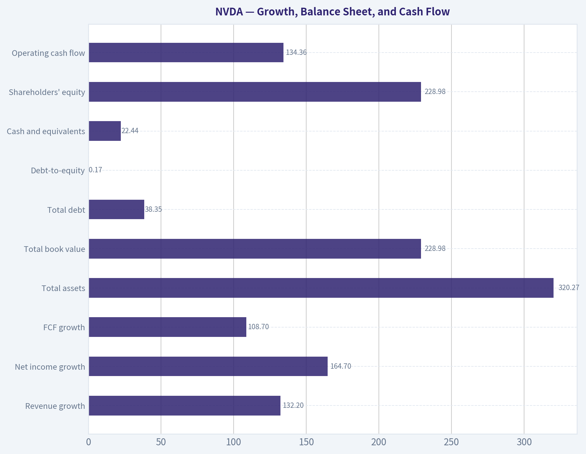

---

### Market Technical Analysis

ANALYST STANCE: **Bearish**

#### NVDA Technical Analysis - Latest Available Data

The latest available trading session is **November 16, 2026**, because November 17 is identified as a non-trading day by the data feed. NVDA closed at **$156.14**, extending a severe decline from its October 6 high of **$243.37**. That represents a drawdown of approximately **35.8%** from the recent peak and leaves the stock about **16.1% below** its November 2025 starting price of $186.15.

The technical picture is decisively bearish across trend, momentum, and volume-weighted measures. However, the stock is also deeply oversold, meaning a sharp countertrend rebound is possible even though the primary trend remains unfavorable.

#### Trend Structure

NVDA is trading substantially below every selected moving-average benchmark:

- **10 EMA:** $176.12
- **50 SMA:** $213.15
- **200 SMA:** $203.75
- **VWMA:** $176.58
- **Latest close:** $156.14

The close is approximately **11.3% below the 10-day EMA**, **26.8% below the 50-day SMA**, and **23.4% below the 200-day SMA**. This is not merely a small pullback beneath moving-average support; it is a broad breakdown across short-, medium-, and long-term reference points.

The 10-day EMA has fallen sharply from approximately $223 in mid-October to $176.12, while the 50-day SMA has declined from roughly $223 to $213.15. The 200-day SMA has only recently begun turning lower, moving from approximately $203.75 in late October to $203.75 on November 16 after peaking near $204.4. This suggests that the long-term trend has deteriorated more slowly than the short-term trend, but the price is now decisively below the long-term benchmark.

The 50-day SMA remains slightly above the 200-day SMA, so a formal death cross has not yet been confirmed in the supplied data. Nevertheless, the narrowing distance between those averages, combined with the steep price breakdown, creates a credible risk of a future bearish crossover if NVDA cannot recover quickly.

#### Momentum and MACD

MACD momentum has deteriorated persistently:

- MACD declined from approximately **-0.77 on October 19** to **-15.37 on November 16**.
- The MACD histogram was **-4.22** on November 16.
- The histogram has remained negative throughout the available late-October-to-November period.

This indicates that downside momentum is not limited to a single isolated selloff. The MACD line is substantially below zero, and the negative histogram shows that the MACD line remains below its signal line. There is no confirmed bullish momentum reversal yet.

The acceleration in the MACD decline aligns with the sharp sequence of lower closes from approximately $204.64 on October 30 to $156.14 on November 16. Until the MACD histogram begins rising toward zero and the MACD line stabilizes, rallies should be treated as potentially corrective rather than as evidence of a new sustainable uptrend.

#### RSI and Oversold Conditions

The RSI was **22.7** on November 16, well below the conventional oversold threshold of 30. It has remained below 30 for much of the latest selloff, reaching values near 24-29 on several sessions.

This confirms unusually weak momentum, but it does not by itself establish a durable bottom. In a strong liquidation phase, RSI can remain oversold for an extended period. The decline from $181.60 on November 5 to $156.14 on November 16 occurred despite already depressed RSI readings, demonstrating that oversold conditions have not yet produced reliable support.

A more constructive signal would require RSI to recover above 30 and preferably establish a higher low while price holds above a prior swing low. Until then, oversold RSI indicates elevated rebound potential, not a confirmed buy signal.

#### Volatility and Risk

ATR increased from approximately **$5.9-$6.1** in late October to **$9.85** on November 16. At the latest closing price, that ATR represents roughly **6.3% of the stock price per session**, an extremely large expected daily movement for a mega-cap stock.

The elevated ATR has important practical implications:

- Position sizes should be materially smaller than normal.
- Stops placed too close to the entry price may be triggered by ordinary daily volatility.
- A one-ATR move from $156.14 would imply a broad short-term range of roughly **$146.29 to $165.99**.
- Risk should be assessed using percentage exposure and volatility-adjusted sizing rather than fixed dollar stops.

The unusually wide daily ranges on November 9-12, including the November 12 low near $148.80, indicate that liquidity and investor confidence have been severely disrupted. This increases gap risk and makes technical levels less reliable until volatility contracts.

#### Volume and Selling Pressure

The volume-weighted moving average was approximately **$176.58**, well above the latest close. This confirms that the price is trading below the level at which substantial recent trading volume was transacted.

The selloff was accompanied by extraordinary volume:

- November 9: approximately **462.7 million shares**
- November 10: approximately **429.3 million**
- November 11: approximately **339.2 million**
- November 12: approximately **747.7 million**
- November 13: approximately **365.8 million**
- November 16: approximately **331.4 million**

The November 12 volume spike, combined with a decline to an intraday low of $148.80, may represent capitulation or forced liquidation. However, capitulation volume is not automatically bullish. It becomes more meaningful when followed by stabilization, declining volume on further weakness, and a reclaim of short-term moving averages. The current VWMA and EMA readings show that such confirmation has not yet occurred.

#### Price Levels and Trading Interpretation

The immediate downside reference is the **$148.80 intraday low from November 12**. A decisive break below that level would signal that the current liquidation phase is continuing and could expose NVDA to further price discovery.

On the upside, the first meaningful resistance zone is approximately **$166-$174**, encompassing recent closing and intraday reaction areas. A stronger recovery would need to reclaim the **$176-$181** region, where the 10-day EMA, VWMA, and recent breakdown levels cluster. Even a move back above $181 would initially represent a rebound within a damaged trend rather than a confirmed long-term reversal.

For a more credible trend repair, NVDA would need to:

1. Hold above the $148.80-$156 area.
2. Produce higher lows rather than repeated breakdowns.
3. Recover above the $176-$181 short-term resistance zone.
4. Push RSI back above 30 and preferably toward 50.
5. Reduce the negative MACD histogram.
6. Eventually reclaim the declining 50-day SMA near $213.

Until several of those conditions occur, the risk-reward profile is unfavorable for aggressive long exposure. Traders seeking a tactical bounce should use smaller size, volatility-adjusted risk controls, and confirmation from price and momentum rather than relying solely on oversold RSI.

#### Indicator Selection

The selected indicators are complementary rather than redundant:

- **10 EMA:** Captures the immediate trend and short-term recovery threshold.
- **50 SMA:** Defines medium-term trend direction and resistance.
- **200 SMA:** Provides the strategic long-term trend benchmark.
- **MACD:** Measures the direction and persistence of momentum.
- **MACD Histogram:** Shows whether bearish momentum is intensifying or easing.
- **RSI:** Identifies the severity of oversold conditions and possible divergence.
- **ATR:** Quantifies current volatility for position sizing and risk control.
- **VWMA:** Confirms whether price is trading above or below the volume-weighted cost basis of recent activity.

#### Bottom Line

NVDA is in a **high-volatility, technically damaged downtrend**. Oversold RSI and the exceptional volume spike create the possibility of a sharp relief rally, but the negative MACD, deeply declining moving averages, depressed VWMA, and rising ATR argue against treating current weakness as a confirmed bottom.

The preferred stance is to **avoid aggressive new long positions until NVDA stabilizes and reclaims at least the $176-$181 area with improving momentum**. A break below $148.80 would reinforce the bearish case, while a sustained recovery above $181 would be the first meaningful sign that selling pressure is losing control.

| Indicator / Area | Latest Reading | Technical Interpretation | Trading Relevance |
|---|---:|---|---|
| Latest close | $156.14 on Nov. 16 | Price is in a major breakdown phase | Bearish until stabilization |
| 10 EMA | $176.12 | Short-term trend is sharply bearish | First dynamic recovery threshold |
| 50 SMA | $213.15 | Medium-term trend is bearish and declining | Major overhead resistance |
| 200 SMA | $203.75 | Long-term benchmark is beginning to weaken | Price is decisively below strategic trend support |
| VWMA | $176.58 | Price is below the recent volume-weighted cost basis | Selling pressure remains dominant |
| MACD | -15.37 | Strong negative momentum | No confirmed reversal |
| MACD Histogram | -4.22 | MACD remains below its signal line | Bearish momentum is still active |
| RSI | 22.72 | Deeply oversold | Bounce risk is elevated, but no bottom confirmation |
| ATR | $9.85 | Daily volatility is exceptionally high | Use reduced position sizes and wider volatility-adjusted risk limits |
| Key support | $148.80-$156 | Recent low and current price zone | Break below $148.80 would worsen the outlook |
| Initial resistance | $166-$174 | Recent breakdown and rebound zone | Reclaim would indicate initial stabilization |
| Stronger recovery threshold | $176-$181 | Near 10 EMA and VWMA | Sustained reclaim would improve the tactical setup |

**Key Takeaways:** NVDA's trend, momentum, and volume-weighted indicators are uniformly bearish, while RSI is deeply oversold and therefore raises the probability of a short-term rebound. The stock remains below all major moving averages, and volatility is high enough that position sizing must be conservative. A move below $148.80 would signal continued deterioration, while a sustained reclaim of $176-$181 would provide the first meaningful evidence of stabilization.

---

### Options Market Analysis

> *Reading options flow - put/call ratios, IV skew, and unusual activity - to gauge institutional positioning and event-driven risk.*

ANALYST STANCE: **Bullish**

#### NVDA Options Market Report

**As of November 17, 2026.** The data covers expirations from November 18 through November 23, so positioning is concentrated in the next several trading sessions. The supplied dataset does not include NVDA's current share price, which limits precise ITM, ATM, and OTM classification for individual strikes.

#### 1. Put/Call Ratio Analysis

| Expiration | Days to Expiry | Call OI | Put OI | Put/Call OI | Call Volume | Put Volume | Put/Call Volume |
|---|---:|---:|---:|---:|---:|---:|---:|
| Nov. 18 | 1 | 244,047 | 196,689 | 0.81 | 295,662 | 232,864 | 0.79 |
| Nov. 20 | 3 | 1,453,238 | 965,092 | 0.66 | 349,892 | 220,596 | 0.63 |
| Nov. 23 | 6 | 44,020 | 24,328 | 0.55 | 33,850 | 25,369 | 0.75 |
| **Total** | - | **1,741,305** | **1,186,109** | **0.68** | **679,404** | **478,829** | **0.70** |

**Key Takeaways:** The aggregate put/call OI ratio of 0.68 and volume ratio of 0.70 are slightly more call-heavy than the approximately 0.70 neutral baseline. The strongest bullish skew is in the November 20 expiration, where the OI ratio is 0.66 and volume ratio is 0.63. The November 18 ratio of 0.81 is more defensive, suggesting some near-term hedging into the immediate expiry.

#### 2. Implied Volatility Assessment

| Expiration | Call ATM IV | Put ATM IV | Put Premium to Call IV | Interpretation |
|---|---:|---:|---:|---|
| Nov. 18 | 3.1% | 4.9% | +1.8 percentage points | Clear near-term put skew |
| Nov. 20 | 3.1% | 4.7% | +1.6 percentage points | Downside protection priced higher |
| Nov. 23 | 2.3% | 1.8% | -0.5 percentage points | Mild call-side skew |

**Key Takeaways:** Near-term puts carry materially higher implied volatility than calls for the November 18 and November 20 expirations, indicating demand for downside protection. The overall volatility levels reported are low in absolute terms, but the front-end put skew is meaningful. If NVDA has an earnings or other company-specific catalyst during this window, the put premium suggests traders are paying for event protection even though aggregate positioning remains call-leaning.

The dataset does not confirm a specific catalyst. The November 18 expiration should therefore be treated as event-sensitive, but the earnings calendar should be independently verified.

#### 3. Unusual Options Activity

All listed unusual contracts expire November 18, or approximately one day from the report date. Each contract had volume greater than five times open interest, which is consistent with potentially fresh activity rather than merely large existing positions changing hands.

| Strike | Type | Volume | Open Interest | Volume/OI | Moneyness Assessment* | Positioning Implication |
|---:|---|---:|---:|---:|---|---|
| $140 | Call | 2,694 | 277 | 9.7x | Near apparent ATM zone | Strong short-dated upside speculation or call spread activity |
| $138 | Call | 1,953 | 248 | 7.9x | Near apparent ATM zone | Bullish directional interest |
| $142 | Call | 1,669 | 206 | 8.1x | Near apparent ATM zone | Upside breakout speculation |
| $139 | Call | 1,360 | 187 | 7.3x | Near apparent ATM zone | Bullish near-term positioning |
| $130 | Call | 1,245 | 91 | 13.7x | Likely lower-strike / potentially ITM | Could represent leveraged upside exposure or call spreads |
| $128 | Call | 925 | 131 | 7.1x | Lower-strike / potentially ITM | More directional or hedging-related call positioning |
| $135 | Call | 892 | 123 | 7.3x | Lower-strike / near ATM | Bullish exposure |
| $141 | Call | 874 | 118 | 7.4x | Near apparent ATM zone | Upside speculation |
| $132 | Call | 852 | 137 | 6.2x | Lower-strike / near ATM | Bullish exposure |
| $133 | Call | 772 | 75 | 10.3x | Lower-strike / near ATM | Fresh call activity |
| $131 | Call | 682 | 70 | 9.7x | Lower-strike / potentially ITM | Directional upside exposure |
| $134 | Call | 557 | 77 | 7.2x | Lower-strike / near ATM | Bullish exposure |

\*The exact NVDA spot price was not supplied. Moneyness labels are therefore approximate, based on the concentration of activity around the $138-$142 area, which appears to be the market's near-term ATM region.

**Key Takeaways:** Unusual activity is overwhelmingly concentrated in calls, with every flagged contract being a call and volume ranging from 6.2 to 13.7 times open interest. The $138-$142 strikes appear to be the main short-term upside battleground, while the $130-$135 calls may reflect deeper-in-the-money exposure or call-spread structures. The one-day expiration makes this activity high-risk and potentially retail-driven speculation; without trade size, bid/ask execution, or sweep data, it cannot be definitively labeled institutional.

#### 4. Open Interest Concentration and Gamma Levels

| Expiration | Total OI | Share of Near-Term OI | Market Significance |
|---|---:|---:|---|
| Nov. 18 | 440,736 | 15.1% | Immediate expiry and potential high gamma sensitivity |
| Nov. 20 | 2,418,330 | 82.6% | Dominant OI concentration; likely primary pinning window |
| Nov. 23 | 68,348 | 2.3% | Limited influence relative to the first two expirations |
| **Total** | **2,927,414** | **100%** | - |

**Key Takeaways:** The November 20 expiration contains approximately 83% of total near-term open interest, making it the most important expiration for potential price pinning and dealer hedging flows. Calls outnumber puts substantially at that expiry, with 1.45 million call contracts versus 965,092 puts. Exact strike-level gamma walls and max-pain levels cannot be calculated because the source did not provide strike-by-strike open interest.

The largest unusual call concentration is around the $138-$142 area. If those strikes are near the current share price, they could act as short-term upside magnets or, if dealers are short those calls, create accelerating hedging demand during a breakout. Conversely, large call open interest can also create resistance if dealers are long calls and hedge by selling stock into rallies.

#### 5. Overall Options Sentiment

| Driver | Read |
|---|---|
| Put/call OI | Mildly bullish; aggregate ratio of 0.68 |
| Put/call volume | Mildly bullish; aggregate ratio of 0.70 |
| Unusual activity | Strongly call-dominated |
| IV skew | Bearish protection skew in the two nearest expirations |
| OI concentration | Strongly concentrated in the November 20 expiry |
| Confidence | Moderate; short-dated activity and incomplete strike data reduce certainty |

**Overall Signal: BULLISH**

The primary driver is the combination of call-heavy open interest, a 0.70 aggregate put/call volume ratio, and broad unusual call activity across short-dated strikes. The main caveat is the elevated front-end put skew, which indicates meaningful downside hedging or concern around a near-term catalyst. This is best characterized as **bullish positioning with event-risk protection**, rather than an unqualified bullish signal.

#### Summary

| Category | Assessment |
|---|---|
| Put/Call Ratio | 0.68 OI and 0.70 volume; modestly more bullish than the 0.70 neutral baseline |
| IV Level | Low in absolute terms according to the supplied data; front expirations show higher put IV |
| Skew Direction | Bearish put skew for Nov. 18 and Nov. 20; slight call skew by Nov. 23 |
| Unusual Activity | Broad, high-volume call activity, especially at $138-$142 and $130-$135 |
| Overall Signal | **BULLISH**, with downside-event hedging and short-expiry risk |

**Key Takeaways:** NVDA's options market leans bullish because calls dominate both open interest and unusual volume. However, the higher implied volatility on near-term puts signals that traders are still paying for protection against a sharp catalyst-driven decline. The strongest practical conclusion is bullish short-term positioning with moderate confidence, subject to rapid gamma-driven reversals around the November 18 and November 20 expirations.

---

## Research Team Commentary

> *The Research Manager synthesizes the Bull vs Bear debate into action-free commentary. This is a pre-risk view, not the final stance.*

Core takeaway: NVIDIA is an exceptional business, but at $156 the valuation offers only a narrow, assumption-sensitive margin of safety. CUDA, the developer ecosystem, networking, and NVIDIA's full-stack architecture constitute a genuine modern moat. However, the shares appear to require roughly low-to-mid-teens free-cash-flow growth for a decade while margins remain structurally strong. That outcome is plausible, but not conservative enough to justify an Bullish rating today. The appropriate stance is Neutral rather than Bearish because neither financial distress nor clear-cut overvaluation has been demonstrated.

The strongest bull argument is that NVIDIA should be valued as an accelerated-computing platform, not as a conventional semiconductor vendor. CUDA creates meaningful switching costs through trained developers, optimized applications, libraries, deployment tools, and established workflows. Competitors can offer capable chips without immediately replicating the surrounding ecosystem. NVIDIA's integration of accelerators, networking, systems, and software further reduces deployment risk for customers.

The financial evidence supports this assessment of quality. A 71.1% gross margin, 76.3% ROE, and reported ROIC above 100% indicate extraordinary pricing power and capital efficiency. Management also deserves credit for investing in CUDA and accelerated computing long before generative AI demand became obvious. Opportunities in inference, enterprise AI, sovereign infrastructure, simulation, robotics, and scientific computing provide a credible reinvestment runway. The company does not need every opportunity to succeed for cash flow to grow substantially.

The strongest bear argument is not that AI or NVIDIA will fail. It is that current cash flows may reflect unusually favorable conditions: accelerator scarcity, urgent hyperscaler spending, limited near-term substitutes, and elevated margins. At an approximately 2.6% free-cash-flow yield, investors need considerable future growth before receiving an attractive return. The supplied DCF estimates illustrate this clearly: 10% growth produces a value near $120, 12% produces about $138, and approximately 15% is needed to reach $177. The apparent 12% discount to the $177 bull-case value can disappear with modest changes in normalized margins, discount rates, dilution, or starting cash flow.

The reported P/E of 19.74 looks much less demanding than the free-cash-flow yield, but that discrepancy should be investigated rather than used selectively. It may reflect differences between trailing and forward periods, accounting earnings and cash generation, or the treatment of working capital and stock compensation. For a Buffett-style analysis, normalized per-share owner earnings matter more than whichever headline multiple looks most favorable.

Competition also does not need to destroy CUDA to impair intrinsic value. Hyperscalers can move standardized inference workloads to internal accelerators while continuing to use NVIDIA for frontier training and flexible workloads. AMD, open software layers, and custom silicon could gradually reduce NVIDIA's share or pricing power. A decline from 71% gross margins to around 60% would still leave an excellent company, but it could materially reduce the value of the equity if accompanied by slower growth.

Customer concentration compounds this risk. NVIDIA's largest buyers are sophisticated, well-capitalized companies with strong incentives to lower their dependence on one supplier. AI can remain a transformative secular trend while hyperscaler capital spending still experiences pauses, utilization disappointments, or overbuilding. Supplier concentration, advanced-packaging constraints, Taiwan exposure, and export controls add further uncertainty. These risks make NVIDIA less predictable than a mature consumer franchise, so I would not automatically award it the minimum 10-15% required discount simply because its current returns are exceptional.

Market psychology does not settle the debate. Weak MACD readings suggest deteriorating short-term momentum, while modestly call-heavy options positioning suggests no severe capitulation. Neither has much bearing on ten-year intrinsic value. More importantly, the pullback does not yet appear to reflect deep pessimism: the valuation still assumes prolonged superior growth. There may be an opportunity if technical weakness produces a materially larger discount without corresponding moat deterioration, but that opportunity is not evident from $156 alone.

The lesson from similar situations is two-sided. We should not extrapolate peak growth, scarcity pricing, or 100% ROIC indefinitely. At the same time, we should not repeat the mistake of undervaluing intangible moats simply because they are based on software, developer adoption, and ecosystems rather than physical assets. NVIDIA's moat is real; the uncertainty concerns the duration and division of the AI profit pool. A disciplined decision must incorporate both current market conditions and normalized fundamentals rather than treating either industry enthusiasm or short-term weakness as decisive.

Over the next one to four quarters, I would monitor data-center growth relative to hyperscaler capital spending, particularly whether demand is supported by improving AI utilization and customer revenue rather than competitive urgency alone. Evidence that inference demand is broadening beyond a handful of hyperscalers, while NVIDIA retains favorable economics, would strengthen the thesis. Greater software and recurring revenue disclosure would also help demonstrate that NVIDIA is becoming a platform rather than remaining predominantly a high-end hardware supplier.

Gross margin is another key test. Moderate normalization is expected, but a rapid decline combined with slower growth would suggest scarcity economics are fading faster than ecosystem economics are expanding. I would track free-cash-flow conversion, stock-based compensation, net share dilution, inventory, receivables, purchase commitments, and whether systems expansion creates heavier working-capital demands.

Competitive evidence matters more than product-announcement headlines. Watch the adoption and total cost of ownership of AMD accelerators and hyperscaler custom chips, especially in inference. The thesis weakens if customers shift meaningful production workloads away from NVIDIA or if software portability materially reduces CUDA switching costs. Conversely, sustained demand for new NVIDIA architectures, high customer retention, and continued developer growth would support the moat.

Finally, export restrictions, product redesigns, advanced-packaging availability, and customer concentration should be reviewed each quarter. A lower share price alone would not create value if estimates are falling because the moat is weakening. A more attractive entry would come from either a materially larger valuation discount with fundamentals intact or clearer proof that normalized per-share free cash flow can compound in the mid-teens despite margin normalization.

NVIDIA is a wonderful business, but $156 does not provide enough valuation redundancy to treat the shares as a high-conviction Buffett-style purchase. Existing owners can reasonably continue holding a prudently sized position, while new capital should wait for a better price or stronger evidence that normalized cash flows support the bull-case assumptions.

Neutral

---

## Value Investing Team Commentary

> *The Investor translates the research view into an investment thesis before risk review. This is still not the final stance.*

NVIDIA is one of the highest-quality businesses in the market, but the investment case at $156 depends more on the durability of future economics than on today's reported results. The key distinction is between **an exceptional company** and **an exceptionally attractive purchase price**. NVIDIA clearly satisfies the first test; the second remains unresolved.

### Business quality: unusually strong, but not risk-free

NVIDIA's moat is broader than its GPUs. CUDA, optimized libraries, developer familiarity, systems integration, networking, and deployment tools create an ecosystem that is difficult to replicate quickly. Customers are not simply buying a chip; they are buying a functioning accelerated-computing platform with lower implementation risk.

That distinction matters. A competing accelerator may be technically capable, yet still face disadvantages in software compatibility, developer productivity, available libraries, system design, and customer support. The more AI workloads move into production, the more valuable reliability and ecosystem depth may become.

The company also has an unusually attractive financial profile:

- Approximately 71% gross margin
- Very high reported ROE and ROIC
- Strong recent revenue growth
- Significant cash-generation potential
- A large reinvestment runway in inference, networking, sovereign AI, robotics, simulation, and enterprise applications

The contrarian point is that investors should not dismiss this moat merely because it is based heavily on software, intellectual property, and developer adoption. Traditional semiconductor analysis can understate the value of an ecosystem. NVIDIA may deserve a higher-quality valuation than a cyclical chip manufacturer because its software and platform advantages can reinforce hardware demand.

However, a high ROIC above 100% should not be projected indefinitely. Such figures can be amplified by a relatively small invested-capital denominator, asset-light economics, and unusually favorable current profitability. They demonstrate excellent economics, but they do not by themselves prove that the same returns will persist after competition and customer bargaining power increase.

### Valuation: the central issue

At roughly $156, the reported P/E of 19.7 appears modest for a company growing at NVIDIA's rate. But the approximately 2.6% free-cash-flow yield implies a valuation near 38 times current free cash flow. That discrepancy deserves careful investigation.

Possible explanations include:

- Earnings being materially ahead of normalized owner earnings
- Working-capital investment associated with rapid growth
- Stock-based compensation and dilution
- Differences between trailing earnings and forward cash flow
- Temporary margins or unusually favorable customer payment terms

For a long-term owner, free cash flow and per-share owner earnings are more important than the most attractive headline multiple. If the stock is effectively priced at around 38 times current free cash flow, the investment requires sustained growth and strong margins for many years. The supplied valuation sensitivity illustrates the risk: roughly 10% growth produces a value near $120, 12% around $138, while approximately 15% is needed to reach $177.

This is not an argument that NVIDIA is overvalued in an absolute sense. It is an argument that the margin of safety is narrow. A high-quality compounder can justify a smaller discount, but the current price still appears to require a favorable combination of durable growth, high gross margins, and successful reinvestment.

### What sentiment and news may be revealing

Weak MACD and deteriorating short-term momentum are not meaningful evidence of lower ten-year intrinsic value. They may, however, reveal that expectations are becoming less one-sided. That is potentially constructive: a great business becomes more attractive when enthusiasm cools without a corresponding deterioration in fundamentals.

The options data also does not indicate capitulation. A put/call open-interest ratio near 0.68 and volume ratio near 0.70 suggest moderately call-heavy positioning rather than deep fear. Therefore, the recent weakness should not automatically be interpreted as a contrarian bargain. The market may be less euphoric than before, but it has not clearly abandoned the AI thesis.

The more important contrarian observation is that the market could be wrong in either direction:

1. **It may be underestimating platform durability.** NVIDIA could retain superior economics as AI expands from training into inference, enterprise software, robotics, simulation, and sovereign infrastructure.

2. **It may be underestimating normalization risk.** AI demand can remain structurally strong while NVIDIA's margins and market share gradually decline as hyperscalers develop internal chips, AMD improves, and workloads become more standardized.

The bear case does not require AI to fail. It only requires customers to capture more of the economics. A reduction in gross margin from 71% toward 60%, combined with slower growth, could substantially reduce intrinsic value even if revenue continues rising impressively.

### Key evidence to monitor

The most important indicators are not product headlines or short-term price movements, but:

- Whether inference demand broadens beyond a few hyperscalers
- NVIDIA's ability to maintain pricing and gross margins
- Adoption and total cost of ownership for AMD and custom accelerators
- Customer retention and continued CUDA engagement
- Free-cash-flow conversion after working-capital needs
- Stock-based compensation and per-share dilution
- Inventory, receivables, and purchase commitments
- Evidence of recurring software or platform revenue
- Export controls, Taiwan exposure, and advanced-packaging constraints

A lower share price would be attractive only if the decline reflects sentiment or temporary estimates rather than weakening competitive economics. Conversely, sustained high demand with stable margins and increasing inference utilization would justify a higher valuation than a conventional semiconductor framework might suggest.

### Investment conclusion

NVIDIA is a wonderful business with a genuine modern moat and an unusually large growth runway. Existing shareholders can reasonably hold a prudently sized position, provided they understand that future returns depend on continued execution rather than merely on current earnings.

For new capital, $156 offers insufficient valuation redundancy for a high-conviction purchase. The appropriate opportunity would be either a materially lower price with the moat intact or stronger evidence that normalized per-share free cash flow can compound at mid-teens rates despite eventual margin normalization. The current setup is therefore better viewed as a high-quality business on a watchlist than as a clear bargain.

**ANALYST STANCE: Neutral** - NVIDIA's business quality is exceptional, but the current price appears assumption-sensitive, with limited margin of safety after accounting for normalized free cash flow, competition, dilution, and potential margin pressure.

---

## Deep Values Commentary

> *The Risk Management Team debates and the Risk Judge provides the final action-free verdict. This section determines the final Bullish / Neutral / Bearish stance.*

#### Final Stance Scorecard

This scorecard converts the final research view into a weighted decision frame. It does not replace the narrative judgement, but it makes the main drivers of the verdict easier to scan.

| Criterion | Score | Weight | Commentary |
| --- | ---: | ---: | --- |
| Business Quality | 4.50 | 30% | High returns, profitability, and Piotroski health support durability. |
| Valuation Support | 3.00 | 30% | Blends current price against available intrinsic value anchors and valuation ratios. |
| Financial Strength | 5.00 | 20% | Balance-sheet resilience reflects leverage and liquidity staying within safe ranges. |
| Growth Durability | 5.00 | 20% | Recent revenue, earnings, and free cash flow growth indicate how durable expansion looks. |
| TOTAL / FINAL STANCE | 4.25 | 100% | Neutral |

#### Key Takeaways

The weighted score lands at **4.25 / 5.0**, while the final stance remains **Neutral**. This is useful as a quick calibration aid rather than a mechanical signal.

#### Risk Summary

Higher scores indicate more risk pressure. The watch threshold is a simple guardrail: above it, the position needs tighter monitoring or a wider margin of safety.

| Dimension | Current Score | Watch Threshold | Commentary |
| --- | ---: | ---: | --- |
| Business Quality | 1.50 | 3.00 | High returns, profitability, and Piotroski health support durability. |
| Valuation Support | 3.00 | 3.00 | Blends current price against available intrinsic value anchors and valuation ratios. |
| Financial Strength | 1.00 | 3.00 | Balance-sheet resilience reflects leverage and liquidity staying within safe ranges. |
| Growth Durability | 1.00 | 3.00 | Recent revenue, earnings, and free cash flow growth indicate how durable expansion looks. |

#### Key Takeaways

This view helps readers separate *where* the risk sits: valuation, business quality, balance sheet, or growth durability. It is especially useful when the final stance is close to the line between Neutral and Bearish.
