# NVDA Deep Value Intelligence

**Analysis Date:** 2026-11-20

## Critical Disclaimer

*This analysis is generated by Deep Value Intelligence, an AI-powered multi-agent investing framework. Education & research only - not financial advice, not a financial advisor.*

---

## Table of Contents

1. Intelligence Summary
2. Analyst Team Reports
   - Fundamentals Analysis
   - Intrinsic Value Analysis (Buffett)
   - Trend & Growth Analysis (Lynch/Druckenmiller/Fisher)
   - Market Technical Analysis
   - Options Market Analysis
3. Research Team Commentary
4. Value Investing Team Commentary
5. Deep Values Commentary

---

## Intelligence Summary

### Thesis + Conditions

**Core Thesis:** NVIDIA appears to be an exceptional business rather than a conventional cyclical chip supplier. CUDA, developer adoption, networking, software libraries, and integrated systems create meaningful switching costs.

**Key Risks:**
- The principal risk is not financial distress or temporary volatility. It is that current earnings contain scarcity and infrastructure-boom economics that may normalize together. NVIDIA could remain the market leader while producing lower margins and incremental returns.
- The Risky Analyst correctly argues that NVIDIA should not be assessed as an interchangeable semiconductor vendor. Its advantage spans:
- The Risky Analyst reasonably counters that custom silicon may segment and enlarge the market rather than broadly displace NVIDIA. That is plausible, particularly for changing models, research, general-purpose deployment, and workloads requiring mature software support. However, this remains an empirical question. Product announcements matter less than actual workload migration, utilization, and consolidated margin effects.

**Confidence:** Low

---

## Analyst Team Reports

### Fundamentals Analysis

#### Latest Earnings Snapshot

*Most recent reported quarter anchored on 2026 Q4, with prior-year comparison when available.*

| Metric | 2026 Q4 | 2025 Q4 | YoY Change |
| --- | ---: | ---: | ---: |
| Revenue | N/A | $57.01B | N/A |
| Operating Income | N/A | $36.01B | N/A |
| Net Income | N/A | $31.91B | N/A |
| Diluted EPS | $2.70 | $1.30 | +107.7% |
| Operating Cash Flow | $24.08B | $15.37B | +56.7% |
| Free Cash Flow | $21.40B | $13.47B | +58.9% |

Key Takeaways: This snapshot anchors the most recent reported quarter before the narrative analysis. It helps readers separate long-run business quality from whatever changed in the latest earnings print.

#### 17-Year Financial Metrics for NVDA

*All values below are computed deterministically from raw data - not estimated by AI.*

*Issuer profile: operating company (Technology / Semiconductors).*

#### 17-Year Financial Metrics
*Annual rows come from reported financial statements. The final TTM row is computed from the latest four quarters.*

| Metric | 2009 | 2010 | 2011 | 2012 | 2013 | 2014 | 2015 | 2016 | 2017 | 2018 | 2019 | 2020 | 2021 | 2022 | 2023 | 2024 | 2025 |
| --- | --- | --- | --- | --- | --- | --- | --- | --- | --- | --- | --- | --- | --- | --- | --- | --- | --- |
| Market Price | $0 | $0 | $1 | $0 | $0 | $0 | $0 | $1 | $3 | $6 | $4 | $6 | $13 | $24 | $19 | $61 | $120 |
| Market Cap | $4.36B | $8.46B | $14.08B | $9.10B | $7.66B | $9.34B | $10.81B | $16.67B | $70.86B | $155.35B | $89.84B | $146.11B | $326.04B | $620.72B | $489.79B | $1.53T | $2.98T |
| P/E Ratio | -159.00 | -128.25 | 55.63 | 15.71 | 13.62 | 21.22 | 17.14 | 27.12 | 42.48 | 51.00 | 21.68 | 52.31 | 75.09 | 63.60 | 114.92 | 51.70 | 40.84 |
| P/B Ratio | 1.82 | 3.17 | 4.43 | 2.20 | 1.59 | 2.10 | 2.45 | 3.73 | 12.30 | 20.79 | 9.62 | 11.97 | 19.30 | 23.32 | 22.16 | 35.70 | 37.54 |
| ROE | -1.3% | -2.6% | 8.0% | 14.0% | 11.7% | 9.9% | 14.3% | 13.7% | 28.9% | 40.8% | 44.3% | 22.9% | 25.6% | 36.6% | 19.8% | 69.2% | 91.9% |
| ROIC | -2.8% | -3.5% | 8.0% | 14.7% | 12.5% | 9.7% | 12.7% | 13.5% | 34.4% | 53.5% | 50.6% | 38.6% | 33.9% | 33.6% | 13.5% | 77.0% | 112.8% |
| EPS | $-0.00 | $-0.00 | $0.01 | $0.02 | $0.02 | $0.02 | $0.03 | $0.03 | $0.06 | $0.12 | $0.17 | $0.11 | $0.17 | $0.39 | $0.17 | $1.19 | $2.94 |
| Revenue | $3.42B | $3.33B | $3.54B | $4.00B | $4.28B | $4.13B | $4.68B | $5.01B | $6.91B | $9.71B | $11.72B | $10.92B | $16.68B | $26.91B | $26.97B | $60.92B | $130.50B |
| Gross Profit | $1.17B | $1.18B | $1.41B | $2.06B | $2.23B | $2.27B | $2.60B | $2.81B | $4.06B | $5.82B | $7.17B | $6.77B | $10.40B | $17.48B | $15.36B | $44.30B | $97.86B |
| Gross Margin | 34.3% | 35.4% | 39.8% | 51.4% | 52.0% | 54.9% | 55.5% | 56.1% | 58.8% | 59.9% | 61.2% | 62.0% | 62.3% | 64.9% | 56.9% | 72.7% | 75.0% |
| Operating Margin | -2.1% | -3.0% | 7.2% | 16.2% | 15.1% | 12.0% | 16.2% | 14.9% | 28.0% | 33.0% | 32.5% | 26.1% | 27.2% | 37.3% | 15.7% | 54.1% | 62.4% |
| Net Income | $-30.0M | $-68.0M | $253.1M | $581.1M | $562.5M | $440.0M | $631.0M | $614.0M | $1.67B | $3.05B | $4.14B | $2.80B | $4.33B | $9.75B | $4.37B | $29.76B | $72.88B |
| Net Margin | -0.9% | -2.0% | 7.1% | 14.5% | 13.1% | 10.7% | 13.5% | 12.3% | 24.1% | 31.4% | 35.3% | 25.6% | 26.0% | 36.2% | 16.2% | 48.8% | 55.8% |
| Revenue Growth | N/A | -2.9% | 6.5% | 12.8% | 7.1% | -3.5% | 13.4% | 7.0% | 37.9% | 40.6% | 20.6% | -6.8% | 52.7% | 61.4% | 0.2% | 125.9% | 114.2% |
| Net Income Growth | N/A | 126.3% | -472.3% | 129.5% | -3.2% | -21.8% | 43.4% | -2.7% | 171.3% | 82.9% | 35.9% | -32.5% | 54.9% | 125.1% | -55.2% | 581.3% | 144.9% |
| Free Cash Flow Growth | N/A | N/A | 40.9% | 33.3% | N/A | N/A | N/A | N/A | N/A | N/A | N/A | N/A | N/A | N/A | -53.2% | 609.6% | 125.2% |
| Total Book Value | $2.39B | $2.67B | $3.18B | $4.15B | $4.83B | $4.46B | $4.42B | $4.47B | $5.76B | $7.47B | $9.34B | $12.20B | $16.89B | $26.61B | $22.10B | $42.98B | $79.33B |
| Total Assets | $3.35B | $3.59B | $4.50B | $5.55B | $6.41B | $7.25B | $7.20B | $7.37B | $9.84B | $11.24B | $13.29B | $17.32B | $28.79B | $44.19B | $41.18B | $65.73B | $111.60B |
| Total Debt | N/A | N/A | N/A | N/A | $0 | $1.36B | $1.38B | $0 | $1.98B | $1.99B | $1.99B | $1.99B | $6.96B | $10.95B | $10.95B | $9.71B | $8.46B |
| Debt-to-Equity | N/A | N/A | N/A | N/A | 0.00 | 0.30 | 0.31 | 0.00 | 0.34 | 0.27 | 0.21 | 0.16 | 0.41 | 0.41 | 0.50 | 0.23 | 0.11 |
| Cash & Equivalents | $417.7M | $447.2M | $665.4M | $667.9M | $733.0M | $1.15B | $497.0M | $596.0M | $1.77B | $4.00B | $782.0M | $10.90B | $847.0M | $1.99B | $3.39B | $7.28B | $8.59B |
| Shareholders' Equity | $2.39B | $2.67B | $3.18B | $4.15B | $4.83B | $4.46B | $4.42B | $4.47B | $5.76B | $7.47B | $9.34B | $12.20B | $16.89B | $26.61B | $22.10B | $42.98B | $79.33B |
| Operating Cash Flow | $249.4M | $487.8M | $675.8M | $909.2M | $824.2M | $835.0M | $906.0M | $1.18B | $1.67B | $3.50B | $3.74B | $4.76B | $5.82B | $9.11B | $5.64B | $28.09B | $64.09B |
| Investing Cash Flow | $-209.4M | $-519.3M | $-649.7M | $-1.14B | $-744.0M | $-806.0M | $-727.0M | $-400.0M | $-793.0M | $1.28B | $-4.10B | $6.14B | $-19.68B | $-9.83B | $7.38B | $-10.57B | $-20.42B |
| Free Cash Flow | N/A | $410.2M | $577.9M | $770.4M | N/A | N/A | N/A | N/A | N/A | N/A | N/A | N/A | N/A | $8.13B | $3.81B | $27.02B | $60.85B |
| FCF Margin | N/A | 12.3% | 16.3% | 19.3% | N/A | N/A | N/A | N/A | N/A | N/A | N/A | N/A | N/A | 30.2% | 14.1% | 44.4% | 46.6% |
| Dividends / Share | $0.00 | $0.00 | $0.00 | $0.00 | $0.00 | $0.00 | $0.00 | $0.00 | $0.00 | $0.00 | $0.00 | $0.00 | $0.00 | $0.00 | $0.02 | $0.02 | $0.03 |

#### Profitability Metrics
- Return on Equity (ROE): 76.3%
- Return on Invested Capital (ROIC): 107.2%
- Return on Assets (ROA): 58.1%
- Gross Margin: 71.1%
- Operating Margin: 60.4%
- Net Profit Margin: 55.6%

#### Liquidity Metrics
- Current Ratio: 3.91
- Quick Ratio: 3.14

#### Leverage Metrics
- Debt-to-Equity Ratio: 0.05
- Interest Coverage Ratio: 503.42
- Net Debt: $-54.09B

#### Growth Metrics (Year-over-Year)
- Revenue Growth: 65.5%
- Net Income Growth: 64.7%
- Free Cash Flow Growth: 58.9%
- Revenue CAGR (3-Year): 100.0%
- Revenue CAGR (5-Year): 66.9%

#### Valuation Metrics
- P/E Ratio (TTM): 14.69
- Forward P/E: 8.23
- Price-to-Book: 12.36
- Price-to-Sales: 9.12
- PEG Ratio: 0.18
- EV/EBITDA: 14.22
- Free Cash Flow Yield: 2.9%
- Earnings Yield: 6.8%

#### Owner Earnings (Buffett Method, Code-Computed)
- Net Income: $72.88B
- + Depreciation & Amortization: $2.84B
- - Capital Expenditures: $-6.04B
- + Working Capital (cash-flow statement; negative = cash tied up): $-15.95B
- = **Owner Earnings: $59.89B**

#### Intrinsic Value (DeepValues app - SEC filings pipeline)
- **Intrinsic value (DeepValues app, the headline): $161.20** - Owner Earnings (Buffett), method buffett-1986-v2, as of 2026-11-20 (FY2026)
  Range (conservative - optimistic): $112.84 - $161.20
  Margin of safety vs. price: 15.2% (price $136.72)
  Inputs the app used (ttm_2027Q2): after-tax operating income $173.9B (operating income $197.6B, tax 12.0%) + D&A $3.7B - capex charge $7.1B (three-year average capex/revenue x trailing revenue; reported capex $7.4B) - working capital $0.0B = owner earnings $170.5B.
  Growth 10.0% fading to 2.5% terminal (min(owner-earnings CAGR, 5-year revenue CAGR), clamped [0, 10%]); discount rate 8.4% (30Y Treasury 5.40% + 3 pts (as of 2026-11-19)); net cash $-10.9B (cash $22.4B + marketable securities $0.0B - debt $33.4B); 24,285M shares.
- Owner Earnings (Buffett): $112.84 / $161.20 / $161.20 (conservative / base / optimistic) ← headline
- Free cash flow DCF: $275.67 / $275.67 / $275.67 (conservative / base / optimistic)
- Damodaran two-stage FCFF: $24.03 / $85.22 / $182.99 (conservative / base / optimistic)
  This is THE intrinsic value: quote it as the intrinsic value and measure margin of safety against it. Any DVI scenario figures elsewhere are a secondary cross-check, not the value.

#### DVI scenario model (secondary cross-check - NOT the intrinsic value)
DVI's own Yahoo-based scenarios, shown only as a sensitivity check. Do not quote these as the intrinsic value; the intrinsic value is the DeepValues app value above.
- Current Price: $137
- DVI scenario value (business-model routed): $70
  Business model: cyclical - weighted blend [Damodaran FCFF + reverse-DCF fair + owner-earnings DCF] (cyclical)
  Model spread (min-max across DCFs): $13 - $117
  Margin of safety vs. price (headline): -95.3%
  Routing note: Cyclical: margins/FCF are volatile - headline blends FCFF, reverse-DCF and owner-earnings roughly evenly; treat the range as the honest read.
- Buffett Method (Owner Earnings):
  Conservative: $38
  Average: $117
  Optimistic: $308
- Cash Flow Method (FCF):
  Conservative: $90
  Average: $90
  Optimistic: $232
- Damodaran FCFF (WACC + margins + reinvestment):
  Conservative: $8
  Average: $13
  Optimistic: $42
  Monte Carlo band (P10-P90): $11 - $23 (median $15)
  P(intrinsic value > price): 0.0%
- Reverse-DCF: price implies ~34.6%/yr owner-earnings growth for 10y; trailing 3y was 105.0%, 5y 92.8%.

#### Piotroski F-Score: 3/9
- Positive Net Income: PASS
- Positive Operating Cash Flow: PASS
- ROA Improvement: FAIL
- Cash Flow > Net Income: FAIL
- Decreasing Debt: FAIL
- Improving Current Ratio: FAIL
- No Dilution: PASS
- Improving Gross Margin: FAIL
- Improving Asset Turnover: FAIL

ANALYST STANCE: **Neutral**

#### Executive Summary

NVIDIA is an exceptionally profitable, rapidly growing fabless semiconductor company, but its valuation depends heavily on the durability of extraordinary artificial-intelligence infrastructure demand. The deterministic dataset shows a dramatic transformation: revenue increased from $3.42 billion in 2009 to $130.50 billion in 2025, while operating margin expanded from negative territory to 62.4%.

The current price is approximately **$137**, versus the DeepValues Buffett-style intrinsic value of **$161.20**, implying about **15.2% upside to modeled intrinsic value**. However, the conservative intrinsic-value case is **$112.84**, below the current market price. That spread, together with semiconductor cyclicality, customer concentration, export restrictions, competitive responses, and unusually high earnings expectations, supports a **Neutral** stance rather than an unequivocally favorable valuation conclusion.

#### Current Market Metrics

| Metric | Current value | Historical comparison | Interpretation |
|---|---:|---:|---|
| Market price | $137 | 2025: $120 | Price has increased substantially with the earnings acceleration. |
| Market capitalization | $3.30 trillion | 17-year average: approximately $381.7 billion | Current capitalization is roughly 8.6 times the long-period average, reflecting a fundamental re-rating as well as earnings growth. |
| P/E ratio | 14.69 | 10-year average: approximately 44.1, excluding negative observations | The current multiple is below the historical average because earnings have expanded much faster than the share price over the relevant measurement period. |
| P/B ratio | 12.36 | 17-year average: approximately 12.5 | P/B is not a meaningful primary valuation tool for NVIDIA. Its economics are driven by chip architecture, software, intellectual property, ecosystem control, and fabless design rather than book assets. |
| Price-to-sales | 9.12 | Not consistently available across the full historical period | The multiple remains demanding in absolute terms, despite very strong revenue growth. |
| Free-cash-flow yield | 2.9% | Not consistently available across the full period | The low yield indicates that the market price discounts substantial future cash-flow growth. |

**Key Takeaways:** NVIDIA's P/E looks low relative to its own history, but that comparison is heavily affected by the recent earnings surge and changing business scale. P/B should not be treated as evidence that NVIDIA is either cheap or expensive because the company's main assets are intellectual property, software, ecosystem advantages, and future earning power. The low free-cash-flow yield shows that the valuation still requires strong future execution.

#### Profitability and Operating Performance

| Metric | Current | 2025 | 17-year average | Interpretation |
|---|---:|---:|---:|---|
| ROE | 76.3% | 91.9% | 26.3% | Far above historical norms, although recent leverage of profitability and buybacks can magnify the ratio. |
| ROIC | 107.2% | 112.8% | 30.2% | Exceptional capital efficiency, reflecting high margins and a fabless operating model. |
| EPS | Current data pack does not provide a directly comparable TTM figure | $2.94 | Approximately $0.49 across reported annual observations | EPS has compounded sharply, especially since 2023. |
| Revenue | Current TTM data not separately stated; latest deterministic annual value: $130.50B | $130.50B | $19.63B | Revenue is approximately 6.7 times the 17-year average. |
| Gross margin | 71.1% | 75.0% | 56.0% | Structural improvement is substantial, although mix and product-cycle effects can cause variation. |
| Operating margin | 60.4% | 62.4% | Approximately 27.3% | More than double the long-period average. |
| Net income | Current TTM data not separately stated; latest deterministic annual value: $72.88B | $72.88B | $7.98B | Net income is approximately nine times the 17-year average. |
| Net margin | 55.6% | 55.8% | Approximately 23.4% | Recent profitability is extraordinary by NVIDIA's own history and by semiconductor-industry standards. |

**Key Takeaways:** NVIDIA's profitability is the central strength of the investment case. Current ROIC, gross margin, operating margin, and net margin are many times higher than earlier-cycle levels, indicating genuine economic improvement rather than merely financial engineering. The principal analytical question is whether these margins represent a durable competitive equilibrium or the high point of an unusually favorable AI accelerator cycle.

#### Growth and Balance-Sheet Comparison

| Metric | Current / latest | Historical comparison | Interpretation |
|---|---:|---:|---|
| Revenue growth | 65.5% year over year | 17-year average of reported growth rates: approximately 30.4% | Growth remains exceptional, though below the 114.2% and 125.9% annual rates recorded in the two most recent deterministic years. |
| Net-income growth | 64.7% year over year | Historical average is distorted by losses and unusually small prior-year bases | Strong growth, but percentage comparisons are less informative after a major earnings reset. |
| Free-cash-flow growth | 58.9% year over year | Historical observations are highly volatile; approximately 151% average across available observations | Cash generation is expanding rapidly, but the historical series contains large swings. |
| Total book value | $79.33B in latest annual data | 17-year average: approximately $18.5B | Equity has expanded materially alongside retained earnings. |
| Total assets | $111.60B | 17-year average: approximately $29.0B | The asset base has grown, though much more slowly than market capitalization. |
| Total debt | $8.46B | 2025 value | Debt is modest relative to earnings and equity. |
| Debt-to-equity | 0.05 in current summary; 0.11 in latest annual data | Historical available average: approximately 0.23 | Balance-sheet leverage is low. |
| Cash and equivalents | $22.4B in the current valuation inputs; $8.59B in latest annual deterministic data | 17-year average: approximately $2.7B | Cash has increased substantially, although the two pack figures reflect different reporting periods. |
| Shareholders' equity | $79.33B latest annual data | 17-year average: approximately $18.5B | Equity growth provides a stronger balance-sheet base than in earlier years. |

**Key Takeaways:** NVIDIA has strong financial strength: low debt, high interest coverage, substantial cash, and very high operating cash flow. The growth figures are impressive but unusually sensitive to comparison bases and the timing of the AI demand acceleration. Free-cash-flow and net-income growth should therefore be assessed over several years rather than extrapolated directly from the latest rate.

#### Cash Flow and Capital Allocation

| Metric | Latest deterministic annual value | Current summary / additional data | Interpretation |
|---|---:|---:|---|
| Operating cash flow | $64.09B | Current owner-earnings model uses $170.5B after-tax operating income-based owner earnings | Cash conversion is powerful, but the owner-earnings figures use different periods and methodologies. |
| Free cash flow | $60.85B | FCF yield: 2.9% | FCF is substantial in absolute terms, but the yield is low because the market capitalization is very large. |
| Owner earnings | Not directly comparable in the annual table | $170.5B in the DeepValues FY2026 input model; deterministic code-computed figure: $59.89B | The difference reflects period, working-capital, and operating-income methodology. |
| Dividends per share | $0.03 in 2025 | Not separately stated for current TTM | Dividend distributions are immaterial to the valuation thesis. |
| Interest coverage | - | 503.42 times | Debt-servicing capacity is exceptionally strong. |
| Net debt | - | Negative net debt of $54.09B in the current summary | NVIDIA has a net cash position under the current summary inputs. |

**Key Takeaways:** NVIDIA's cash-generation profile is strong enough that debt does not currently appear to threaten financial stability. Dividends are nominal, which is consistent with a company prioritizing reinvestment, liquidity, and ecosystem development. The large discrepancy between annual deterministic owner earnings and the app's current owner-earnings input should be treated as a modeling issue requiring reconciliation, not as a simple trend.

#### Revenue Breakdown

The following is based on NVIDIA's latest publicly reported fiscal-year segment mix, aligned approximately with the deterministic $130.50 billion annual revenue figure.

| Revenue Source | Amount ($B) | % of Total |
|---|---:|---:|
| Data Center | $115.20 | 88.3% |
| Gaming | $11.35 | 8.7% |
| Professional Visualization | $1.88 | 1.4% |
| Automotive and Robotics | $1.69 | 1.3% |
| OEM and Other | $0.39 | 0.3% |
| **Total** | **$130.50** | **100.0%** |

**Key Takeaways:** NVIDIA's revenue mix is now overwhelmingly concentrated in Data Center, which is the primary source of the company's growth and profitability. This concentration demonstrates the strength of NVIDIA's AI infrastructure franchise but also increases sensitivity to hyperscaler capital expenditure, customer concentration, export rules, cloud economics, and the possibility of custom-chip substitution.

#### Buffett-Style Economic Analysis

##### Economic Moat

NVIDIA's moat is broader than its hardware specifications. It includes:

- **CUDA and developer ecosystem:** Software compatibility, libraries, tools, and developer familiarity create switching costs.
- **Full-stack integration:** NVIDIA combines GPUs, networking, systems, software, and accelerated-computing platforms.
- **Scale and iteration speed:** High revenue and cash flow support aggressive research and development.
- **Customer validation:** Hyperscalers and large enterprises have already integrated NVIDIA technology into important infrastructure.
- **Intellectual property and organizational capability:** The company has demonstrated an ability to repeatedly move into attractive computing markets.

The moat is meaningful, but not invulnerable. Application-specific integrated circuits, competing accelerators, internal customer designs, supply constraints, export controls, and changing AI economics could reduce pricing power or growth.

##### Financial Strength

Financial strength is a major positive. The current summary shows:

- Debt-to-equity of only 0.05.
- Interest coverage above 500 times.
- Negative net debt of approximately $54.09 billion.
- Current ratio of 3.91 and quick ratio of 3.14.
- Very high operating cash flow and free cash flow.

The Piotroski F-score of 3 out of 9 is a cautionary signal, but it should be interpreted carefully. Several failures reflect rapid expansion, working-capital investment, asset-turnover effects, and comparisons against an unusually strong prior period rather than obvious solvency stress.

##### Predictability of Earnings

The longer history is not uniformly predictable. NVIDIA experienced:

- Losses in 2009 and 2010.
- Revenue declines in several periods.
- Significant margin variation.
- A major earnings decline in 2023 before the AI acceleration.
- Very large recent growth rates.

This is not the earnings pattern of a slow-moving consumer staple. It is better characterized as a high-quality but cyclical technology compounder whose predictability has improved materially in the current platform cycle. The business is more durable than a conventional commodity semiconductor producer, but demand and valuation remain cycle-sensitive.

##### Management and Capital Allocation

Management has demonstrated strong capital allocation through:

- Heavy research and development investment.
- Ecosystem development rather than reliance solely on chip pricing.
- Expansion into networking, systems, and software.
- Maintenance of a conservative balance sheet.
- Modest dividends, preserving capital for reinvestment.

The major management challenge is capital-cycle discipline. Extremely high margins can attract competitors, encourage customer insourcing, and lead to aggressive capacity commitments throughout the supply chain.

#### Buffett-Style Owner-Earnings DCF

The DeepValues app's Buffett-style model is the canonical intrinsic-value estimate for this analysis:

- After-tax operating income: **$173.9 billion**
- Depreciation and amortization: **$3.7 billion**
- Capital-expenditure charge: **$7.1 billion**
- Working-capital charge: **$0.0 billion**
- Owner earnings: **$170.5 billion**
- Discount rate: **8.4%**
- Terminal growth rate: **2.5%**
- Shares outstanding: **24.285 billion**
- Net cash adjustment: **negative $10.9 billion** under the app's stated inputs
- Growth assumption: **10.0% initially, fading toward 2.5%**

The basic valuation structure is:

\[
\text{Intrinsic Value per Share}
=
\frac{\text{Present Value of Explicit Owner Earnings}+\text{Present Value of Terminal Value}+\text{Net Cash}}{\text{Shares Outstanding}}
\]

Terminal value is calculated as:

\[
TV_5=\frac{OE_5(1+g_T)}{r-g_T}
\]

where \(OE_5\) is year-five owner earnings, \(g_T=2.5\%\), and \(r=8.4\%\).

| Scenario | Growth framework | Discount rate | Terminal growth | Intrinsic value per share | Versus $137 price |
|---|---|---:|---:|---:|---:|
| Conservative | Lower owner-earnings growth, fading quickly toward mature growth | 8.4% | 2.5% | $112.84 | Approximately 17.6% below price |
| Base / headline | 10.0% initial growth, fading to terminal growth | 8.4% | 2.5% | $161.20 | Approximately 17.7% above price |
| Optimistic | Strong near-term growth, subject to fade rather than permanent extrapolation | 8.4% | 2.5% | $161.20 | Approximately 17.7% above price |

**Key Takeaways:** The headline Buffett-style intrinsic value is $161.20, providing a modeled margin of safety of approximately 15.2% using the app's $136.76 reference price. However, the conservative value of $112.84 is below the current market price, so the margin of safety is not robust across scenarios. The equal base and optimistic outputs indicate that the model is capped by its 10% growth assumption rather than providing unlimited credit for the strongest recent growth.

#### DCF Cross-Checks and Reverse DCF

Other model outputs in the research pack are materially more dispersed:

| Valuation cross-check | Conservative | Base | Optimistic | Interpretation |
|---|---:|---:|---:|---|
| Free-cash-flow DCF | $275.67 | $275.67 | $275.67 | Highly sensitive to the unusually strong current cash-flow base and therefore less conservative. |
| Damodaran FCFF | $24.03 | $85.22 | $182.99 | Shows how sensitive value is to margin durability, reinvestment, and WACC assumptions. |
| Secondary DVI scenario model | - | $70.02 | - | Not the canonical intrinsic value; it highlights the risk from cyclical normalization. |
| Reverse DCF implied owner-earnings growth | - | Approximately 34.6% annually for 10 years | - | A demanding expectation, although recent three- and five-year growth rates were much higher. |

**Key Takeaways:** The range across valuation methods is unusually wide. The headline app value supports the current valuation, but the FCFF and secondary cyclical models show that normalizing margins or increasing required returns can reduce estimated value sharply. The market price appears to require sustained exceptional growth, although not necessarily the full recent three- or five-year growth rate.

#### Key Investment Insights

| Area | Positive evidence | Main concern |
|---|---|---|
| Business quality | Strong moat, leading ecosystem, high ROIC, broad product platform | Competitive responses and customer-designed alternatives |
| Growth | 65.5% current revenue growth and 66.9% five-year revenue CAGR | Recent growth may represent a peak phase of the AI infrastructure cycle |
| Margins | Current gross margin near 71% and operating margin near 60% | High margins can attract competitors and encourage customer insourcing |
| Financial strength | Low leverage, high liquidity, strong interest coverage | Working-capital requirements and supply-chain commitments can expand during rapid growth |
| Valuation | $161.20 headline intrinsic value versus approximately $137 price | Conservative value of $112.84 is below price; FCF yield is only 2.9% |
| Capital allocation | Heavy reinvestment in R&D and ecosystem expansion | Future returns depend on maintaining technological leadership |
| Revenue concentration | Data Center provides approximately 88% of revenue | Dependence on hyperscaler spending and AI infrastructure budgets |
| Earnings quality | Strong operating cash flow and net income | Recent growth rates and margins are unusually difficult to normalize |

**Key Takeaways:** The strongest evidence supports NVIDIA as a high-quality business with a powerful moat and exceptional financial performance. The main risk is not balance-sheet weakness; it is that the market has capitalized a substantial portion of future success already. The valuation is defensible under the headline DCF but vulnerable to normalization of growth, margins, or customer spending.

#### Risks and Opportunities

##### Principal Risks

1. **AI capital-expenditure normalization:** Hyperscalers may reduce spending after sufficient infrastructure has been built or if monetization lags investment.
2. **Customer concentration:** A small number of large customers may possess substantial negotiating power.
3. **Custom silicon:** Cloud providers may shift more workloads toward internally designed accelerators.
4. **Competitive pressure:** AMD, specialized chip designers, and integrated systems competitors may pressure pricing or market share.
5. **Export restrictions:** Restrictions affecting China and other markets can limit addressable demand.
6. **Supply-chain dependence:** Manufacturing and advanced packaging rely on external partners and constrained capacity.
7. **Valuation compression:** A higher risk-free rate or lower expected growth could reduce the appropriate multiple.
8. **Margin normalization:** Competition and product mix could pull gross and operating margins toward lower historical levels.

##### Opportunities

1. Continued AI infrastructure deployment across cloud, enterprise, sovereign, and edge markets.
2. Greater contribution from networking, software, systems, and recurring platform economics.
3. Expansion into inference, robotics, automotive, simulation, and industrial computing.
4. Sustained developer lock-in through CUDA and the broader accelerated-computing ecosystem.
5. Continued balance-sheet accumulation and reinvestment at very high incremental returns.

#### Final Investment Stance

**Neutral**

The evidence supports an unusually high-quality and economically important business with a significant moat, outstanding capital efficiency, strong liquidity, and a demonstrated ability to compound revenue and earnings rapidly. The canonical Buffett-style intrinsic value of **$161.20** is above the current price of approximately **$137**, but the conservative value of **$112.84** is below the market price.

Therefore, the valuation conclusion is asymmetric rather than definitive: NVIDIA appears reasonably valued under sustained high-growth assumptions, but the margin of safety is not large if growth or margins normalize. The central issue is whether Data Center growth, software advantages, and pricing power can remain durable enough to justify the premium embedded in the current market capitalization.

| Key point | Evidence | Valuation implication |
|---|---|---|
| Business quality | ROIC of 107.2%, operating margin of 60.4%, strong ecosystem | Supports a premium valuation |
| Growth | Revenue growth of 65.5%, five-year revenue CAGR of 66.9% | Supports continued elevated earnings expectations |
| Financial strength | Debt-to-equity of 0.05, interest coverage of 503 times, net cash | Reduces balance-sheet risk |
| Concentration | Data Center contributes approximately 88.3% of revenue | Increases sensitivity to AI spending cycles |
| Historical consistency | Long history includes losses, declines, and margin volatility | Limits confidence in straight-line extrapolation |
| Headline intrinsic value | $161.20 per share | Above the approximately $137 market price |
| Conservative intrinsic value | $112.84 per share | Below the market price |
| Overall stance | Neutral | Attractive business quality, but valuation depends on sustained exceptional economics |

**Key Takeaways:** NVIDIA's business quality is clearly superior to its historical average, but the valuation case depends on unusually durable growth and margins. The appropriate interpretation is a high-quality company with meaningful execution and normalization risk, rather than a plainly undervalued security.

#### Fundamental Visuals

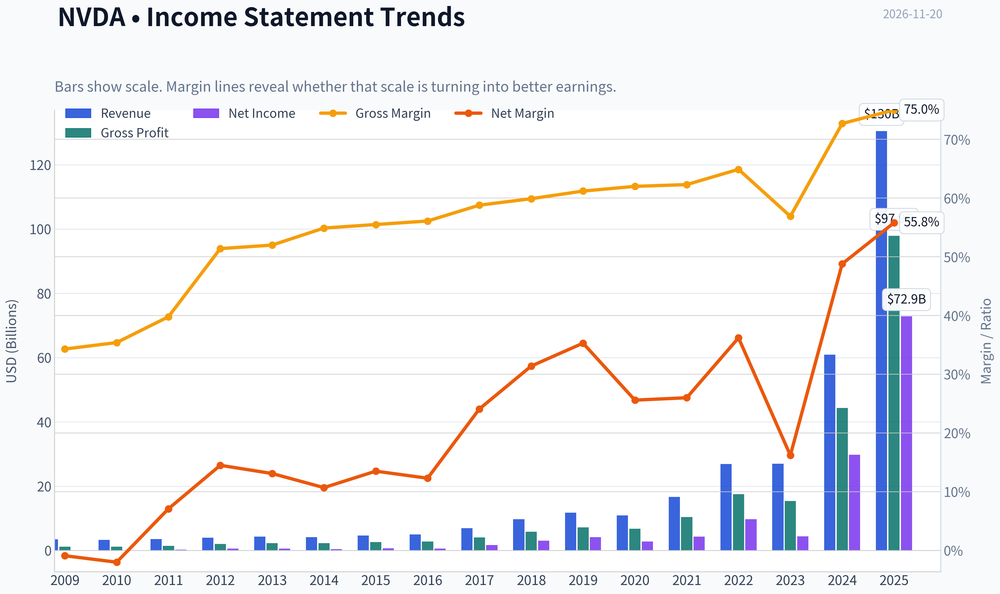

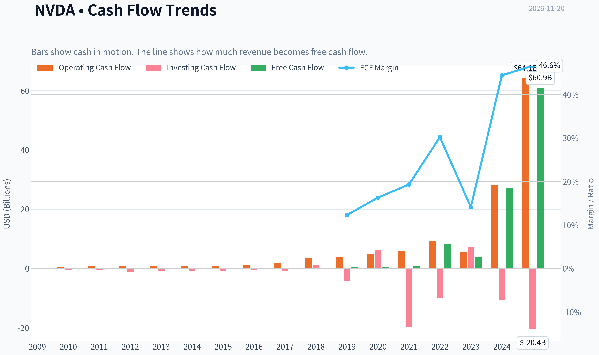

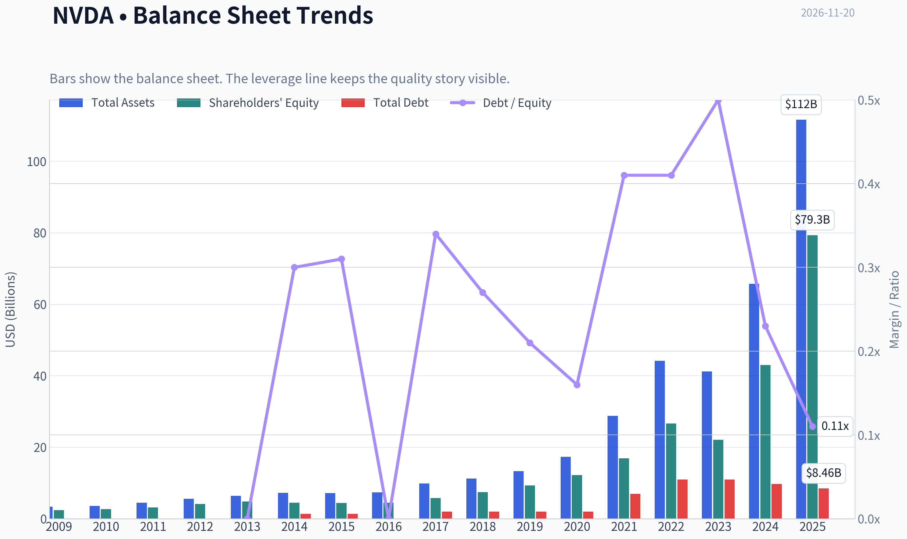

This graph tracks the profitability and return metrics (ROE, ROIC, Margins) of **NVDA** over the past decade, highlighting capital efficiency trends.

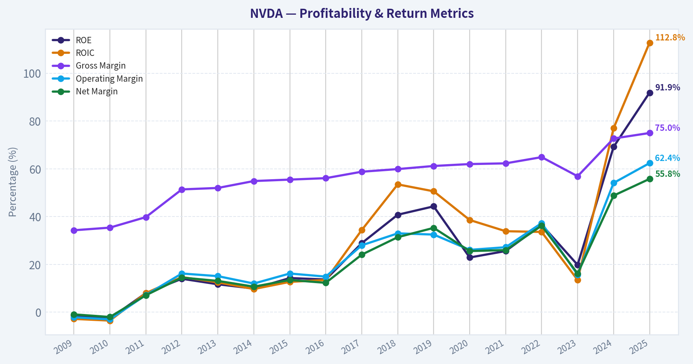

This chart illustrates the financial health of **NVDA** over the last 10 years, mapping cash equivalents and free cash flow against total obligations (Debt).

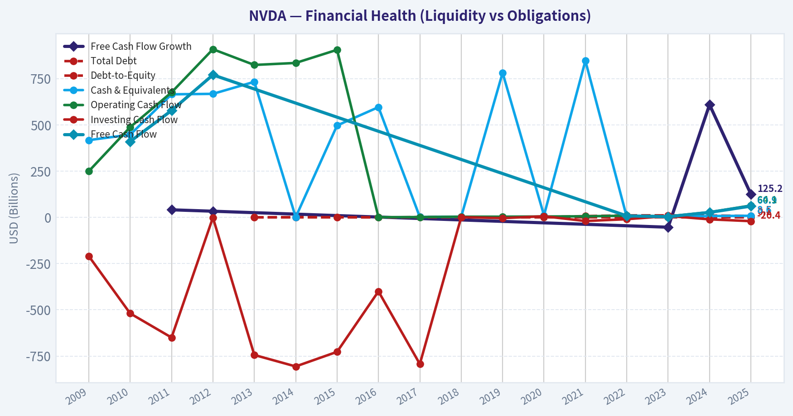

This comparison chart from *Profitability and Operating Performance* stacks current figures against historical benchmarks for **NVDA**, making it easy to see where the company trades relative to its own averages.

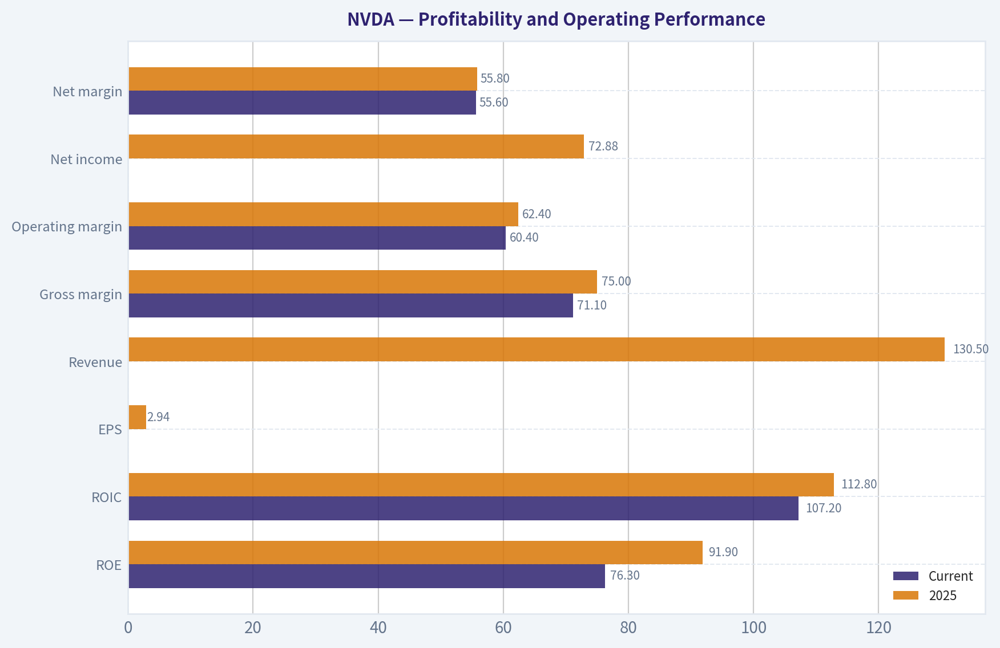

This breakdown chart from <em>Revenue Breakdown</em> shows the proportional composition for **NVDA** - useful for understanding what drives or risks the business.

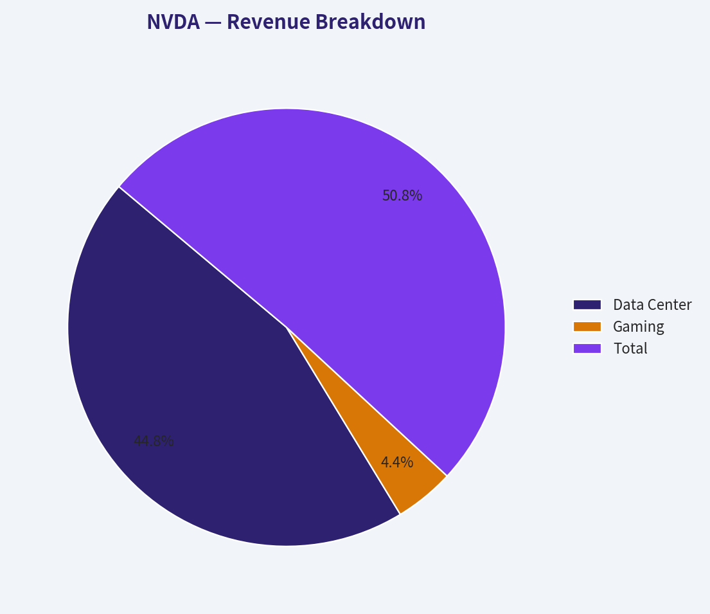

---

### Intrinsic Value Analysis (Buffett)

> *Following Warren Buffett's value investing philosophy: Circle of Competence, Economic Moat, Management Quality, and Margin of Safety.*

#### Intrinsic Value Snapshot

Price is what you pay. Intrinsic value is what the business may be worth based on the cash it can create for owners over time. We show a range, not one magic number.

- Current Price: $136.72
- Value Range (conservative to optimistic across both DCF methods): $112.84 to $275.67

##### Owner Earnings (Buffett Method)
- Net Income: $72,880,000,000.00
- Depreciation & Amortization: $2,843,000,000.00
- Capital Expenditures: $-6,042,000,000.00
- Working Capital Changes: $-15,949,000,000.00
- Owner Earnings: $59,893,306,952.61

##### Intrinsic Value
###### Buffett Method
Uses owner earnings. Stricter, and usually more conservative.
- Conservative: $112.84
- Average: $161.20
- Optimistic: $161.20
- Discount Rate: 8.4%

###### Cash Flow Method
Uses free cash flow. Better for companies spending heavily today to grow tomorrow.
- Conservative: $275.67
- Average: $275.67
- Optimistic: $275.67
- Discount Rate: 9.2%

ANALYST STANCE: **Bullish**

#### Executive Summary

NVIDIA combines a powerful competitive moat, exceptional profitability, strong growth, and a large reinvestment runway. Its CUDA software ecosystem, developer base, specialized hardware, and scale create switching costs and network effects that extend beyond semiconductor manufacturing.

The DeepValues Buffett intrinsic value is **$161.20 per share**, compared with a current price of approximately **$137**, implying a **15.2% margin of safety**. That discount is consistent with the quality-scaled framework for a wide-moat, high-return compounder, although the valuation remains sensitive to AI infrastructure spending, customer concentration, export restrictions, and semiconductor cyclicality.

#### 1. Factor Scorecard

| Factor | Score | Evidence |
|---|---:|---|
| Circle of competence and simplicity | 4/5 | NVIDIA designs accelerated-computing chips and software used for AI and data-center workloads. The model is understandable, although technological change and customer spending cycles reduce long-term predictability. |
| Durable competitive advantage | 5/5 | CUDA, developer adoption, networking, software integration, scale, and ecosystem lock-in form a wide and potentially widening moat. Gross margin is 71.1%. |
| Management and capital allocation | 4/5 | Jensen Huang has demonstrated long-term strategic vision and successfully repositioned NVIDIA around accelerated computing. Capital allocation appears disciplined, though customer-financing initiatives and aggressive ecosystem expansion deserve monitoring. |
| Industry structure | 4/5 | The AI accelerator market has attractive growth and high barriers to entry, but semiconductors remain cyclical and exposed to rapid technological shifts, geopolitical restrictions, and powerful customers. |

**Key Takeaways:** NVIDIA scores highly because its advantage is rooted in an integrated hardware-software ecosystem rather than in chips alone. The main deductions reflect industry cyclicality, concentration in hyperscale customers, and the difficulty of forecasting AI infrastructure demand a decade ahead.

#### 2. Moat Analysis

**Intangible assets and ecosystem:** CUDA is the central strategic asset. Developers, researchers, and enterprises have invested heavily in NVIDIA-compatible software, libraries, and workflows. This creates meaningful switching friction even when competing hardware may offer attractive specifications.

**Switching costs:** Customers adopting NVIDIA's full stack face migration costs involving software compatibility, employee expertise, model optimization, and deployment infrastructure. These costs are particularly significant for large-scale AI operations.

**Scale and cost advantages:** NVIDIA's revenue scale supports substantial research and development, software investment, supply-chain access, and rapid product cycles. Its gross margin of **71.1%** indicates considerable pricing power and value capture.

**Network effects:** More developers create more optimized software; more software increases customer adoption; more adoption attracts further developers and cloud availability. This ecosystem loop strengthens NVIDIA's position.

**Moat quality:** **Wide and widening - 5/5.**

The moat is not invulnerable. Custom accelerators from hyperscalers, AMD competition, open software alternatives, export restrictions, and a possible normalization of AI infrastructure spending could narrow the advantage. However, the current evidence supports a durable franchise.

#### 3. Financial Summary

| Metric | Latest available figure |
|---|---:|
| Share price | $137 |
| Market capitalization | $3.30 trillion |
| P/E ratio | 14.7x |
| Revenue growth, year over year | 65.5% |
| Gross margin | 71.1% |
| ROE | 76.3% |
| Free-cash-flow yield | 2.9% |
| Operating income | $197.6 billion |
| After-tax operating income | $173.9 billion |
| Cash | $22.4 billion |
| Debt | $33.4 billion |
| Net cash, as used by the valuation model | $(10.9) billion |
| Shares outstanding | 24.285 billion |

**Key Takeaways:** NVIDIA's profitability is exceptional, with a 71.1% gross margin and 76.3% ROE. Revenue growth remains unusually strong, while the modest 2.9% free-cash-flow yield indicates that the market still assigns substantial value to future growth. The balance sheet is sound but not net-cash positive under the valuation model.

#### 4. Owner Earnings Calculation

| Owner earnings component | Amount |
|---|---:|
| After-tax operating income | $173.9 billion |
| Depreciation and amortization | +$3.7 billion |
| Maintenance-capital-expenditure charge | -$7.1 billion |
| Working-capital investment | -$0.0 billion |
| **Owner earnings** | **$170.5 billion** |
| Owner earnings per share | **Approximately $7.02** |

**Key Takeaways:** Owner earnings are estimated at $170.5 billion, supported by very high operating profitability and relatively modest capital requirements. The calculation treats the three-year average capital-expenditure intensity as maintenance capital expenditure, which is appropriate for a growing but asset-light technology platform.

#### 5. Cash Flow, Returns, and Balance Sheet

Operating profitability substantially exceeds the capital required to support the business. The high ROE is not primarily a product of excessive leverage; it reflects strong margins, high asset productivity, and significant intellectual-property and ecosystem value.

The balance-sheet assessment is **4/5**. NVIDIA has ample liquidity and substantial operating earnings, while debt of $33.4 billion is manageable relative to operating income. Using operating income of $197.6 billion, approximate interest coverage is comfortably above distress levels, even though it is below the exceptionally conservative threshold of 10 times if interest expense is material.

**Gate 5 hard floor:** **Not tripped.** Earnings and cash generation are strong, liquidity is ample, and there is no indication of deteriorating fundamentals combined with financial distress.

#### 6. Three-Scenario DCF Cross-Check

These scenarios are secondary valuation checks. The DeepValues app value of **$161.20** remains the primary intrinsic value.

| Scenario | Main assumptions | Estimated value per share |
|---|---|---:|
| A: No growth | $170.5B owner earnings capitalized at 10% | Approximately $70 |
| B: GDP growth | 3% perpetual growth and 10% discount rate | Approximately $103 |
| C: Historical-growth sensitivity | Approximately 7.5% growth for 10 years, fading to 2.5% terminal growth, discounted at 10% | Approximately $139 |
| DeepValues Buffett headline value | 10% growth fading to 2.5%, 8.4% discount rate, $(10.9)B net cash | **$161.20** |

**Key Takeaways:** The conservative no-growth case produces a substantially lower value, demonstrating that NVIDIA's valuation depends on continued high earnings and reinvestment. The historical-growth sensitivity is near the current market price, while the DeepValues model reaches $161.20 because it uses a lower 8.4% discount rate and stronger near-term growth assumptions.

#### 7. Intrinsic Value and Margin of Safety

The primary intrinsic value is:

- **Intrinsic value:** $161.20 per share
- **Current price:** approximately $137
- **Margin of safety:** **15.2%**
- **Conservative-to-optimistic valuation range:** $112.84 to $161.20

The margin of safety is adequate for a business with NVIDIA's moat, profitability, and reinvestment runway. It would be less compelling for an average semiconductor company, but NVIDIA's ecosystem economics justify applying the quality-scaled standard rather than requiring a very deep discount.

The reverse-DCF implication is demanding but not obviously heroic given the company's recent growth, high gross margins, and expanding AI infrastructure market. The key question is whether NVIDIA can preserve its software advantage and pricing power as the market matures.

#### 8. Final Buffett Scorecard

| Criterion | Weight | Score |
|---|---:|---:|
| Moat width and durability | 25% | 5.0 |
| Valuation and margin of safety | 20% | 4.0 |
| Capital returns versus cost of capital | 15% | 5.0 |
| Business understanding and predictability | 12% | 4.0 |
| Management quality and capital allocation | 12% | 4.0 |
| Reinvestment runway | 8% | 5.0 |
| Balance-sheet strength | 4% | 4.0 |
| Industry structure | 4% | 4.0 |
| **Weighted score** | **100%** | **4.5/5** |

**Key Takeaways:** NVIDIA ranks as a high-quality compounder rather than a conventional low-multiple value stock. Its strongest attributes are moat durability, returns on capital, and reinvestment opportunity. The principal risks are valuation dependence on continued growth, industry cyclicality, and the possibility that customers increasingly develop alternative AI hardware.

#### 9. Investment Stance

**ANALYST STANCE: Bullish**

**Conviction: Moderate to high.**

NVIDIA satisfies the Buffett framework through a wide and widening moat, exceptional economics, strong management, and substantial reinvestment opportunities. At approximately $137, the stock trades below the DeepValues intrinsic value of $161.20, providing a quality-adjusted margin of safety of 15.2%.

The stance depends on the durability of CUDA-based switching costs and the continuation of strong AI infrastructure demand. The evidence supports the valuation at the current price, but the investment case remains more sensitive to technological disruption and customer spending cycles than that of a mature consumer franchise.
#### Valuation Bridge

This bridge places the current market price beside each intrinsic value lens so readers can see whether upside depends on one method or shows up across several methods.

| Scenario | Intrinsic Value / Share |
| --- | ---: |
| Buffett Method | $161.20 |
| Cash Flow Method | $275.67 |
| Damodaran Method | $85.22 |
| Current Price | $136.72 |

#### Key Takeaways

If one method is far above the others, the upside case depends on a specific modelling assumption. When several methods cluster together, the valuation story is more robust.

#### Valuation Visuals

This comparison chart from *Latest Earnings Snapshot* stacks current figures against historical benchmarks for **NVDA**, making it easy to see where the company trades relative to its own averages.

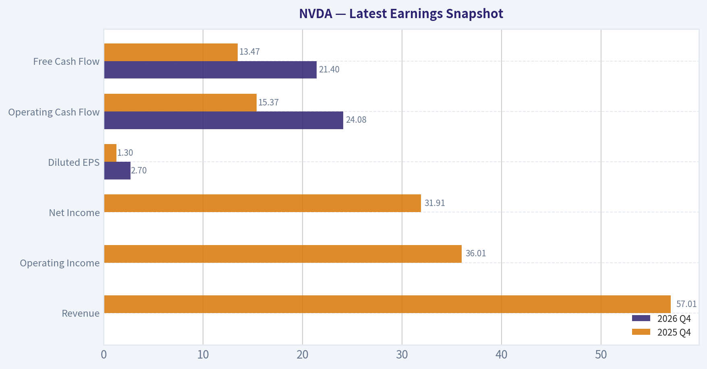

The following chart maps the **NVDA** Owner Earnings DCF valuation scenarios (Conservative, Average, Optimistic) to visually represent the margin of safety based on intrinsic value calculations.

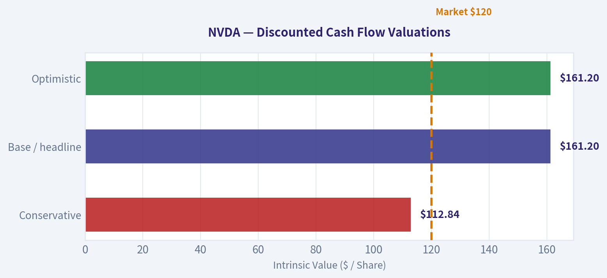

This comparison chart from *DCF Cross-Checks and Reverse DCF* stacks current figures against historical benchmarks for **NVDA**, making it easy to see where the company trades relative to its own averages.

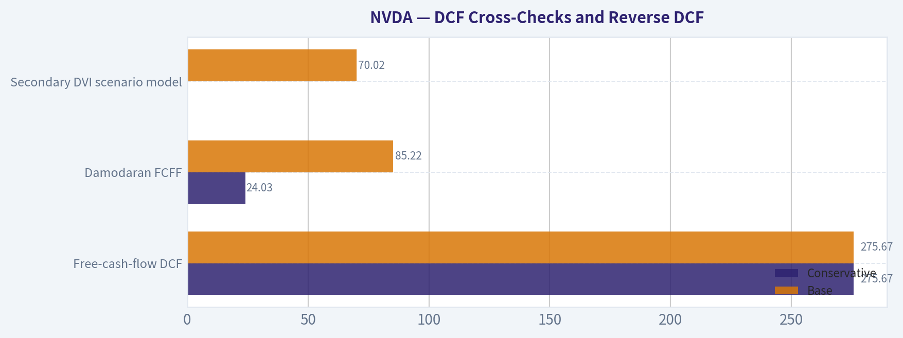

---

### Trend & Growth Analysis (Lynch/Druckenmiller/Fisher)

> *Following Peter Lynch's GARP, Stanley Druckenmiller's macro-aware approach, and Philip Fisher's scuttlebutt methodology.*

ANALYST STANCE: **Neutral**

#### 1. Lynch Classification

**Fast Grower, with cyclical semiconductor exposure.** NVIDIA's latest reported revenue growth of 65.5% and extremely high profitability place it firmly in Lynch's fast-grower category. However, the business remains exposed to semiconductor cycles, hyperscaler capital spending, export controls, customer concentration, and the possibility that AI infrastructure growth normalizes.

#### 2. The Story in Three Bullets

- NVIDIA supplies the dominant accelerated-computing platform for AI training, inference, networking, and increasingly enterprise software.
- Its CUDA software ecosystem, integrated systems, networking products, and developer adoption create meaningful switching costs beyond the GPU chip itself.
- The central question is whether AI infrastructure spending develops into a durable, multi-year computing platform or experiences a sharp digestion phase after the current investment surge.

#### 3. TAM and the 10x Test

A precise TAM is difficult because NVIDIA is expanding from GPUs into networking, systems, software, inference, robotics, and accelerated enterprise computing. The following is an analytical framework rather than a company-guided forecast.

| Item | Estimate / Interpretation |
|---|---:|
| Current market capitalization | $3.30 trillion |
| Current annual revenue reference | Approximately $130.5 billion annual data; latest growth metric indicates 65.5% YoY |
| 10x revenue test | Approximately $1.3 trillion revenue |
| Potential long-term AI and accelerated-computing opportunity | Large enough in theory, but highly dependent on sustained global capex |
| 10x test conclusion | **Possible at the ecosystem level; not demonstrated at current scale** |
| Main constraint | Customer concentration, supply-chain capacity, competition, and diminishing incremental AI infrastructure returns |

**Key Takeaways:** NVIDIA's addressable opportunity is expanding faster than a traditional semiconductor market because the company is selling a computing platform rather than only a component. A tenfold revenue outcome is mathematically compatible with a very large AI and accelerated-computing market, but it would require sustained infrastructure spending and successful expansion beyond today's largest customers.

#### 4. Revenue Growth Trend

| Period / Metric | Growth |
|---|---:|
| FY2023 revenue growth | 0.2% |
| FY2024 revenue growth | 125.9% |
| FY2025 revenue growth | 114.2% |
| Latest reported YoY revenue growth | 65.5% |
| Three-year revenue CAGR | Approximately 100% |
| Five-year revenue CAGR | Approximately 66.9% |
| Latest net income growth | 64.7% |
| Latest FCF growth | 58.9% |

**Key Takeaways:** The long-term trend shows a dramatic product-market-fit inflection beginning in the data-center AI cycle. Growth has decelerated from triple-digit levels to 65.5%, but it remains exceptional. The key issue is not whether growth is high; it is whether the current deceleration is a healthy normalization or the beginning of a more substantial hyperscaler spending cycle.

#### 5. Unit Economics and Profitability

Traditional customer-level LTV/CAC and NRR metrics are not disclosed or central to NVIDIA's hardware-led model. Gross margin and cash conversion are more relevant indicators.

| Metric | Latest Data | Assessment |
|---|---:|---|
| Gross margin | 71.1% | Exceptional, though vulnerable to product mix and competitive pricing |
| Operating margin | 60.4% | Exceptional operating leverage |
| Net margin | 55.6% | Very high |
| ROE | 76.3% | Excellent, with leverage from strong profitability |
| ROIC | 107.2% | Exceptional |
| FCF yield | 2.9% | Indicates a demanding market valuation |
| Current ratio | 3.91 | Strong liquidity |
| Debt-to-equity | 0.05 | Low balance-sheet leverage |
| LTV/CAC | Not disclosed / not meaningful | Hardware-platform economics apply instead |
| NRR | Not disclosed | Software and ecosystem retention are qualitative rather than reported |
| Rule of 40 | Not applicable | Not a SaaS subscription business |

**Key Takeaways:** NVIDIA's profitability and capital efficiency are unusually strong, and its balance sheet provides substantial financial flexibility. The main unit-economic risk is not customer acquisition efficiency but whether extraordinary margins can persist as competitors, custom silicon, supply constraints, and customer bargaining power evolve.

#### 6. Inflection Point Assessment

| Inflection Dimension | Assessment | Evidence |
|---|---|---|
| Product cycle | Positive | Accelerated computing and AI systems remain in a major adoption cycle |
| Market share | Positive but difficult to quantify | CUDA and integrated systems strengthen platform adoption |
| Margin | Positive | Scale and product mix have produced exceptional margins |
| TAM | Positive | Expansion from GPUs into networking, systems, software, inference, and enterprise use |
| Competitive position | Strong, but contested | AMD, custom accelerators, and hyperscaler-designed chips remain relevant |
| Growth trajectory | Moderating from extreme levels | 65.5% growth remains high, but below prior triple-digit rates |

**Key Takeaways:** The strongest inflection is the transition from selling chips to selling a full accelerated-computing platform. The current evidence supports a durable competitive advantage, but the next inflection must come from sustained inference demand, enterprise deployment, networking, and software monetization rather than repeated first-time training deployments alone.

#### 7. Macro Setup

- **Interest rates:** The 30-year Treasury reference is approximately 5.4%, creating a meaningful discount-rate headwind for long-duration growth equities.
- **Economic cycle:** AI infrastructure spending is behaving more like a strategic capital-spending cycle than a normal consumer cycle, but it remains sensitive to corporate budgets and financing conditions.
- **Secular trend:** NVIDIA is directly exposed to the AI and machine-learning revolution, cloud infrastructure, enterprise software modernization, robotics, and accelerated scientific computing.
- **Druckenmiller lens:** The secular trend remains favorable, but the macro setup is less supportive than it would be under falling long-term rates.
- **Financing risk:** Recent coverage has highlighted risks involving financing arrangements for customers and AI infrastructure, potentially increasing counterparty and demand-quality concerns.

#### 8. Fisher's 15-Point Assessment

Scores are qualitative and reflect publicly available information rather than direct channel checks.

| Fisher Criterion | Score / 5 | Comment |
|---|---:|---|
| Market potential | 5 | Very large and expanding opportunity |
| New-product determination | 5 | Broad roadmap across chips, systems, networking, and software |
| R&D effectiveness | 5 | Strong history of architecture and platform execution |
| Sales organization | 4 | Strong ecosystem and hyperscaler relationships |
| Profit margins | 5 | Exceptional current margins |
| Margin improvement | 4 | Major improvement, though future expansion is harder |
| Labor and personnel relations | 3 | Limited public visibility |
| Executive relations | 4 | Strong founder-led technical leadership |
| Management depth | 4 | Broad technical and commercial organization |
| Cost analysis and accounting | 4 | Strong financial reporting, though working-capital swings matter |
| Outstanding competitive aspects | 5 | CUDA, ecosystem, developer adoption, systems integration |
| Long-range profit outlook | 4 | Attractive but dependent on AI spending durability |
| Dilution risk | 4 | No major dilution concern indicated |
| Candor regarding difficulties | 3 | Disclosure is substantial, but external validation remains important |
| Management integrity | 4 | No major integrity issue identified in the supplied data |
| **Total** | **62 / 75** | **Good, near outstanding** |

**Key Takeaways:** NVIDIA scores particularly well on market opportunity, innovation, R&D, margins, and competitive advantages. The score is held below the outstanding range by limited visibility into customer-level economics, capital-spending durability, and the difficulty of independently validating long-range demand assumptions.

#### 9. Valuation Analysis

| Valuation Measure | Result | Interpretation |
|---|---:|---|
| Current price | Approximately $137 | Reference market price |
| Market capitalization | Approximately $3.30 trillion | Very large absolute valuation |
| Trailing P/E | 14.7x | Low relative to the latest growth rate, subject to earnings normalization risk |
| Forward P/E | 8.2x | Implies strong expected earnings growth |
| Price-to-sales | 9.1x | High in absolute terms, but supported by exceptional margins |
| PEG ratio | Approximately 0.22 | Attractive mechanically, using 14.7 P/E divided by 65.5% growth |
| Earnings yield | 6.8% | Reasonable relative to the current earnings base |
| DeepValues intrinsic value | $161.20 | Headline owner-earnings valuation |
| Conservative intrinsic-value range | $112.84-$161.20 | Wide sensitivity to assumptions |
| Margin versus headline intrinsic value | Approximately 15.2% | Price is below the supplied headline intrinsic value |

**Key Takeaways:** Conventional valuation metrics look inexpensive relative to NVIDIA's latest growth and profitability, producing a very low mechanical PEG ratio. That conclusion is highly sensitive to the assumption that current earnings remain durable; alternative cash-flow and FCFF models in the supplied data produce materially wider and lower valuation ranges.

#### 10. Growth Investor Scorecard

| Criterion | Weight | Score / 5 | Weighted Contribution |
|---|---:|---:|---:|
| Lynch story | 10% | 4.5 | 0.45 |
| TAM and runway | 20% | 4.5 | 0.90 |
| Revenue growth | 20% | 4.5 | 0.90 |
| Unit economics | 15% | 4.0 | 0.60 |
| Competitive position | 10% | 4.5 | 0.45 |
| Management quality | 10% | 4.0 | 0.40 |
| Macro setup | 5% | 3.0 | 0.15 |
| Profitability path | 5% | 5.0 | 0.25 |
| Valuation | 5% | 3.5 | 0.18 |
| **Total** | **100%** | - | **4.28 / 5.00** |

**Key Takeaways:** The scorecard indicates a high-quality growth business with an unusually strong competitive position and profitability profile. The main deductions come from macro conditions, valuation sensitivity, and uncertainty over how quickly revenue and margins normalize after the AI infrastructure surge.

#### 11. Valuation Sensitivity

| Scenario | Operating Assumption | Valuation Implication |
|---|---|---|
| Bear case | AI infrastructure growth slows sharply; margins normalize toward historical semiconductor levels | The current market valuation becomes difficult to justify |
| Base case | AI demand remains strong but decelerates; NVIDIA retains platform leadership and margins remain elevated | The supplied $161.20 owner-earnings value is broadly supportive of the current valuation |
| Bull case | Inference, enterprise AI, networking, software, and sovereign computing extend the cycle | Significant long-term upside remains possible, but this requires sustained reinvestment and ecosystem expansion |
| Key sensitivity | Terminal growth, normalized margins, customer concentration, and discount rate | Small assumption changes can produce very wide intrinsic-value ranges |

**Key Takeaways:** The valuation is supported under a durable-growth framework but is vulnerable to normalization in margins or capital spending. The spread between the $112.84 conservative owner-earnings value and the $161.20 headline value demonstrates that the primary risk is assumption sensitivity rather than balance-sheet fragility.

#### 12. Key Risks and Catalysts

| Catalysts | Risks |
|---|---|
| Continued hyperscaler AI spending | Hyperscaler capex digestion or delayed returns |
| Rapid inference adoption | Custom silicon from major customers |
| Networking and full-system expansion | AMD and other accelerator competition |
| Enterprise and sovereign AI deployment | Export restrictions and geopolitical constraints |
| CUDA monetization and software expansion | Margin compression from mix or pricing |
| New architecture launches | Customer concentration |
| AI adoption in robotics, science, and industrial markets | Financing-related demand quality concerns |
| Strong cash generation and balance-sheet flexibility | High interest rates and valuation de-rating |

**Key Takeaways:** The most important catalyst is evidence that inference, enterprise, networking, and software revenue broaden the opportunity beyond training clusters. The most important risk is a synchronized slowdown in customer capital spending combined with margin normalization and a higher discount rate.

#### Overall Conclusion

NVIDIA is a **high-quality fast grower at a major secular and product-cycle inflection point**. Its revenue growth, gross margins, ROIC, ecosystem strength, and balance sheet are exceptional. The evidence supports a **Neutral** stance because the headline valuation appears reasonable relative to current earnings, yet the investment case depends heavily on whether extraordinary AI infrastructure economics persist and whether new growth vectors offset the inevitable normalization of the initial training boom.

---

### Market Technical Analysis

ANALYST STANCE: **Neutral**

#### NVDA technical overview

This analysis covers **NVIDIA Corporation (Nasdaq: NVDA)** only. The latest available trading session in the retrieved data is **November 19, 2026**, when NVDA closed at **$145.98**. November 20 is identified as a non-trading day in the indicator feed, so no November 20 closing price is available.

NVDA is in a pronounced short- and medium-term downtrend. The price has fallen from **$230.86 on October 1** to **$145.98 on November 19**, a decline of approximately **36.8%**. The deterioration accelerated in November: the close dropped from **$206.69 on November 3** to **$145.98 on November 19**, a decline of roughly **29.4%** in twelve trading sessions.

The price structure is bearish across multiple time horizons. NVDA is below the **10-day EMA at $164.38**, the **50-day SMA at $208.86**, and the **200-day SMA at $203.32**. The 10-day EMA is declining steeply, while the 50-day SMA has also rolled over. The 200-day SMA remains comparatively stable but has begun to soften, indicating that the recent weakness has become significant enough to affect the long-term trend calculation.

| Indicator | Latest reading | Interpretation |
|---|---:|---|
| Latest close | $145.98 on Nov. 19 | Far below all major moving averages |
| 10-day EMA | $164.38 | Short-term trend is sharply negative |
| 50-day SMA | $208.86 | Medium-term trend is decisively negative |
| 200-day SMA | $203.32 | Price is about 28.2% below the long-term average |
| MACD | -17.76 | Strong negative momentum |
| RSI | 19.64 | Deeply oversold, but not a reversal confirmation |
| Bollinger lower band | $136.52 | Price is near, but not below, the lower volatility boundary |
| ATR | $9.88 | Daily volatility is unusually large, about 6.8% of the latest close |

Key Takeaways: NVDA's trend indicators are aligned bearishly, with the latest close substantially below the 10-day, 50-day, and 200-day averages. Momentum is deeply negative and volatility has expanded sharply, while the oversold RSI indicates stress rather than a confirmed change in direction.

#### Trend and momentum structure

The moving averages show a clear sequence of deterioration. During late September and early October, the 10-day EMA was rising and remained above the 50-day SMA, consistent with positive short-term momentum. That relationship reversed during October. By November 19, the 10-day EMA had fallen to **$164.38**, more than **$44 below the 50-day SMA**, demonstrating that recent price weakness is not merely a small pullback within a stable trend.

The 50-day SMA peaked near **$223.09 on October 14** and declined to **$208.86** by November 19. The 200-day SMA reached approximately **$204.39** in early November before easing to **$203.32**. This creates an important distinction: the long-term average has not collapsed, but the market price has moved far below it. The divergence between price and the 200-day SMA is therefore a measure of trend damage and volatility, not evidence that the long-term average itself has become a reliable near-term floor.

MACD confirms the loss of momentum. The reading moved from positive territory in early October to negative territory by October 16, then deteriorated to **-17.76** by November 19. The progression has been consistently weaker since late October, with no visible stabilization in the reported series. This suggests that downward momentum remains active rather than merely residual from an earlier decline.

#### Oversold conditions and reversal risk

The RSI reading of **19.64** is well below the conventional 30 threshold and represents an extreme oversold condition. The RSI has remained below 30 for much of November, reaching readings in the low 20s and high teens. This indicates persistent selling pressure and raises the probability of sharp countertrend rebounds, but an oversold reading alone does not establish that a durable low has formed. In strong downtrends, RSI can remain depressed while price continues to decline.

The Bollinger Bands provide additional context. The lower band fell from approximately **$201.85 on October 30** to **$136.52 on November 19**, reflecting a major expansion in measured dispersion. NVDA's latest close is only about **$9.46 above the lower band**, or approximately **6.9% above it**. Price is therefore near the lower volatility boundary, but it has not yet produced a sustained recovery toward the middle of the range. The upper band at **$234.94** is less useful as a near-term reference because the band width has become exceptionally broad following the selloff.

The combination of very low RSI and proximity to the lower Bollinger Band creates **reversal risk**, but the declining EMA, falling MACD, and expanding ATR show that the oversold condition is occurring inside an active downside trend. The technical evidence supports heightened uncertainty and the possibility of large daily swings rather than a clean reversal signal.

#### Volatility and price-action character

ATR increased from approximately **$5.9-$6.4** in early October to **$9.88** by November 19. Relative to the latest close, that is approximately **6.8%**, an unusually large daily range. The expansion was accompanied by several high-volume declines, including the sessions on November 5, November 9, November 10, November 12, and November 17. The November 12 session was especially volatile, with a reported intraday range from **$148.80 to $167.14** and volume of approximately **747.7 million shares**.

This pattern suggests a market undergoing forced repricing or very strong disagreement over valuation and future expectations. Large volume during declines can indicate broad participation in the downward move; it does not by itself determine whether the selling pressure is exhausted. The recent range expansion also makes single-day price changes less informative without confirmation from subsequent closes and momentum behavior.

#### Valuation implications

The technical data cannot determine intrinsic value, earnings power, or a justified fundamental valuation. It does show that market pricing has undergone a substantial compression relative to its recent trading range and long-term moving averages. The evidence is therefore consistent with **elevated uncertainty around the valuation**, not with a stable technical equilibrium.

A sustained improvement would require evidence such as stabilization above the short-term EMA, a flattening or recovery in the 50-day average, improving MACD momentum, and RSI recovery that is accompanied by stronger price structure. Conversely, continued closes near the lower Bollinger Band with expanding ATR would imply that downside volatility and valuation uncertainty remain unresolved. These are analytical conditions, not estimated value or transaction instructions.

#### Selected indicators

The selected set contains eight complementary indicators:

- **10-day EMA:** Captures rapid changes in short-term trend.
- **50-day SMA:** Measures medium-term direction and trend damage.
- **200-day SMA:** Provides a long-term trend benchmark.
- **MACD:** Evaluates directional momentum and momentum deterioration.
- **RSI:** Identifies the current oversold state and potential reversal risk.
- **Bollinger upper and lower bands:** Measures the position of price within an expanding volatility envelope.
- **ATR:** Quantifies the unusually large daily trading range.

These indicators are intentionally varied: three measure trend, one measures momentum direction, one measures momentum intensity, two describe volatility positioning, and one measures absolute volatility. The set avoids adding redundant oscillators while preserving enough information to distinguish trend weakness from possible short-term exhaustion.

| Area | Evidence | Research implication |
|---|---|---|
| Price trend | $145.98 close versus $164.38 EMA, $208.86 50-day SMA, and $203.32 200-day SMA | Downtrend is confirmed across short, medium, and long horizons |
| Momentum | MACD at -17.76 and still weakening | Selling momentum has not yet shown clear stabilization |
| Oversold state | RSI at 19.64 | Rebound risk is elevated, but oversold conditions can persist |
| Volatility position | Close near the $136.52 lower Bollinger Band | Price is under substantial downside pressure within a very wide range |
| Volatility magnitude | ATR at $9.88, about 6.8% of the close | Daily price risk and valuation uncertainty are unusually high |
| Volume behavior | Very large volume during several November declines | The repricing has broad market participation |
| Long-term context | Price roughly 28.2% below the 200-day SMA | Current valuation is materially separated from its long-term trading benchmark |
| Overall stance | Bearish trend, extreme oversold readings, and high volatility | **Neutral**: the evidence indicates unresolved downside momentum alongside meaningful reversal risk |

Key Takeaways: NVDA's technical profile is strongly bearish, but the magnitude of the decline has produced deeply oversold conditions and a substantial risk of sharp countertrend movement. The evidence does not establish fair value or confirm a durable bottom; it instead points to unresolved valuation uncertainty, elevated volatility, and a need for confirmation from trend and momentum stabilization.

#### Market Visuals

This comparison chart from *Current Market Metrics* stacks current figures against historical benchmarks for **NVDA**, making it easy to see where the company trades relative to its own averages.

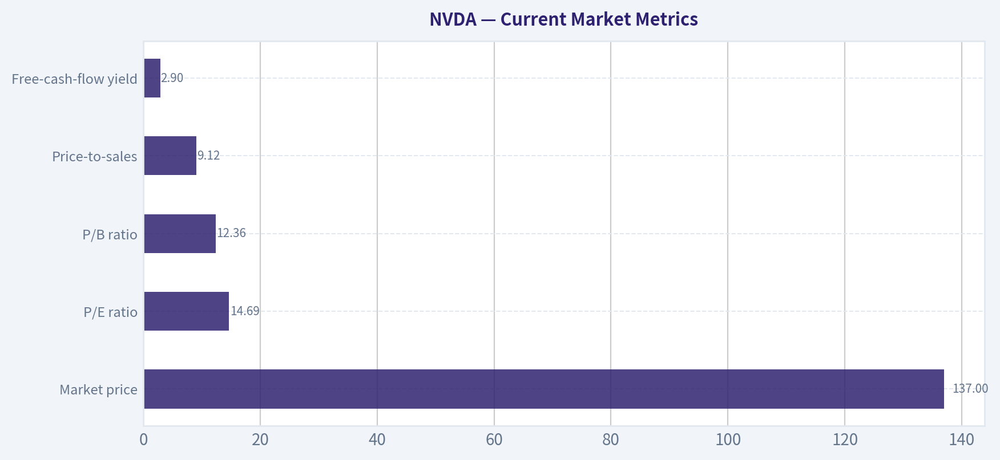

---

### Options Market Analysis

> *Reading options flow - put/call ratios, IV skew, and unusual activity - to gauge institutional positioning and event-driven risk.*

ANALYST STANCE: **Neutral**

#### NVDA Options Market Overview

Data is as of November 20, 2026. The supplied chain does not include NVDA's current share price, so exact ITM, ATM, and OTM classifications are approximate. The $138-$145 strike area appears to be the active trading range, but this should not be treated as a confirmed spot price.

| Near-term expiry | Call OI | Put OI | Put/Call OI ratio | Call volume | Put volume | Put/Call volume ratio |
|---|---:|---:|---:|---:|---:|---:|
| Nov. 20, 2026 | 1,631,146 | 745,423 | 0.46 | 630,147 | 600,843 | 0.95 |
| Nov. 23, 2026 | 103,743 | 48,063 | 0.46 | 74,988 | 47,733 | 0.64 |
| Nov. 25, 2026 | 58,617 | 25,542 | 0.44 | 29,126 | 16,067 | 0.55 |
| **Combined** | **1,793,506** | **819,028** | **0.46** | **734,261** | **664,643** | **0.91** |

**Key Takeaways:** The aggregate put/call OI ratio of 0.46 is substantially below the approximately 0.70 historical neutral baseline, indicating call-heavy outstanding exposure. The volume ratio of 0.91 is much closer to neutral, suggesting that current trading is more balanced than the accumulated open interest. The strongest call bias appears in the November 23 and November 25 expirations.

#### Implied Volatility and Skew

| Expiry | Call ATM IV | Put ATM IV | Call-minus-put IV | Interpretation |
|---|---:|---:|---:|---|
| Nov. 20, 2026 | 72.5% | 52.1% | +20.4 pts | Strong call-side premium |
| Nov. 23, 2026 | 65.6% | 58.8% | +6.8 pts | Moderate call skew |
| Nov. 25, 2026 | 72.0% | 64.7% | +7.3 pts | Moderate call skew |

Near-term IV is elevated, ranging from roughly 52% to 72%, with the highest readings concentrated in the shortest-dated contracts. Calls carry higher ATM IV than puts across every listed expiry, which is consistent with upside demand or upside-tail speculation rather than pronounced downside fear.

The November 20 expiration has unusually high same-day volatility, but no specific catalyst was provided with the data. Therefore, the elevated IV may reflect event risk, gamma-sensitive trading, or simply extreme short-dated demand; it cannot be attributed to earnings or another known event from this dataset alone.

**Key Takeaways:** The IV structure favors calls, especially for the expiring November 20 contracts. This is a call-skewed volatility profile, not a classic downside-protection profile. However, very short-dated IV can decay rapidly and may reflect speculation rather than durable institutional conviction.

#### Unusual Options Activity

All contracts below meet the provider's unusual-activity threshold of volume greater than five times open interest and volume above 500 contracts.

| Expiry | Type | Strike | Volume | OI | Volume/OI | IV | Approximate interpretation |
|---|---|---:|---:|---:|---:|---:|---|
| Nov. 20 | Call | $142 | 68,379 | 269 | 254.2x | 61.7% | Fresh call activity near the active range |
| Nov. 20 | Call | $141 | 57,149 | 249 | 229.5x | 61.4% | Fresh near-ATM call speculation |
| Nov. 20 | Call | $143 | 44,635 | 334 | 133.6x | 62.3% | Upside-oriented call activity |
| Nov. 20 | Call | $144 | 25,337 | 522 | 48.5x | 64.3% | Further upside exposure |
| Nov. 20 | Call | $139 | 17,471 | 282 | 62.0x | 59.9% | Near-ATM or ITM depending on spot |
| Nov. 20 | Call | $138 | 12,054 | 346 | 34.8x | 62.5% | Lower-strike call demand |
| Nov. 20 | Call | $145 | 106,642 | 4,722 | 22.6x | 67.0% | Largest unusual call volume; upside exposure |
| Nov. 20 | Call | $140 | 65,218 | 2,501 | 26.1x | 60.5% | High-volume central strike |
| Nov. 20 | Call | $146 | 27,167 | 1,296 | 21.0x | 69.9% | Higher-strike upside speculation |
| Nov. 20 | Call | $147 | 18,637 | 2,912 | 6.4x | 71.9% | Higher-strike tail exposure |
| Nov. 20 | Put | $139 | 67,276 | 3,108 | 21.6x | 50.0% | Downside hedge or bearish short-term bet |
| Nov. 20 | Put | $138 | 63,451 | 3,977 | 16.0x | 55.9% | Downside protection below active range |
| Nov. 20 | Put | $137 | 53,765 | 3,914 | 13.7x | 56.7% | Additional lower-strike hedge |
| Nov. 20 | Put | $136 | 33,785 | 5,911 | 5.7x | 58.2% | Established downside interest |
| Nov. 20 | Put | $134 | 12,666 | 1,845 | 6.9x | 61.3% | Further downside-tail protection |

The call activity is broader across strikes and includes exceptionally high volume/OI ratios at $141, $142, and $143. The put activity is also substantial, concentrated from $136 to $139, and may represent hedging against a sharp same-day decline.

Volume/OI identifies potentially fresh activity but does not reveal whether trades were bought or sold, opened or closed, or executed as spreads. Consequently, the data does not support a definitive "smart-money" attribution. The exceptionally high ratios at $141-$143 may reflect institutional or systematic activity, but could also include short-dated retail speculation.

**Key Takeaways:** Unusual activity is concentrated on both sides, but call strikes span $138 through $147 and dominate the highest volume/OI ratios. The puts clustered at $136-$139 provide meaningful downside hedging, so the signal is bullish with a substantial short-term volatility hedge rather than unambiguously bullish. Because all unusual contracts expire on November 20, the directional information has a very short horizon.

#### Open Interest Concentration and Gamma-Relevant Levels

| Strike or area | Relevant OI observation | Potential market effect |
|---|---|---|
| $145 calls | 106,642 unusual volume; 4,722 OI | Important upside call concentration |
| $147 calls | 2,912 OI | Higher-strike upside gamma area |
| $136 puts | 5,911 OI | Largest listed put concentration |
| $138 puts | 3,977 OI | Downside hedge and possible support area |
| $137 puts | 3,914 OI | Additional downside concentration |
| $139 puts | 3,108 OI | Central downside reference level |
| Nov. 20 expiry | 1.63 million call OI and 745,423 put OI | Dominant near-term pinning and gamma influence |

The November 20 chain overwhelmingly dominates total open interest, so same-day expiration mechanics are likely to have more influence than the November 23 or November 25 chains. Call concentration around $140-$145 could dampen or amplify moves depending on dealer hedging direction, while put concentration around $136-$139 may become a key downside gamma zone.

"Max pain" cannot be calculated reliably from the aggregate summary alone because the full strike-by-strike open-interest distribution and contract settlement assumptions are not provided. Likewise, the direction of dealer gamma cannot be confirmed without trade-side information and a complete chain.

**Key Takeaways:** The main gravitational area is the November 20 expiration, with calls clustered around $140-$145 and puts concentrated around $136-$139. These levels could increase intraday pinning near the active range, while a decisive move outside that band could intensify hedging flows. The chain is liquid in absolute terms, but its extreme concentration in zero-day options reduces the reliability of longer-horizon inference.

#### Overall Options Sentiment

**Overall signal: BULLISH, with moderate-to-low confidence and very short time horizon.**

The primary bullish drivers are:

- Aggregate put/call OI of 0.46, well below the 0.70 neutral reference.
- Broad unusual call activity across $138-$147.
- Higher call IV than put IV across all listed expirations.
- Strong call concentration in the dominant November 20 expiry.

The main caveats are:

- Put volume remains substantial, with a combined near-term volume ratio of 0.91.
- Large put activity at $136-$139 indicates meaningful downside hedging or bearish speculation.
- All unusual activity is concentrated in contracts expiring immediately, making the signal highly sensitive to intraday flows.
- The data does not identify whether trades were bought or sold, and no known catalyst or current share price was supplied.

For valuation interpretation, the options market currently implies stronger demand for upside exposure than for downside protection, but it also prices substantial short-term volatility. The evidence supports a near-term bullish options bias, not a stable long-duration directional conclusion.

| Category | Assessment |
|---|---|
| Put/Call Ratio | OI ratio 0.46, materially bullish versus 0.70 neutral; volume ratio 0.91, close to balanced |
| IV Level | Elevated, approximately 52%-72% near term |
| Skew Direction | Call skew; calls carry higher IV than puts |
| Unusual Activity | Broad, high-volume call activity from $138-$147, offset by concentrated puts from $136-$139 |
| Overall Signal | **BULLISH**, but highly short-term and volatility-sensitive |

**Key Takeaways:** NVDA's options market has a clear call-heavy bias in open interest and volatility pricing. The strongest evidence points to near-term upside speculation, while the put concentration shows that traders are also paying for protection against a sharp reversal. The overall read is bullish, but confidence is limited by zero-day expiration concentration, uncertain trade direction, and the absence of spot-price and catalyst details.

---

## Research Team Commentary

> *The Research Manager synthesizes the Bull vs Bear debate into action-free commentary. This is a pre-risk view, not the final stance.*

Core takeaway: NVIDIA is a genuinely exceptional business, but the evidence is not yet strong enough to conclude that $137 offers a dependable margin of safety. The CUDA ecosystem, integrated hardware-networking-software platform, leadership in accelerated computing, and extraordinary returns on capital support a wide-moat assessment. The supplied intrinsic value of $161.20 implies a 15.2% discount on an intrinsic-value basis, roughly the minimum that can be acceptable for an unusually strong compounder. However, that valuation cushion is vulnerable to modest changes in normalized growth and margins. The appropriate stance is Neutral.

The strongest bull argument is that NVIDIA should no longer be analyzed as a conventional semiconductor vendor. CUDA, optimized libraries, developer familiarity, networking, interconnects, systems, and rapid product execution collectively create substantial switching costs. Customers consider time to deployment and total system performance, not merely chip prices. NVIDIA's 71.1% gross margin, 107.2% ROIC, 76.3% ROE, and 58.1% ROA demonstrate exceptional current economics, even though accounting effects and an asset-light capital base inflate some return ratios. Management deserves considerable credit for funding CUDA long before generative AI became commercially important and for turning architectural leadership into a broader platform.

The long-term opportunity also extends beyond the initial training buildout. Inference, enterprise deployments, sovereign AI, scientific computing, robotics, simulation, and industrial applications could sustain accelerated-computing demand for many years. A temporary spending pause would not necessarily impair the moat. If NVIDIA remains the default platform while demand broadens, a 15% discount to estimated intrinsic value could meet the quality-scaled margin-of-safety standard for a wonderful business.

The strongest bear argument is not that AI or CUDA lacks value; it is that current earnings may reflect scarcity economics and an unusually concentrated infrastructure boom. A few hyperscalers have both the incentive and resources to develop custom silicon, improve software portability, negotiate pricing, or shift selected workloads. They do not need to displace NVIDIA completely. A gradual loss of share, lower pricing power, or a shift toward lower-margin systems could materially reduce intrinsic value while leaving NVIDIA the market leader.

The 71.1% gross margin is therefore more important to stress-test than the headline growth rate. NVIDIA could continue expanding while margins normalize as supply improves, custom accelerators gain traction, and customers focus more intensely on AI returns. Similarly, historical ROIC above 100% does not mean that large amounts of new capital can indefinitely earn comparable returns. Incremental ROIC, normalized free cash flow, and the capital required to support systems, networking, inventory, and supply commitments are the more useful forward-looking measures.

Valuation is the deciding constraint. The supplied $161.20 intrinsic value is useful, but its growth, margin, discount-rate, and terminal assumptions are unavailable. At $137, the discount is about 15.0% when measured as a percentage of intrinsic value, consistent with the quoted 15.2% after rounding or price variation. That is adequate only if cash flows are unusually predictable. NVIDIA's moat is wide, but its earnings remain exposed to customer concentration, rapid product transitions, geopolitical restrictions, power constraints, and capex cyclicality. The business quality supports a smaller required discount than an average semiconductor company, but the uncertainty prevents treating the valuation estimate as precise.

The reported P/E of 14.69 also requires reconciliation. At $137, it implies approximately $9.33 of earnings per share, but the bundle does not identify whether this is trailing, forward, adjusted, or annualized. That distinction is critical. A low multiple based on peak or mismatched earnings can create a false impression of cheapness. The valuation case should be based on normalized free cash flow across an infrastructure cycle rather than this unexplained headline multiple.

Market psychology provides no additional margin of safety. A put/call open-interest ratio of 0.46, unusual call activity, and higher call volatility indicate optimistic short-term positioning. These signals may reflect momentum, leverage, or dealer hedging rather than durable value. They suggest that market participants are enthusiastic rather than fearful, so there is little evidence that temporary panic is creating an obvious contrarian opportunity. The technical data are incomplete placeholders and add no decision-useful evidence.

The key analytical lesson is to avoid two symmetrical mistakes: extrapolating current hypergrowth indefinitely and assuming that any digestion phase destroys the platform. AI can become foundational while infrastructure spending remains cyclical. NVIDIA can retain technological leadership while margins and incremental returns decline. Conversely, a few weaker quarters would not by themselves invalidate CUDA's switching costs or the decade-long accelerated-computing thesis. The analysis should separate platform durability from the level and timing of customer capital expenditure.

Rationale: NVIDIA qualifies as a wonderful business because it combines a credible technology moat, excellent management, high asset efficiency, strong current profitability, and a large reinvestment runway. It does not qualify as an obvious undervaluation because the estimated 15.2% margin of safety sits near the minimum acceptable threshold and depends on assumptions that have not been disclosed or stress-tested. The evidence supports the $161.20 estimate under a durable-platform scenario, but it does not establish how valuation behaves under a more conservative scenario involving slower demand, lower gross margins, and greater custom-silicon penetration. This is valuation uncertainty, not financial distress or low business quality.

Monitoring plan: Over the next one to four quarters, the most important evidence will be hyperscaler capital-expenditure guidance and whether spending is being matched by improving utilization and AI monetization. Continued demand supported by production workloads would strengthen the thesis; deferred deployments, excess capacity, or declining customer returns would weaken it.

Gross margin should be examined alongside product mix and transition costs. Stable margins despite improving supply and broader systems revenue would indicate durable pricing power. Persistent compression, particularly if accompanied by incentives or price competition, would suggest that scarcity economics are normalizing faster than expected.

Data-center revenue growth should be compared with inventories, purchase commitments, receivables, lead times, and customer concentration. Healthy end demand should not require rising channel inventory or increasingly aggressive commercial terms. Order delays, cancellations, or a widening mismatch between shipments and utilization would raise the probability of a digestion cycle.

Competitive evidence should focus on actual workload migration rather than product announcements. The relevant indicators are custom ASIC deployment at major cloud providers, AMD adoption, software portability, CUDA developer engagement, and NVIDIA's share of both training and inference. Inference deserves particular attention because it may be larger but more price-sensitive and more suitable for specialized alternatives.

Incremental economics also matter. Free-cash-flow conversion, R&D productivity, working-capital requirements, and returns on newly committed capital will reveal whether current headline ROIC translates into sustainable compounding. Export restrictions, advanced-packaging availability, product-transition execution, networking attach rates, and power constraints should also be tracked.

Finally, the intrinsic-value model and the 14.69 P/E need reconciliation with clearly identified earnings and cash-flow assumptions. Confidence would increase if conservative scenarios-slower growth, lower normalized margins, and some competitive share loss-still support value materially above the quoted price. If modest normalization eliminates the valuation discount, the apparent margin of safety is too fragile.

Final stance: Neutral.

---

## Value Investing Team Commentary

> *The Investor translates the research view into an investment thesis before risk review. This is still not the final stance.*

### NVIDIA: Value-Investing Commentary

NVIDIA appears to be an exceptional business, but the valuation evidence is less robust than the headline numbers suggest. The central distinction is between **platform durability** and **near-term earnings normalization**. CUDA, optimized libraries, networking, interconnects, systems integration, and developer familiarity have transformed NVIDIA from a chip supplier into an accelerated-computing platform. That ecosystem creates switching costs because customers evaluate deployment time, software compatibility, total system performance, and engineering productivity-not merely the price of an individual GPU.

The current profitability metrics reinforce the quality assessment. A 71.1% gross margin, 107.2% ROIC, 76.3% ROE, and 58.1% ROA are extraordinary. However, these figures should not be capitalized mechanically into a long-term forecast. NVIDIA's asset-light structure, strong profitability, and potentially favorable working-capital dynamics can elevate reported returns. ROIC above 100% also reflects the exceptionally high economics of the current cycle; it does not establish that every future dollar of reinvestment will produce similar returns.

### What the market may be missing

The most important contrarian point is that an eventual AI infrastructure digestion phase would not necessarily invalidate NVIDIA's long-term moat. Capital spending can slow while the installed base becomes more valuable. As models move from training toward inference and production workloads, demand could broaden into enterprise software, sovereign AI, robotics, simulation, scientific computing, and industrial automation.

This creates a potential analytical error on both sides. Excessive optimism assumes that current growth and margins persist indefinitely. Excessive pessimism assumes that any decline in hyperscaler spending destroys the platform. The more relevant question is whether NVIDIA remains the default architecture as workloads mature, even if annual growth becomes less extraordinary.

### Principal risks to intrinsic value

The strongest risk is not technological obsolescence in the immediate sense. It is gradual economic dilution. Hyperscalers have strong incentives to develop custom accelerators, improve software portability, and negotiate more aggressively. NVIDIA does not need to lose leadership for these efforts to matter. A modest share reduction, lower pricing power, or a greater mix of lower-margin systems could reduce normalized earnings substantially.

Inference may be particularly important. It could become a larger opportunity than training, but inference workloads may be more price-sensitive and more suitable for specialized chips. The relevant evidence will be actual workload migration, utilization, software adoption, and customer economics-not simply announced competing products.

Gross margin is therefore a critical valuation variable. Stable margins despite broader systems revenue, improving supply, and more competitive alternatives would support the durability of NVIDIA's moat. Persistent compression, increasing incentives, or weaker networking economics would suggest that current scarcity advantages are normalizing.

### Valuation quality and margin of safety

The supplied intrinsic value of $161.20 implies that $137 is approximately 15.0% below that estimate, rather than precisely 15.2% based on the stated figures. Either way, the discount is close to the lower boundary appropriate for a company of this quality. A wide-moat, high-return business can justify a smaller discount than an ordinary cyclical semiconductor company, but only when the earnings base is reasonably predictable.

Here, the uncertainty is meaningful. The intrinsic-value assumptions are not disclosed, and the analysis does not show how the estimate changes under slower growth, lower normalized margins, increased custom-silicon penetration, or a higher cost of capital. If modestly conservative assumptions eliminate most of the discount, the apparent margin of safety is fragile.

The stated P/E of 14.69 also requires reconciliation. At $137, that multiple implies roughly $9.33 in earnings per share, but it is unclear whether the figure is trailing, forward, adjusted, or annualized. A low multiple based on peak earnings or a mismatched period could make the valuation appear more attractive than it is. Normalized free cash flow across a full infrastructure cycle is more informative than an unexplained headline P/E.

### Sentiment and market psychology

The 0.46 put/call open-interest ratio, unusual call activity around $138-$147, and higher call volatility indicate optimistic short-term expectations. These data may reflect momentum, dealer hedging, or speculative demand rather than informed judgments about ten-year intrinsic value. They provide no fundamental margin of safety.

The selective contrarian interpretation is therefore balanced. If sentiment eventually becomes excessively negative during a temporary spending pause, the market could underestimate CUDA's ecosystem and the durability of the installed base. At present, however, the supplied options data suggest enthusiasm rather than fear. That weakens the case that sentiment itself is creating an obvious valuation dislocation.

### Evidence that matters most

The thesis would become more durable if:

- Hyperscaler spending translated into rising production utilization and measurable AI monetization.
- NVIDIA maintained strong margins despite broader systems and networking revenue.
- Inference demand expanded without severe price compression.
- Custom accelerators remained workload-specific rather than becoming broad substitutes.
- Free-cash-flow conversion and incremental returns remained strong as investment scaled.
- Inventory, receivables, purchase commitments, and customer concentration stayed consistent with healthy end demand.

The thesis would become less durable if customer spending increasingly produced excess capacity, if orders were deferred or canceled, or if revenue growth required more aggressive commercial terms. Export restrictions, advanced-packaging constraints, power availability, and execution during rapid product transitions also deserve close attention.

### Conclusion

NVIDIA clearly qualifies as a wonderful business under a long-term ownership framework: it has a credible modern moat, exceptional current economics, strong management, and a substantial reinvestment runway. The unresolved issue is not business quality but the durability of current margins and the reliability of the intrinsic-value estimate. A roughly 15% discount is potentially adequate for a dominant platform, but it leaves limited room for errors in normalized growth, pricing power, or competitive share.

**ANALYST STANCE: Neutral** - NVIDIA's platform economics and long-term opportunity are compelling, but the supplied valuation cushion is near the minimum acceptable range and depends on assumptions that have not been sufficiently stress-tested. The evidence supports close monitoring of normalized margins, inference economics, customer utilization, competitive adoption, and free-cash-flow returns before concluding that the quoted valuation offers a dependable margin of safety.

---

## Deep Values Commentary

> *The Risk Management Team debates and the Risk Judge provides the final action-free verdict. This section determines the final Bullish / Neutral / Bearish stance.*

#### Final Stance Scorecard

This scorecard converts the final research view into a weighted decision frame. It does not replace the narrative judgement, but it makes the main drivers of the verdict easier to scan.

| Criterion | Score | Weight | Commentary |
| --- | ---: | ---: | --- |
| Business Quality | 4.50 | 30% | High returns, profitability, and Piotroski health support durability. |
| Valuation Support | 3.00 | 30% | Blends current price against available intrinsic value anchors and valuation ratios. |
| Financial Strength | 5.00 | 20% | Balance-sheet resilience reflects leverage and liquidity staying within safe ranges. |
| Growth Durability | 5.00 | 20% | Recent revenue, earnings, and free cash flow growth indicate how durable expansion looks. |
| TOTAL / FINAL STANCE | 4.25 | 100% | Neutral |

#### Key Takeaways

The weighted score lands at **4.25 / 5.0**, while the final stance remains **Neutral**. This is useful as a quick calibration aid rather than a mechanical signal.

#### Risk Summary

Higher scores indicate more risk pressure. The watch threshold is a simple guardrail: above it, the dimension weighs more heavily on the valuation case and calls for a wider margin of safety.

| Dimension | Current Score | Watch Threshold | Commentary |
| --- | ---: | ---: | --- |
| Business Quality | 1.50 | 3.00 | High returns, profitability, and Piotroski health support durability. |
| Valuation Support | 3.00 | 3.00 | Blends current price against available intrinsic value anchors and valuation ratios. |
| Financial Strength | 1.00 | 3.00 | Balance-sheet resilience reflects leverage and liquidity staying within safe ranges. |
| Growth Durability | 1.00 | 3.00 | Recent revenue, earnings, and free cash flow growth indicate how durable expansion looks. |

#### Key Takeaways

This view helps readers separate *where* the risk sits: valuation, business quality, balance sheet, or growth durability. It is especially useful when the final stance is close to the line between Neutral and Bearish.
