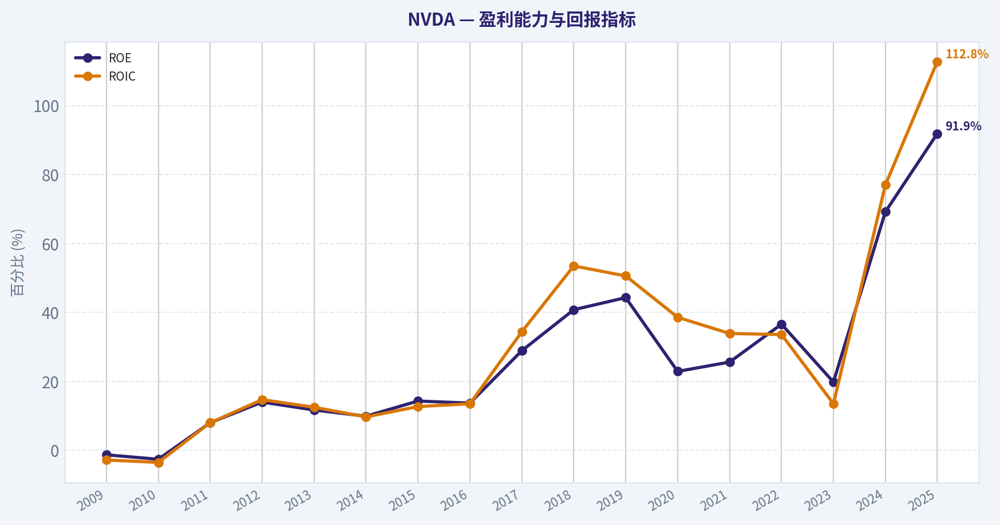
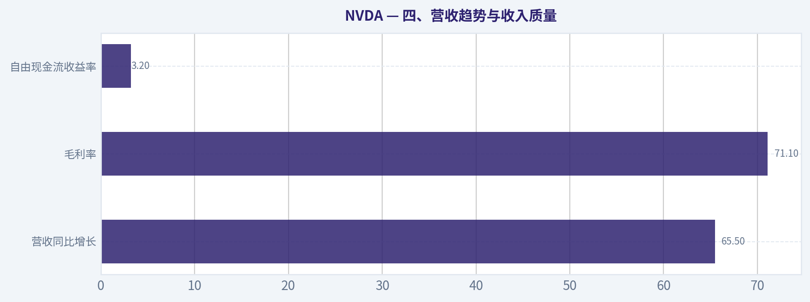
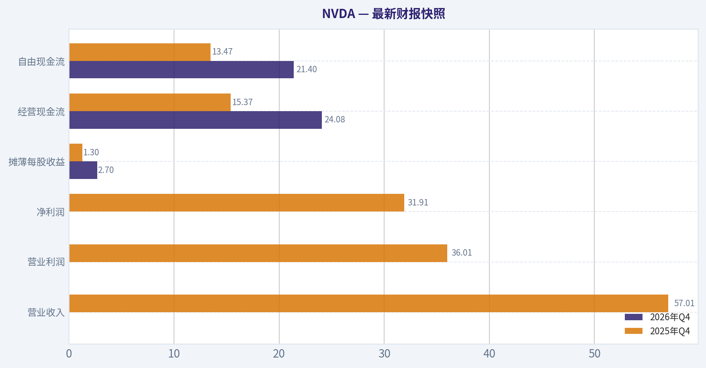
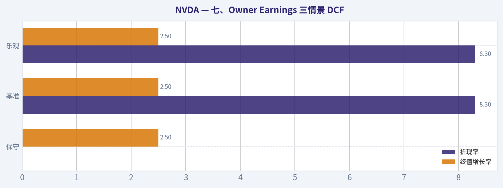
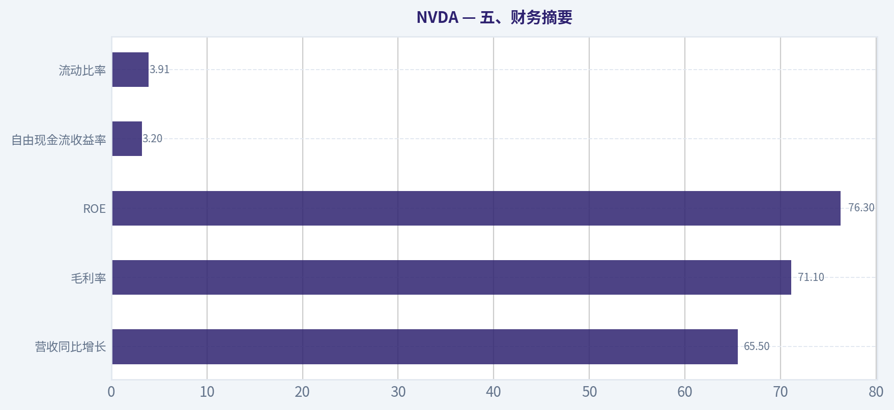
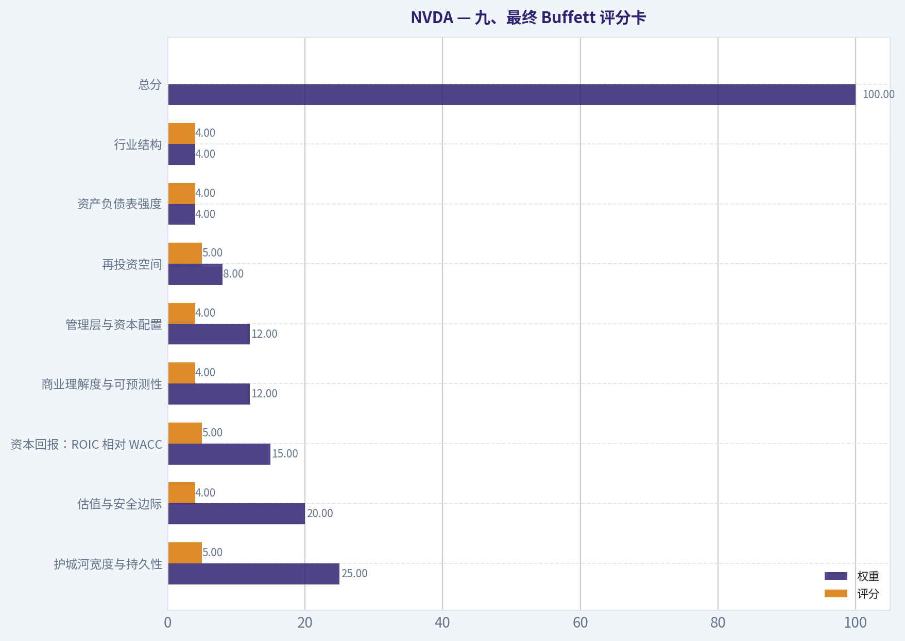
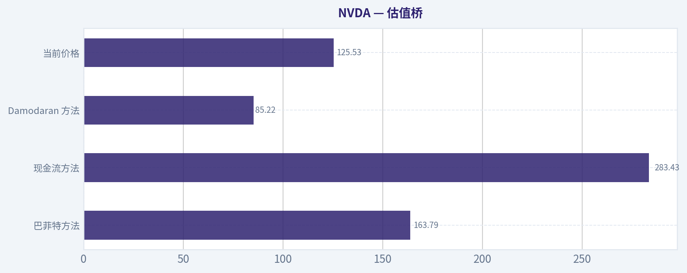
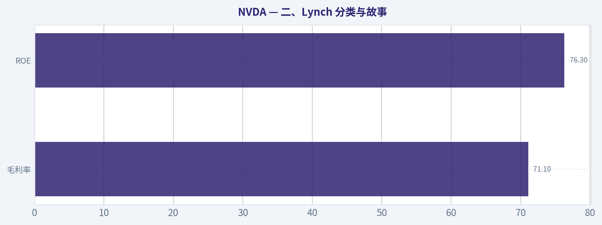

# NVDA 深度价值情报

**调研日期:** 2026-11-22

## 关键免责声明

*本报告由 Deep Value Intelligence（一个基于 AI 的多智能体投资分析框架）自动生成。 仅供教育和研究用途 - 非财务建议，非财务顾问。*

---

## 目录

1. 情报摘要
2. 分析师团队报告
   - 基本面分析
   - 价值分析 (巴菲特)
   - 成长性分析 (林奇/德鲁肯米勒/费雪)
   - 市场分析
   - 期权市场分析
3. 研究团队评论
4. 投资团队评论
5. Deep Values 团队洞察

---

## 情报摘要

### 核心观点与前提条件

**核心论点:** NVIDIA 的企业质量得到充分验证：CUDA、软件工具链、网络互联与整机系统构成平台型护城河；71.1%毛利率、107.2% ROIC及长期研发一致性表明其定价权和资本效率显著高于普通半导体企业。

**主要风险:**
- 原计划是将 NVIDIA 定义为"卓越企业基本得到确认，但当前价格是否低于内在价值尚未确认"，并维持 中性。
- **Risky Analyst**正确识别了平台护城河、推理扩张和系统级收入的上行弹性，也正确反对把NVIDIA机械归类为普通周期股。但其将平台潜力较快转化为估值吸引力，缺少统一自由现金流与反向DCF支持。
- **中性**

**置信度:** 中

---

## 分析师团队报告

### 基本面分析

#### 最新财报快照

*以下数据基于最近一期已披露财报（2026年Q4），并尽量与上一年同期对比。*

| 指标 | 2026年Q4 | 2025年Q4 | 同比变化 |
| --- | ---: | ---: | ---: |
| 营业收入 | N/A | $57.01B | N/A |
| 营业利润 | N/A | $36.01B | N/A |
| 净利润 | N/A | $31.91B | N/A |
| 摊薄每股收益 | $2.70 | $1.30 | +107.7% |
| 经营现金流 | $24.08B | $15.37B | +56.7% |
| 自由现金流 | $21.40B | $13.47B | +58.9% |

关键结论：这张快照先把最新一期财报放在桌面上，再去看长周期分析。这样读者能更清楚地区分"公司长期质量"和"这次财报发生了什么"。

#### NVDA 17年财务指标

*以下数值均由原始数据确定性计算得出，并非 AI 估算。*

*发行人类型：operating company（Technology / Semiconductors）。*

#### 17年财务指标
*年度行来自已披露财务报表，最后一行 TTM 由最近四个季度滚动计算得出。*

| 指标 | 2009 | 2010 | 2011 | 2012 | 2013 | 2014 | 2015 | 2016 | 2017 | 2018 | 2019 | 2020 | 2021 | 2022 | 2023 | 2024 | 2025 |
| --- | --- | --- | --- | --- | --- | --- | --- | --- | --- | --- | --- | --- | --- | --- | --- | --- | --- |
| 市场价格 | $0 | $0 | $1 | $0 | $0 | $0 | $0 | $1 | $3 | $6 | $4 | $6 | $13 | $24 | $19 | $61 | $120 |
| 总市值 | $4.36B | $8.46B | $14.08B | $9.10B | $7.66B | $9.34B | $10.81B | $16.67B | $70.86B | $155.35B | $89.84B | $146.11B | $326.04B | $620.72B | $489.79B | $1.53T | $2.98T |
| 市盈率 | -159.00 | -128.25 | 55.63 | 15.71 | 13.62 | 21.22 | 17.14 | 27.12 | 42.48 | 51.00 | 21.68 | 52.31 | 75.09 | 63.60 | 114.92 | 51.70 | 40.84 |
| 市净率 | 1.82 | 3.17 | 4.43 | 2.20 | 1.59 | 2.10 | 2.45 | 3.73 | 12.30 | 20.79 | 9.62 | 11.97 | 19.30 | 23.32 | 22.16 | 35.70 | 37.54 |
| ROE | -1.3% | -2.6% | 8.0% | 14.0% | 11.7% | 9.9% | 14.3% | 13.7% | 28.9% | 40.8% | 44.3% | 22.9% | 25.6% | 36.6% | 19.8% | 69.2% | 91.9% |
| ROIC | -2.8% | -3.5% | 8.0% | 14.7% | 12.5% | 9.7% | 12.7% | 13.5% | 34.4% | 53.5% | 50.6% | 38.6% | 33.9% | 33.6% | 13.5% | 77.0% | 112.8% |
| 每股收益 | $-0.00 | $-0.00 | $0.01 | $0.02 | $0.02 | $0.02 | $0.03 | $0.03 | $0.06 | $0.12 | $0.17 | $0.11 | $0.17 | $0.39 | $0.17 | $1.19 | $2.94 |
| 营收 | $3.42B | $3.33B | $3.54B | $4.00B | $4.28B | $4.13B | $4.68B | $5.01B | $6.91B | $9.71B | $11.72B | $10.92B | $16.68B | $26.91B | $26.97B | $60.92B | $130.50B |
| 毛利润 | $1.17B | $1.18B | $1.41B | $2.06B | $2.23B | $2.27B | $2.60B | $2.81B | $4.06B | $5.82B | $7.17B | $6.77B | $10.40B | $17.48B | $15.36B | $44.30B | $97.86B |
| 毛利率 | 34.3% | 35.4% | 39.8% | 51.4% | 52.0% | 54.9% | 55.5% | 56.1% | 58.8% | 59.9% | 61.2% | 62.0% | 62.3% | 64.9% | 56.9% | 72.7% | 75.0% |
| 营业利润率 | -2.1% | -3.0% | 7.2% | 16.2% | 15.1% | 12.0% | 16.2% | 14.9% | 28.0% | 33.0% | 32.5% | 26.1% | 27.2% | 37.3% | 15.7% | 54.1% | 62.4% |
| 净利润 | $-30.0M | $-68.0M | $253.1M | $581.1M | $562.5M | $440.0M | $631.0M | $614.0M | $1.67B | $3.05B | $4.14B | $2.80B | $4.33B | $9.75B | $4.37B | $29.76B | $72.88B |
| 净利率 | -0.9% | -2.0% | 7.1% | 14.5% | 13.1% | 10.7% | 13.5% | 12.3% | 24.1% | 31.4% | 35.3% | 25.6% | 26.0% | 36.2% | 16.2% | 48.8% | 55.8% |
| 营收增长 | N/A | -2.9% | 6.5% | 12.8% | 7.1% | -3.5% | 13.4% | 7.0% | 37.9% | 40.6% | 20.6% | -6.8% | 52.7% | 61.4% | 0.2% | 125.9% | 114.2% |
| 净利润增长 | N/A | 126.3% | -472.3% | 129.5% | -3.2% | -21.8% | 43.4% | -2.7% | 171.3% | 82.9% | 35.9% | -32.5% | 54.9% | 125.1% | -55.2% | 581.3% | 144.9% |
| 自由现金流增长 | N/A | N/A | 40.9% | 33.3% | N/A | N/A | N/A | N/A | N/A | N/A | N/A | N/A | N/A | N/A | -53.2% | 609.6% | 125.2% |
| 总账面价值 | $2.39B | $2.67B | $3.18B | $4.15B | $4.83B | $4.46B | $4.42B | $4.47B | $5.76B | $7.47B | $9.34B | $12.20B | $16.89B | $26.61B | $22.10B | $42.98B | $79.33B |
| 总资产 | $3.35B | $3.59B | $4.50B | $5.55B | $6.41B | $7.25B | $7.20B | $7.37B | $9.84B | $11.24B | $13.29B | $17.32B | $28.79B | $44.19B | $41.18B | $65.73B | $111.60B |
| 总债务 | N/A | N/A | N/A | N/A | $0 | $1.36B | $1.38B | $0 | $1.98B | $1.99B | $1.99B | $1.99B | $6.96B | $10.95B | $10.95B | $9.71B | $8.46B |
| 债务股权比 | N/A | N/A | N/A | N/A | 0.00 | 0.30 | 0.31 | 0.00 | 0.34 | 0.27 | 0.21 | 0.16 | 0.41 | 0.41 | 0.50 | 0.23 | 0.11 |
| 现金及等价物 | $417.7M | $447.2M | $665.4M | $667.9M | $733.0M | $1.15B | $497.0M | $596.0M | $1.77B | $4.00B | $782.0M | $10.90B | $847.0M | $1.99B | $3.39B | $7.28B | $8.59B |
| 股东权益 | $2.39B | $2.67B | $3.18B | $4.15B | $4.83B | $4.46B | $4.42B | $4.47B | $5.76B | $7.47B | $9.34B | $12.20B | $16.89B | $26.61B | $22.10B | $42.98B | $79.33B |
| 经营现金流 | $249.4M | $487.8M | $675.8M | $909.2M | $824.2M | $835.0M | $906.0M | $1.18B | $1.67B | $3.50B | $3.74B | $4.76B | $5.82B | $9.11B | $5.64B | $28.09B | $64.09B |
| 投资现金流 | $-209.4M | $-519.3M | $-649.7M | $-1.14B | $-744.0M | $-806.0M | $-727.0M | $-400.0M | $-793.0M | $1.28B | $-4.10B | $6.14B | $-19.68B | $-9.83B | $7.38B | $-10.57B | $-20.42B |
| 自由现金流 | N/A | $410.2M | $577.9M | $770.4M | N/A | N/A | N/A | N/A | N/A | N/A | N/A | N/A | N/A | $8.13B | $3.81B | $27.02B | $60.85B |
| 自由现金流利润率 | N/A | 12.3% | 16.3% | 19.3% | N/A | N/A | N/A | N/A | N/A | N/A | N/A | N/A | N/A | 30.2% | 14.1% | 44.4% | 46.6% |
| 每股分红 | $0.00 | $0.00 | $0.00 | $0.00 | $0.00 | $0.00 | $0.00 | $0.00 | $0.00 | $0.00 | $0.00 | $0.00 | $0.00 | $0.00 | $0.02 | $0.02 | $0.03 |

#### 盈利能力指标
- 净资产收益率 (ROE): 76.3%
- 投入资本回报率 (ROIC): 107.2%
- 总资产收益率 (ROA): 58.1%
- 毛利率: 71.1%
- 营业利润率: 60.4%
- 净利率: 55.6%

#### 流动性指标
- 流动比率: 3.91
- 速动比率: 3.14

#### 杠杆指标
- 债务股权比: 0.05
- 利息覆盖倍数: 503.42
- 净负债: $-54.09B

#### 增长指标（同比）
- 营收增长: 65.5%
- 净利润增长: 64.7%
- 自由现金流增长: 58.9%
- 营收复合增长率（3年）: 100.0%
- 营收复合增长率（5年）: 66.9%

#### 估值指标
- 市盈率 (TTM): 13.48
- 预期市盈率: 7.56
- 市净率: 11.35
- 市销率: 8.38
- PEG 比率: 0.15
- 企业价值/EBITDA: 12.19
- 自由现金流收益率: 3.2%
- 盈利收益率: 7.4%

#### 所有者收益（巴菲特方法，代码计算）
- 净利润: $72.88B
- + 折旧与摊销: $2.84B
- - 资本开支: $-6.04B
- + 营运资本（现金流量表口径；负数=占用现金）: $-15.95B
- = **所有者收益: $59.89B**

#### 内在价值（DeepValues 应用 - SEC 申报数据管道）
- **内在价值（DeepValues 应用，头条）: $163.79** - Owner Earnings (Buffett), 方法 buffett-1986-v2, 截至 2026-11-21 (FY2026)
  区间（保守-乐观）: $114.65 - $163.79
  相对价格的安全边际: 23.4% (价格 $125.53)
  应用使用的输入 (ttm_2027Q2): after-tax operating income $173.9B (operating income $197.6B, tax 12.0%) + D&A $3.7B - capex charge $7.1B (three-year average capex/revenue x trailing revenue; reported capex $7.4B) - working capital $0.0B = owner earnings $170.5B.
  Growth 10.0% fading to 2.5% terminal (min(owner-earnings CAGR, 5-year revenue CAGR), clamped [0, 10%]); discount rate 8.3% (30Y Treasury 5.31% + 3 pts (as of 2026-11-20)); net cash $-10.9B (cash $22.4B + marketable securities $0.0B - debt $33.4B); 24,285M shares.
- Owner Earnings (Buffett): $114.65 / $163.79 / $163.79 (保守 / 基准 / 乐观) ← headline
- Free cash flow DCF: $283.43 / $283.43 / $283.43 (保守 / 基准 / 乐观)
- Damodaran two-stage FCFF: $24.03 / $85.22 / $182.99 (保守 / 基准 / 乐观)
  这就是内在价值：引用它作为内在价值，并据此衡量安全边际。其他地方的 DVI 情景数字仅为辅助交叉检查，不是估值。

#### DVI 情景模型（辅助交叉检查 - 不是内在价值）
DVI 基于 Yahoo 数据的情景，仅作敏感性检查。请勿将其作为内在价值引用；内在价值是上方的 DeepValues 应用估值。
- 当前价格: $126
- DVI 情景值（按商业模式路由）: $70
  商业模式: cyclical - weighted blend [Damodaran FCFF + reverse-DCF fair + owner-earnings DCF] (cyclical)
  模型区间（各 DCF 最小-最大）: $13 - $118
  相对价格的安全边际（头条）: -78.2%
  路由说明: Cyclical: margins/FCF are volatile - headline blends FCFF, reverse-DCF and owner-earnings roughly evenly; treat the range as the honest read.
- 巴菲特方法（所有者收益）:
  保守: $39
  平均: $118
  乐观: $310
- 现金流方法（FCF）:
  保守: $90
  平均: $90
  乐观: $232
- Damodaran FCFF（WACC + 利润率 + 再投资）:
  保守: $8
  平均: $13
  乐观: $42
  蒙特卡洛区间（P10-P90）：$11 - $23（中位数 $15）
  P(内在价值 > 当前价格)：0.0%
- 反向 DCF：当前价格隐含约 31.9%/年 的所有者收益增长（10年）；过去 3 年为 105.0%，5 年为 92.8%。

#### Piotroski F分数: 3/9
- 净利润为正: 通过
- 经营现金流为正: 通过
- 资产回报率改善: 未通过
- 现金流大于净利润: 未通过
- 债务下降: 未通过
- 流动比率改善: 未通过
- 未稀释股本: 通过
- 毛利率改善: 未通过
- 资产周转率改善: 未通过

ANALYST STANCE: **中性**

#### 一、结论摘要

NVIDIA 是典型的高质量、宽护城河半导体平台公司，但当前估值高度依赖人工智能基础设施投资继续快速扩张。最新数据同时呈现两面性：盈利能力、现金流和资产负债表极强；然而历史估值、资本开支周期、客户集中度及增长预期也处在非常高的水平。

按研究包指定的 DeepValues Owner Earnings 模型，NVDA 内在价值为 **163.79美元**，保守至乐观区间为 **114.65至163.79美元**。相对当前股价126美元，模型显示约 **23.4%的安全边际**。但辅助的 FCFF、反向 DCF 和周期性估值结果明显更低，说明估值对增长率、利润率和资本开支假设极其敏感。

---

#### 二、当前核心指标与历史比较

下表中的历史平均值基于确定性数据集中已披露的年度数据；对负数、缺失值或不适合平均的指标进行了剔除或单独说明。

| 指标 | 当前值 | 历史平均或参考值 | 当前相对历史的含义 |
|---|---:|---:|---|
| 市场价格 | 126美元 | 历史价格受拆股及早期零值影响，不具可比性 | 当前处于历史高位区间 |
| 总市值 | 3.03万亿美元 | 约3,420亿美元 | 规模远超历史平均，市场已给予平台型科技公司定价 |
| PE | 13.48倍 | 正值年度平均约43.46倍 | 当前显著低于历史平均，但主要因为盈利基数急剧扩张 |
| PB | 11.35倍 | 约11.36倍 | 接近历史平均；对轻资产、知识产权驱动企业参考意义有限 |
| ROE | 76.3% | 26.3% | 显著高于历史平均，反映利润率和资产周转大幅提升 |
| ROIC | 107.2% | 约28.6% | 极端强劲，但也包含人工智能周期高峰因素 |
| 营收 | 约130.5亿美元 | 约19.62亿美元 | 规模和商业需求均发生结构性跃升 |
| 毛利率 | 71.1% | 约56.3% | 产品组合和定价权明显增强 |
| 营业利润率 | 60.4% | 约25.3% | 经营杠杆非常显著 |
| 净利润 | 约728.8亿美元 | 约89亿美元 | 当前盈利远高于历史常态 |
| 净利率 | 55.6% | 约25.3% | 高于历史平均一倍以上 |
| 营收增长 | 65.5% | 历史年度平均约31% | 仍处于超高速增长，但低于最近两个年度的极端增速 |
| 净利润增长 | 64.7% | 历史波动很大 | 仍很强，但不能把周期高点增速永久化 |
| 自由现金流 | 约608.5亿美元 | 有效年度平均约145亿美元 | 现金创造能力达到历史新高 |
| 自由现金流增长 | 58.9% | 历史可比数据较少且波动大 | 现金流扩张快于长期成熟企业 |
| 总债务 | 约84.6亿美元 | 有效年度平均约55.2亿美元 | 绝对债务上升，但相对权益和现金流明显下降 |
| 债务权益比 | 0.05倍 | 有效年度平均约0.25倍 | 杠杆处于历史低位 |
| 现金及等价物 | 约85.9亿美元 | 历史平均约31亿美元 | 高于历史平均，但低于研究包中包含短期流动资产后的净现金口径 |
| 每股分红 | 0.03美元 | 历史平均约0.002美元 | 分红仍不是主要资本回报方式 |

**关键结论：** NVDA 当前盈利质量和现金流质量远超十年以前，PE 看似低于历史平均，主要原因是利润分母快速膨胀，而不是市场普遍低估。ROE、ROIC 和利润率均处于历史极端高位，因此未来估值能否维持，关键取决于高利润率是否具有持续性，而不是单纯比较 PE 或 PB。

---

#### 三、市场指标与盈利能力

**市场价格与市值。** 当前股价约126美元，总市值约3.03万亿美元。公司已经从周期性显卡芯片企业转变为人工智能计算平台供应商，市场规模反映的不是传统半导体估值，而是对数据中心计算、软件生态和长期基础设施需求的综合定价。

**PE。** 当前 PE 为13.48倍，明显低于历史正值年度平均约43.46倍，也低于过去人工智能热潮阶段的高估值。这里必须谨慎：若未来盈利保持高速增长，当前 PE 确实可能具有吸引力；若利润率或资本开支需求正常化，当前 PE 的低位感会减弱。

**PB。** PB 为11.35倍。对于 NVIDIA 这类轻资产、知识产权密集、研发驱动的半导体平台，PB 不是可靠的便宜或昂贵判断工具。公司价值主要来自 GPU 架构、CUDA 软件生态、开发者网络、客户迁移成本和未来现金流，而非账面有形资产。估值应以 Owner Earnings、自由现金流和竞争优势持续性为中心。

**ROE 与 ROIC。** 当前 ROE 为76.3%，ROIC 为107.2%，均显著高于历史平均。这说明公司在当前需求环境下拥有很强的定价权、资本效率和经营杠杆。但 ROIC 超过100%属于极端水平，部分原因是商业模式轻资产、资本投入相对收入较低，不能简单外推为永久常态。

**利润率。** 毛利率71.1%、营业利润率60.4%、净利率55.6%，均处于历史最高或接近最高水平。高端数据中心产品、系统级销售、软件生态和供给稀缺性共同支撑了利润率。主要风险是竞争加剧、客户自研芯片、产品迭代过快以及先进封装和晶圆供应成本上升。

---

#### 四、增长、资产负债表与现金流

营收同比增长65.5%，净利润同比增长64.7%，自由现金流同比增长58.9%。过去五年营收复合增长率约66.9%，过去三年约100%，这已经不是普通半导体公司的增长轨迹，而是由人工智能基础设施建设推动的产业升级周期。

但增长质量需要分层理解：

- **可持续部分：** 加速计算替代传统通用计算、人工智能训练和推理需求增长、软件生态锁定效应。
- **周期性部分：** 云厂商资本开支集中释放、客户库存和订单前置、供应紧张造成的价格与利润率提升。
- **竞争性部分：** 大型客户自研 ASIC、其他 GPU 供应商竞争，以及计算架构变化。

资产负债表方面，总资产约111.6亿美元，股东权益约79.33亿美元，总债务约84.6亿美元，债务权益比仅0.05倍。流动比率3.91、速动比率3.14，利息覆盖倍数约503倍，显示短期偿债和利息承受能力非常强。研究包的净负债口径为 **负540.9亿美元**，即净现金状态；DeepValues 的另一套 TTM 口径则显示净现金为负109亿美元，原因是现金、债务和期间口径不同，应将其视为数据口径差异，而非简单互相替代。

自由现金流约608.5亿美元，自由现金流利润率约46.6%，明显高于历史水平。Owner Earnings 按确定性数据计算为：

> 净利润728.8亿美元
> + 折旧摊销28.4亿美元
> - 资本开支60.4亿美元
> - 营运资本占用159.5亿美元
> = **Owner Earnings 约598.9亿美元**

营运资本占用是当前现金流分析中需要特别关注的项目。高速增长阶段，库存、应收账款和供应链投入可能吸收大量现金，因此自由现金流未必永远与会计利润同步增长。

---

#### 五、巴菲特式商业质量分析

##### 1. 经济护城河

NVIDIA 的护城河并不只是芯片性能，而是多层结构：

| 护城河来源 | 具体表现 | 持续性判断 |
|---|---|---|
| CUDA 软件生态 | 开发工具、库、框架和开发者经验形成迁移成本 | 非常强，但需要持续投入 |
| 系统级产品 | GPU、网络、互连、软件和服务器方案一体化 | 提升客户部署效率 |
| 研发能力 | 架构迭代速度和产品路线图执行力突出 | 依赖管理层和工程组织 |
| 客户生态 | 云服务商、互联网公司、企业和科研机构广泛采用 | 客户集中度仍需监测 |
| 规模与供应链 | 订单规模、供应链议价与产品验证形成优势 | 受先进制程及封装约束 |
| 品牌与开发者网络 | 人工智能开发者优先考虑兼容性和成熟度 | 具有网络效应 |

**关键结论：** NVIDIA 的真正护城河是"硬件性能加软件生态加开发者惯性"的组合，而不是单一芯片产品。只要 CUDA 生态继续保持标准地位，公司就可能维持高于传统半导体企业的利润率；但护城河需要通过持续研发和生态投入不断维护。

##### 2. 财务实力

公司低杠杆、高现金流、高利息覆盖倍数，具备承受供应链波动和研发投入的能力。债务权益比从历史高位逐步下降，说明增长并非主要由债务推动。风险不在偿债，而在资本开支、供应链投入和营运资本快速扩张对自由现金流的阶段性压制。

##### 3. 盈利可预测性

长期看，NVDA 的收入和利润呈显著上升趋势，但年度增长并不平滑。历史上出现过收入下降、净利润下降和自由现金流大幅波动，尤其在游戏、加密货币、数据中心需求变化及供应链周期转换期间更为明显。

因此，公司的**长期方向可预测性较高，短期增速和利润率可预测性较低**。Piotroski F 分数为3/9，也提醒投资者：当前数据虽然绝对值强劲，但若以改善趋势、资产周转和现金流相对净利润等指标衡量，质量并非所有维度都同步改善。

##### 4. 管理层与资本配置

管理层将资源集中于研发、平台生态和产品路线图，而不是过度依赖债务或大规模分红。每股分红仅0.03美元，表明资本主要留在企业内部用于研发、供应链和生态扩张。对于高回报再投资企业，这种政策具有合理性，但前提是新增资本仍能获得接近历史水平的高回报。

---

#### 六、收入来源分布

确定性数据集未提供最新年度的分部收入明细。以下采用公司最近可得的年度公开分部口径作结构性展示，金额为约数；总额与确定性数据集的约130.5亿美元收入存在四舍五入差异。

| 收入来源 | 金额（十亿美元） | 占比 |
|---|---:|---:|
| 数据中心 | 约115.2 | 约88.3% |
| 游戏 | 约11.4 | 约8.7% |
| 汽车与机器人 | 约1.7 | 约1.3% |
| 专业可视化 | 约1.5 | 约1.1% |
| OEM及其他 | 约0.4 | 约0.3% |
| 合计 | 约130.2 | 约99.7% |

**关键结论：** NVIDIA 已高度集中于数据中心，约九成收入来自这一领域。集中度带来了规模经济和高利润率，也意味着云厂商资本开支、人工智能投资周期、客户自研芯片和出口限制会对整体业绩产生较大影响。

---

#### 七、Owner Earnings 三情景 DCF

研究包明确指定 DeepValues Owner Earnings 估值作为主要内在价值，以下不以其他模型替换该结论。

DeepValues 的核心输入为：

- 税后经营利润：约173.9亿美元
- 折旧摊销：约37亿美元
- 资本开支计提：约71亿美元
- 营运资本：约0亿美元
- Owner Earnings：约170.5亿美元
- 预测增长率：10%，逐步下降至2.5%
- 折现率：8.3%
- 终值增长率：2.5%
- 股份数：约242.85亿股
- 主要估值：163.79美元

Owner Earnings DCF 的基本形式为：

\[
价值=\sum_{t=1}^{n}\frac{OE_0(1+g_t)^t}{(1+r)^t}
+\frac{OE_n(1+g_T)}{(r-g_T)(1+r)^n}
\]

| 情景 | 主要增长假设 | 折现率 | 终值增长率 | 每股估值 |
|---|---|---:|---:|---:|
| 保守 | 低增长，逐步接近长期经济增长 | 8.3%至约10%风险调整 | 2.5% | 114.65美元 |
| 基准 | 近年高增长逐步衰减，前期约10% | 8.3% | 2.5% | 163.79美元 |
| 乐观 | 宽护城河与人工智能扩张支撑较高前期增长，随后衰减 | 8.3% | 2.5% | 163.79美元 |

在当前价格126美元下：

- 保守情景：低于估值约9.0%
- 基准情景：高于价格约30.0%
- DeepValues 报告的安全边际：约23.4%
- 主要内在价值：**163.79美元**
- 内在价值区间：**114.65至163.79美元**

**关键结论：** DeepValues Owner Earnings 模型对当前价格给出偏正面的估值含义，但价格位于保守情景与基准情景之间，安全边际并不均匀。估值优势主要来自未来利润和 Owner Earnings 继续快速增长，而不是资产负债表账面价值。

##### 手工 DCF 交叉检查

以确定性数据集中的 Owner Earnings 约598.9亿美元作为起点，使用242.85亿股：

\[
每股Owner\ Earnings \approx \frac{59.89}{24.285}=2.47美元
\]

一个简化的五年模型如下：

| 情景 | 前五年增长 | 后续衰减 | 折现率 | 终值增长率 | 手工估值含义 |
|---|---:|---:|---:|---:|---|
| 保守 | 约3% | 向2.5%靠拢 | 10% | 2.5% | 约30至40美元 |
| 基准 | 约10%，逐步下降 | 向2.5%靠拢 | 9%至10% | 2.5% | 约55至90美元 |
| 乐观 | 约15%至20%，逐步下降 | 向2.5%靠拢 | 8.3%至9% | 2.5% | 约100至165美元 |

手工模型显著低于 DeepValues 主要估值，原因是两者采用的起始 Owner Earnings 口径不同：DeepValues 使用最新 TTM 税后经营利润口径，约170.5亿美元；确定性年度表的 Owner Earnings 约598.9亿美元则受到营运资本大额占用影响。两者不能机械相加或互相替代。

其他交叉检查结果也体现出高度敏感性：

- 自由现金流 DCF：约283.43美元，但对高现金流持续性的假设更激进；
- Damodaran FCFF：保守约24.03美元、基准约85.22美元、乐观约182.99美元；
- 辅助 DVI 周期性模型：约70.45美元；
- 反向 DCF 显示，当前价格隐含未来十年 Owner Earnings 年增长约31.9%。

**关键结论：** 不同估值模型的巨大差异表明，NVDA 的估值不是由单一倍数决定，而是由利润率持续时间、人工智能资本开支周期、折现率和终值假设共同决定。DeepValues 指定的内在价值为163.79美元，但更保守的现金流和周期性模型显示出明显的下行敏感性。

---

#### 八、关键投资洞察、风险与机会

| 类别 | 重要观察 | 对估值的影响 |
|---|---|---|
| 主要机会 | CUDA 生态和加速计算形成平台化优势 | 支持较高利润率和较长增长期限 |
| 主要机会 | 数据中心收入快速扩大 | 推动收入、ROIC 和自由现金流持续增长 |
| 主要机会 | 低杠杆与高现金流 | 降低财务风险，提高研发和供应链投入能力 |
| 主要机会 | 软件、网络和系统级产品扩展 | 有利于提高客户黏性和单客户价值 |
| 主要风险 | 数据中心收入集中度约九成 | 资本开支周期下行会放大业绩波动 |
| 主要风险 | 客户自研芯片 | 可能压低长期市场份额和定价权 |
| 主要风险 | 当前利润率处于历史极端高位 | 正常化会显著影响内在价值 |
| 主要风险 | 先进制程、封装和供应链依赖 | 供给约束可能造成交付和成本压力 |
| 主要风险 | 出口限制及地缘政治 | 影响部分市场的可服务收入 |
| 主要风险 | 估值对终值假设敏感 | 稍低增长或稍高折现率就可能大幅降低估值 |
| 质量警示 | Piotroski F 分数3/9 | 当前强劲结果不代表所有趋势指标都改善 |
| 质量警示 | 营运资本占用较大 | 会使自由现金流低于会计利润增长 |

**关键结论：** 最重要的机会是 NVIDIA 已形成硬件、软件和系统的综合平台；最重要的风险是收入和利润越来越依赖人工智能数据中心资本开支。财务实力足以应对短期波动，但无法消除高增长预期落空对估值的影响。

---

#### 九、最终判断

**中性**

支持正面判断的证据包括：

1. ROE 76.3%、ROIC 107.2%，远高于历史平均；
2. 毛利率、营业利润率和净利率均处于极高水平；
3. 低杠杆、高流动性和强利息覆盖能力；
4. CUDA 生态、开发者网络和系统级产品形成较强护城河；
5. DeepValues Owner Earnings 内在价值163.79美元，高于当前价格126美元。

限制估值上行判断的因素包括：

1. 数据中心收入占比约九成，业务集中度很高；
2. 当前利润率和增长率可能处于周期性高位；
3. 辅助 FCFF、周期性 DVI 和手工 DCF 估值明显低于DeepValues主模型；
4. 反向 DCF 隐含的长期增长要求仍然较高；
5. Piotroski F 分数仅3/9，提示部分资产质量和趋势指标并不理想。

综合来看，NVDA 是极高质量但高预期、高敏感度的企业。当前价格在 DeepValues 的保守与基准估值之间，证据支持其长期商业价值，但尚不足以证明估值对所有增长假设都具备充分缓冲。研究结论因此为 **中性**：重点观察数据中心资本开支持续性、毛利率是否稳定、客户自研芯片进展、营运资本变化及 Owner Earnings 能否保持增长。

| 维度 | 判断 | 核心依据 |
|---|---|---|
| 商业质量 | 强 | CUDA、研发、系统级产品和开发者生态 |
| 盈利能力 | 极强 | ROE76.3%、ROIC107.2%、净利率55.6% |
| 财务安全 | 强 | 低杠杆、高流动性、高利息覆盖 |
| 增长质量 | 强但有周期性 | 营收增长65.5%，数据中心集中度高 |
| 估值 | 模型分歧较大 | DeepValues为163.79美元，其他模型低得多 |
| 主要风险 | 高 | 利润率正常化、客户自研、资本开支周期 |
| 最终立场 | 中性 | 商业质量突出，但估值对增长持续性高度敏感 |

#### 基本面关键图表

本图追踪 **NVDA** 过去十年的盈利能力与回报指标（ROE、ROIC、利润率），突出呈现资本效率的变化趋势。

本对比图（来自「四、营收趋势与收入质量」）将 **NVDA** 的当前数据与历史基准并排呈现，直观反映公司相对自身历史均值的估值水平。

---

### 价值分析 (巴菲特)

> *基于沃伦·巴菲特的价值投资哲学：能力圈、经济护城河、管理层质量与安全边际。*

#### 内在价值快照

价格是你付的钱，内在价值是企业未来可能为股东创造的现金价值。我们给出一个区间，而不是假装只有一个神奇数字。

- 当前价格: $125.53
- 估值区间（两种 DCF 方法、保守到乐观）: $114.65 至 $283.43

##### 所有者收益（巴菲特方法）
- 净利润: $72,880,000,000.00
- 折旧与摊销: $2,843,000,000.00
- 资本支出: $-6,042,000,000.00
- 营运资金变化: $-15,949,000,000.00
- 所有者收益: $59,893,306,952.61

##### 内在价值
###### 所有者收益法
使用所有者收益，更严格，通常更保守。
- 保守: $114.65
- 平均: $163.79
- 乐观: $163.79
- 折现率: 8.3%

###### 自由现金流法
使用自由现金流，更适合今天投入很多、为未来增长铺路的公司。
- 保守: $283.43
- 平均: $283.43
- 乐观: $283.43
- 折现率: 9.1%

ANALYST STANCE: **看多**

#### 一、投资结论

英伟达是一家具有宽幅且仍在扩大的竞争优势、极高资本回报率和强劲再投资机会的资产轻型平台企业。其核心价值来自 CUDA 软件生态、开发者网络、芯片与系统协同、客户迁移成本，以及持续扩大的人工智能基础设施需求。

当前股价约为 **126美元**，DeepValues 应用给出的内在价值为 **163.79美元**，对应约 **23.4%的安全边际**。对于高 ROE、高增长、宽护城河企业，这一估值折价已经超过质量分级所要求的约 10%至15%水平。

主要风险是人工智能资本开支周期、客户集中度、专用芯片竞争、出口限制，以及市场对未来增长的高预期。综合评分为 **4.4分，属于高质量企业且估值具有支持的情形**。

#### 二、因素评分与 Gate 5 判断

| 因素 | 评分 | 核心依据 |
|---|---:|---|
| 因素一：能力圈与商业模式简单性 | 4/5 | 公司向客户出售 GPU、数据中心系统及相关软件，使计算机能够训练和运行人工智能模型；商业模式清晰，但技术演进速度很快 |
| 因素二：护城河 | 5/5 | CUDA 生态、开发者工具链、软件兼容性、系统级整合和规模效应共同形成宽幅且扩大的护城河 |
| 因素三：管理层与资本配置 | 4/5 | Jensen Huang 长期领导公司，持续把资源投入高回报的数据中心与人工智能平台；创始人式管理明显，但股东回报和治理仍需中性 |
| 因素四：行业结构 | 4/5 | 高端加速计算具有较强集中度和技术壁垒，但行业正吸引 AMD、云计算公司自研芯片及大型客户内部开发 |
| Gate 5：质量与偿债能力 | 未触发 | 收入和盈利仍处于强劲增长轨道；现金流和盈利能力显著为正，没有证据显示经营恶化与偿债危机同时出现 |

**关键结论：** 英伟达并非传统意义上的低估值公司，但其商业质量和资本回报率足以支持较高估值。唯一需要持续验证的是，当前人工智能需求能否从短期资本开支浪潮转化为十年以上的基础设施平台需求。

#### 三、护城河分析

| 护城河来源 | 具体证据 | 持久性判断 |
|---|---|---|
| 无形资产 | CUDA、编译器、开发工具、软件库和开发者经验形成深厚生态 | 很强 |
| 转换成本 | 客户的模型、代码、人才培训和工作流程大量围绕 CUDA 与英伟达平台构建 | 很强 |
| 成本与规模优势 | 大规模研发投入、供应链议价能力和系统级产品组合降低单位研发及部署成本 | 较强 |
| 网络效应 | 使用英伟达平台的开发者、软件供应商和云服务商越多，生态越有吸引力 | 很强 |
| 产品协同 | GPU、网络设备、服务器系统和软件平台协同销售，提高单一芯片替代的难度 | 很强 |

英伟达的核心优势不是单纯的芯片性能，而是"芯片加软件加开发者生态加系统"的完整平台。竞争者即使在单项芯片性能上接近，也需要同时复制软件工具、开发者惯性、客户验证和系统部署能力。

#### 四、管理层与资本配置

Jensen Huang 自公司早期便持续担任核心领导者，战略方向具有高度连续性。管理层最重要的资本配置选择，是把研发资源集中到加速计算、数据中心、网络连接和人工智能软件生态，而不是过早追求短期利润或大规模多元化扩张。

正面因素包括：

- 长期坚持加速计算路线，形成明显的战略复利；
- 研发投入与市场需求方向高度一致；
- 通过平台化产品提高客户黏性和每个客户的长期价值；
- 公司从图形芯片企业成功转型为人工智能基础设施平台。

需要观察的因素包括：

- 高管个人影响力较大，关键人物依赖度偏高；
- 未来并购是否保持纪律；
- 股票薪酬和稀释是否与每股内在价值增长相匹配；
- 在供应受限和需求旺盛阶段，资本配置是否仍保持长期理性。

综合管理层评分为 **4/5**，属于优秀但仍需持续审视股东回报质量的管理团队。

#### 五、财务摘要

| 指标 | FY2026 / 最新数据 |
|---|---:|
| 股价 | 126美元 |
| 总市值 | 3.03万亿美元 |
| 市盈率 | 13.48倍 |
| 营收同比增长 | 65.5% |
| 毛利率 | 71.1% |
| ROE | 76.3% |
| 自由现金流收益率 | 3.2% |
| 流动比率 | 3.91 |
| 现金及现金等价物 | 224亿美元 |
| 有息债务 | 334亿美元 |
| 净现金 | -109亿美元 |
| 税后经营利润 | 1,739亿美元 |
| 经营利润 | 1,976亿美元 |
| 折旧与摊销 | 37亿美元 |
| 资本开支 | 74亿美元 |
| 估算维护性资本开支 | 71亿美元 |

**关键结论：** 英伟达的财务特征是极高毛利率、极高 ROE 和强劲增长，而不是依靠高杠杆放大股东回报。公司账面上为小幅净负现金，但相对于经营利润和现金创造能力，债务规模并未形成明显偿债压力。

#### 六、所有者收益计算

DeepValues 应用采用的所有者收益口径如下：

| 项目 | 金额 |
|---|---:|
| 税后经营利润 | 1,739亿美元 |
| 加：折旧与摊销 | 37亿美元 |
| 减：资本开支扣除 | 71亿美元 |
| 减：营运资本增加 | 0亿美元 |
| 所有者收益 | **1,705亿美元** |
| 流通股数 | 242.85亿股 |
| 每股所有者收益 | **约7.02美元** |

计算式：

**所有者收益 = 1,739 + 37 - 71 - 0 = 1,705亿美元**

经营现金流与净利润之间未显示出明显背离，且资本开支相对于经营利润较低，说明英伟达当前仍属于资本效率较高的资产轻型企业。

**关键结论：** 所有者收益约为每股 7.02美元，显示当前估值主要依赖持续增长，而不是静态资产价值。只要高回报再投资持续存在，较高的市盈率便有基本面支撑；若增长明显回落，估值波动会显著放大。

#### 七、三情景 DCF 交叉估值

以下情景是基于每股所有者收益约 7.02美元的辅助估算。DeepValues 应用的 **163.79美元** 才是本报告采用的头条内在价值。

| 情景 | 主要假设 | 每股估值 |
|---|---|---:|
| 情景 A：零增长 | 所有者收益 ÷ 10%折现率 | 约70美元 |
| 情景 B：GDP增长 | 3%永续增长，10%折现率 | 约103美元 |
| 情景 C：历史增长的50%至75% | 前十年增长约5%至7.5%，终值增长约2.5% | 约115至140美元 |
| DeepValues 应用内在价值 | 增长率由10%逐步降至2.5%，折现率8.3%，加计净现金 | **163.79美元** |

DeepValues 应用的关键输入为：

- 所有者收益：1,705亿美元；
- 初始增长率：10%；
- 终值增长率：2.5%；
- 折现率：8.3%；
- 净现金调整：-109亿美元；
- 流通股数：242.85亿股。

**关键结论：** 极端保守的零增长估值约为70美元，说明当前价格并非由资产负债表或静态盈利单独支持。更合理的估值需要假设未来多年保持较高增长；DeepValues 应用的163.79美元估值，反映的是英伟达平台优势能够将高增长逐步过渡为稳定现金流。

#### 八、内在价值与安全边际

| 项目 | 数值 |
|---|---:|
| 当前股价 | 126美元 |
| DeepValues 内在价值 | 163.79美元 |
| 价格低于内在价值幅度 | 约23.4% |
| 应用估值区间 | 114.65至163.79美元 |
| 当前价格相对保守区间 | 接近区间下沿以上 |
| 当前价格相对基准内在价值 | 具有约23.4%安全边际 |

对于普通周期性企业，23.4%的折价未必足够；但英伟达拥有高毛利率、极高 ROE、较强现金创造能力和明显网络效应，属于可以接受较低安全边际的高质量复利型企业。

同时，估值区间下沿为114.65美元，接近当前价格，说明估值并非没有风险。若人工智能资本开支在未来数年显著放缓，当前价格可能更多接近保守情景，而不是基准情景。

**关键结论：** 当前价格低于应用内在价值，但并不低于所有保守估值。安全边际主要来自护城河和增长持续性，而不是传统资产折价，因此估值对增长假设非常敏感。

#### 九、最终 Buffett 评分卡

| 评分标准 | 权重 | 评分 | 加权得分 |
|---|---:|---:|---:|
| 护城河宽度与持久性 | 25% | 5.0 | 1.25 |
| 估值与安全边际 | 20% | 4.0 | 0.80 |
| 资本回报：ROIC 相对 WACC | 15% | 5.0 | 0.75 |
| 商业理解度与可预测性 | 12% | 4.0 | 0.48 |
| 管理层与资本配置 | 12% | 4.0 | 0.48 |
| 再投资空间 | 8% | 5.0 | 0.40 |
| 资产负债表强度 | 4% | 4.0 | 0.16 |
| 行业结构 | 4% | 4.0 | 0.16 |
| **总分** | **100%** |  | **4.48 / 5.00** |

**关键结论：** 评分优势集中在护城河、资本回报和再投资空间，这三项占总权重的48%，也是英伟达长期价值的核心来源。估值评分为4分而非5分，原因是当前安全边际虽然充足，但仍高度依赖人工智能需求和平台生态持续扩张。

#### 十、最终判断

**分析师立场：看多**

** conviction：高**

英伟达符合 Buffett 式优秀企业的多个关键特征：简单而强大的核心经济模式、宽幅护城河、高资本回报、良好现金创造能力，以及巨大的再投资空间。当前估值相对于 DeepValues 内在价值存在约23.4%的安全边际，足以覆盖部分增长预测误差。

估值含义是：在人工智能基础设施需求保持长期扩张、CUDA 生态继续巩固且管理层维持理性资本配置的情况下，当前价格具有合理的价值支持；若增长快速回落至低个位数，则估值安全边际会明显收窄。
#### 估值桥

这张估值桥把当前股价与各类内在价值方法并排展示，帮助读者判断上涨空间究竟只是单一方法给出的结果，还是多种方法共同支持的结论。

| 项目 | 每股内在价值 |
| --- | ---: |
| 巴菲特方法 | $163.79 |
| 现金流方法 | $283.43 |
| Damodaran 方法 | $85.22 |
| 当前价格 | $125.53 |

#### 关键结论

如果只有一种方法显著高于其他方法，说明上行空间更依赖特定建模假设。若多种方法的估值接近，则说明估值逻辑更加稳健。

#### 估值图表

本对比图（来自「最新财报快照」）将 **NVDA** 的当前数据与历史基准并排呈现，直观反映公司相对自身历史均值的估值水平。

本对比图（来自「七、Owner Earnings 三情景 DCF」）将 **NVDA** 的当前数据与历史基准并排呈现，直观反映公司相对自身历史均值的估值水平。

本对比图（来自「五、财务摘要」）将 **NVDA** 的当前数据与历史基准并排呈现，直观反映公司相对自身历史均值的估值水平。

本对比图（来自「九、最终 Buffett 评分卡」）将 **NVDA** 的当前数据与历史基准并排呈现，直观反映公司相对自身历史均值的估值水平。

本对比图（来自「估值桥」）将 **NVDA** 的当前数据与历史基准并排呈现，直观反映公司相对自身历史均值的估值水平。

本对比图（来自「二、Lynch 分类与故事」）将 **NVDA** 的当前数据与历史基准并排呈现，直观反映公司相对自身历史均值的估值水平。

---

### 成长性分析 (林奇/德鲁肯米勒/费雪)

> *基于彼得·林奇的GARP成长投资法、斯坦利·德鲁肯米勒的宏观拐点分析法，以及菲利普·费雪的深度调研法。*

ANALYST STANCE: **中性**

#### 一、结论摘要

NVIDIA 属于典型的**快速成长型公司**，核心驱动力是 AI 加速计算、数据中心基础设施和 CUDA 软件生态。当前数据同时显示：营收同比增长 65.5%、毛利率 71.1%、ROE 76.3%，经营质量极强；但公司市值已达约 3.03 万亿美元，未来增长预期、客户资本开支和竞争格局均已成为估值敏感点。

按共享研究包中的 DeepValues Owner Earnings 估值，当前价格约 126 美元，对应基准内在价值 163.79 美元，表面上仍有估值缓冲；但其他 DCF 方法结果差异很大，且长期增长高度依赖 AI 投资周期。因此，证据更支持"高质量、高增长但需持续验证"的中性观察结论，而不是高确定性结论。

#### 二、Lynch 分类与故事

| 项目 | 判断 |
|---|---|
| Lynch 分类 | 快速成长型公司 |
| 当前营收增长 | 65.5% 同比 |
| 毛利率 | 71.1% |
| ROE | 76.3% |
| 主要主题 | AI、数据中心、云计算、加速计算 |
| 主要风险属性 | 高预期、高集中度、周期性资本开支 |

**关键结论：** NVIDIA 的增长速度远高于快速成长型公司的通常门槛，且盈利质量和资本回报率突出。它不是单纯依靠价格上涨的概念公司，而是拥有芯片、系统、软件和开发者生态的综合平台；不过，超大市值意味着未来仍需保持非常高的增长才能持续产生显著超额回报。

**三句话讲清楚故事：**

1. NVIDIA 为 AI 训练和推理提供核心加速计算平台，需求来自云服务商、企业和主权级数据中心。
2. CUDA、软件工具链、网络互联和整机系统形成生态锁定，使竞争不只是单颗芯片性能比较。
3. 若 AI 推理需求从训练扩展至更广泛的企业应用，数据中心计算市场仍可能继续扩大。

#### 三、TAM 与 10 倍测试

| 维度 | 分析 |
|---|---|
| 潜在市场 | AI 训练、AI 推理、数据中心加速计算、网络互联、企业 AI 软件 |
| TAM 趋势 | 快速扩张，受生成式 AI 和推理负载推动 |
| 10 倍收入测试 | 共享数据包未提供可核验的当前营收基数，无法严格计算 10 倍收入对应的市场份额 |
| 10 倍可行性 | 单一 GPU 市场不足以支撑无限扩张；若延伸至全数据中心基础设施和软件生态，空间明显更大 |
| TAM 主要约束 | 云厂商资本开支周期、定制 ASIC、竞争对手产品、能源和数据中心供给 |

**关键结论：** NVIDIA 的长期市场空间不能只按 GPU 芯片计算，更合理的范围是 AI 数据中心基础设施和软件生态。10 倍测试目前缺少完整收入与市场规模数据，不能给出严格结论；但公司若要实现数量级增长，必须持续从芯片供应商扩展为更完整的计算平台。

#### 四、营收趋势与收入质量

| 指标 | 当前信息 | 判断 |
|---|---:|---|
| 营收同比增长 | 65.5% | 极强 |
| 增长方向 | 缺少连续季度序列 | 无法确认是否加速 |
| 毛利率 | 71.1% | 极强 |
| 自由现金流收益率 | 3.2% | 现金创造能力强，但估值仍较高 |
| 收入来源 | 数据中心与 AI 相关业务为核心 | 集中度和周期性需关注 |
| 有机增长 | 共享数据包未拆分 | 无法完全验证 |

**关键结论：** 当前增长属于显著的高增长状态，但只有一个同比数据点，不能确认"20%->30%->40%"式的连续加速。下一阶段最重要的验证变量是 AI 推理收入、数据中心客户资本开支、产品代际转换以及大型客户是否继续扩大部署。

#### 五、单位经济与经营效率

| 指标 | 结果 | 适用性与判断 |
|---|---:|---|
| LTV/CAC | 未披露 | 芯片平台公司不适用订阅型口径 |
| NRR | 未披露 | 非典型 SaaS 业务 |
| Rule of 40 | 不适用 | 不是订阅软件公司 |
| 毛利率 | 71.1% | 显示强定价权和产品组合优势 |
| ROE | 76.3% | 资本配置效率极高 |
| 流动比率 | 3.91 | 短期偿债能力充足 |

**关键结论：** 对 NVIDIA，毛利率、自由现金流、库存周转、客户集中度和研发回报比 LTV/CAC 更有意义。当前高毛利率和高 ROE 表明平台议价能力强，但半导体业务仍会受到产品周期、供应链和客户资本开支波动影响。

#### 六、Inflection Point 评估

| 潜在拐点 | 当前判断 | 重要性 |
|---|---|---|
| 产品周期 | 新一代 AI 加速器持续推动升级 | 高 |
| 市场份额 | 在 AI 加速计算中具备领先地位 | 高 |
| TAM 扩张 | 从训练扩展至推理、企业应用和主权 AI | 高 |
| 利润率 | 当前已处于高位，继续上升空间有限 | 中 |
| 竞争格局 | 定制 ASIC、AMD、云厂商自研芯片增加 | 中高 |
| 生态壁垒 | CUDA 和开发者工具链形成重要切换成本 | 高 |

**关键结论：** 最大的潜在拐点是 AI 推理需求规模化，以及 AI 计算从少数超大客户扩展到更多企业和行业。最大的反向拐点是客户从通用 GPU 转向定制 ASIC，或云厂商资本开支进入调整期。当前更像是"高位持续扩张阶段"，而非已经明确出现新的加速拐点。

#### 七、宏观环境

| 宏观因素 | 对 NVIDIA 的影响 |
|---|---|
| 利率 | 共享数据中的 30 年期国债收益率约为 5.31%，长期贴现率偏高 |
| AI 资本开支 | 仍是最重要的顺风因素 |
| 经济周期 | 数据中心投资具有结构性，但也可能出现集中建设后的周期调整 |
| 地缘与出口限制 | 可能限制部分市场收入和产品配置 |
| 电力与数据中心供给 | 可能成为需求兑现速度的瓶颈 |
| 市场风格 | 高增长科技股对估值和利率变化较敏感 |

**关键结论：** AI 资本开支是强劲顺风，但高利率和大型云厂商投资周期构成估值与需求波动的逆风。Druckenmiller 框架下，宏观环境并非单向有利，公司的超额表现更依赖盈利预期继续上修，而不仅是行业长期趋势。

#### 八、Fisher 15 项评分

| Fisher 维度 | 评分（满分 5） | 依据 |
|---|---:|---|
| 市场潜力 | 5 | AI 计算和数据中心市场巨大 |
| 新产品决心 | 5 | 产品迭代速度快 |
| 研发效率 | 5 | 芯片、系统、软件协同 |
| 销售组织 | 4 | 生态渠道和大型客户覆盖强 |
| 利润率 | 5 | 毛利率 71.1% |
| 利润率改善空间 | 4 | 当前已高，未来增幅可能放缓 |
| 人才与劳动关系 | 4 | 关键人才密集型企业 |
| 高管协作 | 4 | 创始人式领导具有连续性 |
| 管理层深度 | 4 | 平台化业务降低单一产品依赖 |
| 成本与会计管理 | 4 | 现金流和流动性较强 |
| 独特优势 | 5 | CUDA、生态、系统和网络互联 |
| 长期盈利前景 | 5 | AI 基础设施仍处于扩张阶段 |
| 股权稀释 | 4 | 共享数据包未显示严重稀释问题 |
| 困难时期坦诚度 | 3 | 公开资料不足，需持续验证 |
| 管理层诚信 | 4 | 公开记录总体较强，但治理风险仍需观察 |
| **合计** | **65/75** | **优秀区间下沿** |

**关键结论：** Fisher 评分为 65 分，主要优势集中在市场潜力、研发、产品生态和长期盈利前景。扣分主要来自信息披露样本有限、管理层集中度、客户与供应链集中风险，以及当前利润率已经很高后进一步改善的难度。

#### 九、估值分析

| 估值指标 | 数值或区间 | 解读 |
|---|---:|---|
| 当前价格 | 约 126 美元 | 研究包口径 |
| PE | 13.48 倍 | 与 65.5% 增长相比，机械估值较低 |
| PEG | 约 0.21 | 以 PE 除以 65.5 计算，结果非常便宜 |
| 市值 | 约 3.03 万亿美元 | 绝对规模极大 |
| Owner Earnings 基准内在价值 | 163.79 美元 | 研究包头条估值 |
| Owner Earnings 保守区间 | 114.65 美元 | 低于当前价格 |
| Owner Earnings 区间 | 114.65-163.79 美元 | 对假设较敏感 |
| Damodaran FCFF 区间 | 24.03-182.99 美元 | 方法差异极大 |
| DVI 辅助交叉检查 | 70.45 美元 | 仅作辅助，不作为核心内在价值 |

**关键结论：** PEG 的结果极具吸引力，但它依赖 13.48 倍 PE 和 65.5% 增长两个可能不完全匹配的口径，不能单独作为结论。Owner Earnings 基准估值高于当前价格，但保守情景低于当前价格；不同 DCF 方法的巨大分歧说明市场对长期增长、利润率和贴现率的假设非常敏感。

#### 十、估值情景与敏感性

| 情景 | 关键假设 | 估值含义 |
|---|---|---|
| 保守 | AI 资本开支放缓、增长快速回落、贴现率偏高 | Owner Earnings 约 114.65 美元 |
| 基准 | 高增长逐步下降，终值增长约 2.5% | Owner Earnings 约 163.79 美元 |
| 乐观 | 推理需求扩张、生态延伸、盈利保持强劲 | Owner Earnings 模型上限约 163.79 美元 |
| 高贴现率情景 | 利率维持高位，未来现金流折现更重 | 内在价值明显下降 |
| 低增长情景 | 收入增长向成熟半导体企业靠拢 | 当前估值缓冲快速收窄 |
| 高增长延续 | AI 基础设施周期持续多年 | 估值仍可能由盈利增长消化 |

**关键结论：** 对 NVIDIA，贴现率、终值增长率和未来利润率比短期 PE 更重要。当前价格位于保守 Owner Earnings 估值之上、基准估值之下，说明估值并非没有缓冲，但也不能忽略增长一旦明显减速后的下行敏感性。

#### 十一、成长投资者评分卡

| 评分维度 | 权重 | 评分（5 分制） | 加权结果 |
|---|---:|---:|---:|
| Lynch 故事 | 10% | 4.8 | 0.48 |
| TAM 与成长空间 | 20% | 4.6 | 0.92 |
| 营收增长 | 20% | 4.8 | 0.96 |
| 单位经济 | 15% | 4.2 | 0.63 |
| 竞争地位 | 10% | 4.8 | 0.48 |
| 管理层质量 | 10% | 4.2 | 0.42 |
| 宏观环境 | 5% | 3.4 | 0.17 |
| 盈利路径 | 5% | 4.8 | 0.24 |
| 估值 | 5% | 3.5 | 0.18 |
| **总分** | **100%** |  | **4.48/5.00** |

**关键结论：** 基本面评分为 4.48 分，达到高质量成长公司的标准，优势来自增长、生态和盈利能力。最终没有给出更高确定性，主要因为估值方法分歧、宏观利率偏高、客户资本开支周期以及当前超大市值带来的增长基数效应。

#### 十二、关键风险与催化剂

| 类型 | 事项 | 对研究结论的影响 |
|---|---|---|
| 催化剂 | AI 推理负载快速增长 | 延长高增长周期 |
| 催化剂 | CUDA 生态继续扩大 | 提高切换成本和平台黏性 |
| 催化剂 | 企业 AI 从试验进入生产部署 | 扩大客户范围 |
| 催化剂 | 网络、系统和软件收入占比提高 | 扩大 TAM 并改善收入质量 |
| 风险 | 云厂商资本开支周期反转 | 造成订单与估值同步波动 |
| 风险 | 定制 ASIC 和竞争芯片渗透 | 压低市场份额或利润率 |
| 风险 | 出口限制与地缘政治 | 限制部分市场空间 |
| 风险 | 客户集中度较高 | 增加季度收入波动 |
| 风险 | 高基数导致增长率回落 | PEG 和估值缓冲恶化 |
| 风险 | 利率维持高位 | 压低长期现金流估值 |

**关键结论：** 最值得跟踪的领先指标是数据中心收入增速、推理业务占比、毛利率、主要云客户资本开支、竞争产品渗透率和 CUDA 生态扩张。若这些指标同步改善，当前高增长逻辑仍有延续空间；若收入增速连续放缓且利润率承压，当前估值的安全缓冲将明显收窄。

#### 最终研究判断

NVIDIA 是**高质量快速成长型平台公司**，具备 Fisher 所重视的创新能力、研发壁垒和长期市场潜力，也符合 Lynch 对快速成长公司的核心筛选标准。当前基本面仍然强劲，但由于市值规模巨大、宏观贴现率较高、客户资本开支集中，以及估值模型差异显著，研究结论为：

**ANALYST STANCE: 中性**

该标签表示：公司基本面和长期 TAM 具有较高吸引力，但市场对未来增长兑现程度的要求同样很高；估值是否合理，取决于 AI 推理扩张和盈利增长能否持续超出高基数下的预期。

---

### 市场分析

ANALYST STANCE: **看空**

#### 数据范围与指标选择

本报告仅分析 NVIDIA CORP（纳斯达克代码：NVDA）。数据覆盖 2025 年 11 月 24 日至 2026 年 11 月 20 日；2026 年 11 月 22 日为周末，因而最近有效收盘价为 125.53 美元。

本次选取 8 个互补指标：10 EMA、50 SMA、200 SMA、MACD、RSI、布林上轨、布林下轨和 ATR。它们分别覆盖短中长期趋势、动量、超买超卖、价格波动区间与波动风险，能够避免只依赖单一动量指标造成误判。

#### 价格趋势：从高位回撤转为全面弱势

NVDA 在 2026 年 10 月 6 日创出阶段高点 243.37 美元，至 11 月 20 日收于 125.53 美元，期间回落约 48.4%。相较于一年前约 182.11 美元的收盘价，最新价格下跌约 31.1%。

下跌并非单一交易日造成，而是经历了多层次的恶化：

- 10 月初价格仍位于 230 至 240 美元区域，随后逐步跌破 10 月中旬的横向整理区。
- 10 月 30 日至 11 月 6 日，价格从 204.64 美元降至 186.64 美元，显示中期支撑开始失效。
- 11 月 9 日至 11 月 12 日出现连续快速下挫，收盘价由 178.67 美元降至 166.19 美元，且 11 月 12 日成交量达到约 7.48 亿股。
- 11 月 20 日进一步跌至 125.53 美元，日内最低触及 124.50 美元，成交量仍达到约 6.26 亿股。

这种价格与成交量同步恶化的形态，通常比单纯的低 RSI 更能说明市场正在进行广泛的风险重估。短线虽然已经严重超卖，但目前尚未出现足以确认趋势扭转的价格结构。

#### 均线结构：短期、中期和长期均转弱

截至 11 月 20 日：

| 指标 | 数值 | 与收盘价关系 | 近期方向 | 含义 |
|---|---:|---:|---|---|
| 收盘价 | 125.53 | - | 急速下行 | 处于近期区间低位 |
| 10 EMA | 157.32 | 收盘价低约 20.1% | 明显下行 | 短线卖压持续 |
| 50 SMA | 207.00 | 收盘价低约 39.4% | 明显下行 | 中期趋势已破坏 |
| 200 SMA | 203.09 | 收盘价低约 38.2% | 由平转弱 | 长期趋势确认恶化 |
| 10 EMA 与 50 SMA | - | 10 EMA 低于 50 SMA | 空头排列 | 短期动能弱于中期趋势 |
| 50 SMA 与 200 SMA | - | 50 SMA 略高于 200 SMA | 尚未完全死叉 | 长期均线信号存在滞后 |

关键结论：价格同时显著低于 10 EMA、50 SMA 和 200 SMA，说明弱势已经从短线扩散至中长期。50 SMA 目前仍略高于 200 SMA，但两者都已呈下降或转弱状态，因此尚未出现死叉并不能抵消价格跌破长期均线的事实。

#### 动量与超卖：弱势动量仍在加速

MACD 从 10 月 23 日的约负 2.63，恶化至 11 月 20 日的约负 19.83。MACD 绝对值持续扩大，说明短期指数平均价格相对于长期指数平均价格快速走弱，而不是仅仅处于低位横盘。

RSI 同期由 38.1 降至 15.0，已远低于通常使用的 30 分界线。RSI 处于如此低位，说明价格短期跌幅极端，技术性反弹概率可能上升；但 RSI 本身只衡量近期涨跌强弱，不能单独证明下跌已经结束。尤其在 11 月 9 日至 11 月 20 日期间，RSI 长时间维持在 15 至 28 的低位，同时价格继续创新低，表明超卖状态目前更接近趋势性抛压，而不是已确认的反转信号。

#### 布林带：价格跌破下轨，波动区间显著扩张

11 月 20 日布林上轨约为 235.99 美元，下轨约为 126.93 美元。收盘价 125.53 美元已经略低于下轨，距离下轨约 1.40 美元。

更重要的是，布林带下轨从 10 月 23 日的 208.06 美元快速下移至 126.93 美元，而上轨同期仅由 243.02 美元降至 235.99 美元。这意味着带宽主要通过下轨快速下移而扩大，反映近期下跌波动显著增强。价格跌破下轨在短线层面可能产生均值回归，但在强趋势下，价格也可能沿下轨持续运行，不能仅凭"跌破下轨"推断估值已充分反映风险。

#### ATR 与成交量：风险从价格方向扩展至波动强度

ATR 从 10 月 23 日的约 6.06 上升至 11 月 20 日的约 10.71，增幅约 76.7%。以最新收盘价计算，ATR 相当于价格的约 8.5%，说明单日价格波动相对于股价本身已经非常显著。

成交量也呈现明显放大：

- 10 月下旬多数交易日成交量约为 8,000 万至 1.3 亿股。
- 11 月 5 日成交量约 3.06 亿股。
- 11 月 9 日成交量约 4.63 亿股。
- 11 月 12 日成交量约 7.48 亿股。
- 11 月 20 日成交量约 6.26 亿股。

价格下跌伴随异常放量，表明市场参与者对未来盈利、行业景气、估值承受力或系统性风险的分歧显著扩大。高 ATR 与高成交量共同出现时，技术指标的反转信号可靠性通常会下降，因为价格发现过程仍未稳定。

#### 综合判断与估值含义

技术面目前形成了较一致的负面组合：

1. 收盘价大幅低于三条核心均线；
2. 10 EMA 和 50 SMA 均持续下行；
3. MACD 负值扩大，尚未显示动量收敛；
4. RSI 极度超卖，但价格仍在创新低；
5. 收盘价跌破布林下轨；
6. ATR 快速上升，说明波动环境恶化；
7. 下跌阶段成交量显著放大；
8. 200 SMA 附近的长期趋势基准已被明显跌穿。

唯一偏向短线反弹的因素是 RSI 极端低位以及价格位于布林下轨附近。然而，这些因素只能说明下跌速度过快、存在技术性修复可能，并不能确认基本面预期或估值中枢已经重新稳定。

因此，现有证据更支持"估值仍处于高不确定性和高波动重估阶段"的判断，而不是支持市场已经完成底部确认。对估值的含义是：即使价格较前期高点大幅下降，也不能仅凭跌幅判断估值风险已经充分消化；需要看到价格重新站回关键均线、MACD 负值收敛、RSI 从极端低位改善，以及成交量和 ATR 同步稳定，才能削弱当前看空技术证据。

#### 关键指标汇总

| 观察维度 | 最新读数或变化 | 研究含义 | 当前信号 |
|---|---:|---|---|
| 一年价格表现 | 约下跌 31.1% | 长周期表现明显转弱 | 看空 |
| 阶段高点回撤 | 约下跌 48.4% | 高位估值重估幅度很大 | 看空 |
| 10 EMA | 157.32 美元 | 收盘价显著低于短期趋势线 | 看空 |
| 50 SMA | 207.00 美元 | 中期趋势明显下行 | 看空 |
| 200 SMA | 203.09 美元 | 长期趋势基准被大幅跌破 | 看空 |
| MACD | -19.83 | 负动量持续扩大 | 看空 |
| RSI | 15.05 | 极度超卖，但尚未出现确认性反转 | 超卖但偏空 |
| 布林下轨 | 126.93 美元 | 收盘价略低于下轨，波动区间扩张 | 高风险 |
| ATR | 10.71 美元 | 波动率较一个月前显著升高 | 高波动 |
| 成交量 | 约 6.26 亿股 | 下跌阶段出现异常放量 | 风险放大 |

关键结论：NVDA 当前同时呈现趋势破坏、动量恶化、极端超卖和波动放大的特征，负面信号之间具有相互验证关系。RSI 极低和跌破布林下轨提示短线可能出现剧烈修复，但在价格重新收复关键均线、MACD 收敛和成交量稳定之前，现有数据仍不支持估值已经完成风险出清。

---

### 期权市场分析

> *解读期权流向--认沽/认购比、隐含波动率偏斜与异常活跃合约--以判断机构定位与事件驱动风险。*

ANALYST STANCE: **看多**

#### NVDA 期权市场概览

数据截至 2026 年 11 月 22 日。近期期权覆盖 11 月 23 日、25 日及 27 日到期合约。数据未提供 NVDA 现货价，因此无法严谨判断各执行价相对现价属于 ITM、ATM 还是 OTM；以下对执行价的描述仅基于绝对水平和期权流结构。

#### 1. 看涨看跌比例

| 到期日 | 看涨未平仓量 | 看跌未平仓量 | 看涨成交量 | 看跌成交量 | 看跌/看涨 OI | 看跌/看涨成交量 |
|---|---:|---:|---:|---:|---:|---:|
| 2026-11-23 | 103,755 | 48,066 | 477,587 | 437,480 | 0.46 | 0.92 |
| 2026-11-25 | 58,921 | 25,578 | 138,300 | 120,313 | 0.43 | 0.87 |
| 2026-11-27 | 373,485 | 186,767 | 352,769 | 340,376 | 0.50 | 0.97 |
| **合计** | **536,161** | **260,411** | **968,656** | **898,169** | **0.49** | **0.93** |

**关键结论：**整体看跌/看涨未平仓量比为 0.49，显著低于约 0.7 的历史中性基线，说明看涨期权未平仓量明显占优。成交量比为 0.93，接近均衡，表明当日新增交易并非单边极端看涨，但存量结构仍偏向上行。

#### 2. 隐含波动率与偏斜

| 到期日 | 看涨 ATM IV | 看跌 ATM IV | 看涨相对看跌 IV 差 |
|---|---:|---:|---:|
| 2026-11-23 | 138.5% | 126.4% | +12.1 个百分点 |
| 2026-11-25 | 138.5% | 131.8% | +6.7 个百分点 |
| 2026-11-27 | 124.9% | 115.8% | +9.1 个百分点 |

| 观察项目 | 结论 |
|---|---|
| 近端 ATM IV | 约 115.8% 至 138.5%，处于极高水平 |
| 偏斜方向 | 看涨 IV 高于看跌 IV，属于看涨偏斜，而非典型的下行保护型看跌偏斜 |
| 到期结构 | 越临近 11 月 23 日，IV 越高，显示短线事件和时间价值风险集中 |
| 催化剂判断 | 数据未说明具体事件，无法确认是否对应财报、产品发布或宏观事件 |

**关键结论：**NVDA 近端 IV 极高，意味着市场正在为剧烈价格波动定价。看涨 IV 持续高于看跌 IV，反映上行追逐或上行尾部风险需求更强；但高 IV 也意味着方向判断的实现门槛较高，不能单独视为看涨结果的保证。

#### 3. 异常期权活动

下表中的"天数"按 2026 年 11 月 22 日计算。由于没有现货价格，ITM、ATM、OTM 状态统一标记为"无法确认"。

| 到期日 | 类型 | 执行价 | 成交量 | 未平仓量 | 量/OI | IV | 天数 | 方向含义 |
|---|---|---:|---:|---:|---:|---:|---:|---|
| 11-23 | 看涨 | 140 | 57,656 | 611 | 94.4 倍 | 120.1% | 1 | 极强新增看涨需求 |
| 11-23 | 看涨 | 150 | 47,488 | 4,826 | 9.8 倍 | 127.7% | 1 | 短线看涨或上行投机 |
| 11-23 | 看跌 | 135 | 44,832 | 5,259 | 8.5 倍 | 105.2% | 1 | 下行保护或看跌押注 |
| 11-27 | 看涨 | 140 | 43,333 | 612 | 70.8 倍 | 106.9% | 5 | 明显新增看涨需求 |
| 11-23 | 看涨 | 145 | 39,832 | 1,037 | 38.4 倍 | 122.0% | 1 | 短期限上行押注 |
| 11-27 | 看涨 | 150 | 36,949 | 4,044 | 9.1 倍 | 102.7% | 5 | 上行延伸预期 |
| 11-23 | 看跌 | 130 | 35,479 | 3,850 | 9.2 倍 | 126.2% | 1 | 下行保护或方向性看跌 |
| 11-27 | 看跌 | 125 | 32,326 | 6,450 | 5.0 倍 | 118.1% | 5 | 下行尾部保护 |
| 11-23 | 看跌 | 125 | 31,595 | 3,096 | 10.2 倍 | 123.3% | 1 | 极短线下行风险定价 |
| 11-27 | 看跌 | 100 | 27,120 | 4,290 | 6.3 倍 | 148.2% | 5 | 深度下行尾部保护 |
| 11-23 | 看跌 | 120 | 25,159 | 3,194 | 7.9 倍 | 135.7% | 1 | 下行保护或看跌投机 |
| 11-23 | 看涨 | 130 | 24,510 | 152 | 161.2 倍 | 134.6% | 1 | 极高量/OI，强烈新增看涨流 |
| 11-27 | 看涨 | 145 | 23,895 | 1,479 | 16.2 倍 | 101.0% | 5 | 新增上行需求 |
| 11-27 | 看跌 | 50 | 23,330 | 583 | 40.0 倍 | 282.8% | 5 | 极端尾部保护或异常投机 |
| 11-23 | 看涨 | 135 | 22,226 | 187 | 118.9 倍 | 125.6% | 1 | 极高量/OI，新增看涨流 |

**关键结论：**异常活动中，看涨合约数量和集中度更突出，尤其是 130、135、140 及 145 美元执行价，量/OI 达到数十倍甚至超过百倍，显示大量新鲜交易流入。看跌合约同样集中在 120 至 135 美元以及更低的尾部执行价，更多体现风险保护或尾部波动需求；不过仅凭成交量无法区分买方主动开仓与卖方主动承接，因此"机构方向"判断应保持审慎。

#### 4. 未平仓量集中与潜在价格吸引力

| 到期日 | 主要未平仓量区域 | 看涨 OI | 看跌 OI | 结构含义 |
|---|---|---:|---:|---|
| 11-23 | 整体短期限链 | 103,755 | 48,066 | 看涨未平仓量约为看跌的 2.16 倍 |
| 11-25 | 整体短期限链 | 58,921 | 25,578 | 看涨未平仓量约为看跌的 2.30 倍 |
| 11-27 | 整体近端链 | 373,485 | 186,767 | 绝对 OI 最大，可能成为主要短期流动性和价格吸引区域 |
| 关键执行价 | 140、150 美元看涨；125、135 美元看跌 | - | - | 形成上下两侧的重要期权密集区 |

**关键结论：**11 月 27 日到期合约拥有最大的未平仓量，短期价格对该期限的交易和对冲活动更敏感。140 至 150 美元看涨合约构成潜在上方伽马集中区，125 至 135 美元看跌合约构成下方风险集中区；若现货接近这些区域，做市商对冲可能放大波动，也可能在临近到期时形成价格吸引或钉住效应。

#### 5. 综合判断

| 维度 | 判断 | 说明 |
|---|---|---|
| 看跌/看涨 OI 比 | 偏看涨 | 0.49，明显低于 0.7 中性基线 |
| 看跌/看涨成交量比 | 轻微偏看涨至中性 | 0.93，成交量层面没有极端单边性 |
| IV 水平 | 极高 | 近端 ATM IV 达 115.8% 至 138.5% |
| IV 偏斜 | 看涨偏斜 | 看涨 IV 比看跌 IV 高约 6.7 至 12.1 个百分点 |
| 异常活动 | 看涨流更集中 | 130 至 150 美元看涨合约出现极高量/OI |
| 下行风险 | 仍然显著 | 120 至 135 美元看跌合约以及 100、50 美元尾部合约活跃 |
| 流动性与信号质量 | 活跃，但事件敏感 | 近端成交量很大；极高 IV 降低单纯方向信号的可靠性 |
| **总体信号** | **BULLISH（看涨）** | 主要由低 OI 比、看涨偏斜和异常看涨流驱动 |

**关键结论：**综合信号为 **BULLISH（看涨）**。核心驱动是看涨未平仓量约为看跌未平仓量的两倍、看涨 IV 高于看跌 IV，以及 130 至 150 美元区间出现大量量/OI 极高的短期期权交易；但极高 IV 和同步存在的看跌尾部保护，说明市场预期的是高波动偏上行，而不是低风险的单边上升。

#### 汇总表

| 项目 | 结论 |
|---|---|
| 看跌/看涨比例 | OI 比 0.49，明显低于 0.7 中性基线；成交量比 0.93，接近均衡 |
| IV 水平 | 极高，ATM IV 约 115.8% 至 138.5% |
| 偏斜方向 | 看涨偏斜，看涨 IV 高于看跌 IV |
| 异常活动 | 130 至 150 美元看涨合约量/OI 极高；120 至 135 美元看跌合约提供下行保护需求 |
| 未平仓量集中 | 11 月 27 日到期合约最多；140 至 150 美元为主要看涨密集区 |
| 总体信号 | **BULLISH（看涨）**，但伴随显著事件波动风险 |

**关键结论：**期权结构整体支持偏看涨判断，尤其是未平仓量和异常看涨流均指向上行需求。与此同时，IV 极高且看跌尾部合约活跃，说明该判断伴随较大的事件风险和双向价格波动，不能将期权偏斜直接等同于确定性的现货方向。

---

## 研究团队评论

> *研究经理将多空辩论综合为中性评论。此为风险评审前的初步观点，并非最终立场。*

核心结论

NVIDIA 的业务质量明显优于普通半导体公司：CUDA、开发工具、网络互联和整机系统共同形成平台型护城河，71.1%的毛利率及极高的 ROIC 也证明其拥有强定价能力与资本效率。管理层长期围绕加速计算配置研发资源，战略执行记录出色。

但本轮辩论并未解决最关键的估值问题。资料同时出现126美元、13.48倍PE和166-240美元的价格区间，且缺少DeepValues内在价值、统一口径自由现金流及正常化盈利。由此既无法确认10%-15%的质量型安全边际，也无法完成可信的反向DCF。当前最合理的判断是：卓越企业基本得到确认，但当前价格是否低于内在价值尚未得到确认。

最强看多论据

NVIDIA 的护城河并非单颗GPU的性能优势，而是CUDA软件生态、开发者基础、模型优化工具、网络互联和系统级交付能力的组合。客户迁移需要承担代码适配、工程培训、性能调优及生产环境重新验证等成本，这种平台黏性比短期芯片领先更持久。

公司当前经济特征同样出色：毛利率71.1%、ROIC 107.2%、ROA 58.1%，说明其正在把技术领先转化为利润和现金创造能力。即使未来增速明显低于过去三年的100%营收复合增长率，只要推理、企业AI和主权级数据中心继续扩张，NVIDIA仍可能长期维持高于资本成本的再投资回报。

管理层的战略资本配置也值得肯定。公司在AI需求爆发前持续投入CUDA和加速计算，并从芯片扩展到网络、软件和系统平台。这种长期一致性是平台优势得以复利的关键。

最强看空论据

看空方最有力的观点不是NVIDIA缺少竞争力，而是当前盈利可能同时包含技术领先、供应紧张和客户集中扩建形成的周期性溢价。71.1%的毛利率和107.2%的ROIC未必代表十年正常水平；研发费用化和较低账面投入资本也可能放大ROIC。

AI推理虽然会扩大计算需求，却更重视每次请求成本、能耗和利用率。大型云客户不需要全面替代NVIDIA，只要将标准化推理迁移到自研ASIC，便可能压低NVIDIA的增量份额和议价能力。AMD、开放软件栈和跨平台编译工具也可能逐渐降低CUDA的迁移壁垒。护城河更可能缓慢变窄，而非突然消失。

此外，AI资本开支最终必须由客户经济回报支撑。若AI服务收入、生产率提升和设备利用率不足以覆盖折旧、电力与算力成本，云厂商的资本开支可能进入消化期。届时收入增速、毛利率和市场预期可能同步下降。出口管制、先进封装依赖和客户集中度则进一步扩大现金流结果的分布范围。

估值判断

若126美元与13.48倍PE确属同一日期及同一盈利口径，隐含EPS约为9.35美元。对于拥有平台护城河和极高资本回报的企业，这一估值可能只反映较温和的长期增长，具备潜在低估含义。

但若实际价格处于166-240美元，按同一EPS静态计算，对应PE约17.8-25.7倍。这个区间本身并不必然昂贵，但需要更明确地证明高峰盈利可以延续、推理需求能够兑现、毛利率仅温和回落。若正常化EPS只有6-7美元，则估值含义会明显改变。

因此，本轮不能以13.48倍PE作为确定的低估证据，也不能因为股价波动或期权偏多结构认定内在价值。近端高隐含波动率反映的是预期分歧，而不是安全边际。

价值投资视角下的理由

Buffett框架允许优质资产轻型科技平台享有质量溢价，NVIDIA显然符合"优秀企业"的大部分条件。其护城河、管理层战略执行、资本效率和长期市场空间均足以支持较低的安全边际要求，而不必机械追求传统深度折价。

问题在于，较低安全边际仍然必须是可测量的。当前缺少统一价格、正常化自由现金流和DeepValues内在价值，无法证明市场隐含增长低于公司可持续实现的增长。把过去三年的爆发式增长外推，或把高峰ROIC视为永久水平，都是类似案例中最常见的错误。这里应把"业务确定性"和"估值确定性"分开：前者较高，后者不足。

未来1-4个季度的监测计划

首先，统一估值口径。确认现价日期、稀释后EPS、GAAP与调整后口径、净现金、自由现金流转换率及DeepValues内在价值，并以正常化毛利率进行反向DCF。若价格隐含的长期增长显著低于实际订单、自由现金流和推理需求增速，低估论据会增强。

其次，观察数据中心收入增长是否仍由真实终端使用支撑，而不仅是客户提前采购。重点包括云厂商AI服务收入、GPU利用率、推理调用量以及主要客户资本开支指引。

第三，跟踪毛利率、研发费用率和自由现金流转换率。收入增速正常化但毛利率与现金转换保持稳定，意味着平台定价权仍强；若毛利率下降同时研发强度、库存和供应链承诺上升，则说明维持领先的经济成本正在增加。

第四，观察竞争与客户自研芯片的实际渗透。重点不是单次性能测试，而是大型客户中NVIDIA之外的训练和推理工作负载占比、CUDA生态活跃度，以及客户是否越来越采用跨平台软件架构。

第五，跟踪出口限制、先进封装、高带宽内存和交付周期。其他区域需求若能以相近利润率弥补受限市场，地缘风险可控；若产品线复杂度和合规成本持续上升，内在价值折现率应相应提高。

综合判断

多方证明了NVIDIA拥有罕见的平台护城河和长期复利潜力；空方则更有力地指出，周期顶部盈利、客户投资回报及数据口径冲突使安全边际无法验证。证据支持较高的企业质量评价，但尚不足以确认当前估值相对内在价值存在明确折价。

中性

---

## 投资团队评论

> *投资经理将研究观点转化为投资论点，等待风险评审。此仍非最终立场。*

### 核心判断

NVIDIA 的企业质量与估值确定性需要分开评价：

- **企业质量：显著优于普通半导体公司**
- **护城河：较宽，但并非不可侵蚀**
- **长期增长：仍具较高可见度，但增速正常化不可避免**
- **估值：现有资料相互冲突，尚不足以确认安全边际**
- **市场情绪：期权结构偏多，但高隐含波动率说明分歧极大，而非确定性机会**

因此，当前最合理的结论仍是：NVIDIA 可能是一家罕见的高质量平台型企业，但现有数据不足以证明市场价格已经充分反映了安全边际。

### 新闻与市场情绪透露了什么

市场对 NVIDIA 的讨论，往往集中在两个极端：

一端把公司视为 AI 基础设施的长期垄断者，将 CUDA、GPU、网络设备、系统集成和软件生态视为一个不可拆分的平台；另一端则认为当前收入和利润主要由云服务商集中扩张推动，未来可能遭遇客户自研芯片、资本开支消化和毛利率回落。

两种观点各自抓住了一部分事实。真正重要的问题不是 NVIDIA 是否仍然领先，而是：

> 这种领先能否在客户采购结构变化、推理成本下降和竞争者软件生态改善之后，继续转化为高利润率与高资本回报？

这也是市场情绪可能产生机会或风险的地方。若市场只把 NVIDIA 当作短周期芯片公司，可能低估其软件和系统平台的持续价值；若市场把当前的超高增长、毛利率和 ROIC 永久化，则可能高估其正常化盈利能力。

### 护城河：强大，但需要动态观察

CUDA 的价值不只是一个编程接口，而是包括开发工具、模型优化、库、调试环境、开发者经验和生产部署流程在内的完整体系。客户迁移到其他平台，通常需要重新适配代码、验证性能、培训工程人员，并承担生产系统不稳定的风险。这些切换成本构成了比单代芯片性能更持久的竞争优势。

不过，护城河的强度不能只由开发者数量衡量，还要观察客户是否开始在新项目阶段采用跨平台软件架构。如果主要云服务商通过自研 ASIC 承担更多标准化推理任务，CUDA 的锁定效应可能从"基础设施级"逐步转化为"高性能工作负载级"。这仍然可能支持 NVIDIA 保持重要地位，但不一定支持长期维持当前市场份额与毛利率。

因此，较合理的判断不是"CUDA 永远不可替代"，也不是"自研芯片会迅速取代 NVIDIA"，而是：NVIDIA 的平台优势大概率仍然存在，但其边际议价能力需要由真实工作负载数据验证。

### 反向思考：市场可能低估与高估的部分

### 市场可能低估的部分

市场若过度关注 GPU 单价和季度出货，可能低估三个长期因素：

1. **推理需求的扩张**
   训练是模型开发阶段，推理则可能嵌入搜索、广告、办公软件、客户服务、工业控制和科研工作流。若 AI 从少数大型训练项目扩展为广泛的日常计算任务，总计算量未必随着单次计算成本下降而减少。

2. **系统级交付能力**
   NVIDIA 的竞争范围已经从单芯片扩展到网络、互联、软件和整机系统。系统级优化可能提高客户部署效率，也可能使竞争者即使取得单颗芯片性能接近，仍难以提供等价的整体解决方案。

3. **资本轻型的再投资模式**
   若公司能够以相对有限的资本投入持续扩大软件、平台和生态收入，高 ROIC 可能不完全是短期供需紧张的结果，而是商业模式的结构性特征。

### 市场可能高估的部分

市场也可能将当前数据中的几个高点误认为长期常态：

1. **收入增速**
   过去三年接近 100% 的收入复合增长率不适合直接外推到十年周期。即使 AI 计算市场继续扩大，公司规模变大后，增速仍会受到客户预算、供应能力和竞争格局约束。

2. **毛利率与 ROIC**
   71.1% 的毛利率和 107.2% 的 ROIC 极其出色，但可能同时受到产品领先、供应紧张、客户集中扩建以及账面投入资本较低的影响。更有意义的是观察正常化环境下的毛利率底部、自由现金流转换率和研发投入后的增量回报。

3. **客户资本开支的持续性**
   云服务商可以在短期内大幅增加设备采购，但最终需要通过 AI 服务收入、广告效率、软件订阅或生产率改善收回资本。若终端商业化速度低于折旧和电力成本增长，资本开支周期可能出现阶段性消化。

### 估值数据存在根本冲突

资料同时提供了 126 美元、166-240 美元以及 13.48 倍 PE 等数据，但没有确认这些数字是否属于同一日期、同一股本结构、同一盈利口径和同一币种时间点。该问题不是形式上的小瑕疵，而是会直接改变估值结论。

若 126 美元与 13.48 倍 PE 确实对应同一时期、同一稀释后盈利口径，则隐含 EPS 约为 9.35 美元。对于具备平台护城河、净现金特征和极高资本回报的公司，这一估值可能隐含了较为温和的长期增长假设。

但若实际价格处于 166-240 美元区间，对应静态 PE 大约为 17.8-25.7 倍。这个区间未必意味着明显高估，但需要证明：

- 高峰盈利并非主要由短期供需失衡推动；
- 毛利率下降幅度有限；
- 推理市场能够弥补训练需求的增速放缓；
- 客户自研芯片不会显著削弱增量份额；
- 自由现金流可以稳定转化为股东价值。

若正常化 EPS 仅为 6-7 美元，估值倍数和隐含增长要求会明显上升。由此可见，当前最重要的风险并非企业质量不足，而是市场可能基于高峰盈利对企业进行定价。

### 期权与价格波动的解读

看涨未平仓量占优、看跌/看涨未平仓量比为 0.49，说明市场存量结构偏向上行预期。但成交量比约为 0.93，接近均衡，表明近期新增交易并未形成非常明确的单边共识。

同时，近端隐含波动率较高，且看涨期权隐含波动率高于看跌期权，可能反映：

- 市场参与者追逐上行尾部收益；
- 投资者担心重大新闻导致跳升；
- 期权定价中包含较高的事件风险溢价；
- 市场对未来盈利和资本开支周期存在强烈分歧。

这类结构不能替代企业估值。期权市场能够说明市场预期分布很宽，却不能说明内在价值在哪个区间。若基本面数据没有同步改善，偏多期权结构也可能只是拥挤交易的表现；反之，若盈利持续超出正常化假设，较高波动率可能放大市场对长期平台价值的重新定价。

### 最值得跟踪的基本面证据

未来判断应集中在几项可验证指标，而非价格走势本身：

1. **推理收入和实际利用率**
   重点不是设备采购额，而是客户是否通过 AI 服务获得足够收入和生产率提升。

2. **毛利率的正常化区间**
   若收入增速下降而毛利率与自由现金流转换率保持稳定，说明平台定价权较强；若两者同步恶化，则高峰盈利假设需要大幅下调。

3. **自研芯片的真实渗透率**
   重点观察大型云客户在新增训练与推理工作负载中的非 NVIDIA 占比，而不是单次芯片基准测试。

4. **CUDA 生态的实际活跃度**
   开发者数量、软件库使用、生产部署规模以及跨平台工具的采用情况，比单纯的宣传口径更具判断价值。

5. **客户集中度和资本开支回报**
   若少数客户持续承担大部分新增需求，收入可见度可能高于利润可见度。客户的 AI 服务收入和资本回报，是判断需求是否可持续的关键。

### 综合结论

NVIDIA 的确具备"高质量企业"的主要特征：强大的生态系统、优秀的管理层执行力、较高的资本效率、较大的长期市场空间，以及从芯片向平台扩展的能力。市场若只按传统半导体周期估值，可能低估其软件和系统层面的持续价值。

但相反，过去几年的爆发式增长、极高毛利率和超常 ROIC 也不能自动视为十年正常水平。客户资本开支回报、自研芯片、推理经济性、出口限制和供应链复杂度，都可能使未来现金流结果的分布明显变宽。

在价格、EPS、自由现金流和 DeepValues 内在价值尚未统一之前，证据支持"企业质量很高"，却不足以确认"当前估值具有明确安全边际"。市场情绪偏多并未解决这一核心问题，反而提醒研究者警惕把增长预期和内在价值混为一谈。

**ANALYST STANCE: 中性**--NVIDIA 的长期业务质量和平台护城河值得高度认可，但现有价格与盈利数据存在明显口径冲突，尚不能确认估值低于正常化内在价值；后续结论取决于推理需求、毛利率韧性、客户资本回报和自研芯片渗透的实际证据。

---

## Deep Values 团队洞察

> *风险管理团队进行辩论，由风险裁判给出最终不含操作建议的裁定。本章节决定最终的「看多 / 中性 / 看空」立场。*

#### 最终立场评分卡

这张评分卡把最终研究结论转成加权决策框架。它不替代文字判断，但能让读者更快看清楚这次结论的核心驱动因素。

| 维度 | 评分 | 权重 | 说明 |
| --- | ---: | ---: | --- |
| 业务质量 | 4.50 | 30% | 高回报率、盈利能力与 Piotroski 评分共同支撑业务韧性。 |
| 估值支撑 | 3.67 | 30% | 综合当前股价相对内在价值锚点以及常用估值比率。 |
| 财务强度 | 5.00 | 20% | 资产负债表韧性主要取决于杠杆与流动性是否处于安全区间。 |
| 成长持续性 | 5.00 | 20% | 近期营收、利润与自由现金流增长共同反映增长是否可持续。 |
| 总分 / 最终立场 | 4.45 | 100% | 中性 |

#### 关键结论

加权总分为 **4.45 / 5.0**，最终立场为 **中性**。它更适合作为快速校准工具，而不是机械买卖信号。

#### 风险摘要

分数越高代表风险压力越大。观察阈值是一个简单的护栏：一旦高于该阈值，该维度对估值判断的影响更大，需要更大的安全边际。

| 维度 | 当前分数 | 观察阈值 | 说明 |
| --- | ---: | ---: | --- |
| 业务质量 | 1.50 | 3.00 | 高回报率、盈利能力与 Piotroski 评分共同支撑业务韧性。 |
| 估值支撑 | 2.33 | 3.00 | 综合当前股价相对内在价值锚点以及常用估值比率。 |
| 财务强度 | 1.00 | 3.00 | 资产负债表韧性主要取决于杠杆与流动性是否处于安全区间。 |
| 成长持续性 | 1.00 | 3.00 | 近期营收、利润与自由现金流增长共同反映增长是否可持续。 |

#### 关键结论

这张图帮助读者区分风险究竟来自哪里：估值、业务质量、资产负债表，还是增长持续性。尤其当最终结论处在「观望」与「回避」边缘时，这种拆解非常有帮助。
