# NVDA Deep Value Intelligence

**Analysis Date:** 2026-11-22

## Critical Disclaimer

*This analysis is generated by Deep Value Intelligence, an AI-powered multi-agent investing framework. Education & research only - not financial advice, not a financial advisor.*

---

## Table of Contents

1. Intelligence Summary
2. Analyst Team Reports
   - Fundamentals Analysis
   - Intrinsic Value Analysis (Buffett)
   - Trend & Growth Analysis (Lynch/Druckenmiller/Fisher)
   - Market Technical Analysis
   - Options Market Analysis
3. Research Team Commentary
4. Value Investing Team Commentary
5. Deep Values Commentary

---

## Intelligence Summary

### Thesis + Conditions

**Core Thesis:** At $126, the stated 13.48 P/E implies approximately **$9.35 of earnings per share**, but that figure is not reconciled with the reported **$170.5 billion of owner earnings** or a consistent reporting period and share count. Consequently, the debate cannot establish intrinsic value or the required margin of safety.

**Key Risks:**
- The aggressive case correctly identifies substantial upside if NVIDIA preserves platform leadership through the transition from training to inference. The conservative case is stronger on valuation discipline: NVIDIA can remain dominant while slower growth, customer insourcing, and gross-margin normalization reduce shareholder economics. Technical weakness and call-heavy options activity are secondary market signals, not evidence about permanent earning power.
- The Risky Analyst correctly argues that NVIDIA should not be assessed as a conventional chip supplier.
- These outcomes are compatible with NVIDIA remaining the industry leader. They therefore represent more realistic risks than a complete collapse of AI demand or the ecosystem.

**Confidence:** Low

---

## Analyst Team Reports

### Fundamentals Analysis

#### Latest Earnings Snapshot

*Most recent reported quarter anchored on 2026 Q4, with prior-year comparison when available.*

| Metric | 2026 Q4 | 2025 Q4 | YoY Change |
| --- | ---: | ---: | ---: |
| Revenue | N/A | $57.01B | N/A |
| Operating Income | N/A | $36.01B | N/A |
| Net Income | N/A | $31.91B | N/A |
| Diluted EPS | $2.70 | $1.30 | +107.7% |
| Operating Cash Flow | $24.08B | $15.37B | +56.7% |
| Free Cash Flow | $21.40B | $13.47B | +58.9% |

Key Takeaways: This snapshot anchors the most recent reported quarter before the narrative analysis. It helps readers separate long-run business quality from whatever changed in the latest earnings print.

#### 17-Year Financial Metrics for NVDA

*All values below are computed deterministically from raw data - not estimated by AI.*

*Issuer profile: operating company (Technology / Semiconductors).*

#### 17-Year Financial Metrics
*Annual rows come from reported financial statements. The final TTM row is computed from the latest four quarters.*

| Metric | 2009 | 2010 | 2011 | 2012 | 2013 | 2014 | 2015 | 2016 | 2017 | 2018 | 2019 | 2020 | 2021 | 2022 | 2023 | 2024 | 2025 |
| --- | --- | --- | --- | --- | --- | --- | --- | --- | --- | --- | --- | --- | --- | --- | --- | --- | --- |
| Market Price | $0 | $0 | $1 | $0 | $0 | $0 | $0 | $1 | $3 | $6 | $4 | $6 | $13 | $24 | $19 | $61 | $120 |
| Market Cap | $4.36B | $8.46B | $14.08B | $9.10B | $7.66B | $9.34B | $10.81B | $16.67B | $70.86B | $155.35B | $89.84B | $146.11B | $326.04B | $620.72B | $489.79B | $1.53T | $2.98T |
| P/E Ratio | -159.00 | -128.25 | 55.63 | 15.71 | 13.62 | 21.22 | 17.14 | 27.12 | 42.48 | 51.00 | 21.68 | 52.31 | 75.09 | 63.60 | 114.92 | 51.70 | 40.84 |
| P/B Ratio | 1.82 | 3.17 | 4.43 | 2.20 | 1.59 | 2.10 | 2.45 | 3.73 | 12.30 | 20.79 | 9.62 | 11.97 | 19.30 | 23.32 | 22.16 | 35.70 | 37.54 |
| ROE | -1.3% | -2.6% | 8.0% | 14.0% | 11.7% | 9.9% | 14.3% | 13.7% | 28.9% | 40.8% | 44.3% | 22.9% | 25.6% | 36.6% | 19.8% | 69.2% | 91.9% |
| ROIC | -2.8% | -3.5% | 8.0% | 14.7% | 12.5% | 9.7% | 12.7% | 13.5% | 34.4% | 53.5% | 50.6% | 38.6% | 33.9% | 33.6% | 13.5% | 77.0% | 112.8% |
| EPS | $-0.00 | $-0.00 | $0.01 | $0.02 | $0.02 | $0.02 | $0.03 | $0.03 | $0.06 | $0.12 | $0.17 | $0.11 | $0.17 | $0.39 | $0.17 | $1.19 | $2.94 |
| Revenue | $3.42B | $3.33B | $3.54B | $4.00B | $4.28B | $4.13B | $4.68B | $5.01B | $6.91B | $9.71B | $11.72B | $10.92B | $16.68B | $26.91B | $26.97B | $60.92B | $130.50B |
| Gross Profit | $1.17B | $1.18B | $1.41B | $2.06B | $2.23B | $2.27B | $2.60B | $2.81B | $4.06B | $5.82B | $7.17B | $6.77B | $10.40B | $17.48B | $15.36B | $44.30B | $97.86B |
| Gross Margin | 34.3% | 35.4% | 39.8% | 51.4% | 52.0% | 54.9% | 55.5% | 56.1% | 58.8% | 59.9% | 61.2% | 62.0% | 62.3% | 64.9% | 56.9% | 72.7% | 75.0% |
| Operating Margin | -2.1% | -3.0% | 7.2% | 16.2% | 15.1% | 12.0% | 16.2% | 14.9% | 28.0% | 33.0% | 32.5% | 26.1% | 27.2% | 37.3% | 15.7% | 54.1% | 62.4% |
| Net Income | $-30.0M | $-68.0M | $253.1M | $581.1M | $562.5M | $440.0M | $631.0M | $614.0M | $1.67B | $3.05B | $4.14B | $2.80B | $4.33B | $9.75B | $4.37B | $29.76B | $72.88B |
| Net Margin | -0.9% | -2.0% | 7.1% | 14.5% | 13.1% | 10.7% | 13.5% | 12.3% | 24.1% | 31.4% | 35.3% | 25.6% | 26.0% | 36.2% | 16.2% | 48.8% | 55.8% |
| Revenue Growth | N/A | -2.9% | 6.5% | 12.8% | 7.1% | -3.5% | 13.4% | 7.0% | 37.9% | 40.6% | 20.6% | -6.8% | 52.7% | 61.4% | 0.2% | 125.9% | 114.2% |
| Net Income Growth | N/A | 126.3% | -472.3% | 129.5% | -3.2% | -21.8% | 43.4% | -2.7% | 171.3% | 82.9% | 35.9% | -32.5% | 54.9% | 125.1% | -55.2% | 581.3% | 144.9% |
| Free Cash Flow Growth | N/A | N/A | 40.9% | 33.3% | N/A | N/A | N/A | N/A | N/A | N/A | N/A | N/A | N/A | N/A | -53.2% | 609.6% | 125.2% |
| Total Book Value | $2.39B | $2.67B | $3.18B | $4.15B | $4.83B | $4.46B | $4.42B | $4.47B | $5.76B | $7.47B | $9.34B | $12.20B | $16.89B | $26.61B | $22.10B | $42.98B | $79.33B |
| Total Assets | $3.35B | $3.59B | $4.50B | $5.55B | $6.41B | $7.25B | $7.20B | $7.37B | $9.84B | $11.24B | $13.29B | $17.32B | $28.79B | $44.19B | $41.18B | $65.73B | $111.60B |
| Total Debt | N/A | N/A | N/A | N/A | $0 | $1.36B | $1.38B | $0 | $1.98B | $1.99B | $1.99B | $1.99B | $6.96B | $10.95B | $10.95B | $9.71B | $8.46B |
| Debt-to-Equity | N/A | N/A | N/A | N/A | 0.00 | 0.30 | 0.31 | 0.00 | 0.34 | 0.27 | 0.21 | 0.16 | 0.41 | 0.41 | 0.50 | 0.23 | 0.11 |
| Cash & Equivalents | $417.7M | $447.2M | $665.4M | $667.9M | $733.0M | $1.15B | $497.0M | $596.0M | $1.77B | $4.00B | $782.0M | $10.90B | $847.0M | $1.99B | $3.39B | $7.28B | $8.59B |
| Shareholders' Equity | $2.39B | $2.67B | $3.18B | $4.15B | $4.83B | $4.46B | $4.42B | $4.47B | $5.76B | $7.47B | $9.34B | $12.20B | $16.89B | $26.61B | $22.10B | $42.98B | $79.33B |
| Operating Cash Flow | $249.4M | $487.8M | $675.8M | $909.2M | $824.2M | $835.0M | $906.0M | $1.18B | $1.67B | $3.50B | $3.74B | $4.76B | $5.82B | $9.11B | $5.64B | $28.09B | $64.09B |
| Investing Cash Flow | $-209.4M | $-519.3M | $-649.7M | $-1.14B | $-744.0M | $-806.0M | $-727.0M | $-400.0M | $-793.0M | $1.28B | $-4.10B | $6.14B | $-19.68B | $-9.83B | $7.38B | $-10.57B | $-20.42B |
| Free Cash Flow | N/A | $410.2M | $577.9M | $770.4M | N/A | N/A | N/A | N/A | N/A | N/A | N/A | N/A | N/A | $8.13B | $3.81B | $27.02B | $60.85B |
| FCF Margin | N/A | 12.3% | 16.3% | 19.3% | N/A | N/A | N/A | N/A | N/A | N/A | N/A | N/A | N/A | 30.2% | 14.1% | 44.4% | 46.6% |
| Dividends / Share | $0.00 | $0.00 | $0.00 | $0.00 | $0.00 | $0.00 | $0.00 | $0.00 | $0.00 | $0.00 | $0.00 | $0.00 | $0.00 | $0.00 | $0.02 | $0.02 | $0.03 |

#### Profitability Metrics
- Return on Equity (ROE): 76.3%
- Return on Invested Capital (ROIC): 107.2%
- Return on Assets (ROA): 58.1%
- Gross Margin: 71.1%
- Operating Margin: 60.4%
- Net Profit Margin: 55.6%

#### Liquidity Metrics
- Current Ratio: 3.91
- Quick Ratio: 3.14

#### Leverage Metrics
- Debt-to-Equity Ratio: 0.05
- Interest Coverage Ratio: 503.42
- Net Debt: $-54.09B

#### Growth Metrics (Year-over-Year)
- Revenue Growth: 65.5%
- Net Income Growth: 64.7%
- Free Cash Flow Growth: 58.9%
- Revenue CAGR (3-Year): 100.0%
- Revenue CAGR (5-Year): 66.9%

#### Valuation Metrics
- P/E Ratio (TTM): 13.48
- Forward P/E: 7.56
- Price-to-Book: 11.35
- Price-to-Sales: 8.38
- PEG Ratio: 0.15
- EV/EBITDA: 12.19
- Free Cash Flow Yield: 3.2%
- Earnings Yield: 7.4%

#### Owner Earnings (Buffett Method, Code-Computed)
- Net Income: $72.88B
- + Depreciation & Amortization: $2.84B
- - Capital Expenditures: $-6.04B
- + Working Capital (cash-flow statement; negative = cash tied up): $-15.95B
- = **Owner Earnings: $59.89B**

#### Intrinsic Value (DeepValues app - SEC filings pipeline)
- **Intrinsic value (DeepValues app, the headline): $163.79** - Owner Earnings (Buffett), method buffett-1986-v2, as of 2026-11-22 (FY2026)
  Range (conservative - optimistic): $114.65 - $163.79
  Margin of safety vs. price: 23.4% (price $125.53)
  Inputs the app used (ttm_2027Q2): after-tax operating income $173.9B (operating income $197.6B, tax 12.0%) + D&A $3.7B - capex charge $7.1B (three-year average capex/revenue x trailing revenue; reported capex $7.4B) - working capital $0.0B = owner earnings $170.5B.
  Growth 10.0% fading to 2.5% terminal (min(owner-earnings CAGR, 5-year revenue CAGR), clamped [0, 10%]); discount rate 8.3% (30Y Treasury 5.31% + 3 pts (as of 2026-11-20)); net cash $-10.9B (cash $22.4B + marketable securities $0.0B - debt $33.4B); 24,285M shares.
- Owner Earnings (Buffett): $114.65 / $163.79 / $163.79 (conservative / base / optimistic) ← headline
- Free cash flow DCF: $283.43 / $283.43 / $283.43 (conservative / base / optimistic)
- Damodaran two-stage FCFF: $24.03 / $85.22 / $182.99 (conservative / base / optimistic)
  This is THE intrinsic value: quote it as the intrinsic value and measure margin of safety against it. Any DVI scenario figures elsewhere are a secondary cross-check, not the value.

#### DVI scenario model (secondary cross-check - NOT the intrinsic value)
DVI's own Yahoo-based scenarios, shown only as a sensitivity check. Do not quote these as the intrinsic value; the intrinsic value is the DeepValues app value above.
- Current Price: $126
- DVI scenario value (business-model routed): $70
  Business model: cyclical - weighted blend [Damodaran FCFF + reverse-DCF fair + owner-earnings DCF] (cyclical)
  Model spread (min-max across DCFs): $13 - $118
  Margin of safety vs. price (headline): -78.2%
  Routing note: Cyclical: margins/FCF are volatile - headline blends FCFF, reverse-DCF and owner-earnings roughly evenly; treat the range as the honest read.
- Buffett Method (Owner Earnings):
  Conservative: $39
  Average: $118
  Optimistic: $310
- Cash Flow Method (FCF):
  Conservative: $90
  Average: $90
  Optimistic: $232
- Damodaran FCFF (WACC + margins + reinvestment):
  Conservative: $8
  Average: $13
  Optimistic: $42
  Monte Carlo band (P10-P90): $11 - $23 (median $15)
  P(intrinsic value > price): 0.0%
- Reverse-DCF: price implies ~31.9%/yr owner-earnings growth for 10y; trailing 3y was 105.0%, 5y 92.8%.

#### Piotroski F-Score: 3/9
- Positive Net Income: PASS
- Positive Operating Cash Flow: PASS
- ROA Improvement: FAIL
- Cash Flow > Net Income: FAIL
- Decreasing Debt: FAIL
- Improving Current Ratio: FAIL
- No Dilution: PASS
- Improving Gross Margin: FAIL
- Improving Asset Turnover: FAIL

ANALYST STANCE: **Neutral**

#### Executive Summary

NVIDIA Corporation is a high-quality, exceptionally profitable semiconductor business with a powerful position in accelerated computing and artificial intelligence. The canonical dataset shows a dramatic structural improvement in revenue, margins, returns on capital, and free cash flow since the mid-2010s.

The principal analytical issue is not business quality; it is durability. NVIDIA's latest results are far above its decade averages, while customer concentration, semiconductor cyclicality, export restrictions, hyperscaler spending intensity, and intense competition create meaningful risks to extrapolating recent growth.

At approximately **$126 per share** and a **$3.03 trillion market capitalization**, the stated DeepValues Owner Earnings intrinsic value is **$163.79**, with a conservative-to-optimistic range of **$114.65 to $163.79**. This indicates valuation support in the headline Buffett model, but the conservative case is below the current price and independent valuation cross-checks are substantially more cautious.

#### Current Market Metrics

| Metric | Current value | Historical comparison or interpretation |
|---|---:|---|
| Market price | $126 | Far above the historical $0-$120 range shown, reflecting the AI re-rating |
| Market capitalization | $3.03T | Approximately 4.7 times the 2016-2025 average of about $643B |
| P/E ratio | 13.48 | Well below the 2016-2025 average of approximately 54.1, though current earnings are unusually elevated |
| P/B ratio | 11.35 | Below the 2016-2025 average of approximately 19.6, but book value is a weak valuation anchor for an IP-intensive semiconductor company |
| FCF yield | 3.2% | Indicates that the market price embeds substantial expectations for continued earnings and cash-flow growth |
| Earnings yield | 7.4% | Attractive in isolation, but sensitive to normalization of current profitability |

**Key Takeaways:** The reported P/E is substantially below NVIDIA's historical average because earnings have expanded exceptionally rapidly. That comparison is useful but potentially misleading: a cyclical peak in earnings can make a stock appear inexpensive on a trailing P/E basis. P/B should not be treated as a conventional "cheap versus expensive" signal here because NVIDIA's value is primarily based on intellectual property, software, ecosystem control, and future cash generation rather than tangible book assets.

#### Profitability and Operating Performance

| Metric | Current/latest value | 2016-2025 average | Interpretation |
|---|---:|---:|---|
| ROE | 76.3% | Approximately 39.4% | Nearly double the recent decade average |
| ROIC | 107.2% | Approximately 46.1% | Exceptional capital efficiency, but likely includes unusually favorable current-cycle economics |
| EPS | Latest annual $2.94 | - | Increased from roughly $0.03 in 2016 |
| Revenue | Latest annual $130.50B | $30.62B | More than four times the recent decade average |
| Gross margin | 71.1% current; 75.0% latest annual | 63.0% | Major structural expansion in product mix and pricing power |
| Operating margin | 60.4% current; 62.4% latest annual | 33.1% | Current profitability is approximately twice the recent decade average |
| Net income | Latest annual $72.88B | - | Increased from $614M in 2016 |
| Net margin | 55.6% current; 55.8% latest annual | 30.6% | Margins have expanded sharply, especially in the latest two years |

NVIDIA's profitability progression is one of the strongest in the dataset. Gross margin rose from **56.1% in 2016** to **75.0% in 2025**, while operating margin increased from **14.9% to 62.4%**. The improvement reflects a shift toward high-value data-center accelerators, networking, systems, and software-enabled platforms rather than simply unit growth in traditional graphics processors.

The principal caution is that current profitability is an extreme deviation from historical norms. NVIDIA's 2023 annual operating margin was only **15.7%**, before rising to **54.1%** and then **62.4%**. That pattern demonstrates operating leverage, but it also shows how quickly margins can move when product transitions, supply constraints, or demand cycles change.

**Key Takeaways:** NVIDIA currently earns extraordinary returns on equity and invested capital, with margins far above its decade averages. This supports the existence of a strong economic moat, but the magnitude of the deviation means normalized profitability-not merely current profitability-is the central valuation question.

#### Growth Metrics

| Metric | Current/latest value | Historical pattern |
|---|---:|---|
| Revenue growth | 65.5% current; 114.2% latest annual | Recent growth is dramatically above the 2016-2025 average of approximately 42.0% |
| Net income growth | 64.7% current; 144.9% latest annual | Highly volatile, including declines of 32.5% in 2020 and 55.2% in 2023 |
| Free cash flow growth | 58.9% current; 125.2% latest annual | Strong recent acceleration, but the historical series contains substantial data gaps |
| Three-year revenue CAGR | 100.0% | Indicates an exceptional AI-driven expansion phase |
| Five-year revenue CAGR | 66.9% | Supports a durable growth thesis, but remains difficult to sustain at scale |

Revenue grew from **$5.01B in 2016** to **$130.50B in 2025**. The progression was not linear: NVIDIA experienced declines in 2020 and near-flat growth in 2023 before entering an extraordinary acceleration phase.

Net income growth is less reliable as a simple trend indicator because the company moved through several product and demand cycles. The large positive growth rates in 2024 and 2025 partly reflect the low base created by the 2023 slowdown.

**Key Takeaways:** Growth is clearly real and has been supported by a major expansion in the addressable market for accelerated computing. However, the latest growth rates are exceptional rather than ordinary, and the historical record includes sharp slowdowns. A durable valuation requires continued platform expansion and sustained AI infrastructure investment, not merely a repetition of the most recent growth rates.

#### Balance Sheet and Financial Strength

| Metric | Current/latest value | 2016-2025 average or comparison |
|---|---:|---|
| Total book value | $79.33B latest annual | Increased from $4.47B in 2016 |
| Total assets | $111.60B latest annual | Increased from $7.37B in 2016 |
| Total debt | $8.46B latest annual; $33.4B in app TTM input | Debt has risen in absolute terms but remains modest relative to earnings |
| Debt-to-equity | 0.05 current; 0.11 latest annual | Below the 2016-2025 average of approximately 0.26 |
| Cash and equivalents | $8.59B latest annual; $22.4B in app TTM input | Well above the 2016-2025 average of approximately $4.0B |
| Shareholders' equity | $79.33B latest annual | Strongly higher than the $4.47B recorded in 2016 |
| Current ratio | 3.91 | Strong liquidity |
| Interest coverage | 503.42 | Very strong ability to service reported debt |
| Net debt | Negative $54.09B in the latest metrics pack | Indicates substantial net liquidity under that dataset definition |

The balance sheet is a major strength. Debt-to-equity has declined despite the company's enormous expansion, while cash generation has funded growth without creating balance-sheet dependence. The apparent difference between the latest annual debt and the app's TTM debt input should be recognized as a period-definition difference rather than silently combined.

The Piotroski F-score of **3 out of 9** is a warning signal, although it is not necessarily a direct indication of financial distress. The low score is driven by metrics such as cash flow relative to net income, debt trends, current-ratio changes, gross-margin comparisons, and asset turnover. In NVIDIA's case, rapid expansion and heavy working-capital investment can distort some of these tests.

**Key Takeaways:** NVIDIA has substantial financial strength, excellent liquidity, and very low leverage relative to its earnings capacity. The main balance-sheet concern is not solvency; it is whether rapid growth requires increasingly aggressive working-capital investment and capital spending that reduce the conversion of accounting earnings into owner earnings.

#### Cash Flow and Capital Allocation

| Metric | Latest annual value | Historical or current interpretation |
|---|---:|---|
| Operating cash flow | $64.09B | Increased from $1.18B in 2016 |
| Free cash flow | $60.85B | Increased from $8.13B in 2022 and $27.02B in 2024 |
| FCF margin | 46.6% | Up from 30.2% in 2022 and 14.1% in 2023 |
| Owner earnings, code-computed | $59.89B | Net income plus D&A less capex and working-capital investment |
| Dividends per share | $0.03 | Minimal cash distribution; most capital is retained for reinvestment and shareholder returns through other mechanisms |
| FCF yield | 3.2% | Indicates a valuation dependent on future cash-flow growth |

The latest annual free cash flow of **$60.85B** is a significant quality marker. However, the code-computed Buffett owner earnings of **$59.89B** are lower than net income because working-capital investment is substantial. This is important: reported earnings are exceptionally high, but not every dollar is immediately available for distribution.

Management's capital allocation has emphasized reinvestment into research, ecosystem development, supply-chain capacity, networking, and platform expansion. The low dividend is consistent with a business that can potentially reinvest at very high returns, although the discipline of that reinvestment will become more important as the revenue base grows.

**Key Takeaways:** Cash generation has improved dramatically and currently supports the Buffett quality case. The difference between net income and owner earnings highlights the need to monitor working capital, inventory, receivables, supplier commitments, and capital expenditures rather than valuing the company solely on reported EPS.

#### Revenue Breakdown

The following uses the latest annual revenue of approximately **$130.5B**, with segment amounts rounded from NVIDIA's reported business categories.

| Revenue Source | Amount ($B) | % of Total |
|---|---:|---:|
| Data Center | $115.2B | 88.3% |
| Gaming | $11.4B | 8.7% |
| Professional Visualization | $2.0B | 1.5% |
| Automotive and Robotics | $1.7B | 1.3% |
| OEM and Other | $0.4B | 0.3% |
| **Total** | **$130.7B** | **100.1%** |

**Key Takeaways:** NVIDIA is now overwhelmingly a data-center and accelerated-computing company, with roughly nine-tenths of revenue concentrated in that category. This concentration reflects the strength of the AI opportunity but also increases sensitivity to hyperscaler capital spending, customer concentration, export controls, competitive alternatives, and the pace of new accelerator deployments.

#### Current Versus Historical Average

| Metric | Current/latest | 2016-2025 average | Current versus average |
|---|---:|---:|---|
| Market capitalization | $3.03T | $643B | Approximately 4.7 times higher |
| P/E ratio | 13.48 | 54.1 | 75% below average |
| P/B ratio | 11.35 | 19.6 | 42% below average; limited meaning for this issuer profile |
| ROE | 76.3% | 39.4% | Approximately 37 percentage points higher |
| ROIC | 107.2% | 46.1% | Approximately 61 percentage points higher |
| Revenue | $130.50B latest annual | $30.62B | Approximately 4.3 times higher |
| Gross margin | 71.1% current | 63.0% | Approximately 8 percentage points higher |
| Operating margin | 60.4% current | 33.1% | Approximately 27 percentage points higher |
| Net margin | 55.6% current | 30.6% | Approximately 25 percentage points higher |
| Revenue growth | 65.5% current | Approximately 42.0% | Above average |
| Debt-to-equity | 0.05 current | 0.26 | Much lower |
| Cash and equivalents | $22.4B app TTM input | $4.0B annual average | Substantially higher |

**Key Takeaways:** NVIDIA is operationally much stronger than its recent historical average, while its reported P/E is lower because earnings have grown so rapidly. The apparent valuation discount therefore depends heavily on current earnings remaining durable. The business has improved faster than the historical valuation averages can fully capture, but the same averages also show that NVIDIA has experienced substantial cyclicality.

#### Buffett-Style Qualitative Analysis

**Economic moat.** NVIDIA's moat is broader than chip performance alone. It includes CUDA and related software libraries, developer familiarity, systems integration, networking, accelerated-computing know-how, supply-chain relationships, and a large installed base. Switching costs are meaningful because customers optimize software, workloads, and engineering teams around NVIDIA's platform.

**Business durability.** The long-term opportunity is supported by AI training, inference, scientific computing, sovereign AI infrastructure, enterprise adoption, and accelerated data processing. Durability is less certain at the individual product level because semiconductor technology changes rapidly and customers have strong incentives to develop internal alternatives.

**Financial strength.** The balance sheet, liquidity, interest coverage, and cash generation are all exceptionally strong. Low leverage gives management flexibility through future cycles and reduces the probability that financing constraints impair strategic investment.

**Predictable earnings.** The long-term direction has been positive, but the earnings series is not smooth. Revenue declined in 2020, was nearly flat in 2023, and margins moved sharply. The current earnings profile is therefore powerful but not yet equivalent to a low-volatility consumer-staples business.

**Management performance.** Management has demonstrated strong product timing, ecosystem development, research investment, and capital allocation. ROE and ROIC expansion indicate substantial operating leverage and efficient use of capital. The key future test is whether management maintains pricing discipline and avoids overbuilding capacity in response to temporary demand.

**Quality of business.** NVIDIA combines high gross margins, high operating margins, substantial free cash flow, and a platform ecosystem. Its weaknesses are concentration, cyclicality, geopolitical exposure, dependence on advanced manufacturing capacity, and the possibility that customers eventually capture more economics through custom silicon or alternative software stacks.

#### Buffett Owner Earnings DCF

The DeepValues app headline is the required intrinsic-value reference:

- **Intrinsic value:** $163.79 per share
- **Conservative-to-optimistic range:** $114.65 to $163.79
- **Reference price:** approximately $125.53 to $126
- **Headline margin of safety:** approximately 23.4% versus the app's reference price

The app's latest TTM calculation uses:

- After-tax operating income: **$173.9B**
- Depreciation and amortization: **$3.7B**
- Capital-expenditure charge: **$7.1B**
- Working-capital charge: approximately **$0.0B**
- Owner earnings: **$170.5B**
- Discount rate: **8.3%**
- Terminal growth rate: **2.5%**
- Shares: **24.285B**
- Net cash adjustment: **negative $10.9B**, reflecting debt exceeding cash and marketable securities in that app period

The separate canonical code-computed owner earnings figure is **$59.89B**, based on reported net income, D&A, capex, and working capital. The difference is material and reflects different periods and methodology. This is a major reason to treat the headline value as a model output rather than as a precise observable fact.

A simplified five-year owner-earnings framework is:

\[
\text{Equity Value}
=
\sum_{t=1}^{5}
\frac{OE_0(1+g)^t}{(1+r)^t}
+
\frac{OE_5(1+g_T)}{(r-g_T)(1+r)^5}
+
\text{Net Cash}
\]

where:

- \(OE_0\) is starting owner earnings,
- \(g\) is the explicit forecast growth rate,
- \(r\) is the discount rate,
- \(g_T\) is the terminal growth rate,
- and the resulting value is divided by shares outstanding.

| Scenario | Explicit owner-earnings assumption | Discount rate | Terminal growth | App value per share | Interpretation |
|---|---|---:|---:|---:|---|
| Conservative | Low-growth normalization; recent extraordinary growth is not sustained | 8.3% | 2.5% | $114.65 | Below the current price |
| Average/base | Approximately 10% growth fading toward terminal growth | 8.3% | 2.5% | $163.79 | Above the current price |
| Optimistic | High near-term growth, fading toward terminal growth rather than remaining permanent | 8.3% | 2.5% | $163.79 | Same headline ceiling in the app output |

**Key Takeaways:** The Buffett owner-earnings model provides valuation support in its base case, but the conservative case is below the current market price. The wide difference between the annual code-computed owner earnings and the app's TTM owner earnings makes sensitivity analysis essential; the valuation is highly dependent on how much of the latest AI-cycle profitability is considered durable.

#### DCF Cross-Checks and Reverse DCF

The research pack supplies several secondary checks:

- Free-cash-flow DCF: **$283.43 per share** in all three displayed scenarios.
- Damodaran two-stage FCFF: **$24.03 conservative, $85.22 base, $182.99 optimistic**.
- Secondary DVI blended scenario: approximately **$70**, with a very wide model spread.
- Reverse DCF: the current price implies approximately **31.9% annual owner-earnings growth for ten years**.
- Recent owner-earnings growth: approximately **105.0% over three years** and **92.8% over five years**.

The reverse DCF is particularly useful. A 31.9% annual growth requirement is below recent growth rates but remains extremely demanding for a company already producing more than $100B of annual revenue. It requires continued expansion of the AI market, sustained pricing power, successful product transitions, and no severe normalization in gross or operating margins.

The FCFF cross-check is much more conservative than the headline Buffett app value. This disagreement is not necessarily an error; it indicates that valuation depends heavily on assumptions about reinvestment, working capital, terminal margins, and the persistence of the current earnings level.

**Key Takeaways:** The valuation evidence is divided rather than uniformly supportive. The headline Owner Earnings model indicates upside relative to the current price, while the FCFF and blended secondary models imply materially lower values. The market price is therefore defensible only if NVIDIA sustains an unusually strong combination of growth, margins, and capital efficiency.

#### Key Investment Insights, Red Flags, and Opportunities

| Category | Evidence | Significance |
|---|---|---|
| Opportunity: platform moat | CUDA, ecosystem integration, networking, and systems capability | Creates switching costs beyond raw chip specifications |
| Opportunity: expanding market | AI training, inference, enterprise computing, and sovereign infrastructure | Supports a large reinvestment runway |
| Opportunity: operating leverage | Operating margin rose from 14.9% in 2016 to 62.4% latest annual | Demonstrates exceptional economics at scale |
| Opportunity: financial flexibility | Low leverage, strong liquidity, and high interest coverage | Reduces balance-sheet risk |
| Red flag: concentration | About 88% of revenue comes from Data Center | Increases dependence on a narrow spending cycle |
| Red flag: normalization risk | Current margins and ROIC are far above historical averages | Small margin changes could materially affect intrinsic value |
| Red flag: customer bargaining power | Hyperscalers are large, sophisticated buyers | Could pressure pricing or encourage custom silicon |
| Red flag: geopolitics | Export controls and supply-chain dependencies | Can restrict addressable markets and product availability |
| Red flag: cyclicality | Historical revenue and earnings declines | Shows that growth is not guaranteed to be linear |
| Red flag: cash conversion | Owner earnings below net income in the canonical calculation | Working capital and investment requirements deserve monitoring |
| Red flag: model dispersion | DCF outputs range from very low values to above $280 | Indicates high valuation sensitivity |

The most important opportunity is the possibility that NVIDIA is becoming the standard infrastructure layer for accelerated computing rather than simply a leading chip vendor. The most important risk is that the current profit pool attracts enough competition-custom accelerators, alternative GPUs, open software, and internal silicon-to reduce NVIDIA's pricing power before the market fully matures.

#### Final Assessment

NVIDIA qualifies as a high-quality business under many Buffett principles:

- Strong and expanding moat
- Exceptional returns on capital
- Large and growing free cash flow
- Low leverage and strong liquidity
- Demonstrated management execution
- Significant reinvestment opportunities

It does not yet qualify as a low-risk, highly predictable compounder in the same way as a stable consumer or regulated franchise. The historical record contains meaningful cyclicality, and current margins and growth are far above normal levels. The valuation appears reasonable to favorable under the DeepValues Owner Earnings framework, but the conservative case and independent FCFF cross-checks show that the margin of safety is not uniform across methodologies.

The evidence supports a **Neutral** stance: NVIDIA is an exceptional business with headline intrinsic value above the current market price, but the valuation depends on the persistence of extraordinary AI-cycle economics. The central research question is whether future owner earnings normalize modestly from current levels or remain structurally elevated through continued platform adoption.

| Key Point | Assessment | Valuation implication |
|---|---|---|
| Business quality | Exceptional | Supports a premium franchise valuation |
| Economic moat | Strong and ecosystem-based | Improves long-term durability |
| Profitability | Far above historical averages | Positive, but normalization risk is high |
| Growth | Extraordinary but volatile | Supports value only if a durable runway remains |
| Balance sheet | Very strong | Low financial-stress risk |
| Cash flow | Excellent, with working-capital caveats | Supports Owner Earnings analysis |
| Revenue concentration | Highly concentrated in Data Center | Raises cyclicality and customer-risk exposure |
| Headline intrinsic value | $163.79 per share | Above approximately $126 current price |
| Conservative intrinsic value | $114.65 per share | Below approximately $126 current price |
| Reverse-DCF requirement | About 31.9% annual owner-earnings growth for 10 years | Implies demanding expectations |
| Overall stance | **Neutral** | Strong business, but valuation depends on sustained exceptional economics |

**Key Takeaways:** NVIDIA's business quality is outstanding, but its valuation is highly dependent on the durability of current AI-driven growth and margins. The headline Buffett model indicates value above the current price, while conservative and independent models produce materially lower outcomes; that dispersion supports careful monitoring rather than treating the valuation as unequivocal.

#### Fundamental Visuals

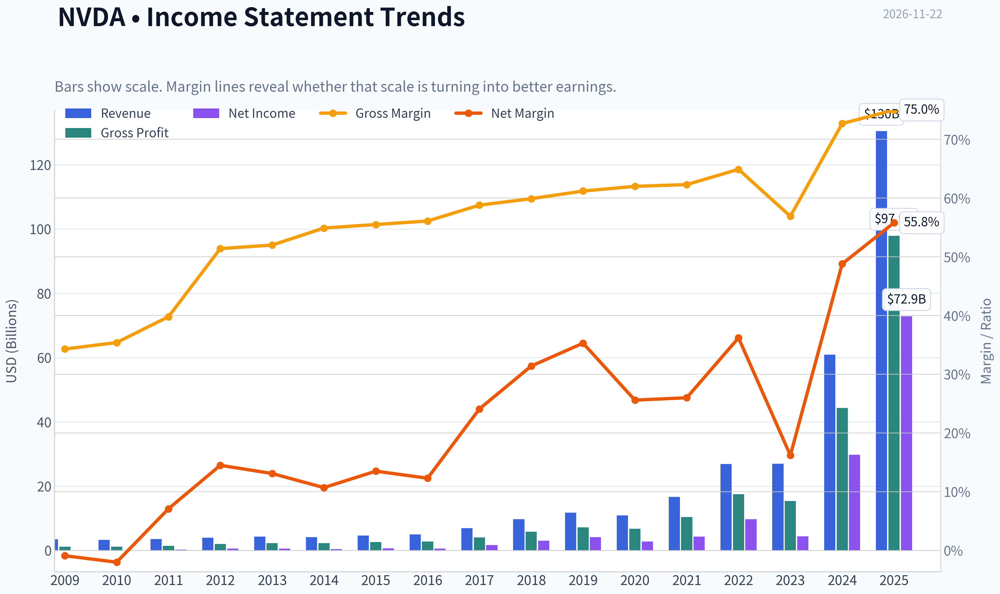

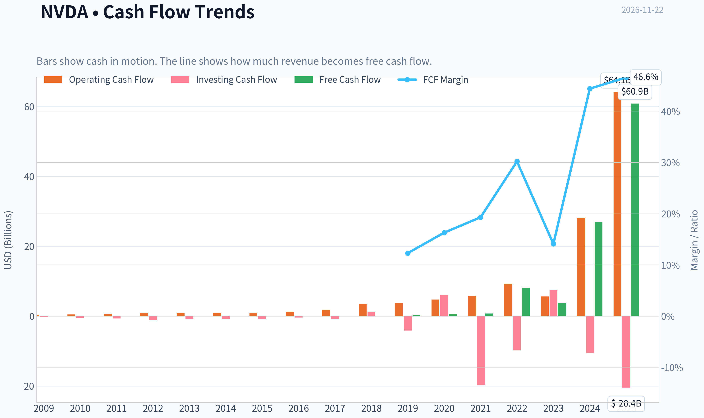

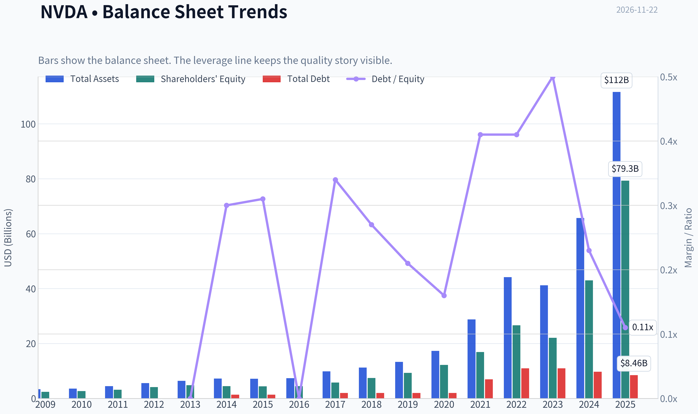

This graph tracks the profitability and return metrics (ROE, ROIC, Margins) of **NVDA** over the past decade, highlighting capital efficiency trends.

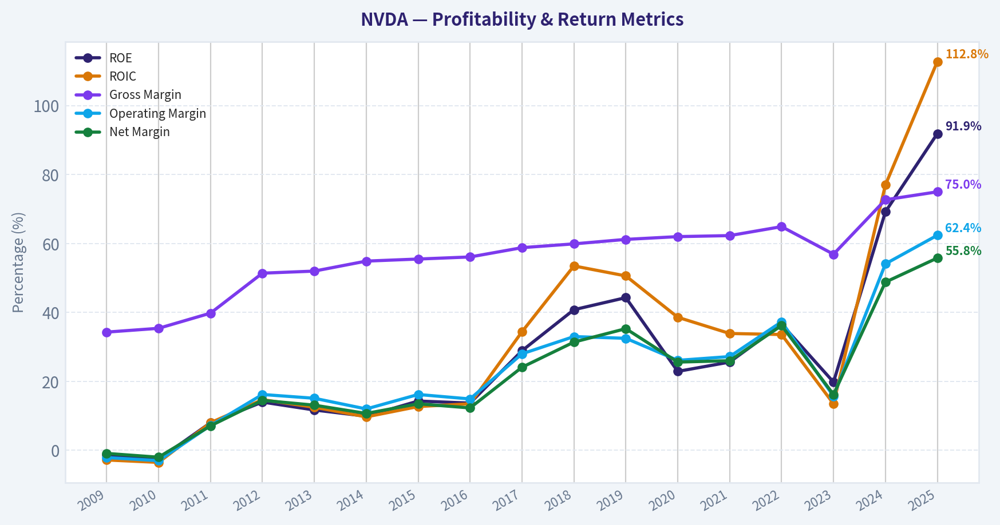

This chart illustrates the financial health of **NVDA** over the last 10 years, mapping cash equivalents and free cash flow against total obligations (Debt).

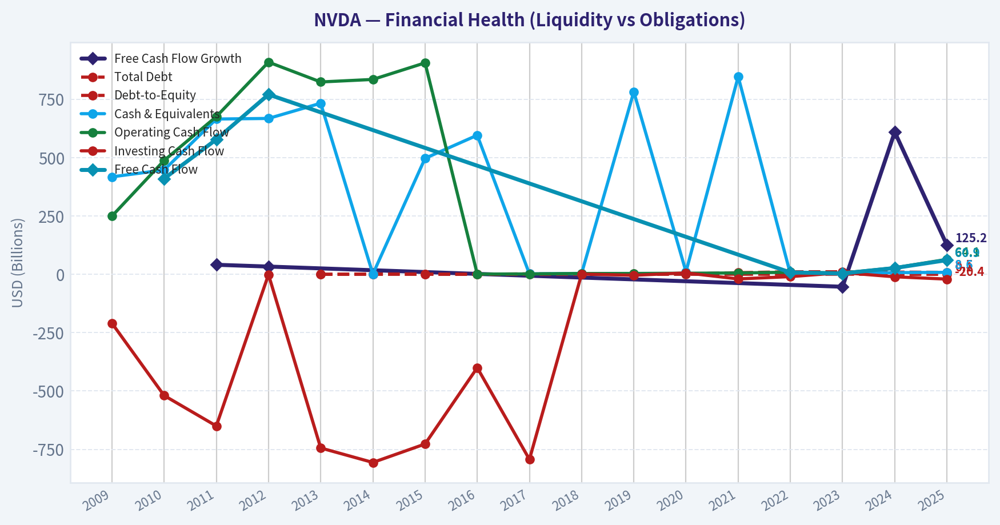

This comparison chart from *Profitability and Operating Performance* stacks current figures against historical benchmarks for **NVDA**, making it easy to see where the company trades relative to its own averages.

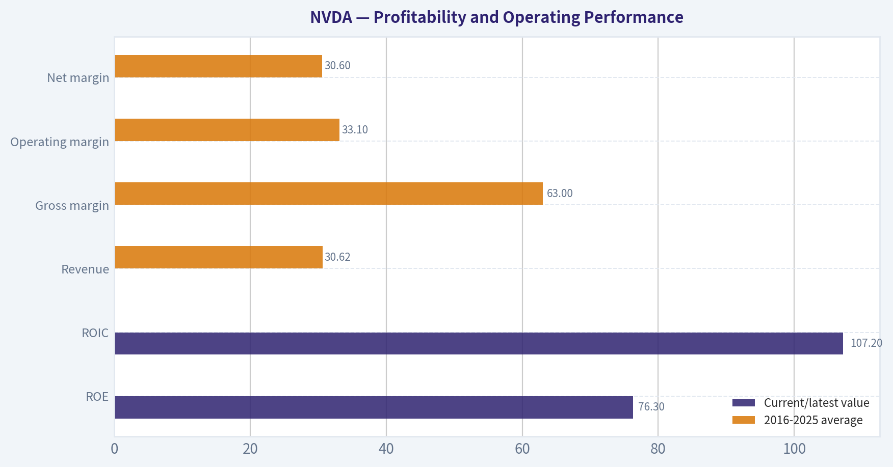

This breakdown chart from <em>Revenue Breakdown</em> shows the proportional composition for **NVDA** - useful for understanding what drives or risks the business.

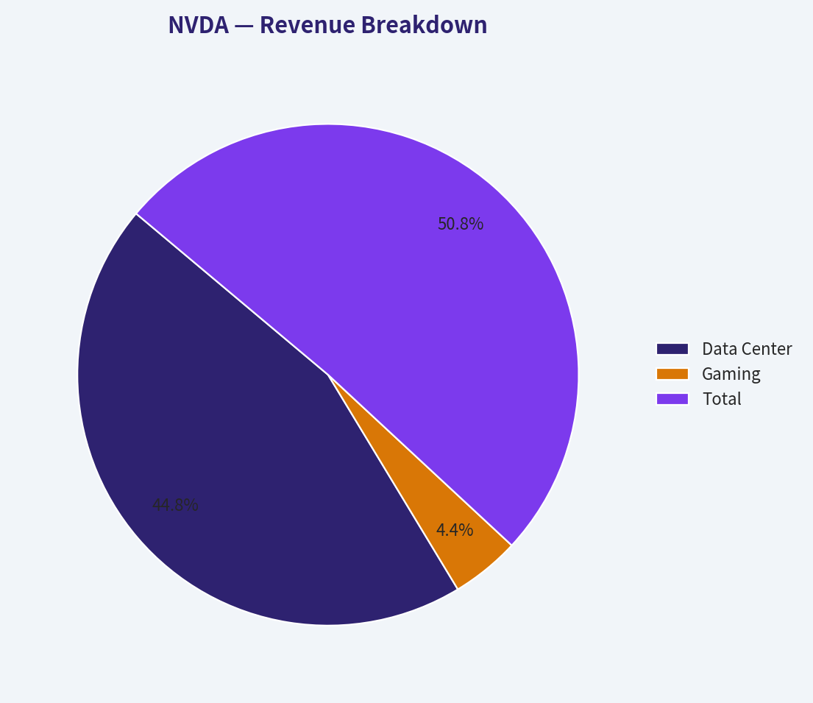

---

### Intrinsic Value Analysis (Buffett)

> *Following Warren Buffett's value investing philosophy: Circle of Competence, Economic Moat, Management Quality, and Margin of Safety.*

#### Intrinsic Value Snapshot

Price is what you pay. Intrinsic value is what the business may be worth based on the cash it can create for owners over time. We show a range, not one magic number.

- Current Price: $125.53
- Value Range (conservative to optimistic across both DCF methods): $114.65 to $283.43

##### Owner Earnings (Buffett Method)
- Net Income: $72,880,000,000.00
- Depreciation & Amortization: $2,843,000,000.00
- Capital Expenditures: $-6,042,000,000.00
- Working Capital Changes: $-15,949,000,000.00
- Owner Earnings: $59,893,306,952.61

##### Intrinsic Value
###### Buffett Method
Uses owner earnings. Stricter, and usually more conservative.
- Conservative: $114.65
- Average: $163.79
- Optimistic: $163.79
- Discount Rate: 8.3%

###### Cash Flow Method
Uses free cash flow. Better for companies spending heavily today to grow tomorrow.
- Conservative: $283.43
- Average: $283.43
- Optimistic: $283.43
- Discount Rate: 9.1%

ANALYST STANCE: **Neutral**

#### Executive Summary

NVIDIA is an exceptional modern compounder with a wide and still-widening moat in accelerated computing, artificial intelligence infrastructure, software ecosystems, and developer adoption. Its financial profile is unusually strong: 71.1% gross margin, 76.3% ROE, 65.5% year-over-year revenue growth, and owner earnings of approximately $170.5 billion.

The central investment question is not business quality but durability and valuation. The DeepValues Buffett intrinsic value is **$163.79 per share**, compared with a current price of approximately **$126**, implying a **23.4% margin of safety**. That is attractive for a wide-moat, high-ROIC compounder, but NVIDIA's future still depends on sustaining extraordinary growth amid technological change, customer concentration, competition, and substantial expectations embedded in the business.

#### Factor Scorecard

| Factor | Score | Assessment |
|---|---:|---|
| 1. Circle of Competence and Simplicity | 4/5 | NVIDIA designs high-performance chips and software used for AI, graphics, and accelerated computing. The business is understandable, although semiconductor cycles, architecture transitions, and customer concentration add complexity. |
| 2. Moat | 5/5 | CUDA software, developer tools, ecosystem scale, performance leadership, switching costs, and accumulated research create a wide and widening moat. |
| 3. Management and Capital Allocation | 4/5 | Jensen Huang has demonstrated long-term technological vision and substantial reinvestment discipline. The company has prioritized growth investment while maintaining strong profitability. |
| 4. Industry Structure | 4/5 | The market is strategically important and increasingly concentrated around a few major platforms, but semiconductor competition and rapid innovation remain intense. |

**Key Takeaways:** NVIDIA scores highly because its software ecosystem and developer dependence reinforce its hardware leadership. The main deductions reflect technological change, semiconductor cyclicality, and the difficulty of forecasting a company operating at extraordinary scale.

#### Moat Analysis

| Moat source | Evidence | Assessment |
|---|---|---|
| Intangible assets | CUDA, proprietary software libraries, deep AI research, developer tools, and ecosystem integration | Very strong |
| Switching costs | AI models, workflows, libraries, and engineering talent are deeply integrated with NVIDIA's platform | Strong and increasing |
| Cost and scale advantages | Massive R&D spending, manufacturing scale, software leverage, and established distribution relationships | Strong |
| Network effects | More developers and customers reinforce CUDA adoption, which attracts more software support and optimization | Very strong |
| Financial evidence | 71.1% gross margin, 76.3% ROE, and rapid revenue growth | Consistent with substantial pricing power and operating leverage |

NVIDIA's moat is broader than a conventional chip advantage. Hardware performance can eventually be challenged, but CUDA, libraries, development tools, installed infrastructure, and accumulated customer know-how create ecosystem-level switching costs. The moat is therefore based on a combination of intellectual property, software compatibility, scale, and network effects.

The principal threat is not ordinary price competition. It is the possibility that customers increasingly develop proprietary chips, competing accelerator platforms become sufficiently compatible, or a new architecture changes the economics of AI computing. NVIDIA's continued moat depends on keeping its complete platform ahead of alternatives, not merely producing faster chips.

#### Management Quality Assessment

| Dimension | Assessment |
|---|---|
| Owner orientation | Strong strategic alignment through founder-led leadership and substantial long-term exposure to the company's value |
| Candor and execution | Excellent record of adapting from graphics toward data centers and AI |
| Capital allocation | Reinvestment has primarily targeted research, software, systems, and ecosystem expansion |
| Acquisitions and leverage | The company has maintained a financially manageable balance sheet while funding aggressive innovation |
| Long-term thinking | Particularly strong; management has pursued platform development before the full economic payoff was visible |

**Key Takeaways:** Management has shown an unusual ability to recognize major computing transitions early and redirect the company accordingly. The most important capital-allocation decision has been sustained investment in software and infrastructure rather than treating NVIDIA as a short-cycle chip vendor.

#### Financial Summary

| Metric | Latest reported value |
|---|---:|
| Current price | $126 |
| Market capitalization | $3.03 trillion |
| P/E ratio | 13.5 |
| Revenue growth, year over year | 65.5% |
| Gross margin | 71.1% |
| ROE | 76.3% |
| Free-cash-flow yield | 3.2% |
| Cash | $22.4 billion |
| Debt | $33.4 billion |
| Net cash/(debt) | $(10.9) billion |
| Owner earnings | $170.5 billion |
| Shares outstanding used in valuation | 24.285 billion |
| Current ratio | 3.91 |

**Key Takeaways:** NVIDIA combines very high profitability with exceptional growth and a strong liquidity position. The company has modest net debt relative to its earnings power, while the 3.2% free-cash-flow yield indicates that the market continues to assign substantial value to future growth.

The reported P/E should be interpreted alongside the unusually rapid earnings expansion; a static multiple can understate or overstate economic value when earnings are changing rapidly. Current and quick ratios are meaningful for NVIDIA as a semiconductor company, and the current ratio indicates ample short-term liquidity.

#### Owner Earnings Calculation

| Owner earnings component | Amount |
|---|---:|
| After-tax operating income | $173.9 billion |
| Add: depreciation and amortization | $3.7 billion |
| Less: maintenance-capital-expenditure charge | $(7.1) billion |
| Less: working-capital investment | $0.0 billion |
| **Estimated owner earnings** | **$170.5 billion** |
| Owner earnings per share | **Approximately $7.02** |

The maintenance-capital-expenditure charge is based on a three-year average capital-expenditure-to-revenue ratio rather than treating all reported capital expenditure as maintenance spending. That is appropriate for a high-growth company where a meaningful portion of investment supports expansion rather than merely preserving current operations.

**Key Takeaways:** Owner earnings are close to after-tax operating income because NVIDIA is asset-light relative to its profitability and has limited working-capital needs. The calculation supports the view that reported earnings are being converted into substantial economic cash generation.

#### Return on Equity and Cash-Flow Quality

NVIDIA's **76.3% ROE** is exceptional. The result appears primarily driven by high margins, strong asset efficiency, and powerful earnings growth rather than excessive leverage. Net debt of approximately $10.9 billion is modest relative to $170.5 billion of owner earnings.

The company's 71.1% gross margin is strong evidence of pricing power and differentiation. Its business model also benefits from software and ecosystem economics layered on top of semiconductor revenue, allowing incremental platform revenue to carry attractive margins.

#### Three-Scenario DCF Valuation

The DeepValues app's Buffett valuation is the primary intrinsic-value reference. The following scenarios are sensitivity cross-checks using owner earnings of $170.5 billion, a 10% discount rate, and approximately 24.285 billion shares.

| Scenario | Key assumptions | Estimated value per share |
|---|---|---:|
| A. No growth | Owner earnings divided by 10% discount rate | $70.17 |
| B. GDP-like growth | 3% perpetual growth; owner earnings x 1.03 ÷ (10% - 3%) | $103.29 |
| C. Historical-growth sensitivity | 10% growth for 10 years, then 2.5% terminal growth; 10% discount rate | Approximately $166 |
| DeepValues Buffett intrinsic value | 10% growth fading to 2.5%; 8.3% discount rate; net debt included | **$163.79** |

**Key Takeaways:** Conservative no-growth and GDP-growth approaches produce values below the current price, showing how much of NVIDIA's value depends on continued expansion. The historical-growth sensitivity is close to the DeepValues headline value, while the primary valuation benefits from the company's wide moat and higher 8.3% discount-rate framework.

#### Intrinsic Value and Margin of Safety

| Valuation item | Amount |
|---|---:|
| Current price | $126 |
| DeepValues intrinsic value | $163.79 |
| Conservative app range | $114.65 |
| Headline app value | $163.79 |
| Margin of safety versus headline value | 23.4% |
| Net cash/(debt) included in model | $(10.9) billion |
| App owner earnings input | $170.5 billion |
| App growth assumption | 10.0%, fading to 2.5% |
| App discount rate | 8.3% |

**Key Takeaways:** The current price is below the headline intrinsic value and provides a 23.4% calculated margin of safety. That margin is meaningful for a high-ROIC, wide-moat company, although the conservative valuation range of $114.65 shows that the downside sensitivity remains material if growth slows sharply.

The valuation is not dependent on book value, which is not a useful measure for NVIDIA's software, intellectual property, and ecosystem advantages. The more important question is whether NVIDIA can sustain enough growth and profitability to justify the platform value embedded in the forecast.

#### Final Buffett Scorecard

| Criterion | Weight | Score | Weighted contribution |
|---|---:|---:|---:|
| Moat width and durability | 25% | 5.0 | 1.25 |
| Valuation and margin of safety | 20% | 4.0 | 0.80 |
| Capital returns: ROIC versus WACC | 15% | 5.0 | 0.75 |
| Business understanding and predictability | 12% | 4.0 | 0.48 |
| Management quality and capital allocation | 12% | 4.0 | 0.48 |
| Reinvestment runway | 8% | 5.0 | 0.40 |
| Balance-sheet strength | 4% | 4.0 | 0.16 |
| Industry structure | 4% | 4.0 | 0.16 |
| **Total** | **100%** |  | **4.48/5.00** |

**Key Takeaways:** NVIDIA qualifies as a high-quality Buffett-style compounder despite operating in technology. Its strongest attributes are moat durability, reinvestment runway, and returns on capital. Valuation is favorable relative to the headline intrinsic value, but the conservative scenarios prevent a perfect valuation score.

#### Gate 5: Quality and Solvency

**The hard floor is not tripped.**

NVIDIA has rapidly growing earnings, substantial owner earnings, strong liquidity, and net debt that is modest relative to cash generation. There is no evidence in the supplied financial profile of deteriorating earnings combined with a solvency red line such as interest coverage below 1.0 times or distress-zone balance-sheet conditions.

#### Investment Stance

**Neutral - high conviction in business quality, moderate conviction in valuation.**

NVIDIA is a wide-moat, high-ROIC compounder with exceptional management, powerful ecosystem effects, and substantial reinvestment opportunity. At approximately $126, the price is below the DeepValues intrinsic value of $163.79 and carries a valuation margin of safety appropriate for a genuinely superior business.

The Neutral stance reflects the unusually demanding operational assumptions required to sustain the company's scale and growth. The evidence supports a high-quality franchise with attractive valuation support, while the conservative DCF cases demonstrate that the valuation remains sensitive to a major slowdown in AI infrastructure demand or erosion of NVIDIA's ecosystem advantage.
#### Valuation Bridge

This bridge places the current market price beside each intrinsic value lens so readers can see whether upside depends on one method or shows up across several methods.

| Scenario | Intrinsic Value / Share |
| --- | ---: |
| Buffett Method | $163.79 |
| Cash Flow Method | $283.43 |
| Damodaran Method | $85.22 |
| Current Price | $125.53 |

#### Key Takeaways

If one method is far above the others, the upside case depends on a specific modelling assumption. When several methods cluster together, the valuation story is more robust.

#### Valuation Visuals

This comparison chart from *Latest Earnings Snapshot* stacks current figures against historical benchmarks for **NVDA**, making it easy to see where the company trades relative to its own averages.

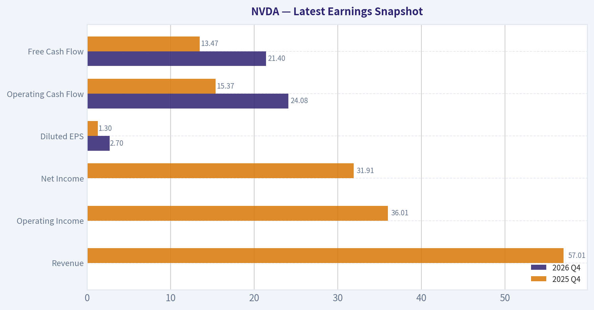

This comparison chart from *Cash Flow and Capital Allocation* stacks current figures against historical benchmarks for **NVDA**, making it easy to see where the company trades relative to its own averages.

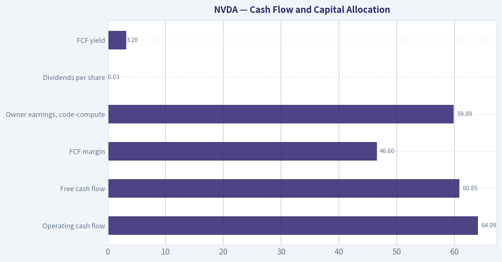

This comparison chart from *Current Versus Historical Average* stacks current figures against historical benchmarks for **NVDA**, making it easy to see where the company trades relative to its own averages.

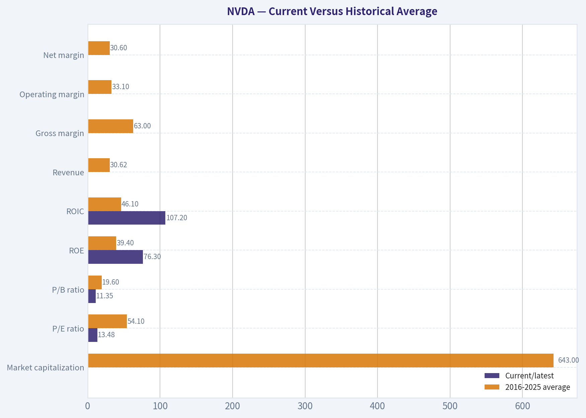

---

### Trend & Growth Analysis (Lynch/Druckenmiller/Fisher)

> *Following Peter Lynch's GARP, Stanley Druckenmiller's macro-aware approach, and Philip Fisher's scuttlebutt methodology.*

ANALYST STANCE: **Neutral**

#### Executive conclusion

NVIDIA remains a **fast grower** riding the AI-computing secular cycle, with exceptional reported growth, gross margins, return on equity, and balance-sheet liquidity. The central question is no longer whether AI demand exists; it is whether NVIDIA can sustain extraordinary growth and defend its economics while its $3.03 trillion scale, customer concentration, competition, export restrictions, and elevated interest rates raise the burden of proof.

The available owner-earnings valuation indicates meaningful value above the current price, but other valuation methods are substantially more conservative. This dispersion makes the security a **high-quality but high-expectation growth company**, rather than a low-risk valuation opportunity.

#### 1. Lynch classification

| Category | Assessment | Evidence |
|---|---|---|
| Lynch category | Fast Grower | Revenue growth of 65.5% year over year |
| Growth quality | Exceptional, but scale-sensitive | $3.03 trillion market capitalization creates a high future-growth requirement |
| Business type | AI infrastructure platform | Accelerators, networking, software, and data-center systems |
| Main concern | Expectations and concentration | AI spending durability, hyperscaler concentration, competition, and export controls |

**Key Takeaways:** NVIDIA clearly fits Lynch's fast-grower category rather than a stalwart or cyclical classification. However, its enormous scale means that sustaining fast growth requires continued expansion of the AI infrastructure market, not merely share gains in a fixed market.

#### 2. The story in three bullets

- NVIDIA supplies the computing platforms used to train and operate increasingly capable artificial-intelligence models.
- Its advantage extends beyond chips into networking, systems, software ecosystems, developer tools, and customer integration.
- If AI inference, enterprise adoption, sovereign computing, and accelerated computing continue expanding, the company has several growth vectors beyond the current training boom.

The simple version is: **NVIDIA sells the infrastructure that makes modern AI possible, and its ecosystem makes switching technically and economically difficult.**

#### 3. TAM analysis and the 10x test

| TAM factor | Assessment |
|---|---|
| Core market | AI accelerators, networking, data-center systems, and related software |
| TAM direction | Rapidly expanding, supported by AI training, inference, enterprise deployment, and sovereign infrastructure |
| Runway | Strong, but dependent on sustained capital spending and application monetization |
| 10x revenue test | Not fully quantifiable from the supplied data because current revenue and a consistently defined TAM are not provided |
| Qualitative result | A 10x outcome is theoretically possible only if AI infrastructure expands well beyond current hyperscaler training demand |

**Key Takeaways:** NVIDIA's addressable market is expanding rather than merely redistributing existing semiconductor demand. The 10x test cannot be completed precisely without a verified revenue base and TAM definition, but the opportunity is large enough that market expansion-not just market share-can support a long runway.

#### 4. Revenue growth trend

| Metric | Value | Interpretation |
|---|---:|---|
| Revenue growth, year over year | 65.5% | Exceptional fast-grower profile |
| Gross margin | 71.1% | Strong pricing power and differentiated economics |
| Return on equity | 76.3% | Very high capital efficiency |
| Current ratio | 3.91 | Strong short-term liquidity |
| Free-cash-flow yield | 3.2% | Cash generation is substantial, but valuation remains growth-dependent |

**Key Takeaways:** The available revenue figure shows very strong growth, but only one growth observation is supplied, so acceleration versus deceleration cannot be established rigorously. Gross margin and return on equity indicate that NVIDIA is converting demand into unusually attractive economics rather than purchasing growth at low quality.

#### 5. Unit economics and operating efficiency

| Measure | Result | Assessment |
|---|---:|---|
| LTV/CAC | Not disclosed | Cannot calculate reliably for a semiconductor platform |
| Net revenue retention | Not applicable / not disclosed | Primarily relevant to subscription software |
| Rule of 40 | Not calculable | FCF margin and revenue denominator are not both supplied |
| Gross margin | 71.1% | Excellent |
| Owner earnings | $170.5 billion, supplied model input | Strong cash-earning capacity, subject to model assumptions |

**Key Takeaways:** Traditional SaaS metrics such as LTV-to-CAC and net revenue retention are not appropriate primary measures for NVIDIA. Gross margin and owner earnings instead point to strong economic quality, although the owner-earnings figure comes from a valuation model and should not be treated as independently verified operating guidance.

#### 6. Inflection-point assessment

| Inflection area | Assessment | Rationale |
|---|---|---|
| Product cycle | Positive | Continued transition from individual accelerators toward complete AI systems |
| Market share | Positive, but not fully verified | NVIDIA appears to remain a leading AI accelerator platform |
| Margin | Strong | 71.1% gross margin provides a substantial profitability buffer |
| TAM | Positive | Training is broadening toward inference, enterprise, sovereign, and edge workloads |
| Competitive landscape | Mixed | Custom silicon, AMD, networking alternatives, and customer design efforts create pressure |
| Earnings expectations | High risk of surprise in either direction | The market already recognizes NVIDIA as a major AI beneficiary |

**Key Takeaways:** The strongest inflection is the expansion from chips into full-stack AI infrastructure and from training into inference. The main uncertainty is whether each new AI workload represents durable incremental demand or a normalization of an unusually intense data-center investment cycle.

#### 7. Macro setup

| Macro factor | Current implication |
|---|---|
| Interest rates | Headwind: the supplied 30-year Treasury rate is 5.31% |
| AI secular trend | Strong tailwind |
| Capital-spending cycle | Supportive while hyperscaler and sovereign AI investment remains elevated |
| Economic sensitivity | Moderate: data-center spending can be cut or delayed during budget stress |
| Geopolitics and regulation | Material risk through export controls and supply-chain restrictions |

**Key Takeaways:** The secular AI trend is favorable, but the macro discount rate is not especially supportive for long-duration growth assets. NVIDIA therefore requires both continued operational execution and continued confidence in large-scale AI capital spending.

#### 8. Fisher 15-point assessment

| Fisher criterion | Score / 5 | Assessment |
|---|---:|---|
| Market potential | 5 | AI infrastructure has very large potential |
| New-product determination | 5 | Rapid platform and system expansion |
| R&D effectiveness | 5 | Strong evidence of product leadership |
| Sales organization | 4 | Strategic customer relationships appear powerful |
| Profit margins | 5 | 71.1% gross margin |
| Margin trajectory | 4 | Strong, though future mix and competition matter |
| Labor relations | 3 | Limited supplied evidence |
| Executive relations | 4 | Leadership continuity appears strong |
| Management depth | 4 | Broad technical and commercial platform |
| Cost analysis and accounting | 4 | No major supplied accounting concern |
| Outstanding competitive aspects | 5 | Ecosystem, software, scale, and switching costs |
| Long-range profit outlook | 5 | Strong, but dependent on AI durability |
| Dilution risk | 4 | No major dilution issue supplied |
| Candor in difficulties | 3 | Insufficient evidence in the research pack |
| Management integrity | 4 | No major supplied integrity concern |

| Total | Result |
|---:|---|
| **61 / 75** | **Good Fisher profile** |

**Key Takeaways:** NVIDIA scores especially well on market potential, R&D, margins, and competitive advantages. The score is below the outstanding range mainly because the supplied research pack does not provide enough evidence on labor relations, accounting detail, candor during setbacks, or customer-level scuttlebutt.

#### 9. Valuation analysis

| Valuation measure | Result | Interpretation |
|---|---:|---|
| Price | $126 | Current reference price |
| P/E | 13.48 | Low relative to the supplied growth rate |
| Revenue growth | 65.5% | Exceptional, but sustainability is the key issue |
| PEG | Approximately 0.21 | Statistically attractive if the growth rate is durable |
| Market capitalization | $3.03 trillion | Imposes a substantial absolute-growth requirement |
| Owner-earnings intrinsic value | $163.79 headline value | Above the current price under the stated assumptions |
| Owner-earnings conservative range | $114.65 to $163.79 | Indicates meaningful assumption sensitivity |
| Damodaran FCFF range | $24.03 to $182.99 | Very wide dispersion, highlighting model risk |

**Key Takeaways:** The PEG calculation appears unusually attractive because the supplied P/E is low relative to the latest growth rate. That result is highly sensitive to whether the 65.5% growth rate is temporary or durable, while the wide range across valuation models shows that discount rates, cash-flow definitions, and long-term growth assumptions dominate the conclusion.

#### 10. Valuation sensitivity

| Sensitivity | More favorable outcome | Less favorable outcome |
|---|---|---|
| Revenue growth | AI infrastructure expands into inference, enterprise, and sovereign markets | Hyperscaler spending normalizes sharply |
| Operating margin | Software, networking, and systems preserve premium economics | Custom silicon and competition compress margins |
| Terminal growth | AI becomes a broad computing platform | AI monetization lags infrastructure investment |
| Discount rate | Long-term rates decline | Rates remain elevated near the supplied 5.31% Treasury level |
| Multiple | Growth remains scarce and highly valued | Market applies a mature-semiconductor multiple |
| Model conclusion | Owner-earnings value remains above current price | FCFF or lower-growth methods imply limited or negative valuation support |

**Key Takeaways:** The valuation is most sensitive to the combination of durable growth and premium margins, not to near-term earnings alone. The current price is supported more comfortably by the owner-earnings framework than by the conservative FCFF scenarios, so valuation confidence should remain conditional rather than absolute.

#### 11. Growth investor scorecard

| Criterion | Weight | Score / 5 | Weighted contribution |
|---|---:|---:|---:|
| Story | 10% | 4.8 | 0.48 |
| TAM and runway | 20% | 4.5 | 0.90 |
| Revenue growth | 20% | 5.0 | 1.00 |
| Unit economics | 15% | 4.5 | 0.68 |
| Competitive position | 10% | 4.8 | 0.48 |
| Management quality | 10% | 4.0 | 0.40 |
| Macro setup | 5% | 3.2 | 0.16 |
| Profitability path | 5% | 4.8 | 0.24 |
| Valuation | 5% | 3.5 | 0.18 |
| **Total** | **100%** | - | **4.52 / 5.00** |

**Key Takeaways:** Operationally, NVIDIA scores in the high-conviction range because growth, margins, competitive position, and market opportunity are unusually strong. The overall result is moderated by macro conditions, missing customer-level data, valuation-model disagreement, and the difficulty of sustaining exceptional growth from a multitrillion-dollar base.

#### 12. Key risks and catalysts

| Catalysts | Risks |
|---|---|
| Faster inference adoption | Hyperscaler capital-spending normalization |
| Enterprise AI moving from experimentation to production | Custom chips from major customers |
| Sovereign AI infrastructure investment | AMD and other accelerator competition |
| New networking and full-system products | Export controls and geopolitical restrictions |
| Software monetization and ecosystem expansion | Gross-margin compression |
| Continued product-cycle execution | AI applications failing to generate expected returns |

**Key Takeaways:** The most important catalyst is broadening AI demand beyond training into recurring inference and production workloads. The most important risk is a mismatch between infrastructure spending and end-user monetization, especially if customers slow spending while NVIDIA's valuation still assumes unusually strong growth.

#### Bottom line

NVIDIA is a **high-quality fast grower with a powerful secular tailwind and multiple potential inflection points**. The evidence supports strong business quality and substantial long-term runway, while the valuation appears attractive under the supplied owner-earnings assumptions but much less certain under other cash-flow methods. The appropriate analytical posture is therefore **Neutral**: the company's fundamentals are exceptional, but the durability of growth, margin defense, and valuation-model dispersion remain decisive uncertainties.

---

### Market Technical Analysis

ANALYST STANCE: **Bearish**

#### NVDA technical analysis

Data retrieved for **NVIDIA Corporation (Nasdaq: NVDA)** covers November 24, 2025 through November 20, 2026, the latest trading session available. November 22, 2026 was a weekend, so the latest valid closing price is **$125.53 on November 20**.

The technical picture has deteriorated sharply. NVDA closed approximately **47.5% below its October 6 high of $239.24**, with the decline accelerating in November. The November 20 session reached an intraday low of **$124.50**, while volume was approximately **626.4 million shares**, substantially above the already elevated activity seen during the November selloff.

| Measure | Latest value | Interpretation |
|---|---:|---|
| Latest close, November 20 | $125.53 | Deeply below all major trend references |
| October 6 high | $239.24 | Approximately 47.5% above the latest close |
| November 20 intraday low | $124.50 | New low for the displayed period |
| November 20 volume | 626.4 million | Exceptionally high, indicating intense participation during the decline |
| 10-day EMA | $157.32 | Price is about 20.2% below the short-term average |
| 50-day SMA | $207.00 | Price is about 39.4% below the medium-term average |
| 200-day SMA | $203.09 | Price is about 38.2% below the long-term average |

**Key Takeaways:** NVDA is trading far below its short-, medium-, and long-term trend averages, confirming broad technical damage rather than an isolated one-day decline. The unusually heavy November 20 volume shows that the breakdown occurred with strong market participation, while the new intraday low indicates that downside discovery remained active at the latest observation.

#### Trend structure and moving averages

The moving-average configuration is decisively bearish. The 10-day EMA fell from **$218.44 on October 23 to $157.32 on November 20**, a decline of roughly 28%. The 50-day SMA declined more gradually from **$222.39 to $207.00**, while the 200-day SMA remained comparatively stable near **$203.09** because of its longer lookback period.

The price relationship is particularly important: the latest close is below the 10-day EMA by about **$31.79**, below the 50-day SMA by about **$81.47**, and below the 200-day SMA by about **$77.56**. This spacing shows that the recent decline has not merely weakened short-term momentum; it has also pulled price well beneath established medium- and long-term trading ranges.

The 50-day SMA remains slightly above the 200-day SMA, so a formal long-term moving-average death cross had not yet appeared in the supplied readings. However, both averages are now being approached from below, and the 50-day SMA has been trending downward. That combination is more concerning than the absence of a completed crossover: it suggests that a lagging confirmation signal may still be developing.

| Date | Close | 10-day EMA | 50-day SMA | 200-day SMA | Price relationship |
|---|---:|---:|---:|---:|---|
| October 23 | $210.96 | $218.44 | $222.39 | $203.36 | Below short and medium averages, above long average |
| October 30 | $204.64 | $214.60 | $221.68 | $204.09 | Near the 200-day average |
| November 6 | $186.64 | $201.04 | $219.77 | $204.39 | Below all three averages |
| November 13 | $162.85 | $180.56 | $214.63 | $203.92 | Increasing separation below trend references |
| November 20 | $125.53 | $157.32 | $207.00 | $203.09 | Deeply below all three averages |

**Key Takeaways:** The deterioration progressed from a short-term break below the 10-day EMA to a full loss of the 50-day and 200-day averages. The 50-day average is still slightly above the 200-day average, but its downward slope and the large price gap indicate that the longer-term trend structure is weakening even before a formal crossover is recorded.

#### Momentum and volatility

Momentum readings are extremely weak. RSI fell from **46.31 on October 27 to 15.05 on November 20**, placing it well below the conventional 30 threshold. This is an oversold condition, but it should not be interpreted by itself as evidence of a durable reversal. RSI has remained below 30 through much of the November decline, showing that selling pressure has been persistent rather than limited to a single sharp impulse.

MACD also weakened materially. It moved from **-2.63 on October 23 to -19.83 on November 20**, with the deterioration becoming especially pronounced after November 4. A deeply negative MACD indicates that shorter-term exponential averages are substantially below longer-term exponential averages. Without a reported signal line, the precise crossover state cannot be confirmed, but the MACD level and direction clearly indicate negative momentum.

Volatility has expanded sharply. ATR increased from **6.06 on October 23 to 10.71 on November 20**, approximately a 77% rise. At the latest close, the ATR represented roughly **8.5% of the share price**, a very large daily trading-range measure. This means percentage-based price movements have become much more unstable, and technical signals are more vulnerable to abrupt reversals and gaps.

| Indicator | Earlier reading | Latest reading | Direction | Technical implication |
|---|---:|---:|---|---|
| RSI | 38.11 on October 23 | 15.05 | Sharply lower | Extreme downside momentum; persistent oversold condition |
| MACD | -2.63 on October 23 | -19.83 | Sharply lower | Broadening negative momentum |
| ATR | 6.06 on October 23 | 10.71 | Higher | Volatility has expanded materially |
| November 20 daily range | - | $19.23 | - | Intraday range equal to roughly 15.3% of the close |
| November 20 close versus open | - | -12.5% | Lower | Strong bearish session structure |

**Key Takeaways:** Momentum is not merely weak; it is at an extreme, with RSI near 15 and MACD deeply negative. At the same time, volatility has expanded enough that oversold readings may persist while price continues to fluctuate violently, so the indicators describe stress and instability rather than a confirmed technical floor.

#### Bollinger-band behavior

The Bollinger-band readings reinforce the severity of the move. On November 20, the lower band was **$126.93**, just above the **$125.53** close. Closing slightly below the lower band indicates an unusually forceful downside extension relative to the recent 20-session distribution.

The lower band fell from **$208.06 on October 23 to $126.93 on November 20**, while the upper band declined more modestly from **$243.02 to $235.99**. This created an exceptionally wide band spread. The widening is consistent with a volatility shock: the lower boundary is falling rapidly as large negative price changes enter the calculation, rather than remaining near a stable range.

A close below the lower band can sometimes precede a short-term rebound, but in a sustained trend it can also signal continuation. Here, the simultaneous breakdown below all moving averages, extremely weak RSI, deeply negative MACD, and sharply rising ATR make the lower-band breach more consistent with an ongoing disorderly downtrend than with a standalone mean-reversion signal.

| Date | Close | Upper Bollinger band | Lower Bollinger band | Band width | Close relative to lower band |
|---|---:|---:|---:|---:|---|
| October 23 | $210.96 | $243.02 | $208.06 | $34.96 | $2.90 above lower band |
| October 30 | $204.64 | $241.07 | $201.85 | $39.23 | $2.79 above lower band |
| November 6 | $186.64 | $235.36 | $187.73 | $47.63 | $1.09 below lower band |
| November 13 | $162.85 | $238.44 | $158.94 | $79.50 | $3.91 above lower band |
| November 20 | $125.53 | $235.99 | $126.93 | $109.06 | $1.40 below lower band |

**Key Takeaways:** The Bollinger bands have widened dramatically, reflecting a transition from ordinary fluctuation to exceptionally high volatility. NVDA's latest close was just below the lower band, which confirms an unusually strong downside extension; however, the broader indicator alignment does not yet establish that the move has stabilized.

#### Overall interpretation and valuation implications

The evidence points to a technically damaged and highly unstable market condition:

- **Trend:** Bearish across short-, medium-, and long-term horizons.
- **Momentum:** Strongly negative, with RSI at 15.05 and MACD at -19.83.
- **Volatility:** Elevated and accelerating, with ATR up approximately 77% from late October.
- **Participation:** November 20 volume was exceptionally high, suggesting broad and forceful market involvement.
- **Oversold status:** Extreme, but not independently bullish; oversold conditions can persist during a high-momentum decline.
- **Valuation interpretation:** Technical evidence does not support treating the latest $125.53 valuation as validated by price strength or trend confirmation. A more constructive valuation interpretation would require evidence of stabilization, improving momentum, and recovery of important trend references; none of those confirmations is present in the supplied data.

The selected indicators are complementary: the **10-day EMA, 50-day SMA, and 200-day SMA** describe trend across three horizons; **MACD and RSI** measure momentum from different perspectives; **Bollinger upper and lower bands** capture distributional extension and volatility expansion; and **ATR** quantifies the magnitude of current price instability. Together, they provide broader coverage without relying on several versions of the same signal.

| Analytical dimension | Evidence | Assessment |
|---|---|---|
| Short-term trend | Close $125.53 versus 10-day EMA $157.32 | Strongly bearish |
| Medium-term trend | Close $125.53 versus 50-day SMA $207.00 | Strongly bearish |
| Long-term trend | Close $125.53 versus 200-day SMA $203.09 | Bearish breakdown |
| Momentum | RSI 15.05; MACD -19.83 | Extreme negative momentum |
| Volatility | ATR 10.71; Bollinger width $109.06 | Exceptional instability |
| Price extension | Close $1.40 below lower Bollinger band | Downside stress, not confirmed reversal |
| Volume confirmation | 626.4 million shares on November 20 | High participation in the decline |
| Technical stance | Multiple indicators aligned negatively | **Bearish** |

**Key Takeaways:** The combined evidence is overwhelmingly negative: NVDA is below every major trend average, momentum is deeply depressed, volatility is unusually high, and the latest breakdown occurred on exceptional volume. Although the stock is technically oversold, the data do not yet provide confirmation that the decline has transitioned into a stable recovery or that the latest valuation is supported by improving market structure.

#### Market Visuals

This comparison chart from *Current Market Metrics* stacks current figures against historical benchmarks for **NVDA**, making it easy to see where the company trades relative to its own averages.

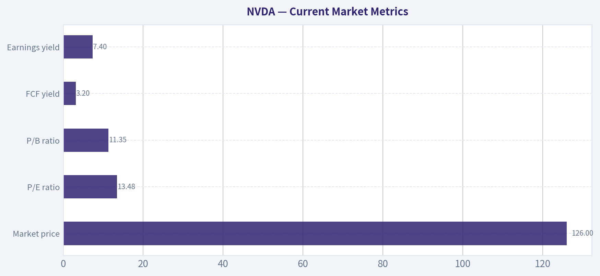

---

### Options Market Analysis

> *Reading options flow - put/call ratios, IV skew, and unusual activity - to gauge institutional positioning and event-driven risk.*

ANALYST STANCE: **BULLISH**

#### NVDA Options Snapshot

Data is dated November 22, 2026. The retrieved chain covers expirations from November 23 through November 27, so it represents an extremely short-term market view. The underlying share price was not included in the feed; therefore, exact ITM, ATM, and OTM classifications by strike cannot be confirmed.

| Expiration | Call OI | Put OI | Put/Call OI | Call Volume | Put Volume | Put/Call Volume | Call ATM IV | Put ATM IV |
|---|---:|---:|---:|---:|---:|---:|---:|---:|
| Nov 23 | 103,755 | 48,066 | 0.46 | 477,587 | 437,480 | 0.92 | 195.9% | 178.8% |
| Nov 25 | 58,921 | 25,578 | 0.43 | 138,300 | 120,313 | 0.87 | 159.9% | 152.2% |
| Nov 27 | 373,485 | 186,767 | 0.50 | 352,769 | 340,376 | 0.96 | 136.9% | 126.8% |
| **Total** | **536,161** | **260,411** | **0.49** | **968,656** | **898,169** | **0.93** | - | - |

**Key Takeaways:** The near-term put/call open-interest ratio of 0.49 is materially below the approximately 0.70 historical neutral baseline, indicating a call-heavy open-interest structure. Volume is much closer to balanced, with a 0.93 put/call ratio, so the bullish signal is stronger in existing open interest than in fresh daily trading activity. The data implies bullish short-term asymmetry, but not an overwhelmingly one-sided call-volume surge.

#### Implied Volatility and Skew

| Expiration | ATM Call IV | ATM Put IV | Call-Put IV Difference | Interpretation |
|---|---:|---:|---:|---|
| Nov 23 | 195.9% | 178.8% | +17.1 percentage points | Call premium is higher |
| Nov 25 | 159.9% | 152.2% | +7.7 percentage points | Mild call skew |
| Nov 27 | 136.9% | 126.8% | +10.1 percentage points | Moderate call skew |

**Key Takeaways:** Near-term IV is exceptionally elevated, especially for the November 23 expiration, where ATM call IV is approximately 196%. Calls carry higher ATM IV than puts across all reported expirations, which is a call-skewed structure rather than a conventional downside-protection skew. Because the feed does not provide a complete standardized OTM volatility curve, the call-skew conclusion is based on ATM differences and the listed contract IVs rather than a full 25-delta skew calculation.

The volatility level indicates substantial event or gap risk, but no specific catalyst was supplied by the data. With expirations only one to five calendar days away, rapid time decay and large implied moves are embedded in the quoted premiums.

#### Unusual Options Activity

The feed flags contracts whose volume exceeds five times open interest. Exact moneyness cannot be established because the current NVDA share price was not included.

| Expiration | Type | Strike | Volume | Open Interest | Volume/OI | IV | Interpretation |
|---|---|---:|---:|---:|---:|---:|---|
| Nov 23 | Call | $140 | 57,656 | 611 | 94.4x | 169.9% | Very large fresh call activity |
| Nov 23 | Call | $150 | 47,488 | 4,826 | 9.8x | 180.9% | Call demand at a higher strike |
| Nov 23 | Put | $135 | 44,832 | 5,259 | 8.5x | 148.7% | Near-term downside hedge or bearish speculation |
| Nov 27 | Call | $140 | 43,333 | 612 | 70.8x | 117.1% | Very large fresh call activity |
| Nov 23 | Call | $145 | 39,832 | 1,037 | 38.4x | 172.5% | Strong short-dated call interest |
| Nov 27 | Call | $150 | 36,949 | 4,044 | 9.1x | 112.5% | Upside exposure several days out |
| Nov 23 | Put | $130 | 35,479 | 3,850 | 9.2x | 178.5% | Downside hedge/speculative put activity |
| Nov 27 | Put | $125 | 32,326 | 6,450 | 5.0x | 129.4% | Lower-strike downside protection |
| Nov 23 | Put | $125 | 31,595 | 3,096 | 10.2x | 174.4% | Short-dated downside demand |
| Nov 27 | Put | $100 | 27,120 | 4,290 | 6.3x | 162.4% | Tail-risk protection or low-probability speculation |
| Nov 23 | Call | $130 | 24,510 | 152 | 161.2x | 190.3% | Extremely high fresh-call ratio |
| Nov 27 | Call | $145 | 23,895 | 1,479 | 16.2x | 110.6% | Strong upside activity |
| Nov 27 | Put | $50 | 23,330 | 583 | 40.0x | 309.4% | Deep-tail hedge or lottery-style speculation |
| Nov 23 | Call | $135 | 22,226 | 187 | 118.9x | 177.6% | Extremely high fresh-call ratio |

**Key Takeaways:** Unusual activity is concentrated in short-dated calls, particularly the $130, $135, and $140 strikes expiring November 23, plus the $140 call expiring November 27. That concentration supports a bullish speculative or upside-hedging interpretation. There is also meaningful put activity from $120 through $135 and in far lower strikes, suggesting that downside protection and tail-risk speculation remain active. Volume-to-open-interest data alone cannot distinguish institutional buying from retail speculation, and trade execution data would be required to identify whether contracts were bought or sold.

#### Open-Interest Concentration and Potential Gamma Levels

| Expiration | Total OI | Share of Reported Total OI | Notable Listed Strike OI | Potential Market Effect |
|---|---:|---:|---|---|
| Nov 23 | 151,821 | 19.0% | $150 call: 4,826; $135 put: 5,259 | Very high near-term gamma sensitivity |
| Nov 25 | 84,499 | 10.6% | Strike-level detail unavailable | Smaller intermediate expiration |
| Nov 27 | 560,252 | 70.3% | $125 put: 6,450; $150 call: 4,044 | Largest expiry-level concentration |
| **Total** | **796,572** | **100.0%** | Full strike OI not provided | Expiry concentration favors short-dated pinning risk |

**Key Takeaways:** The November 27 expiration contains roughly 70% of the reported open interest, making it the dominant near-term expiry for potential dealer hedging and price pinning. The $150 call and $125 put are the largest individually reported strike concentrations in the unusual-activity data, but the feed does not provide a complete strike-by-strike open-interest table, so a definitive gamma-wall ranking is not possible. The very large short-dated volume can amplify intraday moves, while concentrated open interest may also dampen prices near heavily traded strikes as expiration approaches.

#### Overall Options Sentiment

The overall signal is **BULLISH**, with moderate confidence.

The primary bullish evidence is:

- Put/call open interest of 0.49, well below the 0.70 neutral reference.
- A call-heavy unusual-activity list, including exceptionally high volume-to-open-interest ratios at the $130, $135, and $140 calls.
- Call IV above put IV across the three near-term expirations, indicating upside demand or upside-event pricing.

The main caveats are:

- The put/call volume ratio of 0.93 is close to balanced rather than strongly bullish.
- Substantial put activity remains active at the $120-$135 strikes and in deep-tail strikes.
- IV is extremely high, particularly for the November 23 expiration, so the market is pricing substantial short-term movement rather than a low-risk directional outcome.
- The underlying price and complete strike-level chain were not supplied, preventing precise moneyness and gamma calculations.

| Category | Assessment |
|---|---|
| Put/Call Ratio | Bullish by open interest at 0.49; nearly balanced by volume at 0.93 |
| IV Level | Extremely elevated, especially for November 23 |
| Skew Direction | Call-skewed based on ATM IV comparisons |
| Unusual Activity | Call-heavy, led by very high-volume short-dated calls; notable put hedging also present |
| Overall Signal | **BULLISH**, with moderate confidence and elevated event-risk caveats |

**Key Takeaways:** NVDA's options market shows a bullish short-term bias, driven mainly by call-heavy open interest and concentrated fresh call activity. The signal is tempered by balanced volume, active downside hedges, and exceptionally high implied volatility. The evidence supports an upside-leaning valuation interpretation over the next several sessions, but it also indicates unusually high uncertainty around the size and timing of the underlying move.

---

## Research Team Commentary

> *The Research Manager synthesizes the Bull vs Bear debate into action-free commentary. This is a pre-risk view, not the final stance.*

Core takeaway: NVIDIA is an exceptional business, but the debate does not establish that $126 offers a reliable margin of safety. The moat is broad, management is excellent, and the financial economics are extraordinary. Yet the stated 13.48 P/E, implied earnings per share, and approximately $170.5 billion of owner earnings are not internally reconciled. Without normalized cash flow and a credible intrinsic-value estimate, admiration for the franchise cannot become valuation conviction. The appropriate stance is Neutral.

The strongest bull argument is that NVIDIA is no longer merely a semiconductor vendor. CUDA, developer familiarity, optimized libraries, networking, interconnects, systems, and customer integration form a full-stack platform. Replacing a GPU is much easier than replacing the software, engineering knowledge, and production workflows surrounding it. That gives NVIDIA switching costs and a network effect that hardware-only competitors cannot quickly duplicate.

The opportunity also extends beyond the current training cycle. Inference, enterprise adoption, sovereign infrastructure, accelerated scientific computing, networking, robotics, and software could sustain growth after frontier-model training moderates. NVIDIA does not need to retain every AI workload. It can remain highly valuable by dominating the workloads where flexibility, rapid deployment, and system-level performance matter most.

The financial profile supports the quality assessment. Revenue growth of roughly 65.5%, a 71.1% gross margin, 76.3% ROE, and 107.2% ROIC indicate exceptional differentiation and capital efficiency. Some of the reported ROIC is amplified by NVIDIA's asset-light design model and unrecorded intangible assets, but the underlying economics are still outstanding. Jensen Huang's early investment in CUDA and expansion into networking and systems also demonstrate unusually farsighted capital allocation.

The strongest bear argument is not that this moat will disappear. It is that NVIDIA can remain the industry leader while its growth, margins, and valuation multiple normalize. AI is a secular transition, but secular transitions often include severe capital-spending cycles. A relatively small number of hyperscalers account for substantial demand, and those customers can slow purchases after overbuilding without abandoning AI strategically.

Those customers are also unusually powerful. They possess the capital, engineering talent, workload data, and distribution needed to develop custom accelerators. Internal chips do not need to replace NVIDIA broadly to affect its economics. Capturing standardized, high-volume, cost-sensitive inference workloads could reduce NVIDIA's market share at the margin, constrain pricing, and shift bargaining power toward customers.

The current 71.1% gross margin deserves particular scrutiny. It reflects genuine differentiation, but likely also benefits from scarcity, urgent customer demand, and a favorable product mix. Greater systems content, improved supply, custom silicon, competing accelerators, export-compliant products, and more aggressive customer negotiations could lower margins. Even a modest decline matters when recent earnings are being used as the foundation for intrinsic value.

Several future growth vectors also remain optionality rather than established cash flows. Inference could be enormous but more price-sensitive than training. Enterprise adoption may occur through cloud services rather than direct infrastructure purchases. Sovereign demand is exposed to politics and budgets, while robotics and autonomous systems have uncertain timing. These opportunities deserve probability-weighted value, not automatic inclusion in the base case.

Valuation is therefore the unresolved issue. At $126 and a stated P/E of 13.48, implied earnings per share are approximately $9.35. That apparent multiple would be unusually modest for a franchise of this quality if the earnings were current, sustainable, and consistently defined. But it conflicts with the supplied owner-earnings figure and may reflect a different period, adjustment methodology, share count, or scaling convention. The approximately $170.5 billion owner-earnings number must also be reconciled with reported cash flow and market capitalization before it can support any conclusion.

A conservative reverse DCF should assume that revenue growth declines sharply from 65.5%, gross margin moves below its recent peak, incremental returns on capital moderate, and some standardized workloads migrate to custom silicon. It should not require every opportunity-training, inference, enterprise software, sovereign infrastructure, and robotics-to succeed simultaneously. If a corrected model shows that $126 requires only durable low-double-digit growth with moderate margin normalization, NVIDIA's quality could justify a relatively narrow 10-15% margin of safety. If the price instead requires prolonged hypergrowth, near-peak margins, and limited customer insourcing, the valuation would be too dependent on an unusually favorable future.

This conclusion also reflects an important lesson from similar situations: never confuse a wonderful company with a demonstrably attractive valuation, and never capitalize peak economics without normalization. Conversely, it would also be a mistake to dismiss NVIDIA merely because it is a modern technology company or because short-term momentum is poor. The bearish RSI, negative MACD, and elevated volatility describe market behavior, not long-term intrinsic value. Call-heavy options activity likewise reflects positioning rather than durable earning power.

Over the next one to four quarters, the first monitoring priority is data reconciliation. Reported GAAP earnings, normalized free cash flow, capital expenditures, stock-based compensation, diluted shares, and the definition of owner earnings should be placed on the same trailing or forward period. This would determine whether the 13.48 P/E is economically meaningful or misleading.

The second priority is the quality of data-center demand. Revenue growth, order visibility, product-ramp execution, supply availability, and customer commentary should reveal whether demand is broadening or merely being pulled forward. Hyperscaler capital spending should be assessed alongside utilization and AI monetization, because rising spending without improving customer economics would increase digestion risk.

Third, gross margin should be separated into structural and temporary components. Stable margins despite improved supply and a broader systems mix would strengthen the pricing-power thesis. Material deterioration caused by discounts, competitive pressure, or weaker product economics would weaken it more than a planned decline caused by launch costs or mix.

Fourth, evidence of demand diversification matters. Growth in inference, enterprise software, networking, sovereign deployments, and non-hyperscaler customers would reduce dependence on a handful of buyers. Disclosed recurring software revenue and attach rates would be especially useful in determining whether NVIDIA is becoming a more durable platform rather than remaining primarily a hardware-cycle beneficiary.

Fifth, competitive substitution should be measured through actual deployment rather than announcements. Cloud instance availability, customer usage, performance per dollar, compiler portability, and adoption of custom chips or rival accelerators will indicate whether alternatives are complementary or beginning to erode NVIDIA's pricing power. CUDA retention and developer activity remain more informative than isolated benchmark results.

Finally, export controls, advanced-packaging capacity, energy constraints, inventory, customer concentration, and capital allocation deserve continued attention. Strong cash generation is valuable, but future shareholder economics will depend on whether management can preserve high incremental returns as the company scales and the industry becomes more competitive.

The evidence strongly supports NVIDIA's business quality. It does not yet establish a normalized intrinsic value or adequate margin of safety at the stated price.

Neutral

---

## Value Investing Team Commentary

> *The Investor translates the research view into an investment thesis before risk review. This is still not the final stance.*

NVIDIA's underlying business quality is exceptional, but the supplied data do not yet support a reliable valuation conclusion. The key issue is not whether NVIDIA has a moat; it clearly does. The issue is how much of its recent profitability represents durable earning power rather than peak-cycle economics.

### Business quality and moat

NVIDIA's advantage is broader than GPU hardware. CUDA, optimized libraries, networking, interconnects, systems integration, developer familiarity, and accumulated customer expertise create a full-stack ecosystem. A competitor may produce a technically capable accelerator, but matching the surrounding software, tools, deployment history, and engineering workflows is substantially more difficult.

That moat appears particularly durable in frontier-model training, complex inference workloads, scientific computing, and applications where time-to-deployment matters more than minimum cost. NVIDIA also benefits from a reinforcing ecosystem: more developers create more software, which increases customer adoption, which further strengthens developer incentives.

The contrarian point is that the company does not need to preserve a monopoly to remain highly valuable. A modest decline in share could coexist with substantial long-term earnings growth if the total accelerated-computing market expands rapidly. Conversely, competitors do not need to displace NVIDIA across the entire market to pressure margins. Custom silicon could capture standardized, high-volume workloads while NVIDIA retains the most demanding and software-intensive applications.

### Growth durability

The growth opportunity is wider than the current training cycle. Inference, enterprise deployment, networking, sovereign infrastructure, simulation, robotics, and software may provide additional growth avenues. However, these should be treated as probability-weighted possibilities rather than as fully established cash flows.

Inference may ultimately be larger than training, but it is also likely to be more cost-sensitive. Hyperscalers may prefer internally designed chips for predictable, high-volume workloads, while NVIDIA remains strongest where flexibility, rapid iteration, and broad software compatibility are valuable. That could produce a durable but less dominant market share and lower average economics over time.

The most important question is whether AI spending is translating into productive customer returns. Rising infrastructure expenditure alone does not establish durable demand. Evidence of improved cloud utilization, enterprise monetization, recurring software revenue, and workload growth would make the expansion more economically credible.

### Profitability and normalization

The 71.1% gross margin, 107.2% ROIC, and 76.3% ROE demonstrate extraordinary economics, but they should not automatically be projected indefinitely. ROIC and ROE are also influenced by NVIDIA's asset-light design model, large intangible advantages that are not fully recorded on the balance sheet, and unusually strong recent earnings.

Gross margin may face pressure from:

- Greater systems and networking content
- Improved supply availability
- Customer negotiations
- Custom accelerators
- Rival platforms
- Export-compliant product variants
- A shift toward more price-sensitive inference

A moderate margin decline would not invalidate the business thesis. It would, however, materially affect intrinsic value because a large portion of current earnings appears to be generated at unusually high incremental margins.

Management deserves substantial credit for investing early in CUDA and expanding into networking and complete systems. Jensen Huang's strategic record indicates unusually long-term thinking. The continuing test is whether capital allocation and research investment preserve high incremental returns as NVIDIA becomes larger and customers become more sophisticated.

### Data quality and valuation

The supplied figures are not internally reconciled. At $126, a P/E of 13.48 implies earnings of approximately $9.35 per share, which appears inconsistent with the reported growth and profitability figures unless the measures refer to different periods, share counts, or accounting definitions. The approximately $170.5 billion owner-earnings figure also requires clarification against reported operating cash flow, capital expenditures, stock-based compensation, diluted shares, and market capitalization.

Until those figures are placed on a common trailing or forward basis, the apparent multiple has limited analytical value. A low stated P/E could indicate an unusually attractive valuation, but it could also reflect an outdated period, a scaling error, or a non-comparable earnings measure.

A credible reverse-DCF framework would use declining revenue growth, some gross-margin normalization, moderating incremental returns, and partial adoption of customer-designed silicon. It would assign separate probabilities to inference, software, sovereign demand, robotics, and other newer opportunities rather than embedding all of them in the base case.

The valuation evidence would become more favorable if corrected numbers showed that the stated price required only durable low-double-digit growth with reasonable margin normalization. It would become less favorable if the price required sustained hypergrowth, near-peak margins, and limited customer insourcing for many years.

### Sentiment and selective contrarian interpretation

The negative RSI, bearish MACD, and rising volatility reveal a sharp change in market psychology, not a direct change in intrinsic value. For a business with NVIDIA's competitive position, such sentiment can become relevant if it reflects temporary concern about order timing, product transitions, or capital-spending digestion rather than deteriorating economics.

However, contrarian reasoning should not treat every decline as mispricing. The market may be correctly recognizing that exceptional growth rates and margins are difficult to sustain from a much larger base. The more important distinction is between a temporary expectation reset and a structural reduction in NVIDIA's long-term earning power.

The call-heavy options activity is similarly weak evidence about business value. It indicates speculative demand or event-related positioning, while the simultaneous bearish technical trend shows that market participants hold conflicting short-term views. Neither signal establishes durable cash-flow growth. Indeed, exuberant options activity may be a warning that sentiment remains highly sensitive to quarterly announcements.

The strongest evidence to monitor is operational rather than technical:

1. Whether revenue growth broadens beyond a small group of hyperscalers
2. Whether gross margins remain resilient as supply improves
3. Whether inference becomes a meaningful, monetizable workload
4. Whether software and networking produce recurring or higher-retention revenue
5. Whether custom silicon remains complementary or captures important standardized workloads
6. Whether customer AI spending generates measurable economic returns
7. Whether corrected cash-flow data support the stated earnings and owner-earnings figures

NVIDIA appears to be a rare modern compounder with a genuine ecosystem moat and exceptional management execution. Yet the supplied valuation inputs are too inconsistent to establish intrinsic value with confidence. The evidence supports admiration for the franchise, while the current information supports caution about the valuation conclusion rather than certainty that the market is mispricing it.

**ANALYST STANCE: Neutral** - NVIDIA's moat, capital efficiency, and long-term growth avenues are compelling, but inconsistent earnings and owner-earnings data prevent a dependable margin-of-safety assessment at the stated $126 price.

---

## Deep Values Commentary

> *The Risk Management Team debates and the Risk Judge provides the final action-free verdict. This section determines the final Bullish / Neutral / Bearish stance.*

#### Final Stance Scorecard

This scorecard converts the final research view into a weighted decision frame. It does not replace the narrative judgement, but it makes the main drivers of the verdict easier to scan.

| Criterion | Score | Weight | Commentary |
| --- | ---: | ---: | --- |
| Business Quality | 4.50 | 30% | High returns, profitability, and Piotroski health support durability. |
| Valuation Support | 3.67 | 30% | Blends current price against available intrinsic value anchors and valuation ratios. |
| Financial Strength | 5.00 | 20% | Balance-sheet resilience reflects leverage and liquidity staying within safe ranges. |
| Growth Durability | 5.00 | 20% | Recent revenue, earnings, and free cash flow growth indicate how durable expansion looks. |
| TOTAL / FINAL STANCE | 4.45 | 100% | Neutral |

#### Key Takeaways

The weighted score lands at **4.45 / 5.0**, while the final stance remains **Neutral**. This is useful as a quick calibration aid rather than a mechanical signal.

#### Risk Summary

Higher scores indicate more risk pressure. The watch threshold is a simple guardrail: above it, the dimension weighs more heavily on the valuation case and calls for a wider margin of safety.

| Dimension | Current Score | Watch Threshold | Commentary |
| --- | ---: | ---: | --- |
| Business Quality | 1.50 | 3.00 | High returns, profitability, and Piotroski health support durability. |
| Valuation Support | 2.33 | 3.00 | Blends current price against available intrinsic value anchors and valuation ratios. |
| Financial Strength | 1.00 | 3.00 | Balance-sheet resilience reflects leverage and liquidity staying within safe ranges. |
| Growth Durability | 1.00 | 3.00 | Recent revenue, earnings, and free cash flow growth indicate how durable expansion looks. |

#### Key Takeaways

This view helps readers separate *where* the risk sits: valuation, business quality, balance sheet, or growth durability. It is especially useful when the final stance is close to the line between Neutral and Bearish.
