# NVDA Deep Value Intelligence

**Analysis Date:** 2026-11-23

## Critical Disclaimer

*This analysis is generated by Deep Value Intelligence, an AI-powered multi-agent investing framework. Solo educación e investigación - no es asesoramiento financiero ni un asesor financiero.*

---

## Table of Contents

1. Intelligence Summary
2. Analyst Team Reports
   - Fundamentals Analysis
   - Intrinsic Value Analysis (Buffett)
   - Trend & Growth Analysis (Lynch/Druckenmiller/Fisher)
   - Market Technical Analysis
   - Options Market Analysis
3. Research Team Commentary
4. Value Investing Team Commentary
5. Deep Values Commentary

---

## Intelligence Summary

### Thesis + Conditions

**Core Thesis:** **NVIDIA appears to be an exceptional franchise, but the record does not establish that $165 offers a verifiable margin of safety.** CUDA, integrated chips/networking/software, developer lock-in, and management's reinvention record support a wide moat. Profitability is extraordinary: 71.1% gross margin, 107.2% ROIC, 76.3% ROE, and 58.1% ROA.

**Key Risks:**
- However, the reported P/E of 17.73 is attractive only if approximately $9.31 of EPS represents normalized earning power. The evidence lacks normalized free cash flow, net debt, dilution, customer concentration, and a DeepValues intrinsic value. Modest margin compression or slower hyperscaler spending could materially reduce normalized earnings without undermining NVIDIA's underlying franchise.
- The Risky Analyst correctly argues that NVIDIA should not be evaluated as an interchangeable semiconductor manufacturer. Customers adopt an integrated platform encompassing accelerators, networking, CUDA, libraries, systems architecture, trained personnel, and validated production workflows. Replacing that platform entails material software, retraining, validation, and execution costs.
- The downside case does not require several failures to occur simultaneously. One important variable-such as a sustained decline in gross margin or slower growth in hyperscaler capital expenditure-could make the reported multiple less informative. Conversely, moderate normalization would not necessarily constitute permanent business impairment if revenue, free cash flow, and software economics continued compounding.

**Confidence:** Medium

---

## Analyst Team Reports

### Fundamentals Analysis

#### Latest Earnings Snapshot

*Most recent reported quarter anchored on 2026 Q4, with prior-year comparison when available.*

| Metric | 2026 Q4 | 2025 Q4 | YoY Change |
| --- | ---: | ---: | ---: |
| Revenue | N/A | $57.01B | N/A |
| Operating Income | N/A | $36.01B | N/A |
| Net Income | N/A | $31.91B | N/A |
| Diluted EPS | $2.70 | $1.30 | +107.7% |
| Operating Cash Flow | $24.08B | $15.37B | +56.7% |
| Free Cash Flow | $21.40B | $13.47B | +58.9% |

Key Takeaways: This snapshot anchors the most recent reported quarter before the narrative analysis. It helps readers separate long-run business quality from whatever changed in the latest earnings print.

#### 17-Year Financial Metrics for NVDA

*All values below are computed deterministically from raw data - not estimated by AI.*

*Issuer profile: operating company (Technology / Semiconductors).*

#### 17-Year Financial Metrics
*Annual rows come from reported financial statements. The final TTM row is computed from the latest four quarters.*

| Metric | 2009 | 2010 | 2011 | 2012 | 2013 | 2014 | 2015 | 2016 | 2017 | 2018 | 2019 | 2020 | 2021 | 2022 | 2023 | 2024 | 2025 |
| --- | --- | --- | --- | --- | --- | --- | --- | --- | --- | --- | --- | --- | --- | --- | --- | --- | --- |
| Market Price | $0 | $0 | $1 | $0 | $0 | $0 | $0 | $1 | $3 | $6 | $4 | $6 | $13 | $24 | $19 | $61 | $120 |
| Market Cap | $4.36B | $8.46B | $14.08B | $9.10B | $7.66B | $9.34B | $10.81B | $16.67B | $70.86B | $155.35B | $89.84B | $146.11B | $326.04B | $620.72B | $489.79B | $1.53T | $2.98T |
| P/E Ratio | -159.00 | -128.25 | 55.63 | 15.71 | 13.62 | 21.22 | 17.14 | 27.12 | 42.48 | 51.00 | 21.68 | 52.31 | 75.09 | 63.60 | 114.92 | 51.70 | 40.84 |
| P/B Ratio | 1.82 | 3.17 | 4.43 | 2.20 | 1.59 | 2.10 | 2.45 | 3.73 | 12.30 | 20.79 | 9.62 | 11.97 | 19.30 | 23.32 | 22.16 | 35.70 | 37.54 |
| ROE | -1.3% | -2.6% | 8.0% | 14.0% | 11.7% | 9.9% | 14.3% | 13.7% | 28.9% | 40.8% | 44.3% | 22.9% | 25.6% | 36.6% | 19.8% | 69.2% | 91.9% |
| ROIC | -2.8% | -3.5% | 8.0% | 14.7% | 12.5% | 9.7% | 12.7% | 13.5% | 34.4% | 53.5% | 50.6% | 38.6% | 33.9% | 33.6% | 13.5% | 77.0% | 112.8% |
| EPS | $-0.00 | $-0.00 | $0.01 | $0.02 | $0.02 | $0.02 | $0.03 | $0.03 | $0.06 | $0.12 | $0.17 | $0.11 | $0.17 | $0.39 | $0.17 | $1.19 | $2.94 |
| Revenue | $3.42B | $3.33B | $3.54B | $4.00B | $4.28B | $4.13B | $4.68B | $5.01B | $6.91B | $9.71B | $11.72B | $10.92B | $16.68B | $26.91B | $26.97B | $60.92B | $130.50B |
| Gross Profit | $1.17B | $1.18B | $1.41B | $2.06B | $2.23B | $2.27B | $2.60B | $2.81B | $4.06B | $5.82B | $7.17B | $6.77B | $10.40B | $17.48B | $15.36B | $44.30B | $97.86B |
| Gross Margin | 34.3% | 35.4% | 39.8% | 51.4% | 52.0% | 54.9% | 55.5% | 56.1% | 58.8% | 59.9% | 61.2% | 62.0% | 62.3% | 64.9% | 56.9% | 72.7% | 75.0% |
| Operating Margin | -2.1% | -3.0% | 7.2% | 16.2% | 15.1% | 12.0% | 16.2% | 14.9% | 28.0% | 33.0% | 32.5% | 26.1% | 27.2% | 37.3% | 15.7% | 54.1% | 62.4% |
| Net Income | $-30.0M | $-68.0M | $253.1M | $581.1M | $562.5M | $440.0M | $631.0M | $614.0M | $1.67B | $3.05B | $4.14B | $2.80B | $4.33B | $9.75B | $4.37B | $29.76B | $72.88B |
| Net Margin | -0.9% | -2.0% | 7.1% | 14.5% | 13.1% | 10.7% | 13.5% | 12.3% | 24.1% | 31.4% | 35.3% | 25.6% | 26.0% | 36.2% | 16.2% | 48.8% | 55.8% |
| Revenue Growth | N/A | -2.9% | 6.5% | 12.8% | 7.1% | -3.5% | 13.4% | 7.0% | 37.9% | 40.6% | 20.6% | -6.8% | 52.7% | 61.4% | 0.2% | 125.9% | 114.2% |
| Net Income Growth | N/A | 126.3% | -472.3% | 129.5% | -3.2% | -21.8% | 43.4% | -2.7% | 171.3% | 82.9% | 35.9% | -32.5% | 54.9% | 125.1% | -55.2% | 581.3% | 144.9% |
| Free Cash Flow Growth | N/A | N/A | 40.9% | 33.3% | N/A | N/A | N/A | N/A | N/A | N/A | N/A | N/A | N/A | N/A | -53.2% | 609.6% | 125.2% |
| Total Book Value | $2.39B | $2.67B | $3.18B | $4.15B | $4.83B | $4.46B | $4.42B | $4.47B | $5.76B | $7.47B | $9.34B | $12.20B | $16.89B | $26.61B | $22.10B | $42.98B | $79.33B |
| Total Assets | $3.35B | $3.59B | $4.50B | $5.55B | $6.41B | $7.25B | $7.20B | $7.37B | $9.84B | $11.24B | $13.29B | $17.32B | $28.79B | $44.19B | $41.18B | $65.73B | $111.60B |
| Total Debt | N/A | N/A | N/A | N/A | $0 | $1.36B | $1.38B | $0 | $1.98B | $1.99B | $1.99B | $1.99B | $6.96B | $10.95B | $10.95B | $9.71B | $8.46B |
| Debt-to-Equity | N/A | N/A | N/A | N/A | 0.00 | 0.30 | 0.31 | 0.00 | 0.34 | 0.27 | 0.21 | 0.16 | 0.41 | 0.41 | 0.50 | 0.23 | 0.11 |
| Cash & Equivalents | $417.7M | $447.2M | $665.4M | $667.9M | $733.0M | $1.15B | $497.0M | $596.0M | $1.77B | $4.00B | $782.0M | $10.90B | $847.0M | $1.99B | $3.39B | $7.28B | $8.59B |
| Shareholders' Equity | $2.39B | $2.67B | $3.18B | $4.15B | $4.83B | $4.46B | $4.42B | $4.47B | $5.76B | $7.47B | $9.34B | $12.20B | $16.89B | $26.61B | $22.10B | $42.98B | $79.33B |
| Operating Cash Flow | $249.4M | $487.8M | $675.8M | $909.2M | $824.2M | $835.0M | $906.0M | $1.18B | $1.67B | $3.50B | $3.74B | $4.76B | $5.82B | $9.11B | $5.64B | $28.09B | $64.09B |
| Investing Cash Flow | $-209.4M | $-519.3M | $-649.7M | $-1.14B | $-744.0M | $-806.0M | $-727.0M | $-400.0M | $-793.0M | $1.28B | $-4.10B | $6.14B | $-19.68B | $-9.83B | $7.38B | $-10.57B | $-20.42B |
| Free Cash Flow | N/A | $410.2M | $577.9M | $770.4M | N/A | N/A | N/A | N/A | N/A | N/A | N/A | N/A | N/A | $8.13B | $3.81B | $27.02B | $60.85B |
| FCF Margin | N/A | 12.3% | 16.3% | 19.3% | N/A | N/A | N/A | N/A | N/A | N/A | N/A | N/A | N/A | 30.2% | 14.1% | 44.4% | 46.6% |
| Dividends / Share | $0.00 | $0.00 | $0.00 | $0.00 | $0.00 | $0.00 | $0.00 | $0.00 | $0.00 | $0.00 | $0.00 | $0.00 | $0.00 | $0.00 | $0.02 | $0.02 | $0.03 |

#### Profitability Metrics
- Return on Equity (ROE): 76.3%
- Return on Invested Capital (ROIC): 107.2%
- Return on Assets (ROA): 58.1%
- Gross Margin: 71.1%
- Operating Margin: 60.4%
- Net Profit Margin: 55.6%

#### Liquidity Metrics
- Current Ratio: 3.91
- Quick Ratio: 3.14

#### Leverage Metrics
- Debt-to-Equity Ratio: 0.05
- Interest Coverage Ratio: 503.42
- Net Debt: $-54.09B

#### Growth Metrics (Year-over-Year)
- Revenue Growth: 65.5%
- Net Income Growth: 64.7%
- Free Cash Flow Growth: 58.9%
- Revenue CAGR (3-Year): 100.0%
- Revenue CAGR (5-Year): 66.9%

#### Valuation Metrics
- P/E Ratio (TTM): 17.73
- Forward P/E: 9.94
- Price-to-Book: 14.92
- Price-to-Sales: 11.02
- PEG Ratio: 0.15
- EV/EBITDA: 12.19
- Free Cash Flow Yield: 2.4%
- Earnings Yield: 5.6%

#### Owner Earnings (Buffett Method, Code-Computed)
- Net Income: $72.88B
- + Depreciation & Amortization: $2.84B
- - Capital Expenditures: $-6.04B
- + Working Capital (cash-flow statement; negative = cash tied up): $-15.95B
- = **Owner Earnings: $59.89B**

#### Intrinsic Value (DeepValues app - SEC filings pipeline)
- **Intrinsic value (DeepValues app, the headline): $163.79** - Owner Earnings (Buffett), method buffett-1986-v2, as of 2026-11-23 (FY2026)
  Range (conservative - optimistic): $114.65 - $163.79
  Margin of safety vs. price: -0.8% (price $165.05)
  Inputs the app used (ttm_2027Q2): after-tax operating income $173.9B (operating income $197.6B, tax 12.0%) + D&A $3.7B - capex charge $7.1B (three-year average capex/revenue x trailing revenue; reported capex $7.4B) - working capital $0.0B = owner earnings $170.5B.
  Growth 10.0% fading to 2.5% terminal (min(owner-earnings CAGR, 5-year revenue CAGR), clamped [0, 10%]); discount rate 8.3% (30Y Treasury 5.31% + 3 pts (as of 2026-11-20)); net cash $-10.9B (cash $22.4B + marketable securities $0.0B - debt $33.4B); 24,285M shares.
- Owner Earnings (Buffett): $114.65 / $163.79 / $163.79 (conservative / base / optimistic) ← headline
- Free cash flow DCF: $283.43 / $283.43 / $283.43 (conservative / base / optimistic)
- Damodaran two-stage FCFF: $24.03 / $85.22 / $182.99 (conservative / base / optimistic)
  This is THE intrinsic value: quote it as the intrinsic value and measure margin of safety against it. Any DVI scenario figures elsewhere are a secondary cross-check, not the value.

#### DVI scenario model (secondary cross-check - NOT the intrinsic value)
DVI's own Yahoo-based scenarios, shown only as a sensitivity check. Do not quote these as the intrinsic value; the intrinsic value is the DeepValues app value above.
- Current Price: $165
- DVI scenario value (business-model routed): $71
  Business model: cyclical - weighted blend [Damodaran FCFF + reverse-DCF fair + owner-earnings DCF] (cyclical)
  Model spread (min-max across DCFs): $13 - $118
  Margin of safety vs. price (headline): -133.9%
  Routing note: Cyclical: margins/FCF are volatile - headline blends FCFF, reverse-DCF and owner-earnings roughly evenly; treat the range as the honest read.
- Buffett Method (Owner Earnings):
  Conservative: $39
  Average: $118
  Optimistic: $310
- Cash Flow Method (FCF):
  Conservative: $90
  Average: $90
  Optimistic: $232
- Damodaran FCFF (WACC + margins + reinvestment):
  Conservative: $8
  Average: $13
  Optimistic: $42
  Monte Carlo band (P10-P90): $11 - $23 (median $15)
  P(intrinsic value > price): 0.0%
- Reverse-DCF: price implies ~40.1%/yr owner-earnings growth for 10y; trailing 3y was 105.0%, 5y 92.8%.

#### Piotroski F-Score: 3/9
- Positive Net Income: PASS
- Positive Operating Cash Flow: PASS
- ROA Improvement: FAIL
- Cash Flow > Net Income: FAIL
- Decreasing Debt: FAIL
- Improving Current Ratio: FAIL
- No Dilution: PASS
- Improving Gross Margin: FAIL
- Improving Asset Turnover: FAIL

ANALYST STANCE: **Neutral - Neutral**

#### Resumen ejecutivo

NVIDIA presenta una calidad económica excepcional: crecimiento extraordinario, márgenes muy elevados, ROE y ROIC excepcionalmente altos, deuda reducida y una posición competitiva dominante en aceleradores de inteligencia artificial. Sin embargo, la valoración actual de aproximadamente **$165 por acción** está prácticamente alineada con el valor intrínseco principal de DeepValues, **$163.79**, lo que implica una protección muy limitada frente a errores de previsión.

El caso de inversión depende de que el crecimiento de la infraestructura de IA, la cuota de mercado de NVIDIA y sus márgenes permanezcan extraordinariamente fuertes. El negocio es de alta calidad, pero también está expuesto a ciclos semiconductores, concentración de clientes, competencia tecnológica, restricciones comerciales y una posible normalización de la rentabilidad.

#### Métricas de mercado y valoración

| Métrica | Actual | Promedio histórico aproximado | Interpretación |
|---|---:|---:|---|
| Precio de mercado | $165 | No comparable por ajustes históricos y divisiones | Cotización muy cercana al valor intrínseco principal |
| Capitalización bursátil | $3.99T | Aproximadamente $0.36T | Escala y revalorización extraordinarias |
| PE | 17.73 veces | Aproximadamente 46 veces, excluyendo años con pérdidas | Bajo frente a la media, pero el promedio histórico está distorsionado por cambios extremos en beneficios |
| Price-to-book | 14.92 veces | Aproximadamente 12 veces | Elevado en términos contables; no es una referencia fiable para NVIDIA |
| Price-to-sales | 11.02 veces | No disponible de forma homogénea | Exige una prolongación excepcional de márgenes y crecimiento |
| Earnings yield | 5.6% | No disponible de forma homogénea | Rentabilidad sobre beneficios inferior al rendimiento exigido por muchos inversores de valor |
| FCF yield | 2.4% | No disponible de forma homogénea | La generación de caja actual no ofrece un margen amplio frente al precio |

**Conclusiones clave:** El PE actual es inferior a la media histórica porque los beneficios recientes han crecido mucho más rápido que el precio en ciertos periodos, pero esto no demuestra por sí solo una infravaloración. El Price-to-book no debe utilizarse como señal de barato o caro: NVIDIA es una compañía tecnológica e intensiva en propiedad intelectual, con poco valor contable tangible relativo a su capacidad de generar beneficios. El DCF y los beneficios normalizados son referencias más adecuadas.

#### Rentabilidad y resultados operativos

| Métrica | Actual | Promedio histórico aproximado | Lectura |
|---|---:|---:|---|
| ROE | 76.3% | 27.4% | Muy superior a la media; refleja alta rentabilidad y una base de capital relativamente pequeña |
| ROIC | 107.2% | 31.4% | Extraordinario, aunque probablemente no sostenible indefinidamente |
| EPS | No comparable directamente con la serie histórica | Tendencia ascendente | El beneficio por acción ha acelerado con la demanda de IA |
| Ingresos | $130.50B | Aproximadamente $24.5B | Más de cinco veces la media histórica |
| Beneficio bruto | $97.86B | Aproximadamente $17.1B | Expansión asociada a productos de mayor valor añadido |
| Margen bruto | 71.1% actual; 75.0% en 2025 | 56.2% | Mejora estructural muy significativa |
| Margen operativo | 60.4% actual; 62.4% en 2025 | 25.2% | Excepcional, pero vulnerable a normalización |
| Beneficio neto | $72.88B | Aproximadamente $10.4B | El crecimiento reciente cambia radicalmente la escala económica |
| Margen neto | 55.6% | 25.3% | Más del doble del promedio histórico |

**Conclusiones clave:** La mejora de márgenes es el principal motor de la expansión de beneficios, no solamente el crecimiento de ingresos. El ROE y el ROIC actuales son extraordinarios, pero una reversión incluso parcial hacia niveles más normales produciría una valoración sustancialmente menor. La rentabilidad demuestra un foso competitivo fuerte, aunque también eleva el riesgo de que el mercado esté capitalizando condiciones excepcionalmente favorables.

#### Crecimiento

| Métrica | Actual | Promedio histórico aproximado | Interpretación |
|---|---:|---:|---|
| Crecimiento de ingresos | 65.5% interanual; 114.2% en 2025 | Aproximadamente 32% en años disponibles | Crecimiento muy por encima de la historia |
| Crecimiento del beneficio neto | 64.7% interanual; 144.9% en 2025 | Muy volátil y distorsionado por bases pequeñas | La expansión supera al crecimiento de ventas por el apalancamiento operativo |
| Crecimiento del FCF | 58.9% interanual; 125.2% en 2025 | Serie histórica incompleta y volátil | La conversión a caja ha mejorado enormemente |
| CAGR de ingresos a 3 años | 100.0% | No comparable | Ritmo excepcional, difícil de extrapolar |
| CAGR de ingresos a 5 años | 66.9% | No comparable | Confirma una transformación estructural, pero no una tasa perpetua |

**Conclusiones clave:** El crecimiento actual es extraordinario, pero las tasas de 65% a 100% no son supuestos prudentes para una empresa de esta escala durante muchas décadas. El crecimiento del beneficio ha sido incluso más rápido que el de los ingresos gracias a la expansión de márgenes. La cuestión crítica es cuánto de esta mejora puede mantenerse cuando aumenten la competencia y la base de comparación.

#### Balance, liquidez y deuda

| Métrica | Actual | Promedio histórico aproximado | Interpretación |
|---|---:|---:|---|
| Activos totales | $111.60B | Aproximadamente $27.5B | La base operativa y financiera se ha multiplicado |
| Patrimonio neto | $79.33B | Aproximadamente $19.6B | Fuerte acumulación de beneficios |
| Valor contable | $79.33B | Aproximadamente $19.6B | No representa adecuadamente el valor económico de la propiedad intelectual |
| Deuda total | $8.46B | Aproximadamente $4.9B entre años disponibles | Deuda moderada frente a la escala y la generación de caja |
| Deuda/patrimonio | 0.05 veces | Aproximadamente 0.24 veces | Apalancamiento muy bajo actualmente |
| Efectivo y equivalentes | $8.59B | Aproximadamente $2.7B | Liquidez muy superior a la media |
| Deuda neta | **-$54.09B** según el paquete actual | No comparable | La posición neta de liquidez es una fortaleza |
| Ratio corriente | 3.91 veces | No disponible históricamente de forma homogénea | Liquidez amplia; no es una señal de valoración |
| Cobertura de intereses | 503.42 veces | No disponible de forma homogénea | Riesgo financiero muy bajo |

**Conclusiones clave:** NVIDIA tiene una estructura financiera muy sólida y puede financiar investigación, inventario y expansión sin depender excesivamente de deuda. El crecimiento de la deuda absoluta no es preocupante porque el patrimonio, el efectivo y los beneficios han crecido mucho más rápidamente. El balance reduce el riesgo de solvencia, pero no elimina el riesgo de valoración ni el riesgo operativo del ciclo de semiconductores.

#### Flujo de caja y política de dividendos

| Métrica | Actual | Promedio histórico aproximado | Interpretación |
|---|---:|---:|---|
| Flujo de caja operativo | $64.09B | Aproximadamente $8.8B | Conversión de beneficios a caja muy fuerte |
| Free cash flow | $60.85B | Aproximadamente $20.0B en años disponibles | El FCF reciente está muy por encima de la historia |
| Margen FCF | 46.6% | Aproximadamente 27.3% en años disponibles | Excelente conversión, aunque puede normalizarse |
| Owner Earnings calculado | $59.89B | No disponible de forma homogénea | Incluye el efecto negativo del capital circulante señalado por el dataset |
| Dividendo por acción | $0.03 | Aproximadamente $0.004 | Política de dividendos simbólica; el capital se retiene para crecimiento y recompra |

**Conclusiones clave:** La economía de NVIDIA se ha desplazado desde una empresa de crecimiento rentable hacia una generadora de caja de escala masiva. El dividendo no es el argumento central: la creación de valor depende de la reinversión, la innovación y la asignación de capital. El descenso o aumento brusco del capital circulante puede hacer que el FCF sea menos estable que el beneficio neto en determinados años.

#### Revenue Breakdown

La siguiente distribución utiliza el último ejercicio anual disponible en el paquete, con importes aproximados por líneas de negocio públicamente reportadas. Las cifras sectoriales pueden no sumar exactamente debido a redondeos y reclasificaciones.

| Revenue Source | Amount ($B) | % of Total |
|---|---:|---:|
| Centro de datos | $115.20B | 88.3% |
| Gaming | $11.35B | 8.7% |
| Visualización profesional | $1.30B | 1.0% |
| Automoción y robótica | $1.70B | 1.3% |
| OEM y otros | $0.95B | 0.7% |
| **Total aproximado** | **$130.50B** | **100.0%** |

**Conclusiones clave:** La concentración en centro de datos es la característica económica dominante de NVIDIA. Esta concentración refleja una enorme oportunidad porque la IA está impulsando el gasto de infraestructura, pero también aumenta la sensibilidad a unos pocos grandes clientes, a la cadencia de inversión de proveedores de nube y a la competencia de chips internos. Gaming sigue siendo una franquicia relevante, aunque ya no determina la tesis financiera principal.

#### DCF Buffett basado en Owner Earnings

El valor intrínseco principal del paquete es el modelo de DeepValues basado en Owner Earnings, no las cifras secundarias de otros modelos:

- Valor intrínseco principal: **$163.79 por acción**
- Rango conservador a optimista: **$114.65-$163.79**
- Precio de referencia: aproximadamente **$165**
- Margen de seguridad frente al valor principal: aproximadamente **-0.8%**
- Owner Earnings usados por DeepValues: **$170.5B**
- Crecimiento inicial: **10.0%**, reduciéndose gradualmente al **2.5%**
- Tasa de descuento: **8.3%**
- Acciones: aproximadamente **24,285 millones**
- Ajuste de deuda neta utilizado por ese modelo: **-$10.9B**

La cifra de Owner Earnings de DeepValues no coincide con los **$59.89B** calculados en la sección de métricas actuales. La diferencia se debe a que DeepValues utiliza una base TTM posterior y una definición distinta: beneficio operativo después de impuestos más depreciación, menos una carga de capex normalizada y sin ajuste de capital circulante. Ambas cifras deben conservarse sin mezclarlas.

##### Cálculo manual de sensibilidad

Para comprobar la robustez del resultado, se utiliza el Owner Earnings de $59.89B del dataset actual, una tasa de descuento del 10%, crecimiento terminal del 2.5% y aproximadamente 24,285 millones de acciones. Se supone crecimiento decreciente, no una extrapolación permanente de las tasas recientes.

| Escenario | Supuesto operativo | Owner Earnings año 10 aproximado | Valor manual aproximado por acción | Rango de lectura |
|---|---|---:|---:|---:|
| Conservador | 3% anual durante el periodo explícito; terminal 2.5% | $80B | $35-$40 | Sensible a normalización de crecimiento y márgenes |
| Base | 10% inicial, con desaceleración gradual hacia 2.5% | $135-$140B | $50-$60 | Requiere una larga fase de reinversión rentable |
| Optimista | 15% inicial, con descenso progresivo hacia 2.5% | $150-$160B | $60-$70 | Requiere que la ventaja en IA se prolongue y la rentabilidad se mantenga |

**Conclusiones clave:** El cálculo manual produce valores menores que DeepValues porque parte de una cifra de Owner Earnings mucho más baja y utiliza una tasa de descuento del 10% en lugar del 8.3%. Esto no sustituye al valor intrínseco oficial del paquete, pero muestra que el resultado depende fuertemente de la definición de Owner Earnings y de la tasa de descuento. La diferencia entre ambos enfoques es en sí misma una señal de riesgo de modelo.

El modelo secundario de flujo de caja libre muestra valores mucho más altos, alrededor de **$283.43 por acción**, pero no se utiliza como valor intrínseco principal porque puede capitalizar demasiado rápidamente los márgenes actuales. El modelo FCFF de Damodaran presenta un rango de **$24.03-$182.99**, evidenciando una dispersión muy amplia. El reverse-DCF indica que el precio requiere aproximadamente **40.1% de crecimiento anual del Owner Earnings durante diez años**, una exigencia elevada aunque inferior al crecimiento reciente de tres y cinco años.

#### Análisis estilo Warren Buffett

**Foso económico.** NVIDIA posee una combinación poco común de hardware especializado, software CUDA, bibliotecas, herramientas para desarrolladores, ecosistema de clientes y escala de investigación. El valor no reside únicamente en el chip: reside en el sistema completo de computación acelerada. Los costes de cambio y la compatibilidad del software pueden proteger la cuota de mercado.

**Durabilidad.** La demanda de IA tiene potencial estructural porque las empresas están sustituyendo infraestructura tradicional por arquitecturas aceleradas. Sin embargo, la durabilidad de la demanda no implica que los márgenes actuales sean permanentes. Los clientes pueden desarrollar ASIC propios, diversificar proveedores o reducir el ritmo de inversión cuando la capacidad instalada alcance niveles suficientes.

**Fortaleza financiera.** La baja deuda relativa, la elevada liquidez, la cobertura de intereses de más de 500 veces y la posición de caja neta proporcionan una base financiera excepcional. El balance permite absorber ciclos de inventario, invertir en investigación y mantener flexibilidad estratégica.

**Previsibilidad de beneficios.** La tendencia de largo plazo es muy positiva, pero no perfectamente lineal. La empresa registró caídas de ingresos en 2010, 2014, 2020 y un estancamiento en 2023, además de fuertes oscilaciones del beneficio neto y del FCF. El crecimiento de IA ha mejorado la visibilidad, pero no ha eliminado el carácter cíclico del sector.

**Gestión y asignación de capital.** La dirección ha convertido una posición dominante en una expansión excepcional de ventas, márgenes y flujo de caja. La política de dividendos es prudente y conserva capital para investigación y crecimiento. La asignación de capital parece eficiente, aunque el mercado exige demostrar que la enorme inversión de clientes se transforma en demanda recurrente, no solamente en una fase de acumulación de capacidad.

**Calidad del negocio.** Los márgenes bruto, operativo y neto son extraordinarios y el ROIC supera ampliamente el coste de capital. La calidad operativa es de primer nivel. El principal interrogante no es la calidad histórica, sino la normalización futura: un negocio excelente puede ser una inversión mediocre si el precio incorpora demasiados años de crecimiento excepcional.

#### Riesgos, oportunidades y señales de alerta

| Categoría | Evidencia favorable | Riesgo o señal de alerta |
|---|---|---|
| Demanda | Crecimiento de ingresos de 65.5% y CAGR de cinco años de 66.9% | La base de comparación y la escala hacen difícil mantener esas tasas |
| Márgenes | Margen bruto cercano al 71% y margen operativo superior al 60% | Competencia, mix de producto y presión de clientes pueden reducirlos |
| Competencia | Ecosistema CUDA y liderazgo tecnológico | ASIC internos, AMD, proveedores especializados y soluciones propias |
| Balance | Deuda/patrimonio de 0.05 y amplia liquidez | La fortaleza financiera no compensa automáticamente una valoración exigente |
| Clientes | Fuerte adopción por proveedores de nube | Concentración y posible concentración del gasto de capital |
| Geopolítica | Demanda global de computación | Restricciones de exportación y tensiones entre Estados Unidos y China |
| Valoración | PE actual inferior a la media histórica | El valor DeepValues de $163.79 apenas supera el precio actual |
| Calidad | ROE y ROIC excepcionalmente altos | Las métricas pueden estar temporalmente infladas por márgenes y crecimiento anormales |
| Flujo de caja | FCF de $60.85B y margen FCF de 46.6% | El capital circulante y el capex pueden generar variaciones importantes |

**Conclusiones clave:** Las oportunidades provienen de la expansión secular de la IA, la monetización del software y la posibilidad de que NVIDIA mantenga una plataforma dominante. Las alertas principales son la concentración de ingresos, la competencia, la dependencia del gasto de capital de grandes clientes y la escasa protección frente a una decepción operativa. La valoración requiere una ejecución casi perfecta durante varios años.

#### Comparación de valoración e interpretación final

El valor intrínseco oficial de **$163.79** está aproximadamente en línea con el precio de **$165**. El rango conservador de **$114.65** representa una caída aproximada del 30% respecto al precio, mientras que el escenario oficial no ofrece una prima material sobre la cotización actual.

El PE de 17.73 veces parece moderado frente a la media histórica, pero esa comparación es imperfecta porque los beneficios recientes han aumentado de forma excepcional. El FCF yield de 2.4% es menos favorable desde una perspectiva de valor; implica que el precio depende más del crecimiento futuro que de la caja distribuible actual. Por tanto, la valoración no parece respaldada por un margen de seguridad amplio, aunque sí por una calidad empresarial excepcional.

#### Stance final

**ANALYST STANCE: Neutral - Neutral**

La evidencia respalda una valoración de **calidad extraordinaria, pero con protección limitada**. NVIDIA reúne un foso económico profundo, una posición financiera muy sólida, márgenes excepcionales y una trayectoria de crecimiento poco común. Al mismo tiempo, el precio actual está prácticamente alineado con el valor intrínseco principal de DeepValues y el cálculo manual más exigente ofrece valores considerablemente menores.

La clasificación **Neutral** refleja que el negocio merece un análisis continuo por su calidad y relevancia estratégica, pero la valoración actual requiere que el crecimiento de la IA, la cuota de mercado y los márgenes permanezcan excepcionalmente fuertes. El principal riesgo no es la solvencia de NVIDIA, sino una normalización de expectativas que reduzca el crecimiento o los márgenes antes de que el precio quede respaldado por beneficios normalizados.

| Punto clave | Evidencia | Implicación |
|---|---|---|
| Calidad empresarial | ROE 76.3%, ROIC 107.2%, margen operativo 60.4% | Foso económico y rentabilidad excepcionales |
| Crecimiento | Ingresos +65.5% interanual; CAGR de cinco años 66.9% | Transformación estructural, pero difícil de extrapolar |
| Fortaleza financiera | Deuda/patrimonio 0.05; cobertura de intereses 503 veces | Riesgo financiero muy bajo |
| Concentración | Centro de datos aproximadamente 88% de ingresos | Gran oportunidad, pero elevada dependencia de IA |
| Valor oficial | $163.79 por acción frente a aproximadamente $165 | Margen de seguridad prácticamente nulo |
| Sensibilidad | DCF manual aproximado de $35-$70 por acción | Alta dependencia de supuestos de Owner Earnings y descuento |
| Principal oportunidad | Ecosistema CUDA y expansión de computación acelerada | Posible persistencia de la ventaja competitiva |
| Principal riesgo | Competencia, capex de clientes, regulación y normalización de márgenes | Posible compresión de valoración y beneficios |
| Postura | **Neutral - Neutral** | Negocio excepcional; evidencia insuficiente de infravaloración amplia |

#### Fundamental Visuals

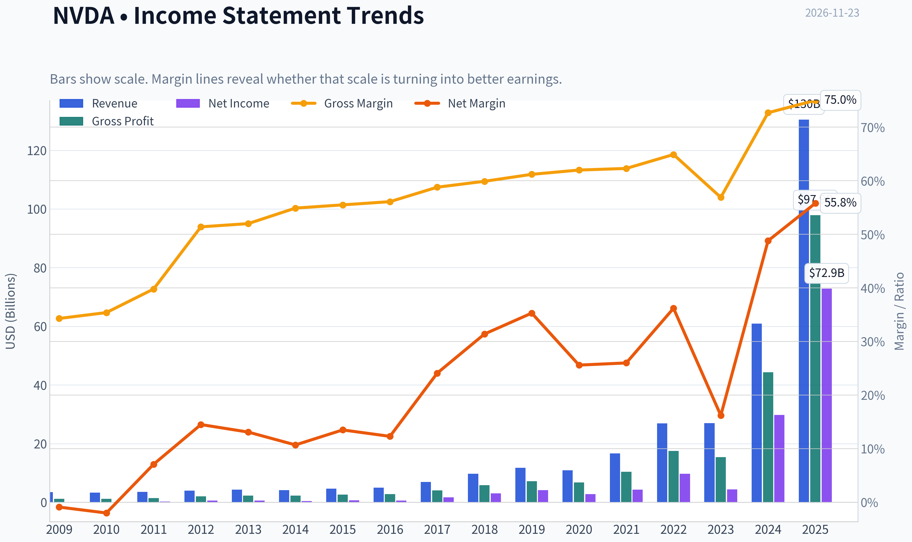

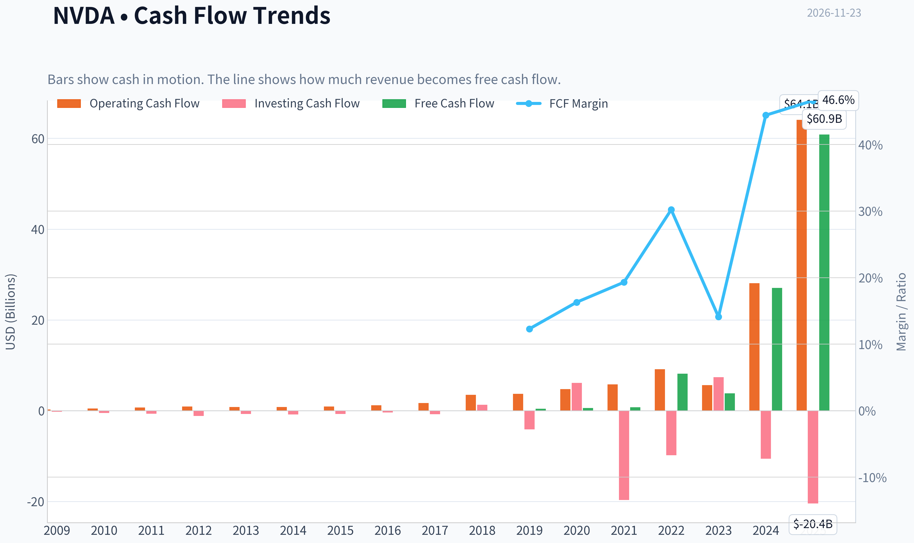

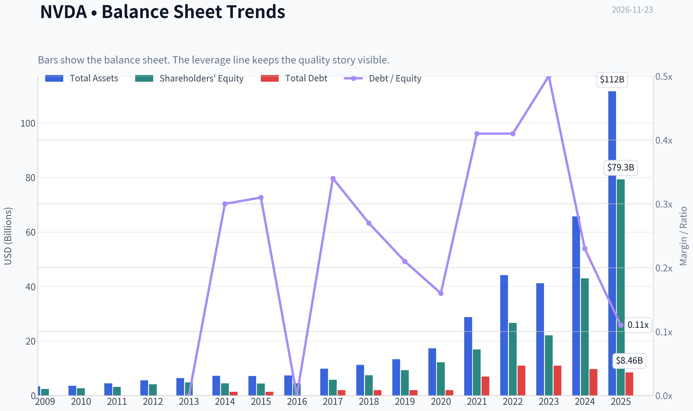

This graph tracks the profitability and return metrics (ROE, ROIC, Margins) of **NVDA** over the past decade, highlighting capital efficiency trends.

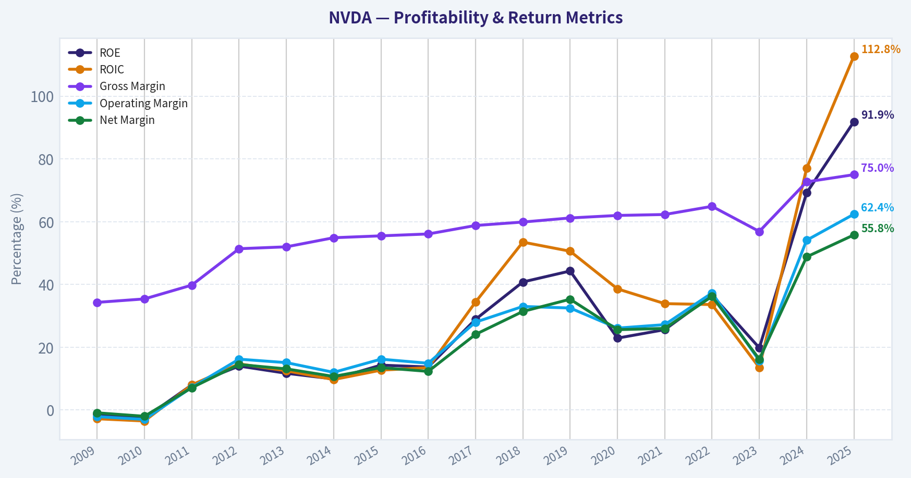

This chart illustrates the financial health of **NVDA** over the last 10 years, mapping cash equivalents and free cash flow against total obligations (Debt).

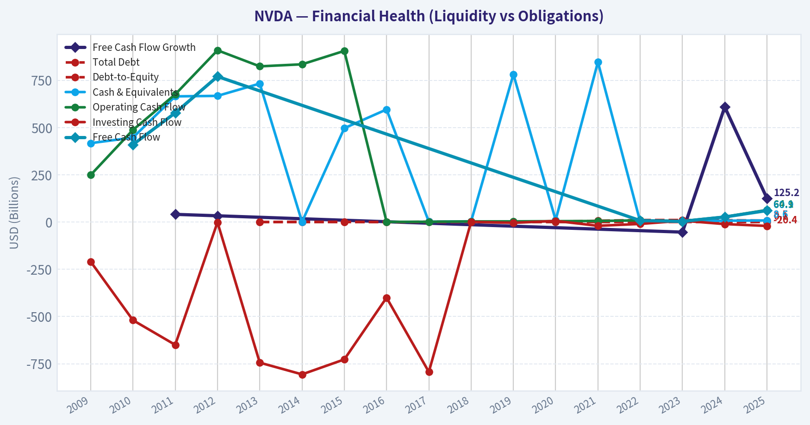

This breakdown chart from <em>Revenue Breakdown</em> shows the proportional composition for **NVDA** - useful for understanding what drives or risks the business.

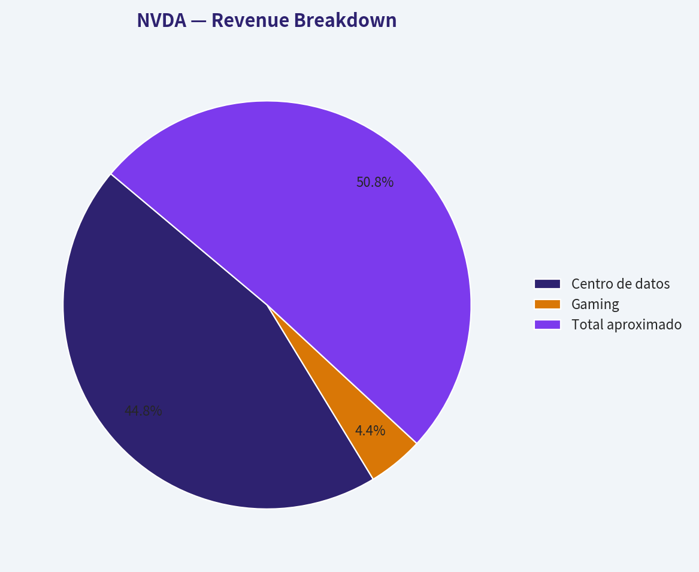

---

### Intrinsic Value Analysis (Buffett)

> *Following Warren Buffett's value investing philosophy: Circle of Competence, Economic Moat, Management Quality, and Margin of Safety.*

#### Intrinsic Value Snapshot

Price is what you pay. Intrinsic value is what the business may be worth based on the cash it can create for owners over time. We show a range, not one magic number.

- Current Price: $165.05
- Value Range (conservative to optimistic across both DCF methods): $114.65 to $283.43

##### Owner Earnings (Buffett Method)
- Net Income: $72,880,000,000.00
- Depreciation & Amortization: $2,843,000,000.00
- Capital Expenditures: $-6,042,000,000.00
- Working Capital Changes: $-15,949,000,000.00
- Owner Earnings: $59,893,306,952.61

##### Intrinsic Value
###### Buffett Method
Uses owner earnings. Stricter, and usually more conservative.
- Conservative: $114.65
- Average: $163.79
- Optimistic: $163.79
- Discount Rate: 8.3%

###### Cash Flow Method
Uses free cash flow. Better for companies spending heavily today to grow tomorrow.
- Conservative: $283.43
- Average: $283.43
- Optimistic: $283.43
- Discount Rate: 9.1%

ANALYST STANCE: **Neutral - Neutral**

#### Resumen ejecutivo

NVIDIA presenta una de las franquicias tecnológicas más extraordinarias del mercado: liderazgo en aceleradores de IA, ecosistema CUDA, márgenes brutos del 71,1%, crecimiento de ingresos del 65,5% y ROE del 76,3%. La calidad operativa es excepcional, pero la valoración actual de 165 dólares por acción prácticamente coincide con el valor intrínseco principal de DeepValues, de 163,79 dólares.

La empresa merece una valoración elevada por su crecimiento, rentabilidad y ventajas competitivas. Sin embargo, el margen de seguridad calculado es de **-0,8%**, inferior al descuento aproximado del 10%-15% que sería razonable incluso para una compañía de gran calidad. El resultado es una clasificación **Neutral**, no por deterioro del negocio, sino porque el precio deja poco margen para errores de ejecución, competencia o normalización del crecimiento.

#### 1. Cuadro de factores fundamentales

| Factor | Puntuación | Evaluación |
|---|---:|---|
| 1. Competencia y simplicidad | 3,5/5 | El modelo básico es comprensible: diseña chips y plataformas de computación para IA, centros de datos, gráficos y redes. La predicción a diez años es menos sencilla por la velocidad de cambio tecnológico y la competencia. |
| 2. Ventaja competitiva | 4,5/5 | Ecosistema CUDA, software especializado, escala, reputación tecnológica y costes de cambio elevados para desarrolladores y clientes. |
| 3. Gestión y asignación de capital | 4/5 | Liderazgo fundador de Jensen Huang durante décadas y fuerte ejecución estratégica. La información disponible no cuantifica suficientemente la remuneración ligada al valor por acción ni todos los detalles de las recompras. |
| 4. Estructura industrial | 3/5 | Mercado de enorme crecimiento, pero con competencia intensa, dependencia de grandes clientes, ciclos de semiconductores y riesgo de sustitución tecnológica. |

**Conclusión del cuadro:** NVIDIA combina una ventaja competitiva excepcional con una visibilidad inferior a la de un negocio defensivo. La tecnología fortalece actualmente el negocio, pero también acelera la obsolescencia potencial.

**Gate 5 - calidad y solvencia:** **no se activa**. Los beneficios y el flujo de caja presentan una trayectoria muy fuerte y no hay evidencia de deterioro financiero junto con una situación de insolvencia. La deuda neta indicada por DeepValues es de aproximadamente 10.900 millones de dólares, una carga manejable frente a los beneficios operativos.

#### 2. Análisis de la ventaja competitiva

| Fuente de ventaja | Evidencia en NVIDIA | Durabilidad |
|---|---|---|
| Activos intangibles | CUDA, bibliotecas de software, herramientas para desarrolladores y reputación de rendimiento | Alta |
| Costes de cambio | Reentrenar modelos, reescribir software y cambiar infraestructuras genera costes técnicos y operativos relevantes | Alta |
| Ventaja de escala | Inversión masiva en investigación, relaciones con fabricantes y capacidad de lanzar arquitecturas completas | Alta, aunque no permanente |
| Efectos de red | Más desarrolladores crean más herramientas para CUDA; más herramientas atraen más clientes y talento | Alta |
| Marca | NVIDIA se ha convertido en una referencia central de la infraestructura de IA | Alta |

**Key Takeaways:** La principal defensa de NVIDIA no es solamente fabricar chips rápidos, sino controlar una plataforma completa de hardware, software y herramientas para desarrolladores. CUDA y los costes de migración hacen que la ventaja sea más resistente que la de un fabricante de semiconductores puramente basado en precio. La durabilidad sigue dependiendo de que el ecosistema mantenga una ventaja clara frente a soluciones internas, ASIC especializados y competidores.

#### 3. Evaluación de la gestión

Jensen Huang ha dirigido NVIDIA durante aproximadamente 33 años y ha transformado la empresa desde una compañía centrada en gráficos hacia una plataforma de computación acelerada para IA. Esa reinversión estratégica es un ejemplo importante de asignación de capital intelectual: la dirección sostuvo inversiones durante años antes de que el mercado reconociera plenamente la oportunidad de la IA.

Los aspectos positivos son:

- Visión de largo plazo y disposición a reinventar la empresa.
- Concentración en investigación, arquitectura y ecosistema, no solo en ventas de hardware.
- Capacidad demostrada para convertir una transición tecnológica en una plataforma dominante.
- Creación de valor por acción mediante crecimiento de ingresos, márgenes y flujo de caja.

Los principales puntos de vigilancia son la dependencia del liderazgo de Huang, la elevada concentración de clientes y la necesidad de seguir asignando grandes recursos a investigación. La ventaja actual puede ser amplia, pero la industria exige reinversión continua para conservarla.

#### 4. Resumen financiero disponible

| Métrica | Valor |
|---|---:|
| Precio actual | 165,00 $ |
| Capitalización bursátil | 3,99 billones $ |
| PE | 17,7 |
| ROE | 76,3% |
| Margen bruto | 71,1% |
| Crecimiento interanual de ingresos | 65,5% |
| Rentabilidad del flujo de caja libre | 2,4% |
| Ratio corriente | 3,91 |
| Caja | 22.400 M$ |
| Deuda | 33.400 M$ |
| Deuda neta aproximada | 10.900 M$ |
| Ingresos operativos | 197.600 M$ |
| Tasa fiscal utilizada | 12,0% |
| Acciones utilizadas en la valoración | 24.285 M |

**Key Takeaways:** NVIDIA muestra una combinación poco habitual de crecimiento elevado, margen bruto superior al 70% y ROE muy alto. La rentabilidad del flujo de caja libre del 2,4% indica que el mercado ya descuenta una expansión considerable de los beneficios futuros. El balance es sólido en términos operativos, aunque la empresa no es una compañía de caja neta positiva según los datos utilizados por DeepValues.

#### 5. Beneficios del propietario

DeepValues calcula los beneficios del propietario con los siguientes componentes:

| Componente | Importe |
|---|---:|
| Beneficio operativo después de impuestos | 173.900 M$ |
| Más: depreciación y amortización | 3.700 M$ |
| Menos: gasto de capital normalizado | 7.100 M$ |
| Menos: aumento del capital circulante | 0 M$ |
| **Beneficios del propietario estimados** | **170.500 M$** |

Fórmula:

**Beneficios del propietario = 173.900 + 3.700 - 7.100 - 0 = 170.500 M$**

La conversión de beneficios en efectivo parece sólida. El bajo gasto de capital relativo a los ingresos refuerza el perfil de negocio relativamente ligero en activos, aunque el cálculo de mantenimiento futuro es incierto porque parte del gasto actual está destinado a expansión y no únicamente a mantenimiento.

#### 6. Valoración por escenarios

Los escenarios siguientes son una comprobación independiente basada en beneficios del propietario de 170.500 millones de dólares y 24.285 millones de acciones. El valor intrínseco principal continúa siendo el de DeepValues, no estos escenarios auxiliares.

| Escenario | Supuestos principales | Valor aproximado por acción |
|---|---|---:|
| A. Sin crecimiento | Beneficios constantes; tasa de descuento del 10% | 70,16 $ |
| B. Crecimiento similar al PIB | Crecimiento perpetuo del 3%; tasa de descuento del 10% | 103,27 $ |
| C. Crecimiento histórico normalizado | Crecimiento del 10% durante 10 años, reduciéndose a 2,5% terminal; descuento del 10% | 163,89 $ |
| **Valor intrínseco DeepValues** | Crecimiento del 10% reduciéndose al 2,5%; descuento del 8,3%; caja neta incluida | **163,79 $** |
| Precio actual | - | **165,00 $** |

**Key Takeaways:** Los escenarios conservadores producen valores significativamente inferiores al precio actual. Para justificar la cotización presente bajo una tasa de descuento del 10%, NVIDIA necesita mantener durante una década un crecimiento extraordinariamente elevado antes de desacelerar. El valor principal de DeepValues, de 163,79 dólares, confirma que el mercado está valorando prácticamente todo el escenario favorable.

#### 7. Margen de seguridad

| Elemento | Resultado |
|---|---:|
| Valor intrínseco DeepValues | 163,79 $ |
| Precio actual | 165,00 $ |
| Margen de seguridad | -0,8% |
| Rango conservador de DeepValues | 114,65 $ |
| Rango optimista de DeepValues | 163,79 $ |

El valor intrínseco de DeepValues utiliza:

- Beneficios del propietario de 170.500 millones de dólares.
- Crecimiento inicial del 10%, limitado por el crecimiento histórico disponible.
- Crecimiento terminal del 2,5%.
- Tasa de descuento del 8,3%.
- Deuda neta aproximada de 10.900 millones de dólares.

Para una compañía con una ventaja competitiva amplia, una prima moderada puede estar justificada. No obstante, el precio actual no ofrece el margen de seguridad del 10%-15% que normalmente compensaría los riesgos de concentración, competencia tecnológica, ciclo de semiconductores y dependencia de un crecimiento muy elevado.

#### 8. Cuadro de puntuación Buffett

| Criterio | Peso | Puntuación | Contribución |
|---|---:|---:|---:|
| Amplitud y durabilidad de la ventaja | 25% | 4,5/5 | 1,13 |
| Valoración y margen de seguridad | 20% | 1,5/5 | 0,30 |
| Rentabilidad del capital frente al coste de capital | 15% | 5/5 | 0,75 |
| Comprensión y previsibilidad | 12% | 3/5 | 0,36 |
| Gestión y asignación de capital | 12% | 4/5 | 0,48 |
| Capacidad de reinversión | 8% | 4/5 | 0,32 |
| Solidez del balance | 4% | 4/5 | 0,16 |
| Estructura industrial | 4% | 3/5 | 0,12 |
| **Puntuación total** | **100%** |  | **3,62/5** |

**Key Takeaways:** La puntuación está impulsada por el moat, el ROE, la capacidad de reinversión y la rentabilidad del capital. La valoración es el principal lastre: el precio actual exige que una parte sustancial del escenario de crecimiento se materialice. El resultado agregado supera el umbral de calidad empresarial, pero no ofrece suficiente margen para una clasificación de máxima convicción.

#### 9. Conclusión

NVIDIA es un negocio de calidad excepcional, con una plataforma tecnológica difícil de replicar y una pista de reinversión todavía amplia. Sus márgenes, ROE y crecimiento justifican que el mercado le asigne una valoración superior a la de un fabricante de chips convencional.

La evidencia financiera no muestra un problema de solvencia ni un deterioro operativo. El debate es principalmente de precio y expectativas: a 165 dólares, la cotización está prácticamente alineada con el valor intrínseco principal de 163,79 dólares y deja poco margen ante una desaceleración del crecimiento o una erosión de la ventaja de CUDA.

**ANALYST STANCE: Neutral - Neutral**
**Convicción: media-alta respecto a la calidad del negocio; media respecto a la valoración.**
#### Valuation Bridge

This bridge places the current market price beside each intrinsic value lens so readers can see whether upside depends on one method or shows up across several methods.

| Scenario | Intrinsic Value / Share |
| --- | ---: |
| Buffett Method | $163.79 |
| Cash Flow Method | $283.43 |
| Damodaran Method | $85.22 |
| Current Price | $165.05 |

#### Key Takeaways

If one method is far above the others, the upside case depends on a specific modelling assumption. When several methods cluster together, the valuation story is more robust.

#### Valuation Visuals

This comparison chart from *Latest Earnings Snapshot* stacks current figures against historical benchmarks for **NVDA**, making it easy to see where the company trades relative to its own averages.

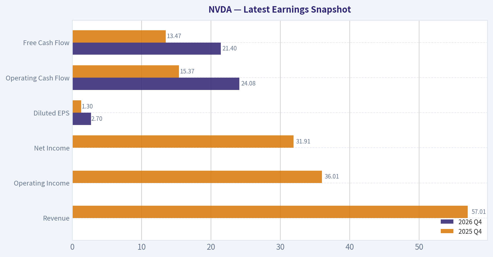

This comparison chart from *Rentabilidad y resultados operativos* stacks current figures against historical benchmarks for **NVDA**, making it easy to see where the company trades relative to its own averages.

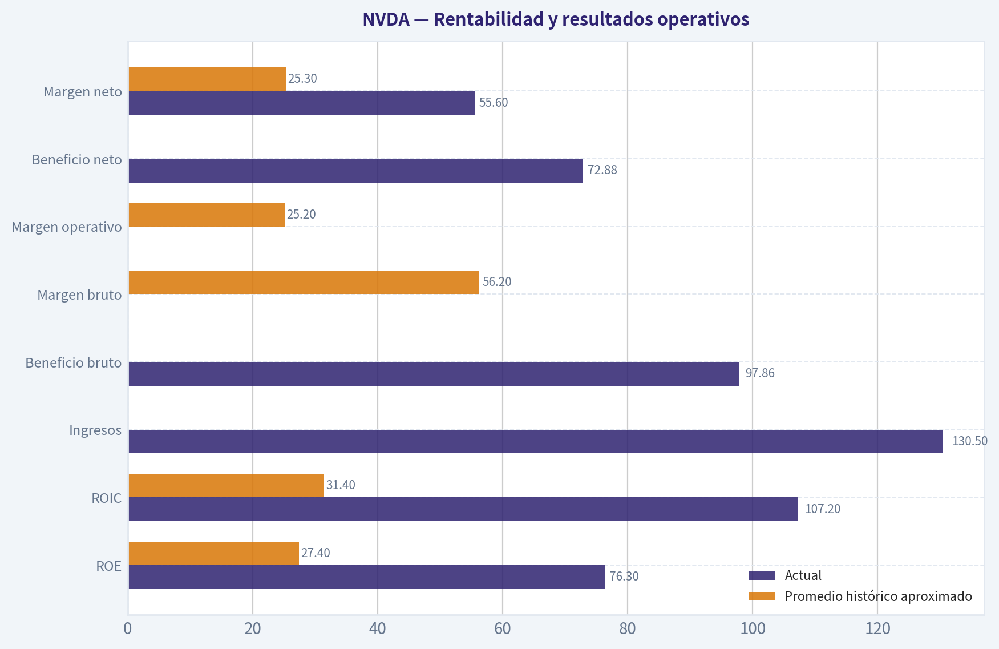

This comparison chart from *Flujo de caja y política de dividendos* stacks current figures against historical benchmarks for **NVDA**, making it easy to see where the company trades relative to its own averages.

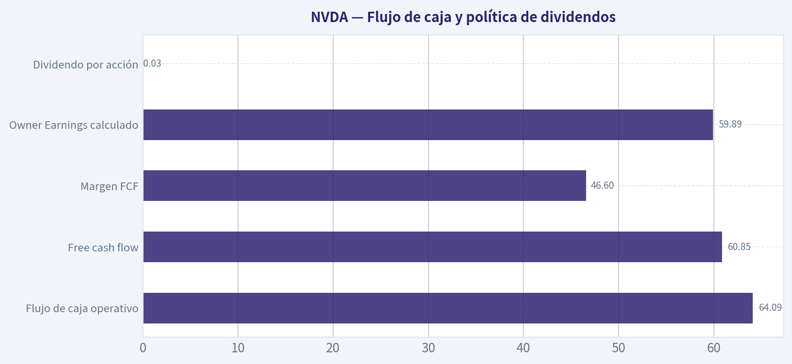

This comparison chart from *Resumen financiero disponible* stacks current figures against historical benchmarks for **NVDA**, making it easy to see where the company trades relative to its own averages.

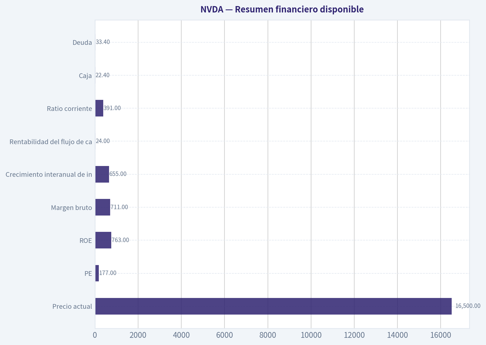

This comparison chart from *Beneficios del propietario* stacks current figures against historical benchmarks for **NVDA**, making it easy to see where the company trades relative to its own averages.

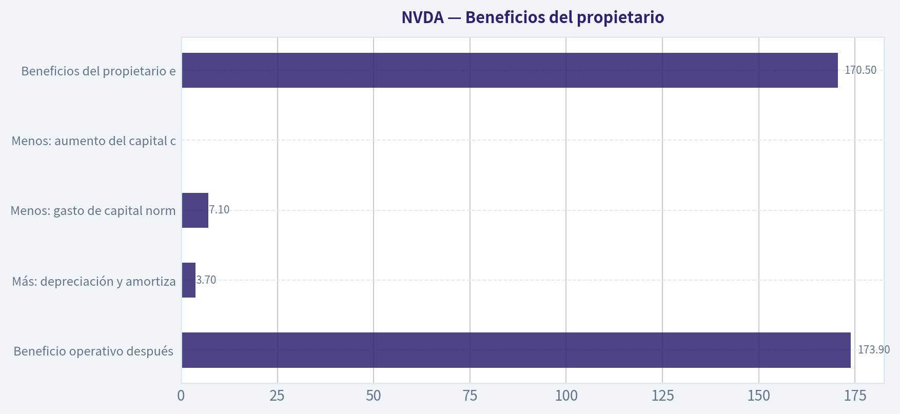

---

### Trend & Growth Analysis (Lynch/Druckenmiller/Fisher)

> *Following Peter Lynch's GARP, Stanley Druckenmiller's macro-aware approach, and Philip Fisher's scuttlebutt methodology.*

ANALYST STANCE: **Neutral - Neutral**

#### Resumen ejecutivo

NVIDIA sigue siendo un crecimiento excepcional, con crecimiento interanual de ingresos del **65,5%**, margen bruto del **71,1%** y ROE del **76,3%**. Sin embargo, la valoración actual de aproximadamente **165 dólares por acción** está prácticamente alineada con la valoración intrínseca principal de **163,79 dólares**, lo que deja un margen de seguridad muy reducido.

La empresa conserva características de posible multiplicación significativa a largo plazo por su liderazgo en computación acelerada, software CUDA y sistemas completos para inteligencia artificial. La principal cuestión ya no es si existe demanda, sino si el crecimiento, los márgenes y la cuota de mercado pueden mantenerse a una escala de varios cientos de miles de millones de dólares de ingresos.

#### 1. Clasificación Lynch

| Criterio | Evaluación |
|---|---|
| Categoría | Fast Grower, con rasgos de líder secular |
| Crecimiento de ingresos | 65,5% interanual |
| Rentabilidad | Muy elevada |
| Dependencia cíclica | Moderada; exposición a ciclos de semiconductores y gasto de capital |
| Motor principal | Inteligencia artificial, centros de datos y computación acelerada |
| Riesgo de valoración | Elevado en términos absolutos, aunque el PE indicado es bajo frente al crecimiento reportado |

**Conclusiones clave:** NVIDIA encaja claramente en la categoría de crecimiento rápido, no en la de stalwart. El crecimiento actual supera ampliamente el umbral del 15-25% de Lynch, pero la sostenibilidad futura de ese ritmo es el factor crítico.

#### 2. La historia en tres puntos

1. NVIDIA suministra chips, redes y sistemas que permiten entrenar y ejecutar modelos de inteligencia artificial a gran escala.
2. Su ventaja no se limita al hardware: CUDA, bibliotecas de software, ecosistema de desarrolladores y soluciones integradas elevan los costes de sustitución.
3. La expansión de la IA desde grandes centros de datos hacia inferencia, robótica, automoción, computación empresarial y soberanía tecnológica amplía el mercado potencial.

#### 3. TAM y prueba de 10 veces

| Elemento | Estimación / lectura |
|---|---|
| Ingresos actuales aproximados | Cerca de 216.000 millones de dólares |
| Ingresos necesarios para multiplicar por 10 | Cerca de 2,16 billones de dólares |
| Mercados relevantes | Aceleradores, redes, sistemas de IA, software, inferencia, robótica y automoción |
| TAM combinado potencial | Multibillonario, pero difícil de medir sin doble contabilización |
| Resultado de la prueba de 10 veces | Posible en teoría; no demostrable con alta confianza a partir de los datos actuales |
| Principal restricción | Escala de inversión de clientes, competencia, oferta energética y concentración de clientes |

**Conclusiones clave:** El mercado direccionable continúa expandiéndose rápidamente y todavía parece suficientemente grande para permitir una expansión muy considerable. No obstante, multiplicar por diez los ingresos exigiría que NVIDIA capturase una parte importante de varias capas del ecosistema, no solo del mercado de GPU.

#### 4. Tendencia de ingresos y calidad del crecimiento

| Indicador | Dato | Interpretación |
|---|---:|---|
| Crecimiento interanual de ingresos | 65,5% | Excepcional |
| Dirección de la tendencia | Alta, pero con riesgo de normalización | La base comparativa aumenta rápidamente |
| Margen bruto | 71,1% | Fuerte poder de fijación de precios y mezcla favorable |
| ROE | 76,3% | Excelente eficiencia del capital contable |
| Flujo de caja libre sobre valoración | 2,4% de rendimiento | La valoración descuenta una gran continuidad del crecimiento |

**Conclusiones clave:** Los datos muestran crecimiento extraordinario y una rentabilidad operativa muy potente. La señal de posible desaceleración no es un deterioro observado en estos datos, sino el riesgo matemático de que las tasas de crecimiento bajen al aumentar la base de ingresos.

#### 5. Economía unitaria y eficiencia

| Métrica | Dato / evaluación |
|---|---|
| LTV/CAC | No divulgado de forma aplicable; no es una métrica central para este modelo |
| NRR | No aplicable como métrica principal; el negocio no es SaaS puro |
| Margen bruto | 71,1% |
| Regla de 40 | No plenamente aplicable; el modelo combina hardware, sistemas y software |
| Capacidad de autofinanciación | Fuerte, según el flujo de caja y los beneficios operativos reportados |
| Riesgo de capital | Bajo en comparación con empresas de crecimiento no rentables |

**Conclusiones clave:** NVIDIA no necesita demostrar LTV/CAC o NRR como una empresa SaaS. Sus equivalentes económicos son la retención del ecosistema, la recurrencia de las actualizaciones de infraestructura, los márgenes y la capacidad de convertir ingresos en flujo de caja.

#### 6. Evaluación del punto de inflexión

| Posible inflexión | Evidencia | Estado |
|---|---|---|
| Producto | Nuevas generaciones de aceleradores y sistemas integrados | Positiva |
| Mercado | IA pasando de entrenamiento a inferencia y aplicaciones empresariales | Positiva |
| TAM | Expansión hacia redes, software, robótica y automoción | Positiva |
| Márgenes | Margen bruto de 71,1% | Positiva, aunque sensible a mezcla |
| Competencia | AMD, ASIC internos y grandes clientes desarrollando chips propios | Riesgo creciente |
| Escala | Ingresos ya muy elevados | Puede producir normalización del crecimiento |

**Conclusiones clave:** La inflexión más importante es la transformación de NVIDIA desde proveedor de GPU hacia plataforma integral de computación para IA. El riesgo es que la siguiente fase sea de crecimiento todavía alto, pero menos explosivo, mientras los competidores y los diseños propios de clientes ganan relevancia.

#### 7. Configuración macroeconómica

El entorno es mixto. La inteligencia artificial representa una tendencia secular favorable, y el gasto de capital en centros de datos sigue siendo un motor estructural. Sin embargo, el rendimiento del bono estadounidense a 30 años utilizado por el modelo es de **5,31%**, lo que eleva la tasa de descuento y limita los múltiplos que el mercado puede sostener.

La empresa también está expuesta a restricciones comerciales, disponibilidad energética, ciclos de inversión de grandes proveedores de nube y posibles excesos de capacidad. Para Druckenmiller, el viento secular es favorable, pero el viento de tipos y la sensibilidad al gasto de capital son menos favorables.

#### 8. Puntuación Fisher

| Área Fisher | Puntuación |
|---|---:|
| Potencial de mercado | 5/5 |
| Desarrollo de nuevos productos | 5/5 |
| I+D | 5/5 |
| Organización comercial | 5/5 |
| Márgenes | 5/5 |
| Mejora de márgenes | 4/5 |
| Relaciones laborales | 4/5 |
| Relaciones ejecutivas | 5/5 |
| Profundidad directiva | 4/5 |
| Control de costes y contabilidad | 4/5 |
| Ventajas extraordinarias | 5/5 |
| Perspectiva de beneficios | 5/5 |
| Dilución | 4/5 |
| Transparencia ante dificultades | 4/5 |
| Integridad directiva | 5/5 |
| **Total** | **69/75** |

**Conclusiones clave:** La puntuación de 69 sobre 75 sitúa a NVIDIA en la categoría "outstanding" bajo el marco de Fisher. Las deducciones principales reflejan la concentración de clientes, la posible normalización de márgenes y la dificultad de evaluar la transparencia futura cuando las expectativas son extremadamente elevadas.

#### 9. Valoración

| Método | Resultado |
|---|---:|
| Precio actual indicado | 165,00 dólares |
| PE indicado | 17,73 veces |
| Crecimiento de ingresos | 65,5% |
| PEG simple | 0,27 |
| Valor intrínseco principal, Owner Earnings | 163,79 dólares |
| Rango conservador a optimista, Owner Earnings | 114,65-163,79 dólares |
| Margen frente al valor intrínseco principal | -0,8% |
| DCF de flujo de caja libre, referencia secundaria | 283,43 dólares |
| DCF FCFF, escenario base | 85,22 dólares |

**Conclusiones clave:** El PEG simple parece muy atractivo, pero puede ser engañoso porque utiliza el crecimiento interanual reciente, que probablemente no sea sostenible durante muchos años. El método principal de Owner Earnings sitúa el valor intrínseco prácticamente en el precio actual, mientras que otros DCF muestran una dispersión muy amplia; esto indica una elevada sensibilidad a los supuestos.

#### 10. Escenarios de ingresos y valoración

| Escenario | Supuesto cualitativo | Resultado probable |
|---|---|---|
| Bajista | Crecimiento se normaliza rápidamente; ASIC internos y competencia presionan márgenes | Compresión significativa del múltiplo |
| Base | Crecimiento elevado, pero decreciente; ecosistema CUDA conserva liderazgo | Valoración cercana a la actual, con retorno dependiente de la ejecución |
| Alcista | IA se expande a inferencia, empresas, robótica y sistemas completos; márgenes se mantienen | Potencial de creación de valor considerable |
| Extremo positivo | NVIDIA se convierte en la capa dominante de infraestructura y software de IA | Escenario de multiplicación múltiple, pero con baja visibilidad |

**Conclusiones clave:** El caso alcista sigue siendo muy relevante porque NVIDIA puede capturar más valor por sistema, no solo vender chips. El caso base exige una desaceleración normal del crecimiento, por lo que el precio actual parece requerir una ejecución fuerte para justificar una revalorización adicional.

#### 11. Sensibilidad de valoración

| Variable | Sensibilidad |
|---|---|
| Crecimiento de ingresos | Muy alta |
| Margen bruto | Muy alta |
| Duración del ciclo de inversión en IA | Muy alta |
| Tasa de descuento | Alta |
| Cuota de mercado frente a ASIC y AMD | Alta |
| Monetización de software | Alta |
| Concentración de grandes clientes | Media-alta |
| Precio actual frente al valor Owner Earnings | Prácticamente sin margen |

**Conclusiones clave:** La valoración es especialmente sensible a tres variables: duración del ciclo de IA, mantenimiento del margen bruto y tasa de crecimiento después de la enorme base actual. Un pequeño cambio en cualquiera de ellas puede explicar la gran diferencia entre los distintos modelos DCF.

#### 12. Puntuación del inversor de crecimiento

| Criterio | Peso | Nota |
|---|---:|---:|
| Historia Lynch | 10% | 4,8/5 |
| TAM y recorrido | 20% | 4,7/5 |
| Crecimiento de ingresos | 20% | 5,0/5 |
| Economía unitaria | 15% | 4,5/5 |
| Posición competitiva | 10% | 4,8/5 |
| Calidad directiva | 10% | 4,7/5 |
| Entorno macro | 5% | 3,5/5 |
| Camino de rentabilidad | 5% | 5,0/5 |
| Valoración | 5% | 3,0/5 |
| **Puntuación total ponderada** | **100%** | **4,55/5** |

**Conclusiones clave:** La calidad empresarial y el perfil de crecimiento obtienen una puntuación muy alta. La valoración es el elemento que impide una clasificación de máxima convicción: la empresa parece excelente, pero el precio indicado ya refleja gran parte de esa excelencia.

#### Catalizadores y riesgos principales

| Catalizadores | Riesgos |
|---|---|
| Nuevas arquitecturas y ciclos de producto | Normalización del crecimiento |
| Mayor monetización de software y servicios | ASIC internos de grandes clientes |
| Expansión de inferencia y agentes de IA | Restricciones comerciales y geopolíticas |
| Robótica, automoción y computación empresarial | Presión sobre márgenes por mezcla o competencia |
| Mayor adopción internacional de IA | Concentración de clientes y gasto de capital cíclico |
| Integración de redes, CPU, GPU y software | Tipos de interés elevados y compresión de múltiplos |

**Conclusiones clave:** Los catalizadores pueden ampliar el TAM y prolongar la fase de crecimiento extraordinario. Los riesgos no apuntan necesariamente a un deterioro inmediato, pero sí podrían producir una desaceleración significativa y una contracción del múltiplo si el mercado percibe que el ciclo de IA ha alcanzado su madurez.

#### Conclusión final

NVIDIA presenta una combinación poco común de crecimiento, márgenes, liderazgo tecnológico y escala. Desde Lynch, es un fast grower; desde Fisher, obtiene una puntuación sobresaliente; y desde Druckenmiller, mantiene una fuerte tendencia secular, aunque con sensibilidad a tipos y gasto de capital.

La evidencia fundamental favorece una empresa de gran calidad y con posible potencial de multiplicación a largo plazo. La evidencia de valoración es más prudente: a **165 dólares**, el precio está aproximadamente en línea con el valor intrínseco principal de **163,79 dólares**, por lo que el caso depende principalmente de que la expansión de la IA supere las expectativas actuales.

---

### Market Technical Analysis

ANALYST STANCE: **Neutral / Bajista**

#### Resumen ejecutivo

NVDA presenta un deterioro técnico muy marcado al cierre disponible del **20 de noviembre de 2026**, última sesión con datos; el **23 de noviembre no fue día de negociación**. El precio cerró en **125,53 dólares**, después de caer desde **204,64 dólares el 30 de octubre**, una pérdida aproximada del **38,7 %** en menos de un mes.

La señal dominante es bajista: el precio se encuentra muy por debajo de sus medias de 10, 50 y 200 sesiones, el MACD continúa profundamente negativo, el RSI está en una zona de sobreventa extrema y el volumen ha aumentado durante las caídas. La sobreventa puede favorecer rebotes técnicos de corta duración, pero todavía no existe evidencia suficiente de estabilización estructural o de recuperación del impulso.

#### Indicadores seleccionados

Se han utilizado ocho indicadores complementarios:

- **close_10_ema:** sensibilidad al impulso inmediato.
- **close_50_sma:** tendencia intermedia.
- **close_200_sma:** régimen de tendencia de largo plazo.
- **macd:** dirección y fuerza del momentum.
- **macdh:** aceleración o desaceleración del momentum.
- **rsi:** intensidad de la presión compradora o vendedora.
- **atr:** expansión de la volatilidad.
- **vwma:** confirmación de tendencia incorporando volumen.

Aunque MACD y su histograma están relacionados, aportan lecturas distintas: el MACD muestra el nivel y la dirección del momentum, mientras que el histograma permite observar si ese deterioro se está acelerando o moderando.

#### Tendencia y medias móviles

La estructura de medias es inequívocamente negativa:

- La **EMA de 10 sesiones** cayó hasta **157,32 dólares** el 20 de noviembre, frente a un cierre de **125,53 dólares**. La separación de aproximadamente **31,8 dólares**, equivalente a más del 20 % de la EMA, refleja una presión vendedora excepcionalmente intensa.
- La **SMA de 50 sesiones** se situó en **207,00 dólares**, unos **81,47 dólares por encima del precio**, mientras que su pendiente descendió desde aproximadamente **222,22 dólares el 26 de octubre**. Esto confirma que el debilitamiento ya no es únicamente intradía o de muy corto plazo.
- La **SMA de 200 sesiones** estaba en **203,09 dólares** y también comenzaba a inclinarse a la baja. El precio está alrededor de un **38,2 % por debajo** de esa referencia, lo que indica que el movimiento ha traspasado el ámbito de una corrección ordinaria y está afectando al régimen de tendencia de largo plazo.

La secuencia de máximos y mínimos descendentes se hizo especialmente visible desde finales de octubre. Las caídas del 5, 9, 10 y 12 de noviembre estuvieron acompañadas por cierres sucesivamente inferiores, y el 20 de noviembre se produjo una nueva ruptura con cierre en 125,53 dólares.

#### Momentum: MACD e histograma

El MACD se deterioró de **-3,64 el 30 de octubre** a **-19,83 el 20 de noviembre**. No solo permanece por debajo de cero, sino que la trayectoria descendente ha sido persistente, sin una recuperación sostenida que sugiera un cambio de tendencia.

El histograma MACD también permaneció negativo durante todo el periodo observado. Su lectura fue de **-1,48 el 30 de octubre** y de **-4,63 el 20 de noviembre**. Aunque el histograma mostró una ligera moderación entre el 16 y el 18 de noviembre, volvió a empeorar el 20 de noviembre. Esto sugiere que cualquier desaceleración intermedia de la presión vendedora no se consolidó.

La combinación de MACD negativo, histograma negativo y precio por debajo de todas las medias relevantes indica que el rebote observado el 11 de noviembre, desde 168,89 hasta 173,73 dólares, no fue suficiente para alterar la estructura dominante.

#### RSI y condición de sobreventa

El RSI descendió hasta **15,05**, claramente por debajo del umbral convencional de 30. La lectura confirma una presión vendedora extrema y hace posible un rebote técnico, especialmente después de varias sesiones consecutivas de descensos pronunciados.

Sin embargo, la sobreventa no constituye por sí misma una señal de reversión. En tendencias bajistas fuertes, el RSI puede permanecer en niveles deprimidos durante varias sesiones. Además, el RSI cayó desde **24,86 el 13 de noviembre** hasta **15,05 el 20 de noviembre**, sin mostrar una divergencia alcista clara frente al precio. Por tanto, el indicador describe intensidad de la caída, pero todavía no evidencia una recuperación del control comprador.

#### Volatilidad y volumen

El ATR subió desde **6,22 dólares el 30 de octubre** hasta **10,71 dólares el 20 de noviembre**, un incremento aproximado del **72 %**. En relación con el precio de cierre, el ATR equivale ahora a cerca del **8,5 %**, frente a aproximadamente el 3 % al inicio del periodo. Esto representa una ampliación sustancial del rango diario y un aumento del riesgo de movimientos bruscos en ambas direcciones.

El volumen también fue especialmente elevado durante las sesiones de descenso:

- **5 de noviembre:** 306,1 millones de acciones.
- **9 de noviembre:** 462,7 millones.
- **10 de noviembre:** 429,3 millones.
- **12 de noviembre:** 747,7 millones.
- **20 de noviembre:** 626,4 millones.

La VWMA cayó hasta **163,14 dólares**, muy por encima del cierre de 125,53 dólares, pero descendiendo con rapidez desde **221,26 dólares el 26 de octubre**. La combinación de una VWMA descendente y grandes volúmenes durante las rupturas respalda la interpretación de distribución o liquidación agresiva, más que la de una simple toma de beneficios ordenada.

#### Lectura integrada y posible significado para la valoración

La señal técnica no respalda una valoración que dependa de una recuperación rápida y sin fricciones. El mercado ha reducido de forma contundente el precio en un entorno de volumen elevado, mientras que las medias de medio y largo plazo todavía se encuentran muy por encima del nivel actual y continúan deteriorándose.

La principal lectura positiva es la sobreventa extrema: el RSI y la distancia respecto a la EMA de 10 sesiones indican que el movimiento podría estar sobreactuado en el muy corto plazo. No obstante, una recuperación técnicamente más fiable requeriría observar estabilización del precio, reducción de la volatilidad, mejora sostenida del MACD y recuperación progresiva de las medias cortas. Esos elementos aún no aparecen en los datos disponibles.

Por ello, la evidencia actual describe una combinación de **tendencia bajista de corto, medio y largo plazo**, **momentum negativo**, **sobreventa extrema** y **volatilidad elevada**. La conclusión es de vigilancia: la sobreventa puede limitar la extrapolación lineal de la caída, pero no basta para justificar una interpretación alcista ni para validar una valoración exigente sin confirmación técnica adicional.

| Área | Lectura más reciente | Evolución observada | Interpretación |
|---|---:|---|---|
| Precio de cierre | 125,53 $ | -38,7 % desde 204,64 $ el 30 de octubre | Ruptura bajista severa |
| EMA de 10 sesiones | 157,32 $ | Descendió desde 217,99 $ el 26 de octubre | El precio está muy por debajo del impulso corto |
| SMA de 50 sesiones | 207,00 $ | Pendiente descendente desde 222,22 $ | Deterioro claro de la tendencia intermedia |
| SMA de 200 sesiones | 203,09 $ | Ligera pendiente bajista | El daño ya alcanza la tendencia de largo plazo |
| MACD | -19,83 | Empeoró desde -3,64 | Momentum bajista persistente |
| Histograma MACD | -4,63 | Negativo y peor que a finales de octubre | No hay confirmación de reversión |
| RSI | 15,05 | Descenso desde 35,07 | Sobreventa extrema, pero sin divergencia alcista clara |
| ATR | 10,71 $ | Subió aproximadamente 72 % | Volatilidad y amplitud de movimientos muy elevadas |
| VWMA | 163,14 $ | Descendió desde 221,26 $ | El volumen confirma debilidad y distribución |

**Key Takeaways:** NVDA muestra una tendencia bajista sincronizada en los horizontes corto, medio y largo, con momentum negativo y volumen elevado durante las caídas. El RSI extremadamente bajo señala sobreventa y posibilidad de rebotes técnicos, pero no demuestra por sí solo un cambio de tendencia. La evidencia disponible implica que una valoración exigente necesitaría confirmación de estabilización y recuperación del impulso, elementos que todavía no están presentes.

---

### Options Market Analysis

> *Reading options flow - put/call ratios, IV skew, and unusual activity - to gauge institutional positioning and event-driven risk.*

ANALYST STANCE: **Neutral - Alcista con confianza moderada**

#### Resumen ejecutivo

Los vencimientos próximos de NVDA muestran un sesgo alcista en el posicionamiento agregado: el ratio put/call de interés abierto es 0,55 y el de volumen es 0,71, ambos por debajo del nivel neutral aproximado de 0,70 en el caso del OI y claramente por debajo de 1,0 en volumen. La actividad inusual está dominada por calls, aunque también aparecen grandes bloques de puts de muy corto plazo que pueden representar cobertura o apuestas bajistas.

La señal no es plenamente concluyente porque el vencimiento principal corresponde al mismo día, la información no identifica si las operaciones abrieron o cerraron contratos y no se proporciona el precio spot actual. La lectura general es alcista, pero con riesgo elevado de movimientos bruscos por la volatilidad implícita y la concentración temporal.

#### 1. Ratio put/call

| Vencimiento | Días hasta vencimiento | OI calls | OI puts | Ratio put/call OI | Volumen calls | Volumen puts | Ratio put/call volumen |
|---|---:|---:|---:|---:|---:|---:|---:|
| 23 nov 2026 | 0 | 215.521 | 110.382 | 0,51 | 2.403.538 | 1.799.272 | 0,75 |
| 25 nov 2026 | 2 | 98.917 | 63.249 | 0,64 | 590.396 | 412.770 | 0,70 |
| 27 nov 2026 | 4 | 491.778 | 269.612 | 0,55 | 671.851 | 378.167 | 0,56 |
| **Total** | - | **806.216** | **443.243** | **0,55** | **3.665.785** | **2.590.209** | **0,71** |

**Key Takeaways:** El OI de calls supera ampliamente al de puts en todos los vencimientos analizados. El ratio agregado de OI, 0,55, está por debajo del nivel neutral aproximado de 0,70, lo que indica un sesgo alcista o una mayor utilización de calls, aunque parte de estas calls podría corresponder a calls cubiertas y no necesariamente a especulación alcista pura.

#### 2. Evaluación de volatilidad implícita

| Vencimiento | IV ATM calls | IV ATM puts | Diferencia puts menos calls | Lectura |
|---|---:|---:|---:|---|
| 23 nov 2026 | 76,4% | 34,6% | -41,8 puntos | Sesgo de volatilidad hacia calls |
| 25 nov 2026 | 83,4% | 86,2% | +2,8 puntos | Skew de puts leve |
| 27 nov 2026 | 78,3% | 77,5% | -0,8 puntos | Prácticamente neutral |
| **Rango próximo** | **76,4%-83,4%** | **34,6%-86,2%** | - | **Volatilidad elevada y heterogénea** |

La IV cercana o superior al 80% en los vencimientos del 25 y 27 de noviembre es elevada. El vencimiento del mismo día presenta una diferencia extrema entre calls y puts, con IV mucho mayor en calls; esto puede reflejar demanda especulativa de calls, diferencias de liquidez o distorsiones propias de contratos que expiran intradía.

No se ha proporcionado un calendario de catalizadores corporativos. Por tanto, no puede atribuirse de forma verificable esta IV a resultados, lanzamiento de producto u otro evento concreto. La proximidad de los vencimientos, por sí sola, explica parte de la prima elevada.

**Key Takeaways:** La volatilidad implícita es elevada, especialmente en los vencimientos del 25 y 27 de noviembre. El skew de muy corto plazo favorece a las calls, mientras que el vencimiento del 25 de noviembre muestra una ligera prima de puts. La estructura sugiere expectativas de movimientos amplios, pero no permite inferir por sí sola la dirección del precio.

#### 3. Actividad inusual

| Vencimiento | Tipo | Strike | Volumen | OI | Vol/OI | Días | Interpretación relativa al precio |
|---|---|---:|---:|---:|---:|---:|---|
| 23 nov | Call | 170 | 544.422 | 11.171 | 48,7x | 0 | No se puede determinar ITM/ATM/OTM sin precio spot |
| 23 nov | Put | 160 | 373.297 | 1.635 | 228,3x | 0 | Posible cobertura o apuesta bajista |
| 23 nov | Call | 165 | 363.631 | 10.185 | 35,7x | 0 | No se puede determinar ITM/ATM/OTM |
| 23 nov | Put | 165 | 361.420 | 489 | 739,1x | 0 | Flujo extremadamente nuevo o rotación intensa |
| 23 nov | Call | 167,5 | 353.605 | 3.341 | 105,8x | 0 | Flujo especulativo alcista potencial |
| 23 nov | Put | 162,5 | 288.769 | 503 | 574,1x | 0 | Cobertura o especulación bajista de corto plazo |
| 23 nov | Call | 175 | 208.399 | 3.786 | 55,0x | 0 | Apuesta alcista de corto plazo potencial |
| 23 nov | Call | 172,5 | 184.269 | 3.638 | 50,7x | 0 | Apuesta alcista de corto plazo potencial |
| 23 nov | Put | 150 | 145.640 | 5.651 | 25,8x | 0 | Protección de cola o visión bajista |
| 23 nov | Call | 180 | 135.961 | 4.296 | 31,6x | 0 | Especulación alcista más alejada |
| 23 nov | Put | 155 | 127.960 | 2.779 | 46,0x | 0 | Cobertura bajista potencial |
| 23 nov | Put | 157,5 | 117.936 | 1.362 | 86,6x | 0 | Cobertura o apuesta bajista |
| 23 nov | Put | 167,5 | 93.523 | 234 | 399,7x | 0 | Actividad nueva potencialmente direccional |
| 23 nov | Call | 177,5 | 83.428 | 1.370 | 60,9x | 0 | Especulación alcista potencial |
| 27 nov | Call | 180 | 79.124 | 15.759 | 5,0x | 4 | Actividad relevante, aunque menos extrema |

Los contratos con mayor volumen relativo son las puts de 165 y 162,5, junto con las calls de 167,5, 170 y 175. El bloque de calls es más numeroso y concentra mayor volumen absoluto, mientras que las puts muestran ratios volumen/OI mucho más extremos.

No es posible clasificar con rigor cada contrato como ITM, ATM u OTM porque el precio actual de NVDA no aparece en los datos recibidos. Tampoco puede distinguirse entre apertura, cierre, spread o cobertura, por lo que no sería correcto etiquetar automáticamente estos flujos como "smart money". La magnitud y la dispersión de los contratos son compatibles tanto con actividad institucional de cobertura como con especulación minorista de muy corto plazo.

**Key Takeaways:** La actividad inusual favorece a las calls en volumen absoluto, especialmente entre strikes de 167,5 a 180 dólares. Al mismo tiempo, las puts de 160 a 167,5 dólares muestran ratios volumen/OI extraordinarios, lo que indica una fuerte demanda de protección o apuestas bajistas intradía. El balance neto es alcista, pero con una cobertura bajista significativa.

#### 4. Concentración de interés abierto y posibles niveles gamma

| Vencimiento | OI total calls | OI total puts | OI total | Participación aproximada del OI total |
|---|---:|---:|---:|---:|
| 23 nov 2026 | 215.521 | 110.382 | 325.903 | 26,1% |
| 25 nov 2026 | 98.917 | 63.249 | 162.166 | 13,0% |
| 27 nov 2026 | 491.778 | 269.612 | 761.390 | 60,9% |
| **Total** | **806.216** | **443.243** | **1.249.459** | **100%** |

La mayor concentración temporal está en el vencimiento del 27 de noviembre, que reúne aproximadamente el 61% del OI cercano. Esto puede favorecer efectos de fijación o pinning alrededor de los strikes con mayor OI, aunque los datos suministrados no incluyen el OI completo por strike.

Los strikes con actividad más destacada son 165, 167,5, 170, 172,5, 175 y 180 dólares. Sin embargo, volumen inusual no equivale necesariamente a una "gamma wall". Para identificar paredes gamma con precisión se necesitarían OI por strike, delta, gamma y una estimación de si las opciones fueron compradas o vendidas.

**Key Takeaways:** El vencimiento del 27 de noviembre es el principal centro de gravedad del mercado cercano, con más de tres quintas partes del OI agregado. La actividad se agrupa entre 165 y 180 dólares, pero no existe información suficiente para confirmar cuál de esos strikes constituye la mayor pared gamma. La concentración puede amortiguar el movimiento cerca de ciertos strikes o amplificarlo si el precio se aleja de ellos.

#### 5. Señal global de sentimiento

| Factor | Lectura | Impacto en la señal |
|---|---|---|
| Ratio put/call OI | 0,55 frente a neutral aproximado de 0,70 | Alcista |
| Ratio put/call de volumen | 0,71 | Ligeramente alcista |
| IV ATM | Elevada, aproximadamente 76%-86% en varios vencimientos | Riesgo elevado, no direccional |
| Skew | Calls favorecidas en el vencimiento inmediato; casi neutral después | Alcista de corto plazo |
| Actividad inusual | Más volumen absoluto en calls, pero puts con ratios volumen/OI extremos | Alcista con cobertura bajista |
| Concentración | OI dominante en el 27 de noviembre | Potencial de pinning y movimientos bruscos |
| **Señal final** | **ALCISTA, con confianza moderada** | **Sesgo alcista condicionado por alta volatilidad** |

La señal principal procede del ratio put/call inferior a neutral y del predominio de actividad inusual en calls. La presencia de grandes bloques de puts evita una lectura de convicción alcista alta: puede representar protección ante una caída rápida o estrategias combinadas.

No se trata de una valoración fundamental ni de una predicción de precio. Además, al no conocerse el spot, el flujo comprador o vendedor de cada operación ni un catalizador específico, la evidencia respalda un sesgo alcista de muy corto plazo, pero con incertidumbre considerable y riesgo de reversión intradía.

**Key Takeaways:** El sentimiento agregado es **ALCISTA**, principalmente por la abundancia relativa de calls y el ratio put/call de OI de 0,55. La volatilidad elevada y la intensa actividad en puts indican que el mercado también está pagando protección frente a movimientos adversos. La confianza es moderada, no alta, porque faltan datos de precio spot, dirección de las transacciones y OI detallado por strike.

#### Tabla resumen

| Métrica | Resultado |
|---|---|
| Ratio put/call | OI: 0,55; volumen: 0,71; ambos favorables a calls frente al nivel neutral |
| Nivel de IV | Elevado; aproximadamente 76%-86% en vencimientos relevantes |
| Dirección del skew | Favorece calls en el vencimiento inmediato; casi neutral en el 27 de noviembre |
| Actividad inusual | Calls dominantes en volumen absoluto; puts con ratios volumen/OI extremos |
| Señal global | **ALCISTA**, con confianza moderada y riesgo elevado de volatilidad |

**Key Takeaways:** NVDA presenta un sesgo alcista en el flujo de opciones cercano, pero acompañado de una prima de volatilidad alta y cobertura bajista intensa. La lectura más equilibrada es alcista con cautela analítica: el mercado anticipa movimiento y muestra mayor interés relativo en calls, aunque no existe evidencia suficiente para atribuir todo el flujo a apuestas direccionales institucionales.

---

## Research Team Commentary

> *The Research Manager synthesizes the Bull vs Bear debate into action-free commentary. This is a pre-risk view, not the final stance.*

Core Takeaway: NVIDIA es una franquicia excepcional, pero el expediente no demuestra todavía que $165 ofrezca un margen de seguridad verificable. CUDA, la integración entre chips, redes y software, y la capacidad de reinvención de la dirección sostienen un foso amplio. Sin embargo, el P/E de 17,73 veces solo parece moderado si los aproximadamente $9,31 de beneficio por acción son representativos de una capacidad de beneficio normalizada. Ante la ausencia de flujo de caja libre normalizado, deuda neta y un valor intrínseco de DeepValues, la conclusión más disciplinada es Neutral.

El argumento alcista más convincente es que NVIDIA no debe valorarse como un fabricante convencional de semiconductores. Su ventaja se extiende desde los aceleradores hasta CUDA, bibliotecas, redes, sistemas integrados y una comunidad de desarrolladores difícil de replicar. La migración a otra plataforma supone costes de software, talento, validación y riesgo operativo. Esa integración también permite optimizar el centro de datos completo, algo cada vez más importante conforme crecen la escala y la complejidad de los clústeres.

La oportunidad tampoco se limita al entrenamiento de modelos. Inferencia, IA empresarial, computación soberana, robótica, simulación y automoción pueden prolongar el crecimiento durante muchos años. La dirección ya demostró que sabe transformar una ventaja tecnológica en una plataforma más amplia, primero desde gráficos hacia cómputo acelerado y después hacia infraestructura de IA. Esa capacidad de adaptación merece una prima de calidad.

Las métricas operativas respaldan esa lectura: margen bruto del 71,1%, ROIC del 107,2%, ROE del 76,3% y ROA del 58,1%. Aunque algunas cifras estén amplificadas por una base de capital ligera y por el auge actual de la demanda, difícilmente se explican sin diferenciación, poder de precios y una asignación eficaz del capital intelectual. NVIDIA no necesita conservar exactamente un ROIC superior al 100%; le basta con mantener retornos incrementales muy por encima de su coste de capital para seguir creando valor.

El argumento bajista más fuerte es que una gran parte de esos resultados podría representar un máximo cíclico. Los hyperscalers están invirtiendo con urgencia estratégica, la oferta avanzada sigue siendo limitada y el temor a quedarse atrás reduce temporalmente la sensibilidad al precio. Si aumenta la oferta, se modera el gasto o los clientes exigen una rentabilidad más clara sobre sus inversiones en IA, los márgenes y el crecimiento podrían normalizarse simultáneamente.

Además, los principales clientes de NVIDIA tienen recursos para convertirse en competidores parciales. Los ASIC internos y otros aceleradores no necesitan desplazar completamente a CUDA para afectar el valor intrínseco. Sería suficiente con capturar cargas repetitivas, aumentar la interoperabilidad del software o reducir el poder de negociación de NVIDIA. Una pérdida moderada de cuota y una compresión parcial del margen pueden dejar intacta la calidad del negocio, pero reducir sustancialmente su capacidad de beneficio respecto de las expectativas actuales.

También conviene separar el tamaño del mercado potencial de la economía finalmente capturada. La inferencia puede favorecer chips más económicos; la automoción tiene ciclos largos; la robótica sigue fragmentada; y la computación soberana depende de presupuestos y geopolítica. La expansión del mercado de IA no garantiza que NVIDIA conserve la misma cuota, los mismos precios ni los mismos retornos incrementales.

Rationale: desde una óptica Buffett, NVIDIA cumple con gran parte del requisito de "negocio maravilloso": activos intangibles valiosos, costes de sustitución, retornos extraordinarios sobre el capital, una dirección con visión de largo plazo y múltiples vías de reinversión. Por ello no necesita el descuento exigido a un fabricante cíclico de baja calidad. Un margen de seguridad del orden del 10%-15% podría ser suficiente si el valor intrínseco estuviera sustentado por flujos normalizados y un foso duradero.

El problema es que ese descuento no puede calcularse con la información disponible. A $165 y 17,73 veces beneficios, el rendimiento contable implícito es cercano al 5,6%. Esa valoración puede ser razonable para un compounder capaz de mantener crecimiento de dos dígitos y márgenes elevados, pero puede ser engañosa si el beneficio actual corresponde a un periodo de escasez, gasto extraordinario y poder de precios máximo. El múltiplo, por sí solo, no distingue entre esas dos situaciones.

El reverse DCF que falta debería responder cuánto crecimiento del flujo de caja, durante cuántos años y con qué margen terminal exige el precio. También debería probar escenarios con menor cuota, margen bruto normalizado, mayor competencia y una pausa en el gasto de los hyperscalers. Sin esas pruebas, ni la afirmación de infravaloración ni la de sobrevaloración quedan demostradas. La evidencia señala calidad excepcional, pero incertidumbre relevante sobre el precio pagado por esa calidad.

La fortaleza del balance tampoco está suficientemente documentada en el expediente, aunque no aparece evidencia de estrés financiero. En una compañía de este tipo, P/B aporta poco y los ratios de liquidez aislados no capturan el verdadero valor económico. Las variables decisivas son caja neta, conversión de beneficios en flujo de caja libre, compromisos con proveedores, dilución y retorno sobre la reinversión futura.

La actividad de opciones y las medias móviles no alteran esta conclusión. El predominio de calls puede reflejar optimismo o cobertura, mientras que los bloques de puts de vencimiento inmediato pueden tener múltiples explicaciones. Sin saber si las operaciones abren o cierran contratos, estas señales describen volatilidad y posicionamiento de corto plazo, no valor intrínseco.

La principal lección metodológica es evitar dos errores simétricos. El primero sería tratar a NVIDIA como hardware intercambiable e ignorar CUDA y el ecosistema. El segundo sería capitalizar indefinidamente un margen bruto del 71,1% y un ROIC superior al 100%. El análisis más sólido reconoce el foso, pero normaliza beneficios y retornos antes de valorar la empresa. Asimismo, la reinvención pasada eleva la confianza en la dirección, aunque no garantiza que cada mercado futuro produzca retornos equivalentes.

Monitoring Plan: durante los próximos uno a cuatro trimestres, lo primero será observar el crecimiento del centro de datos y, sobre todo, la relación entre crecimiento, margen bruto y flujo de caja libre. La tesis se fortalecería si NVIDIA mantiene una conversión elevada de beneficios en efectivo mientras escala las nuevas arquitecturas sin descuentos significativos ni acumulación anormal de inventario. Se debilitaría si el crecimiento exige concesiones de precios, mayores costes operativos o capital circulante persistentemente más alto.

En segundo lugar, habrá que vigilar la trayectoria del margen bruto. Una moderación controlada compatible con lanzamientos de producto no cuestionaría el foso. Una caída sostenida acompañada de presión competitiva, mezcla menos rentable o mayores costes de sistemas indicaría que una parte importante de la rentabilidad actual era cíclica.

En tercer lugar, son esenciales los presupuestos de capital de Microsoft, Amazon, Alphabet, Meta y otros grandes compradores, junto con sus comentarios sobre utilización y monetización. El crecimiento del gasto es menos importante que la evidencia de que los clientes obtienen retornos económicos suficientes para sostenerlo. Retrasos de proyectos, menor utilización o énfasis creciente en eficiencia serían señales de normalización.

En cuarto lugar, debe evaluarse la adopción real de aceleradores internos, AMD y otras alternativas. La métrica relevante no es si desplazan completamente a NVIDIA, sino si capturan cargas relevantes, presionan precios o hacen más portable el software. También conviene seguir la expansión y monetización de CUDA, bibliotecas, servicios y software, porque una mayor contribución recurrente reforzaría la duración del foso.

Finalmente, habrá que revisar concentración de clientes, restricciones de exportación, disponibilidad de fabricación y empaquetado avanzado, inventarios, compromisos de suministro, compensación basada en acciones y dilución. Con esos datos, más un flujo de caja libre normalizado y un reverse DCF por escenarios, podrá determinarse si $165 refleja expectativas plausibles o exige que coincidan demasiados resultados favorables.

Stance: Neutral. La evidencia respalda una calidad empresarial extraordinaria y perspectivas de largo plazo superiores, pero todavía no acredita un descuento cuantificable frente al valor intrínseco ni demuestra que los beneficios actuales sean una base sostenible.

---

## Value Investing Team Commentary

> *The Investor translates the research view into an investment thesis before risk review. This is still not the final stance.*

### NVIDIA: Quality Is Clearer Than Valuation

NVIDIA appears to be an exceptional business, but the evidence supplied does not yet establish that $165 represents a sufficiently attractive valuation. The distinction matters: a superior business can still produce mediocre long-term returns if current earnings are unusually elevated or if future growth is already heavily reflected in the price.

### What the market may be underestimating

The most important contrarian point is that NVIDIA should not be analyzed as a conventional semiconductor manufacturer. Its economic moat extends beyond GPUs into CUDA, libraries, networking, systems architecture, developer familiarity, and a growing software ecosystem. Customers are not merely selecting a chip; they are committing engineering resources, data-center designs, operating procedures, and talent to an integrated computing platform.

That creates switching costs that may be more durable than the market's short-term hardware framing suggests. Even if competitors produce technically capable accelerators, replacing NVIDIA across large-scale workloads requires software migration, validation, retraining, operational redesign, and acceptance of execution risk. This supports the possibility that NVIDIA's competitive advantage can persist even as competition increases.

The second underappreciated factor is the breadth of potential demand. Training is only one application. Inference, enterprise computing, sovereign AI infrastructure, robotics, simulation, automotive systems, and scientific computing could extend the company's runway. The relevant question is not whether every forecasted AI market materializes exactly as expected, but whether enough high-value workloads continue migrating toward accelerated computing to sustain substantial reinvestment opportunities.

Management's history also deserves weight. NVIDIA has repeatedly repositioned itself before prior markets matured, moving from graphics toward accelerated computing and then toward full-stack AI infrastructure. That adaptability is a valuable intangible asset and supports a premium relative to less differentiated chip companies.

### What sentiment may be overstating

The contrarian risk runs in the opposite direction: enthusiasm about AI may be causing investors to extrapolate current economics too far into the future. A 71.1% gross margin and a 107.2% ROIC are powerful evidence of current pricing power, but they are not automatically permanent characteristics.

Hyperscalers are spending heavily because AI has strategic importance, not necessarily because every incremental dollar of infrastructure already produces attractive economic returns. If utilization remains below expectations, if model economics improve more slowly than anticipated, or if customers prioritize efficiency over maximum performance, capital expenditure could normalize. The resulting effect on NVIDIA could involve slower revenue growth, lower margins, or both.

The major customers also have significant engineering resources. Their internal accelerators do not need to displace NVIDIA completely to affect intrinsic value. Capturing selected repetitive workloads, improving software portability, or creating negotiating leverage could reduce NVIDIA's long-term pricing power without eliminating its ecosystem advantage.

The market opportunity therefore should not be confused with the portion of that opportunity NVIDIA can economically capture. Inference may favor lower-cost hardware, automotive adoption may develop slowly, robotics remains fragmented, and sovereign-computing demand can depend on political budgets and export controls. A large total addressable market does not guarantee sustained market share, pricing, or returns on incremental capital.

### Valuation and normalization

At $165 and a reported P/E of approximately 17.73, the implied earnings yield is roughly 5.6%. That valuation may be reasonable for a high-quality compounder if earnings continue growing at a durable double-digit rate, margins remain structurally elevated, and reinvestment opportunities remain abundant.

However, the multiple becomes less reassuring if the approximately $9.31 of earnings per share reflects unusually favorable conditions. A normalization exercise should test at least four cases:

1. Continued strong AI infrastructure growth with only modest margin pressure.
2. Slower hyperscaler spending and a gradual decline in gross margin.
3. Meaningful internal-accelerator adoption that reduces pricing power.
4. A durable software and systems contribution that offsets some hardware normalization.

The missing inputs are material: normalized free cash flow, net cash, stock-based compensation and dilution, supply commitments, working-capital requirements, and a scenario-based reverse DCF. Without them, the P/E ratio cannot distinguish between a reasonably valued platform business and a temporarily inexpensive-looking peak-cycle result.

### What the options and market signals reveal

The call-heavy options activity indicates optimism and possibly hedging demand, but it does not establish intrinsic value. Same-day expiration concentration and uncertainty over whether contracts were opened or closed make the signal especially weak as a long-term indicator. The same applies to moving averages: they may describe momentum and market regime, but they do not resolve the central question of normalized earnings power.

A useful contrarian interpretation is that intense short-term optimism can coexist with genuine long-term business quality. Sentiment may be excessive without the underlying franchise being fragile. Conversely, strong fundamentals can coexist with an inadequate valuation if investors capitalize peak economics too generously.

### Key evidence to monitor

The most informative developments are not simply revenue growth or headline AI demand. They are:

- Revenue growth relative to gross-margin stability.
- Free-cash-flow conversion after capital expenditures and working-capital needs.
- Evidence that hyperscaler AI spending produces sufficient utilization and economic returns.
- Adoption of internal accelerators, AMD alternatives, and more portable software.
- The proportion of value captured by recurring software, libraries, networking, and systems.
- Inventory, supply commitments, advanced-packaging constraints, and customer concentration.
- Stock-based compensation and dilution relative to per-share earnings growth.
- Whether new markets generate returns comparable to NVIDIA's established data-center franchise.

The business-quality evidence is unusually strong. The valuation evidence is incomplete and more dependent on normalization assumptions than the headline P/E suggests.

**ANALYST STANCE: Neutral.** NVIDIA has the characteristics of a potentially enduring, high-return platform business, and market skepticism that treats it as interchangeable hardware would miss the strength of CUDA and the broader ecosystem. Nevertheless, the available evidence does not yet verify a quality-scaled margin of safety at $165. The central unresolved issue is whether current earnings represent durable platform economics or an exceptionally favorable phase of AI infrastructure spending.

---

## Deep Values Commentary

> *The Risk Management Team debates and the Risk Judge provides the final action-free verdict. This section determines the final Bullish / Neutral / Bearish stance.*

#### Final Stance Scorecard

This scorecard converts the final research view into a weighted decision frame. It does not replace the narrative judgement, but it makes the main drivers of the verdict easier to scan.

| Criterion | Score | Weight | Commentary |
| --- | ---: | ---: | --- |
| Business Quality | 4.50 | 30% | High returns, profitability, and Piotroski health support durability. |
| Valuation Support | 3.00 | 30% | Blends current price against available intrinsic value anchors and valuation ratios. |
| Financial Strength | 5.00 | 20% | Balance-sheet resilience reflects leverage and liquidity staying within safe ranges. |
| Growth Durability | 5.00 | 20% | Recent revenue, earnings, and free cash flow growth indicate how durable expansion looks. |
| TOTAL / FINAL STANCE | 4.25 | 100% | Neutral |

#### Key Takeaways

The weighted score lands at **4.25 / 5.0**, while the final stance remains **Neutral**. This is useful as a quick calibration aid rather than a mechanical signal.

#### Risk Summary

Higher scores indicate more risk pressure. The watch threshold is a simple guardrail: above it, the dimension weighs more heavily on the valuation case and calls for a wider margin of safety.

| Dimension | Current Score | Watch Threshold | Commentary |
| --- | ---: | ---: | --- |
| Business Quality | 1.50 | 3.00 | High returns, profitability, and Piotroski health support durability. |
| Valuation Support | 3.00 | 3.00 | Blends current price against available intrinsic value anchors and valuation ratios. |
| Financial Strength | 1.00 | 3.00 | Balance-sheet resilience reflects leverage and liquidity staying within safe ranges. |
| Growth Durability | 1.00 | 3.00 | Recent revenue, earnings, and free cash flow growth indicate how durable expansion looks. |

#### Key Takeaways

This view helps readers separate *where* the risk sits: valuation, business quality, balance sheet, or growth durability. It is especially useful when the final stance is close to the line between Neutral and Bearish.
