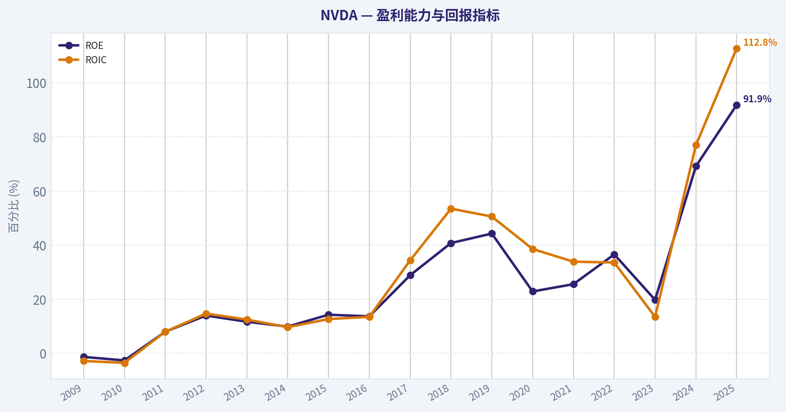
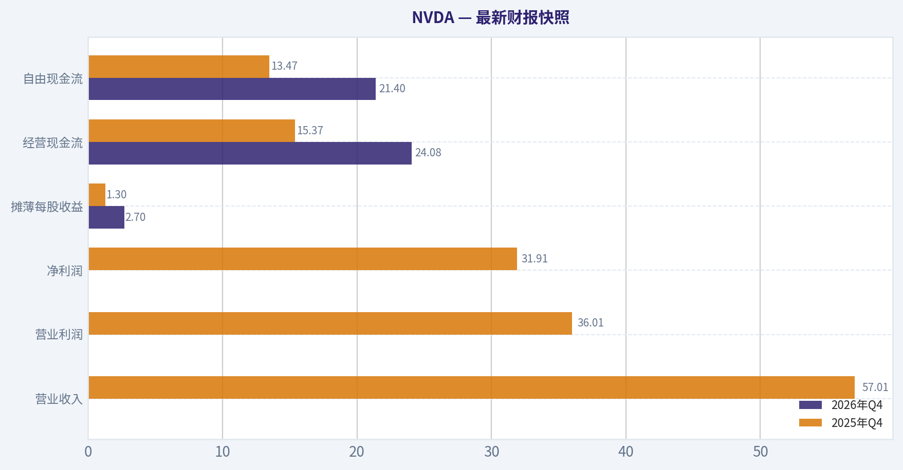
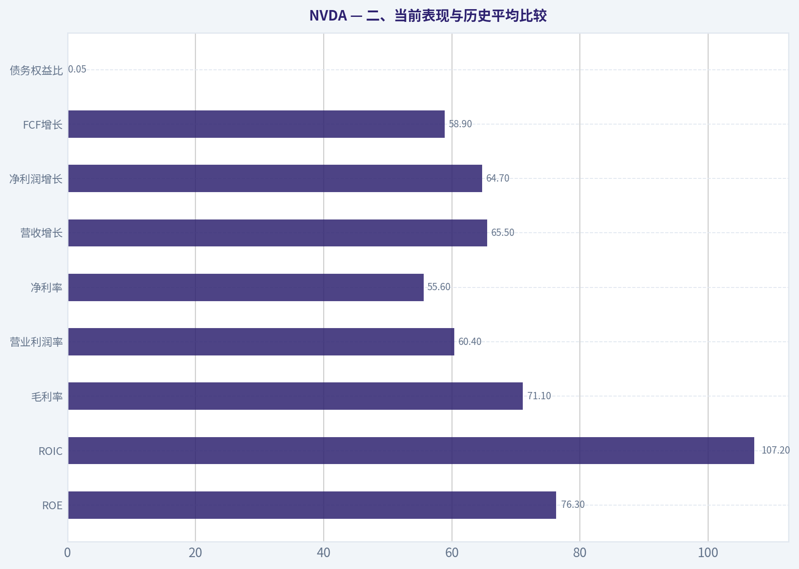
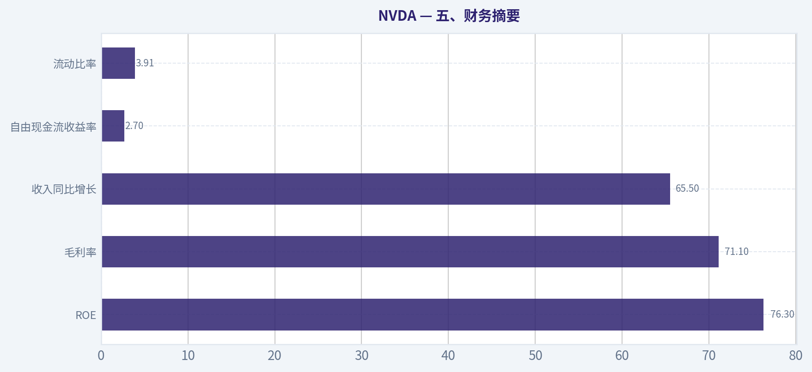
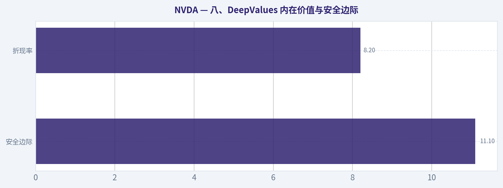
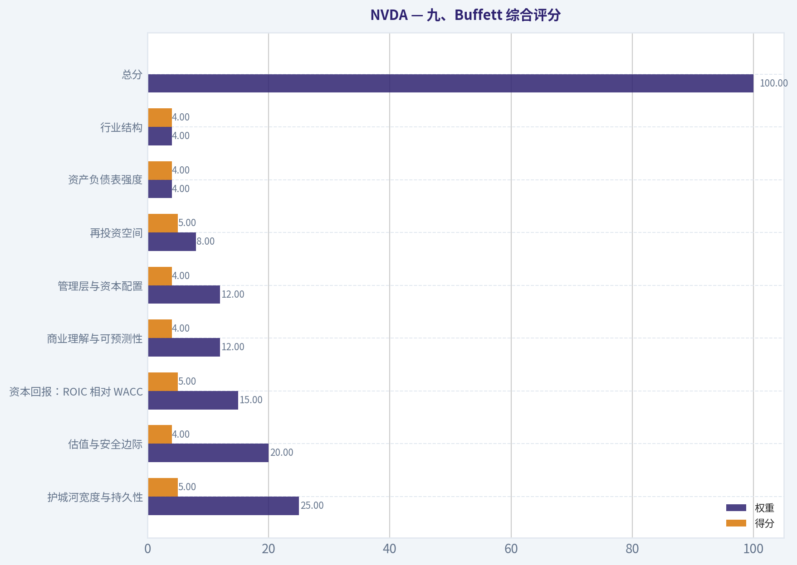
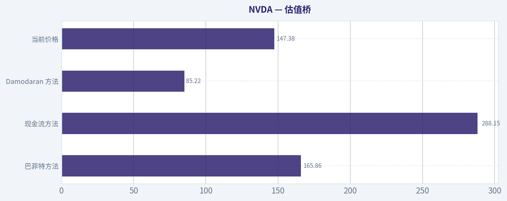
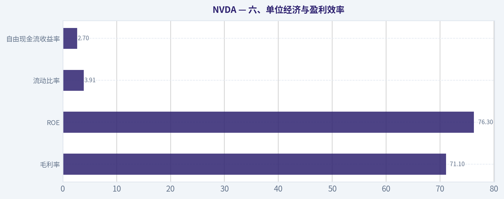

# NVDA 深度价值情报

**调研日期:** 2026-11-27

## 关键免责声明

*本报告由 Deep Value Intelligence（一个基于 AI 的多智能体投资分析框架）自动生成。 仅供教育和研究用途 - 非财务建议，非财务顾问。*

---

## 目录

1. 情报摘要
2. 分析师团队报告
   - 基本面分析
   - 价值分析 (巴菲特)
   - 成长性分析 (林奇/德鲁肯米勒/费雪)
   - 市场分析
   - 期权市场分析
3. 研究团队评论
4. 投资团队评论
5. Deep Values 团队洞察

---

## 情报摘要

### 核心观点与前提条件

**核心论点:** **原始方案为 中性，本次辩论后维持不变，但判断偏积极。**

**主要风险:**
- **原始方案为 中性，本次辩论后维持不变，但判断偏积极。**
- 因此，WATCH不是对企业质量的否定，而是对估值证据完整性的要求。
- **中性**

**置信度:** 中

---

## 分析师团队报告

### 基本面分析

#### 最新财报快照

*以下数据基于最近一期已披露财报（2026年Q4），并尽量与上一年同期对比。*

| 指标 | 2026年Q4 | 2025年Q4 | 同比变化 |
| --- | ---: | ---: | ---: |
| 营业收入 | N/A | $57.01B | N/A |
| 营业利润 | N/A | $36.01B | N/A |
| 净利润 | N/A | $31.91B | N/A |
| 摊薄每股收益 | $2.70 | $1.30 | +107.7% |
| 经营现金流 | $24.08B | $15.37B | +56.7% |
| 自由现金流 | $21.40B | $13.47B | +58.9% |

关键结论：这张快照先把最新一期财报放在桌面上，再去看长周期分析。这样读者能更清楚地区分"公司长期质量"和"这次财报发生了什么"。

#### NVDA 17年财务指标

*以下数值均由原始数据确定性计算得出，并非 AI 估算。*

*发行人类型：operating company（Technology / Semiconductors）。*

#### 17年财务指标
*年度行来自已披露财务报表，最后一行 TTM 由最近四个季度滚动计算得出。*

| 指标 | 2009 | 2010 | 2011 | 2012 | 2013 | 2014 | 2015 | 2016 | 2017 | 2018 | 2019 | 2020 | 2021 | 2022 | 2023 | 2024 | 2025 |
| --- | --- | --- | --- | --- | --- | --- | --- | --- | --- | --- | --- | --- | --- | --- | --- | --- | --- |
| 市场价格 | $0 | $0 | $1 | $0 | $0 | $0 | $0 | $1 | $3 | $6 | $4 | $6 | $13 | $24 | $19 | $61 | $120 |
| 总市值 | $4.36B | $8.46B | $14.08B | $9.10B | $7.66B | $9.34B | $10.81B | $16.67B | $70.86B | $155.35B | $89.84B | $146.11B | $326.04B | $620.72B | $489.79B | $1.53T | $2.98T |
| 市盈率 | -159.00 | -128.25 | 55.63 | 15.71 | 13.62 | 21.22 | 17.14 | 27.12 | 42.48 | 51.00 | 21.68 | 52.31 | 75.09 | 63.60 | 114.92 | 51.70 | 40.84 |
| 市净率 | 1.82 | 3.17 | 4.43 | 2.20 | 1.59 | 2.10 | 2.45 | 3.73 | 12.30 | 20.79 | 9.62 | 11.97 | 19.30 | 23.32 | 22.16 | 35.70 | 37.54 |
| ROE | -1.3% | -2.6% | 8.0% | 14.0% | 11.7% | 9.9% | 14.3% | 13.7% | 28.9% | 40.8% | 44.3% | 22.9% | 25.6% | 36.6% | 19.8% | 69.2% | 91.9% |
| ROIC | -2.8% | -3.5% | 8.0% | 14.7% | 12.5% | 9.7% | 12.7% | 13.5% | 34.4% | 53.5% | 50.6% | 38.6% | 33.9% | 33.6% | 13.5% | 77.0% | 112.8% |
| 每股收益 | $-0.00 | $-0.00 | $0.01 | $0.02 | $0.02 | $0.02 | $0.03 | $0.03 | $0.06 | $0.12 | $0.17 | $0.11 | $0.17 | $0.39 | $0.17 | $1.19 | $2.94 |
| 营收 | $3.42B | $3.33B | $3.54B | $4.00B | $4.28B | $4.13B | $4.68B | $5.01B | $6.91B | $9.71B | $11.72B | $10.92B | $16.68B | $26.91B | $26.97B | $60.92B | $130.50B |
| 毛利润 | $1.17B | $1.18B | $1.41B | $2.06B | $2.23B | $2.27B | $2.60B | $2.81B | $4.06B | $5.82B | $7.17B | $6.77B | $10.40B | $17.48B | $15.36B | $44.30B | $97.86B |
| 毛利率 | 34.3% | 35.4% | 39.8% | 51.4% | 52.0% | 54.9% | 55.5% | 56.1% | 58.8% | 59.9% | 61.2% | 62.0% | 62.3% | 64.9% | 56.9% | 72.7% | 75.0% |
| 营业利润率 | -2.1% | -3.0% | 7.2% | 16.2% | 15.1% | 12.0% | 16.2% | 14.9% | 28.0% | 33.0% | 32.5% | 26.1% | 27.2% | 37.3% | 15.7% | 54.1% | 62.4% |
| 净利润 | $-30.0M | $-68.0M | $253.1M | $581.1M | $562.5M | $440.0M | $631.0M | $614.0M | $1.67B | $3.05B | $4.14B | $2.80B | $4.33B | $9.75B | $4.37B | $29.76B | $72.88B |
| 净利率 | -0.9% | -2.0% | 7.1% | 14.5% | 13.1% | 10.7% | 13.5% | 12.3% | 24.1% | 31.4% | 35.3% | 25.6% | 26.0% | 36.2% | 16.2% | 48.8% | 55.8% |
| 营收增长 | N/A | -2.9% | 6.5% | 12.8% | 7.1% | -3.5% | 13.4% | 7.0% | 37.9% | 40.6% | 20.6% | -6.8% | 52.7% | 61.4% | 0.2% | 125.9% | 114.2% |
| 净利润增长 | N/A | 126.3% | -472.3% | 129.5% | -3.2% | -21.8% | 43.4% | -2.7% | 171.3% | 82.9% | 35.9% | -32.5% | 54.9% | 125.1% | -55.2% | 581.3% | 144.9% |
| 自由现金流增长 | N/A | N/A | 40.9% | 33.3% | N/A | N/A | N/A | N/A | N/A | N/A | N/A | N/A | N/A | N/A | -53.2% | 609.6% | 125.2% |
| 总账面价值 | $2.39B | $2.67B | $3.18B | $4.15B | $4.83B | $4.46B | $4.42B | $4.47B | $5.76B | $7.47B | $9.34B | $12.20B | $16.89B | $26.61B | $22.10B | $42.98B | $79.33B |
| 总资产 | $3.35B | $3.59B | $4.50B | $5.55B | $6.41B | $7.25B | $7.20B | $7.37B | $9.84B | $11.24B | $13.29B | $17.32B | $28.79B | $44.19B | $41.18B | $65.73B | $111.60B |
| 总债务 | N/A | N/A | N/A | N/A | $0 | $1.36B | $1.38B | $0 | $1.98B | $1.99B | $1.99B | $1.99B | $6.96B | $10.95B | $10.95B | $9.71B | $8.46B |
| 债务股权比 | N/A | N/A | N/A | N/A | 0.00 | 0.30 | 0.31 | 0.00 | 0.34 | 0.27 | 0.21 | 0.16 | 0.41 | 0.41 | 0.50 | 0.23 | 0.11 |
| 现金及等价物 | $417.7M | $447.2M | $665.4M | $667.9M | $733.0M | $1.15B | $497.0M | $596.0M | $1.77B | $4.00B | $782.0M | $10.90B | $847.0M | $1.99B | $3.39B | $7.28B | $8.59B |
| 股东权益 | $2.39B | $2.67B | $3.18B | $4.15B | $4.83B | $4.46B | $4.42B | $4.47B | $5.76B | $7.47B | $9.34B | $12.20B | $16.89B | $26.61B | $22.10B | $42.98B | $79.33B |
| 经营现金流 | $249.4M | $487.8M | $675.8M | $909.2M | $824.2M | $835.0M | $906.0M | $1.18B | $1.67B | $3.50B | $3.74B | $4.76B | $5.82B | $9.11B | $5.64B | $28.09B | $64.09B |
| 投资现金流 | $-209.4M | $-519.3M | $-649.7M | $-1.14B | $-744.0M | $-806.0M | $-727.0M | $-400.0M | $-793.0M | $1.28B | $-4.10B | $6.14B | $-19.68B | $-9.83B | $7.38B | $-10.57B | $-20.42B |
| 自由现金流 | N/A | $410.2M | $577.9M | $770.4M | N/A | N/A | N/A | N/A | N/A | N/A | N/A | N/A | N/A | $8.13B | $3.81B | $27.02B | $60.85B |
| 自由现金流利润率 | N/A | 12.3% | 16.3% | 19.3% | N/A | N/A | N/A | N/A | N/A | N/A | N/A | N/A | N/A | 30.2% | 14.1% | 44.4% | 46.6% |
| 每股分红 | $0.00 | $0.00 | $0.00 | $0.00 | $0.00 | $0.00 | $0.00 | $0.00 | $0.00 | $0.00 | $0.00 | $0.00 | $0.00 | $0.00 | $0.02 | $0.02 | $0.03 |

#### 盈利能力指标
- 净资产收益率 (ROE): 76.3%
- 投入资本回报率 (ROIC): 107.2%
- 总资产收益率 (ROA): 58.1%
- 毛利率: 71.1%
- 营业利润率: 60.4%
- 净利率: 55.6%

#### 流动性指标
- 流动比率: 3.91
- 速动比率: 3.14

#### 杠杆指标
- 债务股权比: 0.05
- 利息覆盖倍数: 503.42
- 净负债: $-54.09B

#### 增长指标（同比）
- 营收增长: 65.5%
- 净利润增长: 64.7%
- 自由现金流增长: 58.9%
- 营收复合增长率（3年）: 100.0%
- 营收复合增长率（5年）: 66.9%

#### 估值指标
- 市盈率 (TTM): 15.84
- 预期市盈率: 8.88
- 市净率: 13.33
- 市销率: 9.84
- PEG 比率: 0.19
- 企业价值/EBITDA: 14.55
- 自由现金流收益率: 2.7%
- 盈利收益率: 6.3%

#### 所有者收益（巴菲特方法，代码计算）
- 净利润: $72.88B
- + 折旧与摊销: $2.84B
- - 资本开支: $-6.04B
- + 营运资本（现金流量表口径；负数=占用现金）: $-15.95B
- = **所有者收益: $59.89B**

#### 内在价值（DeepValues 应用 - SEC 申报数据管道）
- **内在价值（DeepValues 应用，头条）: $165.86** - Owner Earnings (Buffett), 方法 buffett-1986-v2, 截至 2026-11-26 (FY2026)
  区间（保守-乐观）: $116.10 - $165.86
  相对价格的安全边际: 11.1% (价格 $147.43)
  应用使用的输入 (ttm_2027Q2): after-tax operating income $173.9B (operating income $197.6B, tax 12.0%) + D&A $3.7B - capex charge $7.1B (three-year average capex/revenue x trailing revenue; reported capex $7.4B) - working capital $0.0B = owner earnings $170.5B.
  Growth 10.0% fading to 2.5% terminal (min(owner-earnings CAGR, 5-year revenue CAGR), clamped [0, 10%]); discount rate 8.2% (30Y Treasury 5.24% + 3 pts (as of 2026-11-25)); net cash $-10.9B (cash $22.4B + marketable securities $0.0B - debt $33.4B); 24,285M shares.
- Owner Earnings (Buffett): $116.10 / $165.86 / $165.86 (保守 / 基准 / 乐观) ← headline
- Free cash flow DCF: $288.15 / $288.15 / $288.15 (保守 / 基准 / 乐观)
- Damodaran two-stage FCFF: $24.03 / $85.22 / $182.99 (保守 / 基准 / 乐观)
  这就是内在价值：引用它作为内在价值，并据此衡量安全边际。其他地方的 DVI 情景数字仅为辅助交叉检查，不是估值。

#### DVI 情景模型（辅助交叉检查 - 不是内在价值）
DVI 基于 Yahoo 数据的情景，仅作敏感性检查。请勿将其作为内在价值引用；内在价值是上方的 DeepValues 应用估值。
- 当前价格: $147
- DVI 情景值（按商业模式路由）: $71
  商业模式: cyclical - weighted blend [Damodaran FCFF + reverse-DCF fair + owner-earnings DCF] (cyclical)
  模型区间（各 DCF 最小-最大）: $13 - $118
  相对价格的安全边际（头条）: -108.8%
  路由说明: Cyclical: margins/FCF are volatile - headline blends FCFF, reverse-DCF and owner-earnings roughly evenly; treat the range as the honest read.
- 巴菲特方法（所有者收益）:
  保守: $39
  平均: $118
  乐观: $311
- 现金流方法（FCF）:
  保守: $90
  平均: $90
  乐观: $232
- Damodaran FCFF（WACC + 利润率 + 再投资）:
  保守: $8
  平均: $13
  乐观: $42
  蒙特卡洛区间（P10-P90）：$11 - $23（中位数 $15）
  P(内在价值 > 当前价格)：0.0%
- 反向 DCF：当前价格隐含约 36.6%/年 的所有者收益增长（10年）；过去 3 年为 105.0%，5 年为 92.8%。

#### Piotroski F分数: 3/9
- 净利润为正: 通过
- 经营现金流为正: 通过
- 资产回报率改善: 未通过
- 现金流大于净利润: 未通过
- 债务下降: 未通过
- 流动比率改善: 未通过
- 未稀释股本: 通过
- 毛利率改善: 未通过
- 资产周转率改善: 未通过

ANALYST STANCE: **中性**

#### 核心结论

英伟达是典型的高质量、宽护城河半导体平台企业，当前盈利能力、现金流和资产负债表均处于历史最好阶段。问题不在企业质量，而在估值对未来增长的依赖程度：当前股价约为147美元，DeepValues 的巴菲特所有者收益内在价值为165.86美元，理论上仅有约11.1%的安全边际；同时，独立手工DCF基于较保守的当前所有者收益口径，结果明显低于市场价格。

因此，证据支持"企业优秀"，但尚不足以支持"估值具有很宽安全边际"。估值结论为中性观察，核心变量是AI基础设施需求能否在未来多年维持超常增长，以及毛利率能否接近当前极高水平。

#### 一、市场指标与估值

| 指标 | 当前值 | 历史比较 | 解读 |
|---|---:|---:|---|
| 市场价格 | 约147美元 | 17年历史价格由约1美元升至120美元，经历长期复合增长 | 当前价格反映了极高的长期盈利预期 |
| 总市值 | 约3.56万亿美元 | 2025年约2.98万亿美元；远高于历史平均水平 | 英伟达已从大型成长股转变为超大市值平台企业 |
| PE | 15.84倍 | 17年剔除亏损年份后的平均约44.3倍 | 表面上显著低于历史均值，但主要因为近期利润增长极快，不能单独视为低估 |
| PB | 13.33倍 | 历史均值约12倍左右 | PB对英伟达的参考价值有限，不作为主要估值依据 |
| 预期PE | 8.88倍 | 低于历史水平 | 说明市场数据隐含未来盈利仍将快速增长 |
| 市销率 | 9.84倍 | 显著高于传统半导体企业 | 对持续高毛利和高增长具有较强依赖 |
| FCF收益率 | 2.7% | 当前现金流收益率偏低 | 市场价格对应的现金回报率不高 |
| 盈利收益率 | 6.3% | 高于无风险利率但安全垫有限 | 盈利收益率尚未形成明显价值折价 |

**关键结论：** 当前PE低于历史平均，主要由利润在短期内爆发式增长造成，而不是传统意义上的低估。PB对于拥有大量软件生态、专有架构和无形竞争优势的半导体平台并不适合机械解释，估值应主要锚定未来所有者收益和自由现金流。市场价格已经反映了英伟达继续保持高增长、高毛利率和高资本回报的情景。

#### 二、当前表现与历史平均比较

以下为根据确定性数据中已披露年度行计算的概括性比较；历史均值会受到早期亏损、周期低谷以及近期AI浪潮的显著影响。

| 指标 | 当前或TTM | 历史平均或典型水平 | 当前相对历史的位置 |
|---|---:|---:|---|
| ROE | 76.3% | 约26.3% | 极高，远高于历史均值 |
| ROIC | 107.2% | 约31.5% | 极高，显示资本配置和定价能力显著增强 |
| 毛利率 | 71.1% | 约57% | 明显高于历史，反映数据中心产品结构和软件生态优势 |
| 营业利润率 | 60.4% | 约27% | 接近历史均值两倍，经营杠杆非常强 |
| 净利率 | 55.6% | 约25% | 处于历史最高区间 |
| 营收增长 | 65.5% | 历史平均约31%，但波动较大 | 仍然极强，但低于最近两年超过100%的极端增速 |
| 净利润增长 | 64.7% | 历史均值受亏损反转影响较大 | 当前仍然强劲，但已从极端反转阶段回落 |
| FCF增长 | 58.9% | 可用年份波动很大 | 现金流扩张速度仍高，但年度基数效应明显 |
| FCF利润率 | 约46% | 近年明显低于当前 | 现金转换能力处于历史高位 |
| 债务权益比 | 0.05 | 历史平均约0.24 | 杠杆显著下降，财务风险较低 |
| 流动比率 | 3.91 | 历史数据未完整披露 | 短期偿债能力很强 |
| 每股分红 | 约0.03美元 | 长期接近零 | 仍以再投资和业务扩张为资本配置重点 |

**关键结论：** 英伟达当前几乎所有经营质量指标都显著高于历史平均，尤其是ROIC、ROE、毛利率和营业利润率。需要注意的是，这种改善不仅来自管理效率，也来自AI加速计算需求、产品稀缺性和供需紧张，因此未来正常化风险高于历史均值所显示的风险。

#### 三、盈利能力、增长与现金流

英伟达最新数据包括约1305亿美元营收、约978.6亿美元毛利润、约728.8亿美元净利润和约608.5亿美元自由现金流。当前毛利率约71.1%，营业利润率约60.4%，净利率约55.6%，均属于极少数大型科技企业能够达到的水平。

从17年趋势看，公司经历了三个阶段：

1. **早期阶段：** 2009至2010年出现亏损，营收约33亿至34亿美元，资本回报率较低。
2. **平台扩张阶段：** 2016至2022年，游戏显卡、数据中心和CUDA生态推动收入与利润持续扩大，但增长仍受半导体周期影响。
3. **AI加速阶段：** 2023年以来，数据中心加速计算需求造成收入和利润跃升，收入从约270亿美元升至约1305亿美元，净利润从约44亿美元升至约729亿美元。

ROE达到76.3%、ROIC达到107.2%，说明公司不仅盈利多，而且使用新增资本的效率极高。与此同时，Piotroski F分数为3/9，主要因为资产周转率、毛利率改善、债务下降和现金流相对净利润等项目没有全部满足传统改善条件。这个分数并不否定企业质量，但提示当前经营指标可能已经处于极高基数，后续改善难度会增加。

#### 四、资产负债表与财务力量

| 指标 | 当前值或最新值 | 历史趋势与含义 |
|---|---:|---|
| 总账面价值 | 约793.3亿美元 | 2024至2025年大幅增长，主要由留存收益和业务扩张带动 |
| 总资产 | 约1116亿美元 | 远高于早期约30亿至70亿美元水平 |
| 总债务 | 历史最新年度约84.6亿美元；前瞻数据约334亿美元 | 债务绝对额可能增加，但相对于盈利和现金流仍可控 |
| 债务权益比 | 0.05 | 显著低于历史多个年份的0.2至0.5区间 |
| 现金及等价物 | 历史最新年度约85.9亿美元；前瞻口径现金约224亿美元 | 现金储备快速扩张 |
| 股东权益 | 约793.3亿美元 | 盈利积累明显增强资本基础 |
| 净负债 | 前瞻口径约为负109亿美元；另一数据口径为净负债负540.9亿美元 | 整体处于净现金或接近净现金状态 |
| 利息覆盖倍数 | 约503倍 | 利息偿付风险极低 |
| 流动比率 | 3.91 | 流动性充裕 |

**关键结论：** 英伟达的资产负债表是其重要安全垫，债务权益比低、利息覆盖倍数极高、流动比率接近4倍。需要关注的是，不同数据口径对现金、债务和净负债的统计存在时间差，因此不能简单将历史年末数据与前瞻TTM数据直接相加，但各口径都指向较强的财务实力。

#### 五、收入来源分布

以下采用确定性数据中最新完整年度约1305亿美元营收对应的可比分部结构。英伟达主要按"计算与网络"和"图形"两大业务分部披露，而不是按单一GPU型号披露。

#### 收入来源分布

| 收入来源 | 金额（十亿美元） | 占比 |
|---|---:|---:|
| 计算与网络 | 约116.2 | 约89.0% |
| 图形 | 约14.3 | 约11.0% |
| 合计 | 约130.5 | 100.0% |

**关键结论：** 英伟达已经高度集中于计算与网络业务，该分部主要受数据中心、AI加速计算、网络互联和专业计算需求驱动。业务集中提高了增长效率，也增加了对云厂商资本开支、AI模型训练需求、先进制程供应和大型客户集中度的敏感性。

#### 六、巴菲特式所有者收益与DCF估值

确定性数据中的所有者收益计算为：

- 净利润：728.8亿美元
- 加回折旧与摊销：28.4亿美元
- 扣除资本开支：60.4亿美元
- 营运资本现金占用：159.5亿美元
- 所有者收益：约598.9亿美元

DeepValues应用采用的是更前瞻的TTM口径：

- 税后经营利润：173.9亿美元口径中的"十亿美元"单位，即约1739亿美元
- 加回折旧摊销：约37亿美元
- 扣除资本开支：约71亿美元
- 营运资本调整：约0
- 前瞻所有者收益：约1705亿美元
- 折现率：8.2%
- 永续增长率：2.5%
- 股份数：约242.85亿股
- 净现金调整：约负109亿美元，即净债务调整

DeepValues的核心内在价值为每股165.86美元，保守值为116.10美元，当前价格约147美元，对应约11.1%的安全边际。这是本报告采用的主要内在价值，不以其他辅助模型替代。

##### 手工所有者收益DCF交叉检查

为避免把前瞻TTM口径和历史确定性口径混在一起，以下使用确定性数据中的598.9亿美元所有者收益作为起点，假设未来五年增长逐年向2.5%的终值增长率收敛，折现率采用10%，股份数采用242.85亿股。

**保守情景：**

- 第1年至第5年增长率：3%、3%、3%、3%、3%
- 第5年所有者收益：约694亿美元
- 第6年所有者收益：约715亿美元
- 终值：715 ÷（10%－2.5%）~9535亿美元
- 显性期现金流现值：约2470亿美元
- 终值现值：约5920亿美元
- 股权价值：约8390亿美元
- 每股价值：约34.6美元

**基准情景：**

- 第1年至第5年增长率：10%、8%、6%、4%、3%
- 第5年所有者收益：约808亿美元
- 第6年所有者收益：约828亿美元
- 终值：828 ÷（10%－2.5%）~1.104万亿美元
- 显性期现金流现值：约2790亿美元
- 终值现值：约6850亿美元
- 股权价值：约9640亿美元
- 每股价值：约39.7美元

**乐观情景：**

- 第1年至第5年增长率：15%、12%、9%、6%、3%
- 第5年所有者收益：约918亿美元
- 第6年所有者收益：约941亿美元
- 终值：941 ÷（10%－2.5%）~1.254万亿美元
- 显性期现金流现值：约7790亿美元
- 显性期现金流与终值合计：约1.086万亿美元
- 每股价值：约44.7美元

| 估值方法 | 保守 | 基准 | 乐观 | 用途 |
|---|---:|---:|---:|---|
| DeepValues所有者收益DCF | 116.10美元 | 165.86美元 | 165.86美元 | 主要内在价值 |
| 手工所有者收益DCF | 34.6美元 | 39.7美元 | 44.7美元 | 口径敏感性检查 |
| DeepValues自由现金流DCF | 288.15美元 | 288.15美元 | 288.15美元 | 辅助交叉检查，不作为主要估值 |
| Damodaran FCFF模型 | 24.03美元 | 85.22美元 | 182.99美元 | 辅助交叉检查，不作为主要估值 |

**关键结论：** 不同DCF结果差异极大，根本原因是所有者收益口径、营运资本处理、前瞻利润基数和折现率不同。DeepValues采用约1705亿美元的前瞻所有者收益，因此给出165.86美元；而手工模型采用约598.9亿美元的确定性历史口径，结果明显更低。两者共同说明：当前估值高度依赖未来盈利基数能否接近前瞻口径，而不是仅仅依赖历史报表。

#### 七、反向DCF与市场隐含假设

辅助反向DCF显示，当前价格大致隐含未来十年所有者收益约36.6%的年增长率。这个要求低于最近三年约105%的增长率，也低于最近五年约92.8%的增长率，但仍明显高于成熟大型公司的长期正常增长水平。

这意味着市场并不需要英伟达永远保持三位数增长，但需要以下条件大致同时成立：

- 数据中心AI资本开支继续扩张；
- CUDA生态和软件工具维持较高转换成本；
- Blackwell及后续架构保持产品领先；
- 高端GPU供给不出现长期过剩；
- 大型云厂商能够从AI基础设施投资中获得足够回报；
- 毛利率从当前极高水平回落有限；
- 竞争者不会快速压缩价格或削弱生态黏性。

反向DCF的关键风险不是短期收入下降，而是增长率从极高水平降至普通成长水平时，估值倍数可能同步收缩。

#### 八、巴菲特式定性分析

##### 经济护城河

英伟达的护城河不是单一芯片性能，而是由多个环节构成：

- CUDA软件生态和开发者工具；
- GPU、网络互联、系统级平台的协同；
- 大规模客户部署后的迁移成本；
- 快速迭代的硬件与软件联合设计能力；
- 高端AI芯片供应链和系统集成经验；
- 数据中心客户对性能、能效和软件兼容性的综合需求。

这使英伟达更接近"计算平台"而非普通芯片供应商。护城河的耐久性较强，但并非不可侵蚀，尤其需要观察定制ASIC、竞争性加速器和云厂商自研芯片的发展。

##### 盈利可预测性

长期来看，公司营收和利润呈明显上升趋势，但年度增速不稳定，曾出现营收下降、净利润下降和自由现金流波动。AI阶段的增长极为强劲，却尚未经过完整的需求周期验证。

因此，英伟达的长期方向具有较高可预测性，但短期盈利斜率和毛利率的可预测性低于传统消费必需品或软件订阅企业。

##### 管理层与资本配置

管理层在产品路线、研发投入和生态建设上的表现非常突出。ROIC从早期约10%至15%区间提高到当前超过100%，说明新增投入创造的经济回报非常高。

股息长期很低，符合高速成长企业将现金优先投入研发、供应链和平台扩张的逻辑。当前最重要的资本配置考验，不是分红水平，而是能否把巨额现金流继续转化为具有高回报率的新产品和生态资产。

##### 财务安全性

财务安全性较强。债务权益比低、现金流充足、利息覆盖倍数极高，意味着公司能够承受供应链投入、研发周期变化和阶段性需求波动。最大的风险不是偿债，而是资本开支、库存和客户投入回报率在行业周期反转时恶化。

#### 九、主要风险、机会与估值触发因素

| 类别 | 具体内容 | 对估值的含义 |
|---|---|---|
| 机会 | AI训练、推理和企业级部署继续扩张 | 可能支撑较长的高增长阶段 |
| 机会 | CUDA、网络互联和整机系统形成平台化收入 | 有助于维持高毛利和客户黏性 |
| 机会 | 推理需求扩大，市场从训练单点需求转向持续计算需求 | 有利于扩大总可服务市场 |
| 风险 | 大型云厂商自研ASIC和竞争性加速器 | 可能压低价格和市场份额 |
| 风险 | AI基础设施投资回报率不足 | 可能导致客户资本开支周期性下降 |
| 风险 | 当前毛利率处于历史极高水平 | 正常化会直接影响利润和估值 |
| 风险 | 客户集中度和供应链集中度较高 | 单一客户或供应中断可能放大波动 |
| 风险 | 反向DCF隐含长期增长仍然很高 | 对增长放缓较为敏感 |
| 风险 | 历史自由现金流数据存在明显波动 | 现金流预测不能只使用最近一个强劲年份 |
| 风险 | Piotroski F分数为3/9 | 传统质量改善指标并未全部支持当前极高盈利水平 |

**关键结论：** 最大机会是英伟达从GPU供应商进一步演变为AI计算基础设施平台；最大风险是AI资本开支从供给驱动转为回报驱动后，收入增速和毛利率同时回落。估值在165.86美元附近并非完全缺乏支撑，但安全边际相对有限，且对前瞻所有者收益口径高度敏感。

#### 十、最终投资立场

**中性**

立场依据如下：

- **支持因素：** 护城河强、ROE和ROIC极高、毛利率和现金流转换能力突出、资产负债表稳健、AI计算需求仍具长期扩张空间。
- **限制因素：** 当前估值依赖持续高增长和高利润率；反向DCF隐含约36.6%的十年所有者收益增长；手工所有者收益DCF远低于市场价格；历史上半导体业务仍存在周期性。
- **估值判断：** DeepValues主要内在价值为165.86美元，较当前价格约147美元有有限安全边际，但不是宽幅安全边际。FCFF、手工所有者收益和辅助DVI模型的结果分歧很大，表明估值区间而非单点数字更重要。
- **研究结论：** 企业质量属于优秀级别，但当前市场定价已经要求AI平台优势持续多年兑现。证据支持高质量企业判断，却不足以支持低风险、深度折价的估值判断。

#### 关键要点汇总

| 维度 | 结论 | 重要性 |
|---|---|---|
| 企业质量 | 宽护城河、高毛利、高ROIC、高现金流 | 极强 |
| 增长 | 近期仍高速，但已低于前期三位数增速 | 强但需正常化 |
| 财务安全 | 低杠杆、高流动性、利息负担极低 | 极强 |
| 盈利稳定性 | 长期向上，短期仍受半导体周期影响 | 中等偏强 |
| 估值 | DeepValues内在价值165.86美元，安全边际约11.1% | 中性 |
| 主要风险 | AI资本开支放缓、竞争加剧、毛利率回落 | 高度关键 |
| 主要机会 | CUDA生态、推理计算、系统级AI平台化 | 高度关键 |
| 最终立场 | 中性 | 质量强，估值安全垫有限 |

**关键结论：** 英伟达是极高质量的成长型平台企业，财务实力和竞争优势明显优于其历史大部分时期。当前最需要验证的不是公司能否继续增长，而是增长能否以足够高的速度持续多年，以匹配市场价格所隐含的长期预期。

#### 基本面关键图表

本图追踪 **NVDA** 过去十年的盈利能力与回报指标（ROE、ROIC、利润率），突出呈现资本效率的变化趋势。

---

### 价值分析 (巴菲特)

> *基于沃伦·巴菲特的价值投资哲学：能力圈、经济护城河、管理层质量与安全边际。*

#### 内在价值快照

价格是你付的钱，内在价值是企业未来可能为股东创造的现金价值。我们给出一个区间，而不是假装只有一个神奇数字。

- 当前价格: $147.38
- 估值区间（两种 DCF 方法、保守到乐观）: $116.10 至 $288.15

##### 所有者收益（巴菲特方法）
- 净利润: $72,880,000,000.00
- 折旧与摊销: $2,843,000,000.00
- 资本支出: $-6,042,000,000.00
- 营运资金变化: $-15,949,000,000.00
- 所有者收益: $59,893,306,952.61

##### 内在价值
###### 所有者收益法
使用所有者收益，更严格，通常更保守。
- 保守: $116.10
- 平均: $165.86
- 乐观: $165.86
- 折现率: 8.2%

###### 自由现金流法
使用自由现金流，更适合今天投入很多、为未来增长铺路的公司。
- 保守: $288.15
- 平均: $288.15
- 乐观: $288.15
- 折现率: 9.0%

ANALYST STANCE: **看多**

#### 一、核心结论

NVIDIA 是典型的高质量、资产轻、强网络效应与高转换成本并存的 AI 基础设施平台。其 CUDA 软件生态、GPU 加速计算标准、开发者规模和客户部署惯性共同构成宽且仍在扩大的护城河。

按 DeepValues 应用的 Buffett 估值，内在价值为 **165.86 美元**，当前股价约 **147 美元**，对应约 **11.1% 安全边际**。对于高 ROE、高增长、强护城河且具有长期再投资空间的公司，这一安全边际基本符合质量调整后的估值要求。主要风险并非财务困境，而是 AI 资本开支周期、客户集中度、竞争演变和高增长持续性的变化。

#### 二、因素评分

| 因素 | 评分 | 主要证据 |
|---|---:|---|
| 因素一：能力圈与商业简单性 | 4/5 | 公司向数据中心和其他客户销售 GPU、系统及软件生态；商业模式可解释，但技术迭代和客户资本开支带来一定预测难度 |
| 因素二：护城河 | 5/5 | CUDA 生态、开发者网络、软件兼容性、规模效应和系统级整合形成宽且扩大的护城河 |
| 因素三：管理层与资本配置 | 4/5 | 长期战略聚焦计算平台，持续将现金流投入研发和生态建设；创始人主导有利于长期决策，但仍需关注高增长期的资本配置纪律 |
| 因素四：行业结构 | 4/5 | 高端加速计算具有较高技术壁垒和集中度；但半导体行业仍存在周期性、客户议价和技术替代风险 |

**Gate 5 财务健康底线：未触发。** 当前数据显示盈利和现金流规模强劲，流动比率约 3.9，未见"盈利恶化与偿债能力失守"同时出现的情形。

#### 三、护城河分析

| 护城河来源 | 证据 | 持续性判断 |
|---|---|---|
| 无形资产 | CUDA、软件工具链、开发者工具和生态标准 | 极强；软件生态比单一芯片产品更难复制 |
| 转换成本 | 客户的模型、代码、人才培训、算力集群和工作流均围绕 NVIDIA 生态部署 | 高；迁移需要重新适配软件、硬件和人才体系 |
| 成本与规模优势 | 大规模研发、先进封装协同、系统设计能力和供应链议价能力 | 较强；规模使研发投入和产品迭代形成正反馈 |
| 网络效应 | 开发者越多，软件支持越丰富；客户越多，工具和人才越普及 | 极强；生态规模提升产品吸引力和行业标准地位 |

毛利率约 **71.1%**，是定价权和产品差异化的重要财务佐证。收入同比增长约 **65.5%**，说明需求扩张仍然强劲；不过如此高的增速本身难以永久持续，未来应更多关注生态粘性和每股现金流增长，而非单一年度增速。

#### 四、管理层质量与资本配置

管理层最重要的优点，是较早将公司从图形芯片供应商转变为完整的加速计算平台，并持续投入 CUDA、软件、网络和系统级产品。这种资本配置增强了客户粘性，也提高了竞争者复制整个生态的成本。

从所有者视角看，管理层的长期价值创造主要来自：

- 将研发投入转化为更高的毛利率和市场份额；
- 通过软件生态扩大硬件产品的生命周期；
- 通过平台化产品提升客户转换成本；
- 在 AI 基础设施扩张期保持较高的资本回报。

需要中性的方面包括客户集中度、供应链依赖、股权激励稀释以及未来并购是否保持纪律性。综合评价为 **4/5**。

#### 五、财务摘要

| 指标 | 最新数据 |
|---|---:|
| 股价 | 约 147 美元 |
| 总市值 | 3.56 万亿美元 |
| PE | 15.84 倍 |
| ROE | 76.3% |
| 毛利率 | 71.1% |
| 收入同比增长 | 65.5% |
| 自由现金流收益率 | 2.7% |
| 流动比率 | 3.91 |
| 经营利润 | 197.6 十亿美元 |
| 税后经营利润 | 173.9 十亿美元 |
| 现金及等价物 | 22.4 十亿美元 |
| 有息债务 | 33.4 十亿美元 |
| 净现金 | -10.9 十亿美元 |
| 摊薄股数 | 24,285 百万股 |

**关键结论：** NVIDIA 的财务画像是极高利润率、极高 ROE 和极快增长，且流动性充足。净债务约 109 亿美元，相对于经营利润和现金流规模并不构成明显偿债压力；流动比率也显示短期财务弹性较强。自由现金流收益率仅 2.7%，说明市场已经为未来增长支付了较高估值。

#### 六、所有者收益

DeepValues 应用采用的 Buffett 所有者收益口径如下：

| 项目 | 金额 |
|---|---:|
| 税后经营利润 | 173.9 十亿美元 |
| 加：折旧与摊销 | 3.7 十亿美元 |
| 减：资本开支费用 | 7.1 十亿美元 |
| 减：营运资本增加 | 0.0 十亿美元 |
| 所有者收益 | **170.5 十亿美元** |
| 每股所有者收益 | 约 **7.02 美元** |

计算公式为：

**所有者收益 = 税后经营利润 + 折旧摊销 - 维护性资本开支 - 营运资本增加**

**关键结论：** 所有者收益约 1705 亿美元，明显高于传统意义上的资本消耗水平，反映出 NVIDIA 具备较强的现金创造能力。估值的核心变量不是当前现金流是否健康，而是未来十年 AI 计算需求和生态优势能否维持。

#### 七、三情景 DCF 交叉估值

以下情景使用所有者收益 1705 亿美元和 242.85 亿股计算，属于独立交叉检查；DeepValues 应用的 165.86 美元仍是本文采用的头条内在价值。

| 情景 | 主要假设 | 公司价值 | 每股价值 |
|---|---|---:|---:|
| A：零增长 | 所有者收益 ÷ 10% 折现率 | 1.705 万亿美元 | 约 70.2 美元 |
| B：GDP 增长 | 永续增长 3%，折现率 10% | 2.509 万亿美元 | 约 103.3 美元 |
| C：历史增长 | 前十年增长约 10%，终值增长 2.5%，折现率 8.2% | 约 5.49 万亿美元 | 约 226 美元 |

**关键结论：** 零增长和 3% 永续增长情景无法支持当前股价，说明市场定价包含了较强的增长预期。历史增长情景则显示，如果 NVIDIA 能够较长时间维持高增长，估值具有明显上行弹性；但该情景对增长持续性高度敏感，因此不能单独作为内在价值结论。

#### 八、DeepValues 内在价值与安全边际

| 项目 | 数据 |
|---|---:|
| DeepValues 头条内在价值 | **165.86 美元** |
| 保守至乐观区间 | 116.10-165.86 美元 |
| 当前股价 | 约 147 美元 |
| 安全边际 | **11.1%** |
| 所有者收益增长假设 | 10% 逐步降至 2.5% |
| 折现率 | 8.2% |
| 净现金调整 | -10.9 十亿美元 |

**关键结论：** 147 美元相对 165.86 美元的安全边际约为 11.1%。对于宽护城河、高 ROE、强再投资能力和高可预测性的复合增长企业，这一折价属于可以接受但并不宽裕的水平；若未来增长显著低于假设，估值缓冲会快速收窄。

#### 九、Buffett 综合评分

| 评分标准 | 权重 | 得分 | 加权得分 |
|---|---:|---:|---:|
| 护城河宽度与持久性 | 25% | 5.0 | 1.25 |
| 估值与安全边际 | 20% | 4.0 | 0.80 |
| 资本回报：ROIC 相对 WACC | 15% | 5.0 | 0.75 |
| 商业理解与可预测性 | 12% | 4.0 | 0.48 |
| 管理层与资本配置 | 12% | 4.0 | 0.48 |
| 再投资空间 | 8% | 5.0 | 0.40 |
| 资产负债表强度 | 4% | 4.0 | 0.16 |
| 行业结构 | 4% | 4.0 | 0.16 |
| **总分** | **100%** |  | **4.48/5.00** |

**关键结论：** 综合得分约 4.48，属于宽护城河、高资本回报和强再投资空间的复合增长企业。估值分数没有达到满分，原因是安全边际仅约 11.1%，且市场对未来增长已有较高预期；但对于这种质量等级，要求极深折价并不符合质量调整后的估值原则。

#### 十、最终判断

**ANALYST STANCE: 看多**

** conviction：较高。**

证据整体支持 NVIDIA 在约 147 美元水平具有合理偏低的估值，前提是 CUDA 生态继续强化、AI 计算需求保持长期扩张、资本回报率持续显著高于资本成本。最重要的风险是增长预期下降，而不是资产负债表失稳；若行业竞争削弱软件生态、客户自研芯片显著替代，或 AI 资本开支周期出现持续收缩，则 11.1% 的安全边际可能不足以覆盖估值波动。
#### 估值桥

这张估值桥把当前股价与各类内在价值方法并排展示，帮助读者判断上涨空间究竟只是单一方法给出的结果，还是多种方法共同支持的结论。

| 项目 | 每股内在价值 |
| --- | ---: |
| 巴菲特方法 | $165.86 |
| 现金流方法 | $288.15 |
| Damodaran 方法 | $85.22 |
| 当前价格 | $147.38 |

#### 关键结论

如果只有一种方法显著高于其他方法，说明上行空间更依赖特定建模假设。若多种方法的估值接近，则说明估值逻辑更加稳健。

#### 估值图表

本对比图（来自「最新财报快照」）将 **NVDA** 的当前数据与历史基准并排呈现，直观反映公司相对自身历史均值的估值水平。

本对比图（来自「二、当前表现与历史平均比较」）将 **NVDA** 的当前数据与历史基准并排呈现，直观反映公司相对自身历史均值的估值水平。

本对比图（来自「五、财务摘要」）将 **NVDA** 的当前数据与历史基准并排呈现，直观反映公司相对自身历史均值的估值水平。

本对比图（来自「八、DeepValues 内在价值与安全边际」）将 **NVDA** 的当前数据与历史基准并排呈现，直观反映公司相对自身历史均值的估值水平。

本对比图（来自「九、Buffett 综合评分」）将 **NVDA** 的当前数据与历史基准并排呈现，直观反映公司相对自身历史均值的估值水平。

本对比图（来自「估值桥」）将 **NVDA** 的当前数据与历史基准并排呈现，直观反映公司相对自身历史均值的估值水平。

本对比图（来自「六、单位经济与盈利效率」）将 **NVDA** 的当前数据与历史基准并排呈现，直观反映公司相对自身历史均值的估值水平。

---

### 成长性分析 (林奇/德鲁肯米勒/费雪)

> *基于彼得·林奇的GARP成长投资法、斯坦利·德鲁肯米勒的宏观拐点分析法，以及菲利普·费雪的深度调研法。*

ANALYST STANCE: **中性**

#### 一、核心结论

NVDA 当前属于**快速成长型公司，同时具有周期股属性**。营收同比增长 65.5%、毛利率 71.1%、ROE 76.3%，显示 AI 基础设施需求仍处于强劲扩张阶段；但公司市值已达约 3.56 万亿美元，未来增长需要持续兑现极高的资本开支、客户需求和竞争优势预期。

现有估值数据并不显示明显的深度低估：股价约 147 美元，而 DeepValues 的 Owner Earnings 内在价值区间为 116.10-165.86 美元。增长质量优秀，但规模、竞争、客户集中度及 AI 资本周期使"高速增长"与"高预期风险"同时存在。

#### 二、Lynch 分类

| 项目 | 判断 |
|---|---|
| Lynch 分类 | 快速成长型，兼具周期属性 |
| 营收增速 | 65.5% |
| 盈利质量 | 毛利率 71.1%，ROE 76.3% |
| 市值 | 约 3.56 万亿美元 |
| 当前 PE | 15.84 倍 |
| 主要主题 | AI、数据中心、加速计算、软件生态 |

**关键结论：** NVDA 明显不是稳健型慢速成长公司，而是由 AI 基础设施周期推动的超大规模快速成长企业。其主要矛盾不是当前业务质量，而是如此大的收入和市值基数能否继续维持高增长。

#### 三、Lynch 的三句话故事

1. NVDA 提供训练和运行 AI 模型所需的 GPU、网络设备、系统平台及 CUDA 软件生态。
2. AI 算力需求从单一芯片采购，逐步扩展为整套数据中心基础设施升级。
3. 如果企业级 AI 应用和主权 AI 投资继续扩大，NVDA 有机会从芯片供应商进一步成为 AI 计算平台标准。

#### 四、TAM 与 10 倍测试

| 维度 | 研究判断 |
|---|---|
| 当前收入基数 | 研究包未提供可直接核验的最新 TTM 营收金额 |
| 10 倍收入测试 | 无法进行精确数值测算 |
| 潜在市场 | AI 训练、推理、网络、云计算、企业软件及机器人 |
| TAM 增长 | 仍处于快速扩张阶段，但受 AI 投资周期影响 |
| 市场份额特征 | GPU 加速计算和 CUDA 生态处于强势地位 |
| 主要限制 | 客户自研芯片、AMD 竞争、出口限制、云厂商资本开支周期 |

**关键结论：** NVDA 的潜在市场不再局限于传统 GPU，而是扩展到 AI 数据中心全栈基础设施，因此 TAM 仍在扩大。由于缺少统一的最新收入和可比 TAM 数字，无法严格证明收入增长 10 倍后仍低于市场 20% 份额；不过，AI 推理、网络、企业部署和机器人为新的增量市场提供了较长跑道。

#### 五、收入增长趋势

| 指标 | 当前信息 | 解读 |
|---|---:|---|
| 营收同比增长 | 65.5% | 极高增速 |
| 连续季度趋势 | 研究包未提供完整季度序列 | 无法确认是否连续加速 |
| 增长来源 | AI 数据中心需求、加速计算、系统级销售 | 偏产品与需求驱动 |
| 增长质量 | 需进一步拆分有机增长、客户集中度和价格贡献 | 存在验证缺口 |
| 主要风险 | 高基数、供应链、客户资本开支波动 | 未来增速可能回落 |

**关键结论：** 当前增速属于"稳定高增长"以上的水平，但缺少完整季度序列，无法确认是否出现新的加速拐点。判断未来两到三年的关键，不是能否维持单季高增速，而是 AI 推理和企业级应用能否接替训练集群成为新的增长来源。

#### 六、单位经济与盈利效率

| 指标 | 数值或状态 | 评价 |
|---|---:|---|
| 毛利率 | 71.1% | 极强 |
| ROE | 76.3% | 极强，但受资本结构和高盈利水平影响 |
| 流动比率 | 3.91 | 短期偿债能力较强 |
| 自由现金流收益率 | 2.7% | 现金流估值不便宜 |
| LTV/CAC | 不适用或未披露 | 芯片与平台商业模式不以订阅获客为核心 |
| NRR | 未披露 | 非典型 SaaS 指标 |
| Rule of 40 | 不适用 | 不能直接套用 SaaS 框架 |

**关键结论：** NVDA 的核心单位经济优势体现在高毛利、规模效应、软件生态和客户转换成本，而不是 LTV/CAC 或 NRR。自由现金流收益率仅 2.7%，说明市场已经对未来盈利能力给予较高估值，后续估值安全性更依赖增长持续性。

#### 七、Druckenmiller：拐点分析

| 拐点类型 | 当前判断 | 证据 |
|---|---|---|
| 产品周期 | 正面 | 新一代加速计算平台持续迭代 |
| TAM 扩张 | 正面 | AI 从训练扩展至推理、网络、企业部署 |
| 市占率 | 强势但需持续验证 | CUDA 生态和整机系统形成平台优势 |
| 毛利率 | 已处高位 | 继续上升空间可能小于早期阶段 |
| 经营杠杆 | 正面 | 高毛利和规模效应支持盈利增长 |
| 竞争格局 | 中性偏负面 | AMD、自研 ASIC、云厂商内部芯片形成约束 |
| 需求周期 | 正面但周期化 | 云计算和数据中心资本开支仍是关键变量 |

**关键结论：** 最大的正向拐点是 AI 推理、主权 AI 和企业 AI 可能推动市场从"训练 GPU"扩展到"完整 AI 计算平台"。最大的反向拐点则是客户自研芯片和资本开支正常化，可能使收入增速从极高水平快速回落。

#### 八、宏观环境

当前数据反映出 AI 投资仍是最重要的结构性主题，但 30 年期美国国债收益率约 5.24%，说明长期贴现率仍然偏高。高利率通常会压缩高增长资产的估值倍数，尽管 NVDA 的盈利增长和现金创造能力可以部分抵消这一压力。

| 宏观变量 | 当前影响 |
|---|---|
| AI 资本开支 | 强顺风 |
| 云计算投资 | 顺风，但存在周期性 |
| 长期利率 | 约 5.24%，估值逆风 |
| 半导体周期 | 需求强劲，但波动较高 |
| 地缘政治与出口限制 | 结构性风险 |
| 经济周期 | 需关注企业资本开支是否正常化 |

**关键结论：** 主题层面的风向仍然有利，特别是 AI 基础设施支出；但利率和资本开支周期并不提供全面顺风。NVDA 更接近"强产业趋势下的高预期周期成长股"，而非完全不受宏观影响的平台型公司。

#### 九、Fisher 15 点评分

| Fisher 维度 | 分数 / 5 | 评价 |
|---|---:|---|
| 市场潜力 | 5 | AI 计算市场空间巨大 |
| 新产品开发决心 | 5 | 产品迭代速度快 |
| 研发效率 | 5 | 芯片、系统、软件协同明显 |
| 销售组织 | 4 | 大型云客户和生态合作能力强 |
| 利润率 | 5 | 毛利率处于极高水平 |
| 利润率改善 | 4 | 已高位，继续扩张空间有限 |
| 员工与人才 | 4 | 技术人才吸引力强 |
| 高管协作 | 4 | 长期产品路线较清晰 |
| 管理层深度 | 4 | 规模化能力强，但核心领导者重要性较高 |
| 成本分析与会计 | 4 | 暂无明显重大问题 |
| 特殊竞争优势 | 5 | CUDA、生态、开发工具和系统整合 |
| 长期利润展望 | 5 | 仍具长期结构性增长机会 |
| 股权稀释 | 4 | 需持续监测股本变化 |
| 困难时期坦诚度 | 3 | 需要更多周期下行验证 |
| 管理层诚信 | 4 | 当前没有研究包中的重大负面证据 |
| **总分** | **65 / 75** | **优秀区间下沿** |

**关键结论：** Fisher 评分为 65 分，主要优势来自研发、市场潜力、生态壁垒和利润率。扣分集中在高基数后的利润率扩张空间、核心管理层依赖、竞争压力以及尚未经历完整 AI 下行周期的验证不足。

#### 十、估值分析

| 估值指标 | 数值 | 研究含义 |
|---|---:|---|
| 股价 | 约 147 美元 | 当前市场定价 |
| PE | 15.84 倍 | 相对当前高增长较低，但需确认盈利口径 |
| PEG | 约 0.24 | 按 15.84 ÷ 65.5 计算，结果极低 |
| DeepValues Owner Earnings 内在价值 | 116.10-165.86 美元 | 当前价格处于区间内部 |
| DeepValues 基准内在价值 | 165.86 美元 | 相对 147 美元存在约 11.1% 安全边际 |
| FCF DCF | 288.15 美元 | 与其他模型差异很大，敏感性较高 |
| Damodaran FCFF | 24.03-182.99 美元 | 对增长率和贴现率高度敏感 |
| 研究包辅助 DVI 情景 | 70.62 美元 | 仅作交叉检查，不作为核心内在价值 |

**关键结论：** PEG 约 0.24 看起来极具吸引力，但它将当前 PE 与历史或当前收入增速直接结合，可能高估了未来可持续增速，因此不能单独作为估值依据。更稳健的 Owner Earnings 模型显示股价位于内在价值区间内，既不是明显高于全部合理估值，也不是在所有模型下都显著低估。

#### 十一、估值敏感性

| 情景 | 关键假设 | 估值含义 |
|---|---|---|
| 保守情景 | AI 资本开支放缓，竞争加剧，增速快速回落 | 内在价值接近 116 美元区间 |
| 基准情景 | AI 训练、推理和网络需求持续扩展 | 内在价值约 166 美元 |
| 乐观情景 | CUDA 生态继续扩大，推理市场成为第二增长曲线 | FCF 模型可明显高于当前价格 |
| 利率上行情景 | 贴现率提高，增长倍数压缩 | 高估值敏感性上升 |
| 客户自研情景 | ASIC 替代部分通用 GPU 需求 | 收入增速和毛利率承压 |
| 新 TAM 情景 | 企业 AI、主权 AI、机器人形成新增需求 | 长期收入上限提高 |

**关键结论：** NVDA 的估值结果高度依赖三个变量：未来收入增速、长期毛利率以及贴现率。模型之间从约 24 美元到 288 美元的巨大分歧，说明估值并非由当前财务数据单独决定，而是由对 AI 产业持续时间和竞争结构的判断决定。

#### 十二、增长投资评分卡

| 维度 | 权重 | 得分 / 5 | 加权分 |
|---|---:|---:|---:|
| Lynch 故事 | 10% | 4.8 | 0.48 |
| TAM 与跑道 | 20% | 4.7 | 0.94 |
| 收入增长 | 20% | 4.8 | 0.96 |
| 单位经济 | 15% | 4.5 | 0.68 |
| 竞争地位 | 10% | 4.6 | 0.46 |
| 管理层质量 | 10% | 4.1 | 0.41 |
| 宏观环境 | 5% | 3.5 | 0.18 |
| 盈利路径 | 5% | 4.8 | 0.24 |
| 估值 | 5% | 3.2 | 0.16 |
| **总分** | **100%** | - | **4.51 / 5.00** |

**关键结论：** 基本面评分达到 4.51 分，属于高质量成长公司，但估值项明显低于收入增长、竞争力和盈利能力项。综合评分支持"公司质量优秀、估值需要持续验证"的结论，因此总体归类为 中性，而不是无条件的高确定性判断。

#### 十三、关键风险与催化因素

| 类型 | 关键因素 | 可能影响 |
|---|---|---|
| 催化因素 | AI 推理需求快速增长 | 扩大长期 TAM |
| 催化因素 | 企业和主权 AI 资本开支 | 延长数据中心周期 |
| 催化因素 | CUDA 和软件生态深化 | 提升转换成本与平台粘性 |
| 催化因素 | 网络与系统级产品增长 | 提高单客户收入 |
| 风险 | 云厂商自研 ASIC | 压低通用 GPU 增量 |
| 风险 | AMD 等竞争加剧 | 影响价格、份额和毛利率 |
| 风险 | AI 投资回报率下降 | 推迟客户资本开支 |
| 风险 | 出口管制和供应链 | 限制可服务市场 |
| 风险 | 高利率 | 压缩成长资产估值倍数 |
| 风险 | 客户集中度 | 放大单一客户支出变化 |

**关键结论：** 最重要的催化因素是推理计算和企业级 AI 能否成为新的大规模需求来源。最重要的风险是 AI 资本开支周期逆转，以及自研芯片削弱 NVDA 在通用加速计算中的份额和定价权。

#### 十四、最终判断

NVDA 的核心研究结论可以概括为：

- **公司质量：优秀。** 研发、生态、毛利率、现金创造和市场地位均处于顶级水平。
- **成长性：极强但基数已大。** 65.5% 的同比增长需要新的 TAM 和产品周期接力。
- **拐点：仍偏正面。** 推理、网络、企业 AI 和主权 AI 是潜在的第二增长曲线。
- **估值：合理区间内但高度敏感。** Owner Earnings 模型显示当前价格位于 116-166 美元区间内，模型间差异较大。
- **主要观察点：** 后续季度的收入增速、数据中心客户资本开支、推理收入占比、毛利率、CUDA 生态扩张，以及自研 ASIC 对需求的替代程度。

因此，当前证据支持 **中性**：NVDA 是极高质量的 AI 成长平台，但在超大市值和高市场预期背景下，估值能否继续扩张取决于未来增长是否出现新的持续性加速。

---

### 市场分析

ANALYST STANCE: **看空**

#### 数据范围与完整性

本报告仅分析 NVIDIA CORP（Nasdaq：NVDA）。Yahoo Finance 返回了 2025 年 11 月 28 日至 2026 年 11 月 25 日的 250 个交易日数据；2026 年 11 月 27 日并非交易日，因此最新有效收盘价为 2026 年 11 月 25 日的 **149.30 美元**。

技术指标接口虽然成功返回，但各指标具体数值为空。因此，以下判断主要依据已取得的日线价格与成交量数据，并对均线、动量、波动率和布林区间作方向性推断；不把缺失的指标数值伪装成精确读数。

#### 核心价格趋势

NVDA 在过去一年中经历了显著的趋势反转：

- 2025 年 11 月 28 日收盘价为 176.58 美元，2026 年 11 月 25 日为 149.30 美元，区间跌幅约 **15.5%**。
- 期间高点出现在 2026 年 10 月 6 日，收盘价为 239.24 美元、盘中高点为 243.37 美元。以收盘价计算，至最新收盘价的回撤约 **37.6%**；以盘中高点计算，回撤约 **38.7%**。
- 价格在 2026 年 10 月初仍处于高位，但随后形成连续的低点下移：230 美元附近、220 美元附近、200 美元附近，最终在 11 月下旬跌至 150 美元附近。
- 11 月 5 日至 11 月 20 日期间，收盘价从 181.60 美元降至 125.53 美元，约两周内下跌 **30.8%**。11 月 23 日虽然反弹至 165.05 美元，但 11 月 24 日和 11 月 25 日又分别回落至 155.38 美元和 149.30 美元，说明反弹尚未改变主要下行结构。

这不是单一交易日造成的孤立波动，而是中期趋势恶化、短期恐慌放大和高位估值重新定价共同作用的表现。

#### 均线结构：短期、中期与长期均转弱

本次选择的均线指标为 **10 EMA、50 SMA 和 200 SMA**，因为它们分别覆盖短期动量、中期趋势和长期趋势，重复性较低。

从价格路径可以明确判断：

- **10 EMA**：最新价格连续位于短期均线下方或附近，且 11 月下跌阶段均线本身快速向下倾斜。11 月 23 日的强力反弹没有形成持续的高点抬升，随后两日重新下跌，显示短期买盘持续性不足。
- **50 SMA**：过去约 50 个交易日包含 239 美元附近的高位、230 美元至 210 美元的下跌，以及 200 美元以下的加速回落，因此 50 日均线大概率位于 200 美元附近或更高。149.30 美元明显低于该区域，反映中期趋势已经转为负面。
- **200 SMA**：虽然长期均线反应较慢，但最新价格已经显著低于过去一年大多数交易日的价格中枢。即使 200 日均线仍可能保持上行惯性，价格与长期均线之间的负偏离已经足以说明长期趋势承压。若后续均线斜率同步转平或向下，长期趋势恶化的确认度会进一步提高。

均线之间的核心问题不是一次短暂跌破，而是价格从高位逐步跌穿短期、中期和长期趋势参考线，且跌破过程伴随成交量显著放大。

#### MACD：动量由负面趋势主导

MACD 相关指标包括 **MACD、MACD Signal 和 MACD Histogram**。在已取得的价格序列中，MACD 的方向性特征较清晰：

- 10 月高点之后，价格持续走低，意味着短周期指数均线相对于长周期指数均线明显走弱。
- 11 月 5 日之后的连续大跌会显著扩大 MACD 与信号线之间的负向差距。
- 11 月 23 日从 125.53 美元反弹至 165.05 美元，可能令负向柱体短暂收窄，但 11 月 24 日和 25 日再次下跌，说明这更像是负面动量中的技术性修复，而不是已经确认的趋势反转。
- 由于指标接口没有返回数值，无法确认最近一个交易日是否出现 MACD 金叉；但仅从价格结构看，即使存在短线金叉，也需要面对更高周期下行趋势的压制。

因此，MACD 对当前估值含义的支持仍偏负面：价格尚未展示出足以消化高波动和趋势破坏的稳定动量。

#### RSI：可能进入极弱区域，但"超卖"不等于趋势结束

**RSI** 用于衡量动量强弱。11 月中旬至下旬的连续大跌，尤其是 11 月 12 日至 20 日期间从 166.19 美元跌至 125.53 美元，通常会使 RSI 快速接近或进入 30 以下的超卖区域。

但这里需要区分两个概念：

1. RSI 处于低位，说明下跌速度很快，短线反弹概率可能上升；
2. RSI 低位本身不能证明基本趋势已经反转，强趋势下 RSI 可以在低位持续运行。

11 月 23 日大幅反弹后，随后两日再次走弱，表明即使短线动量曾经修复，修复也没有转化为连续的价格抬升。当前 RSI 的合理解读是"极端弱势中可能存在反弹噪声"，而不是"低位已经完成确认"。

#### 布林带：波动区间急剧扩张，价格处于下行带运行状态

本次选择 **Bollinger Upper Band 和 Bollinger Lower Band**，以观察价格相对于近期波动区间的位置。

从价格行为看：

- 10 月至 11 月的波动区间明显扩大，特别是 11 月 5 日、11 月 9 日、11 月 12 日和 11 月 20 日，日内高低价差显著高于此前常态。
- 11 月 20 日最低触及 124.50 美元，收盘价为 125.53 美元，显示价格一度明显偏离近期均值并接近下行波动区间的极端位置。
- 11 月 23 日出现大幅跳升，但 11 月 25 日又收于 149.30 美元，说明价格仍处于宽幅布林区间内，而非重新回到稳定的中轨上方。
- 上轨和下轨同时扩张，意味着当前市场状态不是低波动盘整，而是高波动趋势重估。下轨附近的价格可能带来短期反弹，但也可能在负面催化下继续沿下轨运行。

布林带对估值的含义是：市场正在为更高的不确定性定价，单一收盘价不能代表稳定的合理价值区间。

#### ATR 与成交量：风险溢价和价格不确定性显著上升

**ATR** 反映真实波动范围。虽然接口未提供 ATR 数值，但日线数据清楚显示 ATR 已明显上升：

- 11 月 12 日日内高低差约 18.34 美元；
- 11 月 20 日日内高低差约 19.23 美元；
- 11 月 23 日日内高低差约 14.57 美元；
- 11 月 25 日日内高低差约 9.20 美元。

相对于此前多数约 4 至 8 美元的日内波动，这代表波动水平发生结构性抬升。

成交量也强化了这一判断：

- 11 月 9 日成交量约 4.63 亿股；
- 11 月 10 日约 4.29 亿股；
- 11 月 12 日约 7.48 亿股；
- 11 月 20 日约 6.33 亿股；
- 11 月 23 日反弹时约 7.83 亿股。

下跌和反弹都伴随异常高成交量，说明市场分歧和重新定价程度都很高。尤其是 11 月 23 日，放量反弹之后未能维持涨势，意味着成交量并未转化为稳定的趋势修复信号。

#### 综合估值含义

技术面暂时不支持以此前高位趋势作为当前估值锚点。主要理由包括：

- 当前价格较 10 月高点低约四成；
- 短期和中期价格结构均呈现低点下移；
- 价格明显低于推断中的 50 日均线，并处于长期趋势参考线下方；
- MACD 动量大概率仍处于负向区间；
- RSI 可能已处于极弱水平，但尚未出现持续性反转证据；
- 布林带和 ATR 显示波动率处于异常高位；
- 放量反弹未能阻止随后两日继续下跌。

这意味着，当前价格的估值解释高度依赖未来盈利增长、数据中心需求持续性、产品周期、竞争格局与资本开支回报能否抵消技术趋势恶化。仅凭价格已经大幅回落，尚不足以证明估值压力已经充分释放；同样，若未来出现稳定的高点抬升、重新站回中期均线并伴随波动率收缩，才会改变当前技术证据的偏负面状态。

#### 关键指标摘要

| 指标 | 当前数据或推断 | 主要观察 | 对估值的含义 |
|---|---:|---|---|
| 最新有效收盘价 | 149.30 美元，2026-11-25 | 较 10 月 6 日收盘高点 239.24 美元低约 37.6% | 高位估值基准已被显著削弱，但尚不能单独证明估值充分 |
| 10 EMA | 具体数值缺失；方向明显向下 | 价格处于短期弱势，反弹后再次回落 | 短期盈利预期与风险偏好仍受压制 |
| 50 SMA | 具体数值缺失；推断显著高于现价 | 中期趋势由上行转为下行 | 中期估值重估尚未完成的可能性较高 |
| 200 SMA | 具体数值缺失；现价明显低于长期价格中枢 | 长期趋势承压，均线滞后性较强 | 长期增长叙事需要更多基本面证据重新支撑 |
| MACD | 具体数值缺失；价格结构指向负动量 | 大跌后反弹未形成持续高点抬升 | 价格动量暂未支持高估值快速修复 |
| RSI | 具体数值缺失；大概率接近或低于弱势阈值 | 可能超卖，但超卖不等于趋势反转 | 短线反弹风险与中期下行风险并存 |
| Bollinger Bands | 上下轨具体数值缺失；区间明显扩张 | 价格在宽幅下行波动区间中运行 | 不确定性溢价上升，单点价格的估值解释力下降 |
| ATR | 具体数值缺失；日内波动显著放大 | 11 月多日真实波动远高于此前常态 | 风险折价应高于 10 月高位阶段 |
| 成交量 | 多日达到 3 亿至 7 亿股以上 | 下跌与反弹均放量，市场分歧极大 | 估值重定价仍可能处于进行阶段 |

关键结论：NVDA 当前呈现中期趋势破坏、短期动量偏弱和波动率急升的组合特征。RSI 可能已经接近极弱区域，意味着技术性反弹并不意外，但 11 月 23 日后的再次回落显示反弹尚未改变主要下行结构。综合证据对当前估值的支持偏弱，后续需要看到价格结构、均线关系和波动率同时改善，才能降低估值继续承压的可能性。

---

### 期权市场分析

> *解读期权流向--认沽/认购比、隐含波动率偏斜与异常活跃合约--以判断机构定位与事件驱动风险。*

ANALYST STANCE: **看多**

#### 一、数据范围与流动性

本次数据为 NVDA 截至 2026 年 11 月 27 日的近期期权链，覆盖当日、11 月 30 日和 12 月 2 日到期合约。近期期权成交量较高，尤其是当日到期合约，因此整体流动性良好；但工具未提供 NVDA 现货价，且部分执行价与隐含波动率组合存在明显异常，以下对 ITM、ATM、OTM 的判断以 147 至 149 美元区域作为近似 ATM 参考，结论置信度有所折减。

#### 二、看跌／看涨比率

| 到期日 | 看涨未平仓量 | 看跌未平仓量 | 未平仓量看跌／看涨比 | 看涨成交量 | 看跌成交量 | 成交量看跌／看涨比 |
|---|---:|---:|---:|---:|---:|---:|
| 2026-11-27 | 221,782 | 213,688 | 0.96 | 547,877 | 444,626 | 0.81 |
| 2026-11-30 | 74,631 | 82,806 | 1.11 | 176,242 | 84,259 | 0.48 |
| 2026-12-02 | 42,065 | 19,177 | 0.46 | 28,738 | 24,841 | 0.86 |
| **合计** | **338,478** | **315,671** | **0.93** | **752,857** | **553,726** | **0.74** |

**关键结论：**整体未平仓量看跌／看涨比为 0.93，高于约 0.7 的历史中性基线，说明存量保护性看跌期权并不低。另一方面，成交量比为 0.74，低于中性基线，显示近期新增交易更偏向看涨期权，形成"存量略偏防御、增量偏多"的结构。

#### 三、隐含波动率与偏斜

| 到期日 | 看涨 ATM IV | 看跌 ATM IV | 看涨相对看跌差值 | 解读 |
|---|---:|---:|---:|---|
| 2026-11-27 | 54.5% | 33.6% | +20.9 个百分点 | 明显偏向看涨波动率 |
| 2026-11-30 | 63.3% | 57.8% | +5.5 个百分点 | 轻微看涨偏斜 |
| 2026-12-02 | 78.9% | 77.3% | +1.6 个百分点 | 双向事件风险较高 |
| **近期期限观察** | - | - | - | 短期看涨偏斜，但远期双向风险升高 |

工具没有提供完整的同执行价 OTM 看涨与 OTM 看跌 IV，因此无法严格计算标准的 25-Delta IV Skew。现有 ATM 数据显示，最短期限的看涨 IV 显著高于看跌 IV，更接近上行追逐或看涨期权需求；12 月 2 日两侧 IV 接近 78%，说明市场对该期限存在较强的双向波动预期。数据中没有提供明确的财报、产品发布或宏观事件标签，因此不能确认高 IV 是否直接由特定催化剂驱动。

**关键结论：**短期限 IV 结构偏向看涨，尤其是 11 月 27 日看涨 IV 比看跌 IV 高约 21 个百分点。不过 12 月 2 日两侧 IV 都处于高位，说明市场同时计入了较大的上行和下行风险，不能将高 IV 单独视为确定性看多信号。

#### 四、异常期权活动

| 到期日 | 类型 | 执行价 | 相对 147-149 美元参考区间 | 成交量 | 未平仓量 | 成交量／未平仓量 | IV | 可能含义 |
|---|---|---:|---|---:|---:|---:|---:|---|
| 2026-11-27 | 看涨 | 148 | 近似 ATM | 50,104 | 5,830 | 8.6 倍 | 45.9% | 大量短期方向性看涨交易 |
| 2026-11-27 | 看涨 | 147 | 近似 ATM | 44,728 | 4,491 | 10.0 倍 | 47.1% | 新增看涨需求较明显 |
| 2026-11-27 | 看涨 | 149 | 近似 ATM | 30,826 | 2,882 | 10.7 倍 | 45.0% | 短期限上行押注或交易性追涨 |
| 2026-11-27 | 看跌 | 148 | 近似 ATM | 26,537 | 3,287 | 8.1 倍 | 32.1% | 同时存在短期对冲需求 |
| 2026-11-30 | 看涨 | 215 | 相对参考区间显著 OTM | 23,687 | 808 | 29.3 倍 | 121.9% | 高杠杆上行投机，或机构尾部看涨交易 |
| 2026-11-30 | 看涨 | 210 | 相对参考区间显著 OTM | 21,889 | 1,423 | 15.4 倍 | 118.8% | 极端上行预期，但高 IV 也表明成本和风险很高 |
| 2026-12-02 | 看跌 | 123 | 相对参考区间 OTM | 1,565 | 61 | 25.7 倍 | 92.9% | 尾部下行保护或低概率崩跌押注 |
| 2026-11-30 | 看跌 | 172.5 | 相对参考区间 ITM | 955 | 127 | 7.5 倍 | 78.1% | 可能是保护性看跌、价差组合或数据异常 |

**关键结论：**最清晰的异常信号是 11 月 27 日 147 至 149 美元附近的大量看涨交易，且成交量明显超过既有未平仓量，较符合新开方向性交易。11 月 30 日 210 和 215 美元看涨合约的成交量／未平仓量极高，但 IV 超过 118%，更像高杠杆投机或尾部看涨交易，不能直接等同于高确定性的机构买入。由于缺少逐笔成交方向，无法准确区分主动买入、卖出开仓或价差策略。

#### 五、未平仓量集中与潜在 Gamma 水平

| 到期日 | 看涨未平仓量 | 看跌未平仓量 | 合计未平仓量 | 结构特征 |
|---|---:|---:|---:|---|
| 2026-11-27 | 221,782 | 213,688 | 435,470 | 近期期权集中度最高，147-149 美元附近交易最活跃 |
| 2026-11-30 | 74,631 | 82,806 | 157,437 | 看跌未平仓量略高，存在一定防御性 |
| 2026-12-02 | 42,065 | 19,177 | 61,242 | 看涨未平仓量明显占优 |
| **合计** | **338,478** | **315,671** | **654,149** | 期限结构偏向近端，短期 Gamma 影响较强 |

工具没有返回完整的逐执行价未平仓量分布，因此无法严格确认最大痛点或精确 Gamma 墙。现有信息显示，11 月 27 日到期合约占总未平仓量约三分之二，147 至 149 美元一带又出现大量近 ATM 新交易，该区域可能成为短期价格敏感区。临近到期时，做市商对近 ATM 合约的对冲需求可能放大价格波动，也可能在价格接近集中执行价时产生一定钉住效应。

**关键结论：**未平仓量明显集中在最近到期日，短期 Gamma 效应可能强于中期趋势效应。147 至 149 美元区域是当前数据中最重要的交易密集带，但由于缺少现货价格和逐执行价 OI，无法把它确认为确定的支撑、阻力或最大痛点水平。

#### 六、综合情绪判断

| 维度 | 观察结果 | 对市场情绪的含义 |
|---|---|---|
| 未平仓量看跌／看涨比 | 0.93，高于 0.7 中性基线 | 存量保护需求偏高，略带防御性 |
| 成交量看跌／看涨比 | 0.74，低于 0.7 附近但接近 | 新增交易相对偏向看涨，但强度中等 |
| ATM IV | 近端约 34%-63%，12 月 2 日约 77%-79% | 近端波动活跃，远端事件风险明显 |
| IV 偏斜 | 最短期限看涨 IV 明显高于看跌 IV | 上行需求或上行追逐较突出 |
| 异常活动 | 147-149 看涨合约显著放量；210-215 看涨合约高 IV | 短期方向偏多，但部分交易具有投机性质 |
| OI 集中 | 最近到期日占绝大多数 | 价格可能受短期 Gamma 和到期结构主导 |
| **总体信号** | **BULLISH（偏多）** | **增量资金流与看涨偏斜是主要驱动** |

**关键结论：**综合判断为 **BULLISH（偏多）**，主要依据是整体成交量看跌／看涨比低于中性基线、近 ATM 看涨合约异常放量，以及最短期限看涨 IV 明显高于看跌 IV。需要保留两项重要 caveat：未平仓量比率仍高于历史中性水平，说明防御需求尚存；同时 210 至 215 美元看涨合约的超高 IV 可能包含大量零售投机或尾部交易，不能全部视为智能资金信号。因此，该期权结构支持 NVDA 短期估值偏多解读，但信号强度为中等，而非高确定性。

| 汇总项目 | 结论 |
|---|---|
| Put/Call Ratio | OI 比 0.93，成交量比 0.74；存量偏防御，增量偏多 |
| IV 水平 | 近端中高，12 月 2 日约 77%-79%，双向事件风险高 |
| 偏斜方向 | 短期限偏向看涨 IV，未见典型陡峭看跌恐慌偏斜 |
| 异常活动 | 147-149 看涨近 ATM 放量；210-215 看涨为高 IV 尾部交易；另有少量尾部看跌 |
| Overall Signal | **BULLISH（偏多）**，中等置信度，受数据缺少现货价及逐笔方向限制 |

**关键结论：**最终信号为 **BULLISH（偏多）**。最主要的支持因素是近期看涨成交量和近 ATM 看涨异常活动；最大的制约因素是存量 OI 比率偏高、远期 IV 过高，以及部分执行价数据存在不一致，故该信号更适用于短期情绪判断，不应作为估值或基本面结论的替代。

---

## 研究团队评论

> *研究经理将多空辩论综合为中性评论。此为风险评审前的初步观点，并非最终立场。*

核心结论

NVDA 的商业质量足以进入"卓越企业"范畴，但现有资料不足以确认约147美元已经具备明确的质量调整后安全边际。CUDA、开发者生态、网络互连及整套系统能力构成了真实且可能延续多年的平台护城河；然而，15.84倍 P/E 是否便宜，几乎完全取决于约9.28美元 EPS 是可持续盈利，还是供需极度紧张阶段的峰值盈利。由于 DeepValues 内在价值、自由现金流、净现金、股本稀释、客户集中度及库存变化均未提供，目前最合理的判断是：企业质量偏强，估值证据尚未闭环。

最终立场：中性

多头最有说服力的部分

多头最强的论点不是"AI 会继续增长"，而是 NVDA 已经不再只是单颗 GPU 的供应商。CUDA、开发工具、软件库、网络设备、互连技术和整套数据中心系统共同提高了客户迁移成本。竞争者即使缩小芯片性能差距，也仍要解决软件兼容、工程师技能、模型优化、部署稳定性和集群网络等问题。这种生态壁垒比单代芯片领先更耐久，也更符合 Buffett 所重视的长期特许经营价值。

财务表现同样支持业务质量判断。71.1%的毛利率、107.2%的 ROIC 和58.1%的 ROA，说明研发成果确实转化为了定价权、市场份额和经济利润，而非停留在技术宣传层面。资产轻模式使账面资本低于真实经济资本，因此 P/B 对 NVDA 意义有限；更重要的是研发投入能否继续产生远高于资本成本的回报。

管理层的长期判断也值得较高评价。Jensen Huang 在市场尚未验证加速计算价值时持续投入 CUDA，随后又把产品范围扩展到网络、系统和软件。这说明管理层过去具备较强的技术判断与资本配置能力。若企业级 AI、推理和主权 AI 扩散，NVDA 有机会继续提高单个客户的长期经济价值。

估值方面，如果15.84倍 P/E 使用的是可持续、可转化为现金流的盈利，那么约6.3%的盈利收益率对于一家宽护城河、高 ROIC 平台并不昂贵。即使未来增长显著低于过去三年的极端水平，只要盈利能够保持中个位数至高个位数复合增长，当前价格仍可能低估长期复利能力。

空头最有说服力的部分

空头准确抓住了本轮争论的核心：不能在尚未验证的情况下，把当前 EPS 当作正常化盈利。三年营收复合增长约100%、毛利率超过70%、ROIC 超过100%，既能证明竞争优势，也可能表明行业正处于异常繁荣阶段。低 P/E 有时是低估信号，有时则是市场预期盈利分母即将回落。

若正常化 EPS 比当前水平低30%，约147美元对应的 P/E 将从15.84倍升至约22.6倍；若低50%，则升至约31.7倍。前者对于高质量平台仍可能合理，后者则要求未来多年保持较强增长与利润率。问题在于，空头提出了40%至50%的盈利回落情景，却没有订单、利用率、库存或客户资本开支回报数据来证明这一回落幅度。因此，这是一项重要压力测试，而不是已经成立的基本情景。

竞争风险也应当按经济影响而非技术输赢来衡量。AMD、云厂商自研 ASIC 和其他加速器不必全面取代 CUDA，只要在部分推理工作负载中提供更低成本、更低能耗或更紧密的云端整合，就可能削弱 NVDA 的边际定价权。CUDA 可以继续保持主导地位，同时毛利率仍从71%回归到较低水平；护城河存在与利润率下降并不矛盾。

AI 资本开支的集中度是另一项实质风险。主要客户拥有强大议价能力、自研芯片能力和调整资本预算的能力。如果 AI 服务收入、算力利用率和客户生产力收益无法匹配基础设施投入，客户可能延长设备寿命、提高现有集群利用率，并放缓新增采购。长期 AI 需求真实，并不保证设备供应商每一年都能维持稀缺性利润。

对估值争论的裁决

多头的简化反向 DCF 有启发性，但还不足以证明安全边际。它直接以约9.28美元 EPS 为起点，并采用20至25倍终值 P/E，没有充分处理利润正常化、自由现金流转换、股权激励稀释和客户资本开支周期。同时，该模型似乎主要通过十年后的终值反推价格，若未纳入中间年份现金流，反而会高估所需增长；所以模型并非单向乐观，而是输入口径不完整。真正敏感的变量仍是起始盈利是否可持续。

空头则正确质疑了起点，却没有提供足够证据证明正常化 EPS 应当下降一半。只凭高毛利率和高增长就断定盈利将大幅回落，同样可能低估软件生态、系统级定价及结构性算力需求。

因此，当前争论不能简化为"16倍 P/E 很便宜"或"峰值盈利必然崩塌"。更准确的表述是：约147美元对应的估值在当前盈利可持续时具有吸引力；在盈利下降30%时仍可能接近高质量企业的合理区间；在盈利下降50%、且终值倍数同步收缩时，安全边际就会明显不足。现有材料无法为这三个情景分配可靠概率。

市场情绪与反向思考

从约239美元回撤至约147美元，说明市场预期已经明显降温，但回撤幅度本身不是价值证据。市场可能正在过度担忧资本开支见顶，也可能只是从极度乐观回归到仍然较高的预期。短期期权显示存量保护需求较强、增量交易略偏多，只能说明分歧和波动预期较高，无法判断长期内在价值。

目前市场可能低估的是 CUDA 与系统级生态的耐久性。即使竞争者获得部分工作负载，NVDA 仍可能凭借开发效率、部署速度和整套系统的总体拥有成本保持较强经济地位。

市场也可能低估了利润率正常化的速度。大型客户不需要停止 AI 投资，只需把采购增速从极高水平降至正常水平，NVDA 的经营杠杆和估值叙事就可能显著改变。真正关键的不是 AI 是否重要，而是 NVDA 能否在供需恢复平衡后继续保持高价格溢价。

需要特别指出，资料中的价格与日期口径存在冲突，包括147美元、149.30美元和176.58美元等不同数值，且出现相对于当前日期不一致的收盘日。P/E 究竟采用过去十二个月、预期年度还是其他口径也不清楚。这种数据不一致降低了所有精确估值结论的可信度。

价值投资视角下的理由

按照质量调整后的安全边际原则，NVDA 不需要像普通周期性半导体企业那样提供40%至50%的折价，因为其软件生态、转换成本、管理层能力和资本回报显著高于行业平均水平。若内在价值可以由正常化自由现金流稳健支持，约10%至15%的折价就可能足够。

但质量不能替代估值验证。现有资料没有 DeepValues 内在价值，也没有足够信息计算经过周期调整的自由现金流。15.84倍 P/E 看起来温和，却可能建立在异常高利润上。由于没有证据表明公司面临财务困境或护城河已被破坏，强烈负面结论缺乏依据；但由于安全边际尚未通过正常化盈利得到确认，明确看多同样为时过早。

本轮分析需要吸取的主要方法教训是：既不能把高增长率机械外推，也不能因增长率异常高就机械假设利润腰斩；不能仅凭 P/E 判断低估，也不能忽略软件生态对半导体企业盈利耐久性的提升；更不能把股价回撤或短期期权活动当作内在价值证据。应当把注意力放在正常化自由现金流、客户资本回报与护城河货币化能力上。

未来一至四个季度的监测计划

首先，核实估值口径。需要确认15.84倍 P/E 对应的盈利期间、稀释后股本、一次性项目及股权激励，并以自由现金流收益率交叉验证。若经营现金流和自由现金流持续跟随净利润，当前盈利质量将更可信；若净利润增长明显快于现金流，则应提高对营运资本和利润确认的警惕。

其次，观察毛利率的方向与成因。毛利率小幅回落并不破坏长期逻辑，关键是回落来自产品组合和新平台爬坡，还是来自价格压力、客户议价和竞争。如果毛利率稳定在较高水平，同时研发投入仍产生收入与现金流增长，平台定价权将得到强化；如果毛利率连续下降且单位成本改善无法抵消降价，护城河的货币化能力将受到质疑。

第三，关注主要客户资本开支的经济回报。应跟踪云服务商的 AI 收入、算力利用率、折旧年限、资本开支增速及管理层对投资回报的表述。客户资本开支继续扩大且 AI 收入同步增长，说明需求具有经济基础；若资本开支仍高但相关收入和利用率停滞，未来订单波动风险会上升。

第四，评估竞争的实际渗透，而不是只看产品发布。需要观察 AMD、Trainium、TPU 及其他 ASIC 在真实工作负载中的部署规模、客户采用率和总体拥有成本。竞争者推出芯片不等于打破护城河；真正的负面信号是大型客户把核心工作负载持续迁移，同时 NVDA 通过降价才能维持需求。

第五，检查库存、应收账款和供应链承诺。库存或应收账款连续快于收入增长，可能表明订单质量下降或渠道消化放缓。相反，库存结构健康、回款稳定且新产品转换没有造成大额减值，将降低周期顶点风险。

第六，观察收入结构是否更加多元。网络、系统和软件收入占比提升，可以增强客户粘性并降低单颗 GPU 定价波动；但还需确认这些业务是否改善自由现金流，而非仅增加复杂度和供应链责任。

第七，关注中国相关收入、出口限制及替代生态发展。监管变化若仅影响部分产品组合，可能属于可管理风险；若导致 CUDA 全球覆盖缩小、本地替代生态加速成熟或产品设计持续碎片化，长期内在价值假设就需要下调。

综合而言，NVDA 的护城河和管理层质量明显偏强，当前也没有财务困境证据。决定估值结论的变量不是 AI 叙事是否成立，而是当前盈利中有多少属于可持续的平台经济利润。证据目前支持"高质量但安全边际尚未验证"，而不是明确低估或明确高估。

中性

---

## 投资团队评论

> *投资经理将研究观点转化为投资论点，等待风险评审。此仍非最终立场。*

### 核心判断

NVDA 的关键变化在于，它已不再只是出售 GPU，而是在构建一套包含 CUDA、软件库、网络互连、系统集成与开发工具的计算平台。对大型客户而言，迁移成本不仅来自芯片性能差异，还包括工程师培训、模型适配、部署稳定性和集群运维。因此，CUDA 生态和系统级产品组合构成了比单代芯片领先更持久的护城河。

71.1%的毛利率、107.2%的 ROIC 和58.1%的 ROA，说明研发投入已经转化为实际定价权与经济利润。Jensen Huang 过去持续投入 CUDA，并将业务从芯片扩展到网络和系统，这体现出较强的技术判断与资本配置能力。若推理、企业级 AI 和主权 AI 持续扩大，NVDA 的长期价值可能更多来自平台标准地位，而非单颗 GPU 的销量。

### 反向思考：市场可能低估了什么

近期股价从约239美元回落至147-149美元附近，反映市场正在重新评估 AI 资本开支的持续性。悲观情绪可能低估了以下事实：

1. **竞争者不必全面击败 CUDA 才能获得份额，但也不容易快速复制完整生态。**
   AMD、云厂商自研 ASIC、TPU 和其他加速器可能在特定推理工作负载中具备成本或能耗优势，但从局部替代到大规模迁移，中间仍有软件、人才和部署风险。

2. **数据中心投资的经济回报仍是核心变量。**
   只要云服务商能够把算力转化为 AI 收入、广告效率或企业服务增长，资本开支就可能具有合理基础。市场若仅将高资本开支理解为泡沫，可能低估 AI 基础设施的生产率收益。

3. **系统级销售可能提升客户黏性。**
   网络设备、整机系统和软件服务占比提升，有助于降低单一 GPU 价格波动对整体利润的影响。

### 反向思考：市场可能低估了什么风险

市场同样可能低估了盈利正常化的速度。三年营收复合增长约100%、毛利率超过70%、ROIC 超过100%，既说明护城河强，也可能代表供需极度紧张阶段的异常利润。

以约9.28美元 EPS 为基准：

- 盈利下降30%时，147美元对应的 PE 约为22.6倍；
- 盈利下降50%时，PE 将升至约31.7倍。

因此，15.84倍 PE 是否便宜，取决于当前 EPS 是长期平台盈利，还是周期高点。即使 CUDA 继续占据主导地位，客户议价能力增强、竞争加剧、产品组合变化，也可能使毛利率逐步回落。护城河存在，并不意味着利润率永远维持峰值。

此外，主要客户具备自研芯片、调整资本预算和延长设备折旧周期的能力。若 AI 应用收入和算力利用率无法同步提升，客户可能优先提高现有集群利用率，而不是持续以极高速度采购新增设备。

### 估值与数据质量

147美元对应15.84倍 PE 表面上并不昂贵；若盈利能够转化为自由现金流，并且未来维持中个位数至高个位数增长，这一估值对宽护城河、高 ROIC 企业可能具有吸引力。但目前缺少经过周期调整的自由现金流、股权激励稀释、客户集中度、库存和应收账款数据，无法确认安全边际。

资料中的147美元、149.30美元和176.58美元存在口径冲突，且"11月28日"与当前日期不完全一致。期权数据也存在期限短、IV 异常和缺少完整偏斜数据的问题。期权市场能够反映短期分歧与波动预期，却不能替代企业内在价值分析。

更可靠的验证重点包括：毛利率是否在新产品周期后仍保持较高水平；自由现金流是否跟随净利润增长；主要客户的 AI 收入和算力利用率是否改善；库存与应收账款是否健康；竞争者是否在真实工作负载中持续获得份额；以及中国出口限制是否削弱 CUDA 生态的全球覆盖。

### 综合结论

NVDA 的企业质量明显高于普通周期性半导体公司，软件生态、系统能力、网络产品和管理层执行力支持较高的长期评价。市场从极度乐观转向谨慎，可能制造了重新审视长期平台价值的机会，但股价回撤本身不是内在价值证据。

当前最重要的问题不是"AI 是否重要"，而是当前盈利中有多少属于可持续的平台经济利润。若正常化自由现金流接近报告盈利，且毛利率与客户资本回报保持稳定，现有估值可能低估长期复利能力；若盈利快速回落、毛利率持续压缩并伴随客户自研替代，15.84倍 PE 的表面便宜程度将明显下降。现有信息尚不足以为这两种情景赋予可靠概率。

**ANALYST STANCE: 中性**--证据支持 NVDA 具备卓越企业特征，但尚未充分证明约147-149美元对应的盈利具有长期可持续性；估值结论仍取决于正常化自由现金流、毛利率韧性和客户 AI 投资回报的进一步验证。

---

## Deep Values 团队洞察

> *风险管理团队进行辩论，由风险裁判给出最终不含操作建议的裁定。本章节决定最终的「看多 / 中性 / 看空」立场。*

#### 最终立场评分卡

这张评分卡把最终研究结论转成加权决策框架。它不替代文字判断，但能让读者更快看清楚这次结论的核心驱动因素。

| 维度 | 评分 | 权重 | 说明 |
| --- | ---: | ---: | --- |
| 业务质量 | 4.50 | 30% | 高回报率、盈利能力与 Piotroski 评分共同支撑业务韧性。 |
| 估值支撑 | 3.00 | 30% | 综合当前股价相对内在价值锚点以及常用估值比率。 |
| 财务强度 | 5.00 | 20% | 资产负债表韧性主要取决于杠杆与流动性是否处于安全区间。 |
| 成长持续性 | 5.00 | 20% | 近期营收、利润与自由现金流增长共同反映增长是否可持续。 |
| 总分 / 最终立场 | 4.25 | 100% | 中性 |

#### 关键结论

加权总分为 **4.25 / 5.0**，最终立场为 **中性**。它更适合作为快速校准工具，而不是机械买卖信号。

#### 风险摘要

分数越高代表风险压力越大。观察阈值是一个简单的护栏：一旦高于该阈值，该维度对估值判断的影响更大，需要更大的安全边际。

| 维度 | 当前分数 | 观察阈值 | 说明 |
| --- | ---: | ---: | --- |
| 业务质量 | 1.50 | 3.00 | 高回报率、盈利能力与 Piotroski 评分共同支撑业务韧性。 |
| 估值支撑 | 3.00 | 3.00 | 综合当前股价相对内在价值锚点以及常用估值比率。 |
| 财务强度 | 1.00 | 3.00 | 资产负债表韧性主要取决于杠杆与流动性是否处于安全区间。 |
| 成长持续性 | 1.00 | 3.00 | 近期营收、利润与自由现金流增长共同反映增长是否可持续。 |

#### 关键结论

这张图帮助读者区分风险究竟来自哪里：估值、业务质量、资产负债表，还是增长持续性。尤其当最终结论处在「观望」与「回避」边缘时，这种拆解非常有帮助。
