# NVDA Deep Value Intelligence

**Analysis Date:** 2026-11-28

## Critical Disclaimer

*This analysis is generated by Deep Value Intelligence, an AI-powered multi-agent investing framework. Education & research only - not financial advice, not a financial advisor.*

---

## Table of Contents

1. Intelligence Summary
2. Analyst Team Reports
   - Fundamentals Analysis
   - Intrinsic Value Analysis (Buffett)
   - Trend & Growth Analysis (Lynch/Druckenmiller/Fisher)
   - Market Technical Analysis
   - Options Market Analysis
3. Research Team Commentary
4. Value Investing Team Commentary
5. Deep Values Commentary

---

## Intelligence Summary

### Thesis + Conditions

**Core Thesis:** **Core takeaway:** NVIDIA appears to be an exceptional accelerated-computing platform, not merely a semiconductor vendor. CUDA, networking, developer adoption, integrated systems, and cloud relationships support a genuine moat, while its reported margins and returns on capital are extraordinary.

**Key Risks:**
- The unresolved risk is valuation quality. At $150 and a stated 16.04 P/E, implied earnings are about **$9.35 per share**. That could be attractive if earnings are recurring, GAAP-based, cash-backed, and reasonably normalized. If sustainable earnings are 25%-40% lower, however, the effective multiple rises to approximately **21-27 times**.
- The Risky Analyst also correctly notes that even a meaningful earnings normalization would not automatically make the valuation excessive. A 21-27 times normalized multiple could be defensible for a durable platform with strong growth and capital efficiency.
- **Do not classify an asset-light technology platform as high-risk merely because its industry changes rapidly.** NVIDIA's ecosystem and switching costs deserve full recognition.

**Confidence:** Low

---

## Analyst Team Reports

### Fundamentals Analysis

#### Latest Earnings Snapshot

*Most recent reported quarter anchored on 2026 Q4, with prior-year comparison when available.*

| Metric | 2026 Q4 | 2025 Q4 | YoY Change |
| --- | ---: | ---: | ---: |
| Revenue | N/A | $57.01B | N/A |
| Operating Income | N/A | $36.01B | N/A |
| Net Income | N/A | $31.91B | N/A |
| Diluted EPS | $2.70 | $1.30 | +107.7% |
| Operating Cash Flow | $24.08B | $15.37B | +56.7% |
| Free Cash Flow | $21.40B | $13.47B | +58.9% |

Key Takeaways: This snapshot anchors the most recent reported quarter before the narrative analysis. It helps readers separate long-run business quality from whatever changed in the latest earnings print.

#### 17-Year Financial Metrics for NVDA

*All values below are computed deterministically from raw data - not estimated by AI.*

*Issuer profile: operating company (Technology / Semiconductors).*

#### 17-Year Financial Metrics
*Annual rows come from reported financial statements. The final TTM row is computed from the latest four quarters.*

| Metric | 2009 | 2010 | 2011 | 2012 | 2013 | 2014 | 2015 | 2016 | 2017 | 2018 | 2019 | 2020 | 2021 | 2022 | 2023 | 2024 | 2025 |
| --- | --- | --- | --- | --- | --- | --- | --- | --- | --- | --- | --- | --- | --- | --- | --- | --- | --- |
| Market Price | $0 | $0 | $1 | $0 | $0 | $0 | $0 | $1 | $3 | $6 | $4 | $6 | $13 | $24 | $19 | $61 | $120 |
| Market Cap | $4.36B | $8.46B | $14.08B | $9.10B | $7.66B | $9.34B | $10.81B | $16.67B | $70.86B | $155.35B | $89.84B | $146.11B | $326.04B | $620.72B | $489.79B | $1.53T | $2.98T |
| P/E Ratio | -159.00 | -128.25 | 55.63 | 15.71 | 13.62 | 21.22 | 17.14 | 27.12 | 42.48 | 51.00 | 21.68 | 52.31 | 75.09 | 63.60 | 114.92 | 51.70 | 40.84 |
| P/B Ratio | 1.82 | 3.17 | 4.43 | 2.20 | 1.59 | 2.10 | 2.45 | 3.73 | 12.30 | 20.79 | 9.62 | 11.97 | 19.30 | 23.32 | 22.16 | 35.70 | 37.54 |
| ROE | -1.3% | -2.6% | 8.0% | 14.0% | 11.7% | 9.9% | 14.3% | 13.7% | 28.9% | 40.8% | 44.3% | 22.9% | 25.6% | 36.6% | 19.8% | 69.2% | 91.9% |
| ROIC | -2.8% | -3.5% | 8.0% | 14.7% | 12.5% | 9.7% | 12.7% | 13.5% | 34.4% | 53.5% | 50.6% | 38.6% | 33.9% | 33.6% | 13.5% | 77.0% | 112.8% |
| EPS | $-0.00 | $-0.00 | $0.01 | $0.02 | $0.02 | $0.02 | $0.03 | $0.03 | $0.06 | $0.12 | $0.17 | $0.11 | $0.17 | $0.39 | $0.17 | $1.19 | $2.94 |
| Revenue | $3.42B | $3.33B | $3.54B | $4.00B | $4.28B | $4.13B | $4.68B | $5.01B | $6.91B | $9.71B | $11.72B | $10.92B | $16.68B | $26.91B | $26.97B | $60.92B | $130.50B |
| Gross Profit | $1.17B | $1.18B | $1.41B | $2.06B | $2.23B | $2.27B | $2.60B | $2.81B | $4.06B | $5.82B | $7.17B | $6.77B | $10.40B | $17.48B | $15.36B | $44.30B | $97.86B |
| Gross Margin | 34.3% | 35.4% | 39.8% | 51.4% | 52.0% | 54.9% | 55.5% | 56.1% | 58.8% | 59.9% | 61.2% | 62.0% | 62.3% | 64.9% | 56.9% | 72.7% | 75.0% |
| Operating Margin | -2.1% | -3.0% | 7.2% | 16.2% | 15.1% | 12.0% | 16.2% | 14.9% | 28.0% | 33.0% | 32.5% | 26.1% | 27.2% | 37.3% | 15.7% | 54.1% | 62.4% |
| Net Income | $-30.0M | $-68.0M | $253.1M | $581.1M | $562.5M | $440.0M | $631.0M | $614.0M | $1.67B | $3.05B | $4.14B | $2.80B | $4.33B | $9.75B | $4.37B | $29.76B | $72.88B |
| Net Margin | -0.9% | -2.0% | 7.1% | 14.5% | 13.1% | 10.7% | 13.5% | 12.3% | 24.1% | 31.4% | 35.3% | 25.6% | 26.0% | 36.2% | 16.2% | 48.8% | 55.8% |
| Revenue Growth | N/A | -2.9% | 6.5% | 12.8% | 7.1% | -3.5% | 13.4% | 7.0% | 37.9% | 40.6% | 20.6% | -6.8% | 52.7% | 61.4% | 0.2% | 125.9% | 114.2% |
| Net Income Growth | N/A | 126.3% | -472.3% | 129.5% | -3.2% | -21.8% | 43.4% | -2.7% | 171.3% | 82.9% | 35.9% | -32.5% | 54.9% | 125.1% | -55.2% | 581.3% | 144.9% |
| Free Cash Flow Growth | N/A | N/A | 40.9% | 33.3% | N/A | N/A | N/A | N/A | N/A | N/A | N/A | N/A | N/A | N/A | -53.2% | 609.6% | 125.2% |
| Total Book Value | $2.39B | $2.67B | $3.18B | $4.15B | $4.83B | $4.46B | $4.42B | $4.47B | $5.76B | $7.47B | $9.34B | $12.20B | $16.89B | $26.61B | $22.10B | $42.98B | $79.33B |
| Total Assets | $3.35B | $3.59B | $4.50B | $5.55B | $6.41B | $7.25B | $7.20B | $7.37B | $9.84B | $11.24B | $13.29B | $17.32B | $28.79B | $44.19B | $41.18B | $65.73B | $111.60B |
| Total Debt | N/A | N/A | N/A | N/A | $0 | $1.36B | $1.38B | $0 | $1.98B | $1.99B | $1.99B | $1.99B | $6.96B | $10.95B | $10.95B | $9.71B | $8.46B |
| Debt-to-Equity | N/A | N/A | N/A | N/A | 0.00 | 0.30 | 0.31 | 0.00 | 0.34 | 0.27 | 0.21 | 0.16 | 0.41 | 0.41 | 0.50 | 0.23 | 0.11 |
| Cash & Equivalents | $417.7M | $447.2M | $665.4M | $667.9M | $733.0M | $1.15B | $497.0M | $596.0M | $1.77B | $4.00B | $782.0M | $10.90B | $847.0M | $1.99B | $3.39B | $7.28B | $8.59B |
| Shareholders' Equity | $2.39B | $2.67B | $3.18B | $4.15B | $4.83B | $4.46B | $4.42B | $4.47B | $5.76B | $7.47B | $9.34B | $12.20B | $16.89B | $26.61B | $22.10B | $42.98B | $79.33B |
| Operating Cash Flow | $249.4M | $487.8M | $675.8M | $909.2M | $824.2M | $835.0M | $906.0M | $1.18B | $1.67B | $3.50B | $3.74B | $4.76B | $5.82B | $9.11B | $5.64B | $28.09B | $64.09B |
| Investing Cash Flow | $-209.4M | $-519.3M | $-649.7M | $-1.14B | $-744.0M | $-806.0M | $-727.0M | $-400.0M | $-793.0M | $1.28B | $-4.10B | $6.14B | $-19.68B | $-9.83B | $7.38B | $-10.57B | $-20.42B |
| Free Cash Flow | N/A | $410.2M | $577.9M | $770.4M | N/A | N/A | N/A | N/A | N/A | N/A | N/A | N/A | N/A | $8.13B | $3.81B | $27.02B | $60.85B |
| FCF Margin | N/A | 12.3% | 16.3% | 19.3% | N/A | N/A | N/A | N/A | N/A | N/A | N/A | N/A | N/A | 30.2% | 14.1% | 44.4% | 46.6% |
| Dividends / Share | $0.00 | $0.00 | $0.00 | $0.00 | $0.00 | $0.00 | $0.00 | $0.00 | $0.00 | $0.00 | $0.00 | $0.00 | $0.00 | $0.00 | $0.02 | $0.02 | $0.03 |

#### Profitability Metrics
- Return on Equity (ROE): 76.3%
- Return on Invested Capital (ROIC): 107.2%
- Return on Assets (ROA): 58.1%
- Gross Margin: 71.1%
- Operating Margin: 60.4%
- Net Profit Margin: 55.6%

#### Liquidity Metrics
- Current Ratio: 3.91
- Quick Ratio: 3.14

#### Leverage Metrics
- Debt-to-Equity Ratio: 0.05
- Interest Coverage Ratio: 503.42
- Net Debt: $-54.09B

#### Growth Metrics (Year-over-Year)
- Revenue Growth: 65.5%
- Net Income Growth: 64.7%
- Free Cash Flow Growth: 58.9%
- Revenue CAGR (3-Year): 100.0%
- Revenue CAGR (5-Year): 66.9%

#### Valuation Metrics
- P/E Ratio (TTM): 16.04
- Forward P/E: 9.06
- Price-to-Book: 13.60
- Price-to-Sales: 10.04
- PEG Ratio: 0.19
- EV/EBITDA: 14.67
- Free Cash Flow Yield: 2.7%
- Earnings Yield: 6.2%

#### Owner Earnings (Buffett Method, Code-Computed)
- Net Income: $72.88B
- + Depreciation & Amortization: $2.84B
- - Capital Expenditures: $-6.04B
- + Working Capital (cash-flow statement; negative = cash tied up): $-15.95B
- = **Owner Earnings: $59.89B**

#### Intrinsic Value (DeepValues app - SEC filings pipeline)
- **Intrinsic value (DeepValues app, the headline): $163.21** - Owner Earnings (Buffett), method buffett-1986-v2, as of 2026-11-28 (FY2026)
  Range (conservative - optimistic): $114.24 - $163.21
  Margin of safety vs. price: 7.8% (price $150.49)
  Inputs the app used (ttm_2027Q2): after-tax operating income $173.9B (operating income $197.6B, tax 12.0%) + D&A $3.7B - capex charge $7.1B (three-year average capex/revenue x trailing revenue; reported capex $7.4B) - working capital $0.0B = owner earnings $170.5B.
  Growth 10.0% fading to 2.5% terminal (min(owner-earnings CAGR, 5-year revenue CAGR), clamped [0, 10%]); discount rate 8.3% (30Y Treasury 5.33% + 3 pts (as of 2026-11-27)); net cash $-10.9B (cash $22.4B + marketable securities $0.0B - debt $33.4B); 24,285M shares.
- Owner Earnings (Buffett): $114.24 / $163.21 / $163.21 (conservative / base / optimistic) ← headline
- Free cash flow DCF: $282.11 / $282.11 / $282.11 (conservative / base / optimistic)
- Damodaran two-stage FCFF: $24.03 / $85.22 / $182.99 (conservative / base / optimistic)
  This is THE intrinsic value: quote it as the intrinsic value and measure margin of safety against it. Any DVI scenario figures elsewhere are a secondary cross-check, not the value.

#### DVI scenario model (secondary cross-check - NOT the intrinsic value)
DVI's own Yahoo-based scenarios, shown only as a sensitivity check. Do not quote these as the intrinsic value; the intrinsic value is the DeepValues app value above.
- Current Price: $150
- DVI scenario value (business-model routed): $70
  Business model: cyclical - weighted blend [Damodaran FCFF + reverse-DCF fair + owner-earnings DCF] (cyclical)
  Model spread (min-max across DCFs): $13 - $117
  Margin of safety vs. price (headline): -114.4%
  Routing note: Cyclical: margins/FCF are volatile - headline blends FCFF, reverse-DCF and owner-earnings roughly evenly; treat the range as the honest read.
- Buffett Method (Owner Earnings):
  Conservative: $38
  Average: $117
  Optimistic: $308
- Cash Flow Method (FCF):
  Conservative: $90
  Average: $90
  Optimistic: $232
- Damodaran FCFF (WACC + margins + reinvestment):
  Conservative: $8
  Average: $13
  Optimistic: $42
  Monte Carlo band (P10-P90): $11 - $23 (median $15)
  P(intrinsic value > price): 0.0%
- Reverse-DCF: price implies ~37.4%/yr owner-earnings growth for 10y; trailing 3y was 105.0%, 5y 92.8%.

#### Piotroski F-Score: 3/9
- Positive Net Income: PASS
- Positive Operating Cash Flow: PASS
- ROA Improvement: FAIL
- Cash Flow > Net Income: FAIL
- Decreasing Debt: FAIL
- Improving Current Ratio: FAIL
- No Dilution: PASS
- Improving Gross Margin: FAIL
- Improving Asset Turnover: FAIL

ANALYST STANCE: **Neutral**

#### Executive Summary

NVIDIA is an unusually high-quality semiconductor business with exceptional profitability, strong balance-sheet liquidity, and a substantial competitive moat in accelerated computing and AI infrastructure. The latest deterministic figures show revenue of $130.50 billion, net income of $72.88 billion, a 62.4% operating margin, and a 55.8% net margin.

The valuation is less decisive. At approximately $150 per share, NVIDIA trades near the DeepValues Buffett-style intrinsic value of $163.21, implying only a 7.8% margin relative to the app's reference price of $150.49. The conservative intrinsic-value case is $114.24, while the reverse-DCF cross-check indicates that the market price requires approximately 37.4% annual owner-earnings growth for ten years. That is below the company's recent growth rates but still an exceptionally demanding assumption.

#### Market Metrics and Valuation

| Metric | Current / TTM | Historical reference | Interpretation |
|---|---:|---:|---|
| Market price | Approximately $150; valuation reference $150.49 | $120 in FY2025 dataset | The share price has risen materially with earnings expectations. |
| Total market capitalization | $3.63 trillion | $2.98 trillion in FY2025 | NVIDIA is valued as a global mega-cap platform, not merely as a cyclical chip supplier. |
| P/E ratio | 16.04x TTM; 9.06x forward | Approximately 54.1x average for FY2016-FY2025 | The current multiple is below the decade average because earnings have expanded exceptionally quickly. |
| P/B ratio | 13.60x | Approximately 19.6x average for FY2016-FY2025 | Lower than the historical average, but still very high in absolute terms. Book value is a secondary valuation anchor because buybacks, intellectual property, and asset-light economics distort book comparisons. |
| Price-to-sales | 10.04x | Not consistently available in the historical table | The sales multiple remains substantial despite extraordinary profitability. |
| FCF yield | 2.7% | Recent FCF yield is elevated by the sharp earnings increase but remains modest relative to the share price | The valuation depends heavily on continued cash-flow growth. |

The P/E compression is important: the stock's multiple has fallen from 40.84x in FY2025 and a decade average near 54x, while earnings have accelerated sharply. This is a favorable pattern if the earnings level is durable. However, a lower P/E does not by itself establish undervaluation when the denominator reflects unusually strong AI-cycle profitability.

P/B is not a reliable standalone "cheap versus expensive" measure for NVIDIA. Its business is driven by proprietary architecture, software ecosystems, developer adoption, and intellectual property, while book value does not fully capture those assets. Cash-flow-based intrinsic value is therefore more informative.

**Key Takeaways:** NVIDIA's current P/E is substantially below its ten-year average because earnings have grown faster than the share price multiple. Nevertheless, the low-looking P/E is partly dependent on whether current AI-related margins persist. P/B supports historical multiple compression but is not a decisive value signal for this technology issuer.

#### Profitability

| Metric | Current / TTM | FY2025 | Approx. FY2016-FY2025 average | Assessment |
|---|---:|---:|---:|---|
| ROE | 76.3% | 91.9% | 39.4% | Extraordinary, well above the historical norm; partly amplified by highly profitable operations and capital structure. |
| ROIC | 107.2% | 112.8% | 46.1% | Exceptional capital efficiency, although the current level may represent a cyclical peak. |
| EPS | Not separately stated for TTM in the pack | $2.94 | Strong long-term expansion | EPS increased dramatically as data-center demand scaled. |
| Revenue | Not separately stated for TTM in the latest summary; FY2025 $130.50B | $130.50B | - | Revenue has compounded through multiple product cycles, with the latest acceleration unprecedented. |
| Gross profit | - | $97.86B | - | Gross profit expanded much faster than historical levels. |
| Gross margin | 71.1% | 75.0% | Approximately 62.3% | Still exceptional, though below FY2025's peak. |
| Operating margin | 60.4% | 62.4% | Approximately 33.1% | Operating leverage is the central economic driver. |
| Net income | - | $72.88B | Approximately $13.34B | Current earnings are more than five times the ten-year average. |
| Net margin | 55.6% | 55.8% | Approximately 33.1% | Margin expansion is substantial but creates elevated normalization risk. |

NVIDIA's profitability has moved from a strong semiconductor profile to a platform-like profile. Gross margin increased from 34.3% in 2009 to 75.0% in FY2025, while operating margin rose from negative levels to above 60%. Current ROIC above 100% is especially powerful: the company is generating very large operating profits relative to the capital required to operate the business.

The key analytical question is not whether NVIDIA is profitable-it clearly is-but how much of the current margin structure is durable. A modest decline in gross margin could have an amplified effect on net income because the company currently has very high operating leverage.

**Key Takeaways:** NVIDIA's current ROE, ROIC, and margins are far above historical averages and demonstrate extraordinary economics. The main risk is not weak profitability but the possibility that current margins and returns represent a peak in the AI infrastructure cycle.

#### Growth Metrics

| Metric | Current / latest | Historical pattern | Interpretation |
|---|---:|---|---|
| Revenue growth | 65.5% year over year | FY2025 growth was 114.2%; FY2024 was 125.9% | Growth remains extraordinary but has decelerated from the two-year surge. |
| Net income growth | 64.7% year over year | FY2025 growth was 144.9%; FY2024 was 581.3% | Earnings growth remains powerful but is normalizing from extreme comparisons. |
| FCF growth | 58.9% year over year | FY2025 growth was 125.2%; FY2024 was 609.6% | Cash generation is scaling rapidly, although working-capital investment can create volatility. |
| Revenue CAGR | 66.9% five-year; 100.0% three-year | FY2016-FY2025 revenue CAGR approximately 43% | NVIDIA has achieved compound growth well above normal semiconductor-sector rates. |

The recent growth rates are not ordinary cyclical improvements. Revenue increased from $5.01 billion in FY2016 to $130.50 billion in FY2025, an approximate 43% annualized rate over nine years. Still, the sharpest acceleration occurred recently, creating difficult future comparisons.

The historical table also contains periods of contraction: revenue declined 2.9% in FY2010, 3.5% in FY2014, 6.8% in FY2020, and was nearly flat in FY2023. This confirms that NVIDIA has substantial long-term growth but is not immune to product-cycle or demand-cycle volatility.

**Key Takeaways:** NVIDIA's long-term growth record is extraordinary, and current growth remains very strong. However, the historical record includes several contraction periods, and recent growth rates are likely to fade as the revenue base becomes much larger.

#### Balance Sheet and Financial Strength

| Metric | Current / TTM summary | FY2025 | Approx. FY2016-FY2025 average | Assessment |
|---|---:|---:|---:|---|
| Total book value | - | $79.33B | - | Book value has expanded substantially with retained earnings. |
| Total assets | - | $111.60B | - | Asset growth has been significant but far slower than earnings growth. |
| Total debt | $33.4B in DeepValues valuation inputs | $8.46B | - | The current valuation input includes substantially higher debt than the historical FY2025 row; definitions and periods differ. |
| Debt-to-equity | 0.05x latest leverage metric | 0.11x | Approximately 0.26x | Leverage remains low relative to earnings capacity. |
| Cash and equivalents | $22.4B in DeepValues inputs | $8.59B | Approximately $4.01B | Liquidity has expanded substantially in the latest data. |
| Shareholders' equity | - | $79.33B | - | Equity has grown with retained earnings and profitability. |
| Net debt | Negative $54.09B in the latest leverage summary | Not directly comparable | - | The latest summary indicates net cash after considering cash and investments. |
| Interest coverage | 503.42x | - | - | Debt-servicing risk is currently very low. |

NVIDIA's balance sheet is a major strength. Even using the DeepValues inputs of $22.4 billion of cash and $33.4 billion of debt, debt is modest relative to operating cash flow and earnings. The historical FY2025 row shows only $8.46 billion of debt against $79.33 billion of equity.

There is a data-period mismatch between the FY2025 historical row and the latest DeepValues/TMM inputs, so the figures should not be mechanically combined. The direction is nevertheless clear: liquidity is strong, leverage is manageable, and interest expense is not a material threat to the investment case.

The Piotroski F-score of 3/9 is a cautionary counterpoint. Failures include cash flow being below net income, debt not decreasing under the scoring framework, and weaker asset-turnover and margin-improvement tests. These flags are partly explained by the scale-up phase and heavy working-capital investment, but they indicate that not every quality indicator is improving simultaneously.

**Key Takeaways:** NVIDIA has substantial financial strength, very high interest coverage, and low leverage relative to its earnings power. The low Piotroski score warrants attention because rapid growth can temporarily weaken working capital, asset turnover, and cash conversion even when the underlying business remains strong.

#### Cash Flow and Capital Allocation

| Metric | Latest / FY2025 | Historical comparison | Interpretation |
|---|---:|---|---|
| Free cash flow | $60.85B | $27.02B in FY2024; $3.81B in FY2023; approximately $24.95B average for the four years with reported FCF from FY2022-FY2025 | Cash generation has expanded dramatically. |
| FCF margin | 46.6% | 44.4% in FY2024; 14.1% in FY2023 | The business converts a very high portion of revenue into free cash flow. |
| Operating cash flow | $64.09B | $28.09B in FY2024 | Strong cash generation, though below net income in FY2025. |
| Buffett owner earnings, code-computed | $59.89B | Not consistently available historically | Lower than net income after D&A, capex, and a $15.95B working-capital charge. |
| Dividends per share | $0.03 | $0.02 in FY2024; $0.00 through FY2022 | Dividend yield is economically immaterial; retained cash is primarily allocated to growth and corporate purposes. |

The difference between $72.88 billion of net income and $59.89 billion of code-computed owner earnings is important. The gap mainly reflects the $15.95 billion working-capital use, partially offset by depreciation and amortization. This suggests that reported earnings are currently ahead of fully normalized distributable cash flow.

The DeepValues model uses a different, normalized owner-earnings framework: $170.5 billion of after-tax operating income plus D&A, less a normalized capex charge and no working-capital deduction. That figure is substantially higher than the code-computed $59.89 billion and is the principal reason the app's intrinsic value is $163.21. The two calculations should be treated as methodology differences rather than silently blended.

The dividend is small and not central to the investment thesis. NVIDIA's value depends on reinvestment, ecosystem expansion, and the durability of cash flows rather than current income distribution.

**Key Takeaways:** NVIDIA produces enormous free cash flow, but current working-capital investment creates a meaningful gap between net income and one owner-earnings calculation. The valuation is highly sensitive to whether that working-capital use is temporary growth investment or a recurring feature of the business.

#### Revenue Breakdown

The most recent fully reported segment figures consistent with the FY2025 revenue base are shown below.

| Revenue Source | Amount ($B) | % of Total |
|---|---:|---:|
| Compute & Networking | Approximately $116.2B | Approximately 89.0% |
| Graphics | Approximately $14.3B | Approximately 11.0% |
| Total | Approximately $130.5B | 100.0% |

**Key Takeaways:** NVIDIA's revenue is overwhelmingly concentrated in Compute & Networking, which includes the AI and data-center ecosystem. Graphics remains strategically important but contributes a much smaller share, making data-center demand, hyperscaler spending, and AI system adoption the dominant drivers of consolidated results.

#### Buffett-Style Business Quality Assessment

| Buffett criterion | Evidence | Judgment |
|---|---|---|
| Economic moat | CUDA software, developer ecosystem, proprietary architectures, networking integration, scale, and customer switching costs | Very strong moat, particularly in accelerated computing. |
| Earnings predictability | Long-term growth is strong, but historical contraction years and semiconductor cycles remain evident | Improving but not equivalent to a consumer-staples level of predictability. |
| Capital efficiency | Current ROE of 76.3% and ROIC of 107.2%; decade averages also strong | Exceptional, though peak-cycle returns may normalize. |
| Financial strength | Low leverage, high interest coverage, substantial liquidity, and strong operating cash flow | Strong. |
| Management and capital allocation | Large reinvestment runway, modest dividends, ecosystem expansion, and significant R&D intensity | Highly effective operational allocation; valuation discipline is the main question. |
| Margin durability | Current gross and operating margins are far above historical levels | Strong competitive economics, but vulnerable to competition, pricing, product transitions, and customer concentration. |
| Business quality | Platform-like ecosystem economics combined with semiconductor cyclicality | High quality, but not risk-free or fully recession-proof. |

NVIDIA's moat is broader than chip performance. CUDA and its surrounding software stack reduce switching incentives for developers and customers, while the company's systems, networking, and architecture roadmap create an integrated platform. This raises the cost of substitution and helps explain the current margin structure.

The moat does not eliminate cyclicality. Semiconductor demand can be affected by capital-expenditure pauses, inventory digestion, export restrictions, competing accelerators, custom silicon, and changes in AI model economics. The relevant Buffett question is whether NVIDIA's competitive advantage will remain intact through the next downcycle, not whether current quarterly demand is strong.

#### Three-Scenario Buffett-Style Owner Earnings DCF

The DeepValues Owner Earnings model is treated as the canonical intrinsic-value reference:

- Normalized owner earnings: **$170.5 billion**
- After-tax operating income: **$173.9 billion**
- Depreciation and amortization: **$3.7 billion**
- Normalized capex charge: **$7.1 billion**
- Working-capital deduction: **$0.0 billion**
- Discount rate: **8.3%**
- Terminal growth rate: **2.5%**
- Shares outstanding: **24.285 billion**
- Net cash adjustment used by the model: **negative $10.9 billion**
- Growth assumption: **10.0% initially, fading to 2.5% terminal growth**

The basic valuation structure is:

\[
\text{Enterprise Value}
=
\sum_{t=1}^{10}
\frac{OE_0(1+g_t)^t}{(1+r)^t}
+
\frac{OE_{10}(1+g_T)}{(r-g_T)(1+r)^{10}}
\]

\[
\text{Equity Value per Share}
=
\frac{\text{Enterprise Value}+\text{Net Cash Adjustment}}{\text{Shares Outstanding}}
\]

| Scenario | Growth framework | Intrinsic value per share | Comparison with $150.49 reference price |
|---|---|---:|---:|
| Conservative | Lower owner-earnings outcome and greater normalization risk | $114.24 | Approximately 24.1% below price |
| Average / base | 10% initial growth fading to 2.5% terminal growth | $163.21 | Approximately 7.8% above price |
| Optimistic | High growth runway, but still fading to terminal growth | $163.21 in the canonical app output | Approximately 7.8% above price |
| Canonical range | - | $114.24-$163.21 | Wide sensitivity range |

The canonical app output does not produce additional upside in the optimistic case because its growth ceiling and normalization rules cap the modeled result at $163.21. This is more conservative than a model that permanently extrapolates recent 60%-100% growth.

A separate code-computed owner-earnings figure of $59.89 billion produces a much lower starting cash-flow base than the app's normalized $170.5 billion. That difference is the principal valuation sensitivity. The app's value should therefore be read as a normalized operating-economics estimate, not as a mechanically demonstrated value from the latest statutory free cash flow alone.

The FCF DCF cross-check in the research pack returns $282.11 per share in all three scenarios, but that result is materially more aggressive and conflicts with the more conservative Owner Earnings and FCFF approaches. The Damodaran FCFF scenarios range from $24.03 to $182.99, reinforcing the conclusion that terminal assumptions and margin normalization dominate the result.

**Key Takeaways:** The canonical Buffett-style intrinsic value is $163.21 per share, with a conservative case of $114.24. At approximately $150, the valuation has only a modest base-case cushion and meaningful downside if owner earnings normalize closer to the conservative framework. The conflicting cash-flow models show that valuation precision is low despite the business quality being high.

#### Reverse-DCF Cross-Check

The reverse-DCF framework estimates that the current market price implies approximately **37.4% annual owner-earnings growth for ten years**. That requirement is lower than NVIDIA's trailing three-year owner-earnings growth of approximately 105.0% and five-year growth of approximately 92.8%, but it remains far above a normal mature-company growth rate.

This is the central valuation tension:

- Recent results make very high growth appear credible.
- The revenue base is now enormous, making percentage growth progressively harder.
- Competition and customer concentration could pressure margins.
- The market price assumes that NVIDIA retains a large share of the AI infrastructure profit pool for an extended period.

#### Key Risks, Red Flags, and Opportunities

| Category | Specific issue | Valuation significance |
|---|---|---|
| Margin normalization | Gross margin is near historical highs, and operating margin exceeds 60% | Even moderate margin compression could materially reduce owner earnings. |
| Customer concentration | Hyperscalers and major AI developers drive a large portion of demand | Capital-expenditure pauses could create abrupt revenue volatility. |
| Competition | AMD, custom accelerators, internally designed chips, and other platforms could gain share | A weaker moat would lower sustainable growth and margins. |
| Export controls | Restrictions can limit addressable markets and product configurations | Creates both revenue risk and product-planning uncertainty. |
| Working capital | FY2025 working-capital investment was a major deduction in the code-computed owner earnings | Cash conversion may lag accounting earnings during rapid expansion. |
| Semiconductor cyclicality | Historical revenue declines occurred even before the current AI cycle | Long-term growth does not eliminate cyclical drawdowns. |
| Valuation sensitivity | Conservative DCF is below market price while the base case is only modestly above it | The valuation offers limited tolerance for forecasting error. |
| Ecosystem moat | CUDA, software, networking, and integrated systems create switching costs | Supports durable pricing power and a longer reinvestment runway. |
| AI infrastructure expansion | Continued inference, training, networking, and sovereign-computing demand | Provides a credible path for sustained high growth, though not necessarily at recent rates. |
| Balance-sheet flexibility | Strong liquidity and low leverage | Allows continued R&D and ecosystem investment through cyclical periods. |

#### Investment Conclusion

NVIDIA qualifies as a high-quality compounder with an unusually strong moat, exceptional capital efficiency, and outstanding financial strength. Its software ecosystem and scale create advantages that are difficult for competitors to reproduce quickly.

The evidence is less compelling on valuation than on business quality. The canonical DeepValues intrinsic value of $163.21 is only modestly above the approximately $150 market price, while the conservative value of $114.24 is materially below it. The reverse-DCF requirement of 37.4% annual owner-earnings growth for a decade also leaves little room for execution disappointments, margin normalization, or a pause in AI infrastructure spending.

**Final stance: Neutral.** The business quality is exceptional and the long-term moat is credible, but the current valuation appears to require continued extraordinary growth. The evidence supports close monitoring of margin durability, working-capital conversion, customer spending, competitive alternatives, and the gap between statutory free cash flow and normalized owner earnings.

#### Key Points Summary

| Area | Core conclusion | Evidence |
|---|---|---|
| Business quality | Exceptional | Strong moat, CUDA ecosystem, high ROIC, high margins |
| Growth | Extraordinary but decelerating | 65.5% latest revenue growth versus 114.2% in FY2025 |
| Profitability | Far above historical norms | 76.3% ROE, 107.2% ROIC, 60.4% operating margin |
| Balance sheet | Strong | Low leverage, high interest coverage, substantial liquidity |
| Cash flow | Powerful but working-capital-sensitive | $60.85B FCF versus $59.89B code-computed owner earnings |
| Valuation | Near the canonical intrinsic value | $150 market price versus $163.21 intrinsic value |
| Downside sensitivity | Material | Conservative DCF value of $114.24 |
| Main opportunity | Durable AI platform economics | Software, networking, systems, and accelerated-computing adoption |
| Main risk | Growth and margin normalization | Current valuation relies on sustained exceptional owner-earnings growth |
| Final stance | Neutral | Excellent business, but only modest base-case valuation support |

**Key Takeaways:** NVIDIA's moat, profitability, and balance sheet are outstanding, but the valuation is not decisively conservative. The most important issue is whether extraordinary recent growth can translate into durable, normalized owner earnings after accounting for working capital, competition, and semiconductor cyclicality.

#### Fundamental Visuals

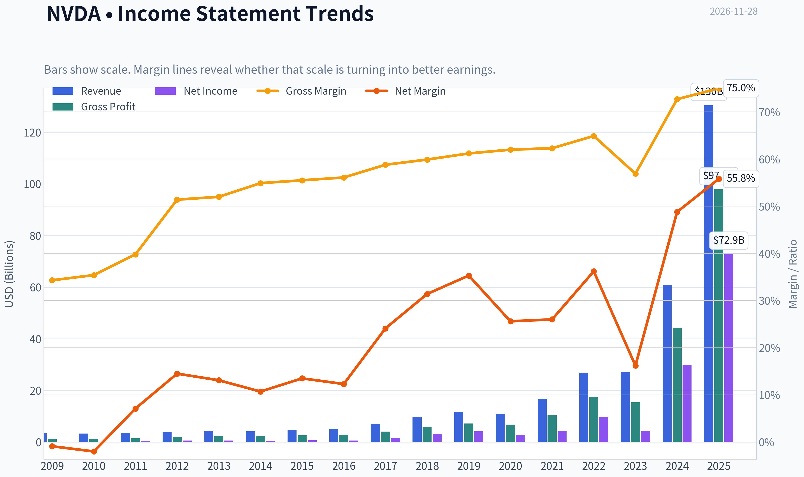

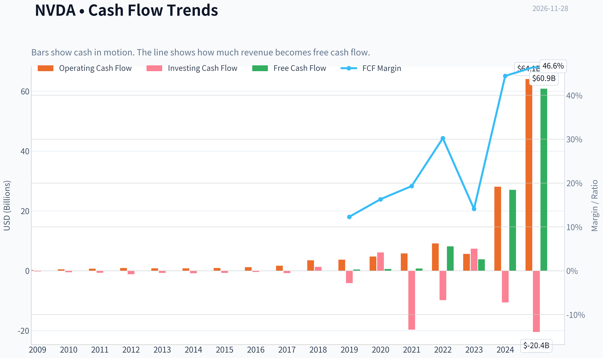

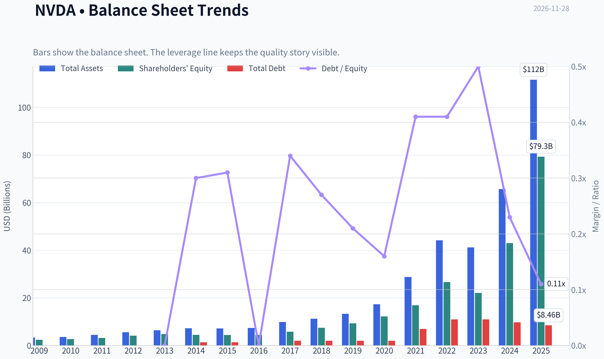

This graph tracks the profitability and return metrics (ROE, ROIC, Margins) of **NVDA** over the past decade, highlighting capital efficiency trends.

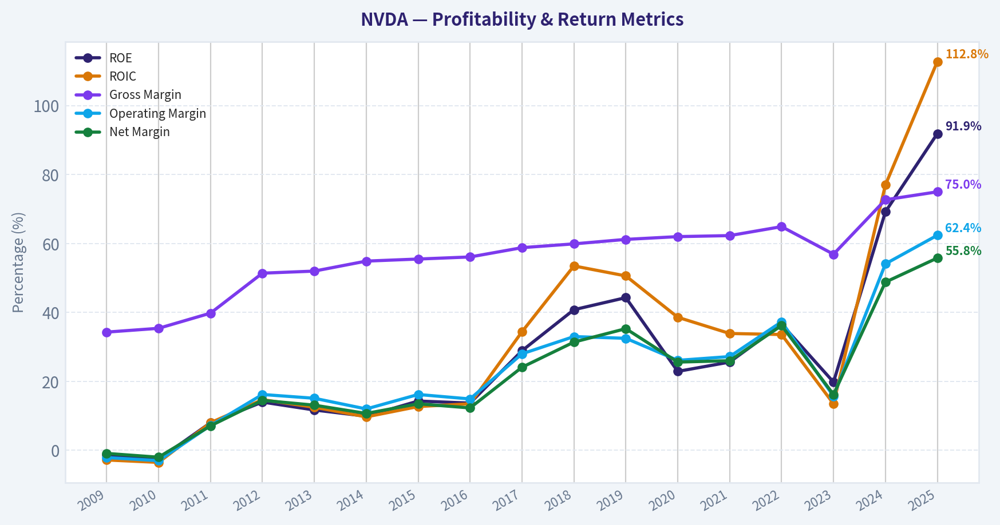

This chart illustrates the financial health of **NVDA** over the last 10 years, mapping cash equivalents and free cash flow against total obligations (Debt).

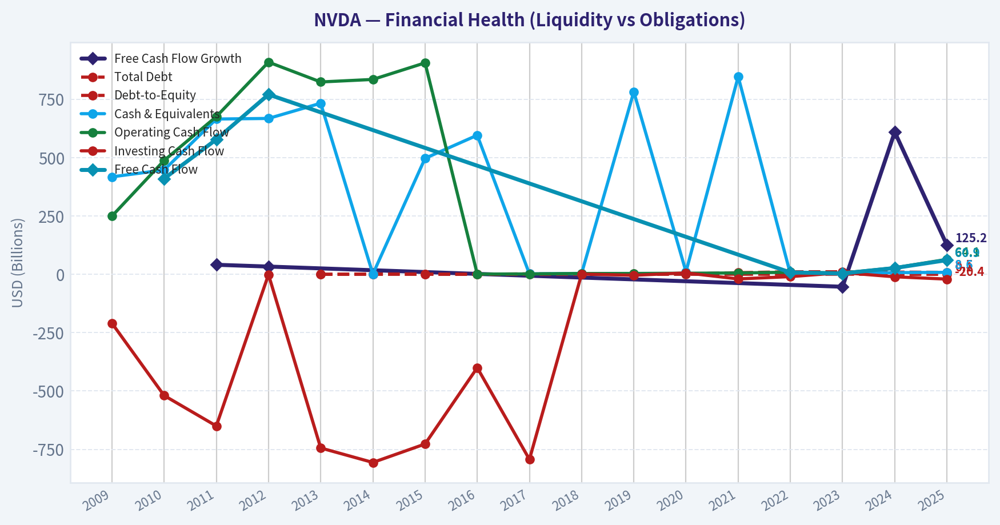

This comparison chart from *Profitability* stacks current figures against historical benchmarks for **NVDA**, making it easy to see where the company trades relative to its own averages.

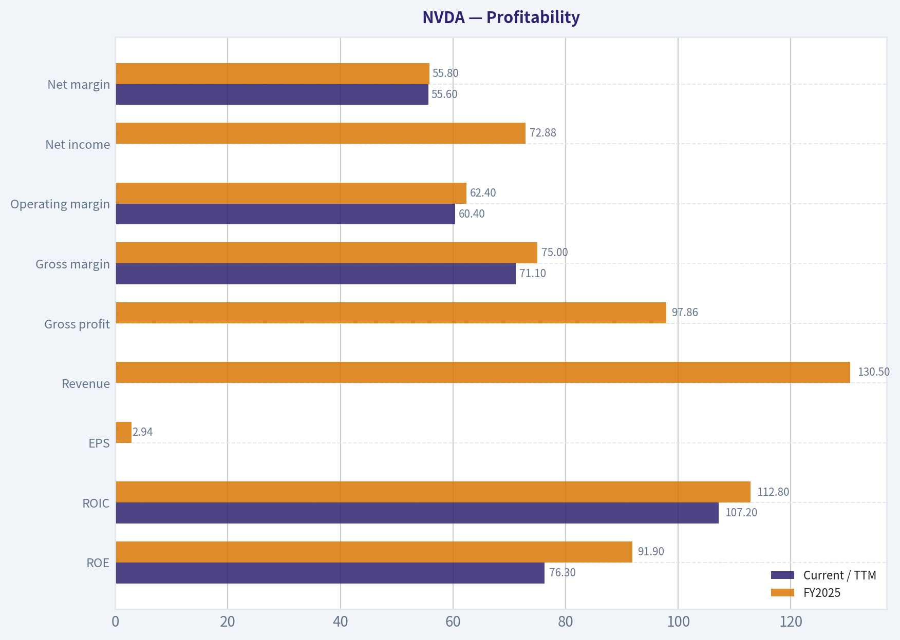

---

### Intrinsic Value Analysis (Buffett)

> *Following Warren Buffett's value investing philosophy: Circle of Competence, Economic Moat, Management Quality, and Margin of Safety.*

#### Intrinsic Value Snapshot

Price is what you pay. Intrinsic value is what the business may be worth based on the cash it can create for owners over time. We show a range, not one magic number.

- Current Price: $150.49
- Value Range (conservative to optimistic across both DCF methods): $114.24 to $282.11

##### Owner Earnings (Buffett Method)
- Net Income: $72,880,000,000.00
- Depreciation & Amortization: $2,843,000,000.00
- Capital Expenditures: $-6,042,000,000.00
- Working Capital Changes: $-15,949,000,000.00
- Owner Earnings: $59,893,306,952.61

##### Intrinsic Value
###### Buffett Method
Uses owner earnings. Stricter, and usually more conservative.
- Conservative: $114.24
- Average: $163.21
- Optimistic: $163.21
- Discount Rate: 8.3%

###### Cash Flow Method
Uses free cash flow. Better for companies spending heavily today to grow tomorrow.
- Conservative: $282.11
- Average: $282.11
- Optimistic: $282.11
- Discount Rate: 9.1%

ANALYST STANCE: **Bullish**

#### Executive Summary

NVIDIA is an unusually strong modern compounder: its accelerated-computing platform combines exceptional gross margins, rapid revenue growth, powerful ecosystem effects, and a long reinvestment runway. The central risk is valuation sensitivity: at approximately $150 per share, the DeepValues intrinsic value is $163.21, implying only a 7.8% margin of safety.

The evidence supports an **Bullish** stance with **moderate conviction**. NVIDIA appears to be a wonderful business at approximately a fair price, but the valuation leaves less room for execution mistakes than the business quality alone might suggest.

#### 1. Factor Scorecard

| Factor | Score | Evidence |
|---|---:|---|
| Circle of competence and simplicity | 4/5 | NVIDIA designs and sells high-performance computing chips, systems, and software. The business is understandable, although semiconductor cycles, AI architecture, and export policy add complexity. |
| Moat durability | 5/5 | CUDA software, developer adoption, ecosystem integration, product performance, scale, and switching costs create a wide and still-expanding moat. |
| Management and capital allocation | 4/5 | Founder-led management, substantial insider alignment, strong reinvestment, and a history of adapting the company toward accelerated computing. |
| Industry structure | 4/5 | The market is technologically competitive, but NVIDIA occupies a highly advantaged platform position with scale economics and ecosystem reinforcement. |

**Key Takeaways:** NVIDIA scores strongly because its competitive advantage extends beyond individual chips into software, developer workflows, systems, and ecosystem lock-in. The main deductions reflect technological complexity and the inherently cyclical, competitive nature of semiconductors rather than weak business economics.

#### Gate 5: Quality and Solvency

The hard floor is **not tripped**. Earnings, revenue, and cash generation are expanding sharply, while the balance sheet carries substantial liquidity and debt remains manageable relative to operating earnings. There is no evidence of simultaneous deteriorating cash flow and financial distress.

#### 2. Moat Analysis

| Moat source | Assessment | Specific evidence |
|---|---|---|
| Intangible assets | Wide | CUDA and the broader software stack are deeply embedded in AI development workflows. NVIDIA also benefits from a strong reputation for performance and innovation. |
| Switching costs | Wide | Moving large AI workloads to another platform can require software rewrites, validation, retraining, and operational changes. |
| Cost advantage | Strong | Scale in design, supply-chain coordination, systems integration, and R&D supports performance and economics that smaller rivals struggle to match. |
| Network effects | Wide and widening | More developers, frameworks, cloud providers, and applications using NVIDIA technology increase the value of compatibility with its platform. |

NVIDIA reported a **71.1% gross margin**, a strong financial indicator of pricing power and intellectual-property economics. Revenue growth of **65.5% year over year** also indicates that the franchise is expanding rather than merely defending a mature market.

The principal threat is not ordinary commoditization. It is the possibility that alternative custom silicon, competing software ecosystems, or changes in AI model architecture weaken CUDA's centrality. NVIDIA's moat therefore deserves a 5/5 rating, but continued innovation is essential to keeping it wide.

#### 3. Management Quality Assessment

Jensen Huang is a founder and long-term operator with substantial personal and reputational alignment with NVIDIA's per-share value. Management successfully redirected the company from a graphics-focused semiconductor business toward a broader accelerated-computing platform.

Capital allocation has emphasized:

- Heavy investment in research and development.
- Expansion of software, networking, and complete systems.
- Strategic ecosystem development rather than dependence solely on chip sales.
- Limited reliance on debt to fund growth.

The main management risk is strategic concentration: NVIDIA must continue allocating enormous resources toward an AI opportunity whose competitive landscape can evolve quickly. Overall management quality is rated **4/5**.

#### 4. Financial Summary

| Metric | Latest reported figure |
|---|---:|
| Share price | $150.00 |
| Market capitalization | $3.63 trillion |
| P/E ratio | 16.0x |
| Revenue growth, year over year | 65.5% |
| Gross margin | 71.1% |
| ROE | 76.3% |
| FCF yield | 2.7% |
| Current ratio | 3.91x |
| Cash | $22.4 billion |
| Debt | $33.4 billion |
| Net cash / net debt | $10.9 billion net debt |
| Operating income | $197.6 billion |
| After-tax operating income | $173.9 billion |
| Depreciation and amortization | $3.7 billion |
| Reported capital expenditure | $7.4 billion |
| Maintenance-capex charge used by valuation model | $7.1 billion |
| Shares outstanding | 24.285 billion |

**Key Takeaways:** NVIDIA combines unusually high profitability with exceptionally rapid growth. The 71.1% gross margin and 76.3% ROE indicate strong economics, while net debt of approximately $10.9 billion is modest relative to operating income. The 2.7% FCF yield shows that the market is already assigning substantial value to future growth.

#### Return on Equity and Cash-Flow Quality

ROE of 76.3% is excellent, although NVIDIA's asset-light economics and substantial cash generation mean that ROE should not be interpreted in isolation. The more important observation is that high returns are supported by strong margins and intellectual-property economics rather than solely by excessive leverage.

The latest valuation inputs show after-tax operating income of $173.9 billion and owner earnings of approximately $170.5 billion. This close relationship between operating earnings and owner earnings indicates that reported profitability is converting efficiently into economic cash generation.

The balance-sheet strength score is **4/5**. NVIDIA is not in a net-cash position under the supplied figures, but debt is modest relative to earnings, liquidity is strong, and the company is not dependent on aggressive borrowing to sustain operations.

#### 5. Owner Earnings Calculation

| Owner earnings component | Amount |
|---|---:|
| After-tax operating income | $173.9 billion |
| Add: depreciation and amortization | $3.7 billion |
| Less: maintenance-capex charge | $(7.1) billion |
| Less: working-capital investment | $0.0 billion |
| **Owner earnings** | **$170.5 billion** |
| Owner earnings per share | **Approximately $7.02** |

**Key Takeaways:** The owner-earnings calculation produces approximately $170.5 billion, or $7.02 per share. Capital intensity is modest relative to operating earnings, so NVIDIA can reinvest heavily in research, systems, and ecosystem development while still producing substantial economic cash flow.

#### 6. Three-Scenario DCF Valuation

These scenarios are sensitivity checks. The official intrinsic value used for the conclusion is the DeepValues app value shown below.

| Scenario | Main assumptions | Estimated value per share |
|---|---|---:|
| A: No growth | $170.5 billion owner earnings divided by a 10% discount rate | $70 |
| B: GDP-like growth | 3% perpetual growth, 10% discount rate | $103 |
| C: Historical/high-growth cross-check | Approximately 10% near-term growth, fading toward 2.5% terminal growth, 10% discount rate | Approximately $166 |
| DeepValues app intrinsic value | 10% growth fading to 2.5%, 8.3% discount rate, less $10.9 billion net debt | **$163.21** |

**Key Takeaways:** Conservative no-growth and GDP-growth models produce values well below the current market price, showing that the valuation depends on continued reinvestment and high growth. A growth-oriented model is more favorable and is broadly consistent with the DeepValues app value of $163.21. This wide range demonstrates that NVIDIA's valuation is highly sensitive to assumptions about the duration of AI-related growth.

#### 7. Margin of Safety Analysis

| Measure | Result |
|---|---:|
| Current price | $150.00 |
| DeepValues intrinsic value | $163.21 |
| Intrinsic value range | $114.24 to $163.21 |
| Margin of safety versus price | 7.8% |
| Price as percentage of intrinsic value | Approximately 92% |

**Key Takeaways:** The headline valuation indicates a 7.8% margin of safety, which is slightly below the 10% to 15% range typically acceptable for a wide-moat, high-ROIC compounder. The valuation is therefore reasonable rather than deeply discounted. The conservative valuation range below the market price highlights the importance of sustained growth and moat preservation.

#### 8. Final Buffett Scorecard

| Criterion | Weight | Score | Weighted contribution |
|---|---:|---:|---:|
| Moat width and durability | 25% | 5/5 | 1.25 |
| Valuation and margin of safety | 20% | 3/5 | 0.60 |
| Capital returns versus cost of capital | 15% | 5/5 | 0.75 |
| Business understanding and predictability | 12% | 4/5 | 0.48 |
| Management quality and capital allocation | 12% | 4/5 | 0.48 |
| Reinvestment runway | 8% | 5/5 | 0.40 |
| Balance-sheet strength | 4% | 4/5 | 0.16 |
| Industry structure | 4% | 4/5 | 0.16 |
| **Total** | **100%** |  | **4.28/5** |

**Key Takeaways:** NVIDIA's weighted score is 4.28 out of 5, driven by its moat, capital returns, and reinvestment runway. Valuation is the weakest major component because the margin of safety is modest and conservative scenarios fall below the current price. Even so, the overall economics are consistent with a high-quality compounder rather than an average semiconductor company.

#### 9. Principal Risks

| Risk | Investment implication |
|---|---|
| Customer concentration | A small number of hyperscale customers may represent a large share of demand and capital spending. |
| Competitive silicon | Custom chips from major cloud providers and competitors could reduce NVIDIA's share or pricing power. |
| Software disruption | A rival software ecosystem or more portable AI frameworks could weaken CUDA switching costs. |
| Semiconductor cyclicality | Inventory corrections and changes in data-center spending can produce sharp swings in growth. |
| Export restrictions | Geopolitical controls may constrain access to important markets or require lower-performance products. |
| Valuation sensitivity | A slowdown in AI infrastructure investment could compress the multiple even if long-term economics remain sound. |

#### Final Assessment

NVIDIA exhibits the traits Buffett would seek in a modern technology compounder: high returns on capital, pricing power, strong reinvestment opportunities, substantial ecosystem advantages, and founder-led management. Its moat is unusually broad because it spans hardware, software, networking, systems, and developer adoption.

At approximately $150 per share, the evidence indicates a **fair-to-slightly-attractive valuation**, not a large bargain. The 7.8% margin of safety is acceptable only because the underlying business quality is exceptional and the reinvestment runway remains substantial. The resulting stance is **Bullish**, with **moderate conviction**, subject to the continued durability of AI demand, CUDA-based switching costs, and NVIDIA's ability to preserve its technological lead.
#### Valuation Bridge

This bridge places the current market price beside each intrinsic value lens so readers can see whether upside depends on one method or shows up across several methods.

| Scenario | Intrinsic Value / Share |
| --- | ---: |
| Buffett Method | $163.21 |
| Cash Flow Method | $282.11 |
| Damodaran Method | $85.22 |
| Current Price | $150.49 |

#### Key Takeaways

If one method is far above the others, the upside case depends on a specific modelling assumption. When several methods cluster together, the valuation story is more robust.

#### Valuation Visuals

This comparison chart from *Latest Earnings Snapshot* stacks current figures against historical benchmarks for **NVDA**, making it easy to see where the company trades relative to its own averages.

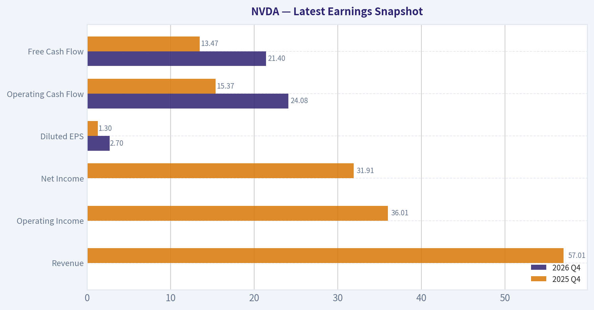

This comparison chart from *Cash Flow and Capital Allocation* stacks current figures against historical benchmarks for **NVDA**, making it easy to see where the company trades relative to its own averages.

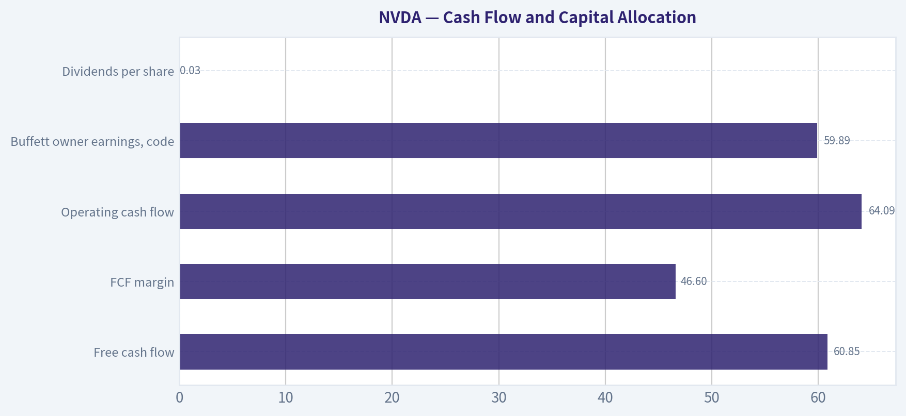

This comparison chart from *Financial Summary* stacks current figures against historical benchmarks for **NVDA**, making it easy to see where the company trades relative to its own averages.

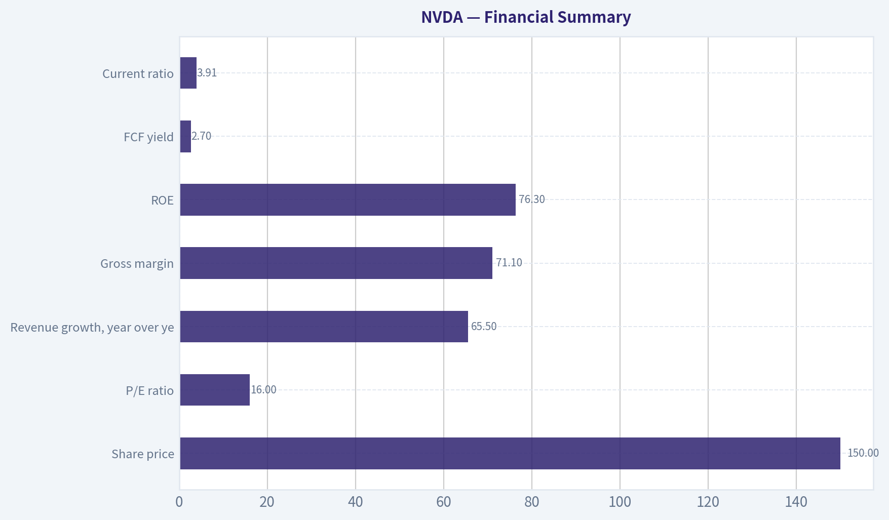

The following chart maps the **NVDA** Owner Earnings DCF valuation scenarios (Conservative, Average, Optimistic) to visually represent the margin of safety based on intrinsic value calculations.

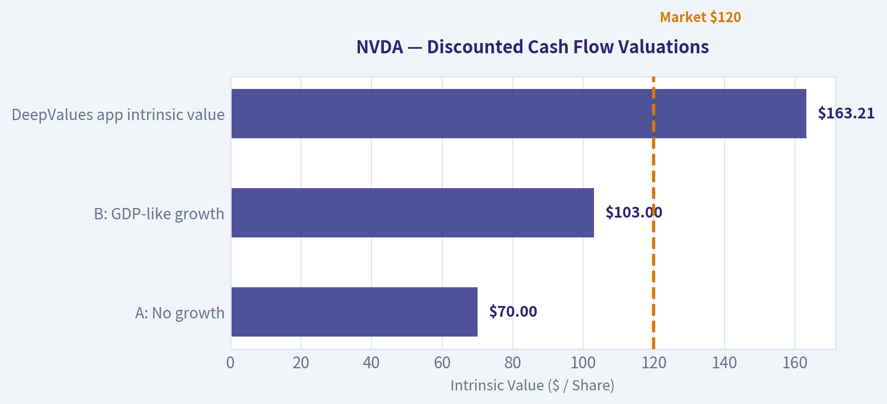

This comparison chart from *Margin of Safety Analysis* stacks current figures against historical benchmarks for **NVDA**, making it easy to see where the company trades relative to its own averages.

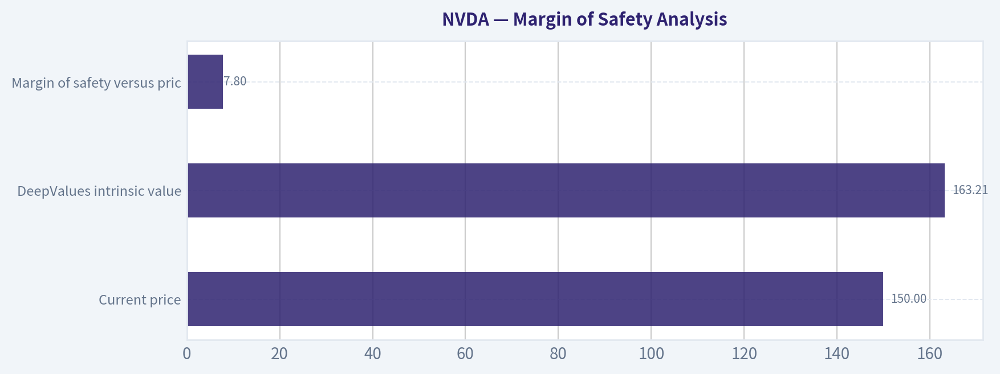

---

### Trend & Growth Analysis (Lynch/Druckenmiller/Fisher)

> *Following Peter Lynch's GARP, Stanley Druckenmiller's macro-aware approach, and Philip Fisher's scuttlebutt methodology.*

ANALYST STANCE: **Neutral**

#### 1. Lynch Classification

| Category | Assessment |
|---|---|
| Classification | Fast Grower, transitioning toward a mega-cap stalwart |
| Revenue growth | 65.5% year over year |
| Profitability | Very strong: 71.1% gross margin and 76.3% ROE |
| Primary theme | AI infrastructure, accelerated computing, data centers |
| Main concern | Extreme scale and expectations create deceleration risk |

**Key Takeaways:** NVIDIA remains a fast grower by revenue standards, but its $3.63 trillion market capitalization means the investment case now depends on sustaining extraordinary growth at enormous scale. The company is no longer an undiscovered fast grower; valuation and future execution are central variables.

#### 2. The Story in Three Bullets

- NVIDIA supplies the foundational computing platforms used to train and deploy advanced artificial intelligence.
- Its advantage combines leading GPUs, networking, software ecosystems, developer adoption, and close relationships with major cloud providers.
- The opportunity is shifting from one-time accelerator demand toward recurring, expanding infrastructure demand across training, inference, robotics, enterprise software, and sovereign AI.

#### 3. TAM Analysis and the 10x Test

| Metric | Estimate / Assessment |
|---|---:|
| Approximate current annual revenue base | About $215 billion |
| Ten-times revenue test | About $2.15 trillion |
| Revenue required for less than 20% share | TAM above approximately $10.75 trillion |
| Current AI infrastructure market | Large and expanding, but precise boundaries are highly uncertain |
| TAM growth | Strong secular growth, though likely to moderate from current exceptional levels |
| 10x conclusion | Plausible only under a very broad definition of AI computing and adjacent infrastructure |

**Key Takeaways:** NVIDIA has a powerful secular runway, but the 10x test is demanding because the company is already enormous. A tenfold revenue outcome requires AI infrastructure, networking, software, inference, and adjacent computing markets to combine into a market above roughly $10 trillion.

#### 4. Revenue Growth Trend

| Indicator | Evidence | Interpretation |
|---|---:|---|
| Latest year-over-year revenue growth | 65.5% | Exceptional |
| Recent pattern | Growth remains high but below the extraordinary peak rates of the initial AI accelerator boom | Decelerating from peak, not currently collapsing |
| Revenue quality | Primarily organic product and platform demand | High quality, subject to customer concentration |
| Key monitor | Data-center demand, cloud capital expenditure, inference adoption, and new-platform ramps | Determines reacceleration potential |

**Key Takeaways:** The current pattern is best described as sustaining at a very high level while decelerating from peak acceleration. The critical question is whether new platforms and inference workloads can offset the law of large numbers and maintain growth above the broader semiconductor industry.

#### 5. Unit Economics and Operating Model

| Metric | Result |
|---|---:|
| Gross margin | 71.1% |
| ROE | 76.3% |
| Current ratio | 3.91 |
| CAC / LTV | Not disclosed in a directly meaningful consumer-subscription format |
| Net revenue retention | Not applicable as a conventional SaaS metric |
| Rule of 40 | Not the appropriate primary metric for a hardware-platform company |
| FCF yield | 2.7% |

**Key Takeaways:** NVIDIA's gross margin and return on equity indicate exceptional economics for a semiconductor platform. Traditional CAC, LTV, and NRR metrics do not capture its business model; customer concentration, platform switching costs, product lead times, and ecosystem adoption are more informative.

#### 6. Inflection Point Assessment

| Inflection area | Assessment | Direction |
|---|---|---|
| Product cycle | New GPU and networking platforms can produce major demand waves | Positive |
| Market share | NVIDIA remains the leading accelerated-computing platform | Positive, but competition is intensifying |
| Margin | Already exceptionally high; further expansion is harder | Neutral to positive |
| TAM | AI inference, sovereign AI, robotics, and enterprise adoption broaden the market | Positive |
| Competition | Custom silicon from hyperscalers and rivals creates a growing counterforce | Negative risk |
| Earnings outlook | Very strong, but expectations are correspondingly elevated | Mixed |

**Key Takeaways:** The strongest inflection is TAM expansion from training into inference and broader AI computing. The main offset is that the market increasingly understands the NVIDIA story, so future excess returns require execution that exceeds already-high expectations.

#### 7. Macro Setup

| Macro factor | Current assessment | Impact |
|---|---|---|
| Secular trend | AI and accelerated computing | Strong tailwind |
| Interest rates | Thirty-year Treasury reference rate around 5.33% | Valuation headwind |
| Economic cycle | Macro regime appears less supportive than an early-recovery environment | Moderate headwind |
| Cloud capital expenditure | Major demand driver | Positive but cyclical |
| Export controls and geopolitics | Potential restriction on addressable markets and supply chains | Material risk |
| Customer concentration | Hyperscalers and large enterprises drive substantial demand | Concentration risk |

**Key Takeaways:** The secular AI trend is a major tailwind, but elevated long-term rates reduce the present value of distant growth. NVIDIA is therefore a strong fundamental growth story operating in a less forgiving valuation environment.

#### 8. Fisher's 15-Point Assessment

| Fisher criterion | Score / 5 | Rationale |
|---|---:|---|
| Market potential | 5 | AI computing markets remain expansive |
| New-product determination | 5 | Rapid platform cadence and broad product roadmap |
| R&D effectiveness | 5 | Strong evidence of commercialized innovation |
| Sales organization | 5 | Deep strategic distribution through cloud and enterprise channels |
| Profit margins | 5 | Exceptional gross and operating economics |
| Margin improvement | 4 | Already high, leaving less room for expansion |
| Labor relations | 4 | No major issue identified from available data |
| Executive relations | 4 | Strong founder-led alignment, though leadership dependence matters |
| Management depth | 4 | Broad technical organization, with Jensen Huang still highly central |
| Cost analysis | 4 | Financial execution appears disciplined |
| Outstanding aspects | 5 | CUDA ecosystem, software, networking, developer adoption |
| Long-range outlook | 5 | Strong secular demand, subject to normalization |
| Dilution risk | 4 | No major dilution concern indicated |
| Management candor | 4 | Generally strong communication, though investor expectations are high |
| Management integrity | 4 | No major integrity concern identified |
| **Total** | **66 / 75** | **Outstanding** |

**Key Takeaways:** NVIDIA scores in the outstanding Fisher range. Its highest scores come from market potential, innovation, R&D effectiveness, and ecosystem strength; the principal deductions reflect valuation expectations, leadership concentration, and the difficulty of expanding margins from an already exceptional base.

#### 9. Valuation Analysis

| Measure | Result | Interpretation |
|---|---:|---|
| Current price | $150 | Reference price supplied |
| Market capitalization | $3.63 trillion | Very large absolute scale |
| P/E | 16.0x | Low relative to current reported growth, assuming earnings are sustainable |
| PEG using 65.5% trailing growth | Approximately 0.24 | Extremely favorable mechanically, but likely overstates sustainable growth |
| Approximate price-to-sales | About 16.9x | Premium valuation consistent with high-quality growth |
| Owner Earnings intrinsic value | $163.21 | About 7.8% above the supplied $150.49 reference price |
| Conservative owner-earnings value | $114.24 | Demonstrates meaningful downside under slower assumptions |
| Damodaran FCFF base case | $85.22 | More conservative cross-check |
| DCF cross-check range | $24.03 to $182.99 | Very sensitive to growth, margins, and discount rate |

**Key Takeaways:** The headline owner-earnings model indicates modest valuation support, with intrinsic value of $163.21 versus a reference price near $150. The wide range across valuation methods shows that NVIDIA's valuation is highly assumption-sensitive; the trailing PEG is attractive mathematically but should not be extrapolated as a steady-state growth rate.

#### 10. Revenue-Multiple Scenario Framework

| Scenario | Revenue assumption | Valuation implication |
|---|---|---|
| Bear | Growth normalizes sharply as hyperscaler spending and competition moderate | A high sales multiple could compress materially |
| Base | AI infrastructure expands while NVIDIA retains platform leadership | Premium multiple remains defensible, but returns depend on continued earnings growth |
| Bull | Inference, networking, sovereign AI, robotics, and software broaden the revenue base | Sustained premium economics and multiple support become possible |
| Core sensitivity | Revenue growth and operating margin matter more than the current P/E alone | Execution is the dominant variable |

**Key Takeaways:** NVIDIA's valuation is less about whether the company is profitable and more about how long exceptional growth and margins can persist. The bull case requires both market expansion and continued platform leadership; the bear case does not require business failure, only normalization from extraordinary growth.

#### 11. Growth Investor Scorecard

| Criterion | Weight | Score / 5 | Weighted contribution |
|---|---:|---:|---:|
| The Story | 10% | 4.8 | 0.48 |
| TAM and runway | 20% | 4.2 | 0.84 |
| Revenue growth | 20% | 4.6 | 0.92 |
| Unit economics | 15% | 4.8 | 0.72 |
| Competitive position | 10% | 4.7 | 0.47 |
| Management quality | 10% | 4.3 | 0.43 |
| Macro setup | 5% | 3.0 | 0.15 |
| Profitability path | 5% | 5.0 | 0.25 |
| Valuation | 5% | 3.2 | 0.16 |
| **Total** | **100%** |  | **4.42 / 5.00** |

**Key Takeaways:** The operating business scores extremely well, producing a 4.42 out of 5 overall score. The reduced stance reflects valuation sensitivity, elevated rates, scale-related deceleration risk, and the possibility that much of the AI leadership advantage is already recognized by the market.

#### 12. Valuation Sensitivity

| Variable | Favorable outcome | Unfavorable outcome |
|---|---|---|
| Sustainable revenue growth | Remains above 30% for several years | Falls rapidly toward industry growth |
| Gross margin | Holds near current elevated levels | Compresses due to competition or mix |
| Discount rate | Declines materially | Remains elevated or rises |
| AI workload mix | Inference and software expand | Training demand dominates and matures |
| Competition | NVIDIA retains ecosystem leadership | Custom silicon and rival accelerators gain share |
| Valuation conclusion | Intrinsic value can exceed the current reference price | Fair value can fall below the current reference price |

**Key Takeaways:** The most important sensitivity is not the next quarter's result but the durability of growth and margins over several years. The supplied intrinsic value provides only a modest cushion, while alternative cash-flow models show that higher discount rates or faster normalization can materially reduce estimated value.

#### 13. Key Risks and Catalysts

| Catalysts | Risks |
|---|---|
| Strong Blackwell and subsequent platform adoption | Hyperscaler capital-spending normalization |
| Rapid inference growth | Custom chips from major cloud customers |
| Expansion into networking and software | Export controls and geopolitical restrictions |
| Sovereign AI buildouts | Supply-chain constraints or product delays |
| Robotics and physical AI | Gross-margin compression |
| Broader enterprise AI deployment | Customer concentration and law-of-large-numbers effects |

**Key Takeaways:** The principal catalysts are new product ramps and the expansion of AI from training into inference and physical-world applications. The principal risks are not demand disappearance but normalization, competition, regulatory restrictions, and the difficulty of maintaining extraordinary economics at NVIDIA's current scale.

#### Bottom Line

NVIDIA is an **outstanding business and a genuine fast-growth platform**, supported by strong secular demand, high margins, exceptional returns on capital, and a meaningful ecosystem moat. However, current growth is decelerating from an unusually high base, the company is already massive, and valuation outcomes vary widely with assumptions.

The evidence supports a **Neutral** stance: the operating fundamentals are outstanding, while the valuation provides only modest support under the supplied owner-earnings model and remains vulnerable to growth normalization.

---

### Market Technical Analysis

ANALYST STANCE: **Neutral**

#### NVDA technical market report

The latest available trading session is **November 27, 2026**, when NVDA closed at **$150.49**. November 28 was not a trading day. The supplied data covers 251 sessions from November 28, 2025 through November 27, 2026.

NVDA's price structure has deteriorated materially. The stock is approximately **14.8% below** its November 2025 closing level of $176.58, and roughly **38.2% below** the 2026 intraday high of $243.37 reached on October 6. The decline accelerated sharply in November: the stock fell from $206.69 on November 3 to $150.49 on November 27, while the November 20 low of $124.50 represented a particularly severe capitulation phase.

The November 23 rebound from $125.53 to a $165.05 close briefly interrupted the decline, but the recovery failed to establish a stable higher low. Prices subsequently fell to $149.30 on November 25 before a modest rebound to $150.49. That pattern indicates very high two-way volatility rather than a confirmed trend reversal.

#### Trend and moving-average structure

The short-, medium-, and long-term averages are all well above the latest closing price:

- The **10-day EMA is $155.42**, placing the close about **3.1% below** the short-term trend measure.
- The **50-day SMA is $202.28**, approximately **34.6% above** the close.
- The **200-day SMA is $202.43**, approximately **34.5% above** the close.

The 10-day EMA has fallen from $216.81 on October 29 to $155.42, showing that the recent decline has been persistent rather than a single isolated shock. The 50-day SMA has also rolled over from $221.92 to $202.28. The 200-day SMA remains comparatively flat near $202, but the price is now substantially beneath it. This combination reflects a bearish alignment across short- and intermediate-term trends, with the longer-term benchmark no longer acting as a nearby reference for current price behavior.

An additional concern is that the 50-day SMA and 200-day SMA are nearly identical, while both are declining. That does not by itself establish a formal long-term crossover signal, but it shows that the medium-term trend has weakened enough to converge with the long-term average.

#### Momentum: MACD and RSI

The **MACD is -16.36** on November 27, compared with -2.83 on October 29. The negative reading and continued deterioration indicate that downside momentum remains dominant. MACD improved somewhat from the November 20 extreme of -19.83, but that improvement has not yet returned the indicator to neutral territory. The rebound therefore looks more like a partial easing of momentum pressure than a confirmed change in trend.

The **RSI is 38.12**, up from an extremely depressed 15.05 on November 20. This recovery is meaningful because it shows that downside momentum has moderated after the panic-like selloff. However, RSI remains below the neutral 50 area and is still far from an overbought reading. The indicator therefore suggests a market that has rebounded from deeply oversold conditions but has not regained positive momentum.

The divergence between RSI's improvement and the still-negative MACD is important. RSI captures the recent stabilization, while MACD reflects the much larger trend damage accumulated over several weeks. Together, they describe a market with reduced immediate selling intensity but unresolved broader weakness.

#### Volatility and Bollinger-band behavior

The **14-day ATR is $12.90**, compared with $5.72 on October 29. Relative to the $150.49 closing price, this represents daily average true-range volatility of approximately **8.6%**. Such a large ATR means that percentage changes remain unusually wide, and individual sessions may not provide reliable evidence of a durable directional shift.

The Bollinger lower band is **$124.82**, placing the close about **20.6% above** that band. NVDA traded near or below the lower-band region during the November 20 collapse, followed by a sharp rebound. The subsequent distance above the lower band indicates that the most extreme oversold condition has eased, but it does not establish that the broader downtrend has ended. In high-volatility declines, Bollinger bands expand rapidly, so a price moving away from the lower band can represent stabilization without a full trend repair.

#### Volume and price confirmation

The **VWMA is $157.85**, approximately **4.9% above** the latest close. This means the recent volume-weighted trading area remains higher than the current market price, which is consistent with overhead supply and weak volume-adjusted price acceptance.

Volume was especially elevated during the sharp November selloff:

- November 9: approximately **462.7 million shares**
- November 10: approximately **429.3 million**
- November 12: approximately **747.7 million**
- November 20: approximately **633.4 million**
- November 23: approximately **782.6 million**

The November 23 rebound occurred on the highest reported volume in the period, which confirms that the move attracted substantial participation. However, the failure to preserve much of that rebound over the following sessions weakens its interpretation as a confirmed accumulation event. The price remains below the VWMA, and the volume-weighted trend continues to slope downward.

#### Market interpretation and valuation implications

The selected indicators provide distinct information without excessive redundancy:

- **10-day EMA:** immediate trend direction.
- **50-day SMA:** intermediate trend condition.
- **200-day SMA:** long-term trend benchmark.
- **MACD:** directional momentum and trend acceleration.
- **RSI:** momentum exhaustion and recovery from oversold levels.
- **Bollinger lower band:** volatility-adjusted downside extension.
- **ATR:** magnitude of current price risk and instability.
- **VWMA:** volume-confirmed price acceptance.

The evidence is mixed only in a narrow sense: RSI has recovered from extreme oversold territory and MACD has become less negative from its worst level, but nearly every broader trend measure remains bearish. Price is beneath all three moving averages, below VWMA, and still accompanied by a deeply negative MACD. The main constructive feature is that the November 20 washout produced a rebound and lifted RSI away from extreme lows. The main counterpoint is that this rebound has not yet changed the sequence of lower highs and lower trend averages.

From a valuation perspective, the technical evidence does **not currently validate a premium valuation assumption** based on sustained upward momentum. A more constructive valuation interpretation would require evidence of price stabilization, improvement in the moving-average structure, recovery above the volume-weighted trend, and a materially stronger MACD profile. Until those conditions appear, the technical backdrop implies elevated uncertainty and a substantial risk that valuation judgments remain vulnerable to further price volatility.

| Indicator | Latest reading | Recent direction | Interpretation |
|---|---:|---|---|
| Close | $150.49 | Down sharply from $206.69 on Nov. 3 | Price remains in a severe corrective phase |
| 10-day EMA | $155.42 | Declining rapidly | Short-term trend remains bearish; close is below the EMA |
| 50-day SMA | $202.28 | Rolling over | Intermediate trend is substantially weaker |
| 200-day SMA | $202.43 | Slightly declining | Long-term benchmark is far above current price |
| MACD | -16.36 | Negative, though less extreme than Nov. 20 | Broad momentum remains bearish |
| RSI | 38.12 | Recovered from 15.05 | Oversold pressure has eased, but momentum is not yet neutral |
| Bollinger lower band | $124.82 | Band widened during selloff | Extreme downside extension has moderated without confirming reversal |
| ATR | $12.90 | Up from $5.72 | Volatility is exceptionally high |
| VWMA | $157.85 | Declining | Volume-weighted price acceptance remains above the close |

Key Takeaways: NVDA remains below its short-, medium-, and long-term moving averages, while MACD and VWMA continue to confirm broad weakness. RSI has rebounded from deeply oversold levels, but that improvement mainly signals reduced immediate pressure rather than a confirmed trend change. The combination of very high ATR, heavy recent volume, and a close below VWMA indicates that valuation remains exposed to substantial technical uncertainty.

---

### Options Market Analysis

> *Reading options flow - put/call ratios, IV skew, and unusual activity - to gauge institutional positioning and event-driven risk.*

ANALYST STANCE: **Bullish**

#### NVDA Options Market Overview

As of November 28, 2026, NVDA's near-term options market shows substantial activity across expirations from November 30 through December 4. The data indicates a call-heavy market overall, although elevated implied volatility and active near-the-money put trading show meaningful short-term hedging demand.

#### Put/Call Ratio Analysis

| Expiration | Call OI | Put OI | Put/Call OI | Call Volume | Put Volume | Put/Call Volume |
|---|---:|---:|---:|---:|---:|---:|
| Nov. 30, 2026 | 139,887 | 109,068 | 0.78 | 366,748 | 192,117 | 0.52 |
| Dec. 2, 2026 | 80,658 | 33,428 | 0.41 | 71,077 | 44,490 | 0.63 |
| Dec. 4, 2026 | 384,950 | 250,665 | 0.65 | 202,532 | 139,352 | 0.69 |
| **Total** | **605,495** | **393,161** | **0.65** | **640,357** | **375,959** | **0.59** |

**Key Takeaways:** The aggregate put/call open-interest ratio of 0.65 is below the approximate neutral baseline of 0.70, while the volume ratio of 0.59 shows stronger call activity than put activity. This supports a modestly bullish directional bias, although the November 30 ratio of 0.78 indicates more balanced or defensive positioning immediately before expiration.

#### Implied Volatility Assessment

| Expiration | Call ATM IV | Put ATM IV | Put-minus-Call IV | Interpretation |
|---|---:|---:|---:|---|
| Nov. 30, 2026 | 60.1% | 60.5% | +0.4 pts | Nearly balanced |
| Dec. 2, 2026 | 78.3% | 81.2% | +2.9 pts | Moderate put skew |
| Dec. 4, 2026 | 84.4% | 85.9% | +1.5 pts | Mild put skew |

The near-the-money data shows puts carrying a small volatility premium over calls, particularly for the December 2 expiration. This represents some downside insurance demand, but not an extreme near-term fear signal.

The far-out wings are highly distorted. The November 30 $210-$220 calls carry approximately 125%-131% IV, while the December 4 $45 put shows 268.8% IV. These readings likely reflect very deep out-of-the-money options with sparse open interest rather than broad market consensus.

A specific catalyst is not identified in the supplied data. Nevertheless, the 78%-86% ATM IV levels for December expirations are elevated and imply substantial event or price-movement risk around that window.

**Key Takeaways:** ATM volatility is elevated across all observed expirations, with December options pricing materially more movement than the November 30 contracts. The modest put skew indicates downside protection is valued somewhat more highly than upside exposure, but the skew is not steep enough by itself to override the call-heavy volume and open-interest profile.

#### Unusual Options Activity

The tool flags contracts where volume exceeds five times open interest. Because the data does not include trade direction, bid-ask execution, or multi-leg strategy context, these contracts cannot be definitively classified as opening purchases or sales.

| Expiration | Type | Strike | Volume/OI | DTE | Moneyness* | IV | Reading |
|---|---|---:|---:|---:|---|---:|---|
| Nov. 30 | Call | $150 | 6.4x | 2 | Near ATM | 58.0% | Fresh short-dated upside activity |
| Nov. 30 | Call | $155 | 5.1x | 2 | OTM | 59.6% | Upside speculation or call overwriting |
| Nov. 30 | Call | $215 | 30.4x | 2 | Far OTM | 125.0% | Highly speculative tail activity |
| Nov. 30 | Call | $210 | 16.0x | 2 | Far OTM | 125.0% | High-risk upside lottery-style flow |
| Dec. 4 | Put | $45 | 242.9x | 6 | Far OTM | 268.8% | Extreme downside-tail activity |
| Nov. 30 | Call | $220 | 13.4x | 2 | Far OTM | 131.3% | Speculative upside tail activity |
| Nov. 30 | Call | $152.50 | 6.9x | 2 | Near OTM | 59.7% | Short-dated bullish or overwrite flow |
| Nov. 30 | Call | $157.50 | 5.6x | 2 | OTM | 59.4% | Upside-oriented activity |
| Nov. 30 | Call | $149 | 22.3x | 2 | Near ATM | 58.2% | Significant fresh near-term activity |
| Nov. 30 | Call | $148 | 6.7x | 2 | Near ATM | 57.9% | Near-the-money directional interest |
| Nov. 30 | Put | $148 | 11.0x | 2 | Near ATM | 60.2% | Short-term downside hedge or bearish bet |
| Nov. 30 | Put | $147 | 18.9x | 2 | Near ATM | 62.2% | Downside protection near the apparent spot area |
| Nov. 30 | Put | $143 | 8.7x | 2 | OTM | 63.0% | Moderate downside hedge |
| Nov. 30 | Put | $146 | 7.0x | 2 | Near OTM | 60.6% | Short-term defensive activity |
| Dec. 2 | Put | $120 | 5.7x | 4 | OTM | 102.5% | Downside-tail hedge or speculative bearish exposure |

\*The tool does not provide NVDA's exact current price. Moneyness is inferred from the concentration of activity around the $147-$150 area, which appears to be near the market's reference price.

**Key Takeaways:** The most meaningful unusual activity is concentrated in November 30 calls near $148-$150, favoring short-term upside interest. Near-the-money puts at $146-$148 also show fresh activity, implying that some participants are protecting against immediate downside. The $210-$220 calls and $45 put have extreme volume-to-open-interest ratios but very high implied volatility and low existing open interest, making them more consistent with speculative tail trades than clearly identifiable institutional conviction.

#### Open Interest Concentration and Gamma Levels

| Expiration | Call OI | Put OI | Total OI | Concentration Implication |
|---|---:|---:|---:|---|
| Nov. 30 | 139,887 | 109,068 | 248,955 | Large immediate-expiry concentration |
| Dec. 2 | 80,658 | 33,428 | 114,086 | Smaller, call-dominant layer |
| Dec. 4 | 384,950 | 250,665 | 635,615 | Largest near-term expiration concentration |
| **Total** | **605,495** | **393,161** | **998,656** | **Very active near-term complex** |

The December 4 expiration contains approximately 64% of the reported near-term open interest, making it the principal expiration for potential pinning and dealer-gamma effects. The November 30 chain also has meaningful immediate-expiry exposure, particularly around the $147-$150 activity cluster.

The supplied dataset does not provide a complete strike-by-strike open-interest ranking or dealer gamma estimate. Therefore, exact gamma walls and a formal maximum-pain level cannot be calculated reliably. Based on unusual activity, the $147-$150 area is the most visible near-term battleground, while the large December 4 open-interest base could dampen price movement near heavily populated strikes unless price breaks decisively away from that region.

**Key Takeaways:** Open interest is heavily concentrated in the December 4 expiration, with a secondary concentration immediately at November 30. The apparent $147-$150 cluster may act as a short-term pinning area, but the absence of strike-level OI and dealer-gamma data limits precision regarding exact support or resistance effects.

#### Overall Options Sentiment Signal

**Overall signal: BULLISH, with elevated event-risk caveats.**

The primary bullish evidence is the aggregate put/call OI ratio of 0.65, the volume ratio of 0.59, and unusually active near-the-money calls around the apparent $148-$150 reference area. This indicates greater upside participation than downside demand across the near-term complex.

The principal caveats are elevated ATM IV, modest put skew, and meaningful near-the-money put activity for the November 30 expiration. These features indicate that bullish exposure is accompanied by substantial short-term uncertainty and downside hedging. The extreme-wing contracts should receive less weight because their high IV and low open interest make them more vulnerable to speculative or illiquid-flow distortions.

Options liquidity is not thin overall: reported volume approaches one million contracts across the analyzed expirations. Confidence in the broad directional signal is therefore moderate, but confidence in interpreting individual far-out-of-the-money trades is low.

#### Summary

| Category | Assessment |
|---|---|
| Put/Call Ratio | 0.65 OI and 0.59 volume; below the 0.70 neutral reference |
| IV Level | Elevated; approximately 60% for Nov. 30 and 78%-86% for December expirations |
| Skew Direction | Mild put skew near the money; extreme wings are distorted |
| Unusual Activity | Strong near-term call activity around $148-$150, with additional near-term put hedging |
| Overall Signal | **BULLISH**, tempered by high volatility and event-sensitive pricing |

**Key Takeaways:** NVDA's options market leans bullish because calls dominate both open interest and trading volume, with notable activity near the apparent current-price area. Elevated implied volatility and modest put skew show that the market also expects substantial short-term movement, so the bullish read reflects directional positioning rather than low-risk conditions.

---

## Research Team Commentary

> *The Research Manager synthesizes the Bull vs Bear debate into action-free commentary. This is a pre-risk view, not the final stance.*

Core Takeaway: NVIDIA appears to be a wonderful business, but the evidence provided does not yet establish that $150 is a fair price with an adequate margin of safety. Its hardware, CUDA software, networking, developer base, and systems integration form a genuine moat, while the reported profitability is exceptional. The unresolved issue is whether the stated 16.04 P/E reflects sustainable owner earnings or unusually favorable AI-cycle economics. That distinction keeps the conclusion at Neutral rather than Bullish.

The strongest bull argument is that NVIDIA is no longer merely a semiconductor vendor. It has become an integrated accelerated-computing platform with meaningful switching costs, developer ecosystem effects, and systems-level advantages. CUDA, networking, optimized libraries, engineering support, and relationships with cloud providers make replacement considerably harder than substituting one chip for another. The expansion from training into inference, enterprise AI, robotics, sovereign AI, and software also provides a credible ten-year reinvestment runway.

The financial evidence reinforces that quality assessment. A 71.1% gross margin, 107.2% ROIC, and 58.1% ROA indicate extraordinary pricing power and capital efficiency. Jensen Huang's record of anticipating accelerated computing and directing substantial research spending toward ecosystem development also supports a favorable management assessment. If the 16-times earnings figure is verified against recurring, cash-backed earnings, the valuation would look unusually reasonable for such a franchise. A wide-moat compounder does not require the same discount as an average or deeply cyclical business.

The strongest bear argument, however, goes directly to the reliability of that earnings denominator. NVIDIA's current results may reflect customer urgency, constrained leading-edge supply, premium pricing, and an exceptional infrastructure buildout. A seemingly modest multiple can be misleading when applied to peak earnings. Mechanically, if normalized earnings were 25% below the reported base, a 16-times multiple would become roughly 21 times normalized earnings; a 40% reduction would raise it to approximately 27 times. Those valuations could still be justified, but they would require more durable growth and competitive advantage than the headline multiple suggests.

The bear case does not need CUDA to collapse or NVIDIA to lose technological leadership. Gradual erosion would be enough to reduce intrinsic value. Hyperscalers are unusually sophisticated customers with the scale and incentive to develop custom accelerators, improve workload portability, and negotiate better economics. This is especially relevant for inference, where cost per query, power consumption, and workload-specific optimization may matter more than maximum performance. NVIDIA can remain the industry leader while experiencing lower pricing, higher research costs, and some loss of economic capture.

There are also legitimate questions about the transition into complete systems. Networking and systems integration can deepen the moat and increase revenue per deployment, but they can also increase inventory, working-capital needs, support obligations, and execution complexity. Supply-chain concentration, advanced-packaging constraints, export controls, and technological fragmentation add risks that current return metrics do not capture.

From a valuation perspective, neither side has completed the decisive work. There is no DeepValues intrinsic-value estimate, normalized free-cash-flow model, balance-sheet detail, or confirmation of whether the P/E is trailing, forward, adjusted, or GAAP. A reverse DCF cannot be judged reliably without knowing normalized margins, cash conversion, stock-based compensation, dilution, and the growth assumptions embedded in the earnings figure. The bull is right that 16 times durable earnings would not imply heroic expectations; the bear is right that durability has not been demonstrated.

Technical weakness and options positioning do not resolve this question. Trading below the short- and long-term moving averages indicates weakened sentiment, potentially reflecting fear about AI spending or earnings normalization. That could represent a mispricing, but price momentum alone cannot distinguish temporary pessimism from a justified reduction in earnings expectations. Similarly, call-heavy options activity says little about ten-year cash flows.

Rationale: Buffett's framework requires separating business quality from investment value. NVIDIA scores exceptionally well on moat, management, capital efficiency, and prospective reinvestment opportunities. It does not show evidence of financial distress, so a negative stance based on solvency would be unwarranted. Yet the quality-scaled margin of safety still has to be measured against normalized intrinsic value rather than current headline earnings. The supplied evidence establishes the quality of the franchise more convincingly than it establishes undervaluation.

No specific prior-error reflections were supplied, so the relevant general lesson is to avoid two familiar mistakes: dismissing an asset-light technology platform merely because it operates in a rapidly changing industry, and capitalizing boom-period earnings as though they are permanent. NVIDIA deserves full credit for its software and ecosystem moat, but high ROIC during an extraordinary demand cycle is not itself proof of decade-long economic durability.

Monitoring Plan: Over the next one to four quarters, the most important evidence will be:

First, verify the valuation inputs. The earnings period and accounting basis behind the 16.04 P/E should be reconciled with GAAP net income, diluted shares, operating cash flow, capital expenditure, stock-based compensation, and free cash flow. Net cash, purchase commitments, and dilution also need to be incorporated into intrinsic value.

Second, watch gross margin and operating margin through product transitions. Stable margins accompanied by strong volume growth would support durable pricing power. Persistent compression, particularly alongside rising research, support, or systems costs, would suggest that current earnings were less normalized than they appeared.

Third, examine the quality of growth. Revenue growth supported by expanding inference usage, software, networking, and a broader customer base would strengthen the platform thesis. Growth driven primarily by a small number of hyperscalers building capacity faster than utilization would leave the overinvestment risk unresolved.

Fourth, monitor customer economics and competitive substitution. Relevant evidence includes hyperscaler capital-spending plans, disclosed AI utilization, returns from AI services, adoption of custom accelerators, and signs that workloads are becoming easier to move across architectures. The key question is not whether alternatives exist, but whether they materially constrain NVIDIA's pricing and share of customer spending.

Fifth, track cash conversion and working capital. Inventory and receivables growing materially faster than revenue, lower free-cash-flow conversion, or rising systems-related commitments would weaken the claim that expansion preserves the economics of the core accelerator franchise.

Finally, assess geopolitical and supply-chain developments. Export restrictions, advanced-packaging availability, foundry concentration, and product redesign requirements could affect both addressable demand and costs.

Evidence of durable margins, strong cash conversion, broader demand, and limited economic leakage to custom silicon would move the valuation case toward Bullish. Material earnings normalization, deteriorating cash conversion, increasing customer bargaining power, or a verified valuation dependent on sustained peak economics would weaken it.

Final stance: Neutral.

---

## Value Investing Team Commentary

> *The Investor translates the research view into an investment thesis before risk review. This is still not the final stance.*

NVIDIA appears to be an exceptional business, but the supplied evidence establishes business quality more clearly than it establishes valuation. The distinction matters because a 16.04 P/E can represent either a compelling price for durable earnings or a deceptively low multiple applied to unusually favorable cycle economics.

### Business quality and moat

NVIDIA's moat is broader than its GPU hardware. CUDA, optimized libraries, networking, system design, developer familiarity, software tooling, and close customer integration create a platform that is difficult to replicate quickly. This ecosystem can produce switching costs even when alternative chips are technically viable. The company's heavy research spending also supports a reinvestment engine rather than merely defending an existing product line.

The expansion into networking, complete systems, inference, robotics, enterprise applications, and sovereign AI strengthens the long-term opportunity. If AI infrastructure becomes a recurring computing layer rather than a one-time construction cycle, NVIDIA's addressable market could remain substantial for many years.

The reported 71.1% gross margin, 107.2% ROIC, and 58.1% ROA are consistent with extraordinary pricing power and capital efficiency. However, these figures should be interpreted cautiously. Exceptional returns during constrained supply and urgent customer spending are evidence of current economic strength, not conclusive proof that the same economics will persist for a decade.

### What sentiment may be missing

The market's apparent skepticism, reflected in the share price trading materially below the stated 50-day and 200-day averages, may be focusing too heavily on the semiconductor label and underestimating the software and ecosystem components. A business with developer lock-in, integrated networking, and system-level engineering deserves a higher quality assessment than a conventional chip manufacturer.

The contrarian opportunity would arise if investors are treating the current AI buildout as temporary while underestimating the transition from training demand to inference and broader enterprise utilization. Inference, robotics, and sovereign computing could create a more distributed and persistent revenue base than the current hyperscaler-led cycle suggests.

However, contrarian analysis should not equate price weakness with mispricing. The decline may also reflect rational concerns about customer returns, capital-spending digestion, custom silicon, export controls, or the possibility that AI infrastructure supply is growing faster than profitable end-user demand. The crowd may be emphasizing short-term volatility, but it may also be correctly questioning the durability of peak margins.

### Valuation and normalized earnings

At $150 and a stated P/E of 16.04, the implied earnings denominator is approximately $9.35 per share. The critical issue is whether that figure is GAAP trailing earnings, forward earnings, or an adjusted measure. If it represents sustainable, cash-backed earnings, the valuation would appear unusually modest for a business with NVIDIA's growth runway, returns on capital, and ecosystem strength.

If normalized earnings were 25% below the stated figure, the effective multiple would rise to roughly 21 times normalized earnings. A 40% normalization would produce an effective multiple near 27 times. Those levels could still be reasonable for a durable platform company, but they require confidence that growth, margins, and competitive economics remain strong.

A proper reverse-DCF analysis requires normalized free cash flow, dilution, stock-based compensation, capital expenditures, working-capital requirements, and terminal assumptions. Without those inputs, the evidence cannot establish whether the current price embeds conservative expectations or a demanding continuation of extraordinary profitability.

### Principal risks

The most important risk is not necessarily technological obsolescence. NVIDIA could remain the leading accelerator provider while capturing a smaller share of the economics. Hyperscalers have strong incentives to develop custom chips, improve workload portability, and negotiate more aggressively. This pressure may be most relevant in inference, where cost per query, energy efficiency, and workload-specific optimization can matter more than maximum performance.

The move into complete systems expands the moat but also increases execution complexity. Inventory, receivables, support obligations, supply-chain commitments, and advanced-packaging constraints could make cash conversion less favorable than headline profitability suggests. Export restrictions and manufacturing concentration add risks that return-on-capital metrics do not fully capture.

Options activity and put/call ratios provide limited information about ten-year owner earnings. Call-heavy activity may reflect optimism, hedging structures, or short-dated speculation rather than a durable assessment of intrinsic value. Likewise, moving-average weakness describes sentiment and momentum, not business value.

The decisive evidence will be sustained gross and operating margins through product transitions, strong free-cash-flow conversion, broader customer demand, meaningful inference utilization, and limited economic leakage to custom silicon. Rising inventory or receivables, persistent margin compression, or growth concentrated in a few customers would weaken the valuation case.

**ANALYST STANCE: Neutral** - NVIDIA merits a very high business-quality assessment because of its ecosystem moat, management execution, capital efficiency, and long reinvestment runway. Nevertheless, the available information does not yet verify that $150 represents an adequate margin of safety against normalized earnings and cash flow. The valuation case becomes materially stronger if the reported earnings are recurring and cash-backed; it becomes less compelling if they reflect peak-cycle economics.

---

## Deep Values Commentary

> *The Risk Management Team debates and the Risk Judge provides the final action-free verdict. This section determines the final Bullish / Neutral / Bearish stance.*

#### Final Stance Scorecard

This scorecard converts the final research view into a weighted decision frame. It does not replace the narrative judgement, but it makes the main drivers of the verdict easier to scan.

| Criterion | Score | Weight | Commentary |
| --- | ---: | ---: | --- |
| Business Quality | 4.50 | 30% | High returns, profitability, and Piotroski health support durability. |
| Valuation Support | 3.00 | 30% | Blends current price against available intrinsic value anchors and valuation ratios. |
| Financial Strength | 5.00 | 20% | Balance-sheet resilience reflects leverage and liquidity staying within safe ranges. |
| Growth Durability | 5.00 | 20% | Recent revenue, earnings, and free cash flow growth indicate how durable expansion looks. |
| TOTAL / FINAL STANCE | 4.25 | 100% | Neutral |

#### Key Takeaways

The weighted score lands at **4.25 / 5.0**, while the final stance remains **Neutral**. This is useful as a quick calibration aid rather than a mechanical signal.

#### Risk Summary

Higher scores indicate more risk pressure. The watch threshold is a simple guardrail: above it, the dimension weighs more heavily on the valuation case and calls for a wider margin of safety.

| Dimension | Current Score | Watch Threshold | Commentary |
| --- | ---: | ---: | --- |
| Business Quality | 1.50 | 3.00 | High returns, profitability, and Piotroski health support durability. |
| Valuation Support | 3.00 | 3.00 | Blends current price against available intrinsic value anchors and valuation ratios. |
| Financial Strength | 1.00 | 3.00 | Balance-sheet resilience reflects leverage and liquidity staying within safe ranges. |
| Growth Durability | 1.00 | 3.00 | Recent revenue, earnings, and free cash flow growth indicate how durable expansion looks. |

#### Key Takeaways

This view helps readers separate *where* the risk sits: valuation, business quality, balance sheet, or growth durability. It is especially useful when the final stance is close to the line between Neutral and Bearish.
