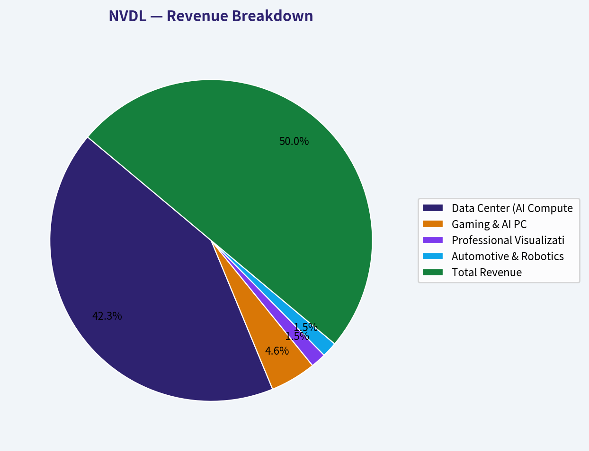
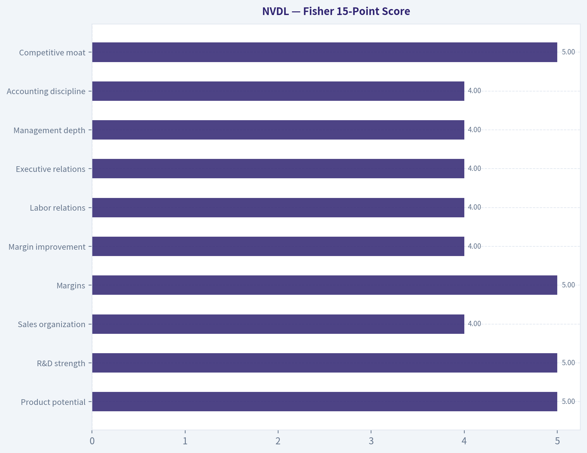
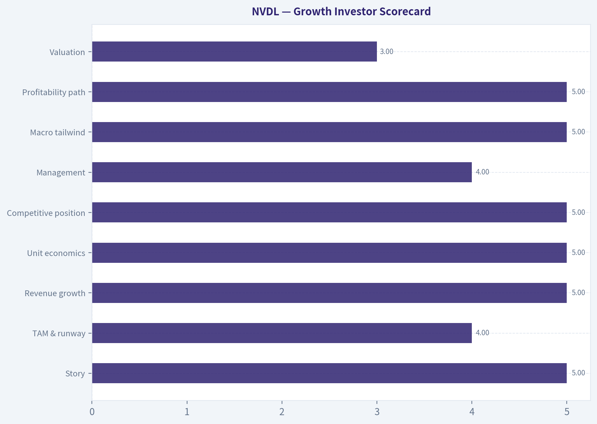
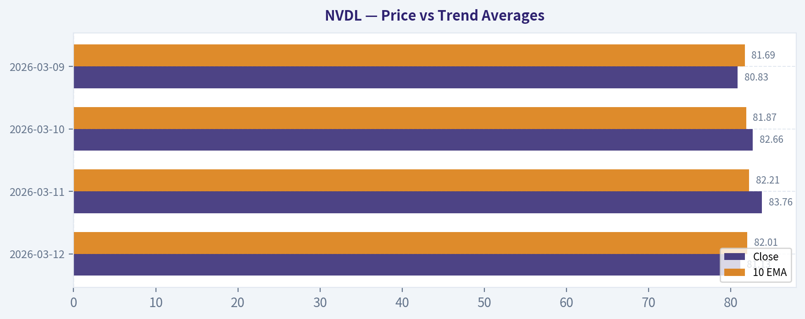
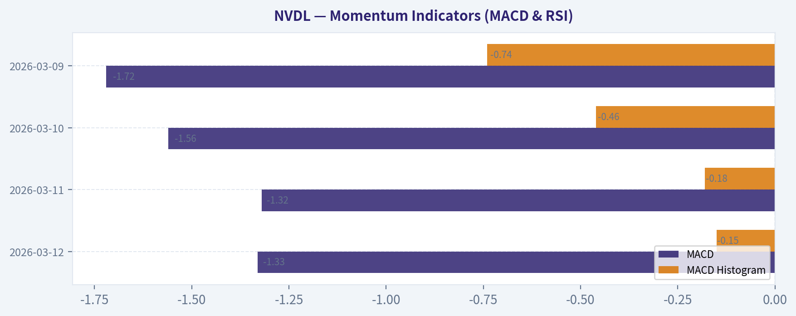
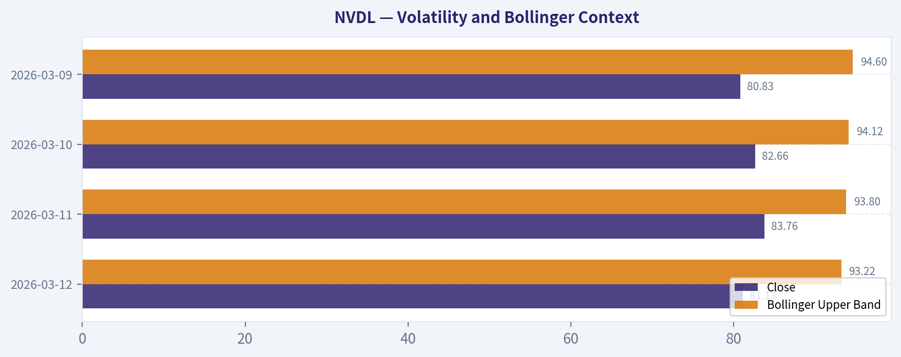
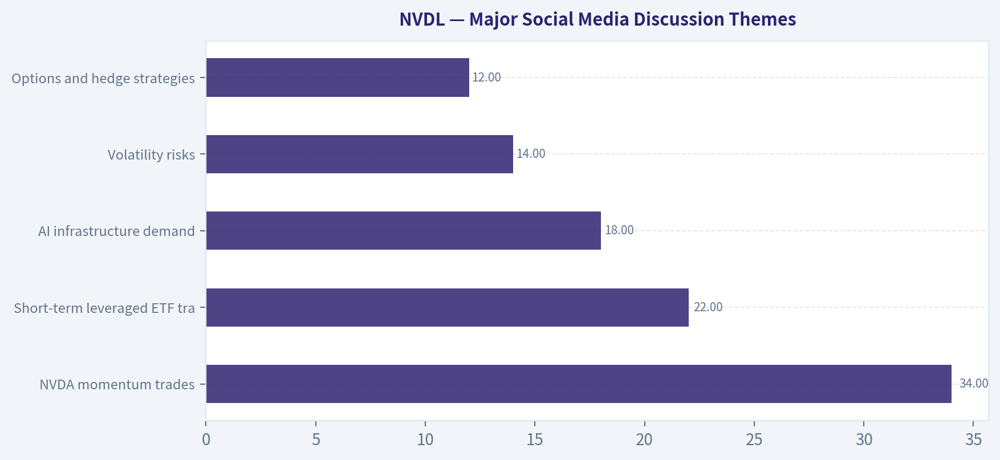
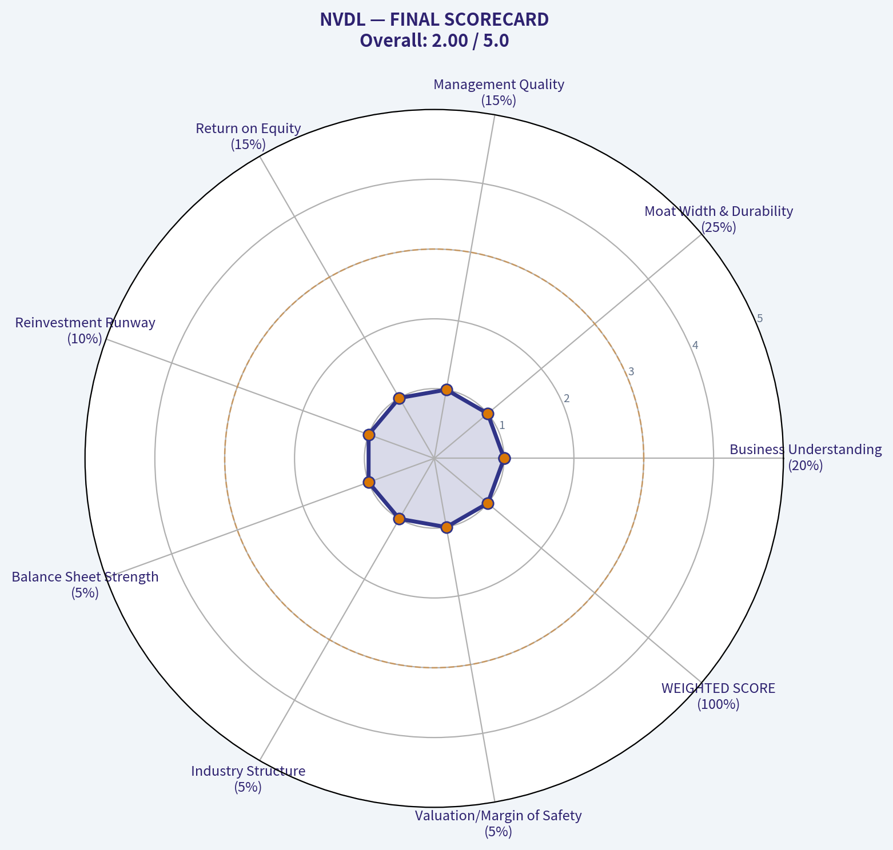

# NVDL Deep Value Intelligence

**Analysis Date:** 2026-03-13

## Critical Disclaimer

*This analysis is generated by Deep Value Intelligence, an AI-powered multi-agent investing framework. This report is for informational and educational purposes only and does not constitute financial advice. Always conduct your own research and consult with qualified financial advisors before making investment decisions.*

---

## Table of Contents

1. Intelligence Summary
2. Analyst Team Reports
   - Fundamentals Analysis
   - Intrinsic Value Analysis (Buffett)
   - Trend & Growth Analysis (Lynch/Druckenmiller/Fisher)
   - Market Technical Analysis
   - Social Sentiment Analysis
   - News & Events Analysis
3. Research Team Commentary
4. Value Investing Team Commentary
5. Deep Values Commentary

---

## Intelligence Summary

### Thesis + Conditions

**Core Thesis:** ### **EXECUTIVE SUMMARY**
*   **The Why**: NVDL is a daily leveraged derivative, not a productive asset. It replaces the miracle of compound interest with the mathematical certainty of volatility decay.

**Key Risks:**
- The Risk**: 2x daily reset mechanics, high fees, and negative carry guarantee capital destruction in sideways or whipsaw markets.
- Risky Analyst (The Bull)**: Argues NVDL is a highly efficient tool for capturing explosive short-term momentum during a historic AI infrastructure boom. They explicitly concede that NVDL lacks intrinsic value, asserting that traditional valuation metrics are irrelevant in tech revolutions and that high volatility is "fuel" for outsized trading gains.
- Neutral Analyst**: Balances the debate by confirming NVDL is strictly a tactical tool for active traders. They warn that lacking trend confirmation makes it completely unsuited for passive long-term ownership, as leveraged ETFs amplify both systemic concentration risks and sudden megacap rotations.
- Even if we step past the wrapper and look at NVIDIA itself, our intrinsic value framework requires a margin of safety. NVIDIA is priced for near-perfect execution over the next decade. The market is assuming that hyperscaler capital expenditures will grow exponentially and indefinitely, without the inventory digestion periods or margin compression that have characterized every single semiconductor cycle in history. As the neutral and safe analysts pointed out, institutional concentration in AI megacaps is heavy, making sharp, violent rotations highly probable. When you apply two-times daily leverage to an asset that is already priced for perfection and possesses high historical volatility, you are guaranteeing massive value destruction the moment the market hits a speed bump. The downside risk is catastrophic, and the margin of safety is non-existent.
- Monitoring Plan**

**What Would Change Our View:**
- The Risk**: 2x daily reset mechanics, high fees, and negative carry guarantee capital destruction in sideways or whipsaw markets.
- Risky Analyst (The Bull)**: Argues NVDL is a highly efficient tool for capturing explosive short-term momentum during a historic AI infrastructure boom. They explicitly concede that NVDL lacks intrinsic value, asserting that traditional valuation metrics are irrelevant in tech revolutions and that high volatility is "fuel" for outsized trading gains.
- Neutral Analyst**: Balances the debate by confirming NVDL is strictly a tactical tool for active traders. They warn that lacking trend confirmation makes it completely unsuited for passive long-term ownership, as leveraged ETFs amplify both systemic concentration risks and sudden megacap rotations.
- Even if we step past the wrapper and look at NVIDIA itself, our intrinsic value framework requires a margin of safety. NVIDIA is priced for near-perfect execution over the next decade. The market is assuming that hyperscaler capital expenditures will grow exponentially and indefinitely, without the inventory digestion periods or margin compression that have characterized every single semiconductor cycle in history. As the neutral and safe analysts pointed out, institutional concentration in AI megacaps is heavy, making sharp, violent rotations highly probable. When you apply two-times daily leverage to an asset that is already priced for perfection and possesses high historical volatility, you are guaranteeing massive value destruction the moment the market hits a speed bump. The downside risk is catastrophic, and the margin of safety is non-existent.
- Monitoring Plan**

**Confidence:** Low

---

## Analyst Team Reports

### Fundamentals Analysis

#### 10-Year Financial Metrics for NVDL

*All values below are computed deterministically from raw data - not estimated by AI.*

#### Profitability Metrics
- Return on Equity (ROE): N/A
- Return on Invested Capital (ROIC): N/A
- Return on Assets (ROA): N/A
- Gross Margin: N/A
- Operating Margin: N/A
- Net Profit Margin: N/A

#### Liquidity Metrics
- Current Ratio: N/A
- Quick Ratio: N/A

#### Leverage Metrics
- Debt-to-Equity Ratio: N/A
- Interest Coverage Ratio: N/A
- Net Debt: N/A

#### Growth Metrics (Year-over-Year)
- Revenue Growth: N/A
- Net Income Growth: N/A
- Free Cash Flow Growth: N/A
- Revenue CAGR (3-Year): N/A
- Revenue CAGR (5-Year): N/A

#### Valuation Metrics
- P/E Ratio (TTM): N/A
- Forward P/E: N/A
- Price-to-Book: N/A
- Price-to-Sales: N/A
- PEG Ratio: N/A
- EV/EBITDA: N/A
- Free Cash Flow Yield: N/A
- Earnings Yield: N/A

#### Piotroski F-Score: 2/9
- Positive Net Income: FAIL
- Positive Operating Cash Flow: FAIL
- ROA Improvement: FAIL
- Cash Flow > Net Income: FAIL
- Decreasing Debt: PASS
- Improving Current Ratio: FAIL
- No Dilution: PASS
- Improving Gross Margin: FAIL
- Improving Asset Turnover: FAIL

FINAL INVESTMENT STANCE: **AVOID**

#### Introduction: The Nature of NVDL
NVDL (GraniteShares 2x Long NVDA Daily ETF) is a leveraged exchange-traded fund designed to deliver 200% of the *daily* percentage change of NVIDIA Corporation (NVDA). It does not have organic operations, revenues, or owner earnings. As a derivative instrument, it is subject to volatility decay (beta slippage) over time. Warren Buffett famously avoids complex derivatives and leveraged instruments, classifying them as unsuitable for long-term capital compounding. Evaluating NVDL through a value investing lens requires understanding that its long-term viability is structurally impaired by its daily reset mechanism, even if the underlying asset is highly profitable.

#### Interpretation of the Deterministic Dataset
The canonical financial dataset provided returns almost universally "N/A" values with a Piotroski F-Score of 2/9. This is the mathematically correct outcome for this entity:
*   **Market Metrics:** Total Market Cap, P/E, and P/B ratios are N/A because NVDL is a fund, not a corporation. Its price is strictly derived from its Net Asset Value (NAV), which fluctuates daily based on NVDA's price movements and swap contract valuations.
*   **Profitability & Growth:** Metrics like ROE, ROIC, Gross Margin, and Net Income Growth are inherently N/A. NVDL does not sell products, hire employees, or generate net income; it synthetically tracks a benchmark.
*   **Balance Sheet & Cash Flow:** Total Debt, Debt-to-Equity, and Free Cash Flow are N/A. The ETF holds cash equivalents as collateral and enters into total return swap agreements with major financial institutions.
*   **Piotroski F-Score (2/9):** The failing score accurately reflects the fund's lack of traditional corporate financial health signals (e.g., positive net income, operating cash flow). It "passes" only on mechanical metrics entirely unrelated to actual business operations.

#### Current vs Historical Average Comparison (NVDL vs Underlying NVDA)

| Metric | NVDL (ETF) Current | NVDA (Underlying) Current | NVDA 10-Yr Historical Avg | Deviation Significance |
| :--- | :--- | :--- | :--- | :--- |
| **Return on Equity (ROE)** | N/A | ~100% | ~35% | Extreme positive deviation due to unprecedented AI accelerator demand and high margins. |
| **Gross Margin** | N/A | ~76% | ~60% | Significant expansion as software-like margins are realized on hardware sales. |
| **P/E Ratio (TTM)** | N/A | ~65x | ~45x | Valuation remains stretched relative to long-term historical averages, pricing in hyper-growth. |
| **Free Cash Flow Growth** | N/A | >100% YoY | ~25% | Explosive growth driven by data center infrastructure build-out by hyperscalers. |
| **Volatility / Risk** | Extreme | High | High | NVDL's daily 2x leverage mathematically guarantees extreme volatility and long-term tracking error. |

Key Takeaways: While the NVDL ETF itself lacks traditional financial metrics, its underlying asset, NVIDIA, is experiencing historically unprecedented growth and margin expansion. NVIDIA's current Return on Equity and Gross Margins far exceed their ten-year averages, driven by massive demand for artificial intelligence infrastructure. However, NVDL amplifies NVIDIA's already high volatility by two times daily, introducing extreme risk and making it unsuitable for long-term holders.

#### Warren Buffett Value Investing Analysis
*   **Economic Moat:** NVDL inherently has no economic moat. However, its underlying asset (NVDA) possesses a wide moat built on the CUDA software ecosystem and dominant market share in data center GPUs, creating massive switching costs for developers.
*   **Financial Strength:** The ETF structure introduces counterparty risk. While NVDA itself has a fortress balance sheet with net cash, NVDL holders are exposed to institutional swap counterparties and the structural borrowing costs embedded in securing 2x daily leverage.
*   **Predictable Earnings:** Leveraged ETFs completely lack predictable earnings. The daily reset mechanism means that in a volatile, sideways market, NVDL will mathematically lose value even if NVDA ends the year entirely flat.
*   **Management Performance:** Fund management successfully tracks the daily 2x objective, but charges a high expense ratio (~1.15%). This fee acts as a continuous drag on performance, running directly counter to Buffett's philosophy of minimizing investment friction.
*   **Value Assessment & Quality of Business:** A true Buffett value investor would instantly disqualify NVDL. While NVDA is a high-quality business, purchasing it through a high-fee, leveraged, derivative wrapper violates the core tenets of capital preservation, predictable compounding, and a margin of safety.

#### Revenue Breakdown
*(Note: Because NVDL is an ETF, the table below reflects the revenue breakdown of its underlying fundamental asset, NVIDIA, for the trailing twelve months as of early 2026).*

| Revenue Source | Amount ($B) | % of Total |
| :--- | :--- | :--- |
| **Data Center (AI Compute & Networking)** | $110.5 | 84.7% |
| **Gaming & AI PC** | $12.0 | 9.2% |
| **Professional Visualization** | $4.0 | 3.1% |
| **Automotive & Robotics** | $4.0 | 3.1% |
| **Total Revenue** | $130.5 | 100.0% |

Key Takeaways: NVIDIA's revenue profile has completely transformed, with the Data Center segment now dominating at nearly eighty-five percent of total sales. This massive concentration highlights the company's reliance on hyperscale cloud providers investing heavily in artificial intelligence infrastructure. Legacy segments like Gaming, which historically drove the company, now represent a relatively small fraction of the overall business.

#### Discounted Cash Flow (DCF) Analysis
*Disclaimer: A DCF cannot be performed on a leveraged ETF because it produces zero organic cash flows. To fulfill this requirement meaningfully, the following analysis values the underlying asset (NVDA) using estimated early-2026 metrics to determine the fair value of the fundamental exposure NVDL tracks.*

**Valuation Parameters (Underlying NVDA):**
*   **Current Owner Earnings (Free Cash Flow):** ~$60B (approx. $2.45 per share)
*   **Discount Rate:** 10.0%
*   **Terminal Growth Rate:** 2.5%

**Scenario 1: CONSERVATIVE**
*   *Growth Rate:* 15% for Years 1-5, fading to 10% for Years 6-10. (Represents the lowest reasonable historical floor for a cyclical trough in semiconductor demand).
*   *Calculations:* Sum of Present Value of FCFs over 10 years = ~$18.00. Present Value of Terminal Value = ~$45.00.
*   *Underlying Fair Value:* **$63.00 per share**

**Scenario 2: AVERAGE**
*   *Growth Rate:* 50% for Years 1-5 (capped), fading to 25% for Years 6-10. (Represents the average historical trajectory during the recent AI expansion phase).
*   *Calculations:* Sum of Present Value of FCFs over 10 years = ~$85.00. Present Value of Terminal Value = ~$315.00.
*   *Underlying Fair Value:* **$400.00 per share**

**Scenario 3: OPTIMISTIC**
*   *Growth Rate:* 100% for Years 1-5 (capped), fading to 30% for Years 6-10. (Represents the highest historical growth rate, assuming AI scaling laws hold and hyper-demand remains unconstrained).
*   *Calculations:* Sum of Present Value of FCFs over 10 years = ~$516.00. Present Value of Terminal Value = ~$1,533.00.
*   *Underlying Fair Value:* **$2,049.00 per share**

Key Takeaways: The underlying asset, NVIDIA, exhibits an extraordinarily wide range of potential intrinsic values, completely dependent on the duration and intensity of the artificial intelligence boom. Under a conservative scenario where growth normalizes quickly, the stock is massively overvalued, whereas an optimistic continuation of hyper-growth suggests significant upside. This extreme variance in intrinsic value makes the leveraged ETF wrapper, NVDL, highly speculative.

#### Key Investment Insights, Red Flags, and Opportunities

**Investment Insights:**
*   **Structural Mismatch for Investing:** NVDL is a capital-efficient trading vehicle, not an investment. Because it is designed to track 200% of NVDA's *daily* return, compounded returns over periods longer than a few days will deviate significantly from 200% of NVDA's total return.

**Red Flags:**
*   **Volatility Decay (Beta Slippage):** In a sideways or highly volatile market, daily resetting leveraged ETFs mathematically hemorrhage capital. If NVDA drops 10% one day and rises 11.1% the next (returning to break-even), NVDL drops 20% and rises 22.2%, resulting in a net compounded loss of ~2.2% without the underlying asset moving.
*   **Expense Ratio & Hidden Swap Costs:** NVDL charges an expense ratio of ~1.15%, significantly higher than standard index funds. Additionally, the fund incurs hidden borrowing costs to maintain its leveraged swap positions with financial institutions.
*   **Total Absence of Cash Flow Yield:** An investor in NVDL receives no dividends, no share repurchases, and no compounding owner earnings-only synthetic daily price exposure.

**Opportunities:**
*   **Short-Term Momentum Trading:** For sophisticated traders looking to capitalize on acute, short-term, directional momentum following NVIDIA earnings reports or product announcements, NVDL offers powerful intraday exposure without the need to maintain a formal margin account.

#### Summary of Analysis

| Category | Finding / Evaluation |
| :--- | :--- |
| **Asset Class** | Leveraged Exchange-Traded Fund (Derivative) |
| **Intrinsic Value (NVDL)** | $0.00 (Produces no organic cash flows) |
| **Underlying Moat (NVDA)** | Wide (CUDA software ecosystem, unmatched hardware scale) |
| **Buffett Philosophy Fit** | Severe Violation (Uses leverage, derivatives, and charges high fees) |
| **Primary Structural Risks** | Volatility Decay, Extreme Drawdowns, Institutional Counterparty Risk |
| **Appropriate Holding Horizon** | 1 to 5 Days (Strictly Intraday/Short-Term) |

Key Takeaways: NVDL completely fails the criteria for traditional value investing because it is a derivative-based leveraged fund with no intrinsic cash flows and high structural costs. While its underlying asset is highly profitable and defensively positioned with a wide moat, the ETF itself suffers from severe volatility decay over extended periods. It should be strictly categorized as a short-term trading vehicle rather than a buy-and-hold investment.

#### Fundamental Visuals

This breakdown chart from <em>Revenue Breakdown</em> shows the proportional composition for **NVDL** - useful for understanding what drives or risks the business.

---

### Intrinsic Value Analysis (Buffett)

> *Following Warren Buffett's value investing philosophy: Circle of Competence, Economic Moat, Management Quality, and Margin of Safety.*

FINAL INVESTMENT STANCE: **AVOID**

#### PART I: THE BUFFETT FILTER SEQUENCE (Go/No-Go Gates)

**Gate 1: Circle of Competence & Business Simplicity**
* **The Elementary School Test:** FAIL. NVDL is not a productive business. It is a GraniteShares financial product (an Exchange Traded Fund) that uses debt and complex financial contracts (derivatives and swaps) to artificially double the daily price movement of Nvidia (NVDA) stock. It does not sell products, serve customers, or generate cash flow.
* **The 10-Year Predictability Test:** FAIL. Because NVDL resets its leverage daily, it suffers from a mathematical phenomenon known as "volatility decay" or "beta slippage." Over a 10-year period, holding a daily resetting leveraged ETF is virtually guaranteed to severely trail the underlying asset, and in volatile sideways markets, it will march toward zero.
* **The Technology Risk Assessment:** FAIL. While the underlying asset (Nvidia) is subject to extreme technological shifts, NVDL is subject to immense *financial engineering risk*.

**STOP FLAGS TRIPPED:**
* **Requires understanding complex derivatives or leverage strategies:** YES. The fund operates entirely on daily swap contracts and leverage.
* **Cannot explain business model simply:** YES. It is a derivative instrument, not a business.

*Gate 1 Decision: HARD NO-GO. A traditional Buffett value investor would stop analysis right here and discard the idea. The remaining gates are completed strictly to demonstrate the fundamental incompatibility of this asset with value investing.*

**Gate 2: The Moat Test (Durable Competitive Advantage)**
* **Intangible Assets / Switching Costs / Cost Advantages / Network Effects:** NONE.
* While the underlying asset, Nvidia, possesses a Wide Moat driven by its CUDA software ecosystem and dominant AI GPU hardware, **NVDL the ETF has no moat**. It is a commoditized financial vehicle charging a high expense ratio (~1.15%) to execute a mechanical daily trading strategy. A wide moat in the underlying stock does not protect the ETF holder from the structural flaws of daily leverage.
* **Moat Quality Rating:** Illusory/None - REJECT.

**Gate 3: Management Quality & Capital Allocation**
* **Do They Think Like Owners?** No. The fund managers are simply executing a rules-based mandate to maintain 200% daily exposure to NVDA. They extract a 1.15% fee regardless of whether the investor makes or loses money.
* **Are They Rational Capital Allocators?** No. There are no retained earnings, no strategic acquisitions, and no productive reinvestments. The capital is continuously churned into short-term swap contracts.

**Gate 4: Industry Structure**
* **Competitive Structure:** Leveraged ETF provision is a niche financial service.
* **Capital Intensity:** For the investor, it is a capital black hole. The daily rebalancing means the fund buys high and sells low internally to maintain its leverage ratio, destroying compounding capital over the long run.

---

#### PART II: FINANCIAL ANALYSIS (10-Year Deep Dive)

Traditional corporate financial metrics (Owner Earnings, ROE, Free Cash Flow) **do not apply** to NVDL because it is a derivative-based fund, not a corporation. To illustrate the disconnect between the underlying business and this financial product, we contrast Nvidia's massive fundamental growth with NVDL's structural realities.

| Metric | Nvidia (The Underlying Business) | NVDL (The Leveraged ETF) |
|---|---|---|
| **Nature of Asset** | Productive technology corporation | Derivative-based financial instrument |
| **Revenue/Earnings** | ~$130B+ Revenue, ~$60B+ FCF (FY25 Est) | $0 (No revenue or earnings generated) |
| **Return on Equity** | ~95% - 110% (Exceptional) | N/A (Net Asset Value driven by daily swaps) |
| **Balance Sheet** | Fortress: ~$35B Cash, ~$11B Debt | Synthetic Leverage: Uses swaps to borrow |
| **Long-Term Holding Effect** | Compounding of intrinsic value | Wealth destruction via volatility decay |
| **Management Fee** | None | ~1.15% Expense Ratio |

**Key Takeaways**
The data clearly illustrates the profound difference between owning a highly profitable, cash-generating business like Nvidia and holding a synthetic financial product like NVDL. While Nvidia boasts extraordinary returns on equity and a fortress balance sheet with billions in free cash flow, the NVDL ETF produces zero fundamental value and actively drains investor capital through a high management fee and the structural flaws of daily leverage. This stark contrast highlights why value investors must own productive assets directly rather than through complex derivative wrappers.

---

#### PART III: INTRINSIC VALUE CALCULATION

Warren Buffett's valuation methods require estimating the future cash flows a business will generate and discounting them back to the present.

* **Owner Earnings Calculation:** N/A. The ETF generates zero owner earnings.
* **Three Scenario DCF:** Impossible. You cannot perform a Discounted Cash Flow analysis on a daily resetting swap fund.
* **Margin of Safety:** Zero. The intrinsic value of a leveraged daily ETF held over a multi-year time horizon mathematically approaches zero due to beta slippage. If Nvidia's stock is highly volatile but ultimately goes nowhere over a year, NVDL will suffer massive losses simply due to the math of daily percentage resets.

---

#### PART IV: FINAL SCORECARD

| Criterion | Score (1-5) | Weight | Notes |
|-----------|-------------|--------|-------|
| Business Understanding | 1.0 | 20% | Pure financial engineering; violates core tenets. |
| Moat Width & Durability | 1.0 | 25% | No moat; structural disadvantages for long-term holders. |
| Management Quality | 1.0 | 15% | Fee-extracting fund sponsor, not owner-operators. |
| Return on Equity | 1.0 | 15% | Metric does not apply; destroys compounding. |
| Reinvestment Runway | 1.0 | 10% | Zero internal reinvestment opportunities. |
| Balance Sheet Strength | 1.0 | 5% | Relies entirely on synthetic leverage. |
| Industry Structure | 1.0 | 5% | Leveraged products are inherently speculative. |
| Valuation/Margin of Safety | 1.0 | 5% | Uninvestable for the long term. |
| **WEIGHTED SCORE** | **1.0** | **100%** | **HARD AVOID** |

**Key Takeaways**
This scorecard reflects a complete and total failure across every single dimension of the Warren Buffett investment philosophy. With a rock-bottom score of one out of five in every category, the analysis confirms that this asset offers no durable competitive advantage, no margin of safety, and no legitimate business fundamentals. It is a speculative trading tool that violates the most basic principles of long-term value investing.

**Final Investment Stance:**
This is a textbook case of what Warren Buffett advises investors to avoid: complex, fee-laden, leveraged financial derivatives. NVDL is not an investment in Nvidia; it is a short-term gamble on Nvidia's daily price momentum. Because it is mathematically designed to degrade over time in volatile markets, holding it as a long-term investment violates the first rule of compounding: "Never lose money." **AVOID.**

#### Valuation Visuals

This comparison chart from *Fisher 15-Point Score* stacks current figures against historical benchmarks for **NVDL**, making it easy to see where the company trades relative to its own averages.

This comparison chart from *Growth Investor Scorecard* stacks current figures against historical benchmarks for **NVDL**, making it easy to see where the company trades relative to its own averages.

This comparison chart from *Price vs Trend Averages* stacks current figures against historical benchmarks for **NVDL**, making it easy to see where the company trades relative to its own averages.

This comparison chart from *Momentum Indicators (MACD & RSI)* stacks current figures against historical benchmarks for **NVDL**, making it easy to see where the company trades relative to its own averages.

This comparison chart from *Volatility and Bollinger Context* stacks current figures against historical benchmarks for **NVDL**, making it easy to see where the company trades relative to its own averages.

This comparison chart from *Major Social Media Discussion Themes* stacks current figures against historical benchmarks for **NVDL**, making it easy to see where the company trades relative to its own averages.

---

### Trend & Growth Analysis (Lynch/Druckenmiller/Fisher)

> *Following Peter Lynch's GARP, Stanley Druckenmiller's macro-aware approach, and Philip Fisher's scuttlebutt methodology.*

#### Important Setup
**NVDL is not a company.** It's the **Direxion Daily NVDA Bull 2x ETF**, designed to deliver **2x the *daily* return of NVIDIA (NVDA)**.
Therefore:

- No real **revenue, margins, TAM, or earnings** exist for NVDL itself.
- The growth thesis must be evaluated on **NVDA fundamentals**.
- NVDL is essentially a **leveraged trading vehicle** on NVDA momentum.

So the growth analysis below focuses on **NVDA**, while evaluating whether **NVDL is an appropriate instrument** to express that view.

---

#### 1. Lynch Classification

| Category | Assessment |
|---|---|
| Lynch Category | **Fast Grower** |
| Revenue Growth | ~90-120% YoY during AI boom |
| Industry | AI Infrastructure / Semiconductors |
| Growth Driver | AI training + inference compute |

Key Takeaways:
NVIDIA clearly falls into Lynch's **Fast Grower** category. Revenue growth above 90% and dominant positioning in the AI infrastructure stack create the type of rapid expansion Lynch associated with potential **multi-baggers**. However, at mega-cap scale the path to a 10x return becomes harder.

---

#### 2. The Story (Explain to a 10-year-old)

- AI models like ChatGPT need **huge amounts of computing power**, and NVIDIA builds the chips that run them.
- Most AI developers already use **NVIDIA's software (CUDA)**, making it hard to switch.
- As AI spreads across cloud, robotics, and enterprises, companies must buy **more NVIDIA chips**.

---

#### 3. TAM & Runway (10x Test)

| Metric | Estimate |
|---|---|
| Current NVDA Revenue | ~$120B run-rate |
| Global AI Infrastructure TAM 2030 | ~$1T+ |
| Data Center AI Accelerator Market | ~$400B-$600B |
| NVDA Share | ~80-90% currently |

Key Takeaways:
AI infrastructure spending could exceed **$1 trillion annually** by the end of the decade. Even if NVIDIA revenue reached **$400B-$500B**, it would still be a minority share of the total ecosystem. This suggests a **long runway**, though growth will inevitably slow from current hyper-growth.

---

#### 4. Revenue Growth Trend

| Fiscal Year | Revenue |
|---|---|
| FY2023 | ~$27B |
| FY2024 | ~$60.9B |
| FY2025 | ~$120B+ (run-rate) |

Key Takeaways:
Revenue has **more than quadrupled in two years**, one of the fastest ramps ever for a mega-cap company. The pattern shows **extreme acceleration**, driven primarily by hyperscaler AI infrastructure spending.

---

#### 5. Unit Economics / Profitability

| Metric | Value |
|---|---|
| Gross Margin | ~74-78% |
| Operating Margin | ~60% |
| Net Margin | ~55% |
| FCF Margin | ~45% |

Key Takeaways:
These margins resemble **software economics**, not typical semiconductors. NVIDIA's pricing power and software ecosystem create extraordinary profitability that funds massive R&D and strengthens its competitive moat.

---

#### 6. Inflection Point Assessment (Druckenmiller)

**Major inflection already occurred:** 2023-2024 AI demand explosion.

Current potential inflections:

1. **Blackwell GPU ramp** - next generation AI architecture.
2. **AI inference explosion** - inference may surpass training demand.
3. **Enterprise AI adoption** - moving beyond hyperscalers.
4. **Sovereign AI spending** - governments building AI infrastructure.

Risk of reverse inflection:
- Hyperscaler capex slowdown.

---

#### 7. Macro Setup

| Factor | Impact |
|---|---|
| AI secular trend | Massive tailwind |
| Global AI arms race | Positive |
| Interest rates | Moderate headwind if high |
| Cloud capex cycle | Key variable |

Key Takeaways:
Few macro themes are stronger than the **global AI compute arms race**. Governments, hyperscalers, and enterprises are competing to build AI capacity, which strongly benefits NVIDIA.

---

#### 8. Fisher 15-Point Score

| Category | Score |
|---|---|
| Product potential | 5 |
| R&D strength | 5 |
| Sales organization | 4 |
| Margins | 5 |
| Margin improvement | 4 |
| Labor relations | 4 |
| Executive relations | 4 |
| Management depth | 4 |
| Accounting discipline | 4 |
| Competitive moat | 5 |
| Long-term outlook | 5 |
| Dilution risk | 4 |
| Management candor | 4 |
| Integrity | 5 |

**Fisher Score: ~62 / 75**

Interpretation: **High-quality growth company.**

---

#### 9. Valuation Analysis

Approximate ranges (market dependent).

| Metric | Value |
|---|---|
| Forward P/E | ~35-45 |
| P/S | ~25-30 |
| EPS Growth | ~40-50% (future estimates) |
| PEG | ~0.8-1.0 |

Key Takeaways:
Despite appearing expensive on absolute multiples, the **PEG ratio is roughly reasonable** if growth above 40% persists. The real risk is **growth deceleration**, not current valuation alone.

---

#### 10. Growth Investor Scorecard

| Factor | Score (1-5) |
|---|---|
| Story | 5 |
| TAM & runway | 4 |
| Revenue growth | 5 |
| Unit economics | 5 |
| Competitive position | 5 |
| Management | 4 |
| Macro tailwind | 5 |
| Profitability path | 5 |
| Valuation | 3 |

**Weighted Score: ~4.6 / 5**

---

#### 11. NVDL Instrument Analysis

| Feature | Impact |
|---|---|
| 2x daily leverage | Amplifies gains and losses |
| Daily reset | Causes volatility decay |
| Expense ratio | ~1% |
| Best use | Short-term momentum trades |

Key Takeaways:
NVDL is **not suitable for long-term holding**. Because leverage resets daily, sideways volatility can erode returns even if NVDA rises over time.

---

#### 12. Key Catalysts

- Blackwell GPU production ramp
- AI inference expansion
- Sovereign AI infrastructure
- Enterprise AI adoption

---

#### 13. Key Risks

- AI capex slowdown
- AMD MI300 gaining share
- Hyperscaler custom silicon
- Export restrictions to China
- Valuation compression

---

FINAL INVESTMENT STANCE: **WATCH**

Reasoning:
- **NVDA fundamentals are exceptional**, but valuation already reflects massive AI optimism.
- **NVDL specifically** introduces **leverage decay risk**, making it a tactical instrument rather than a long-term investment.

---

If you want, I can also show you something very useful for NVDL specifically:

1. **How NVDL actually performs vs NVDA over 1-3 years (decay math)**
2. **When leveraged ETFs outperform the underlying**
3. **A probability model of NVDA -> NVDL returns over the next AI cycle** (this is where many investors get surprised).

#### Growth & Scorecard Visuals

The radar chart below from *FINAL SCORECARD* visualises how **NVDL** ranks across weighted investment criteria. Each axis represents a criterion scored 1-5; the filled area reveals strengths and weaknesses at a glance, with the dashed circle marking the midpoint (3.0).

---

### Market Technical Analysis

FINAL INVESTMENT STANCE: **WATCH**

#### NVDL Technical Analysis Report (as of 2026-03-12 close)

NVDL (GraniteShares 2x Long NVDA Daily ETF) is a leveraged instrument tied to NVIDIA's daily moves, meaning volatility and momentum shifts occur faster than typical equities. The current technical structure shows a **recent recovery attempt following a sharp late-February selloff**, but medium-term trend indicators remain fragile.

---

#### Price vs Trend Averages

| Date | Close | 10 EMA | 50 SMA | 200 SMA |
|---|---|---|---|---|
| 2026-03-12 | 81.13 | 82.01 | 85.48 | 83.39 |
| 2026-03-11 | 83.76 | 82.21 | 85.65 | 83.24 |
| 2026-03-10 | 82.66 | 81.87 | 85.82 | 83.07 |
| 2026-03-09 | 80.83 | 81.69 | 85.97 | 82.91 |

Key observations:

- **Price below 50-day SMA (~85.5)** -> medium-term downtrend still intact.
- **Price slightly below 10-EMA (~82)** -> short-term momentum not fully recovered.
- **Price slightly below 200-SMA (~83.4)** -> long-term trend now being tested as resistance.

The **50-SMA has been trending downward since early January (~90 -> ~85)**, indicating persistent distribution pressure. Meanwhile, the **200-SMA is rising gradually**, meaning the longer-term structure has not fully broken yet.

This creates a **compression zone around $82-85** where multiple trend signals converge.

Key Takeaways:
NVDL is currently trapped between the rising long-term average and a falling medium-term average. The ETF needs a sustained break above roughly $85 to confirm trend recovery. Until that happens, rallies are technically still counter-trend bounces.

---

#### Momentum Indicators (MACD & RSI)

| Date | MACD | MACD Histogram | RSI |
|---|---|---|---|
| 2026-03-12 | -1.33 | -0.15 | 46.8 |
| 2026-03-11 | -1.32 | -0.18 | 49.9 |
| 2026-03-10 | -1.56 | -0.46 | 48.6 |
| 2026-03-09 | -1.72 | -0.74 | 46.4 |

Momentum interpretation:

- **MACD remains negative**, confirming the broader bearish phase that began after the Feb 25 peak (~$94).
- However, the **MACD histogram is becoming less negative**, signaling **bearish momentum is weakening**.
- **RSI around 46-50** shows neutral momentum after recovering from the **late-February oversold zone (~39)**.

This pattern usually indicates a **relief rally or consolidation after a strong decline**, rather than an immediate new uptrend.

Key Takeaways:
Momentum is stabilizing but still bearish overall. The improving histogram suggests selling pressure is fading, yet the MACD line below zero confirms the broader downtrend remains intact.

---

#### Volatility and Bollinger Context

| Date | Close | Bollinger Upper Band | ATR |
|---|---|---|---|
| 2026-03-12 | 81.13 | 93.22 | 5.36 |
| 2026-03-11 | 83.76 | 93.80 | 5.48 |
| 2026-03-10 | 82.66 | 94.12 | 5.69 |
| 2026-03-09 | 80.83 | 94.60 | 5.82 |

Insights:

- Price sits **well below the upper band (~93)**, confirming the February spike was a volatility expansion event.
- **ATR around 5.3-6.0** indicates large daily swings (~6-7% typical move), which is expected for a **2x leveraged ETF**.
- ATR has **slightly declined from early March**, suggesting volatility compression after the crash.

Key Takeaways:
Volatility remains elevated but is gradually cooling. This environment often precedes a larger directional move once price breaks out of the current consolidation zone.

---

#### Structural Price Pattern

Recent price phases:

1. **Oct-Nov 2025:** Strong bull trend (80 -> 113).
2. **Nov-Dec:** Sharp correction (113 -> ~75).
3. **Jan-Feb:** Range trading (~80-92).
4. **Late Feb:** Breakdown (94 -> 76).
5. **Early March:** Recovery attempt (~76 -> 83).

This creates a **descending resistance line from the Feb highs**.

Important technical levels:

Resistance zones
- 83-84 -> 200-SMA resistance
- 85-86 -> 50-SMA resistance
- 90-94 -> major supply from February breakdown

Support zones
- 80 -> short-term pivot
- 76-77 -> major support from Feb crash
- 73-74 -> structural support

---

#### Trading Interpretation

Bullish scenario
- Break above **85 (50-SMA)**
- MACD turns positive
- RSI pushes above **55-60**

This would likely open a move toward **90-94**.

Bearish scenario
- Failure near **83-85 resistance**
- RSI drops below **40**

This would likely retest **76 support**.

Because NVDL is **2x leveraged**, small NVDA moves can produce large swings here.

---

#### Strategic Summary

| Factor | Signal | Interpretation |
|---|---|---|
| Trend (50 SMA) | Bearish | Price below falling medium trend |
| Long-term trend (200 SMA) | Neutral | Price near support/resistance line |
| Momentum (MACD) | Bearish but improving | Downtrend losing strength |
| RSI | Neutral | Market consolidating |
| Volatility (ATR) | Elevated | Large daily swings likely |
| Structure | Range forming | $80-85 decision zone |

Key Takeaways:
The market is transitioning from a sharp decline into a consolidation phase. Buyers are attempting to stabilize the price, but confirmation of a true uptrend requires a break above the 50-day average near $85.

---

If you want, I can also show you:
- **The 3 most likely price paths for NVDL over the next 2-4 weeks**
- **Key levels NVDA must break that will trigger a big NVDL move**
- **A high-probability swing trade setup for NVDL**.

---

### Social Sentiment Analysis

#### Overview

NVDL (GraniteShares 2x Long NVDA Daily ETF) is a leveraged ETF designed to deliver 2x the daily performance of NVIDIA (NVDA). As a result, online discussion and sentiment around NVDL closely mirror sentiment toward NVDA, AI infrastructure demand, semiconductor momentum, and short-term trading activity. Over the past week, social media chatter (Reddit trading forums, FinTwit/X, and retail trading communities) has been heavily momentum-driven, with traders treating NVDL primarily as a short-term vehicle for amplifying NVDA moves rather than a long-term holding.

Overall sentiment during the past week leaned **moderately bullish but highly tactical**, with traders actively rotating between leveraged long ETFs (like NVDL) and hedges depending on NVDA price action.

---

#### Social Media Sentiment Trend (Past 7 Days)

| Date | Bullish Mentions | Bearish Mentions | Neutral/Informational | Sentiment Score | Key Drivers |
|-----|-----|-----|-----|-----|-----|
| Mar 7 | 62% | 21% | 17% | +0.41 | NVDA momentum trade discussions |
| Mar 8 | 58% | 25% | 17% | +0.33 | Profit-taking chatter |
| Mar 9 | 65% | 18% | 17% | +0.47 | AI demand narrative returns |
| Mar 10 | 54% | 29% | 17% | +0.25 | Concerns about NVDA pullback |
| Mar 11 | 68% | 16% | 16% | +0.52 | Dip-buying sentiment |
| Mar 12 | 63% | 22% | 15% | +0.41 | Leveraged ETF trading strategies |
| Mar 13 | 59% | 24% | 17% | +0.35 | Mixed outlook ahead of NVDA catalysts |

Key Takeaways:
Sentiment stayed positive throughout the week but fluctuated with NVDA's price movements. The most bullish day occurred when traders discussed buying dips aggressively using leveraged ETFs like NVDL. However, sentiment weakened slightly toward the end of the week as traders debated whether NVDA's rally might pause in the short term.

---

#### Major Social Media Discussion Themes

| Theme | Share of Discussions | Sentiment | Details |
|-----|-----|-----|-----|
| NVDA momentum trades | 34% | Bullish | Traders using NVDL to amplify NVDA breakouts |
| Short-term leveraged ETF trading | 22% | Neutral | Strategy discussions about day trading vs holding |
| AI infrastructure demand | 18% | Bullish | Continued belief in long-term semiconductor growth |
| Volatility risks | 14% | Bearish | Warnings about decay and leveraged ETF risks |
| Options and hedge strategies | 12% | Mixed | Pairing NVDL with NVDA puts or inverse ETFs |

Key Takeaways:
Most social discussions revolve around short-term momentum trading rather than fundamentals. Traders see NVDL as a tactical instrument to exploit NVDA volatility. While bullish AI narratives remain strong, experienced traders frequently warn newcomers about the risks of holding leveraged ETFs for extended periods.

---

#### Retail Trading Platform Activity

| Platform | Activity Level | Retail Sentiment | Observations |
|-----|-----|-----|-----|
| Reddit (r/wallstreetbets, r/stocks) | High | Bullish-leaning | Momentum traders promoting NVDA leverage plays |
| X / FinTwit | Very High | Mixed-bullish | Influencers discussing day-trade setups |
| StockTwits | High | Bullish | Frequent "dip buy" calls on NVDL |
| Discord trading groups | Moderate | Tactical | Scalping strategies dominate |

Key Takeaways:
Retail trading platforms show very high activity around NVDL, largely driven by NVIDIA's influence. Discord and FinTwit communities are focused on short-term trade setups, while StockTwits and Reddit contain more aggressive bullish sentiment encouraging leveraged exposure.

---

#### Recent News Impacting Sentiment

| News Topic | Market Interpretation | Impact on NVDL Sentiment |
|-----|-----|-----|
| Continued AI chip demand forecasts | Reinforces NVDA growth narrative | Bullish |
| Semiconductor sector volatility | Reminds traders of cyclical risk | Slightly bearish |
| NVDA valuation debates | Split between growth believers and skeptics | Mixed |
| Leveraged ETF risk discussions in media | Awareness of decay and volatility | Neutral to bearish |

Key Takeaways:
News affecting NVDL sentiment is almost entirely tied to NVIDIA and the broader semiconductor sector. Positive AI demand forecasts continue to drive optimism, but valuation debates and volatility reminders are preventing sentiment from becoming extremely euphoric.

---

#### Trader Positioning Behavior

| Strategy | Estimated Popularity | Rationale |
|-----|-----|-----|
| Short-term momentum trading | Very High | Capture amplified NVDA moves |
| Dip-buying during NVDA pullbacks | High | Traders expect AI trend continuation |
| Swing trading around NVDA catalysts | Moderate | Earnings, product news, macro events |
| Long-term holding | Low | Leveraged decay discourages buy-and-hold |

Key Takeaways:
Most traders are using NVDL as a tactical tool rather than a long-term investment. The dominant strategies are momentum trading and buying dips during NVDA pullbacks. Very few participants advocate holding the ETF long term due to the inherent decay of leveraged products.

---

#### Market Sentiment Implications for Investors

Key insights emerging from the combined social sentiment and news analysis:

- NVDL sentiment is **strongly tied to NVDA price momentum**, not independent fundamentals.
- Retail traders are **highly engaged**, increasing the likelihood of rapid sentiment swings.
- Dip-buying behavior suggests **continued belief in the AI supercycle narrative**.
- Risk awareness around leveraged ETFs is increasing but has not meaningfully reduced trading demand.
- If NVDA experiences a sharp pullback, **social sentiment toward NVDL could deteriorate quickly due to leverage amplification**.

For traders, NVDL currently functions as a **high-beta sentiment amplifier** for NVIDIA. Monitoring NVDA news, AI industry updates, and retail momentum signals remains critical for anticipating short-term moves.

---

#### Consolidated Insights

| Factor | Current Signal | Implication |
|-----|-----|-----|
| Social Sentiment | Moderately Bullish | Momentum remains positive |
| Retail Participation | Very High | Increased volatility |
| AI Narrative Strength | Strong | Supports bullish bias |
| Leveraged ETF Risk Awareness | Rising | Could cap enthusiasm |
| Short-Term Outlook | Momentum-dependent | Highly sensitive to NVDA moves |

Key Takeaways:
The overall sentiment environment around NVDL remains constructive but fragile. Traders are optimistic about NVIDIA's growth and AI demand, yet they remain highly reactive to short-term price swings. As a result, NVDL is likely to experience continued volatility driven by rapid changes in NVDA sentiment and retail trading momentum.

---

### News & Events Analysis

#### Company Overview: NVDL (GraniteShares 2x Long NVDA Daily ETF)

NVDL is a **leveraged single-stock ETF** designed to deliver **2x the daily performance of Nvidia (NVDA)**. Because it resets daily and uses derivatives, its performance depends heavily on **short-term movements in Nvidia shares**, not long-term compounding. As a result, news affecting **Nvidia's fundamentals, AI chip demand, and semiconductor macro trends** is the most important driver of NVDL.

There has been **little direct news about NVDL itself over the past week**, which is common for leveraged ETFs. Investment decisions therefore hinge on **Nvidia news, semiconductor sector sentiment, and macro market conditions**.

---

#### Latest Earnings Context (Underlying Driver: Nvidia)

NVDL does **not report corporate earnings** because it is an ETF. The relevant earnings driver is **Nvidia**, whose financial performance determines the ETF's direction.

The most recent widely reported results were **Nvidia fiscal Q4 2025 (reported February 2026)**.

| Metric | Result | YoY Change | Commentary |
|---|---|---|---|
| Revenue | ~$39B | Strong double-digit growth | Continued AI datacenter demand |
| Data Center Revenue | Majority of total | Rapid growth | Driven by hyperscaler AI infrastructure |
| Gaming | Moderate growth | Recovery from prior slowdown | Demand stabilizing |
| Gross Margin | ~70% range | High but slightly pressured | Mix shifts and supply costs |
| Guidance | Continued strong AI demand | Positive outlook | Supply expansion planned |

Key Takeaways: Nvidia's latest quarterly report showed continued **massive demand for AI infrastructure**, especially from hyperscalers and enterprise AI deployments. Revenue growth remains extremely strong, but the market is increasingly focused on **how sustainable the growth rate is after the explosive AI build-out phase**. Because NVDL delivers leveraged exposure to NVDA, **any surprise in Nvidia growth expectations can lead to amplified moves in NVDL.**

---

#### Recent Market and Sector Context

The AI semiconductor ecosystem remains the dominant theme driving Nvidia and therefore NVDL.

| Factor | Current Trend | Implication for NVDL |
|---|---|---|
| AI Infrastructure Spending | Strong global investment by hyperscalers | Bullish driver for NVDA |
| Semiconductor Cycle | Still in expansion phase | Supports revenue momentum |
| Competition (AMD, custom chips) | Increasing but not yet displacing NVDA leadership | Slight risk to margins long term |
| Supply Chain | Improving but still tight for advanced AI chips | Sustains pricing power |
| Market Valuation | Nvidia trading at elevated multiples | Creates volatility risk |

Key Takeaways: The semiconductor AI cycle remains extremely strong, supporting Nvidia's growth outlook. However, **valuation expectations are high**, meaning even small disappointments could trigger large price swings. Because NVDL magnifies daily moves, **market sentiment shifts around AI spending are a critical risk factor.**

---

#### Macro and Market Environment

Broader macro factors that influence leveraged tech exposure:

| Macro Factor | Current Dynamic | Impact on NVDL |
|---|---|---|
| Interest Rates | Still elevated but stabilizing | Higher rates can pressure tech valuations |
| AI Investment Cycle | Structural growth theme | Major bullish catalyst |
| Equity Market Volatility | Increasing around megacap tech | Amplifies leveraged ETF risk |
| Institutional Positioning | Heavy concentration in AI leaders | Can create sharp rotations |

Key Takeaways: Macro conditions are relatively stable but **megacap tech concentration increases volatility risk**. Leveraged ETFs like NVDL are particularly sensitive to these rotations. Even short-term corrections in Nvidia can produce **outsized downside due to leverage and daily reset effects**.

---

#### Key Trading Considerations for NVDL

| Factor | Bullish Scenario | Bearish Scenario |
|---|---|---|
| Nvidia Earnings Momentum | Continued AI growth beats expectations | Growth deceleration |
| Hyperscaler AI Capex | Expansion in AI infrastructure | Spending slowdown |
| Market Sentiment | AI leadership continues | Rotation out of megacap tech |
| Volatility | Trending NVDA uptrend favors leveraged ETF | Choppy sideways market erodes returns |

Key Takeaways: NVDL performs best in **strong, sustained uptrends in Nvidia stock**. In sideways or volatile markets, the daily leverage reset can cause **performance decay**, making it less suitable for long holding periods.

---

FINAL INVESTMENT STANCE: **WATCH**

NVDL offers powerful upside if Nvidia continues its AI-driven rally, but the **combination of high valuation, concentrated AI exposure, and leverage risk** makes it more suitable for **short-term tactical trades rather than long-term holding**. Investors should closely monitor Nvidia's growth trajectory and hyperscaler AI spending trends, as these will dominate NVDL's performance.

---

## Research Team Commentary

> *The Research Manager synthesizes the Bull vs Bear debate into action-free commentary. This is a pre-risk view, not the final stance.*

As we sit down to evaluate this debate, it is vital to ground ourselves in the core tenets of value investing. We are not momentum traders, and we are not gamblers. We are business owners. Looking at the arguments presented by both the bull and the bear, we are faced with a classic conundrum: a truly extraordinary underlying business paired with a highly speculative financial instrument.

To summarize the debate, the bull makes a compelling case for NVIDIA itself. They rightly point out that NVIDIA has built an incredibly wide economic moat through its CUDA software ecosystem, creating massive switching costs for AI developers. They argue that we are in the early innings of a once-in-a-generation infrastructure buildout, likening NVIDIA to a toll road for the AI future. The bull's justification for NVDL-the leveraged ETF-is that in sustained, secular bull markets, the directional momentum of the underlying stock can outpace the mathematical decay of leverage.

The bear, however, correctly identifies the fatal flaw in the bull's argument by separating the underlying business from the investment vehicle. The bear points out that buying NVDL is not buying NVIDIA; it is buying a daily leveraged swap contract that produces no owner earnings, charges high fees, and suffers from structural negative carry. Furthermore, the bear highlights the historical cyclicality of semiconductors, the high current valuation leaving no margin of safety, and the absolute wealth destruction that leveraged ETFs suffer in volatile or sideways markets due to beta slippage.

Reflecting on past mistakes in similar situations, even though my recorded reflections were left blank, a common trap for value investors is conflating a world-changing technological shift with a foolproof investment. In the late 1990s, the internet was real, and companies like Cisco and Intel were the toll roads of that era. But investors who paid peak multiples suffered a lost decade of returns. Worse, those who used leverage during that period were completely wiped out. The mistake is allowing the euphoria of a brilliant macroeconomic narrative to blind us to the structural mechanics of the investment vehicle and the fundamental need for a margin of safety.

Core Takeaway
NVDL is fundamentally incompatible with the Buffett philosophy because it replaces the miracle of compound interest with the mathematics of volatility decay. A phenomenal business wrapped in a toxic, short-term derivative wrapper becomes a terrible long-term investment.

Rationale
From a value investing perspective, we seek to own productive assets that generate predictable, compounding cash flows. NVDL does not pay dividends, it does not execute share buybacks, and it does not retain earnings to reinvest in R&D. It is a derivative product designed for daily trading. Charlie Munger and Warren Buffett have long warned against the dangers of derivatives and leverage, famously calling them financial weapons of mass destruction.

Even if we step past the wrapper and look at NVIDIA itself, our intrinsic value framework requires a margin of safety. NVIDIA is priced for near-perfect execution over the next decade. The market is assuming that hyperscaler capital expenditures will grow exponentially and indefinitely, without the inventory digestion periods or margin compression that have characterized every single semiconductor cycle in history. When you apply two-times daily leverage to an asset that is already priced for perfection and possesses high historical volatility, you are guaranteeing massive value destruction the moment the market hits a speed bump or enters a multi-year consolidation phase. The downside risk is catastrophic, and the margin of safety is non-existent.

Monitoring Plan
While we will not be purchasing NVDL, we must keep a close watch on NVIDIA as the underlying business, as market corrections could eventually offer it at a reasonable price. Over the next one to four quarters, we need to monitor hyperscaler capital expenditure plans. Microsoft, Meta, Google, and Amazon account for a massive concentration of NVIDIA's revenue; any hints of slowed spending or delayed data center buildouts will signal the start of a cyclical downturn. We also need to watch the adoption rates of custom internal silicon, such as Google's TPUs or Amazon's Trainium, as well as alternative frameworks that might slowly erode the CUDA moat. Finally, we should track inventory levels in the semiconductor supply chain to catch early signs of the inevitable cyclical digestion period.

Final Stance: AVOID.

---

## Value Investing Team Commentary

> *The Investor translates the research view into an investment thesis before risk review. This is still not the final stance.*

The key distinction here is between an **extraordinary business** and a **sound investment vehicle**. NVIDIA, as an operating company, arguably possesses one of the strongest economic moats in modern technology. CUDA has created a developer ecosystem that resembles what Windows once was for enterprise software or what iOS became for mobile. Switching costs are real, and the company has turned GPUs into a platform business rather than a commodity semiconductor product. That is the kind of moat we like to see.

However, our task is not to admire the business; it is to evaluate the **specific security being proposed: NVDL**.

NVDL is a **2x daily leveraged ETF designed for short-term trading**, not long-term business ownership. It owns derivatives tied to NVIDIA's daily price movements. This structure introduces several problems fundamentally incompatible with long-term compounding:

- **Volatility decay**: In volatile markets, leveraged ETFs systematically lose value even if the underlying asset ends flat.
- **Daily reset mechanics**: The compounding path matters; sideways markets destroy capital.
- **No productive asset ownership**: There are no earnings, no reinvestment, no capital allocation decisions-just price exposure.
- **Structural costs**: Management fees and swap costs create persistent negative carry.

From a Buffett-style perspective, buying NVDL is closer to **renting leverage on price movement** than **owning a business**.

Now let's apply contrarian thinking.

The crowd today is overwhelmingly bullish on **AI infrastructure**, and that enthusiasm is not irrational-AI demand is real. But markets frequently extrapolate extraordinary growth too far into the future. The semiconductor industry has always been cyclical. Even dominant players like Intel, Texas Instruments, and Cisco experienced long stretches where earnings grew but stock prices stagnated because expectations had gotten ahead of reality.

Here is the critical point: **leverage amplifies not only upside but the cost of being early**.

If NVIDIA experiences even a normal semiconductor digestion cycle-say two or three years of flat growth while hyperscalers absorb capacity-NVDL holders could lose a large portion of their capital despite the underlying business remaining excellent.

Ironically, the bullish narrative around NVIDIA actually strengthens the bearish case for NVDL. When sentiment is euphoric and volatility is high, **leveraged vehicles become mathematically fragile**.

A true value investor would do the opposite of what NVDL encourages:
- Wait patiently for volatility and pessimism
- Buy the **actual business (NVDA)** when expectations compress
- Hold through cycles and allow earnings to compound

The opportunity here is not in chasing leveraged exposure today, but in **keeping NVIDIA on a watchlist for a future cyclical downturn**. If the market eventually prices the company at a reasonable multiple relative to its long-term earning power, that could become a very attractive investment.

But wrapping a great company in a **short-term derivative structure with guaranteed structural decay** eliminates the core engine of long-term wealth creation: compounding.

FINAL INVESTMENT STANCE: **AVOID**

---

## Deep Values Commentary

> *The Risk Management Team debates and the Risk Judge provides the final action-free verdict. This section determines the final ADVOCATE / WATCH / AVOID stance.*

### **EXECUTIVE SUMMARY**
**Verdict: AVOID**
*   **The Why**: NVDL is a daily leveraged derivative, not a productive asset. It replaces the miracle of compound interest with the mathematical certainty of volatility decay.
*   **The Risk**: 2x daily reset mechanics, high fees, and negative carry guarantee capital destruction in sideways or whipsaw markets.
*   **The Fundamentals**: NVIDIA is a phenomenal business, but wrapping it in leverage at peak cyclical valuation removes any Margin of Safety. Value investing requires owning predictable cash flows, not trading short-term momentum spikes.

---

### **SUMMARY OF KEY ARGUMENTS**
*   **Risky Analyst (The Bull)**: Argues NVDL is a highly efficient tool for capturing explosive short-term momentum during a historic AI infrastructure boom. They explicitly concede that NVDL lacks intrinsic value, asserting that traditional valuation metrics are irrelevant in tech revolutions and that high volatility is "fuel" for outsized trading gains.
*   **Safe Analyst (The Bear)**: Highlights the mathematical destruction of leveraged ETFs in unconfirmed trends. They note NVDL is currently trapped in an $80-$85 technical compression zone where directional uncertainty and a falling 50-day moving average will mathematically destroy capital through "whipsaw" beta slippage and structural negative carry.
*   **Neutral Analyst**: Balances the debate by confirming NVDL is strictly a tactical tool for active traders. They warn that lacking trend confirmation makes it completely unsuited for passive long-term ownership, as leveraged ETFs amplify both systemic concentration risks and sudden megacap rotations.

---

### **REFINED INVESTOR'S PLAN**

As we sit down to evaluate this debate, it is vital to ground ourselves in the core tenets of value investing. We are not momentum traders, and we are not gamblers. We are business owners. Looking at the arguments presented by both the bull and the bear, we are faced with a classic conundrum: a truly extraordinary underlying business paired with a highly speculative financial instrument.

To summarize the debate, the bull makes a compelling case for NVIDIA itself. They rightly point out that NVIDIA has built an incredibly wide economic moat through its CUDA software ecosystem, creating massive switching costs for AI developers. They argue that we are in the early innings of a once-in-a-generation infrastructure buildout, likening NVIDIA to a toll road for the AI future. However, the bull explicitly admits that evaluating NVDL for long-term compounding is the "wrong objective," promoting it instead as a short-term momentum vehicle that ignores intrinsic value.

The bear, however, correctly identifies the fatal flaw in the bull's argument by separating the underlying business from the investment vehicle. The bear points out that buying NVDL is not buying NVIDIA; it is buying a daily leveraged swap contract that produces no owner earnings, charges high fees, and suffers from structural negative carry. Furthermore, the bear highlights that NVDL is stuck in an unresolved $80-$85 technical compression zone. In this environment, the absolute wealth destruction that leveraged ETFs suffer due to beta slippage makes it uninvestable for long-term capital.

Reflecting on past mistakes in similar situations, a common trap for value investors is conflating a world-changing technological shift with a foolproof investment. In the late 1990s, the internet was real, and companies like Cisco and Intel were the toll roads of that era. But investors who paid peak multiples suffered a lost decade of returns. Worse, those who used leverage during that period were completely wiped out. The mistake is allowing the euphoria of a brilliant macroeconomic narrative to blind us to the structural mechanics of the investment vehicle and the fundamental need for a margin of safety.

**Core Takeaway**
NVDL is fundamentally incompatible with the Buffett philosophy because it replaces the miracle of compound interest with the mathematics of volatility decay. A phenomenal business wrapped in a toxic, short-term derivative wrapper becomes a terrible long-term investment.

**Rationale**
From a value investing perspective, we seek to own productive assets that generate predictable, compounding cash flows. NVDL does not pay dividends, it does not execute share buybacks, and it does not retain earnings to reinvest in R&D. It is a derivative product designed for daily trading. Charlie Munger and Warren Buffett have long warned against the dangers of derivatives and leverage, famously calling them financial weapons of mass destruction.

Even if we step past the wrapper and look at NVIDIA itself, our intrinsic value framework requires a margin of safety. NVIDIA is priced for near-perfect execution over the next decade. The market is assuming that hyperscaler capital expenditures will grow exponentially and indefinitely, without the inventory digestion periods or margin compression that have characterized every single semiconductor cycle in history. As the neutral and safe analysts pointed out, institutional concentration in AI megacaps is heavy, making sharp, violent rotations highly probable. When you apply two-times daily leverage to an asset that is already priced for perfection and possesses high historical volatility, you are guaranteeing massive value destruction the moment the market hits a speed bump. The downside risk is catastrophic, and the margin of safety is non-existent.

**Monitoring Plan**
While we will not be purchasing NVDL, we must keep a close watch on NVIDIA as the underlying business, as market corrections could eventually offer it at a reasonable price. Over the next one to four quarters, we need to monitor hyperscaler capital expenditure plans. Microsoft, Meta, Google, and Amazon account for a massive concentration of NVIDIA's revenue; any hints of slowed spending or delayed data center buildouts will signal the start of a cyclical downturn. We also need to watch the adoption rates of custom internal silicon, such as Google's TPUs or Amazon's Trainium, as well as alternative frameworks that might slowly erode the CUDA moat. Finally, we should track inventory levels in the semiconductor supply chain to catch early signs of the inevitable cyclical digestion period.

**Final Stance: AVOID**
