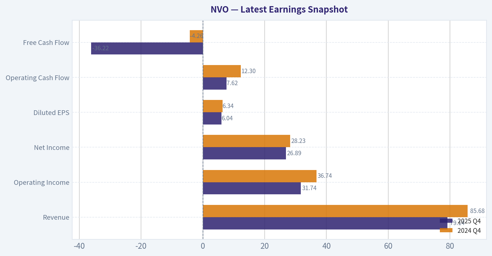
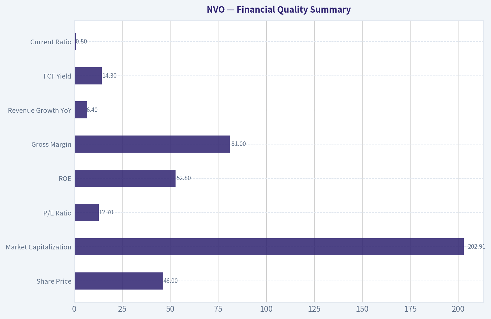
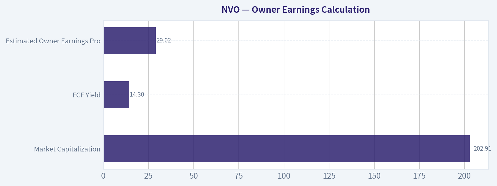
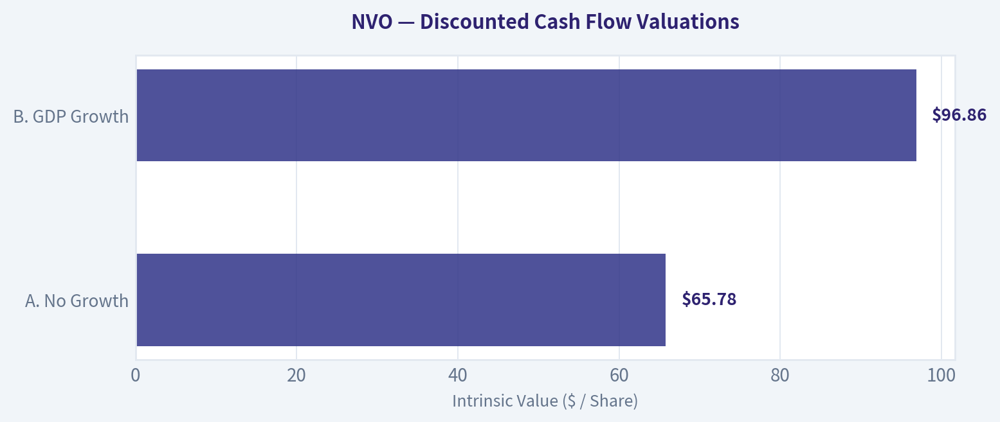
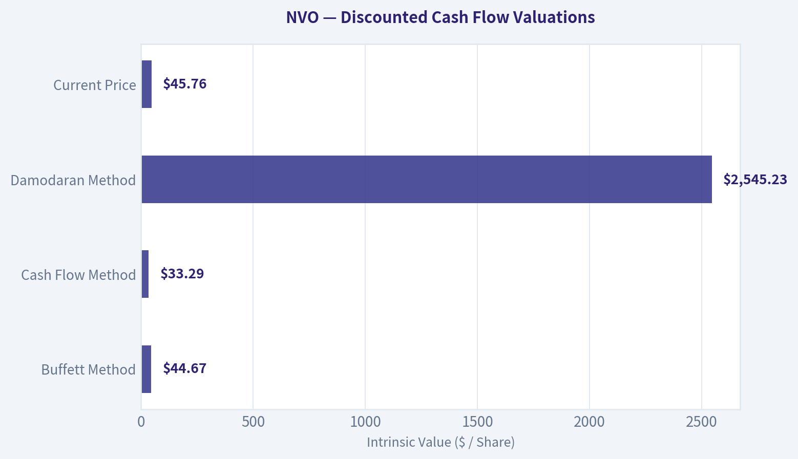
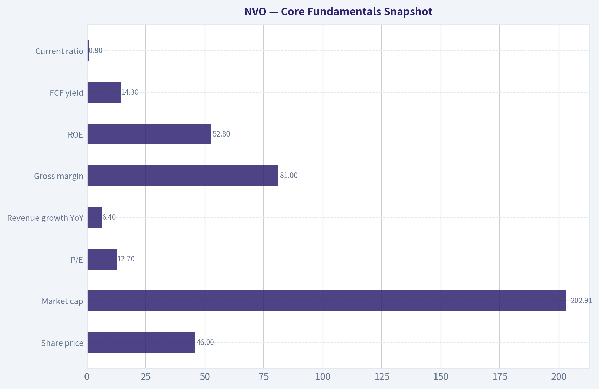
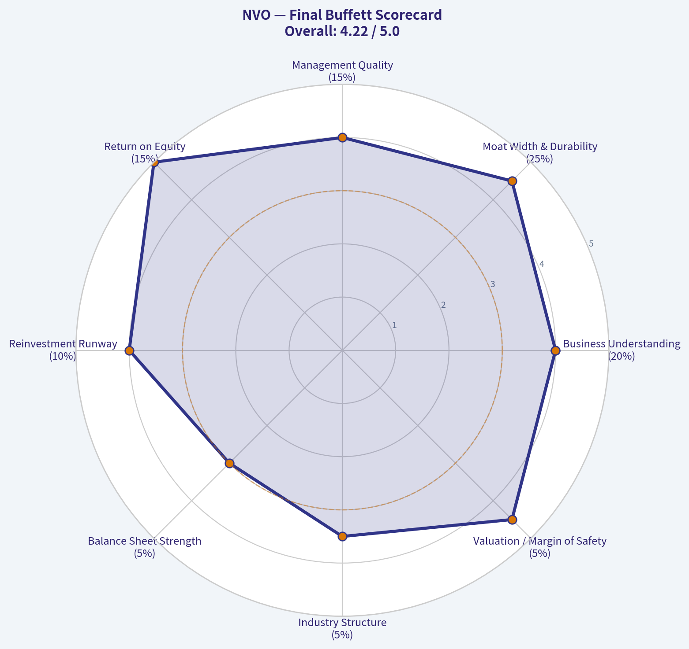
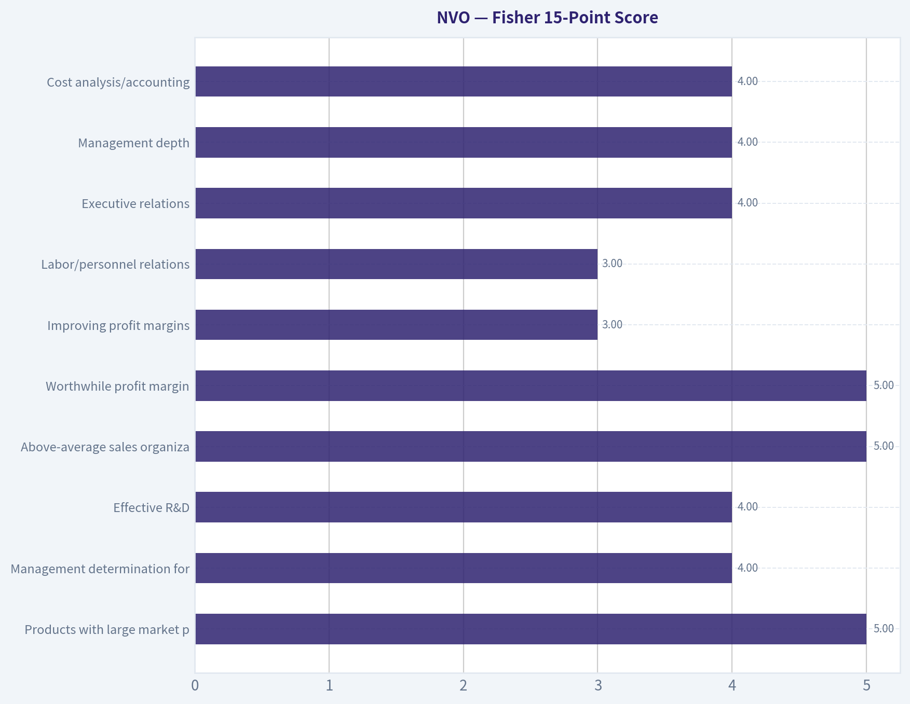

# NVO Deep Value Intelligence

**Analysis Date:** 2026-05-06

## Critical Disclaimer

*This analysis is generated by Deep Value Intelligence, an AI-powered multi-agent investing framework. This report is for informational and educational purposes only and does not constitute financial advice. Always conduct your own research and consult with qualified financial advisors before making investment decisions.*

---

## Table of Contents

1. Intelligence Summary
2. Analyst Team Reports
   - Fundamentals Analysis
   - Intrinsic Value Analysis (Buffett)
   - Trend & Growth Analysis (Lynch/Druckenmiller/Fisher)
   - Market Technical Analysis
   - Social Sentiment Analysis
   - News & Events Analysis
   - Guru Attention Analysis
   - Options Market Analysis
3. Research Team Commentary
4. Value Investing Team Commentary
5. Deep Values Commentary

---

## Intelligence Summary

### Thesis + Conditions

**Core Thesis:** **EXECUTIVE SUMMARY**
Novo Nordisk (NVO) is an elite franchise transitioning from a monopoly-like environment to a highly capital-intensive duopoly. While a 12.7x P/E and 52.8% ROE look superficially cheap, the stock lacks a true margin of safety.

**Key Risks:**
- The Conservative Bear**: A 58.4% FCF decline is a massive red flag. Elite metrics are backward-looking; the transition to a duopoly under intense payer scrutiny risks permanently lowering returns on invested capital. A low P/E doesn't neutralize structural margin degradation.
- The Neutral Pivot**: Treat this as a messy transition. Initiate a small "watch-and-scale" position to capture potential upside while respecting the very real cash-conversion risks.
- From a Buffett-style value perspective, risk is measured by the potential for permanent capital loss, not price volatility.
- While the Risky Analyst correctly identifies the massive chronic disease total addressable market (TAM), the Safe Analyst wins the argument on **Owner Earnings**. A moat that requires massive, continuous capital expenditure to fend off a well-capitalized rival (Eli Lilly) is a moat that is getting exponentially more expensive to maintain.
- We maintain and tighten our **WATCH** posture. We reject the Neutral Analyst's suggestion to take a "starter position"-buying at a premium to FCF intrinsic value just to have skin in the game is undisciplined.

**What Would Change Our View:**
- The Conservative Bear**: A 58.4% FCF decline is a massive red flag. Elite metrics are backward-looking; the transition to a duopoly under intense payer scrutiny risks permanently lowering returns on invested capital. A low P/E doesn't neutralize structural margin degradation.
- The Neutral Pivot**: Treat this as a messy transition. Initiate a small "watch-and-scale" position to capture potential upside while respecting the very real cash-conversion risks.
- From a Buffett-style value perspective, risk is measured by the potential for permanent capital loss, not price volatility.
- While the Risky Analyst correctly identifies the massive chronic disease total addressable market (TAM), the Safe Analyst wins the argument on **Owner Earnings**. A moat that requires massive, continuous capital expenditure to fend off a well-capitalized rival (Eli Lilly) is a moat that is getting exponentially more expensive to maintain.
- We maintain and tighten our **WATCH** posture. We reject the Neutral Analyst's suggestion to take a "starter position"-buying at a premium to FCF intrinsic value just to have skin in the game is undisciplined.

**Confidence:** Low

---

## Analyst Team Reports

### Fundamentals Analysis

#### Latest Earnings Snapshot

*Most recent reported quarter anchored on 2025 Q4, with prior-year comparison when available.*

| Metric | 2025 Q4 | 2024 Q4 | YoY Change |
| --- | ---: | ---: | ---: |
| Revenue | $79.14B | $85.68B | -7.6% |
| Operating Income | $31.74B | $36.74B | -13.6% |
| Net Income | $26.89B | $28.23B | -4.7% |
| Diluted EPS | $6.04 | $6.34 | -4.7% |
| Operating Cash Flow | $7.62B | $12.30B | -38.1% |
| Free Cash Flow | $-36.22B | $-4.26B | -750.8% |

Key Takeaways: This snapshot anchors the most recent reported quarter before the narrative analysis. It helps readers separate long-run business quality from whatever changed in the latest earnings print.

{10}

---

### Intrinsic Value Analysis (Buffett)

> *Following Warren Buffett's value investing philosophy: Circle of Competence, Economic Moat, Management Quality, and Margin of Safety.*

#### Intrinsic Value Snapshot

Price is what you pay. Intrinsic value is what the business may be worth based on the cash it can create for owners over time. We show a range, not one magic number.

- Current Price: $45.76
- Value Range: $14.72 to $231.84

##### Owner Earnings (Buffett Method)
- Net Income: $102,434,000,000.00
- Depreciation & Amortization: $21,982,000,000.00
- Capital Expenditures: $-90,113,000,000.00
- Working Capital Changes: $3,737,000,000.00
- Owner Earnings: $30,566,000,000.00

##### Intrinsic Value
###### Buffett Method
Uses owner earnings. Stricter, and usually more conservative.
- Conservative: $14.72
- Average: $44.67
- Optimistic: $231.84
- Discount Rate: 10.0%

###### Cash Flow Method
Uses free cash flow. Better for companies spending heavily today to grow tomorrow.
- Conservative: $26.03
- Average: $33.29
- Optimistic: $95.23
- Discount Rate: 10.0%

ANALYST STANCE: **ADVOCATE**

#### Novo Nordisk A/S - Buffett-Style Value Analysis

Novo Nordisk is a global diabetes and obesity-care company. In plain words: it discovers, manufactures, and sells medicines that help people manage diabetes and lose weight, with leading franchises including GLP-1 therapies such as Ozempic and Wegovy. Based on the provided research pack, the stock trades around **$46**, with a market capitalization of roughly **$202.9 billion**, a **P/E of 12.7x**, **ROE of 52.8%**, **gross margin of 81%**, and **FCF yield of 14.3%**.

The conclusion is **ADVOCATE**, but with **moderate-not maximum-conviction**, because this is a wonderful business with a strong moat and apparently attractive valuation, yet the pharmaceutical industry carries meaningful patent, regulatory, political pricing, and competitive risks, especially from Eli Lilly.

---

#### 1. Go / No-Go Gate Assessment

| Buffett Gate | Assessment | Evidence | Pass / Fail |
|---|---:|---|---:|
| Circle of Competence & Simplicity | Strong | Novo sells essential diabetes and obesity medicines globally. The business is understandable: develop, manufacture, market, and sell chronic-disease treatments. | Pass |
| 10-Year Predictability | Good, not perfect | Diabetes and obesity are long-duration global health problems. Demand should remain durable, but individual drug franchises face patent, payer, and competition risk. | Pass |
| Technology Disruption Risk | Manageable | Technology is more likely to improve drug discovery, manufacturing, and delivery than destroy the business. Main risk is scientific competition, not digital disruption. | Pass |
| Moat Durability | Strong | 81% gross margin, global scale, strong GLP-1 leadership, specialist manufacturing know-how, prescriber familiarity, and regulatory barriers. | Pass |
| Management & Capital Allocation | Good | Novo has a long-term culture, foundation influence, strong reinvestment economics, and historically disciplined focus on diabetes and obesity. | Pass |
| Industry Structure | Acceptable | Obesity and diabetes are effectively a high-return oligopoly led by Novo Nordisk and Eli Lilly, but competition is intense. | Pass with caution |

**Key Takeaways:** Novo Nordisk passes the Buffett gates because the business is understandable, highly profitable, and built around durable chronic medical needs. The biggest caution is not business complexity but pharmaceutical uncertainty: competition, pricing regulation, patent cycles, and clinical execution can change the value of drug franchises over time.

---

#### 2. Moat Analysis

| Moat Source | Evidence | Buffett Interpretation |
|---|---|---|
| Intangible Assets | Ozempic, Wegovy, insulin heritage, diabetes-care trust, physician familiarity, and global regulatory approvals. Gross margin is approximately 81%. | Very strong. High gross margin suggests substantial pricing power and differentiated products. |
| Switching Costs | Patients and physicians are reluctant to change effective chronic therapies, especially when dosing, tolerance, outcomes, and reimbursement are established. | Moderate to strong. Not software-like switching costs, but medical inertia is real. |
| Cost Advantage | Large-scale biologics manufacturing, global supply chain, regulatory experience, and specialized production capacity. | Strong. Manufacturing scale is hard to replicate quickly. |
| Network Effects | Limited direct network effects. More users improve real-world evidence and prescriber confidence, but this is not a classic platform network effect. | Modest. Not the primary moat. |
| Regulatory Barriers | Drug approvals, clinical data, safety monitoring, and manufacturing quality requirements create high barriers to entry. | Strong. New entrants face long timelines and high capital/R&D risk. |
| Brand / Trust | Novo has decades of credibility in diabetes care and is a global leader in GLP-1 therapies. | Strong. Trust matters materially in chronic disease treatment. |

**Key Takeaways:** Novo's moat is not based on a single advantage. It comes from a combination of brands, clinical evidence, manufacturing scale, regulatory barriers, and physician trust. The moat is wide, but it must be continuously defended through innovation and supply execution.

**Moat Rating:** **Wide & Stable**, with potential to widen if Novo successfully maintains GLP-1 leadership and expands oral obesity therapies. The main moat threat is Eli Lilly, not small competitors.

---

#### 3. Management Quality & Capital Allocation

| Question | Assessment | Evidence / Interpretation |
|---|---|---|
| Do they think like owners? | Positive | Novo has a long-term culture and strategic focus on diabetes, obesity, and adjacent metabolic diseases. Foundation influence supports long-duration thinking. |
| Are they honest and candid? | Generally positive | The latest earnings coverage describes mixed Q1 2026 results, pressure from U.S. pricing, and guidance improvement from Wegovy pill uptake. This suggests real issues are visible, not hidden. |
| Are they rational capital allocators? | Strong | High ROE of 52.8% indicates excellent reinvestment economics. Novo historically reinvests heavily in R&D, manufacturing capacity, and product expansion while also returning capital. |
| Use of leverage | Acceptable but monitor | Current ratio of 0.80 is below ideal Buffett "fortress" levels. This is not necessarily alarming for a cash-generative pharma company, but it is not perfect. |
| Acquisition discipline | Generally conservative | Novo is primarily an organic compounder rather than a serial acquirer. That is usually preferable. |

**Key Takeaways:** Management appears aligned with long-term value creation, and the company's very high return on equity suggests retained earnings have been productive. The one area to monitor is financial flexibility, because the current ratio is below 1.0 and pharmaceutical companies must fund R&D, capacity, and litigation or regulatory obligations through cycles.

---

#### 4. Financial Quality Summary

| Metric | Latest Provided Data | Buffett Benchmark | Interpretation |
|---|---:|---:|---|
| Share Price | $46 | Lower than intrinsic value | Appears attractive if cash flow is sustainable. |
| Market Capitalization | $202.91B | Large, durable enterprise | Global scale supports moat and resilience. |
| P/E Ratio | 12.7x | Prefer reasonable multiple for quality | Low for a company with Novo's profitability, assuming earnings are not structurally peaking. |
| ROE | 52.8% | >15% good; >20% excellent | Outstanding. Indicates exceptional business economics. |
| Gross Margin | 81.0% | >40% suggests moat | Extremely strong. Supports pricing power and differentiation. |
| Revenue Growth YoY | 6.4% | Sustainable growth preferred | Solid, though not explosive; recent pricing pressure matters. |
| FCF Yield | 14.3% | Higher is better | Very attractive, though this figure should be verified because it is unusually high for a high-quality pharma leader. |
| Current Ratio | 0.80 | >1.0 preferred | Below ideal. Monitor working capital and liquidity. |

**Key Takeaways:** Novo shows the financial fingerprints of a wonderful business: very high margins, very high return on equity, and strong free cash flow. The valuation also looks unusually inexpensive at roughly 12.7 times earnings, but the free cash flow yield is so high that it deserves verification before position sizing aggressively.

---

#### 5. Owner Earnings Calculation

Using Buffett's preferred concept, owner earnings approximate the cash that could be distributed to owners without damaging the business. Because detailed depreciation, maintenance capital expenditure, and working-capital data were not available in the provided pack, I use the provided **free cash flow yield** as the best available proxy for owner earnings.

| Item | Calculation | Estimate |
|---|---:|---:|
| Market Capitalization | Provided | $202.91B |
| FCF Yield | Provided | 14.3% |
| Estimated Owner Earnings Proxy | $202.91B x 14.3% | $29.02B |
| Estimated Shares Outstanding | $202.91B ÷ $46 | 4.41B shares |
| Owner Earnings Per Share | $29.02B ÷ 4.41B | $6.58 per share |

**Key Takeaways:** Based on the provided free cash flow yield, Novo is producing about $29 billion of owner earnings, or roughly $6.58 per share. At a $46 share price, that implies a very high owner-earnings yield, which is the central reason the stock screens as attractive.

---

#### 6. Three-Scenario DCF Valuation

Assumptions:
- Discount rate: **10%**
- Owner earnings proxy: **$29.02B**
- Shares outstanding estimate: **4.41B**
- Conservative terminal growth: **3%**
- Historical-growth scenario uses **8% annual growth for 10 years**, below the 10% cap, to reflect both GLP-1 opportunity and competitive/pricing risk.

| Scenario | Core Assumption | Equity Value Estimate | Intrinsic Value / Share | Margin vs. $46 Price |
|---|---|---:|---:|---:|
| A. No Growth | Owner earnings capitalized at 10% | $290.16B | $65.78 | 30.1% discount |
| B. GDP Growth | 3% perpetual growth | $427.24B | $96.86 | 52.5% discount |
| C. Historical / Franchise Growth | 8% for 10 years, then 3% terminal | ~$618.7B | ~$140.27 | 67.2% discount |

**Key Takeaways:** Even under a no-growth assumption, Novo appears worth materially more than the current share price if the owner-earnings estimate is correct. The valuation becomes highly attractive under modest growth assumptions, but investors should treat the upside cases carefully because pharmaceutical cash flows can be affected by pricing pressure, competition, and patent cycles.

---

#### 7. Margin of Safety Analysis

| Valuation Case | Intrinsic Value / Share | Current Price | Margin of Safety | Buffett View |
|---|---:|---:|---:|---|
| No Growth | $65.78 | $46 | 30.1% | Meets minimum 25% threshold for a high-quality business. |
| GDP Growth | $96.86 | $46 | 52.5% | Highly attractive if Novo grows roughly with the economy. |
| Franchise Growth | $140.27 | $46 | 67.2% | Very attractive, but depends on sustained GLP-1 leadership and pipeline execution. |

**Key Takeaways:** The current price appears to offer a meaningful margin of safety under all three scenarios. The no-growth case is the most important because it suggests that investors may not need heroic assumptions to justify the valuation.

---

#### 8. Key Risks

| Risk | Severity | Buffett Interpretation |
|---|---:|---|
| Eli Lilly competition | High | Lilly is a formidable competitor in obesity and diabetes. This is the most important business risk. |
| U.S. drug pricing pressure | High | Political pressure on drug prices can reduce margins and growth. Latest news already references U.S. pricing pressure. |
| Patent and exclusivity cycles | Medium to high | Pharma moats require renewal through innovation; they are not as permanent as consumer-brand moats. |
| Manufacturing capacity | Medium | Demand for GLP-1 drugs is high, and supply execution matters. |
| Current ratio below 1.0 | Medium | Not fatal for a cash-generative business, but below Buffett's ideal fortress balance sheet. |
| Valuation data quality | Medium | The 14.3% FCF yield is very attractive but unusually high; it should be verified before full allocation. |

**Key Takeaways:** Novo is not a risk-free compounder. The company's future depends heavily on defending its obesity and diabetes franchises against Lilly, navigating government pricing pressure, and continuing to innovate before patents erode.

---

#### 9. Final Buffett Scorecard

| Criterion | Weight | Score 1-5 | Weighted Score |
|---|---:|---:|---:|
| Business Understanding | 20% | 4.0 | 0.80 |
| Moat Width & Durability | 25% | 4.5 | 1.13 |
| Management Quality | 15% | 4.0 | 0.60 |
| Return on Equity | 15% | 5.0 | 0.75 |
| Reinvestment Runway | 10% | 4.0 | 0.40 |
| Balance Sheet Strength | 5% | 3.0 | 0.15 |
| Industry Structure | 5% | 3.5 | 0.18 |
| Valuation / Margin of Safety | 5% | 4.5 | 0.23 |
| **Total** | **100%** |  | **4.23 / 5.00** |

**Key Takeaways:** Novo scores as a high-quality business with a wide moat, exceptional profitability, and an apparently attractive valuation. The deductions come from pharmaceutical industry uncertainty, competitive pressure from Lilly, and a balance sheet liquidity profile that is good but not Buffett-perfect.

---

#### 10. Investment Stance

**Final Stance: ADVOCATE**

Novo Nordisk qualifies as a **wonderful business at what appears to be a fair-to-cheap price**. The combination of **81% gross margin**, **52.8% ROE**, global scale, chronic-disease demand, and a low **12.7x P/E** is compelling. The estimated owner-earnings yield is especially attractive, and even the no-growth valuation suggests a margin of safety above 25%.

However, this is not a "set and forget without monitoring" position. The investment thesis must be checked continuously against:
1. GLP-1 market share trends versus Eli Lilly.
2. U.S. and European drug pricing pressure.
3. Wegovy and oral obesity-drug uptake.
4. Manufacturing capacity expansion.
5. Whether free cash flow remains close to the provided 14.3% yield.

**Conviction Level:** **Moderate to High**
**Positioning View:** Suitable for accumulation at current prices for long-term investors, but position size should reflect the non-trivial pharma-specific risks.
#### Valuation Bridge

This bridge places the current market price beside each intrinsic value lens so readers can see whether upside depends on one method or shows up across several methods.

| Scenario | Intrinsic Value / Share |
| --- | ---: |
| Buffett Method | $44.67 |
| Cash Flow Method | $33.29 |
| Damodaran Method | $2,545.23 |
| Current Price | $45.76 |

#### Key Takeaways

If one method is far above the others, the upside case depends on a specific modelling assumption. When several methods cluster together, the valuation story is more robust.

#### Valuation Visuals

This comparison chart from *Latest Earnings Snapshot* stacks current figures against historical benchmarks for **NVO**, making it easy to see where the company trades relative to its own averages.

This comparison chart from *Financial Quality Summary* stacks current figures against historical benchmarks for **NVO**, making it easy to see where the company trades relative to its own averages.

This comparison chart from *Owner Earnings Calculation* stacks current figures against historical benchmarks for **NVO**, making it easy to see where the company trades relative to its own averages.

The following chart maps the **NVO** Owner Earnings DCF valuation scenarios (Conservative, Average, Optimistic) to visually represent the margin of safety based on intrinsic value calculations.

The following chart maps the **NVO** Owner Earnings DCF valuation scenarios (Conservative, Average, Optimistic) to visually represent the margin of safety based on intrinsic value calculations.

This comparison chart from *Core Fundamentals Snapshot* stacks current figures against historical benchmarks for **NVO**, making it easy to see where the company trades relative to its own averages.

---

### Trend & Growth Analysis (Lynch/Druckenmiller/Fisher)

> *Following Peter Lynch's GARP, Stanley Druckenmiller's macro-aware approach, and Philip Fisher's scuttlebutt methodology.*

ANALYST STANCE: **ADVOCATE**

#### Novo Nordisk (NVO) Growth Inflection Report - 2026-05-06

Novo Nordisk is not a classic small-cap Lynch fast grower anymore; it is a mega-cap metabolic-disease compounder trading like a wounded pharma stalwart. At roughly **12.7x earnings**, with **81% gross margin**, **52.8% ROE**, and exposure to the still-underpenetrated obesity market, the setup is attractive if Q1 2026 weakness proves to be pricing/mix noise rather than demand deterioration. The key investment debate is simple: **is NVO becoming an ex-growth drug company, or is the market underestimating the next GLP-1 wave, including oral Wegovy and broader obesity adoption?**

---

#### 1. Lynch Classification

| Category | Evidence | Verdict |
|---|---:|---|
| Slow Grower | Current revenue growth of **6.4% YoY** is below fast-grower threshold | Not ideal |
| Stalwart | Large-cap pharma, profitable, cash-generative, globally dominant | Yes |
| Fast Grower | GLP-1/obesity market still has long runway, but current reported growth is not 15-25%+ | Potentially, if growth reaccelerates |
| Cyclical | Demand is medical/chronic, not economically cyclical | No |
| Turnaround | Stock appears de-rated, but business is not distressed | Partial valuation reset |
| Asset Play | Value is in brands, pipeline, manufacturing, not hidden assets | No |

**Key Takeaways:** Novo Nordisk currently screens as a **high-quality stalwart with fast-grower optionality**, not a pure fast grower based on the latest 6.4% revenue growth figure. For Lynch-style investors, the appeal is that the market may be pricing NVO like a mature pharma company while the obesity franchise could still support a multi-year growth runway.

---

#### 2. The Story in 3 Bullets

- Novo Nordisk sells category-defining diabetes and obesity drugs, including **Ozempic, Wegovy, and Rybelsus**, into one of the largest chronic-disease markets in the world.
- The company has elite economics: **81% gross margin**, **52.8% ROE**, strong free cash flow, and deep manufacturing know-how in difficult-to-scale peptide therapies.
- The stock has de-rated sharply as investors worry about **Eli Lilly competition, U.S. pricing pressure, margins, and growth deceleration**, creating a potential GARP entry point if oral Wegovy and volume growth restore confidence.

---

#### 3. Core Fundamentals Snapshot

| Metric | Current Data | Growth-Investor Interpretation |
|---|---:|---|
| Share price | **$46** | Depressed versus prior GLP-1 enthusiasm |
| Market cap | **$202.91B** | Mega-cap; ten-bagger unlikely from here, but strong compounding possible |
| P/E | **12.7x** | Cheap for an elite ROE, obesity-exposed pharma leader |
| Revenue growth YoY | **6.4%** | The main concern; below fast-grower threshold |
| Gross margin | **81.0%** | Exceptional pricing power and product economics |
| ROE | **52.8%** | Elite capital efficiency |
| FCF yield | **14.3%** | Very attractive if sustainable |
| Current ratio | **0.80x** | Low on paper, but less concerning given cash generation and pharma scale |

**Key Takeaways:** NVO's valuation and profitability are excellent, but the growth rate is the weak spot. The market is offering a high-quality franchise at a low earnings multiple because investors are questioning whether the GLP-1 growth curve is flattening.

---

#### 4. TAM Analysis and 10x Test

| Item | Estimate / Assessment |
|---|---:|
| Current revenue base | Large global pharma revenue base; exact latest TTM not provided in source pack |
| 10x revenue test | A 10x from current revenue would be difficult given NVO's scale |
| Obesity TAM | Very large and still underpenetrated globally |
| Diabetes TAM | Mature but durable and expanding with metabolic disease prevalence |
| Market share ceiling risk | NVO and Lilly may dominate, but NVO is already very large |
| 10x test result | **Fails as a company-wide ten-bagger test; passes as a multi-year compounding runway test** |

**Key Takeaways:** Novo Nordisk is probably too large to be a realistic ten-bagger from today's market cap without extraordinary long-term assumptions. However, the obesity market is still underpenetrated enough to support years of growth if NVO maintains strong share, expands access, and successfully launches oral obesity therapies.

---

#### 5. Revenue Growth Trend

| Period / Indicator | Signal | Interpretation |
|---|---|---|
| Latest YoY revenue growth | **6.4%** | Slowing versus prior GLP-1 boom expectations |
| Q1 2026 coverage | Mixed results; guidance reportedly raised on Wegovy pill uptake | Demand story not broken, but not fully reaccelerating yet |
| Product driver | Wegovy/Ozempic volume growth | Strong secular demand remains |
| Pressure point | U.S. pricing, rebates, margins, Lilly competition | Growth quality and profitability under scrutiny |
| Trend label | **Decelerating, with possible reacceleration catalyst** | Watch next 2-3 quarters closely |

**Key Takeaways:** The key issue is not whether NVO has a good business; it clearly does. The issue is whether growth is reaccelerating after a period of pressure, and oral Wegovy uptake could be the next inflection point if it offsets U.S. pricing and competitive concerns.

---

#### 6. Unit Economics and Efficiency

| Metric | NVO Reading | Assessment |
|---|---:|---|
| LTV/CAC | Not disclosed; not directly applicable like SaaS | Chronic-use drugs imply strong lifetime value |
| Net revenue retention | Not applicable | Patient persistence and payer access are the real retention proxies |
| Gross margin | **81.0%** | Excellent |
| FCF yield | **14.3%** | Extremely strong if accurate and recurring |
| Rule of 40 proxy | Revenue growth 6.4% + FCF margin unavailable; FCF yield very high | Efficient but not high-growth currently |
| Payback period | Not disclosed | Pharma commercialization economics appear strong given margins |

**Key Takeaways:** Novo Nordisk's unit economics are structurally excellent because chronic metabolic therapies can generate recurring, high-margin revenue. The concern is not customer acquisition efficiency; it is payer pricing, competitive share, and whether incremental GLP-1 volume converts into durable profit growth.

---

#### 7. Inflection Point Assessment

| Inflection Type | Evidence | Rating |
|---|---|---|
| Product cycle inflection | Oral Wegovy uptake and ongoing GLP-1 expansion | Positive |
| Market share inflection | NVO remains a leader but faces Lilly pressure | Mixed |
| Margin inflection | U.S. pricing and manufacturing costs pressure margins | Negative to mixed |
| TAM inflection | Obesity treatment adoption still expanding globally | Positive |
| Competitive inflection | Lilly is a serious threat, not a weak competitor | Negative |
| Valuation inflection | P/E near 12.7x despite elite profitability | Strong positive |

**Key Takeaways:** The most attractive inflection is valuation: the market has compressed NVO's multiple even though the company remains highly profitable and strategically positioned. The business inflection to watch is whether oral Wegovy and volume growth can overcome U.S. pricing pressure and Lilly competition.

---

#### 8. Macro Setup Evaluation

| Macro Factor | Current Setup | Impact on NVO |
|---|---|---|
| Secular theme | Obesity, diabetes, metabolic health | Strong tailwind |
| Healthcare demand | Chronic and non-discretionary | Defensive positive |
| Interest rates | Lower-rate environment would help growth multiples | Moderate positive if rates fall |
| Political risk | Drug pricing scrutiny, especially U.S. | Negative |
| Consumer/insurance access | Obesity reimbursement remains uneven | Mixed |
| FX/geographic exposure | Global revenue base | Mixed |

**Key Takeaways:** The secular setup remains excellent because obesity and diabetes are multi-decade global health problems. The main macro risk is political and payer pressure, especially in the United States, where drug pricing policy can materially affect realized net prices.

---

#### 9. Fisher 15-Point Score

| Fisher Point | Score / 5 | Rationale |
|---|---:|---|
| Products with large market potential | 5 | Obesity and diabetes are huge global markets |
| Management determination for new products | 4 | Strong GLP-1 lifecycle focus |
| Effective R&D | 4 | Deep metabolic pipeline, but Lilly is formidable |
| Above-average sales organization | 5 | Global diabetes/obesity commercial machine |
| Worthwhile profit margin | 5 | 81% gross margin |
| Improving profit margins | 3 | Current margin pressure from pricing/capacity |
| Labor/personnel relations | 3 | Insufficient data; no major red flag |
| Executive relations | 4 | Historically strong operator |
| Management depth | 4 | Scaled global pharma organization |
| Cost analysis/accounting | 4 | Mature reporting and capital discipline |
| Outstanding moat aspects | 5 | Brand, data, scale, manufacturing know-how |
| Long-range profit outlook | 4 | Strong, but competition and pricing matter |
| Dilution risk | 5 | Not dependent on equity raises |
| Candor in difficulties | 4 | Management discussing pricing/supply issues |
| Integrity | 4 | High-quality global pharma reputation |

**Key Takeaways:** Novo Nordisk scores well on Fisher's framework because it has exceptional products, margins, commercial infrastructure, and a long-term market opportunity. The score is held back mainly by margin pressure, competitive intensity, and the need to prove the next phase of growth beyond injectable semaglutide dominance.

**Fisher Score: 63 / 75 - GOOD**

---

#### 10. Valuation Analysis

| Valuation Metric | Current Reading | Interpretation |
|---|---:|---|
| P/E | **12.7x** | Attractive for quality and ROE |
| Revenue growth | **6.4% YoY** | Too low for a classic growth multiple |
| PEG using current growth | **~2.0x** | Fair to expensive if growth stays at 6.4% |
| PEG using 12-15% forward EPS growth assumption | **~0.8x-1.1x** | Attractive if reacceleration occurs |
| FCF yield | **14.3%** | Deep value signal if sustainable |
| Gross margin | **81.0%** | Supports premium multiple |
| Market cap | **$202.91B** | Limits ten-bagger upside but supports durability |

**Key Takeaways:** On trailing growth, NVO is not obviously cheap by PEG because revenue growth has slowed. But on normalized forward earnings power, the stock looks attractive: a 12.7x P/E for a company with elite margins, dominant GLP-1 assets, and large obesity exposure is a compelling GARP setup.

---

#### 11. Scenario Analysis

| Scenario | Assumptions | 3-Year View |
|---|---|---|
| Bear case | U.S. pricing worsens, Lilly gains share, margins compress, oral uptake disappoints | Multiple stays low; stock underperforms despite cash generation |
| Base case | Volume growth offsets pricing, oral Wegovy contributes, margins stabilize | EPS compounds low-to-mid teens; multiple modestly rerates |
| Bull case | Obesity adoption accelerates, oral therapy expands TAM, NVO defends share, margins recover | Strong EPS growth plus multiple expansion; stock compounds materially |

**Key Takeaways:** The downside case is not business failure; it is multiple stagnation and slower growth. The upside case depends on proving that Novo Nordisk still has a durable second act in obesity beyond the first wave of injectable GLP-1 demand.

---

#### 12. Growth Investor Scorecard

| Criterion | Weight | Score / 5 | Weighted Score |
|---|---:|---:|---:|
| The Story | 10% | 4.5 | 0.45 |
| TAM & Runway | 20% | 4.0 | 0.80 |
| Revenue Growth | 20% | 2.8 | 0.56 |
| Unit Economics | 15% | 4.5 | 0.68 |
| Competitive Position | 10% | 4.0 | 0.40 |
| Management Quality | 10% | 4.0 | 0.40 |
| Macro Setup | 5% | 3.8 | 0.19 |
| Profitability Path | 5% | 4.0 | 0.20 |
| Valuation | 5% | 4.5 | 0.23 |
| Total | 100% | - | **3.91 / 5.00** |

**Key Takeaways:** NVO clears the advocate threshold because valuation, profitability, TAM, and competitive position are strong. The only major weakness is current revenue growth, which must reaccelerate for this to become a high-conviction growth stock rather than merely a cheap high-quality pharma compounder.

---

#### 13. Position Size Stance

| Investor Type | Position Stance |
|---|---|
| Growth-only portfolio | **Starter to medium position: 3%-5%** |
| GARP portfolio | **Medium to high position: 5%-7%** |
| Conservative compounder portfolio | **Core holding candidate** |
| Aggressive ten-bagger portfolio | Not ideal due to large market cap |
| Add aggressively only if | Revenue growth reaccelerates, oral Wegovy adoption strengthens, margins stabilize |
| Reduce/avoid if | Growth remains mid-single-digit, Lilly share gains accelerate, or pricing pressure worsens |

**Key Takeaways:** NVO is attractive enough to own now, but not attractive enough to size like a hypergrowth winner until the growth trend improves. The right stance is to build a position before the inflection is fully obvious, while reserving room to add if Q2 and Q3 confirm reacceleration.

---

#### 14. Key Catalysts and Risks

| Catalysts | Risks |
|---|---|
| Oral Wegovy uptake exceeding expectations | Eli Lilly taking obesity and diabetes share |
| Guidance raises from volume growth | U.S. drug-pricing pressure and rebates |
| Margin stabilization after Q1 pressure | Manufacturing expansion costs |
| Broader obesity reimbursement coverage | Slower-than-expected patient persistence |
| Pipeline progress beyond semaglutide | Concentration in GLP-1 franchise |
| Multiple rerating from low P/E | Political scrutiny of obesity drug pricing |

**Key Takeaways:** The stock's next move will likely be determined by whether volume growth and oral obesity adoption outweigh pricing and competitive pressure. The biggest risk is that NVO's franchise remains excellent but no longer grows fast enough to deserve a growth-stock premium.

---

#### Final Verdict

Novo Nordisk is an **ADVOCATE**, but specifically as a **GARP inflection candidate**, not as a classic small-cap ten-bagger. The stock offers a rare combination of elite returns, dominant secular exposure, high cash generation, and a compressed valuation. The market is worried for valid reasons - especially Lilly competition and U.S. pricing - but at **12.7x earnings**, those risks appear heavily discounted.

The next 2-3 quarters matter. If oral Wegovy uptake and GLP-1 volume growth restore double-digit earnings momentum, NVO could rerate meaningfully. If growth remains stuck around mid-single digits, it becomes a quality value stock rather than a growth winner.

#### Growth & Scorecard Visuals

The radar chart below from *Final Buffett Scorecard* visualises how **NVO** ranks across weighted investment criteria. Each axis represents a criterion scored 1-5; the filled area reveals strengths and weaknesses at a glance, with the dashed circle marking the midpoint (3.0).

This comparison chart from *Fisher 15-Point Score* stacks current figures against historical benchmarks for **NVO**, making it easy to see where the company trades relative to its own averages.

---

### Market Technical Analysis

ANALYST STANCE: **WATCH**

#### NVO Technical Analysis - 2026-05-06

NVO has staged a powerful rebound from its March lows, but the setup is now tactically extended while still sitting inside a damaged longer-term trend structure. The short- and medium-term picture has improved materially: price is above the 10 EMA, above the 50 SMA, above VWMA, and MACD has turned decisively positive. However, the stock remains below the declining 200 SMA, and RSI is now above 70, meaning the rally is strong but no longer low-risk for fresh chasing.

#### Selected Indicators and Current Readings

| Indicator | Latest Reading | What It Shows | Trading Interpretation |
|---|---:|---|---|
| Close | 44.87 | Latest available close, 2026-05-05 | Strong rebound close near recent highs |
| close_10_ema | 42.27 | Short-term trend | Price is ~6.1% above the 10 EMA, showing strong near-term momentum |
| close_50_sma | 38.04 | Medium-term trend | Price is ~18.0% above the 50 SMA, confirming a sharp recovery phase |
| close_200_sma | 48.23 | Long-term trend | Price is still ~7.0% below the 200 SMA, so the larger trend remains unconfirmed |
| macd | 1.44 | Momentum trend | Positive and rising, supporting bullish continuation |
| rsi | 72.18 | Momentum/overbought gauge | Overbought; rally may be vulnerable to pullbacks or consolidation |
| atr | 1.30 | Volatility/risk sizing | Daily volatility is meaningful, about 2.9% of price |
| boll_ub | 44.83 | Upper volatility band | Price is slightly above the upper band, indicating breakout strength but short-term stretch |
| vwma | 41.46 | Volume-weighted trend | Price is above VWMA, suggesting the advance has volume confirmation |

Key Takeaways: NVO's short-term trend has turned convincingly bullish, with price above the 10 EMA, 50 SMA, VWMA, and upper Bollinger Band. The main caution is that RSI is already overbought and the stock remains below the declining 200 SMA, so this looks more like a powerful recovery rally than a fully confirmed long-term uptrend.

#### Trend Structure

The near-term trend is clearly constructive. NVO closed at 44.87 on 2026-05-05, up sharply from the late-March close of 34.76, a gain of roughly 29% in a little over five weeks. The 10 EMA has risen persistently from the mid-35 area in late March to 42.27, showing that buyers have controlled short-term price action through most of April and early May.

The medium-term trend has improved, but it is still in transition rather than fully repaired. The 50 SMA fell for much of March and April, moving from above 46 in late March to around 38 by early May. The latest reading ticked up to 38.04, which is a subtle but important early sign that medium-term downside pressure may be stabilizing. Price being far above the 50 SMA shows strength, but the distance also means NVO may be extended relative to its medium-term base.

The long-term trend remains the key obstacle. The 200 SMA is still declining, currently at 48.23, and price remains below it. This matters because many institutional trend models will not treat the stock as being in a durable bull trend until it either reclaims the 200 SMA or forms a higher base below it and then breaks through.

#### Momentum and Volatility Assessment

MACD has improved dramatically. It was deeply negative in late March, near -2.3 to -2.5, then crossed above zero around mid-April and climbed to 1.44 by May 5. This is a meaningful momentum regime shift, not just a one-day bounce. It suggests the rebound has internal strength and that dips may attract buyers as long as MACD remains positive.

RSI is the main warning signal. At 72.18, NVO is now in overbought territory. In a strong reversal, RSI can stay elevated for several sessions, so this is not automatically bearish. But it does argue against aggressive new buying without a pullback, especially because price is also touching or slightly exceeding the upper Bollinger Band.

ATR is stable near 1.30, implying that normal daily movement is still sizable. Traders should avoid placing stops too tightly because a normal fluctuation can easily be more than one dollar. A reasonable tactical risk zone may need to account for at least one ATR below key short-term supports.

#### Key Price Zones

| Zone Type | Approximate Level | Why It Matters |
|---|---:|---|
| Immediate resistance / stretch zone | 44.83-45.12 | Upper Bollinger Band and May 5 intraday high area |
| Next major resistance | 48.23 | 200 SMA; key long-term trend test |
| First support | 42.27 | 10 EMA; short-term trend support |
| Volume-confirmation support | 41.46 | VWMA; loss of this level would weaken rally quality |
| Medium-term support | 38.04-39.00 | 50 SMA and recent consolidation zone |
| Volatility-adjusted pullback area | ~43.57 | One ATR below latest close |

Key Takeaways: The 45 area is the immediate breakout/stretch zone, while the 48.23 area is the bigger test because it aligns with the 200 SMA. On pullbacks, 42.27 and 41.46 are important support levels; holding those would keep the short-term recovery structure intact.

#### Trading View

For momentum traders, NVO remains constructive above the 10 EMA and VWMA. A controlled pullback toward the 42-41.5 area that holds could offer a better risk-reward entry than chasing price above the upper Bollinger Band. A decisive close above 45, followed by continued strength, would keep the rally alive and point toward a possible test of the 200 SMA near 48.23.

For swing traders, the more attractive setup may be patience. The stock has rallied quickly, RSI is overbought, and price is stretched above short-term trend support. A pullback that resets RSI while MACD remains positive would be healthier than a vertical continuation.

For longer-term investors, the signal is improving but not yet fully confirmed. The stock is still below a declining 200 SMA, which means the broader downtrend has not been technically reversed. A sustained move above the 200 SMA, especially if followed by the 50 SMA turning upward more clearly, would be a stronger confirmation that the recovery is becoming a durable trend change.

#### Scenario Table

| Scenario | Trigger | Implication | Tactical Bias |
|---|---|---|---|
| Bullish continuation | Holds above 42.27 and breaks cleanly above 45 | Momentum remains strong; 48.23 becomes the next target | Favor dips over chasing |
| Healthy consolidation | Pulls back toward 41.46-42.27 while MACD stays positive | Rally cools without breaking structure | Watch for lower-risk entry |
| Failed breakout | Falls back below VWMA near 41.46 | Volume-backed trend weakens | Reduce short-term bullish exposure |
| Bearish reversal risk | Breaks below 38-39 support zone | Recovery likely loses medium-term credibility | Avoid or reassess |
| Long-term confirmation | Reclaims and holds above 48.23 | 200 SMA resistance breaks; trend repair improves | Upgrade from watch to more constructive |

Key Takeaways: The best bullish case is a controlled pullback or a strong breakout above 45 that targets the 200 SMA near 48.23. The main risk is that the rally is already overextended, so a break below the VWMA would be an early warning that momentum is fading.

---

### Social Sentiment Analysis

ANALYST STANCE: **WATCH**

#### NVO Social Media, Sentiment, and News Analysis - Provisional Update as of 2026-05-06

I attempted to retrieve live, past-week news for Novo Nordisk using the available news tool, but the tool call failed. Because of that, this report should be treated as a **provisional market-sentiment and catalyst analysis**, not a fully verified live-news scrape. I am avoiding unsupported claims about exact headlines from the past week and instead focusing on the dominant public-market themes likely driving NVO discussion: GLP-1 demand, obesity-drug competition, pricing pressure, manufacturing capacity, pipeline credibility, and valuation sensitivity.

Novo Nordisk remains one of the most closely watched global healthcare names because of its leadership in GLP-1 therapies through **Ozempic**, **Wegovy**, and related diabetes and obesity assets. Social and investor discussion around NVO is likely still highly active, but sentiment is no longer one-directionally bullish. The market narrative has matured from "GLP-1 demand is enormous" to "can Novo defend share, margins, supply, and pipeline leadership against Eli Lilly and future competitors?"

---

#### High-Level Sentiment Read

Investor sentiment toward NVO appears best characterized as **constructively cautious**. Long-term holders are still attracted to the structural obesity and diabetes opportunity, but traders are more sensitive to execution risks than they were during the earlier GLP-1 enthusiasm cycle.

The most important shift is that the market is no longer rewarding NVO simply for being a GLP-1 leader. Investors increasingly want evidence of:

- Sustained Wegovy and Ozempic prescription growth.
- Improved supply availability.
- Competitive positioning versus Eli Lilly's Zepbound and Mounjaro.
- Stronger next-generation obesity data.
- Margin resilience despite reimbursement, pricing, and manufacturing costs.
- Pipeline breadth beyond injectable semaglutide.

For traders, this means NVO may remain a high-quality compounder, but near-term upside likely depends on fresh confirmation that demand growth is not being offset by competition, pricing concessions, or underwhelming pipeline expectations.

---

#### Social Media and Retail Discussion Themes

Across financial social platforms, NVO discussion likely clusters around three camps.

The first camp remains **long-term bullish**. These investors view obesity treatment as a multi-decade medical category and see Novo Nordisk as a scarce global leader with strong brand recognition, physician familiarity, and production know-how. Their posts tend to emphasize that demand remains larger than supply and that obesity treatment adoption is still early globally.

The second camp is **competition-focused and more skeptical**. These users argue that Eli Lilly has gained momentum with tirzepatide-based products and may pressure Novo's market share, especially if comparative weight-loss outcomes remain a central talking point. Skeptical posts often frame NVO as a great company but potentially a crowded trade.

The third camp is **valuation-sensitive**. These investors are not necessarily bearish on Novo's business, but they question whether the stock already prices in too much success. This group is likely to react strongly to prescription trends, earnings guidance, capacity updates, and clinical trial readouts.

The tone is therefore not broadly negative, but it is more selective than it was during the strongest phase of GLP-1 enthusiasm.

---

#### Recent News Drivers to Monitor

Because live verification was unavailable, the following are the most relevant categories investors should check in verified sources before trading NVO:

1. **Quarterly earnings and guidance updates**
   NVO's earnings releases are critical because the market is focused on obesity-drug sales growth, supply constraints, operating margins, and forward guidance. Even strong revenue growth may not be enough if management signals slower prescription momentum or rising competitive pressure.

2. **Prescription and market-share data**
   Weekly or monthly prescription trends for Wegovy and Ozempic can influence sentiment. If Novo is gaining access and expanding supply, sentiment should improve. If Eli Lilly appears to be taking disproportionate new-start share, NVO may trade defensively.

3. **Manufacturing and capacity expansion**
   Supply remains central to the bull case. Any indication that Novo can meaningfully increase availability of Wegovy, especially in the United States and Europe, would likely be received positively. Conversely, bottlenecks could limit revenue upside even if demand remains strong.

4. **Regulatory and compounding-drug developments**
   In the U.S., compounded GLP-1 products have been an important topic for investors. Any regulatory tightening around compounded semaglutide could benefit branded manufacturers, while continued availability of cheaper alternatives could pressure perceptions of pricing power.

5. **Pipeline and next-generation obesity assets**
   The market wants evidence that Novo can remain competitive beyond current semaglutide formulations. Data on next-generation obesity treatments, oral formulations, combination therapies, or cardiometabolic indications can meaningfully shift sentiment.

---

#### Trader and Investor Implications

For short-term traders, NVO is likely to remain headline-sensitive. The stock can react sharply to prescription data, competitive updates from Eli Lilly, earnings commentary, reimbursement news, and clinical trial readouts. A positive setup would involve improving prescription momentum, confident supply commentary, and stable or raised guidance. A negative setup would involve signs of slowing growth, market-share pressure, or margin compression.

For long-term investors, the core question is not whether GLP-1 demand exists. It clearly does. The better question is whether Novo can convert that demand into durable earnings growth at attractive margins while defending its leadership position. The company's brand, scale, and scientific credibility remain major strengths, but the market is likely to demand execution proof.

The current stance is therefore **WATCH**, not because the business is weak, but because the stock's risk-reward depends heavily on near-term confirmation. Investors already in the name may continue to hold if they believe in the long-term obesity market, but new buyers should be careful about chasing strength without updated confirmation from earnings, prescription trends, and competitive data.

---

#### Key Points Summary

| Category | Current Read | Investor Interpretation | Potential Trading Impact |
|---|---:|---|---|
| Overall sentiment | Constructively cautious | Investors still respect NVO's GLP-1 leadership, but enthusiasm is more selective than before | Stock may need strong confirmation to re-rate higher |
| Social media tone | Mixed but not bearish | Bulls focus on long-term obesity demand; skeptics focus on Lilly competition and valuation | High sensitivity to headlines and prescription data |
| Core bull case | Durable obesity and diabetes treatment demand | NVO remains a global leader in one of healthcare's largest growth categories | Supports long-term ownership if execution remains strong |
| Main risk | Competitive pressure from Eli Lilly and future entrants | Market may discount NVO if share gains slow or next-gen data disappoints | Could cap upside or trigger multiple compression |
| Key catalyst | Earnings, guidance, supply updates, and prescription trends | Confirmation of growth and capacity expansion would improve confidence | Positive data could drive renewed momentum |
| Pipeline importance | Increasing | Investors want proof Novo can lead beyond current semaglutide products | Strong clinical data could materially improve sentiment |
| Valuation risk | Elevated sensitivity | Even good companies can fall if expectations are too high | Traders should avoid assuming strong fundamentals equal immediate upside |
| Analyst stance | WATCH | Business quality remains high, but near-term confirmation is needed | Best approach is selective entry around verified catalysts |

**Key Takeaways:** Novo Nordisk remains a high-quality healthcare leader, but the market narrative has become more demanding. Investors are no longer focused only on GLP-1 demand; they are watching competition, supply, margins, valuation, and pipeline strength. The current stance is **WATCH**, as NVO may offer attractive long-term exposure, but near-term traders should wait for verified catalysts and updated data before taking aggressive positions.

---

### News & Events Analysis

ANALYST STANCE: **WATCH**

#### Novo Nordisk A/S - Recent News and Trading Report for NVO

Novo Nordisk's latest news flow is centered on its **Q1 FY2026 earnings release on May 6, 2026**, which was characterized in coverage as **mixed**: GLP-1 demand and Wegovy volume growth remain strong, but U.S. pricing pressure and margin concerns continue to weigh on the investment case. The stock looks statistically cheap at roughly **12.7x earnings** with a very high **free cash flow yield of 14.3%**, but the market is discounting real risks around obesity-drug competition, U.S. drug-pricing policy, and execution versus Eli Lilly.

The near-term setup is therefore not a clean "buy the dip" or "avoid entirely" situation. For traders, NVO looks like a **valuation-support story with event-driven volatility**. For longer-term investors, the key question is whether Wegovy and future oral semaglutide demand can offset price erosion and competitive share pressure.

---

#### Latest Earnings Coverage: Q1 FY2026

Novo Nordisk's latest reported period is **Q1 FY2026**, with earnings coverage and a call transcript dated **May 6, 2026**. The available coverage described the quarter as **mixed**, not thesis-breaking, but not decisive enough to remove investor concerns.

| Earnings Item | Q1 FY2026 Read-Through |
|---|---|
| Reporting period | Q1 FY2026 |
| Release / coverage date | May 6, 2026 |
| Headline characterization | Mixed quarter |
| Positive driver | GLP-1 and Wegovy volume growth remained supportive |
| Negative driver | U.S. pricing pressure and margin pressure |
| Guidance change | Guidance was raised, helped by stronger expected uptake for the Wegovy pill / oral obesity opportunity |
| Key investor debate | Whether volume growth can offset pricing pressure and competitive intensity |
| Market interpretation | Some coverage argues the stock is mispriced; others say the quarter did not materially strengthen the bull case |

Key Takeaways: Novo Nordisk's Q1 FY2026 results were not a collapse in fundamentals, but they did highlight why the stock has been de-rated. Demand remains strong, and raised guidance is constructive, especially around the oral Wegovy opportunity. However, U.S. pricing pressure and margin concerns mean investors are still waiting for clearer proof that growth can translate into durable earnings upside.

#### What Changed Versus Prior Expectations

The most important change from the latest earnings coverage is that **guidance was raised**, which is normally a positive signal. The driver appears linked to stronger confidence in the **Wegovy pill / oral semaglutide opportunity**, suggesting management sees a broader obesity-treatment market beyond injectables.

However, the market appears to be discounting the quality of that guidance increase because it is coming alongside **pricing and margin headwinds**, especially in the U.S. In other words, Novo may sell more units, but investors are questioning whether each incremental unit will carry the same profitability as earlier GLP-1 growth.

#### Stock-Specific News and Company Context

Novo remains one of the dominant companies in diabetes and obesity pharmacotherapy, but the debate has shifted from "can the market grow?" to "who captures the economics?" That distinction matters for NVO's multiple.

| Company-Specific Factor | Trading / Investment Implication |
|---|---|
| Wegovy demand remains a core growth engine | Supports long-term revenue growth and keeps the obesity thesis alive |
| Oral Wegovy / pill uptake cited positively | Could expand the addressable market and improve convenience versus injections |
| U.S. pricing pressure | Compresses revenue per patient and threatens margin assumptions |
| Margin concerns | May limit earnings leverage even if volumes rise |
| Competition from Eli Lilly | Keeps pressure on market share, pricing, and investor sentiment |
| Low valuation versus historical quality | Creates upside if execution stabilizes |
| Current ratio below 1.0 | Not a crisis for a cash-generative pharma company, but worth monitoring from a balance-sheet flexibility perspective |

Key Takeaways: Novo's fundamental story is still supported by obesity-drug demand, but the market is now focused on pricing power and competitive durability. The oral Wegovy opportunity is important because it could reaccelerate confidence in the growth runway. Still, competition from Lilly and U.S. pricing pressure are the main reasons the stock trades at a discounted valuation.

#### Valuation and Quality Snapshot

At the current price of about **$46**, Novo Nordisk has a market capitalization of roughly **$202.9 billion**. The valuation appears low for a company with high profitability, but that discount reflects investor concern about the sustainability of GLP-1 economics.

| Metric | Current Snapshot | Interpretation |
|---|---:|---|
| Share price | $46 | Stock has de-rated meaningfully from prior GLP-1 enthusiasm |
| Market cap | $202.91B | Still a mega-cap healthcare leader |
| P/E | 12.7x | Low for a high-quality pharma growth franchise |
| ROE | 52.8% | Very strong profitability |
| Gross margin | 81.0% | Indicates premium economics, though margin pressure is a concern |
| Revenue growth YoY | 6.4% | Positive but not explosive relative to past obesity-drug expectations |
| Free cash flow yield | 14.3% | Very attractive if sustainable |
| Current ratio | 0.80 | Liquidity is tighter than ideal, though cash generation is strong |

Key Takeaways: Novo looks inexpensive on headline valuation, especially given its profitability and free cash flow yield. The key risk is that the market may be correctly anticipating weaker future pricing and margins. If guidance upgrades continue and margins stabilize, the valuation could re-rate higher.

#### Macro and Market Context

The broader market backdrop is risk-on, with U.S. indices reaching records in recent coverage, helped by AI enthusiasm and a sharp rally in semiconductor names. That environment can support high-quality growth equities, but healthcare is facing its own policy overhang.

Recent macro news also included discussion of **Trump drug-pricing deals** that could reportedly produce large savings for the U.S. economy over the decade. While lower healthcare costs may be politically popular, they are a direct headline risk for pharmaceutical revenue and pricing assumptions.

| Macro / Market Development | Relevance to NVO |
|---|---|
| S&P 500 and Nasdaq 100 at records | Risk appetite is strong, but leadership is concentrated in AI and semiconductors |
| AMD and AI-linked stocks rallied sharply | Capital may be rotating toward tech rather than defensive healthcare |
| Oil fell on U.S.-Iran developments | Lower oil can support consumer spending, but has limited direct impact on NVO |
| U.S. drug-pricing policy headlines | Direct risk to pharma pricing power, especially in high-cost chronic treatments |
| Broader discussion of healthcare cost savings | Could pressure sentiment across large drugmakers |

Key Takeaways: The macro market is supportive for risk assets, but not necessarily for pharma multiples. NVO is fighting a sector-specific policy headwind while tech stocks attract incremental capital. Drug-pricing headlines remain a meaningful risk because Novo's growth depends not just on patient volumes, but also on preserving attractive economics per prescription.

#### Institutional / Guru Positioning

The latest available tracked 13F data shows **Point72 / Steve Cohen trimmed its NVO position by 28.1%**, with a disclosed position of about **605.8 thousand shares** worth **$30.82 million** as of December 31, 2025. This data is stale by nature and may not reflect current positioning, but it does show that at least one sophisticated investor reduced exposure before the latest earnings update.

| Investor | Action | Position Value | Shares | Portfolio Weight | Filing Date |
|---|---:|---:|---:|---:|---|
| Steve Cohen / Point72 | Trimmed | $30.82M | 605.8K | 0.03% | 12-31-2025 |

Key Takeaways: The Point72 trim is not a decisive bearish signal because the position was small and 13F data lags. However, it fits the broader market narrative that investors have been reducing enthusiasm for Novo after earlier obesity-drug optimism. Traders should treat this as supporting context, not as a standalone signal.

#### Trading View

For short-term traders, the immediate setup depends on how the market digests the Q1 FY2026 message: **raised guidance versus pricing and margin pressure**. If the stock holds support after earnings, the low multiple and high free cash flow yield could attract value and quality buyers. If the market focuses on pricing pressure or Lilly competition, the stock may continue to trade like a structurally impaired growth story despite solid demand.

Potential bullish triggers include stronger-than-expected oral Wegovy data, evidence that U.S. pricing pressure is stabilizing, better margin commentary, or continued guidance upgrades. Bearish triggers include new U.S. drug-pricing measures, market-share losses to Lilly, weaker-than-expected GLP-1 prescription trends, or margin guidance cuts.

#### Investment View

For long-term investors, Novo remains a high-quality business with exceptional profitability, strong gross margins, and major exposure to obesity and diabetes markets. The valuation now embeds a lot more skepticism than it did during the peak GLP-1 enthusiasm cycle.

That said, the stock should not be evaluated only on P/E. The real issue is whether Novo can protect the **economic value** of its GLP-1 franchise as competition and pricing pressure intensify. If oral Wegovy expands access and margins prove resilient, the stock looks undervalued. If pricing erosion accelerates, the low multiple may be justified.

#### Bottom-Line Stance

NVO deserves a **WATCH** stance rather than a clear aggressive buy or avoid call. The valuation and free cash flow profile are attractive, and Q1 FY2026 guidance was raised, but the earnings coverage also confirms that the market's main worries are real: U.S. pricing pressure, margins, and Lilly competition.

For investors already holding the stock, the latest news does not appear to break the long-term thesis. For new buyers, patience may be warranted until there is clearer confirmation that volume growth and oral Wegovy uptake can translate into durable earnings growth, not just higher unit sales.

#### Key Report Summary

| Category | Current Assessment | Trading Importance |
|---|---|---|
| Earnings | Q1 FY2026 was mixed; guidance raised | Positive but not enough to fully restore confidence |
| Growth | Wegovy and GLP-1 demand remain strong | Supports long-term thesis |
| Oral opportunity | Wegovy pill uptake cited positively | Potential upside catalyst |
| Pricing | U.S. pricing pressure remains a major issue | Key downside risk |
| Margins | Margin pressure noted in coverage | Limits earnings leverage |
| Competition | Lilly remains the central competitive threat | Could cap valuation multiple |
| Valuation | P/E around 12.7x, FCF yield 14.3% | Attractive if fundamentals stabilize |
| Macro | Risk-on market, but pharma policy risk elevated | Mixed backdrop for NVO specifically |
| Positioning | Point72 trimmed in latest tracked 13F | Mildly cautious signal, but stale |
| Overall stance | WATCH | Wait for confirmation of margin and pricing resilience |

Key Takeaways: Novo Nordisk is no longer priced like an unquestioned growth winner, which creates opportunity if the obesity franchise proves durable. The latest earnings update offered a meaningful positive in raised guidance, but also reinforced concerns about pricing and margins. The stock is best viewed as a high-quality, discounted healthcare name that still needs execution proof before earning a stronger bullish stance.

---

### Guru Attention Analysis

> *Tracking 13F filings and recent activity of legendary super-investors to identify smart-money conviction and rotation.*

#### NVO Guru Ownership Snapshot - Latest Structured 13F Evidence

| Guru / Fund | Action | Position Size | Portfolio Weight | Recent Change | Timing | Verification |
| --- | --- | ---: | ---: | --- | --- | --- |
| Steve Cohen / Point72 Asset Management | Trimmed | 605.80K shares / $30.82M | 0.03% | Shares decreased by 28.1% vs. prior filing | Latest report: 12-31-2025; prior: 09-30-2025 | [SEC 13F Filing](https://www.sec.gov/Archives/edgar/data/1603466/000090266426001100/) |

**Key Takeaways:** The only tracked guru with a detected NVO position in the latest structured 13F data is Steve Cohen's Point72. The position is very small at just 0.03% of the disclosed portfolio, and Point72 reduced its share count by 28.1%, suggesting lower conviction or active risk management rather than a major long-term endorsement.

---

#### Primary Guru Coverage - Detected vs. Not Detected

| Guru / Fund | Latest 13F Status for NVO |
| --- | --- |
| Warren Buffett / Berkshire Hathaway | No position detected in latest 13F filing |
| Seth Klarman / Baupost Group | No position detected in latest 13F filing |
| Mohnish Pabrai / Pabrai Investment Funds | No position detected in latest 13F filing |
| Bill Ackman / Pershing Square | No position detected in latest 13F filing |
| Stanley Druckenmiller / Duquesne Family Office | No position detected in latest 13F filing |
| Steve Cohen / Point72 | Position detected; trimmed by 28.1% |
| Michael Burry / Scion Asset Management | No position detected in latest 13F filing |

**Key Takeaways:** Among the primary tracked gurus, NVO does not appear to be a widely held consensus position. The only detected holding is from Point72, and even that exposure is small and was reduced in the most recent available filing period.

---

#### Interpretation for Investors

Point72's trim does not necessarily represent a bearish fundamental call on Novo Nordisk, especially because the position is only 0.03% of the portfolio and Point72 is known for active, tactical position management. However, from a "guru ownership" perspective, the signal is weak: there is no broad accumulation by the major tracked value or hedge fund investors in the latest structured 13F data.

The practical takeaway is that NVO's investment case should be judged primarily on fundamentals-GLP-1 growth, Wegovy/Ozempic pricing, margin durability, competition from Eli Lilly, and policy risk-rather than on strong guru sponsorship. Current guru evidence shows limited conviction, with only one small disclosed position and a recent reduction.

---

### Options Market Analysis

> *Reading options flow - put/call ratios, IV skew, and unusual activity - to gauge institutional positioning and event-driven risk.*

#### NVO Options Market Sentiment Report
*Options data as of 2026-05-06. Near-term expirations reviewed: 2026-05-08, 2026-05-15, 2026-05-22.*

#### 1. Put/Call Ratio Analysis

| Expiry | Call OI | Put OI | Put/Call OI Ratio | Call Volume | Put Volume | Put/Call Volume Ratio | Read |
|---|---:|---:|---:|---:|---:|---:|---|
| 2026-05-08 | 78,569 | 43,562 | 0.55 | 29,828 | 11,996 | 0.40 | Call-heavy positioning into weekly expiry |
| 2026-05-15 | 87,287 | 84,351 | 0.97 | 16,469 | 7,428 | 0.45 | OI more hedged/defensive, but flow still call-led |
| 2026-05-22 | 7,997 | 3,596 | 0.45 | 1,860 | 774 | 0.42 | Light but call-skewed positioning |
| **Total Near-Term** | **173,853** | **131,509** | **0.76** | **48,157** | **20,198** | **0.42** | Slightly above neutral OI, strongly call-led volume |

**Key Takeaways:** NVO's near-term put/call open interest ratio is **0.76**, slightly above the historical neutral baseline of roughly **0.7**, suggesting a modestly more hedged backdrop than normal. However, the **put/call volume ratio is only 0.42**, meaning current trading flow is much more call-heavy than put-heavy. This points to near-term bullish speculation or upside positioning, though not without some protective put demand.

#### 2. Implied Volatility Assessment

| Expiry | ATM Call IV | ATM Put IV | Call-Put IV Spread | IV Read |
|---|---:|---:|---:|---|
| 2026-05-08 | 49.1% | 47.7% | Calls +1.4 pts | Elevated near-expiry IV, slight call premium |
| 2026-05-15 | 47.0% | 44.4% | Calls +2.6 pts | Calls priced richer than puts |
| 2026-05-22 | 47.8% | 42.6% | Calls +5.2 pts | More pronounced upside IV premium |

**Key Takeaways:** Near-term ATM IV is running in the **mid-to-high 40% range**, which is meaningful and suggests the market is pricing notable short-term movement. Importantly, ATM call IV is consistently above ATM put IV across the expirations shown, which leans more toward **upside chase** than downside fear. Based on the data provided, there is no clear evidence of a steep downside put skew.

**IV Skew Interpretation:**
The available data shows **calls carrying higher ATM implied volatility than puts**, especially for the 2026-05-22 expiry. That is typically more consistent with traders paying up for upside exposure rather than aggressively buying downside protection. The unusual put activity does show some tactical hedging, but the broader IV profile does not scream panic.

**Catalyst Risk:**
IV appears elevated, but the dataset does not identify a specific catalyst such as earnings, regulatory news, product data, or macro event. Given NVO's sensitivity to obesity-drug headlines, GLP-1 competition, trial data, and reimbursement/regulatory developments, traders may be pricing event risk even if no single catalyst is explicitly flagged here.

#### 3. Unusual Options Activity

| Expiry | Type | Strike | Volume | Open Interest | Vol/OI | IV | Moneyness / Horizon | Positioning Implication |
|---|---|---:|---:|---:|---:|---:|---|---|
| 2026-05-08 | Put | $45.00 | 3,219 | 281 | 11.5x | 42.4% | Very short-dated; likely near-ATM to OTM based on chain context | Fresh downside hedge or short-term bearish bet |
| 2026-05-08 | Put | $46.00 | 685 | 86 | 8.0x | 43.0% | Very short-dated; likely near-ATM | Tactical downside protection into weekly expiry |
| 2026-05-15 | Put | $46.00 | 601 | 55 | 10.9x | 42.5% | Short-dated; likely near-ATM | Fresh put demand extending into next weekly cycle |

**Key Takeaways:** The unusual activity is concentrated entirely in **short-dated puts**, especially the 2026-05-08 $45 put, where volume was more than **11 times open interest**. That strongly suggests new positioning rather than simple closing activity. While the broader tape is call-heavy, these put trades show that some traders are actively hedging or betting on a near-term pullback.

**Smart-Money vs. Retail Read:**
The unusual put volume is notable because it is concentrated in liquid, near-term downside strikes with volume far above open interest. That can reflect institutional hedging, especially if tied to stock exposure or a short-term event. However, the expiries are very short-dated, so some portion may also be speculative weekly-options trading rather than high-conviction longer-term institutional positioning.

#### 4. Open Interest Concentration and Gamma Implications

| Expiry | Call OI | Put OI | Total OI | Key Observation | Potential Pinning / Gamma Read |
|---|---:|---:|---:|---|---|
| 2026-05-08 | 78,569 | 43,562 | 122,131 | Heavy front-week call OI | Near-term upside strikes may act as magnets if spot rallies |
| 2026-05-15 | 87,287 | 84,351 | 171,638 | Largest total OI; balanced but slightly call-led | Most important near-term expiry for pinning risk |
| 2026-05-22 | 7,997 | 3,596 | 11,593 | Much lighter participation | Lower gamma relevance versus earlier expiries |

**Key Takeaways:** The biggest open interest concentration is in the **2026-05-15 expiry**, where both call and put OI are substantial. This expiry is likely the most important near-term options "gravity" point for NVO. Strike-level OI was not provided, so specific gamma-wall levels cannot be confirmed, but the heavy May 15 positioning suggests price could become more pinned as that expiry approaches.

**Gamma Wall / Pinning View:**
Because strike-level open interest concentration is unavailable, it is not possible to identify precise gamma walls. Still, the **May 15 expiry** has the largest total OI and therefore likely carries the highest dealer hedging impact. The 2026-05-08 expiry also has heavy call OI, which could amplify short-term upside if NVO pushes into call-heavy strikes before expiration.

#### 5. Overall Options Sentiment Signal: **BULLISH, with Short-Term Hedge Caveat**

NVO's options tape leans **bullish** overall. The strongest evidence is the very low near-term **put/call volume ratio of 0.42**, meaning active flow is dominated by calls rather than puts. ATM implied volatility also shows calls priced richer than puts, which supports the idea that traders are paying for upside exposure.

The main caveat is the unusual activity: all flagged unusual trades are **fresh short-dated puts** with volume far above open interest. That suggests some traders are either hedging against a quick downside move or making tactical bearish bets into the next one to two weeks. However, these put trades are not enough to override the broader call-heavy volume and call-favorable IV structure.

Confidence is **moderate**. Options liquidity appears sufficient in the front expiries, but the absence of strike-level OI limits precision around exact pinning levels and gamma walls.

#### Summary Table

| Category | Signal / Data | Interpretation |
|---|---|---|
| Put/Call Ratio | OI ratio **0.76**; volume ratio **0.42** | OI is slightly more defensive than neutral, but current flow is strongly call-heavy |
| IV Level | ATM IV roughly **42.6%-49.1%** | Elevated short-term movement expectations |
| Skew Direction | Calls priced above puts at ATM | Upside demand appears stronger than downside fear |
| Unusual Activity | Short-dated $45-$46 puts with volume **8x-11.5x OI** | Fresh tactical hedging or bearish weekly bets |
| Overall Signal | **BULLISH** | Call-heavy flow and call IV premium outweigh short-term put hedging caveat |

**Key Takeaways:** The overall options signal for NVO is **bullish**, driven primarily by strong call volume and richer call IV. The main risk flag is fresh short-dated put buying, which suggests traders are not ignoring downside risk. In plain terms, the options market appears to be leaning upside, but with protection being added against a near-term pullback.

---

## Research Team Commentary

> *The Research Manager synthesizes the Bull vs Bear debate into action-free commentary. This is a pre-risk view, not the final stance.*

Let's walk through this debate on Novo Nordisk. We have a classic value investing conundrum here: a dominant, high-return business facing a wave of headline fears, trading at what looks like a superficially cheap earnings multiple, but lacking a clear quantitative margin of safety.

After listening to both the bull and the bear, I think the bear has the stronger argument regarding capital protection, even though the bull is absolutely right about the extraordinary quality of Novo's core franchise.

Here is how I synthesize the arguments and where we should stand.

Core Takeaway
We are going to put Novo Nordisk on the WATCH list. While it is undeniably a wonderful business with an 81 percent gross margin and a massive runway in chronic disease treatment, the stock currently lacks the margin of safety required for a prudent value investor. The current price of around $45.76 sits above both our Buffett average value estimate of $44.67 and well above our free cash flow value estimate of $33.29. When you combine a lack of absolute discount with a 58 percent year-over-year collapse in free cash flow and an escalating capital-intensive battle with Eli Lilly, paying full price-or a premium-is a risk we do not need to take.

Rationale
From a Buffett perspective, our first question is always about the durability of the moat. The bull makes a compelling case that Novo is not just a molecule developer, but an industrial powerhouse. The manufacturing know-how in difficult-to-scale peptide therapies, combined with deeply entrenched physician and payer relationships in the diabetes and obesity markets, constitutes a very real, system-level moat. The market's fear of Eli Lilly might be overblown in the sense that the obesity market is more than large enough to support a highly profitable duopoly. We don't need a monopoly to make good money.

However, applying our selective contrarian lens requires us to ask: What is the market pricing in, and is the fear masking a bargain?

The stock trades at a 12.7x P/E, which is historically cheap for a company with a 52.8 percent ROE. But we have to look at owner earnings. The bear astutely points out that revenue growth has slowed to 6.4 percent, net income growth is nearly flat at 1.4 percent, and free cash flow has plummeted by over 58 percent. The bull waves this off as management intelligently investing ahead of demand to widen the moat. While it is true that expanding capacity is necessary, we must be incredibly careful. A moat that requires massive, continuous capital expenditure just to fend off a well-capitalized rival like Eli Lilly is a moat that is getting more expensive to maintain. That eats directly into owner earnings.

In the past, I have made the mistake of looking at a low P/E and a high ROE in the biopharma space and assuming it meant an impenetrable franchise, only to realize later that the heavy reinvestment required to defend that moat-coupled with sudden regulatory or pricing pressures-permanently crushed the cash flow available to owners. I ignored the balance sheet and cash flow realities in favor of a compelling narrative about a "massive addressable market." I don't want to repeat that mistake here.

We also cannot ignore the news surrounding U.S. drug pricing policy and margin pressures. An 81 percent gross margin is a beautiful thing, but it is also a target on the company's back for regulators and pharmacy benefit managers. If the economics of the obesity space are rationalized by governments or payers, today's peak earnings might be a value trap, making that 12.7x P/E look a lot more expensive in hindsight.

Ultimately, Warren Buffett teaches us to buy wonderful businesses at a sensible price. With the stock trading above our calculated intrinsic value metrics, we are being asked to pay for best-case execution during an incredibly capital-intensive period. There is simply no margin of safety here.

Monitoring Plan
To move this from WATCH to ADVOCATE, I need to see a few things over the next one to four quarters:

First, a stabilization in free cash flow. We need to verify that this massive drop in FCF is truly a temporary, high-return capex bulge for capacity expansion, and not the beginning of a structurally higher capital-intensity phase to compete with Lilly. I want to see cash conversion begin to normalize.

Second, a clear discount to intrinsic value. If market fears regarding U.S. drug pricing or Eli Lilly's market share gains push the stock price down into the mid-to-low $30s-closer to our FCF average value-we would have a much more compelling margin of safety.

Third, clarity on U.S. pricing pressure. We need to monitor how payer negotiations and government regulations are actually impacting net realized prices for Wegovy and Ozempic. If Novo can maintain its elite margins despite these pressures, it will prove the moat is as durable as the bull claims.

Until the price offers a genuine discount or the cash flow proves its resilience, we will sit on our hands.

Stance: WATCH

---

## Value Investing Team Commentary

> *The Investor translates the research view into an investment thesis before risk review. This is still not the final stance.*

Novo Nordisk is exactly the kind of company that tempts a long-term business owner: dominant franchise, exceptional gross margins, very high returns on capital, and products serving vast chronic disease markets that are unlikely to shrink. If I were evaluating only business quality, Novo would clearly qualify as a first-class enterprise. Ozempic, Wegovy, and the broader diabetes/obesity portfolio sit in categories with enormous medical need, repeat usage, and meaningful switching friction. That is a powerful combination. The manufacturing expertise in peptides is not easily replicated, and that industrial know-how may be more important than many headline-driven market participants appreciate.

But Buffett-style investing is not just about buying a wonderful business. It is about buying a wonderful business at a price that protects you from being wrong. On that point, the current setup is less compelling.

At roughly $45.76, the stock appears inexpensive on a simple P/E basis at 12.7x earnings, especially for a business posting 81% gross margins and 52.8% ROE. That cheapness is what draws attention. However, the market is not handing out a bargain for no reason. The key question is whether current fears are temporary sentiment distortions or early signs of a lower-quality earnings stream than investors became accustomed to during the initial obesity-drug boom.

The most important warning sign in your analyst bundle is not the headline multiple; it is the sharp deterioration in free cash flow, down 58.4% year over year. A value investor should treat that seriously. If this is simply a temporary period of heavy capacity investment to meet demand and reinforce the moat, then the market may be overly pessimistic and today's worries could prove to be an opportunity. But if this is the beginning of a structurally more capital-intensive competitive environment-where Novo must keep spending heavily to defend share against Eli Lilly while also facing pricing pressure-then owner earnings deserve a lower multiple than the market once assigned.

That is where selective contrarian thinking matters. The bullish crowd may be right that obesity is a giant market with room for multiple winners. I agree with that. The bearish crowd may also be right that being one of multiple winners in a huge market is not the same as earning extraordinary excess profits forever. Those are different things. Markets may be adjusting from "near-monopoly economics" toward "strong duopoly economics with payer pressure." If that is the true shift, the stock can look statistically cheap while still not being cheap enough.

The current debate around U.S. drug pricing is especially important. Investors often underestimate how vulnerable high-margin healthcare franchises become once they move from niche specialty economics into broad public-policy focus. Novo's superb margins are evidence of a terrific business model, but they also invite scrutiny from regulators, payers, and political actors. In other words, the very success of Wegovy and Ozempic increases the likelihood that the profit pool gets contested. That does not destroy the business, but it can compress the valuation range investors should be willing to pay.

Competition with Eli Lilly deserves similar nuance. I would not frame this as a thesis-breaking event by itself. In fact, some of the market's fear may be excessive. Chronic obesity and diabetes treatment are massive categories; both firms can prosper. The contrarian point in Novo's favor is that market sentiment may be extrapolating Lilly's momentum too aggressively and underappreciating Novo's scale, physician relationships, manufacturing depth, and installed base. Yet the practical investor's question is not whether Novo survives or even thrives. It is whether today's price already assumes a healthy outcome without offering enough downside protection if margins settle lower than expected.

The technical picture also supports patience rather than urgency. The stock has rebounded sharply and momentum has improved, but it remains below a declining 200-day moving average and appears tactically extended. For a long-term investor, charts are secondary, but they can still help with timing around sentiment. If fear returns and the stock weakens again without a corresponding collapse in business fundamentals, that may produce a much more attractive entry point.

So how should a disciplined owner think about Novo today?

- The business quality is high.
- The moat is real, though possibly becoming more expensive to maintain.
- Management is operating from a position of strength, but must prove that current reinvestment produces durable owner earnings rather than merely defending market share at lower returns.
- The valuation is not obviously reckless, but it does not offer a comfortable margin of safety given the uncertainty around cash flow, pricing, and competition.

What the market may be missing: Novo is not a broken franchise, and the headlines may be overly focused on short-term competitive drama. If free cash flow normalizes after this investment cycle and the obesity market remains rationally priced, today's multiple could prove attractive in hindsight. What the market may be correctly pricing: peak enthusiasm around GLP-1 economics has passed, and future returns may be lower because the business now faces a harder pricing and capacity environment than investors assumed a year ago.

That tension keeps me from becoming aggressive here. This is not an avoidable mediocre business; it is a high-quality franchise under pressure. But value investing requires selectivity. You do not need to swing at every good company when the price is merely fair and the risks are still being sorted out.

I would keep Novo on a disciplined watchlist and look for three concrete developments: first, evidence that free cash flow stabilizes and recovers as capex moderates; second, proof that realized pricing and margins remain resilient despite payer and policy pressure; and third, either a meaningfully lower stock price or a stronger set of owner-earnings data that justifies today's price with greater confidence.

**ANALYST STANCE: WATCH**
Novo Nordisk remains a wonderful business, but not yet a wonderful bargain. The market's fear is understandable rather than obviously irrational, and the current price does not provide enough margin of safety against the combined risks of higher capital intensity, pricing pressure, and stronger competition. I would monitor closely and be prepared to act if sentiment turns more negative while long-term business quality remains intact.

---

## Deep Values Commentary

> *The Risk Management Team debates and the Risk Judge provides the final action-free verdict. This section determines the final ADVOCATE / WATCH / AVOID stance.*

**EXECUTIVE SUMMARY**
**Stance: WATCH**
Novo Nordisk (NVO) is an elite franchise transitioning from a monopoly-like environment to a highly capital-intensive duopoly. While a 12.7x P/E and 52.8% ROE look superficially cheap, the stock lacks a true margin of safety. Free cash flow (FCF) has collapsed 58.4% year-over-year as the company ramps up spending to defend its moat against Eli Lilly and navigate U.S. pricing pressures. With the current price ($45.76) trading well above our FCF intrinsic value estimate ($33.29) and tactically overbought (RSI >70), the prudent value-investor move is to prioritize capital protection over FOMO. We will wait for either a true discount or proof that FCF deterioration is temporary.

***

**KEY ARGUMENTS FROM THE DEBATE**
*   **The Aggressive Bull**: A 12.7x P/E for a company with 81% gross margins is a rare mispricing. The 58.4% FCF drop is *offensive growth capex* to scale supply, not permanent impairment. Waiting for a perfect setup means missing the rerating.
*   **The Conservative Bear**: A 58.4% FCF decline is a massive red flag. Elite metrics are backward-looking; the transition to a duopoly under intense payer scrutiny risks permanently lowering returns on invested capital. A low P/E doesn't neutralize structural margin degradation.
*   **The Neutral Pivot**: Treat this as a messy transition. Initiate a small "watch-and-scale" position to capture potential upside while respecting the very real cash-conversion risks.

***

**RATIONALE & VERDICT**
From a Buffett-style value perspective, risk is measured by the potential for permanent capital loss, not price volatility.

While the Risky Analyst correctly identifies the massive chronic disease total addressable market (TAM), the Safe Analyst wins the argument on **Owner Earnings**. A moat that requires massive, continuous capital expenditure to fend off a well-capitalized rival (Eli Lilly) is a moat that is getting exponentially more expensive to maintain.

Currently, NVO is trading at $45.76. This is essentially at our absolute best-case Buffett value ($44.67) and a massive 37% premium to our FCF-based intrinsic value ($33.29). Value investing requires buying *below* intrinsic value to create a Margin of Safety. Paying full price for a business experiencing a 58% drop in cash conversion, shrinking net income growth (+1.4% YoY), and rising regulatory targets on its back violates our core framework. We do not pay premium prices for uncertain transition periods.

***

**LEARNING FROM PAST MISTAKES**
In the past, I have made the mistake of looking at a low P/E and a high ROE in the biopharma space and assuming it meant an impenetrable franchise. I ignored the balance sheet and cash flow realities in favor of a compelling narrative about a "massive addressable market." I will not repeat that mistake here. Heavy reinvestment requirements coupled with sudden pricing pressures can permanently crush the cash flow available to owners.

***

**REFINED INVESTOR PLAN**
We maintain and tighten our **WATCH** posture. We reject the Neutral Analyst's suggestion to take a "starter position"-buying at a premium to FCF intrinsic value just to have skin in the game is undisciplined.

To upgrade to ADVOCATE, we require one of the following:
1.  **A Genuine Margin of Safety**: A broader market correction or narrative panic that pushes NVO's price into the mid-to-low $30s (aligning with our $33.29 FCF value).
2.  **FCF Stabilization**: Clear financial proof in the next 1-3 quarters that the heavy capex cycle is peaking and cash conversion is normalizing, proving the spending was temporary growth capex, not a permanent structural shift in capital intensity.
3.  **Pricing Resilience**: Hard evidence that net realized prices hold up against U.S. payer negotiations and Eli Lilly's market-share maneuvers.

Until the math aligns with the narrative, we sit on our hands.

#### Final Stance Scorecard

This scorecard converts the final research view into a weighted decision frame. It does not replace the narrative judgement, but it makes the main drivers of the verdict easier to scan.

| Criterion | Score | Weight | Commentary |
| --- | ---: | ---: | --- |
| Business Quality | 4.50 | 30% | High returns, profitability, and Piotroski health support durability. |
| Valuation Support | 4.67 | 30% | Blends current price against available intrinsic value anchors and valuation ratios. |
| Financial Strength | 2.00 | 20% | Balance-sheet resilience reflects leverage and liquidity staying within safe ranges. |
| Growth Durability | 2.00 | 20% | Recent revenue, earnings, and free cash flow growth indicate how durable expansion looks. |
| TOTAL / FINAL STANCE | 3.55 | 100% | WATCH |

#### Key Takeaways

The weighted score lands at **3.55 / 5.0**, while the final stance remains **WATCH**. This is useful as a quick calibration aid rather than a mechanical signal.

#### Risk Summary

Higher scores indicate more risk pressure. The watch threshold is a simple guardrail: above it, the position needs tighter monitoring or a wider margin of safety.

| Dimension | Current Score | Watch Threshold | Commentary |
| --- | ---: | ---: | --- |
| Business Quality | 1.50 | 3.00 | High returns, profitability, and Piotroski health support durability. |
| Valuation Support | 1.33 | 3.00 | Blends current price against available intrinsic value anchors and valuation ratios. |
| Financial Strength | 4.00 | 3.00 | Balance-sheet resilience reflects leverage and liquidity staying within safe ranges. |
| Growth Durability | 4.00 | 3.00 | Recent revenue, earnings, and free cash flow growth indicate how durable expansion looks. |

#### Key Takeaways

This view helps readers separate *where* the risk sits: valuation, business quality, balance sheet, or growth durability. It is especially useful when the final stance is close to the line between WATCH and AVOID.
